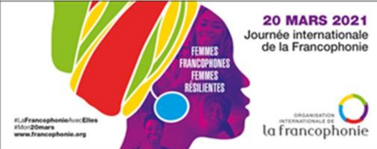
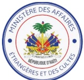
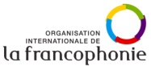
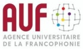
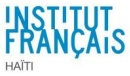
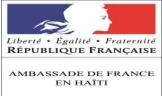
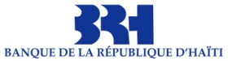

<!-- page 1 -->

# Journée internationale de la Francophonie - 2021

Thème : « Femmes Francophones, Femmes résilientes »

# Programme d'activités

de la

# Quinzaine de la Francophonie en 2021 – Haïti

du 15 au 31 mars 2021

<!-- page 2 -->

## Thème : « Femmes Francophones, Femmes résilientes »

<table><tr><td>En mars</td><td>Activités</td><td></td><td>Heures</td><td>Cibles</td><td>Organisations partenaires</td><td>Lieux</td></tr><tr><td>Lundi 8 - 19</td><td>Animations autour de la lecture/écriture à partir d'un roman illustré (Jacques Roumain / Gouverneurs de la Rosée)</td><td></td><td></td><td>+ jeunes - écoliers</td><td>Ambassade de France/Ecoles de Jacmel</td><td>JACMEL</td></tr><tr><td>Lundi 8 - 31</td><td>Exposition\nLes petites Rebelles de Mélanie BODY</td><td>10h-17h</td><td>Tout public</td><td>IFH</td><td></td><td>IFH</td></tr><tr><td>Mardi 16</td><td>Lancement officiel de la Quinzaine de la Francophonie en Haiti</td><td>11h</td><td>VIP et invités</td><td>MAE, OIF, MCC, MCF-AUF\nAmbassades francophones en Haiti</td><td>OIF-REPCAL</td><td></td></tr><tr><td>Webinaire sur les opportunités de mobilitésdoctorales dans la Francophonie</td><td>10h</td><td>Tout public</td><td>AUF</td><td>En ligne</td><td></td></tr><tr><td>Jeudi 18</td><td>Formation en partenariat avec HELP sur le Leadership pour les jeunes francophones\n« Jeunes aujourd'hui, Leader demain : Leadership social et professionnel »</td><td></td><td>Tout public</td><td>AUF</td><td>AUF Caraïbe et en ligne</td><td></td></tr><tr><td>Inauguration virtuelle du Centre de Documentation et d'Information du lycée Dutty Boukman du Cap-Haïtien : Les élèves des collèges de la ville de Suresnes (France) ayant participé aux actions de solidarité pour Haïti échangeront par visio-conférence avec leurs pairs capois et une plaque de remerciement sera officiellement dévoilée</td><td>10h</td><td>+ jeunes - écoliers</td><td>Ambassade de France-Ecole au Cap Haïtien</td><td>Visio-conférence</td><td></td></tr><tr><td>Samedi 20</td><td>Projection de films : « Ainsi parla la mer » d'Arnold ANTONIN</td><td>11h</td><td>Tout public</td><td>OIF-REPCAL</td><td>OIF-REPCAL</td><td></td></tr><tr><td>« Sango Malo » de Bassek BA KOCHIO</td><td>12h</td><td>Tout public</td><td>OIF-REPCAL</td><td>OIF-REPCAL</td><td></td></tr><tr><td>Emission radiodiffusée</td><td></td><td>Tout public</td><td>OIF-REPCAL</td><td>A distance</td><td></td></tr><tr><td>Slam/musique\nMarathon FrankÉtienne</td><td>15h</td><td>Tout public</td><td></td><td>IFH</td><td></td></tr><tr><td>Soirée de gala</td><td>18h-20h</td><td>VIP et invités</td><td>MAE, OIF, MCC, MCF-AUF\nAmbassades francophones en Haiti</td><td>Lieu à déterminer</td><td></td></tr><tr><td>20 mars au 20 avril</td><td>Exposition des œuvres littéraires de FrankÉtienne</td><td></td><td>Tout public</td><td>Ministère Culture et Communication</td><td>Centre Culturel Pye Poudre</td><td></td></tr><tr><td>Mardi 23</td><td>Conférence sur FranckÉtienne par Paula Clermont Péan</td><td>14h30</td><td>Tout public</td><td>Ministère Culture et Communication</td><td>Centre Culturel Pye Poudre</td><td></td></tr><tr><td>Cinéma\nGabrielle de Louise Archambault\nEn collaboration avec l'Ambassade du Canada</td><td>17h</td><td>Tout public</td><td>IFH-Ambassade du Canada</td><td>IFH</td><td></td></tr><tr><td>Emission radiodiffusée -</td><td>14h30</td><td>Tout public</td><td>OIF-REPCAL</td><td>A distance</td><td></td></tr></table>

<!-- page 3 -->

<table><tr><td>Mercredi 24 - 25</td><td>Formation sur leéadership pour les jeunes francophones\n« Jeunes aujourd'hui, Leader demain»</td><td>9h-3h</td><td>Etudiants</td><td>AUF</td><td>AUF Caraïbe et en ligne</td></tr><tr><td>Vendredi 26</td><td>Webinaire Pour une francophonie scientifiqueavec L'Université Fédérale du Rio Grande do Norte (Brésil)</td><td>10h</td><td>Tout public</td><td>AUF</td><td>En ligne</td></tr><tr><td>Lecture scénique de Kaselezo</td><td>15h</td><td>Tout public</td><td>IFH</td><td></td></tr><tr><td>Samedi 27</td><td>Causerie avec des femmes entrepreneurs sur la résilience en temps de crises</td><td>14h – 16h</td><td>Tout public</td><td>Ambassade de Suisse OIF-REPCAL Organismes de femmes</td><td>OIF-REPCAL</td></tr><tr><td>Lundi 29-30</td><td>Atelier « Une pédagogie active pour l'université » pour des enseignants de laCORPUHA et de la CORPUCA</td><td></td><td>Tout public</td><td>AUF</td><td>AUF Caraïbe et en ligne</td></tr><tr><td>Mercredi 31</td><td>Poésie Sève poétique Soirée lecture/ causerie / Vente signature du premier numéro de la revue Davertige Proposé par Loque Urbaine</td><td>17h</td><td>Tout public</td><td>IFH</td><td></td></tr><tr><td>30 avril</td><td>Clôture de l'exposition sur FrankÉtienne et projection du film\n« Traversée des mondes de FrankÉtienne » du réalisateur Arnold Antonin</td><td></td><td></td><td>Centre Culturel Pye Poudre</td><td></td></tr></table>

LARGE DIFFUSION

## Partenaires d'organisation

Schweizerische Eidgenossenschaft

Confédération suisse

Confederazione Svizzera

Confederaziun svizra

Ambassade de Suisse en République d'Haiti

○

○

○

○

○

Wallonie - Bruxelles International.be

BANQUE DE LA RÉPUBLIQUE D'HAÎTI
