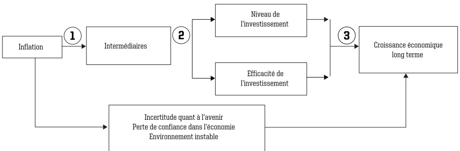

<!-- page 1 -->

## CAHIER DE RECHERCHE

<!-- page 2 -->

# Avant-Propos

a Banque de la République d'Haïti (BRH) est heureuse de partager avec le public les résultats de ses recherches à travers le troisième numéro de son « Cahier de recherche ». Cette publication revêt un caractère spécialisé et donne la priorité à tout ce qui est utile et actuel dans les domaines d'intérêt pour une banque centrale moderne. En cela, elle s'adresse à un public soucieux d'approfondir sa curiosité sur les grands problèmes de l'économie haïtienne.

Les deux numéros précédents ont couvert des thèmes aussi variés que la répercussion de l'inflation au taux de change et les facteurs structurels liés à l'évolution du secteur réel de l'économie. Le présent numéro se situe dans le prolongement des deux autres et présente les conclusions de quatre études sur les thèmes suivants :

• Investigation empirique de la corrélation entre le financement monétaire du déficit et l'inflation en Haïti :

La nature de la relation entre l'inflation et la croissance ;

Le ratio de sacrifice pour Haïti, c'est-à-dire les coûts associés à la lutte contre l'inflation ;

La modélisation non linéaire du taux de change en Haïti :

Ces choix n'ont pas été guidés par le hasard parce qu'ils tournent autour d'une problématique qui constitue la préoccupation fondamentale de toute banque centrale : l'inflation. En effet, de façon directe ou indirecte et conformément à sa mission, la BRH est amenée à prendre des décisions parfois difficiles en vue d'améliorer le pouvoir d'achat des agents économiques. A ce titre, elle doit permettre aux agents économiques de se rendre compte, à travers les travaux de recherche, des difficultés liées aux arbitrages complexes qu'impliquent les décisions de politique monétaire. Toutefois, les opinions présentées sont celles des auteurs et n'engagent pas la BRH.

La BRH espère que le public prendra plaisir à lire ce nouveau cahier qu'elle offre comme une contribution modeste mais utile au développement de la recherche économique en Haïti.

Carlo Hubert Janvier

Directeur

Monnaie et Analyse Économique

carlo.janvier@brh.ht

<!-- page 3 -->

<!-- page 4 -->

## Sommaire

01 Ratio de sacrifice: Une estimation pour l'économie Haltienne à partir d'un VAR structurel
Par Yves Nithder PIERRE
Un modèle non linéaire du taux de change nominal : le cas d'Halti
Par Ted Emmanuel AUGUSTIN
Effets de seuil dans la relation entre l'inflation et la croissance économique en Halti
Par Jacques Claude DIVERS
Debora DESCIEUX
04 Estimation de l'impact du financement du déficit budgetaire sur l'inflation en Halti
Par Carlo H. JANVIER
Jemley Marc JEAN BAPTISTE
Julnor GEORGES

<!-- page 5 -->

<!-- page 6 -->

<!-- page 7 -->

# Ratio de sacrifice : Une estimation pour l'économie haïtienne à partir d'un VAR Structurel

Par Yves Nithder PIERRE $ ^{1} $

<!-- page 8 -->

# Résumé

L

à stabilité des prix est reconnue comme étant l'une des conditions essentielles à la création et au maintien d'un environnement macroéconomique capable de favoriser une croissance saine et durable. En effet, pour garantir et maintenir cette stabilité des prix, les autorités monétaires mettent en œuvre un ensemble de

politiques dont l'objectif est de lisser les fluctuations de l'inflation. Caractérisées généralement par la restriction monétaire, ces mesures s'accompagnent parfois d'effets négatifs sur l'activité économique. Car, en dépit de ses avantages, un environnement macroéconomique stable soutenu par des politiques de lutte contre l'inflation s'obtient avec des coûts pour l'activité économique (baisse ou ralentissement de la production et hausse du niveau de chômage) sur le court terme. Ainsi, ce travail estime les coûts associés à la lutte anti-inflationniste, c'est à dire le ratio de sacrifice dans le cadre de l'économie haïtienne en utilisant un modèle VAR structurel (SVAR). Les résultats obtenus tablent sur un ratio de sacrifice assez faible et positif, obtenu à partir des réponses cumulées sur six (6) périodes. Selon ces derniers, une baisse continue de l'inflation d'un point de pourcentage à la suite d'un choc de demande globale, implique une déviation du produit intérieur brut (PIB) de près de 0,97 % en dessous de son niveau de long terme.

Mots-clés : Ratio de sacrifice, choc de demande, désinflation, modèle VAR structurel, taux de change.

<!-- page 9 -->

## Sommaire

I. Introduction ..... 9

II Ratio de sacrifice: Point de vue théorique et faits stylisés de l'économie haïtienne ..... 11
II.1. De l'arbitrage inflation-chômage à l'arbitrage inflation-croissance ..... 11
II.1.1. De l'importance du ratio de sacrifice ..... 11
II.2. Les mesures du ratio de sacrifice basées sur la courbe de Phillips ..... 11
II.2.1. L'approche basée sur la courbe de Phillips linéaire ..... 11
II.2.2. Ratio de sacrifice et courbe de Phillips non-linéaire ..... 12
II.2.3. Ratio de sacrifice, indépendance de la banque centrale et ouverture de l'économie ..... 13
II.3. Ratio de sacrifice et approche non-paramétrique ..... 13
II.4. Ratio de sacrifice à partir d'un modèle VAR structurel ..... 14
II.5. Faits stylisés de l'économie haïtienne ..... 15
II.5.1. L'inflation et les politiques de stabilité des prix en Haïti ..... 15

III. Méthodologie et évidence empirique ..... 17

III.1. Les données ..... 17
III.2. Les premiers résultats empiriques concernant la relation entre l'inflation, le PIB et le taux de change ..... 17
III.3. Spécification du modèle ..... 18
III.3.1. Etude de la stationnarité des séries ..... 19
III.3.2. Choix du nombre de retards optimal ..... 20
III.4. Le modèle VAR structurel (SVAR) ..... 20
III.5. Résultats ..... 22
III.6. Le ratio de sacrifice ..... 23

IV. Conclusion ..... 25

Références ..... 27

ANNEXE ..... 29

<!-- page 10 -->

## Introduction

La stabilité des prix est reconnue comme étant l'une des contributions essentielles de la politique monétaire à la création et au maintien d'un environnement macroéconomique capable de favoriser une croissance durable. Ceci, ayant fait l'objet d'un large consensus au niveau de la littérature économique, constitue l'un des paradigmes dominants de la pensée économique récente¹. La théorie économique la rattache à l'analyse néo-classique qui préconise l'absence d'arbitrage entre l'inflation et la croissance sur le long terme. En d'autres termes, la politique monétaire agissant efficacement en matière de maîtrise de l'inflation n'aura que des effets transitoires sur la production réelle sur le moyen et le long termes. De plus, la stabilité des prix réduit les incertitudes sur les décisions d'investissement et de consommation et conséquemment contribue à réduire la volatilité de la production².

Sur le court terme, pour garantir l'émergence et le maintien de cette stabilité des prix, les autorités monétaires mettent en œuvre un ensemble de mesures dont l'objectif est de lisser les fluctuations des prix qui apparaissent, suite aux anticipations des agents et aux chocs d'offre et/ou de demande. Caractérisées généralement par le resserrement des conditions monétaires, ces mesures anti-inflationnistes s'accompagnent parfois d'effets négatifs sur l'activité économique, prouvent qu'en dépit de ses avantages, un environnement macroéconomique stable soutenu par des politiques de lutte contre l'inflation s'obtient avec des coûts pour l'activité économique (baisse ou ralentissement de la production et hausse du niveau de chômage) sur le court terme.

La littérature économique définit ces coûts économiques comme étant le ratio de sacrifice. C'est la perte en termes d'activité économique réelle (production ou emploi) engendrée par les politiques de lutte contre l'inflation, quel que soit l'horizon temporel. En d'autres termes, il s'agit du déficit enregistré en termes de production ou d'emplois assimilé à la réduction permanente de l'inflation d'un point de pourcentage. Une évaluation efficace du ratio de sacrifice joue un rôle important dans la formulation de politiques monétaires appropriées pour atteindre et maintenir la stabilité des prix. Basé sur l'arbitrage entre l'objectif de stabilité des prix et l'objectif de croissance, le ratio de sacrifice s'offre notamment comme un indicateur particulièrement informatif et important pour l'évaluation des coûts ou des bénéfices des stratégies de lutte anti-inflation et conséquemment permet aux autorités monétaires de décider de leur portée et de leur performance.

<!-- page 11 -->

L'objectif de ce travail est d'estimer le ratio de sacrifice pour l'économie haïtienne à partir de l'estimation d'un modèle VAR structurel sur la période 1986-2015. Nous allons également faire ressortir les facteurs qui, en dehors des politiques anti-inflationnistes, sont susceptibles d'influencer la valeur de cet indicateur. De manière spécifique, nous estimerons le ratio de sacrifice et l'analyse des résultats sera faite par rapport aux principaux éléments susceptibles d'avoir un impact sur la valeur des coûts de la désinflation dans le cas d'Haïti.

Pour atteindre cet objectif, nous rappellerons, dans la deuxième partie du travail, les principales méthodologies utilisées dans la littérature économique pour la mesure du ratio de sacrifice ainsi que certains résultats obtenus. Ensuite, nous ferons une brève présentation du contexte macroéconomique d'Haïti sur la période sous étude. La troisième partie consistera en la présentation et la spécification de la méthodologie VAR structurel retenue pour estimer le ratio de sacrifice. Cette étape sera également accompagnée d'une part, de l'analyse des résultats obtenus (à partir de WINRATS) et d'autre part, de l'examen des variables pouvant avoir un impact sur le niveau du ratio de sacrifice. La quatrième partie servira de conclusion au travail.

<!-- page 12 -->

### II. Ratio de sacrifice: Point de vue théorique et faits stylisés de l'économie haïtienne

#### II. 1.De l'arbitrage inflation-chômage à l'arbitrage inflation-croissance

Le concept des coûts des politiques de stabilité des prix s'inscrit dans la longue réflexion relative au lien entre l'inflation et la croissance ou encore entre l'inflation et le chômage. Cette réflexion a été soutenue en premier lieu par la courbe de Phillips ou la relation entre le chômage et l'évolution des salaires nominaux présentée en 1958 par l'économiste Alban William Phillips. Les modifications de la courbe dans les années 1960 et 1970 ont conduit à une nouvelle interprétation des coûts d'une réduction permanente du taux d'inflation. Le raisonnement dans le cadre de la perte en emploi est transposable à la perte en production, par exemple via la loi d'Okun (1962).

##### II. 1.1. De l'importance de la mesure du ratio de sacrifice

L'estimation et l'analyse du ratio de sacrifice permettent aux autorités monétaires ainsi qu'aux décideurs de politiques économiques de mieux élaborer les politiques à mettre en œuvre afin de favoriser la stabilité des prix tout en minimisant son impact récessif sur la production et le chômage. À cet effet, plusieurs méthodologies ont été développées afin de parvenir à une mesure efficace et adaptée du ratio de sacrifice devenu un indicateur d'intérêt principal pour les banques centrales. Ces dernières tournent autour de l'arbitrage entre l'objectif d'inflation et l'objectif de croissance et peuvent être classées en trois grandes approches. La première trouve tout d'abord son origine dans la courbe de Phillips, qui peut être soit linéaire ou non-linéaire et dont la pente permet d'estimer le ratio de sacrifice. La deuxième approche se veut plutôt non-paramétique ou descriptive. La troisième coïncide avec l'utilisation d'un modèle VAR structurel qui permet de faire la distinction entre les impulsions résultant véritablement d'un changement de la politique monétaire et celles émanant simplement des modifications de la conjoncture. Dans cette partie de l'étude, nous nous proposons de faire une présentation plus approfondie de ces trois approches ainsi que de quelques résultats obtenus par leurs auteurs.

#### II. 2. Les mesures du ratio de sacrifice basées sur la courbe de Phillips

#### II. 2.1 L'approche basée sur la courbe de Phillips linéaire

Okun (1978) a été le premier à exploiter la courbe de Phillips pour mettre en évidence la relation inverse entre l'inflation et le PIB ainsi que les coûts, en termes de perte de croissance économique, d'une politique de désinflation. Dans son étude, Okun a calculé le ratio de sacrifice en estimant la pente de la courbe de Phillips dont l'expression est la suivante :

 $$ \pi_{t}-\pi_{t-1}=\beta\ (y_{t}-y_{potential}\ )+\varepsilon_{t}\ ;\ \beta<0 $$

Avec  $ y_t $ et  $ y_{potential} $ représentant le PIB actuel ou observé et le PIB potentiel alors que  $ (\pi_{t}-\pi_{t-1}) $ dénote la variation du taux d'inflation en période t ; et enfin  $ \varepsilon_t $ est le terme d'erreur.

Les résultats d'Okun ont tablé sur un ratio de sacrifice de 10 pour l'économie américaine. En d'autres termes, une réduction de l'inflation d'un point de pourcentage dans le temps est associée à une réduction de 10 % du produit intérieur brut réel $ ^{3} $. Partant de la même approche qu'Okun, Gordon et King (1982) sont parvenus à estimer un ratio de sacrifice de 4,3 % en termes de production en excluant le prix relatif des produits importés $ ^{4} $.

<!-- page 13 -->

##### II. 2.2. Ratio de sacrifice et courbe de Phillips non-linéaire

L'hypothèse associée à la non-linéarité de la courbe de Phillips peut s'expliquer par le souci de tenir compte de la variation de la sensibilité de l'économie et de la vitesse à laquelle l'inflation passe d'un niveau élevé à un niveau soutenable pour l'activité économique. Le recours à cette hypothèse a été le cas de nombreuses études qui ont démontré l'existence d'une importante non-linéarité dans la courbe de Phillips. En effet, dans un travail sur les pays du G7, Turner et Laxton (1995) ainsi que Meredith et Rose (1995) ont vérifié l'existence d'une courbe de Phillips non-linéaire pour plusieurs pays et notamment les États-Unis. Ils ont trouvé, pour les Etats-Unis, que la pente de la courbe de Phillips est plus raide au fur et à mesure que l'économie se raffermit. Ce résultat est théoriquement en cohérence avec une courbe de Phillips convexe et une économie faisant face à des contraintes en termes de capacité de production. Dans ce cas, une hausse de la demande aura plutôt tendance à faire monter les prix qu'à favoriser l'augmentation de la production vu que les contraintes de capacité réduisent la possibilité pour les entreprises d'élever le niveau de leur production. Au final, ces auteurs ont noté, par ailleurs, que l'évidence de la non-linéarité dépend très amplement de la spécification du modèle et d'une mesure appropriée de l'écart de production (output gap).

Par contre, Stiglitz (1997) a conclu que les données pour l'économie américaine soutiennent quelque part l'existence d'une courbe de Phillips concave $ ^{5} $. De même, Eisner (1997) a obtenu des résultats conformes avec une courbe de Phillips concave. Ses arguments s'accordent sur le fait que la sensibilité de l'inflation diminue avec le raffermissement de l'économie $ ^{6} $. Sur le plan théorique, les firmes, étant dans un environnement qui n'est pas purement concurrentiel, ont un certain pouvoir sur le prix et donc une certaine capacité d'influencer leur part de marché. Ainsi, en cas d'expansion de l'activité économique, elles sont peu disposées à agir sur le prix afin de maintenir ou d'élargir leur part de marché. De plus, en période de production et d'emploi élevés, les entreprises agissant efficacement, auront tendance à garder stable ou à réduire leur coût lié à la masse salariale en offrant un salaire plus bas. Ainsi, le coût du salaire en baisse aura comme conséquence l'atténuation des pressions inflationnistes dans l'économie. Ces facteurs contribuent à la réduction de la sensibilité de l'inflation avec le raffermissement de l'économie, qui, par conséquent, implique la forme concave de la courbe de Phillips.

Par une spécification plus flexible comparée à celles de Laxton et Rose (1995), l'approche de Filardo (1998) a remis en valeur l'hypothèse de la non-linéarité de la relation de Phillips dans l'estimation du ratio de sacrifice pour l'économie américaine. Il a montré que la relation entre l'inflation et la production diffère selon que l'économie est en-dessous, proche ou en-dessus de la tendance de long terme. Ainsi, il a distingué trois régimes dans lesquels l'économie peut évoluer : faible (en dessous de la tendance de long terme) ; équilibré (proche de la tendance) et surchauffé (en dessus de la tendance). Algébriquement, la relation définie par Filardo s'écrit comme suit :

 $$ \begin{array}{r l}{\pi\mathfrak{t}=\pi^{\mathfrak{e}}\mathfrak{t}}&{+\;\beta_{f a i b l e}\ast o u t p u t g a p(d u r a n t\;p\mathfrak{e}r i o d e s\;f a i b l e s)\;_{\mathfrak{t}-1})}\\ &{+\;\beta_{\mathfrak{e}q u i l i b r\mathfrak{e}}\ast o u t p u t g a p(d u r a n t\;p\mathfrak{e}r i o d e s\;e q u i l i b r\mathfrak{e e s})\;_{\mathfrak{t}-1})}\\ &{+\beta_{s u r c h a u f f e}\ast o u t p u t g a p(d u r a n t\;p\mathfrak{e}r i o d e s\;d e\;s u r c h a u f f e)_{\mathfrak{t}-1})}\\ &{+\;\varepsilon_{\mathfrak{t}}}\end{array} $$

Avec  $ \pi_t $ le taux d'inflation mesuré par la variation de l'indice des prix à la consommation,  $ \pi^e_t $ l'inflation espérée, l'output gap représente l'écart entre le PIB réel observé et le PIB potentiel et les chocs d'offre.

Les résultats de Filardo montrent que quand l'économie est au-dessous de sa tendance de long terme, le ratio de sacrifice estimé est de 5 contre 2,1 en régime de surchauffe c'est-à-dire l'économie évolue au-dessus

<!-- page 14 -->

de son niveau de long terme $ ^{7} $. Cependant, en période équilibrée, la pente de la courbe de Phillips est essentiellement plate. Si la pente estimée est exactement zéro, alors le ratio de sacrifice serait infini ( $ \infty $) car une faible variation de l'inflation est associée à d'importantes variations au niveau de la production.

En ce qui a trait à l'agressivité de la politique monétaire caractérisée par la vitesse à laquelle l'inflation passe d'un niveau relativement élevé à un niveau soutenable pour l'économie, aucun consensus n'a été trouvé dans la littérature économique pour savoir si une désinflation rapide appelée généralement stratégie «cold turkey» a plus d'effets négatifs sur l'activité économique comparée à une désinflation graduelle. Par exemple, Sargent (1983) et Ball (1994), tout en se montrant en faveur de cette approche, ont démontré dans leurs études que la crédibilité des autorités monétaires joue un rôle important dans la détermination des coûts relatifs à la baisse du niveau des prix. Pour eux, une désinflation rapide renforce la crédibilité des autorités monétaires et conséquemment diminue en moyenne la valeur du ratio de sacrifice. Par contre, King (1996) précise que la crédibilité peut ne pas jouer un grand rôle pour certaines économies telles que les Etats-Unis. Il défend le fait que, dans un environnement caractérisé par un faible niveau des prix, la Banque Centrale n'a pas l'opportunité de renforcer sa crédibilité avec des politiques provoquant une baisse rapide de l'inflation. Dans de telles situations, c'est la forme de la courbe de Phillips qui permet largement de déterminer les coûts de la désinflation. King (1996), dans son article sur la formulation des politiques anti-inflationnistes, démontre qu'une désinflation graduelle est plus efficace si la courbe de Phillips est convexe et dans le cas où elle est concave, c'est une désinflation rapide qui prévaut⁸. Les résultats de King ont été corroborés par Filardo (1998) qui affirme que lorsque la production est en dessous de son niveau potentiel, pour faire baisser l'inflation, l'approche « cold turkey » est la plus avantageuse pour les autorités monétaires car elle aura moins d'effets négatifs sur l'activité économique. En d'autres termes, quand la courbe de Phillips est concave, une désinflation rapide est préconisée et le ratio de sacrifice y relatif est moindre.

##### II. 2.3. Ratio de sacrifice, indépendance de la banque centrale et ouverture de l'économie

La relation entre l'inflation et la production traduite par la courbe de Phillips subit également l'effet d'autres facteurs. Des études ont montré que l'indépendance de la Banque Centrale influence l'arbitrage entre l'inflation et la croissance. En effet, les résultats empiriques d'Alesina et Summers (1993) précisent que l'indépendance de la Banque Centrale favorise des prix faibles et moins de fluctuations de l'inflation. Pour sa part, Jordan (1997 et 1999) suggère que l'agressivité de la politique monétaire est liée au degré d'indépendance de la banque centrale. Pour lui, un faible degré d'indépendance conduit à des désinflations rapides.

Outre l'indépendance de la banque centrale, les études de Barro et Gordon (1983) ont montré que l'ouverture de l'économie peut influencer la valeur du ratio de sacrifice. Le degré d'ouverture de l'économie joue un rôle important à la fois dans la formation des prix domestiques (inflation importée) et sur le niveau de la production. Toutefois Daniels, Nourzad et Vanhoose (2005) ont trouvé une relation positive en régressant la valeur du ratio de sacrifice sur le degré d'ouverture de l'économie et l'indépendance de la banque centrale. Selon eux, le ratio de sacrifice augmente avec le degré d'ouverture de l'économie.

#### II. 3. Ratio de sacrifice et approche non-paramétrique

L'approche non-paramétrique est inspirée des travaux de Ball (1994) et améliorée par Zhang (2001, 2005). Elle est basée sur l'identification des épisodes de désinflation et des calculs de ratios de sacrifice y relatifs. Le ratio de sacrifice d'un épisode de désinflation donné est défini comme le rapport des pertes cumulées en croissance à une réduction totale de l'inflation tendancielle sur la durée de l'épisode. L'estimation du ratio de sacrifice dépend ainsi du calcul de l'inflation tendancielle qui permet, par la suite, la sélection des épisodes de désinflation. Pour ce faire, Ball précise que l'inflation tendancielle à la période t est la moyenne

<!-- page 15 -->

mobile sur les quatre trimestres avant (t-4) et les quatre trimestres après (t+4). Cette définition de l'inflation tendancielle est une version lissée de l'inflation observée. Ensuite, Ball présente les hypothèses suivantes :

1 Le PIB observé est à son niveau potentiel au début de l'épisode de désinflation ;

2 Le PIB retourne à son niveau potentiel une année (ou quatre trimestres si l'on travaille avec des données trimestrielles) après la fin de la désinflation ;

3 Entre ces deux dates, c'est-à-dire entre le début et la fin de l'épisode de désinflation, le PIB potentiel croît de manière log-linéaire.

Avec cette méthode, Ball a estimé le ratio de sacrifice pour les pays de l'OCDE caractérisés par une inflation modérée sur la période allant de 1960 à 1991. Ses résultats tablent sur un ratio de sacrifice de 2,4 pour les Etats-Unis. Pour l'ensemble des pays de son échantillon, le ratio de sacrifice varie de 1,8 à 3,3. Il montre aussi que le ratio de sacrifice diminue avec la vitesse de désinflation.

Zhang (2001) a remis en question la définition de Ball du PIB potentiel. Il pense que la politique désinflationniste pourrait avoir des effets qui persistent au-delà de l'épisode de désinflation. Par conséquent, la non-prise en compte des effets persistantes pourrait conduire à une sous-estimation des ratios de sacrifice. Pour corriger cet inconvénient, Zhang propose de calculer le produit potentiel à partir du filtre d'Hodrick-Prescott en utilisant la série du PIB observé pris en logarithme. Tenant compte de ces hypothèses, les résultats de Zhang montrent que les ratios de sacrifice calculés en prenant en compte les effets persistantes d'une politique monétaire sont plus élevés que ceux estimés par la méthode de Ball.

#### II. 4. Ratio de sacrifice à partir d'un modèle VAR structurel

De manière générale, le ratio de sacrifice estimé à partir de la relation de Phillips, qu'elle soit linéaire ou non-linéaire, comporte à la fois les effets des politiques anti-inflationnistes et l'impact des chocs d'offre et de demande sur l'activité économique. Afin d'isoler les effets spécifiques des politiques anti-inflationnistes, Cecchetti et Rich (1999) ont proposé une estimation des ratios de sacrifice à partir d'un modèle VAR structurel. Cecchetti et Rich mentionnent dans leurs travaux, que les analyses de Gordon et King (1982) ne permettent pas de distinguer les impulsions résultant véritablement d'un changement de la politique monétaire et celles reflétant simplement une réponse aux modifications de la conjoncture (chocs d'offre ou de demande). La décomposition entre le choc exogène de politique monétaire et la réaction endogène des autorités apparaît alors comme nécessaire selon Cecchetti et Rich, pour évaluer les « vrais » coûts de la désinflation. La modélisation VAR structurel qu'ils ont proposée va permettre de faire une ventilation de la politique monétaire entre composante systématique (fonction de réaction des autorités monétaires) et composante aléatoire (chocs de politique monétaire). La composante systématique peut être assimilée à une fonction de réaction, qui décrit les réponses historiques des autorités monétaires aux mouvements des principaux agrégats macroéconomiques. La composante aléatoire représente les actions des autorités monétaires, qui ne peuvent pas être expliquées par une fonction de réaction et sont considérées comme « les chocs de politique monétaire ». La distinction des différents chocs structurels se fait à partir des fonctions de réponses impulsionnelles et l'étude de leurs effets sur le produit intérieur brut (PIB) et l'inflation permet alors de calculer le ratio de sacrifice. Cecchetti et Rich (1999) ont proposé des méthodes d'identification plus précises en faisant intervenir des chocs explicitement monétaires³. Ainsi, ils ont obtenu, pour les Etats-Unis sur la période 1959 à 1997 en données trimestrielles, un ratio de sacrifice comme une perte en termes de pourcentage du PIB réel cumulé sur 5 ans, égal à 1,38 ; 1,28 et 9,87 respectivement pour un système de deux, trois et de quatre variables.

<!-- page 16 -->

Serju (2008) a obtenu des valeurs relativement faibles pour la Jamaïque et Trinidad & Tobago qui sont des économies ouvertes et en développement $ ^{10} $. Durant les périodes de désinflation, le ratio de sacrifice pour Jamaïque est 0,029 en moyenne alors que pour Trinidad & Tobago, il est de 0,113 environ. De plus, l'auteur a trouvé que la courbe de Phillips estimée pour la Jamaïque est convexe, ce qui sous-entend que les coûts associés à la lutte anti-inflationniste diminuent avec la force de l'économie. Pour Trinidad & Tobago, l'inflation est insensible à la force de l'économie.

#### II. 5. Faits stylisés

##### II. 5.1. L'inflation et les politiques de stabilité des prix en Haiti

Au cours de la période sous étude, l'économie haïtienne a été caractérisée par la dégradation de ses capacités productives et l'évolution contrastée des poids relatifs des secteurs dans la formation du PIB, lequel a crû de 0,06 % en moyenne avec des taux de croissance négatifs et élevés durant les trois années de l'embargo (1991-1994) et en 2010. Parallèlement, l'inflation a été l'un des principaux problèmes des autorités publiques. En effet, l'économie haïtienne a connu des périodes de forte inflation et des épisodes d'inflations modérées $ ^{11} $. Les prix ont enregistré leur plus forte croissance annuelle en 1994 (46,8 %) et en 2003 (34,6 %) et ont crû en moyenne de 13,6 % par an sur la période allant de 1986 à 2015. En dépit du fait que ces niveaux d'inflation soient liés au contexte économique, cette évolution de l'inflation en Haïti est semblable à celle qui caractérise de nombreux autres pays en développement $ ^{12} $.

Parallèlement à cette situation, d'autres déséquilibres notamment celui des finances publiques et du change ont marqué l'évolution de l'économie haïtienne comme cela a été le cas de nombreuses économies en développement, ce qui les a plongées dans de graves crises financières et économiques au cours des deux premières décennies de la période susmentionnée $ ^{13} $.

Tableau 1. Taux de croissance du PIB et de l'inflation en Haïti (en %)

<table><tr><td>Taux de croissance du PIB</td><td>Taux d'inflation</td></tr><tr><td>Niveau</td><td>Maximum</td><td>Moyen</td><td>Minimum</td><td>Ecart-type</td><td>Maximum</td><td>Moyen</td><td>Minimum</td><td>Ecart-type</td></tr><tr><td>1986-1989</td><td>1,5\n-1988</td><td>-0,7</td><td>-2,8\n-1989</td><td>1,8</td><td>8,3\n-1988</td><td>0,2</td><td>-13,8\n-1987</td><td>10,2</td></tr><tr><td>1990-1999</td><td>10\n-1995</td><td>0,37</td><td>-1,16\n1994</td><td>5,8</td><td>46,8\n-1994</td><td>20,1</td><td>9\n-1999</td><td>11,1</td></tr><tr><td>2000-2009</td><td>3,3\n-2007</td><td>0,05</td><td>-3,5\n-2010</td><td>2,1</td><td>34,6\n-2003</td><td>15,5</td><td>-4,7\n2009</td><td>9,6</td></tr><tr><td>2010-2015</td><td>5,5\n-2011</td><td>1,93</td><td>-5,5\n-2010</td><td>3,9</td><td>11,3\n-2015</td><td>7,1</td><td>4,5\n-2013</td><td>3,0</td></tr><tr><td>1986-2015</td><td>-</td><td>0,6</td><td>-</td><td>4,07</td><td>-</td><td>13,6</td><td>-</td><td>13,0</td></tr></table>

Source : Données IHSI et calculs de l'auteur

<!-- page 17 -->

À travers les programmes d'ajustement structurel (PAS) signés avec le Fonds Monétaire International (FMI), des réformes ont été mises en œuvre par les autorités haitiennes au cours des années 1980 et à la deuxième moitié des années 1990. Ces mesures ont favorisé l'émergence d'une certaine discipline budgétaire et ont permis à la Banque Centrale d'acquérir un certain degré d'indépendance et donc plus de latitude dans la conduite de la politique monétaire avec pour objectif principal la stabilité des prix. Conséquement, l'inflation, après chaque niveau record enregistré, a connu des périodes de baisse continue pouvant aller de 4 à 5 ans et favorisant ainsi une amélioration du niveau des prix dans l'économie.

Graphique 1. Evolution de la croissance du PIB et de l'inflation en Haïti

| Year | Series 1 (Blue) | Series 2 (Red) |
| --- | --- | --- |
| 1986 | 0 | 0 |
| 1987 | -10 | 0 |
| 1988 | 7 | 6 |
| 1989 | -3 | 1 |
| 1990 | 24 | 1 |
| 1991 | 13 | 3 |
| 1992 | 19 | 0 |
| 1993 | 30 | -5 |
| 1994 | 47 |   |
| 1995 | 23 | 9 |
| 1996 | 18 | 5 |
| 1997 | 16 | 3 |
| 1998 | 10 | 2 |
| 1999 | 8 | 3 |
| 2000 | 13 | 2 |
| 2001 | 14 | 0 |
| 2002 | 10 | 1 |
| 2003 | 35 | 0 |
| 2004 | 25 | -4 |
| 2005 | 15 | 2 |
| 2006 | 13 | 3 |
| 2007 | 8 | 4 |
| 2008 | 17 | 2 |
| 2009 | -5 | 3 |
| 2010 | 5 | -6 |
| 2011 | 10 | 6 |
| 2012 | 5 | 3 |
| 2013 | 4 | 4 |
| 2014 | 5 | 3 |
| 2015 | 10 | 3 |

L'analyse graphique nous permet de déceler deux grandes périodes de désinflation de 1986 à 2015. Au cours de la première période qui va de 1994 à 1999, l'inflation a évolué en moyenne autour de 21 % et la baisse du rythme de croissance des prix a été rapide et prononcée. Le taux d'inflation est passé de 46,8 % en 1994 à 9 % en 1999, soit un écart de 38,8 points de pourcentage. Parallèlement, l'analyse des comptes nationaux montre une forte reprise de l'activité économique en 1995, suivie d'une baisse de la croissance économique du pays jusqu'à 1999. En effet, cette période coïncide avec un net ralentissement de l'économie. Après avoir atteint une croissance d'environ 10 % en 1995, le PIB n'a fait qu'enregistrer des taux de croissance faibles pour aboutir à 2,7 % en 1999. Cet état de fait est bien illustré par le graphique 2 qui montre l'évolution simultanée de l'inflation et du produit intérieur brut sur la période étudiée.

Le second épisode de désinflation s'étend sur la période allant de 2003 à 2009, laquelle est caractérisée par une stabilité macroéconomique et du climat d'affaires. Le taux d'inflation est passé de 34,6 % en 2003 à -4,7 % à 2009, soit une baisse de 39,3 points de pourcentage des prix. Au niveau des activités économiques, le PIB a enregistré une croissance de 5,1 % sur la période.

Faisant fi des autres facteurs comme les chocs d'offre engendrés par la faiblesse de la production domestique et l'inflation importée due aux chocs sur les marchés internationaux ainsi qu'à la dépréciation de la monnaie locale, la baisse de l'inflation en Haïti au cours de ces sous-périodes, peut être attribuée à la politique anti-inflationniste menée par la banque centrale. Sachant que la restriction monétaire a un impact négatif sur l'activité économique dans l'ensemble et au regard de l'analyse graphique qui montre que, parallèlement, la croissance de la production a pâti entre 1995 et 1999. Ainsi, la baisse de l'inflation sur l'ensemble de la période sous étude a été obtenue éventuellement avec des coûts en termes de perte de croissance (du PIB) pour l'économie haïtienne.

<!-- page 18 -->

### III. Méthodologie et évidence empirique

L'estimation du ratio de sacrifice sera faite sur la période allant de 1986 à 2015. Pour ce, nous présenterons d'abord les variables utilisées et ensuite passer à la méthodologie et la spécification du modèle VAR structurel (SVAR) retenu pour l'estimation du ratio de sacrifice.

#### III. 1. Les données

Les séries statistiques utilisées sont : le taux d'inflation, l'output gap $ ^{14} $ et le taux de change. Les données sur ces trois (3) variables proviennent de l'Institut Haïtien de Statistique et d'Informatique (IHSI) et de la Banque de la République d'Haïti (BRH) $ ^{15} $.

La série du taux d'inflation ( $ \pi_t = 100 \times \log(\text{IPC}t/\text{IPC}t-1) $) est obtenue à partir la variation en glissement annuel de l'indice des prix à la consommation (IPC) ayant août 2004 comme base.

Pour le calcul de l'output gap, nous avons utilisé la série du PIB réel $ ^{16} $ pour l'estimation du PIB potentiel à partir du filtre Hodrick-Prescott (HP). Nous avons ensuite obtenu l'output gap (gap) à partir de la formule suivante : output gap = 100*Log (PIB observé/PIB potentiel). Cette variable peut être considérée comme le taux de déviation (en pourcentage) du PIB effectif par rapport à son niveau de long terme (PIB potentiel).

En ce qui concerne le taux de change, nous utilisons les séries annuelles de fin de période. Il importe de rappeler qu'en Haïti, le taux de change est coté à l'incertain. En d'autres termes, le taux de change est évalué comme la quantité de gourdes pour un (1) dollar américain.

III.2. Les premiers résultats empiriques concernant la relation entre l'inflation, le PIB et le taux de change

L'analyse graphique nous permettra de confronter les données avec la théorie économique relative à la relation entre l'inflation et l'activité économique (courbe de Phillips). Cette démarche est importante car elle favorisera une meilleure compréhension et interprétation des résultats économétriques. Les graphiques 2 et 3 montrent l'évolution simultanée de ces variables.

Graphique 2. Taux d'inflation et taux de croissance du PIB (en %)

| X Value | Y Value |
| --- | --- |
| -12.0 | 49 |
| -8.0 | 30 |
| -6.0 | 26 |
| -5.0 | 5 |
| -4.0 | 20 |
| -3.0 | 7 |
| -1.0 | 15 |
| 0.5 | 34 |
| 1.0 | 10 |
| 1.5 | 23 |
| 2.0 | 12 |
| 2.5 | 16 |
| 3.0 | 10 |
| 3.5 | 18 |
| 4.0 | 12 |
| 4.5 | 19 |
| 5.0 | 10 |
| 6.0 | 10 |
| 10.0 | 24 |

 $ ^{14} $ L'utilisation de la série du PIB réel dans le modèle n'a pas donné des résultats concluants. D'où le choix de l'utilisation l'output gap dans l'équation.

<!-- page 19 -->

Graphique 3. Inflation et output gap

| Year | Taux d'inflation | Croissance PIB |
| --- | --- | --- |
| 1986 | 1 | 2 |
| 1987 | -13 | 13 |
| 1988 | 6 | 19 |
| 1989 | 7 | 7 |
| 1990 | 22 | 18 |
| 1991 | 12 | 20 |
| 1992 | 19 | 2 |
| 1993 | 31 | 2 |
| 1994 | 46 | -13 |
| 1995 | 23 | 39 |
| 1996 | 19 | 25 |
| 1997 | 16 | 22 |
| 1998 | 10 | 20 |
| 1999 | 9 | 18 |
| 2000 | 13 | 15 |
| 2001 | 14 | 12 |
| 2002 | 9 | 10 |
| 2003 | 34 | 1 |
| 2004 | 25 | -3 |
| 2005 | 15 | 10 |
| 2006 | 12 | 12 |
| 2007 | 10 | 22 |
| 2008 | 8 | 20 |
| 2009 | 17 | 2 |
| 2010 | -6 | -4 |
| 2011 | 4 | -2 |
| 2012 | 10 | 5 |
| 2013 | 6 | 2 |
| 2014 | 4 | 3 |
| 2015 | 5 | 2 |
| 2016 | 11 | 1 |

Le graphique 2 ne laisse pas entrevoir de relation précise entre le taux d'inflation et le taux de croissance du PIB. À partir du graphique 3 qui permet d'apprécier l'évolution simultanée de l'output gap et du taux d'inflation, nous pouvons noter sur les six premières années (1986-1991), l'existence d'une relation positive entre ces deux variables alors que, pour le reste de la période sous étude, plusieurs phases montrent la prévalence d'une relation négative. Eu égard à la méthode utilisée pour le calcul de l'output gap, une relation positive devrait lier ces deux variables.

Graphique 4. Évolution du taux d'inflation et du taux de dépréciation de la gourde (en %)

| Year | Inflation | Depréciation de la gourde |
| --- | --- | --- |
| 1986 | 3 | -2 |
| 1987 | -14 | -3 |
| 1988 | 6 | -3 |
| 1989 | 8 | -3 |
| 1990 | 23 | -3 |
| 1991 | 12 | 52 |
| 1992 | 20 | 22 |
| 1993 | 28 | 20 |
| 1994 | 48 | 20 |
| 1995 | 22 | 20 |
| 1996 | 20 | 2 |
| 1997 | 18 | -4 |
| 1998 | 16 | 12 |
| 1999 | 10 | -3 |
| 2000 | 8 | -3 |
| 2001 | 12 | 65 |
| 2002 | 14 | -10 |
| 2003 | 10 | 18 |
| 2004 | 35 | 40 |
| 2005 | 25 | -12 |
| 2006 | 15 | 15 |
| 2007 | 12 | -7 |
| 2008 | 8 | -7 |
| 2009 | 16 | 10 |
| 2010 | -5 | 2 |
| 2011 | 5 | -4 |
| 2012 | 8 | 2 |
| 2013 | 4 | 2 |
| 2014 | 4 | 2 |
| 2015 | 12 | 15 |

Cette différence au niveau du sens de la relation entre l'inflation et l'output gap peut s'expliquer par le fait que l'inflation observée dépend également de l'évolution des prix des produits importés. En effet, étant donné qu'Haïti est une petite économie ouverte avec un coefficient d'importation élevé dans le panier de consommation et dans l'offre globale, la formation des prix au niveau local est également attribuable au comportement de certains prix sur le marché international (notamment les cours du pétrole et des produits de base). Ainsi, toute augmentation des prix des produits importés entraîne celle de la facture d'importations du pays et conséquemment agit négativement sur la valeur de la gourde, donc sur le taux de change. De plus, sachant la relation positive existant entre le taux de change et l'inflation, une appréciation du taux de change génère des pressions inflationnistes dans l'économie (Graphique 4). À noter que cette considération ne prend pas en compte les trois (3) années de l'embargo économique et financier que l'on pourrait qualifier de période de stagflation. En effet, entre 1992-1994, l'inflation moyenne a été d'environ 30 % et l'économie a connu ses plus faibles taux de croissance dont -11,9 % en 1994.

<!-- page 20 -->

Cette première analyse descriptive permet déjà d'avoir une idée des résultats auxquels nous devons nous attendre en ce qui a trait à la nature de la relation qui existe entre l'output gap, l'inflation et le taux de change que nous allons vérifier à partir d'un modèle VAR structurel. Toutefois, nous devons souligner que les résultats de l'estimation économétique sont aussi bien dépendre de la spécification du modèle, laquelle doit être essentiellement liée à l'objectif fixé et le but de l'étude qui sont l'estimation du ratio de sacrifice pour Haïti.

#### III. 3. Spécification du modèle

Pour l'estimation du ratio de sacrifice, on s'est inspiré de la modélisation adoptée par Cecchetti et Rich (1999). Dans leur étude, ces auteurs ont, à partir d'un modèle VAR structurel, estimé le ratio de sacrifice pour l'économie américaine par le rapport entre la somme des variations temporaires du PIB réel et la variation du taux d'inflation due à un choc initial de politique monétaire. Selon Cecchetti et Rich, le choc en question est mesuré comme étant une variation de l'offre de monnaie.

Dans le cadre de cette étude, nous allons garder la même méthodologie de calcul du ratio de sacrifice, cependant en lieu et place du PIB, nous utilisons l'output gap. De plus, contrairement à Cecchetti et Rich, nous préconisons la méthode de décomposition de Choleski pour déterminer les paramètres du modèle VAR structurel, notamment les innovations structurelles $ ^{17} $. Le ratio de sacrifice sera obtenu à partir des fonctions de réponses impulsionnelles, lesquelles permettent de déterminer l'impact d'un choc de demande agrégée sur l'output gap et l'inflation. Il faut dire que les chocs monétaires sont classés au sein des chocs pouvant affecter les composantes de la demande globale (variation de la masse monétaire suite à des mesures de politique monétaire et fiscale). Sachant que la demande globale est adressée aux producteurs, donc, ces chocs ont la spécificité d'influencer à court terme aussi bien les prix que la production. En effet, un choc adverse de demande fait baisser les prix et la production, ce qui aboutit à un ratio de sacrifice positif.

##### III. 3.1. Etude de la stationnarité des séries

Pour l'étude de la stationnarité des variables, nous nous référons au test de Dickey-Fuller. Ensuite, nous avons déterminé le nombre de retards (lags) pour chacune des variables et nous avons trouvé 2 pour l'output gap (gap), 0 pour l'inflation (infl) et 0 pour le taux de change (txchang) pris en niveau en considérant le Bayesian Information Criterion (BIC) comme critère de décision. Il importe de remarquer que, comparé aux autres critères (AIC, HQ, etc.), ce critère est plus parcimonieux.

Tableau 2. Test de Dickey-Fuller Augmenté

<table><tr><td></td><td>En niveau</td><td>En différence première</td></tr><tr><td></td><td>gap</td><td>txchang</td><td>Infl</td><td>dtxchang</td><td>dinfl</td></tr><tr><td>Observations</td><td>29</td><td>31</td><td>31</td><td>30</td><td>30</td></tr><tr><td>Nombre de retards</td><td>2</td><td>0</td><td>0</td><td>0</td><td>0</td></tr><tr><td>Valeur critique 1 %</td><td>-2.653</td><td>-2.657</td><td>-2.647</td><td>-3.689</td><td>-2.65</td></tr><tr><td>Valeur critique 5 %</td><td>-1.953</td><td>-1.954</td><td>-1.952</td><td>-2.971</td><td>-1.953</td></tr><tr><td>Valeur critique 10 %</td><td>-1.609</td><td>-1.609</td><td>-1.61</td><td>-2.625</td><td>-1.609</td></tr><tr><td>Valeur obtenue $ ^{{*}} $</td><td>-3.73</td><td>-1.08</td><td>-1.88</td><td>-7.19</td><td>-6.4</td></tr><tr><td>Stationnarité</td><td>Oui</td><td>Non</td><td>Non</td><td>Oui</td><td>Oui</td></tr></table>

Les résultats de l'application du test de stationnarité (Dickey-Fuller Augmenté - ADF) aux séries de l'inflation (infl), de l'output gap (gap) et du taux de change (txchang) ont montré que seul l'output gap est stationnaire en niveau (tableau 2). Ainsi, nous avons repris les tests de stationnarité en utilisant, cette fois, l'inflation et le taux de change pris en différence première. Les résultats obtenus et présentés dans le tableau 2 précisent qu'au seuil

<!-- page 21 -->

de 5 %, l'inflation et le taux de change (en différence première : dinfl et dtxchang) sont donc stationnaires. Ainsi, après l'étude de la stationnarité des variables, nous avons procédé à l'estimation du VAR. Avant d'y parvenir, nous allons d'abord déterminer le nombre de décalage optimal du VAR.

##### III. 3.2. Choix du nombre de retards optimal

Pour le choix du nombre de décalage, nous avons utilisé la méthode basée sur la lecture et l'analyse des critères d'informations. L'idée sous-jacente est que l'ajout d'une ou plusieurs variables décalées permet d'augmenter la part expliquée des variables endogènes toutefois, cela entraîne parallèlement une diminution des degrés de liberté. Les résultats du test de détermination du nombre de retards révèlent qu'en se référant aux critères d'informations (Bayesian Information Criterion, BIC), le nombre de retards à retenir est de 1. Selon la construction de ce critère, il nous a permis d'obtenir le nombre de décalage le plus élevé possible.

#### III. 4. Le modèle VAR structurel (SVAR)

Se référant à Cecchetti et Rich, nous représentons le modèle VAR structurel (SVAR) trivarié suivant :

 $$ A X_{t}=\sum_{i=1}^{p}B_{i}X_{t-i}+E_{t} $$

Avec A la matrice des effets instantanés,  $ \mathbf{X}_t = (\mathrm{gap}_t, \Delta\pi_t, \Delta\mathrm{txchang}) $. gap_t, représente l'output gap,  $ \Delta\pi_t $ et  $ \Delta\mathrm{txchang} $, respectivement les variations du taux d'inflation (dinfl) et du taux de change (dtxchang) entre les périodes t et t-1. Le taux d'inflation est calculé à partir de l'indice des prix à la consommation (IPC) en rythme annuel.  $ \mathbf{E}_t = (\varepsilon_t^{\mathrm{gap}}, \varepsilon_t^{\pi}, \varepsilon_t^{\mathrm{txchang}}) $ 'représente le vecteur des innovations structurelles dans lequel le premier élément (correspond à un choc de demande globale). Ces innovations sont supposées être de moyenne nulle, leur matrice de covariances instantanées de dimension 3 est  $ \mathrm{Var}[E_t] = \sum \mathrm{diagonale} $ et elles ne présentent strictement aucune autocorrélation.

L'intérêt de cette démarche réside dans les conséquences au fil du temps des chocs structurels sur l'output gap et le taux d'inflation. Donc, pour déterminer les paramètres qui caractérisent le modèle SVAR en particulier les chocs structurels, nous allons utiliser la forme vectorielle à moyenne mobile (vector moving average, VMA) du modèle qui est la suivante $ ^{18} $:

 $$ \begin{aligned}&X_{t}=\begin{bmatrix}\\ &gap_{t}\\&\Delta\pi_{t}\\&\Delta txchang_{t}\\ &\end{bmatrix}=A^{-1}\begin{bmatrix}B(L)\end{bmatrix}\begin{bmatrix}\\ &\varepsilon_{t}^{gap}\\&\varepsilon_{t}^{\pi}\\&\varepsilon_{t}^{txchang}\\ &\end{bmatrix}=C(L)\begin{bmatrix}\\ &\varepsilon_{t}^{gap}\\&\varepsilon_{t}^{\pi}\\&\varepsilon_{t}^{txchang}\\ &\end{bmatrix}=\begin{bmatrix}C_{11}(L)&C_{12}(L)&C_{13}(L)\\C_{21}(L)&C_{22}(L)&C_{23}(L)\\C_{31}(L)&C_{32}(L)&C_{33}(L)\\ &\end{bmatrix}\begin{bmatrix}\\ &\varepsilon_{t}^{gap}\\&\varepsilon_{t}^{\pi}\\&\varepsilon_{t}^{txchang}\\ &\end{bmatrix}\\ &=\begin{bmatrix}\\ &\sum_{i=0}^{\infty}c_{11}^{i}\varepsilon_{t-i}^{gap}&\sum_{i=0}^{\infty}c_{12}^{i}\varepsilon_{t-i}^{\pi}&\sum_{i=0}^{\infty}c_{13}^{i}\varepsilon_{t-i}^{txchang}\\&c_{21}^{i}\varepsilon_{t-i}^{gap}&\sum_{i=0}^{\infty}c_{12}^{i}\varepsilon_{t-i}^{\pi}&\sum_{i=0}^{\infty}c_{32}^{i}\varepsilon_{t-i}^{txchang}\\&c_{31}^{i}\varepsilon_{t-i}^{gap}&\sum_{i=0}^{\infty}c_{32}^{i}\varepsilon_{t-i}^{\pi}&\sum_{i=0}^{\infty}c_{33}^{i}\varepsilon_{t-i}^{txchang}\\ &\end{bmatrix}=\sum_{i=0}^{\infty}C_{i}E_{t-i}\\ \end{aligned} $$

<!-- page 22 -->

Nous supposons que nous pouvons identifier les chocs monétaires à partir des chocs de demande $ ^{19} $. Sachant que ces chocs peuvent influencer dans la même direction aussi bien les prix que la production à court terme donc, nous pouvons obtenir une mesure du ratio de sacrifice à partir des fonctions de réponses structurelles du modèle SVAR. L'impact de ces chocs sur la production se traduit par une déviation de celle-ci par rapport à son niveau de long terme $ ^{20} $. Ainsi, dans le cadre de notre étude, le ratio de sacrifice devient alors le rapport entre la somme des déviations temporaires du PIB par rapport à son niveau potentiel (output gap) et de la somme des variations de l'inflation provoquées par un choc de demande. Ce rapport est établi à partir des coefficients de C(L) qui correspondent aux fonctions de réponses aux chocs pour le modèle SVAR.

De ce fait, nous allons nous référer à l'équation (2) pour obtenir les éléments du rapport donnant le ratio de sacrifice. En effet, les effets d'une variation de l'inflation  $ \tau $ périodes après un choc de demande sont les coefficients  $ c_{22} $ et l'effet total de la période  $ t $ à la période  $ t+\tau $ est la somme de ces coefficients  $ \Sigma_{i=0} c_{22} $ La contrepartie pour l'output gap est  $ \Sigma_{i=0} c_{12} $ et sachant que l'on doit prendre en compte l'effet cumulatif sur l'output gap depuis l'instant du choc jusqu'à la période  $ \tau $, alors la somme des effets de chaque période donne  $ \Sigma_{i=0} c_{12} $. La combinaison des deux termes nous permet d'obtenir le ratio de sacrifice :

 $$ SR=\frac{\displaystyle\sum_{i=0}^{\tau}\displaystyle\sum_{j=0}^{i}c_{12}^{i}}{\displaystyle\sum_{i=0}^{\tau}c_{22}^{i}} $$

Où  $ c^{i}_{12} $ et  $ c^{i}_{22} $ représentent les éléments (1,2) et (2,2) de la matrice  $ C_i $ et  $ \tau $ est l'horizon de temps retenu pour l'évaluation du cumul des écarts du PIB réel (output gap).

Le modèle décrit par l'équation 2 ne pouvant être estimé directement, donc nous ne pouvons pas observer les innovations structurelles. Pour y parvenir, nous devons procéder à l'estimation par les moindres carrés ordinaires (MCO) de la forme réduite de type VAR du modèle SVAR :

 $$ \boldsymbol{X}_{t}=\left[\begin{array}{c}g a p_{t}\\ \Delta\pi_{t}\\ \Delta t x c h a n g\end{array}\right]=\left[\begin{array}{c c c c}\displaystyle\sum_{i=1}^{p}\Phi_{11}g a p_{t-1}&\displaystyle\sum_{i=1}^{p}\Phi_{12}\Delta\pi_{t-i}&\displaystyle\sum_{i=1}^{p}\Phi_{13}\Delta t x c h a n g_{t-i}\\ \displaystyle\sum_{i=0}^{\infty}\Phi_{21}g a p_{t-1}&\displaystyle\sum_{i=1}^{p}\Phi_{22}\Delta\pi_{t-i}&\displaystyle\sum_{i=1}^{p}\Phi_{23}\Delta t x c h a n g_{t-i}\\ \displaystyle\sum_{i=0}^{\infty}\Phi_{31}g a p_{t-1}&\displaystyle\sum_{i=1}^{p}\Phi_{32}\Delta\pi_{t-i}&\displaystyle\sum_{i=1}^{p}\Phi_{33}\Delta t x c h a n g_{t-i}\end{array}\right]+\left[\begin{array}{c}u_{t}^{g a p}\\ u_{t}^{\pi}\\ u_{t}^{t x c h a n g}\end{array}\right]=\sum_{i=1}^{p}\Phi_{i}\boldsymbol{X}_{t-i}+\boldsymbol{U}_{t} $$

$\hat{U} \partial \hat{U} \left( U_i = \langle u_i^\top u_i^\top, \frac{\partial \hat{u}_i}{\partial t} \rangle \right)$ est le vecteur des résidus de moyenne nulle et de variance $\hat{u}_i = \hat{\Lambda}^{-1} \varepsilon_i \Rightarrow \varepsilon_i = \hat{\Lambda}^* \hat{u}_i$, $Var(U_i) = \Omega$ avec $\Omega$ la matrice des variances-covariances. Selon Choleski, les erreurs de prévision de chaque variable du VAR estimé sont des combinaisons linéaires des différentes innovations structurelles. Ainsi, par identification et en se référant aux équations 1 et 4, nous avons :

 $$ \hat{u}_{t}=\hat{\mathrm{A}}^{-1}\varepsilon_{t}\Rightarrow\varepsilon_{t}=\hat{\mathrm{A}}^{*}\hat{u}_{t} $$

En normalisant la diagonale de la matrice A à 1 et en imposant une structure récursive sur la matrice A (triangulaire inferieure), nous avons :

 $$ \varepsilon_{t}=\hat{\mathrm{A}}^{*}\hat{u}_{t}^{*}\hat{\mathrm{A}}^{`}\quad d o n c\quad V a r(\varepsilon_{t})=\hat{\mathrm{A}}^{*}V a r(\hat{u}_{t})^{*}\hat{\mathrm{A}}^{`} $$

En supposant que  $ Var(\hat{u}_t) = \hat{H}^* \hat{H}^* $, nous avons :  $ Var(\varepsilon_t) = \hat{A}^* \hat{H}^* \hat{H}^* * \hat{A}^* $

Et pour que  $ \operatorname{Var}(\varepsilon_t) = \mathrm{I}_2 $ (diagonalise), nous devons avoir :  $ A = \ddot{H}^{-1} $

<!-- page 23 -->

La matrice H le facteur de Choleski. Avec la décomposition de Choleski, nous pouvons obtenir les paramètres du modèle structurel en incorporant les n*(n-1)/2 restrictions à partir de la matrice variances-covariances des résidus du VAR estimé. Ainsi, avec H, la matrice de passage issue de la décomposition de Choleski de la matrice variance-covariance (Var(Ut)=Ω) telle que Ut=,Â*εt, nous pouvons écrire la représentation VAR structurelle :

 $$ X_{t}=\left[\begin{matrix}{\Phi_{11}(L)}&{\Phi_{12}(L)}&{\Phi_{13}(L)}\\ {\Phi_{21}(L)}&{\Phi_{22}(L)}&{\Phi_{23}(L)}\\ {\Phi_{31}(L)}&{\Phi_{32}(L)}&{\Phi_{33}(L)}\\ \end{matrix}\right]\left[\begin{matrix}{{g a p}_{t}}\\ {\Delta\pi_{t}}\\ {\Delta t x{c h a n g}}\\ \end{matrix}\right]=\left[\begin{matrix}{H_{11}}&{0}&{0}\\ {H_{21}}&{H_{22}}&{0}\\ {H_{31}}&{H_{32}}&{H_{33}}\\ \end{matrix}\right]\left[\begin{matrix}{\varepsilon_{t}^{{g a p}}}\\ {\varepsilon_{t}^{\pi}}\\ {\varepsilon_{t}^{{t x{c h a n g}}}}\\ \end{matrix}\right] $$

Dès lors, nous pouvons calculer les fonctions de réponses impulsionnelles du VAR structurel appelées encore innovations structurelles qui nous serviront pour estimer le ratio de sacrifice. Nous devons noter que le coefficient nul de la matrice H implique l'absence de chocs d'offre réelle et nous précisons également que, dans le cadre de ce travail, nous nous concentrons seulement sur les effets de court terme du premier choc () qui correspond à un choc de demande globale sur l'output gap et l'inflation. L'assimilation de ce choc) à un choc de demande globale peut s'expliquer de la manière suivante : les mouvements sur les marchés de la monnaie (variation du taux d'intérêt et de la base monétaire) se transmettent à l'activité économique réelle (production et inflation) à travers le comportement des composantes de la demande globale²¹.

De manière générale, ces mouvements se traduisent par des chocs au niveau de la demande globale. Sachant que l'évolution de celle-ci est caractérisée par le comportement de la demande de biens et services dans l'économie étant donné les prix tels que : , alors tout choc de demande influence la variation de la production et donc de l'output gap. De ce fait, étant donné que ce choc va affecter l'activité économique (output gap), conséquemment, il aura des impacts sur l'inflation.

#### III. 5. Résultats

Les résultats de l'estimation du VAR standard à partir des données de l'économie haïtienne allant de 1985 à 2015, sont présentés dans l'encadré suivant :

<table><tr><td>$ GAP_{{t}} = 0.38^{{*}GAP_{{t-1}}} + 0.0076^{{*}D(INFL_{{t-1}})} - 0.014^{{*}D(TXCHANG_{{t-1}})} + 0.085 - 0.0335^{{*}DU87} - 1.65^{{*}DU94} + 0.21^{{*}DU00} + 0.075^{{*}DU03} - 0.49^{{*}DU04} - 0.24^{{*}DU08} $</td></tr><tr><td></td><td>DW = 1.57</td></tr><tr><td>$ D(INFL_{{t}}) = 6.78^{{*}GAP_{{t-1}}} - 0.067^{{*}D(INFL_{{t-1}})} + 0.11^{{*}D(TXCHANG_{{t-1}})} - 0.64 - 19.83^{{*}DU87} + 13.68^{{*}DU94} + 0.88^{{*}DU00} + 22.33^{{*}DU03} - 3.91^{{*}DU04} - 6.5^{{*}DU08} $</td></tr><tr><td></td><td>DW = 1.68</td></tr><tr><td>$ D(TXCHANG_{{t}}) = 0.87^{{*}GAP_{{t-1}}} + 0.09^{{*}D(INFL_{{t-1}})} - 0.3^{{*}D(TXCHANG_{{t-1}})} + 0.75 - 0.87^{{*}DU87} + 1.87^{{*}DU94} + 10.74^{{*}DU00} + 13.45^{{*}DU03} - 4045^{{*}DU04} + 4.6^{{*}DU08} $</td></tr><tr><td></td><td>DW = 1.98</td></tr></table>

En vue de corriger les points aberrants, nous avons dû introduire dans l'estimation du modèle VAR standard six variables muettes : du87, du94, du00, du03, du04 et du08. La première permet de prendre en compte l'année 1987 où le taux d'inflation a été le plus faible (-12,6 %). La deuxième et la quatrième renvoient aux années 1994 et 2003 associées aux points culminants de l'inflation, soit 46,8 % et 34,6 % respectivement. La deuxième variable (du94) a également servi pour capturer la baisse de -11,6 % du PIB attribuable surtout

<!-- page 24 -->

à l'embargo économique et financier imposé à Haïti par la communauté internationale. En effet, à la valeur du PIB en logarithme (9,265) correspondant à l'année 1994, est associée au plus haut niveau de l'output gap en valeur absolue, soit 1,6287 pour une moyenne relativement nulle de cette variable $ ^{22} $. Les troisième, cinquième et sixième variables muettes sont associées aux périodes où le taux de change a enregistré des variations assez élevées.

L'utilisation des éléments du VAR standard estimé, notamment la matrice variance-covariance des résidus, pour retrouver les éléments du modèle SVAR, peut se faire dans le cas où les résidus du VAR standard sont des bruits blancs. En d'autres termes, il faut que les résidus soient normaux et non auto-corrélés. Dans le cadre de notre modèle, cette mesure est amplement respectée au vu des résultats obtenus, qui sont présentés dans les tableaux 2.1, 2.2, 2.3, 2.4, 2.5, et 2.6 en annexe. De même, le signe attendu pour le coefficient traduisant le rapport entre la variation du taux d'inflation et l'output gap est bon. Ce résultat est conforme à nos attentes car la façon de calculer l'output devrait théoriquement se traduire une relation positive entre l'inflation et l'output gap. De plus, au vu des résultats présentés dans le tableau1.1 en Annexe 1, il est significatif au seuil de 5 %.

#### III. 6. Le ratio de sacrifice

Nous avons obtenu, à partir des fonctions de réponses cumulées sur 6 périodes, un ratio de sacrifice assez faible pour l'économie haïtienne, soit 0,247 (Tableau 3). À partir de la simulation de Monte Carlo avec 500 itérations et en utilisant la méthode de décomposition de Choleski, nous avons pu calculer son écart-type et déterminer son intervalle de confiance à 95 %. En effet, selon les résultats présentés dans le tableau 3, l'écart-type est de 0,170 et le ratio de sacrifice obtenu évolue dans l'intervalle (0,801; 1,142). Le graphique 34 en Annexe permet d'apprécier l'évolution du ratio de sacrifice calculé à partir des réponses cumulées sur 6 périodes.

<table><tr><td>Ratio de sacrifice</td><td>0,971</td></tr><tr><td>Ecart-type</td><td>0,17</td></tr><tr><td>Intervalle de confiance</td><td>0,801</td><td>1,142</td></tr></table>

Ce résultat est comparable et conforme à ceux trouvés par Prudence SERJU (2008) pour Jamaïque et Trinidad & Tobago et par Thuy Van PHAM pour certains pays de l'Amérique Latine $ ^{23} $. Au fait, ce niveau du ratio de sacrifice traduit que la baisse de l'inflation d'un point de pourcentage, entraîne une déviation de près de 0,97 % de la production de son niveau de long terme en Haïti. En d'autres termes, pour qu'il y ait une chute permanente des prix de 1 %, il faut qu'il y ait une baisse de la production entraînant une évolution de celle-ci d'environ 0,97 % en-deça de son niveau potentiel. Se référant à cette valeur du ratio de sacrifice obtenu à partir des données de l'économie haïtienne, nous pouvons dire que les coûts en termes de perte de production associée à la réduction de l'inflation, sont relativement très faibles.

La faiblesse du ratio de sacrifice dans le cas d'Haïti implique la présence de coûts relativement peu élevés liés à la désinflation à court terme. Plusieurs facteurs peuvent expliquer cet état de fait. D'abord, nous devons mentionner le degré d'ouverture de l'économie. Avec la libéralisation de l'économie haïtienne entamée depuis la deuxième moitié des années 90 et finalisée entre 1996 et 1999, la production a amplement baissé.

<!-- page 25 -->

et par conséquent, les importations sont devenues prépondérantes au niveau de la consommation et dans l'offre globale (plus de 50 % depuis 2000). De ce fait, les prix domestiques subissent grandement l'influence des prix sur le marché international (les cours du pétrole et des matières premières agricoles notamment). Cette dépendance des prix domestiques à l'égard des prix internationaux conduit à une certaine rigidité de ces derniers par rapport aux écarts de production et aux effets des politiques anti-inflationnistes mises en œuvre par les autorités monétaires. Par conséquent, elle réduit amplement l'efficacité de ces politiques.

De même, les réformes structurelles qui ont suivi l'application des PAS, notamment la libéralisation brusque de l'économie haïtienne, ont provoqué l'effondrement du système productif (dégradation de ses capacités productives) caractérisé par la décapitalisation des entreprises agricoles et industrielles. Laquelle décapitalisation s'explique principalement par l'incapacité des entreprises domestiques à reconstituer leur capital vu qu'elles ne peuvent faire face à la concurrence des prix des produits importés. De plus, cette situation a favorisé le développement du secteur tertiaire de l'économie (le commerce notamment) qui a mobilisé beaucoup de capitaux en provenance des entreprises des secteurs agricoles et industriels en proie à la faillite $ ^{24} $. Ainsi, une modification des poids relatifs des différents secteurs dans le PIB a été constatée. Le poids du secteur tertiaire s'est amplifié au détriment de celui des autres secteurs. Conséquement, ces changements au niveau de la structure de l'économie ont eu nécessairement des impacts sur le niveau de la production et donc sur l'écart de production (output gap).

Ces changements structurels de l'économie ont atténué l'efficacité des mesures de politique monétaire mises en œuvre par la Banque de la République d'Haïti (BRH) notamment dans la lutte contre l'inflation. En effet, dans le cas d'Haïti, on observe un certain blocage au niveau du canal de transmission des décisions de politique monétaire, dû en grande partie aux problèmes structurels inhérents à l'économie haïtienne notamment la dépendance du pays par rapport aux importations. Par exemple, les statistiques ont montré que l'inflation domestique subit, à la fois, l'effet des prix internationaux et celui de la dépréciation de la gourde, laquelle résulte de la dégradation du solde de la balance des paiements. De même, selon H.-R. Dubois (2007), les agents économiques prennent parfois beaucoup de temps pour réagir ou ne réagissent presque pas aux décisions des autorités monétaires $ ^{25} $. Conséquement, dans leurs décisions d'investissement et de consommation, ils intègrent peu les décisions des autorités monétaires ou il y a un décalage dans leur prise en compte.

<!-- page 26 -->

## Conclusion

Dans le cadre de cette étude, l'objectif consistait à trouver une méthodologie appropriée pour évaluer les éventuels coûts associés aux baisses de l'inflation en termes de perte de croissance de la production. Ces coûts sont définis dans la littérature économique comme le ratio de sacrifice. De même, il était question pour nous d'analyser les résultats par rapport aux différents facteurs susceptibles d'influencer la valeur de cet indicateur.

Ainsi, dans la continuité des travaux ayant pour objectif la mesure du ratio de sacrifice à partir d'un modèle économétique, nous avons utilisé un modèle VAR structurel pour calculer le ratio de sacrifice à partir des données haïtiennes sur la période allant de 1986 à 2015. L'analyse de la période sous étude, bien que caractérisée par des prix assez élevés, nous a permis de repérer trois sous-périodes marquées par la baisse continue de l'inflation (épisodes de désinflation). En effet, après chaque pic, l'inflation a connu des périodes de chute pouvant durer tout au moins 4 ans pour atteindre des niveaux relativement faibles et soutenables pour l'économie.

À partir des fonctions de réponses impulsionnelles cumulées sur six (6) années, nous avons pu estimer le niveau du ratio de sacrifice. Les résultats obtenus tablent sur un ratio de sacrifice faible, soit 0,97. Cette valeur traduit qu'une baisse continue de l'inflation d'un point de pourcentage à la suite d'un choc de demande globale, implique une déviation du produit intérieur brut (PIB) de 0,97 % en dessous de son niveau de long terme.

À cette faiblesse de la valeur ratio de sacrifice, nous pouvons rattacher les facteurs déterminants suivants. D'abord, le degré d'ouverture de l'économie qui, caractérisé par l'importance des importations dans l'offre globale, influence l'inflation domestique. À cet élément d'explication, nous pouvons associer d'autres changements structurels qu'à connu l'économie haïtienne, lesquels ont provoqué l'effondrement du système productif (dégradation de ses capacités productives) caractérisé par la décapitalisation de certaines entreprises agricoles et industrielles. En dernier lieu, nous pouvons considérer le déficit public qui, dans une certaine mesure, devrait soutenir la croissance, génère de préférence des pressions sur les prix en raison de la qualité des dépenses. En effet, cette inefficiency des dépenses atténue les impacts positifs sur la production et la création d'un environnement propice à l'investissement.

<!-- page 27 -->

Ces différents facteurs structurels mettent à rude épreuve les mesures anti-inflationnistes prises par la Banque Centrale et ont conséquemment contribué à l'obtention d'un ratio de sacrifice faible pour Haïti. Par ailleurs, un approfondissement de ce travail pourrait se faire avec une évaluation de l'effet croisé de ces différents facteurs présentés ci-avant sur le niveau du ratio de sacrifice.

<!-- page 28 -->

## Références

BALL, Laurence: What determines the sacrifice ratio, in Mankiw ed., Monetary Policy. National Bureau of Economic Research Studies in Business Cycles, Vol. 29, The Chicago University Press, 1994. BANQUE DE LA REPUBLIQUE D'HAÎTI (BRH), Rapports annuels de 1996 à 1999 et de 2000-2008.

CECCHETTI Stephen G. et RICH, Robert W.: Structural estimates of the U.S. sacrifice ratio, Federal Reserve Bank of New York, 1999.

CETINKAYA, Arzu A. et YAVUZ, Devrim: Calculation of Output-Inflation sacrifice ratio: The case of Turkey, Research Department, Central Bank of the Republic of Turkey, Novembre 2002.

COFFINET, Jérôme, MATHERON, Julien et POILLY, Céline : Une évaluation structurelle du ratio de sacrifice dans la zone Euro, Notes d'études et de recherches, Direction Générale des Etudes et des Relations Internationales, Banque de France, Janvier 2007.

DANIELS, Joseph P.; NOURZAD, Farrokh et VANHOOSE David D.: Openness, Central Bank Independence, and the sacrifice ratio, Journal of Money, Credit and Banking, Vol. 37, no 2, Avril 2005.

DANIELS, Joseph P. et VANHOOSE David D.: Exchange rate pass through, openness, and the sacrifice ratio, Marquette University working papers, Aout 2010.

DIANA, Guiseppe et SIDIROPOULOS, Moise: Central Bank independence, Speed of disinflation and the sacrifice ratio, Université Louis Pasteur, France, Juillet 2003.

DUBOIS, Henry Robert : Réflexions sur la problématique des bons émis par la BRH comme instrument de politique monétaire, Document de travail, Banque de la République d'Haïti (BRH), Août 2007.

DURAND, Jean Jacques, HUCHET-BOURDON, Maryline et LICHERON, Julien: Sacrifice ratios dispersion in the euro area: What can we learn for the conduct of a single monetary policy? CREM (UMR CNRS 6211), Université de Rennes 1, 2005.

FILARDO, Andrew: New evidence on the Output cost of fighting inflation, Federal Reserve Bank of New York, Staff Papers, 1998.

<!-- page 29 -->

GARATTI, Alexis : Analyse multivariée des ratios de sacrifice européens, la Doc. Française, Economie Internationale, no 103, Mars 2003.

GORDON, Robert J. et al KING, Stephen J.: The output Cost of Disinflation in Traditional and Vector Autoregressive Models, Brookings Papers on Economic Activity no 1, 1982.

GREENE, Williams : Econométrie, 5e Edition, (Edition française) IEP Paris, Université Paris II, Pearson Education France, 2005.

JACOB, Sergot : Libéralisation des marchés agricoles: Expérience Haïtienne, document de travail non publié, 2002.

JORDAN Thomas J.: Disinflation costs, Accelerating Inflation gains and Central Bank Independence, Weltwirtschaftliches Archiv, Vol. 133, no 1, 1997.

LARDIC, Sandrine et MIGNON, Valérie : Econométrie des séries temporelles macroéconomiques et financières, Edition Economica, 2002.

OKUN, Arthur M.: Efficient Disinflationary Policies, American Economic Review, 1978.

PERMAN, Roger et TAVERA, Christophe : Une analyse de la convergence des ratios de sacrifice en Europe, Economies et Sociétés, Séries, « Monnaie » 2010.

PHAM, Thuy Van: Ancrage nominal du taux de change et coûts de la désinflation : une estimation économétique,

Thèse de doctorat, Université Paris 1 Panthéon Sorbonne, 2007.

SERJU, Prudence: Estimating the output cost of disinflation: An application to Jamaica and Trinidad & Tobago, Research and Economic Programming Division, Bank of Jamaica, 2008.

TAMOLA, Alejandro: The sacrifice ratio in Latin America & the Caribbean, Birkbeck, University of London, 2009.

ZHANG, Lawrence: Sacrifice Ratios with Long-Lived Effects, International Finance, 2005.

LAXTON, Douglas; MEREDITH, Guy et ROSE David E.: Asymmetric Effects of Economics Activity on Inflation, IMF Staff Papers, June 1995.

<!-- page 30 -->

Tableau 1.1. Nombre de retards optimal du VAR

| Lags | SBC/BIC |
| --- | --- |
| 0 | 263.053292 |
| 1 | 262.965389 $ ^{{*}} $ |
| 2 | 273.315654 |
| 3 | 289.174558 |
| 4 | 275.217009 |

Tableau 1.2. Estimation VAR Structural

<table><tr><td>VAR/System- Estimation by Least Squares</td></tr><tr><td>Dependent Variable GAPT</td><td></td><td></td><td></td><td></td></tr><tr><td>Annual Data From 1987.01 To 2015.01</td><td></td><td></td><td></td><td></td></tr><tr><td>Usable Observations</td><td>29</td><td>Degrees of Freedom</td><td>19</td></tr><tr><td>Mean of Dependent Variable</td><td>-0.008394574</td><td></td><td></td><td></td></tr><tr><td>Std Error of Dependent Variable</td><td>0.425265527</td><td></td><td></td><td></td></tr><tr><td>Standard Error of Estimate</td><td>0.250415156</td><td></td><td></td><td></td></tr><tr><td>Sum of Squared Residuals</td><td>1.191447254</td><td></td><td></td><td></td></tr><tr><td>Durbin-Watson Statistic</td><td>1.729271</td><td></td><td></td><td></td></tr><tr><td></td><td></td><td></td><td></td><td></td></tr><tr><td>Variable</td><td>Coeff</td><td>Std Error</td><td>T-Stat</td><td>Signif</td></tr><tr><td>1. GAPT(1)</td><td>0.381205161</td><td>0.118730114</td><td>3.21069</td><td>0.00460257</td></tr><tr><td>2. DINFL(1)</td><td>0.007633393</td><td>0.006833826</td><td>1.117</td><td>0.27792034</td></tr><tr><td>3. DTXCHANG(1)</td><td>-0.014097063</td><td>0.017087591</td><td>-0.82499</td><td>0.41961588</td></tr><tr><td>4. Constant</td><td>0.084874406</td><td>0.056129709</td><td>1.51211</td><td>0.14696055</td></tr><tr><td>5. DU87</td><td>-0.033445781</td><td>0.257027239</td><td>-0.13013</td><td>0.89783498</td></tr><tr><td>6. DU94</td><td>-1.64957413</td><td>0.273253473</td><td>-6.03679</td><td>0.00000831</td></tr><tr><td>7. DU00</td><td>0.208465911</td><td>0.261543538</td><td>0.79706</td><td>0.43526408</td></tr><tr><td>8. DU03</td><td>0.074763308</td><td>0.266488039</td><td>0.28055</td><td>0.78208733</td></tr><tr><td>9. DU04</td><td>-0.490459048</td><td>0.355298532</td><td>-1.38041</td><td>0.18348501</td></tr><tr><td>10. DU05</td><td>-0.241473749</td><td>0.279847557</td><td>-0.86288</td><td>0.39896678</td></tr><tr><td>F-Tests, Dependent Variable GAPT</td></tr><tr><td>Variable</td><td>F-Statistic</td><td>Signif</td><td></td><td></td></tr><tr><td>GAPT</td><td>10.3085</td><td>0.0046026</td><td></td><td></td></tr><tr><td>DINFL</td><td>1.2477</td><td>0.2779203</td><td></td><td></td></tr></table>

<!-- page 31 -->

Dependent Variable DINFL

<table><tr><td>Annual Data From 1987:01 To 2015:01</td></tr><tr><td>Usable Observations</td><td>29</td><td>Degrees of Freedom</td><td>19</td><td></td></tr><tr><td>Mean of Dependent Variable</td><td>-0.197038061</td><td></td><td></td></tr><tr><td>Std Error of Dependent Variable</td><td>8.662989961</td><td></td><td></td></tr><tr><td>Standard Error of Estimate</td><td>6.086226148</td><td></td><td></td></tr><tr><td>Sum of Squared Residuals</td><td>703,8008257</td><td></td><td></td></tr><tr><td>Durbin-Watson Statistic</td><td>1.797864</td><td></td><td></td></tr><tr><td>Variable</td><td>Coeff</td><td>Std Error</td><td>T-Stat</td><td>Signif</td></tr><tr><td>1. GAPT(1)</td><td>6.77618014</td><td>2.88568128</td><td>2.34821</td><td>0.02984187</td></tr><tr><td>2. DINFL(1)</td><td>-0.06716105</td><td>0.16609302</td><td>-0.40436</td><td>0.69046504</td></tr><tr><td>3. DTXCHANG(1)</td><td>0.10694769</td><td>0.4153061</td><td>0.25752</td><td>0.79954936</td></tr><tr><td>4. Constant</td><td>-0.63658503</td><td>1.36420697</td><td>-0.46663</td><td>0.64606802</td></tr><tr><td>5. DU87</td><td>19.82918474</td><td>6.2469298</td><td>-3.17423</td><td>0.00499436</td></tr><tr><td>6. DU94</td><td>13.68292307</td><td>6.64130102</td><td>2.06028</td><td>0.05333501</td></tr><tr><td>7. DU00</td><td>0.8855975</td><td>6.3566964</td><td>0.13932</td><td>0.8906656</td></tr><tr><td>8. DU03</td><td>22.33574572</td><td>6.47687023</td><td>3.44854</td><td>0.00269181</td></tr><tr><td>9. DU04</td><td>-3.90209668</td><td>8.63536877</td><td>-0.45187</td><td>0.65647601</td></tr><tr><td>10. DU05</td><td>-6.49859344</td><td>6.80156724</td><td>-0.95546</td><td>0.35134709</td></tr></table>

F-Tests, Dependent Variable DINFL

| Variable | F-Statistic | Signif |   |   |
| --- | --- | --- | --- | --- |
| GAPT | 5.5141 | 0.0298419 |   |   |
| DINFL | 0.1635 | 0.690465 |   |   |
| DTXCHANG | 0.0663 | 0.7995494 |   |   |

Dependent Variable DTXCHANG

<table><tr><td>Usable Observations</td><td>29</td><td>Degrees of Freedom</td><td>19</td><td></td></tr><tr><td>Mean of Dependent Variable</td><td>1,204827586</td><td></td><td></td></tr><tr><td>Std Error of Dependent Variable</td><td>3,794438243</td><td></td><td></td></tr><tr><td>Standard Error of Estimate</td><td>1,740629964</td><td></td><td></td></tr><tr><td>Sum of Squared Residuals</td><td>57,56606073</td><td></td><td></td></tr><tr><td>Durbin-Watson Statistic</td><td>1.791339</td><td></td><td></td></tr><tr><td>Variable</td><td>Coeff</td><td>Std Error</td><td>T-Stat</td><td>Signif</td></tr><tr><td>1. GAPT{}</td><td>0.86525632</td><td>0.82529028</td><td>1.04843</td><td>0.30759629</td></tr><tr><td>2. DINFL{}</td><td>0.08932322</td><td>0.04750177</td><td>1.88042</td><td>0.07547102</td></tr><tr><td>3. DTXCHANG{}</td><td>0.29841727</td><td>0.11877545</td><td>2.51245</td><td>0.02117685</td></tr><tr><td>4. Constant</td><td>0.75165005</td><td>0.39015631</td><td>1.92654</td><td>0.06912992</td></tr><tr><td>5. DU87</td><td>0.87393848</td><td>1.7865904</td><td>0.48917</td><td>0.63032369</td></tr><tr><td>6. DU94</td><td>1.8675686</td><td>1.89937858</td><td>0.98325</td><td>0.33783912</td></tr><tr><td>7. DU00</td><td>10.73966979</td><td>1.81798309</td><td>5.90746</td><td>0.00001093</td></tr><tr><td>8. DU03</td><td>13.45588015</td><td>1.8523522</td><td>7.26421</td><td>0.00000068</td></tr><tr><td>9DU04</td><td>4.45172246</td><td>2.46967189</td><td>1.80256</td><td>0.08734433</td></tr><tr><td>10. DU05</td><td>4.61072995</td><td>1.94521391</td><td>2.37029</td><td>0.02850969</td></tr></table>

F-Tests, Dependent Variable DTXCHANG

<table><tr><td>Variable</td><td>F-Statistic</td><td>Signif</td></tr><tr><td>GAPT</td><td>1.0992</td><td>0.3075963</td><td></td><td></td></tr><tr><td>DINFL</td><td>3.536</td><td>0.075471</td><td></td><td></td></tr><tr><td>DTXCHANG</td><td>6.3124</td><td>0.0211768</td><td></td><td></td></tr></table>

<!-- page 32 -->

Tableau 1.3. Matrice variance-covariance des résidus

<table><tr><td>Covariance\Correlation Matrix of Residuals</td></tr><tr><td></td><td>GAPT</td><td>DINFL</td><td>DTXCHANG</td></tr><tr><td>GAPT</td><td>0.041084388</td><td>-0.058079506</td><td>0.000787903</td></tr><tr><td>DINFL</td><td>-0.057994554</td><td>24.26899399</td><td>-0.04639319</td></tr><tr><td>DTXCHANG</td><td>0.000225007</td><td>-0.322006309</td><td>1.985036577</td></tr></table>

#### Tableau 2.1. Test de normalité

Statistics on Series VRES2(1)

<table><tr><td>Annual Data From 1987.01 To 2015.01</td><td></td><td></td><td></td></tr><tr><td>Observations</td><td>29</td><td></td><td></td></tr><tr><td>Sample Mean</td><td>0</td><td>Variance</td><td>0.042552</td></tr><tr><td>Standard Error</td><td>0.206281</td><td>of Sample Mean</td><td>0.038305</td></tr><tr><td>t-Statistic (Mean=0)</td><td>0</td><td>Signif Level</td><td>1</td></tr><tr><td>Skewness</td><td>-0.677801</td><td>Signif Level (Sk=0)</td><td>0.157707</td></tr><tr><td>Kurtosis (excess)</td><td>1.31513</td><td>Signif Level (Ku=0)</td><td>0.201955</td></tr><tr><td>Jarque-Bera</td><td>4.310391</td><td>Signif Level (JB=0)</td><td>0.115881</td></tr><tr><td>Statistics on Series VRES2(2)</td></tr><tr><td>Annual Data From 1987.01 To 2015.01</td><td></td><td></td><td></td></tr><tr><td>Observations</td><td>29</td><td></td><td></td></tr><tr><td>Sample Mean</td><td>0</td><td>Variance</td><td>25.135744</td></tr><tr><td>Standard Error</td><td>5.013556</td><td>of Sample Mean</td><td>0.930994</td></tr><tr><td>Statistic (Mean=0)</td><td>0</td><td>Signif Level</td><td>1</td></tr><tr><td>Skewness</td><td>0.21704</td><td>Signif Level (Sk=0)</td><td>0.650979</td></tr><tr><td>Kurtosis (excess)</td><td>0.425707</td><td>Signif Level (Ku=0)</td><td>0.679577</td></tr><tr><td>Jarque-Bera</td><td>0.446661</td><td>Signif Level (JB=0)</td><td>0.79985</td></tr><tr><td>Statistics on Series VRES2(3)</td></tr><tr><td>Annual Data From 1987.01 To 2015.01</td><td></td><td></td><td></td></tr><tr><td>Observations</td><td>29</td><td></td><td></td></tr><tr><td>Sample Mean</td><td>0</td><td>Variance</td><td>2.055931</td></tr><tr><td>Standard Error</td><td>1.433852</td><td>of Sample Mean</td><td>0.26626</td></tr><tr><td>t-Statistic (Mean=0)</td><td>0</td><td>Signif Level</td><td>1</td></tr><tr><td>Skewness</td><td>0.633869</td><td>Signif Level (Sk=0)</td><td>0.186417</td></tr><tr><td>Kurtosis (excess)</td><td>1.387966</td><td>Signif Level (Ku=0)</td><td>0.178086</td></tr></table>

<!-- page 33 -->

Tableau 2.2 Test de Corrélation

<table><tr><td>Correlations of Series VRES2(1)</td><td>Correlations of Series VRES2(2)</td><td>Correlations of Series VRES2(3)</td></tr><tr><td>Annual Data From 1987 to 2015</td><td>Annual Data From 1987 to 2015</td><td>Annual Data From 1987.01 To 2015.01</td></tr><tr><td>Autocorrelations</td><td>Autocorrelations</td><td>Autocorrelations</td></tr><tr><td>1</td><td>-0.05225</td><td></td><td>1</td><td>0.09452</td><td></td><td>1</td><td>0.08704</td><td></td></tr><tr><td>2</td><td>-0.07006</td><td></td><td>2</td><td>0.20569</td><td></td><td>2</td><td>-0.26656</td><td></td></tr><tr><td>3</td><td>0.04521</td><td></td><td>3</td><td>0.23419</td><td></td><td>3</td><td>-0.01101</td><td></td></tr><tr><td>4</td><td>-0.19361</td><td></td><td>4</td><td>0.10656</td><td></td><td>4</td><td>0.08738</td><td></td></tr><tr><td>5</td><td>-0.2682</td><td></td><td>5</td><td>0.29741</td><td></td><td>5</td><td>0.03635</td><td></td></tr><tr><td>6</td><td>-0.2208</td><td></td><td>6</td><td>-0.14369</td><td></td><td>6</td><td>0.09204</td><td></td></tr><tr><td>7</td><td>0.04304</td><td></td><td>7</td><td>0.22852</td><td></td><td>7</td><td>-0.07558</td><td></td></tr><tr><td>8</td><td>0.16572</td><td></td><td>8</td><td>-0.09482</td><td></td><td>8</td><td>-0.25526</td><td></td></tr><tr><td>9</td><td>-0.02162</td><td></td><td>9</td><td>-0.42709</td><td></td><td>9</td><td>-0.01867</td><td></td></tr><tr><td>10</td><td>0.36786</td><td></td><td>10</td><td>0.15206</td><td></td><td>10</td><td>-0.09797</td><td></td></tr><tr><td>11</td><td>0.14173</td><td></td><td>11</td><td>-0.009</td><td></td><td>11</td><td>0.02449</td><td></td></tr><tr><td>12</td><td>-0.18663</td><td></td><td>12</td><td>-0.00741</td><td></td><td>12</td><td>-0.07468</td><td></td></tr><tr><td>Ljung-Box Q-Statistics</td><td>Ljung-Box Q-Statistics</td><td>Ljung-Box Q-Statistics</td></tr><tr><td>Lags</td><td>Statistic</td><td>Signif Lvl</td><td>Lags</td><td>Statistic</td><td>Signif Lvl</td><td>Lags</td><td>Statistic</td><td>Signif Lvl</td></tr><tr><td>4</td><td>1.67</td><td>0.796203</td><td>4</td><td>4</td><td>0.405991</td><td>4</td><td>2.888</td><td>0.576771</td></tr><tr><td>8</td><td>7.521</td><td>0.481573</td><td>8</td><td>10.639</td><td>0.222992</td><td>8</td><td>6.291</td><td>0.614647</td></tr><tr><td>12</td><td>16.79</td><td>0.15766</td><td>12</td><td>19.936</td><td>0.068315</td><td>12</td><td>7.086</td><td>0.851881</td></tr></table>

Tableau 2.3 Réponses aux chocs

<table><tr><td>Responses to Shock in GAPT</td><td>Responses to Shock in DINFL</td><td>Responses to Shock in DTXCHANG</td></tr><tr><td>Entry</td><td>GAPT</td><td>DINFL</td><td>DTXCHAN G</td><td>Entry</td><td>GAPT</td><td>DINFL</td><td>DTXCHAN G</td><td>Entry</td><td>GAPT</td><td>DINFL</td></tr><tr><td>1</td><td>0.2027</td><td>-0.286</td><td>0.0011</td><td>1</td><td>0</td><td>4.918</td><td>-0.0654</td><td>1</td><td>0</td><td>0</td></tr><tr><td>2</td><td>0.0751</td><td>1.3928</td><td>0.1495</td><td>2</td><td>0.0385</td><td>-0.337</td><td>0.4588</td><td>2</td><td>0.019</td><td>0.1505</td></tr><tr><td>3</td><td>0.0371</td><td>0.4311</td><td>0.1448</td><td>3</td><td>0.0056</td><td>0.3324</td><td>0.1338</td><td>3</td><td>0</td><td>0.189</td></tr><tr><td>4</td><td>0.0154</td><td>0.2382</td><td>0.0274</td><td>4</td><td>0.0066</td><td>0.0015</td><td>0.0745</td><td>4</td><td>-0.003</td><td>0.0224</td></tr><tr><td>5</td><td>0.0073</td><td>0.0913</td><td>0.0264</td><td>5</td><td>0.0015</td><td>0.0524</td><td>-0.0164</td><td>5</td><td>0</td><td>-0.029</td></tr><tr><td>6</td><td>0.0031</td><td>0.0462</td><td>0.0066</td><td>6</td><td>0.0012</td><td>0.0046</td><td>0.0108</td><td>6</td><td>0</td><td>0.0013</td></tr><tr><td>7</td><td>0.0014</td><td>0.0187</td><td>0.0048</td><td>7</td><td>0.0003</td><td>0.0089</td><td>-0.0018</td><td>7</td><td>0</td><td>-0.005</td></tr><tr><td>8</td><td>0.0006</td><td>0.0091</td><td>0.0015</td><td>8</td><td>0.0002</td><td>0.0015</td><td>0.0016</td><td>8</td><td>0</td><td>0</td></tr><tr><td>9</td><td>0.0003</td><td>0.0038</td><td>0.0009</td><td>9</td><td>0.0001</td><td>0.0016</td><td>0.0002</td><td>9</td><td>0</td><td>-0.001</td></tr><tr><td>10</td><td>0.0001</td><td>0.0018</td><td>0.0003</td><td>10</td><td>0</td><td>0.0004</td><td>0.0003</td><td>10</td><td>0</td><td>0</td></tr></table>

<!-- page 34 -->

Graphique 1.1. Ratio de sacrifice et intervalle de confiance

|   | borne inf | ratio de sacrifice | borne sup |
| --- | --- | --- | --- |
| 1 | 0.54 | 0.54 | 0.54 |
| 2 | 0.63 | 0.80 | 0.98 |
| 3 | 0.73 | 0.90 | 1.08 |
| 4 | 0.78 | 0.94 | 1.11 |
| 5 | 0.80 | 0.96 | 1.12 |
| 6 | 0.80 | 0.97 | 1.13 |

<!-- page 35 -->

<!-- page 36 -->

## Un modèle non linéaire du taux de change nominal : le cas d'Haïti

Ted Emmanuel Augustin $ ^{1} $

<!-- page 37 -->

## Résumé

L'objectif de ce travail est d'utiliser la caractéristique non linéaire de la série de taux de change haïtien à des fins prévisionnelles. Ce travail propose ainsi une méthodologie adéquate pour contourner la forme fonctionnelle linéaire imposée dans presque tous les modèles de taux de change par l'utilisation d'un modèle à changement de régime. Les résultats obtenus suggèrent que la modélisation non linéaire du taux de change en Haïti est une porte ouverte vers la prévision et le ciblage du taux de change nominal en vue de pouvoir appliquer des politiques y relatives.

Mots clés : modélisation non linéaire, STAR, taux de change nominal

<!-- page 38 -->

## Sommaire

I. Introduction .....39
II. Revue de la litterature théorique .....40
II.1. Les faiblesses des modèles macroéconomiques .....40
III. Méthodologie .....42
III.1. Description de la base de données .....42
III.2. Le modèle STAR .....42
III.3. Présentation et analyse des résultats .....44
IV. Conclusion .....47
Addendum .....48
Références .....49
Annexe .....51

<!-- page 39 -->

## Introduction

Il est bien connu de nos jours que les séries des taux de change sont bien décrites par une imprévisibilité linéaire. L'implication immédiate d'une telle observation est que le meilleur prédicateur de ces séries correspond soit à une marche au hasard, soit à des prévisions naïves : le marché est efficient et l'on ne peut donc prétendre, par le biais de la connaissance d'une information particulière, à la réalisation de profits anormaux. C'est à une telle constatation qu'aboutissent Meese et Rogoff (1983) lorsqu'ils concluent qu'à tous les horizons de prévision, la marche au hasard supplante à la fois les modèles structurels les plus courants et divers types de modélisations ARMA (Auto Regressive Moving Average). Beaucoup de travaux empiriques établissent que l'existence de la non linéarité dans les séries de taux de change serait exploitable dans un but prévisionnel dans le cas d'une petite économie ouverte comme Haïti. Nous nous proposons ici de poursuivre les travaux de Meese et Rogoff (1983) avec une étude de la dynamique des taux de change au travers de la modélisation STAR (Smoothing Transition Auto Regressive). Une telle modélisation a pour objectif de tenir compte des phénomènes non linéaires présents dans les séries de taux de change. La substance de ce travail de recherche est donc de déterminer si les modèles a changement de régime ne seraient pas plus appropriés dans la détermination du taux de change en Haïti que les modèles linéaires habituellement utilisés.

<!-- page 40 -->

### II. Revue de la littérature théorique

Dans la littérature économique il existe deux catégories d'approches pour construire les modèles de taux de change : l'approche macro-économique et l'approche micro-économique. Nous allons, dans cette étude, résumer quelques modèles dans chaque catégorie.

1) Mundell R. et Fleming J. (1962) ont développé un modèle de taux de change basé sur la balance des paiements. Ce modèle est néokeynésien : il raisonne donc a priori à prix fixes, avec des anticipations statiques, et il concerne une économie de petite ou moyenne dimension. Dans sa version la plus simple, le taux de change réel est la variable d'ajustement pour réaliser l'équilibre de la balance courante. Si le taux de change nominal est flexible, l'ajustement se fait rapidement ; si le taux de change nominal est fixe, c'est la variation des prix qui assure l'ajustement. Dans une version plus sophistiquée, le taux de change réel doit assurer l'équilibre non seulement de la balance courante mais aussi de la balance des capitaux. Autrement dit il doit permettre l'équilibre externe dans son ensemble. Si ce modèle est intéressant pour expliquer pédagogiquement comment se positionnent les différentes politiques économiques conjonctuelles, il n'est pas bien adapté à la compréhension de la formation du change. En effet, il peut faire croire à tort que l'équilibre du marché des changes se confond avec celui de la balance des paiements. Or, l'équilibre de la balance des paiements est un équilibre de flux alors que celui du marché des changes est un équilibre à la fois de flux et de stocks (les mouvements de capitaux dépendent essentiellement de comportements patrimoniaux).

2) Plus tard, Frenkel J. (1978) a proposé un modèle monétaire à prix très flexibles. Les insuffisances du modèle de Mundell-Fleming mais aussi et surtout le passage, au cours de la première moitié des années 1970, au régime des changes flexibles expliquent l'émergence de modèles qui délaissent l'explication réelle du taux de change pour considérer les devises comme des actifs financiers dont la valeur (le taux de change) dépend de la rareté relative des différentes monnaies les unes par rapport aux autres : le taux de change est un phénomène purement monétaire. Le modèle de Frenkel suppose que tous les prix, y compris ceux des monnaies, sont parfaitement flexibles, que l'offre de ces monnaies est exogène et qu'il y a une parfaite mobilité internationale des capitaux. Ce modèle généralise au cadre international la théorie quantitative de la monnaie.

En effet, le modèle de Frenkel montre que l'équilibre du change dépend de l'équilibre des marchés monétaires domestique et étranger. Le taux de change d'une monnaie augmente si s'accroît la relative rareté de cette monnaie par rapport aux autres. De même, une politique monétaire nationale expansive, accroissant la quantité de monnaie en circulation, creuse l'écart d'inflation au détriment de l'économie nationale considérée, d'où une dépréciation de sa monnaie. Le modèle de Frenkel conduit à admettre de manière continue la loi de la PPA (dans sa version relative), non pas par l'intermédiaire du principe du prix unique, mais à partir de cette idée selon laquelle la rareté relative des monnaies explique à la fois l'évolution de l'écart d'inflation et celle du taux de change. Par ailleurs, le modèle de Frenkel s'oppose à celui de Mundell-Fleming sur un point important : une baisse du taux d'intérêt domestique, ceteris paribus, augmente la demande de monnaie chez Frenkel, et par conséquent aboutit à une appréciation de la monnaie nationale, alors que dans le modèle M-F une telle baisse réduit les entrées de capitaux, d'où une dépréciation de la monnaie.

#### II. 1. Les faiblesses des modèles macroéconomiques

Meese R. et Rogoff K. (1983) ont démontré dans une étude l'incapacité des modèles précédents à expliquer de manière statistiquement satisfaisante les variations concrètes des taux de change. En effet, la prédicibilité de ces modèles serait moins bonne que la pure et simple extrapolation ou que la pure et simple marche au hasard. L'étude de Meese et Rogoff contraint les économistes à rechercher les raisons des insuffisances des modèles de type macroéconomique.

La première raison est le caractère souvent excessivement contraignant des hypothèses posées à la base des modèles. C'est en particulier le cas de l'hypothèse de la validité de la loi de la PPA. Accepter qu'à long

<!-- page 41 -->

terme la PPA se vérifie, c'est en effet oublier que tous les biens et services ne sont pas échangeables sur le plan international et qu'il n'est donc pas raisonnable de calculer la PPA à partir d'indices de prix qui intègrent tous les biens et services, échangeables et non échangeables.

Une seconde série de raisons réside dans le rôle trop exclusif donné par ces modèles aux variables monétaires et financières pour expliquer les variations du taux de change.

Une troisième raison se trouve aussi dans la construction des modèles : leur linéarité ne colle pas avec le constat d'un comportement erratique et même chaotique des taux de change.

Enfin, le rôle de la spéculation dans la déconnexion des taux de change par rapport aux « fondamentaux » constitue une quatrième raison de l'insuffisance des modèles.

Devant les insuffisances de l'approche macroéconomique que propose l'analyse des taux de change par les fondamentaux, les économistes, toujours dans leur recherche de modèles explicatifs des mouvements du change, optent pour une approche microéconomique et une conception financière des devises, surtout à un moment où la globalisation financière s'affirme de plus en plus. Cette approche microéconomique, que l'on appelle aussi la « théorie de la microstructure des marchés », consiste pour l'essentiel à étudier le fonctionnement du marché des changes et à prendre en compte l'hétérogénéité des acteurs qui y participent.

3) Frenkel J. (1981) a développementé un modèle microéconomique basé sur les « news ». Selon lui, les fluctuations du change peuvent être dues à des écarts entre le taux observé et le taux rationnellement anticipé que génèrent des événements imprévus, « les « news », qui créent des « effets de surprise ». Les « news » susceptibles d'influencer ainsi de manière non anticipée les taux de change sont les informations portant sur les performances économiques et financières des différents pays ainsi que les commentaires que ces informations suscitent.

4) Un autre modèle microéconomique de taux de change a été développé par Peters E. (1994), suivant la théorie des fractales. Cette théorie stipule que les prix ne glissent pas mais sautent et l'amplitude des risques peut être la même quelle que soit la période de temps considérée (l'heure, le jour, le mois ou l'année), et les prix ne peuvent pas être prévus et que seuls les risques peuvent être modélisés. Deux conclusions importantes peuvent être tirées de cette théorie. La première est qu'il y a une variabilité identique du phénomène à toutes les échelles et la seconde est que le niveau des taux de change ne dépendrait pas de l'information immédiatement disponible mais d'une sorte de mémorisation des chroniques passées.

L'analyse « technique » de l'évolution des taux de change s'appuie précisément sur des méthodes algébriques (« méthode numérique ») et graphiques (« méthode chartiste ») pour prévoir leur évolution à partir des cours passés, en recherchant des configurations censées se reproduire régulièrement. D'une part, l'analyse technique est une sorte de justification empirique des théories évoquées dans ce paragraphe, mais d'autre part son emploi peut expliquer une certaine validité de ces théories.

D'après les études économériques, l'approche microéconomique ne donne pas beaucoup plus de satisfactions que l'approche macroéconomique pour comprendre l'évolution du taux de change, surtout au-delà du très court terme. Cela explique d'abord, la tentative faite par R. Lyons (2001) de combiner en quelque sorte les deux approches et les premiers tests de validation sont encourageants. Cela explique surtout que les nouvelles théories délaissent l'explication de l'évolution des taux de change pour se concentrer, comme lors de la première moitié du XXème siècle, sur le taux de change d'équilibre de long terme.

Somme toute, en dépit des différentes approches utilisées par d'éminents économistes pour déterminer un modèle idéal de taux de change, les résultats demeurent toujours insatisfaisants. Ainsi, dans le cadre de cette étude on se donne pour objectif de contourner la forme fonctionnelle linéaire, qui est la troisième raison des faiblesses des modèles macro-économique utilisée dans tous les modèles sus cités, par une modélisation non-linéaire du taux de change nominal.

<!-- page 42 -->

### III. Méthodologie

#### III. 1. Description de la base de données

Pour réaliser cette étude, nous avons mobilisé des données journalières, du 3 oct 2005 au 25 sept 2009, provenant du service de change de la direction des Affaires Internationales de la BRH. Ainsi, des données sur le taux de change nominal à la vente pris sur le marché informel ont été collectées directement sous format Excel et n'ont subi aucune transformation ; ce sont donc des données de terrain.

## Justification de la modélisation non linéaire du taux de change

Longtemps après la naissance de l'économétrie $ ^{26} $, les économètres ont continué à faire uniquement de la modélisation linéaire, mais avec l'émergence des marchés financiers une ère nouvelle allait éclore, celle de la modélisation non linéaire. En effet, la dynamique des marchés financiers est particulièrement complexe et on peut penser que les séries financières (et principalement le taux de change) sont caractérisées par une dynamique de type non linéaire.

De plus la théorie économique offre de nombreuses spécifications potentielles à la présence de non linéarité dans les taux de change. L'hétérogénéité des participants sur le marché (informel) des changes est souvent citée comme la source majeure de la non linéarité des processus décrivant le taux de change. L'économiste Peters (1994) a étudié les comportements des agents intervenants sur le marché des changes. En se focalisant sur les différences d'anticipations, d'horizons temporels et de degrés d'aversion au risque, il soutient que l'hétérogénéité des investisseurs qui répondent différemment aux news peut générer des dynamiques non linéaires sur le taux de change. Ce qui implique qu'il est probable que les séries de taux de change ne soient pas linéaires sur toute une période, mais le sont sur des fractions de période. L'intérêt maintenant est de trouver les points (seuils) de rupture ou de changement de régime. De ce fait, nous allons construire notre modèle suivant la théorie des fractales de Peters, avec comme modification l'utilisation des modèles à changement de régime.

#### III. 2. Les modèles STAR

Les modèles STAR (Smooth Transition Autoregressive) sont à même de capturer la présence éventuelle de non linéarité dans la mesure où la vitesse de convergence vers l'équilibre dépend de l'importance de l'écart par rapport à ce même équilibre. Soit  $ z_t $ l'écart en t du taux de change nominal à sa valeur fondamentale. Supposons que  $ z_t $ suit un processus STAR à un retard:

 $$ \mathrm{Z}_{\mathrm{t}}{=}\uprho_{1}\mathrm{z}_{\mathrm{t-1}}{+}\uprho_{1}{*}_{\mathrm{z}_{\mathrm{t-1}}}\mathrm{F}(\mathrm{z}_{\mathrm{t-d}},\theta)\;{+}\upnu_{\mathrm{t}} $$

Où v_t est un processus indépendamment et identiquement distribué. F(z_t-d,θ) est la fonction de transition d'un état à un autre (comprise entre 0 et 1), z_t-d est la variable de transition et θ = (γ, c), c étant le seuil et γ (γ > 0) représentant la vitesse de transition d'un état à un autre. Pour permettre une transition douce, Teräsvirta et Anderson (1992) ont proposé deux types de fonctions de transition : une fonction logistique (modèle LSTAR) et une fonction exponentielle (modèle ESTAR).

Afin d'estimer les processus de type STAR, nous suivons la procédure séquentielle suggérée par Luukkonen, Saikkonen et Teräsvirta (1988), Granger et Teräsvirta (1993), Eitrheim et Teräsvirta (1996) et Escribano et Jorda (1999).

## Identification d'un processus STAR

Nous allons donc déterminer si effectivement il y a une certaine non linéarité dans la série txch dans le cas d'Haïti. Pour cela nous allons recourir aux étapes de mise en œuvre en vue de l'identification d'un processus STAR.

<!-- page 43 -->

## Mise en œuvre :

Etape1.- Détermination du nombre de retard pour assurer la stationnarité du processus.

La procédure @yulelag du logiciel RATS donne directement ce nombre de retard. Ainsi pour la variable sous étude, le nombre de retard qui minimise la fonction d'Akaike est de 7.

La série stationnaire est le DTXCH et elle sera utilisée pour la suite de l'étude afin d'éviter des régressions fallacieuses.

### Etape 2.- Test de linéarité et détection du seuil

Cette étape permet de déterminer une éventuelle non linéarité et, le cas échéant de déterminer le paramètre de délai d. Ainsi, pour une variable de transition donnée, on calcule alors une séquence de statistiques  $ LM(d) $ à partir d'un balayage sur toutes les valeurs possibles du paramètre de délai d, c'est-à-dire sur toutes les observations de la variable de transition.

Le test le plus puissant contre l'alternative de modèles à seuil correspond à la statistique la plus élevée. Ainsi, à partir de cette séquence de statistiques  $ LM(d) $ Davies (1977) préconise de prendre Sup  $ LM(d) $, puisque la statistique LM est une fonction monotone du paramètre de seuil. Le tableau suivant donne les résultats du test avec un AR(7) et pour un d égal à 3 (les autres tableaux sont présentés en annexe).

Tableau 1. Détermination du seuil de change

Test for STAR in series DTXCH. AR length=7 delay=3

| Test |   | F-stat | Signif |
| --- | --- | --- | --- |
| Linearity |   | 22.202546 | 0 |
| H01 |   | 9.931368 | 0 |
| H02 |   | 24.668064 | 0 |
| H03 |   | 24.227207 | 0 |

Les résultats des tableaux 1 à 7 (cf annexe) montrent que pour le délai 3 on ne peut pas rejeter l'hypothèse de non linéarité de la série. En outre, la valeur de LM est supérieure aux autres valeurs LM du paramètre de délai (1 à 7). Nous voyons également que le H01 est significatif, ce qui veut dire que la série est caractérisée par un processus LSTAR.

### Etape 3.- Estimation du modèle LSTAR

Puisque la série était caractérisée par une non linéarité en moyenne de type LSTAR, nous estimons alors le modèle. Nous rappelons la formulation générale du modèle LSTAR :

 $$ \mathrm{X}_{\mathrm{t}}=\sum\alpha_{1\mathrm{i}}\mathrm{X}_{\mathrm{t}-\mathrm{i}}+\sum\alpha_{2\mathrm{i}}\mathrm{X}_{\mathrm{t}-\mathrm{i}}[1+\exp(-\mathrm{Gamma}(\mathrm{X}_{\mathrm{t}-\mathrm{d}}-\mathrm{c}))]^{-1} $$

<!-- page 44 -->

## Les résultats de l'estimation sont présentés dans le tableau suivant :

Tableau 2. Résultats de l'estimation

<table><tr><td>Nonlinear Least Squares - Estimation by Gauss-Newton</td><td></td><td></td><td></td><td></td></tr><tr><td>Convergence in 23 Iterations. Final criterion was 0.0000030 <= 0.00001</td><td></td><td></td><td></td><td></td></tr><tr><td>Dependent Variable DTXCH</td><td></td><td></td><td></td><td></td></tr><tr><td>Daily Data From 2005/10/3 To 2009/09/25</td><td></td><td></td><td></td><td></td></tr><tr><td>Usable Observations</td><td>962</td><td>Degrees of Freedom</td><td>951</td><td></td></tr><tr><td>Total Observations</td><td>968</td><td>Skipped/Missing</td><td>6</td><td></td></tr><tr><td>Centered  $ R^{{2}} $</td><td>0.242843</td><td>R Bar  $ ^{{*2}} $</td><td>0.234881</td><td></td></tr><tr><td>Uncentered  $ R^{{2}} $</td><td>0.243081</td><td>T x  $ R^{{2}} $</td><td>233.843</td><td></td></tr><tr><td>Mean of Dependent Variable</td><td>-0.001654574</td><td></td><td></td><td></td></tr><tr><td>Std Error of Dependent Variable</td><td>0.093416112</td><td></td><td></td><td></td></tr><tr><td>Standard Error of Estimate</td><td>0.081712074</td><td></td><td></td><td></td></tr><tr><td>Sum of Squared Residuals</td><td>6.349696803</td><td></td><td></td><td></td></tr><tr><td>Log Likelihood</td><td>1049.89328</td><td></td><td></td><td></td></tr><tr><td>Durbin-Watson Statistic</td><td>2.060649</td><td></td><td></td><td></td></tr><tr><td>Variable</td><td>Coeff</td><td>Std Error</td><td>T-Stat</td><td>Signif</td></tr><tr><td>1</td><td>PHI(1)</td><td>-0.44893322</td><td>0.07546844</td><td>-5.94862</td><td>0</td></tr><tr><td>2</td><td>PHI(2)</td><td>0.10361495</td><td>0.02994608</td><td>3.46005</td><td>0.0005641</td></tr><tr><td>3</td><td>PHI(3)</td><td>0.10200905</td><td>0.02928844</td><td>3.48291</td><td>0.0005186</td></tr><tr><td>4</td><td>PHI(4)</td><td>0.28974549</td><td>0.04127005</td><td>7.02072</td><td>0</td></tr><tr><td>5</td><td>PHI(5)</td><td>0.6211158</td><td>0.08949438</td><td>6.94023</td><td>0</td></tr><tr><td>6</td><td>PHI(11)</td><td>1.33261435</td><td>0.17814068</td><td>7.48069</td><td>0</td></tr><tr><td>7</td><td>PHI(2)</td><td>-0.42007325</td><td>0.14170098</td><td>-2.9645</td><td>0.0031074</td></tr><tr><td>8</td><td>PHI(2(3))</td><td>-1.74791728</td><td>0.20763437</td><td>-8.41825</td><td>0</td></tr><tr><td>9</td><td>PHI(2(4))</td><td>0.21922171</td><td>0.06678171</td><td>3.28266</td><td>0.0010658</td></tr><tr><td>10</td><td>GAMMA</td><td>16,15251807</td><td>3,44344455</td><td>4.6908</td><td>3.12E-06</td></tr><tr><td>11</td><td>C</td><td>0.06710998</td><td>0.01461272</td><td>4.59257</td><td>4.97E-06</td></tr></table>

#### III. 3. Présentation et analyse des résultats

Nous pouvons constater que globalement c'est un bon modèle, dans la mesure où les résidus sont non autocorrelés, en témoigne le DW de 2.06. Par le fait que le (LR test) test de ratio de vraisemblance soit significatif, cela traduit que de manière générale les paramètres ne sont pas tous nuls, et par conséquent le modèle est bien spécifié. Aussi nous pouvons voir que tous les paramètres choisis dans les deux régimes sont significativement différents de 0. En outre les paramètres spécifiques tels gamma et c sont largement significatifs accusant chacun d'eux un T-student > |1.96|. Le paramètre c (= 0.067) est l'élément qui détermine le changement de régime tandis que  $ \gamma $ (= 16.152) est la mesure de lissage. Cette petite valeur de  $ \gamma $ implique donc un passage lisse d'un régime à un autre.

Ce qui prouve qu'effectivement le taux de change nominal haïtien est caractérisé par une dynamique non linéaire. En d'autres termes, sur l'ensemble de la période d'observation, la série n'est pas linéaire, et donc ne peut pas être représentée par un processus linéaire à des fins descriptives et/ou prévisionnelles, par contre elle est linéaire par fraction de période. Ainsi, dans le premier régime l'équation du taux de change s'écrit :

 $$ DTXCH_{t}=-0.448+0.103*DTXCH_{t-1}+0.1020*DTXCH_{t-2}+0.289*DTXCH_{t-3}+0.621*DTXCH_{t-4} $$

et dans le second régime elle s'ecrit :

 $$ DTXCH_{t}=1.332-0.420*DTXCH_{t-1}-1.747*DTXCH_{t-2}+0.219*DTXCH_{t-3} $$

<!-- page 45 -->

Nous voyons que dans le premier régime la variation du taux de change nominal est expliquée par son histoire à 4 retards. Aussi, nous remarquons que toute augmentation de 1 % de la variation du taux de change le trimestre précédent va entraîner une variation à la hausse de près de 10 % de la variable pour le trimestre en cours. Tandis qu'au second régime nous pouvons d'abord apprécier que la variable dépendante est expliquée par son histoire à 3 retards. De plus, en analysant les paramètres associés à la variation du taux de change dans le second régime, nous remarquons que toute augmentation de 1 % de la variation du taux de change le trimestre précédent va entraîner une variation à la baisse de plus de 42 % de la variable pour le trimestre en cours. Evidemment, un saut de la sorte aurait pour vertu de biaiser les analyses, puisqu'il mentionnerait l'existence d'un changement structurel non pris en compte, d'où l'intégration de la fonction de transition (1 + exp(-16.152(DTXCH_{t-3} - 0.067))] - 1) dans le second régime qui a pour mérite de lisser les valeurs de la variable sous étude quand on passe d'un régime à un autre. Notons que ce type de changement ne peut pas être traité par l'introduction de variable muette dans le modèle, car comme son nom l'indique (changement structurel), ce sont des changements profonds et radicaux provenant des fondamentaux de la structure de l'économie.

## Simulation et prévisions

Analyse du graphique illustrant l'évolution conjointe de la série estimée par le modèle LSTAR et celle observée.

| Date | nhservé |
| --- | --- |
| 3-Nov-05 | 43.1 |
| 3-Jan-06 | 43.1 |
| 3-Mar-06 | 43.0 |
| 3-May-06 | 39.3 |
| 3-Jul-06 | 40.5 |
| 3-Sep-06 | 39.8 |
| 3-Nov-06 | 39.6 |
| 3-Jan-07 | 38.5 |
| 3-Mar-07 | 38.0 |
| 3-May-07 | 37.2 |
| 3-Jul-07 | 36.2 |
| 3-Sep-07 | 36.8 |
| 3-Nov-07 | 37.0 |
| 3-Jan-08 | 37.5 |
| 3-Mar-08 | 38.5 |
| 3-May-08 | 39.0 |
| 3-Jul-08 | 40.8 |
| 3-Sep-08 | 40.5 |
| 3-Nov-08 | 40.6 |
| 3-Jan-09 | 40.8 |
| 3-Mar-09 | 41.0 |
| 3-May-09 | 41.2 |
| 3-Jul-09 | 41.5 |
| 3-Sep-09 | 41.8 |

L'analyse du graphique ci-dessus nous permet de voir une évolution conjointe presque parfaite entre le taux de change nominal observé et estimé sur la période allant de du 7 octobre 2005 au 24 septembre 2009. Aussi, comme nous pouvons le constater, l'évolution des séries est loin d'être linéaire, ce qui explique l'incapacité des modèles à forme fonctionnelle linéaire d'expliquer ou de prévoir cette variable. A la limite, on pourrait augurer un modèle quadratique avec « a3 » positif, qui serait la distribution d'une fonction non linéaire dans les variables.

Graphique 3. Prévision intra-échantillon

| Période | Prévu | Observé |
| --- | --- | --- |
| 28/09/09 | 41,83 | 41,888 |
| 29/09/09 | 41,804 | 41,987 |
| 30/09/09 | 41,731 | 41,995 |
| 1er/10/09 | 41,685 | 42 |

Graphique 4. Prévision extra-échantillon

| Période | Prévu | Inférieur | Supérieur |
| --- | --- | --- | --- |
| 2/10/2009 | 42.418 | 41.885 | 42.951 |
| 5/10/2009 | 41.833 | 41.3 | 42.366 |
| 6/10/2009 | 42.384 | 41.851 | 42.917 |
| 7/10/2009 | 41.356 | 40.823 | 41.889 |

<!-- page 46 -->

Les tableaux 3 et 4 illustrent la prévision intra échantillon et extra échantillon respectivement. Nous pouvons remarquer (tableau 3) que l'écart de prévision est relativement faible, ce qui prouve que le modèle a une bonne capacité de prévision sur un horizon de quatre jours.

Évidemment à mesure que l'on s'éloigne dans le temps l'erreur de prévision se creuse et la qualité de la prévision diminue. En analysant le tableau 4 nous voyons facilement que les intervalles de confiance sont très restreints donc diminuent considérablement la fonction de perte « the loss function ».

<!-- page 47 -->

## Conclusion

L'objectif de ce travail était de déterminer un modèle de taux de change nominal en Haïti qui soit vraiment capable de capter les spécificités de ladite variable en vue de réaliser des prévisions. Nous avons donc fait une revue critique de la littérature existante sur les différents modèles utilisés pour représenter la dynamique du taux de change à travers le temps. Chacun de ces modèles s'est révélé incapable d'estimer ou de prévoir sur un horizon important les valeurs de la variable sous étude. Nous avons donc en conséquence utilisé un modèle non linéaire, car tous les modèles précédents avaient en commun ou s'étaient surtout caractérisés par une forme fonctionnelle linéaire. Ainsi nous avons procédé à l'utilisation d'un modèle STAR. L'analyse des résultats et les simulations que nous avons faites confirment que la série du taux de change nominal haïtien est bien caractérisée par un processus non linéaire de type LSTAR.

Bien que nous n'ayons pas, d'une part de modèles linéaires existant dans la littérature économétrique haïtienne et d'autre part de modèles non linéaires existant dans la littérature empirique des pays à taux de change flottant qui nous permettrait de comparer avec les résultats présentés dans cette étude, nous pouvons tout de même prétendre que la piste à explorer pour définir un modèle de référence de taux de change nominal en Haïti est la modélisation non linéaire.

<!-- page 48 -->

## Addendum

Cette étude a été produite en 2009 et les données ont été collectées suivant une fréquence journalière de 3 octobre 2005 au 25 septembre 2009. Un effort d'actualisation a été faite en vue de ramener les observations à février 2016. Cependant, les différents chocs qui ont secoué le pays depuis ces sept (7) dernières années ont définitivement changé la dynamique qui existait dans l'économie haïtienne. En effet, le séisme du 12 janvier 2010 et les conséquences qui en suivirent dénaturent totalement la mémoire de la série du taux de change. D'abord, les flux des capitaux qui ont envahi l'économie ont fait chuter le taux de change de 42,1784 gourdes le 12 janvier 2010 à 38,5083 le 28 janvier 2010. Il aura fallu attendre août 2012 pour retrouver 42,1074 gourdes pour un dollar EU, une valeur proche de celle d'avant séisme. Ensuite, le retrait massif des ONG et le tarissement des dons et transferts envers Haïti ont réduit de manière drastique la disponibilité des dollars sur le marché des changes, dans un contexte où l'habitude d'importation du pays reste inchangée. Finalement, l'ensemble des mesures de politique monétaire prises durant cet intervalle pour pouvoir lisser la volatilité du taux de change nous dissuade de mettre dans une même base de données ces deux périodes.

Toutefois l'auteur s'engage à mener une autre étude suivant le même sujet afin de pouvoir comparer les résultats d'un modèle non linéaire du taux de change en période de crise profonde et les résultats de cette présente étude. En outre, il s'engage à revisiter les nouvelles théories et résultats empiriques d'autres chercheurs de 2009 à date et tester aussi d'autres méthodologies. Il n'est donc pas impossible de voir que suite à ce changement profond dans l'économie, la dynamique qui existait dans le taux de change devient une toute autre.

<!-- page 49 -->

## Références

Alvaro Leal et Jeroen V.K. Rombouts (2006), Techniques d'analyse et de prévision de la conjoncture : Modèles avec changement de régime, 49 pages.

Aymen BELGACEM, La réaction du CAC 40 aux annonces macroéconomiques : Essai d'un modèle non linéaire, 14 pages.

des.

Davies, R. B. (1977), Hypothesis testing when a nuisance parameter is present only under the alternative. Biometrika 64:247-54.

Eitrheim, O. and T. Terasvirta (1996), Testing the adequacy of smooth transition autoregressivemodels, Journal of Econometrics 74, 59-76.

Escribano, A., Jorda, O. (1999), Improved Testing and Specification of Smooth Transition Regression 'Models. In: Rothman, P. (ed.) Nonlinear Time Series Analysis of Economic and Financial Data. Kluwer Academic Publishers, Dordrecht.

Fleming, J. Marcus (1962), “Domestic Financial Policies under Fixed and under Floating Exchange Rates,” Staff Papers, International Monetary Fund (Washington), 369-79.

Frenkel, Jacob A. (1978), Purchasing power parity: Doctrinal perspective and evidence from the 1920's, Journal of International Economics 8, no. 2, May, 169-191.

Frenkel, Jacob A. (1981), Flexible exchange rates, prices and the role of 'news': Lessons from the 1970's, Journal of Political Economy 89, no. 4, Aug., forthcoming.

G. Dufrénot, S. Lardic, L. Mathieu, V. Mignon, A. Péguin-Feissolle (avril 2004), Cointégration entre les taux de change et les fondamentaux : changement de régime ou mémoire longue ? 12 pages.

Granger, C.W.J. and T. Terasvirta (1993), Modelling Nonlinear Economic Relationships, Oxford: Oxford University Press.

<!-- page 50 -->

Jean-François GOUX (juin 2004), Le taux de change euro-dollar est-il quasi-stationnaire ? 33 pages. Luukkonen, R., P. Saikkonen and T. Terasvirta (1988), Testing linearity against smooth transition autoregressive models, Biometrika 75, 491-499.

Lyons, R. (2001), The Microstructure Approach to Exchange Rates, MIT Press: Cambridge, MA.

Meese, Richard, and Rogoff Kenneth (1983), “Empirical Exchange Rate Models of the Seventies.” Journal of International Economics, 1983, 14 pp. 3-24.

Mohamed Ali HOUFI et Mokhtar KOUKI (septembre 2006), Modèles non linéaires et tests d'efficiency informationnelle, 44 pages.

Peters, E. (1994), “Fractal Market Analysis: Applying Chaos Theory to Investment and Economics” (Wiley, New York).

Remzi Uctum (2007), Econométrie des modèles à changement de régimes : un essai de synthèse, 59 pages. Rohan Longmore and Wayne Robinson (2004), Modelling and Forecasting Exchange Rate Dynamics: An Application of Asymmetric Volatility Models, 34 pages.

Sandrine LARDIC, Valérie MIGNON(1999), Prévision ARFIMA des taux de change : les modélisateurs doivent-ils encore exhorter à la naïveté des prévisions ? 22 pages.

Sophie Béreau, Antonia López Villavicencio and Valérie Mignon(2008), Ajustement non linéaire du Taux de change réel vers sa valeur d'équilibre : une Modélisation Pstr Vecm, résumé Non Technique, 2 pages.

Terasvirta, T., and H. M. Anderson (1992), Characterizing nonlinearities in business cycles using smooth transition autoregressive models. Journal of Applied Econometric.

<!-- page 51 -->

## Annexe

Tableau 1.1 Détermination du seuil

| Test for STAR in series DTXCH, AR length=7 delay=1 |   |   |
| --- | --- | --- |
| Test | F - stat | Signif |
| Linearity | 21,250361 | 0 |
| H01 | 6.881085 | 0 |
| H02 | 18,138362 | 0 |
| H03 | 31,160806 | 0 |
|   |   |   |
| Test for STAR in series DTXCH, AR length=7 delay=2 |   |   |
| Test | F - stat | Signif |
| Linearity | 6.5218995 | 0 |
| H01 | 9.148773 | 0 |
| H02 | 2.5223007 | 0.0142 |
| H03 | 7.2187745 | 0 |
|   |   |   |
| Test for STAR in series DTXCH, AR length=7 delay=3 |   |   |
| Test | F - stat | Signif |
| Linearity | 22.202548 | 0 |
| H01 | 9.831368 | 0 |
| H02 | 24.888084 | 0 |
| H03 | 24.227207 | 0 |
|   |   |   |
| Test for STAR in series DTXCH, AR length=7 delay=4 |   |   |
| Test | F - stat | Signif |
| Linearity | 11.651561 | 0 |
| H01 | 6.924071 | 0 |
| H02 | 9.126258 | 0 |
| H03 | 15.110271 | 0 |
|   |   |   |
| Test for STAR in series DTXCH, AR length=7 delay=5 |   |   |
| Test | F - stat | Signif |
| Linearity | 17.413491 | 0 |
| H01 | 10.097168 | 0 |
| H02 | 8.226219 | 0 |
| H03 | 29.01828 | 0 |
|   |   |   |
| Test for STAR in series DTXCH, AR length=7 delay=6 |   |   |
| Test | F - stat | Signif |
| Linearity | 8.12052 | 0 |
| H01 | 6.308936 | 0 |
| H02 | 10.6868 | 0 |
| H03 | 6.230857 | 0 |
|   |   |   |
| Test for STAR in series DTXCH, AR length=7 delay=7 |   |   |
| Test | F - stat | Signif |
| Linearity | 10.421287 | 0 |
| H01 | 9.879724 | 0 |
| H02 | 16.199469 | 0 |
| H03 | 3.467069 | 0.001 |

<!-- page 52 -->

<!-- page 53 -->

# Effets de seuil dans la relation entre l'inflation et la croissance économique en Haïti

Claude Jacques DIVERS+

Débora DESCIEUX $ ^{1} $+

<!-- page 54 -->

## Résumé

a nature de la relation entre l'inflation et la croissance économique, longtemps considérée comme étant linéaire, a soulevé un grand débat au cours de ces dernières décennies. Certains économistes soutiennent qu'il existerait un seuild'inflation au-dessous duquel l'inflation agit positivement sur la croissance et

au-delà duquel les poussées inflationnistes constitueraient un obstacle pour l'activité économique. Compte tenu de l'importance de la connaissance de la nature de cette relation pour la conduite de la politique monétaire, il s'avère incontournable d'investiguer en profondeur cette problématique. Ce papier vise à détecter une potentielle non-linéarité de cette relation dans le cas de l'économie haïtienne. Les résultats de cette étude permettent de conclure qu'il existe effectivement une relation non linéaire entre l'inflation et la croissance en Haïti et qu'au-delà de 18 %, l'inflation est négativement corrélée avec la croissance économique.

<!-- page 55 -->

## Sommaire

I. Introduction .....56
II. Débat autour de la relation entre l'inflation et la croissance économique .....58
II.1. Contribution théorique .....58
II.2. Stabilité des prix et performance de l'économie .....59
II.3. Contribution empirique .....60
III. Structure et tendance de l'inflation et la croissance économique en Haïti .....61
IV. Approche méthodologique .....62
V. Présentation des résultats .....63
IV. 6. Conclusion .....65
Références .....66

<!-- page 56 -->

# Introduction

Un faible niveau d'inflation et une croissance soutenue de l'activité économique sont les principaux objectifs de toute politique macroéconomique. Toutefois, la relation entre l'inflation et la croissance économique a longtemps fait l'objet de nombreuses controverses entre les différents courants de pensée économique. Certains admettent qu'un niveau d'inflation structurellement faible est non seulement source de distorsions dans l'activité économique mais peut également accentuer le risque de déflation. Ces économistes soutiennent que l'inflation est procyclique au sens qu'elle tend à augmenter en période de forte croissance et diminuer en période de récession.

Selon d'autres, l'inflation, au contraire, affecte négativement l'activité économique vu que généralement le niveau moyen de l'inflation est corrélé positivement à sa volatilité. Une telle situation peut conduire à l'incertitude quant à la rentabilité future des projets d'investissement et aboutit, par ricochet, à des niveaux inférieurs d'investissement et de croissance. Khan (2002) abonde dans le même sens en affirmant que l'inflation réduit également la compétitivité internationale d'un pays en rendant ses exportations relativement plus chères, ce qui impacte négativement la balance des paiements.

Au fil des ans, il s'est dégagé un consensus dans l'évolution de ce débat à travers des travaux théoriques et empiriques. Ce consensus concilie tous les courants et admet qu'il existe un seuil d'inflation en dessous duquel l'inflation est corrélée positivement à la croissance économique et au-delà duquel elle nuit à la croissance économique. L'objectif de ce papier est de déterminer, dans le cas d'Haïti, la nature de la relation existant entre l'inflation et la croissance économique à partir des données des 30 dernières années.

Les prochains développementes s'articuleront autour des différentes contributions théoriques et empiriques ayant rapport à ce sujet. Une présentation du cadre macroéconomique de l'économie haïtienne sera faite dans la partie 2. La partie 3 sera consacrée à la présentation de la méthodologie. Les principaux résultats seront présentés à la partie 4. Enfin, la conclusion et les éventuelles recommandations seront abordées au niveau de la partie 5.

<!-- page 57 -->

# II. Débat autour de la relation entre l'inflation et la croissance économique II.1. Contribution théorique

La question de la relation entre l'inflation et la croissance économique a fait l'objet de débats entre les monétaristes et les structuralistes. Du point de vue des structuralistes, l'inflation serait essentielle à la croissance économique tandis que les monétaristes considèrent que l'inflation est nuisible au progrès économique. Il y a deux aspects dans ce débat : d'abord en ce qui concerne l'existence ou non de la relation et de sa nature, ensuite le sens de la causalité.

Toutefois, il convient de rappeler que ces échanges sont issus de la réflexion sur la recherche de la meilleure politique économique qui pourrait résorber la crise économique de 1929. En fait, les monétaristes s'opposent aux keynésiens qui pensent que la politique monétaire (expansionniste) pourrait résorber la crise car selon ces derniers, elle aurait des effets sur l'évolution des prix.

La théorie économique aborde essentiellement l'impact de la politique monétaire sur l'inflation à travers le lien entre l'évolution de la masse monétaire et les prix. Pour les monétaristes, l'inflation est un phénomène strictement monétaire. Ainsi, Milton Friedman, dans les années 1950, montre que la quantité de monnaie en circulation dans une économie n'influe, à moyen et long terme, que sur le niveau des prix sans affecter le niveau de l'activité économique.

Par ailleurs, les keynésiens, qui estiment que la politique monétaire peut être utilisée pour une relance conjonctuelle, (c'est-à-dire, qu'une hausse de la masse monétaire a des effets positifs sur l'activité économique à court terme), n'écartent pas l'hypothèse que celle-ci soit suivie d'un accroissement de l'inflation. L'approche keynésienne a été confortée par les travaux de Phillips. La courbe de Phillips montre qu'en longue période, il existe une relation positive entre l'évolution de la production et celle de l'inflation. Cette pensée dominante au cours des années 1960 et 1970 admettait qu'un gouvernement, par une politique expansionniste, pouvait réduire le sous-emploi en acceptant un peu d'inflation supplémentaire. A l'inverse, en menant une politique restrictive, le gouvernement pouvait réduire la hausse des prix en acceptant un peu plus de chômage.

Parallèlement, des auteurs tels que Fisher (1993), Sarel (1996), Ghosh et Phillips (1998), Bruno et Easterly (1998) ont fait ressortir la non linéarité dans la relation entre l'inflation et la croissance en supposant qu'il y aurait un niveau d'inflation au-dessus duquel cette relation est négative et en dessous duquel elle est positive.

Toutefois, d'autres économistes libéraux tels Phelps(1967), Friedman (1968) puis Sargent et Wallace (1975) ont remis en cause l'existence de cette relation en introduisant les anticipations dites adaptatives puis rationnelles pour montrer qu'il ne peut y avoir d'arbitrage entre l'inflation et le chômage. Toutes ces études se sont basées sur l'hypothèse d'une parfaite relation linéaire entre l'inflation et la croissance, laquelle pourrait être négative ou positive.

La prise en compte de l'inflation anticipée a permis à Milton Friedman de développer la thèse de la verticalité de la courbe de Phillips à long terme, impliquant, à cet horizon, l'absence d'effet des impulsions monétaires sur l'activité économique.

<!-- page 58 -->

Graphique 1. Les mécanismes de transmission de l'inflation au secteur réel

Depuis quelques années, la relation entre la croissance et l'inflation est largement associée au rôle des banques centrales, qui par le jeu des taux d'intérêt, sont amenées à intervenir dans la sphère économique afin d'assurer la stabilité des prix.

Comme la figure précédente le montre, l'inflation peut affecter la croissance économique par le biais des intermédiaires financiers. Puisque l'effet direct de l'inflation sur la croissance est devenu trivial mais difficile à modéliser, la plupart des études théoriques ont porté sur le canal principal, qui est représenté par les lignes en gras avec des flèches sur le graphique 1. Pour examiner précisément ce canal, on le divise en trois parties: lien inflation-finance, lien finance-investissement et lien investissement-croissance, qui sont représentés sur la figure 1 comme ①, ② et ③.

Le lien inflation-finance (①), qui est le canal par lequel l'inflation agit sur les intermédiaires financiers, a été bien étudié. Il a été prouvé que même les augmentations prévisibles du taux d'inflation peuvent entraver le développement du marché financier. Pour les deux dernières parties de la chaîne (② et ③) du lien finance à la sphère économique réelle, les études empiriques ont montré que les différentes mesures de développement du marché financier sont fortement et positivement corrélées avec le niveau d'investissement, l'efficacité des investissements et la croissance économique réelle (King et Levine, 1993a, b; Levine et Zervos, 1998; Atje et Jovanovic, 1993). De plus, Xu (2000) a démontré que l'investissement est un canal important par lequel le développement financier affecte la croissance.

Comme nous l'avons mentionné précédemment, les résultats empiriques des liens inflation-finance et inflation-croissance économique semblent suggérer que le marché financier est le canal par lequel l'inflation agit sur la croissance économique. En outre, dans une économie où les banques sont la principale source de financement (en l'absence de marché de capitaux), le canal du crédit semble être un axe majeur pour la transmission monétaire. En effet, l'inflation agit directement sur le taux d'intérêt réel (charges d'intérêt réellement payées par les emprunteurs), ce dernier correspond à la différence entre le taux d'intérêt nominal (taux défini par la Banque Centrale, puis répercuté sur les banques commerciales en second lieu) et le taux d'inflation. Une hausse de l'inflation réduit le taux d'intérêt réel (donc les charges d'intérêt des emprunteurs) mais conduit les banques à relever leurs taux d'intérêt nominales, donc à pénaliser l'investissement.

<!-- page 59 -->

L'inflation peut également affecter l'économie réelle en réduisant la confiance des consommateurs par les incertitudes futures des prix, ou encore la perte de confiance dans l'économie à travers les distorsions des prix. L'inflation rend confus les agents économiques quant aux signaux de prix, car il est difficile pour les entreprises de vérifier si une augmentation de leur prix reflète une augmentation du niveau général des prix (répercutés sur l'ensemble des biens) ou si une augmentation de leur prix est relative par rapport aux autres prix, ce qui augmente les incertitudes et réduit l'activité économique.

Il faut souligner que l'effet de l'inflation sur le secteur financier se produit à un certain seuil de l'inflation. Le rationnement du crédit se produit lorsque l'inflation dépasse un certain niveau critique (variable selon le pays), mais en dessous de ce seuil, l'inflation pourrait effectivement conduire à une augmentation de l'activité économique réelle.

#### II. 3. Contribution empirique

Dans une étude réalisée par Sarel (1996) sur un échantillon de pays développement, et des pays en développement, Sarel (1996) a indiqué qu'en-dessous de 8 %, l'inflation agit positivement sur la croissance et négativement au-delà de ce seuil.

Par ailleurs, Faria et Carreiro (2001) ont trouvé dans le cas du Brésil qu'à long terme l'inflation n'a aucun effet sur l'activité économique mais à court terme elle devrait avoir un impact négatif. Khan et Senhadji (2001) ont également investigé cette problématique et ils sont arrivés à la conclusion que le niveau d'inflation acceptable est compris entre 1 % et 3 % pour les pays développés contre 11 % et 12 % pour les pays en développement.

Drucker et al (2005) ont conduit une étude sur un échantillon de 138 pays (1995-2000) en utilisant un modèle en panel dynamique et ont trouvé que l'inflation et la croissance entretiennent une relation non linéaire. Les résultats ont montré également qu'au-delà de 19.6 % toute hausse de l'inflation est préjudiciable à la croissance.

Bruno (1995) et Easterly (1998) ont grandement contribué à cette littérature en examinant la relation entre l'inflation et la croissance pour un échantillon de 127 pays d'un point de vue historique et descriptif. Ils sont parvenus à la conclusion qu'il n'y a pas vraiment d'arbitrage entre l'inflation et la croissance et qu'on pouvait observer une relation négative entre l'inflation et la croissance sur la base de deux conditions suivantes : l'inclusion de taux d'inflation élevés dans la série et l'augmentation de la fréquence des données.

Ghosh et Phillips ont eux aussi estimé un modèle en panel non linéaire et ont pu identifier une relation négative entre les deux variables avec un seuil de 2.5 %. Ils ont trouvé également que les résultats étaient les mêmes pour un seuil de 5 % et 10 %. En 2001, M Khan et Addelhak ont gardé la même approche que Ghosh et Phillips en utilisant un moindre carré conditionnel. Ils ont divisé l'échantillon en pays industrialisés et pays en développement. Sur cette base, ils ont trouvé que l'inflation influence négativement la croissance au-dessus de la fourchette de 1-3 % pour les pays industrialisés et de 11-12 % pour les pays en développement.

Suite aux travaux de Khan, d'autres économistes dont Burdekin, Denzau, Kiel, Sitthiyot et Willet (2004) ont prolongé l'analyse en mettant en évidence une relation de non linéarité entre l'inflation et la croissance. Toutefois, leurs résultats divergent de ceux de Khan ; ils ont trouvé un seuil de 8 % pour les pays industrialisés et de 3 % pour les pays en développement

<!-- page 60 -->

### III. Structure et tendance de l'inflation et la croissance économique en Haïti

Plusieurs facteurs de l'offre et de la demande peuvent être responsables de la hausse de l'inflation en Haïti. Une grande partie de l'inflation en Haïti est causée par l'augmentation des prix des denrées alimentaires. Sur le plan local, le renchérissement des prix pourrait s'expliquer par la baisse de la productivité du secteur agricole ou pourrait découler d'une insuffisance de l'offre alimentaire locale surtout dans les périodes de variations climatiques (cyclones, ouragans etc.). L'inflation pourrait être également le résultat de chocs des prix des produits de base sur le marché international.

En effet, pour l'exercice fiscal 2008, l'inflation a été chiffrée à 19.8 % en raison des fortes pluies et inondations occasionnées par la tempête tropicale Noël en novembre 2007 conjuguées aux quatre (4) cyclones (Fay, Gustave, Hanna, Ike) qui se sont succédé en l'espace d'un mois en 2008 causant des dégâts considérables dans le secteur agricole. De plus, les émeutes de la faim consécutives à la hausse des prix des produits alimentaires et pétroliers sur le marché international, répercutée sur le marché local, a été également à la base de l'envolée des prix sur cette période.

La hausse des importations est également considérée comme un facteur important affectant l'inflation. Dans ce cas de figure, la dépréciation de la monnaie locale peut également faire pression à la hausse sur le niveau des prix. En Haïti, considérant la relation positive entre le taux de change et l'inflation avec un coefficient de corrélation de plus de 0.34 ainsi que le délai de réaction du taux de change sur l'inflation, nous avons pu constater qu'une dépréciation annuelle de 49.70% en 1991, 35.98% en 1992 et 21.77% en 1993% a entraîné des hausses des prix respectives de 17.57% en 1992, de 37.87% en 1993 et de 51.08% en 1994.

L'excédent de la masse monétaire est le principal facteur responsable de l'inflation à long terme (Hasan et al. 1995 et, Khan et Qasim 1996). Cependant, dans le même temps, d'autres facteurs incluant les problèmes structurels influent également sur le taux d'inflation (Khan et Schimmelpfennig, 2006). En Haïti, durant les périodes d'expansion monétaire, notamment en 2003 où le taux de croissance de la masse monétaire était à son pic, soit 39.75%, l'inflation s'était établie à 38.40%.

Dans cette section, nous nous intéressons à l'examen des tendances historiques de l'inflation et le taux de croissance du PIB au cours de la période d'étude. Un certain nombre de fluctuations sévères des taux de croissance de l'IPC et du PIB ont été observées pour l'économie haïtienne au cours de la période de 1970 à 2012.

Graphique 2. Evolution de l'inflation et de la croissance économique en Haiti

| Year | Taux d'inflation | Taux de croissance économique |
| --- | --- | --- |
| 1970 | 10.00% | 2.00% |
| 1972 | 24.00% | 7.00% |
| 1974 | 18.00% | 0.00% |
| 1976 | 10.00% | 8.00% |
| 1978 | 20.00% | 9.00% |
| 1980 | 10.00% | -2.00% |
| 1984 | 12.00% | 1.00% |
| 1986 | 5.00% | 0.00% |
| 1988 | -10.00% | -2.00% |
| 1990 | 10.00% | 2.00% |
| 1992 | 23.00% | 3.00% |
| 1994 | 18.00% | -4.00% |
| 1996 | 52.00% | 12.00% |
| 1998 | 19.00% | 4.00% |
| 2000 | 10.00% | 2.00% |
| 2002 | 15.00% | 0.00% |
| 2004 | 40.00% | -2.00% |
| 2006 | 15.00% | 2.00% |
| 2008 | 22.00% | 4.00% |
| 2010 | -5.00% | -6.00% |
| 2012 | 12.00% | 6.00% |
| 2014 | 5.00% | 2.00% |

<!-- page 61 -->

Le graphique ci-avant indique l'évolution des deux variables principales de cette étude qui sont les taux d'inflation et de croissance économique ayant un coefficient de corrélation de -0.35. Sur la période sous-étude, l'IPC a connu une variation annuelle de 12.43% en moyenne. Par contre, le taux de croissance du PIB réel évoluant de façon erratique n'a même pas atteint 2%, mais en moyenne enregistre une croissance annuelle de 1.38%. De plus, pendant plusieurs années, notamment en 1993, 1994, 2001 et 2004, l'IPC a connu une croissance considérable avec des taux respectifs de 37.87 %, 51.08 %, 12.34% et 22.53 %) tandis que l'activité économique s'est fortement contractée avec des taux respectifs de -5.43 %, -11.94%, -1.04% et -3.52%).

Cette évolution de l'activité économique est tributaire des fondamentaux de l'économie. En effet, sur la période de l'étude, l'économie haïtienne a connu une certaine stabilité macroéconomique jusqu'à la première moitié des années 80. A partir de la deuxième moitié des années 80, le cadre macroéconomique est caractérisé par une instabilité ponctuée d'épisodes de tensions sociopolitiques et de violences importantes (1991-1994, 2003-2005).

En fait, l'instabilité macroéconomique se reflète à partir du taux d'ouverture de l'économie, du taux de change et du taux d'inflation. En 1987 et 1994, Haïti a connu deux grandes vagues de libéralisation commerciale avec une modification brutale qui a fait passer le tarif douanier d'un taux maximum de 50% à 5 % en excluant les produits pétroliers.

La libéralisation commerciale conjuguée au déclin du secteur agricole a entrainé une forte dépendance de l'économie haïtienne vis-à-vis de l'extérieur, ce qui a conduit à la volatilité du taux de change, soit une dépréciation de la monnaie locale de 12.27% en moyenne annuelle durant la période sous-étude.

Au regard de l'évolution des deux variables suscitées, nous pouvons affirmer sous toutes réserves que l'inflation peut avoir des effets bénéfiques pour l'économie, mais dépassant un certain niveau il peut entraver la performance macro-économique. Ainsi, dans les sections suivantes, nous allons présenter un modèle économétique, en utilisant les données de cette période pour vérifier et évaluer cette relation.

### IV. Approche méthodologique

## a) Les données

Dans cette étude, nous avons utilisé deux variables macroéconomiques: le taux de croissance du PIB réel et le taux d'inflation. Ces données, collectées sur une base annuelle, couvrent la période 1982-2013 et proviennent de l'Institut Haïtien de Statistiques et d'Informatique (IHSI).

## b) Le modèle

Dans le cadre de ce papier nous allons nois inspirer d'une approche très répandue dans la littérature dont la spécification est la suivante (Khan et Senhadji, 2001):

 $$ PIB c_{t}=\beta_{0}+\beta_{1}INF_{t}+\beta_{2}D(INF_{t}-\gamma)+\varepsilon_{t} $$

PIBc : Le taux de croissance du PIB réel

INF : Le taux d'inflation annuel

 $ \gamma $: Le seuil optimal d'inflation

D: La variable Dummy (avec  $ D=1 $ si  $ INF>\gamma $ ou  $ D=0 $ si  $ INF\leq\gamma $)

γ: Représente le seuil optimal en dessous duquel la relation entre la croissance du PIB réel et l'inflation est positive. Autrement dit, en dessous de ce seuil, toute mesure de politique monétaire expansionniste devrait pouvoir relancer la croissance économique, tandis qu'au-delà de ce seuil l'effet devrait être négatif.

Sur la base de ce modèle, quand l'inflation se trouve en dessous du seuil, son impact sur la croissance est mesuré par le coefficient  $ \beta_1 $, étant donné que la variable Dummy prendrait la valeur zéro. Dans le cas contraire, l'effet des poussées inflationnistes sur l'activité économique est égal à la somme des coefficients  $ \beta_1 $ et  $ \beta_2 $.

<!-- page 62 -->

Pour déterminer le seuil optimal, la démarche adoptée est la suivante :

## a-Test de linéarité

Pour tester le caractère non-linéaire dans la relation entre l'inflation et la croissance, on se base sur la significativité statistique du coefficient  $ \beta_2 $ associé à la variable  $ D(INF_t - \gamma) $ permettant de prendre en compte le changement de régime. Si ce coefficient est statistiquement significatif, alors on peut conclure qu'il existe une dynamique non linéaire dans la relation entre l'inflation et la croissance dans le cas contraire la relation est linéaire.

## b-Détermination du seuil optimal

Pour déterminer le seuil optimal d'inflation favorable à la croissance, nous avons considéré les taux d'inflation observés sur la période de l'étude. Ensuite nous avons procédé à des régressions séquentielles de manière ascendante tenant compte des seuils potentiels. A chaque estimation, on a retenu la valeur du carré des résidus (SCR) ou le  $ R^{2} $ et enfin on a choisi la valeur du seuil qui minimise le SCR ou encore qui maximise le  $ R^{2} $.

### V. Présentation des résultats

Avant d'estimer le modèle, nous avons réalisé un test de causalité entre l'inflation et le PIB réel pris en logarithme sur la période de l'étude. Les résultats présentés au tableau ci-après nous montrent qu'il y a une relation de causalité unidirectionnelle entre le taux de croissance du PIB réel et l'inflation. En effet, au seuil de 5%, nous pouvons dire que l'inflation influence l'évolution du rythme de croissance du PIB réel et non l'inverse sur la période de référence

<table><tr><td>Tableau 1. Résultats du test de causalité (Granger)</td></tr><tr><td>Pairwise Granger Causality Tests</td></tr><tr><td>Sample: 1982 2013</td></tr><tr><td>Lags: 2</td></tr><tr><td>Null Hypothesis:</td><td>Obs</td><td>F-Statistic</td></tr><tr><td>INF does not Granger Cause LPIB</td><td>30</td><td>11.6739</td></tr><tr><td>LPIB does not Granger Cause INF</td><td></td><td>1.39215</td></tr></table>

Après avoir estimé le modèle de manière itérative, en considérant l'ensemble des seuils potentiels, nous avons pu retenir un seuil d'inflation de 18 %, compte tenu du fait que celui-ci correspond à la valeur qui minimise la somme des carrés des résidus estimés par la méthode des Moindres Carrés Ordinaires (MCO).

PIBc = 0.005060 + 0.0729Infl-0.468855D18*(Infl-0.18)
(0.6232)    (0.3926)    (0.0067)

 $$ R^{2}{=}0.3172\quad D W{=}2.14 $$

<!-- page 63 -->

Graphique 3. Détermination du seuil optimal d'inflation

| X | Somme des Carrés résiduels |
| --- | --- |
| 1 | 306 |
| 2 | 306 |
| 3 | 306 |
| 4 | 306 |
| 5 | 305 |
| 6 | 300 |
| 7 | 295 |
| 8 | 291 |
| 9 | 288 |
| 10 | 285 |
| 11 | 284 |
| 12 | 282 |
| 13 | 279 |
| 14 | 276 |
| 15 | 273 |
| 16 | 268 |
| 17 | 262 |
| 18 | 259 |
| 19 | 263 |
| 20 | 267 |
| 21 | 272 |
| 22 | 275 |
| 23 | 277 |
| 24 | 279 |
| 25 | 281 |
| 26 | 283 |
| 27 | 285 |
| 28 | 287 |
| 29 | 285 |
| 30 | 283 |

Les estimations montrent également que l'effet d'une accélération de l'inflation sur la croissance lorsque celle-ci se trouve initialement au-dessous de 18 % ne peut être déterminé concrètement. Autrement dit, on ne peut pas savoir avec précision quel serait l'effet d'une hausse des prix sur l'activité économique. Toutefois, au-delà de 18%, toute politique monétaire expansionniste devant générer des poussées inflationnistes devrait avoir un impact négatif sur l'activité économique. Nous avons pu voir que le coefficient de la variable indicatrice, intégrée dans le modèle permettant de tenir compte d'un changement de régime ou de la dynamique non linéaire de la relation entre l'inflation et la croissance économique, est statistiquement significatif et négatif. Conséquement, nous pouvons accepter au risque de 5 % l'hypothèse qu'il existe un certain seuil au-delà duquel la relation entre l'inflation et la croissance change de sens. En d'autres termes il existerait un niveau d'inflation (18%) au-delà duquel les poussées inflationnistes auraient un impact négatif sur l'activité économique.

Parallèlement, nous savons que l'effet de l'inflation au-dessus du seuil est donné par la somme des coefficients  $ \beta_1 $ et  $ \beta_2 $ ou  $ \beta_3 $=0.0729-0.46885 donc  $ \beta_3 $=-0.3959. Sur la base de ces estimations et tenant compte de la période allant de 1982 à 2013, nous pouvons dire que l'inflation et la croissance économique évoluent de manière non linéaire. Ainsi, toute mesure de politique monétaire expansionniste qui ramènerait l'inflation au-delà du seuil optimal de 18 %, induirait une baisse de 0.396% de croissance pour une accélération de l'inflation de 1%.

<!-- page 64 -->

## Conclusion

Compte tenu de l'importance de la connaissance de la nature de la relation entre l'inflation et la croissance économique pour la politique monétaire en termes d'efficiency et d'efficacité, nous avons investigué cette relation à travers l'estimation d'un modèle à seuil sur la période (1982-2013). Les résultats du travail nous ont permis de confirmer l'existence d'une dynamique non linéaire entre l'inflation et la croissance économique. Autrement dit, il existe un certain seuil d'inflation (18 %) au-dessous duquel toute mesure de politique monétaire expansionniste favoriserait la croissance économique (ceteris paribus). Toutefois, au-delà d'un taux d'inflation de 18 %, l'effet attendu des poussées inflationnistes devraient avoir un impact négatif sur l'évolution de l'activité économique. La relative stabilité des prix au cours de cette dernière décennie (taux d'inflation <10% en moyenne annuelle pour la période 2006-2015) implique que les autorités monétaires disposeraient d'une marge de manoeuvre, en termes d'accroissement de la masse monétaire, qui induirait une augmentation de la demande et une augmentation de l'investissement via le crédit bancaire. Cependant, il convient de souligner que cette augmentation de la masse monétaire devrait être soutenue par la production plutôt que par l'importation. Aussi, la promotion des secteurs productifs s'avère-t-elle d'une importance capitale afin que vie la crédit à la production la croissance économique soit au rendez-vous.

<!-- page 65 -->

## Références

Atje, R., & Jovanovic, B. (1993). Stock markets and development. European Economic Review, 37(2-3), 632-640.

Ayyoub, M., Chaudhry, I. S., & Farooq, F. (2011). Does inflation affect economic growth? The case of Pakistan. Pakistan Journal of Social Sciences, 31(1), 51-64.

Baghli, M., Cahn, C., & Fraisse, H. (2007). Is the inflation–output Nexus asymmetric in the Euro area?. Economics Letters, 94(1), 1-6.

Barro, R. J. (1996). Inflation and Growth. Federal Reserve Bank of St. Louis Review, 78, 153-69.

Bick, A. (2010). Threshold effects of inflation on economic growth in developing countries. Economics Letters, 108(2), 126-129.

BIKAI, J. L., & KAMGNA, S. Y. (2012). Effets de seuils de l'inflation sur l'activité economique en CEMAC: analyse par un modèle de panel à seuil non dynamique. Economies et sociétés, 46(5), 1017-1038.

Bruno, M., & Easterly, W. (1998). Inflation crises and long-run growth. Journal of Monetary Economics, 41(1), 3-26.

Combey, A., & Nubukpo, K. (2010). Nonlinear Effects of Inflation on Growth in the WAEMU. Munich Personnal Repec Archive, MPRA Paper, 23542.

David, D., Pedro, G. P., & Paula, H. E. (2005). Threshold effects in the relationship between inflation and growth: A new panel-data approach.

Friedman, M. (1968). Dollars and deficits: inflation, monetary policy and the balance of payments. Prentice hall.

Ghazouani, S. (2012, October). Threshold effect of inflation on growth: evidence from MENA region. In The Economic Research Forum Working Paper (Vol. 715).

Ghosh, A., & Phillips, S. (1998). Warning: Inflation may be harmful to your growth. Staff Papers, 45(4), 672-710.

<!-- page 66 -->

Khan, M. S., & Ssnhadji, A. S. (2001). Threshold effects in the relationship between inflation and growth. IMF Staff papers, 48(1), 1-21.

Khan, Mohsin S., and Abdelhak Senhadji. "Inflation, financial deepening and economic growth." Banco de Mexico Conference on Macroeconomic Stability, Financial Markets and Economic Development. November. Vol. 1213. 2002.

King, R. G., & Levine, R. (1994, June). Capital fundamentalism, economic development, and economic growth. In Carnegie-Rochester Conference Series on Public Policy (Vol. 40, pp. 259-292). North-Holland.

Levine, R., & Zervos, S. (1998). Stock markets, banks, and economic growth. American economic review, 537-558.

Li, M. (2006). Inflation and economic growth: Threshold effects and transmission mechanisms. Department of Economics, University of Alberta, 2(5), 8-14.

Phelps, E. S. (1967). Phillips curves, expectations of inflation and optimal unemployment over time. Economica, 254-281.

Sarel, M. (1996). Nonlinear effects of inflation on economic growth. Staff Papers, 43(1), 199-215.

Sargent, T. J., & Wallace, N. (1976). Rational expectations and the theory of economic policy. Journal of Monetary Economics, 2(2), 169-183.

Temple, J. (1998). Central bank independence and inflation: good news and bad news. Economics Letters, 61(2), 215-219.

Xu, Z. (2000). Financial development, investment, and economic growth. Economic Inquiry, 38(2), 331-344.

Zhu, A., & Pollin, R. (2005). Inflation and Economic Growth: A Cross-Country Non-linear Analysis (No. wp109).

<!-- page 67 -->

<!-- page 68 -->

<!-- page 69 -->

# Estimation de l'impact du financement du déficit budgétaire sur l'inflation en Haïti

Par Carlo H. Janvier, Julnor Georges $ ^{27} $ et Jemley Marc Jean Baptiste

<!-- page 70 -->

# Résumé

E

n dehors des facteurs d'origine non monétaire qui échappent à leur contrôle, la dominance budgétaire constitue un souci majeur pour les autorités engagées dans la lutte contre l'inflation. Cette préoccupation est encore plus présente dans un pays comme Haiti où la pression fiscale (13 % du PIB) reste largement

en-dessous de la moyenne des pays en développement à faible revenu et l'inflation supérieure à celle des économies comparables dans un environnement pourtant faiblement inflationniste. L'objectif de cette recherche consiste à investiger de manière empirique dans le contexte haïtien la corrélation entre le financement monétaire du déficit et l'inflation. Elle met l'accent sur la période couvrant les trente dernières années en essayant de tirer les leçons pour l'avenir. Pour mieux prendre en compte la dominance budgétaire, le crédit à l'État est considéré comme une approximation du financement monétaire du déficit dans la présente étude. Les résultats obtenus semblent indiquer que la connaissance du passé de l'évolution du crédit n'influence pas directement les variations observées au niveau de l'inflation. Cependant, les valeurs retardées du financement monétaire influencent les valeurs présentes et futures de la masse monétaire qui, à son tour agit sur l'inflation à court et à moyen terme. L'hypothèse de Wallace et Sargent est donc confirmée dans le cas d'Haïti.

Mots clés : financement monétaire, déficit budgetaire, inflation, modélisation VAR.

<!-- page 71 -->

## Sommaire

I. Introduction.....73

II. Cadre théorique.....74
II.1. Approches néo-keynésienne classique et monétariste du lien entre financement monétaire et inflation .....74
II.2. Relation entre l'inflation et le déficit budgétaire dans un contexte de petite économie ouverte .....75

III. Revue des études empiriques.....78

IV. Antécédents et développementes macroéconomiques récents.....79
IV.1. Déclin économique et déséquilibres financiers (1980-1985).....80
IV.2. Liberalisation économique, instabilité politique et abandon de la parité fixe (1986-1994).....80
IV.2.1. Tentative de redressement économique et baisse de l'inflation (1986-1988).....80
IV.2.2. Instabilité politique, embargo commercial et accélération de l'inflation (1988-1994).....81
IV.3. Poursuite des activités de financement monétaire.....81
IV.4. Période de stabilisation macroéconomique (2004-2015).....81

V. Présentation des données utilisées et stratégie d'estimation empirique.....82
V.1. Les données utilisées.....82
V.2. Le Modèle VAR et analyse des résultats.....84

VI. Conclusions et implications pour la politique économique.....88

Références.....89

Annexes.....90

<!-- page 72 -->

# Introduction

Cette étude s'ajoute aux connaissances empiriques déjà existantes, avec un réexamen de la question du lien entre l'inflation et le financement du déficit budgétaire dans le cas haïtien. Elle met l'accent sur une période assez instructive durant laquelle les autorités haïtiennes se sont engagées dans des programmes de stabilisation macroéconomique impliquant une réduction importante du financement monétaire et une faible croissance de l'inflation. Par ailleurs, le lien entre ces deux variables citées et leurs effets ultimes sur l'économie ne sont pas encore pleinement testés et estimés dans le contexte haïtien. A travers une approche théorique et empirique, ce travail a donc pour objectif de faire la lumière sur cette problématique.

La suite du document est divisée en 5 parties. Dans la première partie de l'étude, nous offrons au lecteur une revue de la littérature théorique qui établit le lien entre l'inflation et des déséquilibres réels et monétaires fondamentaux. Cette partie de l'étude présente le cadre conceptuel pour la compréhension de la relation entre le déficit budgétaire et l'inflation dans le contexte d'une petite économie ouverte comme Haïti.

Dans la deuxième partie de l'étude, nous discutons brièvement de l'évolution de la situation macroéconomique d'Haïti pendant la période sous-étude. La troisième partie est consacrée à l'investigation empirique formelle des questions posées et des hypothèses testées. À travers l'analyse graphique des données suivie de la présentation du modèle économétrique formel et de la méthodologie adoptée pour tester les différentes relations, elle tente de déterminer le sens de la causalité parmi les variables et mesurer l'impact du financement monétaire sur l'inflation.

La quatrième partie est réservée aux résultats de l'analyse empirique. La cinquième partie permet de tirer les implications de politique économique des conclusions établies et de formuler de nouvelles propositions de recherches futures.

<!-- page 73 -->

### II. Cadre théorique

#### II. 1. Approches néokeynésienne et monétariste du lien entre financement monétaire et inflation

En dehors du fait que l'inflation peut être aussi liée à l'existence de structures monopolistiques ou oligopolistiques, elle résulte fondamentalement de déséquilibres réel et monétaire. Dans l'analyse néokeynésienne, les canaux de transmission des effets de la dépense budgétaire à la variation du niveau général des prix opèrent à travers la pression exercée sur la demande par le budget et le cycle de productivité. Selon les néokeynésiens, en situation de plein emploi des moyens de production, on observe des tensions inflationnistes lorsqu'un excès de demande s'accompagne d'une absence d'élasticité de l'offre. Les pressions exercées sur la demande par le budget risquent d'entraîner à terme une accélération de l'inflation. Conséquemment, pour les néokeynésiens, la meilleure façon de réduire les déficits, c'est d'avoir un plan de soutien à l'économie pour relancer la croissance, c'est-à-dire d'appliquer des politiques contracycliques. Dans la perspective keynésienne, Kaminsky, Reinhart et Vegh (2004) et Talvi et Vegh (2005) considèrent que la politique est contracyclique lorsque les dépenses augmentent et les impôts diminuent en période de récession. Les modèles de lissage de la fiscalité de Barro (1979), Lucas et Stockey (1983), et Aiyagari et al (2008) suggèrent que les taux d'imposition ne devraient être modifiés que lorsque des chocs non anticipés affectent la contrainte budgétaire de l'État.

Dans l'approche de la nouvelle économie keynesienne, l'accroissement des dépenses de l'État augmenterait la productivité du travail à court terme en raison de son impact positif sur l'activité économique, ce qui du même coup entraînerait une baisse du taux d'inflation. Les retards d'ajustement du facteur travail au rythme de la production diminueraient les coûts salariaux unitaires, neutralisant ainsi l'impact inflationniste de la pression exercée sur la demande. La productivité s'améliorerait aussi par des actions de formation, y compris l'orientation des crédits vers la recherche et le développement des infrastructures. À court terme, la hausse de la productivité ne serait pas inflationniste, mais à moyen terme, les tensions inflationnistes se traduiraient uniquement à travers les hausses salariales et la pression de la demande.

Dans l'analyse des néoclassiques $ ^{28} $, la relation entre la contrainte budgétaire et l'inflation dépend du type de financement de la dépense publique. Cette relation entre (G − T) et P est donné par:

 $$ \mathrm{D E F}_{\mathrm{t}}=\mathrm{G}_{\mathrm{t}}-\mathrm{T}_{\mathrm{t}}=(\mathrm{~M}_{\mathrm{t}}-\frac{\mathrm{M}_{\mathrm{t}-1}}{\mathrm{P}_{\mathrm{t}}})\mathrm{+}\mathrm{B}_{\mathrm{t}}-\left(1+\mathrm{r}_{\mathrm{t}-1}\right)\mathrm{B}_{\mathrm{t}-1} $$

où:

DEF $ _{t} $ = déficit en termes réels ; G $ _{t} $ = dépenses publiques en termes réels ;

T_{t} = recettes en termes réels

 $ (M_t - \frac{M_{t-1}}{p_t}) = \text{variation de la masse monétaire réelle} $

B_{t} = valeur réelle des titres publics à la période t

 $ r_t = \text{taux d'intérêt réel} $

Cette équation signifie que le déficit réel peut être financé soit par une augmentation de la masse monétaire réelle ( $ M_t - \frac{M_{t-1}}{P_t} $), soit par une augmentation de la valeur réelle de l'émission des titres publics ( $ B_t - B_{t-1} $), soit par une augmentation des deux.

Si l'intégralité du déficit est financée par des émissions de titres publics, on a alors :

 $$ \Delta\mathrm{M}_{\mathrm{t}}=\mathrm{M}_{\mathrm{t}}-\mathrm{M}_{\mathrm{t}-1}=0\quad\mathrm{e t}\mathrm{~D E F t}=\mathrm{G}_{\mathrm{t}}-\mathrm{T}_{\mathrm{t}}=\mathrm{B}_{\mathrm{t}}-\left(\mathrm{l}+\mathrm{r}_{\mathrm{t}-1}\right)\mathrm{B}_{\mathrm{t}-1} $$

Dans ce cas de figure, on fait l'hypothèse que les anticipations sont rationnelles et que la valeur des titres publics est égale à la valeur actualisée des surplus budgétaires futurs, puisque la seule manière de rembourser la dette publique à l'avenir est de réaliser des excédents budgétaires, le financement par création de monnaie étant exclu. Le gouvernement peut donc financer son déficit en augmentant les titres détenus dans le public, ce qui n'entraîne aucun effet sur la base monétaire ou sur l'offre de monnaie.

<!-- page 74 -->

Si la totalité du déficit est financée par la création monétaire, on a :  $ \Delta B_t(B_t - B_{t-1}) = 0 $ et  $ \text{DEF}_t = G_t - T_t = M_t - \frac{M_{t-1}}{P_t} $ Autrement dit, la variation du stock de la dette est nulle et le déficit budgétaire est strictement égal à la variation de la masse monétaire.

Au cas où le gouvernement déciderait de monétiser la dette en remplaçant les titres détenus dans le public par la monnaie centrale, cela entraînerait une hausse de la monnaie en circulation et par conséquent un accroissement de la base monétaire. Dans ce cas de figure, le déficit budgétaire est à l'origine d'un procession inflationniste endogène dans la mesure où plus il est élevé plus l'émission monétaire est grande. Ce mode de financement qui, dans les deux cas, consiste à pérenniser le déficit public, se résume à l'équation suivante :  $ DEF_t = (G_t - T_t) = \Delta M_t = (M_t - M_{t-1}) > 0 $

Enfin, pour les monétaristes, le seul déterminant de l'inflation à moyen terme est le taux de croissance ajusté de la masse monétaire. D'où la nécessité d'éviter une croissance géométrique des moyens de paiement lorsque celle du PIB est arithmétique.

Par ailleurs, si l'on se réfère à la courbe de Philips, il existe à court terme un compromis entre l'inflation et le chômage à cause, notamment, des rigidités des prix. Il en résulte que le coût d'une baisse ou d'une hausse du chômage à court terme pour la banque centrale est une hausse ou une baisse de l'inflation.

#### II. 2. Relation entre l'inflation et le déficit budgétaire dans un contexte de petite économie ouverte

Cette section décrit le cadre d'analyse des canaux à travers lesquels la relation entre l'inflation et le financement du déficit peut être compris, et plus particulièrement dans le contexte d'une petite économie ouverte comme Haïti. Le point de départ de notre analyse représente le modèle comptable ressources-emplois. Si on raisonne dans le cadre d'une économie fermée et en l'absence d'endettement initial, l'équation de la contrainte budgétaire intertemporelle du secteur public s'écrit ainsi :

 $$  T_{1}(1+r)\cdot G_{1}(1+r)=T_{2}\cdot G_{2} $$

 $$ \mathrm{T}_{2}-\mathrm{~G}_{2}=\left(\mathrm{T}_{1}-\mathrm{G}_{1}\right)(1+\mathrm{r}) $$

 $$ \mathrm{T}_{2}\mathrm{~=~G}_{2}+(\mathrm{T}_{1}\cdot\mathrm{G}_{1})(1+\mathrm{r}) $$

Autrement dit, en cas de déficit, les prélèvements obligatoires de la deuxième période (t₂) devront couvrir non seulement les dépenses au temps 2 (G₂), mais aussi le service de la dette (r étant le taux d'intérêt auquel l'État, les entreprises publiques et les collectivités locales prêtent ou empruntent). Dans cette hypothèse, le secteur public devra emprunter l'équivalent de son déficit budgétaire (T₁ – G₁) au cours de la première période s'il veut éviter d'avoir recours à la création monétaire. La dette publique est assimilée ici à celle détenue uniquement par les résidents et elle est dite non consolidée parce qu'elle exclut les opérations de la Banque centrale qui permettent de prendre en compte le déficit quasi-budgétaire.

Tout déficit au temps  $ t_1 $ devant être couvert par un excédent au temps  $ t_2 $, en valeur actualisée, la contrainte budgétaire du secteur public se résume à l'équation suivante :  $ T_1 + \frac{T_2}{1+r} = G_1 + \frac{G_2}{1+r} $

Dans l'hypothèse où le secteur public recourt à la fois à l'emprunt et à la création monétaire, on définit ainsi: la contrainte du Secteur Public Non Consolidé (SPNC) :

Financement du Secteur Public Non Consolidé = Financement interne (impôt + création monétaire + emprunt interne)

Chacune de ces sources alternatives de financement pose un problème pour le maintien des grands équilibres macroéconomiques. L'accroissement du taux marginal d'imposition est limité par un effet de seuil défini par la courbe de Laffer $ ^{29} $ et la création monétaire peut être inflationniste. Quant à l'emprunt interne, il est associé

<!-- page 75 -->

à une spirale d'endettement qui débouche sur un cercle vicieux lorsque la dette explode et que des charges d'intérêt plus élevées contribuent à l'élargissement du déficit budgétaire et augmente encore davantage la dette. Il peut être aussi à l'origine d'un effet d'éviction $ ^{30} $ du crédit au secteur privé par le taux d'intérêt, le taux de change $ ^{31} $ ou les anticipations $ ^{32} $.

Conséquemment, lorsque le déficit devient structurel et que l'écart se creuse entre le taux d'intérêt et le taux de croissance, cela pose le problème de la soutenabilité $ ^{33} $ de la dette dans la mesure où la politique budgétaire ne permet pas de ramener, à terme, le ratio dette/PIB à son niveau initial.

Dans le cas d'une petite économie ouverte comme celle d'Haïti, on inclut la dette des non-résidents et cela donne l'équation suivante :

 $$ \mathrm{DP}+\mathrm{i}\mathrm{B}+\mathrm{i}^{*}\mathrm{B}^{*}=\Delta\mathrm{B}+\Delta\mathrm{B}^{*}\mathrm{E}+\mathrm{C}\mathrm{INg} $$

où:

DP représente le déficit primaire du secteur public (hors charges d'intérêt) avant consolidation des comptes de l'État avec ceux de la Banque centrale ;

me ;

i*B*: les paiements d'intérêt sur la dette externe ;

 $ \Delta B $: la variation de la dette interne;

E : le taux de change coté à l'incertain

CINg : le crédit intérieur net de la Banque centrale au secteur public

Pour établir le lien entre la croissance du crédit et celle de la base monétaire, on intègre la Banque centrale dans l'équation et on fait l'hypothèse que 1) le taux d'intérêt sur le crédit au secteur public est subventionné et proche de zéro et que 2) les autorités monétaires gardent les intérêts sur les avoirs extérieurs nets. Pour simplifier, on fait abstraction des autres sources de revenus de la Banque centrale. Au passif de la Banque centrale, on trouve la base monétaire qui se compose des réserves des banques et de la monnaie en circulation. Dans ces conditions, la contrainte budgétaire du secteur public incluant les autorités monétaires s'écrit :

 $$ \mathrm{DP}+\mathrm{i}\mathrm{B}+\mathrm{i}^{*}(\mathrm{B}^{*}\cdot\mathrm{AEN}^{*})\mathrm{E}=\Delta\mathrm{B}+(\Delta\mathrm{B}^{*}\cdot\mathrm{AEN}^{*})\mathrm{E}+\Delta\mathrm{M} $$

où:

AEN représente les avoirs extérieurs nets

ΔM la variation de la base monétaire en terme nominal

La partie gauche de l'équation identifie les opérations qui sont à l'origine d'un besoin de financement, tandis que la partie droite indique les sources de financement, c'est-à-dire, le maximum de financement possible pour le secteur public en tenant compte des contraintes de solvabilité et des objectifs de politique monétaire et de gestion de la dette publique. Elle indique également que les sources de financement du secteur public sont internes et externes, d'où l'équation :

 $$ \begin{array}{l}\text{Financement du Secteur Public Consolidé} = (impôt+création monétaire+emprunt interne)) + (\text{utilisation réserves de change+emprunt externe})\\ \tag{8}\end{array} $$

L'utilisation des réserves de change viserait ici à compenser les effets inflationnistes du déficit en ralentissant la dépréciation de la monnaie, mais elle comporte une limite dans le temps. Les opérateurs financiers anticiperont le moment où les réserves de change seront complètement épuisées et cela favorisera la fuite

<!-- page 76 -->

des capitaux et une crise de la balance des paiements avec son corollaire, la dévaluation de la monnaie ou une crise de change.

Quant à l'emprunt externe, il pose d'emblée le problème de la capacité de remboursement dans une monnaie forte avec des conséquences pour la stabilité du taux de change et, par ricochet, celle des prix et des taux d'intérêt dans le pays emprunteur. Et lorsque survient une crise de la dette, les remises de dette proposées par les bailleurs de fonds sont souvent liées à des réformes structurelles qui peuvent gérer les efforts de redistribution de la richesse à travers la réduction des dépenses de transferts et le gel de la masse salariale.

L'impact macroéconomique du financement du déficit public dépend donc de son mode de financement et nous nous proposons d'examiner celui qui a comme conséquence ultime : l'inflation. Selon les monétaristes, la création de monnaie à un rythme qui excède la demande favorise la détention d'encaisse monétaires excessive dans le public et risque de provoquer des tensions inflationnistes jusqu'au retour à l'équilibre macroéconomique.

La part du seigneuriage³⁴ qu'un gouvernement espère obtenir est déterminée par la demande de monnaie centrale, le taux de croissance réelle de l'économie et l'élasticité de la demande d'encaisses réelles par rapport à l'inflation et au revenu. Si on fait l'hypothèse que la demande de monnaie par rapport au revenu a une élasticité unitaire et que le ratio M0/PIB est égal à 11 % et invariable dans le temps avec un taux d'inflation de 10 %, le gouvernement serait en mesure de financer le déficit à hauteur de 1,1 % du PIB à travers les gains de seigneuriage. Mais, il existe une courbe de Laffer du seigneuriage à l'instar de celle que l'on trouve dans l'approche fiscale de la théorie de l'offre qui limite la marge de manœuvre de l'État. Les estimations des taux d'inflation auxquels le gain de seigneuriage maximum est atteint se situent dans la fourchette de 30 % à 100 %.

Si on veut aller plus loin pour prendre en compte, dans le modèle comptable Ressources/Emplois, le déficit budgétaire et le déficit quasi-budgétaire, on doit considérer, d'une part, la contrainte budgétaire intertemporelle de l'État en termes réels :

 $$ (\mathrm{D_{t}}-\mathrm{D_{t-1}})+p_{t}T_{t}+\mathrm{E B C_{t}}=p_{t}\mathrm{G_{t}}+(i_{t-1})(\mathrm{D_{t-1}}) $$

 $$ \mathrm{\Delta D_{t}}+\mathrm{p}_{t} T_{t}+\mathrm{E B C_{t}}=p_{t}\mathrm{G_{t}}+((\mathrm{i}_{t-1})(\mathrm{D}_{t-1}) $$

où :

Dt : Dette publique totale de l'État en termes réels

T: Prélèvements obligatoires en termes réels

 $ EBC_{t} $: Excédent versé par la Banque centrale

Gt : Dépenses budgétaires en termes réels

 $ p_{t} $: Niveau général des prix

 $ p_{t} $: Taux d'intérêt nominal

Et, d'autre part, le compte de résultat de la Banque centrale :

 $$ \Delta\mathrm{M}_{\mathrm{t}}+(\mathrm{i}_{\mathrm{t}-1})\left(\mathrm{DBC}_{\mathrm{t}-1}\right)=\left(\left(\mathrm{DBC}_{\mathrm{t}}\right)-\mathrm{i}_{\mathrm{t}-1}\right)+\mathrm{EBC}_{\mathrm{t}} $$

 $$ (M_{\mathrm{t}}-M_{\mathrm{t}-1})+(i_{\mathrm{t}-1})(DBC_{\mathrm{t}-1})=(DBC_{\mathrm{t}}-DBC_{\mathrm{t}-1})+EBC_{\mathrm{t}} $$

où :

DBC: Bons du Trésor au bilan de la Banque centrale

M_{t}: Monnaie centrale

 $ EBC_{t} $: Excedent reversé par la Banque centrale.

<!-- page 77 -->

La contrainte budgétaire publique incluant le secteur public financier s'obtient par agrégation des comptes des autorités budgétaires et des autorités monétaires :

 $$ \Delta\mathrm{M_{t}+(B_{t}-B_{t-1})+p_{t}T_{t}\;=\;p_{t}G_{t}\;+\;(i_{t-1})(B_{t-1})} $$

 $$ (\mathrm{M_{t}}-\mathrm{M_{t-1}})+(\mathrm{B_{t}}-\mathrm{B_{t-1}})+p_{t}T_{t}=\mathrm{p t}\mathrm{G_{t}}\quad+(\mathrm{i_{t-1}})(\mathrm{B_{t-1}}) $$

où :

M_{t} - M_{t-1}: Variation de la masse monétaire

B_{t} = D_{t} - DBC_{t}: Dette publique détenue par le secteur privé

Gt : Niveau des dépenses publiques

Cette égalité peut aussi s'écrire :

 $$  M_{t-1}+(1+i_{t-1})B_{t-1}=p_{t}(T_{t}-G_{t})+M_{t}+B_{t} $$

ou encore, avec  $ W_t = M_{t-1} + (1 + i_{t-1}) B_{t-1} $ représentant la dette totale de l'État,

 $$ \mathrm{W_{t}}=p_{t}(T_{t}-\mathrm{G_{t}})+\frac{1}{1+\mathrm{I_{t}}}\mathrm{M}+\frac{\mathrm{W_{t+1}}}{1+\mathrm{I_{t}}} $$

On construit la contrainte budgétaire intertemporelle de l'État qui exprime l'obligation de couvrir la dette réelle totale de l'État par la somme des excédents primaires futurs, composés de l'excédent du produit des impôts sur les dépenses courantes et du seigneuriage.

La dimension intertemporelle de la contrainte budgétaire est associée à une condition de solvabilité intertemporelle nécessaire pour l'évaluation de la soutenabilité à moyen et à long terme de la dette publique.

### III. Revue des études empiriques

Bon nombre d'études ont été réalisées en vue de tester les liens existant entre l'inflation, la masse monétaire et le déficit budgétaire à la fois dans les pays développés et dans les pays en développement. Cependant, les principaux résultats empiriques trouvés ne convergent pas vers les mêmes conclusions, puisque le mode de financement du déficit budgétaire compte beaucoup sur l'existence de relations entre ces 3 variables. Par exemple, Neyapti (2003) estime que la plupart des pays en développement ont recours au seigneuriage pour financer le déficit budgétaire.

Des chercheurs comme Onwioduokit Emmanuel (1999), Chimobi et Igwe (2010) ont étudié, à travers un modèle VAR, la relation entre le déficit budgétaire, la masse monétaire et l'inflation durant différentes périodes, et ont trouvé que le déficit constitue la variable déterminante des pressions inflationnistes dans l'économie nigériane.

Ignacio Lozano (2008) en utilisant un modèle à correction d'erreurs (VECM) pour la Colombie à partir des données trimestrielles sur la période 1982 :Q1 à 2007 :Q4, conclut à une relation très étroite, d'une part, entre l'inflation et la croissance de la masse monétaire, et d'autre part, entre le déficit budgétaire et la croissance de la masse monétaire.

Habibullah, Cheah et Baharom (2011) ont mis à contribution des données de panel sur 13 pays d'Asie pour étudier la relation entre le déficit budgétaire, la masse monétaire et l'inflation. Le test de causalité de Granger ainsi qu'un modèle à correction d'erreur confirment l'existence d'une relation de long terme entre ces trois variables sur l'intervalle 1950-1999.

La plupart des études menées ont également mis l'accent sur certains facteurs institutionnels comme l'indépendance de la banque centrale et le développement du secteur financier qui peuvent être pris en compte pour redéfinir et changer le sens de la relation entre l'inflation et le déficit budgétaire.

<!-- page 78 -->

En Haïti, à travers un modèle de régression linéaire multiple, Jean Morel Clairmond Junior, a montré dans une étude réalisée sur la période 1991-2003 à partir de données mensuelles que les deux principales variables qui déterminent l'inflation sont le taux de change et la base monétaire, même s'il reconnaît aussi que le déficit budgétaire, le prix du pétrole sur le marché international exercent également une influence sur l'inflation.

### IV. Antécédents et développementes macroéconomiques récents

Ce qui est intéressant à observer en Haïti, c'est que contrairement à ce qui s'est passé dans la plupart des pays durant les années 70 et jusqu'au version de la fin des années 80, les fortes hausses des prix des produits pétroliers n'avaient pas provoqué une accélération de l'inflation, alors que durant les années 2000, les effets de ces hausses avaient été lourdement ressentis à travers l'inflation importée. À l'inverse, durant la décennie 90 et le début des années 2000, la monétisation du déficit s'est considérablement accrue et les chocs de prix relatifs ont été absorbés à travers la dépréciation de la gourde et la hausse des taux d'intérêt sur les actifs libellés en gourdes. Conséquemment, la base monétaire a représenté en moyenne plus de 20 % du PIB (Tableau 1) et Haïti a enregistré les taux d'inflation les plus élevés de toute la région de l'Amérique latine et de la Caraïbe (Tableau 2). Cependant, les programmes de stabilisation macroéconomique appliqués après 2004, ont permis de ramener l'inflation à un chiffre, même si depuis près d'un an, nous observons une hausse continue de l'inflation en glissement annuel.

Tableau 1. Base monétaire (moyenne annuelle en % du PIB)

|   | 2004 | 2005 | 2006 | 2007 | 2008 | 2009 | 2010 |
| --- | --- | --- | --- | --- | --- | --- | --- |
| Amérique du Sud | 6,3 | 6,6 | 7,4 | 8,1 | 8,2 | 10,6 | 9,6 |
| Amérique centrale | 8,8 | 8,9 | 6,7 | 9,1 | 8,6 | 8,9 | 8,0 |
| Caraîbe | 12,6 | 12,2 | 13,6 | 14,7 | 14,6 | 15,4 | 14,3 |
| Haiti | 22,7 | 21,1 | 20,0 | 20,3 | 21,0 | 22,2 | 31,0 |

Sources : BRH, Commission Économique pour l'Amérique Latine et la Caraïbe (CEPAL)

Tableau 2. Indice des prix à la consommation (glissement annuel)

|   | 1995-1999 | 2000-2004 | 2005-2009 | 2010-2015 |
| --- | --- | --- | --- | --- |
| Amérique latine et Caraïbe | 15.04 | 8.18 | 6.14 | 7.14 |
| Haïti | 13.88 | 20.54 | 10.05 | 7.12 |

Sources: BRH, CEPAL

En comparant les indicateurs choisis de l'échantillon des économies en développement (incluant Haïti) dans une étude du FMI en 2003, et en utilisant nos propres calculs sur les périodes pendant lesquelles les données sont disponibles en Haïti, l'inflation et le ratio M1/PIB y étaient plus faibles (Haïti est un des pays à inflation modérée dans l'étude du FMI) ; le déficit budgétaire en % du PIB était aussi faible. Au même moment, mais à certaines périodes, l'économie haïtienne a été plus ouverte que la moyenne des pays en développement dans l'échantillon étudié par le Fonds.

Tableau 3. Quelques indicateurs macroéconomiques, en moyenne

|   | Inflation | M1/PIB | Déficit/PIB | Ouverture de l'économie |
| --- | --- | --- | --- | --- |
| Economie en développement |   |   |   |   |
| 1981-1990 | 94.97 | 15.48 | -4.39 | 35.94 |
| 1991-2000 | 61.45 | 14.17 | -2.84 | 40.31 |
| Haiti |   |   |   |   |
| 1981-1990 | 7.3 | 13.6 | -3.2 | 37.1 |
| 1991-2000 | 21.32 | 11.9 | -2 | 28.3 |
| 2001-2010 | 14.32 | 11.2 | -1.3 | 43.6 |

Sources: Calcul des auteurs et FMI, document de travail WP/03/65

<!-- page 79 -->

Par ailleurs, sur le plan interne, si on remonte à la création de la Banque de la République d'Haïti (BRH), on peut globalement distinguer quatre grandes périodes dans l'évolution du financement monétaire et de l'inflation en Haïti : la période 1980-1985, la période 1986-1994, la période comprise entre 1995 et 2003 et celle qui s'étend de 2004 à 2015.

La première période est dominée par l'intervention de l'État dans l'économie, le maintien d'un régime de change fixe et l'apparition de graves déséquilibres financiers. La deuxième est marquée par des réformes fiscales majeures, la libéralisation de l'économie, l'instabilité politique et le passage graduel et de facto à un régime de change flottant administré. La troisième se situe dans le prolongement des réformes intériees en 1986 avec le désengagement de l'État dans l'économie, l'abandon définitif de la parité fixe, l'introduction d'un nouvel instrument de reprise de la liquidité (les bons BRH), l'allégement de la répression financière et l'élimination du plafond d'émission monétaire. La quatrième est celle de la stabilisation macroéconomique avec un accent particulier mis sur la réduction du financement monétaire et de l'inflation.

Les paragraphes suivants présentent les faits stylisés qui permettent de remonter à l'origine d'événements économiques et de crises politiques qui ont alimenté la dominance budgétaire en Haïti depuis le début des années 1980.

#### IV. 1. Déclin économique et déséquilibres financiers (1980-1985)

L'année 1980 marque le début de la dégradation des fondamentaux de l'économie. A titre d'exemple, en comparant les périodes 1975-80 et 1980-85, on trouve que le déficit de l'État est passé en moyenne de 7.7 % à 9,4 % du PIB et l'inflation de 6,5 % à 8,3 % (tableau 4). Les autorités ont eu recours non seulement à la création monétaire, mais aussi aux prêts accordés par les banques privées haïtiennes. Les bailleurs de fonds internationaux ont été fortement mis à contribution et cela a provoqué un accroissement substantiel de la dette externe dont l'encours est passé de 22 % du PIB en 1980 à 32 % en 1985.

<table><tr><td>Tableau 4. Principaux indicateurs économiques pour Haiti</td></tr><tr><td></td><td>Période 1975-80</td><td>Période 1980-85</td></tr><tr><td>Taux de croissance moyens</td><td></td><td></td></tr><tr><td>Pourcentage annuel</td><td></td><td></td></tr><tr><td>Produit intérieur brut</td><td>5,3</td><td>-0,9</td></tr><tr><td>Importations</td><td>10,0</td><td>-2,9</td></tr><tr><td>Exportations</td><td>10,3</td><td>-1,3</td></tr><tr><td>Indice des prix à la consommation</td><td>6,5</td><td>8,3</td></tr><tr><td>Pourcentage du PIB</td><td></td><td></td></tr><tr><td>Épargne publique</td><td>1,8</td><td>0,5</td></tr><tr><td>Déficit global</td><td>-7,7</td><td>-9,4</td></tr><tr><td>Financement monétaire</td><td>1,1</td><td>2,8</td></tr><tr><td>En millions de dollars ÉU</td><td></td><td></td></tr><tr><td>Variation des réserves de change</td><td>29,3</td><td>-130,8</td></tr><tr><td>Encours dette externe</td><td>318,2</td><td>687,4</td></tr></table>

Sources: BRH, IHSI et estimations des services du FMI

#### IV. 2. Libéralisation économique, instabilité politique et abandon de la parité fixe (1986-1994)

##### IV. 2.1. Tentative de redressement économique et baisse de l'inflation (1986-1988)

La période 1986-1988 a été sensiblement marquée par les réformes fiscales et douanières qui ont abouti à une baisse de 2 % des prélèvements obligatoires en pourcentage du PIB. Les droits d'accise sur certains produits de consommation de base ont été réduits, les droits de douane spécifiques ont été remplacés par des

<!-- page 80 -->

droits ad valorem et la plupart des restrictions quantitatives à l'importation ont été supprimées. Parallèlement à ces réformes, le gouvernement avait annulé 20 % des crédits du budget de l'exercice 85-86 et réalisé des économies substantielles, suite à la fermeture de deux entreprises publiques déficitaires. Le déficit budgétaire a d'abord été ramené de 7,2 % en 1985 à 7 % en 1987. Dans le même temps, le financement monétaire est passé de 216 millions de gourdes à 70 millions de gourdes et l'inflation de 15 % à -13,8 %.

##### IV. 2.2. Instabilité politique, Embargo commercial et Accélération de l'inflation (1988-1994)

À partir de 1988, l'aide externe en appui au budget a été considérablement réduite et les acquis des réformes initiées en 1986 n'ont pas pu être consolidés. Les banques commerciales à capitaux publics et privés ont été mises à contribution pour assurer le financement du secteur public entre 1989 et 1991. Il s'en est suivi une augmentation continue du crédit intérieur net à l'État, et l'inflation est passée de 8,4 % en 1988 à 24,3 % en 1990.

La première moitié des années 90 a donc été marquée par une forte hausse de l'inflation, suite aux chocs d'offre provoqués par les sanctions économiques consécutives à des troubles politiques majeurs. De 24,6 % en 1990, l'inflation avait atteint 51.1 % en 1994. L'instabilité politique durant cette période a constamment alimenté les anticipations pessimistes des agents économiques et l'embargo commercial avait réduit à néant les recettes fiscales qui reposent pour une bonne part sur les échanges extérieurs. La dépréciation de la gourde ne pouvait avoir un impact majeur sur les recettes douanières en raison de l'isolement d'Haïti sur le plan international.

#### IV. 3. Poursuite des activités de financement monétaire (1995-2003)

À partir de 1995, la levée progressive de l'embargo et les effets d'annonce liés à la reprise de l'aide externe en appui au budget ont permis de réduire le financement monétaire et de ramener l'inflation à 17 %. Un programme économique convenu avec le FMI sur une période de trois ans (1996-1999) devait contribuer à assurer la stabilité macroéconomique. Cependant, moins de la moitié des décaissements prévus ont été effectués, l'inflation a été ramenée à un chiffre, mais son taux moyen sur la période du programme est resté supérieur à 10 %.

Un nouveau cycle politique a été enclenché avec les élections de 2001. Encore une fois, l'aide internationale a été suspendue. La monétisation systématique du déficit public a été à l'origine d'une forte progression de l'inflation dont le taux est passé de 15,3 % en 2000 à 44,2 % en 2003. Parallèlement à cette situation, l'inflation évoluait en dessous de 3 % aux États-Unis durant cette période, mais la situation politique en Haïti alimentait les anticipations pessimistes par rapport au taux de change. Entre temps, le taux d'inflation atteignait 42,7 % en République Dominicaine, suite à la crise financière qui avait entraîné la faillite de plusieurs banques $ ^{35} $ en 2003.

#### IV. 4. Période de stabilisation macroéconomique (2004-2015)

Entre 2004 et 2015, différents programmes ont été conclus avec le FMI en vue de rétablir les conditions de la stabilité macroéconomique. En effet, un Accord d'Urgence Après Conflit (AUAC), une Facilité pour la Réduction de la Pauvreté et la Croissance (FRPC), une Facilité Élargie de Crédit (FEC) ont été mis en œuvre, suite à la caducité du Cadre de Coopération Intérimaire (CCI) initié en 2004.

L'objectif était de ramener l'inflation en Haïti au moins au niveau de celui des pays en développement à faible revenu. À défaut d'une règle d'équilibre budgétaire inscrite dans la loi de finances, le programme AUAC prévoyait des financements monétaires temporaires lorsque des retards étaient enregistrés au niveau de l'aide externe en appui au budget. Les résultats ont été concluants dans la mesure où durant trois années

<!-- page 81 -->

consécutives le rythme de décélération de l'inflation s'est accentué pour passer à un chiffre. De 21,7 % en 2004, l'inflation est tombée à 7,9 % en 2007. En 2008, on a observé une reprise de l'inflation due, notamment, à la hausse des prix des produits pétroliers et des denrées alimentaires sur le marché international. L'exercice fiscal 2008-2009 a mis un terme au programme FRPC, mais Haïti a bénéficié de la désinflation importée et, pour la troisième fois, depuis la création de la BRH, le taux d'inflation a été négatif (-4,7 %) pour revenir à 4,7 % en 2010.

Le choc du tremblement de terre du 12 janvier 2010 a favorisé un afflux d'aide internationale, de dons en appui budgétaire et l'allègement de la dette du pays envers ses bailleurs de fonds bilatéraux et multilatéraux. Cette situation a donc permis la baisse du financement monétaire de la BRH, conduisant pendant près de trois ans, soit juillet 2010-juin 2013, à des niveaux de dépôts de l'Etat dépassant ses créances brutes à la Banque centrale et l'inflation a pu être contrôlée sans excéder les deux chiffres $ ^{36} $ avec des taux minima atteignant 3,2 % en février et mars 2014. Cependant, depuis mai 2015, une hausse continue de l'inflation est observée et l'une des causes qui pourrait être évoquée se rapporte à l'accroissement du crédit net à l'Etat passant de 1,03 milliard en juillet 2013 à 20,9 milliards de gourdes en septembre 2015.

V. Présentation des données utilisées et stratégie d'estimation empirique

### V1. Les données utilisées

Nous commençons l'analyse empirique de la relation entre l'inflation et le déficit budgétaire dans le cas haïtien par une présentation des données qui couvrent la période allant d'octobre 1982 à septembre 2015. Les variables sont le taux d'inflation (INF) qui représente la variation en glissement annuel et en pourcentage de l'indice des prix à la consommation, la masse monétaire (M2), et le financement monétaire (Crédit). Pour le taux d'inflation, nous avons deux types de séries, une première série est disponible en base 100 en novembre 1996 et une autre série couvrant la période allant d'octobre 2002 à septembre 2010 est disponible en base 100 en août 2004. Pour garder une même base au niveau des séries, nous avons procédé à un raccordement sur les deux séries (novembre 1996=100 et août 2004=100). Il faut souligner que les deux séries sont issues de l'Institut Haïtien de Statistique et d'Informatique (IHSI). En ce qui concerne le financement monétaire, à cause d'une certaine rupture au niveau des données nous utilisons le crédit accordé à l'État, disponible depuis septembre 1980, comme proxy au financement monétaire du déficit public. La masse monétaire (M2) est constituée de la monnaie en circulation, des dépôts à vue et d'épargne libellés en gourdes. Les données sur M2 et le crédit net à l'État proviennent de la BRH.

<!-- page 82 -->

| Date | Credit net à l'Etat | M2 | IPC |
| --- | --- | --- | --- |
| Oct-1982 | 10000.00 | 1000.00 | 2.00 |
| Nov-1983 | 12000.00 | 1200.00 | 3.00 |
| Dec-1984 | 13000.00 | 1300.00 | 4.00 |
| Jan-1985 | 15000.00 | 1500.00 | 5.00 |
| Feb-1986 | 16000.00 | 1600.00 | 6.00 |
| Mar-1987 | 17000.00 | 1700.00 | 7.00 |
| Apr-1988 | 18000.00 | 1800.00 | 8.00 |
| May-1989 | 19000.00 | 1900.00 | 9.00 |
| Jun-1990 | 20000.00 | 2000.00 | 10.00 |
| Jul-1991 | 22000.00 | 2100.00 | 11.00 |
| Aug-1992 | 25000.00 | 2200.00 | 13.00 |
| Sep-1993 | 30000.00 | 2300.00 | 15.00 |
| Oct-1994 | 35000.00 | 2400.00 | 18.00 |
| Nov-1995 | 40000.00 | 2500.00 | 20.00 |
| Dec-1996 | 45000.00 | 2600.00 | 22.00 |
| Jan-1998 | 50000.00 | 2700.00 | 25.00 |
| Feb-1999 | 55000.00 | 2800.00 | 28.00 |
| Mar-2000 | 60000.00 | 2900.00 | 30.00 |
| Apr-2001 | 65000.00 | 3000.00 | 35.00 |
| May-2002 | 75000.00 | 3100.00 | 40.00 |
| Jun-2003 | 85000.00 | 3200.00 | 45.00 |
| Jul-2004 | 95000.00 | 3300.00 | 50.00 |
| Aug-2005 | 105000.00 | 3400.00 | 52.00 |
| Sep-2006 | 115000.00 | 3500.00 | 50.00 |
| Oct-2007 | 125000.00 | 3600.00 | 48.00 |
| Nov-2008 | 135000.00 | 3700.00 | 50.00 |
| Dec-2009 | 130000.00 | 3600.00 | 45.00 |
| Jan-2010 | 110000.00 | 2500.00 | 10.00 |
| Feb-2011 | 115000.00 | 2600.00 | 15.00 |
| Mar-2012 | 120000.00 | 2500.00 | 20.00 |
| Apr-2013 | 130000.00 | 2800.00 | 25.00 |
| May-2014 | 140000.00 | 3000.00 | 30.00 |
| Jun-2015 | 150000.00 | 3200.00 | 40.00 |

Sources : BRH, IHSI

En analysant le comportement des séries sous-étude en niveau (Graphique 1), nous constatons qu'elles affichent la même tendance sur le long terme. L'évolution des variables sur le long terme montre clairement qu'elles sont corrélées.

Par ailleurs, les séries exhibent quelques traits distincts qu'il est important de souligner. Elles sont relativement stables jusqu'en 1991. Leur taux de croissance respectif ayant clairement accéléré après cette période, il s'en est suivi moins de co-mouvements entre les séries, où nous notons aussi que le crédit net à l'Etat a diminué, même si la masse monétaire M2 et l'IPC continuent de croître. Cela suggère que la relation entre le crédit, l'inflation et M2 pourrait ne pas être stable sur toute la période d'étude, et cette tendance dans l'IPC et M2 peut ne pas être normale, et donc un choc sur ces deux dernières variables pourrait être persistant (Benati, 2008 ; Fuhrer et Moore, 1995).

Graphique 2. Crédit net à l'Etat, M2 et IPC en glissement annuel

| Year | Inflation | Variation M2 | Variation credit net à l'Etat |
| --- | --- | --- | --- |
| Oct-1982 | 10.00 | 10.00 | 25.00 |
| Nov-1983 | 5.00 | 25.00 | 25.00 |
| Dec-1984 | 10.00 | 15.00 | 15.00 |
| Jan-1986 | 5.00 | 10.00 | 10.00 |
| Feb-1987 | 5.00 | 5.00 | 5.00 |
| Mar-1988 | 10.00 | 10.00 | 10.00 |
| Apr-1989 | 5.00 | 15.00 | 10.00 |
| May-1990 | 10.00 | 20.00 | 10.00 |
| Jun-1991 | 5.00 | 10.00 | 5.00 |
| Jul-1992 | 15.00 | 20.00 | 15.00 |
| Aug-1993 | 30.00 | 100.00 | 15.00 |
| Sep-1994 | 40.00 | 150.00 | 10.00 |
| Oct-1995 | 20.00 | 25.00 | 5.00 |
| Nov-1996 | 10.00 | 10.00 | 5.00 |
| Dec-1997 | 5.00 | 15.00 | 5.00 |
| Jan-1999 | 10.00 | 10.00 | 10.00 |
| Feb-2000 | 15.00 | 15.00 | 15.00 |
| Mar-2001 | 10.00 | 10.00 | 10.00 |
| Apr-2002 | 5.00 | 10.00 | 5.00 |
| May-2003 | 20.00 | 30.00 | 15.00 |
| Jun-2004 | 30.00 | 100.00 | 10.00 |
| Jul-2005 | 10.00 | 15.00 | 5.00 |
| Aug-2006 | 5.00 | 10.00 | 5.00 |
| Sep-2007 | 5.00 | 15.00 | 5.00 |
| Oct-2008 | 15.00 | 20.00 | 10.00 |
| Nov-2009 | 5.00 | 5.00 | 5.00 |
| Dec-2010 | 10.00 | 40.00 | 10.00 |
| Jan-2011 | -10.00 | -20.00 | -20.00 |
| Feb-2013 | 20.00 | 100.00 | 100.00 |
| Mar-2014 | 5.00 | 10.00 | 5.00 |
| Apr-2015 | 10.00 | 40.00 | 25.00 |

<!-- page 83 -->

Le graphique précédent établit globalement une évolution concomitante de M2 en glissement annuel et de l'inflation sur la période d'étude, tandis que la variation du crédit net à l'Etat apparaît comme indicateur avancé de celle de M2. Cependant, depuis le choc du tremblement de terre de 2010, une variabilité accrue est observée au niveau du crédit net à l'Etat et elle se répercute timidement sur M2. Les dons en appui budgétaire, suivis des mesures de politique monétaire adoptées par la BRH après cette période peuvent être les deux principaux facteurs ayant empêché cette transmission sur M2.

#### V. 2. Le modèle VAR et analyse des résultats

Afin d'analyser les impacts de court terme et la relation de long terme entre le financement du déficit budgétaire, la masse monétaire et l'inflation, nous utilisons le modèle à vecteurs autorégressifs (VAR), qui est spécifié comme suit :

 $$ X_{t}=\beta_{i0}+\beta_{1}X_{t-1}+\beta_{2}X_{t-2}+\cdots+\beta_{p}X_{t-p}+e_{it} $$

où :

 $ X_{t} $ représente le vecteur contenant les variables inflation, masse monétaire (M2) et financement monétaire du déficit budgétaire, incluses dans le VAR

 $ \beta_{i0} $: contient le vecteur des ordonnées à l'origine

 $ \beta_{i0} $: renferme les matrices  $ 3*3 $ des coefficients

X_{t-1}: sont composées des vecteurs retardés de p périodes contenant les variables inflation, masse monétaire (M2) et financement monétaire du déficit budgétaire, incluses dans le VAR

 $ e_{it} $ : constitue le vecteur contenant les termes d'erreurs des équations du modèle.

Les variables endogènes du système VAR (p) sont exprimées comme une fonction linéaire de leurs propres p valeurs passées et de celles des autres variables, et d'un terme d'erreurs représentant les innovations imprévues dans chaque variable du système.

Ce choix est dû au fait que, depuis la contribution de Sims (1980), les chercheurs considèrent les modèles VAR comme le cadre méthodologique le plus approprié pour l'analyse des fluctuations en termes d'innovation. Cette approche méthodologique est rénovée davantage suite aux développementes récents en matière d'analyse des séries chronologiques.

Les critiques adressées aux modèles macroéconomiques de type keynésien portent essentiellement sur les restrictions identifiantes des formes structurelles, le manque des tests d'exogénéité et le traitement inadéquat des anticipations. Partant de ces critiques, Sims (1980) propose l'estimation d'une forme réduite multivariée et autorégressive sans contraintes. Le recours à une modélisation de type VAR consiste à envisager l'ensemble des liens de causalité entre les variables d'un système sans postuler l'exogénéité de telle ou telle variable ni imposer des contraintes à priori. Les modèles VAR permettent aussi d'identifier et d'estimer la contribution aux fluctuations des différentes impulsions conjonctuelles modélisées à partir d'innovations statistiques. De plus, les modèles VAR ne fonctionnent adéquatement qu'avec un nombre limité de variables, un choix avisé de ces dernières s'impose.

Par ailleurs, l'estimation d'un modèle VAR requiert l'étude des caractéristiques des séries pour choisir la variante convenable en plus de la détermination de l'ordre d'intégration approprié. Cependant, si les séries sont intégrées du même ordre et cointégrées, l'estimation VAR en différences premières n'est pas appropriée ; il convient de reparamétrer le modèle sous la forme d'un modèle vectoriel à correction d'erreurs (Engle et Granger, 1987 ; Johansen, 1988). L'existence d'une relation de cointégration suggère une causalité dans au moins une direction. Les approches séquentielles permettent ainsi d'effectuer un test de causalité sur la dimension de court terme et un test sur la dimension de long terme (Toda et Philipps, 1993).

<!-- page 84 -->

Aussi, commençons-nous par analyser le degré d'intégration des différentes variables par les tests de stationnarité $ ^{37} $. Les tests d'ADF montrent que l'inflation en rythme annuel est stationnaire en différence première. Les autres variables sont aussi intégrées d'ordre 1. Les variables intégrées au même ordre peuvent être potentiellement cointégrées, notamment la masse monétaire M2 et le crédit net au secteur public. Étant donné que toutes les variables sont I(1), nous en déduisons qu'il existerait une relation d'équilibre de long terme entre l'inflation, la masse monétaire et le crédit. (Ces variables génèrent des processus de type DS (Differency Stationary) qui impliquent qu'un choc à un instant donné se répercute à l'infini sur les valeurs futures des séries ; ainsi, l'effet des chocs est permanent.) L'hypothèse de cointégration est donc testée sur les 3 variables qui sont toutes intégrées d'ordre 1.

## Tests de cointégration et adoption d'un modèle VAR définitif

Puisque le nombre de variables présent dans le modèle est 3, nous avons priorisé l'approche de Johansen dans la détermination de relations de cointégration. Les résultats du test de la valeur propre indiquent l'existence de 3 relations de long terme $ ^{38} $. Ce qui nous pousse à abandonner l'idée de relations de long terme entre ces trois variables.

| p | 1 | 2 | 3 | 4 |
| --- | --- | --- | --- | --- |
| AIC | -10.5151 | -10.5612 | -10.5261 | -10.4879 |
| SIC | -10.394 | -10.3489 | -10.2222 | -10.0921 |

À partir du critère d'Akaike (AIC), nous retenons p=2 comme nombre de retards optimal.

L'écriture du modèle définitif sera donc :

 $$ \mathrm{d}(\mathrm{lM2})_{\mathrm{t}}=\beta_{10}+\beta_{111}\mathrm{d}(\mathrm{lM2})_{\mathrm{t}-1}+\beta_{112}\mathrm{d}(\mathrm{lM2})_{\mathrm{t}-2}+\beta_{121}\mathrm{d}(\mathrm{Inf})_{\mathrm{t}-1}+\beta_{122}\mathrm{d}(\mathrm{Inf})_{\mathrm{t}-2}+\beta_{131}\mathrm{d}(\mathrm{lcred})_{\mathrm{t}-1}+\beta_{132}\mathrm{d}(\mathrm{lcred})_{\mathrm{t}-2}+\mathrm{v}_{\mathrm{t}}^{\mathrm{M2}} $$

 $$ \mathrm{d}(\mathrm{Inf})_{\mathrm{t}}=\beta_{20}+\beta_{211}\mathrm{d}(\mathrm{lM2})_{\mathrm{t}-1}+\beta_{212}\mathrm{d}(\mathrm{lM2})_{\mathrm{t}-2}+\beta_{221}\mathrm{d}(\mathrm{Inf})_{\mathrm{t}-1}+\beta_{222}\mathrm{d}(\mathrm{Inf})_{\mathrm{t}-2}+\beta_{231}\mathrm{d}(\mathrm{lcred})_{\mathrm{t}-1}+\beta_{232}\mathrm{d}(\mathrm{lcred})_{\mathrm{t}-2}+\mathrm{v}_{\mathrm{t}}^{\mathrm{inf}} $$

 $$ \mathrm{d}(\mathrm{l c r e d})_{\mathrm{t}}=\beta_{30}+\beta_{311}\mathrm{d}(\mathrm{l M2})_{\mathrm{t}-1}+\beta_{312}\mathrm{~d}(\mathrm{l M2})_{\mathrm{t}-2}+\beta_{321}\mathrm{d}(\mathrm{I n f})_{\mathrm{t}-1}+\beta_{322}\mathrm{d}(\mathrm{I n f})_{\mathrm{t}-2}+\beta_{331}\mathrm{d}(\mathrm{l c r e d})_{\mathrm{t}-1}+\beta_{332}\mathrm{d}(\mathrm{l c r e d})_{\mathrm{t}-2}+\mathrm{v}_{\mathrm{t}}^{\mathrm{c r e d}} $$

dlM2 et d(lcredit) représentant la masse monétaire et le financement monétaire pris en logarithme et en différence première et  $ d(Inf) $, le taux d'inflation en glissement annuel et en différence première.

## Test de causalité

Les résultats du test de causalité de Granger montrent le canal par lequel les trois variables interagissent entre elles. Au seuil de 5 %, le crédit net à l'Etat cause l'évolution de la masse monétaire (0.000003 %) et cette dernière influence l'inflation (0.03 %). Au vu de ces résultats, la connaissance du passé de l'évolution du crédit net à l'Etat n'influence pas directement les variations observées au niveau de l'inflation. Cependant, les valeurs retardées prises par le financement monétaire influencent les valeurs présentes et futures de la masse monétaire. Les valeurs prises par cette dernière vont, de leur côté, agir sur l'inflation actuelle et à venir. De ce fait, nous pouvons conclure que le crédit net à l'Etat est exogène à la masse monétaire, et cette dernière l'est par rapport à l'inflation.

<!-- page 85 -->

## Fonctions de réponse impulsionnelle et décomposition de la variance

Le test de causalité, par construction, ne peut pas expliquer le signe de la relation entre les variables ou mieux encore combien de temps prendra et durera l'effet d'une variable sur le système.

## Fonctions de réponse impulsionnelle

Les fonctions de réponse impulsionnelle établissent la réaction des chocs de chacune des variables endogènes du VAR aux autres variables du système. Dans le cas de cette étude, nous avons utilisé la méthode de décomposition de Choleski pour prendre en compte une restriction additionnelle dans le but d'identifier les fonctions de réponse.

Le graphique 3 indique un choc sur le crédit net à l'Etat n'a pas d'impact instantané sur la masse monétaire. Cependant au bout d'un mois, l'effet se fait ressentir, car 3 % du choc de vtcred affecte celui de M2, et s'amenuise au bout de 5 mois. Par ailleurs, dans la foulée des résultats trouvés dans le test de Granger, un choc de vtcred a un effet insignifiant sur l'inflation pendant les 10 mois de simulation.

| Chart | Response of D (LCM2) to D (LCREDIT) | Response of D (LCM2) to D (INF) | Response of D (LM2) to D (LCREDIT) | Response of D (LM2) to D (LM2) | Response of D (LM2) to D (INF) | Response of D (LM2) to D (INF) |
| --- | --- | --- | --- | --- | --- | --- |
| 1 | 0.95 | 0.00 | 0.00 | 0.00 | 0.00 | 0.00 |
| 2 | 0.00 | 0.00 | 0.00 | 0.00 | 0.00 | 0.00 |
| 3 | -0.01 | 0.00 | -0.01 | 0.00 | 0.00 | 0.00 |
| 4 | 0.00 | 0.00 | 0.00 | 0.00 | 0.00 | 0.00 |
| 5 | 0.00 | 0.00 | 0.00 | 0.00 | 0.00 | 0.00 |
| 6 | 0.00 | 0.00 | 0.00 | 0.00 | 0.00 | 0.00 |
| 7 | 0.00 | 0.00 | 0.00 | 0.00 | 0.00 | 0.00 |
| 8 | 0.00 | 0.00 | 0.00 | 0.00 | 0.00 | 0.00 |
| 9 | 0.00 | 0.00 | 0.00 | 0.00 | 0.00 | 0.00 |
| 10 | 0.00 | 0.00 | 0.00 | 0.00 | 0.00 | 0.00 |

Nous observons aussi qu'un choc sur la masse monétaire M2 se répercute instantanément mais faiblement sur l'inflation. Cependant, au bout de 3 mois, l'impact du choc est maximal et atteint 0.43 % pour s'estomper dès la 5ème période. Et, comme on pouvait s'y attendre, le crédit net à l'Etat ne réagit pas, suite à une impulsion survenue dans l'inflation.

<!-- page 86 -->

## Décomposition de la variance

La décomposition de la variance de l'erreur de prévision d'une variable nous renseigne sur la proportion des mouvements observés à travers un horizon temporel qui est dû à ses propres innovations et à celles des autres variables.

De manière classique, un choc sur le financement monétaire n'affecte pas de manière contemporaine la variance de l'erreur de prévision de la masse monétaire et de l'inflation. Cependant, au bout de 6 mois, l'effet sur les autres variables est maximal et atteint davantage la masse monétaire (1.05 %) que l'inflation (0.03 %). S'agissant d'un choc sur M2, il se propage de manière contemporaine mais faiblement sur la variance de l'erreur de prévision du crédit net à l'État et non sur celle de l'inflation. Cependant, après 7 mois, l'effet du choc se stabilise pour s'établir à 9.17 % et 0.19 %, respectivement sur le financement monétaire et l'inflation. Enfin, une innovation sur l'inflation entraîne une réaction instantanée de la variance de l'erreur de prévision des deux autres variables sous-étude, soit 0.13 % pour le crédit net à l'État et 0.26 % pour la masse monétaire. Cet impact croît avec le temps pour atteindre 0.44 % et 2.10 % sur le 10ème mois, tour à tour pour le financement et la masse monétaire.

<!-- page 87 -->

## Conclusion

La stratégie d'estimation de cette étude est basée sur un modèle à vecteur autorégressif pour analyser les relations et le sens causal des effets entre l'inflation, la masse monétaire et le financement monétaire. Les résultats trouvés indiquent qu'il n'existe pas de lien direct entre le crédit net à l'Etat et l'inflation. Cependant, le caractère exogène du financement monétaire par rapport à M2 et de cette dernière à l'inflation, laisse croire que les variations observées au niveau de la masse monétaire représentent le canal par lequel le crédit net à l'Etat influence l'inflation. De plus, la croissance de M2 produit des effets instantanés sur l'inflation. L'hypothèse de Sargent et Wallace est donc confirmée dans le cas haïtien.

Bien que les résultats obtenus dans le cadre de cette étude soit relativement satisfaisants, il sera necessaire d'explorer d'autres pistes de recherche intégrant des chocs d'offre et de demande additionnels dans la modélisation économétique lorsque les données disponibles le permettront. Cela pourrait contribuer à une meilleure estimation de l'impact de la politique monétaire sur l'économie haïtienne.

<!-- page 88 -->

## Références

1.- Stanley Fisher et William Easterly, The Economics of the Government Budget Constraint. The World Bank Research Observer, Vol 5, no 2 (July 1990).

2.- Thomas J. Sargent et Neil Wallace, 1981. Some Unpleasant Monetarist Arithmetic. "Quaterly Review" (Federal Reserve Bank of Minneapolis) (Fall) 1-17.

3.- L. Kotlikoff, The Economic Impact of Deficit Financing, IMF Staff Papers, novembre 1984.

4.- Rudiger Dornbusch, Inflation, Exchange Rates, and Stabilization. Princeton Essay in International Finance No 165, Princeton University. Princeton, New Jersey, 1986.

5.- Mario I. Blejer et Adrienne Cheasty, “The Measurement of Fiscal Deficits : Analytical and Methodological Issues”, Journal of Economic Literature, 29 (Décembre 1991).

6.- Mario I. Blejer et Ke-Young Chu, eds. Measurement of Fiscal Impact : Methodological Issues. International Monetary Fund Occasional Paper 59. Washington, D.C 1988.

7.- Ritu Anand et Van Wijnbergen Sweder, “Inflation and the Financing of Government Expenditure: An Introductory Analysis with an Application to Turkey. World Bank Economic Review 3. No 1 (Mars 1989): 17-38.

8.- Marcus Miller, Robery Skidelsky and Paul Weller, "Fear of Deficit Financing : Is it Rational?", in Public Debt Management : Theory and History, ed. by Rudiger Dornbusch and Mario Draghi, Cambridge University Press (Cambridge : 1990).

9.- Masahiro Kawai and Louis J. Maccini, "Fiscal Policy, Anticipated Switches in Methods of Finance, and the Effects on the Economy", International Economic Review, No 31 (Novembre 1990) 913-934.

10.- Jakob De Haan et Dick Zelhorst “The Impact of Government Deficits on Money Growth in Developing Countries”, Journal of International Money and Finance, 9 (Décembre 1990) 455-469.

11.- Prakash Loungani et Philipp Swagel, “Sources of inflation in developing countries”, Working paper No 01/198, International Monetary Fund (décembre 2001.

<!-- page 89 -->

12.- Gary G. Moser, "The main Determinants of Inflation in Nigeria", IMF Staff Papers, No 42 (Juin 1995) 270-289.

13.- Eliana Cardoso, "Deficit Finance and Monetary Dynamics in Brazil and Mexico", Journal of Development Economics, 37 (Novembre 1992), 173-197.

14.- William Easterly et Klaus Schmidt- Hebbel, “The macroeconomics of Public Sector Deficits: A Synthesis”, in Public Sector Deficits and Macroeconomic Performance, edited by William Easterly, Carlos A. Rodriguez, and Klaus Schmidt Hebbel, Oxford University Press (Oxford 1994).

15.- Georgios Karras, “Macroeconomics Effects of Budget Deficits : Further International Evidence”, Journal of International Money and Finance, No 13 (Avril 1994) 190-210.

16.- Sebastian Edwards, “Public Sector Deficits and Macroeconomic Stability in Developing Economies”, Working Paper No 5407, National Bureau of Economic Research (Janvier 1996).

17. George A. Mackenzie and Peter Stella, Quasi Fiscal Operations of Public Financial Institutions, Occasional Paper No. 142, International Monetary Fund (Washington DC:1996).

18.- Francesco Giavazzi, Tullio Jappelli and Marco Pagano, "Searching for Non-Linear Effects of Fiscal Policy: Evidence from Industrial and Developing Countries", European Economic Review, No 44 (Juin 2000), 1259-128.

19.- Jean Morel Clairmond Junior, les sources et types d'inflation en Haïti : une étude empirique de 1991 à 2003, Banque de la République d'Haïti, décembre 2003.

20.- Walter Enders, Applied econometric time series,  $ 3^{\text{ème}} $ édition Wiley, 2010.

21.- Alexander W. Hoffmaister and Jorge E. Roldos, "The Sources of Macroeconomic Fluctuations in Developing Countries: Brazil and Korea", Journal of Macroeconomics, No 23 (Printemps 2001), 213-239. Review6).

22.- Luis Catao et Marco E. Terrones, Fiscal Deficits and Inflation", Working paper No 03/65, International Monetary Fund (Avril 2003).

23.- Chris Brooks, Introductory econometrics for finance, 2ème edition, Cambridge University Press, 2008.

24.- Cesar Calderon et Klaus Schmidt-Hebbel, Macroeconomic Policies and Performance in Latin America", Journal of International Money and Finance, 22 (Décembre 2003), 895-923.

25.- Pierre-Richard Agénor, The Economics of Adjustment and Growth, Second Edition, Harvard University Press, 2004.

26.- Cahier de recherche de la Banque de la République d'Haïti, mai 2010, janvier 2008.

27.- Rapports annuels de la Banque de la République d'Haïti (BRH) (2000, 2001, 2002, 2003, 2004, 2005, 2006, 2007).

28.- Bulletins statistiques de la Banque de la République d'Haïti (BRH).

29.- Preliminary Overview of the Economies of Latin America and the Caribbean, (2005), United Nations. Economic Commission for Latin America and the Caribbean (ECLAC)

<!-- page 90 -->

30.- Balance preliminar de la economías de América Latina y el Caribe (2002), Naciones Unidas, Comisión��económica para América Latina y el Caribe (CEPAL) Santiago de Chile.

31.- Haiti – Recent Economic Developments, (1991). Document of International Monetary Fund prepared by O. Gronlie, R. Zandamela, C. Meideiros, S. Sheybani, B. von Numers and P. Ross. Western Hemisphere Department.

32.- Le redressement de l'économie haïtienne, résultats, problèmes et perspectives. Rapport économique de la Banque mondiale, (1988), mission réalisée par Hassan Fazel, Pedro Geraldes, Jacques Hallak, Maryonne Plessis-Fraissard, Kanella Vasíliades, Marc Botti et Warren Enger.

33.-T.Sargent : Rational expectations and inflation, Harper and Row, 1986.

34.-B. Friedman : Crowding out or Crowding in ? Economic consequences of financing government deficits, Brookings Papers on Economic Activity, 3, 1978.

35.- R. Dornbusch et S. Fischer : Exchange rates and the current account, American Review, vol.70, no5, décembre 1980.

36.- K. M. Carlson et R. W. Spencer : Crowding out and its critics, Federal Reserve of St Louis Review, décembre 1975.

37.-R. Barro : Are Government bonds net Wealth ?, Journal of Political Economy, novembre 1974.

38.- O. Blanchard, J.C. Chouraqui, R.P. Hageman et N. Sartor : La soutenabilité de la politique budgétaire : réponses nouvelles à une question ancienne, Revue économique de l'OCDE, no 15, automne 1990.

<!-- page 91 -->

<table><tr><td>Vector Autoregression Estimates\nSample (adjusted): 1982M12 2015M09\nIncluded observations: 394 after adjustments\nStandard errors in ( ) & t-statistics in ( )</td></tr><tr><td></td><td>D(LCREDIT)</td><td>D(LM2)</td><td>D(INF)</td></tr><tr><td></td><td></td><td></td><td></td></tr><tr><td>D(LCREDIT(-1))</td><td>-0.04455</td><td>0.060817</td><td>0.008809</td></tr><tr><td></td><td>(0.05065)</td><td>(0.01505)</td><td>(0.02043)</td></tr><tr><td></td><td>[-0.87952]</td><td>[ 4.04191 ]</td><td>[ 0.43108 ]</td></tr><tr><td></td><td></td><td></td><td></td></tr><tr><td>D(LM2(-1))</td><td>-0.007598</td><td>-0.31225</td><td>-0.05548</td></tr><tr><td></td><td>(0.15919)</td><td>(0.04729)</td><td>(0.06422)</td></tr><tr><td></td><td>[-0.04773]</td><td>[-6.60310]</td><td>[-0.86397]</td></tr><tr><td></td><td></td><td></td><td></td></tr><tr><td>D(INF(-1))</td><td>0.008103</td><td>0.019476</td><td>-0.15865</td></tr><tr><td></td><td>(0.12310)</td><td>(0.03657)</td><td>(0.04966)</td></tr><tr><td></td><td>[ 0.06582 ]</td><td>[ 0.53260 ]</td><td>[-3.19463]</td></tr><tr><td>C</td><td>0.008776</td><td>0.012421</td><td>0.000476</td></tr><tr><td></td><td>(0.00456)</td><td>(0.00135)</td><td>(0.00184)</td></tr><tr><td></td><td>[ 1.92451 ]</td><td>[ 9.16953 ]</td><td>[ 0.25871 ]</td></tr><tr><td></td><td></td><td></td><td></td></tr><tr><td>R-squared</td><td>0.001994</td><td>0.13124</td><td>0.028127</td></tr><tr><td>Adj. R-squared</td><td>-0.005683</td><td>0.124557</td><td>0.020652</td></tr><tr><td>Sum sq. resids</td><td>2.797749</td><td>0.246876</td><td>0.455308</td></tr><tr><td>S.E. equation</td><td>0.084698</td><td>0.02516</td><td>0.034168</td></tr><tr><td>F-statistic</td><td>0.259673</td><td>19.63853</td><td>3.762395</td></tr><tr><td>Log likelihood</td><td>415.6028</td><td>893.8563</td><td>773.2755</td></tr><tr><td>Akaike AIC</td><td>-2.089354</td><td>-4.51704</td><td>-3.90495</td></tr><tr><td>Schwarz SC</td><td>-2.048985</td><td>-4.47667</td><td>-3.86458</td></tr><tr><td>Mean dependent</td><td>0.008336</td><td>0.009858</td><td>-2.21E-05</td></tr><tr><td>S.D. dependent</td><td>0.084458</td><td>0.02689</td><td>0.034526</td></tr><tr><td></td><td></td><td></td><td></td></tr><tr><td>Determinant resid covariance (dof adj.)</td><td></td><td>5.28E-09</td><td></td></tr><tr><td>Determinant resid covariance</td><td></td><td>5.12E-09</td><td></td></tr><tr><td>Log likelihood</td><td></td><td>2083.481</td><td></td></tr><tr><td>Akaike information criterion</td><td></td><td>-10.51513</td><td></td></tr><tr><td>Schwarz criterion</td><td></td><td>-10.39402</td><td></td></tr></table>

<!-- page 92 -->

Vector Autoregression Estimates Sample (adjusted): 1983M01 2015M09 Included observations: 393 after adjustments Standard errors in [ ] & t-statistics in [ ]

|   | D(LCREDIT) | D(LM2) | D(INF) |
| --- | --- | --- | --- |
|   |   |   |   |
| D(LCREDIT(-1)) | -0.052391 | 0.057902 | 0.009106 |
|   | (0.05029) | (0.01480) | (0.02031) |
|   | [-1.04167] | [3.91128] | [0.44844] |
|   |   |   |   |
| D(LCREDIT(-2)) | -0.139484 | -0.05757 | 0.014088 |
|   | (0.05157) | (0.01518) | (0.02082) |
|   | [-2.70473] | [-3.79256] | [0.67667] |
|   |   |   |   |
| D(LM2(-1)) | 0.172661 | -0.2995 | -0.01136 |
|   | (0.16923) | (0.04981) | (0.06832) |
|   | [1.02024] | [-6.01244] | [-0.16630] |
|   |   |   |   |
| D(LM2(-2)) | 0.336545 | -0.06028 | 0.166324 |
|   | (0.16652) | (0.04902) | (0.06723) |
|   | [2.02100] | [-1.22972] | [2.47397] |
|   |   |   |   |
| D(INF(-1)) | 0.022582 | 0.020482 | -0.14313 |
|   | (0.12462) | (0.03668) | (0.05031) |
|   | [0.18121] | [0.55840] | [-2.84484] |
|   |   |   |   |
| D(INF(-2)) | 0.040512 | 0.033332 | 0.003624 |
|   | (0.12371) | (0.03641) | (0.04994) |
|   | [0.32747] | [0.91537] | [0.07256] |
|   |   |   |   |
| C | 0.00479 | 0.013302 | -0.00155 |
|   | (0.00500) | (0.00147) | (0.00202) |
|   | [0.95803] | [9.03946] | [-0.76726] |
|   |   |   |   |
| R-squared | 0.028804 | 0.168925 | 0.041969 |
| Adj. R-squared | 0.013707 | 0.156007 | 0.027078 |
| Sum sq. resids | 2.721934 | 0.235821 | 0.443652 |
| S.E. equation | 0.083974 | 0.024717 | 0.033902 |
| F-statistic | 1.907999 | 13.07646 | 2.818315 |
| Log likelihood | 419.4469 | 900.0906 | 775.9092 |
| Akaike AIC | -2.098966 | -4.54499 | -3.91302 |
| Schwarz SC | -2.028186 | -4.47421 | -3.84224 |
| Mean dependent | 0.00827 | 0.009806 | 0.000165 |
| S.D. dependent | 0.084556 | 0.026905 | 0.034371 |
|   |   |   |   |
| Determinant resid covariance (dof adj.) |   | 4.93E-09 |   |
| Determinant resid covariance |   | 4.67E-09 |   |
| Log likelihood |   | 2096.281 |   |
| Akaike information criterion |   | -10.56122 |   |
| Schwarz criterion |   | -10.34888 |   |

<!-- page 93 -->

Vector Autoregression Estimates Included observations: 392 after adjustments Standard errors in {} & t-statistics in []

|   | D(LCREDIT) | D(LM2) | D(INF) |
| --- | --- | --- | --- |
|   |   |   |   |
| D(LCREDIT(-1)) | -0.057661 | 0.059638 | 0.005816 |
|   | (0.05117) | (0.01501) | (0.02059) |
|   | [-1.12685] | [3.97325] | [0.28242] |
| D(LCREDIT(-2)) | -0.140719 | -0.05737 | 0.013199 |
|   | (0.05182) | (0.01520) | (0.02086) |
|   | [-2.71559] | [-3.77444] | [0.63287] |
|   |   |   |   |
| D(LCREDIT(-3)) | -0.031172 | 0.019202 | 0.000205 |
|   | (0.05328) | (0.01563) | (0.02144) |
|   | [-0.58501] | [1.22852] | [0.00954] |
| D(LM2(-1)) | 0.160118 | -0.28746 | -0.00193 |
|   | (0.17393) | (0.05102) | (0.07000) |
|   | [0.92056] | [-5.63415] | [-0.02752] |
|   |   |   |   |
| D(LM2(-2)) | 0.369035 | -0.06439 | 0.204853 |
|   | (0.17800) | (0.05221) | (0.07164) |
|   | [2.07320] | [-1.23309] | [2.85952] |
|   |   |   |   |
| D(LM2(-3)) | 0.063785 | 0.014912 | 0.119653 |
|   | (0.16979) | (0.04981) | (0.06834) |
|   | [0.37566] | [0.29940] | [1.75096] |
|   |   |   |   |
| D(INF(-1)) | 0.015337 | 0.014827 | -0.1537 |
|   | (0.12688) | (0.03722) | (0.05106) |
|   | [0.12088] | [0.39840] | [-3.01007] |
|   |   |   |   |
| D(INF(-2)) | 0.054903 | 0.040914 | 0.004471 |
|   | (0.12656) | (0.03712) | (0.05094) |
|   | [0.43381] | [1.10208] | [0.08778] |
|   |   |   |   |
| D(INF(-3)) | 0.039501 | 0.043365 | 0.002162 |
|   | (0.12442) | (0.03650) | (0.05007) |
|   | [0.31749] | [1.18820] | [0.04317] |
|   |   |   |   |
| C | 0.004359 | 0.012928 | -0.00318 |
|   | (0.00554) | (0.00163) | (0.00223) |
|   | [0.78647] | [7.95171] | [-1.42576] |
|   |   |   |   |
| R-squared | 0.030374 | 0.175752 | 0.04901 |
| Adj. R-squared | 0.007529 | 0.156332 | 0.026605 |
| Sum sq. resids | 2.716646 | 0.233755 | 0.440025 |
| S.E. equation | 0.084331 | 0.024737 | 0.03394 |
| F-statistic | 1.329594 | 9.050287 | 2.187424 |
| Log likelihood | 418,2614 | 899,0262 | 775,0443 |
| Akaike AIC | -2.082967 | -4.53585 | -3.90329 |
| Schwarz SC | -1.981659 | -4.43454 | -3.80198 |
| Mean dependent | 0.008347 | 0.009838 | 0.000115 |
| S.D. dependent | 0.08465 | 0.026932 | 0.0344 |
| Determinant resid covariance (dof adj.) |   | 4.99E-09 |   |
| Determinant resid covariance |   | 4.62E-09 |   |
| Log likelihood |   | 2093.116 |   |
| Akaike information criterion |   | -10.5261 |   |
| Schwarz criterion |   | -10.22218 |   |

<!-- page 94 -->

<table><tr><td>Vector Autoregression Estimates\nSample (adjusted): 1983M03 2015M09\nIncluded observations: 391 after adjustments\nStandard errors in ( | 6 †-statistics in ( |</td></tr><tr><td></td><td>D(LCREDIT)</td><td>D(LM2)</td><td>D(INF)</td></tr><tr><td>D(LCREDIT(-1))</td><td>-0.057092</td><td>0.059087</td><td>0.005768</td></tr><tr><td></td><td>(0.05145)</td><td>(0.01501)</td><td>(0.02070)</td></tr><tr><td></td><td>[-1.0976]</td><td>[3.93541]</td><td>[0.27868]</td></tr><tr><td>D(LCREDIT(+2))</td><td>-0.136654</td><td>-0.05793</td><td>0.014147</td></tr><tr><td></td><td>(0.05283)</td><td>(0.01542)</td><td>(0.02125)</td></tr><tr><td></td><td>[-2.58646]</td><td>[-3.75675]</td><td>[0.66559]</td></tr><tr><td>D(LCREDIT(-3))</td><td>-0.03018</td><td>0.018374</td><td>-0.00017</td></tr><tr><td></td><td>(0.05355)</td><td>(0.01563)</td><td>(0.02154)</td></tr><tr><td></td><td>[-0.56358]</td><td>[1.17569]</td><td>[-0.00795]</td></tr><tr><td>D(LCREDIT(-4))</td><td>0.001851</td><td>0.006716</td><td>0.012493</td></tr><tr><td></td><td>(0.05369)</td><td>(0.01567)</td><td>(0.02160)</td></tr><tr><td></td><td>[0.03447]</td><td>[0.42861]</td><td>[0.57841]</td></tr><tr><td>D(LM2(-1))</td><td>0.160689</td><td>-0.29559</td><td>-0.00797</td></tr><tr><td></td><td>(0.17545)</td><td>(0.05120)</td><td>(0.07058)</td></tr><tr><td></td><td>[0.91587]</td><td>[-5.77269]</td><td>[-0.11288]</td></tr><tr><td>D(LM2(-2))</td><td>0.358123</td><td>-0.05956</td><td>0.212852</td></tr><tr><td></td><td>(0.18205)</td><td>(0.05313)</td><td>(0.07324)</td></tr><tr><td></td><td>[1.96712]</td><td>[-1.12097]</td><td>[2.90626]</td></tr><tr><td>D(LM2(-3))</td><td>0.015453</td><td>0.029283</td><td>0.124047</td></tr><tr><td></td><td>(0.18223)</td><td>(0.05318)</td><td>(0.07331)</td></tr><tr><td></td><td>[0.08480]</td><td>[0.55059]</td><td>[1.69207]</td></tr><tr><td>D(LM2(-4))</td><td>-0.137906</td><td>0.057932</td><td>0.030993</td></tr><tr><td></td><td>(0.17168)</td><td>(0.05010)</td><td>(0.06906)</td></tr><tr><td></td><td>[-0.80328]</td><td>[1.15623]</td><td>[0.44875]</td></tr><tr><td>D(INF(-1))</td><td>0.024539</td><td>0.010926</td><td>-0.15584</td></tr><tr><td></td><td>(0.12796)</td><td>(0.03734)</td><td>(0.05148)</td></tr><tr><td></td><td>[0.19177]</td><td>[0.29256]</td><td>[-3.02733]</td></tr><tr><td>D(INF(-2))</td><td>0.06882</td><td>0.032223</td><td>-0.00167</td></tr><tr><td></td><td>(0.12903)</td><td>(0.03766)</td><td>(0.05191)</td></tr><tr><td></td><td>[0.53337]</td><td>[0.85569]</td><td>[-0.03208]</td></tr><tr><td>D(INF(-3))</td><td>0.041122</td><td>0.054955</td><td>0.007718</td></tr><tr><td></td><td>(0.12738)</td><td>(0.03718)</td><td>(0.05125)</td></tr><tr><td></td><td>[0.32282]</td><td>[1.47820]</td><td>[0.15062]</td></tr><tr><td>D(INF(-4))</td><td>0.018842</td><td>0.058156</td><td>0.027437</td></tr><tr><td></td><td>(0.12524)</td><td>(0.03655)</td><td>(0.05038)</td></tr><tr><td></td><td>[0.15045]</td><td>[1.59107]</td><td>[0.54457]</td></tr><tr><td>C</td><td>0.006244</td><td>0.01223</td><td>-0.00363</td></tr><tr><td></td><td>(0.00604)</td><td>(0.00176)</td><td>(0.00243)</td></tr><tr><td></td><td>[1.03301]</td><td>[6.93313]</td><td>[-1.49441]</td></tr><tr><td>R-squared</td><td>0.032064</td><td>0.18526</td><td>0.051409</td></tr><tr><td>Adj. R-squared</td><td>0.001335</td><td>0.159396</td><td>0.021295</td></tr><tr><td>Sum sq. resids</td><td>2.71911</td><td>0.230989</td><td>0.438894</td></tr><tr><td>S.E. equation</td><td>0.084702</td><td>0.02472</td><td>0.034075</td></tr><tr><td>F-statistic</td><td>1.043459</td><td>7.162656</td><td>1.707138</td></tr><tr><td>Log likelihood</td><td>417.0361</td><td>898.5602</td><td>773.0711</td></tr><tr><td>Akaike AIC</td><td>-2.066681</td><td>-4.52972</td><td>-3.88783</td></tr><tr><td>Schwarz SC</td><td>-1.934729</td><td>-4.39777</td><td>-3.75588</td></tr><tr><td>Mean dependent</td><td>0.008344</td><td>0.009861</td><td>0.000127</td></tr><tr><td>S.D. dependent</td><td>0.084758</td><td>0.026962</td><td>0.034444</td></tr><tr><td>Determinant resid covariance (dof adj.)</td><td></td><td>5.07E-09</td><td></td></tr><tr><td>Determinant resid covariance</td><td></td><td>4.58E-09</td><td></td></tr><tr><td>Log likelihood</td><td></td><td>2089.388</td><td></td></tr><tr><td>Akaike information criterion</td><td></td><td>-10.48792</td><td></td></tr><tr><td>Schwarz criterion</td><td></td><td>-10.09206</td><td></td></tr></table>

<!-- page 95 -->

<table><tr><td>Pairwise Granger Causality Tests\nSample: 1982M10 2015M09\nLags: 2</td></tr><tr><td>Null Hypothesis:</td><td>Obs</td><td>F-Statistic</td><td>Prob.</td></tr><tr><td>D(LM2) does not Granger Cause D(LCREDIT)</td><td>393</td><td>2.16231</td><td>0.1164</td></tr><tr><td>D(LCREDIT) does not Granger Cause D(LM2)</td><td>15.6936</td><td>3.00E-07</td><td></td></tr><tr><td>D(INF) does not Granger Cause D(LCREDIT)</td><td>393</td><td>0.09045</td><td>0.9135</td></tr><tr><td>D(LCREDIT) does not Granger Cause D(INF)</td><td>0.33665</td><td>0.7144</td><td></td></tr><tr><td>D(INF) does not Granger Cause D(LM2)</td><td>393</td><td>0.44397</td><td>0.6418</td></tr><tr><td>D(LM2) does not Granger Cause D(INF)</td><td>3.59968</td><td>0.0282</td><td></td></tr></table>

| Period | D(LCREDIT) | D(LM2) | D(INF) |
| --- | --- | --- | --- |
|   |   |   |   |
| 1 | 0.08397 | 0.00000 | 0.00000 |
|   | (0.00300) | 0.00000 | 0.00000 |
| 2 | -0.00430 | 0.00431 | 0.00076 |
|   | (0.00423) | (0.00418) | (0.00422) |
| 3 | -0.01047 | 0.00688 | 0.00134 |
|   | (0.00428) | (0.00392) | (0.00414) |
| 4 | 0.00168 | -0.00319 | 0.00003 |
|   | (0.00166) | (0.00174) | (0.00108) |
| 5 | -0.00052 | -0.00025 | 0.00006 |
|   | (0.00155) | (0.00079) | (0.00056) |
| 6 | 0.00036 | 0.00041 | -0.00014 |
|   | (0.00049) | (0.00049) | (0.00027) |
| 7 | 0.00018 | -0.00013 | 0.00001 |
|   | (0.00034) | (0.00020) | (0.00005) |
| 8 | -0.00017 | 0.00004 | 0.00002 |
|   | (0.00017) | (0.00011) | (0.00003) |
| 9 | 0.00002 | 0.00001 | -0.00001 |
|   | (0.00005) | (0.00005) | (0.00002) |
| 10 | 0.00002 | -0.00002 | 0.00000 |
|   | (0.00004) | (0.00003) | (0.00001) |

<!-- page 96 -->

|   |   |   |   |
| --- | --- | --- | --- |
| Period | D(LCREDIT) | D(LM2) | D(INF) |
| 1 | 0.00039 | 0.02471 | 0.00000 |
|   | (0.00125) | (0.00088) | 0.00000 |
| 2 | 0.00477 | -0.00737 | 0.00069 |
|   | (0.00131) | (0.00126) | (0.00124) |
| 3 | -0.00648 | 0.00101 | 0.00087 |
|   | (0.00135) | (0.00123) | (0.00129) |
| 4 | 0.00134 | 0.00036 | -0.00041 |
|   | (0.00069) | (0.00081) | (0.00068) |
| 5 | 0.00074 | -0.00064 | 0.00002 |
|   | (0.00053) | (0.00047) | (0.00039) |
| 6 | -0.00044 | 0.00029 | 0.00002 |
|   | (0.00026) | (0.00023) | (0.00013) |
| 7 | 0.00010 | 0.00000 | -0.00002 |
|   | (0.00016) | (0.00011) | (0.00005) |
| 8 | 0.00000 | -0.00005 | 0.00001 |
|   | (0.00008) | (0.00007) | (0.00003) |
| 9 | -0.00003 | 0.00002 | 0.00000 |
|   | (0.00004) | (0.00003) | (0.00001) |
| 10 | 0.00002 | 0.00000 | 0.00000 |
|   | (0.00002) | (0.00001) | (0.00000) |

| Period | D(LCREDIT) | D(LM2) | D(INF) |
| --- | --- | --- | --- |
|   |   |   |   |
| 1 | 0.00124 | 0.00174 | 0.03384 |
|   | (0.00171) | (0.00171) | (0.00121) |
| 2 | 0.00058 | -0.00053 | -0.00484 |
|   | (0.00172) | (0.00171) | (0.00171) |
| 3 | 0.00108 | 0.00432 | 0.00082 |
|   | (0.00174) | (0.00160) | (0.00168) |
| 4 | 0.00056 | -0.00173 | -0.00001 |
|   | (0.00063) | (0.00077) | (0.00054) |
| 5 | -0.00130 | 0.00050 | 0.00017 |
|   | (0.00054) | (0.00039) | (0.00027) |
| 6 | 0.00042 | -0.00006 | -0.00009 |
|   | (0.00023) | (0.00021) | (0.00014) |
| 7 | 0.00006 | -0.00010 | 0.00002 |
|   | (0.00013) | (0.00011) | (0.00008) |
| 8 | -0.00007 | 0.00007 | 0.00000 |
|   | (0.00007) | (0.00006) | (0.00004) |
| 9 | 0.00003 | -0.00001 | 0.00000 |
|   | (0.00003) | (0.00002) | (0.00001) |
| 10 | -0.00001 | -0.00001 | 0.00000 |
|   | (0.00002) | (0.00001) | (0.00001) |

Cholesky Ordering: D(LCREDIT) D(LM2) D(INF)

Standard Errors: Analytic

<!-- page 97 -->

<table><tr><td>Period</td><td>S.E.</td><td>D(LCREDIT)</td><td>D(LM2)</td><td>D(INF)</td></tr><tr><td></td><td></td><td></td><td></td><td></td></tr><tr><td>1</td><td>0.083974</td><td>100.00</td><td>0.00</td><td>0.00</td></tr><tr><td>2</td><td>0.084198</td><td>99.73</td><td>0.26</td><td>0.01</td></tr><tr><td>3</td><td>0.085135</td><td>99.06</td><td>0.91</td><td>0.03</td></tr><tr><td>4</td><td>0.085211</td><td>98.92</td><td>1.05</td><td>0.03</td></tr><tr><td>5</td><td>0.085213</td><td>98.92</td><td>1.05</td><td>0.03</td></tr><tr><td>6</td><td>0.085215</td><td>98.92</td><td>1.05</td><td>0.03</td></tr><tr><td>7</td><td>0.085216</td><td>98.92</td><td>1.05</td><td>0.03</td></tr><tr><td>8</td><td>0.085216</td><td>98.92</td><td>1.05</td><td>0.03</td></tr><tr><td>9</td><td>0.085216</td><td>98.92</td><td>1.05</td><td>0.03</td></tr><tr><td>10</td><td>0.085216</td><td>98.92</td><td>1.05</td><td>0.03</td></tr><tr><td>Variance Decomposition of D(LM2):</td></tr><tr><td>Period</td><td>S.E.</td><td>D(LCREDIT)</td><td>D(LM2)</td><td>D(INF)</td></tr><tr><td>1</td><td>0.024717</td><td>0.03</td><td>99.97</td><td>0.00</td></tr><tr><td>2</td><td>0.026238</td><td>3.33</td><td>96.60</td><td>0.07</td></tr><tr><td>3</td><td>0.02706</td><td>8.87</td><td>90.97</td><td>0.17</td></tr><tr><td>4</td><td>0.027098</td><td>9.09</td><td>90.72</td><td>0.19</td></tr><tr><td>5</td><td>0.027116</td><td>9.15</td><td>90.66</td><td>0.19</td></tr><tr><td>6</td><td>0.027121</td><td>9.17</td><td>90.64</td><td>0.19</td></tr><tr><td>7</td><td>0.027121</td><td>9.17</td><td>90.64</td><td>0.19</td></tr><tr><td>8</td><td>0.027121</td><td>9.17</td><td>90.64</td><td>0.19</td></tr><tr><td>9</td><td>0.027121</td><td>9.17</td><td>90.64</td><td>0.19</td></tr><tr><td>10</td><td>0.027121</td><td>9.17</td><td>90.64</td><td>0.19</td></tr><tr><td>Variance Decomposition of D(INF):</td></tr><tr><td>Period</td><td>S.E.</td><td>D(LCREDIT)</td><td>D(LM2)</td><td>D(INF)</td></tr><tr><td></td><td></td><td></td><td></td><td></td></tr><tr><td>1</td><td>0.033902</td><td>0.13</td><td>0.26</td><td>99.60</td></tr><tr><td>2</td><td>0.034255</td><td>0.16</td><td>0.28</td><td>99.56</td></tr><tr><td>3</td><td>0.034553</td><td>0.25</td><td>1.84</td><td>97.91</td></tr><tr><td>4</td><td>0.0346</td><td>0.28</td><td>2.08</td><td>97.64</td></tr><tr><td>5</td><td>0.034629</td><td>0.42</td><td>2.10</td><td>97.48</td></tr><tr><td>6</td><td>0.034632</td><td>0.44</td><td>2.10</td><td>97.46</td></tr><tr><td>7</td><td>0.034632</td><td>0.44</td><td>2.10</td><td>97.46</td></tr><tr><td>8</td><td>0.034632</td><td>0.44</td><td>2.10</td><td>97.46</td></tr><tr><td>9</td><td>0.034632</td><td>0.44</td><td>2.10</td><td>97.46</td></tr><tr><td>10</td><td>0.034632</td><td>0.44</td><td>2.10</td><td>97.46</td></tr></table>

<!-- page 98 -->

VAR Residual Serial Correlation LM Tests HO: no serial correlation at lag order h Sample: 1982:10 2015:09 Included observations: 393

| Lags | LM-Stat |   | Prob |
| --- | --- | --- | --- |
| 1 | 5.30003 |   | 0.8074 |
| 2 | 3.425703 |   | 0.9450 |
| 3 | 7.572427 |   | 0.5777 |
| 4 | 4.570272 |   | 0.8700 |
| 5 | 4.231042 |   | 0.8956 |
| 6 | 20.27223 |   | 0.0163 |
| 7 | 15.55931 |   | 0.0767 |
| 8 | 9.02611 |   | 0.4349 |
| 9 | 22.05061 |   | 0.0087 |
| 10 | 43.51429 |   | 0.0000 |
| 11 | 16.24473 |   | 0.0619 |
| 12 | 138.1163 |   | 0.0000 |

Probs from chi-square with 9 df.

| 0.00 |
| --- |

<!-- page 99 -->

VAR Residual Normality Tests

Orthogonalization: Cholesky (Lutkepohl)

HO: residuals are multivariate normal

Sample: 1982:10 2015:09

Included observations: 393

| Component | Skewness | Chi-sq | df | Prob. |
| --- | --- | --- | --- | --- |
| 1 | -1.163309 | 88.64037 | 1 | 0 |
| 2 | 0.685412 | 30.77118 | 1 | 0 |
| 3 | 1.041816 | 71.09245 | 1 | 0 |
| Joint |   | 190.504 | 3 | 0 |
|   |   |   |   |   |
| Component | Kurtosis | Chi-sq | df | Prob. |
| 1 | 41.02865 | 23681.17 | 1 | 0 |
| 2 | 11.93352 | 1306.851 | 1 | 0 |
| 3 | 39.98631 | 22400.79 | 1 | 0 |
| Joint |   | 47388.81 | 3 | 0 |
|   |   |   |   |   |
| Component | Jarque-Bera | df | Prob. |   |
| 1 | 23769.81 | 2 | 0 |   |
| 2 | 1337.623 | 2 | 0 |   |
| 3 | 22471.88 | 2 | 0 |   |
| Joint | 47579.31 | 6 | 0 |   |
|   |   |   |   |   |

<!-- page 100 -->
