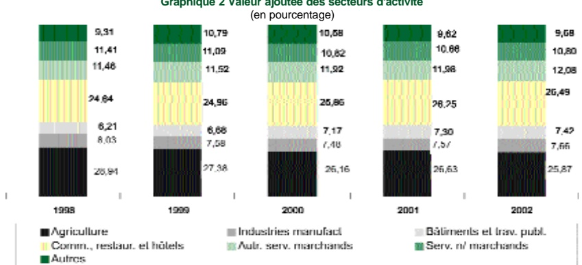

<!-- page 1 -->

# A. L'ACTIVITÉ ÉCONOMIQUE EN 2002

Après avoir fluctué autour d'une moyenne de 2,5 % entre 1996 et 1999, la croissance de l'économie a été moins soutenue en 2000, soit 0,9 %, pour se contracter de 1,12 % en 2001. La phase de récession amorcée durant l'exercice précédent s'est donc poursuivie, puisque l'exercice fiscal 2002 s'est terminé avec un taux de croissance de l'ordre de -0,9 %. L'environnement macroéconomique et financier a subi les effets des évolutions internes défavorables et d'une conjoncture mondiale déprimée.

Sur le plan interne, les incertitudes liées à la crise politique et le maintien du gel de l'assistance externe ont constitué des obstacles à l'augmentation de l'investissement privé et différé la mise en œuvre des projets d'investissement public financés à partir des ressources provenant des organismes de financement multilatéraux et des donateurs bilatéraux. La baisse des taux d'intérêt débiteurs a permis de réduire le ratio des improductifs dans le système bancaire de 9 % à 6 %, mais l'augmentation du crédit au secteur privé et l'accroissement des dépenses en capital du secteur public n'ont pas suffi à générer la valeur ajoutée nécessaire à la relance de la production nationale. En termes réels, les importations, la consommation et les exportations ont connu des diminutions respectives de 0,77 %, 0,98 % et 2,91 %. Bien que l'investissement ait affiché une hausse de 1,27 %, l'offre et la demande globales ont reculé de 0,83 % par rapport à l'exercice précédent.

Sur le plan externe, en dépit du fait que l'économie américaine ait connu un certain redressement avec un taux de croissance de 2,3 %, les menaces terroristes, la perte de confiance des grandes firmes, la chute des marchés boursiers, les anticipations négatives face au risque d'une guerre élargie au Moyen-Orient et la hausse d'environ 60 % du prix du baril du pétrole, ont contribué à affaiblir la demande de produits provenant des pays en développement. La contraction de la demande mondiale et la faible performance de l'économie américaine au premier semestre 2002 ont renforcé les anticipations pessimistes des principaux opérateurs économiques et assombri les perspectives de relance des échanges commerciaux entre Haïti et les États-Unis. Ainsi, les recettes d'exportations ont dans l'ensemble diminué de 10 % en valeur courante. Cependant, les recettes provenant des exportations de pite et ficelles, de mangues, d'huiles essentielles et de cacao ont connu des augmentations respectives de 130,18 %, 43,27 %, 27,59 % et 18,90 %. Les importations, en valeur, ont également baissé de 7,11 %. Hormis les groupes « Boissons et tabacs » et « Articles divers », toutes les composantes des importations ont été affectées par cette baisse.

Le déséquilibre de la balance des paiements financé par la déperdition des réserves nettes de change a été accentué par le recul de la production du secteur primaire dont la progression est de plus en plus limitée par des problèmes d'ordre structurel et conjoncturel. La hausse des exportations de certains produits agricoles est restée largement insuffisante au regard du PIB potentiel. De plus, les progrès réalisés en 2001 dans la production rizicole et bananière n'ont pas eu des effets durables sur l'agriculture durant l'année fiscale 2002.

<!-- page 2 -->

<!-- page 3 -->

# I. LE CADRE DE PRODUCTION

### I. 1 Introduction

En 2002, la situation économique est restée dominée par la détérioration des fondamentaux dans un contexte politique caractérisé par l'absence de progrès significatifs dans les négociations entre le gouvernement et l'opposition politique sur une sortie de crise avec la médiation de l'Organisation des États Américains (OEA). Après la période d'attentisme qui a suivi l'arrivée d'un nouveau gouvernement en mars 2001, les signes de plus en plus clairs d'un échec des négociations ont renforcé le climat d'incertitude qui a prévalu durant l'exercice fiscal 2002. Les obstacles conjoncturels à la reprise de l'assistance externe n'ayant pas été levés, les déséquilibres macroéconomiques se sont accentués entraînant ainsi un financement accru du déficit budgétaire et une chute constante des réserves de change.

Contrairement à l'exercice précédent, le gouvernement ne s'était pas engagé dans un programme relais avec le Fonds Monétaire International (FMI), ce qui, à côté des sanctions économiques, limitait les perspectives de décaissements des bailleurs de fonds internationaux. Les pertes de recettes sur les produits pétroliers (868 MG) ont constitué encore une fois une contrainte majeure à l'accroissement des dépenses d'investissement qui auraient pu créer de nouveaux emplois et atténuer ainsi les tensions sociales. Le déficit de ressources qui en est résulté s'est traduit par un recours prolongé au financement de la BRH pour assurer la continuité des services publics et honorer les engagements de l'État. Le crédit au secteur public a progressé de façon modérée au premier trimestre, mais s'est accéléré à partir de mars 2002 pour atteindre environ trois milliards de gourdes à la fin de septembre 2002.

Dans le même temps, l'horizon temporel pour le remboursement rendait la dette externe de plus en plus lourde à supporter par rapport aux réserves nettes de change dont le niveau est tombé à 50 millions de dollars ÉU en fin d'exercice. Les flux nets de capitaux sont devenus négatifs à cause de la faiblesse des nouveaux décaissements et des échéances des prêts à court, moyen et long terme arrivées à maturité. La monétisation du déficit budgétaire et la réduction des réserves de change ont contribué à nourrir les anticipations de dépréciation de la gourde dans une conjoncture caractérisée par la faillite de nombreuses coopératives d'épargne et de crédit et les effets d'annonce provenant tant des opérateurs économiques nationaux que de ceux de la communauté internationale.

Par ailleurs, bien que la BRH ait enclenché une politique de baisse des taux d'intérêt sur les bons dès le début de l'exercice, elle a absorbé un volume important de liquidités, profitant de la relative stabilité du taux de change et du différentiel des taux d'intérêt entre les actifs libellés en gourdes et les actifs libellés en dollars. De même, des résultats plutôt encourageants ont été obtenus en matière d'inflation. En rythme annuel, le taux d'inflation est passé de 12,34 % en septembre 2001 à 7,99 % en janvier 2002, son plus bas niveau durant l'exercice, pour évoluer ensuite dans une fourchette comprise entre 8 % et 10 % jusqu'à atteindre le niveau de 10,07 % en fin d'exercice. Le taux de change de la gourde par rapport au dollar ÉU est passé de 25,49 à 29,70 gourdes, soit une dépréciation de 16,51 % sur un an.

### I. 2 Production et prix

Avec une chute du PIB réel de 0,9 %, l'année sous-étude a confirmé la phase récessive dans laquelle l'économie haïtienne s'est retrouvée depuis deux ans. Ce recul est imputable, d'une part, au choc provoqué par les attentats du 11 septembre 2001 qui a contribué à affaiblir l'économie américaine durant le premier semestre et, d'autre part, par des événements conjoncturels qui ont frappé l'économie mondiale. Conséquemment, les exportations haïtiennes ont subi une contraction de 2,91 % en termes réels, bien qu'elles aient augmenté de 13,43 % en valeur courante suite à l'effet taux de change.

<!-- page 4 -->

Graphique 1 Produit Intérieur Brut (PIB) réel (base 1976)

| Year | Proud Interneur Brut (Pib) Reel (%) |
| --- | --- |
| 1992 | 4.0 |
| 1993 | -4.0 |
| 1994 | -10.0 |
| 1995 | 10.0 |
| 1996 | 4.0 |
| 1997 | 2.5 |
| 1998 | 2.5 |
| 1999 | 3.0 |
| 2000 | 0.5 |
| 2001 | -1.0 |
| 2002 | -1.0 |

#### I. 2.1 Valeur ajoutée par secteur d'activité

## Secteur primaire

La production de l'ensemble des branches du secteur primaire a chuté de 3,73 % par rapport à 2001. La part relative de ce secteur a représenté en moyenne 27,27 % du PIB contre 25,9 % au cours de cet exercice.

## Agriculture, sylviculture, élevage et pêche

Après une baisse moyenne de 1,5 % sur la période 1998-2001, suivie d'une croissance timide de 0,60 % en 2001, les activités de production de la branche «Agriculture, sylviculture, élevage et pêche» ont fléchi de 3,73 % en termes réels. Vu la part de ce sous-secteur (99,58 %) dans le secteur primaire, sa chute a eu des répercussions sur ce dernier et sur le PIB dont il représente 25,77 %.

Le repli de la production de cette branche est imputable, entre autres, à la diminution de la production agricole liée notamment à une relative stagnation de la production rizicole et une contraction de la production de bananes. En effet, la production de riz cette année n'a pas bénéficié des effets de la mise en application du «Programme spécial pour la sécurité alimentaire» qui avait permis, de doubler le rendement moyen par hectare (de 3,5 TM à 7 TM) l'an dernier. De plus, les bananeraires ont été affectées par la Sigatoka noire¹, répertoriée surtout dans le Nord-Ouest du pays. Le recul de la production de cette branche s'explique également par la chute de la production caféière à l'échelle nationale. En effet, le rendement moyen par hectare, qui est généralement de 4 sacs de 60 kilos, a diminué du tiers. La baisse de la production caféière est liée à des causes conjoncturelles, telles que la présence d'insectes et de maladies², et à des contraintes structurelles³ liées aux méthodes inadaptées de culture et aux infrastructures défaillantes.

<!-- page 5 -->

Par contre, la production de cacao et de mangues francisques n'a pas connu une forte croissance du fait que les activités entreprises par le Ministère de l'Agriculture, des Ressources Naturelles et du Développement Rural MARNDR $ ^{4} $ en vue d'améliorer la production des denrées d'exportations (café, cacao, mangue francisque...) n'ont pas encore produit les effets escomptés. Sur 1 000 hectares plantés en cacao $ ^{5} $ le rendement moyen s'est établi à 500 kilos par hectare, tandis que sur 167 hectares $ ^{6} $ plantés en mangues, le rendement moyen de 1 650 kilos par arbre est resté constant par rapport à l'année d'avant.

En revanche, la production animale a profité des actions menées par le MARNDR visant à protéger le cheptel contre les zoonoses7 majeures et à augmenter la production de volaille et de porc. Dans le domaine avicole, le partenariat «État - secteur privé» (HAPEL) a permis de réaliser une production de 355 000 poulets industriels en 2002, soit le double de l'exercice antérieur. L'apport de cette coopération au renforcement de «l'Action Production et Santé Animales » a permis d'augmenter les populations d'ovins et de caprins sur cette période.

## Industries extractives

Les industries extractives, notamment les carrières de sable, qui constituent un intrant de base pour les activités de construction, ont connu un regain de vitalité avec une accélération de leur rythme de croissance qui est passé de 0,3 % en 2001 à 1,70 % cette année. Ce redressement affiché par cette branche résulte de la progression observée dans la branche «Bâtiments et Travaux publics» depuis deux ans. Malgré tout, les industries extractives n'ont généré que 0,42 % des activités du secteur primaire.

## Le secteur secondaire

Le secteur secondaire, qui compte pour 15,6 % dans la valeur ajoutée globale, a progressé de 0,6 %. Prise séparément, cependant, l'évolution des différentes branches des industries manufacturières a été très contrastée. En effet, le net recul affiché par les branches «Textile, habillement et cuir» (2,8 %) et «Transformation des métaux» (2,7 %) reflète les difficultés que confrontent le secteur de la sous-traitance et de l'industrie locale depuis plusieurs années. Par contre, la branche des «Produits minéraux non métalliques» a connu une expansion passant de 0,2 % à 1,8 %. L'industrie alimentaire a crû de 1,1 % tandis que l'industrie du tabac a quasiment stagné par rapport à l'exercice précédent (1,4 % contre 1,2 % cette année).

 $ ^{4} $ Ministère de l'Agriculture, des Ressources Naturelles et du Développement Rural

5 700 dans la Grande-Arse et 300 dans le Nord.

6 16 667 arbres : 100 arbres par hectare (plantations rationnelles).

Maladies infectieuses ou parasitaires, qui se transmettent naturellement des animaux vertébrés à l'homme et réciproquement

<!-- page 6 -->

Le sous-secteur «Bâtiments et travaux publics» a connu une progression modeste sur base annuelle. Comparativement à 2000 où le taux de croissance était de 8,3 %, le résultat obtenu en 2002 (0,8 %) reflète la faiblesse du financement externe dans ce secteur, ce qui a conduit à la limitation de certains travaux d'infrastructure publics. Les activités liées à la production et à la distribution d'eau et d'électricité ont augmenté en valeur ajoutée de -27,1 % en 2001 à 2 %. Cette évolution traduit à la fois, le résultat des conditions pluviométriques plus favorable et l'impact des prêts consentis à l'Électricité d'Haïti (EDH) par le Trésor pour le renouvellement de certains matériels. Par contre, ce renversement n'a pas eu un effet significatif sur la production du secteur car sa part dans la valeur ajoutée est relativement faible (10,12 %) comparée à celle des autres composantes.

## Secteur tertiaire

Le secteur tertiaire qui génère la plus grande part de la production nationale (51,4 %) contre 51,0 % en 2001, a connu une contraction de ses activités. Après avoir augmenté de 1,93 % en moyenne entre 1998 et 2001, les services offerts par ce secteur ont connu une baisse de 0,12 %. Cette diminution est due essentiellement au repli de 3,26 % de la branche «Restaurants et hôtels». La contraction de l'offre des services dans l'industrie de la restauration et de l'hôtellerie a débuté depuis 1999, et ce malgré les efforts du gouvernement pour relancer les activités touristiques. De 1999 à 2001, les activités de production de cette branche ont fléchi de 3,38 % en moyenne. La chute de 0,25 % des services de transport et communication, combinée à celle de 0,32 % des opérations des institutions financières, constitue une autre cause de la baisse des activités du secteur des services.

Tableau 1 Contribution des secteurs à la croissance du Produit Intérieur Brut (En pourcentage, sauf indication contraire)

|   | 1997 | 1998 | 1999 | 2000 | 2001 | 2002 |
| --- | --- | --- | --- | --- | --- | --- |
| Secteur primaire |   |   |   |   |   |   |
| Poids Relatif | 29,62 | 26,94 | 27,38 | 26,16 | 26,83 | 25,87 |
| Variation annuelle | nd | 0,19 | 2,80 | 3,63 | 0,64 | -3,72 |
| Variation annuelle pondérée |   | 0,05 | 0,77 | 0,95 | 0,17 | -0,96 |
| Contribution en % | nd | 2,45 | 24,56 | 100,19 | 18,15 | 110,78 |
| Secteur secondaire |   |   |   |   |   |   |
| Poids Relatif | 14,66 | 14,98 | 14,95 | 15,27 | 15,33 | 15,56 |
| Variation annuelle | nd | 4,37 | 2,53 | 3,00 | -0,74 | 0,60 |
| Variation annuelle pondérée |   | 0,66 | 0,38 | 0,46 | -0,11 | 0,09 |
| Contribution en % | nd | 29,61 | 12,09 | 48,36 | 10,83 | -10,80 |
| Secteur tertiaire |   |   |   |   |   |   |
| Poids Relatif | 49,42 | 49,88 | 50,04 | 50,81 | 50,97 | 51,37 |
| Variation annuelle | nd | 3,13 | 3,04 | 2,41 | -0,81 | -0,12 |
| Variation annuelle pondérée |   | 1,56 | 1,52 | 1,22 | -0,41 | -0,06 |
| Contribution en % | nd | 70,65 | 48,75 | 129,28 | 39,24 | 7,33 |
| Impôt & subventions |   |   |   |   |   |   |
| Poids Relatif | 6,29 | 6,20 | 7,62 | 7,78 | 7,08 | 7,21 |
| Variation annuelle | nd | 0,78 | 26,15 | 2,75 | 9,81 | 0,88 |
| Variation annuelle pondérée |   | 0,05 | 1,99 | 0,21 | 0,69 | 0,08 |
| Contribution en % | nd | 2,19 | 63,73 | 22,55 | 66,07 | -7,31 |
| taux de croissance pondéré |   | 2,21 | 3,13 | 0,95 | -1,05 | -0,87 |
| Produit Intérieur Rnut (on millions de gourdes 86-87) | 12,41 | 12,68 | 13,02 | 13,14 | 12,99 | 12,87 |
| Taux de croissance du PIB |   | 2,18 | 2,71 | 0,87 | -1,12 | -0,90 |

N.B.1.1.11 Distribution des xéclaux N.111

<!-- page 7 -->

Les activités de production des autres branches du secteur tertiaire, notamment le «Commerce», les «Autres services marchands» et les «Services non marchands», ont augmenté respectivement de 0,40 %, 0,24 % et 0,21 % sans toutefois compenser l'impact négatif exercé par la faiblesse de l'activité de production des autres branches susmentionnées. Par contre, la régression des activités du sous-secteur «Transports et communication» en 2002 tranche avec son évolution récente (hausse moyenne de 9,70 % entre 1998 et 2001). De même, le ralentissement des activités du sous-secteur des «Services non marchands»8 par rapport à 2001 a contrasté avec la forte expansion connue au cours des années précédentes, soit une hausse moyenne de 11,00 % sur cinq ans.

### 1.3 Prix et salaires

Sous l'effet de la contraction de la demande globale et des mesures de politique monétaire, le taux d'inflation, en glissement annuel, a connu une décélération en passant de 12,34 % en septembre 2001 à 10,07 % en septembre 2002. Evalué en moyenne annuelle, l'indice des prix à la consommation (IPC) est passé de 16,84 % en 2001 contre 8,72 %, et en rythme mensuel de 0,97 % à 0,80 %.

Analysé en termes des variations des composantes du panier de consommation, le fléchissement de l'inflation durant l'exercice reflète principalement le ralentissement du rythme annuel de progression des indices de prix de groupes «Alimentation, boisson et tabac» et «Loisirs, spectacles, enseignement et culture». Ces indices sont passées respectivement de 15,60 % et 17,50 % en septembre 2001 à 9,63 % et 8,93 % en septembre 2002.

Par ailleurs, l'analyse de la progression des salaires dans l'économie se limite à l'évolution du salaire minimum officiel. Le salaire réel a représenté en 2002, 109 % de sa valeur réelle de 1995, année au cours de laquelle le salaire minimum journalier était passé à 36 gourdes soit une augmentation de 88 % en termes réels Toutefois, son pouvoir d'achat a été réduit de 10 % par rapport à 2001.

Tableau 2 Salaire réel

|   | IPC-1(sept) | Salaire nom. (gdes) | Salaire réel (Px.-1) | Tx. Crois. Sal. Réel | Salaire réel (Px.96) |
| --- | --- | --- | --- | --- | --- |
| 1990 | 6,97 | 15,00 | 2,15 | 19,80 | 0,88 |
| 1991 | 24,64 | 15,00 | 0,61 | -71,71 | 0,88 |
| 1992 | 18,43 | 15,00 | 0,81 | 33,70 | 0,88 |
| 1993 | 37,87 | 15,00 | 0,40 | -51,33 | 0,88 |
| 1994 | 51,08 | 15,00 | 0,29 | -25,86 | 0,88 |
| 1995 | 17,26 | 36,00 | 2,09 | 610,27 | 2,12 |
| 1996 | 17,01 | 36,00 | 2,12 | 1,47 | 2,12 |
| 1997 | 16,95 | 36,00 | 2,12 | 0,35 | 2,12 |
| 1998 | 8,27 | 36,00 | 4,35 | 104,96 | 2,12 |
| 1999 | 9,92 | 36,00 | 3,63 | -16,63 | 2,12 |
| 2000 | 15,32 | 36,00 | 2,35 | -35,25 | 2,12 |
| 2001 | 12,34 | 36,00 | 2,92 | 24,15 | 2,12 |
| 2002 | 10,07 | 36,00 | 3,57 | 22,54 | 2,12 |

Source: HGI, DRHMAEMAC

Les prix considérés sont ceux de septembre.

Le salaire réel est calculé par la formulité suivante: (wip): L'ons la première colonne du salaire réel (P 1) a été considéré.

Dans la seconde colonne, le défilateur utilise est le prix de référence de 96.

N R. Durant les périodes de disinflation, le résultat est le en valeur� atéque

<!-- page 8 -->

### I. 4 Situation de l'emploi

Les statistiques disponibles sur la situation de l'emploi se limitent à quatre secteurs de l'activité économique : la sous-traitance, le système bancaire, le secteur public et la microfinance. Selon les données disponibles au Ministère du Commerce et de l'Industrie (MCI), le nombre d'emplois dans le premier secteur a connu une hausse de 4,9 %, passant à 14 281 en 2002 contre 13 616 en 2001. Cependant, cette progression n'indique pas une reprise de l'activité de ce secteur, sa contribution au PIB étant en constante régression depuis 1999.

Après avoir augmenté de 12,4 % et de 12,1 %, respectivement, en 2000 et 2001, le nombre d'employés du secteur bancaire a chuté de 2,6 % en 2002, pour se fixer à 3 265 en 2002 contre 3 351 un an plus tôt. Ce fléchissement est dû essentiellement à la fermeture de diverses succursales de banques et, dans une moindre mesure, au dessaisissement de la Banque Haïtienne de Développement (BHD) qui comptait 28 employés en septembre 2001, ainsi qu'à l'émigration de quelques professionnels du système bancaire. Les banques qui ont affiché la plus forte baisse sont en particulier la Sogebank (-12 %), la Citibank (-9,1 %), la Promobank (-8,6 %), la BUH (-3 %) et la Scotiabank (-2 %). Cependant, la hausse du nombre d'employés d'autres banques du système, notamment la BNC (+13,9 %), la BPH (+13,5 %), la Socabank (+11 %), la Unibank (+9 %) et la Sogebel (+3 %), a pallié l'effet de cette chute sur l'effectif total.

Pour sa part, le nombre d'emplois dans le secteur public a progressé de 0,9 % par rapport à l'exercice précédent, s'établissant ainsi à 46 387 personnes, selon les chiffres du MEF. L'accroissement de 4,7 % du nombre d'emplois dans le secteur politique $ ^{9} $, atténué d'une part par le recul de 0,4 % observé dans le secteur socioculturel et d'autre part, par la stagnation enregistrée au niveau du secteur économique, explique cette tendance.

En ce qui concerne le secteur de la microfinance, l'analyse des résultats de l'enquête réalisée par la DAI-FINNET $ ^{10} $ permet de déduire la situation de l'emploi dans ce secteur sur la base de certaines hypothèses. Au 30 septembre 2002, cette institution a publié des informations sur l'activité de 81 institutions de micro-finance $ ^{11} $ qui desservent la population n'ayant pas accès au crédit bancaire. La variable «nombre de prêts» qui a atteint 78 353 contre 59 367 en 2000 pourrait être considérée comme un indicateur du nombre d'emploi minimal dans le secteur, dans la mesure où 94 % des prêts octroyés durant cette période ont été alloués entre la production, la constitution de fonds de roulement et l'investissement.

<!-- page 9 -->

### II. LA MONNAIE ET LE FINANCEMENT DE L'ÉCONOMIE

Depuis le début des années 90, la politique économique est dominée par des préoccupations de financement du déficit budgétaire. Aussi les autorités monétaires avaient-elles, jusqu'en 2001, mis en œuvre une politique de resserrement des conditions monétaires en utilisant depuis novembre 1996 le taux d'intérêt sur les bons BRH comme principal instrument de défense du taux de change et moyen de lutte contre l'inflation. La période 1996-2000 ayant été marquée par un accroissement de la valeur ajoutée globale, la posture monétaire adoptée n'a pas été remise en cause en dépit de la tendance à l'affaiblissement de la croissance, en raison de l'aggravation du déséquilibre des finances publiques. Mais, au vu des résultats macroéconomiques et de l'environnement international à la fin de septembre 2001, il est apparu nécessaire de rompre avec la politique des taux d'intérêt élevés pour permettre à la BRH de contribuer à la reprise de l'activité en 2002 en supposant que les autres conditions seraient réunies. Il fallait donc faire un arbitrage entre une politique de taux d'intérêt élevés qui risquait de pénaliser la croissance sans effet durable sur les prix et une politique de baisse des taux d'intérêt sur les actifs en gourdes qui risquait de provoquer une poussée de la dollarisation accompagnée d'une dépréciation du taux de change et l'anticipation d'un effet induit pour la croissance. La deuxième option a été choisie avec une mesure d'accompagnement d'ordre prudentiel qui a consisté à ramener le ratio de la position structurelle de change sur fonds propres de 40 % à 8 %.

La conduite de la politique monétaire en 2002 a donc été fondée sur une analyse des contraintes macroéconomiques imposées par la conjoncture nationale et internationale. En effet, après avoir maintenu ses taux directeurs élevés et inchangés durant l'exercice 2001, la banque centrale a dès septembre 2001 modifié l'orientation de la politique monétaire en pratiquant une politique de détente des taux d'intérêt sur la base d'un ensemble de constats. Sur le plan interne, un ralentissement de la demande induisant une faible croissance de l'économie (0,9 %) et une diminution du crédit au secteur privé (-7,5 %) durant l'exercice 2001, une décélération de la progression de l'inflation et une relative stabilité du taux de change, un accroissement du ratio des improductifs consécutif à la baisse de l'activité économique et au maintien de taux d'intérêts débiteurs élevés dans le système bancaire. Sur le plan externe, une baisse des taux d'intérêt directeurs de la Réserve fédérale américaine et dans le reste du monde consécutive à la récession de l'économie mondiale, une baisse de l'inflation chez notre principal partenaire commercial, les États-Unis d'Amérique, comme conséquence de la faiblesse de la demande, et une baisse du prix du baril de pétrole brennt durant le premier trimestre de l'exercice 2002.

Les taux d'intérêt sur les bons BRH à 91 jours ont ainsi été ramenés de 25 % à 10 % entre septembre 2001 et septembre 2002 et malgré que le mécanisme de transmission des taux directeurs aux taux débiteurs ait permis de diminuer le coût du crédit et le ratio des importicifs dans le système bancaire, la reprise des activités a été encore une fois compromise par la faiblesse des investissements publics et le poids des incertitudes de la conjoncture sur les décisions d'investissements productifs du secteur privé. Il en est résulté une chute d'environ 1 % de la valeur ajoutée globale. En dépit des impacts de cet environnement économique défavorable influencé par la persistance de la crise politique et le blocage de l'assistance externe en appui au budget et à la balance des paiements, l'inflation, soumise aux effets contractionnistes de la demande, a été contenue à 10 % en glissement annuel contre 12,34 % l'exercice précédent. Toutefois, l'élargissement du déficit public induisant un financement monétaire à hauteur de 2,8 milliards de gourdes et les multiples effets d'annonce provenant de différents opérateurs ont, dans le même temps, alimenté la dépréciation de la gourde en faisant passer le taux de change de fin de période de 25,49 G à 29,70 G en dépit d'un accroissement de plus de 13 % du volume de liquidités stérilisées à travers les adjudications des bons BRH.

<!-- page 10 -->

### II. 1 La politique monétaire en 2002

Le cadre de référence de la politique monétaire en 2002 a porté sur la réduction du financement du déficit budgétaire de 2,5 % à 1,2 % du PIB avec l'hypothèse d'un accroissement de 2 % du PIB et d'un taux d'inflation ne devant pas dépasser 11 %. Ce scénario impliquait conséquement une croissance de 13 % de la masse monétaire en terme nominal. Toutefois, les conditions n'étant pas encore réunies pour faire un véritable ciblage de l'inflation, le point d'ancrage nominal de la politique monétaire demeure la base monétaire pour les anticipations de hausse des prix et de taux de change. Ainsi, le maintien du contrôle de la liquidité bancaire a été assuré par les bons BRH renforcé par un programme monétaire prévoyant la signature d'un protocole d'accord entre le Ministère de l'Économie et des Finances et la BRH. Ce protocole fixait les indicateurs de réalisation pour les réserves nettes de change (+10 millions de dollars ÉU), les avoirs intérieurs nets de la BRH (+500 MG) et le crédit bancaire net au secteur public non financier (+1 200 MG).

Sur le plan de sa mise en œuvre, la politique monétaire a été, tout au long de l'exercice, accommodée en fonction de l'évolution des agrégats de finances publiques en tenant compte des autres facteurs susceptibles d'alimenter les anticipations pessimistes qui ne sont pas liées aux fondamentaux de l'économie.

Durant le premier trimestre, la situation des finances publiques s'est d'abord améliorée avec un recours de 6,4 MG du Trésor aux guichets de la BRH à la fin des deux premiers mois pour se dégrader en décembre et aboutir à un financement monétaire de 403,5 MG du déficit pour l'ensemble du secteur public. Ce financement, représentant environ le tiers du plafond annuel prévu, n'a pas été un signal de relâchement des conditions monétaires hors des limites du programme mais a reflété plutôt les contraintes imposées par le gel de l'assistance externe et par la récession qui l'accompagne. De plus, la forte baisse du prix du baril de pétrole sur le marché international, passant de 25 à 18 dollars ÉU entre septembre et décembre 2001, favorisait, avec l'hypothèse d'un taux de change stable, les anticipations d'une diminution des pertes de recettes sur les produits pétroliers. Dans le même temps, le taux d'inflation en rythme annuel s'est décéleré durant tout le trimestre, passant de 12,34 % en septembre à 8,15 % en décembre 2002. C'est dans ce contexte que les autorités monétaires ont décidé de mettre en application et de poursuivre la politique de détente des taux d'intérêt.

Le deuxième trimestre a été marqué par un rythme de progression du financement monétaire proche de celui des trois premiers mois de l'exercice. La croissance trimestrielle du crédit accordé au secteur public a, en effet, atteint 3,89 % en mars contre 3,34 % à la fin de décembre portant le financement total sur le semestre à un niveau inférieur à 1 milliard de gourdes. Cette variation était toutefois accompagnée d'une baisse du taux d'inflation en moyenne mensuelle et d'une relative stabilisation du taux de change. Ces évolutions favorables ont permis à la BRH de maintenir sa politique de détente des taux d'intérêt tout en continuant à offrir aux banques commerciales des taux d'intérêt réels positifs supérieurs à 5 % sur les bons à échéance de 91 jours jusqu'au début du mois de mars 2002.

Le troisième trimestre s'est signalé par une tendance à l'augmentation plus accentuée du crédit au secteur public dont le taux de croissance mensuelle a oscillé entre 1 % et 2 % cumulant à 4,39 % en juin. Avec 8,43 % en moyenne, la variation de l'Indice des Prix à la Consommation a révélé des signes de pressions inflationnistes et le taux de la gourde par rapport au dollar s'est dégradé de manière continue en passant de 26,33 gourdes en décembre à 26,76 gourdes en mars, puis 27,28 gourdes en juin. Les taux d'intérêt réels ont été négatifs sur les bons à échéance de 7 jours depuis mars 2002, mais les autorités monétaires ont maintenu les taux d'intérêt réels positifs sur les bons à échéance de 91 jours pour mieux profiter de l'horizon temporel d'absorption des liquidités excédentaires du système bancaire associé à cet instrument.

<!-- page 11 -->

Le quatrième trimestre a confirmé l'accélération de la croissance du crédit au secteur public avec une progression en moyenne mensuelle de 3,75 % et de 11,69 % en glissement trimestriel. Cette accélération s'étant accompagnée d'une augmentation constante du taux de change qui a atteint plus de 29,70 gourdes à la fin de septembre, l'aggravation sensible du taux d'inflation a amené en juillet les autorités monétaires à stabiliser les taux d'intérêt à 10 % sur le reste de l'exercice. Conséquement, les taux d'intérêt offerts sur les bons BRH sont devenus d'abord faiblement positifs puis négatifs sur les instruments à échéance de 91 jours.

## Les instruments

Les taux d'intérêt sur les bons à échéance de 7 jours et de 91 jours ont été réduits de 7,9 % et de 14,9 % respectivement entre septembre 2001 et septembre 2002 à partir du rejet des soumissions à des prix donnant des taux au dessus des taux de réservation de la BRH. Le taux de mise en pension a été ramené de 30 % à 20 %. Les risques subséquents sur la capacité de cet instrument à assécher des liquidités excédentaires dans le système ont été écartés par des facteurs macroéconomiques liés notamment à la baisse des taux d'intérêt directeurs de la Réserve fédérale américaine (FED), la faiblesse de la demande nationale, l'augmentation du taux des improductifs et la relative stabilité du taux de change de la gourde durant la première moitié de l'exercice. Ces facteurs ont porté les intermédiaires financiers à investir leurs excédents de trésorerie dans les bons BRH devenant moins rentables mais comportant un meilleur coût d'opportunité et un niveau de risque quasiment nul. De fait, l'encours total des bons BRH a progressé de 13,5 % en terme nominal, tiré en grande partie par les bons à échéance de 91 jours dont l'encours a augmenté de 28,9 %. Contrairement à l'évolution observée durant l'exercice écoulé, la structure de l'encours s'est renforcée en faveur des bons à échéance de 91 jours dont le poids est passé de 79,5 % en septembre 2001 à 90,3 % en septembre 2002. Les bons à échéance de 28 jours ne faisant plus l'objet des soumissions des banques commerciales qui, pour profiter des taux nominales plus élevés, semblent miser de moins en moins sur le très court terme comme en témoigne la réallocation de leur portefeuille de bons en 2002. En dépit du fait que la politique monétaire ne soit pas assujettie à des considérations de bilan, la BRH a pu absorber davantage de liquidités, 3,2 contre 2,7 milliards de gourdes l'exercice précédent, à un coût moindre, les dépenses d'intérêts ayant atteint 403,2 MG contre 423 MG en 2001. Au cours de la même période, le taux des improductifs du système bancaire est passé de 9,6 % à 6,7 %.

Graphique 3 Taux moyens pondérés (TMP) des bons BRH de différentes maturities

| Month | TMP 7 jours (%) | TMP 91 jours (%) |
| --- | --- | --- |
| oct. 01 | 12.5 | 20.0 |
| nov. 01 | 12.5 | 20.0 |
| dec. 01 | 11.5 | 19.5 |
| jan. 02 | 10.5 | 16.5 |
| feb. 02 | 8.5 | 15.0 |
| mars. 02 | 7.0 | 12.0 |
| avril. 02 | 6.0 | 10.0 |
| mai. 02 | 5.8 | 10.0 |
| juin. 02 | 6.0 | 10.0 |
| juli. 02 | 6.0 | 10.0 |
| sept. 02 | 6.0 | 10.0 |

<!-- page 12 -->

Graphique 4 Composition de l'encours total des bons BRH (en pourcentage)

|   | 7j | 7b | R1j |
| --- | --- | --- | --- |
| sept.01 | 70.5 | 0 | 79.5 |
| ntr. 01 | 10.46 | 0 | 103.54 |
| nov.01 | 10.45 | 0 | 83.55 |
| dis.01 | 2.80 | 0 | 97.12 |
| jan.02 | 0.80 | 0 | 94.17 |
| fe v.02 | 15.70 | 0 | 84.80 |
| mass. 02 | 15.81 | 0 | 84.18 |
| unif.02 | 12.32 | 0 | 87.86 |
| mid.02 | 6.64 | 0 | 99.36 |
| juin.02 | 6.10 | 0 | 92.87 |
| jul.02 | 3.67 | 0 | 96.33 |
| woul.02 | 7.31 | 0 | 97.78 |
| sept.02 | 9.71 | 0 | 90.78 |

Suites aux relèvements successifs effectués sur les passifs en dollars et en gourdes en octobre et novembre 2000, les coefficients de réserves obligatoires n'ont subi aucune nouvelle modification. Ils ont été maintenus à 31 % pour les banques commerciales et à 19,5 % pour les banques d'épargne et de logement. Le mode de constitution des passifs en dollars ÉU est aussi restée inchangée, soit 30 % en monnaie nationale et 70 % en monnaie étrangère et le calcul des pénalités destinées à sanctionner les positions de réserves déficitaires s'effectue sur la même base contemporaine au taux de 36 % l'an. Les coefficients étant les mêmes pour tous les types de dépôts depuis juin 2001, aucun changement n'a été observé au niveau de l'évolution des composantes de la quasi-monnaie. L'uniformisation des coefficients de réserves obligatoires sur les dépôts en gourdes et l'élimination du différentiel des coefficients gourdes/dollars a favorisé la stabilité du multiplicateur de la base monétaire qui a oscillé autour de 1,92 entre septembre 2001 et septembre 2002.

Graphique 5 Coefficients de réserves obligatoires sur les passifs en monnaie locale

| Período | Banques commerciales | Banques d'épargne et de logement |
| --- | --- | --- |
| oct. 01 | 30.5% | 14.3% |
| nov. 01 | 30.5% | 14.3% |
| dec. 01 | 30.5% | 14.3% |
| jan. 02 | 30.5% | 14.3% |
| fe. v. 02 | 30.5% | 14.3% |
| mars. 02 | 30.5% | 14.3% |
| avril. 02 | 30.5% | 14.3% |
| mai 02 | 30.5% | 14.3% |
| jun. 02 | 30.5% | 14.3% |
| jul. 02 | 30.5% | 14.3% |
| a00t. 02 | 30.5% | 14.3% |
| sept. 02 | 30.5% | 14.3% |

<!-- page 13 -->

Graphique 6 Coefficients de réserves obligatoires sur les passifs en monnaie étrangère

| Período | Hanques commerciales et filiales | Hanques déparçants de louement |
| --- | --- | --- |
| oct. 01 | 30.0% | 19.3% |
| nov. 01 | 30.0% | 19.3% |
| dec. 01 | 30.0% | 19.3% |
| jan. 02 | 30.0% | 19.3% |
| fév. 02 | 30.0% | 19.3% |
| mars. 02 | 30.0% | 19.3% |
| avril.07 | 30.0% | 19.3% |
| mai. 02 | 30.0% | 19.3% |
| jun. 02 | 30.0% | 19.3% |
| jul. 02 | 30.0% | 19.3% |
| a00t 02 | 30.0% | 19.3% |
| sept. 02 | 30.0% | 19.3% |

La position moyenne de réserves des banques est demeurée excédentaire tout au long de l'année avec un pic en février 2002 et un creux en fin d'exercice. Elle est passée de 144,3 MG en octobre 2001 à 333,9 MG en février 2002 pour tomber à son plus bas niveau en août 2002, soit 12,4 MG. Le maintien de la position excédentaire du système bancaire traduit dans une large mesure le faible niveau d'engagement des banques commerciales dans les transactions au niveau du marché des changes, du marché interbancaire et des activités de prêts. Par contre, durant le dernier trimestre de l'exercice 2002, le volume des transactions de change a atteint son niveau le plus élevé, soit 90 millions de dollars ÉU au mois de juillet qui correspond au mois où les pénalités subies par le système ont été les plus lourdes.

Graphique 7: Position moyenne de réserve (en millions de gourdes)

| Month | Value |
| --- | --- |
| oct. 01 | 14431 |
| nov. 01 | 8507 |
| dec. 01 | 9814 |
| jan. 02 | 19580 |
| Feb. 02 | 33397 |
| may. 02 | 7831 |
| jun. 02 | 18385 |
| jun. 02 | 10921 |
| jul. 02 | 19980 |
| nov. 02 | 3574 |
| sept. 02 | 1245 |
| sept. 02 | 2679 |

La BRH a commencé à intervenir sur le marché des changes dès le début de l'exercice accumulant à l'achat 15,6 millions de dollars ÉU contre 1,7 millions un an auparavant. Comme pour l'exercice antérieur, il s'agit d'interventions de routine destinées à banaliser la présence de la BRH sur le marché tout en lui permettant d'honorer ses obligations en devises sans puiser dans ses réserves.

<!-- page 14 -->

### II. 2 Les résultats intermédiaires

Sous l'influence de l'expansion du crédit au secteur public, la base monétaire s'est accrue de 17,2 % par rapport à 2001 pour atteindre 20,7 milliards de gourdes, soit un taux de croissance de 1,65 % en moyenne mensuelle et un écart de 15 points de pourcentage par rapport aux prévisions. Cette évolution reflète au passif la hausse de 15,81 % des réserves des banques incluant un accroissement des bons BRH de 13,54 % et une croissance de 18,11 % de la monnaie fiduciaire dont l'essentiel de la progression a été réalisé au premier trimestre en raison principalement des facteurs saisonniers.

Graphique 8 : La Base Monétaire et ses Composantes (en milliards de gourdes)

| Month | Dark Blue | Light Blue | Grey |
| --- | --- | --- | --- |
| oct. 01 | 2.86 | 8.26 | 5.64 |
| nov. 01 | 3.07 | 7.85 | 5.66 |
| dec. 01 | 2.43 | 8.09 | 6.57 |
| jan. 02 | 2.57 | 8.68 | 6.10 |
| fev. 02 | 2.30 | 8.89 | 6.20 |
| mars. 02 | 2.78 | 8.50 | 6.34 |
| avril. 02 | 2.87 | 9.10 | 6.01 |
| mai. 02 | 3.06 | 8.78 | 6.14 |
| juin. 02 | 3.08 | 8.81 | 6.19 |
| jul. 02 | 3.00 | 9.08 | 6.61 |
| aod. 02 | 3.03 | 9.39 | 6.82 |
| sept. 02 | 3.15 | 9.47 | 6.65 |

Bons BRH Dépôls et encaisses Morrnoie en circulation

Les dépôts des banques se sont accrus de 13,1 % en glissement annuel contre 7,9 % un an plus tôt. Cette forte variation tient à l'augmentation du taux de change et à l'accroissement continu des dépôts en dollars depuis le relèvement des coefficients de réserves obligatoires sur les passifs en devises et au changement opéré l'exercice précédent au niveau de leur mode de constitution.

À l'actif de la base monétaire, les avances au gouvernement central et aux entreprises publiques ont porté le crédit au secteur public à 15 118,9 MG à la fin de septembre 2002, soit une progression de 25 % en rythme annuel. En dépit de la diminution des avoirs extérieurs nets de la BRH, les avances au secteur public ont représenté 72,9 % des contreparties de la base reculant de moins de 1 point de pourcentage par rapport à 2001.

### II. 3 Les résultats finals

La politique de détente des taux d'intérêt initiée par la BRH en septembre 2001 a été suivie par les banques avec un certain retard lié à un délai naturel de transmission et à la rigidité à la baisse des taux d'intérêt débiteurs du système bancaire expliqué par la nécessité pour ce dernier d'en réduire les impacts sur ses objectifs de profit et de croissance. Le mécanisme de transmission des taux directeurs a néanmoins permis d'obtenir des résultats probants à travers l'allégement du taux de base bancaire (prime rate) et la baisse prononcée du taux moyen pondéré du marché interbancaire et des taux d'intérêt moyens sur les dépôts.

<!-- page 15 -->

Le taux de base bancaire, considéré comme le taux minimum offert par les banques à leurs meilleurs clients, est passé de 25 % en août 2001 à 22 % en octobre 2001 pour terminer l'exercice à 16 %. Quoiqu'il cache des mouvements erratiques observés au cours de l'exercice, cet écart entre les taux de début et de fin de période, s'explique, entre autre, par la prudence des banquiers face au contexte d'aggravation du taux des improductifs (9,2 %) qui a précédé la politique de détente des taux et qui avait sensiblement affecté le rendement moyen des prêts dans le système bancaire.

Les taux moyens pratiqués sur les prêts en gourdes sont passés de 25,25 % à 25 % entre septembre 2001 et septembre 2002. Cependant, les taux d'intérêt moyens pondérés sur le marché interbancaire sont passés de 22,4 % à 10,7 % reflétant ainsi la position de réserve excédentaire affichée par le système sur l'ensemble de l'exercice.

Graphique 9 : Taux moyens pratiqués par les banques commerciales et taux d'inflation en rythme annuel (instruments en gourdes)

|   | inflation en glissement annuel | dépôts d'épargne | dépôs à termes | Prêts |
| --- | --- | --- | --- | --- |
| oct.01 | 9.50% | 1.80% | 3.80% | 14.00% |
| nov.01 | 8.50% | 1.70% | 3.70% | 13.80% |
| dec.01 | 8.20% | 1.60% | 3.60% | 14.50% |
| jan.02 | 8.00% | 1.50% | 3.80% | 14.00% |
| fev.02 | 8.10% | 1.50% | 3.20% | 13.80% |
| mars02 | 8.50% | 1.60% | 2.80% | 12.00% |
| avril.02 | 8.50% | 2.00% | 2.80% | 11.50% |
| mai.02 | 8.40% | 1.40% | 2.50% | 12.00% |
| juni.02 | 8.50% | 1.40% | 2.50% | 11.20% |
| jul.02 | 8.80% | 1.40% | 2.50% | 12.00% |
| ao01.02 | 9.50% | 1.40% | 2.70% | 12.00% |
| sept.02 | 10.00% | 1.40% | 2.70% | 12.00% |

Les taux d'intérêt moyens sur les dépôts en gourdes ont répercuté beaucoup plus rapidement les effets de la baisse des taux sur les bons BRH en passant de 13,5 % à 7,65 % pour les dépôts à terme et de 3,5 % à 2,75 % pour les dépôts d'épargne. Forte d'une position moyenne de liquidité relativement élevée, la plupart des banques ont profité de la baisse des taux pour réduire le taux moyen créditeur, stratégie consistante avec l'objectif de maximisation des profits.

Les taux d'intérêt sur les actifs libellés en dollars ont aussi suivi le mouvement à la baisse tant sur les prêts que sur les dépôts. Les taux d'intérêt débiteurs ont subi une réduction de deux points de pourcentage en moyenne en passant de 14 % à 12 %, alors que les taux d'intérêt créditeurs sont passés en moyenne de 5,50 % à 2,75 % sur les dépôts à terme et de 1,75 % à 1,40 % sur les dépôts d'épargne. La situation qui prévalait au niveau des improductifs en gourdes avant septembre 2001 avec des taux d'intérêt élevés, combinée au marasme économique de l'exercice 2002, a influencé, dans une certaine mesure, le comportement des banques dans la modulation à la baisse des taux débiteurs en dollars afin de diminuer les risques de détérioration de la qualité du portefeuille des prêts en dollars. Toutefois, l'évolution des taux sur les dépôts a suivi aussi la baisse des taux d'intérêts sur les instruments offerts par le Trésor américain diminuant le coût d'opportunité et la probabilité des placements à l'étranger.

<!-- page 16 -->

Graphique 10 : Taux moyens pratiqués par les banques commerciales et taux d'inflation en rythme annuel (instruments en dollars ÉU)

| Month | Digits of temperature | Depends & tempers | Profits |
| --- | --- | --- | --- |
| oct. 01 | 1.80% | 3.80% | 14.00% |
| nov. 01 | 1.80% | 3.80% | 13.80% |
| dec. 01 | 1.50% | 3.50% | 14.40% |
| jan. 02 | 1.50% | 3.80% | 14.00% |
| dec. 02 | 1.50% | 3.20% | 13.80% |
| mar. 02 | 1.50% | 2.80% | 12.00% |
| sept. 02 | 2.00% | 2.80% | 11.50% |
| nov. 02 | 1.50% | 2.50% | 12.00% |
| dec. 02 | 1.50% | 2.50% | 11.20% |
| jul. 03 | 1.50% | 2.50% | 12.00% |
| nov. 03 | 1.50% | 2.80% | 12.00% |
| sept. 03 | 1.50% | 2.80% | 12.00% |
| sept. 04 | 1.50% | 2.80% | 12.00% |

Malgré les difficultés inhérentes à la conjoncture, la politique monétaire conduite par la BRH a permis de maintenir, entre novembre 2001 et juin 2002, le taux de change moyen dans une bande de fluctuation comprise entre 26 et 27 gourdes et de ramener le taux d'inflation de 12,34 % en septembre 2001 à 8,47 % en mars 2002 et à 10 % à la fin de septembre 2002. Ainsi, les résultats de la politique monétaire ont révélé que même si les taux directeurs ont baissé, ils sont restés à un niveau adéquatement adapté aux conditions du marché pour jouer avec efficacité le rôle d'un instrument de lutte contre l'inflation et de défense de la valeur de la gourde en dépit de la variabilité du taux de change en fin d'exercice.

Graphique 11 : Évolution du taux de change (G/$)(instruments en dollars ÉU)

| Date | Value |
| --- | --- |
| 01-Sep-01 | 25.60 |
| 02-Oct-01 | 25.50 |
| 10-Nov-01 | 25.90 |
| 20-Dec-01 | 26.20 |
| 01-Jan-02 | 26.30 |
| 28-Feb-02 | 27.50 |
| 15-Mar-02 | 27.40 |
| 02-Apr-02 | 26.00 |
| 28-May-02 | 27.00 |
| 15-Jun-02 | 26.80 |
| 31-Jun-02 | 27.20 |
| 18-Jul-02 | 27.00 |
| 31-Jul-02 | 27.30 |
| 27-Aug-02 | 27.50 |
| 15-Sep-02 | 27.80 |
| 31-Sep-02 | 28.20 |
| 25-Oct-02 | 28.00 |
| 12-Nov-02 | 28.50 |
| 28-Dec-02 | 28.80 |
| 15-Jan-03 | 29.00 |
| 31-Jan-03 | 29.20 |
| 25-Feb-03 | 29.50 |
| 12-Mar-03 | 29.80 |
| 28-Apr-03 | 30.00 |
| 15-May-03 | 30.20 |

<!-- page 17 -->

### II. 4 Évolution des agrégats monétaires

Contrairement à la situation observée en 2001, la masse monétaire au sens large, M3, a connu une croissance supérieure à l'inflation, soit 7,2 % en termes réels. En dehors de la contraction de 2,1 % observée au mois de mars, M3 a progressé de manière constante en 2002 pour atteindre 37,2 milliards de gourdes, soit un accroissement de 17,3 % contre 5,25 % en 2001. Cette forte progression tient à l'incidence de l'accroissement de l'agrégat M2 (11,54 %), à l'accroissement de 10 % des dépôts en dollars non convertis et aux fluctuations enregistrées au niveau du taux de change qui ont gonflé les dépôts en dollars convertis en gourdes durant le dernier trimestre de l'exercice (13,4 %).

L'évolution de l'agrégat M2 a été sensible à la baisse des taux d'intérêt dans la mesure où on a pu observer par rapport à 2001 une augmentation substantielle des dépôts d'épargne de 14,33 % contre 3,77 % en 2001, alors que les dépôts à terme se sont contractés de 8,14 % contre 16,81 % de croissance l'exercice écoulé. Dans l'ensemble, les dépôts en gourdes ont progressé d'environ 9 %. La contraction des dépôts à terme en gourdes peut être expliquée en partie par la réallocation du portefeuille des agents en faveur du dollar par rapport à la gourde dans un contexte où le différentiel entre les actifs libellés en gourdes et ceux libellés en dollars devenait de plus en plus faible et où les incertitudes se renforçaient. La croissance de l'agrégat M2 a été aussi influencée par l'expansion de M1 (20,81 %) qui a suivi celle de la circulation fiduciaire (18,11 %).

Graphique 12: Évolution des Agrégats Monétaires (en millions de gourdes)

|   | M1 | M2 | M3 |
| --- | --- | --- | --- |
| oct. 01 | 10.54 | 21.21 | 32.08 |
| nov. 01 | 10.57 | 21.27 | 31.97 |
| dec. 01 | 10.31 | 21.92 | 33.17 |
| jan. 02 | 10.25 | 21.80 | 33.32 |
| nov. 02 | 10.30 | 22.08 | 33.90 |
| mars. 02 | 10.38 | 21.92 | 33.32 |
| avril. 02 | 10.30 | 21.87 | 33.60 |
| mai. 02 | 10.40 | 21.80 | 34.09 |
| juin. 02 | 10.41 | 21.93 | 34.30 |
| jul. 02 | 10.64 | 22.28 | 35.35 |
| soit. 02 | 10.38 | 22.09 | 35.50 |
| sept. 02 | 11.21 | 23.44 | 37.19 |

La dollarisation, mesurée par le ratio des dépôts en dollars ÊU sur l'ensemble des dépôts du système bancaire, s'est accentuée en passant de 41,06 % en 2001 à 45 % en 2002. Ce renforcement du phénomène a confirmé la sensibilité des agrégats monétaires aux mouvements des taux d'intérêt. La dollarisation s'est amplifiée au rythme de la dépréciation de la gourde et de la baisse des taux d'intérêt sur les actifs libellés en gourdes, tandis que durant l'exercice précédent l'appréciation de la gourde en fin de période et le maintien des taux d'intérêt élevés sur les actifs en gourdes avaient contribué à son ralentissement.

<!-- page 18 -->

### II. 5 Contrepartie de M3 et financement de l'économie

Les réserves nettes de change du système bancaire évaluées en gourde s'étant contractées de moins de 1 % en 2002, l'évolution de M3 a été influencée dans une large mesure par la progression de 23,5 % du crédit intérieur net. L'élargissement du crédit au secteur public a été moins important qu'en 2001 (25,3 % contre 30 %) et le crédit au secteur privé a connu une variation à la hausse de 14,8 %. L'éviction du crédit au secteur privé observée en 2001 ne s'est pas reproduite en 2002 en raison de la baisse des taux d'intérêt et de l'abaissement à 8 % de la position structurelle de change qui a contraint les intermédiaires financiers à la prudence en les forçant à utiliser davantage leurs excédents de trésorerie pour renouveler les lignes de crédit de leurs meilleurs clients au lieu d'un engagement dans des opérations plus risquées sur le marché des changes.

En isolant l'effet taux de change, les réserves nettes du système bancaire se sont inscrites en baisse de 14,2 % contre 1,35 % l'exercice précédent. La déperdition des réserves du système résulte essentiellement de la chute de 53,6 % des avoirs extérieurs de la banque centrale et d'une baisse beaucoup moins proportionnelle des engagements extérieurs (5,8%). En revanche, les dépôts des banques commerciales et des banques d'épargne et de logement ont accusé une hausse de 21,6 %, contre une contraction de 9,7 % en 2001 et leurs engagements ont augmenté d'environ 20 % environ.

La politique de détente des taux d'intérêt a permis au secteur privé de bénéficier d'une augmentation du crédit de 14,8 %, soit plus de 4 % en termes réels, après une chute de 7,5 % en 2001. Toutefois, le volume du crédit au secteur privé représente 38,8 % de la masse monétaire M3 en 2002 alors que l'an dernier il en représentait 39,635 %. Le crédit en gourdes s'est inscrit en hausse de 8,9 % et le crédit en dollars exprimé en gourdes s'est établi à 23 % après avoir subi une contraction de 16,8 % en 2001 tandis que sa valeur en dollars a crû seulement de 5,65 %. L'effet de change a donc joué cette année en faveur d'une augmentation du crédit en dollars converti en gourdes, mais certaines banques n'ont pas toujours respecté l'obligation qui leur est faite de maintenir un ratio de 50 % entre les prêts et les passifs en devises, même si le ratio du système a évolué autour d'une moyenne mensuelle de 47,7 %.

Graphique 13: Les Contreparties de M3 (en milliards de gourdes)

| Date | Value |
| --- | --- |
| oct. 01 | 3.64 |
| nov. 01 | 3.77 |
| dec. 01 | 4.17 |
| jan. 02 | 4.16 |
| nov. 02 | 4.30 |
| mars. 02 | 3.59 |
| avril. 02 | 3.71 |
| mai 02 | 3.83 |
| juni. 02 | 3.85 |
| jul. 02 | 4.25 |
| ao01.02 | 4.40 |
| sept. 02 | 4.41 |

Reserves de change du système bancaire ☐ Crédit net au secteur public ☐ Crédit au secteur privé

<!-- page 19 -->

L'encours des dépôts en devises étrangères s'est élevé à 464 millions de dollars, ce qui indique une progression de 10,2 % par rapport à l'exercice précédent. Les dépôts à vue et les dépôts d'épargne libellés en dollars ont crû respectivement de 32 % et 12,5 % respectivement, alors que les dépôts à terme ont chuté de 4,2 % en raison de la baisse du différentiel des taux d'intérêt par rapport aux autres catégories de dépôts dont le caractère plus liquide peut constituer un avantage dans un contexte d'anticipations pessimistes.

La part des dépôts à terme dans le total des dépôts en dollars est passée de 42,63 % à 37,06 % tandis que celle des dépôts à vue a gagné 4,68 points de pourcentage pour atteindre 29,61 % en 2002. La part des dépôts d'épargne a progressé de 0,68 point de pourcentage pour s'établir à 33,33 %.

La monnaie locale a conservé sa prédominance dans les paiements de salaires, de taxes et de biens de consommation courante, mais le dollar tend à prendre une place de plus en plus importante comme l'indique l'évolution des dépôts bancaires pour des motifs de transaction et de précaution.

### III. FINANCES PUBLIQUES

La politique budgétaire au cours de l'exercice 2002 s'est effectuée dans le cadre d'une reconduction de la loi rectificative de finances 2001 jusqu'au vote du budget en juin 2002 et dans un environnement macroéconomique caractérisé par le blocage de l'assistance externe au budget dû à la persistance de la crise politique et par l'absence d'un programme-relais entre l'État haïtien et le Fonds Monétaire International. Dans un tel contexte, l'intégralité des ressources budgétaires en vue d'assurer le fonctionnement des services publics et la mise en œuvre de la politique sociale et économique du gouvernement devait provenir en grande partie des recettes perçues par les organismes affectés à cette tâche. À cet effet, les responsables des finances publiques se sont donnés comme objectif dès le début de l'exercice, l'accroissement substantiel de la pression fiscale de 7,4 % à 8,5 % du PIB, par le biais d'un élargissement de l'assiette fiscale et d'une meilleure perception de l'impôt. Toutefois, en dépit des mesures fiscales et administratives adoptées, les résultats sont restés en dessous des attentes des autorités qui avaient misé sur une augmentation de plus de 30 % des recettes totales à la faveur d'une croissance de 48 % des perceptions douanières et d'une amélioration de plus de 100 % des droits d'accises particulièrement les prélèvements sur les produits pétroliers. Cette évolution est due principalement à la baisse marquée de l'activité économique (0,9 %), au manque à gagner de plus de 819,03 MG sur les produits pétroliers et à l'augmentation importante des dépenses de fonctionnement qui ont contribué à aggraver le déficit budgétaire. Afin de limiter le financement monétaire de ce dernier, un programme de cash-management établi sous forme d'un protocole d'accord a été signé en février 2002 entre le MEF et la BRH. Cependant, cette mesure n'a pas produit les résultats escomptés, car pour pallier à l'insuffisance des ressources et assumer ses responsabilités, l'État haïtien, par l'intermédiaire du Compte du Trésor, a eu recours de manière significative au financement de la BRH. À la fin de l'exercice, ce dernier a atteint 2 853,9 MG, soit 3,13 % du PIB (0,4 point de PIB de plus que l'exercice précédent).

<!-- page 20 -->

| Period | Annu. % du PIB | Annu. MG |
| --- | --- | --- |
| 1980-01 | 4.61 | 250 |
| 1990-02 | 2.84 | 150 |
| 1992-03 | 1.55 | -100 |
| 1993-04 | 4.55 | 400 |
| 1994-05 | 1.83 | 100 |
| 1995-06 | 1.25 | 50 |
| 1996-07 | 0.54 | -200 |
| 1997-08 | 1.57 | 100 |
| 1998-09 | 1.78 | 200 |
| 1999-09 | 1.69 | 250 |
| 2000-01 | 0.71 | -100 |
| 1999-02 | 3.18 | 500 |
| 2000-03 | 2.79 | 600 |
| 2001-04 | 3.30 | 1100 |
| 1994-05 | -0.19 | -2500 |
| 1995-06 | 1.47 | 800 |
| 1996-07 | -0.19 | -2000 |
| 1997-08 | 0.98 | 600 |
| 1998-09 | 1.57 | 1200 |
| 1999-10 | 2.58 | 2000 |
| 2000-01 | 2.71 | 2200 |
| 2001-02 | 3.14 | 2900 |

III.1 Recettes

Pour combler le creusement du besoin de financement de l'État, l'Administration fiscale a entrepris un programme d'élargissement de la base d'imposition en mettant l'accent sur le dépistage et l'enrôlement de nouveaux contribuables dans le circuit fiscal et le recouvrement des créances en souffrance.

Ces différentes mesures ont permis au fisc de collecter des recettes totalisant 7 721,70 MG représentant une augmentation en glissement annuel de 22 % contre 3 % pour l'exercice précédent. Cette performance peut être attribuée à l'évolution de toutes les composantes des recettes qui ont progressé à l'exception de la rubrique «Autres recettes» qui a diminué d'un montant de 45 MG (34 %). Dans l'ensemble, les résultats de l'exercice ont été encourageants malgré un écart de 7 % par rapport aux prévisions. Ce dernier est dû essentiellement au fait que la principale hypothèse macroéconomique qui a servi de cadre à la préparation du budget ne s'est pas réalisée. Le Produit Intérieur Brut (PIB) a régressé de 0,9 % contre une hausse attendue de 2,5 %. Au 30 septembre, la pression fiscale sur le PIB est passée de 7,4 % à 8,4 %.

Tableau 3. Évolution de la structure des recettes

|   | 2000 | 2001 | 2002 |
| --- | --- | --- | --- |
| Recettes totales | 100,00 | 100,00 | 100,00 |
| Impôts directs sur le revenu et les bénéfices | 20,18 | 18,31 | 19,11 |
| Particuliers | 12,57 | 10,65 | 9,88 |
| Sociétés | 5,58 | 5,46 | 7,14 |
| Acompte | 2,02 | 2,19 | 2,09 |
| Impôts indirects à la consommation | 58,96 | 64,89 | 65,00 |
| TCA | 29,11 | 32,32 | 31,32 |
| TCA sur importations | 21,38 | 23,61 | 22,90 |
| TCA interne | 7,72 | 8,71 | 8,43 |
| Accises | 4,27 | 4,52 | 6,85 |
| Recettes douanières | 25,58 | 28,06 | 26,81 |
| Autres | 19,38 | 16,99 | 15,88 |

<!-- page 21 -->

Au cours de l'exercice 2002, la structure des recettes s'est modifiée légèrement en faveur des impôts directs sur le revenu et les bénéfices. Leur part dans les recettes totales est passée de 18,31 % à 19,11 % alors que celle des impôts indirects à la consommation est demeurée relativement stable autour de 65 %. Ces dernières correspondent à l'ensemble des impôts sur les transactions portant sur les biens et services et recouvrent les différents impôts sur la production et la consommation intérieure d'une part et les impôts sur le commerce extérieur d'autre part. Pour l'exercice 2002, la taxation des produits importés ont représenté 56 % des recettes budgétaires.

Le trait marquant de cette structure demeure la part relative des impôts directs qui n'a pas dépassé les 20 % depuis l'exercice 2000. Cependant, en dépit de la spirale récessive à l'intérieur de laquelle évolue l'économie haïtienne depuis deux ans, la part des impôts sur le revenu et les bénéfices des sociétés dans les recettes totales est passée de 5,46 % à 7,14 %. Ce résultat est attribuable aux efforts entrepris par les Autorités dans le cadre du recouvrement forcé engagé auprès des contribuables stratégiques par l'Unité de Gestion et de Contrôle Fiscal (UGCF).

## Recettes Internes

En raison des contraintes imposées par une conjoncture défavorable caractérisée par une récession économique les autorités fiscales ont cherché à réduire, par un accroissement des recettes fiscales, le déséquilibre des finances publiques consécutif au tarissement d'aide externe et à l'augmentation importante des dépenses publiques. À cet effet, elles ont tenté d'améliorer l'efficacité de l'administration fiscale en terme de ratrapage de retard dans le recouvrement d'impôts, et de renforcement des contrôles sur les activités douanières. Les conséquences de cette politique se sont traduites par un accroissement des recettes internes de 23 % en glissement annuel pour totaliser 5 561,3 MG en septembre 2002 contre 5 % pour l'exercice précédent. La part de ces dernières dans les recettes courantes a progressé de 1 point de pourcentage pour atteindre 72 %. La croissance des recettes internes résulte de l'impact conjugué de ses composantes étant donné que les droits d'accises, l'impôt sur le revenu et les bénéfices et la TCA ont affiché une croissance respective de 91 %, 27 % et 18 %.

Les droits d'accises totalisant 534,30 MG, ont augmenté de 91 % par rapport à l'exercice précédent mais ont accusé un écart négatif de 123,3 MG par rapport aux prévisions. Ils représentent la troisième source d'accroissement des recettes pour cet exercice. Ces résultats s'expliquent par la réduction de la subvention des prix à la pompe par suite de la baisse des prix du pétrole sur le marché international (38 %) au cours du premier trimestre et en même temps par l'encaissement effectif au mois d'avril des arriérés accumulés à cause des bordereaux en litige.

Le ratio des revenus perçus (impôts, taxes et droits) sur les prix à la pompe des différents produits pétroliers accuse pour le présent exercice une réduction significative, contrairement à l'exercice précédent où il avait augmenté de manière substantielle. En effet, ce ratio est tombé de 48,1 % en octobre 2001 à 27,6 % en septembre 2002 pour la gazoline 95, et de 42,7 % à 18,4 % pour la gazoline 91. La remontée importante du cours du brut sur le marché international à partir du mois d'avril 2001 et la forte dépréciation du taux de change (8,4 %) durant la même période ont amené le gouvernement à accorder des crédits d'impôt sur le kérosène depuis avril et sur le gasoil à partir de juillet. Ces derniers ont totalisé 108,2 MG à la fin de l'exercice contre 48 MG pour l'exercice précédent. Quant au manque à gagner fiscal, il a légèrement diminué pour atteindre 868,5 MG en septembre 2002.

L'augmentation de l'mpôt sur le revenu et les bénéfices peut être attribuée à un ensemble de mesures fiscales et administratives adoptées durant l'exercice. Parmi ces dernières figurent :

<!-- page 22 -->

1- la création du Centre National de Relance (C.N.R.) dont la mission consiste à servir de support d'informations à toutes les instances de relance et de taxation.

2- la mise en réseau des services et l'élaboration d'un calendrier d'extension du réseau.

Pour l'exercice précédent, l'IRS avait diminué de 2 % tandis que le taux d'inflation avait atteint 16 % et le taux de change s'était déprécié de 3,5 %.

La TCA (2 417,2 MG) continue de représenter le champ de taxation le plus important et le plus performant du système fiscal par sa contribution de 365,9 MG à l'augmentation des recettes de l'exercice. Ce résultat s'explique essentiellement par la dépréciation importante du taux de change en dépit d'une diminution de 15% des importations. Ces dernières rapportées au PIB atteignent 36,2 % en 2002 contre 34,2 % en 2001. Les recettes de la TCA prélevées sur les importations s'élèvent à 1 768,2 MG, soit 73 % du total de cette taxe et 31,8 % des recettes internes. En septembre 2002, la TCA s'appliquait à 60 % des produits importés.

## Recettes Douanières

Les recettes douanières ont totalisé 2 070,4 MG, soit une hausse de 17 % mais un écart négatif de 21 % par rapport aux prévisions. Cette augmentation traduit l'incidence positive de la dépréciation de la gourde malgré la baisse de l'activité économique estimée à 0,9 % pour l'exercice et la diminution des importations. Les droits de douane (49 % des recettes douanières) et les frais de vérification (38 %) ont accusé une hausse respective de 13 % et de 20 %. Ces résultats impliquent pour les droits de douane un écart de 37 % en dessous des prévisions mais un dépassement de 3 % pour les frais de vérification.

La performance des recettes douanières résulte des mesures adoptées par l'Administration Générale des Douanes (AGD), visant à lutter contre la sous-estimation de la valeur des marchandises à dédouaner et contribuant à majorer l'assiette des droits et taxes douaniers perçus au cordon douanier. Les mesures sont les suivantes :

1- le renforcement de son Service de la Valeur par la formation, la motivation et la sensibilisation du personnel.

2- le renforcement des postes de contrôle sur les routes.

3- la diminution des franchises douanières.

4- la gestion plus rigoureuse des franchises.

## Performance institutionnelle

Les recettes perçues par l'UGCF ont progressé 22 %, cependant, l'apport de cette unité au total des recettes de la Direction Générale des Impôts a atteint les 53,5 %, soit un léger recul par rapport à l'exercice 2000-2001 (57,75 %). L'UGCF contrôle plus de deux cent entreprises et individus constituent 68 % de l'ensemble des impôts et redevances collectées par l'administration fiscale, 80 % du total des biens taxés à l'importation et 50 % des recettes internes.

La contribution de l'AGD aux recettes internes n'a cessé d'augmenter depuis l'adoption de la procédure automatisée de dédouanement à la Douane du Port et à celle de l'Aéroport de Port-au-Prince (80 % des importations). Cette contribution est passée de 2 315,05 MG à 2 897,33 MG, soit une croissance de 25,15 %. En Haïti, la douane s'occupe à la fois de la fiscalité indirecte externe, c'est-à-dire les droits de porte tels que les droits de douane et diverses taxes à l'importation, et de la fiscalité directe externe (TCA et droits d'accises).

<!-- page 23 -->

Tableau 4 Recettes internes par institutions

|   | % Total Recettes | 2000-01 | Var. % | 2001-02 | % Total Recettes |
| --- | --- | --- | --- | --- | --- |
| Bureau Central | 15,34 | 698,16 | 19,4 | 833,82 | 14,76 |
| UGCF | 30,08 | 1 368,80 | 27,7 | 1 748,46 | 30,95 |
| Douane | 43,39 | 1 974,79 | 29,3 | 2 554,11 | 45,21 |
| Autres | 11,19 | 509,22 | 0,8 | 513,31 | 9,09 |
| Total | 100,00 | 4 550,97 | 24,1 | 5 649,7 | 100,00 |

Par ailleurs, la DGI et ses différentes directions régionales ont collecté 24 % du total des recettes. Le meilleur point de perception reste la douane avec une contribution de 45,2 %. Les recettes en provenance des villes de provinces ont accusé une baisse de 15,81 % par rapport aux prévisions et de 1,1 % par rapport à l'exercice précédent.

### III. 2 Dépenses

L'exécution du programme de dépenses publiques, à défaut de budget sanctionné par le Parlement au cours des six premiers mois de l'exercice, a été réalisée à partir des estimations établies par les autorités budgétaires. Selon ce programme, les dépenses devaient augmenter de 54,6 % par rapport à l'objectif budgétaire et la distribution des ressources prévoyait une allocation de 60 % aux dépenses de fonctionnement de l'État et 40 % aux investissements publics. Dans la perspective de la réduction de l'aide internationale, il a été envisagé des investissements dans le secteur social pour pallier à la carence des crédits externes, des prêts et des dons. Près de cinq milliards de gourdes étaient destinés au budget d'investissement pour le financement de projets dans les domaines des infrastructures (40 %), de la production nationale (14 %), de l'éducation (9 %) et de la santé (10 %).

Toutefois, sur le plan de la réalisation, les dépenses totales n'ont augmenté que de 21 % en glissement annuel, soit un écart négatif de 34 % par rapport à la programmation et la composition des dépenses est demeurée inchangée avec 82 % des fonds alloués aux obligations courantes et 18 % aux projets d'investissement.

## Dépenses courantes

Les dépenses courantes, se référant aux crédits budgétaires ouverts et mis à la disposition de l'Administration centrale pour assurer le maintien des services publics et le fonctionnement des institutions étatiques, représentent majoritairement les fonds alloués à la consommation publique et à un moindre degré au service de la dette et aux allocations à caractère social. En moyenne mensuelle, elle se sont élevées de 584,3 MG pour l'exercice antérieur à 704,5 MG cumulant à un montant total de 8 454,1 MG, soit une croissance de 21 % en glissement annuel. Cette expansion des dépenses courantes s'explique particulièrement par la croissance significative des dépenses de fonctionnement, soit 52 % en glissement annuel dont 37 % au cours du dernier trimestre de l'exercice. Cette montée atypique de ces dernières correspond en grande partie à la subvention accordée à l'EDH pour un montant estimé à 300 MG pour l'achat de produits pétroliers afin de maintenir la fixité des prix à la pompe et pour l'achat d'énergie électrique à la SOGENER $ ^{12} $. Sur le plan de la gestion de la masse salariale, la politique du gouvernement n'a pas changé puisque toute nomination ou intégration reste

<!-- page 24 -->

subordonnée à l'autorisation du Premier Ministre et aux fonds dégagés par les vacances créées au sein de l'Administration publique. La masse salariale a progressé de 4 %, cependant en pourcentage des dépenses courantes, elle a perdu 6,5 points pour se situer à 41,2 %. Le service de la dette interne n'a pas été honoré et les versements d'intérêt au titre de la dette externe ont baissé de 45 % suite à la décision du gouvernement de suspendre les paiements au mois de janvier 2002 face à la déperdition des réserves internationales de la BRH. Cette situation a provoqué une accumulation d'arriérés de l'ordre de 49,2 millions de dollars ÉU. En septembre 2002, la charge du service de la dette externe représentait 8 % des recettes d'exportation comme pour l'exercice précédent.

## Dépenses d'investissement

En raison de l'absence de l'aide externe, le budget d'investissement programmé pour un montant de près de cinq milliards de gourdes n'a pu être réalisé que pour un montant de 1 908 MG. Plus de 50 % des fonds ont été investis dans le domaine des infrastructures avec une allocation de 36,5 % au secteur transport, soit une hausse de 48 % en glissement annuel et de 21,59 % au secteur machinerie et équipement, représentant une augmentation de 11 % par rapport à l'exercice précédent. Les dépenses d'investissement du secteur transport ont été effectuées dans le cadre de la construction et de l'entretien des routes nationales comme le tronçon St Marc-Gonaïves pour un montant de 52 MG, la route Carrefour-rail pour 24 MG; de l'assainissement et de la voirie urbains tels que la réfection de Delmas 33 et de la construction de places publiques. Par ailleurs, les investissements dans le secteur social ont compté pour plus de 25 % des fonds dont 9 % ont été alloué au secteur éducation, 4,24 % au secteur santé, 4,06 % à la justice et 21,6 % aux logements sociaux. Sur le plan de l'exécution du programme de logements sociaux, le Ministère des Affaires Sociales a entamé la construction de plus de trois mille unités sur cinq sites de la zone métropolitaine à partir d'un accord de prêt de quinze millions de dollars ÉU dont près de quatre millions ont été utilisés au cours de l'exercice 2002.

### III. 3 Financement

Les opérations financières du gouvernement central se sont soldées par un déficit de 2 799,8 MG dont 46 % ont été accumulé au cours du dernier trimestre de l'exercice. Ce déficit, représentant une augmentation de 17 % en glissement annuel, peut être expliqué par un ensemble de faits dont :

1- Le manque à gagner enregistré dans la perception des recettes sur les produits pétroliers.

2- L'expansion constatée au niveau des dépenses publiques qui ont connu la plus forte variation enregistrée depuis les cinq dernières années.

3- La faiblesse de l'assistance externe totalisant 213,7 MG en 2002 contre 419,8 MG en 2001, soit une baisse de 49,1 %.

Cette aide consistait en des dons pour une enveloppe de 112,7 MG et des décaissements de 101 MG sur des prêts déjà approuvés en provenance de la République de Chine

Tableau 5 Évolution du déficit du gouvernement central financé par la BRH

| Rubriques / Exercices | sept. 00/ sept. 99 | sept. 01/ sept. 00 | sept. 02/ sept. 01 |
| --- | --- | --- | --- |
| 1. Position Notre du Trésor | -1 457 014,20 | -1 953 925,70 | -2 405 640,10 |
| 2. Dépôts de l'État | 434 033,20 | 345 187,40 | 60 705,10 |
| 3. Amidres d'intérêts | -165 775,00 | -301 774,80 | -361 785,00 |
| 4. Autres créances | 39 631,80 |   |   |
| 5. Comptes Spéciaux | 29 512,70 | 165 183,90 | -39 363,30 |
| Déficit Couvemement Central | -1,987,677,90 | -2,435,704,00 | -2,867,493,50 |

<!-- page 25 -->

Le financement de ce déficit a été assuré par la BRH pour un montant de 2 853,9 MG contre 2 317,1 MG au cours de l'exercice 2001. Ce financement est essentiellement caractérisé par le déficit enregistré au Compte du Trésor totalisant 2 405,6 MG et l'accumulation de 361,8 MG d'arriérés au titre des intérêts sur la dette du Gouvernement central envers la BRH. Les autres composantes telles que la variation des dépôts, les comptes spéciaux et autres créances sont relativement faibles.

Graphique 15 Évolution de la part relative du prix CIF et des impôts et taxes dans le prix à la pompe 15.a. Gasoline 91

| Month | Dark Blue (%) | Light Blue (%) |
| --- | --- | --- |
| oct. 99 | 38.00% | 45.00% |
| nov. 98 | 42.00% | 40.00% |
| dec. 99 | 45.00% | 38.00% |
| janv. 00 | 46.00% | 35.00% |
| fev. 00 | 50.00% | 30.00% |
| mars 00 | 62.00% | 18.00% |
| avr. 00 | 49.00% | 31.00% |
| mai 00 | 55.00% | 25.00% |
| juin 00 | 69.00% | 10.00% |
| juillet 00 | 57.00% | 21.00% |
| aodt 00 | 64.00% | 13.00% |
| sept. 00 | 62.00% | 16.00% |
| oct. 09 | 52.00% | 29.00% |
| nov. 00 | 52.00% | 30.00% |
| dec. 00 | 41.00% | 42.00% |
| janv. 01 | 58.00% | 24.00% |
| fev. 01 | 48.00% | 36.00% |
| mars 01 | 59.00% | 34.00% |
| avril 01 | 55.00% | 25.00% |
| mai 01 | 48.00% | 32.00% |
| juin 01 | 43.00% | 39.00% |
| juillet 01 | 47.00% | 35.00% |
| aodt 01 | 42.00% | 39.00% |
| sept. 01 | 40.00% | 43.00% |
| oct. 01 | 38.00% | 45.00% |
| nov. 01 | 35.00% | 48.00% |
| dec. 01 | 34.00% | 46.00% |
| jan. 02 | 38.00% | 42.00% |
| fev. 02 | 40.00% | 41.00% |
| mar. 02 | 41.00% | 41.00% |
| avr. 02 | 52.00% | 28.00% |
| mai 02 | 50.00% | 30.00% |
| juin 02 | 50.00% | 30.00% |
| juleit 02 | 56.00% | 22.00% |
| aou 02 | 55.00% | 24.00% |
| sept. 02 | 59.00% | 20.00% |

—— Impôts + Taxes / Prix à la Pompe

| Date | Light Blue | Orange |
| --- | --- | --- |
| oct. 09 | 44.00% | 33.00% |
| nov. 09 | 39.00% | 38.00% |
| dec. 09 | 36.00% | 41.00% |
| jan. 00 | 32.00% | 45.00% |
| feb. 00 | 29.00% | 55.00% |
| mars 00 | 19.00% | 43.00% |
| avr. 00 | 31.00% | 56.00% |
| mai 00 | 18.00% | 61.00% |
| juin 00 | 22.00% | 51.00% |
| juillet 00 | 13.00% | 58.00% |
| aout 00 | 25.00% | 48.00% |
| sept. 00 | 36.00% | 42.00% |
| oct. 00 | 37.00% | 42.00% |
| nov. 00 | 37.00% | 46.00% |
| dec. 00 | 32.00% | 40.00% |
| janv. 01 | 38.00% | 47.00% |
| fev. 01 | 33.00% | 40.00% |
| mars 01 | 39.00% | 46.00% |
| avril 01 | 32.00% | 42.00% |
| mai 01 | 38.00% | 44.00% |
| juin 01 | 35.00% | 40.00% |
| juillet 01 | 39.00% | 45.00% |
| aout 01 | 32.00% | 47.00% |
| sept. 01 | 30.00% | 48.00% |
| oct. 01 | 30.00% | 49.00% |
| nov. 01 | 28.00% | 51.00% |
| dec. 01 | 31.00% | 48.00% |
| jan. 02 | 32.00% | 46.00% |
| fev. 02 | 32.00% | 45.00% |
| mar. 02 | 35.00% | 42.00% |
| avr. 02 | 42.00% | 35.00% |
| mai 02 | 36.00% | 41.00% |
| juin 02 | 34.00% | 43.00% |
| juillet 02 | 30.00% | 46.00% |
| aou 02 | 31.00% | 45.00% |
| sept. 02 | 27.00% | 48.00% |

Impôts +Tuxiki / Prix à la Pompe

<!-- page 26 -->

| Date | Value (%) |
| --- | --- |
| Oct. 09 | 52.00 |
| Nov. 09 | 55.00 |
| Dec. 09 | 56.00 |
| Jan. 09 | 68.00 |
| Feb. 09 | 65.00 |
| Mar. 09 | 70.00 |
| Apr. 09 | 66.00 |
| May. 09 | 78.00 |
| Jun. 09 | 79.00 |
| Jul. 09 | 60.00 |
| Aug. 09 | 94.00 |
| Sep. 09 | 82.00 |
| Oct. 09 | 62.00 |
| Nov. 09 | 77.00 |
| Dec. 09 | 62.00 |
| Jan. 09 | 60.00 |
| Feb. 09 | 64.00 |
| Mar. 09 | 60.00 |
| Apr. 09 | 66.00 |
| May. 09 | 58.00 |
| Jun. 09 | 59.00 |
| Jul. 09 | 50.00 |
| Aug. 09 | 24.00 |
| Sep. 09 | 12.00 |
| Oct. 09 | 22.00 |
| Nov. 09 | 10.00 |
| Dec. 09 | 14.00 |
| Jan. 09 | 12.00 |
| Feb. 09 | 10.00 |
| Mar. 09 | 14.00 |
| Apr. 09 | 12.00 |
| May. 09 | 10.00 |
| Jun. 09 | 12.00 |
| Jul. 09 | 10.00 |
| Aug. 09 | 10.00 |
| Sep. 09 | 10.00 |
| Oct. 09 | 10.00 |
| Nov. 09 | 10.00 |
| Dec. 09 | 10.00 |
| Jan. 09 | 10.00 |
| Feb. 09 | 10.00 |
| Mar. 09 | 10.00 |
| Apr. 09 | 10.00 |
| May. 09 | 10.00 |
| Jun. 09 | 10.00 |
| Jul. 09 | 10.00 |
| Aug. 09 | 10.00 |
| Sep. 09 | 10.00 |
| Oct. 09 | 10.00 |
| Nov. 09 | 10.00 |
| Dec. 09 | 10.00 |
| Jan. 09 | 10.00 |
| Feb. 09 | 10.00 |
| Mar. 09 | 10.00 |
| Apr. 09 | 10.00 |
| May. 09 | 10.00 |
| Jun. 09 | 10.00 |
| Jul. 09 | 10.00 |
| Aug. 09 | 10.00 |
| Sep. 09 | 10.00 |
| Oct. 09 | 10.00 |
| Nov. 09 | 10.00 |
| Dec. 09 | 10.00 |
| Jan. 09 | 10.00 |
| Feb. 09 | 10.00 |
| Mar. 09 | 10.00 |
| Apr. 09 | 10.00 |
| May. 09 | 10.00 |
| Jun. 09 | 10.00 |
| Jul. 09 | 10.00 |
| Aug. 09 | 10.00 |
| Sep. 09 | 10.00 |
| Oct. 09 | 10.00 |
| Nov. 09 | 10.00 |
| Dec. 09 | 10.00 |
| Jan. 09 | 10.00 |
| Feb. 09 | 10.00 |
| Mar. 09 | 10.00 |
| Apr. 09 | 10.00 |
| May. 09 | 10.00 |
| Jun. 09 | 10.00 |
| Jul. 09 | 10.00 |
| Aug. 09 | 10.00 |
| Sep. 09 | 10.00 |
| Oct. 09 | 10.00 |
| Nov. 09 | 10.00 |
| Dec. 09 | 10.00 |
| Jan. 09 | 10.00 |
| Feb. 09 | 10.00 |
| Mar. 09 | 10.00 |
| Apr. 09 | 10.00 |
| May. 09 | 10.00 |
| Jun. 09 | 10.00 |
| Jul. 09 | 10.00 |
| Aug. 09 | 10.00 |
| Sep. 09 | 10.00 |
| Oct. 09 | 10.00 |
| Nov. 09 | 10.00 |
| Dec. 09 | 10.00 |
| Jan. 09 | 10.00 |
| Feb. 09 | 10.00 |
| Mar. 09 | 10.00 |
| Apr. 09 | 10.00 |
| May. 09 | 10.00 |
| Jun. 09 | 10.00 |
| Jul. 09 | 10.00 |
| Aug. 09 | 10.00 |
| Sep. 09 | 10.00 |
| Oct. 09 | 10.00 |
| Nov. 09 | 10.00 |
| Dec. 09 | 10.00 |
| Jan. 09 | 10.00 |
| Feb. 09 | 10.00 |
| Mar. 09 | 10.00 |
| Apr. 09 | 10.00 |
| May. 09 | 10.00 |
| Jun. 09 | 10.00 |
| Jul. 09 | 10.00 |
| Aug. 09 | 10.00 |
| Sep. 09 | 10.00 |
| Oct. 09 | 10.00 |
| Nov. 09 | 10.00 |
| Dec. 09 | 10.00 |
| Jan. 09 | 10.00 |
| Feb. 09 | 10.00 |
| Mar. 09 | 10.00 |
| Apr. 09 | 10.00 |
| May. 09 | 10.00 |
| Jun. 09 | 10.00 |
| Jul. 09 | 10.00 |
| Aug. 09 | 10.00 |
| Sep. 09 | 10.00 |
| Oct. 09 | 10.00 |
| Nov. 09 | 10.00 |
| Dec. 09 | 10.00 |
| Jan. 09 | 10.00 |
| Feb. 09 | 10.00 |
| Mar. 09 | 10.00 |
| Apr. 09 | 10.00 |
| May. 09 | 10.00 |
| Jun. 09 | 10.00 |
| Jul. 09 | 10.00 |
| Aug. 09 | 10.00 |
| Sep. 09 | 10.00 |
| Oct. 09 | 10.00 |
| Nov. 09 | 10.00 |
| Dec. 09 | 10.00 |
| Jan. 09 | 10.00 |
| Feb. 09 | 10.00 |
| Mar. 09 | 10.00 |
| Apr. 09 | 10.00 |
| May. 09 | 10.00 |
| Jun. 09 | 10.00 |
| Jul. 09 | 10.00 |
| Aug. 09 | 10.00 |
| Sep. 09 | 10.00 |
| Oct. 09 | 10.00 |
| Nov. 09 | 10.00 |
| Dec. 09 | 10.00 |
| Jan. 09 | 10.00 |
| Feb. 09 | 10.00 |
| Mar. 09 | 10.00 |
| Apr. 09 | 10.00 |
| May. 09 | 10.00 |
| Jun. 09 | 10.00 |
| Jul. 09 | 10.00 |
| Aug. 09 | 10.00 |
| Sep. 09 | 10.00 |
| Oct. 09 | 10.00 |
| Nov. 09 | 10.00 |
| Dec. 09 | 10.00 |
| Jan. 09 | 10.00 |
| Feb. 09 | 10.00 |
| Mar. 09 | 10.00 |
| Apr. 09 | 10.00 |
| May. 09 | 10.00 |
| Jun. 09 | 10.00 |
| Jul. 09 | 10.00 |
| Aug. 09 | 10.00 |
| Sep. 09 | 10.00 |
| Oct. 09 | 10.00 |
| Nov. 09 | 10.00 |
| Dec. 09 | 10.00 |
| Jan. 09 | 10.00 |
| Feb. 09 | 10.00 |
| Mar. 09 | 10.00 |
| Apr. 09 | 10.00 |
| May. 09 | 10.00 |
| Jun. 09 | 10.00 |
| Jul. 09 | 10.00 |
| Aug. 09 | 10.00 |
| Sep. 09 | 10.00 |
| Oct. 09 | 10.00 |
| Nov. 09 | 10.00 |
| Dec. 09 | 10.00 |
| Jan. 09 | 10.00 |
| Feb. 09 | 10.00 |
| Mar. 09 | 10.00 |
| Apr. 09 | 10.00 |
| May. 09 | 10.00 |
| Jun. 09 | 10.00 |
| Jul. 09 | 10.00 |
| Aug. 09 | 10.00 |
| Sep. 09 | 10.00 |
| Oct. 09 | 10.00 |
| Nov. 09 | 10.00 |
| Dec. 09 | 10.00 |
| Jan. 09 | 10.00 |
| Feb. 09 | 10.00 |
| Mar. 09 | 10.00 |
| Apr. 09 | 10.00 |
| May. 09 | 10.00 |
| Jun. 09 | 10.00 |
| Jul. 09 | 10.00 |
| Aug. 09 | 10.00 |
| Sep. 09 | 10.00 |
| Oct. 09 | 10.00 |
| Nov. 09 | 10.00 |
| Dec. 09 | 10.00 |
| Jan. 09 | 10.00 |
| Feb. 09 | 10.00 |
| Mar. 09 | 10.00 |
| Apr. 09 | 10.00 |
| May. 09 | 10.00 |
| Jun. 09 | 10.00 |
| Jul. 09 | 10.00 |
| Aug. 09 | 10.00 |
| Sep. 09 | 10.00 |
| Oct. 09 | 10.00 |
| Nov. 09 | 10.00 |
| Dec. 09 | 10.00 |
| Jan. 09 | 10.00 |
| Feb. 09 | 10.00 |
| Mar. 09 | 10.00 |
| Apr. 09 | 10.00 |
| May. 09 | 10.00 |
| Jun. 09 | 10.00 |
| Jul. 09 | 10.00 |
| Aug. 09 | 10.00 |
| Sep. 09 | 10.00 |
| Oct. 09 | 10.00 |
| Nov. 09 | 10.00 |
| Dec. 09 | 10.00 |
| Jan. 09 | 10.00 |
| Feb. 09 | 10.00 |
| Mar. 09 | 10.00 |
| Apr. 09 | 10.00 |
| May. 09 | 10.00 |
| Jun. 09 | 10.00 |
| Jul. 09 | 10.00 |
| Aug. 09 | 10.00 |
| Sep. 09 | 10.00 |
| Oct. 09 | 10.00 |
| Nov. 09 | 10.00 |
| Dec. 09 | 10.00 |
| Jan. 09 | 10.00 |
| Feb. 09 | 10.00 |
| Mar. 09 | 10.00 |
| Apr. 09 | 10.00 |
| May. 09 | 10.00 |
| Jun. 09 | 10.00 |
| Jul. 09 | 10.00 |
| Aug. 09 | 10.00 |
| Sep. 09 | 10.00 |
| Oct. 09 | 10.00 |
| Nov. 09 | 10.00 |
| Dec. 09 | 10.00 |
| Jan. 09 | 10.00 |
| Feb. 09 | 10.00 |
| Mar. 09 | 10.00 |
| Apr. 09 | 10.00 |
| May. 09 | 10.00 |
| Jun. 09 | 10.00 |
| Jul. 09 | 10.00 |
| Aug. 09 | 10.00 |
| Sep. 09 | 10.00 |
| Oct. 09 | 10.00 |
| Nov. 09 | 10.00 |
| Dec. 09 | 10.00 |
| Jan. 09 | 10.00 |
| Feb. 09 | 10.00 |
| Mar. 09 | 10.00 |
| Apr. 09 | 10.00 |
| May. 09 | 10.00 |
| Jun. 09 | 10.00 |
| Jul. 09 | 10.00 |
| Aug. 09 | 10.00 |
| Sep. 09 | 10.00 |
| Oct. 09 | 10.00 |
| Nov. 09 | 10.00 |
| Dec. 09 | 10.00 |
| Jan. 09 | 10.00 |
| Feb. 09 | 10.00 |
| Mar. 09 | 10.00 |
| Apr. 09 | 10.00 |
| May. 09 | 10.00 |
| Jun. 09 | 10.00 |
| Jul. 09 | 10.00 |
| Aug. 09 | 10.00 |
| Sep. 09 | 10.00 |
| Oct. 09 | 10.00 |
| Nov. 09 | 10.00 |
| Dec. 09 | 10.00 |
| Jan. 09 | 10.00 |
| Feb. 09 | 10.00 |
| Mar. 09 | 10.00 |
| Apr. 09 | 10.00 |
| May. 09 | 10.00 |
| Jun. 09 | 10.00 |
| Jul. 09 | 10.00 |
| Aug. 09 | 10.00 |
| Sep. 09 | 10.00 |
| Oct. 09 | 10.00 |
| Nov. 09 | 10.00 |
| Dec. 09 | 10 |

15.d. Kérosène

| Month | Prix CIF/Prix à la Pompe | Impôts + Taxes / Prix à la Pompe |
| --- | --- | --- |
| Oct. 09 | 62.00% | 8.00% |
| Nov. 09 | 78.00% | -2.00% |
| Dec. 09 | 88.00% | -10.00% |
| Jan. 00 | 98.00% | -22.00% |
| Feb. 00 | 102.00% | -30.00% |
| Mar. 00 | 84.00% | -38.00% |
| Apr. 00 | 98.00% | -20.00% |
| May. 00 | 104.00% | -25.00% |
| Jun. 00 | 102.00% | -38.00% |
| Jul. 00 | 105.00% | -42.00% |
| Aug. 00 | 118.00% | -55.00% |
| Sep. 00 | 108.00% | -45.00% |
| Oct. 00 | 100.00% | -35.00% |
| Nov. 00 | 98.00% | -28.00% |
| Dec. 00 | 75.00% | -15.00% |
| Jan. 01 | 90.00% | -10.00% |
| Feb. 01 | 80.00% | -12.00% |
| Mar. 01 | 78.00% | -15.00% |
| Apr. 01 | 82.00% | -18.00% |
| May. 01 | 80.00% | -20.00% |
| Jun. 01 | 78.00% | -22.00% |
| Jul. 01 | 82.00% | -18.00% |
| Aug. 01 | 78.00% | -15.00% |
| Sep. 01 | 70.00% | -10.00% |
| Oct. 01 | 68.00% | -8.00% |
| Nov. 01 | 65.00% | -5.00% |
| Dec. 01 | 58.00% | 12.00% |
| Jan. 02 | 65.00% | 8.00% |
| Feb. 02 | 68.00% | 5.00% |
| Mar. 02 | 78.00% | 2.00% |
| Apr. 02 | 78.00% | -2.00% |
| May. 02 | 75.00% | -5.00% |
| Jun. 02 | 85.00% | -10.00% |
| Jul. 02 | 92.00% | -18.00% |
| Aug. 02 | 98.00% | -25.00% |
| Sep. 02 | 100.00% | -32.00% |

<!-- page 27 -->

### IV. BALANCE DES PAIEMENTS

En 2002, la balance des paiements a évolué dans un contexte marqué principalement par un taux de croissance négatif du PIB réel (-0,9 %) et une dépréciation de la gourde (16,51% $ ^{13} $). Au cours de cette période, la persistance de la crise politique a affecté négativement le compte des Opérations Financières par le biais de décaissements externes, en régression importante par rapport à l'année précédente, en particulier ceux émanant des bailleurs multilatéraux. Ce dernier a aussi subi l'effet de la forte contraction des flux entrants du secteur non bancaire. La conjugaison de ces deux facteurs a conduit à une détérioration de la balance globale, qui est passée de -2,39 à -82,97 millions dollars ÉU. Celle-ci a été financée par une détérioration de 49 millions de dollars ÉU des réserves brutes officielles et par une accumulation d'arriérés de paiements de 30,59 millions de dollars ÉU.

L'évolution de la balance des paiements a aussi été influencée par une conjoncture internationale marquée par la progression substantielle du cours mondial des produits pétroliers à partir du second semestre, et à la chute des prix à l'exportation de certains produits primaires.

### IV. 1 Les transactions courantes

Le déficit courant s'est replié de 49,6 % pour atteindre 48,94 millions de dollars ÊU. Exprimé en pourcentage du PIB, il est passé de 2,64 % à 1,45 %. Cette contraction est le résultat de l'amélioration de 5,29 % du déficit des biens et services évalué à 810,93 millions de dollars ÊU au cours de la période.

Graphique 16 Solde courant de la balance des paiements d'Haïti (en millions de dollars ÉU)

| Year | (en millions de dollars EU) |
| --- | --- |
| 1997 | -60.00 |
| 1998 | 40.00 |
| 1999 | -58.00 |
| 2000 | -85.00 |
| 2001 | -95.00 |
| 2002 | -48.00 |

<!-- page 28 -->

Tableau 6 Résumé de la balance des paiements (en millions de dollars ÉU)

|   | 1999 | 2000 | 2001 | 2002 (P) |
| --- | --- | --- | --- | --- |
| A. COMPTE DE TRANSACTIONS COURANTES | -58,74 | -84,93 | -96,87 | -48,94 |
| Biens et services | -719,78 | -847,44 | -855,98 | -810,93 |
| Diens | 676,51 | 757,65 | 750,22 | 705,99 |
| Services | -43,27 | -89,59 | -105,76 | -104,94 |
| Revenus | -12,61 | -9,19 | -9,47 | -13,67 |
| Transferts courants | 673,65 | 771,70 | 768,58 | 775,66 |
| B. COMPTE DE CAPITAL | 0,00 | 0,00 | 0,00 | 0,00 |
| Crédit | 0,00 | 0,00 | 0,00 | 0,00 |
| Débit | 0,00 | 0,00 | 0,00 | 0,00 |
| C. COMPTE D'OPERATIONS FINANCIERES | 81,11 | -12,08 | 84,67 | 2,64 |
| Investissements directs | 30,00 | 13,25 | 4,40 | 5,70 |
| Autres Investissements | 51,11 | -25,33 | 80,27 | -3,06 |
| D. ERREURS ET OMISSIONS NETTES | -1,01 | 51,34 | 9,80 | -36,67 |
| RAI ANCF GI ORAI F (A+B+C+D) | 21,36 | -45,67 | -2,39 | -82,97 |
| E. FINANCEMENT | -21,36 | 45,67 | 2,39 | 82,97 |
| Avoirs de réserve 1/ | 33,61 | 57,07 | 4,98 | 49,00 |
| Utilisation des crédits et prêts du FMI | 11,53 | -15,50 | -4,20 | 3,28 |
| Autres engagements 2/ | 0,72 | 0,15 | 1,12 | 0,10 |
| Variation des Arrières de paiement 3/ | 0,00 | 3,95 | 10,45 | 30,59 |
| Pour mémoire |   |   |   |   |
| Assistance extreme | 334,95 | 203,84 | 144,66 | 84,25 |
| Source Renque de la République d'Haiti (RRH) |   |   |   |   |
| Danque des Règlements Internationales (DRI) |   |   |   |   |

## Solde des biens et services

La diminution du déficit des biens et services s'explique essentiellement par le repli de 5,9 % du déficit commercial qui s'est chiffré à 705,99 millions de dollars ÉU. Le solde des services de son côté, est demeuré stable.

Le taux d'ouverture de l'économie, représentant le ratio de la somme des exportations et des importations de biens et de services rapportée au PIB, est passé de 0,41 à 0,43 en 2002. Cette légère montée est le résultat de la dépréciation de la gourde étant donné que les flux de biens et services exprimés en dollars ÉU ont baissé de 7,8 % tandis que le PIB nominal a progressé dans la même proportion en 2002. Pour la République Dominicaine dont le taux d'ouverture est de loin supérieur à celui d'Haiti, cet indicateur est passé de 0,85 à 0,82. L'évolution du taux d'ouverture de l'économie dominicaine en 2002 a reflété une progression du PIB supérieure à celle du commerce extérieur de biens et services.

## Balance commerciale

La balance commerciale déficitaire de 705,99 millions de dollars ÉU a régressé de 17 % en raison d'une baisse de 7,11% des importations. Le déficit commercial a pu être réduit, en dépit d'une chute de 10,09 % des exportations plus que proportionnelle que la contraction de 7 % des importations.

<!-- page 29 -->

## Importations

Les importations de biens sont passées de 1 055,44 à 980,41 millions de dollars ÉU. Ce recul est essentiellement attribuable à la contraction de l'activité économique et à la dépréciation de la gourde. Les effets combinés de ces deux facteurs ont contribué au repli de la plupart des composantes, à l'exception des groupes «Boissons et tabacs» et «Articles divers» qui ont crû respectivement de 13,60 % et 26,82 %. Ces derniers ont cependant eu peu d'influence sur le mouvement des importations étant donné leur poids négligeable dans le total.

Les principales importations, à savoir les «Produits Alimentaires», les «Combustibles Minéraux», les «Articles Manufacturés» et les «Machines et Matériels de Transport» ont diminué dans l'ordre respectif de 15,57 %, 3,98 %, 7,68 % et 8,82 %. La valeur des importations de produits pétroliers a reculé de 4,01 % en raison de la baisse du cours mondial de ces produits enregistrée durant la première moitié de l'exercice. Par contre, leur volume a crû de 20,45 %.

La composante alimentaire demeure le poste ayant la plus forte pondération dans le total des importations en dépit d'une baisse celle-ci de 28,51 % à 24,07 %. La part relative des autres composantes importantes a aussi décrû et a évolué respectivement de 23,15 % à 21,37 % pour la branche «Articles Manufacturés», de 17,88 % à 16,30 % pour les «Machines et Matériels de Transport» et de 16,71 % à 16,05 % pour les «Combustibles Minéraux». Ce qui indique une stabilité dans l'ordre de répartition des différentes catégories.

Graphique 17 Parts relatives des principales importations (en pourcentage du total)

|   | 1997 | 1998 | 1999 | 2000 | 2001 | 2002 |
| --- | --- | --- | --- | --- | --- | --- |
| Produits alimentaires | 21.39 | 24.13 | 31.09 | 27.12 | 28.51 | 24.07 |
| Combustibles minéraux | 7.54 | 8.25 | 9.85 | 19.03 | 16.71 | 16.05 |
| Artides manufacturés | 13.52 | 17.34 | 22.82 | 26.06 | 23.15 | 21.37 |
| Machines et matériels de transport | 13.54 | 14.50 | 18.67 | 17.50 | 17.88 | 16.30 |

## Exportations

Les recettes d'exportations ont chuté de 10,09 % en raison principalement d'une diminution de 14,62 % des recettes provenant des «Articles Manufacturés» qui représentent environ 70 % du total de biens exportés $ ^{14} $. Cette contraction exprime le ralentissement des activités du secteur de la sous-traitance dû à la baisse substantielle des commandes au premier semestre de l'exercice, et aux difficultés des exportateurs à satisfaire les nouvelles normes régissant la production textile.

<!-- page 30 -->

Les recettes d'exportations de café ont baissé de 39,87 % pour atteindre 2,88 millions de dollars ÉU, montant représentant un niveau plancher jamais atteint, même durant la période de crise (1991-1994). Cette faiblesse des flux exportés est la résultante de facteurs conjugués allant de la baisse du cours mondial du café aux problèmes structurels $ ^{15} $ que confrontent les exportateurs de cette denrée.

Les exportations de cacao, tirées par l'augmentation de 18,9 % du prix sur le marché international, ont en revanche plus que triplé, passant de 1,79 à 5,54 millions de dollars ÉU. Celles de mangues sont passées de 4,16 à 5,96 millions de dollars ÉU en raison d'une adaptation progressive aux nouvelles normes sanitaires, mises en place l'année antérieure par la USDA-APHIS.

Graphique 18 Parts relatives des principales exportations (en pourcentage du total)

|   | 1997 | 1998 | 1999 | 2000 | 2001 | 2002 |
| --- | --- | --- | --- | --- | --- | --- |
| Café | 950 | 750 | 400 | 200 | 150 | 100 |
| Petite industrie | 700 | 650 | 450 | 300 | 250 | 200 |
| Articles manufacturés | 6501 | 6999 | 7738 | 7836 | 8231 | 8046 |
| Mangues | 350 | 200 | 150 | 200 | 100 | 150 |

Les branches détenant un faible poids relatif dans le total des biens exportés ont toutes régressé $ ^{16} $, à l'exception des «Huiles essentielles» et des «Pites et ficelles» qui ont connu des évolutions respectives de 3,37 à 4,81 millions de dollars ÉU et de 0,53 million à 1,22 million de dollars ÉU entre 2001 et 2002.

## Transferts courants

Les Transferts Courants sont passés de 768,58 à 775,66 millions de dollars ÉU en raison de la hausse de 8,35 % des Transferts Privés $ ^{17} $ dont le poids relatif dans le total des transferts, a été de 87,10 % en 2002. La poursuite de la tendance à la hausse de cette catégorie de transferts résulte de l'augmentation des flux migratoires d'Haïtiens vers l'Amérique du Nord. Cette évolution a contribué à compenser le recul de 31,03 % affiché par les Transferts Publics $ ^{18} $.

## Services

Le déficit du compte des services a quasiment stagné, passant de 105,76 à 104,94 millions de dollars ÉU, en raison des évolutions proportionnelles des postes de recettes et de dépenses de services qui ont progressé d'environ sept millions de dollars ÉU chacun.

<!-- page 31 -->

La hausse des recettes s'explique principalement par l'évolution des flux entrants de voyageurs de 135 163 à 144 817 alors que la progression des dépenses est attribuable à celle des sorties de voyageurs de 250 031 à 268 220 $ ^{19} $.

Le taux d'effort d'exportation, représentant le ratio des exportations de biens et services rapportées au PIB, est passé de 0,10 à 0,11. Cette variation reflète la dépréciation de la gourde vu la contraction de 5,3 % des exportations de biens et services exprimées en dollars. Durant la même période, cet indicateur est passé de 0,39 à 0,37 pour la République Dominicaine.

## Revenus

Le solde des revenus, déficitaire de 13,67 millions de dollars ÉU en 2002, a progressé de 44,3 % par suite d'une importante accumulation d'arriérés au titre des intérêts de la dette publique externe.

### IV. 2 Mouvements de capitaux

## Opérations financières

Le solde des Opérations Financières est passé de 85,67 à 2,64 millions de dollars ÊU en raison de la forte régression des flux nets du poste «Autres investissements» de 80,27 à -3,06 millions de dollars ÊU. Ce retournement s'explique par le repli significatif des entrées nettes du secteur non bancaire suivi du recul des décaissements nets classés au poste «Secteur des Administrations Publiques».

Les entrées nettes du secteur non bancaire $ ^{20} $ enregistrées en 2002, se sont repliées considérablement, passant de 70 à 12 millions de dollars ÊU. Cette évolution est imputable aux baisses respectives de 23 et de 11 millions de dollars ÊU de l'encours des dépôts et de celui des crédits. En 2001, les flux nets fortement positifs observés, étaient plutôt attribuables à une augmentation de 83 millions de dollars ÊU de l'encours des crédits.

Les décaissements nets sont passés de 3,86 à -19,03 millions de dollars ÉU à cause de la baisse de 35,42 à 13,04 millions de dollars ÉU des décaissements bruts et de l'accumulation d'arriérés de paiements au titre des amortissements.

Les entrées nettes de capitaux du secteur bancaire ont été de 3,37 millions de dollars ÉU. Ce flux positif obtenu de l'augmentation des engagements extérieurs de ce secteur est en régression de 34,4 % par rapport à l'exercice antérieur.

Les investissements directs étrangers sont passés de 4,40 à 5,70 millions de dollars ÉU en 2002. L'essentiel de ces flux d'investissement ont été au démarrage de la construction du complexe hôtelier Hilton-Haïti. Les capitaux engagés jusqu'ici ont concerné l'acquisition du site, la construction des voies de circulation intérieure, les travaux liés au drainage et à la périphérie du site.

## Financement

Le financement de la balance des paiements est passé de 2,39 à 82,97 millions de dollars ÊU. Ce résultat $ ^{21} $ reflète la détérioration des réserves brutes de change de 49 millions de dollars et d'un flux d'arriérés de paiements de 30,59 millions de dollars ÊU. À la fin du mois de septembre 2002, les réserves officielles brutes ont représenté moins de 45 jours d'importations contre deux mois pour l'exercice précédent.

<!-- page 32 -->

#### V. DETTE PUBLIQUE EXTERNE V.1 L'encours de la Dette Publique Externe

L'encours de la dette publique externe a augmenté de 1,94 % pour atteindre 1 211,9 millions de dollars ÉU en septembre 2002. Ce léger accroissement s'explique par la faible évolution des flux d'aide externe qui a favorisé la situation de décaissements nets²² négatifs observée au cours de la période. En pourcentage du PIB, il est passé de 35,47 % à 36,34 %. Pour la période 1998-2000, le ratio de l'encours de la dette rapporté au PIB a été de 28 % pour la République Dominicaine, taux inférieur à celui d'Haïti, malgré un niveau d'endettement externe plus élevé. Cet écart s'explique par le fait que le PIB de la république voisine dépasse celui d'Haïti. La structure de l'encours montre que la dette publique externe est constituée de 17 % de créances bilatérales et de 83 % de créances multilatérales.

Graphique 19 Encours de la dette publique externe (en millions de dollars ÉUI)

|   | 1998 | 1999 | 2000 | 2001 | 2002 |
| --- | --- | --- | --- | --- | --- |
| Dietite endothermic intake | 1090.0 | 1150.0 | 1180.0 | 1170.0 | 1200.0 |
| Calcium/serum malabsorption | 910.0 | 990.0 | 1000.0 | 990.0 | 1000.0 |
| Calcium/serum bilirubin index | 170.0 | 150.0 | 160.0 | 170.0 | 190.0 |

#### V. 1.1- Les Créances Bilatériales

La part des créanciers bilatéraux dans la composition de la dette publique externe est passée de 16 % à 17 %. Cette progression s'explique d'une part, par l'augmentation de 13,04 % des décaissements sur les prêts de la Chine/Taipei, qui ont atteint 28,6 millions de dollars ÉU et d'autre part, par l'appréciation du dollar américain par rapport aux autres monnaies $ ^{23} $ dans lesquelles sont libellées les autres créances bilatérales.

L'Italie, la France et l'Espagne détiennent la plus grande part de la composante bilatérale de la dette externe avec des poids relatifs respectifs de 31 %, 26 % et 19 %. Ils sont suivis de la Chine (15 %) et des États-Unis (4 %). De 1999 à nos jours, les décaissements de la Chine ont dépassé les 30 millions de dollars ÊU. Ils ont financé principalement des projets d'infrastructure et de logements sociaux au cours de cette période.

#### V. 1.2 Les Créances Multilatérales

Contrairement aux créanciers bilatéraux, les emprunts multilatéraux ont régressé d'un point de pourcentage, atteignant 83 % de l'encours en 2002. Cette baisse s'explique par la chute de 40,42 % des décaissements et par la dépréciation de certaines devises qui composent cette catégorie de créances, notamment : le bolivar vénézuélien, le yen japonais et la couronne suédoise.

<!-- page 33 -->

Les principales institutions créditrices dans la composition de la dette multilatérale sont le groupe de la Banque Mondiale qui détient 48 % de ces créances, suivi de la BID avec 43 %, du FMI (6 %), du FIDA (2 %) et de l'OPEC (1 %).

#### V. 1.3- La composition de l'encours en devises

Le portefeuille de la dette publique externe est libellé à 44 % en dollars et à 40 % en DTS²². Étant donné que le DTS est à son tour composé de dollars à 45 %, d'euros à 29 %, de livres sterling à 11 % et de yens japonais à 15 %, l'encours de la dette révèle davantage la prééminence du dollar vis-à-vis des autres devises.

Graphique 20 Composition du portefeuille par type de devises (en poucentage)

| Category | Percentage |
| --- | --- |
| USID | 44% |
| DIS | 40% |
| HIRO | 9% |
| JPY | 2% |
| CAI | 2% |
| HIG | 1% |
| AUTHRS | 1% |
| NOK | 1% |

V.1.4-Répartition de l'encours par secteur économique.

En 2002, les secteurs «Gouvernement», «Transport», «Eau/Infrastructure», «Énergie» et «Agriculture» ont représenté à eux seuls environ 67,47 % de l'encours total contre 82 % au cours de la période 1998-1999. Ce changement s'explique par le blocage des fonds destinés à l'appui budgétaire et par les importantes baisses des décaissements de 51 % en 2001 et de 30,33 % en 2002.

Graphique 21 Dette externe par secteur économique (en millions de dollars ÉU)

|   | Année1998-1999 | Année2000-2001 | Année2001-2002 |
| --- | --- | --- | --- |
| GVT | 330 | 340 | 345 |
| TRANSP | 265 | 235 | 240 |
| EAU/INF | 115 | 175 | 180 |
| AGR | 90 | 115 | 120 |
| ENCRG | 110 | 100 | 105 |
| BOP | 35 | 60 | 55 |
| CDUC | 60 | 55 | 60 |
| Sarté | 25 | 35 | 40 |
| Env | 10 | 20 | 25 |
| Autres | 15 | 20 | 25 |
| Priv/sec | 35 | 5 | 10 |

En 2002, le total des décaissements bruts effectués par les institutions bilatérales et multilatérales a régressé de 63,15% pour se chiffrer à 13,04 millions de dollars ÉU. Au cours de cette période, trois secteurs ont bénéficié de 98 % de ces apports dont la répartition est la suivante : «Transports» (49 %), «Agriculture» (33 %), «Éducation» (16 %).

<!-- page 34 -->

### V. 2 Service de la dette et arriérés de paiements

Le service de la dette est passé de 23,99 à 20,54 millions de dollars ÉU en 2002. Le service réel de la dette²³, de son côté a progressé, de 13,90 % atteignant 17,20 millions de dollars ÉU. En raison de l'augmentation des amortissements, le flux net des décaissements²⁴ s'est contracté de 17,23 %, pour atteindre 21,38 millions de dollars ÉU.

Graphique 22 Décaissements et arriérés de paiement (en millions de dollars ÉU)

|   | Décaissement | Armérés de paiements |
| --- | --- | --- |
| 1996 | 10970 | 0 |
| 1997 | 7420 | 0 |
| 1998 | 6110 | 0 |
| 1999 | 10492 | 0 |
| 2000 | 5080 | 595 |
| 2001 | 3539 | 1861 |
| 2002 | 1304 | 492 |

Des 20,54 millions de dollars décaissés par le Trésor Public en paiement de la dette externe, le FMI a reçu la plus forte portion, soit 52 %, tandis que les autres institutions telles que la BID, OPEC, FIDA et USAID ont bénéficié respectivement de 21 %, 14 %, 5 % et 5 %.

Graphique 23 Décaissements, service de la dette, amortissements et flux nets (en millions de dollars ÉU)

| Year | Service de la dette | Docaissements | Amortissements | Flux nets |
| --- | --- | --- | --- | --- |
| 1995 | 28 | 132 | 18 | 115 |
| 1996 | 25 | 110 | 17 | 92 |
| 1997 | 32 | 74 | 20 | 55 |
| 1998 | 38 | 62 | 25 | 36 |
| 1999 | 52 | 105 | 32 | 72 |
| 2000 | 38 | 50 | 24 | 25 |
| 2001 | 24 | 35 | 12 | 23 |
| 2002 | 20 | 12 | 15 | -5 |

23 amortissements sur les prêts

24 décaissements-amortissements payés

<!-- page 35 -->

Le repli enregistré par le service de la dette a induit un recul du ratio (service de la dette / exportations) qui est passé de 8,15 % à 7,46 %. Pour la période 1998-2000, le ratio moyen du service de la dette rapporté aux exportations de biens et services n'a été que de 5 % pour la République Dominicaine. Cet écart défavorable à Haïti, observé en dépit d'un service de la dette plus élevé du pays voisin, est attribuable aux flux d'exportations substantiels de ce pays.

Par contre, le ratio (service de la dette/ décaissements), a progressé de manière significative passant de 63,86 % à 157 %. Cette évolution des décaissements externes, de loin inférieurs au service de la dette, a été à l'origine d'une importante accumulation d'arriérés de paiements. En effet, au 30 septembre 2002, ces derniers ont presque triplé, passant de 18,7 à 49,2 millions de dollars ÊU.
