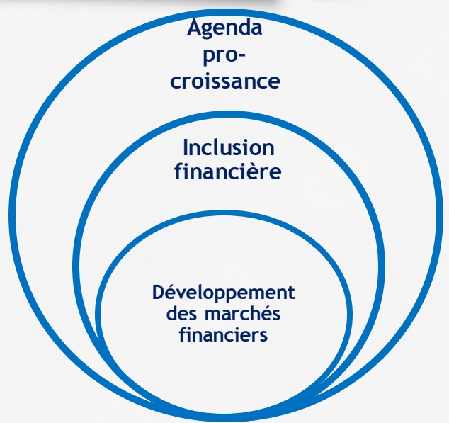
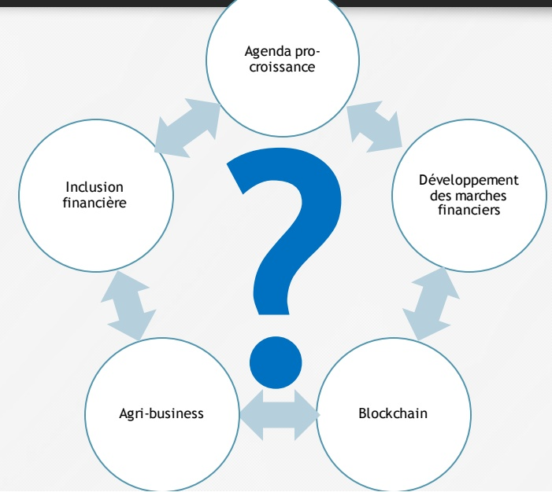
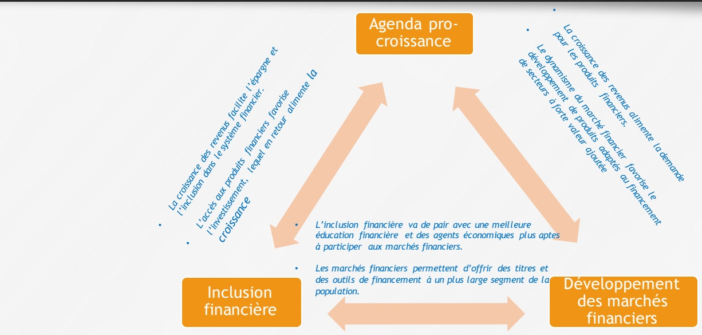
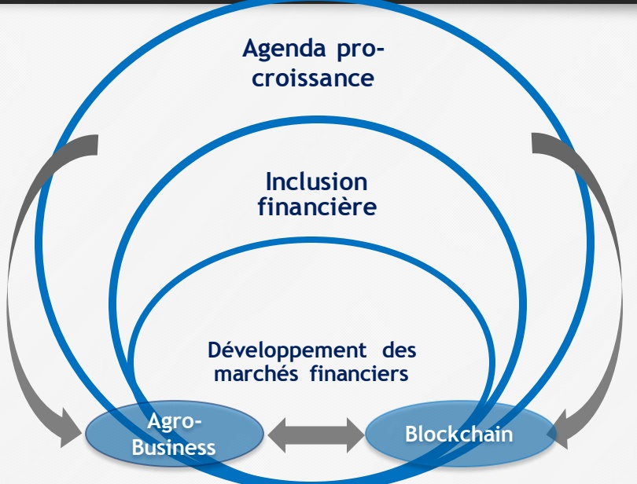
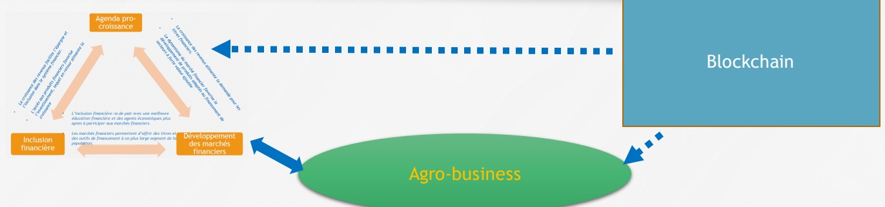
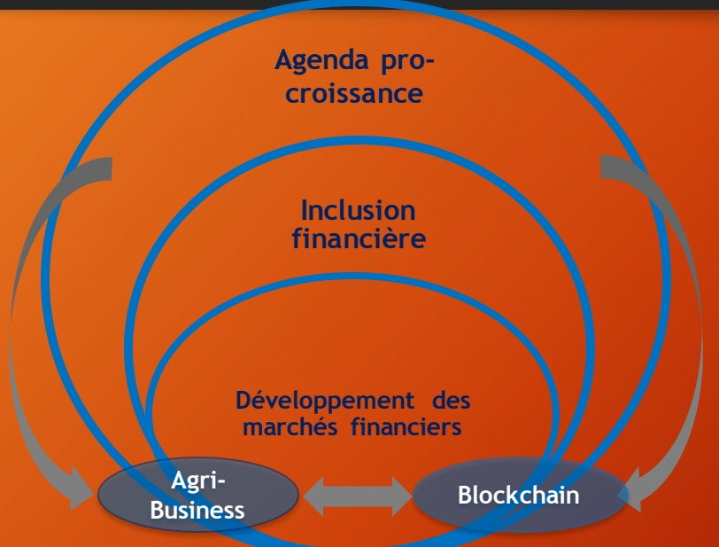
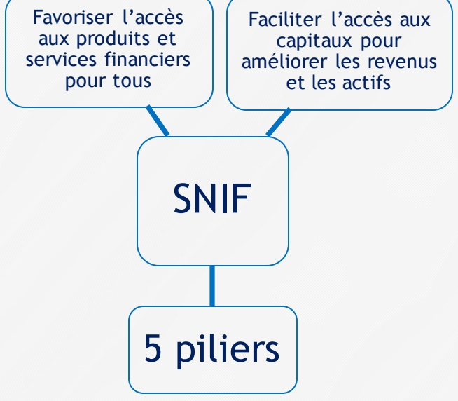
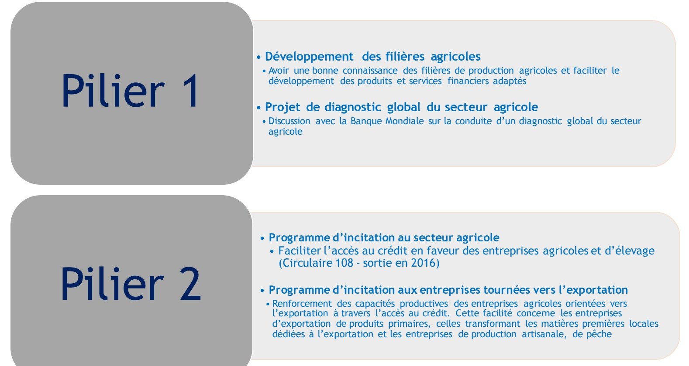

<!-- page 1 -->

## BRH

## Politique monétaire, Trois axes d'action de la BRH dans la perspective d'un développement de l'Agro-business et de la Technologie blockchain

Jean Baden DUBOIS

Gouverneur de la BRH

<!-- page 2 -->

## Sommaire

## Introduction

### 1. Politique Monétaire

1. Contexte de mise en œuvre

2. Agenda pro-croissance

### 2. Agro-business

1. blockchain par rapport aux objectifs de l'approche Pro-croissance

2. Développement du marché financier

3. Inclusion financière

### 3. Agro-business et blockchain par rapport à trois axes d'action la BRH

1. Agro-business et agenda pro-croissance

2. Stratégie Nationale inclusion Financière : Initiatives de la BRH

3. Importance de l'agri-business et du secteur agricole en général pour l'agenda pro-croissance

4. La Banque Centrale et la technologie blockchaina

5. conclusion

<!-- page 3 -->

## Politique Monétaire et Contexte de mise en oeuvre

La politique monétaire de la BRH est mise en œuvre dans un environnement contraignant caractérisé notamment par:

• Des déséquilibres importants à caractère structurel dont, notamment, a) celui de l'appareil productif, b) les déficits jumeaux, budgétaires (2% du PIB) et extérieurs (37.5% du PIB)

• La structure oligopolistique des marchés qui gène donc la concurrence et l'expression de la vérité des prix

<!-- page 4 -->

## Politique Monétaire et Agenda Pro-croissance

• Cette stratégie de la BRH s'inspire des politiques monétaires non-conventionnelles mises en place après la crise financière de 2008 pour relancer les grandes économies de marché en adressant particulièrement les effets de la récession subséquente et les problèmes structurels.

• Il s'agit de mesures qui permettent :

• D'élargir les frontières de l'orthodoxie afin d'agir sur les facteurs structurels de l'économie tout en

• S'ouvrant aux opportunités offertes par les innovations à travers notamment des raccourcis technologiques permettant d'aboutir plus rapidement aux objectifs de production avec des effets de diffusion

<!-- page 5 -->

## Agro-business et blockchain par rapport aux objectifs de l'approche Pro-croissance

• En ce sens, le sommet de la finance de 2018 propose un cadre permettant de mieux alimenter les réflexions autour de cette stratégie à travers deux thèmes d'importance pour les acteurs publics et privés haitiens: le financement de l'agribusiness et la technologie du blockchain.

Le premier thème est ancré dans ce qui a historiquement constitué le socle de l'économie haïtienne: l'agriculture.

Le second thème ouvre une porte sur une technologie pleine de promesses, qu'il faudra exploiter tout en minimisant les risques y relatifs.

<!-- page 6 -->

## Agro-business et blockchain par rapport à trois axes d'action la BRH

Les trois Axes d'action de la BRH qui nous interessent aujourd'hui.

• Le développement des marchés financiers pour favoriser la création d'outils financiers s'adressant à un plus large segment de la population. Il s'alignera sur la stratégie nationale d'inclusion financière;

- L'inclusion financière permettrait d'élargir l'accès aux produits et services financiers et mobiliser l'épargne en vue de favoriser l'investissement;

- L'agenda pro-croissance contribue à créer un cadre incitatif pour orienter les investissements vers les secteurs à forte valeur ajoutée.

<!-- page 7 -->

## Agro-business et blockchain par rapport à trois axes d'action la BRH

1- Quelles sont les interrelations entre ces 3 axes majeurs?

2- Comment l'Agro-business et le Blockchain peuvent à la fois s'inter-relier et contribuer à la mise en œuvre de ces axes ?

Et de façon globale,

3-Comment cet écosystème peut servir de base dans la conception et l'implémentation de politiques publiques ?

<!-- page 8 -->

## Interaction entre les axes majeurs d' action de la BRH

Agenda pro-croissance

L'inclusion financière va de pair avec une meilleure éducation financière et des agents économiques plus aptes à participer aux marchés financiers.

Inclusion financière

Les marchés financiers permettent d'offrir des titres et des outils de financement à un plus large segment de la population.

Développement des marchés financiers

<!-- page 9 -->

## Interaction entre les axes majeurs d' action de la BRH

Il s'agit d'initier un cercle

vertueux pour favoriser le

développement de l'agri-

business tout en restant à

l'affût des opportunités offertes

par la technologie blockchain.

<!-- page 10 -->

## Les axes majeurs d'action, l'agro-business et le blockchain

Blockchain

Agro-business

La dynamique entre ces axes majeurs devrait se traduire en des effets positifs pour la croissance économique.

<!-- page 11 -->

## L' agro-business et le développement des marchés financiers

Le développement de l'agro-business et du secteur agricole en général bénéficient nécessairement de la diversification de produits financiers découlant du développement des marchés financiers. Ces produits peuvent inclure:

- Des financements appropriés à différents niveaux de la chaîne de valeur (crédit de court terme aux clients, aux fournisseurs, aux intermédiaires, ...) et s'appuyant sur les relations existant entre les participants de la chaîne.

- Des titres de participation dans des entreprises agricoles, agroindustrielles ou des secteurs liés leur permettant d'atteindre de bons ratios d'endettement sur capitaux propres.

• Des produits d'assurance indicielle et des contrats à termes permettant de mieux couvrir les risques.

• Des pools d'assurance permettant aux assureurs de se diversifier et de limiter leurs pertes en cas de catastrophe.

- Des titres publics permettant de mobiliser l'épargne en vue de financer les infrastructures agricoles de base (barrages et canaux d'irrigation, routes rurales,...).

- De façon générale, ces instruments financiers serviront à renforcer les liens dans la chaîne de valeur, à augmenter la productivité et la valeur ajoutée du secteur.

• Conséquemment, on devrait s'attendre à une augmentation des exportations de biens agricoles et agro-industriels ainsi qu'à une réduction des importations de ces biens.

<!-- page 12 -->

## L'agro-business et le développement des marchés financiers

Pour favoriser ces effets mutuellement bénéfiques entre le secteur agricole, l'agro-business et le développement des marchés financiers, la BRH a entrepris une série d'initiatives incluant:

• L'accompagnement de programmes d'assurance agricole;

Le renforcement des caisses populaires en milieu rural;

• La réalisation de tables sectorielles autour de différentes filières agricoles;

• Des réflexions avec les autorités budgétaires et fiscales en vue du développement d'un marché des titres publics;

La mise en place d'une législation permettant la création d'institutions financières (sous sa supervision), habilitées à émettre des titres pour le compte d'entreprises privées. Ce nouveau type d'institutions financières devrait offrir

• un mode de financement additionnel aux filières agricoles et agro-industrielles en plus du crédit bancaire.

<!-- page 13 -->

## Interaction entre les axes majeurs d' action de la BRH

Il s'agit d'initier un cercle vertueux pour favoriser le développement de l'agri-business tout en restant à l'affût des opportunités offertes par la technologie blockchain.

<!-- page 14 -->

## L'agro-business et l'inclusion financière

• L’extension des services financiers à un plus large segment de la population aura des impacts significatifs sur l’agri-business. Parmi lesquels:

La capacité pour les exploitants agricoles de financer leurs besoins de crédit, particulièrement en termes de capital roulant;

• Une meilleure compréhension des produits financiers (crédit, assurance, etc.) et une gestion plus rigoureuse de l'exploitation agricole à travers l'éducation financière;

• Réduction de ruptures potentielles dans les chaînes de valeur, en s'assurant que chaque participant ait accès aux services financiers nécessaires afin de maintenir les flux de biens et services qui leurs sont associés;

• Ces éléments permettront de maintenir et d'élargir le processus de création de valeur au niveau de l'agri-business, tout en réduisant l'incidence de la pauvreté.

<!-- page 15 -->

## L'agro-business et l'inclusion financière

• À son tour, l'augmentation de l'activité dans le secteur de l'agro-business renforce

l'inclusion financière à travers une demande accrue pour les services financiers

dans des secteurs et régions auparavant non desservis. Ces services incluent:

• Les dépôts (pour motif de transaction et d'épargne);

• Les crédits (à la consommation et à la production);

• Les transferts et paiements;

• Les produits d'assurance;

• Les services -conseils en finance et gestion d'entreprises.

<!-- page 16 -->

## Stratégie Nationale d'Inclusion Financière : Initiatives de la BRH

## Stratégie Nationale d'Inclusion Financière

## Pilier 1

Services financiers pour faciliter l'inclusion et la réduction de la pauvreté

## Pilier 2

Crédit pour la croissance économique

## Pilier 3

Services financiers de proximité

## Pilier 4

Education et protection des Consommateurs

## Pilier 5

Renforcement des institutions et des infrastructures financières

<!-- page 17 -->

<!-- page 18 -->

## Piliers 3 et 5

## Pilier 4

<!-- page 19 -->

## Importance de l'agro-business et du secteur agricole en général pour l'agenda pro-croissance

• Les pays ayant observé une croissance économique spectaculaire (Japon, Taïwan, Corée du Sud, Éthiopie,...) ont connu initialement une forte croissance de leur productivité agricole;

• L'agro-business peut être un vecteur d'augmentation de la productivité agricole;

• Malgré son déclin, le secteur agricole représente plus de 20 % du PIB;

Le dit secteur emploie environ près de la moitié de la population active occupée (45%);

• Si l'on ajoute l'agro-industrie, le transport et le commerce des produits agricoles, on aboutit à une amplification de la chaîne de valeurs liées au secteur

<!-- page 20 -->

## Importance de l'agro-business et du secteur agricole en général pour l'agenda pro-croissance

Le développement de la production agricole de denrées de grande consommation permet de réduire la part des produits importés dans l'indice des prix;

• La baisse de la part des produits importés dans le panier de biens de référence pour le calcul de l'indice des prix, réduit le lien causal entre variation du taux de change et variation du niveau des prix;

• Ceci permet aux autorités d'utiliser la dépréciation réelle (cas où la dépréciation nominale est supérieure à l'inflation) en vue de favoriser la compétitivité de l'économie (exportations et tourisme).

<!-- page 21 -->

## Importance de l'agro-business et du secteur agricole en général pour l'agenda pro-croissance

• Ces mesures incitatives remplissent, entre autres, un triple objectif:

1. L'augmentation du financement bancaire disponible pour les investissements privés dans le secteur agricole;

2. Le renforcement des capacités d'exportations;

3. Le développement de zones franches favorisant des « clusters » agricoles et industriels.

<!-- page 22 -->

## Interaction entre les axes majeurs d' action de la BRH

Il s'agit d'initier un cercle vertueux pour favoriser le développement de l'agri-business tout en restant à l'affût des opportunités offertes par la technologie blockchain.

<!-- page 23 -->

## La technologie blockchain et l'agro-business

• Dans les domaines liés à l'agri-business, la blockchain en tant que registre à la fois transparent et sécurisé permettrait entre autres de:

• Favoriser la mise en place du cadastre, élément fondamental en vue de d'attirer des investissements dans le secteur agricole;

• Certifier la qualité ou l'origine de produits agricoles, notamment dans le cadre de l'agriculture « bio » et l'élevage;

<!-- page 24 -->

## La technologie blockchain et le développement des marchés financiers

- La possibilité pour les entreprises de lever des fonds à travers des Initial Coin Offerings (ICO). Il s'agit d'un processus moins coûteux, plus accessible et plus rapide qu'un financement traditionnel à travers des banques ou des fonds de capital risque;

- La possibilité d'utiliser des smart contracts pour créer des produits d'assurance ou de couverture de risque. Les smarts contracts peuvent ainsi être utilisés pour assurer l'exécution de contrats d'assurance indiciels dans le secteur agricole en particulier. Les produits d'assurance basés sur les indices s'avèrent être relativement peu coûteux et moins vulnérables par rapport à la fraude.

• La facilitation des transferts de fonds en réduisant notamment le coût des transactions.

<!-- page 25 -->

## La technologie blockchain et l'inclusion financière

Bitcoin, les crypto-monnaies font beaucoup parler d'elles;

• Aucune crypto-monnaie n'a cours légal en Haïti;

- Toutefois, la technologie blockchain est pleine de promesses pour des secteurs aussi divers que l'identification de titres de propriété, la réduction du coût des transferts, la certification de la provenance des produits agricoles, etc.;

• Quelle serait la place de la technologie blockchain dans un écosystème mettant en relation l'agribusiness et les trois axes majeurs d'action de la BRH?

<!-- page 26 -->

## CONCLUSION

• Tout en restant fidèle à ses principaux rôles qui sont de maintenir la stabilité des prix, de superviser le système financier et de gérer le système de paiement), la BRH mise sur 3 axes majeurs d'action: le développement des marchés financiers, l'inclusion financière et l'agenda pro-croissance.

- Leur mise en œuvre permettra la création d'un cercle vertueux facilitant de développement de l'agro-business.

- L'écosystème ainsi créé peut être alimenté par les applications novatrices de la technologie blockchain.

<!-- page 27 -->

## MERCI
