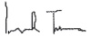
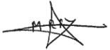

<!-- page 1 -->

# ETATS FINANCIERS & ANNEXE JURIDIQUE

<!-- page 2 -->

Banque de la République d'Haïti (BRH)

Rapport des auditeurs indépendants

Etats financiers annuels

Exercice clos le 30 septembre 2013

<!-- page 3 -->

# Banque de la République d'Haïti (BRH) Rapport des auditeurs indépendants Etats financiers annuels Exercice clos le 30 septembre 2013

Mesdames, Messieurs les Administrateurs.

En exécution de la mission qui nous a été confiée par votre Conseil d'Administration, nous vous présentons notre rapport relatif à l'exercice clos le 30 septembre 2013, sur l'audit des états financiers de la Banque de la République d'Haïti (BRH).

### I. Rapport sur les états financiers

Nous avons effectué l'audit des états financiers ci-joints de la Banque de la République d'Haïti (BRH) comprenant le bilan au 30 septembre 2013, ainsi que le compte de pertes et profits, l'état de variation des capitaux propres, le tableau des flux de trésorerie pour l'exercice clos à cette date et les notes annexes (ci-après désignés « les états financiers »). Ces états financiers ont été établis par le Management conformément aux principes et méthodes comptables édictés par la BRH qui sont décrits dans les notes annexes.

## Responsabilité du Management dans l'établissement et la présentation des états financiers

Le Management de la BRH est responsable de l'établissement et de la présentation sincère de ces états financiers, conformément aux principes et méthodes comptables édictés par la BRH, ainsi que d'un contrôle interne qu'elle juge nécessaire pour permettre l'établissement d'états financiers ne comportant pas d'anomalies significatives, que celles-ci proviennent de fraudes ou résultant d'erreurs.

<!-- page 4 -->

## Responsabilité de l'auditeur

Notre responsabilité est d'exprimer une opinion sur ces états financiers sur la base de notre audit. Nous avons effectué notre audit selon les Normes Internationales d'Audit. Ces normes requièrent de notre part de nous conformer aux règles d'éthique et de planifier et de réaliser l'audit pour obtenir une assurance raisonnable que les états financiers ne comportent pas d'anomalies significatives.

Un audit implique la mise en œuvre de procédures en vue de recueillir des éléments probants concernant les montants et les informations fournies dans les états financiers. Le choix des procédures relève du jugement de l'auditeur, de même que l'évaluation du risque que les états financiers contiennent des anomalies significatives, que celles-ci résultent de fraudes ou d'erreurs. En procédant à cette évaluation du risque, l'auditeur prend en compte le contrôle interne en vigueur dans l'entité relatif à l'établissement et la présentation sincère des états financiers afin de définir des procédures d'audit appropriées en la circonstance, et non dans le but d'exprimer une opinion sur le fonctionnement efficace du contrôle interne de l'entité. Un audit comporte également l'appréciation du caractère approprié des méthodes comptables retenues et le caractère raisonnable des estimations comptables faites par la Direction, de même que l'appréciation de la présentation d'ensemble des états financiers.

Nous estimons que les éléments probants recueillis sont suffisants et appropriés pour fonder notre opinion avec réserve.

## Justification de l'opinion avec réserve

## Participation TELECO

La quote-part de la BRH dans les résultats annuels enregistrés par la TELECO s'élève à un montant cumulé de G.1.900 millions au 30 septembre 2013. En l'absence d'états financiers audités de la TELECO, nous n'avons pas été en mesure de recueillir des éléments probants suffisants et appropriés pour justifier, d'une part, la valeur comptable de la participation dans la société TELECO au 30 septembre 2013 et, d'autre part, la quote-part du résultat net de cette société revenant à la BRH à cette date.

## Opinion avec réserve

A notre avis, sous réserve des incidences éventuelles du point décrit dans le paragraphe ci-dessus, les états financiers sont réguliers et sincères et donnent une image fidèle de la situation financière de la BRH au 30 septembre 2013, de son patrimoine, de ses résultats et de la variation de la situation financière pour l'exercice clos à cette date, conformément aux règles et méthodes comptables décrites dans les notes annexes.

<!-- page 5 -->

## Principes comptables

Sans remettre en cause l'opinion exprimée ci-dessus, nous attirons l'attention sur les notes 1 et 2 annexées aux états financiers qui décrivent les principes comptables suivis. Les états financiers ont été établis pour satisfaire aux obligations issues de la loi organique du 17 août 1979 relatives à la présentation d'informations financières sur la BRH. En conséquence, ces états financiers peuvent ne pas convenir pour répondre à un autre objectif.

FIRME TURNIER

Antoine Lionel TURNIER

Associé

Le 24 novembre 2014

ERNST & YOUNG (RACINE)

Makha SY

Associé

<!-- page 6 -->

## Sommaire

Etats financiers au 30 septembre 2013 5-8
Bilan 5
Comptes de pertes et profits 6
Etat de variation des capitaux propres 7
Tableau des flux de trésorerie 8
Notes annexes aux états financiers 9-19
Informations sur le bilan 20-59
Informations sur le compte de pertes et profits 60-64
Divers 65-66

<!-- page 7 -->

## Etats financiers au 30 septembre 2013

Bilan

(En milliers de Gourdes)

<table><tr><td></td><td>Notes</td><td>30/09/2013</td><td>30/09/2012</td><td>Variation</td></tr><tr><td>Valeur</td><td>%</td></tr><tr><td>ACTIF</td><td></td><td></td><td></td><td></td><td></td></tr><tr><td>Avoirs en or</td><td>4</td><td>3 348 820</td><td>4 342 487</td><td>(993 667)</td><td>-23%</td></tr><tr><td>Avoirs sur le Fonds Monétaire International</td><td>5</td><td>4 622 406</td><td>4 496 768</td><td>125 638</td><td>3%</td></tr><tr><td>Avoirs en monnaies étrangères</td><td>6</td><td>93 560 800</td><td>87 838 475</td><td>5 722 325</td><td>7%</td></tr><tr><td>Participations dans les organismes internationalaux</td><td>7</td><td>2 632 801</td><td>2 485 048</td><td>147 753</td><td>6%</td></tr><tr><td>Placements locaux</td><td>8</td><td>275 000</td><td>275 000</td><td>-</td><td>0%</td></tr><tr><td>Prêts et avances au gouvernement et aux collectivités</td><td>9</td><td>46 431 986</td><td>40 240 760</td><td>6 191 226</td><td>15%</td></tr><tr><td>Prêts et avances aux particuliers et aux autres institutions</td><td>10</td><td>2 464 006</td><td>2 266 605</td><td>197 401</td><td>9%</td></tr><tr><td>Prêts et avances aux institutions financières monétaires et non monétaires</td><td>11</td><td>620 803</td><td>126 247</td><td>494 556</td><td>392%</td></tr><tr><td>Immobilisations</td><td>12</td><td>4 231 918</td><td>3 964 817</td><td>267 101</td><td>7%</td></tr><tr><td>Autres actifs</td><td>13</td><td>2 189 793</td><td>3 181 358</td><td>(991 565)</td><td>-31%</td></tr><tr><td>TOTAL</td><td></td><td>160 378 333</td><td>149 217 565</td><td>11 160 768</td><td>7%</td></tr><tr><td>PASSIF</td><td></td><td></td><td></td><td></td><td></td></tr><tr><td>Billets et monnaies en circulation</td><td>14</td><td>24 082 405</td><td>22 904 087</td><td>1 178 318</td><td>5%</td></tr><tr><td>Comptes d'engagements</td><td>15</td><td>110 913 871</td><td>92 674 722</td><td>18 239 149</td><td>20%</td></tr><tr><td>Engagements envers le FMI</td><td>16</td><td>7 795 833</td><td>7 155 427</td><td>640 406</td><td>9%</td></tr><tr><td>Contributions et engagements de l'Etat haïtiens sur participation au capital des organismes financiers internationaux</td><td>17</td><td>3 423 065</td><td>3 247 822</td><td>175 243</td><td>5%</td></tr><tr><td>Autres passifs</td><td>18</td><td>11 791 132</td><td>17 847 850</td><td>(6 056 718)</td><td>-34%</td></tr><tr><td>Provisions pour risques et charges</td><td></td><td></td><td>195 787</td><td>(195 787)</td><td>-100%</td></tr><tr><td>Réserve de réévaluation de change</td><td>19</td><td>5 404 464</td><td>4 675 954</td><td>728 510</td><td>16%</td></tr><tr><td>Réserves générales</td><td>20</td><td>(2 533 885)</td><td>1 212 269</td><td>(3 746 154)</td><td>-309%</td></tr><tr><td>Réserve de réévaluation de l'or</td><td>21</td><td>105 297</td><td>127 707</td><td>(22 410)</td><td>-18%</td></tr><tr><td>Réserve allocation spéciale retraite</td><td>22</td><td>272 933</td><td>198 323</td><td>74 610</td><td>38%</td></tr><tr><td>Capital et réserves</td><td>23</td><td>1 256 282</td><td>1 256 282</td><td></td><td></td></tr><tr><td>Résultat des exercices antérieurs</td><td>24</td><td>(2 761 758)</td><td>(2 662 513)</td><td>(99 245)</td><td>4%</td></tr><tr><td>Résultat</td><td></td><td>628 694</td><td>383 848</td><td>244 846</td><td>64%</td></tr><tr><td>TOTAL</td><td></td><td>160 378 333</td><td>149 217 565</td><td>11 160 768</td><td>7%</td></tr></table>

<!-- page 8 -->

Comptes de pertes et profits

(En milliers de Gourdes)

<table><tr><td></td><td>Notes</td><td>30/09/2013</td><td>30/09/2012</td><td>Variation</td></tr><tr><td>Valeur</td><td>%</td></tr><tr><td>Produits des opérations avec l'étranger : intérêts</td><td></td><td>2 616 122</td><td>2 750 761</td><td>(134 639)</td><td>-5%</td></tr><tr><td>Produits de placements, prêts et avances à l'État</td><td></td><td></td><td></td><td></td><td></td></tr><tr><td>Haitien</td><td></td><td>1 099 842</td><td>1 099 883</td><td>(41)</td><td>0%</td></tr><tr><td>Produits des opérations de crédit</td><td></td><td>112 639</td><td>92 478</td><td>20 161</td><td>22%</td></tr><tr><td>Intérêts débiteurs et frais financiers</td><td></td><td>(444 347)</td><td>(56 110)</td><td>(388 237)</td><td>692%</td></tr><tr><td>Autres dépenses d'intérêts</td><td></td><td>(144 075)</td><td></td><td>(144 075)</td><td>(100%)</td></tr><tr><td>Résultat net d'intérêts</td><td>25</td><td>3 240 181</td><td>3 887 012</td><td>(646 831)</td><td>-17%</td></tr><tr><td>Dividendes</td><td></td><td>5 954</td><td>3 937</td><td>2 017</td><td>51%</td></tr><tr><td>Gains sur ventes des valeurs mobilières</td><td></td><td>590 907</td><td>452 015</td><td>138 892</td><td>29%</td></tr><tr><td>Pertes sur ventes des valeurs mobilières</td><td></td><td></td><td>(3 141)</td><td>3 141</td><td>-277%</td></tr><tr><td>Résultats sur ventes de valeurs mobilières</td><td>26</td><td>590 907</td><td>448 874</td><td>142 033</td><td>32%</td></tr><tr><td>Produit net bancaire</td><td></td><td>3 837 042</td><td>4 339 823</td><td>(502 780)</td><td>-12%</td></tr><tr><td>Autres produits</td><td>27</td><td>232 327</td><td>176 279</td><td>56 048</td><td>45%</td></tr><tr><td>Gain extraordinaire</td><td></td><td>367</td><td>836</td><td>(469)</td><td>-56%</td></tr><tr><td>Résultat opérationnel</td><td></td><td>4 069 736</td><td>4 516 938</td><td>(447 201)</td><td>-10%</td></tr><tr><td>Entretien de la circulation fiduciaire</td><td></td><td>263 578</td><td>303 667</td><td>(40 089)</td><td>-13%</td></tr><tr><td>Rémunérations et charges sociales</td><td></td><td>2 350 724</td><td>3 028 248</td><td>(677 524)</td><td>-22%</td></tr><tr><td>Dépenses administratives</td><td></td><td>522 005</td><td>515 526</td><td>6 479</td><td>1%</td></tr><tr><td>Dotation aux amortissements</td><td></td><td>180 617</td><td>141 082</td><td>39 535</td><td>28%</td></tr><tr><td>Dépenses relatives à la gestion des actifs</td><td></td><td>60 682</td><td>53 275</td><td>7 407</td><td>14%</td></tr><tr><td>Dons</td><td></td><td>46 439</td><td>45 115</td><td>1 324</td><td>3%</td></tr><tr><td>Autres dépenses</td><td></td><td>4 354</td><td>853</td><td>3 501</td><td>410%</td></tr><tr><td>Pertes nettes dues au séisme</td><td></td><td>108</td><td>249</td><td>(141)</td><td>-57%</td></tr><tr><td>Dotation pour mauvaises créances</td><td></td><td>12 097</td><td>45 075</td><td>(32 978)</td><td>-73%</td></tr><tr><td>Dotation pour risques et charges</td><td></td><td>438</td><td></td><td>438</td><td>100%</td></tr><tr><td>Charges d'exploitation générale</td><td>28</td><td>3 441 042</td><td>4 133 090</td><td>(692 048)</td><td>-17%</td></tr><tr><td>Revenus nets de l'exercice</td><td></td><td>628 694</td><td>383 848</td><td>244 846</td><td>64%</td></tr></table>

<!-- page 9 -->

## Etat de variation des capitaux propres

(En milliers de Gourdes)

<table><tr><td></td><td>Capital</td><td>Réserves légales</td><td>Réserves spéciales</td><td>Réserve pour réévaluation d'immeubles</td><td>Total capitaux propres</td></tr><tr><td>Solde au</td><td>50 000</td><td>74 454</td><td>412 825</td><td>719 003</td><td>1 256 282</td></tr><tr><td>30/09/2012</td></tr><tr><td>Affectations</td><td>-</td><td>-</td><td>-</td><td>-</td><td>-</td></tr><tr><td>Prélèvements</td><td>-</td><td>-</td><td>-</td><td>-</td><td>-</td></tr><tr><td>Réévaluation</td><td>-</td><td>-</td><td>-</td><td>-</td><td>-</td></tr><tr><td>Solde au</td><td>50 000</td><td>74 454</td><td>412 825</td><td>719 003</td><td>1 256 282</td></tr><tr><td>30/09/2013</td></tr></table>

<!-- page 10 -->

Tableau des flux de trésorerie

<table><tr><td></td><td>(En milliers de Gourdes)</td></tr><tr><td></td><td>2013</td><td>2012</td></tr><tr><td>Activités d'exploitation</td><td></td><td></td></tr><tr><td>Revenu net de l'exercice</td><td>628 694</td><td>383 848</td></tr><tr><td>Eléments de conciliation du revenu net aux liquidités résultant des activités d'exploitation</td><td></td><td></td></tr><tr><td>Dotations aux amortissements</td><td>320 791</td><td>141 082</td></tr><tr><td>Perte sur dispositions d'immobilisations</td><td></td><td>-</td></tr><tr><td>Provisions pour pertes de valeur sur prêts</td><td>10 367</td><td>41 089</td></tr><tr><td>Effet de change suite à la réévaluation de la participation des organismes financiers inter</td><td>408 379</td><td>(735 856)</td></tr><tr><td>Changements dans les éléments d'actif et de passif résultant des activités d'exploitation</td><td></td><td></td></tr><tr><td>Augmentations des prêts et avances, net</td><td>(157 459)</td><td>(1 781 720)</td></tr><tr><td>Billets en monnaies en circulation</td><td>1 364 253</td><td>1 469 607</td></tr><tr><td>Engagements en devises</td><td>(6 763 284)</td><td>9 254 515</td></tr><tr><td>Contributions et engagements envers les organismes financiers internationaux</td><td>965 492</td><td>2 367 845</td></tr><tr><td>Engagements envers les banques créatrices de monnaie</td><td>5 582 700</td><td>(3 737 403)</td></tr><tr><td>Dépôts du Gouvernement Central</td><td>(1 640 582)</td><td>3 806 490</td></tr><tr><td>Engagements envers les autres institutions</td><td>593 875</td><td>(343 581)</td></tr><tr><td>Changements dans les autres éléments d'actif, de passif et de réserves</td><td>8 261 604</td><td>(1 462 448)</td></tr><tr><td>Liquidités provenant des activités d'exploitation</td><td>9 574 830</td><td>9 403 468</td></tr><tr><td>Activités d'investissement</td><td></td><td></td></tr><tr><td>Augmentation des placements étrangers</td><td>(27 905 779)</td><td>(4 883 895)</td></tr><tr><td>(Augmentation) diminution des placements locaux</td><td>382 638</td><td>(1 445 273)</td></tr><tr><td>Acquisitions d'immobilisations nettes</td><td>(568 599)</td><td>(104 249)</td></tr><tr><td>Remboursement d'assurance</td><td></td><td>-</td></tr><tr><td>Liquidités utilisées dans des activités d'investissement</td><td>(28 091 740)</td><td>(6 433 417)</td></tr><tr><td>Augmentation (Diminution) nette des liquidités</td><td>(18 516 910)</td><td>2 970 052</td></tr><tr><td>Liquidités au début de l'exercice</td><td>27 467 686</td><td>24 497 635</td></tr><tr><td>Liquidité à la fin de l'exercice</td><td>8 950 776</td><td>27 467 686</td></tr></table>

<!-- page 11 -->

# Notes annexes aux états financiers

## Règles et méthodes comptables de la BRH

## Note 1 - Cadre juridique et activités

La Banque de la République d'Haïti (BRH), dont le Siège est sis à la rue du Quai à Port-au-Prince (Haïti), est un organisme public autonome, constitué par l'Etat Haïtien, par la loi du 17 août 1979, modifié en ses articles 9 et 17 par le décret du 28 mars 1985. Son capital social n'est pas divisé en actions. Il est détenu par l'Etat Haïtien et peut être augmenté selon les besoins de l'institution.

La loi du 17 août 1979 portant création de la BRH stipule en son article 6 que celle-ci est dirigée par un Conseil d'Administration dont les membres sont nommés pour une période de trois (3) ans, renouvelable par arrêté du Président de la République. Conformément aux dispositions de la Constitution de 1987, ils sont ratifiés par le Sénat de la République.

La BRH est une Banque Centrale et, à ce titre, a pour objet de :

• promouvoir dans le domaine de la monnaie, du crédit et des changes, les conditions les plus favorables au développement de l'économie nationale ;

• encourager le développement et l'utilisation la plus complète et la plus efficace des ressources productives du pays ;

- adapter les moyens de paiement et la politique de crédit aux besoins légitimes de l'économie haïtienne et, en particulier, à la croissance de la production nationale ;

- aider à éviter toutes tendances inflationnistes, spéculatives et déflationnistes qui seraient nuisibles aux intérêts permanents de la nation ;

- conseiller le Gouvernement en matière de politique monétaire, dans le but principal de maintenir, à l'intérieur du pays, la stabilité relative des prix et à l'extérieur, la croissance des échanges ;

- faciliter l'expansion du commerce intérieur et extérieur en vue de contribuer à l'instauration et au maintien d'un niveau élevé de l'emploi et du revenu réel ;

• assurer l'administration et la gestion des réserves de changes, veiller à l'application des dispositions légales et réglementaires relatives aux institutions financières ;

• contrôler et orienter la circulation et la distribution du crédit ;

• émettre des billets de banque, frapper des pièces métalliques et créer de la monnaie scripturale ;

- exercer toutes les activités de banquier de l'Etat, d'agent financier et fiscal pour toutes ses opérations de caisse et de crédit.

<!-- page 12 -->

La BRH utilise divers instruments dans la mise en œuvre de la politique monétaire, dont l'objectif fondamentale demeure la stabilité des prix. Son principal canal de gestion monétaire est, depuis 1996, la vente aux banques de la place des bons qu'elle émet.

La BRH mène des négociations avec le Ministère de l'Économie et des Finances en ce qui a trait au niveau et aux conditions de financement du déficit budgétaire. Ces ententes se matérialisent, en général, par des accords signés entre le Gouverneur de la BRH et le Ministre de l'Économie et des Finances.

Au plan de la réglementation et de la supervision bancaires, la BRH, conformément aux articles 29 à 32 de sa loi organique et à l'article 43 du décret du 14 novembre 1980 réglementant le fonctionnement des banques, a le pouvoir d'inspecter celles-ci et de les soumettre à un régime de normes prudentielles.

En sa qualité de banquier de l'Etat (article 37 de la loi organique), la BRH tient le compte courant de toutes les institutions et collectivités publiques. Elle se charge de la collecte des recettes de l'Etat et encaisse directement pour le compte de celui-ci les taxes internes et les droits de douane. Elle fait aussi fonction de gardienne des titres appartenant à ces entités (article 38 de la loi organique).

Pour l'exécution de ces opérations, la BRH est organisée en un réseau comportant un Siège et une succursale au Cap-Haïtien. La BRH s'est orientée vers une organisation interne destinée à faciliter la mise en œuvre de sa stratégie de modernisation.

<!-- page 13 -->

## Note 2 - Principes et méthodes comptables

### 2.1 - Référentiel comptable en vigueur au 30 septembre 2013

Les états financiers de la Banque de la République d'Haïti ont été élaborés conformément aux dispositions de la loi organique du 17 août 1979 et suivant la méthode de comptabilité d'exercice. Ils sont libellés en Gourde qui est la monnaie nationale Haïtienne.

### 2.2 - Exercice

La durée de l'exercice est de douze mois. L'exercice débute le  $ 1^{er} $ octobre et se termine le 30 septembre de l'année suivante.

### 2.3 - Principes comptables

Les principes comptables suivants sont appliqués :

• comptabilité d'engagement.

• intelligibilité.

pertinence.

fiabilité.

comparabilité.

### 2.4 - Méthode d'évaluation

Les états financiers sont préparés sur la base de la valeur de marché pour l'or, des titres et des éléments d'actif et de passif libellés en devises inscrits au bilan, ainsi que du coût historique pour les autres rubriques

### 2.5 - Estimations et jugements

Lors de la préparation de ces états financiers, la Direction doit faire des estimations et formuler des hypothèses qui affectent l'application des normes comptables et les montants des éléments d'actif et de passif déclarés et la présentation de l'actif et du passif éventuels à la date des états financiers ainsi que les résultats de l'exercice. Les résultats actuels peuvent être différents de ces estimations.

La BRH établit une provision pour pertes de valeur sur prêts en fin d'exercice qui représente une estimation de la perte de valeur réelle sur le portefeuille de prêts à cette date. Cette provision est établie en prenant en considération les éléments probants spécifiques tels que les arriérés de remboursement, la valeur des garanties, les possibilités de recouvrement futur, et la situation économique de l'emprunteur qui ont un impact sur les flux de trésorerie futurs estimés d'un prêt spécifique ou d'un groupe de prêts avec un risque similaire.

<!-- page 14 -->

### 2.6 - Effets des transactions et événements

Les effets des transactions et autres événements sont pris en compte dès que ces transactions et événements se produisent.

Par ailleurs, en raison du découpage de l'activité en exercices comptables, les transactions et autres événements sont rattachés à l'exercice qu'ils concernent effectivement et à celui-ci seulement. Dans ce cadre, les produits sont comptabilisés dès qu'ils sont acquis et les charges au fur et à mesure qu'elles sont engagées.

### 2.7 - Opérations en devises

Les transactions en devises étrangères sont initialement comptabilisées aux cours de change en vigueur à la date de transaction. En fin de mois, les actifs et passifs en monnaies étrangères sont convertis au cours de change en vigueur en fin de période. Les gains ou pertes de change, qui en découlent, sont enregistrés dans un compte de réserve « Réserve de réévaluation de change », conformément à l'article 56 de la loi organique.

### 2.8 - Impôts et taxes

Conformément à l'article 63 de la loi organique, la BRH est exonérée du paiement des droits et taxes de l'Etat ou des communes à l'occasion de toutes opérations qui lui sont propres. De même, elle bénéfice de l'exemption des droits à l'occasion de ses importations y compris matériels, équipements, lubrifiants, carburants.

### 2.9 - Avoirs en or

L'or est valorisé au cours en vigueur à la date du bilan. Les gains et les pertes résultant de cette valorisation sont inscrits à la réserve de réévaluation. Le stock d'or n'est pas porteur d'intérêts. L'avoir en or fait partie des réserves nettes de change en accord avec l'article 52 de la loi organique de la BRH.

### 2.10 - Avoirs sur le FMI, engagements envers le FMI

La BRH est l'agent fiscal de l'Etat Haïtien auprès du Fonds Monétaire International (FMI). Elle est en même temps le dépositaire des Gourdes détenus par le FMI. En vertu de la loi du 19 septembre 1952, la Banque représente le Gouvernement Haïtien en toute négociation ou transactions avec le Fonds. Toutes les transactions entre le Gouvernement et le Fonds sont inscrites dans les livres de la BRH.

Les différences résultant des opérations de la BRH avec le Fonds sont supportées par le Gouvernement Haïtien et sont comptabilisées au bilan dans le compte «Avance différence de change FMI».

<!-- page 15 -->

Les opérations avec le FMI sont libellées dans la monnaie du FMI, à savoir le Droit de Tirage Spécial (DTS).

Les opérations et transactions de l'Etat Haïtien avec le FMI concernent le compte de Droit de Tirage Spécial (DTS), le compte de ressources générales et les comptes administrés.

La position de réserve au FMI est la différence entre les quotes-parts de l'Etat et sa souscription en monnaie nationale, compte non tenu des tirages au titre des ressources générales (avoirs exclus ou recours aux crédits du FMI).

Les tirages effectués par l'Etat auprès du FMI sont reçus et enregistrés dans les comptes dépôt à vue de la BRH à la Federal Reserve Bank en dollars, d'une part, et dans les comptes d'engagements envers le FMI en DTS, d'autre part. Au moment des tirages, les différences entre les montants versés à l'Etat et la dette vis-à-vis du FMI sont portées directement au compte « Avance Différence de change FMI ».

Les avoirs du FMI en monnaie nationale (comptes FMI n° 1, FMI n° 2 et FMI compte titres) font l'objet d'une réévaluation annuelle le 30 avril de chaque année, sur la base du cours représentatif du DTS communiqué par le FMI. Les gains et pertes de réévaluation sont inscrits dans le compte « Avance différence de change FMI ».

A la clôture de chaque période mensuelle, les avoirs du FMI en DTS sont réévalués sur la base du cours du DTS/Gourdes de fin de mois.

Les DTS détenus, les tirages sur les comptes administrés et les allocations de DTS sont convertis en Gourdes sur la base du cours de change en vigueur lors des transactions. Les différences résultant de réévaluations périodiques sont portées au compte « Avance différence de change FMI ».

### 2.11 - Participations, contributions et engagements dans les autres organismes financiers internationaux

Conformément à l'article 2, alinéa 10, et l'article 61, alinéa 2 de la loi du 17 août 1979, la BRH enregistre dans ses livres les participations de la République d'Haïti dans les différents organismes internationaux. Le Gouvernement Haïtien a souscrit au capital de différents organismes financiers de la réévaluation des remittances non encore versés par l'exercice des contributions, et les montants non encore versés sont reflétés comme des engagements. Ces transactions sont gérées par la BRH à titre de fiduciaire et sont réévaluées aux taux de change de la fin de l'exercice. L'effet de change résultant de la réévaluation des actifs et passifs de l'État Haïtien est enregistré au bilan dans le compte « Réserves de réévaluation de change ».

<!-- page 16 -->

### 2.12 - Placements à la Télécommunication d'Haïti (TELECO)

La BRH détient 97 % des actions de la TELECO et le Gouverneur de la BRH est le président du Conseil d'Administration de cette institution. Les titres de participation détenus sur la TELECO ont été initialement comptabilisés à leur coût d'acquisition. La valeur comptable de ces titres est ajustée en y incluant la quote-part de la BRH dans les résultats annuels enregistrés par la TELECO. Depuis 2001, en l'absence d'états financiers audités de la TELECO, la valeur comptable du placement à la TELECO n'a pas connu d'évolution.

### 2.13 - Avoirs en monnaies étrangères

Les réserves de change de la BRH sont investies en comptes à vue, en comptes à terme et dans des actifs obligataires.

#### 2.13.1 - Portefeuille titres

Dans le cadre de la stratégie globale de gestion de son portefeuille, la BRH détient des valeurs mobilières de placement. La BRH a choisi un système de gestion par administrateurs externes de portefeuille (gestion déléguée). Les gérants de portefeuille peuvent bénéficier de pouvoirs discrétionnaires ou peuvent être sujets à des limitations strictes, concernant la sélection des placements.

Ces placements sont disponibles à la vente.

## • Actifs financiers disponibles à la vente

Ce sont des actifs financiers détenus dans le but d'avoir des liquidités disponibles. Ils sont enregistrés initialement en comptabilité à leur coût d'acquisition, coupons courus et frais d'acquisition inclus, et sont évalués ultérieurement à leur juste valeur. La variation de juste valeur est constatée directement en capitaux propres dans le compte « Réserve de réévaluation de change ».

### 2.14 - Prêts et avances au Gouvernement et aux collectivités

Les crédits à l'Etat Haïtien représentent un financement au Secteur Public ainsi que les prêts et avances en comptes courants au Gouvernement, aux collectivités locales et aux entreprises publiques. Ils sont évalués au coût. La BRH n'enregistre pas de perte de valeur sur les crédits à l'Etat Haïtien et aux entreprises publiques à moins de désaccords spécifiques. Les revenus d'intérêts sur ces prêts, avances et placements sont comptabilisés sur une base d'exercice.

### 2.15 - Immobilisations corporelles et incorporelles

Les immobilisations sont comptabilisées à leur coût d'acquisition, avec possibilité de réévaluation.

<!-- page 17 -->

Les réévaluations sont effectuées par des experts en évaluation.

L'écart de réévaluation est imputé aux capitaux propres sous une rubrique séparée en contrepartie des comptes d'immobilisations.

Suite au séisme du 12 janvier 2010, les pertes sur les immeubles de la Banque qui ont subi des dommages ont été évaluées et enregistrées dans les livres de la BRH.

A l'exception des terrains, des constructions en cours, les immobilisations sont amorties selon la méthode de l'amortissement linéaire sur la durée estimative de leur vie utile.

Les durées de vie retenues sont les suivantes :

| Immobilisations | Durées de vie utile\n(en mois) |
| --- | --- |
| Terrains | Non amortissable |
| Bâtisses | 240 |
| Mobilier et matériel de bureau | 48 |
| Matériel informatique | 60 |
| Logiciel informatique | 12 |
| Matériel roulant | 48 |
| Equipements | 60 |
| Installations | 60 |
| Aménagements, Extensions, Agrandissements | 60 |

Les immobilisations entièrement amorties demeurent inscrites au bilan dans un compte distinct « Biens totalement amortis » aussi longtemps qu'elles subsistent. Les immobilisations figurent au bilan à leurs valeurs nettes.

### 2.16 - Stocks de billets neufs en transit

A l'achat, les signes monétaires sont comptabilisés en engagements hors bilan au prix d'achat, auquel viennent s'ajouter les frais de transport.

A l'émission, les quantités de signes monétaires émises sont valorisées selon la méthode FIFO et comptabilisées au bilan. A la clôture de l'exercice, les billets et monnaies non émis sont traités comme des stocks. Ils font l'objet d'un inventaire physique et sont valorisés selon la méthode FIFO.

<!-- page 18 -->

### 2.17 - Billets et monnaies en circulation

Les billets et pièces de monnaie en circulation sont analysés comme des dettes envers les détenteurs.

Ils sont inscrits au bilan à leur valeur faciale ou valeur nominale.

### 2.18 - Comptes d'engagements

Les comptes à vue (dettes à vue) et les dépôts auprès de la BRH sont inscrits au bilan à leur valeur nominale et ne sont pas rémunérés.

### 2.19 - Provisions pour risques et charges

Une provision est constituée lorsque la BRH a une obligation réglementaire, implicite ou juridique qui résulte d'un événement passé et dont il est probable ou certain qu'elle provoquera une sortie de ressources dont le montant peut être estimé de manière fiable.

Conformément au principe de prudence, des provisions sont aussi constituées pour tous les risques potentiels liés à certains comptes d'actif (actifs non performants).

### 2.20 - Fonds de retraite et prime de séparation

La dépense annuelle pour le fond de retraite et primes de séparation est établie en fonction d'un taux de contribution fixé par la Banque de la République d'Haïti.

### 2.21 - Reserve de réévaluation de change

L'article 56 de la loi organique de la BRH précise que les gains et les pertes, qui résultent de la réévaluation des avoirs et des engagements de la BRH détenus en devises ou en or, doivent être comptabilisés à un compte dénommé "Réserve de réévaluation" présenté au bilan au niveau du capital et réserves.

### 2.22 - Réserve pour réévaluation d'immeubles

Le solde de ce poste sera viré à la réserve spéciale quand les immeubles seront comptabilisés. Toute moins-value résultant de la réévaluation est enregistrée directement comme une dépense à l'état des résultats à moins qu'elle ne soit relative à une plus-value existante pour un même immeuble déjà réévalué. Le cas échéant, cette moins-value sera affectée préalablement au poste de réserve de réévaluation-terains et immeubles.

<!-- page 19 -->

### 2.23 - Réserves générales

Ce poste enregistre les pertes et gains latents qui résultent des réévaluations périodiques du portefeuille de titres de la BRH.

### 2.24 - Distribution des profits nets

Selon l'article 59 de la loi régissant la BRH, les résultats nets doivent être distribués de la manière suivante : 25 % au Trésor Public, 10 % à la réserve légale et le solde à des réserves spéciales destinées aux fins d'investissements, de placements, d'agrandissement et autres, tel que fixé par le Conseil d'Administration. En 2010 et 2009, le Conseil d'Administration a convenu avec le Ministère de l'Économie et des Finances de ne pas effectuer de distribution à l'État en vue d'éponger les pertes antérieures et de constituer les réserves nécessaires à la recapitalisation de la BRH, tel que prévu dans le cadre d'accords avec les partenaires internationaux.

### 2.25 - Gestion des risques

La BRH est exposée à des risques variés qui sont les suivants :

• Risque de marché : risque de perte due aux changements dans les prix et aux taux de marché (cours de l'or, cours de change et taux d'intérêt);

• Risque de contrepartie : risque de perte due à l'incapacité des contreparties de la Banque de faire face à leurs obligations financières ;

• Risque opérationnel : risque de perte résultant de l'inadaptation ou de la défaillance des procédures, des personnes, des systèmes internes ou d'événements extérieurs.

La gestion des risques est centrée sur le caractère imprévisible de l'environnement financier et a pour objet d'en minimiser les conséquences négatives potentielles sur les performances de la BRH.

### 2.26 - Reconnaissance des produits et des charges

La reconnaissance des produits et des charges est effectuée selon les règles suivantes :

- les produits et les charges sont pris en compte au cours de l'exercice pendant lequel ils sont réalisés, acquis ou dus ;

- les produits et les charges en monnaies étrangères sont convertis au cours de change de la date de transaction ;

<!-- page 20 -->

- les plus-values et moins-values latentes sur les instruments financiers liées aux taux d'intérêt et aux prix du marché, sont comptabilisées au bilan dans le compte « Réserves générales » ;

- les écarts de conversion sur les devises étrangères sont comptabilisés au bilan dans le compte « Réserves de réévaluation de change ».

### 2.27 - Evénements postérieurs à la date de clôture

Les événements significatifs ayant un lien prépondérant et direct avec une situation qui existait à la date de clôture des comptes, donnent lieu à un ajustement des montants comptabilisés dans les états financiers. A cet égard, les actifs et les passifs font l'objet d'un ajustement pour tenir compte d'événements significatifs survenus entre la date de clôture et la date d'approbation des états financiers. Ceux concernant des situations apparues postérieurement à la date de clôture, sont mentionnés dans les notes annexes, avec une estimation de leur incidence financière.

### 2.28 - Changement de méthodes, d'estimations comptables

Aucun changement de méthode ou d'estimation comptables n'est intervenu durant l'exercice 2012-2013.

<!-- page 21 -->

Note 3 - Cours des monnaies étrangères et prix de l'Or

| Monnaies étrangères et or | 30/09/2013 (en Gourdes) | 30/09/2012 (en Gourdes) |
| --- | --- | --- |
| 1 Dollar des Etats-Unis (USD) | 43,7429 | 42,3222 |
| 1 Euro (EUR) | 59,1710 | 54,4221 |
| 1 Droit de Tirage Spécial (DTS) | 67,1051 | 65,2689 |
| 1 Once d'or | 57 514,639 | 74 752,432 |

<!-- page 22 -->

# Informations sur le bilan

Bilan - Actif

Note 4 - Avoirs en or

Cette rubrique s'analyse comme suit :

(En milliers de Gourdes)

<table><tr><td></td><td>30/09/2013</td><td>30/09/2012</td><td>Variation</td></tr><tr><td>En onces</td><td>En milliers de gourdes</td><td>En onces</td><td>En milliers de gourdes</td><td>En milliers de gourdes</td></tr><tr><td>Or en dépôt à la Fédéral Reserve Bank</td><td>1 308</td><td>75 870</td><td>1 308</td><td>98 279</td><td>(22 409)</td></tr><tr><td>Or en gestion chez Morgan Stanley</td><td>56 918</td><td>3 272 950</td><td>56 777</td><td>4 244 208</td><td>(971 258)</td></tr><tr><td>Total</td><td>58 226</td><td>3 348 820</td><td>58 085</td><td>4 342 487</td><td>(993 667)</td></tr></table>

Cette rubrique enregistre les avoirs en or détenus par la BRH à la Federal Reserve Bank of New York (1,308 Oz) et chez Morgan Stanley (56,918 Oz). Le stock d'or est réévalué mensuellement sur la base du cours de l'once d'or affiché sur le site Bloomberg. L'écart entre la valeur réévaluée du stock et sa valeur comptable est enregistré au compte « 533000 Réserve de réévaluation or », au capital.

L'évolution du solde par rapport à l'exercice précédent résulte de la dépréciation de l'once d'or qui est passé de G.75,164 au 30 septembre 2012 à G. 58,024 au 30 septembre 2013.

Cette baisse a été atténuée par l'acquisition en fin novembre 2012 de 141.09 OZ d'or équivalent à 10 millions de Gourdes.

<!-- page 23 -->

## Note 5 - Avoirs sur le Fonds Monétaire International (FMI)

La rubrique « Avoirs sur le Fonds Monétaire International » comprend la position de réserve et les

avoirs en DTS et se détaille comme suit :

<table><tr><td></td><td>30/09/2013</td><td>30/09/2012</td><td>Variation</td></tr><tr><td>En DTS</td><td>En milliers de gourdes</td><td>En DTS</td><td>En milliers de gourdes</td><td>En milliers de gourdes</td></tr><tr><td>Position de réserve</td><td>68 047</td><td>4 566</td><td>68 047</td><td>4 441</td><td>125</td></tr><tr><td>Avoirs en Droits de Tirages</td><td></td><td></td><td></td><td></td><td></td></tr><tr><td>Spéciaux</td><td>68 820 267</td><td>4 617 840</td><td>68 827 973</td><td>4 492 327</td><td>125 513</td></tr><tr><td>Total</td><td>68 888 314</td><td>4 622 406</td><td>68 896 020</td><td>4 496 768</td><td>125 638</td></tr></table>

## Position de réserve

Constitué en 1945, le FMI a été investi par ses textes fondateurs de la mission statutaire de restaurer la stabilité du système monétaire international. Les opérations de l'Etat Haïtien avec le FMI (le Fonds) sont régies par l'article VIII des statuts du FMI.

Les souscriptions des pays membres constituent l'origine normale des ressources du Fonds. A chaque pays est assignée une quote-part. Les quotes-parts souscrites sont libérées en devises par les Etats membres à concurrence de 25 %, et en monnaie nationale à concurrence de 75 %.

La position de réserve d'un pays auprès du FMI est égale à la différence entre sa quote-part et la souscription versée en monnaie nationale.

La position de réserve de la République d'Haïti auprès du FMI s'analyse comme suit :

<table><tr><td></td><td>30/09/2013</td><td>30/09/2012</td><td>Variation</td></tr><tr><td>En DTS</td><td>En milliers de gourdes</td><td>En DTS</td><td>En milliers de gourdes</td><td>En milliers de gourdes</td></tr><tr><td>Quota FMI</td><td>81 900 000</td><td>5 495 490</td><td>81 900 000</td><td>5 345 522</td><td>149 968</td></tr><tr><td>FMI, compte n° 1</td><td>(36 290 445)</td><td>(2 435 089)</td><td>(36 290 445)</td><td>(2 368 637)</td><td>(66 452)</td></tr><tr><td>FMI, compte titres</td><td>(45 541 508)</td><td>(3 055 835)</td><td>(45 541 508)</td><td>(2 972 444)</td><td>(83 391)</td></tr><tr><td>Total</td><td>68 047</td><td>4 566</td><td>68 047</td><td>4 441</td><td>125</td></tr></table>

<!-- page 24 -->

## • Quota FMI

Le quota FMI correspond à la quote-part exprimée en DTS et attribuée à l'Etat Haïtien dans le cadre de sa souscription lors de son admission au Fonds. Il représente un actif de la République d'Haïti. Comme sur les exercices précédents, le quota FMI est resté stable en l'absence de décision par le Conseil d'Administration du FMI d'une augmentation de la quote-part de l'Etat Haïtien.

## • Compte FMl nº 1 et compte de titres

Le compte FMI n° 1 et le compte de titres correspondent à la quote-part réglée en monnaie nationale ou sous forme de titres par l'Etat Haïtien. En qualité de dépositaire, la BRH tient ces comptes enregistrant les avoirs du FMI en Gourdes. Ces comptes constituent des engagements de la BRH vis-à-vis du Fonds.

Au 30 septembre 2013, le compte FMI n° 1 et le compte de titres présentent respectivement des soldes créditeurs de G.2.435 millions et G.3.056 millions. En l'absence d'évolution des soldes en DTS de ces comptes, les variations respectives constatées de G.66 millions et G.83 millions, résultent exclusivement de l'appréciation du cours du DTS qui est passé de G.65,27 au 30 septembre 2012 à G.67,1 au 30 septembre 2013.

## • Avoirs en droits de tirages spéciaux

Les DTS détenus ont évolué ainsi qu'il suit :

|   | En DTS |
| --- | --- |
| Solde au 30/09/2012 | 68 827 973 |
| Acquisitions | - |
| Cessions | - |
| Rémunérations perçues | 51 604 |
| Commissions payées | (59 310) |
| Solde au 30/09/2013 | 68 820 267 |

Les rémunérations perçues correspondent aux intérêts payés par le FMI sur les avoirs en DTS. Les commissions payées correspondent essentiellement aux intérêts versés au FMI et calculés sur la base du stock de DTS alloués à l'Etat Haïtien.

<!-- page 25 -->

## Note 6 - Avoirs en monnaies étrangères

Cette rubrique comprend l'encaisse, les dépôts à vue et de garantie à l'étranger, les valeurs en transit et les placements en devises étrangères. Elle se décompose comme suit :

<table><tr><td></td><td>(En milliers de Gourdes)</td></tr><tr><td></td><td>30/09/2013</td><td>30/09/2012</td><td>Variation</td></tr><tr><td>Billets, pièces de monnaie et chèques</td><td>900 183</td><td>2 394 133</td><td>(1 493 950)</td></tr><tr><td>Avoirs dans les banques non résidentes</td><td>7 921 375</td><td>25 054 884</td><td>(17 133 509)</td></tr><tr><td>Valeurs en transit sur l'étranger</td><td>24 604</td><td>11 977</td><td>12 627</td></tr><tr><td>Remises en transit en devises sur le pays</td><td>203 074</td><td>6 250</td><td>196 825</td></tr><tr><td>Collateral</td><td>570 452</td><td>550 189</td><td>20 263</td></tr><tr><td>Placements en devises étrangères</td><td>83 941 112</td><td>59 821 042</td><td>24 120 070</td></tr><tr><td>Total</td><td>93 560 800</td><td>87 838 475</td><td>5 722 326</td></tr></table>

## • Billets, pièces de monnaie et chèques en USD

Les billets, pièces de monnaie et chèques en devise, essentiellement en dollars, sont constitués par les encaisses détenues au Siège et au Cap Haïtien. Ces encaisses s'analysent comme suit :

<table><tr><td></td><td>(En milliers de Gourdes)</td></tr><tr><td></td><td>30/09/2013</td><td>30/09/2012</td><td>Variation</td></tr><tr><td>Billets devises guichets</td><td>5 611</td><td>6 842</td><td>(1 231)</td></tr><tr><td>Billets devises non triés</td><td>128 395</td><td>808 060</td><td>(679 665)</td></tr><tr><td>Billets devises caveau</td><td>735 887</td><td>1 459 185</td><td>(723 298)</td></tr><tr><td>Pièces devises caveau</td><td>265</td><td>287</td><td>(22)</td></tr><tr><td>Sous-total Siège</td><td>870 158</td><td>2 274 374</td><td>(1 404 216)</td></tr><tr><td>Billets devises Cap Haïtien</td><td>30 025</td><td>119 759</td><td>(89 734)</td></tr><tr><td>Total</td><td>900 183</td><td>2 394 133</td><td>(1 493 950)</td></tr></table>

## • Avoirs dans les banques non résidentes

Les avoirs dans les banques non résidentes sont essentiellement constitués des dépôts à vue et se décomposent comme suit :

<!-- page 26 -->

<table><tr><td></td><td>30/09/2013</td><td>30/09/2012</td><td>Variation</td></tr><tr><td>Banque</td><td>En devises</td><td>En milliers de Gourdes</td><td>En devises</td><td>En milliers de Gourdes</td><td>En milliers de Gourdes</td></tr><tr><td>Correspondants USD</td><td></td><td></td><td></td><td></td><td></td></tr><tr><td>Citibank NY</td><td>68 408 814</td><td>2 992 400</td><td>269 991 756</td><td>11 426 645</td><td>(8 434 245)</td></tr><tr><td>Fédéral Reserve</td><td>99 853 250</td><td>4 367 871</td><td>316 702 886</td><td>13 403 563</td><td>(9 035 692)</td></tr><tr><td>Citibank Collatéral</td><td>307 139</td><td>13 435</td><td>307 107</td><td>12 997</td><td>438</td></tr><tr><td>Citibank IDA</td><td>14 900</td><td>651</td><td>359 707</td><td>15 224</td><td>(14 573)</td></tr><tr><td>Bladex</td><td>2 694 331</td><td>117 858</td><td>570 723</td><td>24 154</td><td>93 704</td></tr><tr><td>Bladex collateral</td><td>709 026</td><td>31 015</td><td>2 691 404</td><td>113 906</td><td>(82 891)</td></tr><tr><td>Correspondant EUR</td><td></td><td></td><td></td><td></td><td></td></tr><tr><td>Banque de France</td><td>6 728 825</td><td>398 145</td><td>1 072 995</td><td>58 395</td><td>339 750</td></tr><tr><td>Total</td><td></td><td>7 921 375</td><td></td><td>25 054 884</td><td>(17 133 509)</td></tr></table>

## • Collatéral

Ce compte enregistre les dépôts de garantie constitués auprès de la Citibank New-York pour la mise en place de lettre de crédit, sur demande du Ministère de l'Économie et des Finances haïtien.

## • Placements non-residents

Les placements non-résidents sont constitués par un portefeuille de liquidité, en gestion déléguée auprès de gérants de portefeuille aux Etats-Unis. Ils se décomposent comme suit par gestionnaire :

(En milliers de Gourdes)

<table><tr><td></td><td>30/09/2013</td><td>30/09/2012</td><td>Variation</td></tr><tr><td></td><td>En USD</td><td>En milliers de gourdes</td><td>En USD</td><td>En milliers de gourdes</td><td>En milliers de gourdes</td></tr><tr><td>FIDELITY INVEST/COLBERT</td><td></td><td></td><td></td><td></td><td></td></tr><tr><td>INVEST MANAG</td><td>109 795 795</td><td>4 802 786</td><td>111 750 965</td><td>4 729 547</td><td>73 239</td></tr><tr><td>GOLDMAN SACHS ASSET</td><td></td><td></td><td></td><td></td><td></td></tr><tr><td>MANAGEMENT</td><td>107 542 347</td><td>4 704 214</td><td>109 632 478</td><td>4 639 888</td><td>64 326</td></tr><tr><td>REPO ACCOUNT</td><td>776 553 207</td><td>33 968 689</td><td></td><td></td><td>33 968 689</td></tr><tr><td>CITIFX ALPHA LIQUIDITY</td><td>155 079 788</td><td>6 783 640</td><td>151 961 860</td><td>6 431 360</td><td>352 280</td></tr><tr><td>CITIGROUP FUNDING INC.</td><td></td><td>-</td><td></td><td></td><td></td></tr><tr><td>GOLD Account at Morgan Stanley</td><td></td><td></td><td>244 059</td><td>10 329</td><td>(10 329)</td></tr><tr><td>BLACKROCK INVEST</td><td></td><td></td><td></td><td></td><td></td></tr><tr><td>MANAGEMENT</td><td>101 160 874</td><td>4 425 070</td><td>101 059 270</td><td>4 277 051</td><td>148 019</td></tr><tr><td>MSSB</td><td>668 833 399</td><td>29 256 713</td><td>938 818 574</td><td>39 732 867</td><td>(10 476 154)</td></tr><tr><td>Total</td><td>1 918 965 410</td><td>83 941 112</td><td>1 413 467 206</td><td>59 821 042</td><td>24 120 070</td></tr></table>

<!-- page 27 -->

Le portefeuille de la BRH est essentiellement composé de cash et d'actifs financiers disponibles à la vente détenus par les gestionnaires de portefeuille pour le compte de la BRH. Ces actifs financiers sont détenus dans le but d'avoir des liquidités disponibles. Ils sont enregistrés en comptabilité à leur juste valeur.

Ils sont constitués de bons du Trésor et de bons émis par les Agences Fédérales Américaines, d'obligations municipales et de sociétés.

Au 30 septembre 2013, le portefeuille de la BRH se ventile comme suit par catégorie (en USD):

| Placement | Coût | Juste valeur |
| --- | --- | --- |
| Comptes en marché (cash) |   | 24 314 877 |
| US Treasury Notes | 45 632 527 | 45 822 618 |
| Agences gouvernementales | 294 826 743 | 142 743 887 |
| Obligations municipales | 38 550 255 | 44 749 429 |
| Obligations de sociétés | 773 022 836 | 1 266 334 599 |
| Total | 1 152 032 361 | 1 523 965 410 |
| Titres mis en collatéral à recevoir de Morgan Stanley |   | 395 000 000 |
|   |   | 1 918 965 410 |

Le poste REPO Account se décompose comme suit :

<table><tr><td></td><td>30/09/2013</td></tr><tr><td>REPO ACCOUNT</td><td>En USD</td><td>En milliers de Gourdes</td></tr><tr><td>Repo Account (1)</td><td>381 553 207</td><td>16 690 244</td></tr><tr><td>Titres mis en collateral</td><td>395 000 000</td><td>17 278 446</td></tr><tr><td>Total</td><td>776 553 207</td><td>33 968 689</td></tr></table>

<!-- page 28 -->

## Note 7 - Participation dans les organismes internationaux

Cette rubrique comprend les participations de l'Etat Haïtien dans le capital des organismes financiers internationaux. Elle s'analyse comme suit au 30 septembre 2013 :

<table><tr><td></td><td>(En milliers de Gourdes)</td></tr><tr><td></td><td>30/09/2013</td><td>30/09/2012</td><td>Variation</td></tr><tr><td>Banque Interaméricaine de Développement (BID)</td><td>1 944 076</td><td>1 818 649</td><td>125 427</td></tr><tr><td>Banque Internationale pour la Reconstruction et le Développement (BIRD)</td><td>302 511</td><td>292 686</td><td>9 825</td></tr><tr><td>Banque Caribéenne de Développement (BCD)</td><td>144 227</td><td>139 542</td><td>4 685</td></tr><tr><td>Association Internationale de Développement (IDA)</td><td>48 455</td><td>46 925</td><td>1 530</td></tr><tr><td>Société Interaméricaine d'Investissement (SII)</td><td>137 353</td><td>132 892</td><td>4 461</td></tr><tr><td>Fonds Multilatéral d'Investissement</td><td>12 123</td><td>12 696</td><td>(573)</td></tr><tr><td>Société Internationale de Financement (IFC)</td><td>35 957</td><td>34 789</td><td>1 168</td></tr><tr><td>Agence de Garantie des Investissements</td><td></td><td></td><td></td></tr><tr><td>Multilatéraux (MIGA)</td><td>7 099</td><td>6 869</td><td>230</td></tr><tr><td>Total</td><td>2 631 801</td><td>2 485 048</td><td>147 753</td></tr></table>

Ces participations sont souscrites en devise ou en monnaie nationale pour le compte de la République d'Haïti.

## Note 8 - Placements locaux

Cette rubrique enregistre exclusivement des avances de fonds accordées à la Banque Nationale de Crédit (BNC) par la République d'Haïti en 2009. Ces avances ont été converties en obligations subordonnées conformément au protocole d'accord signé en date du 29 septembre 2010 entre la BRH et la BNC. Ce protocole fixe la durée des remboursements à 20 ans avec un taux d'intérêt de 1 % l'an.

<!-- page 29 -->

## Note 9 - Prêts et avances au Gouvernement et aux collectivités

Cette rubrique comprend les créances détenues sur l'Etat Haïtien et les intérêts à recevoir. Elle s'analyse comme suit :

<table><tr><td></td><td>(En milliers de Gourdes)</td></tr><tr><td></td><td>30/09/2013</td><td>30/09/2012</td><td>Variation</td></tr><tr><td>Frais différés bons BRH</td><td>20 827</td><td>2 247</td><td>18 580</td></tr><tr><td>Autres prêts et avances au Gouvernement</td><td>46 319 505</td><td>40 146 846</td><td>6 172 659</td></tr><tr><td>Intérêts à recevoir sur prêts et avances au Gouvernement</td><td>91 654</td><td>91 667</td><td>(13)</td></tr><tr><td>Total</td><td>46 431 986</td><td>40 240 760</td><td>6 191 226</td></tr></table>

• Autres prêts et avances au Gouvernement

Le solde se décompose comme suit :

<table><tr><td></td><td>(En milliers de Gourdes</td></tr><tr><td></td><td>30/09/2013</td><td>30/09/2012</td><td>Variation</td></tr><tr><td>Avances différence de change FMI</td><td>1 478 793</td><td>1 390 735</td><td>88 058</td></tr><tr><td>Avances à consolider</td><td>44 840 712</td><td>38 756 111</td><td>6 084 601</td></tr><tr><td>Total</td><td>46 319 505</td><td>40 146 846</td><td>6 172 659</td></tr></table>

## - Avances différence de change FMI

Ce poste est constitué des écarts de changes constatés lors des réévaluations mensuelles des comptes qui enregistrent les opérations avec le FMI et qui sont libellés en DTS.

Conformément à l'article 12 du décret du 1er octobre 1952 autorisant le Gouvernement de la République d'Haïti à devenir membre du Fonds Monétaire International, à la fin de chaque année fiscale, toute différence résultant des opérations avec le FMI est supportée par le Gouvernement Haïtien.

## - Avances à consolider

Ce poste enregistre les créances de la BRH sur l'Etat Haïtien, qui ont fait l'objet de consolidation et/ou de protocole d'accord signés entre les deux parties. Il s'analyse comme suit au 30 septembre 2013 :

<!-- page 30 -->

<table><tr><td></td><td>(En milliers de Gourdes)</td></tr><tr><td></td><td>30/09/2013</td><td>30/09/2012</td><td>Variation</td></tr><tr><td>Dettes consolidées de l'Etat Haïtien envers la BRH au 30/09/2013 (1)</td><td>42 865 239</td><td>36 780 637</td><td>6 084 602</td></tr><tr><td>Dette des institutions publiques envers la TELECO au 31/12/2009 (2)</td><td>1 023 479</td><td>1 023 479</td><td>-</td></tr><tr><td>Billet à ordre du 11 octobre 2007 (2)</td><td>951 995</td><td>951 995</td><td>-</td></tr><tr><td>Total</td><td>44 840 713</td><td>38 756 111</td><td>6 084 602</td></tr></table>

(1) Ce montant correspond à hauteur de G.42.865.239 milliers aux créances de la BRH sur l'Etat Haïtien qui ont fait l'objet d'une évaluation contradictoire entre les deux parties et d'un rapport de consolidation signé par le Ministère de l'Économie et des Finances et la BRH au 30 septembre 2009 et d'un protocole d'accord signé le 5 décembre 2012.

Il se décompose comme suit :

| Description | Montant |
| --- | --- |
| Titres du Gouvernement | 1 217 103 |
| Déficit cumulé du Trésor au 30/09/2009 | 28 655 885 |
| Déficit cumulé du Trésor 2010 et 2011 | 6 084 602 |
| Arriérés d'intérêts | 12 435 |
| Autres avances | 158 444 |
| Avances à consolider 2007-2008 | 6 736 556 |
| Total | 42 865 025 |

(2) Ces créances ont fait l'objet d'un protocole d'accord tripartite en date du 29 septembre 2010 entre le Ministère de l'Economie et des Finances, la BRH et la TELECO. Les termes de ce protocole prévoient :

- le paiement à la BRH d'une créance de la TELECO sur l'administration publique pour G.1.023 millions en vue de l'apurement des créances de la BRH vis-à-vis de la TELECO ;

- le remboursement d'un billet à ordre d'un montant de G.952 millions, datant du 11 octobre 2007 et resté sans couverture. Ce billet à ordre avait été émis par l'Etat Haïtien en faveur de la BRH et correspond au montant décaissé par la BRH pour le compte de l'Etat afin combler le déficit de la SOCABANK.

<!-- page 31 -->

## • Intérêts à recevoir

Dans l'attente de la formalisation des modalités de remboursement des sommes dues à la BRH, l'Etat Haïtien s'est engagé à verser un montant annuel de G.1,1 milliard au titre d'intérêts sur sa dette interne vis-à-vis de la Banque.

Sur l'exercice 2013, ce montant a fait régulièrement l'objet de paiement mensuel.

Le solde à la clôture correspond au paiement du mois de septembre et a fait l'objet de remboursement sur la période subséquente.

<!-- page 32 -->

## Note 10 - Prêts et avances aux particuliers et aux autres institutions

Cette rubrique enregistre essentiellement les prêts et avances accordés par la Banque au personnel et à une entreprise publique. Le solde se détaille comme suit :

(En milliers de Gourdes)

|   | 30/09/2013 | 30/09/2012 | Variation |
| --- | --- | --- | --- |
| Prêts et avances de la Banque Centrale aux entreprises publiques | 21 140 | 21 140 | 0 |
| Prêts et avances au personnel | 2 791 834 | 2 586 963 | 204 871 |
| Intérêt à recevoir sur prêts au personnel | 5 273 | 2 376 | 2 897 |
| Provisions pour créances douteuses | (354 241) | (343 874) | (10 367) |
| Total | 2 464 006 | 2 266 605 | 197 401 |

Les prêts et avances au personnel se détaillent comme suit au 30 septembre 2013 :

(En milliers de Gourdes)

|   | 30/09/2013 | 30/09/2012 | Variation |
| --- | --- | --- | --- |
| Avances au personnel | 1 198 378 | 1 187 229 | 11 149 |
| Avances spéciales | 360 557 | 272 700 | 87 857 |
| Effets escomptés au personnel | 14 968 | 17 279 | (2 311) |
| Prêts hypothécaires | 1 191 211 | 1 083 320 | 107 891 |
| Assurance hypothécaire | 26 720 | 26 435 | 285 |
| Total | 2 791 834 | 2 586 963 | 204 871 |

<!-- page 33 -->

## Note 11 - Prêts et avances aux institutions financières monétaires et non monétaires

Cette rubrique enregistre les prêts et avances aux institutions financières monétaires, non monétaires et les créances rattachées. Le solde se détaille comme suit :

(En milliers de Gourdes)

|   | 30/09/2013 | 30/09/2012 | Variation |
| --- | --- | --- | --- |
| Prêts et avances de la banque centrale aux institutions financières non monétaires bancaires | - | - | - |
| Avances aux institutions financières monétaires | 527 342 | 39 991 | 487 351 |
| Prêts et avances de la banque centrale aux institutions financières non monétaires non bancaires | 80 682 | 80 682 | 0 |
| Intérêts à recevoir sur prêts et avances aux institutions financières monétaires et non monétaires | 12 779 | 5 574 | 7 205 |
| Total | 620 803 | 126 247 | 494 556 |

• Prêts et avances de la banque centrale aux institutions financières non monétaires bancaires

Au 30 septembre 2013, le solde correspond à deux (2) prêts consentis à la BNC et la BPH, diminués des amortissements sur la période.

• Prêts et avances de la banque centrale aux institutions financières non monétaires non bancaires

Ce poste correspond aux prêts accordés à la Société Haïtienne d'Epargne (SHEC). La totalité de ce prêt a été provisionné.

<!-- page 34 -->

## Note 12 - Immobilisations

Cette rubrique s'analyse comme suit :

(En milliers de Gourdes)

|   | 30/09/2013 | 30/09/2012 | Variation |
| --- | --- | --- | --- |
| Immobilisations financières | 2 049 524 | 2 030 232 | 19 292 |
| Immobilisations incorporelles | 428 | 8 613 | (8 185) |
| Immobilisations corporelles | 2 181 966 | 1 925 972 | 255 994 |
| Total | 4 231 918 | 3 964 817 | 267 101 |

• Immobilisations financières

Les immobilisations financières s'analysent comme suit :

(En milliers de Gourdes)

|   | 30/09/2013 | 30/09/2012 | Variation |
| --- | --- | --- | --- |
| Titres TELECO | 1 923 381 | 1 923 381 | 0 |
| Titres BLADEX | 126 143 | 106 851 | 19 292 |
| Total | 2 049 524 | 2 030 232 | 19 292 |

- Titres de participation TELECO

Comme sur les exercices précédents, la valeur des titres de participation à la TELECO n'a pas connu de variation et s'analyse comme suit :

(En milliers de Gourdes)

| Description | Montant |
| --- | --- |
| Valeur au coût d'acquisition des titres | 13 600 |
| Quote-part des profits nets de la TELECO | 1 909 781 |
| Total | 1 923 381 |

<!-- page 35 -->

Les titres de participation détenus sur la TELECO ont été initialement comptabilisés à leur coût d'acquisition. Conformément à la méthode de la « mise en équivalence », la BRH a ajusté la valeur comptable de ces titres en y incluant sa quote-part des résultats annuels enregistrés par la TELECO. Cette quote-part a été comptabilisée de 1997 à 2000 sur la base d'états financiers internes de la TELECO non vérifiés. A partir de l'exercice 2001, en raison de l'absence de fiabilité récurrente des états financiers transmis par la TELECO, la BRH a cessé de comptabiliser cette quote-part.

## • Immobilisations corporelles

Les immobilisations corporelles comprennent les éléments suivants :

(En milliers de Gourdes)

|   | Valeurs nettes\ncomptables\n30/09/2013 | Valeurs nettes\ncomptables\n30/09/2012 | Variation |
| --- | --- | --- | --- |
| Terrains | 397 824 | 397 824 | 0 |
| Immeubles | 938 243 | 873 586 | 64 657 |
| Matériels et mobilier | 14 409 | 12 015 | 2 394 |
| Matériel Informatique | 16 636 | 50 669 | (34 033) |
| Matériels roulants | 29 245 | 28 829 | 416 |
| Equipements | 82 750 | 108 101 | (25 351) |
| Installations | 9 155 | 5 277 | 3 878 |
| Aménagement Ext & Agr | 33 097 | 46 008 | (12 911) |
| Immobilisations en cours | 660 607 | 403 663 | 256 944 |
| Total | 2 181 966 | 1 925 972 | 255 994 |

<!-- page 36 -->

Les mouvements de l'exercice 2013 se détaillent comme suit :

Valeurs brutes

(En milliers de Gourdes)

| Description | Valeur brute au 30/09/2012 | Acquisition | cessions | Autres mouvements (reclassements/ régularisations) | Valeur brute au 30/09/2013 |
| --- | --- | --- | --- | --- | --- |
| Terrains | 397 824 |   |   |   | 397 824 |
| Immeubles | 1 228 523 |   |   | 163 730 | 1 392 253 |
| Matériels et mobilier | 14 047 | 6 653 |   | 1 871 | 22 570 |
| Matériel informatique | 173 754 | 2 758 |   | 84 307 | 260 818 |
| Matériels roulants | 46 662 | 15 213 |   | (4 232) | 57 643 |
| Equipements | 148 750 | 5 667 |   | 9 457 | 163 874 |
| Installations | 6 221 | 6 438 |   | 2 007 | 14 665 |
| Aménagement Ext & Agr | 48 787 |   |   | (2 467) | 46 321 |
| Immobilisations en cours | 403 662 | 532 697 |   | (275 753) | 660 607 |
| Total | 2 468 230 | 569 426 |   | (21 080) | 3 016 576 |

Cumul des amortissements

(En milliers de Gourdes)

| Description | Cummul amort. et provisions 30/09/2012 | Amort. de l'exercice | Amort./ disposition | Autres mouvements (reclassements/ régularisations) | Cummul amort. et provisions 30/09/2013 |
| --- | --- | --- | --- | --- | --- |
| Terrains | - | - | - | - | - |
| Immeubles | 354 937 | 61 927 |   | 37 146 | 454 010 |
| Matériels et mobiliers | 2 032 | 4 742 |   | 1 387 | 8 161 |
| Matériel informatique | 123 084 | 37 335 |   | 83 764 | 244 183 |
| Matériels roulants | 17 833 | 14 797 |   | (4 232) | 28 398 |
| Equipements | 40 649 | 32 885 |   | 7 590 | 81 124 |
| Installations | 943 | 3 005 |   | 1 562 | 5 510 |
| Aménagement Ext & Agr | 2 779 | 12 477 |   | (2 032) | 13 224 |
| Total | 542 257 | 167 168 |   | 125 185 | 834 610 |

<!-- page 37 -->

Valeur nette comptable

(En milliers de Gourdes)

|   | Valeurs nettes\ncomptables\n30/09/2013 | Valeurs nettes\ncomptables\n30/09/2012 | Variation |
| --- | --- | --- | --- |
| Terrains | 397 824 | 397 824 | 0 |
| Immeubles | 938 243 | 873 586 | 64 657 |
| Matériels et mobiliers | 14 409 | 12 015 | 2 394 |
| Matériel Informatique | 16 636 | 50 669 | (34 033) |
| Matériels roulants | 29 245 | 28 829 | 416 |
| Equipements | 82 750 | 108 101 | (25 351) |
| Installations | 9 155 | 5 277 | 3 878 |
| Aménagement Ext & Agr | 33 097 | 46 008 | (12 911) |
| Immobilisations en cours | 660 607 | 403 663 | 256 944 |
| Total | 2 181 966 | 1 925 972 | 255 994 |

<!-- page 38 -->

## Note 13 - Autres actifs

Les autres actifs se détaillent comme suit :

|   | 30/09/2013 | 30/09/2012 | Variation |
| --- | --- | --- | --- |
| Comptes à recevoir | 172 992 | 175 671 | (2 679) |
| Contrats SWAP | 963 732 | 1 407 213 | (443 481) |
| Remises en transit sur le pays | 164 229 | 350 164 | (185 935) |
| Stock de fournitures de bureau | 10 587 | 7 767 | 2 820 |
| Stock de billets neufs en transit | 380 164 | 437 933 | (57 769) |
| Frais payés d'avances | 121 627 | 107 489 | 14 138 |
| Dépôts de cautionnements | 470 | 470 | - |
| Intérets à payer sur Contrats Swap |   | 38 058 | (38 058) |
| Dividendes à recevoir Bladex | - | - | - |
| Autres | 375 992 | 656 593 | (280 601) |
| Total | 2 189 793 | 3 181 358 | (991 565) |

## • Comptes à recevoir

Les recettes fiscales et douanières de l'Etat sont collectées par la BRH qui joue le rôle de caissier de l'Etat. Lorsque la BRH ne dispose pas de succursale dans les lieux de collecte, la Banque Nationale de Crédit (BNC) se charge de la collecte et reverse mensuellement les montants à la BRH.

Le solde de ce poste correspond essentiellement aux recettes du mois de septembre 2013, collectées par la BNC et non reversées à la BRH (G 173 millions). Le solde s'apure sur la période subséquente.

## • Contrats Swap

Sur l'exercice 2012, la BRH avait mis en place à compter du mois de juin, des contrats à terme en devises destinés aux banques commerciales. Dans le cadre de ces contrats, la BRH s'engage à ceder aux banques commerciales des devises en contrepartie de gourdes pour une durée déterminée.

Le solde est constitué par une opération SWAP à recevoir de la BNC (G 114 millions) et s'apure sur la période subséquente.

<!-- page 39 -->

## • Remises en transit sur le pays

Les remises en transit représentent le solde des opérations de compensation à la BRH et retracent les chèques qui y sont présentés ou reçus. Le règlement intervient avec un jour de décalage. Le solde s'apure sur la période subséquente.

## • Stock de billets neufs en transit

Ce poste est constitué des billets et monnaies neufs non encore émis à la clôture de l'exercice.

A l'achat, les signes monétaires sont comptabilisés en engagements hors bilan au prix d'achat, auquel viennent s'ajouter les frais de transport.

A l'émission, les quantités de signes monétaires émises sont valorisées selon la méthode FIFO et comptabilisées au bilan. A la clôture de l'exercice, les billets et monnaies non émis sont traités comme des stocks. Ils font l'objet d'un inventaire physique et sont valorisés selon la méthode FIFO.

Le stock de signes monétaires non émis se décompose comme suit :

<table><tr><td></td><td>(En milliers de Gourdes)</td></tr><tr><td></td><td>30/09/2013</td><td>30/09/2012</td></tr><tr><td>Stock de billets neufs</td><td>175 861</td><td>316 326</td></tr><tr><td>Stock de pièces de monnaies</td><td>204 303</td><td>121 607</td></tr><tr><td>Total</td><td>380 164</td><td>437 933</td></tr></table>

## Autres

Ce poste se décompose au 30 septembre 2013 comme suit :

<!-- page 40 -->

(En milliers de Gourdes)

<table><tr><td></td><td>(En finiers de sources)</td></tr><tr><td></td><td>30/09/2013</td><td>30/09/2012</td><td>Variation</td></tr><tr><td>Encaisse métallique or et argent</td><td>10 164</td><td>3 058</td><td>7 106</td></tr><tr><td>Dépôt à terme fonds CERA</td><td>12 000</td><td>12 000</td><td>-</td></tr><tr><td>Collection pièces or et argent</td><td>55</td><td>55</td><td></td></tr><tr><td>Objets d'art</td><td>19 368</td><td>17 250</td><td>2 118</td></tr><tr><td>Musée numismatique</td><td>18 160</td><td>18 160</td><td></td></tr><tr><td>Valeurs à régulariser par service</td><td>33 354</td><td>316 057</td><td>(282 703)</td></tr><tr><td>Avances sur commande</td><td>133 934</td><td>72 962</td><td>60 972</td></tr><tr><td>Autres comptes à recevoir</td><td>94 329</td><td>167 244</td><td>(72 915)</td></tr><tr><td>Cpte/rec. dessaisissement des banques</td><td>1 673</td><td>1 673</td><td>-</td></tr><tr><td>Avances sur quinzaine</td><td>294</td><td>93</td><td>201</td></tr><tr><td>Véhicule de fonction/BRH</td><td>52 661</td><td>48 041</td><td>4 620</td></tr><tr><td>Total</td><td>375 992</td><td>656 593</td><td>(280 601)</td></tr></table>

Le solde est essentiellement constitué des avances sur commandes et autres comptes à recevoir qui s'établissent respectivement à G.134 millions et G.94 millions au 30 septembre 2013. Ces postes représentent 60% de la rubrique « Autres ».

<!-- page 41 -->

## Bilan - Passif

## Note 14 - Billets et monnaies en circulation

Cette rubrique s'analyse comme suit :

(En milliers de Gourdes)

|   | 30/09/2013 | 30/09/2012 | Variation |
| --- | --- | --- | --- |
| Billets émis | 29 154 190 | 26 196 190 | 2 958 000 |
| Encaisse | (5 071 785) | (3 292 103) | (1 779 682) |
| Total | 24 082 405 | 22 904 087 | 1 178 318 |

Au 30 septembre 2013, la situation comptable des billets en circulation correspond à la différence entre le solde du compte billets émis et la situation de l'encaisse.

La situation détaillée des soldes de l'encaisse est la suivante :

(En milliers de Gourdes)

|   | 30/09/2013 | 30/09/2012 | Variation |
| --- | --- | --- | --- |
| Petite caisse | 40 | 40 | - |
| Guichets | 1 343 358 | 775 354 | 568 004 |
| Retrait | 414 352 | 498 660 | (84 308) |
| Caveau | 3 314 035 | 2 018 048 | 1 295 987 |
| Total | 5 071 785 | 3 292 103 | 1 779 682 |

<!-- page 42 -->

## Note 15 - Comptes d'engagements

Cette rubrique comprend les comptes de dépôts en devises et en gourdes du Gouvernement Haïtien, des institutions financières monétaires bancaires, des institutions bancaires résidentes et non résidentes, des entreprises publiques et les bons BRH émis. Elle s'analyse comme suit :

(En milliers de Gourdes)

|   | 30/09/2013 | 30/09/2012 | Variation |
| --- | --- | --- | --- |
| Engagement en devises | 48 259 469 | 40 996 172 | 7 263 297 |
| Engagement en monnaie locale | 26 082 572 | 20 909 999 | 5 172 573 |
| Engagement envers le Gouvernement Central | 30 350 830 | 24 712 553 | 5 638 277 |
| Bons BRH | 6 221 000 | 6 055 998 | 165 002 |
| Total | 110 913 871 | 92 674 722 | 18 239 149 |

Les comptes d'engagement sont des comptes de dépôts à vue ouverts à la BRH. Ils sont libellés en Gourdes et en devises. Conformément à l'article 38 de la loi du 17 août 1979 créant la BRH, les comptes courants ne sont pas productifs d'intérêt. Ils sont inscrits au bilan à leur valeur nominale.

Les bons BRH sont des titres non matérialisés émis par la BRH. Ils ont comme objectif principal, le contrôle de la liquidité bancaire en permettant soit de fournir des liquidités, ou de réduire des liquidités excédentaires.

## • Engagements en devises

Les comptes engagements en devises de la BRH se décomposent comme suit :

<!-- page 43 -->

<table><tr><td></td><td>(En milliers de Gourdes)</td></tr><tr><td></td><td>30/09/2013</td><td>30/09/2012</td><td>Variation</td></tr><tr><td>Engagements envers les autres institutions non résidentes</td><td>13 727 534</td><td>550 189</td><td>13 177 345</td></tr><tr><td>Engagements envers les institutions bancaires résidentes</td><td>31 163 756</td><td>37 649 799</td><td>(6 486 043)</td></tr><tr><td>Engagements envers les entreprises publiques</td><td>3 264 952</td><td>2 696 144</td><td>568 808</td></tr><tr><td>Chèques certifiés et comptes spéciaux Dollars</td><td>20 810</td><td>20 398</td><td>412</td></tr><tr><td>Engagements envers EximBank</td><td>80 305</td><td>77 697</td><td>2 608</td></tr><tr><td>Engagements en Dollars</td><td>48 257 357</td><td>40 994 227</td><td>7 263 130</td></tr><tr><td>Institutions financières monétaires bancaire Euro</td><td>2 075</td><td>1 909</td><td>166</td></tr><tr><td>Engagements en Euro</td><td>2 075</td><td>1 909</td><td>166</td></tr><tr><td>Compte FMI n° 2</td><td>37</td><td>36</td><td>1</td></tr><tr><td>Engagements en DTS</td><td>37</td><td>36</td><td>1</td></tr><tr><td>Total</td><td>48 259 469</td><td>40 996 172</td><td>7 263 297</td></tr></table>

Ces engagements en devises n'incluent pas ceux du Gouvernement Central.

Ils sont essentiellement constitués d'engagements libellés en dollars et envers les institutions bancaires résidentes qui ont évolué comme suit au 30 septembre 2013 :

<!-- page 44 -->

<table><tr><td></td><td>(En milliers de Gourdes)</td></tr><tr><td></td><td>30/09/2013</td><td>30/09/2012</td><td>Variation</td></tr><tr><td>Sogebank - Compte clearing US</td><td>7 933 490</td><td>6 531 691</td><td>1 401 799</td></tr><tr><td>Sogebel - Compte clearing US</td><td>345 585</td><td>298 807</td><td>46 778</td></tr><tr><td>Unibank- Compte clearing US</td><td>11 667 466</td><td>11 453 773</td><td>213 693</td></tr><tr><td>Banque Nationale de Crédit - Compte clearing US</td><td>4 494 228</td><td>13 325 497</td><td>(8 831 269)</td></tr><tr><td>Banque de l'Union Haïtienne - Compte clearing US</td><td>1 277 713</td><td>702 950</td><td>574 763</td></tr><tr><td>Citibank NA. - Compte clearing US</td><td>1 635 097</td><td>1 504 762</td><td>130 335</td></tr><tr><td>Banque of Nova Scotia - Compte clearing US</td><td>946 068</td><td>706 813</td><td>239 255</td></tr><tr><td>Capital Bank - Compte clearing US</td><td>2 147 718</td><td>2 129 702</td><td>18 016</td></tr><tr><td>Banque Populaire Haïtienne - Compte clearing US</td><td>373 232</td><td>338 181</td><td>35 051</td></tr><tr><td>Banque Haïtienne de Développement S.A</td><td>(469)</td><td>(455)</td><td>(14)</td></tr><tr><td>B.I.C.H. - Compte clearing US</td><td>15</td><td>15</td><td>-</td></tr><tr><td>Banque de l'Union Haïtienne - Compte Escrow</td><td>-</td><td>-</td><td>-</td></tr><tr><td>Banque de l'Union Haïtienne -Escrow account/I</td><td>-</td><td>-</td><td>-</td></tr><tr><td>Sofihdes</td><td>3 172</td><td>762</td><td>2 410</td></tr><tr><td>Fonds de développement Indistriel - FDI</td><td>340 441</td><td>657 301</td><td>(316 860)</td></tr><tr><td>Total</td><td>31 163 756</td><td>37 649 799</td><td>(6 486 043)</td></tr></table>

## • Engagements en monnaie locale

Les comptes engagements en monnaie locale de la BRH se décomposent comme suit :

<table><tr><td></td><td>(En milliers de Gourdes)</td></tr><tr><td></td><td>30/09/2013</td><td>30/09/2012</td><td>Variation</td></tr><tr><td>Dépôts des institutions financières</td><td>23 338 703</td><td>18 770 240</td><td>4 568 463</td></tr><tr><td>Dépôts entreprises publiques</td><td>2 360 463</td><td>1 742 752</td><td>617 711</td></tr><tr><td>Autres dépôts</td><td>383 406</td><td>397 007</td><td>(13 601)</td></tr><tr><td>Total</td><td>26 082 572</td><td>20 909 999</td><td>5 172 573</td></tr></table>

Les engagements en Gourdes n'incluent pas ceux du Gouvernement Central. Ils sont pour l'essentiel constitués des dépôts des institutions financières qui ont évolué comme suit :

<!-- page 45 -->

<table><tr><td></td><td>(En milliers de Gourdes)</td></tr><tr><td></td><td>30/09/2013</td><td>30/09/2012</td><td>Variation</td></tr><tr><td>Sogebank - Compte clearing Gourdes</td><td>4 599 371</td><td>4 035 210</td><td>564 161</td></tr><tr><td>Sogebel - Compte clearing Gourdes</td><td>7 320</td><td>27 273</td><td>(19 953)</td></tr><tr><td>Unibank S.A - Compte clearing Gourdes</td><td>5 431 109</td><td>5 286 970</td><td>144 139</td></tr><tr><td>Banque Nationale de Crédit - Compte clearing Gourdes</td><td>8 628 014</td><td>5 815 916</td><td>2 812 098</td></tr><tr><td>Banque de l'Union Haïtienne - Compte clearing Gourdes</td><td>413 190</td><td>410 603</td><td>2 587</td></tr><tr><td>Citibank NA. - Compte clearing Gourdes</td><td>1 378 217</td><td>1 031 753</td><td>346 464</td></tr><tr><td>Banque of Nova Scotia - Compte clearing Gourdes</td><td>1 063 671</td><td>930 805</td><td>132 866</td></tr><tr><td>Capital Bank - Compte clearing Gourdes</td><td>1 023 180</td><td>662 453</td><td>360 727</td></tr><tr><td>Banque Populaire Haïtienne - Compte clearing Gourdes</td><td>445 627</td><td>535 372</td><td>(89 745)</td></tr><tr><td>Autres institutions financières</td><td>349 004</td><td>33 885</td><td>315 119</td></tr><tr><td>Total</td><td>23 338 703</td><td>18 770 240</td><td>4 568 463</td></tr></table>

## • Engagements envers le Gouvernement Central

Les comptes d'engagements envers le Gouvernement central sont constitués de comptes de dépôts, de comptes spéciaux et du déficit du Trésor Public qui s'analysent comme suit :

<table><tr><td></td><td>(En milliers de Gourdes)</td></tr><tr><td></td><td>30/09/2013</td><td>30/09/2012</td><td>Variation</td></tr><tr><td>Dépôts Gouvernement Central (Dollar)</td><td>15 212 047</td><td>13 894 731</td><td>1 317 316</td></tr><tr><td>Dépôts Gouvernement Central (Euro)</td><td>36 980</td><td>34 300</td><td>2 681</td></tr><tr><td>Dépôts Gouvernement Central (Gourde)</td><td>14 134 769</td><td>15 832 428</td><td>(1 697 659)</td></tr><tr><td>Dépôts collectivités locales (Gourde)</td><td>79 459</td><td>151 572</td><td>(72 113)</td></tr><tr><td>Sous-total Dépôts</td><td>29 463 255</td><td>29 913 030</td><td>(449 775)</td></tr><tr><td>Comptes spéciaux (Gourde)</td><td>1 582 329</td><td>2 204 584</td><td>(622 255)</td></tr><tr><td>Déficit budgétaire du trésor Public (Gourde)</td><td>(694 754)</td><td>(7 405 061)</td><td>6 710 307</td></tr><tr><td>Total</td><td>30 350 830</td><td>24 712 553</td><td>5 638 277</td></tr></table>

<!-- page 46 -->

## • Comptes de dépôts

Ce poste enregistre les opérations courantes du Gouvernement Central (dépôts, retraits et virements).

## • Comptes spéciaux

Le solde se décompose comme suit :

<table><tr><td></td><td>(En milliers de Gourdes)</td></tr><tr><td></td><td>30/09/2013</td><td>30/09/2012</td><td>Variation</td></tr><tr><td>Compte spéciaux trésor pension civile</td><td>1 434 751</td><td>2 048 683</td><td>(613 932)</td></tr><tr><td>Trésor publique fonds en Fideicommis</td><td>124 318</td><td>117 797</td><td>6 521</td></tr><tr><td>Fonds spécial dette externe</td><td>22 792</td><td>37 789</td><td>(14 997)</td></tr><tr><td>Autres mairies du Nord</td><td>468</td><td>315</td><td>153</td></tr><tr><td>Total</td><td>1 582 329</td><td>2 204 584</td><td>(622 255)</td></tr></table>

## - Compte spécial Trésor Pension Civile

Ce compte enregistre les prélèvements effectués, sur ordre du Trésor Public, sur les recettes collectées pour le compte de l'Etat par la BRH. Ces prélèvements sont destinés aux fonds de pension des fonctionnaires de l'Etat.

## - Trésor Public, fonds en fidéicommis

Ce compte enregistre les fonds du Trésor Public placés en fidéicommis. Ce compte est alimenté par les prélèvements effectués sur les recettes collectées pour le compte de l'Etat par la BRH.

## • Déficit Trésor Public

Ce poste s'analyse comme suit :

<!-- page 47 -->

<table><tr><td></td><td>(En milliers de Gourdes)</td></tr><tr><td></td><td>30/09/2013</td><td>30/09/2012</td></tr><tr><td>Déficit cumulé non consolidé au 30/09/2012</td><td>(1 320 460)</td><td>(4 992 948)</td></tr><tr><td>Dépenses de fonctionnement du Trésor Public</td><td>(40 948 820)</td><td>(32 966 657)</td></tr><tr><td>Recettes Public 2013</td><td>44 636 432</td><td>42 313 104</td></tr><tr><td>Fonds de financement du trésor Public</td><td>(3 061 906)</td><td>(11 758 560)</td></tr><tr><td>Déficit cumulé 2013</td><td>(694 754)</td><td>(7 405 061)</td></tr></table>

L'article 2 de la loi du 17 août 1979 créant la BRH précise que la Banque pour objet « d'exercer toutes les activités de Banquier de l'Etat, d'agent financier et fiscal pour toutes ses opérations de caisse et de crédit ».

A cet effet, les recettes douanières, les recettes internes (recettes perçues par la Direction Générale des Impôts) et les recettes diverses (frais payés à l'immigration pour les passeports, les prélèvements effectués sur les salaires des employés pour les assurances du secteur public, frais de visa, permis de séjour,...) sont collectées dans les différents guichets de la BRH pour le compte de l'Etat.

Les dépenses budgétaires du personnel, de fonctionnement et les subventions de l'Etat sont effectuées par la BRH sur ordre de l'Etat.

Le déficit budgétaire correspond à la différence entre les recettes collectées par la BRH et les dépenses effectuées par la BRH, pour le compte de l'Etat

Dans le cadre de la restructuration des actifs de la BRH, les créances de la BRH sur l'Etat y compris les déficits budgétaires cumulés antérieurs à l'exercice 2012 ont fait l'objet d'une consolidation au 30 septembre 2013 et ont été reclassés dans un compte d'attente « Avances à consolider »

## Bons BRH

Les bons BRH émis se décomposent comme suit au 30 septembre 2013, par soumissionnaire :

<!-- page 48 -->

(En milliers de Gourdes)

| Soumissionnaires | 30/09/2013 |
| --- | --- |
| BNC | 5 670 000 |
| Sogebank | 100 000 |
| Citibank | - |
| Unibank | - |
| Capital Bank | 175 000 |
| Le Levier | 261 000 |
| KOTELAM | 6 000 |
| LE Garant | 3 000 |
| Caisse Ste Anne | 6 000 |
| Total | 6 221 000 |

Les bons BRH sont émis par adjudication à des échéances de 7 ou 28 ou 91 jours. Les intérêts sont précomptés et calculés au prorata temporis.

A la date de communication des résultats de l'adjudication, une dette constituée par la valeur totale des bons attribués, est constatée dans les comptes de la BRH en contrepartie :

• des comptes courants des soumissionnaires pour le montant net :

d'un compte de charge constatée d'avance (« frais différés bons BRH ») pour le montant des intérêts précomptés.

A l'échéance, la dette constatée lors de l'adjudication est soldée par le compte courant du soumissionnaire et les intérêts débiteurs précomptés sont enregistrés en charge. Le solde a évolué comme suit, par échéance :

<table><tr><td>(En miniers de Gourdes)</td></tr><tr><td>Echéance</td><td>30/09/2013</td><td>30/09/2012</td></tr><tr><td>7 jours</td><td>100 000</td><td>195 000</td></tr><tr><td>28 jours</td><td>7 000</td><td>999 000</td></tr><tr><td>91 jours</td><td>6 114 000</td><td>4 861 999</td></tr><tr><td>Total</td><td>6 221 000</td><td>6 055 998</td></tr></table>

Toutes ces opérations se sont apurées à échéance sur la période subséquente.

<!-- page 49 -->

## Note 16 - Engagements envers le FMI

Cette rubrique s'analyse comme suit :

(En milliers de Gourdes)

<table><tr><td></td><td>30/09/2013</td><td>30/09/2012</td><td>Variation</td></tr><tr><td>En DTS</td><td>En milliers de Gourdes</td><td>En DTS</td><td>En milliers de Gourdes</td><td>En milliers de Gourdes</td></tr><tr><td>DTS alloués</td><td>78 507 957</td><td>5 267 884</td><td>78 507 957</td><td>5 124 128</td><td>143 756</td></tr><tr><td>Facilité Elargie de Crédit</td><td>37 674 346</td><td>2 527 949</td><td>31 122 000</td><td>2 031 299</td><td>496 650</td></tr><tr><td>Total</td><td>116 182 303</td><td>7 795 833</td><td>109 629 957</td><td>7 155 427</td><td>640 406</td></tr></table>

## • DTS alloués

Ce sont des DTS alloués aux pays membres du FMI au prorata de leur quote-part.

• Facilité élargie de crédit

Au 30 septembre 2013, ce poste est constitué des tirages au titre de la Facilité Elargie de Crédit (FEC) accordée à l'Etat haïtien.

En tant qu'intermédiaire entre le FMI et l'Etat, la BRH reçoit les tirages en devises effectués par la République d'Haïti auprès du FMI et règle en devises les échéances. La contre-valeur en Gourdes des tirages est reversée à l'Etat.

Au 30 septembre 2013, les variations de l'exercice ont porté sur les opérations ci-après :

|   | En DTS |
| --- | --- |
| Solde au 30/09/2012 | 31 122 000 |
| Annulation (-) |   |
| Tirage (2013) | 6 552 346 |
| Remboursement (-) |   |
| Solde au 30/09/2013 | 37 674 346 |

En mars et en août 2013, dans le cadre du programme FEC, des tirages respectifs de DTS 4.914.346 et DTS 1.638.000 ont été reçus par la BRH pour le compte de l'Etat Haïtien.

<!-- page 50 -->

## Note 17 - Contributions et engagements de l'Etat Haïtien sur participation au capital des organismes financiers internationaux

Cette rubrique correspond essentiellement à la contrepartie au passif des participations de l'Etat Haïtien dans le capital des organismes financiers internationaux. Elle s'analyse comme suit au 30 septembre 2013:

(En milliers de Gourdes)

<table><tr><td></td><td>(En milliers de Gourdes)</td></tr><tr><td></td><td>30/09/2013</td><td>30/09/2012</td><td>Variation</td></tr><tr><td>Banque Interaméricaine de Développement (BID)</td><td>1 944 076</td><td>1 818 649</td><td>125 427</td></tr><tr><td>Banque Internationale pour la reconstruction et le Développement (BIRD)</td><td>302 511</td><td>292 686</td><td>9 825</td></tr><tr><td>Banque Caribéenne de Développement (BCD)</td><td>144 227</td><td>139 542</td><td>4 685</td></tr><tr><td>Association Internationale de Développement (IDA)</td><td>48 455</td><td>46 925</td><td>1 530</td></tr><tr><td>Société Interaméricaine d'Investissement (SII)</td><td>137 353</td><td>132 892</td><td>4 461</td></tr><tr><td>Société Internationale de Financement (SFI)</td><td>35 957</td><td>34 789</td><td>1 168</td></tr><tr><td>Agence de Garantie des Investissement Multilatéraux (MIGA)</td><td>20 222</td><td>19 566</td><td>656</td></tr><tr><td>Sous-total</td><td>2 632 801</td><td>2 485 048</td><td>147 753</td></tr><tr><td>Dépôts des organismes internationaux</td><td>790 264</td><td>762 774</td><td>27 490</td></tr><tr><td>Total</td><td>3 423 065</td><td>3 247 822</td><td>175 243</td></tr></table>

Les comptes de dépôts des autres organismes concernent exclusivement les comptes courants de la Banque Interaméricaine de Développement (BID) ouverts dans les livres de la BRH.

<!-- page 51 -->

## Note 18 - Autres passifs

La situation dans les livres de la Banque au 30 septembre 2013 se présente comme suit :

<table><tr><td></td><td>(En milliers de Gourdes)</td></tr><tr><td></td><td>30/09/2013</td><td>30/09/2012</td><td>Variation</td></tr><tr><td>Provisions pour boni</td><td>83 959</td><td>75 455</td><td>8 504</td></tr><tr><td>Provisions pour vérificateurs externes</td><td>4 703</td><td>5 460</td><td>(757)</td></tr><tr><td>Provisions pour prime des caissiers</td><td>10 473</td><td>7 462</td><td>3 011</td></tr><tr><td>Provisions pour prime état de service, état de séparation et pension spéciale</td><td>866 837</td><td>582 846</td><td>283 991</td></tr><tr><td>Salaires à payer</td><td>24 499</td><td>25 522</td><td>(1 023)</td></tr><tr><td>Compte à payer</td><td>101 938</td><td>89 055</td><td>12 883</td></tr><tr><td>Chèque de direction</td><td>53 623</td><td>33 195</td><td>20 428</td></tr><tr><td>Fonds non sujets à emploi</td><td>346 085</td><td>333 407</td><td>12 678</td></tr><tr><td>Divers créditeurs</td><td>1 226 716</td><td>2 766 572</td><td>(1 539 856)</td></tr><tr><td>DEPOTS ET CONSIGNATIONS</td><td>595</td><td>595</td><td>-</td></tr><tr><td>Allègement dette FMI après catastrophe</td><td>8 498 477</td><td>10 085 606</td><td>(1 587 129)</td></tr><tr><td>Compte transit exercice fiscal/ chèques en circulation</td><td>445 962</td><td>3 700 000</td><td>(3 254 038)</td></tr><tr><td>Autres</td><td>127 265</td><td>142 675</td><td>(15 410)</td></tr><tr><td>Total</td><td>11 791 132</td><td>17 847 850</td><td>(6 056 718)</td></tr></table>

## • Provisions pour boni

Ce compte enregistre la provision pour boni à payer au personnel de la banque.

Conformément à l'article 154 du Code du Travail de la République d'Haïti, ce boni est payé lors de la deuxième quinzaine de mois de décembre et représente 1/12 du salaire et autres avantages reçus par l'employé au cours de l'année. Le boni est grevé d'une retenue à la source libératoire de 10 % qui est versée à la Direction Générale des Impôts dans la quinzaine qui suit le prélèvement.

## • Provisions pour prime état de service, état de séparation et pension spéciale

Ce poste est constitué essentiellement de la provision pour obligation de fin de service et s'analyse comme suit au 30 septembre 2013 :

<!-- page 52 -->

<table><tr><td></td><td>(En milliers de Gourdes)</td></tr><tr><td></td><td>30/09/2013</td><td>30/09/2012</td><td>Variation</td></tr><tr><td>Provisions pour obligation fin de service</td><td>857 553</td><td>572 506</td><td>285 047</td></tr><tr><td>Provisions spéciales</td><td>9 284</td><td>10 340</td><td>(1 056)</td></tr><tr><td>Total</td><td>866 837</td><td>582 846</td><td>283 991</td></tr></table>

## • Provisions pour obligations de fin de service

Cette provision est octroyée au personnel qui part à la retraite. Selon les textes, cette provision est dotée mensuellement à hauteur de 1 % des salaires. Par ailleurs, cette dotation a été renforcée, à la demande du Conseil d'Administration, d'une alimentation forfaitaire de G.550 millions pour l'exercice 2011-2012 et de G.300 millions pour l'exercice 2012-2013.

## • Compte à payer

Ce poste enregistre les sommes dues par la BRH au titre des dettes fournisseurs et des provisions diverses constituées par le service des ressources humaines. Il s'analyse comme suit au 30 septembre 2013 :

<table><tr><td></td><td>(En milliers de Gourdes)</td></tr><tr><td></td><td>30/09/2013</td><td>30/09/2012</td><td>Variation</td></tr><tr><td>Cautionnement</td><td>9 037</td><td>7 672</td><td>1 365</td></tr><tr><td>Fournisseurs</td><td>42 460</td><td>51 741</td><td>(9 281)</td></tr><tr><td>Retenues de garantie</td><td>21 855</td><td>7 510</td><td>14 345</td></tr><tr><td>Provisions diverses ressources humaines</td><td>28 586</td><td>16 638</td><td>11 948</td></tr><tr><td>Intérêts à payer</td><td>-</td><td>5 494</td><td>(5 494)</td></tr><tr><td>Total</td><td>101 938</td><td>89 055</td><td>12 883</td></tr></table>

## • Fonds non sujets à emploi

Le poste « Fonds non sujets à emploi » se décompose comme suit :

<!-- page 53 -->

<table><tr><td></td><td>(En milliers de Gourdes)</td></tr><tr><td></td><td>30/09/2013</td><td>30/09/2012</td><td>Variation</td></tr><tr><td>Chèques certifiés BRH non réclamés</td><td>64 999</td><td>98 148</td><td>(33 149)</td></tr><tr><td>Chèques de direction BRH - non réclamés</td><td>12 134</td><td>11 270</td><td>864</td></tr><tr><td>Fonds délaissés</td><td>245 330</td><td>202 242</td><td>43 088</td></tr><tr><td>Chèques en devises BRH en circ. Plus d'un an</td><td>23 262</td><td>21 377</td><td>1 885</td></tr><tr><td>Valeurs saisies</td><td>360</td><td>370</td><td>(10)</td></tr><tr><td>Total</td><td>346 085</td><td>333 407</td><td>12 678</td></tr></table>

Ce poste enregistre essentiellement :

des chèques (chèques certifiés, chèques de direction et chèques en devises) non réclamés par leurs bénéficiaires pour G.100 millions,

- les fonds délaissés pour G.185 millions. Ces fonds sont transférés à la BRH qui est chargée de les conserver dans l'attente d'une éventuelle réclamation des titulaires de comptes.

Divers créditeurs

Le poste « Divers créditeurs » se décompose comme suit :

(En milliers de Gourdes)

|   | 30/09/2013 | 30/09/2012 | Variation |
| --- | --- | --- | --- |
| Prélèvement assurance | 7 | 7 | - |
| Prélèvement retenue boni | 342 | 349 | (7) |
| Prélèvement impôt sur le revenu | - | 6 | (6) |
| Prélèvement sécurité sociale | 398 | 263 | 135 |
| Dépôts reçus en garantie lettres de crédit | 110 550 | 106 959 | 3 591 |
| Fonds de pension BRH | 446 715 | 1 644 589 | (1 197 874) |
| Intérêts sur titres ONA/DOUANE | 1 037 | 883 | 154 |
| Fonds de pension ex-BNDAI | 377 | 377 | - |
| Recettes ex-BNDAI | 37 348 | 29 957 | 7 391 |
| Dépôt à terme fonds ex-BNDAI | 12 000 | 12 000 | - |
| Valeurs à régulariser par service | 359 297 | 226 075 | 133 222 |
| MEF Compte spécial lettres de crédit | 154 981 | 149 947 | 5 034 |
| Fonds divers USD | 11 493 | 595 160 | (583 667) |
| Valeurs à régulariser par Services USD | 92 171 | - | 92 171 |
| Total | 1 226 716 | 2 766 572 | (1 539 856) |

<!-- page 54 -->

## • Dépôts reçus en garantie lettre de crédit

Ce compte enregistre les provisions de frais prélevés sur les comptes de la clientèle dans le cadre de la mise en place de lettres de crédit.

Selon les procédures de la Banque, ces reliquats sont reversés dans les comptes de dépôts des donneurs d'ordre après mise en place de la lettre de crédit.

## • Fonds de pension BRH

Ce compte enregistre les contributions de la BRH et de ses employés au titre du plan de pension des agents assujettis au Fonds. Des prélèvements sont effectués sur les salaires et primes des employés actifs assujettis au Fonds de pension, auxquels s'ajoute la contribution de la Banque représentant 12 % du salaire de l'employé, conformément aux règles prévues par le Fonds de pension.

Cette provision alimente le Fonds en vue de procurer une rente mensuelle aux employés qui sont retraités selon les prescrits du Fonds de pension de la BRH.

Sur les exercices précédents, la BRH participait conjointement à ce fonds avec la Banque Nationale de Crédit (BNC) et la Banque Populaire de Haïti (BPH). Depuis le mois d'avril 2011, la BRH s'est retiré du fonds commun de retraite et a pris la décision de constituer son propre fonds.

Le solde du compte a évolué sur l'exercice 2013 :

<table><tr><td></td><td>(En milliers de Gourdes)</td></tr><tr><td></td><td>30/09/2013</td><td>30/09/2012</td></tr><tr><td>Solde au 30/09/2012</td><td>1 644 589</td><td>625 836</td></tr><tr><td>Dotation (+)</td><td>5 524 295</td><td>1 235 671</td></tr><tr><td>Allocations aux pensionnaires (-)</td><td>6 722 169</td><td>216 918</td></tr><tr><td>Solde au 30/09/2013</td><td>446 715</td><td>1 644 589</td></tr></table>

Les dotations sont constituées à hauteur de G.5.524 millions, dont un approvisionnement de G.400 millions conformément à la résolution du Conseil d'Administration du 30 septembre 2013 « en attendant une nouvelle évaluation actuarielle pour déterminer de façon définitive les obligations de la BRH envers le Fonds ».

<!-- page 55 -->

## • Valeurs à régulariser service

Le compte « Valeurs à régulariser service » enregistre des opérations initiées par un service et pour lesquelles un traitement définitif est en attente. Au 30 septembre 2013, le solde est constitué essentiellement de valeurs déposées et de valeurs envoyées à l'encaissement.

## MEF compte spécial lettre de crédit

Ce compte enregistre un dépôt de garantie en dollar, constitué sur les exercices précédents pour la mise en place d'une lettre de crédit pour le compte du Ministère de l'Économie et des Finances. Cette lettre de crédit n'a pas été mise en place. Toutefois, le dépôt de garantie n'a pas été restitué au MEF. Les variations constatées sur ce compte entre 2012 et 201 » sont consécutives aux réévaluations mensuelles, au taux de change de clôture.

## • Fonds divers USD

Ce compte enregistre principalement les commissions sur transferts internationaux prélevées par les banques commerciales et les sociétés financières pour le compte de l'Etat haïtien. Ces commissions sont transférées dans ce compte dans l'attente de leur reversement à L'Etat Haïtien.

## • Allègement dette FMI après catastrophe

Ce montant correspond principalement à l'annulation de la dette du FMI dont a bénéficié l'Etat Haïtien en 2010 au titre de la Facilité pour la Réduction de la Pauvreté et la Croissance.

Le 21 juillet 2010, le Conseil d'Administration du Fonds Monétaire International (FMI) a décidé l'annulation totale de l'encours des engagements d'Haïti envers le FMI, pour un montant de 178 millions de DTS, soit 268 millions de dollars.

A ce titre un compte bloqué intitulé « Allégement de dette du FMI après catastrophe » a été ouvert dans les livres de la BRH au nom du Gouvernement Haïtien.

Ce compte est destiné à financer des projets de reconstruction de bâtiments administratifs, de logements sociaux et de mise en place de fonds d'aide (fonds de garantie, fonds de stabilisation des taux d'intérêts sur prêts au logement).

## • Compte transit exercice fiscal/chèques en circulation

Ce solde correspond à des prélèvements d'égal montant effectués sur le compte « Fonds de financement du Trésor Public », à la demande du Ministère de l'Économie et des Finances.

<!-- page 56 -->

## Autres

Le poste « Autres » est essentiellement constitué des comptes de dépôts des employés de la BRH et décompose comme suit :

<table><tr><td></td><td>(En milliers de Gourdes)</td></tr><tr><td></td><td>30/09/2013</td><td>30/09/2012</td><td>Variation</td></tr><tr><td>Autres comptes à payer - Caution El Rancho</td><td>250</td><td>250</td><td>-</td></tr><tr><td>Autres assurances véhicules</td><td>122</td><td>122</td><td>-</td></tr><tr><td>Dépôt employés BRH Conseil d'Administration</td><td>4 247</td><td>4 206</td><td>41</td></tr><tr><td>Dépôt employés Cadre direction</td><td>91 634</td><td>100 159</td><td>(8 525)</td></tr><tr><td>Dépôt employés Cadre exécution</td><td>21 417</td><td>24 047</td><td>(2 630)</td></tr><tr><td>Dépôt employés Cadre de support</td><td>507</td><td>634</td><td>(127)</td></tr><tr><td>Dépôt employés Hors cadres</td><td>2 263</td><td>3 205</td><td>(942)</td></tr><tr><td>Dépôt pensionnaires BRH</td><td>736</td><td>684</td><td>52</td></tr><tr><td>Personnel, avances et autres</td><td>6 089</td><td>9 368</td><td>(3 279)</td></tr><tr><td>Total</td><td>127 265</td><td>142 675</td><td>(15 410)</td></tr></table>

<!-- page 57 -->

## Note 19 - Réserve de réévaluation de change

La réserve de réévaluation de change enregistre les bénéfices ou les pertes qui résultent de la réévaluation des avoirs ou des engagements de la BRH, comme stipulé dans l'article 56 de la loi du 17 août 1979 créant la BRH.

Elle s'élève à G.5.404 millions au 30 septembre 2013, contre G.4.676 millions au 30 septembre 2012, soit une hausse de G.728 millions. Cette variation correspond à la différence de réévaluation nette des comptes en devises sur l'exercice 2013, à l'exception des comptes libellés en DTS.

<!-- page 58 -->

## Note 20 - Réserves générales

Ce poste enregistre les pertes et les gains latents qui résultent des réévaluations périodiques du portefeuille de titres de la BRH.

La situation dans les livres de la BRH au 30 septembre 2013 s'analyse comme suit :

| Solde au 30/09/2012\n(a) | Gains latents (+) (b) | Pertes latentes (-) (c) | Résultat net latent (b) - (c) = (d) | Ecart de réévaluation net (e) | Solde au 30/09/2013 (a) + (d) + (e) |
| --- | --- | --- | --- | --- | --- |
| 1 212 269 | 5 038 607 | 8 810 641 | (3 772 034) | 25 880 | (2 533 885) |

## • Résultat net latent

Les gains et pertes latents constatés résultent de l'évaluation mensuelle à la juste valeur des titres détenus dans le portefeuille de la BRH placés en gestion déléguée auprès de gérants de portefeuille. Conformément aux règles et méthodes comptables en vigueur, la BRH ne constate pas au résultat ces gains et pertes.

Le résultat net latent de l'exercice correspond à une perte de G.3.772 millions. Cette perte est constitué à hauteur G.2.389 millions et 61 % par le portefeuille géré par MSSB. Ce portefeuille correspond à 56 % de la totalité des avoirs places par la BRH en gestion déléguée

## • Ecart de réévaluation net

Le compte de « réserves générales » est libellé en USD et fait l'objet de réévaluations mensuelles. Ce montant correspond à l'écart net de réévaluation des soldes mensuels.

<!-- page 59 -->

## Note 21 - Réserve de réévaluation de l'or

Les avoirs en or sont réévalués mensuellement à la juste valeur, sur la base du cours de l'once d'or issu de Bloomberg et converti en gourdes au cours indicatif du dollar US du dernier jour du mois écoulé.

La situation dans les livres de la Banque Centrale au 30 septembre 2013 se présente comme suit :

|   | Encours au\n30/09/2012 | Plus-Values | Moins-Value | Encours au\n30/09/2013 |
| --- | --- | --- | --- | --- |
| Réserve de réévaluation or | 127 707 | 169 568 | 191 978 | 105 297 |

## Note 22 - Réserve allocation spéciale retraite

La situation dans les livres de la Banque au 30 septembre 2013 se présente comme suit :

<table><tr><td></td><td>(En millions de Gourdes)</td></tr><tr><td></td><td>30/09/2013</td><td>30/09/2012</td><td>Variation</td></tr><tr><td>Réserve allocation spéciale retraite</td><td>272 933</td><td>198 323</td><td>74 610</td></tr><tr><td>Total</td><td>272 933</td><td>198 323</td><td>74 610</td></tr></table>

Cette réserve fait l'objet d'une dotation mensuelle qui équivaut à 5 % du profit mensuel de la Banque.

<!-- page 60 -->

## Note 23 - Capital et réserves

Le capital et les réserves sont restés stables et s'analysent comme suit :

<table><tr><td></td><td>(En millions de Gourdes)</td></tr><tr><td></td><td>30/09/2013</td><td>30/09/2012</td></tr><tr><td>Capital</td><td>50 000</td><td>50 000</td></tr><tr><td>Réserve légale</td><td>74 454</td><td>74 454</td></tr><tr><td>Réserves spéciales</td><td>412 825</td><td>412 825</td></tr><tr><td>Réserve pour réévaluation d'immeubles</td><td>719 003</td><td>719 003</td></tr><tr><td>Total</td><td>1 256 282</td><td>1 256 282</td></tr></table>

## • Capital social

Conformément à l'article 3 de la loi du 17 août 1979 créant la Banque de la République d'Haïti, le capital social autorisé de la BRH est fixé à G.50 millions. Il peut être augmenté selon les besoins de l'institution.

• Réserve légale

La réserve légale est dotée à hauteur de 10 % des profits nets.

• Réserves spéciales

Les réserves spéciales sont destinées à des fins d'investissement, de placement et d'extension etc.

Elles sont dotées à hauteur de 65 % des profits nets.

## • Réserves pour réévaluation d'immeubles

Les réserves pour réévaluations d'immeubles correspondent aux surplus nets de réévaluation :

- des immeubles en 2006 et suite au séisme en 2010.

- des terrains en 2010.

Le solde se décompose comme suit (en milliers de Gourdes):

<!-- page 61 -->

| Description | 30/09/2013 |
| --- | --- |
| Immeubles | 704 556 |
| Terrains | 14 447 |
|   | 719 003 |
|   | ================ |

## Note 24 - Résultat des exercices antérieurs

Cette rubrique enregistre essentiellement les résultats cumulés des exercices antérieurs à l'exercice 2013.

<!-- page 62 -->

## Informations sur le compte de pertes et profits

## Note 25 - Résultat net d'intérêts

Le résultat net d'intérêts se décompose comme suit :

(En milliers de Gourdes)

<table><tr><td></td><td>(En milliers de Gourdes)</td></tr><tr><td></td><td>30/09/2013</td><td>30/09/2012</td><td>Variation</td></tr><tr><td>Produits d'intérêts</td><td>3 828 603</td><td>3 943 122</td><td>(114 519)</td></tr><tr><td>Produits sur les avoirs dans les banques résidentes</td><td>16 221</td><td>42 720</td><td>(26 499)</td></tr><tr><td>Revenus sur avoirs en devises étrangères</td><td>16 221</td><td>42 720</td><td>(26 499)</td></tr><tr><td>Produits sur portefeuille de titres</td><td>2 599 901</td><td>2 708 041</td><td>(108 140)</td></tr><tr><td>Produits sur opérations de crédit</td><td>1 212 481</td><td>1 192 361</td><td>20 120</td></tr><tr><td>Intérêts sur prêts au Gouvernement</td><td>1 099 834</td><td>1 099 859</td><td>(25)</td></tr><tr><td>Intérêts sur avances au Gouvernement</td><td>8</td><td>23</td><td>(15)</td></tr><tr><td>Intérêts sur avances aux collectivités</td><td>1</td><td>1</td><td>-</td></tr><tr><td>Intérêts sur créances aux institutions financières monétaires</td><td>8 740</td><td>2 814</td><td>5 926</td></tr><tr><td>Intérêts sur prêts aux institutions financières non monétaires</td><td>-</td><td>169</td><td>(169)</td></tr><tr><td>Intérêts sur opérations SWAP / Banques locales</td><td>1 611</td><td></td><td>1 611</td></tr><tr><td>Intérêts sur avances aux entreprises publiques</td><td>-</td><td>-</td><td>-</td></tr><tr><td>Intérêts sur prêts aux entreprises publiques</td><td>-</td><td>-</td><td>-</td></tr><tr><td>Intérêts sur prise en pension bons BRH</td><td>1 460</td><td>2 163</td><td>(703)</td></tr><tr><td>Intérêts acquis/perçus sur prêts au personnel</td><td>54 251</td><td>51 163</td><td>3 088</td></tr><tr><td>Intérêts acquis/perçus sur effets escomptés</td><td>870</td><td>869</td><td>1</td></tr><tr><td>Intérêts acquis/perçus sur effets hypothèques</td><td>45 706</td><td>35 300</td><td>10 406</td></tr><tr><td>Charges d'intérêts</td><td>588 422</td><td>56 110</td><td>532 312</td></tr><tr><td>Charges sur opérations de crédit</td><td>588 422</td><td>56 110</td><td>532 312</td></tr><tr><td>Intérêts débiteurs payés sur bons BRH</td><td>119 618</td><td>43 759</td><td>75 859</td></tr><tr><td>Intérêts envers Inst. Financières Monétaires & Non Monét.</td><td>144 075</td><td>-</td><td>144 075</td></tr><tr><td>Ajustement Evaluation de change versée</td><td>199 360</td><td>-</td><td>199 360</td></tr><tr><td>Autres dépenses d'intérêts</td><td>125 369</td><td>12 351</td><td>113 018</td></tr><tr><td>Total</td><td>3 240 181</td><td>3 887 012</td><td>(646 831)</td></tr></table>

<!-- page 63 -->

## Note 26 - Résultat sur ventes de valeurs mobilières

Le résultat sur ventes de valeurs mobilières s'analyse comme suit :

<table><tr><td></td><td>(En millions de goudes)</td></tr><tr><td></td><td>30/09/2013</td><td>30/09/2012</td><td>Variation</td></tr><tr><td>Gains sur ventes de valeurs mobilières</td><td>593 377</td><td>452 015</td><td>141 362</td></tr><tr><td>Pertes sur ventes de valeurs mobilières</td><td>(2 470)</td><td>(3 141)</td><td>671</td></tr><tr><td>Résultat sur ventes de valeurs mobilières</td><td>590 907</td><td>448 874</td><td>142 033</td></tr></table>

Ce poste enregistre les gains et les pertes résultants des ventes des titres détenus dans le portefeuille de la BRH en gestion déléguée.

Au 30 septembre 2013, le résultat sur les ventes de valeurs mobilières est un gain qui s'élève à G.591 millions, contre un gain de G.449 millions au 30 septembre 2012.

## Note 27 - Autres produits

Les autres produits comprennent essentiellement les frais de virement perçus de la clientèle, les commissions et agios sur les chèques, sur les transferts et sur les lettres de crédit.

<!-- page 64 -->

## Note 28- Charges d'exploitation générale

Les charges d'exploitation générale ont évolué comme suit :

<table><tr><td></td><td>30/09/2013</td><td>30/09/2012</td><td>Variation</td></tr><tr><td>Valeur</td><td>%</td></tr><tr><td>Charges d'exploitation générale</td><td></td><td></td><td></td><td></td></tr><tr><td>Coûts de fabrication des billets et des pièces de monnaie</td><td>263 578</td><td>303 667</td><td>( 40 089)</td><td>(13%)</td></tr><tr><td>Rémunérations et charges sociales</td><td>2 350 724</td><td>3 028 248</td><td>(677 524)</td><td>(22%)</td></tr><tr><td>Dépenses administratives</td><td>522 005</td><td>515 526</td><td>6 479</td><td>1%</td></tr><tr><td>Dotation aux amortissements</td><td>180 617</td><td>141 082</td><td>39 535</td><td>28%</td></tr><tr><td>Perte nette du au séisme</td><td>108</td><td>249</td><td>(141)</td><td>(56%)</td></tr><tr><td>Dépenses relatives à la gestion des actifs</td><td>60 682</td><td>53 275</td><td>7 407</td><td>14%</td></tr><tr><td>Dons</td><td>46 439</td><td>45 115</td><td>1 324</td><td>3%</td></tr><tr><td>Autres dépenses</td><td>4 354</td><td>853</td><td>3 501</td><td>410%</td></tr><tr><td>Dotations pour mauvaises créances</td><td>12 097</td><td>45 075</td><td>(32 978)</td><td>(73%)</td></tr><tr><td>Dotations pour risques et charges</td><td>438</td><td>-</td><td>438</td><td>100%</td></tr><tr><td>Total</td><td>3 441 042</td><td>4 133 090</td><td>(692 048)</td><td>(17%)</td></tr></table>

## • Rémunérations et charges sociales

Les rémunérations et charges sociales se détaillent comme suit :

<table><tr><td></td><td>(En milliers de Gourdes)</td></tr><tr><td></td><td>30/09/2013</td><td>30/09/2012</td><td>Variation</td></tr><tr><td>Salaires et autres compensations</td><td>1 201 671</td><td>1 076 362</td><td>125 309</td></tr><tr><td>Bénéfices sociaux</td><td>218 906</td><td>217 111</td><td>1 795</td></tr><tr><td>Contributions - Fonds de Retraite</td><td>517 334</td><td>1 086 432</td><td>(569 098)</td></tr><tr><td>Formation</td><td>89 404</td><td>71 340</td><td>18 064</td></tr><tr><td>Autres</td><td>323 409</td><td>577 003</td><td>(253 594)</td></tr><tr><td>Total</td><td>2 350 724</td><td>3 028 248</td><td>(677 524)</td></tr></table>

<!-- page 65 -->

## - Salaires et autres compensations

Ce poste enregistre les salaires de base, les heures supplémentaires et autres gratifications.

## Contributions - Fonds de retraite

Ce compte enregistre la part employeur des contributions au fonds de pension des agents de la BRH. Cette contribution s'établit à 15 % du salaire de l'employé, conformément aux règles prévues par le Fonds de Pension.

## Autres

Ce poste enregistre essentiellement les congés payés aux agents partis en congés durant la période et la dotation de l'obligation de fin de service.

La variation de G.254 millions enregistrée sur ce compte s'explique essentiellement par l'approvisionnement du compte, sur résolution du Conseil, au titre de l'obligation de fin de service d'un montant de G.300 millions.

## • Dépenses administratives

Les dépenses administratives, se détaillent comme suit :

<!-- page 66 -->

<table><tr><td></td><td>(En milliers de Gourdes)</td></tr><tr><td></td><td>30/09/2013</td><td>30/09/2012</td><td>Variation</td></tr><tr><td>Communications intérieures</td><td>10 352</td><td>14 369</td><td>(4 017)</td></tr><tr><td>Communications extérieures</td><td>20 022</td><td>23 979</td><td>(3 957)</td></tr><tr><td>Communication postes</td><td>4 565</td><td>1 545</td><td>3 020</td></tr><tr><td>Papeterie et fournitures de bureau</td><td>9 513</td><td>10 185</td><td>(672)</td></tr><tr><td>Carburant & lubrifiant</td><td>36 208</td><td>24 866</td><td>11 342</td></tr><tr><td>Honoraires professionnels</td><td>69 462</td><td>40 710</td><td>28 752</td></tr><tr><td>Electricité</td><td>36 205</td><td>76 335</td><td>(40 130)</td></tr><tr><td>Eau</td><td>772</td><td>752</td><td>20</td></tr><tr><td>Dépenses administratives meuble et matériel de bureau</td><td>573</td><td>687</td><td>(114)</td></tr><tr><td>Dépenses administratives frais légaux</td><td>92</td><td>295</td><td>(203)</td></tr><tr><td>Dépenses administratives frais de service</td><td>155</td><td>101</td><td>54</td></tr><tr><td>Dépenses administratives frais de gestion</td><td>842</td><td>881</td><td>(39)</td></tr><tr><td>Cotisation d'Haiti aux diverses institutions</td><td>1 701</td><td>882</td><td>819</td></tr><tr><td>Autres frais généraux</td><td>32 876</td><td>118 715</td><td>(85 839)</td></tr><tr><td>Transport de fonds</td><td>6 068</td><td>7 517</td><td>(1 449)</td></tr><tr><td>Locations diverses</td><td>4 246</td><td>1 971</td><td>2 275</td></tr><tr><td>Pension spéciale</td><td>-</td><td>-</td><td>-</td></tr><tr><td>Allocation spéciale</td><td>22 243</td><td>15 388</td><td>6 855</td></tr><tr><td>Indemnité spéciale retraite</td><td>74 611</td><td>100 694</td><td>(26 083)</td></tr><tr><td>Allocations BNC</td><td>18 000</td><td>18 000</td><td>-</td></tr><tr><td>Appui financiers aux institutions et organismes</td><td>100 000</td><td></td><td>100 000</td></tr><tr><td>Sport & loisirs</td><td>327</td><td>330</td><td>(3)</td></tr><tr><td>R.P. funérailles</td><td>94</td><td>19</td><td>75</td></tr><tr><td>R.P. anniversaire</td><td>103</td><td>60</td><td>43</td></tr><tr><td>R.P. fête fin d'année</td><td>2 577</td><td>6 569</td><td>(3 992)</td></tr><tr><td>Réception et collation</td><td>2 966</td><td>1 824</td><td>1 142</td></tr><tr><td>Publicités</td><td>13 402</td><td>7 671</td><td>5 731</td></tr><tr><td>Livres/périodiques/journaux</td><td>2 456</td><td>2 497</td><td>(41)</td></tr><tr><td>Relations publiques</td><td>2 738</td><td>2 499</td><td>239</td></tr><tr><td>Promotion et vulgarisation</td><td>17 874</td><td>13 515</td><td>4 359</td></tr><tr><td>Cafétèria</td><td>10 455</td><td>9 018</td><td>1 437</td></tr><tr><td>Utilisation véhicule de fonction</td><td>20 507</td><td>13 652</td><td>6 855</td></tr><tr><td>Total</td><td>522 005</td><td>515 526</td><td>6 479</td></tr></table>

## • Dotation pour mauvaises créances

Ce poste accuse au 30 septembre 2013 un solde G.12 millions représentant la dotation pour mauvaises créances sur les prêts aux employés et créanciers divers de la banque.

<!-- page 67 -->

## Divers

## Note 29 - Opérations avec les parties liées

La BRH désigne comme parties liées les membres du Conseil d'Administration, l'Etat Haïtien, ainsi que le personnel de direction comprenant le Gouverneur, le Gouverneur-Adjoint, le Directeur Général et les autres hauts responsables de direction de la Banque.

La BRH est dirigée par un Conseil d'Administration dont les membres sont nommés pour une période de trois (3) ans, renouvelable par arrêté du Président de la République. Conformément aux dispositions de la Constitution de 1987, ils sont ratifiés par le Sénat de la République.

Le Conseil est composé :

• du Gouverneur, qui remplit la fonction de Président du Conseil.

• du Gouverneur-Adjoint, qui remplit la fonction de Vice-président du Conseil,

• de trois (3) membres, dont l'un exerce la fonction de Directeur Général.

Les transactions effectuées avec les membres du Conseil d'Administration sont essentiellement des prêts et avances. Les membres du Conseil d'Administration ne bénéficient pas de prêts ou avances qui ne soient pas accessibles aux autres membres du personnel. Ces prêts et avances ont évolué comme suit :

|   | 2013 | 2012 |
| --- | --- | --- |
| Avances | 41 430 | 18 218 |
| Prêts hypothécaires | 24 350 | 25 025 |
| Total | 65 780 | 43 243 |

<!-- page 68 -->

Banque de la République d'Haiti (BRH)

Exercice clos le 30 septembre 2013

Note 30- Procédure judiciaire

Néant.

Note 31 - Evénements postérieurs à la clôture de l'exercice

Néant.

<!-- page 69 -->

# LISTE DES CIRCULAIRES

<table><tr><td>Date de parution</td><td>Objet</td><td>Date d’entrée en vigueur</td></tr><tr><td>2012-2013</td></tr><tr><td>29 janvier 2013</td><td>Circulaire 88-13-M\nrelative aux coefficients de réserves obligatoires sur les passifs libellés en gourdes et en monnaies étrangères.</td><td>1er février 2013</td></tr><tr><td>25 mars 2013</td><td>Circulaire 101-2\nrelative aux modalités de facturation des opérations effectuées à partir des cartes de paiement.</td><td>1er avril 2013</td></tr><tr><td>21 mai 2013</td><td>Circulaire 89\nrelative aux coefficients de réserves obligatoires sur les passifs libellés en gourdes et en monnaies étrangères.</td><td>16 juin 2013</td></tr><tr><td>18 juin 2013</td><td>Circulaire 102\nrelative aux modalités opérationnelles de la compensation électronique des chèques et règlement.</td><td>1er juillet 2013</td></tr><tr><td>18 juin 2013</td><td>Circulaire 103\nRelative aux règles sont assujettis les chèques émis en Haïti.</td><td>1er juillet 2013</td></tr><tr><td>18 juin 2013</td><td>Circulaire 104\nRelative au traitement des chèques non standard-isés selon les dispositions de la circulaire 94-2 du 17 aout 2012 et de la circulaire 94-3 du 27 décembre 2012 et au regard des règles et procédures de la chambre de compensation de la BRH.</td><td>1er juillet 2013</td></tr><tr><td>23 juin 2013</td><td>Lettre-Circulaire 05-1\nRelative à l’annulation de la Lettre-Circulaire # 05 portant sur la restructuration des prêts et de constitution de provisions de 2 % sur les prêts sains avant le 12 janvier 2010 devenus improductifs après.</td><td>1er juillet 2013</td></tr></table>

<!-- page 70 -->

# Conseils d'Administration

# BANQUE NATIONALE DE LA RÉPUBLIQUE D'HAÎTI (BNRH)

Moniteur # 84 du 25 septembre 1947

Arrêté du 25 septembre 1947 nommant pour 5 ans à partir du 1er octobre 1947 :

Gaston Margron

C.E. Van Waterschoodt

Emmanuel Thézan *

Christian Aimé *

A.M. Herres

## Moniteur # 27 du 21 mars 1949

Arrêté du 21 mars 1949 nommant M. Victor M. Coicou*, membre du Conseil d'Administration de la Banque Nationale de la République d'Haïti pour une durée finissant le 30 septembre 1952 afin de combler la vacance produite par la mise à la retraite de M. Chs. Van Waterschoodt.

## Moniteur # 22 du 4 mars 1952

Arrêté du 3 mars 1952 nommant M. Arsène E. Magloire Membre du Conseil d'Administration de la BNRH pour une durée finissant le 30 septembre 1952 afin de combler la vacance produite par le décès de M. Gaston Margron.

## Moniteur # 93 du 29 septembre 1952

Moriteur # 93 du 29 septembre 1952

Arrêté du 29 septembre 1952 nommant pour 5 ans à partir du 1er octobre 1952 :

Christian F. Aimé *

Arthur M. Herres

Victor M. Coicou *

Arsène E. Magloire

J. Frédéric Magny *

## Moniteur #23 du 11 mars 1957

Arrêté du 11 mars 1957 nommant pour 5 ans à partir du 11 mars 1957 :

Silvère Pilié *

Maurice Télémaque *

François Auguste *

Jean Méhu

Robert Bonhomme

## Moniteur # 114 du 17 octobre 1957

Arrêté nommant M. Benjamin Prophète, Membre du Conseil d'Administration de la Banque Nationale de la République d'Haïti en remplacement de M. Robert Bonhomme, démissionnaire.

<!-- page 71 -->

## Moniteur #2 du 4 janvier 1958

Arrêté du 31 décembre 1957 nommant pour 5 ans :

Maurice Télémaque *

Antonio André *

François Auguste *

Marcel Vaval

Jean Pierre Mompoint

## Moniteur #8 du 23 janvier 1960

Arrêté du 23 janvier 1960 nommant pour 5 ans :

Antonio André *

Joseph Chatelain *

Louis Smith *

Vilfort Beauvoir

Lebert Jean Pierre

## Moniteur # 113 du 27 novembre 1960

du 26 novembre 1960 nommant pour 5 ans :

Antonio André*

Vilfort Beauvoir

François Murat *

Noé Fourcand

Jean Magloire

## Moniteur # 110 du 26 novembre 1965

Arrêté du 26 novembre 1965 nommant pour 5 ans :

Antonio André *, Président et Directeur Général

Vilfort Beauvoir, Vice-Président et Directeur

François Murat *, Membre et Directeur Commercial

Noé Fourcand, Membre

Jean Magloire, Membre

## Moniteur # 82 du 5 Octobre 1970

Moniteur # 82 du 5 Octobre 1970

Arrêté du 4 octobre 1970 nommant pour 5 ans :

Antonio André *

Léon Mirambeau

René Adrien *

Noé Fourcand

Jean Magloire

<!-- page 72 -->

Moniteur #75 du 30 octobre 1975

Arrêté du 3 octobre 1970 nommant pour 5 ans :

François Murat *

Adrien Bonnefil *

Franck Bouchereau *

Léon Mirambeau

Donasson Alphonse

Moniteur # 69-A du 9 septembre 1976

Arrêté du 8 septembre 1976 nommant pour 5 ans :

Antonio André *, Président-Directeur Général

Adrien Bonnefil *

Franck Bouchereau *

Donasson Alphonse

Léon Mirambeau

## BANQUE DE LA RÉPUBLIQUE D'HAÎTI

Moniteur # 76-B du 27 septembre 1979

Arrêté du 26 septembre 1979 nommant pour 3 ans :

Antonio André, Gouverneur *

Edouard Racine, Gouverneur Adjoint *

René Lafontant, Directeur Général *

Lameck Georges, Membre *

Allan Nolté, Membre *

Moniteur # 42 du 21 juillet 1980

Arrêté du 18 juillet 1980 nommant pour 3 ans :

Gérard Martineau, Gouverneur *

Raoul Berret, Gouverneur Adjoint

René Lafontant, Directeur Général *

Lameck Georges, Membre *

Allan Nolté, Membre *

Moniteur # 12 du 8 février 1982

Arrêté du 8 février 1982 nommant pour 3 ans :

Marcel Léger, Gouverneur *

Allan Nolté, Gouverneur Adjoint *

Jean Claude Sanon, Directeur Général *

Lameck Georges, Membre *

Bonivert Claude, Membre *

<!-- page 73 -->

## Moniteur # 51 du 14 juillet 1982

Arrêté du 12 juillet 1982 nommant pour 3 ans :

Antonio André, Gouverneur *

Allan Nolté, Gouverneur Adjoint *

Jean Claude Sanon, Directeur Général *

Lameck Georges, Membre *

Bonivert Claude, Membre *

## Moniteur # 87-A du 16 décembre 1982

Arrêté du 14 décembre 1982 nommant pour 3 ans :

Antonio André, Gouverneur *

Allan Nolté, Gouverneur Adjoint *

Jean Claude Sanon, Directeur Général *

Lameck Georges, Membre *

André Josaphat, Membre *

## Moniteur # 26 du 18 Avril 1983

Arrêté du 6 avril 1983 nommant pour 3 ans :

Allan Nolté, Gouverneur *

Ludner Ulysse, Vice-Gouverneur *

Jean Claude Sanon, Directeur Général *

André Josaphat, Membre *

Stanley Théard, Membre

## Moniteur #70 du 6 octobre 1983

Arrêté du 31 août 1983 nommant pour 3 ans :

Allan Nolté, Gouverneur *

Ludner Ulysse, Vice-Gouverneur *

Jean Claude Sanon, Directeur Général *

André Josaphat, Membre *

Gérard Pierre-Louis, Membre

## Moniteur # 43 du 20 juin 1985

Arrêté du 11 juin 1985 nommant pour 3 ans :

Jean Claude Sanon, Gouverneur *

Jacques Joubert, Gouverneur Adjoint *

Félix Gaston, Directeur Général *

Stanley Théard, Membre

Bonivert Claude, Membre *

<!-- page 74 -->

## Moniteur # 19 du 27 février 1986

Moniteur # 19 du 27 février 1986

Arrêté du 27 février 1986 nommant pour 3 ans :

Onill Millet, Gouverneur *

Félix Gaston, Gouverneur Adjoint *

Sully Belancourt, Directeur Général *

Joseph Lagroue, Membre *

Guy A. Douyon, Membre

Moniteur # 57 du 30 juin 1988

Arrêté du 23 juin 1988 nommant :

Hubert Cameau *, Membre du Conseil d'Administration en remplacement de Guy A. Douyon, démissionnaire.

## Moniteur # 71-A du 11 août 1988

Monteur # 71-A du 11 août 1988

Arrêté du 3 août 1988 nommant :

Joseph Lagroue *, Directeur Général en remplacement de Sully Belancourt, démissionnaire et

M. Gérard Noël *, Membre.

## Moniteur # 85-A du 29 septembre 1988

Monteur # 85-A du 29 septembre 1988

Arrêté du 26 septembre 1988 nommant pour 3 ans :

Ernest Ricot, Gouverneur

Félix Gaston, Gouverneur Adjoint *

Eddy V. Etienne, Directeur Général *

Yvon Guirand, Membre

Ernst Nicolas, Membre *

## Moniteur # 48 du 26 juin 1989

Arrêté du 22 juin 1989 nommant pour 3 ans :

Jacques Vilgrain, Gouverneur

Félix Gaston, Gouverneur Adjoint *

Charles Beaulieu, Directeur Général *

Fritz Viala, Membre

Fritz Laurenceau, Membre *

Moniteur # 30 du 29 mars 1990

Arrêté du 26 mars 1990 nommant Serge Pothel, Gouverneur

Moniteur # 68-A du 6 août 1990

Arrêté du 3 août 1990 nommant :

Charles Beaulieu, Gouverneur *

Fritz Laurenceau, Gouverneur Adjoint *

Joachim Noel, Directeur Général *

Fritz Viala, Membre

René Durand, Membre *

<!-- page 75 -->

## Moniteur # 28-A du 1er avril 1991

Arrêté du 21 mars 1991 nommant :

Roger Pérodin, Gouverneur *

Dumas Benjamin, Gouverneur Adjoint *

Monique Ph. Thébaud, Directeur Général *

Marie Thérèse O. Narcisse, Membre *

Venel Joseph, Membre *

## Moniteur # 94-A du 2 décembre 1991

Arrêté du 25 novembre 1991

Bonivert Claude, Gouverneur *

Fritzner Beauzile, Vice Président *

Monique Ph. Thébaud, Directeur Général *

Marie Thérèse O. Narcisse, Membre *

Serge Pérodin, Membre *

## Moniteur d'octobre 1994

rété d'Octobre 1994 nommant la Commission Provisoire de Gestion de la Banque de la République d'Haiti :

Roger Pérodin, Président *

Bonivert Claude, Membre *

Monique Ph. Thébaud, Membre *

Venel Joseph, Membre *

Dumas Benjamin, Membre *

## Moniteur # 99 du 15 décembre 1994

Arrêté du 8 décembre 1994 nommant :

Leslie Delatour, Gouverneur

Fred Joseph, Vice-Gouverneur

Roland Pierre, Directeur Général

Venel Joseph, Membre *

Henry Cassion, Membre

## Moniteur #9 du 31 janvier 1996

Moniteur #9 du 31 janvier 1996

Arrêté du 16 janvier 1996 nommant :

Fritz Jean, Gouverneur Adjoint en remplacement de Fred Joseph.

## Moniteur # 12 du 12 février 1998

Arrêté du 9 février 1998 nommant :

Fritz Jean, Gouverneur

Roland Pierre, Gouverneur Adjoint

Henry Cassion, Directeur Général

Venel Joseph, Membre *

Max Etienne, Membre *

<!-- page 76 -->

## Moniteur #71 du 30 août 2001

Moniteur #71 du 30 août 2001

Arrêté du 16 août 2001 nommant:

Venel Joseph, Gouverneur*

Hancy Pierre-Louis, Gouverneur Adjoint*

Réginald Mondésir, Directeur Général

Gladys Péan, Membre

Yvon Guirand, Membre

## Moniteur # 22 du 27 avril 2004

Monteur #22 du 27 avril 2004

Arrêté du 31 mars 2004 nommant:

Raymond Magloire, Gouverneur

Philippe W. Lahens, Gouverneur Adjoint

Charles Castel, Directeur Général*

Rémy Montas, Membre

Georges Henry Fils, Membre

## Moniteur # 86 du 30 septembre 2007

Arrêté du 20 septembre 2007 nommant: Charles Castel, Gouverneur Philippe W. Lahens, Gouverneur Adjoint Marc Hébert Ignace, Directeur Général* Rémy Montas, Membre Fritz Duroseau, Membre

## Moniteur # 162 du 16 novembre 2011

Arrêté du 31 octobre 2011 nommant: Charles Castel, Gouverneur*

Georges Henry Fils, Gouverneur Adjoint

Jean Baden Dubois, Directeur Général*

Fritz Duroseau, Membre*

Georgette Jean-Louis, Membre
