<!-- page 1 -->

FinScope

Enquête Consommateur Les Tendances

Haiti 2018

<!-- page 2 -->

## Partenariat dans un but commun

Un comité de pilotage a été formé dans le but de mettre en place des démarches techniques pour la mise en oeuvre d'un processus global et inclusif selon le contexte local. Le comité de pilotage de l'enquête FinScope Haïti 2018 a été complété par les membres suivants :

1. BRH

2. MEF

3. IHSI

4. DAI / Finance Inclusive

6. ACME

5. APB

7. Fédération Le Levier

8. KNFP

9. Université Quisqueya

10. Group Croissance

11. Digicel / Mon Cash

L'enquête FinScope est dynamique et le contenu est évalué par plusieurs parties prenantes, notamment le secteur privé, les ONG et les pouvoirs publics, afin de garantir la collecte des données les plus pertinentes sur les consommateurs.

## Le Symbole de couverture

À travers l'enquête FinScope Haïti, nous espérons apporter un réel changement au pays et voir l'impact de l'inclusion financière sur la croissance et le développement national plus large. Le schéma de la couverture présente une fleur qui symbolise la croissance et le développement, tandis que le cercle représente une croissance inclusive. Les pétales de la fleur symbolisent les différentes parties prenantes engagées dans une vision commune - l'inclusion financière pour une croissance et un développement national plus large.

<!-- page 3 -->

## Introduction

Le Gouvernement d'Haïti reconnaît le rôle joué par le secteur financier pour faciliter la croissance économique grâce à un meilleur accès aux services financiers. Afin de renforcer les politiques génératrices d'une croissance et d'un développement durable et inclusif, les parties prenantes et le gouvernement haïtien ont mis en œuvre FinScope Haïti 2018 pour aider à identifier et à créer une feuille de route garantissant la réalisation de cette vision.

L'enquête FinScope Haïti 2018 fournira des points de référence crédibles sur le niveau d'inclusion financière et guidera les stratégies d'inclusion financière ciblées à l'aide de preuves empiriques. FinScope Haïti servira également comme un outil national utilisable dans les secteurs privé et public, ainsi que dans les milieux universitaires, afin d'améliorer la vie du peuple haïtien.

## Méthodologie

Selon l'IHSI, la population adulte haïtienne totale est estimée à 7,67 millions.

Échantillon individuel représentatif de la population adulte de 15 ans et plus au niveau régional, urbain et rural.

Base de sondage et pondération des données menées par Finmark Trust et l'IHSI.

4 269 entretiens face à face menés avec Group Croissance (mai - octobre 2018).

## Objectifs du sondage

Les objectifs de l'enquête FinScope Consumer Survey Haïti 2018 étaient de comprendre la population adulte en matière de:

• Moyens de subsistance et sources de revenus.

• Besoins et demandes financiers.

• Perceptions, attitudes et comportements financiers.

• Répartition démographique et géographique.

Niveaux actuels d'accès et d'utilisation des services et produits financiers.

Création de point de repère crédible pour les besoins financières et l'inclusion financière pour Haïti.

Publié en avril 2019

<!-- page 4 -->

Nord-Ouest

LES DÉPARTEMENTS D'HAITI

Nord

Nord-Est

Artibonite

Centre

Grand'Anse

Nippes

Ouest

<!-- page 5 -->

<!-- page 6 -->

## DÉMOGRAPHIE

| Product | Category | Percentage |
| --- | --- | --- |
| Téléphone portable | Lit / matelas | 52% |
| Radio |   | 37% |
| Télévision |   | 24% |
| Armoire / garde-robe | Ventilateur | 20% |
| Réfrigérateur / congélateur | Motocyclette / scooter / mobylette | 16% |
| Appareils électroménagers | Ordinateur fixe / portable | 6% |
| Appareils électroménagers | Réchaud à Gaz | 6% |
| Appareils électroménagers | Bijoux | 5% |
| PROPRIÉTÉ D'ACTIFS - PARTICULIERS (%) | Le lit est l'actif le plus poss d'un ménage. |   |
| Plaque chauffante (gaz) | Brouette | 4% |
| Plaque chauffante (gaz) | Bicyclette | 3% |
| Plaque chauffante (gaz) | Voiture privée | 3% |
| Plaque chauffante (gaz) | Machine à coudre | 3% |
| Machiné poudre | Magnétoscope / lecteur CD / DVD | 2% |
| Machiné poudre | Équipement de musique | 2% |
| Machiné poudre | Camion / bus | 1% |

Le lit est l'actif le plus possédé d'un ménage.

Environ 60% des ménages ont accès à un téléphone portable.

<!-- page 7 -->

| Category | Value |
| --- | --- |
| 15 - 17 ans | 9% |
| 18 - 24 ans | 9% |
| 25 - 34 ans | 18% |
| 35 - 44 ans | 18% |
| 45 - 60 ans | 21% |
| 60 ans et plus | 25% |

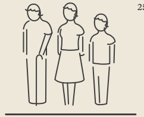

AGE (%)

| ÉDUCATION (%) | Enseignement | Percentage (%) |
| --- | --- | --- |
| Non-Scolarisé | Professionel et Supérieur | 47 |
| Enseignement Secondaire | Secular, Précolaire et Primaire | 26 |
| Enseignement Secronaire | Secular, Précolaire et Primaire | 7 |

| Category | Percentage |
| --- | --- |
| Téléphone portable de base | 33% |
| Smartphone | 35% |
| Adresse électronique / adresse E-mail | 12% |
| Ordinateur fixe / portable | 7% |
| Ligne fixe | 1% |
| Possédé |   |
| Utilisé | 7% |

## OUTILS / CANAUX DE COMMUNICATION (%)

Comme prévu, le téléphone mobile est le périphérique de communication le plus utilisé.

Environ 58% des adultes ont accès à un téléphone portable.

<!-- page 8 -->

## COMPRENDRE LA VIE DES INDIVIDUS

Accès aux services de base

2018

| Category | Value (%) |
| --- | --- |
| Eau collective par canalisation | 10 |
| Source non protégée | 10 |
| Détaillant d'eau portable | 9 |
| Eau portable individuelle (DINEPA) | 8 |
| Forage / Puits avec pompe | 9 |
| Citerne / Réservoir d'eau | 8 |

| Category | Value (%) |
| --- | --- |
| Utilisation de latrine | 4 |
| Installation d'une fosse septique | 1 |
| Pas de toilettes / brousse / champs | 1 |
| Matrines à fosse sans dalle / Trou ouvert | 1 |
| MÉNAGES AYANT ACCÈS AUX INSTALLATIONS SANITAIRES | 1 |

<!-- page 9 -->

Accès aux services de base

# MÉNAGES AYANT UNE SOURCE D'ÉNERGIE (%)

| Category | Percentage | Number of Solicitors |
| --- | --- | --- |
| TOTAL | 40% | 16 |
| Connexion illégale | 45% | 12 |
| Connexion individuelle | 35% | 6 |
| EDH/connexion collective | 16% | 2 |
| Autres sources | 4% | 1 |
| Panneau solaire | 1% | 1 |

<!-- page 10 -->

## COMPRENDRE LA VIE DES INDIVIDUS

## Agriculture

| Category | Value |
| --- | --- |
| Marché public | 100% |
| Agent intermédiaire / courtier | 15% |
| Directement aux consommateurs | 6% |
| Détaillant | 6% |
| Organisation agricole / coopérative / agence gouvernementale | 1% |

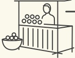

COMMERCIALISATION DES PRODUITS (%)

36% des adultes vivent dans des ménages impliqués dans l'agriculture.

Répartition par département: Grand Anse (75%), Nippes (64%), Sud (61%), Centre (54%).

Environ 20% de ces ménages pratiquent l'agriculture de subsistance et 80% consomment et vendent à la fois leur produits.

| Category | Percentage |
| --- | --- |
| Manque de semence | 44% |
| Problème d'eau | 39% |
| Risques climatiques (sécheresse, inondations, etc.) | 36% |
| Manque de financement | 34% |
| Pas assez de terres cultivables | 25% |
| Manque de pesticide | 23% |
| Manque d'engrais | 23% |
| Maladies du bétail | 22% |
| Manque d'outils / matériels agricole | 22% |
| Maladies végétales | 20% |
| Produits périmés / avariés | 11% |
| Accès difficile aux marchés | 8% |

## CONTRAINTES AGRICOLES (%)

<!-- page 11 -->

Accès à la documentation et au logement

| facture | % |
| --- | --- |
| Acte de Naissance | 94 |
| Carte d'Identification (CIN) | 73 |
| Matricule Fiscale (NIF) | 24 |
| Passesport | 16 |
| Titre de Propriété | 14 |
| Licence / Permis de Conduire | 9 |
| Facture Eau & Electricité | 5 |
| Preuve de Revenus | 1 |

| Category | Percentage (%) |
| --- | --- |
| Propriétaire du logement | 47 |
| Locataire | 25 |
| Habitation avec propriétaire occupant | 9 |
| Copropriétaire | 9 |
| Logement à titre gratuit | 6 |

<!-- page 12 -->

## CAPACITÉ FINANCIÈRE

Gestion de l'argent

| Category | Value (%) |
| --- | --- |
| Jamais | 20 |
| Planification et suivi - Combien de fois êtes-vous à court d'argent pour acheter des produits de première nécessité (%) | **25**Toujours 33Souvent |
| Les voisins peuvent compter sur vous en cas de difficultés |   |
| Leis liens avec les voisins ne sont plus aussi forts qu'avant | 48 |
| Les amis ou voisins peuvent compter sur vous en cas de difficultés |   |
| La possibilité de compter sur l'Église ou groupe religieux en cas de difficultés | 36 |
| Dépenses imprévues ou autres besoins essentiels | 8 |
| Raison CETTE | 8013 |
| Pas assez de revenu | 7122 |
| Paiement de frais de scolarité | 2413 |
| Achat de médicaments / Soins de santé | 7 |
| DE FONDS (%) | **80****13****22****7** |

COMMENT FAITES-VOUS FACE AUX OBLIGATIONS FINANCIÈRES EN CAS DE DIFFCULTÉS? (%)

<!-- page 13 -->

Gestion d'argent et Recherche de conseils financiers

| Category | Value (%) |
| --- | --- |
| Avez-Vous LE CONTRÔLE DE VOS DÉPENSES? |   |
| Contrôlé total | 44 |
| Aucun contrôle Ne sait pas | 35 |
| Controle avec d'autres | 11 |
| AVEZ-VOUS | 10 |

| Né va nulle part pour des conseils | 32% |
| --- | --- |
| S'adresse à un membre de la communauté | 10% |
| S'adresse à un membre de la famille ou à un ami | 8% |
| S'adresse aux personnes âgées de la communauté | 7% |
| S'adresse à l'époux/ épouse - partenaire | 5% |
| S'adresse à la banque ou professionnel financier | 2% |
| Autres sources | 1% |
| S'adresse à un collègue ou employeur | 1% |

<!-- page 14 -->

## CAPACITÉ FINANCIÈRE

## Accès aux informations financières

Environ 53% des adultes estiment avoir besoin de plus d'informations sur leurs finances personnelles

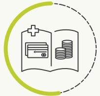

| Category | Value (%) |
| --- | --- |
| Comment épargner | 51 |
| Comment investir | 50 |
| Comment budgétiser | 37 |
| Comment obtenir un prêt | 27 |
| Avantages ou inconvénients, modalités et conditions des produits financiers | 13 |
| Quels produits financiers sont disponibles | 13 |
| Comment utiliser un produit financier | 12 |
| Comment choisir un produit financier | 12 |

EDUCATION FINANCIÈRE

SOUHAITÉE (%)

<!-- page 15 -->

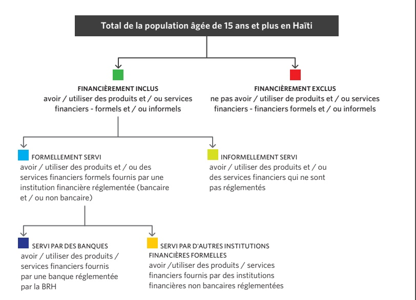

<!-- page 16 -->

## DÉFINITION DE L'INCLUSION FINANCIÈRE

'Institution formelle' est une catégorie comprenant les produits ou services réglementés ou supervisés par une institution formelle ou tout autre organisme / Agence formel de réglementation. Ceci est également synonyme de 'autre formel' ou 'autre institution (non-bancaire)' et doit être différencié des bancarisés qui sont principalement liés aux banques commerciales et de développement.

| Category | Value |
| --- | --- |
| Bancarisé only | 1.3% |
| Autre formel (non bancaire) only | 26.4% |
| Informel only | 10.4% |
| Exclus only | 46% |
| Informel only | 6.4% |
| Bancarisé and Informel | 7.5% |
| Exclus and Informel | 1.6% |
| Autre formel and Informel | 6.4% |

Remarque: En raison du nombre de personnes qui utilisent les services des institutions financières bancaires et non bancaires, la population «exclus» est de 46%.

## Chevauchements

“Les consommateurs utilisent généralement une combinaison de produits et services financiers pour répondre à leurs besoins financiers”

• 1% des adultes utilisent exclusivement des services bancaires, et 26% utilisent exclusivement d'autres mécanismes formels.

• 16% utilisent une combinaison de mécanismes bancaires et / ou d'autres mécanismes formels et / ou informels pour gérer leurs besoins financiers, indiquant ainsi que leurs besoins ne sont pas entièrement satisfaits par le seul secteur formel.

• 10% de la population adulte s'appuie uniquement sur des mécanismes informels tels que des groupes d'épargne informels et des groupes de crédit pour économiser ou emprunter de l'argent ou pour couvrir des risques.

<!-- page 17 -->

| Category | Value |
| --- | --- |
| Formellement servi | 44% |
| Bancarisé | 11% |
| Autre Formel (non-bancaire) | 42% |
| Informel | 19% |
| Exclus | 46% |

En considérant la population âgées de 18 ans et plus, la population à utiliser les services des banques uniquement est 11.5%.

Volet d'Accès financier en 2018

| Category | Percentage |
| --- | --- |
| Bancarisé | 11% |
| Autre formelle (non-banque) | 33% |
| Informel seulement | 10% |
| Exclu | 46% |

<!-- page 18 -->

<!-- page 19 -->

| Categorie | Rancarisé | Autre formel | Informel | Exclus |
| --- | --- | --- | --- | --- |
| 20% | 4% | 16% | 60% |   |
| 12% | 24% | 12% | 52% | Mozambique 2014 |
| 27% | 7% | 15% | 51% | RDC 2014 |
| 11% | 33% | 10% | 46% | Malawi 2014 |
| 38% | 10% | 10% | 42% | Haiti 2018 |
| 25% | 13% | 21% | 41% | Nigéria 2016 |
| 12% | 17% | 30% | 41% | Zambia 2015 |
| 18% | 27% | 15% | 40% | Madagascar 2016 |
| 18% | 22% | 21% | 39% | Togo 2016 |
| 10% | 39% | 15% | 36% | Burkina Faso 2016 |
| 25% | 23% | 22% | 30% | Cameroun 2017 |
| 13% | 54% | 52% | 7% | Myanmar 2018 |
| 36% | 11% | 10% | 9% | Tanzania 2017 |
| 50% | 39% | 18% | 8% | Eswatini 2014 |
| 30% | 68% | 39% | 8% | Laos 2014 |
| 22% | 36% | 20% | 23% | Botswana 2014 |
| 40% | 21% | 21% | 18% | Zimbabwe 2014 |
| 44% | 39% | 6% | 11% | Namibia 2017 |
| 26% | 42% | 21% | 11% | OUganda 2017 |
| 85% | 80% | 3% | 2% | Nepal 2014 |
| 94% | 10% | 1% | 2% | Kenya 2019 |
| 9% | 10% | 1% | 2% | Rwanda 2016 |
| 8% | 5% | 5% | 22% | Ile Maurice 2014 |

<!-- page 20 -->

Volet d'accès financier en 2018

| Category | Bancarisé | Autre formelle (non-banque) | Informel (seulement) | Exclu |
| --- | --- | --- | --- | --- |
| Urban | 12% | 36% | 8% | 44% |
| Rural | 4% | 21% | 18% | 57% |
| Femme | 9% | 34% | 11% | 47% |
| Homme | 12% | 32% | 11% | 45% |
| Ans | 9% | 37% | 9% | 45% |
| Ans et plus | 12% | 28% | 13% | 47% |

<!-- page 21 -->

Volet d'accès financier en 2018

|   | Bancarisé | Autre formelle (non-banque) | Informel | Exclu |
| --- | --- | --- | --- | --- |
| Total | **11%** | **33%** | **10%** | **46%** |
| Aire | 17% | 41% | 6% | 36% |
| Metropolitaine | 15% | 34% | 11% | 40% |
| Reste | 15% | 34% | 11% | 40% |
| Department | **8%** | **31%** | **21%** | **40%** |
| Ouest | 8% | 31% | 21% | 40% |
| Sud-Est | 8% | 32% | 15% | 45% |
| Nippes | 8% | 29% | 17% | 46% |
| Sud | 8% | 31% | 14% | 47% |
| Artibonite | 7% | 33% | 9% | 51% |
| Nord | 10% | 30% | 5% | 55% |
| Nord-Est | 9% | 22% | 12% | 57% |
| Grand'Anse | 5% | 26% | 9% | 60% |
| Nord-Ouest | 4% | 21% | 8% | 67% |
| Centre |   |   |   |   |

<!-- page 22 -->

Quels produits et services sont les moteurs des banques?

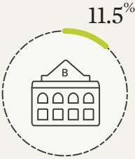

Environ 11.5% des adultes Haitiens ont un compte bancaire.

|   | Carte de débit / Carte ATM | Les Services Financiers QU'UTILISENT LES ADULTES QUI ONT UN COMPTE EN BANQUE (%) |
| --- | --- | --- |
| Compte-Courant / Compte-Chèques | 23% | 20% |
| Livrets d'épargne / épargne à vue | 20% | 3% |
| Prêt commercial | 3% | 2% |
| Prêt personnel | 2% | 1% |

D'autres produits non présentés dans ce tableau ont 1% ou moins

<!-- page 23 -->

Moteurs et barrières - Utilisation des produits et services bancaires

11% des adultes sont bancarisés en 2018

| Àdultes sont pas bancarisés en 2018 (%) | Number de adults en 2018 | Pre-expos de l'adult et en 2018 (%) | Pre-expos de la Adults en 2018 (%) |
| --- | --- | --- | --- |
| Pour épargner | 60% | 16% | 15% |
| Pour garder de l'argent en sécurité | 34% | 3% | 2% |
| Pour recevoir un salaire ou une rémunération | 19% | 16% | 13% |
| Autres raisons | 89% | 4% | 3% |
| Pour avoir un crédit ou un prêt | 34% | 3% | 2% |
| Pour effectuer des paiements ou recevoir de l'argent | 89% | 28% | 13% |
| Je ne travaille pas | 89% | 4% | 3% |
| Je n'ai pas de revenu régulier | 89% | 28% | 13% |
| Je n'ai pas d'argent à épargner | 89% | 19% | 14% |
| Je me méfie des banques | 89% | 7% | 5% |
| Je n'en ai pas besoin | 89% | 4% | 3% |
| La banque est trop loin ou le transport est trop coûteux | 89% | 4% | 3% |
| Autres raisons | 89% | 4% | 3% |
| Je ne comprends pas le système bancaire | 89% | 3% | 2% |
| Je n'ai pas les documents requis | 89% | 3% | 2% |
| Je ne sais pas comment ouvrir un compte en banque | 89% | 1% | 1% |

<!-- page 24 -->

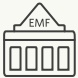

# Utilisateurs des Institutions de Microfinance

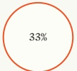

Aire Metropolitaine

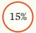

○6%

Artibonite

Reste département

Ouest

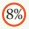

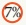

Sud

○5%

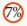

Grand'Anse

Nord

○5%

Nippes

Nord-Est

○ 4% Centre

Sud-Est

3%

Nord-Ouest

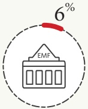

Environ 6% des adultes

Haïtiens utilisent

actuellement des

institutions de microfinance.

REGIONS (%)

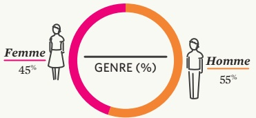

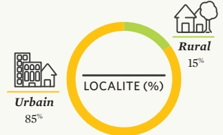

| Age (%) | Moins de 18 ans | Plus de 60 ans |
| --- | --- | --- |
| 18 à 24 ans | 4% | 4% |
| 25 à 34 ans | 4% | 5% |
| 35 à 44 ans | 4% | 10% |
| 45 à 60 ans | 5% | 15% |
| 60 ans | 19% | 27% |

<!-- page 25 -->

Comment les Haïtiens épargnent et investissent-ils?

Épargne et investissements (%)

| Épargne | Autre formelle (non-banque) | Percentage (%) |
| --- | --- | --- |
| N'épargne pas | 0 | 73 |
| Informel | 0 | 14 |
| Bancarisé | 0 | 8 |
| Épargne formelle | 0 | 11 |

| Category | Bancarisé | Autre formelle (non-banque) | Informel | Épargne à la maison | N'épargne pas | Total |
| --- | --- | --- | --- | --- | --- | --- |
| Total | 8% | 2% | 12% | 5% | 73% | 73% |
| Sud-Est | 5% | 5% | 26% | 7% | 57% | 62% |
| Sud | 7% | 2% | 24% | 5% | 62% | 62% |
| Nippes | 7% | 2% | 19% | 6% | 66% | 66% |
| Artibonite | 5% | 2% | 17% | 6% | 70% | 70% |
| Reste département Ouest | 15% | 2% | 10% | 3% | 70% | 70% |
| Aire | 13% | 4% | 7% | 4% | 72% | 72% |
| Metropolitaine | 9% | 2% | 8% | 8% | 73% | 73% |
| Grand'Anse | 8% | 1% | 6% | 5% | 80% | 80% |
| Nord-Est | 5% | 12% | 3% | 3% | 80% | 80% |
| Nord-Ouest | 5% | 1% | 10% | 3% | 81% | 81% |
| Nord | 4% | 1% | 8% | 5% | 83% | 83% |
| Centre | 4% | 1% | 8% | 5% | 83% | 83% |

<!-- page 26 -->

Épargne et investissements (%)

- Inclut uniquement les instruments d'épargne et d'investissement monétaires (%)

| Erpargne selon le sexe, l'âge et le lieu | Urban | Rural |
| --- | --- | --- |
| Femme | 7% | 71% |
| Homme | 10% | 14% |
| Ans et plus | 7% | 15% |
| 35 ans et plus | 10% | 14% |

<!-- page 27 -->

| Etuiement | Bancarisé (%) | Autre formelle (%) | Informel (%) | Famille et amis (%) | N'emprunte plus (%) |
| --- | --- | --- | --- | --- | --- |
| Crédit | 4 | 1 | 3 | 0 | 0 |
| Bancarisé | 0 | 1 | 0 | 0 | 0 |
| Autre formel (non bancaire) | 0 | 3 | 0 | 0 | 0 |
| Informel | 0 | 5 | 0 | 0 | 0 |
| Emprunt auprès de la famille / ami | 0 | 5 | 0 | 0 | 5 |
| N'emprunte pas | 0 | 0 | 0 | 87 | 0 |

<!-- page 28 -->

| Age | Bancarisé | Autre formelle (non-banque) | Informel | Emprunt auprès de la famille/ami | N'emprunte pas |
| --- | --- | --- | --- | --- | --- |
| 15-34 ans | 2% | 4% | 5% | 0% | 0% |
| 35 ans et plus | 2% | 3% | 6% | 0% | 5% |
| 1-3岁 | 0% | 0% | 0% | 1% | 0% |
| 2-5岁 | 0% | 0% | 0% | 0% | 0% |
| 6-8岁 | 0% | 0% | 0% | 0% | 0% |
| 8-10岁 | 0% | 0% | 0% | 0% | 0% |
| 11-12岁 | 0% | 0% | 0% | 0% | 0% |
| 13-15岁 | 0% | 0% | 0% | 0% | 0% |
| 16-18岁 | 0% | 0% | 0% | 0% | 0% |
| 19岁及以上 | 0% | 0% | 0% | 0% | 0% |

<!-- page 29 -->

Moteurs et barrières à

l'accès au crédit

13% ont des produits d'emprunt / crédit

| Démarrer ou étendre mes affaires ou les activités d'entreprise du ménage | 21% |
| --- | --- |
| Frais de subsistance lorsque vous ne disposez pas d'argent | 10% |
| Situation d'urgence autre que médicale | 10% |
| Dépenses médicales - cas d'urgence ou planifié | 9% |
| Achat d'intrants agricole comme les engrais | 5% |
| Achat ou construction de logements pour habitation | 1% |

87% n'empruntent pas

| N'a pas de revenu régulier | 11% |
| --- | --- |
| N'en a pas besoin | 8% |
| Ne peux pas se le permettre | 8% |
| N'y a avoir jamais penser | 6% |
| Les taux d'intérêt sont trop élevés | 6% |
| N'a pas de pièce d'identité | 5% |
| Autres raisons | 4% |

<!-- page 30 -->

Comment les Haïtiens gèrent-ils le risque?

| Category | Value (%) |
| --- | --- |
| Assuré | 4 |
| Autre formel (non bancaire) | 4 |
| Informel | 0 |
| Non assuré | 96 |

Volet assurance

| Category | Value |
| --- | --- |
| Formellement employé - Gouvernement | 52% |
| Formellement employé - privé | 77% |
| Informellement employé | 93% |
| Travaileur indépendant | 97% |
| Dépendant de Transfert | 98% |
| Pèche et Agriculture | 99% |

<!-- page 31 -->

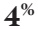

des adultes ont une assurance

Assurance et gestion des risques

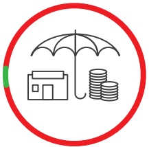

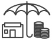

## 96 %

des adultes n'ont aucun type de produit financier couvrant le risque

| Type of produit | Percentage (%) |
| --- | --- |
| Assurance maladie ou médicale | 53 |
| Assurance vie | 23 |
| Assurance véhicule ou moto | 20 |
| Fonds de pension | 13 |
| Assurance accident | 9 |
| Assurance logement | 1 |

Les principaux obstacles à l'adoption d'un produit d'assurance:

| N'a pas assez de connaissance sur les produits d'assurance | Valoré |
| --- | --- |
| N'a pas de revenu ni d'emploi régulier | 44% |
| Ne comprends pas le fonctionnement l'assurance | 10% |
| Ne crois pas aux produits d'assurance | 9% |
| N'a pas besoin d'assurance | 8% |

 $ P\alpha^{**} $

n'ont pas entendu parler

de l'assurance vie

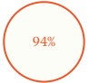

n'ont pas entendu parler de l'assurance éducation

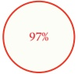

n'ont pas entendu parler de l'assurance dommages matériels

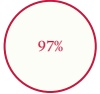

n'ont pas entendu parler

de l'assurance contre les

risques agricoles

<!-- page 32 -->

Aperçu de ceux qui déclarent avoir transféré de l'argent au cours des 12 derniers mois

| Category | Value |
| --- | --- |
| Transfert d'argent formel | 27% |
| Bancarisé | 1% |
| Autre formel (non bancaire) | 26% |
| Informel | 2% |
| Transfert d'argent via famille/amis | 12% |
| Pas de transfert d'argent | 61% |

Paysage du transfert de fonds

| Category | Value (%) |
| --- | --- |
| 1 | 26 |
| 2 | 2 |
| 3 | 10 |
| 4 | 61 |
| 5 | 28 |
| 6 | 28 |
| 7 | 28 |
| 8 | 28 |
| 9 | 28 |
| 10 | 28 |
| 11 | 28 |
| 12 | 28 |
| 13 | 28 |
| 14 | 28 |
| 15 | 28 |
| 16 | 28 |
| 17 | 28 |
| 18 | 28 |
| 19 | 28 |
| 20 | 28 |
| 21 | 28 |
| 22 | 28 |
| 23 | 28 |
| 24 | 28 |
| 25 | 28 |
| 26 | 28 |
| 27 | 28 |
| 28 | 28 |
| 29 | 28 |
| 30 | 28 |
| 31 | 28 |
| 32 | 28 |
| 33 | 28 |
| 34 | 28 |
| 35 | 28 |
| 36 | 28 |
| 37 | 28 |
| 38 | 28 |
| 39 | 28 |
| 40 | 28 |
| 41 | 28 |
| 42 | 28 |
| 43 | 28 |
| 44 | 28 |
| 45 | 28 |
| 46 | 28 |
| 47 | 28 |
| 48 | 28 |
| 49 | 28 |
| 50 | 28 |
| 51 | 28 |
| 52 | 28 |
| 53 | 28 |
| 54 | 28 |
| 55 | 28 |
| 56 | 28 |
| 57 | 28 |
| 58 | 28 |
| 59 | 28 |
| 60 | 28 |
| 61 | 28 |
| 62 | 28 |
| 63 | 28 |
| 64 | 28 |
| 65 | 28 |
| 66 | 28 |
| 67 | 28 |
| 68 | 28 |
| 69 | 28 |
| 70 | 28 |
| 71 | 28 |
| 72 | 28 |
| 73 | 28 |
| 74 | 28 |
| 75 | 28 |
| 76 | 28 |
| 77 | 28 |
| 78 | 28 |
| 79 | 28 |
| 80 | 28 |
| 81 | 28 |
| 82 | 28 |
| 83 | 28 |
| 84 | 28 |
| 85 | 28 |
| 86 | 28 |
| 87 | 28 |
| 88 | 28 |
| 89 | 28 |
| 90 | 28 |
| 91 | 28 |
| 92 | 28 |
| 93 | 28 |
| 94 | 28 |
| 95 | 28 |
| 96 | 28 |
| 97 | 28 |
| 98 | 28 |
| 99 | 28 |
| 100 | 28 |

<!-- page 33 -->

|   | Auto formelle | Informed | Transfert | Rede transport |
| --- | --- | --- | --- | --- |
| Aire Metropolitaine | 36% | 10% | 52% | 0% |
| Reste département | 29% | 8% | 60% | 0% |
| Ouest | 23% | 14% | 61% | 0% |
| Sud | 25% | 9% | 62% | 0% |
| Artibonite | 28% | 8% | 63% | 0% |
| Nippes | 20% | 15% | 63% | 0% |
| Sud-Est | 22% | 7% | 69% | 0% |
| Nord | 21% | 9% | 69% | 0% |
| Nord-Ouest | 14% | 12% | 70% | 0% |
| Grand-Anse | 19% | 6% | 73% | 0% |
| Nord-Est | 11% | 12% | 75% | 0% |
| Centre | 2% | 0% | 0% | 0% |

<!-- page 34 -->

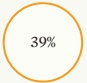

| 39% | 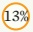 |  |  | ☑ 7% | ☑ 6% |
| --- | --- | --- | --- | --- | --- |
| Aire Metropolitaine | Artibonite | Nord | Ouest | Sud | Sud-Est |
| ☑ 4% | ☑ 4% | ☑ 3% | ☑ 3% | ☑ 3% |   |
| GrandAnse | Centre | Nord-Ouest | Nord-Est | Nippes |   |

## RÉGIONS (%)

| Category | ÂGE (%) |
| --- | --- |
| Moins de 18 ans | 6 |
| 18-24 ans | 6 |
| 25-34 ans | 12 |
| 35-44 ans | 19 |
| 45-60 ans | 5 |
| Plus de 60 ans | 34 |

Environ 23% des adultes sont des enregistrés comme des utilisateurs de portefeuille électronique.

| Category | Value |
| --- | --- |
| Femme | 48% |
| Homme | 52% |
| Urbain | 91% |
| LIEU | 96% |
| Rural | 9% |

<!-- page 35 -->

Portefeuille téléphonique

| Category | Percentage | Utilisent Les Services DE PORTEFUILLE ÉLECTRONIQUE |
| --- | --- | --- |
| C'est le plus pratique (prend moins de temps) | 49% |   |
| Ne coûte pas cher | 45% |   |
| Unique option dans la communauté | 18% |   |
| Inspire confiance | 11% |   |
| Permet d'économiser de l'argent | 4% |   |

| Pays d'conseau | Téléphone㎡ (%) | N'utilisent pas LES SERVICES DE PORTEFEUILLE TÉLÉPHONIQUE (%) |
| --- | --- | --- |
| Pas assez d'information à ce sujet | 23 |   |
| Pas d'argent à envoyer ou à recevoir | 13 |   |
| N'y ont pas pensé | 12 |   |
| Pas de téléphone portable | 10 |   |
| Non intéressé au portefeuille électronique | 10 |   |
| Pas de carte "SIM" | 6 |   |
| Ne fait pas confiance aux entreprises de télécommunication | 6 |   |
| Pas de fournisseurs de services de portefeuille électronique dans ma région | 4 | 77% |
| Pas d'accès à un téléphone mobile / pas de couverture réseau | 3 | 77% |
| C'est compliqué | 3 |   |

<!-- page 36 -->

## INCLUSION FINANCIÈRE

## Paysage d'accès des produits et services financiers

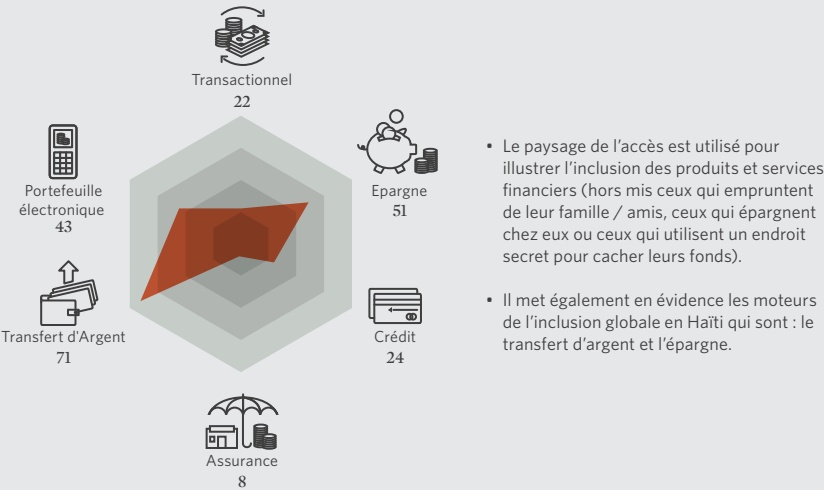

• Le paysage de l'accès est utilisé pour illustrer l'inclusion des produits et services financiers (hors mis ceux qui empruntent de leur famille / amis, ceux qui épargnent chez eux ou ceux qui utilisent un endroit secret pour cacher leurs fonds).

• Il met également en évidence les moteurs de l'inclusion globale en Haïti qui sont : le transfert d'argent et l'épargne.

<!-- page 37 -->

L'étude FinScope Haïti 2018 a révélé la manière dont les Haïtiens âgés de 15 ans et plus, gèrent leurs finances et les éléments qui influencent leur accès aux services financiers. L'étude a également identifié le rôle des secteurs financiers formels et informels dans l'environnement financier d'Haïti.

De cette étude, les conclusions suivantes sont tirées :

1. Près de 54% de la population de 15 ans et plus ont accès aux services financiers. Cependant, il existe des disparités et des leviers qui devraient permettre une inclusion plus large de la population. Il résulte que :

• 44% des adultes de 15 ans et plus sont servis formellement, incluant les banques et autres produits et services formels non bancaires;

• 11% des adultes de 15 ans et plus sont servis uniquement par des banques;

• 42% des adultes de 15 ans et plus utilisent d'autres produits et services formels non bancaires;

2. Le crédit formel (4%) n'est pas très répandu en Haïti. Près de 5% des adultes Haïtiens ont recours à des prestataires informels, dont environ 5% utilisent des prêts de leur famille et de leurs amis.

• 19% des adultes de 15 ans et plus utilisent des mécanismes non formels uniquement pour gérer leurs finances ; et

• 46% des adultes de 15 ans et plus sont exclus financièrement.

3. L'éducation des consommateurs et la culture financière sont de véritables problèmes en Haïti - principalement dans le domaine des assurances, où la plupart des adultes ne sont pas financièrement bien renseignés. En outre;

• Environ 53% des adultes de 15 ans et plus ont indiqué un besoin pour l'éducation financière, cherchant principalement à obtenir des informations sur la manière d'épargner et sur les avantages des véhicules d'investissement financier;

• En outre, 45% des adultes de 15 ans et plus ne demandent pas de conseils financiers, et sont victime de manque d'information.

<!-- page 38 -->

## RECOMMANDATIONS

### 1. Mettre en oeuvre une enquête FinScope sur les petites entreprises

• Un nombre important d'adultes sont des travailleurs indépendants et la majorité d'entre eux sont exclus. Il faudrait pour cela, expliquer aux propriétaires comment les entreprises peuvent utiliser l'accès aux services financiers pour développer et étendre leurs activités, ce qui entrainera un impact et des perspectives de croissance économique plus importants en Haïti. Cette enquête aide à mieux comprendre la chaîne de valeur des entreprises et les besoins financiers des propriétaires d'entreprise afin de mieux les servir.

Pour plus de détails visitez la page de FinMark Trust à l'adresse suivante:

https://finmark.org.za/_programme/data-for-financial-markets/finscope/finscope-msme/

### 2. Éducation du consommateur / programmes d'éducation

• Afin de créer une meilleure proposition de valeur pour l'inclusion financière, les adultes haïtiens doivent comprendre les avantages de l'utilisation de services financiers appropriés.

• Les résultats montrent que les obstacles à l'inclusion financière sont principalement liés au manque de sensibilisation financière.

<!-- page 39 -->

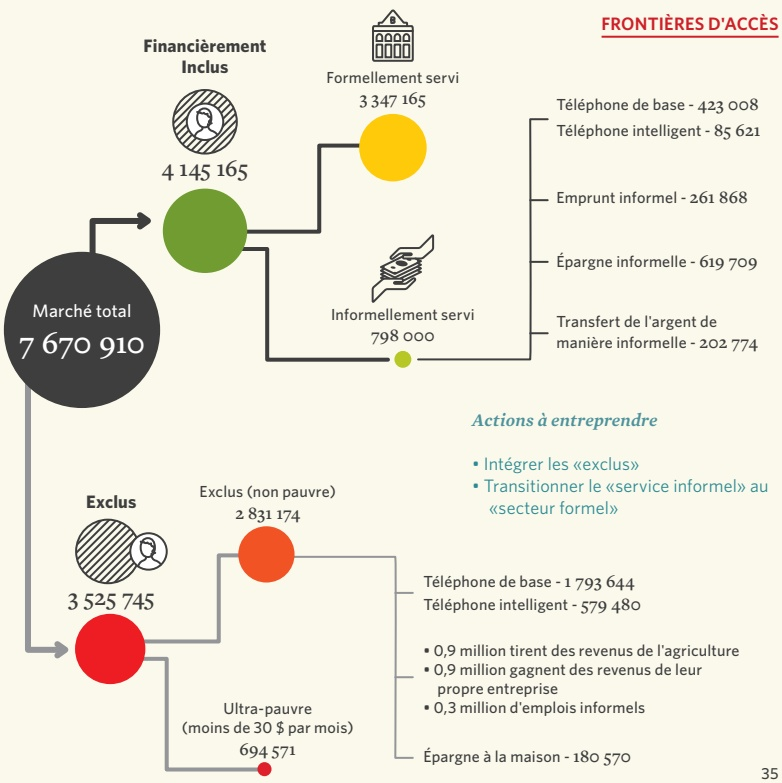

<!-- page 40 -->

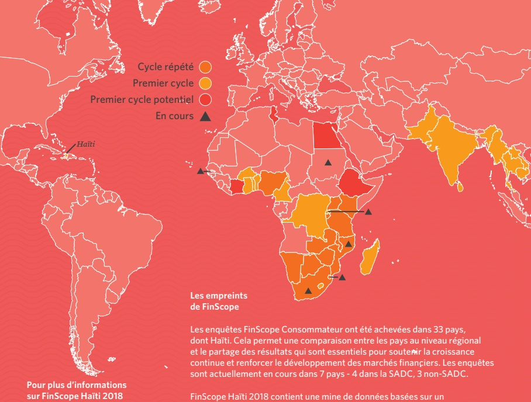

Pour plus d'informations sur FinScope Haïti 2018 veuillez contacter:

## Les empreints de FinScope

Les enquêtes FinScope Consommateur ont été achevées dans 33 pays, dont Haïti. Cela permet une comparaison entre les pays au niveau régional et le partage des résultats qui sont essentiels pour souteir la croissance continue et renforcer le développement des marchés financiers. Les enquêtes sont actuellement en cours dans 7 pays - 4 dans la SADC, 3 non-SADC.

FinScope Haïti 2018 contient une mine de données basées sur un échantillon national représentatif de la population adulte d'Haïti.
