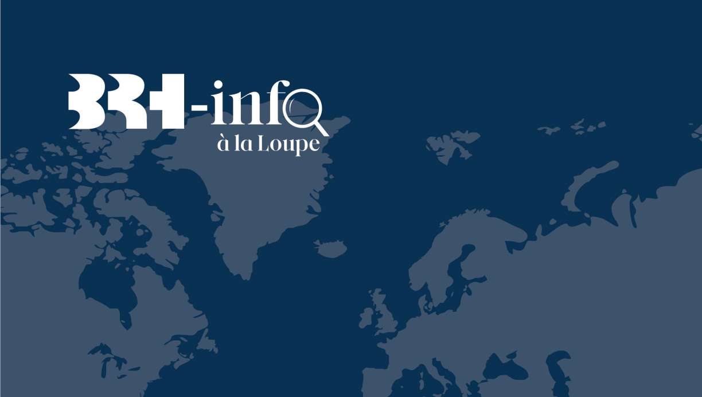
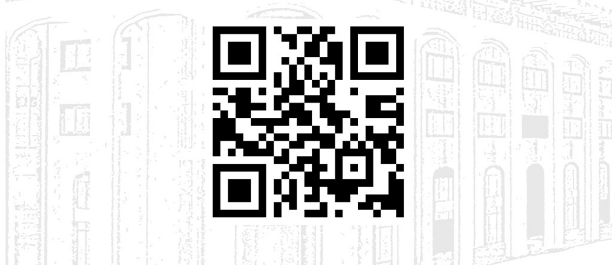

<!-- page 1 -->

# LES TRANSFERTS SANS CONTREPARTIE :

TENDANCE, DISTRIBUTION ET DYNAMIQUE DU MARCHÉ

## AVRIL 2024

<!-- page 2 -->

<!-- page 3 -->

## OBJECTIFS

La Banque de la République d'Haïti (BRH) invite le public en général, les professionnels de l'information, les étudiants et les décideurs en particulier à découvrir sa nouvelle publication, intitulée « BRH-Infos à la loupe » visant à faciliter une meilleure compréhension de l'impact des crises et des décisions liées à la réglementation relative aux secteurs de l'économie.

Cette publication est présentée suivant un format allégé, clair et accessible. Les objectifs poursuivis sont d'informer le public afin de parvenir à une plus grande vulgarisation des informations économiques et financières, d'analyser les tendances et les opportunités et de suivre les progrès et l'évaluation des politiques.

L'approche méthodologique adoptée consiste à relever les informations pertinentes à collecter, déterminer la méthode de collecte y relative, ensuite analyser ces informations eu égard aux objectifs poursuivis.

En fournissant des données actualisées sur l'évolution des indicateurs relatifs à la conjoncture actuelle, BRH-Infos à la loupe permettra de renforcer la compréhension collective des enjeux économiques du pays. Cette édition, « Les transferts sans contrepartie : tendance, distribution et dynamique du marché », constitue la première d'une série. La BRH souhaite vivement que les informations présentées parviennent à réduire l'asymétrie d'information, favorisant ainsi la formation d'anticipations rationnellement fondées sur des données vérifiables.

<!-- page 4 -->

## SOMMAIRE

Objectifs de la publication..... PAGE 3
Sigles & Abréviations ..... PAGE 5
Introduction ..... PAGE 6
Marché des transferts : tendance et distribution ..... PAGE 8
1. Evolution des transferts reçus et expédiés ..... PAGE 9
2. Distribution géographique des transferts reçus et expédiés ..... PAGE 11
Dynamique du marché des transferts ..... PAGE 14
Conclusion et Perspectives ..... PAGE 20

<!-- page 5 -->

# SIGLES ET ABRÉVIATIONS

BNC Banque Nationale de Crédit

BRH Banque de la République d'Haïti

BUH Banque de l'Union Haïtienne

DAI Direction des Affaires Internationales

DSBIF Direction de la Supervision des Banques et des Institutions Financières

EU Etats-Unis

IHSI Institut Haïtien de Statistique et d'Informatique

MD Millions de dollars américains

PIB Produit Intérieur Brut

<!-- page 6 -->

## INTRODUCTION

<!-- page 7 -->

Depuis plusieurs décennies, les transferts sans contrepartie, évalués aujourd'hui à environ 20% du Produit Intérieur Brut (PIB) d'Haïti, constituent un apport économique considérable pour le pays. Il convient de souligner que les membres de la diaspora, notamment ceux du Chili et du Brésil, ont vraisemblablement contribué à renforcer le poids de cette source de devises. En dépit du ralentissement économique relatif à la COVID qui a affecté les pays d'accueil des haïtiens, ils ont continué à soutenir financièrement leurs proches vivant dans des conditions souvent précaires en Haïti. Toutefois, la dépendance d'une strate considérable de la population aux transferts sans contrepartie reflète la dégradation de la situation économique et sociopolitique du pays observée ces dernières années. Il s'agit d'une contribution économique indispensable pour des dépenses liées à la consommation, l'éducation, le logement et la santé. C'est également la principale source de devises de l'économie haïtienne. Les montants reçus sont supérieurs aux transferts publics, aux flux d'investissements directs et aux exportations. Ces transferts ont connu une croissance importante à partir du début de la décennie 2000. Ils impactent favorablement le solde courant de la balance des paiements en atténuant l'effet du déficit commercial.

Évolution des transferts en MD ÉU

| Year | Value |
| --- | --- |
| 2003 | 800.00 |
| 2004 | 900.00 |
| 2005 | 950.00 |
| 2006 | 1050.00 |
| 2007 | 1150.00 |
| 2008 | 1250.00 |
| 2009 | 1350.00 |
| 2010 | 1400.00 |
| 2011 | 1500.00 |
| 2012 | 1550.00 |
| 2013 | 1650.00 |
| 2014 | 1750.00 |
| 2015 | 2050.00 |
| 2016 | 2150.00 |
| 2017 | 2300.00 |
| 2018 | 2550.00 |
| 2019 | 2600.00 |
| 2020 | 3000.00 |
| 2021 | 3750.00 |
| 2022 | 3550.00 |
| 2023 | 3500.00 |

Source : BRH/DAI

Cette édition, « Les transferts sans contrepartie : tendance, distribution et dynamique du marché » présente l'évolution récente des transferts sans contrepartie transitant par les maisons de transfert au cours des deux derniers exercices fiscaux (2021-2022 et 2022-2023) et les quatre premiers mois de l'exercice en cours, tout en retraçant leur provenance/destination géographique. Elle analyse également la dynamique du marché des transferts au regard des circulaires no 114-3¹ et no 118-1² réglementant ledit marché.

<!-- page 8 -->

## MARCHÉ DES TRANSFERTS : TENDANCE ET DISTRIBUTION

<!-- page 9 -->

### 1. Evolution des transferts reçus et expédiés

Au cours de l'exercice fiscal 2022-2023, les transferts sans contrepartie reçus ont enregistré une baisse d'environ 3,8 % (129,75 millions de dollars américains de moins) par rapport à l'exercice antérieur. Ces flux, chiffrés à 3,28 milliards de dollars américains (contre 3,41 milliards en 2021-2022), ont reculé consécutivement à une relance timide des activités économiques dans les principaux pays pourvoyeurs de transfert. Cette reprise s'est poursuivie et a conduit à une remontée du niveau des transferts pour les quatre premiers mois de l'exercice en cours. Entre octobre 2023 et janvier 2024, il y a eu une accumulation de 1,23 milliard de dollars américains, soit 37,5 % du niveau des transferts reçus en 2022-2023.

À titre de comparaison, les transferts reçus pour les quatre premiers mois de l'exercice précédent s'élèvent à 1,05 milliard de dollars américains et ceux correspondant à la même période de l'exercice 2021-2022, 1,16 milliard de dollars américains. Ceci laisse augurer une tendance croissante pour cette année en considérant l'accélération de la dégradation de la situation socio-économique et politique du pays observée ces derniers mois et la relative bonne tenue des économies d'origine des transferts.

Généralement, un pic saisonnier des transferts est observé en décembre de chaque année, suivi d'une baisse enregistrée en janvier et une reprise en février. Une relative stabilité a été notée pour les autres mois de l'exercice.

Graphique 1

Évolution mensuelle des transferts reçus

|   | Nov. | Dec. | Janv. | Fév. | Mar. | Avr. | Mai | Juin | Jul/ | Aoû | Sep |
| --- | --- | --- | --- | --- | --- | --- | --- | --- | --- | --- | --- |
| Année 2022 | 23800000000 | 36800000000 | 25000000000 | 25500000000 | 30000000000 | 28500000000 | 28000000000 | 27000000000 | 28200000000 | 28500000000 | 31200000000 |
| Année 2023 | 26800000000 | 38500000000 | 25000000000 | 27000000000 | 32800000000 | 32000000000 | 30000000000 | 29000000000 | 28000000000 | 28800000000 | 22000000000 |
| Année 2024 | 31200000000 | 39500000000 | 26500000000 | 26500000000 | 33000000000 | 32000000000 | 30000000000 | 29000000000 | 28200000000 | 28500000000 | 22000000000 |

Source : DSBIF/BRH

<!-- page 10 -->

S'agissant des transferts expédiés, ils ont totalisé un montant de 253,86 millions de dollars américains en 2022-2023, soit un recul de 6,3 % par rapport à l'exercice antérieur. Toutefois, en raison de l'accélération de l'émigration des haïtiens vers les États-Unis dans le cadre des programmes humanitaires, une augmentation substantielle du flux de transferts expédiés est enregistrée pour les quatre premiers mois de l'exercice en cours par rapport à la même période des deux exercices précédents. Entre octobre 2023 et janvier 2024, ces transferts ont atteint 114,25 millions de dollars américains, soit 45 % de plus par rapport au niveau atteint sur l'ensemble de l'exercice 2022-2023. À des fins de comparaison, les transferts expédiés pour les quatre premiers mois de l'exercice 2022-2023 se sont établis à 80,49 millions de dollars américains contre 96,18 millions de dollars américains pour la même période de l'exercice 2021-2022.

Graphique 2 Évolution mensuelle des transferts reçus

| Month | Année 2022 | Année 2023 | Année 2024 |
| --- | --- | --- | --- |
| Oct. | 17000000.00 | 23000000.00 | 30500000.00 |
| Nov. | 19500000.00 | 24000000.00 | 29500000.00 |
| Déc. | 24500000.00 | 28000000.00 | 31500000.00 |
| Janv. | 22500000.00 | 24000000.00 | 26000000.00 |
| Fév. | 22500000.00 | 22500000.00 |   |
| Mar. | 23500000.00 | 24000000.00 |   |
| Avr. | 19500000.00 | 23000000.00 |   |
| Mai | 21500000.00 | 24500000.00 |   |
| Juin | 21500000.00 | 24000000.00 |   |
| Juli | 23000000.00 | 23500000.00 |   |
| Août | 24500000.00 | 24500000.00 |   |
| Sep | 24000000.00 | 15500000.00 |   |

Source : DSBIF/BRH

<!-- page 11 -->

### 2. Distribution géographique des transferts reçus et expédiés

Les opérations de transferts internationaux sont enregistrées dans tous les départements du pays. La distribution des sous-agents des maisons de transferts un peu partout dans le pays a facilité l'accès à ce service dans des zones reculées.

Pour l'exercice fiscal 2021-2022, le département de l'Ouest a reçu 70,3 % des transferts, soit 2,4 milliards de dollars américains, suivi du département de l'Artibonite (301 millions de dollars américains, 8,8 %) et du Nord (195 millions de dollars américains, 5,7%). Pour l'exercice suivant, une tendance similaire a été observée, avec l'Ouest recevant 2,24 milliards de dollars américains de transferts (68,4 %) suivi de l'Artibonite (9,6 %) et du Nord (4,9 %).

Les départements du Nord-Est et de la Grand-Anse ont reçu moins de transferts avec respectivement 1 % et 0,8 % au cours des deux derniers exercices sous-étude.

| Géographique | Exercice 2021-2022 | Exercice 2022-2023 |
| --- | --- | --- |
| Ouest | 2399352807.16 | 2246163260.09 |
| Artibonite | 300994937.75 | 316407666.41 |
| Nord | 194920001.39 | 161874029.18 |
| Sud | 130675223.08 | 148994223.10 |
| Nord-Ouest | 115686247.68 | 96912986.80 |
| Centre | 82705729.62 | 112149757.25 |
| Sud-Est | 75858897.69 | 77387246.10 |
| Nippes | 53852097.62 | 66292699.26 |
| Nord-Est | 33465588.80 | 33886621.83 |
| Grand-Anse | 26381504.83 | 24068970.14 |

Source : DSBIF/BRH

<!-- page 12 -->

Pour les quatre premiers mois de l'exercice 2023-2024, l'Ouest a déjà reçu 757,85 millions de dollars américains de transferts, soit 62 % du total. Les départements de l'Artibonite et du Nord ont suivi respectivement avec 11 % et 6 % des transferts reçus.

| Géographique | Obtreze |
| --- | --- |
| Ouest | 757858047.35 |
| Artibonite | 140133831.51 |
| Nord | 71675261.00 |
| Sud | 67999710.51 |
| Nord-Ouest | 54446445.55 |
| Centre | 43633305.35 |
| Sud-Est | 34717911.60 |
| Nippes | 31025991.12 |
| Nord-Est | 17683855.83 |
| Grand-Anse | 11044182.87 |

Source : DSBIF/BRH

En ce qui concerne les transferts expédiés, ceux-ci proviennent majoritairement du département de l'Ouest, soit 197,01 millions de dollars américains (72,7 %) en 2021-2022 contre 186,5 millions de dollars américains (73,5 %) en 2022-2023, et de l'Artibonite avec 7,1 % en 2021-2022 contre 6,2 % en 2022-2023. Les pourcentages les plus faibles concernent les départementes des Nippes et de la Grand-Anse, lesquels représentent respectivement 1 % et 0,6 % des transferts expédiés au cours des deux derniers exercices.

<!-- page 13 -->

| Géographique | Exercice 2021-2022 | Exercice 2022-2023 |
| --- | --- | --- |
| Ouest | 197014222.19 | 186475887.65 |
| Artibonite | 19222871.12 | 15807853.17 |
| Nord | 17455543.37 | 14551884.82 |
| Sud | 10434104.20 | 10990126.94 |
| Nord-Ouest | 7310388.58 | 8272145.57 |
| Centre | 6406481.63 | 5423913.35 |
| Sud-Est | 5361344.69 | 4495474.96 |
| Nippes | 3347579.81 | 3813441.61 |
| Nord-Est | 2807979.36 | 2557771.32 |
| Grand-Anse | 1543100.83 | 1472199.05 |

Source : DSBIF/BRH

Une corrélation positive est observée entre l'importance des activités de transferts dans les différentes régions et la taille de leur population. En effet, selon l'estimation de la population haïtienne réalisée par l'Institut Haïtien de Statistique et d'Informatique (IHSI) en 2015, les trois départements ayant une plus forte concentration démographique sont l'Ouest (34 %), l'Artibonite (17 %) et le Nord (10 %). Ainsi, comme spécifié précédemment, les données montrent un plus grand niveau de transferts reçus et expédiés dans ces trois (3) départements. Les départements qui ont reçu et expédié le moins de transferts au cours des deux derniers exercices sont ceux ayant le plus faible niveau de population selon les estimations de l'IHSI à savoir la Grand-Anse (5 %), le Nord-Est (4 %) et les Nippes (3 %).

| Estimation (%) | Value (0-100) |
| --- | --- |
| Sud 7% | 10 |
| Sud-est 6% | 5 |
| Grand-anse 4% | 20 |
| Nippes 3% | 3 |
| Ouest 35% | 30 |
| Centre 7% | 15 |
| Artibonite 17% | 10 |
| Nord-est 4% | 5 |
| Nord-ouest 7% | 3 |

Source : IHSI3

<!-- page 14 -->

## DYNAMIQUE DU MARCHÉ DES TRANSFERTS

<!-- page 15 -->

En août 2022, dans l'objectif de renforcer la réglementation des activités de transfert et de change, la BRH a publié les versions révisées des circulaires 118 et 114, soit 118-14 et 114-3. À partir de ces deux révisions, les récipiendaires de transferts peuvent recevoir leurs fonds directement sur leurs comptes bancaires moyennant que le montant reçu n'excède pas mille (1000) dollars américains. De plus, les maisons de transferts sont amenées à exercer un contrôle plus rigoureux des devises reçues en les canalisant vers le secteur formel. Selon cette réglementation, 70 % des dollars provenant des transferts non déposés directement sur des comptes bancaires doivent être versés à une institution financière, alors que les 30 % restants sont retenus par la maison de transferts pour son compte propre et dont une partie est partagée avec ses sous-agents (équivalent de 30 % des transferts payés en gourdes par ces derniers).

Les données collectées en janvier 2024 relatives à la circulaire no 118-1 montrent que sur les transferts reçus, 47,89 millions de dollars américains (18,9 %) ont été payés directement sur comptes de dépôts. La plus forte partie des dollars restants, soit 143,33 millions de dollars américains, a été orientée vers les institutions de change formelles, alors que 8,31 millions ont été retenus par les maisons de transferts pour leurs besoins propres et 53,8 millions versés à leurs sous-agents.

Graphique 7 Distribution des transferts bénéficiés par acteurs

|   | Janvier 2024 | Décembre 2023 |
| --- | --- | --- |
| Transferts payés sur compte en dollar | 47893613.80 | 71264811.33 |
| 70% transferts à remiser aux IF | 143334867.78 | 217531961.97 |
| Montant détenu par l'agent autorisé | 8314339.38 | 14996168.00 |
| Montant versé aux sous agents | 53809028.40 | 79251746.49 |

Source : DSBIF/BRH

<!-- page 16 -->

La réglementation en vigueur crée une nouvelle dynamique entre les acteurs formels impliqués dans les secteurs de transfert et de change. Les devises reçues en transfert sont redistribuées entre ces différents acteurs. Ce mécanisme permet à la BRH de contrôler le respect des normes de change en vigueur sur le marché par les acteurs concernés.

Grâce au renforcement du cadre de régulation, les maisons de transfert sont en relation avec une ou plusieurs institutions financières agréées par la BRH pour leur verser la plus forte partie des devises reçues en transfert. Pour le mois de janvier 2024, la majeure partie des montants à verser ont été alloués à la Sogebank (24,4 %), à la Unibank (25,6 %) et à la Capital Bank (15,4 %). D'autres bureaux de change ont également reçu des devises, parmi lesquels Global Délima Maison de Change S.A qui a bénéficié de 12,5 % des dollars.

Distribution de la remise des 70% des transferts reçus par les maisons de transferts

| Bank | Janvier 2024 (%) | Décembre 2023 (%) |
| --- | --- | --- |
| SOGEBANK | 27.4% | 28.6% |
| UNIBANK | 25.6% | 25.1% |
| CAPITAL BANK | 15.4% | 15.3% |
| GLOBAL DELIMA MAISON DE CHANGES S.A | 12.5% | 13.6% |
| INTERXCHANGE S.A | 5.6% | 3.0% |
| HAITI EXCHANGE BUREAU | 5.1% | 3.5% |
| GENERAL TRADING ASSOCIATES S.A | 4.7% | 6.0% |
| BUH | 3.6% | 4.0% |
| GABEL BUREAU DE CHANGE S.A | 0.2% | 0.6% |
| BNC | 0.0% | 0.4% |

Par ailleurs, au regard des données du tableau 1, la quasi-totalité des maisons de transfert ont versé les devises reçues en transfert à une institution financière unique. En janvier 2024, seulement la CAM Transfer a été en relation avec plus d'une institution (elle en a utilisé 8) avec la majeure partie de ses devises vendues à des bureaux de change dont Global Délima Maison de Change S.A. (31 %), InterXchange S.A. (22 %), Haïti Exchange Bureau (20 %) et General Trading Associates S.A. (18 %).

Source : DSBIF/BRH

<!-- page 17 -->

|   | Sogexpress | CCSA/CAM | Uni Transfer | Capital Transfert | CWT Rapid transfer | BUH MG | UniBank MG | PRISM |
| --- | --- | --- | --- | --- | --- | --- | --- | --- |
| SOGEBANK | 100% | 4% |   |   |   |   |   | 100% |
| UNIBANK |   |   | 100% |   |   |   | 100% |   |
| BNC |   |   |   |   |   |   |   |   |
| CAPITAL BANK |   | 2% |   | 100% |   |   |   |   |
| BUH |   | 2% |   |   |   | 100% |   |   |
| CITIBANK |   |   |   |   |   |   |   |   |
| SOGEBEL |   |   |   |   |   |   |   |   |
| BPH |   |   |   |   |   |   |   |   |
| BRH |   |   |   |   |   |   |   |   |
| General Trading Associate SA |   | 18% |   |   | 100% |   |   |   |
| Global Délima maison de change SA |   | 31% |   |   |   |   |   |   |
| Gabel bureau de change SA |   | 1% |   |   |   |   |   |   |
| Interxchange SA |   | 22% |   |   |   |   |   |   |
| Haiti xchange bureau |   | 20% |   |   |   |   |   |   |

Source : DSBIF/BRH

La circulaire no 114-3 $ ^{e} $ fait injonction aux maisons de transfert de payer les transferts en gourdes sur toute l'étendue du territoire national. Pour qu'un récipiendaire ait accès aux devises transférées, il doit recevoir les fonds directement sur son compte dollar domicilié dans une institution financière de dépôts, moyennant le respect des dispositions de ladite circulaire.

En janvier 2024, la part des transferts payés sur comptes de dépôts est en recul de 32,8 % (23,37 millions de dollars américains), par rapport à décembre 2023. Comme le montre le graphique 10, ces transferts sur comptes qui totalisent 47,89 millions de dollars américains en janvier 2024 ont été payés majoritairement par la Unitransfer (57,37 %), la CAM Transfer (26,64 %) et la SogeXpress (11,51 %).

<!-- page 18 -->

Graphique 9

Distribution des parts de transferts effectués sur compte par les maisons de transferts

|   | Janvier 2024 | Décembre 2023 |
| --- | --- | --- |
| UNITTRANSFER | 57.37% | 57.26% |
| CCSA/CAM | 26.64% | 24.82% |
| SOGEEXPRESS WU | 11.51% | 13.75% |
| BUH MG | 4.43% | 4.12% |
| CWT/RAPID TRANSFE | 0.05% | 0.04% |
| CAPITAL TRANSFERT | 0.00% | 0.00% |
| UNIBANK MG | 0.00% | 0.00% |
| PRISM TRANSFERT | 0.00% | 0.00% |

Source : DSBIF/BRH

Par ailleurs, en ce qui concerne les institutions financières destinataires, la majeure partie des transferts payés sur comptes ont été déposés à la Unibank (57,2 %) et la Sogebank (23,9 %). La Fonkoze a été la seule institution non bancaire à recevoir des fonds à hauteur de 23 655,28 de dollars américains (0,05 %).

Graphique 10 Distribution des parts de transferts reçus sur compte par les institutions financières de dépôts

| Bank | Janvier 2024 (%) | Décembre 2023 (%) |
| --- | --- | --- |
| UNIBANK | 57.2% | 58.5% |
| SOGEBANK | 23.9% | 23.0% |
| BUH | 7.9% | 7.7% |
| BNC | 7.4% | 7.0% |
| CAPITAL BANK | 3.5% | 3.5% |
| FONKOZE | 0.0% | 0.0% |
| BPH | 0.0% | 0.0% |
| SOGEBEL | 0.0% | 0.1% |
| CITI BANK | 0.0% | 0.1% |
| LEVITPP | 0.0% | 0.0% |

Source : DSBIF/BRH

<!-- page 19 -->

Pour ce qui a trait aux rapports entre les institutions financières collectant des dépôts et les maisons de transfert, les interrelations sont guidées en majeure partie par l'affiliation de ces dernières. Ainsi, en janvier 2024, la BUH Moneygram a payé la totalité des transferts sur des comptes domiciliés à la BUH. Dans la même logique, la majeure partie des transferts sur comptes de la Unitransfer ont été orientés vers la Unibank (85,8 %) et ceux de la SogeXpress vers la Sogebank (74,7 %). Toutefois, ce critère n'inclut pas la CAM Transfer qui a payé une plus forte partie de ses transferts sur des comptes domiciliés dans les trois plus grandes banques du secteur : Sogebank (37 %), Banque Nationale de Crédit (27,9 %) et Unibank (20,1 %).

Tableau 2 Distribution des transferts sur comptes : les relations inter-institutionnelles en janvier 2024

<table><tr><td></td><td>SOGEBRA</td><td>74.7%</td><td>37.0%</td><td>9.5%</td><td></td><td></td><td></td><td></td><td></td><td></td><td></td></tr><tr><td>UNIBANK</td><td>22.4%</td><td>20.1%</td><td>85.8%</td><td></td><td></td><td></td><td></td><td></td><td></td><td></td></tr><tr><td>BNC</td><td></td><td>27.9%</td><td>0.0%</td><td></td><td></td><td></td><td></td><td></td><td></td><td></td></tr><tr><td>CAPITAL BANK</td><td></td><td>2.2%</td><td>7.0%</td><td>2.4%</td><td></td><td></td><td></td><td></td><td></td><td></td></tr><tr><td>BUH</td><td></td><td>0.3%</td><td>8.0%</td><td>2.2%</td><td></td><td></td><td>100.0%</td><td></td><td></td><td></td></tr><tr><td>CITIBANK</td><td></td><td></td><td></td><td></td><td></td><td></td><td></td><td></td><td></td><td></td></tr><tr><td>SOGEBEL</td><td></td><td>0.2%</td><td></td><td></td><td></td><td></td><td></td><td></td><td></td><td></td></tr><tr><td>BPH</td><td></td><td>0.1%</td><td></td><td></td><td></td><td></td><td></td><td></td><td></td><td></td></tr><tr><td>FONKOZE</td><td></td><td></td><td></td><td></td><td></td><td>100.0%</td><td></td><td></td><td></td><td></td></tr><tr><td>LEVITPP</td><td></td><td></td><td></td><td></td><td></td><td></td><td></td><td></td><td></td><td></td></tr></table>

Source : DSBIF/BRH

<!-- page 20 -->

## CONCLUSION ET PERSPECTIVES

<!-- page 21 -->

Le début de l'exercice 2023-2024 a vu les transferts sans contrepartie amorcer une tendance croissante après le recul de 3,8 % enregistré en 2022-2023. Ainsi, le niveau élevé des montants reçus pour les quatre premiers mois de cet exercice (37,5 % du total des transferts reçus en 2023 et 36 % de ceux de 2022) peut soutenir une prévision à la hausse pour l'ensemble de l'exercice en cours. Cette projection tend à se confirmer d'autant plus que les ménages continuent d'évoluer dans un climat socio-économique précaire qui renforce leur dépendance par rapport à ces fonds extérieurs. Par ailleurs, l'élargissement de la diaspora avec les flux sans cesse croissants de compatriotes migrant à l'étranger pourrait être un facteur influençant positivement une remontée du niveau des transferts sans contrepartie reçus.

Les circulaires no 114-37 et no 118-18 ont permis d'insuffler une nouvelle dynamique sur le marché des transferts, consolidant les interactions entre les acteurs dudit marché et ceux évoluant sur le marché des changes. Cette gestion de l'utilisation des devises captées sur le marché des transferts permet à la BRH de mieux évaluer l'offre de devises émanant de ce secteur. En conséquence, le renforcement du cadre réglementaire était nécessaire pour une meilleure efficacité des politiques de change mises en œuvre par la BRH.

<!-- page 22 -->

<!-- page 23 -->

## SIMPLIFIEZ -VOUS LA VIE AVEC LES VIREMENTS SPIH!

Virements rapides et sécurisés, opérationnels

depuis 2007 en Haiti.

<!-- page 24 -->

Banque de la République d'Haiti ⏰

@BRHHaiti

Banque Centrale d'Haiti qui assure la défense de la #Gourde, le développement du système de paiements, la stabilité financière, l'inclusion financière.

Haiti brh.ht Joined April 2024

6 Following 76 Followers

RESTEZ INFORMÉS DE TOUTES

LES DERNIÈRES MISES À JOUR DE LA BRH !

Scannez ce QR code pour nous suivre sur notre nouveau compte X: @BRHHaiti_

<!-- page 25 -->

<!-- page 26 -->

## 331 -infQ à la Loupe

## AVRIL 2024
