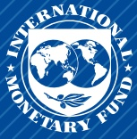
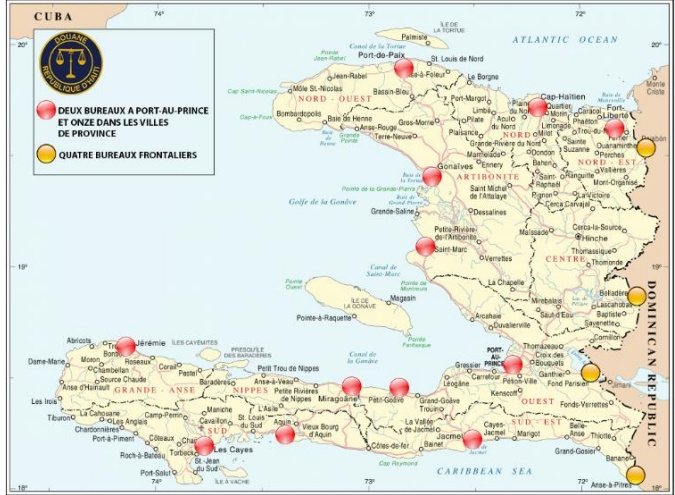
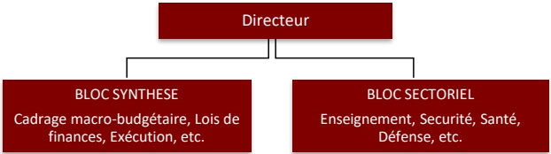

<!-- page 1 -->

## RAPPORT DIAGNOSTIC DE LA GOUVERNANCE

HAITI

JANVIER 2025

## Départementes auteurs :

Département Juridique

Département des Finances Publiques

Département des Marchés Monétaires et de Capitaux

<!-- page 2 -->

## AVERTISSEMENT

Ce rapport constitue un avis technique établi par les services du Fonds monétaire international (FMI) à l'intention des autorités de Haïti (ci-après le « bénéficiaire du développement des capacités ») à la suite de leur demande d'une assistance technique. Ce rapport (dans sa totalité ou en partie) ou des résumés de celui-ci peuvent être communiqués par le FMI aux administrateurs du FMI et à leurs services, ainsi qu'aux autres organismes ou entités du bénéficiaire du développement des capacités, et, à leur demande, aux services de la Banque mondiale et aux autres fournisseurs de développement des capacités et bailleurs de fonds dont l'intérêt est légitime, sauf si le bénéficiaire du développement des capacités s'y oppose explicitement (voir les directives opérationnelles des services du FMI relatives à la diffusion de renseignements en matière d'assistance technique). La publication ou la communication, en dehors du FMI, du présent rapport (dans sa totalité, en partie ou sous une forme résumée) à des parties autres que les organismes et entités du bénéficiaire du développement des capacités, les services de la Banque mondiale et les autres prestataires du développement des capacités et bailleurs de fonds ayant un intérêt légitime requiert le consentement exprès du bénéficiaire du développement des capacités, du département juridique, du département des finances publiques et du département des marchés monétaires et de capitaux du FMI.

<!-- page 3 -->

## Table des Matières

SIGLES ET ABREVIATIONS 4
PREFACE 6
RESUME 8
SECTION I. GRAVITE DE LA CORRUPTION ET IMPACT SUR LA FRAGILITE D'HAÎTI 16
A. Analyse de la Gravité de la Corruption 16
B. Relation entre la Corruption et la Fragilité en Haïti 23
SECTION II. ÉTAT DE DROIT, CADRES DE LUTTE CONTRE LA CORRUPTION ET LE BLANCHIMENT DE CAPITAUX 26
A. Répercussions de la corruption sur l'État de droit : intégrité judiciaire 26
B. Efficacité des Cadres de Lutte contre la Corruption et le Blanchiment de Capitaux 30
SECTION III. FAIBLESSES DE LA GOUVERNANCE LIEES AUX VULNERABILITES FACE A LA CORRUPTION DANS LA GOUVERNANCE DES FINANCES PUBLIQUES 36
A. Administration des Recettes 36
B. Gestion des Finances Publiques 47
SECTION IV. FAIBLESSES EN MATIERE DE GOUVERNANCE DANS LA SURVEILLANCE DU SECTEUR FINANCIER 56
A. Aperçu du Secteur Financier 57
B. Gouvernance de l'Agence de Supervision 57
C. Réglementation Prudentielle et Surveillance de la Gouvernance des Institutions Financières 59
ANNEXES 61
Annexe 1: Institutions de lutte contre la corruption 61
Annexe 2: Implantation des bureaux des douanes et évolutions du nombre et des valeurs des marchandises mises à la consommation ou admises sous régime suspensif (en gourdes) 63
Annexe 3: Procédures et calendrier des réponses des administrations et des contribuables 64
Annexe 4: Organisation structurelle d'une Direction Générale du Budget 65
Annexe 5: Plan de Réforme de la Gouvernance économique 66
BOXES 17
1. L'Affaire PetroCaribe 17
2. Principaux Acteurs Politico-Économiques à Haïti 19
3. Sanctions Multilatérales et Bilatérales 22
4. Structure Proposée pour le Pôle LCC 34
5. Recommandations Prioritaires en Matière de Programmation et Boudéisation des Investissements Publics 49
6. Haïti - Suivi des Actifs non Financiers de l'État 51
7. Haïti – Marchés Public 54

<!-- page 4 -->

## FIGURES

1. Perception de la Corruption ___16

## TABLES

1. Recommandations Prioritaires ___14
2. DGI. Nombre de Taxes et Part des Recettes Fiscales Collectées ___38
3. Plan de Réforme de la Gouvernance économique ___66

<!-- page 5 -->

## Sigles et Abréviations

| AGD | Administration générale des douanes |
| --- | --- |
| APB | Association professionnelle des banques |
| BAFE : | Bureau des Affaires Financières et Économiques |
| BRH | Banque de la République d'Haïti (Banque centrale) |
| BPH | Banque populaire haïtienne |
| CAC | Convention des Nations Unies contre la corruption |
| CSPJ : | Conseil Supérieur du Pouvoir Judiciaire |
| CSCCA | Cour supérieure des comptes et du contentieux administratif |
| CUT | Compte unique du Trésor |
| DASIP | Direction d'analyse et de suivi des investissements publics |
| DCF | Direction du contrôle financier |
| DIF | Direction de l'inspection fiscale |
| DIGCP | Direction de l'inspection générale des caisses populaires |
| DIP | Direction de l'investissement public |
| DG | Diagnostic de la gouvernance |
| DGB | Direction générale du budget |
| DGI | Direction générale des impôts |
| DOS : | Déclarations d'Opérations Suspectes |
| DPD | Document de programmation des dépenses |
| DSBIF | Direction de la supervision des banques et des institutions financières |
| DZF | Direction des zone franches |
| EMA : | École Nationale de la Magistrature |
| EPNFD : | Entreprises et Professions Non Financières désignées |
| FBCF | Formation brute de capital fixe |
| FMI | Fonds monétaire international |
| GFP | Gestion des finances publiques |
| HCDH : | Haut-Commissariat des Nations Unies aux droits de l'homme |
| IGF | Inspection générale des finances |
| IF | Institutions financières |
| IP | Investissements Publics |
| IPC : | Indice de Perception de la Corruption |
| LBC | Lutte contre le blanchiment de capitaux |
| LCC | Lutte contre la corruption |

<!-- page 6 -->

LEELF

Loi sur l'élaboration et l'exécution des lois de finances

MPCE

Ministère de la planification et de la coopération externe

MSS

Mission multinationale de soutien à la sécurité

PFC

Pays fragiles et touchés par des conflits

PFB

Principes fondamentaux de Bâle

PIB

Produit intérieur brut

PNH

Police nationale d'Haiti

PPE

Personne politiquement exposée

PPM

Plan de passation des marchés

RGCP

Règlement général de la comptabilité publique

UCREF

Unité Centrale de Renseignements Financiers

ULCC

Unité de Lutte Contre la Corruption

<!-- page 7 -->

## Préface

À la demande des autorités haïtiennes, une mission d'évaluation diagnostique de la gouvernance et de la corruption s'est déroulée de septembre à décembre 2023. Cette évaluation a démarré par une mission interdépartementale¹ exploratoire du 11 au 15 septembre 2023, suivie de la mission principale, qui s'est déroulée en deux temps : de façon virtuelle du 27 novembre au 1er décembre 2023, puis hors site, au Panama, du 11 au 15 décembre 2023². À ces travaux s'est ajoutée une analyse détaillée des dossiers. L'équipe de la mission a bénéficié de discussions avec des organisations internationales, des partenaires de développement d'Haïti et des parties prenantes gouvernementales et non gouvernementales, ainsi que des conseils d'experts en mission de courte durée sur la politique économique de la corruption en Haïti.

La mission s'est appuyée sur le Cadre de 2018 pour un renforcement de l'action du FMI en matière de gouvernance $ ^{3} $ (cadre de 2018) et sur la stratégie adoptée en 2022 pour les pays fragiles et touchés par des conflits (PFC) $ ^{4} $. Le cadre de 2018 a pour but de promouvoir une coopération plus systématique, efficace, franche et impartiale avec les pays membres sur les questions de gouvernance et de corruption, qui sont cruciales pour les résultats macroéconomiques. Selon la stratégie pour les PFC, les services du FMI doivent tenir compte des risques de corruption pour y définir les priorités stratégiques.

Les évaluations diagnostiques de la gouvernance et de la corruption ont pour but d'évaluer la gravité des risques de corruption, d'identifier les faiblesses de gouvernance qui ont une incidence majeure sur le plan macroéconomique et qui sont associées aux vulnérabilités à la corruption des principales fonctions de l'État visées par le cadre de 2018 $ ^{5} $, et de proposer des mesures de réforme concrètes. Elles permettent également de

<!-- page 8 -->

déterminer si les dispositifs juridiques et organisationnels anticorruption sont solides et conformes aux normes internationales et aux bonnes pratiques, et si les stratégies de lutte contre la corruption sont adaptées aux risques de corruption pesant sur les principales fonctions de l'État.

Il s'agit d'une démarche prospective, qui vise à identifier les moyens d'améliorer la gouvernance et l'intégrité afin de soutenir un développement économique fort, stable et inclusif. L'analyse et les recommandations formulées ne portent pas sur des cas individuels ou des allégations de corruption, mais sur des enjeux politiques structurels, ainsi que sur des mesures de réforme à court et à long terme. Depuis l'adoption du cadre de 2018, 20 évaluations diagnostiques de la gouvernance ont été achevées. Plusieurs autres évaluations sont en cours.

La mission consacrée à Haïti était dirigée par Mme Tina Burjaliani et composée de Mmes Ivana Rossi et Paula Paixao e Silva Zarazinski, ainsi que de MM. André Benjamin Kahn, Anthony Ramarozatovo, Jean Pierre Nguenang, Abdoulahi Mfombouot et Patrick Le Clerc. La mission a bénéficié de l'assistance des experts en économie politique Dr. Robert Muggah, Professeur David Carment et Mme Alexandra Wishart.

La mission souhaite exprimer sa reconnaissance pour le soutien et la coopération apportés dans ce contexte difficile par les représentants et le personnel de divers organismes gouvernementaux en Haiti. Nous remerciations Mme Vanette Vincent et les autres membres du Ministère de l'Économie et des Finances (MEF) d'Haïti qui ont coordonné les échanges des autorités avec la mission. Nous tenons également à remercier la société civile, le milieu universitaire, les experts juridiques, les représentants du secteur privé, ainsi que les équipes des organisations internationales et des bailleurs de fonds qui nous ont communiqué des informations et apporté des points de vue précieux.

La mission est reconnaissante du soutien apporté par Mme Patrizia Tumbarello (cheffe de mission pour Haïti), M. Jean Frederic Noah Ndela Ntsama (chef de mission adjoint pour Haïti), M. Arsène Kaho (économiste principal, département pour l'hémisphère occidentale) et Gabriel Berny Duvalsaint (économiste, département pour l'hémisphère occidentale). La mission remercie Mme Alexandra Rajs et Mme Young Kim pour leur assistance administrative.

<!-- page 9 -->

## Résumé

État fragile, Haïti compte environ 11 millions d'habitants, dont la moitié vit à Port-au-Prince, la capitale, et ses environs. Le pays partage une frontière terrestre de 390 kilomètres avec la République Dominicaine. Haïti est aujourd'hui le pays le plus pauvre d'Amérique latine en termes de revenu par habitant, et l'un des plus pauvres du monde $ ^{6} $. Au cours des dernières années, plus de la moitié de la population haïtienne a quitté les zones rurales pour les zones urbaines. La pauvreté et le manque de services de base ont contribué à la déforestation à grande échelle, une dégradation des zones forestières et une érosion des sols. Les zones forestières ne représentaient plus en 2020 que 12,6% du territoire $ ^{7} $. Le déclin continu des terres arables risque d'avoir des conséquences à long terme sur l'économie haïtienne, qui dépend fortement de l'agriculture.

Plus de 96 % de la population haïtienne est exposée aux catastrophes naturelles, principalement aux ouragans, aux inondations et aux tremblements de terre $ ^{8} $. En raison des migrations liées au changement climatique, les zones urbaines, où les personnes déplacées tentent de s'installer et de trouver de nouvelles opportunités, sont soumises à une pression accrue. L'accès aux services de base (assainissement, eau potable, santé, éducation) s'est dégradé, surtout depuis le séisme de 2010 et l'ouragan de 2016, qui ont eu des effets dévastateurs sur l'infrastructure et l'économie haïtiennes. Le séisme de 2021 a imposé une pression supplémentaire sur des failles déjà rompues, ce qui est particulièrement problématique au regard du fait qu'Haïti n'est pas préparée à absorber de tels chocs.

Il a été déterminé que l'insécurité et la violence représentent l'une des difficultés générales les plus importantes, et qu'elles contribuent de manière significative à la fragilité du pays. La violence est devenue monnaie courante au cours des dernières décennies en Haïti, mais elle s'est encore intensifiée au cours des dernières années et des derniers mois. La crise sécuritéaire est causée par une violence accrue de la part des gangs, qui sont affiliés à plusieurs membres influents de l'élite politique-économique.⁹ Les agissements des gangs vont de l'assassinat¹⁰ et l'enlèvement de personnalités à la perturbation d'institutions publiques et privées. En juin 2022, par exemple, un gang a pris le contrôle du Palais de justice de Port-au-Prince, « a forcé le personnel judiciaire à sortir, a blessé un procureur et a volé des ordinateurs, des bureaux et d'autres biens »¹¹. Entre septembre et novembre 2022, un autre gang a pris le contrôle du terminal de Varreux, un important terminal pétrolier en Haïti,

<!-- page 10 -->

et a imposé un blocus de deux mois en réaction à un décret qui réduisait les subventions sur les carburants $ ^{12} $. La violence des gangs s'est encore intensifiée depuis janvier 2024. La nouvelle vague de violences qui a éclaté le 29 février dernier à Port-au-Prince a entraîné des évasions de détenus, qui ont encore aggravé l'insécurité dans la capitale et les régions avoisinantes. Plus de 2 500 personnes ont été tuées ou blessées entre janvier et mars 2024 selon l'ONU, et près de 95 000 personnes ont fui Port-au-Prince sur la même période. Le nombre de réfugiés et de demandeurs d'asile haïtiens a atteint le demi-million en mai 2024 $ ^{13} $. Le principal port du pays, par lequel transitent la grande majorité des biens et des produits, a été pillé. Des rapports indiquent que le terminal de Varreux a été bloqué par des gangs, ce qui crée des risques de pénurie de carburant $ ^{14} $. Les violences ont entravé les activités économiques dans l'ensemble de la capitale, avec un impact désastreux sur un système de distribution de services de base déjà marqué par des difficultés en Haïti. L'instauration de conditions de sécurité propices à un processus politique inclusifs et à des élections libres et équitablements demeure une priorité $ ^{15} $.

Le déploiement, sous la direction du Kenya, du premier contingent de la Mission multinationale de soutien à la sécurité (MSS) approuvée par le Conseil de sécurité de l'ONU crée une dynamique de stabilisation. La MSS avait été approuvée en octobre 2023 $ ^{16} $ et devait être déployée dès le mois de janvier 2024. Cependant, la dégradation brutale de la situation sécuritéaire, suivie de la démission du Premier ministre en février 2024, a fait dérailler le calendrier prévu à l'origine. Près de 1 000 policiers kenyans et 2 000 autres agents issus d'autres pays, soutenus financièrement par des dons volontaires gérés par un fonds fiduciaire des Nations Unies, devaient opérer en coordination avec le gouvernement haïtien $ ^{17} $.Cette mission avait été sollicité par les autorités haïtiennes à titre de mesure temporaire d'urgence, en réponse à la montée de la violence, des activités criminelles et des violations des droits de l'homme qui compromettent la paix, la stabilité et la sécurité. La mission MSS vise à protéger les institutions publiques ainsi que les infrastructures critiques et les centres de transport, et collabore avec la Police nationale d'Haïti (PNH) pour lutter contre les gangs. Afin que la mission apporte un soutien efficace au pays et ouvre la voie à une paix et une sécurité durables, il est indispensable que ses objectifs et ses règles d'engagement soient clairs, que des mécanismes de contrôle solides soient mis en place et qu'un plan de transfert détaillé soit élaboré. Les vulnérabilités

<!-- page 11 -->

à la corruption qui règne au sein de la PNH est un sujet de préoccupation majeur et pourrait saper le travail de la MSS et les efforts déployés pour stabiliser le pays et assurer le maintien de l'ordre public $ ^{18} $.

Le système politique haïtien a été exposé à des chocs dus à des présidences de courte durée et des périodes d'instabilité prolongées. Malgré quelques progrès réalisés au cours des dernières décennies dans la mise en place d'institutions publiques représentatives, le système n'a pas fondamentalement changé $ ^{19} $. Haïti est une république présidentielle où les élections nationales ont été régulièrement contestées pour illégitimité. Sur les 54 présidents élus depuis 1806, seuls neuf sont allés jusqu'au bout de leur mandat $ ^{20} $. L'Assemblée nationale haïtienne est une institution bicamérale composée du Sénat et de la Chambre des Députés. Selon la Constitution amendée de 1987, le Premier Ministre est nommé par le Président de la République, et l'Assemblée est chargée de ratifier les politiques du Premier Ministre et du gouvernement. Il n'y a pas eu d'élections en Haïti depuis 2016. Le pays n'a plus de Parlement en exercice depuis 2020 et plus de Président depuis l'assassinat du président Moïse en 2021. Le cabinet du Premier Ministre gouverne par décret. Les élections qui devaient avoir lieu en février 2024 ont été reportées au motif du manque de sécurité.

La nomination d'un Premier Ministre et d'un gouvernement par intérim a ravivé les perspectives de stabilisation. Un Conseil Présidentiel Transitoire de neuf membres (dont sept avec un droit de vote) a été officiellement instauré le 25 avril 2024 avec l'appui de la Communauté des Caraïbes. Il assumera la présidence du pays jusqu'au 7 février 2026. Ses sept membres principaux en assureront la présidence tournante. Un nouveau Premier Ministre par intérim a été nommé le 27 mai 2024 et le gouvernement transitoire a été mis en place le 11 juin. Le gouvernement par intérim est entendu de rester en place jusqu'au 7 février 2026. Il a pour mandat de rétablir la sécurité et de mettre en œuvre des réformes constitutionnelles. Des élections législatives doivent se tenir d'ici à la fin décembre 2025, pour la première fois depuis 2016.

Le DG que les autorités ont demandé en mai 2023, et que l'administration actuelle appuie également, analyse les faiblesses de gouvernance et les vulnérabilités à la corruption les plus critiques et propose des réformes. En se basant sur l'analyse de l'économie politique, l'évaluation porte sur la nature et la gravité de la corruption, son rôle dans la fragilité du pays et son impact sur l'efficacité des cadres de lutte contre la corruption et le blanchiment de capitaux (LBC), ainsi que sur l'état de droit (en particulier l'intégrité du système judiciaire). Elle aborde également les faiblesses de gouvernance associées aux risques de corruption dans la gestion des finances publiques et la surveillance du secteur financier, qui sont les domaines prioritaires des fonctions clés de l'État recensés au cours de la mission exploratoire et en consultation avec les autorités et les autres parties prenantes. Cette évaluation ne couvre pas la gouvernance et les opérations de la banque centrale, autres fonctions publiques essentielles, mais les services du FMI se penchent sur ces questions avec les autorités dans un autre cadre.

<!-- page 12 -->

L'application inégale des mesures de lutte contre la corruption et le blanchiment de capitaux est un sujet de préoccupation récurrent. Au niveau le plus élémentaire, les principales lois, réglementations et normes ne sont pas appliquées en raison de l'ingérence des élites et d'un manque de capacités, de moyens et d'indépendance. Les cadres juridiques et institutionnels sont inadéquats pour répondre aux risques existants. L'impunité a été la norme depuis assez longtemps et s'est aggravée au cours des dernières années. Par exemple, les procédures officielles prévues par la Constitution, telles que la déclaration de patrimoine par les personnalités publiques de haut rang, n'ont jamais été suivies, et pas une seule personnalité de haut rang n'a été poursuivie pour des faits de corruption, et ce alors même que de nombreuses enquêtes ont été menées puis transmises à la justice par l'unité de lutte contre la corruption (ULCC). Les vulnérabilités spécifiques à la corruption et les lacunes associées en matière de gouvernance dans les domaines couverts par le diagnostic sont résumées ci-dessous:

- Malgré les progrès accomplis en matière de gestion des finances publiques (GFP), notamment dans la publication de cadres pluriannuels pour le budget et les finances publiques (repère structurel du programme de référence appuyé par le FMI), l'élaboration d'outils de gestion de la trésorerie et la consolidation progressive du Compte Unique du Trésor (CUT), les faiblesses de gouvernance et les risques de corruption restent importants. Les insuffisances et les vulnérabilités sont présentes dans les domaines critiques tels que i) la préparation/la programmation du budget et la budgétisation des investissements publics (IP), ii) l'exécution budgétaire et la gestion de la trésorerie, iii) les marchés publics, iv) les rapports financiers, et v) l'audit interne et externe.

- En dépit des réformes récentes instaurées par les nouveaux code fiscal et douanier, les administrations fiscale et douanière restent sujettes à l'arbitraire et à la corruption, en raison de la complexité du système, de l'iniquité des procédures et du faible niveau de numérisation. Le manque général de transparence et de responsabilité, la faiblesse des normes d'intégrité et des mécanismes de contrôle exposent les agents et cadres des administrations fiscales et douanières à des risques de corruption, malgré les premiers efforts de digitalisation des principales procédures douanières.

Les cadres juridiques et institutionnels relatifs à la surveillance du secteur financier sont globalement conformes aux normes internationales (en particulier aux principes fondamentaux de Bâle 1 et 2 pour un contrôle bancaire efficace), mais leur mise en œuvre est fortement affectée par l'aggravation de la crise sécuritaire et les pertes de capacités du fait de départs de personnels motivés par cette situation. L'achèvement de la mise à niveau de la réglementation prudentielle et les autres chantiers alors bien engagés, notamment la mise en place d'une supervision basées sur les risques, sont fortement ralentis sans être totalement interrompus. L'efficacité du dispositif de surveillance et la portée des contrôles opérés sont confrontés à de sérieuses difficultés, bien que, selon la BRH, celle-ci se soit organisée pour maintenir un contrôle sur pièces et poursuivre les missions d'inspection sur place.

Le cadre de lutte contre le blanchiment de capitaux (LBC) a été récemment renforcé, mais ses effets ne sont pas encore visibles. Le décret de septembre 2023 a pour objet de renforcer l'autonomie opérationnelle et l'indépendance de l'Unité Centrale de Renseignements

<!-- page 13 -->

Financiers (UCREF), en lui donnant un mandat clair pour mener des analyses opérationnelles et stratégiques sur le blanchiment de capitaux et les infractions principales, et en veillant à ce qu'elle ait le pouvoir de coopérer et de partager des informations avec ses homologues nationaux et internationaux. De plus, un décret d'avril 2023 (voir ci-après), qui refond le cadre plus large de lutte contre le blanchiment de capitaux et le financement du terrorisme (LBC-FT), confère aux commissaires du gouvernement et aux juges d'instruction des outils pour enquêter efficacement sur les délits financiers. Le décret prévoit des mesures préventives à l'égard des personnes politiquement exposées (PPE) et des membres de leur famille et de leurs proches, ainsi que des dispositions visant à assurer une plus grande transparence de la propriété effective des personnes morales. La banque centrale a publié en parallèle plusieurs circulaires et documents d'orientation destinés à faciliter l'application des mesures préventives de lutte contre le blanchiment de capitaux, notamment en ce qui concerne les PPE. Elle a également renforcé la formation interne de ses inspecteurs, conduit des séances de sensibilisation auprès des institutions financières pour les informer de leurs obligations prévues par le nouveau cadre LBC/FT, créé une nouvelle unité de supervision dédiée aux institutions de microfinance, et réalisé des inspections sur place dans deux banques depuis septembre 2023, et ce en dépit des défis sécuritaires importants. Toutefois, nouveau cadre juridique en matière de LBC n'a pas encore conduit à un renforcement significatif en termes d'efficacité dans l'ensemble des autorités de LBC/FT. Le travail de l'UCREF, de la justice et, dans une moindre mesure, de la Banque centrale, est entravé par des facteurs tels que la corruption, le manque de ressources humaines, la formation insuffisante du personnel et la situation sécuritaire dégradée.

- L'état de droit est fragile et l'intégrité judiciaire pâtit fortement des vulnérabilités liées à la corruption. Le cadre juridique relatif aux nominations et aux promotions du corps judiciaire est tel que le processus peut être influencé par les relations politiques et le favoritisme, ce qui compromet toute sélection fondée sur le mérite. Les principaux acteurs en Haïti notent l'absence d'une solide déontologie professionnelle, notamment parmi les juges, le personnel judiciaire et le personnel d'application de la loi. Tous s'accordent à dire que cette situation est exacerbée par les bas salaires et les mauvaises conditions de travail, qui augmentent la probabilité de corruption. En conséquence, le public a perdu confiance dans l'appareil judiciaire et sa capacité à rendre une justice impartiale. Les tentatives de poursuite d'actes de corruption commis par des personnes influentes se soldent presque toujours par un échec. Les affaires sont souvent classées prématurément, retardées ou bloquées.

Ces défaillances de la gouvernance et les vulnérabilités associées à la corruption se manifestent dans un contexte d'instabilité, de faiblesse des institutions et de l'état de droit, ainsi que celle des systèmes de redevabilité. La relation est nuancée en Haïti entre la fragilité et les faiblesses de la gouvernance associées aux risques de corruption. L'instabilité politique et l'insécurité ont eu une incidence négative sur le développement et le fonctionnement des institutions. Des îlots d'excellence existent toutefois dans le secteur public, qui devraient être soutenus et mis à profit pour améliorer la gouvernance, réduire la corruption et mettre Haïti sur la voie de la sortie de la fragilité.

Il est important pour Haïti d'améliorer la gouvernance et de réduire les vulnérabilités liées à la corruption pour sortir de sa fragilité. Le développement des capacités institutionnelles de base peut

<!-- page 14 -->

accroître la confiance du public, ce qui peut à son tour renforcer la légitimité et l'efficacité des institutions. L'ensemble des réformes proposées peut améliorer les cadres juridiques et institutionnels liés à la gouvernance économique et contribuer à une croissance durable et inclusive. La stratégie du FMI pour les PFC passe par une approche sur mesure et une définition minutieuse des priorités, à partir d'une analyse du contexte spécifique, des contraintes institutionnelles affectant la mise en œuvre des réformes, de la répartition des rentes de la corruption et de considérations liées à l'économie politique $ ^{21} $.

La mission reconnaît que l'amélioration de la sécurité et la situation politique, qui pourrait aboutir à la mise en place d'un gouvernement légitiment élu, sont des conditions préalables nécessaires à la viabilité des réformes proposées. Par conséquent, la mission encourage les autorités à prendre toutes les mesures nécessaires pour rétablir la sécurité et la stabilité politique conformément à la Constitution d'Haïti et à la Résolution 2699 du Conseil de sécurité de l'ONU. Il n'est pas possible de s'attaquer à la corruption généralisée ni de renforcer la gouvernance, l'état de droit et la responsabilité dans un contexte de violence endémique où la légitimité des institutions de l'État est mise à mal. Ainsi, les autorités devraient tout mettre en œuvre pour rétablir la sécurité et la stabilité politique en même temps qu'elles s'engageront dans la voie des réformes proposées. Les efforts déployés au niveau national pour rompre la fragilité bénéficieraient de l'appui stratégique de la communauté internationale et des partenaires de développement, axé sur des réformes soigneusement priorisées et adaptées aux besoins spécifiques du pays aux fins de la mise en place d'institutions.

Eu égard à la nécessité de hiérarchiser et d'échelonner les actions, le tableau 1 présente un ensemble de recommandations prioritaires qui serviront de base à une réforme plus complète de la gouvernance économique (voir la liste à l'annexe 5). Ces recommandations correspondent à la nature, à la gravité et au niveau de risque de la corruption, et visent à mettre fin à l'héritage d'impunité et à promouvoir la transparence et la responsabilité dans le secteur public. Elles reposent sur l'analyse de l'économie politique et reconnaissent la nécessité de prendre des mesures extraordinaires pour rebâtir la légitimité des institutions et la confiance qu'elles doivent inspirer au public, ainsi que la nécessité de créer une dynamique de réforme de la gouvernance économique. Comme expliqué ci-après, l'application de ces recommandations prioritaires permettrait de poser des bases suffisamment solides pour la mise en œuvre du Plan d'action pour la réforme de la gouvernance économique exposé à l'annexe 5.

<!-- page 15 -->

Tableau 1. Recommandations Prioritaires

<table><tr><td>Mesure</td><td>Autorité et actions requises</td><td>Objectif</td><td>Calendrier $ ^{{22}} $</td></tr><tr><td>1</td><td>À partir des institutions de lutte contre la corruption existantes, créer et mettre en fonctionnement un Pôle de lutte contre la corruption – qui sera un mécanisme ad hoc – chargé d'enquêter sur les cas les plus importants de corruption, de criminalité organisée et de blanchiment de capitaux, y compris ceux qui concernent des PPE, et d'en poursuivre les auteurs (Voir l'encadré 4 pour le cadre).</td><td>Le Premier ministre devrait créer le Pôle LCC par décret. Les autres autorités pertinentes devraient également être impliquées, par exemple, le MEF, l'ULCC, l'UCREF, la PNH, le ministère de la Justice, les juges et les procureurs.</td><td>Renforcer la responsabilité relative à la corruption</td><td>CT</td></tr><tr><td>2</td><td>Faciliter les enquêtes sur le blanchiment des produits de la corruption en Haïti et de la criminalité organisée à l'étranger, notamment : - en renforçant le cadre juridique pour aligner sur la Convention des Nations Unies contre la corruption (CAC) la législation interne relative à l'incrimination de la corruption et des infractions connexes ; - en recueillant et en publiant en ligne les déclarations de patrimoine de tous les hauts responsables, y compris ceux des secteurs de la justice et de l'application des lois, ainsi que celles des candidats à de hautes fonctions publiques, et en rendant obligatoire la déclaration des avoirs et intérêts (y compris les comptes bancaires) détenus directement ou effectivement à l'étranger ; - en renforçant le cadre juridique et institutionnel d'entraide judiciaire pour toutes les infractions créées conformément à la CAC ; - en concluant des accords afin de renforcer la base légale de l'entraide judiciaire pour toutes les infractions créées conformément à la CAC et en développement les capacités de mise en œuvre des représentants de la justice.</td><td>La révision du cadre juridique nécessite une action parlementaire. Entre-temps, il est conseillé au Premier Ministre, à l'ULCC, à l'UCREF, au Ministère de la Justice et aux Magistrats de prendre toutes les mesures nécessaires pour appliquer le cadre juridique existant, et de préparer les modifications législatives nécessaires pour remédier aux lacunes constatées.</td><td>Renforcer la responsabilité relative à la corruption et au blanchiment de capitaux</td><td>MT</td></tr><tr><td>3</td><td>À partir des risques de corruption constatés au sein des administrations douanière et fiscale, élaborer, mettre en œuvre et suivre une stratégie de promotion de l'intégrité et de réduction des activités illégales dans les administrations douanière et fiscale.</td><td>Le Premier ministre et le MEF devraient mener le développement et le suivi de cette stratégie, qui repose sur une étude indépendante et reconnue des risques de corruption au sein des administrations douanière et fiscale.</td><td>Renforcer l'administration des recettes, réduire les risques de corruption</td><td>CT</td></tr><tr><td>4</td><td>Collaborer avec les partenaires de développement internationaux, les organisations de la société civile et les entreprises privées pour développer la coordination, la transparence, la responsabilité et l'efficacité de la gestion de l'aide extérieure. En particulier, inviter tous les partenaires nationaux et internationaux de mise en œuvre à</td><td>Premier ministre et MEF</td><td>Renforcer la transparence, l'intégrité et l'efficacité dans le domaine de l'aide internationale</td><td>CT</td></tr></table>

<!-- page 16 -->

|   | produire des données conformes à la norme de l’Initiative internationale pour la transparence de l’aide $ ^{{23}} $, et rendre ces informations publiques. |   |   |   |
| --- | --- | --- | --- | --- |
| 5 | Rendre obligatoire la réalisation d’évaluations préalables de tous les projets financés au niveau interne et rendre ces évaluations publiques, et renforcer le cadre de sélection en matière de projets. | MEF et MPCE | Renforcer la planification et l’allocation de ressources en matière de gestion de l’investissement public | CT |
| 6 | Renforcer la gestion des finances publiques\n- en restaurant les prérogatives du contrôleur financier quant au contrôle a priori des dépenses d’investissement public (CT),\n- en adoptant un guide du contrôle budgétaire (MT),\n- en adoptant un nouveau manuel d’exécution des dépenses (MT). | MEF | Renforcer la transparence et la responsabilité dans la GFP | CT/MT |
| 7 | Renforcer la gouvernance de la BRH en tant qu’autorité de supervision bancaire. En particulier :\n- Réviser la structure et les processus décisionnels relatifs à la supervision bancaire pour assurer l’indépendance et la transparence (MT) ;\n- Entretemps, et à titre provisoire dans l’attente de l’adoption des modifications de la loi, déléguer les pouvoirs décisionnels de supervision à une commission spécialisée du Conseil de la BRH (CT). | La révision du cadre juridique nécessite une action parlementaire. Entretemps, le conseil d’administration de la BRH devrait adopter une décision de délégation de pouvoirs. | Renforcer la surveillance du secteur financier et réduire les risques de corruption | CT/MT |

<!-- page 17 -->

### Section I. Gravité de la Corruption et Impact sur la Fragilité d'Haïti

Cette section examine, à partir de l'analyse d'économie politique, la gravité de la corruption en Haïti et sa relation avec la fragilité du pays. Les principaux éléments structurels qui sous-tendent la fragilité sont l'autorité, la légitimité et la capacité de l'État, désignés par l'acronyme PFC $ ^{24} $. Les pays fragiles présentent généralement un niveau très réduit de capacité administrative, un état de droit limité et des niveaux élevés de polarisation sociale. $ ^{25} $ En conséquence de la prestation inégale de biens et services publics, de l'accaparement par les élites ou de la corruption, les pays PFC manquent de confiance du public et de légitimité. $ ^{26} $ Dans de nombreux PFC, une gouvernance faible et un haut niveau de corruption figurent parmi les facteurs clés de fragilité $ ^{27} $. La corruption est considérée comme l'une des principales causes de la faible capacité des institutions publiques en Haïti ; elle se répercute tant sur l'autorité que la légitimité des institutions, et contribue donc à la fragilité du pays $ ^{28} $.

### A. ANALYSE DE LA GRAVITE DE LA CORRUPTION

Les vulnérabilités à la corruption ont des répercussions profondes sur la stabilité macroéconomique, la croissance économique inclusive et la fragilité d'Haïti. Malgré quelques exemples de réformes réussies et d'institutions publiques résistantes, les faiblesses de la gouvernance et les vulnérabilités à la corruption persistent dans la plupart des secteurs de l'administration et de l'économie. Plusieurs indices concordants confirment l'ampleur de la corruption. Haïti affiche un score de 17/100 sur l'indice de perception de la

Graphique 1 : Perception de la Corruption

(Transparency International)

| Year | Score changes |
| --- | --- |
| 2012 | 19 |
| 2013 | 19 |
| 2014 | 19 |
| 2015 | 17 |
| 2016 | 20 |
| 2017 | 22 |
| 2018 | 20 |
| 2019 | 18 |
| 2020 | 18 |
| 2021 | 20 |
| 2022 | 17 |
| 2023 | 17 |

score de 17/100 sur l'indice de perception de la corruption (IPC) 2023 de Transparency International. $ ^{29} $

<!-- page 18 -->

Le score IPC du pays est demeuré pratiquement inchangé ces dix dernières années, à l'exception des pics enregistrés en 2017 et en 2021, suivis rapidement d'un recul (graphique 1). Les résultats d'Haïti sont notablement médiocres selon l'indice de compétitivité mondiale, qui mesure la qualité des institutions et le capital humain et l'écosystème économique qui en découlent $ ^{30} $, et selon les indicateurs mondiaux de gouvernance (WGI) de la Banque mondiale $ ^{31} $. Ces statistiques témoignent du défi permanent auquel ont été confrontés les gouvernements haïtiens successifs pour orienter efficacement les ressources humaines, financières, administratives et juridiques afin de parvenir à un développement économique et social durable. Au-delà des indices, la gravité de la corruption en Haïti est clairement démontrée dans les rapports établis par la Cour supérieure des comptes et du contentieux administratif dans l'affaire PetroCaribe, l'un des cas les plus flagrants de corruption impliquant les élites politiques et économiques (encadré 1).

## Encadré 1 : L'Affaire PetroCaribe

| En 2006, Haïti a rejoint PetroCaribe, un programme lancé par le président vénézuélien de l'époque, Hugo Chavez, pour fournir du pétrole aux pays des Caraïbes en guise d'aide. Cet accord permettait aux États des Caraïbes de différer le paiement de 40 % de leurs achats sur une période pouvant aller jusqu'à 25 ans, avec un taux d'intérêt peu élevé sur cette dette. Les gouvernements bénéficiaires ont ainsi généré des liquidités substantielles, qui devaient être consacrées à des programmes sociaux. |
| --- |
| Sur la durée du programme, les autorités haïtiennes ont affirmé avoir financé des projets sociaux à hauteur de près de 4 milliards de dollars provenant des recettes pétrolières liées à PetroCaribe entre 2008 et 2016. |
| En 2017, la Commission parlementaire spéciale d'enquête en Haïti a publié un rapport détaillé faisant état d'une corruption généralisée, portant sur un montant de 2 milliards de dollars gérés par trois gouvernements successifs entre 2008 et 2016. |
| Le 31 janvier et le 31 mai 2019, la Cour supérieure des comptes et du contentieux administratif a publié des rapports sur l'utilisation par le gouvernement des fonds PetroCaribe entre 2008 et 2018 et fait état de détournement, de surfacturation, de collusion, de favorlisme et de malversation. Sur la base de ces rapports, le commissaire du gouvernement a engagé des poursuites à l'encontre de plusieurs anciens dirigeants et a renvoyé les affaires devant la justice. Le 15 juillet, 2019, le juge d'instruction chargé de l'affaire PetroCaribe a été à comparaître deux anciens Premiers ministres et plusieurs autres hauts fonctionnaires. |
| En août 2020, un troisième rapport publié par la Cour supérieure des comptes et du contentieux administratif indiquait que plus de 140 milliards de gourdes haïtiennes (HTG) (environ 2 milliards de dollars) de fonds PetroCaribe avaient été détournées ou gaspillées dans des projets « sans valeur ». |
| Sources : Cour supérieure des comptes et du contentieux administratif ; Fonds Petrocaribe: le rapport édifiant de la Cour supérieure des comptes (rfi.fr) |

La corruption en Haïti se caractérise notamment par l'interconnexion entre la politique, l'économie et le crime organisé. En grande majorité, l'économie haïtienne est contrôlée par un petit

<!-- page 19 -->

groupe d'élites politiques et économiques (sur les principaux acteurs politico-économiques, voir l'encadré 2). Ces élites sont incitées à protéger leurs intérêts communs d'un point de vue politique et économique. Elles ont les ressources nécessaires pour influer sur le processus démocratique voire le saboter lorsque le gouvernement commence à menacer leurs intérêts. Elles défendent ces intérêts en partie par leurs propres moyens, par exemple en distribuant occasionnellement des armes et des pots-de-vin à des gangs ou en recourant aux assassinats, à l'intimidation et au népotisme, et en partie en utilisant l'aide internationale.³² Les allégations de corruption sont monnaie courante entre rivaux politiques, ce qui contribue à affaiblir la confiance du public dans les institutions.

Les gangs ont pris une importance croissante en Haïti. Avant l'effondrement de la sécurité en février-mars 2024, on estimait qu'ils contrôlaient plus de 60 % de Port-au-Prince, y compris des zones essentielles d'activité économique, telles que les principaux axes d'accès à la ville, le quartier commercial ou encore la zone industrielle. Ils tiraient ainsi des revenus des douanes, des marchés publics, des réseaux de distribution d'eau et d'électricité et des stations de transport public $ ^{33} $. Les gangs rivalisent violemment pour contrôler le territoire et les ressources économiques. Ils imposent des taxes sur leur territoire en toute impunité, allant jusqu'à s'approprier les biens de la police et, selon certains témoignages, ils utilisent librement l'équipement de la police, y compris les véhicules blindés. Plusieurs gangs de premier plan ont établi des tribunaux sur leur territoire pour sanctionner la population dans leur fief $ ^{34} $. Il a été dit également qu'ils sont liés dans bien des cas aux structures collectives et qu'ils organisent des `fondations sociales » pour asseoir leur légitimité. Ils se présentent souvent comme des `bienfaiteurs » de la communauté, et s'efforcent de dégager une image positive. L'absence de présence étatique – que ce soit les forces de l'ordre ou les services sociaux – a grandement amplifié la portée et l'influence des gangs et des factions dissidentes. Dans les zones stratégiques, telles que les ports et les terminaux pétroliers, les entreprises sont forcées de traiter avec les gangs pour survivre, ce qui fait de ces zones des endroits très lucratifs à contrôler $ ^{35} $.

Par le passé, les personnes politiquement exposées (PPE) $ ^{36} $ ont financé et armé les gangs en échange de voix et d'une protection $ ^{37} $. La relation entre les gangs et les élites politico-économiques est complexe et mouvante, mais plusieurs sources rapportent qu'elle est bénéfique aux premiers

<!-- page 20 -->

comme aux secondes $ ^{38} $. Le Conseil de sécurité de l'ONU a mis en place un régime de sanctions pour Haïti en 2002. Depuis lors, les individus affiliés à un gang ont été sanctionnés pour le rôle qu'ils ont joué dans la criminalité organisée et les flux financiers illicites $ ^{39} $. Il est fréquent aussi que des sanctions unilatérales soient imposées à des individus haïtiens affiliés à des gangs ou à des élites politico-économiques $ ^{40} $ (sur les sanctions, voir l'encadré 3).

## Encadré 2 : Principaux Acteurs Politico-Économiques à Haïti

Élites politiques : Les élites politiques d'Haïti sont constituées de politicians passés et présents. Elles couvrent plusieurs dizaines de partis politiques et sont présentes dans toute la fonction publique et la magistrature. Le dernier parlement, par exemple, comprend plus de 20 partis Pour la plupart, ces partis se concentrent autour de chefs de clan, et ils ont souvent eu recours aux gangs pour faire basculer des élections. Les campagnes comprennent des distributions et des promesses de protection et elles sont soutenues par l'élite économique, souvent en échange de l'attente d'une réribution. Bon nombre d'acteurs politiques sont également aux services des gangs $ ^{41} $.

Élites économiques : Le cercle des élites économiques d'Haïti est relativement étroit, mais il exerce une influence importante sur les politicians. Comme eux, certains membres de l'élite économique emploient des gangs pour assurer leur protection rapprochée, recrutent des policiers comme mercenaires pour se débarrasser de leurs rivaux, ont fréquemment recours à des intermédiaires pour corrompre les policiers et les douaniers, et dans certains cas, ils peuvent collaborer avec les organisations criminelles pour promouvoir d'autres intérêts commerciaux légaux ou illégaux. Selon certaines sources, les élites économiques parviennent souvent à tirer parti des programmes d'aide pour s'enrichir aux dépens de la population $ ^{42} $.

Gangs : Les gangs ont une influence importante sur la gouvernance et ils dérèglement complètement les activités économiques en Haïti. On estime qu'actuellement, quelque 200 gangs sont en activité dans le pays, dont environ 95 dans la capitale, Port-au-Prince $ ^{43} $. La plupart des gangs, sinon tous, coopèrent régulièrement avec les élites pour servir des intérêts oligarchiques au moyen d'enlèvements, de meurtres et d'intimidation au niveau local $ ^{44} $.

Secteur privé, société civile, communauté internationale : Ces acteurs ont remplacé l'État dans plusieurs secteurs, et opèrent sans guère de surveillance, de coordination ou de règles. Haïti est qualifiée depuis longtemps de « République des ONG ». Les ONG et la société civile y jouent en effet un rôle essentiel, notamment en ce qu'elles œuvrent à répondre aux besoins fondamentaux de la population. Avant le séisme de 2010, on estimait que 70 % des

<!-- page 21 -->

services de santé et 85 % de l'enseignement étaient dispensés par des ONG $ ^{45} $. La plus engagée est Accord de Montana, une coalition formée en août 2021 pour soutenir l'Accord de Montana $ ^{46} $.

Diaspora : Haïti a une forte diaspora à l'étranger, qui a joué un rôle important dans la définition du paysage économique et politique. Cette forte diaspora est présente dans plusieurs pays mais principalement aux États-Unis, au Canada, en République Dominicaine, à Cuba et en France $ ^{47} $. La Banque mondiale estime qu'en 2021 environ un quart du PIB haïtien provenait des envois de fonds de la diaspora, ce qui fait de celle-ci un acteur clé de l'économie haïtienne $ ^{48} $. Cette diaspora peut jouer un rôle très important dans les processus sociaux, politiques et économiques du pays au-delà des envois de fonds et d'aide humanitaire.

Les risques de corruption sous-jacents comprennent le détournement de fonds publics, qui est depuis longtemps endémique. Comme indiqué dans un récent rapport de l'ONU, la corruption est « l'un des principaux moteurs de la violence [et] une menace pour la paix, la sécurité et la stabilité » du pays $ ^{49} $. Selon la Banque mondiale, la structure formelle de l'État est captée par les élites jusqu'aux niveaux les plus profonds de la société et de l'économie haïtiennes $ ^{50} $. Il s'agit d'un phénomène systémique intriqué avec différentes formes d'injustice et d'inégalité $ ^{51} $. La captation de l'État, la recherche de rente et le clientélisme ont « vidé » l'État de sa substance, et font obstacle au développement d'institutions transparentes, comptables et inclusives aptes à assumer les fonctions essentielles de l'État $ ^{52} $.

Les importantes faiblesses en matière de gouvernance budgétaire exposées à la Section III ci-dessous créent des occasions de recherche de rente aux dépens de l'État. Les ports, étant les artères centrales de l'économie haïtienne, ainsi que les points de passage terrestres, sont ciblés par des groupes criminels et ses élites apparentés. Par exemple, les écarts entre les importations enregistrées d'Haïti et les exportations de la République Dominicaine illustrent l'ampleur du problème. Le FMI a trouvé qu'en 2016 les exportations formelles totales de la République Dominicaine vers Haïti étaient d'environ 800 millions de dollars américains alors que Haïti a déclaré à l'époque environ 400

<!-- page 22 -->

millions de dollars américains d'importations provenant de la République Dominicaine.⁵³ Ces différences de 50 pour cent ne peuvent pas être expliquées par les frais de fret, ou les valeurs coût-assurance-fret et les charges gratuités à bord. Il y a également un commerce non réglementé et illégal important se déroulant via les ports. Port-au-Prince seul possède trois ports principaux qui gèrent la majorité des cargaisons entrant dans le pays : le Port APN, le Terminal Varreux et Port Latifo, ainsi que deux terminaux de carburant dédiés.⁵⁴ Les douaniers sont vulnérables à des influences et pressions externes indues exercées par des puissantes élites commerciales et politiques.

La corruption est l'une des formes de criminalité liée au blanchiment de capitaux les plus lucratives en Haïti $ ^{55} $. Les risques de blanchiment des produits de la corruption auxquels le pays est confronté sont considérables et largement reconnus $ ^{56} $. Cependant, aucune analyse stratégique ou étude typologique n'est disponible pour recenser les secteurs vulnérables au blanchiment des produits de la corruption nationale en Haïti. Les rapports annuels de L'UCREF recensent certaines méthodes bien connues de blanchiment de capitaux, telles que le schtroumpfage ou l'utilisation de personnes morales pour dissimuler des gains obtenus frauduleusement, mais sans précision sur les secteurs spécifiques ou professions concernés. Les analyses semblent également assez génériques : les mêmes typologies sont reprises mot pour mot au fil des rapports annuels, ce qui limite leur utilité pour la détection de mécanismes concretes de blanchiment de capitaux ou de secteurs et d'institutions vulnérables, et encore moins pour l'analyse de l'évolution des tendances. Il est particulièrement regrettable que l'UCREF ne dispose pas encore d'outils permettant d'identifier les PPE, les membres de leur famille et leurs associés. Dans l'ensemble, l'absence d'analyse détaillée ou de compréhension des mécanismes de blanchiment d'argent liés à la corruption ou des secteurs à haut risque ne peut qu'entraver la capacité des autorités à donner la priorité à la détection des cas présumés de blanchiment de capitaux liés à la corruption et aux enquêtes correspondantes.

<!-- page 23 -->

## Encadré 3 : Sanctions Multilatérales et Bilatérales $ ^{57} $

Le Conseil de sécurité des Nations Unies a imposé quelques sanctions depuis 2022, en particulier contre les chefs de gangs. La résolution la plus importante est celle du Conseil de sécurité 2653, adoptée le 21 octobre. En février 2024, six chefs de gangs ont été sanctionnés.

- Les États-Unis ont imposé plus de 80 sanctions et restrictions de visa à des ressortissants haïtiens, dont deux anciens Premiers ministres, des hommes politiques, des chefs d'entreprise et des membres de gangs, depuis 2020. Une cinquantaine d'autres ressortissants haitiens ont fait l'objet d'interdictions de visa et de sanctions économiques pour trafic de drogue, blanchiment de capitaux et autres délits.

- En juillet 2023, l'État américain a adopté un amendment à la loi sur la transparence en matière de collusion criminelle en Haïti (HR1684) afin de détecter les liens entre les élites politiques et économiques haïtiennes, et les gangs criminels et de prendre des sanctions en conséquence.

- Des sanctions sont également imposées en permanence en vertu de la section 7031 de la loi sur les crédits annuels aux opérations extérieures et de la section 1263 de la loi Magnitsky sur la responsabilité en matière de droits de l'homme.

Le Canada a également imposé pas moins de 28 sanctions à des ressortissants haïtiens depuis 2022, notamment en vertu de la loi sur les mesures économiques spéciales et de la loi sur les Nations Unies.

• Par ailleurs, le Royaume-Uni et l'Union européenne ont ajouté des chefs de gangs et plusieurs autres individus à leurs listes de sanctions.

Source : Informations réunies par les services du FMI à partir des données publiées par le Conseil de sécurité de l'ONU, le Département d'État des États-Unis, le gouvernement du Canada, l'UE et le Royaume-Uni.

La plupart des produits nationaux de la corruption sont blanchis à l'extérieur du pays. S'il est difficile de se faire une idée précise du montant ou de la proportion des produits de la corruption nationale qui sont transférés hors d'Haïti, des éléments anecdotiques, notamment la présence de grandes communautés d'expatriés dans les pays étrangers, laissent penser que des sommes importantes sont blanchies à l'étranger. Par exemple, une enquête du Consortium international des journalistes d'investigation publiée dans le cadre des Pandora Papers $ ^{58} $ a révélé que deux Haïtiens récemment sanctionnés par le Canada pour corruption, blanchiment d'argent et collusion avec des gangs $ ^{59} $, décrits comme des membres de l'élite économique haïtienne, possédaient des sociétés offshores dans des paradis fiscaux ainsi que des biens immobiliers de luxe aux États-Unis. Malgré les

<!-- page 24 -->

règles vigilance, que les banques affirment appliquer avec rigueur, le système financier interne ne peut cependant être considéré comme totalement à l'abri des risques de corruption $ ^{60} $.

### B. RELATION ENTRE LA CORRUPTION ET LA FRAGILITE EN HAÎTI

La corruption fragilise profondément Haïti, en amenuisant au fil du temps l'autorité, la légitimité et la capacité de ses institutions étatiques $ ^{61} $. Selon la Banque mondiale, l'affaiblissement continu des institutions démocratiques, la persistance de la mainmise des élites politiques et économiques $ ^{62} $, et l'incapacité des autorités à garantir la sécurité et l'état de droit sont les principaux facteurs qui contribuent à la fragilité d'Haïti $ ^{63} $. Les institutions démocratiques haïtiennes sont, au mieux, instables et volatiles. Les changements fréquents de gouvernement, souvent accompagnés de violence, ont créé un vide politique, et provoqué des crises de légitimité et d'instabilité. Le problème de la violence des gangs est l'un des plus pressants et plus généralisés. Les gangs rivalisent pour le contrôle des territoires et des ressources, terrorisant la population civile et perturbent gravement les activités économiques $ ^{64} $.

Haïti est depuis longtemps engluée dans le piège de la capacité, malgré quelques signes prometteurs de stabilité et de renforcement des capacités des institutions publiques au début des années 2000 $ ^{65} $. Les défis ont évolué, mais le manque de sécurité est une question transversale qui a un effet négatif indéniable sur le renforcement des institutions en Haïti. Parallèlement, la faiblesse des institutions a contribué au cercle vicieux de l'insécurité, du manque de capacités et de l'impossibilité d'asseoir toute légitimité par le biais d'institutions et de processus démocratiques fonctionnels.

La fragilité a accru la vulnérabilité d'Haïti aux chocs dus aux catastrophes naturelles, au changement climatique et aux pandémies, ce qui ne fait qu'accentuer cette fragilité. La vulnérabilité aux catastrophes naturelles contribue à la fragilité d'Haïti mais n'est pas considérée comme une cause fondamentale du piège de la fragilité. La résilience limitée d'Haïti aux catastrophes naturelles est en grande partie déterminée par une fonction de ses fondations institutionnelles, que l'on peut englober avec les notions de capacité et de légitimité.

<!-- page 25 -->

La prise en compte de la complexité de la fragilité d'Haïti est une condition sine qua non pour en sortir. La sortie de la fragilité est un projet extrêmement difficile et de longue haleine. Le processus de construction de l'État, c'est-à-dire la constitution d'un État efficace et légitime, devrait être le principal mécanisme pour surmonter la fragilité $ ^{66} $. Le rôle de la légitimité de l'État, c'est-à-dire la relation entre l'État et la société, est d'une importance cruciale en Haïti pour différentes raisons : l'absence de légitimité est fortement corrélée aux faiblesses des processus institutionnels soutenant les règles, les normes et les modalités d'application, qui, collectivement, déterminent les résultats économiques $ ^{67} $; le manque de légitimité est un facteur clé de l'instabilité et de la stagnation $ ^{68} $.

L'aide humanitaire internationale a été cruciale pour assurer des services de base aux citoyens mais elle n'a pas permis à Haïti de sortir du piège de la fragilité $ ^{69} $. D'après les conclusions du Rapport européenne sur le Développement 2009, les niveaux de fragilité des 35 pays les plus pauvres ne se sont pas améliorés entre 1979 et 2009, et ce malgré des programmes d'aide généraux $ ^{70} $. L'aide internationale est primordiale pour répondre aux besoins urgents de la population lorsque l'État n'est pas en mesure de remplir efficacement ses fonctions, notamment la fourniture de services, le maintien de l'ordre public, la sécurité et d'autres formes de légitimité par les résultats. $ ^{71} $ Par exemple, après le tremblement de terre de 2010, alors qu'Haïti recevait un montant sans précédent d'aide extérieure de diverses sources, les promesses de financement pour la mise en place d'institutions démocratiques ont été insuffisantes, alors que d'autres domaines tels que les transports ont dépassé la demande de 510 % $ ^{72} $. Une étude montre que 99 % de l'aide versée en 2010-2011 est allée à des ONG, des prestataires privés et des fournisseurs de services privés, et moins de 1 % à l'État $ ^{73} $. Tout en aidant la population à accéder aux services de base, cette assistance a atténué la pression de prioritisation des financements publics qui pesait sur les autorités, ce qui a amoindri l'efficacité et la viabilité de l'aide au développement $ ^{74} $.

Une priorisation soigneuse de l'aide, une meilleure coordination entre les pourvoyeurs d'aide et un investissement dans la mise en place d'institutions transparentes et comptables peuvent contribuer à briser cette fragilité. En Haïti, comme dans d'autres pays fragiles, l'État peut se

<!-- page 26 -->

permettre de rester dans le « piège de la capacité » en partie grâce à l'afflux d'aide, qui n'est pas axé sur le développement durable des institutions $ ^{75} $. Les études montrent que les aides orientées vers l'application des droits de propriété, la corruption, l'insécurité et la violence sont nécessaires pour permettre aux pays pris dans le piège de la fragilité d'obtenir de meilleurs résultats économiques $ ^{76} $. Ces stratégies sont efficaces lorsque les élites des pays piégés sont suffisamment incitées à adopter des réformes susceptibles d'affecter leurs intérêts personnels $ ^{77} $.

En Haïti, le juste équilibre n'a pas été trouvé entre, d'un côté, la réponse à l'urgence par le biais de l'aide humanitaire, et de l'autre un soutien soutenu, sur le long terme, destiné à mettre fin à la fragilité du pays. Depuis toujours, l'aide au développement en faveur d'Haïti n'a pas été associée à un changement systémique pour la réduction de la pauvreté et la construction de l'État $ ^{78} $. L'aide est accordée en masse après des catastrophes majeures puis elle décroît rapidement. L'aide a souvent été perçue comme une récompense ou une punition pour les dirigeants et non comme un soutien à un objectif de développement à long terme. Les périodes de hausse de l'aide étrangère se caractérisent par une augmentation de la scolarisation, une amélioration des soins de santé (par exemple, un taux de vaccination plus élevé) et même des trains de réformes du système judiciaire et du secteur public. Cependant, ces avancées sont annulées au fil des ans lorsque l'aide est suspendue $ ^{79} $. Les intervenants étrangers sont considérés par une partie de l'élite intellectuelle haïtienne et de la population, ainsi que par l'importante diaspora haïtienne, comme des acteurs clés et des responsables à part entière du chaos.

Les faiblesses structurelles actuelles qui contribuent à la fragilité d'Haïti peuvent être surmontées par les haïtiens mais le rôle de la communauté internationale est tout aussi crucial. Des incitations internationales adéquates axées sur les problèmes structurels liés à l'autorité, à la légitimité et à la capacité de l'État aideront le peuple haïtien, y compris la diaspora et la société civile, à trouver des solutions viables pour lutter contre la mauvaise distribution économique et ses conséquences désastreuses. Les études confortent l'hypothèse selon laquelle des diasporas plus importantes, plus concentrées géographiquement et situées dans des pays démocratiques à haut niveau de revenus, ce qui est le cas de la diaspora haïtienne dans plusieurs pays, ont généralement un

<!-- page 27 -->

effet stabilisateur sur les pays d'origine fragiles $ ^{80} $. On pourrait tirer un meilleur parti de l'aide de la diaspora haïtienne dans le cadre des efforts communs déployés pour aider le pays à sortir du piège de la fragilité $ ^{81} $. Il serait bon d'examiner attentivement le rôle que peut jouer la diaspora dans la mise en œuvre de mesures de lutte contre la corruption, notamment dans la création et le fonctionnement du Pôle de lutte contre la corruption qu'il est envisagé de mettre en place (sur le Pôle de lutte contre la corruption, voir l'encadré 4 ci-après).

### Section II. État de Droit, Cadres de Lutte contre la Corruption et le Blanchiment de Capitaux

Dans cette section, nous verrons comment les graves vulnérabilités face à la corruption ont érodé l'état de droit (en particulier l'intégrité judiciaire) et rendu inefficaces les cadres de lutte contre la corruption et le blanchiment de capitaux. L'actuel cadre juridique de lutte contre la corruption est très en-deça des normes et bonnes pratiques internationales et il n'offre pas d'outils permettant de lutter efficacement contre la corruption systémique. Associée à l'absence d'autonomie et d'indépendance des institutions de surveillance et de la justice, cette défaillance a exacerbé ces faiblesses, et entravé la capacité à lutter efficacement contre la corruption et à garantir l'état de droit. L'instabilité politique prolongée et les crises de sécurité récurrentes ont perpétué un climat d'impunité. Il est nécessaire de prendre des mesures fortes, impulsées par les institutions haïtiennes compétentes (par exemple le Premier ministre, les ministères, la magistrature, les institutions de lutte contre la corruption et de surveillance) et par la société civile avec l'appui de partenaires internationaux, pour renforcer la gouvernance, assurer l'état de droit et réduire la corruption à Haïti. Ces mesures sont indispensables pour améliorer immédiatement la situation tout en posant les bases de réformes institutionnelles complètes visant à renforcer la lutte contre la corruption, la lutte contre le blanchiment de capitaux, les institutions judiciaires et les services de détection et de répression, et pour les doter de l'autonomie, de l'indépendance et des ressources nécessaires pour leur permettre d'accomplir leur mission efficacement.

### A. REPERCUSSIONS DE LA CORRUPTION SUR L'ÉTAT DE DROIT : INTEGRITE JUDICIAIRE

Les lacunes qui caractérisent le secteur de la justice persistent depuis des décennies, mais l'instabilité politique et l'escalade de la violence ont dégradé ce système judiciaire déjà fragile. Les groupes de la société civile expriment leur inquiétude de voir des affaires politiquement sensibles confiées à des juges ayant des liens avec le monde politique. De même, ils affirment que plusieurs affaires et poursuites ont été traitées en priorité et rapidement, tandis que d'autres ont été gelées ou

<!-- page 28 -->

n'ont pas fait l'objet d'une enquête appropriée pour des raisons politiques $ ^{82} $. Les bas salaires et les mauvaises conditions de travail dans le système judiciaire sapent le moral des agents et exposent le secteur à la manipulation par les forces politiques et à la corruption.

La violence liée aux gangs sur les établissements judiciaires pose de plus en plus de problèmes. En juin 2022, une bande lourdement armée a envahi le Palais de Justice et l'a occupé pendant plus d'une semaine. Lors du raid contre le Palais de Justice, des preuves, de la drogue, des armes et de l'argent [confisqués] ont été volés. Le personnel s'est échappé en escaladant les murs sous la protection de la police. Juges, commissaires du gouvernement et greffiers ne peuvent ou ne veulent pas se rendre dans plusieurs tribunaux de la capitale et d'autres départements et villes du pays. Depuis 2021 en particulier, les membres de gangs s'introduisent dans les tribunaux pour libérer ou cibler les suspects et les témoins. Par obstruction ou par simple appât du gain, les bureaux des juges sont fréquemment saccagés, souvent dévalisés, qu'il s'agisse de meubles, d'ordinateurs ou de systèmes d'air conditionné. Le tribunal de première instance de Port-au-Prince est occupé depuis juin 2022, ce qui illustre les menaces qui pèsent actuellement sur le système judiciaire haïtien.

Les magistrats et les commissaires du gouvernement travaillent dans un climat de peur et d'intimidation. Juges, commissaires du gouvernement et avocats sont pris pour cibles par des bandes criminelles, en particulier depuis l'assassinat du Président Jovenel Moïse en juillet 2021. Ils sont victimes d'actes d'intimidation et craignent des représailles, ce qui les empêche de travailler de manière efficace et impartiale. Les témoins font l'objet de menaces similaires. En 2023, par exemple, des personnalités du système judiciaire, dont le procureur général de Port-au-Prince, un juge de la Cour de cassation et l'Inspectrice générale de la PNH, ont été arrêtées pour leur participation présumée à une tentative de coup d'État $ ^{83} $. L'assassinat du bâtonnier du barreau de Port-au-Prince et les menaces présumées à l'encontre de juges chargés d'affaires sensibles sont autant de manifestations de la difficulté que connaît le système juridique en Haïti.

En outre, l'ingérence politique dans le système judiciaire suscite des inquiétudes. Le Conseil supérieur du pouvoir judiciaire (CSPJ), établi en 2007, est un organe indépendant chargé de la gestion et de la discipline du pouvoir judiciaire. Depuis sa création, le CSPJ peine à remplir son mandat de protection de l'indépendance et de l'intégrité de la justice, notamment en raison des interférences et des pressions exercées par l'exécutif. Le gouvernement précédent s'est immiscé dans les nominations et les renouvellements des mandats des juges afin de sélectionner des candidats alliés et de faire pression sur les juges en exercice. En 2021, le président Jovenel Moïse a révoqué trois juges de la Cour de cassation sans respecter la procédure établie par la Constitution $ ^{84} $. Huit nouveaux juges de la Cour de cassation ont été nommés par décret gouvernemental en février 2023, ce qui porte leur nombre à 11 sur les 12 prévus. Plusieurs postes de juges restent vacants, le gouvernement n'ayant pas confirmé les juges approuvés par le CSPJ. D'autres mandats arrivent à expiration, ce qui réduira considérablement le nombre de sièges.

<!-- page 29 -->

L'ingérence de l'exécutif dans les nominations judiciaires compromet l'indépendance de la justice. En vertu de l'article 175 de la Constitution haïtienne, le Président nomme les juges sur la base de listes de candidats soumises par le Sénat et les assemblées régionales et locales. La désignation des juges et des commissaires du gouvernement est largement perçue comme étant motivée par des considérations politiques, faisant primer les affiliations politiques sur le mérite et la compétence. Cette situation est une menace sérieuse pour l'indépendance de la justice. La loi portant création du CSPJ établit que le CSPJ conseille le Président sur les nominations judiciaires $ ^{85} $. Cependant, l'exécutif ignore fréquemment ces recommandations. Les conflits internes au sein du CSPJ entravent sa capacité à contrer efficacement l'influence indue de l'exécutif sur les nominations judiciaires. Les commissaires sont des employés directs du Ministère de la Justice et de la Sécurité publique et peuvent être transférés ou suspendus à tout moment par le pouvoir exécutif. L'ingérence politique abusive est souvent dénoncée $ ^{86} $.

La plupart des magistrats sont encore nommés directement, mais l'École de la magistrature offre une voie d'accès fondée sur le mérite. L'École nationale de la magistrature (EMA) a été créée en 1996 et financée en grande partie par des bailleurs de fonds étrangers. Cette initiative s'inscrivait dans le cadre des mesures prises par la communauté internationale pour soutenir la création d'un corps plus professionnel et plus indépendant de magistrats et de commissaires du gouvernement. L'école organise un concours d'entrée basé sur le mérite et forme les futurs juges pendant une période initiale de 16 mois. Les nominations ont généralement lieu après l'obtention du diplôme, en fonction des places disponibles dans la magistrature $ ^{87} $. Il est primordial d'étendre le rôle de l'EMA dans la formation, la sélection et la nomination des juges pour renforcer l'indépendance judiciaire en Haïti.

Le processus de certification des juges soulève des préoccupations quant à la régularité de la procédure et à l'inamovibilité. En janvier 2023, le CSPJ a constaté que 28 des 69 juges et procureurs ne pouvaient être certifiés pour des raisons d'intégrité morale, notamment des allégations liées à l'abus d'autorité, à la présentation de titres non valables et à la libération illégale de criminels dangereux. Le CSPJ certifie qu'un juge remplit les conditions requises pour être nommé ou reconduit dans ses fonctions. Si cette procédure peut préserver la qualité du système judiciaire, les juges non certifiés ne disposent pas d'une voie de recours, ce qui remet en cause la régularité de la procédure. La question de l'inamovibilité, qui est un principe fondamentale de l'indépendance de la justice, se pose également. L'office de la protection du citoyen et de la citoyenne (OPC) a récemment publié une déclaration demandant au CSPJ de prévoir une voie de recours pour la procédure de certification, en invoquant la Convention américaine des droits de l'homme $ ^{88} $. Parmi les exclusions figurent des personnalités de premier plan telles que le juge Garry Orélien, chargé de l'enquête sur l'assassinat de l'ancien Président Jovenel Moïse, et Jacques Lafontant, le commissaire du gouvernement de la région de Port-au-Prince.

<!-- page 30 -->

Parmi les magistrats concernés, au moins un a déposé un recours devant la Cour interaméricaine des droits de l'homme $ ^{89} $.

Par ailleurs entravé par des moyens limités et des contraintes de capacité, le système judiciaire haïtien peine à contrer la corruption. Les juges et les commissaires du gouvernement haïtiens possèdent relativement peu d'expertise et d'expérience dans le traitement des affaires pénales liées à la corruption et au crime organisé. Le taux global de condamnation dans le système de justice pénale est extrêmement faible. En dépit de l'adoption de multiples stratégies nationales de lutte contre la corruption et de la création d'une unité anticorruption (ULCC), une seule condamnation pour corruption a été prononcée au cours des 15 dernières années. Le pays ne compte qu'un seul expert médico-légal $ ^{90} $. En ce qui concerne les procédures judiciaires, environ 200 procès seulement se sont déroulés au pénal d'octobre 2021 à septembre 2022. Dans certaines juridictions, aucune audience dans le cadre d'affaires pénales n'a eu lieu depuis trois ans, selon le Haut-Commissariat des Nations Unies aux droits de l'homme (HCDH). La Cour de cassation ne dispose pas du quorum nécessaire pour instruire les affaires et se prononcer. La nomination des juges est bloquée par l'absence d'un président élu et d'un Sénat en activité $ ^{91} $. Selon les informations disponibles, entre 2016 et 2020, les tribunaux du pays n'ont réussi à ouvrir leurs portes que 205 jours au total. Le tribunal de première instance de Port-au-Prince est inactif depuis plus d'un an. En outre, le budget alloué au secteur de la justice représente moins de 1 % du budget national, ce qui limite son efficacité Les juges, greifiers et commissaires entrent en grève régulièrement pour réclamer de meilleures conditions de travail.

De nombreux partenaires bilatéraux et multilatéraux ont investi massivement pour réformer la sphère de la justice au cours des deux dernières décennies, mais avec des résultats limités. Depuis le milieu des années 90, les bailleurs de fonds étrangers apportent une aide substantielle pour réformer et améliorer le système judiciaire en Haïti. Les résultats de ces initiatives de la communauté internationale ont été mitigés. Certains projets sont de courte durée, ce qui explique en partie ce manque d'efficacité, et la coordination est insuffisante entre les différentes organisations internationales et régionales qui opèrent en Haïti. Le contexte politique et les vulnérabilités face à la corruption déterminent également le succès et la durabilité des réformes. En dépit de certaines avancées importantes dans la réforme judiciaire (par exemple, la création du CSPJ et l'ouverture de l'ÉMA), l'État doit faire preuve de la volonté politique nécessaire pour remédier efficacement aux lacunes du système.

Malgré les défis monumentaux et les progrès insuffisants, les réformes sont porteuses d'espoir. Les sanctions internationales à l'encontre de personnalités de premier plan, qui ont une influence sur le système judiciaire, et la formation du Haut conseil de transition (HTC) donnent un élan aux réformes du secteur, notamment aux mesures pour en améliorer l'accessibilité, l'efficacité et la responsabilisation. Le HTC supervise l'élaboration d'une feuille de route pour les prochaines élections, la révision de la Constitution et la proposition de réformes judiciaires. La nomination récente de juges pour pourvoir les postes vacants à la Cour de cassation permettra au système judiciaire de fonctionner pendant cette période d'instabilité institutionnelle. Cependant, la société civile fait valoir que la

<!-- page 31 -->

procédure ad hoc adoptée pour la nomination des juges enfreint l'article 175 de la Constitution, qui confère au Président le pouvoir de nommer des magistrats à la Cour à partir d'une liste de trois candidats par siège soumise par le Sénat $ ^{92} $. La décennie de travail pour réformer et moderniser les lois pénales du pays a permis d'élaborer un nouveau code pénal et un nouveau code de procédures pénales dont l'entrée en vigueur est prévue pour juin 2024. Selon l'avis général, ces lois faciliteront la lutte contre les délits complexes tels que la corruption $ ^{93} $.

### B. EFFICACITE DES CADRES DE LUTTE CONTRE LA CORRUPTION ET LE BLANCHIMENT DE CAPITAUX

Hai'ti a adopté plusieurs mesures juridiques pour lutter contre la corruption et les pratiques connexes, mais sans grand effet en raison d'une application insuffisante $ ^{94} $. Les principaux textes juridiques sont la Constitution de 1987, la loi de 2008 portant déclaration de patrimoine par certaines catégories de personnalités politiques, de fonctionnaires ou autres agents publics et la loi de 2014 sur la prévention et la répression de la corruption (loi AC). La loi de 2014 sur la prévention et la répression de la corruption, la première loi anticorruption du pays, érige en délits toute une série d'infractions liées à la corruption, notamment l'enrichissement illicite, les pots-de-vin, le détournement de fonds, la passation illégale de marchés publics, les délits d'initiés, le trafic d'influence et le népotisme. La loi prévoit des peines de 3 à 15 ans d'emprisonnement et confère à l'ULCC et à l'Unité Centrale de Renseignements financiers (UCREF) les compétences juridiques pour lancer des enquêtes sur la corruption.

Le cadre juridique présente des lacunes notables qui entravent les poursuites judiciaires au niveau national ainsi que la coopération internationale potentielle contre le blanchiment des produits de la corruption haïtienne à l'étranger. En particulier, le rapport de l'ONUDC de 2015 analyse les éléments manquants dans la pénalisation de la corruption dans la loi AC. Bien que le rapport ait été rédigé il y a quelque temps, la mission a confirmé avec les parties prenantes que les problèmes ne sont toujours pas résolus. Par exemple, les articles 14, 11 et 5 de la loi AC érigent en délit la corruption des fonctionnaires nationaux, mais aucune de ces dispositions ne couvre la promesse, la réception ou la sollicitation d'avantages intangibles, d'avantages pour des tiers, l'inaction en échange d'un pot-de-vin ou la corruption indirecte $ ^{95} $. De même, le trafic d'influence est érigé en infraction pénale (article 5.9 de la loi AC), mais les éléments d'avantages intangibles et d'intérêt de tiers ne sont pas couverts. La corruption dans le secteur privé n'est aucunement reconnue comme un délit. Les dispositions relatives au détournement de fonds et à l'appropriation illicite ne s'appliquent pas aux agents qui exercent des fonctions publiques (art. 17 de la loi AC).

<!-- page 32 -->

Le cadre juridique de base relatif à l'obligation pour les représentants de l'État de déclarer leur patrimoine est en place, mais il n'est pas encore appliqué. L'analyse faite par l'ULCC de la loi de 2008 sur la déclaration de patrimoine de certaines catégories d'agents publics recense également des failles importantes dans le système de déclaration de patrimoine, qui n'a pas été mis en œuvre dans la pratique. La mission relève en particulier l'interdiction de publier les déclarations de patrimoine des hauts fonctionnaires. La pratique internationale démontre que la publication des déclarations de patrimoine peut être une mesure peu coûteuse mais efficace pour promouvoir la transparence et la responsabilité, à la fois dans le cadre des procédures nationales et de la coopération internationale pour prévenir le blanchiment des produits de la corruption à l'étranger. Dans le même temps, la mission note que le cadre de la lutte contre le blanchiment de capitaux a été mis en conformité avec les normes internationales par le décret du 30 avril 2023, sanctionnant le Blanchiment de Capitaux, le Financement du Terrorisme et le Financement de la Prolifération des Armes de Destruction massives.

Malgré les améliorations significatives apportées au cadre de la lutte contre le blanchiment de capitaux, sa mise en œuvre reste très limitée. Au cours des deux dernières années, en dépit d'une situation politique et sécuritéaire très difficile, Haïti a sensiblement progressé dans la résolution de certaines des principales lacunes techniques de son cadre de lutte contre le blanchiment de capitaux $ ^{96} $. Le décret du 30 avril 2023 précité couvre l'ensemble des 40 recommandations du GAFI, et comprend également de nombreuses dispositions visant à renforcer la capacité des commissaires du gouvernement (procureurs) et des juges d'instruction $ ^{97} $ à mener des enquêtes financières, ce qui constitue une mise à jour indispensable du code pénal, qui est largement obsolète $ ^{98} $. La banque centrale (BRH) a publié en parallèle plusieurs circulaires et documents d'orientation destinés à faciliter l'application des mesures préventives, notamment en ce qui concerne les PPE.

Les principales institutions chargées de la lutte contre la corruption se heurtent à des obstacles considérables et se sont montrées peu efficaces. À l'exception de la Cour supérieure des comptes et du contentieux administratif, les institutions de lutte contre la corruption, telles que l'ULCC, ne disposent pas des garanties d'indépendance et d'autonomie opérationnelle requises par les lois pertinentes (sur les institutions chargées de la lutte contre la corruption, voir l'annexe 1). Les responsables de ces institutions sont, pour la plupart, nommés à la discrétion du Président de la République. Par conséquent, sans un mandat précis, il sera difficile pour le responsable d'une

<!-- page 33 -->

institution anticorruption d'exercer sa fonction en toute indépendance. C'est le cas, par exemple, du directeur général de l'ULCC, qui est nommé par décret présidentiel sur proposition du Conseil des ministres ; il ne dispose pas d'un mandat garantissant son inamovibilité.

Si le cadre juridique constitue un obstacle, le véritable défi réside dans l'application de la législation anticorruption. L'analyse par l'ONUDC de la législation pénale et de la loi AC met en évidence l'immunité excessive des hauts fonctionnaires et la lourdeur de la procédure de levée de cette immunité. Si l'immunité fonctionnelle est importante pour permettre à certaines catégories de responsables (Députés, Président, Ministres, Juges, Commissaires du gouvernement) d'exercer efficacement leurs fonctions, elle ne peut pas constituer une protection contre les enquêtes et les poursuites en matière de corruption.

Malgré les efforts déployés par l'ULCC et d'autres institutions de lutte contre la corruption et le blanchiment de capitaux, il n'a été engagé aucune poursuite judiciaire en Haïti pour corruption ou blanchiment de capitaux liés à la corruption impliquant des responsables de haut niveau. La corruption généralisée et le manque de capacité judiciaire ont été considérés comme un obstacle aux démarches de l'ULCC pour parvenir à des poursuites et à des condamnations dans les affaires de corruption. Depuis sa création en 2004 jusqu'à la fin de l'année 2023 (9 cas ont été transmis en 2023), l'ULCC a transféré 87 affaires au parquet. De même, l'UCREF reçoit chaque année, en moyenne, plusieurs centaines de déclarations d'opérations suspectes (DOS) de la part des institutions financières (mais aucune de la part des entreprises et professions non financières désignées ou EPNFD) et des centaines de milliers de déclarations automatiques d'opérations en espèces $ ^{99} $, mais son analyse n'a donné lieu qu'à trois (3) à dix (10) communications par an aux autorités judiciaires, dont aucune n'a abouti à ce jour à une condamnation pour blanchiment.

Bien que le cadre juridique permette aux autorités chargées de la LBC/FT et de la lutte contre la corruption d'échanger des informations avec peu de restrictions, la coopération et l'utilisation des synergies sont faibles, voire inexistantes, dans la pratique. L'ULCC comme l'UCREF ont indiqué qu'elles entretenaient d'étroites relations de travail, mais il semble que dans la réalité, très peu de demandes d'information sont soumises dans les deux sens. Cette faible coopération est particulièrement frappante si on la compare à la collaboration bien plus étroite que l'UCREF entretient avec d'autres autorités nationales, telles que le BAFE $ ^{100} $, la division de la PNH chargée de la lutte contre la criminalité financière. L'UCREF a par exemple reçu 61 demandes d'enquête du BAFE au cours de l'exercice 2020-21 et 80 en 2021-22, mais aucune de la part de l'ULCC au cours de ces deux années. Le nombre de demandes reçues au cours des années précédentes depuis 2018 était bas, nettement inférieur à 10. Certaines autorités ont expliqué qu'auparavant, l'ULCC s'adressait à l'UCREF pour obtenir en son nom des informations auprès des institutions financières et des EPNFD, mais que cette

<!-- page 34 -->

intermédiation n'est plus nécessaire, car la loi anticorruption adoptée en 2014 $ ^{101} $ confère à l'ULCC le pouvoir de solliciter ces informations directement auprès des entités du secteur privé. Pour autant, l'UCREF et l'ULCC semblent toutes deux favorables à la formalisation de la coopération entre les deux institutions, et l'UCREF a indiqué qu'elle préparait actuellement un projet de protocole d'accord qui sera soumis prochainement à l'ULCC et qui permettrait notamment à son personnel de mener des enquêtes conjointes avec les agents assermentés de l'ULCC.

Le pouvoir judiciaire est perçu comme un point faible de l'architecture de lutte contre la corruption et le blanchiment de capitaux en raison de sa vulnérabilité aux influences extérieures. L'impunité et le manque d'intégrité sont souvent associés au système judiciaire haïtien. Bien que les enquêtes de l'ULCC et de l'UCREF donnent lieu à un flux régulier de rapports au ministère public, on ne recense qu'une seule condamnation pour corruption au cours des 15 dernières années, et aucune pour blanchiment de capitaux, comme indiqué ci-dessus. De même, les enlèvements et autres activités criminelles liées aux gangs ne donnent que très rarement lieu à des poursuites ou à des condamnations, probablement en raison de complicité ou d'intimidation. Des efforts sont déployés pour faire respecter les règles déontologiques et écarter les magistrats corrompus, notamment sous l'impulsion du CSPJ. Ainsi, en janvier 2023, le CSPJ a annulé la certification de 28 magistrats (sur 69 évalués), dont le commissaire en chef du gouvernement, ainsi que les juges d'instruction travaillant sur les affaires liées au scandale de corruption de PetroCaribe et à l'assassinat du Président Jovenel Moïse, respectivement. Plus récemment, en octobre 2023, le CSPJ a révoqué quatre autres juges, tous pour manque d'intégrité morale et pour avoir demandé des pots-de-vin à des personnes soupçonnées de malversations, et en a certifié 16 autres et admis 14 nouveaux diplômés de l'École de la magistrature. Si ces initiatives, notamment la certification de nouveaux magistrats plus qualifiés, sont incontestablement encourageantes, il faut redoubler d'efforts pour reconstruire un système judiciaire efficace, en mesure d'enquêter sur la corruption et les blanchiments de capitaux, d'en poursuivre les auteurs, de les condamner rapidement et de garantir le recouvrement sans délai des avoirs illicites. Il est à noter également qu'outre les préoccupations mentionnées plus haut (voir la section II(A)) quant à la régularité des procédures et à l'inamovibilité des magistrats, il a été reproché au CSPJ par le passé d'être vulnérable aux ingérences politiques.

Un Pôle spécialisé de lutte contre la corruption pourra aider les autorités à lutter contre l'impunité et à restaurer la confiance du public dans l'aptitude de l'État à combattre la corruption, la criminalité organisée et le blanchiment de capitaux. Dans les pays présentant une forte vulnérabilité à la corruption, il y a lieu de prendre des mesures spéciales pour réduire l'influence externe réelle ou perçue sur les efforts de lutte contre la corruption. Dans le cas d'Hàiti, il est proposé à titre de solution temporaire susceptible de produire ses effets pendant une durée limitée de créer un nouveau Pôle de lutte contre la corruption (Pôle LCC). Ce pôle ne saurait remplacer les réformes structurelles nécessaires pour mettre à niveau le cadre juridique et pour renforcer l'indépendance, l'autonomie et les capacités des institutions. Il devra mener ses opérations conformément aux lois et procédures existantes, ce qui signifie que les pouvoirs d'enquête et de sanction à l'égard de la corruption, de la criminalité organisée et des affaires de blanchiment de capitaux connexes demeureront entre les mains des enquêteurs et des membres de l'ordre judiciaire affectés à ce pôle.

<!-- page 35 -->

Haïti aura besoin d'un appui important de la communauté internationale en termes financiers, en termes d'organisation et en termes de développement des capacités pour mettre en place et faire fonctionner le Pôle LCC. Ce pôle est un effort haïtien, qui nécessite l'appui de partenaires. La communauté internationale est invitée à fournir toutes les ressources nécessaires, notamment dans les domaines de la sécurité, de l'infrastructure et de l'appui informatique, pour la création et la mise en fonctionnement du Pôle LCC. La mission prend note de l'appui au développement des capacités que fournit actuellement l'ONUDC à plusieurs institutions haïtiennes de lutte contre la corruption, d'application des lois et de justice afin de les aider à enquêter efficacement sur les cas de corruption et à en poursuivre les auteurs avec succès. On pourra s'appuyer sur le travail réalisé par l'ONUDC et par les autres partenaires de développement aux fins de la création du Pôle LCC. La mission prend note également du déploiement en juin 2024 du premier contingent de la MSS, qui pourra apporter la sécurité nécessaire au Pôle LCC.

Il sera essentiel d'accompagner les efforts de renforcement déployés au niveau interne par des mesures de réduction des risques de blanchiment à l'étranger des produits de la corruption appuyées sur un recours à la coopération internationale. Les institutions haïtiennes de lutte contre la corruption et le blanchiment de capitaux s'accordent à reconnaître que la plupart des produits de la corruption en Haïti sont blanchis hors du pays. Il a été constaté dans le rapport d'évaluation mutuelle $ ^{102} $ que le fait que les autorités ne sollicitent pas d'entraide judiciaire en ce qui concerne le blanchiment de capitaux et les infractions principales correspondantes – y compris la corruption – présentant des composantes transnationales était incompatible avec l'exposition d'Haïti au blanchiment de capitaux transnational.

## Encadré 4: Structure Proposée pour le Pôle LCC

| Base légale : Le Pôle LCC peut être créé par décret du Premier ministre d'Haïti. |
| --- |
| Base institutionnelle : Le Pôle LCC est créé sur la base des institutions existantes et il est composé d'agents de l'ULCC, de l'UCREF et de la PNH, de procureurs et de juges. Le nombre et le rang des policiers, des agents de l'ULCC et de l'UCREF, des commissaires du gouvernement et des juges sera fixé par le décret du Premier ministre, en fonction des besoins déterminés en consultation avec les institutions haïtiennes de lutte contre la corruption et le blanchiment de capitaux. Il sera important pour l'efficacité et l'efficiency du Pôle LCC de calibrer correctement sa taille. |
| Compétence : Le Pôle LCC se concentre sur les cas les plus importants de corruption, de criminalité organisée et de blanchiment de capitaux, comme le précisera le décret du Premier ministre. |
| Sélection des membres du Pôle LCC : Pour créer un Pôle LCC efficace, jouissant de la confiance du public, il faudra mettre en place un processus de sélection transparent, participatif et fondé sur le mérite. Compte tenu des bonnes pratiques internationales en ce qui concerne les agences judiciaires spécialisées de lutte contre la corruption, le processus suivant est recommandé : |
| ➤ Les agents des institutions participantes qui seront affectés au Pôle LCC devraient être sélectionnés par une Commission de sélection spéciale, constituée par un décret du Premier ministre et composée de six membres : deux membres issus d'organisations de la société civile, deux universitaires et deux experts de la lutte contre la corruption jouissant d'une expérience internationale et désignés par des partenaires de développement internationaux opérant en Haïti. |

<!-- page 36 -->

La Commission de sélection devrait évaluer l'intégrité et les capacités de tous les candidats issus des institutions participantes et proposer au Premier ministre, si possible, deux candidats pour chaque poste.
Le Premier ministre affecte les agents au Pôle LCC à partir de la liste de candidats communiquée par la Commission de sélection.
Intégrité : Le Pôle LCC devrait répondre aux plus hautes normes d'intégrité conformément à la Convention des Nations Unies contre la corruption et aux Principes de Jakarta pour les institutions de lutte contre la corruption. Il devrait établir et publier un rapport d'activité semestriel renfermant des informations statistiques.
Gestion du Pôle LCC : Le fonctionnement quotidien du Pôle LCC est géré par son Secrétaire, qui est sélectionné par la Commission de sélection dans le cadre d'un processus transparent et participatif fondé sur le mérite. Il est également créé un petit secrétariat, dont les membres seront sélectionnés par la Commission de sélection dans le cadre du même processus, pour appuyer les opérations du Pôle.
Conseillers internationaux : Le Pôle LCC peut être conseillé par des experts externes jouissant d'une expérience internationale dans les enquêtes et les poursuites menées sur des cas complexes de corruption, de criminalité organisée et de blanchiment de capitaux.
Capacités et ressources : Le Pôle LCC recevra un appui ciblé au développement des capacités. Il devrait aussi recevoir toutes les informations de sécurité nécessaires, notamment par l'intermédiaire de la MSS.

Les autorités compétentes devraient prendre toutes les mesures nécessaires pour améliorer la coopération internationale. L'UCREF et la justice sont les institutions clés de la coopération internationale pour la lutte contre la corruption et le blanchiment de capitaux. L'UCREF a récemment signé des protocoles d'accord avec des homologues dans six pays de la région $ ^{103} $ et devrait poursuivre ses efforts pour renforcer sa coopération avec d'autres CRF, et en particulier avec les pays où le risque de blanchiment des produits de la corruption provenant d'Haïti est le plus élevé $ ^{104} $. Par exemple, la participation au Groupe Egmont permettrait d'échanger des renseignements sur le blanchiment de capitaux lié aux PPE, ce qui pourrait aider les autorités à lutter efficacement contre la corruption et le blanchiment de capitaux. Aux fins de l'efficacité de la coopération internationale, il faudrait poursuivre la démarche de renforcement de l'indépendance et de l'autonomie de l'UCREF. Celle-ci devrait également s'engager sans réserve dans le processus de candidature au groupe Egmont, notamment en soumettant une demande d'adhésion inconditionnelle. Les autorités judiciaires devraient également redoubler d'efforts pour poursuivre les auteurs de blanchiment transfrontalier et confisquer les produits de la corruption transférés à l'étranger, notamment en demandant et en fournissant une entraide judiciaire et en recourant à d'autres formes de coopération internationale, le cas échéant.

<!-- page 37 -->

# Section III. Faiblesses de la Gouvernance liées aux Vulnérabilités face à la Corruption dans la Gouvernance des Finances Publiques

A. ADMINISTRATION DES RECETTES

Les vulnérabilités à la corruption qui règne en matière de collecte des taxes fiscales et douanières est un handicap pour le développement du secteur privé et indispose la population au quotidien. À la suite de perquisitions menées par l'ULCC, de hauts responsables de l'Administration Générale des Douanes (AGD) ont été accusés de corruption et de blanchiment d'argent, notamment un ancien directeur général et plusieurs agents $ ^{105} $. La corruption en matière de collecte des taxes fiscales et douanières se manifeste de plusieurs façons, i) de la petite corruption au quotidien qui vise directement les simples citoyens, obligés de négocier avec les agents pour éviter d'être embourbés dans de longues et coûteuses démarches administratives (paiement de timbres, obtention de certificat, etc.); ii) en passant par une corruption institutionnalisée qui vise plutôt les grandes et moyennes entreprises et qui est principalement due à l'habilité de certains responsables et agents indélicats pour interpréter et appliquer de manière arbitraire des dispositions légales, complexes, non transparentes et dont les voies de recours sont très étroites dans un environnement encore largement non numérisé. Les pratiques telles que la sous-facturation, la sous-évaluation des marchandises importées, l'abaissement des droits de douane, la classification erronée et la corruption des agents des douanes sont courantes $ ^{106} $. Alors que les entreprises puissantes ont la capacité d'exercer une influence sur des agents des douanes de haut niveau et de niveau intermédiaire, les petits importateurs peuvent être contraints de verser des pots-de-vin et de contourner les règles, tout simplement parce que c'est le prix à payer pour mener à bien leurs activités.

Plusieurs facteurs intrinsèques et externes aux administrations fiscale et douanière font que leurs cadres de gouvernance demeurent faibles et leur vulnérabilité à la corruption reste très élevée. Il s'agit notamment : (i) du manque de collaboration entre la Direction générale des impôts (DGI), l'AGD et l'ULCC n'ayant pas permis de définir des stratégies claires et ciblées de prévention et de lutte contre la corruption ; (ii) du rôle ambigu de la Direction de l'inspection fiscale (DIF) au sein du MEF $ ^{107} $ ; (iii) du rôle très limité joué par l'Inspection générale des finances (IGF) qui se limite souvent à

<!-- page 38 -->

l'audit des taxes et de leur mode de collecte sans traiter des vrais défis systémiques propre aux deux administrations ; (iv) de l'absence de stratégie nationale claire de dématérialisation des documents et de digitalisation des administrations qui n'a pas permis aux deux administrations d'éiger leur transformation digitale en véritable priorité malgré les technologies disponibles (internet, réseaux GSM) largement utilisées par la population ; (v) des arrangements institutionnels archaïques et de la faible autonomie des deux administrations en matière de gestion des ressources humaines et des moyens généraux $ ^{108} $; (vi) de la faible culture de transparence au sein des administrations fiscale et douanière ; et (vii) de l'absence de réel partenariat et collaboration entre les deux administrations, le secteur privé et la société civile.

L'ensemble de ces facteurs précités continuent d'impacter négativement les performances des administrations fiscale (DGI) et douanière (AGD) en matière de collecte des recettes fiscales. Cette situation qui persiste depuis plusieurs années se traduit par un très faible taux de pression fiscale estimé seulement à 5,9% du PIB nominal depuis les cinq dernières années et se caractérise par: (i) un système fiscal non performant car inéquitable, complexe et non neutre car privilégie les exonérations fiscalo-douanières en tout genre; (ii) une assiette fiscale étroite due à la réticence des opérateurs à se formaliser au vu des coûts de formalisation; (iii) de très faibles taux de civisme fiscal des grands et moyens contribuables dus à un système de suivi déficient et toujours manuel et; (iv) le développement des fraudes en tout genre et de la contrebande pour éviter les longues tracasseries administratives et les évaluations arbitraires des marchandises au moment du dédouanement $ ^{109} $; et (v) le manque de traçabilité des systèmes de consolidation et de comptabilisation des recettes fiscales et douanières par le Trésor public qui se traduit par des détournements des recettes fiscales et douanières.

L'organisation doit s'adapter aux risques et moyens disponibles pour lutter contre la corruption. Les administrations fiscales et douanières haïtienne doivent être organisées en tenant compte des principaux risques (insécurité, flux des trafics de marchandises, frontière terrestre, ports privés et secondaires, taille des contribuables, etc.) et des contraintes actuelles (disponibilité d'agents formés, attractivité des métiers, accessibilité des bureaux, faiblesse des moyens, niveau de digitalisation, etc.). Une conception organisationnelle moderne est caractérisée par : (1) une nette séparation des tâches de pilotage et opérationnelles ; (2) un nombre approprié de cadres et agents suffisamment formés affectés à chaque poste en fonction de la charge de travail ; (3) une fonction de siège assurant le respect de l'application uniforme des procédures sur l'ensemble du territoire ; (4) l'organisation des structures opérationnelles en fonction des enjeux financier, des risques de civisme fiscal et de la taille des contribuables ; et (5) des unités d'audit interne, de prévention et de lutte contre la corruption.

Malgré les récentes initiatives de réformes, dont l'adoption des nouveaux codes fiscal et douanier, le système et les procédures de collecte des recettes fiscales et douanières en Haïti

<!-- page 39 -->

restent faibles. L'administration fiscale n'a pas su tirer pleinement profit de la rédaction du nouveau code fiscal $ ^{110} $ pour améliorer la lisibilité, gommer les aspérités et rationaliser le système fiscal. Malgré l'important travail de toilettage qui s'est traduit notamment par la suppression de 16 types de taxes $ ^{111} $ de nuisance à faible rendement et à la fusion de 10 autres, le nouveau code fiscal qui entrera en vigueur en octobre 2024, a surtout procédé, à droit constant, à la compilation des divers textes fiscaux. Il comporte encore 39 types d'impôts, droits et taxes, dont seulement 19 génèrent 99 % des recettes fiscales totales collectées par la DGI au profit de l'État (cf. tableau 2). La mise à jour suivant le SH 2022 de la nomenclature de dédouanement des produits en vigueur (SH 2017) n'a pas encore été effectuée. Elle permettrait pourtant d'appliquer correctement les droits de douane (DD) en s'appuyant sur la bonne classification tarifaire.

Tableau 2. DGI. Nombre de Taxes et Part des Recettes Fiscales Collectées (en million de Gourdes)

<table><tr><td>Taxes</td><td>Nombre</td><td>2019-2020</td><td>2020-2021</td><td>2021-2022</td></tr><tr><td>Impôt s/ revenus</td><td></td><td></td><td></td><td></td><td></td><td></td></tr><tr><td>personnes physiques</td><td>1</td><td>13,463</td><td>37.1%</td><td>19,133</td><td>37.1%</td><td>21,644</td></tr><tr><td>Taxe sur le chiffre d'affaires</td><td>1</td><td>9,361</td><td>25.8%</td><td>13,303</td><td>25.8%</td><td>13,815</td></tr><tr><td>Impôt s/ revenus</td><td></td><td></td><td></td><td></td><td></td><td></td></tr><tr><td>personnes morales</td><td>4</td><td>8,184</td><td>22.6%</td><td>11,630</td><td>22.6%</td><td>12,885</td></tr><tr><td>Autres taxes s/ biens</td><td></td><td></td><td></td><td></td><td></td><td></td></tr><tr><td>et services</td><td>3</td><td>2,327</td><td>6.4%</td><td>3,307</td><td>6.4%</td><td>3,470</td></tr><tr><td>Droit de timbre</td><td>1</td><td>697</td><td>1.9%</td><td>990</td><td>1.9%</td><td>1,056</td></tr><tr><td>Taxe sur la masse</td><td></td><td></td><td></td><td></td><td></td><td></td></tr><tr><td>salariale</td><td>1</td><td>671</td><td>1.8%</td><td>954</td><td>1.8%</td><td>1,015</td></tr><tr><td>Droit d'accises à l'intérieur</td><td>1</td><td>664</td><td>1.8%</td><td>943</td><td>1.8%</td><td>978</td></tr><tr><td>Droit d'enregistrement</td><td>7</td><td>494</td><td>1.4%</td><td>703</td><td>1.4%</td><td>499</td></tr><tr><td>Autres impôts directs</td><td>12</td><td>230</td><td>0.6%</td><td>327</td><td>0.6%</td><td>383</td></tr><tr><td>Matricule des personnes physiques</td><td>1</td><td>112</td><td>0.3%</td><td>160</td><td>0.3%</td><td>172</td></tr><tr><td>Autres recettes</td><td></td><td></td><td></td><td></td><td></td><td></td></tr><tr><td>diverses</td><td>7</td><td>84</td><td>0.2%</td><td>120</td><td>0.2%</td><td>130</td></tr><tr><td>Total des recettes fiscales</td><td>39</td><td>36,288</td><td></td><td>51,569</td><td></td><td>56,047</td></tr></table>

Des progrès peuvent être accomplis au niveau du système fiscal de manière à atteindre les objectifs recherchés en termes de mobilisation des recettes ainsi que de simplification de certaines méthodes d'imposition. En effet, malgré la dernière réforme fiscale consacrée par

<!-- page 40 -->

l'adoption du nouveau code fiscal haïtien, le système de taxation demeure complexe et est caractérisé notamment par un empilement de taxes sur un même produit et pour le même fait générateur constitué par la mise à la consommation. Le cas des boissons alcoolisées et des produits du tabac est assez emblématique de cette situation. Ils sont soumis à la fois : i) aux droits d'accises (DA), ii) à la taxe sur le chiffre d'affaires (TCA), iii) au droit spécial ad valorem, iv) à la redevance Fonds d'entretien routier (FER) et v) à la redevance du Fonds national pour l'éducation (FNE). À toutes ces taxes bien entendu, s'ajoutent encore de multiples droits et taxes perçus à l'importation par l'Administration douanière.

Malgré la récente adoption du nouveau code douanier le système de taxation reste injuste, arbitraire, peu transparent. En effet, la mise à jour suivant le système harmonisé SH 2022 de l'actuelle nomenclature (SH 2017) de dédouanements des produits (NDP) n'a pas encore été effectuée. Elle permettrait pourtant une bonne application des droits de douane (DD) en fonction de la correcte classification tarifaire des espèces.

En sus des droits de douane (DD) prévus par le NDP, au moins 7 droits et taxes $ ^{112} $ pris par divers textes et qui ne sont pas toujours justifiés et peu transparent sont perçues par l'AGD. Il s'agit entre autres des taxes suivantes liquidées sur le formulaire de déclaration en douane (FDU) : (i) la taxe sur les chiffres d'affaires (TCA) $ ^{113} $; (ii) les droits d'accise (DA) $ ^{114} $; (iii) l'acompte sur l'impôt sur les revenus $ ^{115} $; (iv) la Contribution au fonds de gestion et de développement des collectivités territoriales (CFGDCT) $ ^{116} $; (v) la redevance informatique (RDI); (vi) les frais de vérification (FV) $ ^{117} $; et (vii) le droit spécial (DS) $ ^{118} $. Ces deux dernières censées couvrir des frais de service dont les coûts devraient être en lien avec le service rendu et identifiables avec précision, sont perçues sur une base ad valorem.

La pratique du paiement des bordereaux s'apparente à un prélèvement relevant d'une pratique hors d'âge, qui alourdit injustement la charge fiscale supportée par les opérateurs. En effet, les administrations fiscale et douanière font payées la soumission d'un "bordereau" (FDU à l'AGD et formulaire de déclaration fiscales ou quittances à la DGI) au paiement respectivement du droit spécial au taux de 1% et du droit spécial ad valorem $ ^{119} $ de 2‰ assis sur les valeurs déclarées.

Enfin, une taxe spécifique sur les conteneurs (TC)  $ ^{120} $est également liquidé et collecté par les agences de transport ou d'importations et reversée sur formulaire spécial à l'AGD. Outre son caractère anti-économique et son manque de traçabilité, la perception de la TC pose encore problème.

<!-- page 41 -->

En août 2023, l'AGD ayant constaté des manquements dans leur reversement depuis 2018, a demandé aux agences concernées de respecter les dispositions de la loi relatives aux taxes devant être perçues sur les conteneurs arrivant en Haiti par les voies maritime et terrestre.

La mise en œuvre du plan de rationalisation des dépenses fiscales $ ^{121} $ adopté en 2020 et qui visait à les ramener à 2% du PIB en 2025 doit être accélérée et leur gestion mieux encadrée. Le système fiscal haïtien se caractérise par un ensemble d'avantages fiscaux généraux et inefficaces prévus par au moins 4 textes et gérés par diverses structures. Outre les avantages fiscaux et douaniers “classiques” (exonération, règle de déductibilité, taux réduit, abattement sur la base taxable, etc.) prévus par le code fiscal et le tarif des douanes, le nouveau code fiscal consacre une partie entière $ ^{122} $ aux trois principaux régimes d'incitations fiscales reposant sur trois lois différentes : (i) les avantages fiscaux pour les investissements $ ^{123} $; (ii) les zones franches $ ^{124} $; et (iii) les parcs industriels $ ^{125} $. Ces trois régimes spéciaux qui sont gérés différemment se font concurrence entre eux. Dans le nouveau code fiscal, le régime des parcs industriels est reproduit à droit constant et est plus attractif que les autres régimes dérogatoires. Ainsi, il existe de réel risque de transfert dans le régime des parcs industriels des investisseurs actuellement régis par le code des investissements ou la loi sur les zones franches. Ces régimes sont gérées par trois différentes structures qui ne communiquent pas systématiquement entre elles, favorisant ainsi le risque de cumul des régimes. Il s'agit de : (i) la Commission interministérielle des investissements (CII) $ ^{126} $; (ii) le Conseil national des zones franches (CNZF) $ ^{127} $; et (iii) la Société d'équipement national (SEN) qui a été créée au début des années 1970. Ces trois régimes sont gérés de différentes manières avec plus ou moins d'efficacité et de transparence, la plus performante étant le CNZF car sa composition accorde une place au secteur privé, contrairement à la CII qui est une commission non structurée de manière permanente et composée essentiellement des représentants de différents départements ministériels. De plus, le régime des avantages fiscaux pour investissements ne prévoit pas de mécanisme de recours (article 336 du Code fiscal) contrairement celui de la zone franche (art. 376 du Code fiscal) qui en prévoit un.

Les fonctions de supervision sont disséminées entre plusieurs organes, à savoir les divisions anti-fraude au sein de la DGI et de l'AGD, la DIF au MEF, et la Direction des zones franches (DZF). Cette approche complexifie les relations des usagers avec les administrations, alourdit ainsi leurs coûts de conformité et surtout multiplie les interactions directes entre les représentants de ces différentes structures de contrôle.

<!-- page 42 -->

Un système fiscal conçu sur la base des principes d'équité, d'efficacité, de neutralité, de simplicité et de transparence contribue à réduire les vulnérabilités à la corruption des agents.

Un système fiscal facile à comprendre, plus difficile à éviter, qui laisse peu ou pas de place aux interprétations arbitraires et fournit une base commune pour l'application de toutes les taxes, quel que soit le type d'impôt, favorise l'équité, facilite la compréhension des usagers – et évite ainsi les interactions directes entre les usagers et les agents- et uniformise leur application par les agents. Un tel système, si elle est mise en œuvre, augmente sa transparence, offre une certitude élevée pour éviter les litiges; et réduit le pouvoir discrétionnaire qui peut être utilisé à mauvais escient par des fonctionnaires malhonnêtes. Il ne peut qu'améliorer l'environnement de paiement des taxes, faciliter le commerce extérieur et renforcer la confiance du public envers la DGI et l'AGD et de leurs agents respectifs.

## Déséquilibre entre les pouvoirs des administrations et les droits des usagers

Les nouveaux code fiscal et code douanier octroient des pouvoirs discrétionnaires exorbitants aux principaux responsables et agents des administrations fiscale et douanière. En effet, l'application de certains articles du code fiscal, qui sur le principe constituent de réelles avancées en termes de modernisation, est souvent limitée par l'existence de restrictions dont les conditions d'application sont laissées à la libre appréciation des agents de l'administration fiscale. Il en est ainsi: (1) du délai de prorogation du délai de reprise (Art. 470 du CF) en cas d'agissements frauduleux; (2) la régularisation spontanée en cours de contrôle qui se trouve limité par l'appréciation au cas par cas par l'administration des demandes de régularisation (Art. 549-3 du CF); (3) le caractère large des critères d'appréciation des cas de flagrance fiscale (Art. 504 du CF) qui finalement couvre toutes les types de fraudes fiscales; (4) le long délai de 6 mois d'examen de la comptabilité (art. 533 du CF), qui peut être étendu jusqu'à 9 mois pour les grands contribuables; (5) l'absence de délais formels entre la première intervention et l'avis de vérification, la première intervention et la première notification de redressement et, et la première notification et la notification définitive; ainsi que (6) la décision d'appliquer une pénalité fiscale qui sera prise (ou pas) par le vérificateur (art. 584-1 du CF).

En dépit des récents efforts de modernisation des procédures il subsiste toujours un déséquilibre flagrant entre les droits des usagers et les pouvoirs des deux administrations. Ce déséquilibre se manifeste en premier lieu dans les différences entre les délais que la DGI et l'AGD s'accordent pour répondre aux requêtes des usagers et ceux qui leur sont imposés pour apporter des explications aux demandes faites par les administrations comme décrit dans l'annexe 3.

Les administrations fiscale et douanière haïtiennes doivent faire de l'acceptation tacite des requêtes des usagers en cas d'absence de réponse dans les délais légaux la règle générale. La DGI applique déjà ce principe dans le cadre de la procédure de rectification contradictoire (voir l'annexe 3). Cette règle devrait être élargie à toutes les décisions que les administrations fiscale et douanière doivent rendre dans des délais légaux. Un tel changement de paradigme permettrait de renforcer la confiance des usagers et de ne pas laisser les usagers indéfiniment dans l'expectative.

D'un autre côté, la DGI s'impose des délais trop longs en matière de recouvrement, qui s'apparentent à des opportunités de négociation directe entre les agents et les contribuables. En effet, entre l'émission de l'autorisation de paiement et la saisie-conservatoire (des véhicules par

<!-- page 43 -->

exemple), il peut se passer 120 jours pendant lesquels les fonds attendus dans les caisses du Trésor public restent détenues par les contribuables reliquataires et défaillants chroniques en paiement :

- exigibilité de la dette 30 jours après envoi de l'autorisation de paiement (art. 417 du CF);

- délai de paiement de l'avis mise en recouvrements (AMR): 30 jours après la première relance ;

placement des avis à tiers détenteur (ATD) = 30 jours (art. 437 du CF) après envoi de l'AMR ;

- saisie-conservatoire (art. 440 du CF) des véhicules 30 jours après envoi du premier ATD.

De plus, le partage des responsabilités entre les comptables publics $ ^{128} $ augmente le nombre d'interlocuteurs directs des contribuables et dilue les responsabilités des différents responsables (Comptable public du Trésor, Directeur des affaires juridiques de la DGI, Directeur de la DG ou de la DMC) en matière d'octroi et de suivi paiement échelonnes sollicités par les grands et moyens contribuables.

## Procédure de réclamation complexe et mécanisme de recours non encore opérationnel

Le droit de recours est un outil de protection contre l'arbitraire, de restauration de la confiance dans les administrations et de respect des engagements internationaux d'un pays. En effet, ce droit est un élément fondamentale d'un système fiscal ou douanier car en plus de viser une meilleure protection des usagers contre les décisions administratives non conformes à la loi, il apporte des certitudes concernant la bonne application de la loi et réduit les possibilités de corruption. De fait, ce droit est une composante fondamentale de tout système fiscal ou douanier car il vise à la fois à protéger les usagers contre des décisions administratives non conformes à la loi, à faire en sorte que les usagers et les agents agissent en conformité avec les règles, et à améliorer le climat des affaires.

Au niveau de l'administration fiscale, le dispositif de recours en place est peu utilisé par les redevables du fait de sa complexité et des longs délais d'instructions des réclamations. Le nouveau code fiscal traite séparément le contentieux du recouvrement et celui d'assiette. Ainsi, si l'introduction des contestations que ce soit en matière de recouvrement ou d'assiette, doit se faire sous 30 jours, l'administration fiscale dispose elle d'un délai de 3 mois pour rendre sa décision en matière de recouvrements et de 6 mois, extensible jusqu'à 9 mois, sous certaines conditions fixées à la libre appréciation du Directeur général des impôts. De telles différences confirment le déséquilibre flagrant entre les pouvoirs de l'Administration fiscale et les droits des contribuables (cf. l'Annex 3). De plus, l'absence de réponse dans l'administration dans les délais vaut décision de rejet implicite, qui contrairement aux autres cas de rejet, n'a pas à être motivé (article 626-5 du Code fiscal).

Par ailleurs, la séparation entre le traitement des contentieux de recouvrements et d'assiette multiplie le nombre d'interlocuteurs directs des redevables en cas de contestation d'un avis de mis en recouvrement à la suite d'un contrôle dont les conclusions ont été acceptées partiellement. Elle entraîne une dilution des responsabilités entre le comptable public et le vérificateur et retarde le traitement des réclamations avant sa transmission au Directeur général des impôts pour décision. Dans les deux cas les contestations, quels que soit les montants contestés ou la taille des

<!-- page 44 -->

contribuables, doivent être adressées directement au Directeur général de la DGI. Cette pratique n'est pas conforme aux bonnes pratiques. Elle ne responsabilise pas les chefs des structures et concentre tous les risques au plus haut niveau de l'Administration fiscale sans aucune autre possibilité de recours hiérarchique.

Les procédures en matière de recours gracieux ne sont soumises à aucun délai et les compétences sont partagées entre le ministre des Finances et le Directeur général des impôts. En effet, l'article 639-2 du Code fiscal ne soumet le recours gracieux à des délais. Cette disposition peut favoriser l'introduction de recours gracieux de complaisance bien longtemps après la naissance de la créance de l'État. Il importe d'encadrer davantage cette procédure dans le temps afin d'en garantir son intégrité, et de responsabiliser davantage les requérants et les responsables habilités à rendre des décisions. Le ministre de l'Économie et des Finances et le Directeur général des impôts se partage la responsabilité de rendre une décision sur les recours gracieux (article 640 du Code fiscal). Pour renforcer la redevabilité des autorités décisionnaires et restaurer la confiance des usagers, il est proposé comme pour le cas des exonérations fiscales, de rendre public toutes les décisions de remise, de modération, de transaction ou de dégrèvements d'office (Article 644 du Code fiscal).

La douane doit s'inspirer de la création de la Commission d'appel fiscal dans le Code fiscal pour mettre en place une Commission de recours indépendante en matière douanière. L'évaluation en douane des valeurs des marchandises et la classification de certains produits ont toujours été source de différents et litiges entre la douane et les importateurs. Les articles 23 et 112 du nouveau Code des douanes prévoient un mécanisme de recours et la création d'une Commission d'expertise douanière, comme organe de recours de second niveau, après le premier recours auprès du Directeur général des douanes. Il reste toutefois à consacrer son indépendance, par rapport à la douane, comme recommandé par la norme 10.5 du chapitre 10 de la convention de Kyoto révisée. $ ^{129} $

Un système de recours indépendant renforcera la protection des importateurs contre des décisions de l'administration douanière éventuellement contraires aux lois en vigueur. Il garantira une application plus juste et plus transparente de la législation appliquée ou exécutée par les douanes ; restaurera la confiance du public, et limitera les velléités des agents malintentionnés à abuser de leur pouvoir et négocier des arrangements illégaux ou des pots-de vin. La mise en place de cette commission est attendue par les représentants du secteur privé rencontrés par la mission.

Fourniture de ressources adéquates à l'ADG et adaptation de sa structure organisationnelle aux risques de corruption

La nouvelle organisation de l'AGD devrait permettre de mieux surveiller la frontière terrestre, les ports privés et secondaires loin des centres de décision situés à Port-au-Prince. Mais la sécurité et le contrôle gouvernemental sur les objets stratégiques sont des conditions nécessaires pour le fonctionnement efficace de l'AGD. L'AGD recense quatre points de passage officiels – avec des bureaux des douanes – au niveau de la frontière terrestre avec la République dominicaine (annexe 2), alors que

<!-- page 45 -->

dans la réalité, il existerait une cinquantaine de points de passage clandestins tout le long de cette frontière terrestre, comme l'ont indiqué les agents des douanes au cours de la mission.

Au cours de ces dernières années, les flux d'importation de produits en provenance de la République dominicaine n'ont jamais tait mais ont justé changé de points d'entrée. Avec le climat d'insécurité généralisé et exacerbé dans le périmètre autour de la capitale Port-au-Prince, le trafic de marchandises par voie terrestre s'est tout naturellement déplacé vers la frontière nord du pays au niveau des bureaux des douanes de Belladere et Ouananminthe au détriment de l'agence douanière de Malpasse et dans une moindre mesure du bureau d'Anse-à-Pitre. Tout aussi inquiétant l'accroissement dans les bureaux du nord des valeurs des produits importés admis sous régime suspensif, comme le montre l'annexe 2. De pareils changements significatifs, jumelés avec les multiples points d'entrée clandestins sont révélateurs de situation de rentes de corruption qui seront difficiles à éradiquer sans une surveillance étroite et par des moyens modernes (drone, caméra de surveillance, images satellites, etc.) de ces bureaux éloignés de la capitale et de la frontière terrestre.

## Procédures simplifiées, transparentes, standardisées et digitalisées

Les procédures de déclaration et de paiement sont archaïques, complexes et coûteuses. La réforme fiscale initiée depuis quelques années et qui a été consacrée par l'adoption du Code fiscal en janvier 2023 est inachevée. Le système fiscal haïtien, qui s'inspire des systèmes fiscaux modernes, reste un système archaïque non-déclaratif. En effet, l'article 414 du CF conditionne toute déclaration de droits et taxes à l'émission préalable d'une autorisation de paiement délivrée en main propre ou envoyée par voie électronique au contribuable. De plus, l'émission de cette autorisation ouvrait droit à la liquidation du droit spécial ad valorem au taux de 2 % appliqué sur les valeurs déclarées. Cette pratique prévaut également à la douane avec la perception du droit spécial au taux de 2% assis sur la valeur en douane déclarée dans le formulaire de déclaration unique qui fait office de bordereau. Un véritable système déclaratif encourage le respect volontaire des règles par les redevables, minimise les interactions directes entre eux et les agents, abaisse les coûts de respect des obligations fiscales, et réduise les risques de négociation et de corruption des agents de la DGI et de l'AGD.

La simplification des procédures de déclaration est un prérequis à leur digitalisation. Au niveau de la DGI, la mission recommande la suppression de l'émission de l'autorisation de paiement dans le cadre de la procédure des impôts périodiques. Par ailleurs, l'AGD est vivement encouragée dans un premier temps à appliquer la procédure simplifiée comme préconisé par l'article 108 du CD. L'utilisation intensive des technologies par les administrations fiscale et douanière permettra : (1) d'accroître la transparence et la responsabilité de l'administration des recettes ; (2) de réduire les interactions en face à face; et (3) minimiser l'intrusion des agents dans les affaires des usagers désireux de se conformer à la législation et de respecter les obligations déclaratives et de paiement. Ainsi, les administrations douanière et fiscale doivent tirer profit des solutions technologiques disponibles développées par les deux opérateurs de téléphonie mobile pour mettre en place le paiement des taxes par téléphonie mobile dans un premier temps et par virement bancaires par la suite.

<!-- page 46 -->

## Renforcement de la redevabilité, de la transparence et de la relation avec le secteur privé

La culture de la redevabilité et de la transparence sont les deux principaux piliers de la bonne gouvernance et de promotion de l'intégrité des administrations fiscale et douanière. Leur institutionnalisation reflète le principe selon lequel les administrations doivent répondre de la façon dont elles : (1) emploient les ressources qui leur sont octroyées, (2) exercent leurs pouvoirs et (3) atteignent les résultats opérationnels qui leurs ont été assignés. Rendre compte de leurs actions et résultats dans un cadre de responsabilité envers les autorités de tutelle, les institutions anti-corruption, le parlement et le public permettra aux deux administrations de restaurer la confiance du public et responsabiliser les agents.

Code de déontologie/conduite et statuts particuliers des agents de la DGI et de l'AGD. L'un des éléments clés de tout programme en matière de promotion de l'intégrité $ ^{130} $ est l'élaboration et la large diffusion d'un code de déontologie et de conduite qui décrit en termes très pratiques et sans aucune ambiguïté le comportement que les deux administrations attendent de l'ensemble de leur personnel. Ces codes doivent prévoir, en cas de non-respect, des pénalités proportionnelles à la gravité de l'infraction, appuyées par des dispositions administratives, criminelles, et législatives appropriées. L'AGD dispose d'un Code d'éthique et de conduite des fonctionnaires des douanes. Il est complété par le Code des douanes, en son article 59 qui “interdit aux agents des douanes sous les peines prévues par le Code pénal contre les fonctionnaires publics qui se laissent corrompre, de recevoir directement ou indirectement quelque gratification, récompense ou présent.” Tous les employés en ont reçu un exemplaire. Toutefois, contrairement aux bonnes pratiques mentionnées ci-avant, il ne prévoit aucune sanction administrative. Celles-ci sont prévues à la fois dans l'Arrêté du 11 avril 2013 fixant la règle déontologique applicable aux fonctionnaires haïtiens, le Décret de mai 2015 portant révision du statut général de la fonction publique. Si le Code d'éthique des agents des douanes doit être actualisé pour réparer ce manquement, la DGI devrait finaliser rapidement le projet en cours. En principe, les règles d'éthique et de conduite reprises dans les codes de conduite et de déontologie soutiennent l'adoption d'un comportement positif, signalent clairement la tolérance zéro à l'égard du manque d'intégrité du personnel, prévoient les sanctions légales qui devront être effectivement appliquées à chaque comportement corrompu détecté. Ces codes contribuent ainsi à prévenir, détecter et traiter les comportements contraires à l'éthique avec comme objectif ultime d'inspirer une plus grande confiance au public dans les administrations fiscale et douanière.

Les règlements particuliers permettent de créer une culture organisationnelle positive, favorise l'esprit de corps et soutient la prévention des comportements contraires à l'éthique. Les risques de corruption touche davantage les administrations dans lesquelles le moral ou l'esprit de corps est moindre et dont la réputation ne fait pas la fierté de son personnel. Celui-ci est en effet plus enclin à agir dans le respect de l'éthique lorsque son moral est élevé et que les méthodes de gestion des ressources humaines sont justes, transparent et que des opportunités raisonnables lui sont offertes en matière de perspective de carrière. Les statuts particuliers peuvent aussi définir des cadres juridiques.

<!-- page 47 -->

permettant de licencier les agents qui se comportent de manière contraire à l'éthique et prévoient une série de sanctions appropriées pour les cas de moindre culpabilité. L'Administration douanière dispose d'un statut particulier $ ^{131} $ de ses agents qui nécessite d'être actualisé ne serait-ce que par rapport aux multiples évolutions apportées par la digitalisation dans les opérations douanières. De son côté, la DGI devra de son côté adopter également un statut particulier.

La mise en place de bureau des affaires internes permet de créer des processus pour prévenir les risques et lutter contre la corruption. La collaboration entre les administrations fiscale et douanière et l'Unité de lutte contre la corruption (ULCC) est encore à un état embryonnaire. L'ULCC n'arrive pas à affirmer son rôle d'accompagnement des administrations des recettes. De leur côté, la DGI et l'AGD coopèrent très peu et privilégient davantage les relations directes avec les instances judiciaires pour traiter des rares cas de corruptions signalés. La création d'une unité en charge des affaires internes permettra de : (1) relancer la collaboration entre les administrations de recettes et l'ULCC en vue d'élaborer une stratégie de promotion de l'intégrité et de lutte contre la corruption ; et (2) mener des investigations sur des faits avérés ou présumés de corruption ou de non-respect des règles éthique, déontologique et professionnelle.

Les administrations fiscale et douanières doivent favoriser des relations franches, transparentes et fructueuses avec le secteur privé. Les opérateurs économiques doivent aussi être encouragés à accepter un niveau approprié de responsabilité à l'égard du problème de la corruption, ainsi que de la définition et de la mise en œuvre de solutions pratiques pour limiter les risques. La signature de Protocoles d'accord entre l'administration douanière ou fiscale, avec ou sous la tutelle de l'ULCC et les organes professionnels peut s'avérer utile à cet égard. De même, il peut être utile d'élaborer à l'intention du secteur privé des codes de conduite exposant clairement des normes de comportement professionnel. Les pénalités applicables en cas de manifestation d'un comportement corrompu doivent être suffisantes pour ne pas inciter les opérateurs économiques à soudoyer les agents de la DGI ou l'AGD afin d'acheter leurs services et obtenir un traitement de faveur de sa part.

S'agissant de la transparence, les citoyens doivent être clairement et régulièrement informés de tout ce qui concerne la gouvernance des administrations fiscale et douanière. L'ouverture des processus, des procédures, des documents et des données des administrations fiscale et douanière garantit que le droit de regard, la surveillance et la participation du public soient des conditions essentielles au renforcement de la gouvernance du système fiscal, à l'instauration d'une relation de confiance avec les citoyens et, par voie de conséquence, à la promotion du consentement volontaire à l'impôt. C'est également une condition à satisfaire pour renforcer les autres piliers de la bonne gouvernance des administrations fiscale et douanière que sont la redevabilité et transparence.

Plusieurs points d'attention sont identifiés pour améliorer et renforcer la transparence et la responsabilité des administrations fiscale et douanière, notamment : la généralisation des pratiques d'élaboration et de publication des plans et rapports annuels et l'élargissement du champ de ces rapports; la mise en place de systèmes de mesure des performances quantitatives et qualitatives permettant de les évaluer et la communication de ces résultats ; le renforcement du contrôle externe ; et la promotion de la participation citoyenne, y compris l'appréciation des contribuables, des

<!-- page 48 -->

importateurs et du public de la qualité des services rendus et de l'intégrité des administrations fiscale et douanière.

### B. GESTION DES FINANCES PUBLIQUES

La gouvernance des finances publiques en Haïti est confrontée à de nombreux défis qui affectent ses fondements. Au-delà de l'instabilité des institutions $ ^{132} $ résultant des crises politiques et sécuritéaires récurrentes, elle souffre d'une absence généralisée de culture de redevabilité et de sanctions vis-à-vis des gestionnaires publics coupables de fautes de gestion et/ou d'atteintes diverses à la fortune publique. Par ailleurs, la surveillance interne et externe des finances publiques reste fragilisée par des obstructions fréquentes et impunies aux missions de contrôle et d'audit, compromettant ainsi la réputation et l'efficacité opérationnelle de ces dernières. Enfin, la forte propension des compétences humaines à s'expatrier, facilitée par le récent programme de libération conditionnelle humanitaire de l'administration Biden, constitue une préoccupation majeure pour le gouvernement. Même si les faiblesses persistent, la gestion des finances publiques (GFP) connait quelques avancées qui méritent d'être saluées. $ ^{133} $

## Préparation du budget et programmation et budgétisation des investissement publics

La pratique de la préparation des cadres pluriannuels et des budgets annuels présente des faiblesses persistantes. Le processus et le calendrier budgétaire montrent des caractéristiques qui fragilisent la crédibilité budgétaire : approche incrémentale, lancement tardif de la préparation des budgets annuels, aucune étape de revue de l'exécution, contraction des étapes de négociations, limites dans le contrôle du citoyen, contrôle parlementaire faible ou inexistant, récurrence dans les adoptions tardives des lois de finances (à l'exception du plus récent de 2023-2024), dont les cinq dernières ont

<!-- page 49 -->

été adoptés par voie de décret faute de Parlement. Si l'avis de la CSCCA sur les projets de budgets annuels qui se poursuit conformément à la Constitution en dépit de l'absence du Parlement est à saluer, il demeure que cet avis pertinent destiné au Parlement parvient à l'Exécutif, mais n'a pas encore conduit à crédibiliser les budgets annuels. Par ailleurs, le système informatisé de préparation du budget (ELABU) n'est pas déployé au niveau des ministères et institutions et ne comprend pas un module dédié à la préparation des cadres pluriannuels. Si le guide de programmation budgétaire pluriannuelle comprenant une révision du calendrier budgétaire proposé la mission FAD de 2020 $ ^{134} $ était adopté et appliqué, le processus et les cadres pluriannuels seraient plus crédibles. La réforme en cours du nouveau système informatisé de gestion des finances publiques (SIGFiP) dont le déploisement a été initié dans environ 17 ministères devrait progressivement améliorer la transparence et la crédibilité de la procédure budgétaire, pour autant qu'il intègre parfaitement les innovations de la loi sur l'élaboration et l'exécution des lois de finances (LEELF) $ ^{135} $.

La Direction Générale du Budget (DGB) demeure structurée de façon peu appropriée pour mieux prendre en compte les défis des nouvelles réformes en général, et de faciliter la coordination de la programmation pluriannuelle en particulier. Les constations et recommandations relevées dans le rapport FMI de novembre 2020 demeurent, à cet égard, pertinentes, y compris en ce qui concerne le dualisme du contrôle budgétaire entre la Direction du contrôle financier (DCF) et la Direction de l'analyse et de suivi des investissements publics (DASIP), les capacités de programmation encore insuffisantes et l'absence de spécialisation sectorielle. L'expérience internationale en matière d'organisation des directions du budget montre deux orientations, d'une part, une émergence d'une organisation en deux blocs, synthèse et sectoriel, et, d'autre part, un accent mis sur les tâches stratégiques et analytiques au lieu des tâches opérationnelles. Ces orientations sont toutes deux nécessaires à la bonne application des instruments, en particulier des cadres pluriannuels.

En Haïti, la qualité et la programmation des projets d'IP financés par les ressources nationales demeurent limitées. Des faiblesses relevées dans le rapport sur l'évaluation de la gestion des IP (connu sous le nom PIMA/CPIMA) de 2022 $ ^{136} $ persistent : ineffectivité des évaluations préalables des projets financés par le Trésor Public (TP), pas de données sur les coûts totaux et sur les délais d'exécution, des projets ne contribuant pas à la formation brute de capital fixe (FBCF), absence de programmation et budgétisation de certains projets des bailleurs et de projets du partenariat public privé, absence de PIP triennial, aucune distinction entre projets en cours et nouveaux projets, pas de protection des IPs à travers la mise en place des autorisations d'engagement (AE) pluriannuel des dépenses d'IPs, absence de budgétisation des dépenses d'entretien et de maintenance, insuffisances du cadre de sélection des projets reposant sur ces critères généraux en l'absence de critères de priorisation, absence de base des données et de banques de données des projets évalués. Ce dispositif comporte d'importants risques de sélection des projets non maturés à des fins inavouées. Selon les autorités, un sur cinq projets financés par les ressources nationales dans le budget 2023-2024 ne

<!-- page 50 -->

dispose pas de fiches d'Identification et d'Opérations, faute d'une évaluation préalable. En conséquence, les recommandations du rapport PIMA & CPIMA demeurent d'actualité et les autorités se proposent de les mettre en œuvre (encadré 5).

Encadré 5 : Recommandations Prioritaires en Matière de Programmation et Budgétisation des Investissements Publics
Rendre effectives les évaluations ex ante de tous les projets financés sur ressources du Trésor Public, tout en renforçant le cadre de sélection des projets
Insérer le PIP annuel dans un plan triennial d'investissement glissant, en y incluant les couts totaux des projets, en étroite collaboration entre les services du MEF et du MPCE à toutes les étapes de la procédure
Renoircer la protection de l'investissement et des projets en cours en précisant par circulaire des dispositions donnant la priorité aux projets en cours lors de la préparation du budget et en mettant en place dans le budget les AE.
Présenter les projets individuels importants dans un PIP rationnalisé qui différencie les projets importants et les petits projets, qui n'inclut pas les projets du TP qui ne contribuent pas à la FBCF par suite de leur reclassement en en dépenses de fonctionnement.
Poursuivre et accélérer les travaux sur le module portant sur la gestion de tout le cycle de l'investissement public du système plus global nommé système intégré de développement
Mettre en place un cadre légal couvrant l'ensemble du cycle de vie d'un projet d'investissement, en y intégrant les considérations climatiques.

Source : Extrait du Rapport intitulé « Évaluation de la gestion des investissements publics (EGIP et EGIP-C) » d'avril 2022.

La transparence budgétaire est négativement affectée par des dotations excessives de postes de dépenses non spécifiées et par la présentation des dépenses d'investissement. Deux postes « interventions publiques » et « autres dépenses publiques » reçoivent des dotations importantes par rapport au total des dépenses, soit de l'ordre de 11 % et 24 % respectivement dans le budget 2023-2024. Le poste « interventions publiques » contient de rubriques de dépenses relevant de biens et services, de subventions et des transferts qui devraient être réallouées aux titres économiques II et III respectivement de la nomenclature. Il intègre aussi des dépenses en faveur de certaines administrations, qui ne sont pas directement rattachées à leurs crédits budgétaires. Le poste « autres dépenses publiques » est une rubrique fourre-tout dont la pertinence est sujette à caution. Même après toilettage, ces postes de dépenses globalisants ne devraient pas être considérés pour l'exécution de la dépense mais plutôt faire l'objet de réallocation en cours d'exécution sur les lignes d'exécution spécifiques. S'agissant des dépenses d'investissement, d'une part, elles sont composées en partie de dépenses d'immobilisations – c'est-à-dire qu'elles contiennent des dépenses d'une autre nature économique qui ne créent pas de FBCF. D'autre part, il existe des dépenses immobilisables au sein des dépenses dites de fonctionnement.

Le Cadre légal de la préparation du budget prévu par la LEELF est à certains égards peu explicite voire incomplet. La LEELF n'introduit pas de façon explicite ni la tenue du débat d'orientation budgétaire (DOB) ni le budget citoyen, et ne prend pas en compte certains sujets émergents tels que, la déclaration des risques budgétaires, la budgétisation sensible au climat et au genre. Toutes ces questions pourraient, dans un contexte où la révision de la LEELF n'est pas envisageable à court et moyen termes, être traitées dans le cadre du principal texte d'application de la LEELF qui devra également intégrer la problématique de la gestion budgétaire en mode programme. Ce texte devra être complété par des manuels nouveaux ou actualisés, y compris pour la gestion des IP.

<!-- page 51 -->

## Exécution du budget

Le cadre juridique de l'exécution du budget est ambivalent et incomplet. Alors que des nouveaux paradigmes d'exécution de la dépense ont été introduites par la LEELF de 2016, la pratique repose encore en grande partie sur l'arrêté du 16 février 2005 portant règlement général de la comptabilité publique (RGCP) et le manuel d'exécution de la dépense de 2011. Cette ambivalence tient au fait que les textes d'application de la LEELF n'ont pas été adoptés, ce qui amoindrie considérablement l'efficacité du contrôle interne de la dépense. Ces textes auraient permis non seulement de repréciser les procédures et les nouveaux rôles des acteurs, mais aussi de définir les modalités de mise en œuvre des innovations introduites par la LEELF telles que la gestion budgétaire en mode programme et la démarche de performance.

La chaîne de la dépense (ELOP) comporte des failles susceptibles d'entamer son intégrité. Si la législation autorise de passer des marchés pluriannuels au-delà des montants inscrits dans la loi de finances annuelle, il n'existe pas de dispositif de suivi systématique des engagements juridiques (contrats) pluriannuels permettant à tout moment de s'assurer de leur soutenabilité budgétaire. Le système d'information actuel n'enregistre que les engagements comptables (réservation des crédits sur les dotations annuelles). Au niveau de la phase de liquidation, la procédure de constatation du service fait présente des risques fiduciaires importants en l'absence de commission de réception technique disposant d'une expertise avérée dans le domaine concerné. Non seulement l'ordonnateur qui prononce la réception du bien ne dispose pas toujours des compétences techniques nécessaires pour attester que les prestations sont réalisées conformément aux spécifications appropriées, mais aussi le risque de prestation fictive ou non conforme reste élevé. À l'étape du paiement, l'absence de délais officiels de paiement de factures des biens et services dûment livrés rend difficile le décompte en infra-annuel des arriérés. Enfin, les multiples allers et retours entre le contrôleur budgétaire et l'ordonnateur n'en rajoutent pas moins à la lourdeur de cette chaîne de la dépense.

Le contrôleur financier (CF) peine à retrouver toutes ses prérogatives. Alors que les textes en vigueur lui reconnaissent une compétence générale sur tous les actes ayant une incidence financière sur le budget de l'institution de rattachement, le CF n'intervient aujourd'hui que sur les dépenses de fonctionnement. Les dépenses d'investissement sont contrôlées en premier ressort par la Direction des investissements publics (DIV) du Ministère du Plan et de la Coopération Externe (MPCE) et en deuxième ressort par la Direction d'analyse et de suivi des investissements publics (DASIP) basée au sein de la DGB comme la Direction du contrôle financier. Par ailleurs, et contrairement aux bonnes pratiques qui suggèrent de limiter son intervention à la phase d'engagement, le CF continue à viser les actes de liquidation, dissociant ainsi et rallongeant les étapes de liquidation et d'ordonnancement qui se veulent pourtant concomitantes.

Les procédures dérogatoires persistent et sont faiblement encadrées. Plusieurs types de procédures dérogatoires sont utilisées, mais seuls les deux plus importants à savoir les lettres de virement (LV) et les mécanismes de paiement avant service fait ont été examinés. Les LV sont une prérogative exclusive du ministre de l'Économie et des Finances (MEF). Elles sont adressées au comptable public à l'effet de mettre des fonds à la disposition d'un gestionnaire qui devra ultérieurement en assurer la régularisation en termes d'engagement budgétaire et de pièces justificatives de dépenses. S'agissant des autres mécanismes de paiement avant service fait, ils consistent à dérouler toutes les étapes de la dépense jusqu'au paiement, sans que la prestation ait été

<!-- page 52 -->

réalisée. Ces deux types de procédures sont porteurs d'importants risques fiduciaires liés notamment à l'absence de spécification des dépenses éligibles aux LV, à la non-régulation des dépenses effectuées et surtout à l'utilisation des fonds à des fins inavouées.

La gestion de la trésorerie et des actifs non financiers de l'État reste à construire. Depuis le début de l'exercice budgétaire 2022-2023, une démarche de développement des outils de gestion de la trésorerie de l'État s'est amorcée avec l'élaboration des PPM par les institutions de l'État et d'un DPD par la DGB. De son côté, la DGTCP prépare un PT très perfectible qui ne permet à ce stade que d'assurer un rationnement à la petite semaine de la trésorerie. Ces trois outils manquent d'articulation entre eux et ne font pas l'objet de mise à jour à intervalles réguliers, d'où leur faible pertinence actuelle.

Bien que des avancées aient été réalisées dans l'élargissement du périmètre du compte unique du Trésor (CUT), ce dernier présente des difficultés persistantes, qui ont été exacerbées à la suite de la cyberattaque dont a été victime la BRH en 2023. Quatre comptes spéciaux du Trésor (CST) ont été rapatriés dans le CUT à la BRH et des discussions sont en cours s'agissant des deux comptes restants (retraites de la fonction publique et fidéicommis). Les comptes bancaires des projets financés sur ressources extérieures demeurent en dehors du périmètre du CUT car les bailleurs de fonds se montrent encore réticents. À la suite de la cyberattaque qui a touché la BRH en 2023, le Trésor n'a plus accès au portail en ligne de la BRH. Ce dysfonctionnement nuit au partage rapide et fiable des informations relatives au solde de trésorerie, retarde les processus de comptabilisation et de rapprochement, et accroît les risques dans la gestion des flux de trésorerie. Les principales recommandations de la précédente mission du FMI, qui portaient sur i) la révision de la convention de 2013 sur le CUT entre le MEF et la BRH, ii) la signature d'un protocole de gestion pour les comptes de l'État détenus à la Banque Nationale de Crédit (BNC) et iii) la mise à jour régulière par la DGTCP de la base de données de suivi des comptes bancaires d'entités publiques dans des banques commerciales, n'ont pas été mises en œuvre. Enfin, le suivi des actifs non financiers de l'État reste insuffisant, comme relevé dans le rapport EGIP/EGIP-C de 2022, dont un extrait est repris à l'encadré 6.

## Encadré 6 : Haïti - Suivi des Actifs non Financiers de l'État

Les registres d'actifs ne sont ni exhaustifs ni régulièrement mis à jour et la réglementation en la matière est incomplète et imprécise. Le seul document qui en tient lieu est le manuel de procédures administratives et comptables pour la gestion et la comptabilisation des immobilisations corporelles élaboré en 2012 par l'Office de management des ressources humaines (OMRH). Ce manuel n'est pas appliqué faute de dissémination et d'appropriation. Les registres d'actifs ne sont pas tenus et les états d'inventaires qui sont souvent transmis à la CSCCA avec les comptes administratifs des ordonnateurs en quête de décharge, se limitent à une liste incomplète des biens meubles non évalués et sans date d'acquisition. Par conséquent, l'encadrement de la comptabilité des matières reste un chantier en friche.

Les comptes financiers de l'État ne font pas apparaître la valeur des actifs non financiers. Les textes d'application de la LEELF en matière de tenue de la comptabilité en droits constatés et patrimoniale (CDCP), notamment le règlement général sur la comptabilité publique, le plan comptable de l'État et les référentiels/recueils des normes comptables, ne sont pas encore adoptés. Selon la CSCCA, la comptabilité de l'État se réduit aujourd'hui à un état d'exécution des crédits budgétaires. Le seul élément constituent le compte général de l'État prévu à l'article 56 de la LEELF est la balance générale des comptes qui ne retrace que les flux d'acquisition annuelle des actifs résultant des investissements publics.

Source : Extrait du rapport intitulé « Évaluation de la gestion des investissements publics – EGIP et EGIP-C » d'avril 2022.

<!-- page 53 -->

La gestion de la solde des personnels de l'État ne prend pas suffisamment en compte certains droits acquis. Il s'est installé une pratique de fait consistant à calculer les droits des agents de l'État non pas à partir de la date à laquelle ils sont dus, mais plutôt à partir de la date de signature des actes y afférents, sous le prétexte de contraintes budgétaires. Cette pratique est contraire au principe de droit budgétaire selon lequel l'absence d'une autorisation de dépense n'étaient pas un droit, de même que l'existence d'une autorisation de dépense ne crée pas de droit. Il en est de même de la date de mise en retraite des agents de l'État qui peut glisser sur plusieurs années en attente de la signature des actes y afférents, faisant ainsi peser de charges indues sur la masse salariale. Les bonnes pratiques suggèrent de mettre en place dans le système d'information de gestion de la paie (SYSPAYE) : (i) un mécanisme d'alerte au départ à la retraire au moins une année auparavant pour permettre aux agents de constituer à temps leurs dossiers et les soumettre aux autorités compétentes en vue de la signature à bonne date de l'acte de mise en retraite ; et (ii) un mécanisme automatique de cessation de service dès que l'âge limite est atteint. Si pour une raison ou une autre, la haute hiérarchie décidait d'utiliser un agent au-delà de l'âge limite, cela devrait être consacré par un acte officiel permettant de lui attribuer une immatriculation spéciale au titre d'agent à solde global.

## Rapportage budgétaire et comptable

Les rapports infra-annuels d'exécution budgétaire publiés sont de qualité insuffisante. Les tableaux mensuels du TEREDA ne sont que rarement accompagnés d'analyse sur les réalisations obtenues, se limitant aux crédits autorisés et des mandatements des dépenses et sans mettre en relief ni les engagements, ni les liquidations, ni les paiements. Leur présentation peu lisible fait mention de l'amortissement de la dette comme une composante des dépenses en capital. Le dernier rapport d'exécution du budget de l'État d'octobre 2022 à fin juin 2023 ne fournit pas une analyse sur l'exécution des dépenses par ministères/institutions, ne précise ni les étapes des dépenses (engagement, liquidation, ou paiements), ni les procédures utilisées (normal, ou lettres de virement ou avant ordonnancement). Ce rapport ne présente ni l'exécution des dans et aides projets des bailleurs, ni l'exhaustivité de la source de financement, ni les facteurs justifiant les sous/sur exécution, ni les perspectives.

Les rapports infra-annuels d'exécution budgétaire sont produits et publiés avec retard. Si le dernier tableau TEREDA couvrant la période d'octobre à novembre 2023, a été rendu public courant deuxième quinzaine de décembre 2023, le dernier rapport d'exécution du budget est celui à fin juin 2023 qui a été publié en décembre 2023, soit avec un retard de près cinq (5) mois. Le rapport d'exécution couvrant le 4ème trimestre de l'exercice 2022-2023 n'était pas rendu disponible trois mois après la fin de l'exercice. Ces délais sont longs au regard du délai prévu de 15 jours qui est prévu dans la LEELF en son article 96.¹³⁷ Il n'existe pas de texte définissant les délais intermédiaires à ce délai final, les sources et format des données nécessaires, les acteurs associés, et la structure des rapports trimestriels d'exécution budgétaire.

<!-- page 54 -->

La LELF a introduit de nouvelles classifications budgétaires et un nouveau référentiel comptable, mais les textes d'application ne sont pas encore adoptés. La nomenclature budgétaire (NBE) datant de 2001 est obsolète et le projet de plan comptable de l'État Haïtien (PCEH) actuellement utilisé l'est également, en attendant l'adoption des versions finalisées avec l'appui de FAD en ce qui concerne la NBE $ ^{138} $. Cette nouvelle NBE est largement alignée avec le nouveau PCEH en cours de validation. Le RGCP de 2005 n'a pas non plus été actualisé. Un projet de PCEH d'octobre 2023 incluant des normes comptables conformes aux normes IPSAS est en cours de validation, et la comptabilité demeure tenue sur la base caisse modifiée. Un projet d'arrêté relatif aux comptes de gestion a été validé, mais n'est ni publié, ni appliqué.

La production de la balance générale des comptes connait quelques lenteurs et manque de fiabilité. L'outil informatique dénommé Grand Livre tenu au niveau du poste comptable centralisateur n'assure pas la fiabilité des données car certaines informations comptables provenant de sources diverses sont ressaisies (cas des lettres de garantie payées par la BRH ou d'autres opérations enregistrées dans d'autres systèmes), et créent des retards dans la centralisation des comptabilités ministérielles et des départements. Les réconciliations des comptes au niveau du poste comptable centralisateur sont imparfaitement conduites. Le dernier compte général de l'État transmis à la CSCCA à savoir celui de 2021-2022 l'a été en décembre 2023 accusant un retard de 9 mois. La réforme comptable en cours avec la mise en œuvre du SIGFiP qui couvrira toutes les opérations comptables permettra d'améliorer à moyen terme la fiabilité et les délais de production. Elle devra associer une digitalisation du système d'archivage des pièces justificatives.

La lisibilité des données comptables et financières est insuffisante car des soldes de certains comptes s'avèrent excessifs et anormaux. Comme dans les précédentes balances générales des comptes, le compte « Autres dépenses publiques non ventilées » continue à présenter une proportion significative, soit environ 45 % du total des débits dans la balance générale des comptes de 2021-2022. Cette situation s'explique par un problème de discipline d'allocation et de transparence budgétaires, comme discuté dans la partie relative à la préparation du budget de l'État.

L'absence de comptes administratifs des ordonnateurs et de comptes de gestion nuit à la qualité de l'information comptable et à la redevabilité des acteurs. Les ordonnateurs principaux (ministres, présidents des institutions des pouvoirs d'État) doivent produire des comptes administratifs et les comptables principaux des comptes de gestion destinés à la CSCCA. Aucun de ces comptes n'est produit. Avec plusieurs acteurs impliqués dans la production de ces comptes qui doivent être cohérents, il conviendrait de mettre en place une organisation spécifique, afin de rapprocher les comptes administratifs et le Compte de l'État.

La CSCCA ne contribue pas à l'amélioration de la qualité comptable. Le MEF n'a pas reçu le retour de la CSCCA sur les comptes généraux de l'État et les projets de loi de règlement depuis [2017-2018]. La CSCCA justifie cette situation par l'instabilité politique et institutionnelle que connaît le pays. Elle

<!-- page 55 -->

affirme aussi ne pas disposer de texte définissant le contenu et le délai d'examen des comptes de gestion des comptables afin qu'elle soit prête à les examiner lorsque ceux-ci lui seront transmis.

## Commandes Publiques

S'agissant des marchés publics (MP), ils ne réunissent pas les conditions de transparence et de concurrence nécessaires à un achat public optimal. En plus des insuffisances relevées par le PIMA de 2022 dont la quasi-totalité reste d'actualité, d'autres faiblesses persistantes sont mises en évidence telles que l'absence des commissions spécialisées des MP auprès de certains départements ministériels et collectivités territoriales, l'omniprésence de la Commission nationale des marchés publics (CNMP) dans le processus de passation des marchés, un système d'approbation des contrats de marchés peu efficient, le manque de confiance des opérateurs économiques vis-à-vis de l'écosystème des MP et l'insuffisante professionnalisation du métier d'acheteurs publics.

## Encadré 7 : Haïti – Marchés Publics

Le processus de rénovation du cadre juridique et institutionnel des MP a connu beaucoup de retard. Si les autorités ont récemment adopté un décret présidentiel $ ^{139} $ et l'autre décret $ ^{140} $ portant respectivement sur les marchés du secteur de défense et sécurité et sur l'identification des bénéficiaires effectifs de MP, les projets de stratégie de développement des MP ainsi que celui de loi organique fixant le nouveau cadre juridique et institutionnel des MP sont en instance d'adoption au sein des instances compétentes depuis plusieurs années. Du coup, la question se pose aujourd'hui s'il ne valait pas mieux rétracter lesdits projets pour d'abord réactualiser l'évaluation du système des MP de 2013 qui les avait sous-tendus, puis revisiter en conséquence les projets de texte avant de les resoumettre dans le circuit d'adoption.

La pratique des MP ne privilégie pas beaucoup l'approche concurrentielle et l'accès du public aux informations sur les MP reste limité. Si en 2021-2022 près de 40% des grands projets étaient attribués par voie d'appel d'offres ouvert, il n'y pas eu de nette amélioration en 2022-2023 notamment en raison du retard résultant de l'obligation systématique de produire un PPM avant lancement de tout marché. L'accès du public aux informations reste très limité du fait que la plateforme communicationnelle de la CNMP n'est en mesure de rendre accessibles que 9^{141} types d'informations sur les 19 requis et parfois avec un grand retard. La liste noire des fournisseurs indélicats a été renseignée pour la première fois avec un seul cas et la tenue manuelle d'une base de données sur les MP ne permet pas de disposer à temps des informations fiables pour établir des rapports analytiques standards, complets et réguliers. Enfin, le plus récent rapport d'activités de la CNMP publié sur son site web remonte à 2020-2021.

Le dispositif de règlement de différents liés aux MP n'est pas très opérationnel. Trois types de recours sont prévus à savoir le recours gracieux devant l'autorité contractante, le recours devant le CRD de la CNMP et le recours contentieux devant la CSCCA. Le CRD n'a été formellement constitué qu'en 2020 et sa saisine par les soumissionnaires reste marginale. Avant cela, seul le recours gracieux a souvent été actionné dans de rares circonstances. Pour ce qui est du recours contentieux, sa mise en œuvre revêt une certaine complexité étant donné la position de juge et partie dans laquelle se trouve la CSCCA.

Source : Extrait du rapport Évaluation de la gestion des investissements publics – EGIP et EGIP-C de 2022.

<!-- page 56 -->

D'autres fragilités, et non de moindre importance, sont également constatées. Du fait que les commissions spécialisées des MP ne sont pas encore positionnées auprès de tous les départements ministériels et collectivités territoriales, tous les marchés doivent être passés au niveau central avec tous les risques d'interférence et de retard qui en découlent. Par ailleurs, l'omniprésence de la CNMP dans le processus de passation des marchés, à travers ses quatre avis, constitue un facteur de d'alourdissement et de retard dans le déroulement du processus. De même, l'approbation des marchés par le contrôleur financier (confirmation de la disponibilité des crédits) intervient après l'attribution du marché alors qu'elle aurait dû se faire avant le lancement de l'appel d'offres. En plus de cette approbation par le contrôleur budgétaire, le projet de contrat doit remonter à la validation finale du MEF, occasionnant ainsi des retards pouvant aller jusqu'à deux mois et sans aucune valeur ajoutée (le taux de rejet à ce niveau étant quasi-nul). Les autorités ont également mentionné, au titre des difficultés rencontrées, l'absence de professionnalisation du métier d'acheteurs publics et le manque de confiance des opérateurs économiques vis-à-vis de l'écosystème des MP. La mise à disposition régulière et en temps voulu des informations pertinentes sur les MP, et surtout la transparence et l'objectivité de l'analyse des offres et du règlement des différents, constituent des éléments fondamentaux pour la mise en place d'un système de passation des marchés publics efficace.

## Audit interne et externe

L'audit interne est principalement assuré par l'Inspection générale des finances (IGF) créée en 2008. Elle est la force de frappe du MEF voire du gouvernement. Elle a une compétence très large en matière de contrôle et d'audit, couvrant toute la sphère budgétaire de l'État et jouit d'une relative indépendance et d'un pouvoir d'auto-saisine sur les questions relevant de sa compétence. Au cours des deux dernières années, et s'appuyant sur un effectif de vingt-cinq (25) inspecteurs de finances, elle a pu produire une dizaine de rapports donc deux au titre du suivi de la mise en œuvre des recommandations spécifiques. Elle dispose des référentiels de contrôle et d'audit, élaboré un programme de travail annuel adossé sur un cadre d'orientation stratégique 2022-2024 et validé par le MEF, et rend compte généralement de ses activités dans le cadre d'un rapport annuel.

Cette montée en puissance de l'IGF est encore affectée par des faiblesses qui la mettent en retrait par rapport aux standards en matière de contrôle et d'audit. Les rapports produits par l'IGF sont destinés au MEF qui, jusqu'à présent, n'a aucune obligation légale à les transmettre à la CSCCA. Cela laisse planer de doute sur le sort qui leur est réservé, en l'absence d'un mécanisme formel de mise en jeu des responsabilités des ordonnateurs et autres gestionnaires publics coupables de fautes de gestion. Le rapport annuel d'activités, le rapport de suivi de la mise en œuvre de ses recommandations et les référentiels ne sont pas publiés. Par ailleurs, bien que disposant d'une unité dédiée à l'audit, les compétences en la matière sont encore limitées. L'IGF n'est pas compétent pour coordonner les inspections ministérielles et encore moins pour assurer le déploiement de l'audit interne au sein des administrations. Enfin, les multiples cas d'obstructions aux missions d'audit et de contrôle auraient pu être limités si les vérificateurs avaient été dotés d'une commission d'emploi leur permettant de requérir la main forte des autorités de maintien de l'ordre à l'occasion de leurs missions.

L'audit externe relève de la compétence de la CSCCA, Institution supérieure de contrôle (ISC) des finances publiques en Haïti. Aux termes de la Constitution de 1987 et de la LEELF de 2016 et du décret du 23 novembre 2005, la CSCCA jouit d'une compétence générale en matière de contrôle et d'audit des finances publiques. Au-delà des missions classiques dévolues aux ISC, la CSCCA assure

<!-- page 57 -->

également le visa préalable de tous les engagements juridiques de l'État (y compris les projets de contrats de marchés), donne les avis sur le projet de loi de finances initiale et règle le contentieux administratif. Les récents faits d'arme de la CSCCA sont la production de deux rapports $ ^{142} $ d'audit à forts enjeux qui ont quelque peu rehaussé son aura aux yeux des citoyens et de la communauté internationale.

Ce faisant, la CSCCA est confrontée à des fragilités qui déteignent sur sa performance. Le cadre juridique est désuet $ ^{143} $ à plusieurs égards et sa rénovation passe par la modification préalable de la Constitution. Les magistrats actuels de la CSCCA ont dépassé la fin de leur mandat de dix (10) ans, leurs remplaçants ne pouvant être recrutés en l'absence du Parlement. La CSCCA ne produit pas de rapport annuel ni de rapport de suivi de la mise en œuvre de ses recommandations et ses référentiels d'audit ne sont pas publiés. Son programme annuel de travail n'est pas formalisé et publié et ses capacités opérationnelles sont limitées par l'insuffisance des ressources humaines et financières et le faible niveau d'expertise en matière d'audit.

### Section IV. Faiblesses en Matière de Gouvernance dans la Surveillance du Secteur Financier

Cette section fournit une évaluation des conditions de surveillance du système financier sur les questions de gouvernance, tant au niveau de l'organisation du cadre institutionnel de supervision que des règles de gouvernement d'entreprise et des autres règles prudentielles concernant la gouvernance imparties aux institutions financières. L'évaluation a été réalisée sur la base des Principes fondamentaux de Bâle pour un contrôle bancaire efficace (BCP) relatifs aux questions de gouvernance. Le diagnostic a été réalisé sur la base des informations issues de l'assistance technique apportée à la BRH depuis 2017 par le FMI dans le domaine de la supervision bancaire, sachant que le dernier Programme d'évaluation du secteur financier haïtien date de 2008. Les conclusions de la mission d'assistance technique ont été appuyées par des réunions avec la BRH et l'Association professionnelle des banques (APB). La réunion avec la BRH s'est tenue avec les deux directions chargées de la supervision du système financier, à savoir la DSBIF et la DIGCP. Tous les responsables des banques du marché national ont pris part à la réunion avec l'APB.

La responsabilité de la supervision bancaire est attribuée à la banque centrale, la Banque de la République d'Haïti (BRH) $ ^{144} $. Cette mission est assurée au sein de la BRH par la Direction de la Supervision des Banques et autres Institutions Financières (DSBIF), à l'exception des institutions

<!-- page 58 -->

mutuelles de microfinance dont la supervision relève d'un service dédié, la Direction de l'Inspection Générale des Caisses populaires (DIGCP).

### A. APERÇU DU SECTEUR FINANCIER

Le secteur financier haïtien est dominé par huit banques, dont le total du bilan au 30/06/2023 s'élève à 4,7 milliards de dollars américains, soit près de 25 pour cent du PIB. Deux appartiennent à l'État, cinq au secteur privé et une succursale d'une banque étrangère. Il comprend également un ensemble d'institutions de microfinance : 75 fonds coopératifs, dont 55 fédérés en deux réseaux, avec un bilan total de 200 MUSD, et trois sociétés privées totalisant 80 M$. Par ailleurs, 16 institutions spécialisées sans dépôt opèrent dans divers autres domaines d'activités financières : financement du développement (4), cartes de crédit (2), leasing (1), maisons de transfert (5), bureaux de change (3), services électroniques de paiement (4).

La situation financière du système bancaire demeure satisfaisante quoique fragilisée par les difficultés économiques et la dévaluation de la monnaie $ ^{145} $ induites par le contexte international et amplifiées par le contexte sécuritéaire local (baisse continue du PIB depuis 2018 pour atteindre 10 % au total, inflation de plus de 210 % et division de moitié du taux de change de la gourde contre USD dans le même temps). Le ratio de solvabilité moyen atteint 19,37 % au regard d'une exigence minimum de 12 % et total de 14,5 % $ ^{146} $.

La Banque Populaire Haïtienne appartenant à l'État, est cependant en situation d'insolvabilité depuis 2016. Sa gestion est suivie par un représentant sur place de la BRH, cadre de la DSBIF. La BRH devrait entreprendre les mesures de résolution prévues par la loi portant sur les banques et autres institutions financières pour soit régulariser la gestion de la BPH soit procéder à sa liquidation. Ces mesures concernent la désignation d'une équipe technique chargée d'assurer temporairement la gestion de la banque, ce qui pourrait aboutir à un plan de restructuration, à une liquidation judiciaire forcée, à la vente des actifs de la banque ou à leur absorption par d'autres entités.

### B. GOUVERNANCE DE L'AGENCE DE SUPERVISION

Les responsabilités conférées à la BRH en tant que superviseur bancaire, les pouvoirs qui lui sont attribués à ce titre, les conditions d'organisation et d'exercice de cette fonction sont largement conformes aux principes de Bâle (BCP 1 et 2). La BRH dispose des attributions concourant à la sécurité du système bancaire : agrément, réglementation, contrôle à distance et sur place, mise en œuvre de mesures préventives et correctrices, prise de sanctions administratives et disciplinaires.

<!-- page 59 -->

La BRH dispose d'une indiscutable autorité sur les institutions supervisées, renforcée par les actions mises en œuvre depuis quelques années. Une sanction financière très lourde infligée pour différent manquements à la plus grande banque, représentant 7 % de ses fonds propres, y a contribué. Une concertation régulière avec la profession dans le cadre d'une commission paritaire, et systématique pour l'élaboration de nouvelles réglementations, assure la communication réciproque requise.

Le cadre de gouvernance de la BRH, et par conséquence de la supervision bancaire, va être renforcé par la refonte des statuts de la banque centrale, qui fait l'objet d'un projet de loi organique préparé par la BRH avec l'assistance technique du FMI et soumis au gouvernement. Le projet établit notamment un meilleur équilibre dans la composition du conseil d'administration entre membre exécutifs et non exécutifs, et garantit la collégialité des prises de décisions entre les dirigeants exécutifs par la création d'un comité exécutif en charge de la gestion courante de la BRH. Cependant, ni les statuts actuels et le projet de révision ni aucun texte interne ne précisent le système de prise de décisions en matière de supervision bancaire. Pour remédier à cette déficience dans l'attente de l'amélioration du cadre juridique, le conseil d'administration de la BRH peut déléguer les pouvoirs décisionnels en matière de supervision à un comité spécialisé en son sein. Pour une solution plus pérenne, un cadre juridique doit être mise en place pour éviter les conflits d'objectifs entre les différentes missions de la BRH, notamment dans l'exercice des pouvoirs de sanction et de résolution bancaire, et pour graduer les responsabilités en fonction de l'importance des sujets. De telles dispositions contribueraient à instaurer une pleine transparence à l'égard des IF, et à pleinement garantir le respect des droits de la défense dans le cadre des procédures disciplinaires.

La BRH a publié ses objectifs en matière de supervision bancaire et rend compte de l'accomplissement de cette mission dans son rapport annuel. Les objectifs de supervision, ainsi que l'organisation et les modalités de réalisation, sont énoncés par un document intitulé « Cadre de surveillance » publié sur le site internet de la banque centrale. Il est prévu que ce document, rendu obsolète par la réorganisation en profondeur du dispositif de supervision opérée depuis 2017, soit mis à jour une fois que la supervision fondée sur les risques sera mise en place. Le rapport annuel de la BRH, dont les destinataires institutionnels ne sont pas précisés dans ses statuts actuels, n'est plus publié sur le site internet de la BRH depuis 2018 $ ^{147} $, avec pour conséquence un défaut d'information et de transparence vis-à-vis du public en matière de supervision bancaire (activité, évolution du dispositif, résultats obtenus, principales problématiques et perspectives) $ ^{148} $.

Les deux directions de la BRH en charge de la supervision du secteur financier, la DSBIF et la DIGCP, sont confrontées l'une et l'autre à des difficultés opérationnelles dans l'exercice de leur mission de surveillance. Ces difficultés résultent du contexte sécuritéaire haïtien et de tensions persistantes en ressources humaines et pertes de capacités qualifiées, malgré un quasi doublement de l'effectif de la DSBIF en 2022, du fait des départs à l'étranger. Cette situation a notamment pour conséquence une maîtrise incomplète des nouvelles réglementations prudentielles, l'insuffisance des

<!-- page 60 -->

contrôles sur leur mise en œuvre, des lenteurs dans l'avancement des actions de renforcement du dispositif de supervision et le report de chantiers de formalisation des processus de supervision. Ces difficultés affectent principalement le contrôle permanent, alors que les difficultés similaires éprouvées par les Institutions Financiers (IF) accroissent les risques de manque de fiabilité des états déclarités transmis à la BRH. Le service de contrôle permanent des banques est de plus mobilisé par différents travaux ne relevant pas directement de la supervision bancaire $ ^{149} $. En revanche, l'inspection sur place des IF demeure assurée par la DSBIF dans des conditions satisfaisantes compte tenu de la situation. Le renforcement des capacités des inspecteurs en matière de contrôle des dispositifs LCB/FT n'a pu être entrepris faute de l'assistance technique spécifique nécessaire ; il s'avère prioritaire, notamment pour compléter les contrôles de conformité actuels, essentiellement formels, par des tests fondés sur une méthodologie basée sur les risques, visant à vérifier l'effectivité et l'efficacité des conditions de mise en œuvre des obligations légales.

### C. REGLEMENTATION PRUDENTIELLE ET SURVEILLANCE DE LA GOUVERNANCE DES INSTITUTIONS FINANCIERES

La révision en profondeur de la réglementation prudentielle entreprise par la BRH $ ^{150} $ a complété et renforcé les prescriptions se rapportant aux questions de gouvernance, pour les mettre en conformité avec les BCP : adoption de textes sur la gouvernance d'entreprise (BCP14), sur les demandes et critères d'agrément et sur les modifications de situation post agrément (BCP 5), amended en textes existant pour notamment assurer une meilleure identification de l'actionnariat des IF et un contrôle accru des changements significatifs au sein de celui-ci (BCP 6), limiter les prises de participation dans des entreprises non financières (BCP 7), davantage encadrer les transactions des IF avec leurs apparentés (BCP 20), et renforcer la qualité et la transparence de l'information financière (BCP 29). La fiabilité devrait également s'en trouver améliorée une fois que sera finalisé le plan comptable des IF, développé suivant le référentiel Norms internationals d'information financière (IFRS) avec l'appui du FMI, et que la réglementation sur la classification et le provisionnement des risques de crédit sera révisée.

Des dispositions additionnelles contribueraient à mieux garantir la bonne gouvernance des IF. Ainsi, le règlement de la BRH sur la gouvernance d'entreprise n'impose pas la nomination de membres non exécutifs qualifiés dans les conseils d'administration et laisse facultative la participation de telles personnes aux comités de contrôle interne $ ^{151} $. En second lieu, l'organisation d'un droit d'alerte pour le personnel des IF, incluant un système de protection des lanceurs d'alerte, n'est pas prévue $ ^{152} $. Enfin, la

<!-- page 61 -->

BRH n'a pas mis en place un processus d'examen des motifs de licenciement ou démission de personnels dirigeants ou de responsables du contrôle interne des IF, qui permettrait de détecter d'éventuels problèmes de gouvernance à l'origine de ces décisions.

Par ailleurs, des lenteurs sont constatées dans l'implémentation de nouvelles réglementations ayant trait à la gouvernance. Il en est ainsi de l'identification des bénéficiaires économiques des personnes morales actionnaires d'IF, en raison de difficultés d'obtention des informations. La réduction de la limite globale d'exposition des IF sur leurs apparentés imposée par la nouvelle réglementation fera l'objet d'une entrée en vigueur graduelle sur un délai de 2 ans et demi, sur la demande des banques. Un dispositif de suivi des dispositions prises par les IF pour se mettre en conformité serait à mettre en place par la DSBIF.

Des outils d'évaluation de la gouvernance des IF ont été développés dans le cadre du renforcement des capacités de la DSBIF et de l'adoption d'une approche de supervision basée sur les risques. La matrice d'évaluation des risques et de notation des IF développée dans ce double objectif et destinée à être utilisée dans le cadre tant du contrôle permanent que des inspections sur place comporte un module d'évaluation de la gouvernance. Une version sous forme de questionnaire a été transmise aux IF, exercice qui a fait l'objet de retours très positifs de leur part et qu'il est prévu de renouveler chaque année. La matrice a été testée dans le cadre des inspections sur place réalisées par la DSBIF, avec pour objectif de la finaliser et de l'opération, un module d'évaluation de leur gouvernement est également mis en œuvre par la DIGCP. Il est appliqué chaque année aux 20 plus grandes caisses. Une circulaire sur la gouvernance est en préparation au niveau de la direction.

<!-- page 62 -->

## Annexes

## ANNEXE 1: INSTITUTIONS DE LUTTE CONTRE LA CORRUPTION

Le système national d'intégrité (SNI) est constitué de plusieurs piliers :

• La Cour supérieure des comptes et du contentieux administratif (CSC-CA)

L'Unité de lutte contre la corruption (ULCC):

• La Commission nationale des marchés publics (CNMP);

L'Inspection générale des finances (IGF);

• L’Unité centrale de renseignements financiers (UCREF);

• Le Conseil supérieur du pouvoir judiciaire (CSPJ);

• Le Parliament

- La Cour Supérieure des Comptes et du Contentieux Administratif (CSCCA) est une institution indépendante qui a pour mission de juger les actes de l'Administration publique, les comptes des Ordonnateurs et Comptables de deniers publics et d'assister le Parlement et l'Exécutif dans le contrôle de l'exécution des lois et dispositions réglementaires concernant le budget et la comptabilité publique (art.2 du décret du 23 novembre 2005). Elle a entre autres pour attributions d'exercer un contrôle a priori sur la conformité des projets de contrats et toutes autres initiatives à caractère financier des organismes relevant de l'Administration publique nationale. De ce point de vue, la Cour a bel et bien un rôle préventif, d'autant qu'elle peut confirmer, réformer ou annuler les actes des responsables de l'Administration publique non conformes aux lois et règlements (art.5)

- L'ULCC est créée par le décret du 8 septembre 2004 avec entre autres pour mandat de prévenir la corruption (art 2. Alinéa 2, art.4, art 7 dudit décret) et de moraliser l'Administration publique en général. Elle est placée sous la tutelle du Ministre de l'Économie et de Finances. Autonome, elle est dotée de la personnalité juridique. Elle est aussi habilitée à conduire des enquêtes sur tout soupçon de corruption et de saisir, à l'issue de ses investigations, les autorités judiciaires pour les poursuites légales.

- La Commission Nationale des Marchés Publics (CNMP) qui est en charge de la régulation et du contrôle des marchés publics, a un rôle évident de prévention de la corruption dans le domaine. Ce rôle ressort implicitement dans l'ensemble des attributions qui lui sont conférées par la loi du 10 juin 2009 sur la passation des marchés publics.

- L'Inspection Générale des Finances (IGF) qui est placée sous le contrôle hiérarchique du Ministre de l'Économie et des Finances, exerce un contrôle administratif interne sur la gestion des ordonnateurs et sur celle des comptables publics. L'IGF a donc une vocation de vérification, d'audit, d'investigation, d'évaluation et de discipline budgétaire. Ainsi, en matière de prévention et de lutte contre la corruption, les prérogatives de l'IGF s'étendent au-delà des ordonnateurs, comptables publics et autres acteurs publics, ainsi quel que soit leur type

<!-- page 63 -->

- L'Unité Centrale de Renseignements Financiers (UCREF) a été créée selon les dispositions de l'article 3.1.1 de la loi du 21 février 2001 relative au blanchiment des avoirs provenant du trafic illicite de la drogue et d'autres infractions graves, qui a été abrogée et remplacée par le décret sur la réorganisation de l'Unité Centrale de Renseignements Financiers du 21 Novembre 2023. En qualité de cellule de renseignement financier de Haiti, sa principale mission consiste à lutter contre le blanchiment des capitaux et le financement du terrorisme en réceptionnant et analysant les déclarations d'opérations suspectes et les déclarations automatiques d'opérations en espèces des institutions financières et des EPNFD, et en transmettant des renseignements financiers aux autorités policières et judiciaires: Elle est également chargée de procéder à des analyses opérationnelles et stratégiques des tendances et méthodes dans le domaine du blanchiment des capitaux et du financement du terrorisme, ainsi que de coopérer avec ses homologues nationales et étrangères pour échanger des informations sur le blanchiment des capitaux et le financement du terrorisme, et les infractions sous-jacentes.

Le Conseil Supérieur du Pouvoir Judiciaire (CSPJ). Au regard de la loi 13 novembre 2007 créant le Conseil Supérieur du Pouvoir Judiciaire, cet Organe a une mission de contrôle, de discipline et de délibération du Pouvoir judiciaire. Il lui appartient également de «formuler un avis concernant les nominations de magistrats du siège de mettre à jour le tableau de cheminement annuel de tout magistrat » (article 1 $ ^{er} $) De même, le CSPJ gère et administre le budget de fonctionnement alloué aux cours et tribunaux (article 15) et possède un pouvoir général d'information et de recommandation en tout ce qui a trait à la situation de la magistrature ainsi que sur toutes les questions relatives à la justice, notamment celles qui portent sur son indépendance et son mode de fonctionnement.

Le Parlement qui exerce un contrôle sur la politique gouvernementale, peut intervenir à n'importe quel moment donné pour alerter sur les risques de dérive. Ce qui lui confère donc un rôle certain dans le domaine de la prévention de la corruption. En effet, le Parlement exerce son contrôle sur l'Exécutif à travers le bilan des activités du Gouvernement soumis à l'ouverture de chaque session (art. 98.3, alinéa 8 de la Constitution du 29 mars 1987). Il approuve les dépenses publiques en votant la loi budgétaire. Le contrôle a posteriori de l'exécution du budget est défini aux articles 76 et 77 du décret du 16 février 2005 sur la préparation et l'exécution des lois de finances modifiés par la loi du 4 mai 2016 sur la préparation et l'exécution des Lois de finances ; les articles 91 à 93 des règlements intérieurs du 14 novembre 2008 du Sénat de la République; articles 194 à 206 des règlements intérieurs de la Chambre des Députés du 17 février 2009.

<!-- page 64 -->

ANNEXE 2: IMPLANTATION DES BUREAUX DES DOUANES ET EVOLUTIONS DU NOMBRE ET DES VALEURS DES MARCHANDISES MISES A LA CONSOMMATION OU ADMISES SOUS REGIME SUSPENSIF (EN GOURDES)

| Nombre de declarations de mise a la consommation | 2021-2022 |
| --- | --- |
| DOUANE DE BELLADERE | 9000 |
| DOUANE DE OUANANMINTHE | 2200 |
| AGENCE DOUANIERE DE MALPASSE | 2000 |

Nombre de declarations sous regime suspensif

|   | 2021-2022 | 2022-2023 |
| --- | --- | --- |
| DOUANE DE BELLADERE | 750 | 1000 |
| DOUANE DE OUANANMINTHE | 950 | 950 |
| AGENCE DOUANIERE DE MALPASSE | 2400 | 1750 |

Valeurs des marchandises mise à la consommation 2021-2022

| Consommation Type | 2021-2022 |
| --- | --- |
| DOUANE DE BELLADERE | 500000000 |
| DOUANE DE OUANANMINTHE | 2200000000 |
| AGENCE DOUANIERE DE MALPASSE | 650000000 |

Valeurs des marchandises sous regime suspensif

|   | 2021-2022 | 2022-2023 |
| --- | --- | --- |
| DOUANE DE BELLADERE | 6000000000 | 11500000000 |
| DOUANE DE OUANANMINTHE | 8500000000 | 19500000000 |
| AGENCE DOUANIERE DE MALPASSE | 8000000000 | 200000000 |

<!-- page 65 -->

ANNEXE 3: PROCEDURES ET CALENDRIER DES REPONSES DES ADMINISTRATIONS ET DES CONTRIBUABLES

Procédures et calendrier des réponses des administration et de contribuables

| Procédures | Contribuable | Administration fiscale |
| --- | --- | --- |
| Rectification contradictoire | 30 jours pour répondre à la proposition de rectification et ou soumettre des observations aux propositions de la DGI. | 90 jours pour répondre à la demande.\nL’absence de réponse vaut acceptation de la rectification proposée $ ^{{153}} $ ou de la demande formulée. $ ^{{154}} $ |
| Contentieux de recouvrement | 30 jours pour déposer la réclamation\n60 jours saisine du tribunal | 90 jours pour traiter les réclamations (30 jours, norme TADAT $ ^{{155}} $). L’absence de réponse vaut rejet. |
| Examen de comptabilité | 30 jours (+15 jours) pour répondre à la notification des résultats du contrôle | 90 jours pour répondre aux observations.\nL’absence de réponse dans le délai vaut rejet. |
| Taxation d’office | 15 jours pour répondre aux demandes d’éclaircissements de l’administration | 90 jours pour répondre aux observations L’absence de réponse dans le délai vaut rejet. |
| Recours gracieux | - | L’absence de réponse sous 60 jours vaut rejet du recours (article 640-2 du nouveau code fiscal). |
| Rescrit fiscal | - | 90 jours pour répondre aux observations.\nL’absence de réponse dans le délai vaut rejet. |

<!-- page 66 -->

# ANNEXE 4 : ORGANISATION STRUCTURELLE D'UNE DIRECTION GENERALE DU BUDGET

L'expérience internationale montre que les directions budgétaires tendent à se désengager des actes de gestion. L'aspect stratégique de la fonction budgétaire rend l'exercice de cette mission difficilement conciliable avec l'administration des actes de gestion courante. Les directions générales du budget modernes sont des directions d'État-major, très majoritairement constituées de cadres et n'intervenant plus directement dans la chaîne de traitement des dépenses. Elles continuent toutefois à la contrôler, notamment grâce aux systèmes d'information, mais à un niveau stratégique, en surveillant à haut niveau la conformité de l'exécution budgétaire au regard de la programmation et en édictant la doctrine relative à la gestion.

Ainsi, la fonction stratégique budgétaire dans plusieurs pays avancés (Autriche, France, Royaume-Uni), émergents (Afrique du Sud, Chili, Pérou, Philippines) ou en voie de développement (Madagascar, Algérie) distingue deux métiers :

- La synthèse : suivi transversal et consolidé de la politique budgétaire suivant une logique thématique (un type de dépense par exemple) ou procédurale (une étape dans la procédure annuelle du budget)

Le suivi sectoriel : suivi d'une politique publique particulière (bien souvent un ministère ou un groupe de ministères) sur tous les thèmes et à toutes les étapes de la procédure.

Si la manière précise de structurer les directions en charge du budget varie évidemment d'un pays à l'autre, on observe une convergence sur un organigramme visant schématiquement à s'aligner sur la distinction entre ces deux métiers, comme l'illustre l'exemple ci-dessous.

Source: Mission, Rapport FAD : Haiti – Rendre effective la programmation budgétaire et initier la budgétisation pas programmes. », Novembre 2020.

<!-- page 67 -->

## ANNEXE 5: PLAN DE REFORME DE LA GOUVERNANCE ECONOMIQUE

Dans le résumé, l'équipe de la mission a proposé une liste de recommandations prioritaires (tableau 1) considérées comme fondamentales pour des réformes globales de la gouvernance et de la lutte contre la corruption en Haïti. Dans le tableau 3 ci-dessous, elle propose une série de réformes susceptibles d'améliorer la gouvernance économique et de la rendre plus viable. Le plan ci-dessous est proposé en tenant compte de la fragilité de Haïti ainsi que de ses ressources et capacités limitées.

Table 3 : Plan de Réforme de la Gouvernance économique

<table><tr><td>Mesure</td><td>Autorité</td><td>Objectif</td><td>Calendrier $ ^{{156}} $</td></tr><tr><td>1.</td><td>Rétablir l’état de droit, cadres efficaces de lutte contre la corruption et de lutte contre le blanchiment des capitaux</td></tr><tr><td>1.</td><td>Améliorer la capacité à cerner et atténuer les risques de blanchiment des capitaux liés à la corruption au moyen d’une analyse stratégique fondée sur des statistiques fiables. Plus précisément :\n- Tenir à jour des statistiques fiables sur toutes les déclarations d’Operations suspectes (DOS) et les analyses de la cellule de renseignement financier, y compris sur les infractions sous-jacentes suspectées (immédiat).\n- Préparer et diffuser ces statistiques, y compris au moyen de publications sur le site Internet de l’UCREF, telles que les rapports annuels et les rapports thématiques ponctuels, les analyses stratégiques et études typologiques sur les tendances actuelles et les dispositifs de blanchiment de capitaux liés à la corruption, sur la base de l’analyse des DOS et d’autres sources (immédiat).\n- Mettre à jour le document stratégique de mai 2023 selon les besoins sur la base d’une compréhension plus détaillée des risques concretes de blanchiment des produits de la corruption et d’autres infractions sous-jacentes clés (MT)</td><td>UCREF</td><td>Renforcer la lutte contre la corruption et la lutte contre le blanchiment des capitaux</td><td>Immédiat/MT</td></tr><tr><td>2.</td><td>Prendre des mesures pour améliorer le volume et la qualité des déclarations d’opérations suspectes, notamment celles concernant les cas prétendus de blanchiment des capitaux lié à la corruption, par les institutions financières et les autres entités soumises aux normes du GAFI. En particulier, -\nFaire des retours réguliers aux entités visées s’agissant de leurs déclarations ou de leur absence de déclarations.\n- Prendre des mesures, telles que des orientations écrites et des activités de sensibilisation en personne (dans la mesure du possible) ou à distance, pour veiller à ce que les entités comprennent leurs obligations de déclaration en vertu du décret de mai 2023 sur la LBC/FT, ainsi que les obligations de confidentialité de l’UCREF.</td><td>UCREF</td><td>Améliorer la lutte contre le blanchiment des capitaux</td><td>MT</td></tr></table>

<!-- page 68 -->

<table><tr><td>3.</td><td>Réformer le système actuel de sélection et de nomination des juges en renforçant le rôle du Conseil supérieur du pouvoir judiciaire (CSPJ) et de l’École de la magistrature (EMA) en matière de sélection et de nomination des juges.</td><td>Appareil judiciaire, ministère de la Justice</td><td>Renforcer l’état de droit et l’intégrité du système judiciaire</td><td>LT</td></tr><tr><td>II. Gouvernance des Finances Publiques</td></tr><tr><td>A. Renforcer la Gestion des Finances Publiques</td></tr><tr><td>4.</td><td>Adopter et mettre en œuvre efficacement le projet de guide de programmation budgétaire pluriannuelle, ainsi que le calendrier de préparation budgétaire proposé.</td><td>MEF</td><td>Renforcer l’efficacité et la responsabilisation en matière de GFP</td><td>CT</td></tr><tr><td>5.</td><td>Limiter le volume des dépenses non spécifiées dans le budget en le ramenant à environ 3 à 5 % du total des dépenses publiques.</td><td>MEF</td><td>Renforcer l’efficacité et la responsabilisation en matière de GFP</td><td>CT</td></tr><tr><td>6.</td><td>Mettre en œuvre les actions prioritaires recommandées dans l’EGIP/EGIP-C pour améliorer la programmation et la budgétisation des investissements publics (plus de précisions dans l’encadré 5)</td><td>MEF</td><td>Renforcer les processus de l’EGIP</td><td>CT/MT</td></tr><tr><td>7.</td><td>Adopter le texte principal d’application de la LEELF, en combinant les aspects liés à la comptabilité publique et ceux liés à la gestion budgétaire par programme, et en tenant compte des nouveaux enjeux.</td><td>MEF</td><td>Renforcer la transparence et la responsabilisation dans la GFP</td><td>LT</td></tr><tr><td>8.</td><td>Rétablir les prérogatives du contrôleur financier en matière de contrôle a priori des dépenses d’investissement public, adopter un guide de contrôle budgétaire et un manuel d’exécution des dépenses actualisé.</td><td>MEF</td><td>Renforcer la transparence et la responsabilisation dans la GFP</td><td>MT</td></tr><tr><td>9.</td><td>Mettre à jour l’évaluation du système de passation des marchés publics et réviser la loi sur les marchés publics en conséquence</td><td>Autorité chargée de la passation des marchés publics</td><td>Renforcer la transparence et la concurrence dans la passation des marchés publics</td><td>MT</td></tr><tr><td>10.</td><td>Améliorer la fiabilité du Compte général de l’État, notamment en harmonisant de la NBE avec le PCEH et en mettant en place le module comptable du SIGFiP.</td><td>MEF</td><td>Renforcer la transparence et la responsabilisation dans la GFP</td><td>MT</td></tr><tr><td>B. Renforcer les Fonctions d’audit</td></tr><tr><td>11.</td><td>Sortir de l’impasse concernant les magistrats de la Cour supérieure des Comptes et du contentieux administratif arrivés en fin de mandat en recourant à des actes exécutifs soit pour prolonger exceptionnellement leur mandat, soit pour organiser un nouveau recrutement. $ ^{{157}} $</td><td>CSCCA</td><td>Renforcer la responsabilisation par l’audit</td><td>CT</td></tr></table>

<!-- page 69 -->

<table><tr><td>12.</td><td>Confier à la CSCCA la responsabilité de produire et publier un rapport d’activité annuel, un rapport annuel de suivi des recommandations et un programme de travail annuel formel.</td><td>CSCCA</td><td>Renforcer la responsabilisation par l’audit</td><td>MT</td></tr><tr><td>13.</td><td>Entamer un examen de la loi sur la CSCCA et de toutes les dispositions de la Constitution nécessitant d’être amendées, en attendant la prochaine occasion de réviser la Constitution.</td><td>CSCCA</td><td>Renforcer la responsabilisation par l’audit</td><td>LT</td></tr><tr><td>C. Renforcer l’administration des recettes (fiscales et douanières)</td></tr><tr><td>14.</td><td>Mettre en place la Commission d’expertise douanière indépendante et la rendre opérationnelle pour traiter les appels liés aux questions d’espèce, d’origine et de valeur des marchandises.</td><td>AGD</td><td>Réduire les risques d’arbitraire</td><td>CT</td></tr><tr><td>15.</td><td>Publier les statistiques mensuelles (origine, espèce, valeur, montant, régime, déclarant, bureau, mode de transport) des 30 produits les plus importés.</td><td>AGD</td><td>Réduire la fraude et la contrebande, et promouvoir la concurrence entre les importateurs</td><td>CT</td></tr><tr><td>16.</td><td>Publier systématiquement dans le Moniteur et sur le site Internet du MEF les exonérations légales et ponctuelles accordées</td><td>MEF</td><td>Accroître la transparence et la responsabilisation dans l’octroi des exonérations</td><td>CT</td></tr><tr><td>17.</td><td>Publier systématiquement toutes les décisions de remise, de modération, de transaction et de dégrèvement</td><td>MEF, DGI, ADG</td><td>Renforcer la transparence et la lutte contre la corruption dans l’administration fiscale</td><td>CT</td></tr><tr><td>18.</td><td>Mettre en service la Commission d’appel fiscal et publier ses décisions sur le site Internet de l’administration fiscale.</td><td>DGI</td><td>Renforcer la transparence et la lutte contre la corruption</td><td>CT</td></tr><tr><td>19.</td><td>Réviser le Livre des procédures fiscales dans le but de trouver le juste équilibre entre les droits des usagers et les compétences de la DGI, en harmonisant les délais accordés aux usagers avec ceux accordés par la DGI elle-même</td><td>DGI</td><td>Améliorer la transparence et l’efficacité</td><td>MT</td></tr><tr><td>20.</td><td>Réorganiser l’ADG et la DGI pour\n— établir une structure organisationnelle définie sur une base fonctionnelle;\n— séparer les rôles et responsabilités des services centraux et des services locaux pour veiller à ce que la définition des procédures normalisées ainsi que les fonctions de planification et de surveillance restent dans le domaine de compétences des services centraux et à ce que l’exécution relève de la responsabilité des services locaux.</td><td>MEF</td><td>Renforcer l’efficacité et la bonne governance au sein de l’administration des recettes</td><td>CT</td></tr><tr><td>21.</td><td>Définir et publier des directives opérationnelles et des manuels sur les procédures fiscales et douanières ; mettre à jour et diffuser le Code d’éthique et de conduite de l’AGD</td><td>DGI, ADG</td><td>Renforcer l’efficacité et la responsabilisation au sein de l’administration des recettes</td><td>CT</td></tr></table>

<!-- page 70 -->

<table><tr><td>22.</td><td>Adopter le principe d'un système déclaratif en supprimant l'autorisation de paiement préalable à la déclaration et au paiement</td><td>DGI</td><td>Améliorer l'efficacité de l'administration des recettes</td><td>MT</td></tr><tr><td>23.</td><td>Supprimer le droit spécial perçu par l'AGD et le droit spécial ad valorem perçu par la DGI, et augmenter légèrement le taux de la TCA</td><td>DGI, ADG</td><td>Améliorer l'efficacité de l'administration des recettes</td><td>MT</td></tr><tr><td>24.</td><td>Appliquer la procédure simplifiée de dédouanement prévue à l'article 108 du Code des douanes</td><td>ADG</td><td>Améliorer l'efficacité de l'administration des recettes</td><td>MT</td></tr><tr><td>III. Surveillance du Secteur Financier</td></tr><tr><td>25.</td><td>Revoir l'organisation de la prise de décisions en matière de supervision bancaire afin de mieux assurer l'indépendance de cette fonction vis-à-vis des autres missions de la BRH ainsi que sa transparence en achevant le processus d'adoption du projet de révision de la loi organique de la BRH; en formalisant par décision du Conseil d'administration, les règles, les niveaux et les pouvoirs décisionnels en matière de supervision bancaire; en mettant sur pied, au sein du conseil d'administration, un comité de résolution et d'application de sanctions; et en établissant des règles procédurales garantissant notamment le respect des droits de la défense à cet égard.</td><td>BRH</td><td>Renforcer la surveillance du secteur financier</td><td>MT</td></tr><tr><td>26.</td><td>Améliorer la transparence de l'action de la BRH en matière de supervision bancaire en reprenant la publication de son rapport annuel sur son site Internet; en mettant à jour le document d'information sur le cadre de supervision publié sur le site Internet (à réaliser dès que le dispositif de supervision fondé sur les risques entrera en service).</td><td>BRH</td><td>Renforcer la surveillance du secteur financier</td><td>CT</td></tr><tr><td>27.</td><td>Continuer à renforcer les capacités de supervision des institutions financières en dotant la DSBIF et la DIGCP de ressources humaines supplémentaires dont elles ont besoin, à partir d'une quantification précise des besoins; en concentrant l'action de la DSBIF sur la surveillance des banques, ce qui implique de la décharger de ses responsabilités dans d'autres domaines, notamment ceux comportant un risque de conflit d'objectifs; en établissant un plan d'action défini dans le temps pour achever la formalisation des procédures de la DSBIF, en priorité s'agissant de l'octroi d'agréments et des contrôles hors site; en prenant les mesures nécessaires pour remédier aux difficultés constatées dans l'exercice du contrôle permanent; et en mobilisant l'assistance technique nécessaire à l'exercice d'un contrôle approprié des dispositifs de lutte contre le</td><td>BRH</td><td>Renforcer la surveillance du secteur financier</td><td>MT</td></tr></table>

<!-- page 71 -->

|   | blanchiment des capitaux et le financement du terrorisme, à distance et sur site. |   |   |   |
| --- | --- | --- | --- | --- |
| 28. | Exercer à l’égard de la Banque Populaire Haïtienne les mesures de résolution prévues par la loi bancaire, afin que l’État assainisse sa situation et normalise sa gestion ou, à défaut, qu’il décide de sa liquidation. | BRH | Renforcer la surveillance du secteur financier | MT |
| 29. | Parachever, en concertation avec l’APB, la réglementation relative à la gouvernance des institutions financières\n– en rendant obligatoire la nomination de membres non exécutifs expérimentés dans les conseils d’administration et les comités de contrôle interne, au moins au sein des grandes banques;\n– en mettant en œuvre, au niveau de la DSBIF et de la DIFP, un processus d’examen des motifs de licenciement ou de démission des cadres supérieurs des institutions financières et des responsables des fonctions de contrôle interne. | BRH | Renforcer la surveillance du secteur financier | MT |
| 30. | Parachever et mettre en service la matrice d’évaluation des risques et de notation des institutions financières afin de réaliser pour chacune d’elles une évaluation régulière de sa conformité aux règles de gouvernance. | BRH | Renforcer la surveillance du secteur financier | CT |
