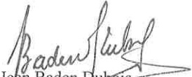

<!-- page 1 -->

# AUX BUREAUX DE CHANGE

La présente circulaire détermine certaines mesures préventives que les bureaux de change doivent prendre aux fins de lutter contre le blanchiment de capitaux et le financement du terrorisme.

### 1. Devoir de vigilance relatif à la clientèle

Tout bureau de change doit mettre en place des procédures écrites et prendre des mesures permettant d'établir l'identité des clients, bénéficiaires, mandataires, donneurs d'ordre et bénéficiaires effectifs.

Les bureaux de change doivent établir le profil de risque des clients ou de catégorie de clients afin d'effectuer une vigilance constante sur la clientèle.

Le profil de risque est une évaluation individualisée du niveau de risque de chaque client. Il prend en compte des éléments permettant de caractériser les risques présentés par un client, à savoir : ses activités (profession), ses revenus ou sa situation financière, tout élément permettant d'apprécier son patrimoine, l'objet et la nature intentionnels de la relation d'affaires ou de l'opération ponctuelle, le niveau d'activité attendu, la provenance des fonds, etc. Le profil de risque doit être complet, exact et mis à jour selon une fréquence adaptée au risque.

Les bureaux de change doivent exercer une vigilance permanente et examiner les opérations effectuées par la clientèle en vue de s'assurer qu'elles sont conformes à ce qu'elles savent de leurs clients, de leurs activités commerciales, de leur profil de risque et le cas échéant de la source de leurs fonds. Si un client présente un risque plus élevé, le bureau de change doit appliquer, en fonction de son appréciation du risque, des mesures de vigilance renforcées.

### 2. De l'identification de la clientèle

L'identification des clients a lieu lors :

1) de l'établissement de la relation d'affaires ;

2) des transactions occasionnelles égales ou supérieures au seuil établi par la loi et les règlements;

1

方

<!-- page 2 -->

3) des transactions sous forme de virements électroniques;

4) des transactions multiples en espèces, tant en gourdes qu'en devises étrangères, lorsque le total dépasse le seuil établi et lorsqu'elles sont réalisées par et pour le compte de la même personne en l'espace d'une journée ou dans une fréquence inhabituelle ;

5) de l'existence d'un soupçon de blanchiment de capitaux ;

6) de l'existence d'un soupçon de financement du terrorisme ;

7) des doutes quant à la véracité ou la pertinence des données d'identification du client précédemment obtenues.

L'identification doit porter également, qu'il s'agisse d'une personne physique ou morale, sur l'objet et la nature envisagée de la relation d'affaires.

L'identification et la vérification de l'identité portent sur le patronyme légal et autres noms utilisés (par exemple : nom de jeune fille), le lieu et la date de naissance, l'adresse du domicile principal. L'identification des clients s'effectue par la présentation d'un document officiel original en cours de validité et comportant une photographie (carte d'identification nationale ou permis de conduire ou passeport). La vérification de l'adresse est effectuée par la présentation d'un document de nature à en faire la preuve. Une copie de tous les documents doit être faite, classée et centralisée. Des contrôles formels doivent être effectués quant à la signature, aux éventuelles anomalies sur la photographie et à l'apparence physique du client potentiel.

Lorsque le client est une personne morale ou une construction juridique, la vérification de l'identité porte sur la dénomination sociale, l'adresse du siège social, l'identité des administrateurs, la preuve de sa constitution légale et la connaissance des dispositions régissant le pouvoir d'engager la personne morale.

Les bureaux de change doivent prendre des mesures raisonnables pour obtenir des informations sur l'identité véritable des personnes dans l'intérêt desquelles une transaction est effectuée, s'il y a le moindre doute sur le fait que ces clients pourraient ne pas agir pour leur propre compte. Aussi, les mandataires ne peuvent arguer du secret professionnel pour ne pas divulguer l'identité du réel bénéficiaire.

Les bureaux de change sont tenus de vérifier l'identité des clients au moyen de documents, de sources de données ou de renseignements indépendants et fiables.

Lorsque les clients n'agissent pas pour leur propre compte, les bureaux de change sont tenus d'obtenir des informations nécessaires sur l'identité des personnes dans l'intérêt desquelles une transaction est effectuée. En outre, un avocat, un notaire, un comptable, un courtier en valeurs mobilières intervenant en tant qu'intermédiaire financier ne peut pas arguer du secret professionnel

 $ f_{2} $

<!-- page 3 -->

pour ne pas divulguer l'identité du bénéficiaire réel, conformément aux dispositions de l'article 49 du décret du 30 avril 2023.

Si les bureaux de change ne peuvent pas respecter les dispositions prévues ci-dessus, elles ne peuvent ni nouer ou maintenir une relation d'affaires, ni effectuer une opération pour le client. Elles détermineront, dans ce cas, s'il y a lieu de produire une déclaration de soupçon à l'Unité Centrale de Renseignements Financiers (UCREF) ou d'établir un rapport confidentiel interne conformément à l'article 46 du décret du 30 avril 2023.

Les renseignements sur la vérification de l'identification doivent être revus au moins tous les deux (2) ans pour les situations posant un risque élevé et tous les trois (3) ans dans les cas de risques modérés ou faibles. Des mesures d'atténuation des risques doivent être incluses dans les politiques et procédures.

Les bureaux de change sont tenus par ailleurs d'appliquer les mesures de vigilance à leurs clients existants, selon l'importance des risques qu'ils représentent.

Les bureaux de change ne sont pas tenus de façon répétée d'identifier chaque client et en vérifier l'identité chaque fois que celui-ci réalise une transaction. Le bureau de change peut s'en remettre aux mesures d'identification et de vérification déjà réalisées, à moins qu'il ait des doutes quant à la véracité des informations préalablement obtenues.

#### 2.1. Bénéficiaires effectifs

Les bureaux de change sont tenues d'identifier les bénéficiaires effectifs conformément aux dispositions des articles 40 à 42 du décret du 30 avril 2023.

Des mesures adéquates doivent être prises pour la vérification des données susmentionnées, ainsi que pour leur mise à jour lorsqu'il apparait que celles-ci ne sont plus actuelles.

Si les bureaux de change ne peuvent pas obtenir ces informations ou leurs clients restent en défaut de les communiquer ou leur communiquer des informations non pertinentes ou invraisemblables, ils ne peuvent ni nouer ou maintenir une relation d'affaires, ni effectuer une opération pour le client. Ils détermineront, dans ce cas, s'il y a lieu d'en informer l'UCREF.

#### 2.2. Les personnes politiquement exposées

Un devoir de vigilance doit s'exercer à l'égard des personnes politiquement exposées (PPE), qui sont définies par l'article 6 du décret du 30 avril 2023 comme des personnes qui exercent ou ont exercé d'importantes fonctions publiques dans un pays étranger ou en Haïti ou au sein de ou pour

3

<!-- page 4 -->

le compte d'une organisation internationale ainsi que les membres de la famille de cette personne, ou toutes autres personnes qui lui sont étroitement liées ou associées.

Les bureaux de change doivent disposer de systèmes appropriés de gestion de risques permettant de déterminer si le client est une personne politiquement exposée. Dès que le client est identifié comme personne politiquement exposée, il faut :

a) obtenir l'autorisation de la haute direction avant de nouer ou de continuer une relation d'affaires avec le client ;

b) prendre toutes mesures raisonnables pour établir l’origine du patrimoine et identifier l’origine des fonds ;

c) assurer une surveillance continue renforcée de la relation d'affaires.

### 3. Programme de prévention

Conformément à l'article 31 du décret du 30 avril 2023, les bureaux de change doivent mettre en place un programme de prévention qui comprend les éléments suivants :

a) des politiques, des procédures et des contrôles internes, y compris des dispositifs de contrôle de la conformité, et des procédures appropriées lors de l'embauche des employés, de façon à s'assurer qu'elle s'effectue selon des critères exigeants ;

b) la centralisation des informations sur l'identité des clients, bénéficiaires effectifs, mandataires et sur les transactions suspectes ;

c) la désignation d'un officier de conformité et la désignation de responsables de conformité au niveau de chaque succursale ou agence le cas échéant ;

d) une évaluation des risques en matière de blanchiment de capitaux et de financement du terrorisme et une classification des risques en fonction des activités et du profil de la clientèle;

e) l'élaboration d'un programme de formation continue à l'intention des employés ;

f) un dispositif de contrôle interne pour vérifier la conformité, l'observance et l'efficacité des mesures adoptées ;

g) la mise en place d'un dispositif de tests indépendants du contrôle de la conformité ; et

h) le traitement des opérations suspectes.

#### 3.1. Désignation d'un officier de conformité

L’officier de conformité est responsable de la mise en œuvre du programme de prévention et doit être sélectionné en fonction de sa compétence, de son expérience, de sa probité et de son éthique professionnelle. Il doit connaître les fonctions et la structure de l’institution, et être au fait des risques et des vulnérabilités liées au blanchiment de capitaux et au financement du terrorisme dans

后4

<!-- page 5 -->

le secteur du change. Il devra dépendre directement du conseil d'administration pour tout ce qui a trait aux questions liées à la lutte contre le blanchiment de capitaux et le financement du terrorisme.

L'officier de conformité a pour attributions de :

• assurer l’application des lois et règlements en vigueur ;

assurer le respect des procédures et méthodes internes de lutte contre le blanchiment de capitaux et le financement du terrorisme ;

• identifier les carences et faire les recommandations qui s’imposent ;

• proposer des programmes de formation sur une base périodique ;

assurer la liaison avec l'UCREF :

• préparer et acheminer les déclarations de soupçons à l'UCREF ;

s'assurer que les déclarations de transactions sont complétées et acheminées à l'UCREF dans les délais requis ;

• recevoir et donner suite aux demandes d'informations de l'UCREF et de toute autre autorité compétente agissant dans le cadre de la lutte contre le blanchiment de capitaux et le financement du terrorisme ;

- exercer le devoir de vigilance vis-à-vis des clients.

Pour assurer l'application du programme de prévention, l'officer de conformité peut déléguer certaines fonctions à d'autres employés de l'institution.

#### 3.2. Politiques et procédures de conformité

Les bureaux de change sont tenus d'élaborer un programme de prévention comprenant des politiques, procédures et méthodes consignées par écrit et permettant d'identifier les facteurs de risques et d'évaluer les risques de blanchiment de capitaux et de financement des activités terroristes que présentent leurs activités.

Les politiques, procédures et méthodes doivent être approuvées par le conseil d'administration et tenues à jour. Elles doivent être clairement communiquées à tous les cadres appelés à traiter avec des clients.

Les politiques et procédures doivent couvrir toutes les obligations de déclaration, de tenue de documents, de conservation de documents, d'identification des clients, de contrôle, d'évaluation et d'atténuation des risques qui s'appliquent au bureau de change. Elles doivent être intégrées à la stratégie globale de gestion des risques de l'institution et comporter des étapes appropriées pour prévenir, détecter, évaluer, surveiller, gérer, atténuer en permanence les risques de blanchiment de capitaux et de financement du terrorisme liés aux clients, zones géographiques, ou encore aux produits, services, nouvelles technologies, opérations et canaux de distribution.

5

<!-- page 6 -->

Les politiques, procédures et méthodes doivent s'appliquer à toutes les succursales et tout réseau constitué par des sous-agents de change, le cas échéant.

#### 3.3. Evaluation des risques

Le programme de prévention et de conformité doit comprendre une évaluation des risques de blanchiment de capitaux et de financement du terrorisme.

L'évaluation des risques est une analyse des menaces et faiblesses en matière de blanchiment de capitaux ou de financement du terrorisme que présentent les activités du bureau de change. Cette évaluation varie notamment selon la taille de l'institution, son emplacement géographique et selon les activités exercées.

Une classification des risques doit être effectuée en fonction des services offerts, des conditions des transactions proposées, des canaux de distribution utilisés, des caractéristiques des clients, des régions géographiques d'activité.

L'évaluation des risques implique que les employés soient bien imbus des activités de l'institution et qu'ils fassent preuve de jugement afin d'évaluer les risques de blanchiment. Cette évaluation ne doit pas être statique et devra être modifiée au moins tous les douze (12) mois.

#### 3.4. Formation continue

Les bureaux de change doivent s'assurer que leurs employés, notamment ceux qui sont en contact permanent avec les clients, ont des connaissances minimales en matière de lutte contre le blanchiment de capitaux et le financement du terrorisme et une maitrise des dispositifs de prévention mis en place.

Les bureaux de change doivent élaborer et mettre à jour un programme de formation continue axée sur la conformité. Ils doivent également élaborer et mettre en application un plan de formation indiquant notamment les catégories de participants, les sujets qui seront couverts, et la fréquence des séances de formation.

Le programme et le plan de formation continue doivent être adaptés à la taille, à la structure de l'institution et à son niveau d'exposition au risque de blanchiment de capitaux et de financement du terrorisme.

6

<!-- page 7 -->

#### 3.5. Dispositif de contrôle interne

Les bureaux de change doivent faire preuve d'une vigilance constante et se doter d'une organisation et de procédures internes propres à assurer le respect des dispositions prévues par la loi et permettant de prévenir et d'identifier toute tentative de blanchiment de capitaux ou de financement du terrorisme.

Ce système de contrôle interne doit contenir entre autres :

- un mécanisme de contrôle des politiques et procédures de lutte contre le blanchiment de capitaux et le financement du terrorisme ;

- une structure garantissant la confidentialité du traitement des informations ;

- des mesures d'identification des éléments à risques liés au blanchiment de capitaux et au financement du terrorisme, et des systèmes d'évaluation de ces risques ;

- un système centralisé de documentation et d'informations.

#### 3.6. Des tests indépendants

Les bureaux de change doivent évaluer au moins une fois l'an l'efficacité de leurs procédures de prévention de blanchiment de capitaux et de financement du terrorisme afin d'identifier les points de faiblesse et mettre en application les recommandations en ce qui a trait aux améliorations et/ou aux modifications à apporter aux mécanismes de contrôle déjà en place.

Cette évaluation doit être effectuée par le vérificateur interne et sanctionnée par un rapport qui précise la nature, l'étendue et les procédés d'évaluation utilisés de même que les conclusions et recommandations.

Ce rapport devra indiquer clairement si l'entité concernée a respecté les procédures internes et les exigences faites par la législation. Les vérifications spécifiques peuvent notamment s'appliquer aux points suivants :

des entrevues auprès des employés chargés des opérations et de leurs superviseurs pour évaluer leur degré de connaissance et de respect des procédures de lutte contre le blanchiment de capitaux et le financement du terrorisme ;

l'examen d'un échantillon de formulaires d'archivage des documents et de formulaires de renseignements sur les transactions financières douteuses ;

- une vérification du système de tenue des documents ;

• l'existence des justificatifs joints ou référencés aux pièces comptables ;

- la connaissance par les collaborateurs des règles internes anti-blanchiment.

 $ f(x) $

<!-- page 8 -->

Les résultats de toute vérification doivent être signalés au conseil d'administration du bureau de change.

#### 3.7. Traitement des transactions suspectés

Les bureaux de change doivent élaborer et mettre en application des politiques quant à l'identification et au suivi des transactions inhabituelles ou suspectes. Ces politiques devront définir ce qui est considéré comme suspect ou inhabituel, et fournir des exemples à cet égard.

L'identification des transactions inhabituelles ou suspectes peut être fait par la surveillance des transactions, des informations en provenance de tiers (journaux, internet, etc.), la connaissance qu'a le bureau de change de l'environnement du client.

### 4. Conservation de documents

Les bureaux de change sont tenus de conserver pendant une période de cinq (5) ans au moins, à partir de la date de cessation des relations avec le client habituel ou occasionnel, toute la documentation relative à l'identité des clients, les relevés d'opérations importantes en espèces, les fiches d'opérations de change, les rapports mentionnés à la section 5 des présentes, les livres de comptes et les correspondances commerciales.

A cette fin, une formule d'archivage des documents sur les opérations doit être utilisée pour la conservation des documents.

Une copie des déclarations de transactions et des déclarations de soupcons doit être gardée et archivée par l'officier de conformité.

Cette conservation des documents permettra de répondre rapidement aux demandes d'informations des autorités compétentes et de reconstituer les transactions individuelles (y compris les montants et les types d'espèces en cause, le cas échéant) de façon à fournir, le cas échéant, des preuves en cas de poursuite pour conduite criminelle.

### 5. Elaboration de déclarations

Deux types de déclarations doivent être élaborés : les déclarations de transactions pour toute opération globalement égale ou supérieure au seuil établi et les déclarations de soupçons lorsque des doutes existent quant à la licité, la légitimité ou la régularité d'une transaction.

Pour toute transaction qui parait complexe, inhabituelle, injustifiée ou sans justification économique ou sans objet licite, même lorsque le montant en jeu n'atteint pas le seuil établi, toutes

(8)

<!-- page 9 -->

les informations pertinentes quant à l'origine des fonds, l'objet de l'opération et l'identité des personnes impliquées dans la transaction doivent être recueillis et un rapport devra être établi par le bureau de change. Le rapport confidentiel écrit doit comporter tous les renseignements utiles et requis par la loi sur les modalités de l'opération ainsi que sur l'identité du donneur d'ordre, et le cas échéant, sur les acteurs économiques impliqués.

Les déclarations de transactions et les déclarations de soupcons doivent être transmises à l'UCREF par voie de communication électronique, ou à défaut par tout moyen écrit, conformément aux délais établis par voie réglementaire.

### 6. Technologies nouvelles

Les bureaux de change doivent identifier et évaluer les risques de blanchiment de capitaux et de financement du terrorisme pouvant résulter : (a) du développement de nouvelles pratiques commerciales, y compris de nouveaux mécanismes de distribution ; (b) de l'utilisation de technologies nouvelles ou en développement en lien avec de nouveaux produits ou des produits préexistants. Cette évaluation de risques devrait avoir lieu avant le lancement des nouvelles pratiques commerciales ou avant l'utilisation de technologies nouvelles ou en développement. Les bureaux de change doivent prendre des mesures appropriées pour gérer ces risques.

### 7. Mesures de vigilance renforcées

Les bureaux de change doivent appliquer, en fonction de leur appréciation du risque, des mesures de vigilance renforcées dans des situations qui, de par leur nature, peuvent présenter un risque élevé de blanchiment de capitaux ou de financement du terrorisme.

### 8. Sanctions

En cas de non-respect des obligations définies dans la présente circulaire ou de constat de défaut de vigilance de la part des bureaux de change, la BRH se réserve le droit de prendre toutes sanctions administratives allant de l'avertissement au retrait de l'agrément dans les cas les plus graves, et/ou d'appliquer une amende de deux cent mille gourdes (HTG 200,000.00) par violation constatée.

La BRH peut exiger d'un bureau de change qu'il apporte les corrections nécessaires quant aux violations relatives à la présente circulaire. A défaut de se conformer aux actions de redressement requises par la BRH, le bureau de change est assujetti à une pénalité de cent cinquante mille gourdes (HTG 150,000.00) par jour d'infraction à compter de la date à laquelle l'infraction lui est notifiée par la BRH, sans dépasser trente (30) jours. Toute pénalité sera déduite du solde du compte de l'institution fautive à la BRH.

后9

<!-- page 10 -->

### 9. Abrogation et entrée en vigueur

La présente circulaire abroge la circulaire 128 et entre en vigueur le 1er septembre 2023.

Port-au-Prince, le 16 août 2023.

Jean Baden Dubois

Gouverneur
