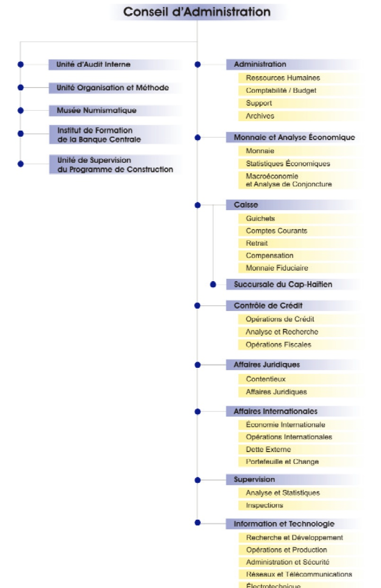
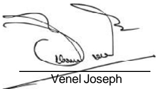

<!-- page 1 -->

## 33H BANQUE DE LA REPUBLIQUE D'HAITI

RAPPORT ANNUEL

2001

www.brh.net

<!-- page 2 -->

## CONSEIL D'ADMINISTRATION

VENEL JOSEPH

Gouverneur

HANCY PIERRE-LOUIS

Gouverneur-Adjoint

## RÉGINALD MONDÉSIR Directeur Général

## GLADYS PÉAN

Membre

## YVON GUIRAND

Membre

<!-- page 3 -->

# ORGANIGRAMME

<!-- page 4 -->

## TABLE DES MATIÈRES

### A. L'ACTIVITÉ ÉCONOMIQUE EN 2001

I. LE CADRE DE PRODUCTION.....13
I.I Introduction .....13
I.2 Productionet prix.....14
I.3 Prix et salaires.....18
I.4 Situation de l'emploi.....20

II. LA MONNAIE ET LE FINANCEMENT DE L'ÉCONOMIE.....21
II.1 La politique monétaire en 2001.....21
II.2 Les résultats intermédiaires.....25
II.3 Les résultats finals.....26
II.4 Évolution des agrégats monétaires.....29
II.5 Contrepartie de M3 et financement de l'économie.....30

III. FINANCES PUBLIQUES.....32
III.1 Recettes .....33
III.2 Dépenses .....35
III.3 Financement .....37

IV. BALANCE DES PAIEMENTS.....40
IV.1 Les transactions courantes.....40
IV.2 Mouvements de capitaux.....45

B. ÉVOLUTION DU SYSTÈME BANCAIRE EN 2001

V. LE SYSTÈME BANCAIRE : VUE D'ENSEMBLE.....48
V.1 Le système bancaire.....50
V.2 Structure du système bancaire.....52
V.3 Distribution du crédit.....54
V.4 Parts de marché individuelles.....57

VI. LES ACTIVITÉS ET RÉSULTATS DU SYSTÈME BANCAIRE.....59
VI.1 Activités bancaires.....59
VI.2 Structure financière et qualité de l'actif.....67
VI.3 Résultats .....69
VI.4 Effectif des banques et productivité.....75

VII. LA SURVEILLANCE DES BANQUES.....77
VII.1 Activités de surveillance.....77
VII.2 Autres .....77

C. LA BRH EN 2001

VIII. MONNAIE FIDUCIAIRE ET MONNAIE SCRIPTURALE.....82
VIII.1 Billets et monnaie divisionnaire.....82
VIII.2 Les chèques.....84

VIII.3 Dépôts et tirages des banques commerciales.....86

<!-- page 5 -->

IX. EFFORTS LIÉS À LA MISE EN ŒUVRE DE LA POLITIQUE MONÉTAIRE.....88
IX.1 De l'utilisation des opérations de change par la BRH.....88
IX.2 Gestion des avoirs extérieurs de la BRH.....90

X. ORGANISATION ET MÉTHODES.....91
XI. ACTIVITÉS DE DÉVELOPPEMENT TECHNOLOGIQUE.....92
XI.1 Continué de service.....92
XI.2 Les interventions sectorielles.....92
XI.3 Les projets techniques.....93
XI.4 Projets internes.....99
XI.5 Autres réalisations.....100
XI.6 Ressources humaines de la BRH.....100
XI.7 Travaux immobiliers .....104

D. ÉTATS FINANCIERS ET ANNEXE JURIDIQUE

XII. ÉTATS FINANCIERS.....107
XIII. ANNEXE JURIDIQUE.....136

E. ANNEXE STATISTIQUE

I.1 Produit intérieur brut par branche d'activité économique.....144
I.1a Contribution à la croissance du PIB réel.....145
I.1b Taux de croissance du PIB réel.....146
I.2 Compte du produit intérieur brut (en millions de gourdes à prix courants).....147
I.2a Contribution de la demande globale à la croissance économique.....148
I.3 Compte du produit intérieur brut (en millions de gourdes 1986-1987).....149
I.3a Structure de la croissance du PIB réel (en millions de gourdes 1986-1987).....150
I.3b Compte du produit intérieur brut (variations en pourcentage).....151
I.3c Structure de la croissance du PIB réel (variations en pourcentage).....152
I.4 Indice des prix à la consommation (IPC) ensemble du pays.....153
I.5 Taux d'inflation.....154
I.6 Taux de change.....155
I.7 Composantes et contreparties de l'agrégat M3.....156
I.8 La base monétaire et ses sources.....157
I.9 Bilan de la BRH.....158
I.10 Bilan consolidé des banques commerciales (base annuelle).....159
I.11 Bilan consolidé des banques commerciales (base mensuelle).....160
I.12 Résumé des opérations financières de l'administration centrale (base annuelle).....161
I.13 Résumé des opérations financières de l'administration centrale (base mensuelle).....162
I.14 Résumé de la balance des paiements d'Haïti.....163
I.15 Position extérieure globale d'Haïti.....164
I.16 Exportations d'Haïti par produits.....165
I.17 Exportations aux USA (FOB) (à base de matières premières importées).....166
I.18 Exportations aux USA (FOB) (à base de matières premières locales).....167
I.19 Importations d'Haïti par grandes catégories de produits.....168
I.20 Importations de produits pétroliers.....169

II.1 Chiffres clés du bilan par banque.....170
II.2 Chiffres clés des résultats par banque.....171
II.3 Ratios financiers par banque (structure financière et qualité de l'actif).....172
II.4 Ratios financiers par banque (rentabilité).....173
II.5 Bilan par banque.....174
II.6 Résultats par banque.....175

<!-- page 6 -->

# AVANT-PROPOS DU GOUVERNEUR

Le Conseil d'Administration de la Banque de la République d'Haïti prend plaisir à présenter au public le rapport annuel de l'exercice fiscal 2000-2001 portant sur la conduite de la politique monétaire, l'évolution de l'activité économique, la situation du système bancaire et les opérations relatives à la gestion de la banque centrale.

L'exercice 2000-2001 s'est déroulé dans un environnement socio-économique caractérisé par la persistance de la crise politique qui a handicapé une fois de plus la reprise des investissements privés et la mise en œuvre du programme d'investissements publics en raison, notamment, du blocage de l'assistance externe. Le ralentissement marqué de l'activité économique, dans un contexte de baisse des échanges extérieurs, a abouti à la fin de septembre 2001, à une contraction de la Production Intérieure Brute (PIB) de 1,1 %. C'est donc dans un environnement macroéconomique défavorable que la banque centrale a mené ses missions essentielles d'assurer la stabilité de la monnaie nationale et de maintenir l'équilibre du système bancaire.

Les actions de la BRH, orientées vers le resserrement constant des conditions monétaires, par le maintien des taux d'intérêt élevés sur les bons BRH, en regard du déséquilibre des finances publiques, ont permis de ramener le taux d'inflation en glissement annuel de 15,32 % à 12,34 % et de garder l'évolution du taux de change de fin de période dans une bande de fluctuation allant de 22,5 gourdes à 25,4 gourdes, traduisant ainsi une appréciation d'environ 10 % par rapport à la fin de l'exercice précédent.

En tant que régulateur chargé de la surveillance du système financier, la BRH a effectué, dans le cadre de multiples inspections sur place et sur pièces, un suivi systématique des normes prudentielles pour s'assurer de la conformité de leur application par rapport aux prescrits de Bâle. Au titre du renforcement du cadre de contrôle, la BRH a décidé, en mars, l'application des limites réglementaires définitives sur la concentration des risques de crédit et en septembre 2001, la fixation des limites définitives sur la suffisance des fonds propres. En janvier, elle a mis en application la circulaire portant sur le ratio de prêts en dollars par rapport au passif en dollars.

Consciente du rôle d'encadrement qu'elle doit également jouer auprès du système financier, la banque centrale avec le concours du Fonds Monétaire International (FMI) et avec la participation de Citigroup, a organisé un séminaire sur la lutte contre le blanchiment d'argent.

En vue de protéger le système financier face à la mondialisation des activités de réseaux de crime organisé, la BRH a pris une part active dans le processus qui devait aboutir, en février 2001, au vote par le Parliament haïtien de la loi relative au blanchiment de fonds d'origine criminelle et à l'acceptation d'Haïti au cours du mois de mars 2001 comme membre observateur du GAFIC (Groupe d'Action Financière de la Caraïbe).

Dans le cadre de son programme de modernisation, la banque centrale a poursuivi le processus de mise en œuvre de la plupart des projets et applications de développement technologique en cours de réalisation depuis 1995. En

<!-- page 7 -->

particulier, elle a continué, de concert avec le Ministère de l'Éducation Nationale, les travaux liés à la finalisation du projet Internet concernant cinq lycées répartis à travers la capitale et certaines villes de province. Elle a aussi assuré le suivi dans la réalisation des enquêtes portant sur le projet Extranet régional pour les échanges d'informations entre les banques centrales de la Caraïbe et la préparation de la réunion des Gouverneurs. De plus, pour adapter l'environnement technologique avec l'infrastructure physique et doter l'institution d'un immeuble qui soit en conformité avec les standards d'une banque centrale moderne, la BRH a poursuivi au cours de l'exercice les travaux de construction d'un bâtiment devant loger son siège central à la rue du Quai.

Dans l'optique d'améliorer la qualité et la performance de ses ressources humaines parallèlement à la consolidation de l'infrastructure technologique de l'institution, la BRH a poursuivi les activités du Programme des lauréats et de formation continue. Entre octobre 2000 et septembre 2001, huit étudiants ont rejoint les 17 boursiers de la banque centrale en formation à l'étranger dans des programmes de niveau maîtrise en Amérique du Nord et en Europe. Dans le cadre de la formation de courte durée visant le perfectionnement du personnel, 69 cadres de l'institution ont suivi des séminaires à l'étranger et 114 autres ont participé à des séminaires et conférences tenus en Haïti.

Ce rapport qui compile des données économiques et financières sur l'évolution de l'économie et du système financier a été réalisé avec le souci de favoriser la diffusion transparente de l'information, d'une part, et de fournir, d'autre part, aux acteurs économiques des éléments factuels et analytiques leur permettant de mieux appréhender le cadre macroéconomique dans lequel s'est déroulée la politique monétaire et d'être informés des activités menées par la BRH au cours de l'exercice. La Banque de la République d'Haïti espère, ainsi, avoir satisfait les attentes des lecteurs intéressés à différents aspects de la réalité économique haïtienne.

<!-- page 8 -->

### A. L'ACTIVITÉ ÉCONOMIQUE EN 2001

Après trois années consécutives d'accroissement de la production et un ralentissement significatif de l'activité en 2000, l'économie a connu durant l'exercice 2000-2001 un taux de croissance négatif de l'ordre de 1,1 %. Ce résultat qui indique l'évolution du Produit intérieur brut (PIB) en gourdes constantes de 1986-1987 s'inscrit dans la phase de récession enclenchée depuis l'an 2000 et traduit l'impact négatif des évolutions internes et externes sur l'environnement macroéconomique et financier.

Sur le plan interne, les incertitudes liées à la crise politique et le maintien du gel de l'aide externe ont constitué de sérieux obstacles à l'accroissement des investissements privés et des projets publics de développement en attente de financement. L'augmentation du ratio des improductifs, les faillites d'entreprises et le faible niveau des recettes fiscales sont apparus comme les conséquences les plus visibles du ralentissement marqué de l'économie par rapport aux rythmes de croissance des dernières années. Les mauvais résultats financiers des agents non financiers endettés auprès du système bancaire ont contribué à infléchir à la baisse les courbes de rendement des investissements privés et à accentuer le repli de l'activité. En termes réels, les importations, l'investissement global et les exportations ont diminué de 3,48 %, 1,89 % et 3,22 % respectivement. Ainsi, l'offre et la demande globales ont régressé de 2,38 %.

Sur le plan externe, les signes de plus en plus clairs d'affaiblissement de l'économie américaine ont renforcé les anticipations pessimistes sur le volume des échanges entre Haïti et son principal partenaire commercial. La baisse des prix des produits pétroliers sur le marché mondial, la réduction de l'investissement public et le net recul des importations d'articles manufacturés ont favorisé la chute des importations totales en valeur. Hormis le cacao, les principaux produits d'exportation ont été affectés par la baisse de la demande aux États-Unis. Ces produits incluent les articles manufacturés, les mangues, le café et les articles de la petite industrie.

En dépit des récents progrès réalisés dans les cultures rizicole et bananière, le secteur agricole reste toujours affecté par la faiblesse de la production. Cela tient à l'incidence de nombreux facteurs parmi lesquels on peut citer la sécheresse, les maladies, la contraction de l'investissement privé et la faiblesse des subventions agricoles. Néanmoins, la faible valeur ajoutée des secteurs «Bâtiments et travaux publics», et le recul des «Services non marchands» ont été les facteurs les plus déterminants dans la contraction du PIB.

La politique monétaire a été orientée vers le resserrement continu des conditions monétaires en vue de réduire les effets du déficit public. Elle a eu un effet-prix qui s'est traduit par une décélération de l'inflation de 15,32 % à 12,34 % en glissement annuel. Compte tenu de la croissance négative enregistrée cette année, l'effet-prix de la politique monétaire a prévalu durant l'exercice fiscal 2000-2001.

<!-- page 9 -->

### I. LE CADRE DE PRODUCTION

### I. 1 Introduction

La politique des pouvoirs publics s'est déroulée cette année dans un environnement caractérisé par l'aggravation des contraintes tendant à favoriser la dégradation des conditions économiques. Comme pour l'exercice précédent, un programme relais a permis d'évaluer l'action du gouvernement sur une base trimestrielle, mais il n'a pas fait l'objet d'un accord formel avec le Fonds Monétaire International (FMI). Les bailleurs de fonds n'ayant fait aucune promesse d'aide budgétaire au gouvernement, celui-ci a été obligé de reconduire son budget dans un climat politique marqué par l'organisation des élections présidentielles de novembre 2000. De plus, l'échec répété des négociations politiques avec la médiation de l'Organisation des États Américain (OEA) a renforcé l'idée que les conditions n'étaient pas réunies pour lever les obstacles conjoncturels à la reprise de l'activité économique. Dès lors, il est apparu difficile d'envisager la possibilité d'une réduction sensible des déséquilibres macroéconomiques hérités de l'exercice antérieur pour permettre à l'économie de renouer avec la croissance en 2001.

Jusqu'à la fin de l'exercice antérieur, le prix du baril de pétrole brent était supérieur à trente dollars ÊU et le taux de change de la gourde avait affiché une forte volatilité pour atteindre un pic de 28,33 gourdes au 30 septembre 2000. De plus, l'exercice 2000-2001 a débuté avec des taux d'inflation élevés (18 % en moyenne au premier trimestre) consécutifs à l'ajustement à la hausse des prix à la pompe des produits pétroliers et le premier trimestre a été marqué par l'élargissement du déficit budgétaire, suite à l'affaiblissement des recettes fiscales et au règlement des dépenses occasionnées par les élections de novembre.

La baisse des cours du pétrole sur le marché international à partir de décembre 2000 et la mise en place d'un nouveau pouvoir exécutif en février 2001 n'ont pas contribué à favoriser le processus de relance de l'activité au deuxième trimestre. L'investiture du nouveau président et la perspective de changement de gouvernement ont suscité l'attentisme des opérateurs économiques. Les dépenses ont augmenté moins vite par rapport au premier trimestre, mais les arriérés d'impôts se sont accumulés. Les maigres résultats obtenus par l'Unité de Gestion et de Contrôle Fiscal (UGCF) tout au long de cette période ont témoigné des difficultés rencontrées par le fisc dans le recouvrement des créances de l'État. Conséquement, le deuxième trimestre a été compromis par le cycle électoral et l'accentuation des déséquilibres macroéconomiques.

Le financement du déficit, proche de 800 MG au premier trimestre, a donné aux opérateurs un signal alarmant sur le déroulement du reste de l'exercice. Par son ampleur et sa persistance, ce déficit a représenté aussi une menace pour la croissance compte tenu de la baisse des investissements publics et du rôle du financement monétaire dans la formation des anticipations des acteurs du système économique.

Les discussions annoncées dans la perspective d'un programme économique avec le FMI au titre de la facilité pour la réduction de la pauvreté et pour la croissance (Poverty Reduction Growth Facility) n'ont pas eu lieu comme prévu.

<!-- page 10 -->

À la fin du deuxième trimestre, le nouveau gouvernement s'est retrouvé avec un déficit supérieur à 1,5 milliard de gourdes, alors que le programme relais prévoyait un financement monétaire ne dépassant pas 700 millions de gourdes pour tout l'exercice.

Durant les deux derniers trimestres, les autorités fiscales et monétaires se sont évertuées à renforcer les mécanismes susceptibles de contenir les effets inflationnistes du déficit en utilisant le cash-management et les principaux instruments de reprise de la liquidité. Le taux d'inflation en glissement annuel est passé d'une moyenne de 18,15 % au premier semestre à 15,52 % au deuxième semestre. Dans ce contexte, les efforts de correction des autorités n'ont pas permis de neutraliser l'impact du déséquilibre budgétaire sur la stabilité macroéconomique et de renverser la situation qui prévalait au cours de la première moitié de l'exercice. Le déficit budgétaire a continué de s'aggraver, mais à un rythme modéré par rapport au premier semestre. Toutefois, en dépit d'un financement monétaire de 2,3 milliards de gourdes sur l'ensemble de l'année, des résultats encourageants ont été obtenus en fin d'exercice grâce à l'utilisation combinée des bons BRH et des réserves obligatoires. En glissement annuel, le taux d'inflation est passé de 15,32 % à 12,34 % et le taux de change de référence de fin de période de 28,33 gourdes à 25,49 gourdes.

### 1.2 Production et prix

Le PIB a régressé de 1,1 % alors qu'il avait progressé de 0,9 % un an auparavant en gourdes constantes de 1986-1987¹.

Graphique 1 Produit Intérieur Brut (PIB) réel (base 1976)

| Year | Tx. de croiss. annuelle (%) | PIB annuel en volume M G |
| --- | --- | --- |
| 1991 |   | 1300 |
| 1992 | -5.5 | 1250 |
| 1993 | -5.5 | 1100 |
| 1994 | -11.5 | 10000 |
| 1995 | 10.0 | 11000 |
| 1996 | 4.0 | 11800 |
| 1997 | 2.5 | 12500 |
| 1998 | 2.0 | 12800 |
| 1999 | 2.5 | 13000 |
| 2000 | 0.5 | 13100 |
| 2001 | -1.0 | 12900 |

<!-- page 11 -->

Le secteur primaire dont la production avait continuellement baissé entre 1997 et 2000 est sorti d'un creux de -3,62 % pour croître de 0,64 % en 2001. En glissement annuel, sa part relative dans le PIB a connu une légère amélioration en passant à 26,65 % en 2001, mais la tendance à la stagnation demeure pour la période susmentionnée. Le secteur secondaire, qui était jusque-là l'un des principaux moteurs de la croissance, a régressé de 0,75 %. Sa contribution au PIB est passée de 49,82 % à 10,31 %. Le dynamisme du secteur tertiaire s'est encore affaibli cette année puisque son taux de croissance est passé de 2,40 % à 0,81 %. Il a conservé néanmoins la plus forte pondération dans le PIB avec 51,00 %, mais sa contribution à la valeur ajoutée est tombée à 24,29 % contre -99,21 % un an plus tôt.

#### 1.2.1 Valeur ajoutée par secteur d'activité

## Secteur primaire

Après avoir baissé de 2,23 % en moyenne de 1998 à 2000, les activités du secteur primaire ont augmenté de 0,64 % en 2001 par rapport à 1999-2000. Cette amélioration n'indique pas une reprise de la production agricole dans la mesure où le niveau atteint en 2001 reste largement inférieur à ceux des années antérieures à 2000. En effet, entre 1996-1997 et 1998-1999, la part relative du secteur primaire a représenté en moyenne 27,55 % du PIB contre 26,65 % en 2001. Le taux de croissance de cette branche reflète essentiellement l'augmentation de la production de riz et de bananes réalisée dans le cadre de la mise en application de deux projets : le «Programme spécial pour la sécurité alimentaire » et le «Projet de réhabilitation des périmètres irrigués de la Plaine de l'Arcahaie» (PREPIPA). Le premier projet a contribué à doubler la production de riz «paddy» dans l'Artibonite en faisant passer le rendement moyen à l'hectare à sept tonnes métriques (7 TM). Le second a permis une augmentation encore plus substantielle de la production de bananes : le rendement moyen à l'hectare est passé de 7 TM à 16 TM².

En revanche, la production de cacao et de mangues est restée constante. Sur l'ensemble du pays, les rendements moyens calculés sont respectivement de 500 kilos à l'hectare pour le cacao et de 1 650 kilos par manguier.

Par ailleurs, la production agricole a été affectée par la baisse de la production de café à l'échelle nationale. Le rendement moyen à l'hectare (4 sacs de 60 kilos) a été réduit de moitié en raison de l'action du «pourridié», de la «rouille» et de «l'escolite» sur les arbres de couverture, les caféiers et les fèves de café. En dehors de l'incidence néfaste des insectes et des maladies, la production caféière a subi des contraintes liées à la dégradation des sols et aux déficiencies des infrastructures.

## Autres branches du secteur primaire

Le sous-secteur «Sylviculture, élevage et pêche» a affiché une faible croissance (0,40 %) après avoir reculé de 1,26 % en 2000. En dépit de l'aide technique fournie par la coopération cubaine dans le domaine de la pêche, la contribution de ce sous-secteur au PIB s'est établie à 13,6 % à la fin de cet exercice.

<!-- page 12 -->

La production animale s'est encore contractée cette année en raison notamment de la forte baisse de la production avicole. En 2001, la production de poulets est tombée à 300 mille contre une moyenne de 3 millions pour la période 1996-2000, ce qui correspond à une baisse de plus de 90 %. Dans une proportion moindre, la baisse des cheptels s'est manifestée au niveau d'autres espèces comme les porcins, les ovins, les caprins et les bovins. Le déclin de la production animale résulte des insuffisances structurelles liées aux problèmes de financement des activités de soins sanitaires, d'approvisionnement en aliments, de formation et d'encadrement des éleveurs.

Après avoir connu une croissance de 7,69 % en 1999, les activités de production des industries extractives, principalement orientées vers le secteur de la construction, continuent à stagner en 2001. Leur part dans la valeur ajoutée totale est inférieure à 1 % depuis 1999. La faible contribution des industries extractives tient au ralentissement du rythme de croissance de la branche « Bâtiments et Travaux Publics » dont la part relative a oscillé entre 5,70 % et 7,30 % du PIB de 1997 à 2001.

## Le secteur secondaire

En 2001, la valeur ajoutée du secteur secondaire a stagné et sa contribution à la croissance du PIB est passée de 49,82 % en 2000 à 10,31 %.

Graphique 2 Valeur ajoutée des secteurs d'activité (en pourcentage)

| Year | Agriculture | Industries manufact | Bâtiments et trav. publ. | Comm., restaur. et hôtels | Autr. serv. marchands | Serv. n/ marchands | Autres |
| --- | --- | --- | --- | --- | --- | --- | --- |
| 1997 | 29530 | 8180 | 5710 | 24410 | 11060 | 11510 | 9610 |
| 1998 | 28830 | 8030 | 6210 | 24640 | 11460 | 11400 | 9420 |
| 1999 | 27280 | 7580 | 6680 | 24960 | 11520 | 11090 | 10890 |
| 2000 | 26060 | 7500 | 7150 | 25900 | 11920 | 10910 | 10560 |
| 2001 | 26540 | 7610 | 7300 | 26370 | 11950 | 10670 | 9550 |

Le sous-secteur «Industries manufacturières», en régression depuis deux ans, a stagné avec un taux de croissance de 0,10 %. Sa part dans le PIB s'est toutefois améliorée en passant de 7,50 % à 7,61 %. Cependant, ces résultats sont loin d'être probants dans la mesure où la valeur de la production de ce sous-secteur est gonflée par un effet-

prix. Celui-ci résulte de l'existence de nouveaux débouchés dans le textile permettant aux exportateurs haïtiens de traiter directement avec les distributeurs étrangers et d'écouler leurs produits à des prix quinze fois plus élevés qu'auparavant. En outre, les industries de sous-traitance, principale composante des «Industries manufacturières»,

<!-- page 13 -->

ont subi les répercussions du ralentissement de la demande de produits textiles aux États-Unis. Leur performance a été affectée par la fermeture de 20 % des usines durant les six derniers mois de l'exercice.

Le sous-secteur «Bâtiments et travaux publics» est en constante progression depuis 1995 et demeure le principal moteur de l'activité économique avec un poids équivalent à 7,30 % de la valeur ajoutée. La contribution de ce sous-secteur est en recul de 5,71 %, mais elle a atténué la magnitude de la contraction du PIB. Son rythme de croissance s'est considérablement ralenti en passant de 11,20 % en 1997-1998 à 0,60 % en 2001. Ce résultat traduit l'effet combiné de la baisse de 32 % des dépenses d'investissement du gouvernement central et de la contraction de 7,5 % du crédit bancaire au secteur privé. Il révèle à la fois le désengagement progressif du capital privé et les difficultés du gouvernement actuel à poursuivre les grands travaux d'infrastructure entrepris durant les cinq dernières années.

Le sous-secteur «Électricité et eau» dont la valeur ajoutée n'a cessé de reculer depuis 1997 est passé d'un taux de croissance de -9,2 % à -27,10 %. En dépit de sa contribution positive au PIB (24,10%), il a entraîné le secteur secondaire dans sa chute puisque les deux autres composantes de ce secteur ont progressé de 0,10 % et 0,60 % respectivement. Cette branche d'activité continue de souffrir de l'insuffisance des fonds de contrepartie pour les projets d'investissement publics et de la faiblesse du financement externe. Les informations fournies par la Banque Mondiale indiquent que sur 327 millions de dollars ÉU engagés pour la période allant de 1998-1999 à 2002-2003, 151 millions n'ont pas été décaissés pour les secteurs «Énergie, eau» et «Infrastructure urbaine».

## Les services

La croissance de la production du secteur tertiaire s'est établie à -0,81 % après avoir connu une variation moyenne de 2,60 % de 1998 à 2000. Ce résultat est imputable à l'effet conjugué de la contraction du sous-secteur «Autres services marchands» (-2,80 %) et de la diminution de l'offre du sous-secteur «Services non marchands» (-2,60 %). Pour la période susmentionnée, les «Services non marchands» ont connu une croissance moyenne négative de l'ordre de -1,43 %.

La branche «Commerce, restaurants, hôtels» a eu la part la plus forte en pourcentage du PIB (26,30 %) après celle de l'agriculture, et le rythme de croissance de sa valeur ajoutée est en hausse de 0,35 % par rapport aux trois derniers exercices où il se situait autour d'une moyenne proche de 2,6 %. Le ralentissement de la croissance de la branche «Transports et Communications» a été beaucoup plus marqué avec un taux de 2,20 % contre une moyenne de 10,95 % pour la période allant de 1997 à 2000. Ces deux branches n'ont pas échappé aux répercussions de la crise politique sur l'image d'Haïti comme destination touristique et pays d'accueil des investissements étrangers. Dans un premier temps, les efforts de rénovation entrepris par le gouvernement dans le tourisme se sont révélés payants et les nouveaux investissements dans la technologie de pointe ont permis aux compagnies de téléphonie mobile d'asseoir leur présence dans de nombreuses régions du pays. Cette impulsion positive n'a toutefois pas donné tous les résultats escomptés en raison de la baisse du crédit au secteur privé et des aléas de la conjoncture politique.

<!-- page 14 -->

Tableau 1 Contribution à l'évolution du Produit Intérieur Brut par secteur $ ^{a} $ (en millions de gourdes de 1986-1987)

|   | 1997 | 1998 | 1999 | 2000 | 2001 |
| --- | --- | --- | --- | --- | --- |
| Secteur primaire |   |   |   |   |   |
| Poids Relatif | 29,62 | 28,94 | 27,38 | 26,16 | 26,63 |
| Variation annuelle | nd | -0,19 | -2,80 | -3,63 | 0,64 |
| Variation annuelle pondérée |   | -0,06 | -0,81 | -0,99 | 0,17 |
| Contribution en % | nd | -2,55 | -29,97 | -114,02 | -14,90 |
| Secteur secondaire |   |   |   |   |   |
| Poids Relatif | 14,66 | 14,98 | 14,95 | 15,27 | 15,33 |
| Variation annuelle | nd | 4,37 | 2,53 | 3,00 | -0,74 |
| Variation annuelle pondérée |   | 0,64 | 0,38 | 0,45 | -0,11 |
| Contribution en % | nd | 29,37 | 13,98 | 51,50 | 10,14 |
| Secteur tertiaire |   |   |   |   |   |
| Poids Relatif | 49,42 | 49,88 | 50,04 | 50,81 | 50,97 |
| Variation annuelle | nd | 3,13 | 3,04 | 2,41 | -0,81 |
| Variation annuelle pondérée |   | 1,55 | 1,52 | 1,21 | -0,41 |
| Contribution en % | nd | 70,92 | 56,09 | 138,45 | 36,73 |
| Impôt & subventions |   |   |   |   |   |
| Poids Relatif | 6,29 | 6,20 | 7,62 | 7,76 | 7,08 |
| Variation annuelle | nd | 0,78 | 26,15 | 2,75 | -9,81 |
| Variation annuelle pondérée |   | 0,05 | 1,62 | 0,21 | -0,76 |
| Contribution en % | nd | 2,25 | 59,90 | 24,07 | 68,03 |
| Vérification (1.00) | 100,00 | 100,00 | 100,00 | 100,00 | 100,00 |
| taux de croissance pondéré |   | 2,18 | 2,71 | 0,87 | -1,12 |
| Produit Intérieur. Brut | 12 410,20 | 12 681,20 | 13 024,60 | 13 138,00 | 12 991,00 |
| Variation du PIB |   | 2,18 | 2,71 | 0,87 | -1,12 |

a : La contribution des secteurs ou secteurs à la croissance est calculée à partir de la formule suivante: P.R (t-1)*(tx crois., secteur/ tx crois., du PIB pour l'année courante). La contribution totale de tous les secteurs à la croissance du PIB doit équivaloir 100.Des erreurs glissées au niveau du tableau de base (tableau secteur réel) peuvent expliquer ces écarts dans nos tableaux.

### 1.3 Prix et salaires

Le resserrement continu des conditions monétaires a agi de manière efficace sur l'inflation en 2001. Le taux d'inflation est passé de 15,32 % à 12,34 % en glissement annuel. La hausse de l'Indice des Prix à la Consommation (IPC) s'est fixée en moyenne à 16,84% et masque en partie les évolutions divergentes en cours d'année.

L'activité économique a d'abord été marquée par une accélération de la croissance des prix au premier trimestre et une décélération du taux d'inflation au dernier trimestre.

En effet, suite à l'augmentation des prix à la pompe des produits pétroliers en septembre 2000, le taux d'inflation a rapidement progressé au cours du premier trimestre en passant de 15,32 % en septembre à 18,03 % en octobre pour se rapprocher ensuite de 19 % en décembre. Cette évolution n'a fait que refléter l'augmentation de 74 % du prix moyen CIF des produits pétroliers et le surajustement du taux de change à la fin de l'exercice 1999-2000.

<!-- page 15 -->

Tableau 2 Salaire réel (au 30 septembre)

|   | IPC-1(sept) | Salaire nom.(gdes) | Salaire réel (Px.-1) | Tx. Crois. Sal. Réel | Salaire réel (Px.96) |
| --- | --- | --- | --- | --- | --- |
| 1983 | 6,16 | 13,20 | 2,14 | nd | 0,78 |
| 1984 | 12,30 | 13,20 | 1,07 | -49,92 | 0,78 |
| 1985 | 6,10 | 15,00 | 2,46 | 129,14 | 0,88 |
| 1986 | 14,96 | 15,00 | 1,00 | -59,22 | 0,88 |
| 1987 | -0,49 | 15,00 | -30,61 | -3 153,06 | 0,88 |
| 1988 | -13,83 | 15,00 | -1,08 | -96,46 | 0,88 |
| 1989 | 8,35 | 15,00 | 1,80 | -265,63 | 0,88 |
| 1990 | 6,97 | 15,00 | 2,15 | 19,80 | 0,88 |
| 1991 | 24,64 | 15,00 | 0,61 | -71,71 | 0,88 |
| 1992 | 9,84 | 15,00 | 1,52 | 150,41 | 0,88 |
| 1993 | 18,43 | 15,00 | 0,81 | -46,61 | 0,88 |
| 1994 | 37,87 | 15,00 | 0,40 | -51,33 | 0,88 |
| 1995 | 51,08 | 36,00 | 0,70 | 77,93 | 2,12 |
| 1996 | 17,26 | 36,00 | 2,09 | 195,94 | 2,12 |
| 1997 | 17,01 | 36,00 | 2,12 | 1,47 | 2,12 |
| 1998 | 16,95 | 36,00 | 2,12 | 0,35 | 2,12 |
| 1999 | 8,27 | 36,00 | 4,35 | 104,96 | 2,12 |
| 2000 | 9,92 | 36,00 | 3,63 | -16,63 | 2,12 |
| 2001 | 15,32 | 36,00 | 2,35 | -35,25 | 2,12 |

Source:IHSI, BRH-MAE/MAC

Les prix considérés sont ceux de septembre.

Le salaire réel est calculé par la formule suivante: (w/p). Dans la première colonne du salaire réel (P 1) a été considéré.

Dans la seconde colonne, le déflateur utilisé est le prix de référence de 1996.

N.B.: Durant les périodes de désinflation, le résultat est lu en valeur absolue.

Au second trimestre, le taux d'inflation s'est stabilisé autour d'une moyenne de 17,52 % avec une tendance au ralentissement des hausses de prix observées durant les mois précédents. Cette tendance s'est poursuivie au troisième trimestre, mais la décélération du taux d'inflation a été plus marquée au quatrième trimestre à partir de juillet 2001 où, pour la première fois depuis le début de l'exercice, le taux d'inflation annuel était inférieur à 16 %. En glissement annuel, la moyenne de l'inflation a été de 14,45 % au cours de ce trimestre. La croissance mensuelle de l'IPC en moyenne s'est ralentie, passant de 1,20 % durant l'exercice fiscal 1999-2000 à 1 % en 2000-2001.

Outre le resserrement des conditions monétaires, d'autres facteurs ont contribué à accentuer en fin d'exercice la baisse du rythme d'accroissement de l'IPC. L'affaiblissement des cours internationaux du pétrole et la relative stabilité du taux de change de la gourde ont eu une incidence positive sur les prix à la consommation.

Cette tendance au ralentissement dans la progression des prix reflète également les évolutions de salaires en 2001. Les augmentations de salaires ont été plutôt modérées dans le système bancaire. En effet, les salaires et avantages sociaux se sont accrus de 21,4% pour une moyenne de 18,2% sur l'ensemble des cinq dernières années. Au niveau de la fonction publique, la masse salariale a accusé un repli de 2,11 % en glissement annuel. Cette baisse est liée aux efforts de redressement des comptes publics réalisés à partir du deuxième semestre de

<!-- page 16 -->

l'exercice. En juin 1995, le salaire minimum journalier est passé de 15 gourdes à 36 gourdes, soit une augmentation de 88 % en termes réels. Il a représenté en 2001, 115 % de sa valeur réelle en 1995, mais il a baissé de 65 % par rapport à l'exercice antérieur.

### I. 4 Situation de l'emploi

Le nombre d'emplois $ ^{3} $ dans le secteur de la sous-traitance se chiffre à 13 616 en 2001 contre 18 502 en 2000, soit une baisse de 26,4 %. Il s'agit d'un recul important par rapport au pic de 33 607 emplois atteint en 1991. En 2001, le poids de la main-d'œuvre du secteur textile dans la sous-traitance a diminué, passant de 75 % à 65 %.

Le nombre d'employés du système bancaire a crû de 10,17 %, soit une augmentation de 304 nouveaux emplois en valeur absolue. Cette progression a été favorisée par l'augmentation de succursales des principales banques tant au niveau des villes de province que dans la région métropolitaine.

Dans le secteur informel, on compte environ 300 mille entreprises $ ^{4} $ au niveau national avec un effectif d'environ 810 mille travailleurs. Les services, le commerce et l'artisanat fournissent en moyenne pour chaque création d'une nouvelle entreprise 4,3 et 3,5 emplois respectivement.

<!-- page 17 -->

# II. LA MONNAIE ET LE FINANCEMENT DE L'ÉCONOMIE

Dans une conjoncture caractérisée, sur le plan interne, par une contraction de l'activité économique et une contre-performance fiscale et, sur le plan externe, par un net ralentissement de l'activité économique aux États-Unis et dans le reste du monde, la politique monétaire a été conduite avec le souci de maintenir la stabilité des prix internes et externes et de favoriser les conditions pour une reprise éventuelle de la croissance.

Le gel de l'assistance externe en appui au budget, occasionné par le blocage de la situation politique, et la contraction de l'activité économique forçant la croissance du PIB à -1, 2 %, ont eu des répercussions négatives sur les finances publiques. Malgré un relèvement de 45 % des prix à la pompe des produits pétroliers à la fin de l'exercice antérieur et la baisse relative des cours de ceux-ci sur les marchés internationaux durant l'exercice 2001, la hausse substantielle attendue des recettes publiques, plus particulièrement des droits d'accises sur les produits pétroliers, ne s'est pas matérialisée. Cette situation a donné lieu à un financement monétaire du déficit de l'ordre de 2 317,1 MG par la banque centrale pour permettre au gouvernement d'assurer la continuité des services publics.

La nécessité de contenir les effets déstabilisants de ce financement a conduit la banque centrale à adopter une stratégie de resserrement des conditions monétaires par le maintien des taux d'intérêt élevés sur les Bons BRH et le relèvement substantiel des coefficients de réserves obligatoires sur les passifs en dollars à la fin du 3e trimestre pour reprendre les liquidités excédentaires du système bancaire. Cette stratégie a permis de ramener le taux d'inflation de plus de 18 % en début d'exercice à 12,34 % à la fin de septembre et de maintenir le taux de change autour de 25 gourdes pour un dollar ÊU contre 28,33 gourdes à la fin de l'exercice précédent en dépit des anticipations pessimistes alimentées par les incertitudes du contexte sociopolitique.

### II. 1 La politique monétaire en 2001

L'objectif visé par le programme financier de l'exercice 2000-2001 portait sur la réduction du financement du déficit public par la BRH de 2,3 % à 0,8 % du PIB dans le cadre d'un scénario tablant sur une croissance de la production de 2,5 % avec un taux annuel d'inflation compris entre 12 % et 14 % pour une masse monétaire projetée à 33,5 milliards de gourdes au sens de M3. Le contrôle des besoins de financement du secteur public par le Ministère de l'Économie et des Finances (MEF), à travers un protocole d'accord, devait permettre une augmentation de 16 millions de dollars du stock de réserves de change et une baisse des taux d'intérêt sur les titres émis par la BRH, via la diminution potentielle du financement.

Le premier trimestre a été marqué par une forte augmentation du déficit budgétaire (934 MG) consécutive à l'affaiblissement des recettes fiscales, aux dépenses liées aux élections de novembre 2000 et à l'installation des nouveaux élus. Ce déficit a entraîné un recours de 798,5 MG du gouvernement central au crédit de la BRH, soit un montant supérieur aux prévisions du programme-relais prévoyant 750 MG sur l'ensemble de l'année fiscale. Au

<!-- page 18 -->

deuxième trimestre, le ralentissement de l'activité économique a auguré des risques de non-réalisation des prévisions de croissance reposant en partie sur la coopération internationale pour le financement de certains projets d'investissements publics. Les recettes fiscales réalisées au premier semestre ont représenté 76 % des projections et l'appui du gouvernement vénézuélien au titre des accords de San José sous forme d'assistance pétrolière d'un montant de 30 millions de dollars ÉU, bien que formellement engagé, n'a pas été décaissé.

À cause de la baisse de l'activité économique et des faiblesses de l'administration fiscale, les recettes collectées par le Trésor ont accusé en fin d'exercice un écart de 21 % par rapport aux prévisions. Le déficit budgétaire subséquent à donné lieu à une expansion rapide du financement de la BRH qui a atteint 1,5 milliard de gourdes à la fin du premier semestre et a totalisé 2 317,1 MG au 30 septembre 2001. Aussi, la BRH a été amenée à maintenir la posture serrée adoptée au cours du premier trimestre de l'année 2000 vu les résultats du programme de cash management signé peu avant le début de l'exercice entre la BRH et le MEF dans l'optique de limiter les avances au Trésor.

Pour stériliser les liquidités excédentaires du système, l'Autorité monétaire a maintenu le niveau des taux d'intérêt sur les bons BRH de 7, 28 et 91 jours à 14,0 %, 16,2 % et 26,7 % respectivement jusqu'à la fin du mois de septembre. Ces taux, assortis d'un coût d'opportunité faible dans un contexte de taux d'inflation modéré, de marasme économique et d'incertitude non favorable aux activités de crédit, ont porté l'encours des bons à 1 478 MG en mars 2001, soit une progression de 27 % par rapport à octobre 2000 et à 2 777 MG en fin de période. La structure de l'encours, traduisant en regard de la conjoncture une plus grande prise en compte du court terme par les banques participant aux adjudications dans leur gestion de trésorerie, s'est modifiée en faveur des bons à 7 jours dont le poids dans le total est passé de près de 7 % en septembre 2000 à 20,5 % à la fin de l'exercice.

Graphique 3 Taux moyens pondérés (TMP) des bons BRH de différentes maturities

| Month | TMP 7 jours (%) | TMP 91 jours (%) |
| --- | --- | --- |
| oct. 00 | 14.0 | 26.2 |
| nov. 00 | 14.0 | 26.2 |
| déc. 00 | 14.0 | 26.2 |
| jan. 01 | 14.0 | 26.2 |
| fév. 01 | 14.0 | 26.2 |
| mars 01 | 14.0 | 26.2 |
| avril 01 | 14.0 | 26.2 |
| mai 01 | 14.0 | 26.2 |
| juin 01 | 14.0 | 26.2 |
| juil. 01 | 14.0 | 26.2 |
| août 01 | 14.0 | 26.2 |
| sept. 01 | 14.0 | 26.2 |

<!-- page 19 -->

Graphique 4 Composition de l'encours total des bons-BRH (en pourcentage)

|   | 91j | 28j | 7j |
| --- | --- | --- | --- |
| sept. 00 | 6.7 |   | 93.3 |
| oct. 00 | 3.0 |   | 97.0 |
| nov. 00 |   |   | 81.4 |
| déc. 00 |   |   | 100.0 |
| jan. 01 | 11.7 |   | 88.3 |
| fév. 01 | 9.2 |   | 90.8 |
| mars 01 | 1.0 |   | 99.0 |
| avril 01 | 9.0 |   | 91.0 |
| mai 01 | 19.0 |   | 81.0 |
| juin 01 | 19.6 | 2.8 | 77.6 |
| juil. 01 | 8.9 |   | 91.1 |
| août 01 | 23.9 |   | 76.1 |
| sept. 01 | 20.5 |   | 79.5 |

Les coefficients de réserves obligatoires n'ont pas fait l'objet d'utilisation aussi fréquente qu'en 2000. Conséquement, les effets ont été moins importants sur la base monétaire - à partir des réserves au passif - qui a progressé de 16,61 % contre 24,52 % en 2000 et sur le multiplicateur qui est passé de 2,14 à 1,92 au cours de la même période. De 20 % en septembre 2000, le coefficient sur les passifs en dollars a été relevé à 21 % en octobre, celui sur les passifs en gourdes de 30 % en octobre à 31 % en novembre. Le souci de traiter les deux monnaies sur un même pied d'égalité d'une part et de favoriser une réallocation du portefeuille des agents en faveur de la gourde, d'autre part, a conduit la banque centrale à éliminer en juin le différentiel des coefficients. Cette élimination a nécessité une augmentation de dix points de pourcentage des coefficients de réserves obligatoires sur les passifs en devises - de 21 % à 31 % - causant une augmentation de 1,4 milliard de gourdes de liquidité absorbée sur un mois.

Graphique 5 Coefficients de réserves obligatoires sur les passifs en monnaie locale

| Período | Banques commerciales | Banques d'épargne et de logement |
| --- | --- | --- |
| oct. 00 | 30.5% | 19.3% |
| nov. 00 | 30.5% | 19.3% |
| déc. 00 | 30.5% | 19.3% |
| jan. 01 | 30.5% | 19.3% |
| fév. 01 | 30.5% | 19.3% |
| mars 01 | 30.5% | 19.3% |
| avril 01 | 30.5% | 19.3% |
| mai 01 | 30.5% | 19.3% |
| juin 01 | 30.5% | 19.3% |
| juil. 01 | 30.5% | 19.3% |
| août 01 | 30.5% | 19.3% |
| sept. 01 | 30.5% | 19.3% |

<!-- page 20 -->

En outre, à partir du 16 octobre 2000, la BRH a réduit le taux de couverture en gourdes des réserves obligatoires sur les passifs en monnaie étrangère de 100 % à 85 % puis à 75 % en novembre avant de les baisser une nouvelle fois à 70 % en avril 2001.

À partir de juin 2001, en plus d'uniformiser les coefficients de réserves obligatoires sur les passifs en gourdes et en devises du système, la BRH a procédé à une modification majeure du mode de constitution des réserves obligatoires sur les passifs en devises. De 70 % en gourdes et 30 % en dollars, ces réserves à constituer doivent désormais être composées de 30 % en monnaie nationale et de 70 % en monnaie étrangère.

Graphique 6 Coefficients de réserves obligatoires sur les passifs en monnaie étrangère

| Month | Banques commerciales et filiales | Banques d'épargne et de logement |
| --- | --- | --- |
| oct.00 | 21.0% | 19.0% |
| nov.00 | 21.0% | 19.0% |
| déc.00 | 21.0% | 19.0% |
| jan.01 | 21.0% | 19.0% |
| fév.01 | 21.0% | 19.0% |
| mars 01 | 21.0% | 19.0% |
| avril 01 | 21.0% | 19.0% |
| mai 01 | 21.0% | 19.0% |
| juin 01 | 31.0% | 19.5% |
| juil.01 | 31.0% | 19.5% |
| août 01 | 31.0% | 19.5% |
| sept.01 | 31.0% | 19.5% |

La diminution successive du taux de couverture a eu pour principal impact de libérer plus de liquidité en gourdes dans le système bancaire. La position moyenne de réserves des banques est passée de 72,6 MG en octobre 2000 à 219,7 MG en juin 2001 pour atteindre 214,6 MG en septembre. La liquidité libérée a été partiellement épongée à travers l'émission de bons BRH. À la fin de l'exercice, la BRH a pu stériliser 1 476 MG à travers les adjudications hebdomadaires de bons BRH, l'encours des bons étant passé de 1 301 MG en septembre 2000 à 2 777 MG en septembre 2001 en passant par 2 911 MG au cours du mois d'août. La baisse de l'encours des bons en fin de période par rapport au mois d'août 2001 provient du rejet par l'Autorité monétaire des soumissions des banques pour les bons de 91 jours au cours de la dernière séance d'adjudication du mois de septembre 2001 en vue d'enclencher un processus de baisse des taux d'intérêt dans un contexte de décélération de l'inflation et de baisse des taux d'intérêt sur les marchés internationaux. Les dépenses d'intérêts versées aux banques sur la période se sont élevées à 423 MG contre 359,3 MG pour l'exercice précédent. La liquidité importante du système bancaire liée essentiellement au recours par le Trésor au crédit de la banque centrale au cours de l'exercice traduit la faiblesse des activités de crédit suite au ralentissement de l'activité économique et aux risques élevés inhérents aux opérations de prêts. Le taux des improductifs a atteint 9,2 % en septembre 2001 contre 6,76 % pour le même mois de l'exercice précédent.

<!-- page 21 -->

Graphique 7 Position moyenne de réserve (en millions de gourdes)

| Month | Value |
| --- | --- |
| oct. 00 | 28330 |
| nov. 00 | 19741 |
| dec. 00 | 10651 |
| jan. 01 | 16866 |
| fév. 01 | 13472 |
| mars 01 | 5859 |
| avril 01 | 12851 |
| mai 01 | 15850 |
| juin 01 | 20290 |
| juil. 01 | 18783 |
| août 01 | 11926 |
| sept. 01 | 21458 |

Les changements dans le mode de constitution des réserves obligatoires sur les passifs en devises ont également contraint les banques les plus dollarisées à un effort plus important de captation des ressources en devises par le relèvement des taux d'intérêts sur les dépôts en dollars, passant de 4,40 % à 5,50 % entre juin et septembre, et dans certains cas au rapatriement d'une partie de leurs avoirs extérieurs en vue de la constitution des réserves obligatoires.

Au cours de l'exercice 2001, les interventions de la banque centrale sur le marché des changes se sont limitées à des achats nets de 1,70 million de dollars ÉU (3,25 millions à l'achat et 1,55 million de dollars à la vente). Ces transactions représentent des opérations de routine effectuées pour marquer la présence de la BRH sur ce marché et lui permettre d'effectuer des dépenses récurrentes en devises sans puiser dans ses réserves.

### II. 2 Les résultats intermédiaires

L'extension non programmée du découvert au Trésor a poussé la base monétaire à 16,4 milliards de gourdes soit une augmentation de 16,6 % par rapport à septembre 2000 suivant une croissance moyenne mensuelle de 1,35 %. Au passif de la base, la circulation fiduciaire a progressé de 7 %, en deçà des prévisions, et son poids par rapport aux dépôts à vue a baissé de cinq points de pourcentage pour en représenter 154 %. Toutefois, l'expansion de la base monétaire a été supportée à plus de 62 % (1,5 MG) par les titres de la BRH et à seulement 22 % (0,5 MG) par les dépôts des banques et les encaisses portant l'ensemble des obligations de la BRH envers les banques à 10,4 milliards de gourdes, soit 2 milliards de plus qu'à la fin de 2000.

<!-- page 22 -->

Graphique 8 La base monétaire et ses composantes (en milliards de gourdes)

|   | Bons BRH | Dépôts et encaisses | Monnaie en circulation |
| --- | --- | --- | --- |
| oct. 00 | 2.97 | 6.76 | 3.96 |
| nov. 00 | 2.52 | 6.80 | 4.00 |
| déc. 00 | 2.34 | 6.73 | 4.93 |
| jan. 01 | 2.28 | 6.90 | 4.55 |
| fév. 01 | 2.07 | 6.97 | 4.45 |
| mars 01 | 2.21 | 7.28 | 4.64 |
| avril 01 | 1.85 | 7.14 | 4.76 |
| mai 01 | 1.79 | 7.11 | 4.69 |
| juin 01 | 1.59 | 7.95 | 4.74 |
| juil. 01 | 1.64 | 8.03 | 4.84 |
| acût 01 | 1.34 | 7.79 | 4.96 |
| sept. 01 | 1.30 | 8.08 | 5.28 |

L'effet de l'expansion de la base a été compensé en partie par une baisse de 10,1 % environ du multiplicateur, consécutive à l'accroissement des réserves effectives par rapport au passif- dépôts des banques. De 2,16 en septembre 2000, le multiplicateur est passé à 1,97, absorbant une partie de l'effet de l'accroissement de la base sur la masse monétaire.

Les dépôts des banques à la BRH ont progressé de 7,95 % sur douze mois pour atteindre 6 831,0 MG à fin septembre 2001. Cette augmentation provient essentiellement de la croissance des dépôts en dollars à la BRH imputable à la fois au relèvement des coefficients de réserves obligatoires sur les passifs en devises et aux différentes modifications du mode de constitution de ces réserves en dépit de l'effet taux de change qui a joué à la baisse.

À l'actif de la base, les avances au gouvernement central ont crû de 24,88 % sur l'ensemble de l'exercice. Elles ont porté à 12 114,5 MG les créances nettes de la BRH sur l'Administration Centrale, soit 73,6 % de la valeur des contreparties de la base. Dans le même temps, les avoirs extérieurs nets de la BRH ont diminué de 3,93 % en raison principalement de l'effet taux de change sur les réserves nettes de change converties en gourdes.

### II. 3 Les résultats finals

L'absorption, par le biais des taux d'intérêts élevés offerts sur les bons BRH, du surplus de liquidité généré, entre autres, par l'expansion du financement monétaire du déficit, a entraîné l'augmentation du niveau moyen des taux d'intérêt qui a affecté le marché du crédit au secteur privé. Les taux moyens pratiqués sur les prêts en gourdes sont passés de 25 % à 25,3 %.

<!-- page 23 -->

Les taux d'intérêts moyens sur le marché interbancaire sont passés de 25,94 % en septembre 2000 à 23,92 % en septembre 2001. Compte tenu de la stabilité des taux sur les bons BRH sur tout l'exercice, cette baisse des taux interbancaires provient de l'augmentation du niveau de liquidité disponible dans le système bancaire.

Les taux d'intérêts moyens sur les dépôts à terme en gourdes ont diminué, passant de 15 % à 13,5 %. Ce comportement est lié à la nécessité pour les banques de réduire les coûts de captation des ressources dans un contexte marqué par une contraction de l'activité économique et l'accroissement des risques de défaillance - le taux des improductifs ayant augmenté de 2,44 points de pourcentage.

Graphique 9 Taux d'intérêt moyens pratiqués par les banques commerciales et taux d'inflation (instruments en gourdes)

| Month | Inflation en glissement annuel | Dépôts d'épargne | Dépôts à terme | Prêts |
| --- | --- | --- | --- | --- |
| oct. 00 | 18.00% | 4.20% | 14.80% | 26.50% |
| nov. 00 | 19.20% | 3.80% | 14.00% | 28.00% |
| déc. 00 | 19.00% | 3.80% | 14.80% | 27.50% |
| jan. 01 | 18.80% | 3.80% | 14.80% | 29.00% |
| fév. 01 | 18.20% | 3.80% | 14.50% | 29.80% |
| mars 01 | 16.20% | 3.80% | 14.20% | 28.80% |
| avril 01 | 16.00% | 3.80% | 15.00% | 28.00% |
| mai 01 | 16.80% | 3.50% | 14.80% | 29.80% |
| juin 01 | 16.80% | 3.50% | 15.00% | 29.00% |
| juil. 01 | 16.00% | 3.50% | 13.00% | 28.50% |
| août 01 | 15.00% | 3.50% | 13.50% | 29.80% |
| sept. 01 | 12.50% | 3.50% | 13.50% | 25.00% |

Graphique 10 Taux d'intérêt moyens pratiqués par les banques commerciales (instruments en dollars ÉU)

| Month | Dépôts d'épargne | Dépôts à terme | Prêts |
| --- | --- | --- | --- |
| oct. 00 | 2.00% | 4.80% | 15.20% |
| nov. 00 | 1.80% | 5.70% | 17.00% |
| dec. 00 | 2.00% | 5.10% | 14.20% |
| jan. 01 | 2.00% | 5.30% | 14.40% |
| fév. 01 | 2.00% | 4.30% | 16.40% |
| mars 01 | 2.00% | 4.60% | 16.20% |
| avril 01 | 1.80% | 4.80% | 15.00% |
| mai 01 | 1.50% | 4.50% | 14.40% |
| juin 01 | 1.50% | 4.30% | 14.90% |
| juil. 01 | 1.50% | 5.40% | 14.00% |
| août 01 | 1.50% | 5.50% | 14.90% |
| sept. 01 | 1.60% | 4.90% | 14.00% |

<!-- page 24 -->

Les taux d'intérêts moyens sur les dépôts à terme en dollars ÉU ont augmenté, passant de 4,9 % à 5,5 %, reflétant ainsi une mobilisation accrue de dollars par les banques fortement dollarisées suite aux changements successifs du mode de constitution des réserves obligatoires sur les passifs en devises. Au cours de la même période les taux sur les prêts en dollars sont passés d'une moyenne de 15,5 % en septembre 2000 à 14 % en septembre 2001, après avoir atteint un pic de 17 % en novembre 2000 tandis que les taux d'intérêts moyens sur les dépôts d'épargne en dollars ont tourné autour de 2 % durant le premier semestre de l'exercice avant de tomber à 1,8 % en septembre 2001.

Dans l'ensemble, le maintien du niveau élevé des taux d'intérêt moyens sur les prêts a affecté le marché du crédit au secteur privé qui était déjà déprimé par la baisse de la demande consécutive au ralentissement de l'activité et par des restrictions du côté de l'offre, en termes de mesures destinées à limiter le crédit, en raison de l'augmentation des prêts improductifs.

Les efforts de resserrement des conditions monétaires ont permis, malgré une conjoncture économique difficile, de maintenir l'évolution du taux de change dans une fourchette allant de 22 gourdes à 25,4 gourdes, entre octobre 2000 et septembre 2001. Le taux de change de fin de période s'est établi à 25,4 à la fin de septembre alors qu'en moyenne mensuelle il s'est limité à 23,73 gourdes d'octobre à août. La dépréciation accélérée de la gourde à la fin de l'exercice découle d'une contraction de l'offre et du pessimisme des agents économiques quant au comportement anticipé des transferts sans contrepartie suite aux attentats qui se sont produits aux États-Unis en septembre 2001. En revanche, comparé à septembre 2000, ce taux représente une appréciation de 10 %.

Graphique 11 Évolution du taux de change (G/$)

| Date | Value |
| --- | --- |
| 02-oct-00 | 2850 |
| 20-oct-00 | 2350 |
| 07-nov-00 | 2520 |
| 25-nov-0 | 2450 |
| 13-de-0 | 2350 |
| 31-de-00 | 2120 |
| 18-jan-0 | 2420 |
| 05-febr-0 | 2200 |
| 23-febr-01 | 2350 |
| 13-mars-01 | 2350 |
| 31-mars-01 | 2380 |
| 18-avr-01 | 2320 |
| 06-mai-01 | 2330 |
| 24-mai-01 | 2340 |
| 11-juin-01 | 2380 |
| 29-juin-01 | 2420 |
| 17-jul-0 | 2400 |
| 04-sev'0 | 2420 |
| 22-sev-01 | 2500 |
| 09-sept-01 | 2450 |
| 27-sept-01 | 2550 |

<!-- page 25 -->

L'ajustement des prix relatifs consécutifs à la révision à la hausse des prix administrés à la pompe des produits pétroliers avait porté le taux d'inflation à 15,32 % en glissement annuel à la fin du dernier exercice. Suite aux effets rémanents de cet ajustement, le taux d'inflation a connu une brusque augmentation le mois suivant (18,03 %) avant de frôler les 19 % entre novembre et décembre. Connaissant depuis une décélération continue, il s'est stabilisé autour de 16 % de mars 2001 à juin 2001 pour s'établir ensuite à 12,34 % en septembre 2001, soit un taux compatible avec la faible progression des agrégats monétaires.

### II. 4 Évolution des agrégats monétaires

La masse monétaire M3 a atteint 31,8 milliards, soit une augmentation de 5,25 % inférieure de près de plus de trois points à celle de sa composante M2. Le ralentissement dans la progression de l'agrégat monétaire M3 par rapport à M2 traduit le recul de 0,88 % des dépôts en dollars ÉU convertis en gourdes expliqué par l'effet taux de change caractérisé par une appréciation de la gourde en fin de période (25,4 G contre 28,33 G). Non convertis les dépôts en dollars ont augmenté de 10 %.

L'agrégat monétaire M2 a progressé de 8,68 % sous l'influence de la croissance de 8,07 % de M1 et de 9,17 % de la quasi-monnaie dont les composantes dépôts à terme et dépôts d'épargne ont crû de 16,81 % et de 3,77 % respectivement.

Graphique 12 Évolution des agrégats monétaires (en milliards de gourdes)

|   | M3 | M2 | M1 |
| --- | --- | --- | --- |
| oct. 00 | 28.53 | 19.49 | 8.61 |
| nov. 00 | 28.64 | 19.39 | 8.48 |
| déc. 00 | 29.14 | 20.07 | 9.05 |
| jan. 01 | 29.82 | 20.15 | 8.86 |
| fév. 01 | 30.08 | 20.06 | 8.72 |
| mars 01 | 30.61 | 20.57 | 8.97 |
| avril 01 | 30.46 | 20.43 | 8.70 |
| mai 01 | 30.21 | 20.39 | 8.62 |
| juin 01 | 30.69 | 20.62 | 8.85 |
| juil. 01 | 30.86 | 20.67 | 8.98 |
| août 01 | 31.06 | 21.01 | 9.38 |
| sept. 01 | 31.77 | 21.05 | 9.32 |

Le calcul du ratio des dépôts en dollars ÊU sur l'ensemble des dépôts du système semble indiquer un léger recul de la dollarisation, le quotient étant passé de 43,45 % en septembre 2000 à 41,06 % en septembre 2001. Toutefois, ce ralentissement traduit beaucoup plus l'effet de la baisse du taux de change, correspondant à une appréciation de la gourde en fin de période, qu'un ralentissement réel de la dollarisation.

<!-- page 26 -->

### II. 5 Contrepartie de M3 et financement de l'économie

La 1a1ie progression de 5,25 % de M3 résulte de la progression de 12,98 % du crédit intérieur qui a plus que compensé le recul de 11,24 % des réserves de change du système bancaire. Au cours de la même période, il a été observé une contraction du crédit au secteur privé (-7,5 %) accompagnée d'un élargissement du crédit net au secteur public chiffré à 2,7 milliards de gourdes, soit une augmentation de près de 30 %.

L'effet taux de change isolé, les réserves nettes de change de l'ensemble du système bancaire accusent une baisse de seulement 1,35 %. Les avoirs extérieurs nets de la banque centrale excluant les dépôts des banques commerciales ont décru de 28,4 % et ceux des banques commerciales se sont contractés de 9,7 %. De même, les engagements de la BRH et des banques commerciales ont diminué de 16,10 % et 14,09 % respectivement.

Graphique 13 Les contreparties de M3 (en milliards de gourdes)

|   | M3 | M2 | M1 |
| --- | --- | --- | --- |
| oct. 00 | 28.53 | 19.49 | 8.61 |
| nov. 00 | 28.64 | 19.39 | 8.48 |
| déc. 00 | 29.14 | 20.07 | 9.05 |
| jan. 01 | 29.82 | 20.15 | 8.86 |
| fév. 01 | 30.08 | 20.06 | 8.72 |
| mars 01 | 30.61 | 20.57 | 8.97 |
| avril 01 | 30.46 | 20.43 | 8.70 |
| mai 01 | 30.21 | 20.39 | 8.62 |
| juin 01 | 30.69 | 20.62 | 8.85 |
| juil. 01 | 30.86 | 20.67 | 8.98 |
| août 01 | 31.06 | 21.01 | 9.38 |
| sept. 01 | 31.77 | 21.05 | 9.32 |

L'ensemble du crédit au secteur privé a chuté de 7,5 % au cours de l'exercice pour se chiffrer à 12,7 MG; l'endettement en gourdes est resté stationnaire à 7,4 milliards de gourdes alors que le crédit en devises exprimé en gourdes a chuté de 17 % mais a reculé de seulement 8 % de sa valeur en dollars. Le comportement du crédit en devises qui a reculé de 16,8 %, traduit aussi bien l'effet taux de change que l'effet de la circulaire # 97 de septembre 2000 obligeant les banques à maintenir à partir de janvier 2001 un ratio de 50 % entre les prêts et les passifs en devises.

Le secteur privé a augmenté de 10,2 % son portefeuille de dépôts en devises avec une progression de 15,1 millions de dollars sur les dépôts à vue, 13,5 millions dollars sur les dépôts à terme et 10,3 millions de dollars sur les dépôts d'épargne. L'encours des dépôts en devises s'est élevé à 420,7 millions de dollars contre 381,9 millions l'exercice précédent. L'utilisation croissante des dollars comme moyens de paiement dans les transactions a fait passer la part des comptes courants de 23 % à 25 % en moyenne en 2001 alors que les dépôts à terme et les dépôts d'épargne ont glissé, respectivement, de 42,8 % à 42,0 % et de 34,3 % à 33 % du total pendant la même période.

<!-- page 27 -->

# Cadre de mise en œuvre de la politique monétaire

La constitution et la loi donnent à la BRH la responsabilité de définir et de conduire la politique monétaire en collaboration avec le Ministère de l'Économie et des Finances (MEF). Depuis 1996, un Comité de Politique Monétaire (CPM), ad hoc, composé des membres du Conseil d'Administration et de cadres de direction de la banque centrale, se réunit régulièrement pour examiner la situation macroéconomique et faire des recommandations appropriées au Gouverneur. Ces dernières portent sur les taux d'intéressments BRH, lespéatiinsd Open market bons BRH et sur devises, les avances au Trésor Public et aux banques, les dépôts bancaires à la BRH et autres variables pertinentes.

## Objectifs finals

Le travail du CPM est basé principalement sur une estimation du taux de croissance du PIB et et du taux d'inflation futur ciblés par le gouvernement pour l'exercice qui permet alors d'évaluer la demande totale de monnaie subséquente exprimée par les agents en termes réels. Cette grandeur est alors répartie trimestriellement en tenant compte des facteurs saisonniers susceptibles d'affecter la demande d'encaisse fiduciaire. Le Comité examine aussi le volume de monnaie à offrir sur le marché compatible avec l'objectif d'inflation.

## Objectifs intermédiaires

Des cibles trimestrielles sont ensuite établies pour la base monétaire, notamment pour les avoirs intérieurs nets représentant la monnaie fiduciaire hors-banque moins les réserves nettes de changes ou le crédit au secteur public moins les engagements de la banque centrale envers les banques. Ces variables sont observées en permanence par les services spécialisés de la BRH et leur évolution analysée et discutée à la lumière des objectifs trimestriels au cours des réunions du CPM. Les réunions hebdomadaires donnent lieu à des décisions relatives à la liquidité du système bancaire au cours des opérations de type Open market sur les bons BRH, lesquels forment avec les dépôts des banques, les engagements de la BRH envers les banques.

## Instruments et principes

En règle générale, le Comité vise un taux d'intérêt qui reflète le coût d'opportunité sur le marché monétaire de façon à offrir aux agents une rémunération égale ou supérieure au rendement des placements alternatifs. Outre les opérations de type Open market sur bons BRH, la banque centrale utilise les coefficients de réserves obligatoires sur les passifs des banques et des interventions sur le marché des changes et, comme banque des banques, elle offre un guichet de refinancement pour remplir son rôle de prêteur en dernier ressort.

Depuis 1996, les réserves obligatoires tendent à être moins utilisées ou le sont dans le cas d'un programme préétabli d'ajustement connu du système bancaire. Au guichet de refinancement, les banques empruntent des réserves de la BRH, selon les besoins et à un taux d'intérêt donné, soit de gré à gré soit avec support des bons BRH mis en pension. La BRH peut aussi proposer aux banques le rachat des bons par appel d'offres, si elle désire approvisionner le marché en gourdes. En intervenant occasionnellement sur le marché des changes, la BRH atténue les variations saisonnières du change et leurs effets sur les anticipations des agents. Depuis quelque temps, les bons BRH constituent l'instrument le plus utilisé pour la gestion régulière de la liquidité. L'instrument «Bons BRH» est un titre non matérialisé porteur d'intérêts compétitifs et géré à partir des comptes courants des banques à la banque centrale. À la fin de l'exercice 2000-2001, les bons BRH en circulation s'élevaient à G 2,8 milliards, à peu près 3 % du PIB, ce qui représente 10 % de l'actif des banques et 17 % de la base monétaire.

<!-- page 28 -->

### III. FINANCES PUBLIQUES

La politique budgétaire de l'exercice 2000-2001 a été appliquée dans le cadre d'un programme-relais négocié entre l'État haïtien et le FMI et d'une nouvelle loi de finances intégrant les rectifications apportées au budget de l'exercice 1996-1997 pour tenir compte de la nouvelle composition des ressources, du changement dans les sources de financement, des nouveaux besoins de l'économie et des mesures adoptées durant les trois derniers exercices. En dépit d'une augmentation importante des prix à la pompe des produits pétroliers en septembre 2000 et de l'adoption de mesures administratives mettant l'emphasse sur l'efficience de la perception et les contrôles systématiques, la situation des finances publiques s'est détériorée. Pour assumer ses responsabilités, dans une conjoncture marquée par un manque à gagner substantiel au titre des recettes sur les produits pétroliers, le financement des élections présidentielles et la faiblesse de l'assistance externe en raison de la persistance de la crise politique, le Trésor a eu recours de manière significative au financement de la BRH. Afin de limiter le financement monétaire du déficit public, un programme de «cash-management» a été établi sous forme de protocole d'accord entre le MEF et la BRH. Des mesures de redressement furent également prises au niveau des comptes du Trésor, et un mécanisme de contrôle des effectifs de la fonction publique a été mis en place. Cependant, ces mesures n'ont pas produit les résultats escomptés, car déjà au premier trimestre, le financement monétaire du déficit atteignait 798,5 MG, dépassant ainsi le montant prévu pour tout l'exercice. Ce financement a totalisé 2 317,1 MG au 30 septembre 2001.

Graphique 14 Financement BRH du déficit budgétaire (en % du PIB et en MG)

| Period | en % du PIB | en MG |
| --- | --- | --- |
| 1980-81 | 4.61 | 350 |
| 1981-82 | 2.84 | 250 |
| 1982-83 | 1.55 | 150 |
| 1983-84 | 4.55 | 400 |
| 1984-85 | 1.83 | 200 |
| 1985-86 | 1.25 | 150 |
| 1986-87 | 0.54 | 50 |
| 1987-88 | 1.57 | 150 |
| 1988-89 | 1.78 | 200 |
| 1989-90 | 1.69 | 250 |
| 1990-91 | 0.71 | 100 |
| 1991-92 | 3.16 | 450 |
| 1992-93 | 2.79 | 550 |
| 1993-94 | 3.3 | 1050 |
| 1994-95 | -0.49 | -250 |
| 1995-96 | 1.47 | 800 |
| 1996-97 | -0.16 | -100 |
| 1997-98 | 0.81 | 600 |
| 1998-99 | 1.28 | 1100 |
| 1999-00 | 2.56 | 1950 |
| 2000-01 | 2.63 | 2250 |

<!-- page 29 -->

### III. 1 Recettes

Pour faire face à ses obligations courantes et mettre en œuvre sa politique générale, le gouvernement central devait disposer d'un montant 8 009,0 MG de recettes fiscales, soit 8,5 % du PIB. Cependant, en raison de la stagnation de l'économie, des défaillances administratives au niveau de la perception fiscale et du manque à gagner au titre des droits d'accises, résultant de la décision du gouvernement d'appliquer partiellement et de manière erratique la taxation sur les produits pétroliers, les recettes totales ont augmenté seulement de 3 % par rapport à l'exercice précédent. Elles ont accusé un écart de -21 % par rapport aux prévisions. Cette contre-performance peut-être attribuée principalement au comportement des droits d'accises (écart de -69 % par rapport aux prévisions) et de la baisse de l'impôt sur le revenu (1 %) étant donné que toutes les autres composantes des recettes ont augmenté. La pression fiscale, définie comme le rapport des recettes au PIB, s'est établie à 7,4 % contre 8 % pour l'exercice précédent.

Les recettes totales de l'exercice sont constituées principalement d'impôts indirects sur la consommation à hauteur de 64,89 % dont la TCA (Taxe sur Chiffre d'Affaires) sur les importations (23,32 %), les droits d'accises (4,52 %) et de 18,31 % d'impôts directs sur le revenu net des entreprises et des personnes physiques. Les baisses successives et substantielles des recettes au titre des droits d'accises sur les produits pétroliers au cours des deux derniers exercices ont modifié la structure des recettes courantes au profit des recettes douanières qui en ont représenté 28,06 % au cours de l'exercice contre 25,0 % en 2000.

Tableau 3 Évolution de la structure des recettes

|   | 2000 | 2001 |
| --- | --- | --- |
| Recettes totales | 100,00 | 100,00 |
| Impôts directs sur le revenu et les bénéfices | 20,18 | 18,31 |
| Particuliers | 12,57 | 10,65 |
| Sociétés | 5,58 | 5,46 |
| Accompte | 2,02 | 2,19 |
| Impôts indirects à la consommation | 58,96 | 64,89 |
| TCA | 29,11 | 32,32 |
| TCA sur importations | 21,38 | 23,61 |
| TCA interne | 7,72 | 8,71 |
| Accises | 4,27 | 4,52 |
| Recettes douanières | 25,58 | 28,06 |
| Autres | 20,86 | 16,80 |

<!-- page 30 -->

## Recettes Internes

Les recettes internes (71,13 % des recettes courantes) ont totalisé 4 504,1 MG à la fin de l'exercice, soit une augmentation de 5 % par rapport à l'exercice précédent contre une hausse attendue de 26 %. Ce résultat est imputable exclusivement à la bonne tenue de la TCA (32,39 % des recettes internes) étant donné que l'Impôt sur le Revenu (ISR) a diminué de 17,2 MG et que les droits d'accises ont seulement augmenté de 23 MG. Les revenus provenant de la TCA se sont élevés à 2 050,8 MG et représentent la première source de recettes fiscales. Avec des taux de croissance de 13 % et de 18 % respectivement pour les exercices 1999-2000 et 2000-2001, la TCA demeure un des champs de taxation les plus performants du service de perception avec des contributions au PIB de 2,23 % et 2,42 %. Ceci s'explique par le fait que la Direction Générale des Impôts (DGI) a adopté toute une série de mesures visant à récupérer quelques 200 MG au titre de la TCA due par les entreprises publiques.

Après une augmentation de 40,24 % au cours de l'exercice précédent, l'ISR a régressé de 1 % contre une progression attendue de 14 %. Cette diminution s'explique par la baisse marquée des activités économiques, et intervient en dépit de diverses opérations de collectes d'impôts effectuées par la DGI, tout au cours de l'exercice fiscal, en vue d'accroître ses revenus. Parmi ces opérations, il est important de retenir celles sur les Contributions foncières et les propriétés bâties (CFPB), sur la distribution de vignettes aux propriétaires de véhicules; et la mise en œuvre d'un programme de recouvrement forcé qui prévoyait l'application de plusieurs sanctions dont le gel du quitus fiscal, le blocage des comptes bancaires, l'interdiction de départ, la suspension des services de base et l'emprisonnement. Ce programme visait une vingtaine d'entreprises se trouvant en conditions d'irrégularité depuis l'exercice 1998-1999 et dont la dette de chacune d'elles envers la DGI oscillait entre 100 et 600 mille gourdes. Cependant, seulement 8 % des créances du bureau central de la DGI et de l'Unité de Gestion et de Contrôle Fiscal (UGCF) ont été recouvrées. Par ailleurs, la DGI estime à 250 MG le manque à gagner occasionné par la réouverture tardive de la Direction de la vérification. De plus, des problèmes de logistiques ont entravé le bon déroulement des opérations de collecte des recettes au titre des CFPB.

Les droits d'accises, totalisant 278,2 MG, ont augmenté de 9 % par rapport à l'exercice précédent mais ont accusé un écart négatif de 617 MG par rapport aux prévisions et de 753,1 MG par rapport à l'exercice 1998-1999. Ainsi, depuis l'année dernière, les droits d'accises ne représentent plus la deuxième source de recettes fiscales. L'accroissement significatif attendu de ces revenus par suite notamment de la fin annoncée de la subvention des prix à la pompe des produits pétroliers ne s'est pas matérialisé.

Au début de l'exercice 2000-2001, le ratio des revenus perçus (impôts, taxes et droits) sur les prix à la pompe des produits pétroliers s'élevait à 16 % pour la gazoline 91 et 25 % pour la gazoline 95. Ces ratios ont respectivement atteint 40 % et 46 % à la fin de septembre 2001 suite à une augmentation moyenne de 45 % des prix à la pompe des produits pétroliers effective à partir de septembre 2000. Cependant, cette dernière mesure a contribué à faire baisser de 1 079 MG à 800 MG les pertes enregistrées sur les accises pétrolières, loin de permettre d'obtenir les 896 MG de recettes prévues au programme en raison de l'application de façon erratique de la taxation sur les produits pétroliers visant à maintenir les prix constants à la pompe en dépit de la variation des prix internationaux.

<!-- page 31 -->

et de celle du taux de change de la monnaie nationale par rapport au dollar américain (voir graphique 15.a, 15.b, 15.c, 15.d).

En effet, le gouvernement a accordé comme pour l'exercice précédent des crédits d'impôts sur le kérosène et également, à l'exception du mois de décembre 2001, sur le gasoil. De plus, les droits d'accises fixes n'ont pas été appliqués au kérosène mais l'ont été une seule fois, en décembre au gasoil et à la gazoline 91. Depuis septembre 2000, seulement la gazoline 95 a été assujettie à l'ensemble des taxes en vigueur sur les produits pétroliers.

## Recettes douanières

Malgré la stagnation de l'économie haïtienne, l'Administration Générale des Douanes (AGD), dont les recettes dépendent principalement des taxes à l'importation, a amélioré sa performance au cours de l'exercice 2000-2001. Les recettes douanières (28 % des recettes courantes) constituées essentiellement de 50,9 % de droits de douane et de 36,7 % de frais de vérification se sont élevées à 1 772,9 MG, soit une augmentation de 16 % par rapport à l'exercice précédent. Cette performance s'est réalisée sous l'impulsion des droits de douane et des frais de vérification avec des progressions respectives de 31 % et de 38 % par rapport à l'exercice précédent.

Ce résultat est attribuable, entre autres, à une plus grande maîtrise du système Sydneyia permettant un meilleur contrôle du problème de la sous-facturation, au renforcement du système de surveillance douanière sur les routes de province, et à la dépréciation de la gourde sur l'ensemble de l'exercice.

### III. 2 Dépenses

En matière de dépenses publiques, l'action du gouvernement central s'est déroulée dans le cadre de l'application de la nouvelle loi de finances rectificative, du protocole d'accord signé entre le MEF et la BRH en tenant compte des contraintes liées au financement des dépenses extraordinaires pour les élections présidentielles et l'installation des nouveaux élus. Les rectifications apportées au budget de l'exercice 1996-1997 dans l'élaboration de la nouvelle loi de finances répondent à un besoin d'adaptation des crédits budgétaires à la croissance des dépenses affectées à certains postes compte tenu de l'évolution de l'économie et des mesures prises tout au cours des trois dernières années. Ces dernières concernent principalement l'ajustement du salaire des enseignants du secteur public et l'application du barème intermédiaire permettant d'harmoniser les salaires des agents de la fonction publique.

Des efforts d'assainissement conjugués à une accumulation nette d'arriérés, ont permis de contenir les dépenses de l'administration centrale dans les limites prévues. Elles ont totalisé 8 589 MG à la fin de l'exercice, soit une augmentation de 6 % par rapport à l'exercice précédent et un écart de -2,76 % par rapport aux prévisions établies. Dans la mise en œuvre du programme de dépenses publiques, la plupart des dépenses d'intérêt et d'investissement ont été ajustées à la baisse et les fonds dégagés ont été utilisés pour faire face à l'augmentation de dépenses de fonctionnement. Il convient de remarquer que les dépenses sont constituées à 85,5 % de dépenses courantes et à 14,5 % de dépenses d'investissement contre 77,5 % et 22,5 % respectivement pour l'exercice précédent.

<!-- page 32 -->

## Dépenses courantes

Au cours de cet exercice, les dépenses courantes $ ^{6} $ du gouvernement central ont totalisé 7 011 MG, soit une augmentation de 11 % essentiellement due à l'accroissement de 15 % des dépenses sur biens et services étant donné que celles relatives aux paiements d'intérêt sur la dette ont diminué de 40 % en raison d'une accumulation nette d'arriérés de 608 MG.

La masse salariale (48 % des dépenses courantes) a totalisé 3 343,2 MG, soit une diminution de 2 % par rapport à l'exercice précédent. Cette baisse s'explique par la mise en place d'un mécanisme de contrôle des effectifs de la fonction publique. En effet, selon un mémorandum daté du 6 mars 2001 émanant du chef du gouvernement, toute nouvelle nomination ou intégration de fonctionnaires publics doit être accompagnée d'une démission, révocation ou autre cessation de fonction permettant de dégager les fonds nécessaires pour faire face à cette nouvelle obligation. Le nombre des employés permanents de la fonction publique a diminué de 1 % au cours de cet exercice fiscal. Pour 1 966 vacances créées, seulement 1 349 nominations ont été effectuées, laissant ainsi un vide de 617 postes à combler. De ces nouvelles nominations, 158 ont été affectées à la Police Nationale Haïtienne (PNH) c'est-à-dire un peu plus que la moitié du nombre prévu dans le programme économique et 401 au secteur de l'éducation, particulièrement à l'enseignement primaire et secondaire.

Les dépenses de fonctionnement (39 % des dépenses courantes) ont connu une croissance de 64 % imputable aux facteurs suivants :

1) L'augmentation du niveau des prix, puisque contrairement aux prévisions, le taux d'inflation annuel pour l'exercice 2000-2001 a évolué dans une fourchette de 15 % à 17 %.

2) Les nouvelles obligations de l'État dont les frais de fonctionnement du Parlement ont augmenté de 266 % en comparaison à l'exercice 1999-2000.

3) Les débours liés à l'installation et au démarrage du nouveau gouvernement.

Par ailleurs, le gouvernement n'a effectué aucun paiement pour honorer le service de la dette interne et les versements d'intérêts sur la dette externe ont subi une réduction de 4 %. Ces versements ont privilégié certains prêts dont ceux concédés à la BRH, ceux accordés à l'État haïtien mais avec l'appui de la BRH, et finalement les prêts de la BID avec six mois d'arriérés. Globalement, les arriérés nets de paiement à la fin de l'exercice 2000-2001 représentent 15 % du montant de la dette externe

Les dépenses relatives aux subventions et transferts ont augmenté de 9 %. Celles-ci ont été particulièrement accordées aux institutions comme la Croix-Rouge et aux nouvelles Administrations Communales entrées en fonction au cours de l'exercice. D'ailleurs, le fonctionnement des institutions locales dépend exclusivement des transferts de fonds obtenus du gouvernement central.

<!-- page 33 -->

Les dépenses d'investissement effectuées par l'État haïtien ont atteint 1 578 MG, représentant une chute de 14 % par rapport à l'exercice fiscal antérieur et un écart de -26,4 % par rapport aux prévisions du programme. La part des dépenses d'infrastructure dans les dépenses totales d'investissement atteignait jusqu'à 64,43 % en 1997-1998, elle avait été à 38,5 % en 1999-2000 et ne représente que 30 % en 2000-2001. Cette évolution s'explique, d'une part, par l'achèvement des grands travaux d'infrastructure initiés sous la Présidence de René Préval et financés principalement par le Trésor public, et, d'autre part, par le maintien du blocage des ressources externes en appui au budget. Seul le secteur de l'éducation dont la part dans les dépenses d'investissement est passée de 10,50 % à 12,61 % a bénéficié d'apports additionnels significatifs.

### III. 3 Financement

Les opérations financières du gouvernement central se sont soldées par un déficit global de 2 439,6 MG dont 64,5 % ont été accumulés au cours du premier semestre de l'exercice. Ce résultat peut être attribué aux facteurs suivants :

- Une augmentation des dépenses budgétaires au premier semestre, notamment au niveau des dépenses de fonctionnement qui sont passées de 977,4 MG en 1999-2000 à 1 511 MG au cours de l'exercice 2000-2001. Au 30 septembre, les dépenses pour les élections présidentielles ont totalisé 214 MG.

Au premier trimestre de l'exercice, les recettes provenant de ISR ont diminué de 11,9 % en glissement annuel. Les revenus des droits d'accises au premier semestre ont totalisé seulement 92,9 MG contre un montant de 448 MG prévu au programme.

L'appui externe au budget ne s'est pas manifesté avec la vigueur souhaitée. Il ne s'est élevé qu'à 419,8 MG, soit 6,6 % des recettes fiscales. Ce résultat représente tout de même une hausse significative par rapport à l'exercice précédent (75,6 %). L'essentiel de cette aide a été reçu sous forme de dons pour une même enveloppe de 150 MG en provenance de l'Union Européenne et de la République de Chine, et d'un prêt de 50 MG. Les amortissements de la dette externe ont totalisé 359,6 MG et les arriérés externes se sont élevés à 492 MG.

Le financement du déficit de l'Administration centrale a été assuré principalement par la BRH à hauteur de 2 317,1 MG et par l'accumulation des arriérés de paiements au titre de la dette externe. Compte tenu du déficit de ressources, le gouvernement a opté pour l'élimination des arriérés de salaires au détriment de la liquidation du service de la dette. Les arriérés de paiement au titre de la dette externe sont passés de 171,5 MG à 492 MG durant l'exercice. L'État haïtien a donc, d'une part, réglé des arriérés pour un montant de 443 MG et en a accumulé 1 051 MG, d'où une accumulation nette de 608 MG par rapport à une réduction prévue de 311 MG.

<!-- page 34 -->

Graphique 15 : Évolution de la part relative du prix CIF et des impôts et taxes dans le prix à la pompe

15.a Gasoline 91

| Prix CIF/Prix à la Pompe | Impôts + Taxes / Prix à la Pompe | Blue Line Value | Prix CIF/Prix à la Pompe |
| --- | --- | --- | --- |
| 25 | 450 | 35.00% | 44.00% |
| 35 | 400 | 39.00% | 41.00% |
| 45 | 350 | 42.00% | 36.00% |
| 55 | 300 | 44.00% | 33.00% |
| 65 | 250 | 60.00% | 29.00% |
| 75 | 200 | 47.00% | 16.00% |
| 85 | 150 | 52.00% | 30.00% |
| 95 | 120 | 67.00% | 23.00% |
| 105 | 100 | 55.00% | 8.00% |
| 115 | 150 | 62.00% | 20.00% |
| 125 | 180 | 60.00% | 12.00% |
| 135 | 200 | 51.00% | 28.00% |
| 145 | 250 | 50.00% | 29.00% |
| 155 | 300 | 40.00% | 42.00% |
| 165 | 350 | 55.00% | 23.00% |
| 175 | 380 | 45.00% | 35.00% |
| 185 | 400 | 56.00% | 32.00% |
| 195 | 450 | 50.00% | 29.00% |
| 205 | 500 | 44.00% | 35.00% |
| 215 | 550 | 40.00% | 39.00% |
| 225 | 580 | 45.00% | 33.00% |
| 235 | 600 | 40.00% | 32.00% |
| 245 | 620 | 38.00% | 40.00% |

15.b Gasoline 95

| Month | Prix CIF/Prix à la Pompe | Impôts + Taxes / Prix à la Pompe |
| --- | --- | --- |
| Oct. 99 | 33.0% | 44.0% |
| Nov. 99 | 35.5% | 41.5% |
| Dec. 99 | 39.0% | 38.0% |
| Jan. 00 | 41.0% | 34.0% |
| Feb. 00 | 45.5% | 29.5% |
| Mar. 00 | 55.5% | 19.0% |
| Apr. 00 | 43.0% | 31.0% |
| May. 00 | 56.0% | 17.5% |
| Jun. 00 | 61.5% | 11.5% |
| Jul. 00 | 50.5% | 21.5% |
| Aug. 00 | 58.0% | 14.0% |
| Sep. 00 | 50.0% | 25.0% |
| Oct. 00 | 42.5% | 36.0% |
| Nov. 00 | 42.0% | 37.0% |
| Dec. 00 | 44.5% | 34.5% |
| Jan. 01 | 46.5% | 32.0% |
| Feb. 01 | 38.0% | 41.5% |
| Mar. 01 | 39.5% | 39.0% |
| Apr. 01 | 47.0% | 32.5% |
| May. 01 | 42.5% | 37.5% |
| Jun. 01 | 37.5% | 42.0% |
| Jul. 01 | 34.0% | 44.5% |
| Aug. 01 | 38.0% | 40.0% |
| Sep. 01 | 32.0% | 46.5% |

<!-- page 35 -->

<table>
  <thead><tr><th>Prix CIF/Prix à la Pompe</th><th>Impôts + Taxes / Prix à la Pompe</th><th>Blue Line</th><th>Orange Line</th></tr></thead>
  <tbody>
    <tr><td>19</td><td>22</td><td></td><td>22.00%</td></tr>
    <tr><td>20</td><td>20</td><td></td><td>19.00%</td></tr>
    <tr><td>21</td><td>18</td><td></td><td>18.00%</td></tr>
    <tr><td>22</td><td>15</td><td></td><td>15.00%</td></tr>
    <tr><td>23</td><td>12</td><td></td><td>10.00%</td></tr>
    <tr><td>24</td><td>10</td><td></td><td>5.00%</td></tr>
    <tr><td>25</td><td>8</td><td></td><td>2.00%</td></tr>
    <tr><td>26</td><td>5</td><td></td><td>0.00%</td></tr>
    <tr><td>27</td><td>3</td><td></td><td>-5.00%</td></tr>
    <tr><td>28</td><td>2</td><td></td><td>-10.00%</td></tr>
    <tr><td>29</td><td>1</td><td></td><td>-12.00%</td></tr>
    <tr><td>30</td><td>0</td><td></td><td>-15.00%</td></tr>
    <tr><td>31</td><td>-2</td><td></td><td>-18.00%</td></tr>
    <tr><td>32</td><td>-5</td><td></td><td>-25.00%</td></tr>
    <tr><td>33</td><td>-8</td><td></td><td>-22.00%</td></tr>
    <tr><td>34</td><td>-12</td><td></td><td>-15.00%</td></tr>
    <tr><td>35</td><td>-15</td><td></td><td>-10.00%</td></tr>
    <tr><td>36</td><td>-18</td><td></td><td>-5.00%</td></tr>
    <tr><td>37</td><td>-20</td><td></td><td>0.00%</td></tr>
    <tr><td>38</td><td>-22</td><td></td><td>5.00%</td></tr>
    <tr><td>39</td><td>-25</td><td></td><td>10.00%</td></tr>
    <tr><td>40</td><td>-28</td><td></td><td>12.00%</td></tr>
    <tr><td>41</td><td>-30</td><td></td><td>10.00%</td></tr>
    <tr><td>42</td><td>-32</td><td></td><td>8.00%</td></tr>
    <tr><td>43</td><td>-35</td><td></td><td>10.00%</td></tr>
    <tr><td>44</td><td>-38</td><td></td><td>12.00%</td></tr>
    <tr><td>45</td><td>-40</td><td></td><td>15.00%</td></tr>
    <tr><td>46</td><td>-42</td><td></td><td>12.00%</td></tr>
    <tr><td>47</td><td>-45</td><td></td><td>10.00%</td></tr>
    <tr><td>48</td><td>-48</td><td></td><td>8.00%</td></tr>
    <tr><td>49</td><td>-50</td><td></td><td>10.00%</td></tr>
    <tr><td>50</td><td>-52</td><td></td><td>12.00%</td></tr>
    <tr><td>51</td><td>-55</td><td></td><td>15.00%</td></tr>
    <tr><td>52</td><td>-58</td><td></td><td>18.00%</td></tr>
    <tr><td>53</td><td>-60</td><td></td><td>15.00%</td></tr>
    <tr><td>54</td><td>-62</td><td></td><td>12.00%</td></tr>
    <tr><td>55</td><td>-65</td><td></td><td>10.00%</td></tr>
    <tr><td>56</td><td>-68</td><td></td><td>8.00%</td></tr>
    <tr><td>57</td><td>-70</td><td></td><td>10.00%</td></tr>
    <tr><td>58</td><td>-72</td><td></td><td>12.00%</td></tr>
    <tr><td>59</td><td>-75</td><td></td><td>15.00%</td></tr>
    <tr><td>60</td><td>-78</td><td></td><td>18.00%</td></tr>
    <tr><td>61</td><td>-80</td><td></td><td>15.00%</td></tr>
    <tr><td>62</td><td>-82</td><td></td><td>12.00%</td></tr>
    <tr><td>63</td><td>-85</td><td></td><td>10.00%</td></tr>
    <tr><td>64</td><td>-88</td><td></td><td>8.00%</td></tr>
    <tr><td>65</td><td>-90</td><td></td><td>10.00%</td></tr>
    <tr><td>66</td><td>-92</td><td></td><td>12.00%</td></tr>
    <tr><td>67</td><td>-95</td><td></td><td>15.00%</td></tr>
    <tr><td>68</td><td>-98</td><td></td><td>18.00%</td></tr>
    <tr><td>69</td><td>-100</td><td></td><td>15.00%</td></tr>
    <tr><td>70</td><td>-102</td><td></td><td>12.00%</td></tr>
    <tr><td>71</td><td>-105</td><td></td><td>10.00%</td></tr>
    <tr><td>72</td><td>-108</td><td></td><td>8.00%</td></tr>
    <tr><td>73</td><td>-110</td><td></td><td>10.00%</td></tr>
    <tr><td>74</td><td>-112</td><td></td><td>12.00%</td></tr>
    <tr><td>75</td><td>-115</td><td></td><td>15.00%</td></tr>
    <tr><td>76</td><td>-118</td><td></td><td>18.00%</td></tr>
    <tr><td>77</td><td>-120</td><td></td><td>15.00%</td></tr>
    <tr><td>78</td><td>-122</td><td></td><td>12.00%</td></tr>
    <tr><td>79</td><td>-125</td><td></td><td>10.00%</td></tr>
    <tr><td>80</td><td>-128</td><td></td><td>8.00%</td></tr>
    <tr><td>81</td><td>-130</td><td></td><td>10.00%</td></tr>
    <tr><td>82</td><td>-132</td><td></td><td>12.00%</td></tr>
    <tr><td>83</td><td>-135</td><td></td><td>15.00%</td></tr>
    <tr><td>84</td><td>-138</td><td></td><td>18.00%</td></tr>
    <tr><td>85</td><td>-140</td><td></td><td>15.00%</td></tr>
    <tr><td>86</td><td>-142</td><td></td><td>12.00%</td></tr>
    <tr><td>87</td><td>-145</td><td></td><td>10.00%</td></tr>
    <tr><td>88</td><td>-148</td><td></td><td>8.00%</td></tr>
    <tr><td>89</td><td>-150</td><td></td><td>10.00%</td></tr>
    <tr><td>90</td><td>-152</td><td></td><td>12.00%</td></tr>
    <tr><td>91</td><td>-155</td><td></td><td>15.00%</td></tr>
    <tr><td>92</td><td>-158</td><td></td><td>18.00%</td></tr>
    <tr><td>93</td><td>-160</td><td></td><td>15.00%</td></tr>
    <tr><td>94</td><td>-162</td><td></td><td>12.00%</td></tr>
    <tr><td>95</td><td>-165</td><td></td><td>10.00%</td></tr>
    <tr><td>96</td><td>-168</td><td></td><td>8.00%</td></tr>
    <tr><td>97</td><td>-170</td><td></td><td>10.00%</td></tr>
    <tr><td>98</td><td>-172</td><td></td><td>12.00%</td></tr>
    <tr><td>99</td><td>-175</td><td></td><td>15.00%</td></tr>
    <tr><td>100</td><td>-178</td><td></td><td>18.00%</td></tr>
    <tr><td>101</td><td>-180</td><td></td><td>15.00%</td></tr>
    <tr><td>102</td><td>-182</td><td></td><td>12.00%</td></tr>
    <tr><td>103</td><td>-185</td><td></td><td>10.00%</td></tr>
    <tr><td>104</td><td>-188</td><td></td><td>8.00%</td></tr>
    <tr><td>105</td><td>-190</td><td></td><td>10.00%</td></tr>
    <tr><td>106</td><td>-192</td><td></td><td>12.00%</td></tr>
    <tr><td>107</td><td>-195</td><td></td><td>15.00%</td></tr>
    <tr><td>108</td><td>-198</td><td></td><td>18.00%</td></tr>
    <tr><td>109</td><td>-200</td><td></td><td>15.00%</td></tr>
    <tr><td>110</td><td>-202</td><td></td><td>12.00%</td></tr>
    <tr><td>111</td><td>-205</td><td></td><td>10.00%</td></tr>
    <tr><td>112</td><td>-208</td><td></td><td>8.00%</td></tr>
    <tr><td>113</td><td>-210</td><td></td><td>10.00%</td></tr>
    <tr><td>114</td><td>-212</td><td></td><td>12.00%</td></tr>
    <tr><td>115</td><td>-215</td><td></td><td>15.00%</td></tr>
    <tr><td>116</td><td>-218</td><td></td><td>18.00%</td></tr>
    <tr><td>117</td><td>-220</td><td></td><td>15.00%</td></tr>
    <tr><td>118</td><td>-222</td><td></td><td>12.00%</td></tr>
    <tr><td>119</td><td>-225</td><td></td><td>10.00%</td></tr>
    <tr><td>120</td><td>-228</td><td></td><td>8.00%</td></tr>
    <tr><td>121</td><td>-230</td><td></td><td>10.00%</td></tr>
    <tr><td>122</td><td>-232</td><td></td><td>12.00%</td></tr>
    <tr><td>123</td><td>-235</td><td></td><td>15.00%</td></tr>
    <tr><td>124</td><td>-238</td><td></td><td>18.00%</td></tr>
    <tr><td>125</td><td>-240</td><td></td><td>15.00%</td></tr>
    <tr><td>126</td><td>-242</td><td></td><td>12.00%</td></tr>
    <tr><td>127</td><td>-245</td><td></td><td>10.00%</td></tr>
    <tr><td>128</td><td>-248</td><td></td><td>8.00%</td></tr>
    <tr><td>129</td><td>-250</td><td></td><td>10.00%</td></tr>
    <tr><td>130</td><td>-252</td><td></td><td>12.00%</td></tr>
    <tr><td>131</td><td>-255</td><td></td><td>15.00%</td></tr>
    <tr><td>132</td><td>-258</td><td></td><td>18.00%</td></tr>
    <tr><td>133</td><td>-260</td><td></td><td>15.00%</td></tr>
    <tr><td>134</td><td>-262</td><td></td><td>12.00%</td></tr>
    <tr><td>135</td><td>-265</td><td></td><td>10.00%</td></tr>
    <tr><td>136</td><td>-268</td><td></td><td>8.00%</td></tr>
    <tr><td>137</td><td>-270</td><td></td><td>10.00%</td></tr>
    <tr><td>138</td><td>-272</td><td></td><td>12.00%</td></tr>
    <tr><td>139</td><td>-275</td><td></td><td>15.00%</td></tr>
    <tr><td>140</td><td>-278</td><td></td><td>18.00%</td></tr>
    <tr><td>141</td><td>-280</td><td></td><td>15.00%</td></tr>
    <tr><td>142</td><td>-282</td><td></td><td>12.00%</td></tr>
    <tr><td>143</td><td>-285</td><td></td><td>10.00%</td></tr>
    <tr><td>144</td><td>-288</td><td></td><td>8.00%</td></tr>
    <tr><td>145</td><td>-290</td><td></td><td>10.00%</td></tr>
    <tr><td>146</td><td>-292</td><td></td><td>12.00%</td></tr>
    <tr><td>147</td><td>-295</td><td></td><td>15.00%</td></tr>
    <tr><td>148</td><td>-298</td><td></td><td>18.00%</td></tr>
    <tr><td>149</td><td>-300</td><td></td><td>15.00%</td></tr>
    <tr><td>150</td><td>-302</td><td></td><td>12.00%</td></tr>
    <tr><td>151</td><td>-305</td><td></td><td>10.00%</td></tr>
    <tr><td>152</td><td>-308</td><td></td><td>8.00%</td></tr>
    <tr><td>153</td><td>-310</td><td></td><td>10.00%</td></tr>
    <tr><td>154</td><td>-312</td><td></td><td>12.00%</td></tr>
    <tr><td>155</td><td>-315</td><td></td><td>15.00%</td></tr>
    <tr><td>156</td><td>-318</td><td></td><td>18.00%</td></tr>
    <tr><td>157</td><td>-320</td><td></td><td>15.00%</td></tr>
    <tr><td>158</td><td>-322</td><td></td><td>12.00%</td></tr>
    <tr><td>159</td><td>-325</td><td></td><td>10.00%</td></tr>
    <tr><td>160</td><td>-328</td><td></td><td>8.00%</td></tr>
    <tr><td>161</td><td>-330</td><td></td><td>10.00%</td></tr>
    <tr><td>162</td><td>-332</td><td></td><td>12.00%</td></tr>
    <tr><td>163</td><td>-335</td><td></td><td>15.00%</td></tr>
    <tr><td>164</td><td>-338</td><td></td><td>18.00%</td></tr>
    <tr><td>165</td><td>-340</td><td></td><td>15.00%</td></tr>
    <tr><td>166</td><td>-342</td><td></td><td>12.00%</td></tr>
    <tr><td>167</td><td>-345</td><td></td><td>10.00%</td></tr>
    <tr><td>168</td><td>-348</td><td></td><td>8.00%</td></tr>
    <tr><td>169</td><td>-350</td><td></td><td>10.00%</td></tr>
    <tr><td>170</td><td>-352</td><td></td><td>12.00%</td></tr>
    <tr><td>171</td><td>-355</td><td></td><td>15.00%</td></tr>
    <tr><td>172</td><td>-358</td><td></td><td>18.00%</td></tr>
    <tr><td>173</td><td>-360</td><td></td><td>15.00%</td></tr>
    <tr><td>174</td><td>-362</td><td></td><td>12.00%</td></tr>
    <tr><td>175</td><td>-365</td><td></td><td>10.00%</td></tr>
    <tr><td>176</td><td>-368</td><td></td><td>8.00%</td></tr>
    <tr><td>177</td><td>-370</td><td></td><td>10.00%</td></tr>
    <tr><td>178</td><td>-372</td><td></td><td>12.00%</td></tr>
    <tr><td>179</td><td>-375</td><td></td><td>15.00%</td></tr>
    <tr><td>180</td><td>-378</td><td></td><td>18.00%</td></tr>
    <tr><td>181</td><td>-380</td><td></td><td>15.00%</td></tr>
    <tr><td>182</td><td>-382</td><td></td><td>12.00%</td></tr>
    <tr><td>183</td><td>-385</td><td></td><td>10.00%</td></tr>
    <tr><td>184</td><td>-388</td><td></td><td>8.00%</td></tr>
    <tr><td>185</td><td>-390</td><td></td><td>10.00%</td></tr>
    <tr><td>186</td><td>-392</td><td></td><td>12.00%</td></tr>
    <tr><td>187</td><td>-395</td><td></td><td>15.00%</td></tr>
    <tr><td>188</td><td>-398</td><td></td><td>18.00%</td></tr>
    <tr><td>189</td><td>-400</td><td></td><td>15.00%</td></tr>
    <tr><td>190</td><td>-402</td><td></td><td>12.00%</td></tr>
    <tr><td>191</td><td>-405</td><td></td><td>10.00%</td></tr>
    <tr><td>192</td><td>-408</td><td></td><td>8.00%</td></tr>
    <tr><td>193</td><td>-410</td><td></td><td>10.00%</td></tr>
    <tr><td>194</td><td>-412</td><td></td><td>12.00%</td></tr>
    <tr><td>195</td><td>-415</td><td></td><td>15.00%</td></tr>
    <tr><td>196</td><td>-418</td><td></td><td>18.00%</td></tr>
    <tr><td>197</td><td>-420</td><td></td><td>15.00%</td></tr>
    <tr><td>198</td><td>-422</td><td></td><td>12.00%</td></tr>
    <tr><td>199</td><td>-425</td><td></td><td>10.00%</td></tr>
    <tr><td>200</td><td>-428</td><td></td><td>8.00%</td></tr>
    <tr><td>201</td><td>-430</td><td></td><td>10.00%</td></tr>
    <tr><td>202</td><td>-432</td><td></td><td>12.00%</td></tr>
    <tr><td>203</td><td>-435</td><td></td><td>15.00%</td></tr>
    <tr><td>204</td><td>-438</td><td></td><td>18.00%</td></tr>
    <tr><td>205</td><td>-440</td><td></td><td>15.00%</td></tr>
    <tr><td>206</td><td>-442</td><td></td><td>12.00%</td></tr>
    <tr><td>207</td><td>-445</td><td></td><td>10.00%</td></tr>
    <tr><td>208</td><td>-448</td><td></td><td>8.00%</td></tr>
    <tr><td>209</td><td>-450</td><td></td><td>10.00%</td></tr>
    <tr><td>210</td><td>-452</td><td></td><td>12.00%</td></tr>
    <tr><td>211</td><td>-455</td><td></td><td>15.00%</td></tr>
    <tr><td>212</td><td>-458</td><td></td><td>18.00%</td></tr>
    <tr><td>213</td><td>-460</td><td></td><td>15.00%</td></tr>
    <tr><td>214</td><td>-462</td><td></td><td>12.00%</td></tr>
    <tr><td>215</td><td>-465</td><td></td><td>10.00%</td></tr>
    <tr><td>216</td><td>-468</td><td></td><td>8.00%</td></tr>
    <tr><td>217</td><td>-470</td><td></td><td>10.00%</td></tr>
    <tr><td>218</td><td>-472</td><td></td><td>12.00%</td></tr>
    <tr><td>219</td><td>-475</td><td></td><td>15.00%</td></tr>
    <tr><td>220</td><td>-478</td><td></td><td>18.00%</td></tr>
    <tr><td>221</td><td>-480</td><td></td><td>15.00%</td></tr>
    <tr><td>222</td><td>-482</td><td></td><td>12.00%</td></tr>
    <tr><td>223</td><td>-485</td><td></td><td>10.00%</td></tr>
    <tr><td>224</td><td>-488</td><td></td><td>8.00%</td></tr>
    <tr><td>225</td><td>-490</td><td></td><td>10.00%</td></tr>
    <tr><td>226</td><td>-492</td><td></td><td>12.00%</td></tr>
    <tr><td>227</td><td>-495</td><td></td><td>15.00%</td></tr>
    <tr><td>228</td><td>-498</td><td></td><td>18.00%</td></tr>
    <tr><td>229</td><td>-500</td><td></td><td>15.00%</td></tr>
    <tr><td>230</td><td>-502</td><td></td><td>12.00%</td></tr>
    <tr><td>231</td><td>-505</td><td></td><td>10.00%</td></tr>
    <tr><td>232</td><td>-508</td><td></td><td>8.00%</td></tr>
    <tr><td>233</td><td>-510</td><td></td><td>10.00%</td></tr>
    <tr><td>234</td><td>-512</td><td></td><td>12.00%</td></tr>
    <tr><td>235</td><td>-515</td><td></td><td>15.00%</td></tr>
    <tr><td>236</td><td>-518</td><td></td><td>18.00%</td></tr>
    <tr><td>237</td><td>-520</td><td></td><td>15.00%</td></tr>
    <tr><td>238</td><td>-522</td><td></td><td>12.00%</td></tr>
    <tr><td>239</td><td>-525</td><td></td><td>10.00%</td></tr>
    <tr><td>240</td><td>-528</td><td></td><td>8.00%</td></tr>
    <tr><td>241</td><td>-530</td><td></td><td>10.00%</td></tr>
    <tr><td>2</td></tr>
  </tbody>
</table>

15.d Kérosène

| Data Point | Blue Line | Orange Line |
| --- | --- | --- |
| 1 | 62.00% | 8.00% |
| 2 | 70.00% | -2.00% |
| 3 | 78.00% | -10.00% |
| 4 | 86.00% | -20.00% |
| 5 | 95.00% | -30.00% |
| 6 | 102.00% | -38.00% |
| 7 | 82.00% | -18.00% |
| 8 | 92.00% | -30.00% |
| 9 | 100.00% | -38.00% |
| 10 | 102.00% | -40.00% |
| 11 | 102.00% | -42.00% |
| 12 | 118.00% | -56.00% |
| 13 | 108.00% | -42.00% |
| 14 | 100.00% | -32.00% |
| 15 | 98.00% | -28.00% |
| 16 | 72.00% | 0.00% |
| 17 | 88.00% | -20.00% |
| 18 | 78.00% | -8.00% |
| 19 | 76.00% | -4.00% |
| 20 | 80.00% | -10.00% |
| 21 | 78.00% | -8.00% |
| 22 | 80.00% | -12.00% |
| 23 | 72.00% | -8.00% |
| 24 | 80.00% | -10.00% |
| 25 | 68.00% | 0.00% |

<!-- page 36 -->

# IV. BALANCE DES PAIEMENTS

La balance des paiements d'Haïti en 2001 a été influencée par la poursuite de la baisse des flux d'assistance externe, un taux de croissance négatif du PIB réel (1,10 %) et une dépréciation de 3,45 % du taux de change $ ^{7} $. Elle a également été affectée par :

1. une décélération de la croissance économique aux États-Unis $ ^{8} $;

2. une baisse de la demande américaine de produits textiles qui constituent la principale composante des exportations d'Haïti ;

3. une importante diminution du prix du café sur les marchés internationaux passant de 0,80 à 0,58 dollar ÉU la livre $ ^{9} $ ;

4. une relative stabilité du cours mondial de pétrole brut qui est passé de 28,12 à 27,05 dollars ÉU le baril $ ^{10} $ ;

5. un renforcement des normes sanitaires appliquées par la USDA-Aphis $ ^{11} $, sur les importations américaines de mangues ;

6. un recul des taux d'intérêts sur le marché monétaire américain de 5,60 % à 4,47 % en moyenne $ ^{12} $.

Elle a affiché un solde global positif de 1,20 millions de dollars ÉU, en augmentation de 46,87 millions de dollars ÉU par rapport à l'exercice précédent, s'expliquant par l'amélioration du solde du compte des opérations financières et la baisse du déficit du compte courant.

### IV. 1 Les transactions courantes

Le compte courant a enregistré une baisse de 36,66 % de son solde déficitaire qui a atteint 53,44 millions de dollars ÉU en 2001. Ce repli est le résultat de la progression de 4,37 % des transferts courants et du recul de 0,75 % du déficit commercial. Exprimé en pourcentage du PIB, le déficit courant incluant les dons officiels est passé de 2,19 % à 1,51 %, alors que le déficit courant hors dons a représenté 7,19 % du PIB en 2000 contre 4,89 % en 2001.

## Solde des biens et services

Le solde des biens et services est passé de -787,60 millions de dollars ÊU à -788,81 millions en 2001. Cette quasi-stagnation est attribuable à la baisse de 5,26 millions de dollars ÊU du déficit commercial qui a contenu la détérioration de 6,47 millions de dollars ÊU de la balance des services.

<!-- page 37 -->

Graphique 16 Solde courant de la balance des paiements d'Haïti (en millions de dollars ÉU)

| Year | Value |
| --- | --- |
| 1996 | -48.00 |
| 1997 | -62.00 |
| 1998 | 36.00 |
| 1999 | 21.00 |
| 2000 | -84.00 |
| 2001 | -54.00 |

Le taux d'ouverture de l'économie $ ^{13} $ a connu une légère hausse en 2001 passant de 0,46 à 0,47. Cette évolution est le résultat de la contraction de l'activité économique étant donné que les transactions de biens et services ont affiché un repli de 5,6 % par rapport à l'exercice précédent. Le taux de dépendance de l'économie $ ^{14} $ de son côté, a légèrement progressé en 2001, passant de 0,33 à 0,35. Cette évolution reflète, comme dans le cas du taux de couverture, le recul de l'activité économique, vu que les importations de biens et services ont régressé de 3,89 % en 2001. Le taux d'effort d'exportations $ ^{15} $ s'est légèrement replié en 2001, passant de 0,12 à 0,11 et reflétant une contraction des exportations de biens et services supérieure à celle du PIB.

## Balance commerciale

Le déficit commercial a diminué de 0,75 % en 2001 pour atteindre 692,75 millions de dollars ÊU en raison du recul de 2,78 % des importations de biens. Cette faible amélioration de la balance commerciale a été observée en dépit d'une chute de 7,23 % des exportations étant donné que le poids relatif de ces dernières dans le total des transactions commerciales (22,93 %) avec l'étranger est de loin inférieur à celui des importations (77,07 %).

Le taux de couverture des importations $ ^{16} $ s'est légèrement contracté en 2001, passant de 0,31 à 0,30 en raison d'une variation des importations de biens supérieure de 5,26 millions de dollars ÊU à celle des exportations de biens.

<!-- page 38 -->

Tableau 4 Résumé de la balance des paiements (en millions de dollars ÉU)

|   | 1998 | 1999 | 2000 (P) | 2001 (P) |
| --- | --- | --- | --- | --- |
| A. COMPTE DE TRANSACTIONS COURANTES | 34,55 | 20,38 | -84,37 | -53,45 |
| Biens et services | -560,30 | -640,66 | -787,60 | -788,82 |
| Crédit | 479,34 | 527,98 | 488,85 | 437,98 |
| Débit | -1 039,64 | -1 168,64 | -1 276,45 | -1 226,80 |
| Biens | -522,69 | -597,39 | -698,01 | -692,75 |
| Crédit | 299,36 | 339,41 | 316,38 | 293,46 |
| Débit | -822,05 | -936,8 | -1014,39 | -986,21 |
| Services | -37,61 | -43,27 | -89,59 | -96,07 |
| Crédit | 179,98 | 188,57 | 172,47 | 144,52 |
| Débit | -217,59 | -231,84 | -262,06 | -240,59 |
| Revenus | -11,65 | -12,61 | -9,19 | -8,21 |
| Crédit |   |   |   |   |
| Débit | -11,65 | -12,61 | -9,19 | -8,21 |
| Transferts courants | 606,50 | 673,65 | 712,42 | 743,58 |
| Crédit | 606,50 | 673,65 | 712,42 | 743,58 |
| Débit |   |   |   |   |
| B. COMPTE DE CAPITAL | 0,00 | 0,00 | 0,00 | 0,00 |
| Crédit | 0,00 | 0,00 | 0,00 | 0,00 |
| Débit | 0,00 | 0,00 | 0,00 | 0,00 |
| C. COMPTE D'OPERATIONS FINANCIERES | 187,78 | 81,11 | -12,08 | 47,49 |
| Investissements directs | 10,76 | 30,00 | 13,25 | 4,40 |
| Autres Investissements | 177,02 | 51,11 | -25,33 | 43,09 |
| Secteur des Administrations publiques (net) | 37,70 | 71,82 | 26,34 | 19,68 |
| Secteur bancaire (net) | -1,72 | -3,91 | -62,25 | 5,14 |
| Secteur non bancaire (net) | 140,00 | -15,00 | 6,00 | 17,00 |
| Autres avoirs et engagements(nets) | 1,04 | -1,80 | 4,58 | 1,27 |
| D. ERREURS ET OMISSIONS NETTES | -187,86 | -80,13 | 50,78 | 7,15 |
| BALANCE GLOBALE (A+B+C+D) | 34,47 | 21,36 | -45,67 | 1,20 |
| E. FINANCEMENT | -34,47 | -21,36 | 45,67 | -1,20 |
| Avoirs de réserve $ ^{a} $ | -29,10 | -33,61 | 57,07 | -4,98 |
| Utilisation des crédits et prêts du FMI | -5,32 | 11,53 | -15,50 | -4,20 |
| Autres Engagements $ ^{b} $ | -0,05 | 0,72 | 0,15 | 1,12 |
| Variation des Arriérés de paiement $ ^{c} $ |   |   | 3,95 | 6,86 |
| Rééchelonnement obtenu |   |   |   |   |
| Pour mémoire |   |   |   |   |
| Assistance externe | 311,58 | 334,95 | 203,84 | 135,48 |
| Dons officiels $ ^{d} $ | 279,2 | 251,6 | 193,00 | 120,00 |
| Prêts nets | 32,38 | 83,35 | 10,84 | 15,48 |

Source : Banque de la République d'Haïti (BRH)

Banque des Règlements Internationaux (BRI)

(P) : Données provisoires

a : Variation des avoirs de réserve bruts Le signe (-) singifie une augmentation.

b : Engagements à court terme envers les Organisations financières internationales

c: Sans signe = accumulation; (-) = remboursement

d : Transferts publics (appellation des anciennes éditions du Manuel de BDP). Enregistrés maintenant dans la rubrique Transferts courants.

## Importations

Le recul des importations de 1 014,39 à 986,21 millions de dollars ÉU observé en 2001, est en partie imputable à la conjoncture économique précaire, marquée par un taux de croissance négatif du PIB réel (-1,10 %). Ces facteurs ont favorisé la contraction de certaines composantes importantes dans le total des importations. Les combustibles minéraux et les articles manufacturés, représentant respectivement 16,50 et 21,54 % du total FOB, ont enregistré

<!-- page 39 -->

des baisses respectives de 12,74 % et 10,48 % par rapport à l'année 2000. Leur évolution est à l'origine de la baisse des importations observée malgré la progression de 5,52 % de la principale composante, la branche alimentaire, qui détient un poids relatif de 26,50 % dans le total et celle de 2,15 % de la branche «Machinerie et matériel de transport» représentant 17,74 % du total.

Graphique 17 Part relative des principales importations (en pourcentage du total)

|   | 1996 | 1997 | 1998 | 1999 | 2000 | 2001 |
| --- | --- | --- | --- | --- | --- | --- |
| Pristine salt | 0.32 | 0.28 | 0.27 | 0.28 | 0.23 | 0.24 |
| Quartz woven ring | 0.12 | 0.10 | 0.09 | 0.08 | 0.17 | 0.15 |
| Aristidic glass | 0.16 | 0.16 | 0.19 | 0.20 | 0.22 | 0.20 |
| Mastic glass | 0.18 | 0.17 | 0.16 | 0.16 | 0.16 | 0.17 |

Produits alimentaires Combustibles minéraux Articles manufacturés Machines & matériels

La diminution des importations de combustibles minéraux en 2001 est imputable au recul du volume importé qui est passé de 4,54 à 3,79 millions de barils, dans un contexte de relative stabilité du cours mondial des produits pétroliers.

Les autres composantes ayant un poids négligeable dans le total des importations ont évolué de la manière suivante en 2001: Les produits chimiques ont stagné à 50,83 millions de dollars ÉU, les articles manufacturés divers ont progressé de 32,87 % et les huiles et graisses ont chuté de 18,15 %.

## Exportations

Les exportations ont diminué de 7,23 % pour atteindre 293,49 millions de dollars ÊU en 2001. Ce repli est attribuable principalement à l'important recul du cours mondial de café, au renforcement des normes sanitaires appliquées aux exportations de mangues par la USDA-Aphis et à une légère contraction de la demande américaine de produits textiles. Ce mouvement à la baisse a touché toutes les composantes des exportations à l'exception de celles de cacao (8,62 %) stimulées par l'évolution à la hausse du cours mondial de ce produit.

<!-- page 40 -->

Les exportations d'articles manufacturés, représentant 69,86 % du total $ ^{17} $, ont régressé de 2,52 % en 2001, principalement à cause du léger recul de la demande américaine de produits textiles. Depuis l'année 2000, les exportateurs sont assujettis à de nouvelles exigences de production, conséquences de l'initiative CBI $ ^{18} $ qui détermine les normes qui régissent le secteur manufacturier. Celles ci impliquent une plus grande valeur ajoutée, vu que les activités de production ne se limitent plus à l'assemblage de produits semi-finis mais s'étendent aux activités de coupe et de couture. Toutefois, l'application de ces nouvelles normes exige que les producteurs consentent de nouveaux investissements en équipements et en main-d'œuvre plus qualifiée. Ces nouvelles exigences n'ont pu être satisfaites par certains exportateurs qui ont dû cesser leurs activités de production.

Les exportations de café ont régressé de 42,13 % pour atteindre 4,12 millions de dollars ÊU en 2001. Cette baisse exprime à la fois un effet volume et un effet prix. En effet, les volumes sont passés de 59 915 à 52 000 sacs alors que le cours mondial a enregistré une chute de 27,50 %. Le poids du café dans le total des exportations qui était de 13,00 % en 1998, 8,49 % en 1999 et 4,43 % en 2000, n'a représenté que 2,94 % du total en 2001.

Graphique 18 Part relative des principales exportations (en pourcentage du total)

|   | Café | Petite industrie | Articles manufacturés | Mangues |
| --- | --- | --- | --- | --- |
| 1996 | 0.23 | 0.12 | 0.40 | 0.05 |
| 1997 | 0.16 | 0.12 | 0.43 | 0.06 |
| 1998 | 0.13 | 0.12 | 0.47 | 0.03 |
| 1999 | 0.08 | 0.09 | 0.58 | 0.04 |
| 2000 | 0.08 | 0.06 | 0.59 | 0.05 |
| 2001 | 0.03 | 0.05 | 0.70 | 0.03 |

Après avoir cru en moyenne de 17 % ces deux dernières années, les exportations de mangues, représentant 2,84 % du total des exportations, ont chuté de 50,12 % en 2001. Elles ont été affectées par l'application de nouvelles normes sanitaires $ ^{19} $ appliquées par la USDA-Aphis.

Les autres composantes dont le poids relatif dans le total des exportations est négligeable, ont connu des baisses

importantes situées dans la fourchette de 16,63 % à 73,89 %. Elles concernent les branches suivantes :

la petite industrie (-16,63 %), les huiles essentielles (-27,84 %), les pites et ficelles (-73,89 %) et les autres

produits primaires (-36,59 %).

<!-- page 41 -->

## Les transferts courants

Les transferts courants sans contrepartie ont enregistré une hausse de 4,37 % en 2001, liée à la progression des transferts privés qui sont passés de 519,42 à 623,58 millions de dollars ÉU.

Les transferts publics²⁰ de leur côté, affectés par la poursuite de la baisse des flux d'aide externe, ont reculé de 37,87 % pour se chiffrer à 120,00 millions de dollars ÉU en 2001.

## Services

Le solde du compte des services s'est détérioré, passant de -89,59 à -96,07 millions de dollars ÉU suite à la baisse de 16,20 % des recettes, plus importante que celle observée au niveau des dépenses (8,19 %).

La baisse des recettes de services est liée à la diminution de 45,01 % des revenus sur les appels internationaux du leader du marché et à la contraction de 8,23 % des recettes touristiques.

Le recul des dépenses de services s'explique d'une part, par la baisse des services de fret résultant de celle des importations et d'autre part, par la diminution des dépenses de voyages effectuées par les résidents haïtiens.

## Revenus

Le solde déficitaire du compte des revenus s'est contracté de 10,66 %, atteignant 8,21 millions de dollars ÉU en 2001, en raison de la diminution des intérêts versés en règlement du service de la dette externe. Toutefois une accumulation d'arriérés de paiement de 3,61 millions de dollars ÉU au titre des intérêts a été observée.

### IV. 2 Mouvements de capitaux

## Opérations financières

Le solde du compte des opérations financières s'est amélioré de 48,57 millions de dollars ÉU en 2001, en raison de la progression du solde du poste «Autres investissements» qui est passé d'un déficit de 25,33 millions de dollars ÉU à un surplus de 32,09 millions de dollars ÉU.

Les différentes composantes des «Autres investissements» ont évolué de la manière suivante :

- Les décaissements nets au titre de la dette externe sont passés de 26,34 à 19,68 millions de dollars ÉU en raison du non décaissement des prêts de la Banque Interaméricaine de Développement (BID) ratifiés par le Parliament. La BID et la République de Taïwan ont été les deux principaux bailleurs de fonds internationaux au cours de l'année 2001.

<!-- page 42 -->

- Les avoirs extérieurs nets du secteur bancaire ont régressé au cours de l'exercice induisant des entrées nettes de capitaux de 5,14 millions de dollars ÉU. Ce recul des avoirs extérieurs résulte des nouvelles exigences faites aux banques en matière de constitution des réserves obligatoires sur les passifs en devises et de la baisse des taux d'intérêts sur le marché monétaire américain qui a conduit à un renforcement du différentiel de taux d'intérêt en faveur d'Haïti.

- Les flux d'investissements directs $ ^{21} $ ont été à nouveau altérés par la situation socio-politique du pays. Cette situation traduit un certain attentisme peu favorable au développement des affaires dans le pays.

## Financement

Le financement de la balance des paiements a été caractérisé par une faible accumulation des réserves brutes de l'ordre de 4,98 millions de dollars ÉU attribuable à l'augmentation des dépôts en dollars des banques commerciales à la BRH, une accumulation des arriérés de paiement d'environ 6,86 millions de dollars ÉU²² et à une diminution de 4,20 millions de dollars ÉU des engagements envers le FMI.

En revanche, les réserves officielles brutes ont diminué de 53,02 millions de dollars ÉU pour représenter 2,05 mois d'importations au 30 septembre 2001 contre 2,47 au 30 septembre 2000.

<!-- page 43 -->

### B. ÉVOLUTION DU SYSTÈME BANCAIRE EN 2001

En 2001, les activités du système bancaire se sont déroulées dans un environnement défavorable caractérisé par le ralentissement des affaires et la persistance de la crise politique. Les établissements bancaires ont poursuivi leur stratégie d'expansion géographique, mais l'effet taux de change qui avait gonflé leur bilan durant l'exercice précédent n'a pas joué cette année puisque le total des bilans s'est accru de seulement 0,61 % contre 42,71 % en 2000.

Les économies d'échelle et les performances opérationnelles attendues des investissements en infrastructure, effectués au cours des cinq dernières années, tardent encore à se concrétiser. En effet, les dépenses engagées sur le plan des immobilisations et des innovations technologiques durant la seconde moitié de la décennie 1990 ont contribué à réduire la rentabilité des banques. La progression des dépenses d'exploitation a été plus rapide que celle du produit net bancaire. Conséquement, le système bancaire a eu du mal à améliorer durablement sa performance comme en témoigne la contraction des indicateurs de rendement pour l'exercice 2000-2001.

Le déclin de l'activité économique a exposé les banques à des risques plus importants que prévus compte tenu de la détérioration de la qualité des emprunteurs. Leur capacité d'octroi de crédit s'en est fortement ressentie et cela s'est traduit par la diminution du rythme de croissance de leur actif.

Ces évolutions n'ont toutefois pas empêché une amélioration de l'assise financière favorisée par un taux de progression des fonds propres supérieur à celui de l'actif. Les émissions d'actions et les bénéfices non répartis ont permis aux banques d'augmenter l'avoir des actionnaires, mais la croissance des immobilisations a été plus forte, provoquant du même coup une augmentation du ratio Immobilisations sur Avoir des Actionnaires.

Sur le plan prudentiel, avec l'adoption des circulaires 88 et 97, la BRH a renforcé son dispositif de contrôle pour prévenir les problèmes de liquidité et de solvabilité au niveau du système bancaire. En matière de suffisance de fonds propres, les ratios de solvabilité ont été conformes aux normes établies.

<!-- page 44 -->

# V. LE SYSTÈME BANCAIRE : VUE D'ENSEMBLE

L'environnement global dans lequel a évolué le système bancaire s'est dégradé. Les incertitudes liées au climat politique et le maintien du gel de l'assistance externe ont conduit à la détérioration des principaux indicateurs économiques. Ces incertitudes ont aussi alimenté les anticipations pessimistes des agents économiques et favorisé l'accroissement des risques. La capacité d'octroi de crédit des banques a subi la double contrainte du relèvement du taux de réserves obligatoires sur les passifs en devises étrangères et la détérioration de la qualité des emprunteurs. Cette dernière contrainte les a portés à allouer une part plus importante de leurs ressources aux investissements en bons BRH.

Dans le but d'accroître leurs parts de marché et de réaliser des économies d'échelle, les intermédiaires financiers ont poursuivi les tentatives de regroupement amorcées depuis environ deux ans dans l'industrie bancaire.

Dans cette conjoncture marquée par ces multiples difficultés, les résultats nets dégagés par les banques se sont contractés de 11,38 %, passant de 430,22 à 381,27 MG. Ce recul provient essentiellement de la croissance de 26,9 % (416,72 MG) des dépenses d'exploitation et de la constitution de 27,13 MG de provisions pour créances douteuses supplémentaires résultant de la dégradation du portefeuille de crédit dont le taux d'improductifs a augmenté de 2,46 points de pourcentage pour s'établir à 9,22 % en fin de période.

En net contraste avec l'évolution de l'exercice précédent, l'actif bancaire a enregistré une faible progression, soit 0,61 % contre 42,72 % en 2000. Compte tenu de l'importance des éléments en devises dans la composition du bilan (environ 42 %), la diminution du taux de change d'une fin de période à l'autre est le principal élément explicatif de l'affaiblissement du rythme de croissance de l'actif.

Après un recul en 2000, l'encours des bons BRH a progressé de 135,29 % pour se situer à 2 777 MG au 30 septembre 2001. Les liquidités (incluant les bons BRH) du système se sont inscrites en nette hausse sous l'effet de l'augmentation de dix points du taux de réserves obligatoires sur les passifs libellés en monnaie étrangère des banques commerciales et de leurs filiales non bancaires. Le rapport des liquidités à l'actif a atteint 47,01 % au 30 septembre 2001 contre 41,11 % à la fin de l'exercice précédent. La composition des liquidités a été affectée par les différentes actions de la BRH, en particulier l'obligation faite aux banques de constituer 70 % des réserves sur leurs passifs en devises dans la même monnaie. Suite à cette disposition, les liquidités en devises sont passées à 35,29 % du total contre 30,85 % à la fin de l'exercice 2000.

S'agissant des opérations avec la clientèle, les prêts bruts ont diminué sensiblement. D'un niveau de 12 413,5 MG au 30 septembre 2000, ils ont reculé de 9,25 % pour atteindre 11 265,29 MG. Cette tendance à la baisse a affecté davantage les crédits en devises (6,46 %) que ceux en gourdes (3,12 %). En revanche, les ressources de la clientèle se sont accrues de 3,93 % (981,93 MG) en raison notamment de la progression des dépôts à terme (6,26 %). L'augmentation des dépôts s'est accompagnée d'une baisse à peu près équivalente des obligations (-1 016,81 MG) à l'égard des autres contreparties.

<!-- page 45 -->

La structure financière du système bancaire a connu une évolution favorable. En effet, après un léger recul au cours de l'exercice précédent, le ratio fonds propres comptables sur l'actif total s'est redressé pour se situer à 5,8 % au 30 septembre 2001, soit son niveau le plus élevé sur les cinq dernières années. Cette amélioration résulte de la faiblesse de la croissance de l'actif (+0,61 %) par rapport à celle des fonds propres (+14,27 %). Toutefois, en raison de l'expansion des réseaux de succursales bancaires, le niveau du ratio de couverture des immobilisations par les fonds propres est demeuré faible, soit 99,91 % au 30 septembre 2001, alors que les standards internationaux tournent autour de 133,0 %.

Tableau 5 Indicateurs financiers clés

(au 30 septembre ou pour l'exercice terminé le 30 septembre)

| (en millions de gourdes) | 2001 | 2000 | 1999 | 1998 | 1997 |
| --- | --- | --- | --- | --- | --- |
| BILAN |   |   |   |   |   |
| Actif | 30 293,65 | 30 109,22 | 21 097,18 | 18 210,9 | 15 617,17 |
| Bons BRH | 2 777,00 | 1 180,25 | 3 099,60 | 1 629,0 | 954,00 |
| Prêts nets | 10 576,88 | 11 888,24 | 8 546,41 | 7 963,4 | 6 936,74 |
| Dépôts | 25 988,32 | 25 006,40 | 18 196,49 | 15 348,4 | 13 036,23 |
| Avoir des actionnaires | 1 755,82 | 1 536,50 | 1 088,49 | 1 039,4 | 848,37 |
| RÉSULTATS |   |   |   |   |   |
| Revenus nets d'intérêt | 1 733,47 | 1 399,97 | 1 056,63 | 1 021,3 | 790,79 |
| Autres revenus | 907,60 | 831,78 | 535,49 | 413,2 | 325,67 |
| Dotation à la provision pour créances douteuses | 174,05 | 146,92 | 106,29 | 144,4 | 38,14 |
| Frais d'exploitation | 1 965,72 | 1 548,99 | 1 229,51 | 1 124,6 | 842,85 |
| Bénéfice net (perte nette) | 381,27 | 430,22 | 196,66 | 95,6 | 203,39 |
| (en pourcentage) |   |   |   |   |   |
| STRUCTURE FINANCIÈRE |   |   |   |   |   |
| Avoir des actionnaires en % de l'actif | 5,80 | 5,10 | 5,16 | 5,71 | 5,43 |
| Dépôts en % de l'actif | 85,79 | 83,05 | 86,25 | 84,28 | 83,47 |
| QUALITÉ DE L'ACTIF |   |   |   |   |   |
| Prêts improductifs bruts en % des prêts bruts $ ^{a} $ | 9,22 | 6,76 | 7,93 | 8,59 | 4,87 |
| Provisions pour créances douteuses en % des prêts improductifs bruts $ ^{a} $ | 66,25 | 62,57 | 62,31 | 56,23 | 79,50 |
| Prêts improductifs nets en % de l'avoir des actionnaires $ ^{a} $ | 19,97 | 20,45 | 24,69 | 30,26 | 8,49 |
| RENTABILITÉ |   |   |   |   |   |
| Rendement de l'actif (ROA) | 1,26 | 1,68 | 1,00 | 0,57 | 1,42 |
| Rendement de l'avoir des actionnaires (ROE) | 23,16 | 32,78 | 18,48 | 10,15 | 28,11 |
| Revenus nets d'intérêts en % des revenus d'intérêt | 54,62 | 60,20 | 60,17 | 55,75 | 59,34 |
| Rendement moyen des prêts | 20,53 | 16,43 | 16,50 | 19,31 | 18,55 |
| Rémunération moyenne des dépôts $ ^{b} $ | 5,65 | 4,28 | 4,17 | 5,71 | 4,57 |
| Dépenses d'exploitation en % du produit net bancaire $ ^{c} $ | 74,43 | 69,41 | 77,22 | 78,40 | 75,49 |
| Produit net bancaire par employé (en milliers de gourdes) | 848,67 | 793,37 | 606,52 | 594,61 | 634,35 |
| Nombre d'employés | 3 235 | 2 989 | 2 659 | 2 591 | 2 234 |

a) À partir du mois de mars 1998, les prêts improductifs désignent les prêts dont le principal et/ou les intérêts sont dus et impayés depuis 90 jours ou plus. Avant cette date, les prêts échus de 15 jours et plus étaient considérés comme tels.

b) Dépôts moyens de la période, y compris les dépôts à vue.

c) Le ratio dépenses d'exploitation sur produit net bancaire (81,95 %) apparaissant au rapport annuel de l'exercice 1998 est surévalué étant donné qu'une banque avait, par erreur, enregistré des charges de provisions de 50,9 MG au niveau des dépenses d'exploitation contribuant ainsi à l'amplification de ces dernières. Le ratio révisé est de 78,4 %.

Sur le plan de la réglementation prudentielle, les établissements bancaires ont été astreints à réduire l'importance de la transformation d'échéances sur les éléments en devises par l'entrée en application, en janvier 2001, de la norme limitant à 50,0 % le ratio des prêts en devises (nets des déductions autorisées) sur passifs en devises. Au 30 septembre 2001, ce ratio s'établissait à 36,0 % pour le système. Par ailleurs, au 31 mars 2001, les taux

<!-- page 46 -->

maxima de concentration autorisés sont passés de 30,0 % à 20,0 % pour les risques non apparentés et de 20,0 % à 10,0 % pour les risques apparentés. De même, la limite cumulative pour l'ensemble des risques apparentés s'est établie à 200,0 % par rapport à 300,0 % auparavant. À partir du 30 septembre 2001, les limites définitives en matière de suffisance des fonds propres sont entrées en application. De 10,0 % le ratio des fonds propres sur les actifs à risque est passé à 12,0 %, tandis que le rapport de l'actif aux fonds propres réglementaires est porté à 20 :1 (20 pour 1) par rapport à la limite précédente de 22 :1 $ ^{23} $.

### V. 1 Le système bancaire

#### V. 1.1 Établissements et environnement concurrentiel

## Établissements

Le tableau ci-dessous présente la répartition des établissements bancaires suivant l'origine de leurs capitaux et de leurs activités principales $ ^{24} $. Cette répartition indique que le nombre de banques opérant dans le système n'a pas changé par rapport à l'exercice précédent. Au 30 septembre 2001, le système bancaire est composé de treize (13) établissements qui sont répartis de la façon suivante : deux (2) banques commerciales d'État, sept (7) banques commerciales à capitaux privés haïtiens, deux (2) succursales de banques étrangères et deux (2) banques d'épargne et de logement $ ^{25} $ à capitaux privés haitiens. En novembre 2000, le Ministère de l'Économie et des Finances a délivré, sur avis favorable de la BRH, l'autorisation de fonctionnement à la Socabel, une banque d'épargne et de logement en formation et filiale de la Socabank.

Tableau 6 Établissements bancaires fonctionnant en Haïti

| Banques commerciales d'État | Banque Nationale de Crédit (BNC)\nBanque Populaire Haïtienne (BPH) |
| --- | --- |
| Banques commerciales à capitaux privés haïtiens | Capital Bank\nBanque Industrielle et Commerciale d'Haïti (BICH)\nBanque de l'Union Haïtienne (BUH)\nBanque de Promotion Commerciale et Industrielle (Promobank)\nSociété Caraïbienne de Banque (Socabank)\nSociété Générale Haïtienne de Banque (Sogebank)\nUnibank |
| Succursales de banques commerciales étrangères | Bank of Nova Scotia (Scotiabank)\nCitibank N.A. (CBNA) |
| Banques d'épargne et de logement à capitaux privés haïtiens | Banque Haïtienne de Développement (BHD)\nSociété Générale Haïtienne de Banque d'Epargne et de Logement (Sogebel) $ ^{{a}} $ |

 $ ^{a} $ La Sogebank détient une participation globale de 40 % dans le capital-actions de cette banque, soit une participation directe de 20 % et une participation indirecte de 20 % à travers sa filiale, la Sogefac.

<!-- page 47 -->

La dispersion géographique des succursales s'est poursuivie au cours de cet exercice. La BRH a agréé au total treize demandes d'ouverture de succursales dont quatre (4) concernent les villes de province. Cette augmentation, qui tient compte de l'agrément accordé à la Socabel, a fait passer le nombre de succursales et agences autorisées par la BRH à 139. Trois banques commerciales ont été à l'origine de la majorité des demandes d'ouverture de succursales au cours de l'exercice. La BRH a approuvé au total dix demandes en provenance de ces banques.

Tableau 7 Nombre des succursales et agences autorisées

|   | 2001 | 2000 | 1999 |
| --- | --- | --- | --- |
| Succursales et agences autorisées | +13 | +14 | +12 |

En dépit de l'effort entrepris par les banques au cours des dernières années en vue d'étendre leurs opérations aux principales villes de province, la région métropolitaine de Port-au-Prince et les régions périphériques continuent de bénéficier d'une plus large couverture bancaire. En effet, au 30 septembre 2001, environ 67 % (93) des succursales et agences autorisées sont localisées dans cette zone contre 33 % (46) disséminées dans les principales villes de province.

Tableau 8 Évolution du nombre de succursales autorisées par établissement bancaire

<table><tr><td>Établissements</td><td>2001\nNombre de succursales\net agences autorisées $ ^{a} $</td><td>2000\nNombre de succursales\net agences autorisées $ ^{a} $</td><td>Variation</td></tr><tr><td>P-AU-P &\nenviron $ ^{b} $</td><td>Villes de\nprovince</td><td>P-AU-P &\nenviron $ ^{b} $</td><td>Villes de\nprovince</td><td>P-AU-P &\nenviron $ ^{b} $</td><td>Villes de\nprovince</td></tr><tr><td>BHD</td><td>1</td><td>0</td><td>1</td><td>0</td><td>-</td><td>-</td></tr><tr><td>BICH</td><td>1</td><td>0</td><td>1</td><td>0</td><td>-</td><td>-</td></tr><tr><td>BNC $ ^{c} $</td><td>3</td><td>15</td><td>3</td><td>15</td><td>-</td><td>-</td></tr><tr><td>BPH</td><td>4</td><td>0</td><td>4</td><td>0</td><td>-</td><td>-</td></tr><tr><td>BUH</td><td>5</td><td>7</td><td>5</td><td>7</td><td>-</td><td>-</td></tr><tr><td>Capital Bank</td><td>12</td><td>2</td><td>9</td><td>1</td><td>+3</td><td>+1</td></tr><tr><td>Citibank</td><td>3</td><td>0</td><td>3</td><td>0</td><td>-</td><td>-</td></tr><tr><td>Promobank</td><td>6</td><td>2</td><td>6</td><td>2</td><td>-</td><td>-</td></tr><tr><td>Scotiabank</td><td>3</td><td>0</td><td>3</td><td>0</td><td>-</td><td>-</td></tr><tr><td>Socabank</td><td>10</td><td>7</td><td>9</td><td>5</td><td>+1</td><td>+2</td></tr><tr><td>Socabel $ ^{d} $</td><td>1</td><td>0</td><td>-</td><td>-</td><td>+1</td><td>-</td></tr><tr><td>Sogebank $ ^{e} $</td><td>22</td><td>5</td><td>20</td><td>5</td><td>+2</td><td>-</td></tr><tr><td>Sogebel</td><td>3</td><td>0</td><td>3</td><td>0</td><td>-</td><td>-</td></tr><tr><td>Unibank</td><td>19</td><td>8</td><td>17</td><td>7</td><td>+2</td><td>+1</td></tr><tr><td>TOTAL</td><td>93</td><td>46</td><td>84</td><td>42</td><td>+9</td><td>+4</td></tr></table>

a) Par agence on entend une unité qui offre des services bancaires limités et qui ne jouit pas d'une autonomie de fonctionnement.

b) Englobe la ville de Port-au-Prince et les régions périphériques : Pétion-ville, Laboule, Delmas, Carrefour, la Plaine du Cul-de-sac et Croix-des-bouquets.

b) Englobe la ville de Port-au-Prince et les régions peripheriques : Petion-ville, Laboule, Delmas, Carrefour, la Plaine du Cul-de-sac et Croix-des-bouquets.

c) La BRH a agrée, au cours de l'exercice 1997, la demande de la BNC en vue de l'ouverture de trois agences dans des villes de provinces. Au cours de l'exercice 2000, cette banque a procédé à la fermeture de sa succursale de la rue du Centre. Ces informations n'ont pas été prises en compte dans les rapports précédents.

d) La Socabel a reçu l'autorisation de fonctionnement au cours de l'exercice 2000-2001; Cependant elle n'a pas encore démarré ses activités.

e) La BRH a agréée, en janvier 1990, une demande de la Sogebank en vue de l'ouverture de six succursales dont deux en provinces (Gonaïves et Cayes). Ces informations n'ont pas été prises en compte dans les rapports précédents.

L'année 2001 a été aussi caractérisée par les efforts déployés par les banques pour améliorer les services bancaires existants et développer de nouveaux produits dont l'introduction de la banque en ligne, l'accès en tout temps aux états de comptes par téléphone et l'expansion du réseau de distributeurs automatiques de billets (ATM).

<!-- page 48 -->

Si les établissements bancaires ont été enclins à mettre en place des stratégies visant à mobiliser l'épargne publique, ils se sont montrés, par contre, réticents dans la distribution de nouveaux crédits. Toutefois, depuis quelque temps, les principales banques se sont lancées dans le microcrédit par le biais de la création de filiales spécialisées. La dernière en date est celle de la Sogebank, la Sogesol, qui a débuté ses opérations en novembre 2000.

### V. 2 Structure du système bancaire

La tendance à l'accroissement des parts de marché des trois premiers établissements et des banques commerciales privées haïtiennes au niveau de l'actif, du portefeuille de prêts et des dépôts s'est poursuivie. Cette tendance à la concentration de l'activité au niveau des établissements bancaires les plus importants est marquée par l'accroissement de l'indicateur de concentration Herfindhal-Hirschman au cours de l'exercice.

## Poids des principaux établissements bancaires

Le volume des opérations réalisées par les principaux établissements indique une accentuation de la concentration notamment sur les marchés de l'actif et des dépôts totaux. En effet, le poids des trois premières banques s'est accru respectivement de 2,4 points et 1,3 point sur ces marchés. Ce renforcement a été imputable essentiellement à la progression des parts de marché de la Sogebank et de la Unibank, celles de la Socabank ayant accusé un repli.

Tableau 9 Poids des principaux établissements bancaires au 30 septembre (en pourcentage)

<table><tr><td></td><td>Actif total</td><td>Portefeuille de prêts</td><td>Dépôts totaux</td><td>Dépôts en dollars ÉU</td></tr><tr><td>2001 (13 établissements)</td></tr><tr><td>Les trois premiers établissements</td><td>57,4</td><td>55,3</td><td>58,6</td><td>65,5</td></tr><tr><td>Les cinq premiers établissements</td><td>72,3</td><td>73,4</td><td>72,2</td><td>82,5</td></tr><tr><td>Les huit premiers établissements</td><td>90,2</td><td>90,1</td><td>90,3</td><td>95,5</td></tr><tr><td>2000 (12 établissements)</td></tr><tr><td>Les trois premiers établissements</td><td>55,0</td><td>54,9</td><td>57,3</td><td>66,0</td></tr><tr><td>Les cinq premiers établissements</td><td>71,7</td><td>73,3</td><td>72,8</td><td>82,1</td></tr><tr><td>Les huit premiers établissements</td><td>90,7</td><td>90,3</td><td>90,5</td><td>95,6</td></tr><tr><td>Variation 2001/2000</td></tr><tr><td>Les trois premiers établissements</td><td>2,4</td><td>0,4</td><td>1,3</td><td>-0,5</td></tr><tr><td>Les cinq premiers établissements</td><td>0,6</td><td>0,1</td><td>-0,6</td><td>0,4</td></tr><tr><td>Les huit premiers établissements</td><td>-0,5</td><td>-0,2</td><td>-0,2</td><td>-0,1</td></tr></table>

<!-- page 49 -->

Cette tendance à la concentration a été également observée au niveau de l'actif des différentes catégories de banques. En effet, les parts de marché des sept banques commerciales privées ont progressé de 0,3 point pour s'établir à 75,3 %. Cette augmentation s'est effectuée au détriment des succursales de banques étrangères dont la part relative a accusé une baisse de 1,5 point. Toutefois, les parts de marché des banques commerciales privées au niveau des prêts bruts et des dépôts en devises ont enregistré respectivement un recul de 0,8 point et de 2,4 points.

Tableau 10 Poids des différentes catégories d'établissements bancaires au 30 septembre (en pourcentage)

<table><tr><td>Catégories de banques</td><td>Actif total</td><td>Portefeuille de prêts</td><td>Dépôts totaux</td><td>Dépôts en dollars EU</td></tr><tr><td>2001</td></tr><tr><td>Banques commerciales privées haïtiennes</td><td>75,3</td><td>74,7</td><td>76,8</td><td>82,2</td></tr><tr><td>Succursales de banques étrangères</td><td>11,1</td><td>15,3</td><td>11,0</td><td>11,6</td></tr><tr><td>Banques d'État</td><td>10,2</td><td>5,9</td><td>9,0</td><td>2,8</td></tr><tr><td>Banques d'épargne et de logement privées haïtiennes</td><td>3,4</td><td>4,1</td><td>3,2</td><td>3,4</td></tr><tr><td></td><td>100</td><td>100</td><td>100</td><td>100</td></tr><tr><td>2000</td></tr><tr><td>Banques commerciales privées haïtiennes</td><td>75,0</td><td>75,5</td><td>77,0</td><td>84,6</td></tr><tr><td>Succursales de banques étrangères</td><td>12,6</td><td>14,8</td><td>11,1</td><td>10,8</td></tr><tr><td>Banques d'État</td><td>9,8</td><td>5,9</td><td>9,4</td><td>2,3</td></tr><tr><td>Banques d'épargne et de logement privées haïtiennes</td><td>2,6</td><td>3,7</td><td>2,5</td><td>2,2</td></tr><tr><td></td><td>100,0</td><td>100,0</td><td>100,0</td><td>100,0</td></tr><tr><td>1999</td></tr><tr><td>Banques commerciales privées haïtiennes</td><td>73,4</td><td>73,0</td><td>74,4</td><td>85,0</td></tr><tr><td>Succursales de banques étrangères</td><td>11,3</td><td>14,2</td><td>11,5</td><td>11,2</td></tr><tr><td>Banques d'État</td><td>12,9</td><td>9,0</td><td>11,7</td><td>2,2</td></tr><tr><td>Banques d'épargne et de logement privées haïtiennes</td><td>2,4</td><td>3,8</td><td>2,3</td><td>1,7</td></tr><tr><td></td><td>100,0</td><td>100,0</td><td>100,0</td><td>100,0</td></tr><tr><td>1998</td></tr><tr><td>Banques commerciales privées haïtiennes</td><td>69,2</td><td>66,2</td><td>71,1</td><td>81,2</td></tr><tr><td>Succursales de banques étrangères</td><td>10,2</td><td>13,4</td><td>10,3</td><td>11,4</td></tr><tr><td>Banques d'État</td><td>14,4</td><td>12,3</td><td>13,0</td><td>2,0</td></tr><tr><td>Banques d'épargne et de logement privées haïtiennes</td><td>6,2</td><td>8,2</td><td>5,7</td><td>5,4</td></tr><tr><td></td><td>100,0</td><td>100,0</td><td>100,0</td><td>100,0</td></tr><tr><td>1997</td></tr><tr><td>Banques commerciales privées haïtiennes</td><td>66,7</td><td>66,8</td><td>68,6</td><td>82,7</td></tr><tr><td>Succursales de banques étrangères</td><td>10,8</td><td>11,9</td><td>10,7</td><td>10,7</td></tr><tr><td>Banques d'État</td><td>16,9</td><td>14,0</td><td>15,4</td><td>2,3</td></tr><tr><td>Banques d'épargne et de logement privées haïtiennes</td><td>5,6%</td><td>7,3</td><td>5,3</td><td>4,3</td></tr><tr><td></td><td>100,0</td><td>100,0</td><td>100,0</td><td>100,0</td></tr></table>

<!-- page 50 -->

Poursuivant la tendance amorcée en 1999, l'indice Herfindhal-Hirschman a accusé une hausse au niveau des différents marchés. Toutefois, le rythme de croissance de l'indice s'est ralenti, à l'exception de celui portant sur l'actif qui a plutôt progressé de 5,0 % contre 2,1 % en 2000.

Tableau 11 Indicateur de concentration Herfindhal-Hirschman (au 30 septembre)

|   | Actif total | Portefeuille de prêts | Dépôts totaux | Dépôts EU |
| --- | --- | --- | --- | --- |
| 2001 | 1 416,1 | 1 309,2 | 1 457,2 | 1 738,2 |
| 2000 | 1 348,3 | 1 307,1 | 1 420,8 | 1 712,7 |
| 1999 | 1 320,4 | 1 205,7 | 1 355,6 | 1 686,6 |
| 1998 | 1 132,1 | 1 003,6 | 1 169,0 | 1 497,2 |
| 1997 | 1 082,4 | 1 012,2 | 1 119,0 | 1 594,0 |

Le marché des dépôts ÉU a continué de présenter le niveau de concentration le plus élevé en raison de la prééminence des trois premiers établissements (65 %) qui détenaient un réseau de 70 succursales et de deux maisons de transferts affiliées.

Les succursales de banques étrangères ont renforcé leur position seulement au niveau du portefeuille de prêts et des dépôts en dollar ÉU.

Contrairement à la tendance à la baisse observée depuis 1996, la part de l'actif du système détenue par les banques d'État s'est accrue de 0,4 point pour se situer à 10,2 %.

La position des deux banques d'épargne et de logement s'est améliorée pratiquement sur tous les plans même si leur poids sur les différents marchés a été relativement faible (entre 3,2 % et 4,1 %).

### V. 3 Distribution du crédit

La répartition du crédit par secteur d'activité indique une légère augmentation de la concentration du crédit au niveau des trois (3) secteurs les plus importants. Toutefois, analysé sous l'angle de la distribution par tranche et par échéance, le portefeuille de prêts présente une plus faible concentration par rapport à l'exercice précédent.

<!-- page 51 -->

La répartition du crédit par secteur d'activité indique que la part du crédit bancaire allouée aux trois secteurs d'activité les plus importants a enregistré une hausse de 0,7 point, passant à 69,2 % au 30 septembre 2001. Cet accroissement est attribuable essentiellement à la progression de 1,9 point du poids de l'encours de crédit alloué au secteur Services dans la structure du portefeuille de crédit du système. La proportion des prêts totaux destinée au secteur «Commerce de gros et de détail», quoique en baisse de 0,3 point, a représenté cette année encore la principale composante de l'enveloppe globale des prêts, soit 36,2 %.

La part des crédits totaux dispensée au secteur «Immobilier résidentiel et commercial» est en progression de 0,9 point. Les autres secteurs qui ont progressé au niveau de la structure des prêts totaux sont les suivants : Prêts aux particuliers (+0,5 point); Agriculture, Sylviculture et Pêche (+0,1 point). Tous les autres secteurs ont diminué en importance au niveau de la composition des prêts totaux.

Tableau 12 Répartition de l'encours des prêts par secteur d'activité $ ^{27} $ au 30 septembre (en millions de gourdes et en pourcentage)

<table><tr><td>Secteurs d'activité</td><td>2001</td><td>2000</td><td>variation point</td></tr><tr><td>Montant</td><td>%</td><td>Montant  $ ^{a} $</td><td>%</td></tr><tr><td>Commerce de gros et détail</td><td>4 375,3</td><td>36,2</td><td>4 707,2</td><td>36,5</td><td>-0,3</td></tr><tr><td>Industries manufacturières</td><td>2 170,3</td><td>18,0</td><td>2 432,0</td><td>18,9</td><td>-0,9</td></tr><tr><td>Services et autres</td><td>1 764,8</td><td>15,0</td><td>1 687,2</td><td>13,1</td><td>1,9</td></tr><tr><td>Immobilier résidentiel et commercial</td><td>1 685,9</td><td>13,1</td><td>1 572,4</td><td>12,2</td><td>0,9</td></tr><tr><td>Prêts aux particuliers</td><td>1 209,7</td><td>10,1</td><td>1 235,9</td><td>9,6</td><td>0,5</td></tr><tr><td>Transport, entrepôt et communication</td><td>439,0</td><td>4,0</td><td>619,4</td><td>4,8</td><td>-0,8</td></tr><tr><td>Bâtiments et travaux publics</td><td>292,9</td><td>2,4</td><td>455,3</td><td>3,5</td><td>-1,1</td></tr><tr><td>Électricité, gaz et eau</td><td>135,6</td><td>1,0</td><td>175,0</td><td>1,4</td><td>-0,4</td></tr><tr><td>Agriculture, sylviculture et pêche</td><td>19,0</td><td>0,2</td><td>17,0</td><td>0,1</td><td>0,1</td></tr><tr><td>Total</td><td>12 092,5</td><td>100,0</td><td>12 901,40</td><td>100,0</td><td>-</td></tr></table>

a) Comprend aussi des engagements hors-bilan. N'inclut pas les données de la BHD.

## Répartition de l'encours des prêts par tranche

L'encours des prêts de 75 000 gourdes et plus à diminué de 10 % pour s'établir à 10 654 MG au 30 septembre 2001, soit 94,6 % de l'encours des prêts bruts totaux du système bancaire (11 265 MG) à cette date contre 95,2 % au 30 septembre 2000.

Le nombre d'emprunteurs dont l'encours individuel de prêts est supérieur à 5 MG a connu une légère diminution pour s'établir à 425 contre 483 en 2000, soit une baisse de 1 % par rapport à l'exercice précédent. Le montant des concours accordés aux emprunteurs se trouvant dans cette tranche se chiffrait à 7 264,5 MG au 30 septembre 2001, soit plus de 68,0 % de l'encours global des prêts considérés contre 70,0 % au 30 septembre 2000. La structure du

<!-- page 52 -->

et 2,5 MG à 5 MG. Toutefois, la distribution des prêts est restée très concentrée : 7,0 % de la population totale d'emprunteurs bénéficiant de 68,0 % de l'encours total.

Tableau 13 Répartition de l'encours des prêts par tranche (prêts de 75 000 gourdes ou plus) $ ^{28} $ (au 30 septembre)

| Tranches de prêts | Nombre d'emprunteurs | Nombre d'emprunteurs (%) | Encours des prêts (millions de gourdes) | Encours des prêts (%) |
| --- | --- | --- | --- | --- |
| 2001 |   |   |   |   |
| 75 000 à 249 999 | 3 022 | 48 | 397,3 | 4 |
| 250 000 à 499 999 | 1 033 | 17 | 366,4 | 3 |
| 500 000 à 999 999 | 801 | 13 | 570,4 | 5 |
| 1 000 000 à 2 499 999 | 637 | 10 | 998,7 | 9 |
| 2 500 000 à 4 999 999 | 305 | 5 | 1 056,9 | 10 |
| 5 000 000 ou plus | 425 | 7 | 7 264,5 | 68 |
| Total | 6 223 | 100 | 10 654,4 | 100 |
| 2000 |   |   |   |   |
| 75 000 à 249 999 | 2 954 | 46 | 387,9 | 3 |
| 250 000 à 499 999 | 1 133 | 18 | 409,9 | 4 |
| 500 000 à 999 999 | 833 | 13 | 597,1 | 5 |
| 1 000 000 à 2 499 999 | 681 | 11 | 1 059,6 | 9 |
| 2 500 000 à 4 999 999 | 297 | 5 | 1 034,8 | 9 |
| 5 000 000 ou plus | 483 | 8 | 8 333,5 | 70 |
| Total | 6 381 | 100 | 11 822,7 | 100 |
| 1999 |   |   |   |   |
| 75 000 à 249 999 | 2 937 | 49 | 390,4 | 5 |
| 250 000 à 499 999 | 1 107 | 18 | 392,1 | 5 |
| 500 000 à 999 999 | 715 | 12 | 515,6 | 6 |
| 1 000 000 à 2 499 999 | 618 | 10 | 957,6 | 12 |
| 2 500 000 à 4 999 999 | 260 | 4 | 928,8 | 11 |
| 5 000 000 ou plus | 361 | 6 | 5 098,0 | 61 |
| Total | 5 998 | 100 | 8 282,5 | 100 |
| 1998 |   |   |   |   |
| 75 000 à 249 999 | 2 448 | 46 | 346,6 | 5 |
| 250 000 à 499 999 | 1 017 | 19 | 357,3 | 5 |
| 500 000 à 999 999 | 736 | 14 | 523,6 | 7 |
| 1 000 000 à 2 499 999 | 564 | 10 | 882,7 | 11 |
| 2 500 000 à 4 999 999 | 244 | 5 | 850,4 | 11 |
| 5 000 000 ou plus | 334 | 6 | 4 645,2 | 61 |
| Total | 5 343 | 100 | 7 605,8 | 100 |
| 1997 |   |   |   |   |
| 75 000 à 249 999 | 2 031 | 48 | 294,4 | 5 |
| 250 000 à 499 999 | 812 | 19 | 287,7 | 5 |
| 500 000 à 999 999 | 528 | 12 | 370,9 | 7 |
| 1 000 000 à 2 499 999 | 409 | 10 | 632,1 | 12 |
| 2 500 000 à 4 999 999 | 209 | 5 | 710,4 | 13 |
| 5 000 000 ou plus | 242 | 6 | 3 224,8 | 58 |
| Total | 4 231 | 100 | 5 520,3 | 100 |

## Répartition de l'encours des prêts par échéance

Au 30 septembre 2001, sur une enveloppe globale de 10,6 milliards de gourdes (prêts dont l'encours est supérieur à 75 000 gourdes) le système bancaire a consenti 6,3 milliards de gourdes de prêts à court terme à 2 095 emprunteurs, 1,5 milliard de gourdes de prêts à moyen terme à 2 166 emprunteurs et 2,8 milliards de gourdes de prêts à long terme à 1 962 emprunteurs.

²⁸ Le tableau suivant porte sur les prêts dont l'encours global est supérieur à 75 000 gourdes. Il indique le taux de concentration par tranche d'emprunteurs pour la population considérée.

<!-- page 53 -->

Par rapport à l'année dernière, la structure du crédit s'est orientée vers les prêts à long terme dont la part a progressé de plus de cinq (5) points au détriment des prêts à moyen terme. L'encours des prêts à court terme a conservé le même poids.

Graphique 19 Répartition en pourcentage et selon l'échéance de l'encours des prêts de 75 000 gourdes ou plus (au 30 septembre)

| Year | Percentage | Number |
| --- | --- | --- |
| 2001 | 14% | 1000 |
| Long terme | 27% | 270 |
| Moyen terme | 14% | 100 |

| Category | Percentage |
| --- | --- |
| Court terms | 59% |
| Long terme | 22% |
| Moyen terme | 19% |

### V. 4 Parts de marché individuelles

Les parts de marché de la BNC au niveau de l'actif ont connu une progression importante : de la sixième position (7,08 %), elle passée à la quatrième (7,91 %). Dans le même temps, la Citibank (de 8,66 % à 7,03 %) et la Banque de l'Union Haïtienne (de 8,08 % à 6,61 %) ont vu les leurs régresser. La part de la BUH dans l'actif du système a encore baissé cette année, d'où l'affaiblissement de sa position. La Sogebank a consolidé sa position de leader sur ce marché par l'augmentation de sa part de 1,15 point.

S'agissant des prêts bruts, les trois premières banques du système ont été, par ordre d'importance, la Sogebank (18,6 %), la Socabank (18,6 %) et la Unibank (18,0 %). La BPH a amélioré sa position d'un rang pour se situer en dixième position devançant ainsi la BNC. Contrairement aux années précédentes, les variations de parts de marché au cours de cette année sont le résultat de la contraction de l'encours des prêts qu'ont enregistré, à des degrés divers, la plupart des banques du système.

L'activité de collecte des dépôts continue à être dominée par la Sogebank (24,30 %), la Unibank (21,80 %) et la Socabank (12,47 %) qui ont conservé leur position respective par rapport à l'exercice précédent. À l'exception de la Sogebel dont la position s'est améliorée au détriment de la BPH, le classement des banques sur ce marché est analogue à celui de l'exercice précédent.

<!-- page 54 -->

Tableau 14 Parts de marché et rang Actif total et portefeuille de prêts bruts (au 30 septembre)

<table><tr><td></td><td>Actif total</td><td>Prêts bruts</td></tr><tr><td>2001</td><td>2000</td><td>1999</td><td>2001</td><td>2000</td><td>1999</td></tr><tr><td>Parts de marché (%)</td><td>Rang</td><td>Parts de marché (%)</td><td>Rang</td><td>Parts de marché (%)</td><td>Rang</td><td>Parts de marché (%)</td><td>Rang</td><td>Parts de marché (%)</td><td>Rang</td><td>Parts de marché (%)</td><td>Rang</td></tr><tr><td>Sogebank</td><td>23,67</td><td>1</td><td>22,52</td><td>1</td><td>24,54</td><td>1</td><td>18,62</td><td>1</td><td>18,32</td><td>2</td><td>19,73</td><td>1</td></tr><tr><td>Unibank</td><td>21,18</td><td>2</td><td>19,55</td><td>2</td><td>16,12</td><td>2</td><td>18,01</td><td>3</td><td>17,74</td><td>3</td><td>17,03</td><td>2</td></tr><tr><td>Socabank</td><td>12,54</td><td>3</td><td>12,93</td><td>3</td><td>10,87</td><td>3</td><td>18,62</td><td>2</td><td>18,82</td><td>1</td><td>14,07</td><td>3</td></tr><tr><td>BNC</td><td>7,91</td><td>4</td><td>7,08</td><td>6</td><td>9,03</td><td>5</td><td>2,85</td><td>11</td><td>3,30</td><td>10</td><td>5,30</td><td>9</td></tr><tr><td>Citibank</td><td>7,03</td><td>5</td><td>8,66</td><td>4</td><td>6,89</td><td>7</td><td>10,18</td><td>4</td><td>10,30</td><td>4</td><td>8,54</td><td>4</td></tr><tr><td>BUH</td><td>6,61</td><td>6</td><td>8,08</td><td>5</td><td>9,81</td><td>4</td><td>6,02</td><td>6</td><td>6,87</td><td>6</td><td>8,20</td><td>6</td></tr><tr><td>Promobank</td><td>6,20</td><td>7</td><td>7,03</td><td>7</td><td>7,15</td><td>6</td><td>7,97</td><td>5</td><td>8,15</td><td>5</td><td>8,23</td><td>5</td></tr><tr><td>Capital Bank</td><td>5,02</td><td>8</td><td>4,86</td><td>8</td><td>4,88</td><td>8</td><td>5,48</td><td>7</td><td>5,58</td><td>7</td><td>5,72</td><td>7</td></tr><tr><td>Scotiabank</td><td>4,08</td><td>9</td><td>3,95</td><td>9</td><td>4,36</td><td>9</td><td>5,15</td><td>8</td><td>4,54</td><td>8</td><td>5,63</td><td>8</td></tr><tr><td>Sogebel</td><td>2,92</td><td>10</td><td>2,27</td><td>11</td><td>2,41</td><td>11</td><td>3,76</td><td>9</td><td>3,62</td><td>9</td><td>3,81</td><td>10</td></tr><tr><td>BPH</td><td>2,35</td><td>11</td><td>2,72</td><td>10</td><td>3,89</td><td>10</td><td>3,02</td><td>10</td><td>2,65</td><td>11</td><td>3,71</td><td>11</td></tr><tr><td>BHD $ ^{{a}} $</td><td>0,46</td><td>12</td><td>0,32</td><td>12</td><td>-</td><td>-</td><td>0,30</td><td>12</td><td>0,08</td><td>12</td><td>-</td><td>-</td></tr><tr><td>BICH</td><td>0,04</td><td>13</td><td>0,04</td><td>13</td><td>0,05</td><td>12</td><td>0,02</td><td>13</td><td>0,03</td><td>13</td><td>0,04</td><td>12</td></tr><tr><td></td><td>100,00</td><td></td><td>100,00</td><td></td><td>100,00</td><td></td><td>100,00</td><td></td><td>100,00</td><td></td><td>100,00</td><td></td></tr></table>

a) La BHD a démarré ses opérations en novembre 1999.

Les cinq premiers établissements ont conservé leur position respective sur le marché des dépôts ÉU. Cependant, le classement s'est légèrement modifié à partir de la sixième place. En effet, la BPH et la BUH ont vu leur position reculer d'un rang au profit de la BNC et de la Capital Bank.

Tableau 15 Parts de marché et rang Dépôts totaux et dépôts en dollars ÉU (au 30 septembre)

<table><tr><td></td><td>Dépôts totaux</td><td>Dépôts en dollars ÉU</td></tr><tr><td>2001</td><td>2000</td><td>1999</td><td>2001</td><td>2000</td><td>1999</td></tr><tr><td>Parts de marché (%)</td><td>Rang</td><td>Parts de marché (%)</td><td>Rang</td><td>Parts de marché (%)</td><td>Rang</td><td>Parts de marché (%)</td><td>Rang</td><td>Parts de marché (%)</td><td>Rang</td><td>Parts de marché (%)</td><td>Rang</td></tr><tr><td>Sogebank</td><td>24,30</td><td>1</td><td>23,99</td><td>1</td><td>25,13</td><td>1</td><td>22,88</td><td>2</td><td>22,55</td><td>2</td><td>23,21</td><td>2</td></tr><tr><td>Unibank</td><td>21,80</td><td>2</td><td>20,59</td><td>2</td><td>16,81</td><td>2</td><td>28,11</td><td>1</td><td>26,92</td><td>1</td><td>26,34</td><td>1</td></tr><tr><td>Socabank</td><td>12,47</td><td>3</td><td>12,67</td><td>3</td><td>11,09</td><td>3</td><td>14,46</td><td>3</td><td>16,50</td><td>3</td><td>14,28</td><td>3</td></tr><tr><td>BUH</td><td>6,86</td><td>4</td><td>8,71</td><td>4</td><td>10,00</td><td>4</td><td>4,06</td><td>7</td><td>5,98</td><td>6</td><td>7,59</td><td>6</td></tr><tr><td>Citibank</td><td>6,77</td><td>5</td><td>6,84</td><td>5</td><td>6,62</td><td>7</td><td>10,02</td><td>4</td><td>8,90</td><td>4</td><td>9,32</td><td>4</td></tr><tr><td>BNC</td><td>6,72</td><td>6</td><td>6,69</td><td>6</td><td>7,91</td><td>5</td><td>1,54</td><td>10</td><td>1,08</td><td>11</td><td>1,06</td><td>11</td></tr><tr><td>Promobank</td><td>6,34</td><td>7</td><td>6,33</td><td>7</td><td>6,98</td><td>6</td><td>7,07</td><td>5</td><td>7,22</td><td>5</td><td>8,43</td><td>5</td></tr><tr><td>Capital Bank</td><td>5,03</td><td>8</td><td>4,72</td><td>8</td><td>4,41</td><td>9</td><td>5,60</td><td>6</td><td>5,44</td><td>7</td><td>5,14</td><td>7</td></tr><tr><td>Scotiabank</td><td>4,26</td><td>9</td><td>4,30</td><td>9</td><td>4,86</td><td>8</td><td>1,56</td><td>9</td><td>1,94</td><td>9</td><td>1,84</td><td>8</td></tr><tr><td>Sogebel</td><td>2,98</td><td>10</td><td>2,35</td><td>11</td><td>2,34</td><td>11</td><td>3,30</td><td>8</td><td>2,06</td><td>8</td><td>1,65</td><td>9</td></tr><tr><td>BPH</td><td>2,25</td><td>11</td><td>2,67</td><td>10</td><td>3,83</td><td>10</td><td>1,26</td><td>11</td><td>1,24</td><td>10</td><td>1,15</td><td>10</td></tr><tr><td>$ BHD^{{a}} $</td><td>0,20</td><td>12</td><td>0,12</td><td>12</td><td>-</td><td>-</td><td>0,14</td><td>12</td><td>0,18</td><td>12</td><td>-</td><td>-</td></tr><tr><td>BICH</td><td>0,02</td><td>13</td><td>0,02</td><td>13</td><td>0,02</td><td>12</td><td>0,00</td><td>13</td><td>0,00</td><td>13</td><td>0,00</td><td>12</td></tr><tr><td></td><td>100,00</td><td>100,00</td><td>100,00</td><td>100,00</td><td>100,00</td><td>100,00</td></tr></table>

a) La BHD a démarré ses opérations en novembre 1999.

<!-- page 55 -->

# VI LES ACTIVITÉS ET RÉSULTATS DU SYSTÈME BANCAIRE

### VI. 1 Activités bancaires

## Évolution du bilan

D'un montant de 30 109,22 MG à la fin de l'exercice précédent, l'actif bancaire a connu une augmentation de 0,61 %. Cette progression est consécutive à la hausse de 2,59 % de l'actif en gourdes qui a plus que compensé la baisse de 2,15 % des actifs en devises convertis résultant de l'appréciation de 10 % du taux de change de fin de période. Les actifs en dollar ÉU ont augmenté de 8,76 %.

Tableau 16 Bilan du système bancaire (au 30 septembre) (en millions de gourdes)

|   | 2001 | 2000 | 1999 | 1998 | 1997 |
| --- | --- | --- | --- | --- | --- |
| Disponibilités | 11 462,8 | 11 196,5 | 5 911,7 | 5 810,7 | 5 054,9 |
| Bons BRH | 2 777,0 | 1 180,2 | 3 099,6 | 1 629,0 | 954,0 |
| Autres placements | 2 511,7 | 2 999,2 | 1 369,2 | 1 066,9 | 1 060,3 |
| Prêts nets | 10 576,9 | 11 888,2 | 8 546,4 | 7 963,4 | 6 936,7 |
| Immobilisations nettes | 1 757,4 | 1 504,2 | 1 207,8 | 1 021,3 | 827,1 |
| Autres actifs | 1 207,9 | 1 340,8 | 962,5 | 719,6 | 784,1 |
| Actif total | 30 293,7 | 30 109,2 | 21 097,2 | 18 210,9 | 15 617,1 |
| Dépôts | 25 988,3 | 25 006,4 | 18 196,5 | 15 348,4 | 13 036,2 |
| Obligations à vue | 1 396,4 | 1 755,2 | 1 259,2 | 1 249,9 | 1 092,6 |
| Obligations à terme | 575,2 | 1 138,3 | 333,1 | 304,9 | 336,0 |
| Autres passifs | 578,0 | 672,7 | 219,9 | 268,3 | 304,0 |
| Passif total | 28 537,9 | 28 572,7 | 20 008,7 | 17 171,5 | 14 768,8 |
| Avoir des actionnaires | 1 755,8 | 1 536,5 | 1 088,5 | 1 039,4 | 848,3 |
| Passif et avoir des actionnaires | 30 293,7 | 30 109,2 | 21 097,2 | 18 210,9 | 15 617,1 |

À l'exception de l'actif des succursales de banques étrangères (-11,37 %), celui des différentes catégories de banques a progressé. L'actif des banques d'épargne et de logement a enregistré la plus forte augmentation (31,53 %), suivi de ceux des banques commerciales d'État (5,31 %) et des banques commerciales à capitaux privés (0,95 %).

Après un repli de 61,92 % en 2000, les placements en Bons BRH ont progressé de 135,29 % pour atteindre 2 777,0 MG au 30 septembre 2001.

Le poste «Autres placements» (regroupant les placements dans les obligations du gouvernement fédéral américain et autres titres du marché monétaire américain et les placements permanents dans les filiales), a connu une diminution de 16,26 % et ce, au profit des placements en «Bons BRH». Cette évolution reflète à la fois la baisse de 21,85 % des «Autres placements» en gourdes et de 13,3 % de ceux en devises converties.

<!-- page 56 -->

Tableau 17 Taux de variation en pourcentage des postes du bilan du système bancaire (au 30 septembre) (en pourcentage)

|   | 2001 | 2000 | 1999 | 1998 | 1997 |
| --- | --- | --- | --- | --- | --- |
| Disponibilités | 2,4 | 89,4 | 1,7 | 15,0 | -20,5 |
| Bons BRH | 135,3 | -61,9 | 90,3 | 70,8 | 100,0 |
| Autres placements | -16,3 | 119,1 | 28,3 | 0,6 | 106,8 |
| Prêts nets | -11,0 | 39,1 | 7,3 | 14,8 | 38,4 |
| Immobilisations nettes | 16,8 | 24,5 | 18,3 | 23,5 | 30,0 |
| Autres actifs | -9,9 | 39,3 | 33,7 | -8,2 | 33,9 |
| Actif total | 0,6 | 42,7 | 15,8 | 16,6 | 19,2 |
| Dépôts | 3,9 | 37,4 | 18,6 | 17,7 | 22,4 |
| Obligations à vue | -20,4 | 39,4 | 0,7 | 14,4 | -24,9 |
| Obligations à terme | -49,5 | 241,7 | 9,2 | -9,2 | 36,2 |
| Autres passifs | -14,1 | 206,0 | -18,0 | -11,8 | 106,1 |
| Passif total | -0,1 | 42,8 | 16,5 | 16,3 | 18,1 |
| Avoir des actionnaires | 14,3 | 41,2 | 4,7 | 22,5 | 41,6 |
| Passif et avoir des actionnaires | 0,6 | 42,7 | 15,8 | 16,6 | 19,2 |

Comparativement aux quatre derniers exercices, le rythme de progression des dépôts s'est ralenti. Ce résultat est attribuable au recul de 0,82 % de l'encours des dépôts en devises converties suite à l'appréciation du taux de change de fin de période. Les dépôts en dollars ÉU et en gourdes ont augmenté respectivement de 10,23 % et de 7,61 %.

L'avoir des actionnaires a crû de 14,27 % pour atteindre 1 755,82 MG. Cependant, la croissance des immobilisations nettes a été plus soutenue (16,83 %, 253,14 MG) conduisant ainsi à l'augmentation du ratio Immobilisations sur Avoir des actionnaires, soit 100,09 % contre 97,9 % en 2001.

Les obligations à terme ont diminué de 49,47 % en raison essentiellement de la baisse de 65,88 % des obligations à terme en gourdes puisque celles en devises converties ont augmenté de 46,65 %. Bien que les obligations à vue aient aussi replié, leur baisse (20,45 %) a été moins marquée que celle des obligations à terme.

Tableau 18 Composition des postes du bilan du système bancaire (au 30 septembre) (en pourcentage)

|   | 2001 | 2000 | 1999 | 1998 | 1997 |
| --- | --- | --- | --- | --- | --- |
| Disponibilités | 37,8 | 37,1 | 28,0 | 31,8 | 32,4 |
| Bons BRH | 9,2 | 3,9 | 14,7 | 9,0 | 6,1 |
| Autres placements | 8,3 | 10,0 | 6,5 | 5,9 | 6,8 |
| Prêts nets | 34,9 | 39,5 | 40,5 | 43,7 | 44,4 |
| Immobilisations nettes | 5,8 | 5,0 | 5,7 | 5,6 | 5,3 |
| Autres actifs | 4,0 | 4,5 | 4,6 | 4,0 | 5,0 |
| Actif total | 100,0 | 100,0 | 100,0 | 100,0 | 100,0 |
| Dépôts | 85,8 | 83,1 | 86,2 | 84,3 | 83,5 |
| Obligations à vue | 4,6 | 5,8 | 6,0 | 6,9 | 7,0 |
| Obligations à terme | 1,9 | 3,8 | 1,6 | 1,6 | 2,2 |
| Autres passifs | 1,9 | 2,2 | 1,0 | 1,5 | 1,9 |
| Passif total | 94,2 | 94,9 | 94,8 | 94,3 | 94,6 |
| Avoir des actionnaires | 5,8 | 5,1 | 5,2 | 5,7 | 5,4 |
| Passif et avoir des actionnaires | 100,0 | 100,0 | 100,0 | 100,0 | 100,0 |

<!-- page 57 -->

La structure du bilan n'a pas subi de grandes modifications. À l'exception de la part relative des bons BRH qui s'est accrue de 5,3 points et celle des prêts nets qui a reculé de 4,6 points, le poids des autres postes dans la composition du bilan a varié dans un intervalle de -1,9 à +2,7 points.

Liquidités

Graphique 20 Liquidités du système bancaire (au 30 septembre)

| Year | (en millions de gourdes) |
| --- | --- |
| 1997 | 6008.9 |
| 1998 | 7439.6 |
| 1999 | 9011.3 |
| 2000 | 12376.7 |
| 2001 | 14239.8 |

Les liquidités se sont accrues de 15,05 % pour se situer à 14 239,8 MG au 30 septembre. Cette augmentation est due principalement à la forte progression de l'encours des bons BRH et aussi à l'accroissement des Disponibilités en devises consécutif aux relèvements des taux de réserves obligatoires sur les passifs en monnaie étrangère et aux quatre hausses successives qui ont porté à 70 % le taux de couverture en devises de ces réserves. Jusqu'à la fin de l'exercice précédent, la couverture des réserves obligatoires en devises était constituée à 100 % en gourdes.

Tableau 19 Composition des liquidités du système bancaire (au 30 septembre) (en millions de gourdes et en pourcentage)

<table><tr><td></td><td>2001</td><td>2000</td><td>1999</td><td>1998</td><td>1997</td></tr><tr><td></td><td>MG</td><td>%</td><td>MG</td><td>%</td><td>MG</td><td>%</td><td>MG</td><td>%</td><td>MG</td><td>%</td></tr><tr><td>Encaisse</td><td>1 561,8</td><td>11,0</td><td>1 552,3</td><td>12,5</td><td>1 059,5</td><td>11,8</td><td>961,2</td><td>12,9</td><td>882,5</td><td>14,7</td></tr><tr><td>Avoirs à la BRH</td><td>7 120,5</td><td>50,0</td><td>6 504,9</td><td>52,6</td><td>3 271,7</td><td>36,3</td><td>3 289,3</td><td>44,2</td><td>2 619,1</td><td>43,6</td></tr><tr><td>Avoirs à l'étranger</td><td>1 841,0</td><td>12,9</td><td>2 482,4</td><td>20,1</td><td>872,1</td><td>9,7</td><td>904,6</td><td>12,2</td><td>872,2</td><td>14,5</td></tr><tr><td>Avoirs dans bques</td><td>320,1</td><td>2,3</td><td>91,3</td><td>0,7</td><td>240,3</td><td>2,7</td><td>230,3</td><td>3,1</td><td>267,3</td><td>4,4</td></tr><tr><td>locales</td><td>619,4</td><td>4,4</td><td>565,6</td><td>4,6</td><td>468,1</td><td>5,2</td><td>425,2</td><td>5,7</td><td>413,9</td><td>6,9</td></tr><tr><td>Autres</td><td></td><td></td><td></td><td></td><td></td><td></td><td></td><td></td><td></td><td></td></tr><tr><td>Disponibilités</td><td>11 462,8</td><td>80,5</td><td>11 196,5</td><td>90,5</td><td>5 911,7</td><td>65,6</td><td>5 810,6</td><td>78,1</td><td>5 054,9</td><td>84,1</td></tr><tr><td>Bons BRH</td><td>2 777,0</td><td>19,5</td><td>1 180,2</td><td>9,5</td><td>3 099,6</td><td>34,4</td><td>1 629,0</td><td>21,9</td><td>954,0</td><td>15,9</td></tr><tr><td>Liquidités</td><td>14 239,8</td><td>100,0</td><td>12 376,7</td><td>100</td><td>9 011,3</td><td>100</td><td>7 439,6</td><td>100</td><td>6 008,9</td><td>100</td></tr></table>

La part des disponibilités dans la composition des liquidités a reculé de dix points pour se situer à 80,5 % en raison de leur faible rythme de croissance comparativement à celui des bons BRH. Parallèlement, l'encours de ces derniers est passé de 9,5 % à 19,5 % des liquidités.

<!-- page 58 -->

Tableau 20 Liquidités du système bancaire, en pourcentage de l'actif total (au 30 septembre)

|   | 2001 | 2000 | 1999 | 1998 | 1997 |
| --- | --- | --- | --- | --- | --- |
| Disponibilités | 37,8 | 37,2 | 28,0 | 31,9 | 32,4 |
| Bons BRH | 9,2 | 3,9 | 14,7 | 9,0 | 6,1 |
| Liquidités | 47,0 | 41,1 | 42,7 | 40,9 | 38,5 |

Les liquidités se sont accrues dans la structure de l'actif. En effet, de 41,11 % à la fin de l'exercice précédent, elles sont passées à 47,01 % du total de l'actif sous l'effet principalement de l'augmentation des placements effectués par les banques dans les bons BRH.

## Opérations interbancaires

Les opérations interbancaires se sont élevées à 71,5 MG au 30 septembre 2001, soit une diminution 79,89 % par rapport au niveau enregistré à la même date de l'exercice précédent. Par contre, elles ont progressé en moyenne $ ^{29} $ mensuelle de 252,5 MG soit une croissance de 106,46 % par rapport à la moyenne de 2000.

Le marché interbancaire a connu une activité plus soutenue suite à la modification par la BRH, en juin, du mode de constitution des réserves obligatoires sur les passifs en monnaies étrangères.

Tableau 21 Position nette interbancaire du système $ ^{a} $ (en millions de gourdes et en pourcentage)

|   | Au\n30 septembre\n2001 | Au\n30 septembre\n2000 | 2001/2000 | Moyenne mensuelle\n2001 | Moyenne mensuelle\n2000 | 2001/2000 |
| --- | --- | --- | --- | --- | --- | --- |
| Prêts / Emprunts | 71,5 | 355,5 | -79,9 % | 252,5 | 122,3 | 106,3 % |

a) N'inclut pas les avances accordées par la BRH

## Opérations avec la clientèle

## Dépôts

L'encours des dépôts du système a augmenté de 981,93 MG passant de 25 006,4 MG à 25 988,3 MG, soit une variation de 3,93 %. L'appréciation du taux de change de fin de période est en partie responsable du ralentissement du rythme de croissance des dépôts totaux puisque les dépôts en dollars ÉU ont augmenté de 10,23 % et ceux en gourdes de 7,61 %. L'encours des dépôts en devises converties a accusé une baisse de 0,82 %.

 $ ^{29} $ Moyenne des opérations interbancaires de fin de mois.

<!-- page 59 -->

Graphique 21 Croissance des dépôts du système bancaire (au 30 septembre) (en millions de gourdes)

| Year | Value |
| --- | --- |
| 1997 | 13036.2 |
| 1998 | 15348.4 |
| 1999 | 18196.5 |
| 2000 | 25006.4 |
| 2001 | 25988.3 |

Comme pour l'exercice précédent, les dépôts à terme du système ont enregistré la plus forte croissance (+6,26 %). Ils sont suivis des dépôts à vue (+4,19 %) et des dépôts d'épargne (+1,64 %). La répartition par monnaie des dépôts a montré que les accroissements les plus significatifs se sont produits au niveau des dépôts à vue en dollar ÉU (+16,14 %) et des dépôts à terme en gourde (+15,57 %).

Tableau 22 Variation en pourcentage des dépôts du système

| Catégorie | 2001 | 2000 | 1999 | 1998 |
| --- | --- | --- | --- | --- |
| Dépôts à vue | 4,2 | 28,1 | 20,3 | 12,4 |
| Dépôts d'épargne | 1,6 | 29,2 | 19,6 | 7,8 |
| Dépôts à terme | 6,3 | 55,5 | 15,9 | 39,0 |
| Dépôts totaux | 3,9 | 37,4 | 18,6 | 17,7 |

La structure des dépôts n'a subi aucune modification majeure. Comme indiqué dans le tableau ci-dessous les dépôts totaux sont répartis de la manière suivante au 30 septembre 2001: dépôts à vue 23 % (stables), dépôts d'épargne 39 % (40 % en 2000) et dépôts à terme 38 % (37 % en 2000). Les dépôts d'épargne ont conservé leur prééminence bien que leur poids ait continué de s'affaiblir au profit des dépôts à terme.

Tableau 23 Composition des dépôts du système bancaire (au 30 septembre) (en millions de gourdes et en pourcentage)

<table><tr><td>Catégorie</td><td>2001</td><td>2000</td><td>1999</td><td>1998</td><td>1997</td></tr><tr><td>Dépôts à vue</td><td>6 087,0</td><td>23 %</td><td>5 842,4</td><td>23 %</td><td>4 560,7</td><td>25 %</td><td>3 791,2</td><td>25 %</td><td>3 373,1</td><td>26 %</td></tr><tr><td>Dépôts d'épargne</td><td>10 168,7</td><td>39 %</td><td>10 005,0</td><td>40 %</td><td>7 746,8</td><td>43 %</td><td>6 477,2</td><td>42 %</td><td>6 008,0</td><td>46 %</td></tr><tr><td>Dépôts à terme</td><td>9 732,6</td><td>38 %</td><td>9 159,0</td><td>37 %</td><td>5 888,9</td><td>32 %</td><td>5 080,0</td><td>33 %</td><td>3 655,1</td><td>28 %</td></tr><tr><td>Dépôts totaux</td><td>25 988,3</td><td>100%</td><td>25 006,4</td><td>100%</td><td>18 196,5</td><td>100%</td><td>15 348,4</td><td>100 %</td><td>13 036,2</td><td>100 %</td></tr></table>

Les encours des différentes catégories de dépôts en dollars ÉU ont progressé de manière significative (entre 8,43 % et 16,14 %). Bien que les dépôts en dollar ÉU aient connu un rythme de progression plus marqué que celui des

<!-- page 60 -->

dépôts en gourdes, leur poids dans la formation des dépôts totaux du système a reculé de deux points en raison de la baisse de plus de 10 % du taux de conversion de fin de période.

Tableau 24 Évolution des dépôts en dollars ÉU du système (au 30 septembre) (en millions)

<table><tr><td></td><td>2001</td><td>2000</td></tr><tr><td>Catégorie</td><td>Dépôts dollars ÉU</td><td>Dépôts dollars ÉU convertis $ ^{{a}} $</td><td>Dépôts totaux</td><td>Dépôts dollars convertis/ dépôts totaux</td><td>Dépôts dollars ÉU</td><td>Dépôts dollars ÉU convertis $ ^{{a}} $</td><td>Dépôts totaux</td><td>Dépôts dollars convertis/ dépôts totaux</td></tr><tr><td>Dépôts à vue</td><td>104,5</td><td>2 663,4</td><td>6 087,0</td><td>43,8 %</td><td>90,0</td><td>2 548,9</td><td>5 842,4</td><td>43,6 %</td></tr><tr><td>Dépôts d'épargne</td><td>139,6</td><td>3 558,3</td><td>10 168,7</td><td>35,0 %</td><td>128,7</td><td>3 647,4</td><td>10 005,0</td><td>36,5 %</td></tr><tr><td>Dépôts à terme</td><td>181,3</td><td>4 622,8</td><td>9 732,6</td><td>47,5 %</td><td>167,2</td><td>4 737,7</td><td>9 159,0</td><td>51,7 %</td></tr><tr><td>Dépôts totaux</td><td>425,4</td><td>10 844,5</td><td>25 988,3</td><td>41,7 %</td><td>385,9</td><td>10 934,0</td><td>25 006,4</td><td>43,7 %</td></tr></table>

a) Le taux de conversion était de 25,4927 et 28,3337 gourdes au 30 septembre 2001 et 2000 respectivement.

Ce facteur est également à l'origine de la contraction des dépôts d'épargne et des dépôts à terme en devises converties en gourde dont les taux de croissance respectifs n'ont pas permis de compenser la baisse du taux de conversion. Le rapport de ces dépôts aux dépôts totaux de même catégorie a replié. Cependant, au niveau des dépôts à terme, cette contraction a été plus marquée, soit 4,2 points.

## Emplois du système

Un renversement de tendance a été observé au niveau du portefeuille de crédit dont l'encours brut a diminué de 9,25 % pour s'établir à 11 265,29 MG. Cette baisse a résulté du recul de 3,12 % de l'encours des prêts en gourde et de 15,84 % de celui des prêts en devises converties en gourde. L'encours des prêts en dollars ÉU s'est contracté d'autre part de 6,46 %.

Graphique 22 Portefeuille de prêts bruts du système bancaire (au 30 septembre) (en millions de gourdes)

| Year | Value |
| --- | --- |
| 1997 | 7215.9 |
| 1998 | 8367.5 |
| 1999 | 8990.8 |
| 2000 | 12413.5 |
| 2001 | -9.2 |

<!-- page 61 -->

# Opérations sur titres $ ^{30} $

## Bons BRH

L'encours des bons BRH s'est accru de 135,3 % pour atteindre 2 777,0 MG, un niveau se rapprochant de celui de 1999 (3 099,2 MG) qui demeure le plus élevé en fin d'exercice depuis l'introduction de cet instrument sur le marché en novembre 1996. Cet important redressement s'est réalisé au détriment des prêts nets et des Autres placements dont les encours ont décru respectivement de 11,03 % et de 16,26 %. L'absence de risque de contrepartie et le caractère attractif de cet investissement ont, entre autres, motivé la décision des banques de renforcer leur présence sur ce marché. Les taux moyens de rémunération offerts par la BRH sur les bons à 7, 28 et 91 jours ont atteint 14,0 %, 16,2 % et 26,7 % respectivement.

## Autres placements

Les Autres placements se sont élevés à 2 511,71 MG, accusant ainsi une baisse de 16,26 % par rapport à l'exercice précédent. Les placements en gourdes et en dollars ÉU ont décru respectivement de 21,85 % et de 3,63 %. Cependant, étant donné le poids des placements en devises converties dans l'ensemble du portefeuille de placements (environ 68 %), leur baisse en volume, combinée à l'effet taux de change, a accentué la contraction de l'encours de celui-ci.

## Opérations de change

Les établissements bancaires interviennent sur le marché des changes tant pour satisfaire les besoins de leurs clients que pour effectuer des transactions pour leur compte propre.

## Transactions avec la clientèle

La tendance à la baisse des opérations de change constatée en 2000 s'est poursuivie en 2001. Les achats de devises ont chuté de 26,16 % pour atteindre 706,3 millions de dollars ÉU et les ventes de 23,0 % pour se situer à 732,7 millions de dollars ÉU. Le volume de transactions le plus élevé de l'exercice a été enregistré en juillet, mois au cours duquel les achats de dollars ÉU ont totalisé 70,6 millions par rapport à des ventes de 70,0 millions.

<!-- page 62 -->

Graphique 23 Volume des achats et des ventes de dollars ÉU (en millions de dollars ÉU)

|   | Achats | Ventes |
| --- | --- | --- |
| Oct. 00 | 55.8 | 59.9 |
| Nov. 00 | 51.3 | 55.6 |
| Déc. 00 | 57.5 | 58.1 |
| Jan. 01 | 59.4 | 62.4 |
| Fév. 01 | 45.6 | 52.8 |
| Mars 01 | 62.7 | 62.7 |
| Avr. 99 | 54.7 | 61.7 |
| Mai 01 | 58.3 | 63.6 |
| Juin 01 | 63.6 | 60.7 |
| Juil. 01 | 70.6 | 70.0 |
| A oût 01 | 65.1 | 64.4 |
| Sept. 01 | 61.7 | 60.9 |

## Transactions des banques pour leur compte propre

Ces transactions, qui en général donnent lieu à une position de change ouverte, se sont effectuées en conformité avec la limite de 40 % établie par la BRH. En effet, le rapport de la position nette de change du système au total de ses fonds propres comptables a encore baissé cette année pour se situer à 14,3 % contre 15,3 % en 2000.

Graphique 24 Position nette en devises du système bancaire en pourcentage des fonds propres (au 30 septembre)

| Year | Value (%) |
| --- | --- |
| 1997 | 7.3 |
| 1998 | 18.7 |
| 1999 | 15.5 |
| 2000 | 15.3 |
| 2001 | 14.3 |

<!-- page 63 -->

### VI.2 Structure financière et qualité de l'actif Assise financière et fonds propres

L'avoir des actionnaires du système bancaire a enregistré une croissance de 14,27 % passant de 1 536,5 MG à 1 755,82 MG. Cette augmentation est la résultante d'émissions d'actions équivalent à 60,94 MG (+7,22 %), de l'accroissement de 26,88 % des réserves (39,37 MG), de la hausse de 6,21 % (4,97 MG) des surplus d'apport et de 24,47 % (114,03 MG) des bénéfices non répartis. Le taux de progression des fonds propres supérieur à celui de l'actif s'est traduit par un renforcement de l'assise financière des banques, le ratio comptable avoir des actionnaires sur actif étant passé de 5,10 % à 5,80 %.

Graphique 25 Évolution des fonds propres du système bancaire (au 30 septembre) (en millions de gourdes)

| Year | Value |
| --- | --- |
| 1997 | 8483 |
| 1998 | 10394 |
| 1999 | 10885 |
| 2000 | 15365 |
| 2001 | 17558 |

Par ailleurs, les ratios réglementaires de suffisance de fonds propres du système se sont démarqués positivement des limites fixées par la circulaire 88 à partir du 30 septembre 2001. La capitalisation des banques commerciales d'État a connu une légère amélioration au niveau du ratio Fonds propres sur Actifs à risque dont le niveau au 30 septembre 2000 (7,3 %) était en dessous de la limite minimale de 10,0 % en vigueur à cette date alors qu'au 30 septembre 2001 il a dépassé la nouvelle limite de 12,0 % pour atteindre 13,8 %.

Tableau 25 Respect des normes de suffisance de fonds propres (au 30 septembre)

<table><tr><td>Catégories d'établissement</td><td>Actif / fonds propres $ ^{{a}} $</td><td>Fonds propres / actif à risque $ ^{{b}} $</td></tr><tr><td></td><td>Limite réglementaire</td><td>Limite réglementaire</td></tr><tr><td></td><td>2001 Max: 20 fois</td><td>2000 Max: 22 fois</td><td>2001 Min: 12 %</td><td>2000 Min: 10 %</td></tr><tr><td>Banques à capitaux privés haïtiens (9 banques)</td><td>16,66</td><td>18,25</td><td>13,82</td><td>11,74</td></tr><tr><td>Banques commerciales d'État (2 banques)</td><td>30,47</td><td>48,10</td><td>13,77</td><td>7,33</td></tr><tr><td>Succursales de banques étrangères (2 banques)</td><td>12,30</td><td>16,11</td><td>21,79</td><td>17,76</td></tr><tr><td>Système</td><td>16,74</td><td>19,07</td><td>14,65</td><td>12,09</td></tr></table>

a) Constitue un instrument de mesure de la suffisance des fonds propres compte tenu de l'importance de l'actif et de la croissance de celui-ci.

<!-- page 64 -->

Les prêts improductifs $ ^{31} $ ont connu une évolution opposée à celle du portefeuille de crédit, accusant une augmentation de 23,78 % sur l'ensemble de l'exercice (passant de 839,48 MG à 1 039,09 MG). Il s'en est suivi une détérioration du ratio d'improductions qui est passé de 6,76 % à 9,22 %, soit le niveau le plus élevé des cinq dernières années.

Tableau 26 Prêts improductifs du système bancaire (au 30 septembre) (en millions de gourdes et en pourcentage)

|   | 2001 | var. | 2000 | var. | 1999 | var. | 1998 | var. | 1997 |
| --- | --- | --- | --- | --- | --- | --- | --- | --- | --- |
| Prêts improductifs bruts | 1 039,1 | 23,8% | 839,5 | 17,7% | 713,2 | -0,8% | 718,6 | 104,6% | 51,2 |
| Prêts bruts totaux | 11 265,3 | -9,2% | 12 413,5 | 38,1% | 8 990,8 | 7,5% | 8 367,5 | 16,0% | 7 215,9 |
| Taux d'improductions | 9,2 % |   | 6,8 % |   | 7,9 % |   | 8,6 % |   | 4,9 % |

Par ailleurs, les taux d'improductifs (établis sur la base des prêts classifiés faibles, douteux et pertes au 30 septembre) par catégorie de prêts indique que les prêts au logement ont présenté le taux le plus élevé (15,9 %). Ils sont suivis des prêts commerciaux (12,1 %). La catégorie Consommation a accusé le plus faible pourcentage avec un taux d'improductifs de 7,6 %. Néanmoins, exprimés en pourcentage du portefeuille total de prêts, les prêts commerciaux ont affiché le taux d'improductif le plus important (9,9 %).

Tableau 27 Taux d'improductifs par catégorie de prêts du système (au 30 septembre 2001)

|   | Consommation | Logement | Commerciaux |
| --- | --- | --- | --- |
| Taux d'improductifs\n(en % du total des prêts de la catégorie) | 7,6 % | 15,9 % | 12,1 % |
| Taux d'improductifs\n(en % des prêts totaux du système) | 0,7 % | 1,5 % | 9,9% |

Le taux de couverture s'est amélioré de 3,7 points pour se situer à 66,25 % du fait de la croissance plus soutenue des provisions pour créances douteuses (31,10 %) par rapport aux prêts improductifs.

Tableau 28 Couverture des prêts improductifs bruts par les provisions pour créances douteuses (au 30 septembre) (en millions de gourdes)

|   | 2001 | 2000 | 1999 | 1998 | 1997 |
| --- | --- | --- | --- | --- | --- |
| Provisions pour créances douteuses | 688,4 | 525,1 | 444,4 | 404,1 | 279,2 |
| Prêts improductifs bruts | 1 039,1 | 839,5 | 713,2 | 718,6 | 351,2 |
| Taux de couverture | 66,3 % | 62,6 % | 62,3 % | 56,2 % | 79,5 % |

<!-- page 65 -->

Le ratio Prêts improductifs nets en pourcentage des fonds propres comptables est demeuré presque stationnaire s'établissant à 20,0 % contre 20,5 % en 2000.

Au 30 septembre 2001, les prêts accordés par les banques à leurs apparentés ont atteint 12,7 % du portefeuille de crédit total. Cependant, les banques commerciales privées ont accusé le taux de concentration le plus élevé avec environ 17,0 % de leur portefeuille de crédit accordé aux apparentés. Concernant les risques de crédits nets des garanties admissibles, trois banques commerciales privées ont dépassé la limite réglementaire de 10,0 % en vigueur à partir du 30 septembre 2001.

Tableau 29 Prêts improductifs nets en pourcentage des fonds propres (au 30 septembre) (en millions de gourdes)

|   | 2001 | 2000 | 1999 | 1998 | 1997 |
| --- | --- | --- | --- | --- | --- |
| Prêts improductifs bruts | 1 039,1 | 839,5 | 713,2 | 718,6 | 351,2 |
| moins : provisions pour créances douteuses | 688,4 | 525,1 | 444,4 | 404,1 | 279,2 |
| Prêts improductifs nets | 350,7 | 314,4 | 268,8 | 314,5 | 72,0 |
| Fonds propres comptables | 1 755,8 | 1 536,5 | 1 088,5 | 1 039,4 | 848,3 |
| Proportion des prêts improductifs nets par rapport aux fonds propres | 20,0 % | 20,5 % | 24,7 % | 30,2 % | 8,5 % |

Tableau30 Importance des prêts accordés aux apparentés (au 30 septembre 2001)

|   | Banques commerciales d'État | Banques commerciales privées | Banques d'épargne et de logement | Succursales de banques étrangères | Système |
| --- | --- | --- | --- | --- | --- |
| En pourcentage du portefeuille de crédit | 0,5 | 16,8 | 1,9 | - | 12,7 |

### VI. 3 Résultats

Après deux années de croissance importante, la rentabilité du système bancaire a accusé une certaine diminution, passant de 430,22 MG en septembre 2000 à 381,27 MG en septembre 2001.

<!-- page 66 -->

Graphique 26 Évolution du bénéfice net pour l'exercice terminé le 30 septembre (en millions de gourdes)

| Year | Value |
| --- | --- |
| 1997 | 203.4 |
| 1998 | -53.0% |
| 1999 | 196.7 |
| 2000 | 430.2 |
| 2001 | -11.4% |

Le fléchissement des bénéfices nets peut s'expliquer par le retour de l'effet ciseaux³² qui n'avait pas été observé depuis 1999. En effet, la progression du produit net bancaire (18,34 %), favorisée par une marge d'environ quinze points entre le rendement moyen des prêts et la rémunération moyenne des dépôts, a été érodée par l'accroissement plus rapide des dépenses d'exploitation (29,6 %).

Graphique 27 Rendement de l'actif (ROA) pour l'exercice terminé le 30 septembre (en pourcentage)

| Year | Value |
| --- | --- |
| 1997 | 142 |
| 1998 | 0.57 |
| 1999 | 100 |
| 2000 | 168 |
| 2001 | 126 |

La contraction des bénéfices nets (-11,38 %), conjuguée à la faible progression de l'actif (+0,61 %) et à l'accroissement des fonds propres (+14,27 %), a provoqué une baisse des ratios de rentabilité. Ainsi, le rendement de l'actif (ROA) s'est replié passant de 1,68 % à 1,26 % tandis que celui de l'avoir des actionnaires (ROE) a chuté de 9,62 points pour s'établir à 23,16 %. Ce dernier ratio a oscillé de manière substantielle suivant la catégorie d'institutions bancaires. Ainsi, le ROE des banques commerciales d'État, s'est situé à 72,53 % alors que celui des banques d'épargne et de logement n'a atteint que 7,30 %.

<!-- page 67 -->

Graphique 28 Rendement de l'avoir des actionnaires (ROE) pour l'exercice terminé le 30 septembre (en pourcentage)

| Year | Value |
| --- | --- |
| 1997 | 28.11% |
| 1998 | 10.13% |
| 1999 | 18.48% |
| 2000 | 32.78% |
| 2001 | 23.16% |

Revenus nets d'intérêt

Bien que les revenus nets d'intérêt aient enregistré une hausse 333,50 MG, leur rythme de progression s'est ralenti (23,82 % contre 32,49 % en 2000) du fait de la croissance plus rapide des dépenses d'intérêt par rapport aux revenus d'intérêt (55,66 % contre 36,49 %).

Les revenus d'intérêt sur prêts ont représenté 59,56 % des revenus totaux contre 55,70 % l'exercice précédent. Les taux d'intérêt moyens sur les prêts ayant enregistré une nette orientation à la hausse (+4,17 points pour les prêts en gourdes et +1,28 pour ceux en dollars ÉU), les banques ont pu générer des revenus d'intérêt de 2 431 MG, soit 38,25 % de plus qu'en 2000 et ce, en dépit de la contraction de 9,25 % du portefeuille brut de crédit. Les placements en bons BRH ont rapporté 420,85 MG au système bancaire soit 20,33 % de plus que l'exercice précédent. Les autres revenus d'intérêt ont crû de 48,26 % (104,84 MG).

L'augmentation de 515,01 MG des dépenses d'intérêt est d'abord attribuable au fait que depuis quelques années, les dépôts à terme occupent une part croissante dans la structure des dépôts (37,45 % contre 36,63 % en 2000) dans un contexte de hausse des taux créditeurs consécutive à la concurrence que se livrent les banques pour la captation des dépôts.

<!-- page 68 -->

Tableau 31 Revenus nets d'intérêt pour l'exercice terminé au 30 septembre (en millions de gourdes)

|   | 2001 | 2000 | 1999 | 1998 | 1997 |
| --- | --- | --- | --- | --- | --- |
| Revenus d'intérêt |   |   |   |   |   |
| Prêts | 2 431,0 | 1 758,4 | 1 432,0 | 1 504,8 | 1 156,2 |
| Intérêts sur bons BRH | 420,9 | 349,8 | 226,3 | 172,8 | -- |
| Autres | 322,1 | 217,2 | 97,6 | 154,2 | 176,5 |
|   | 3 173,9 | 2 325,4 | 1 755,9 | 1 831,8 | 1 332,7 |
| Dépenses d'intérêt | 1 440,5 | 925,4 | 699,3 | 810,6 | 541,9 |
| Revenus nets d'intérêt | 1 733,5 | 1 400,0 | 1 056,6 | 1 021,4 | 790,8 |
| Revenus nets d'intérêt en % des revenus d'intérêt | 54,6 % | 60,2 % | 60,2 % | 55,8 % | 59,3 % |

## Autres revenus

Le poste Autres revenus a connu une croissance qui s'est fixée à 9,12 %. L'évolution de ce poste a été surtout marquée par le fait que, d'une part, le volume de commissions gagnées a augmenté de 28,64 % pour atteindre 342,35 MG et, d'autre part, que les gains de change se sont maintenus à un niveau presque similaire à celui de l'exercice précédent (461,23 MG en 2001 contre 465,45 MG en 2000) en raison principalement de la marge plus importante dégagée par les banques sur les opérations de change (0,77 gourde en 2001 contre 0,42 gourde en 2000). Toutefois, le rythme de progression des Autres revenus est en net ralentissement par rapport à l'exercice 2000 à la fin duquel il a atteint 55,33 %.

Graphique 29 Évolution des autres revenus pour l'exercice terminé au 30 septembre (en millions de gourdes)

|   | 1997 | 1998 | 1999 | 2000 | 2001 |
| --- | --- | --- | --- | --- | --- |
| Change | 119.0 | 105.6 | 164.5 | 465.4 | 461.2 |
| Commissions | 154.5 | 163.2 | 231.3 | 266.1 | 342.4 |
| Autres | 52.2 | 413.2 | 535.6 | 831.7 | 907.6 |

<!-- page 69 -->

Suite à la hausse de 23,82 % des revenus nets d'intérêt et de 9,12 % des autres revenus, le produit net bancaire a cru de 18,34 % pour se situer à 2 641,07 MG.

Compte tenu de l'augmentation du niveau des Improductifs par rapport au portefeuille de prêts, l'industrie bancaire a poursuivi son effort de provisionnement conformément aux prescrits de la circulaire n° 87 sur la classification et le provisionnement des prêts. Les institutions bancaires ont ainsi constitué durant l'exercice 2001 des provisions de 174,05 MG (dont 70,3 MG au premier trimestre) afin de se prémunir contre les pertes qu'elles pourraient encourir suite à la dégradation de la situation financière de certains débiteurs.

Tableau 32 Produit net bancaire

pour l'exercice terminé au 30 septembre

(en millions de gourdes et en pourcentage)

<table><tr><td></td><td>2001</td><td>2000</td><td>1999</td><td>1998</td><td>1997</td></tr><tr><td></td><td>MG</td><td>%</td><td>MG</td><td>%</td><td>MG</td><td>%</td><td>MG</td><td>%</td><td>MG</td><td>%</td></tr><tr><td>Revenus nets d'intérêt</td><td>1 733,5</td><td>65,6</td><td>1 399,9</td><td>62,7</td><td>1 056,6</td><td>66,4</td><td>1 021,3</td><td>71,2</td><td>790,8</td><td>70,8</td></tr><tr><td>Autres revenus</td><td>907,6</td><td>34,4</td><td>831,8</td><td>37,3</td><td>535,5</td><td>33,6</td><td>413,2</td><td>28,8</td><td>325,7</td><td>29,2</td></tr><tr><td>Produit net bancaire</td><td>2 641,1</td><td>100,0</td><td>2 231,7</td><td>100,0</td><td>1 592,1</td><td>100,0</td><td>1 434,5</td><td>100,0</td><td>1 116,4</td><td>100,0</td></tr><tr><td>Dotation à la provision pour créances douteuses</td><td>174,1</td><td></td><td>146,9</td><td></td><td>106,3</td><td></td><td>144,4</td><td></td><td>38,1</td><td></td></tr><tr><td>Bénéfice avant dépenses d'exploitation et impôts</td><td>2 467,0</td><td></td><td>2 084,8</td><td></td><td>1 485,8</td><td></td><td>1 290,1</td><td></td><td>1 078,3</td><td></td></tr></table>

## Dépenses d'exploitation

Les dépenses d'exploitation (26,90 %) se sont accrues plus rapidement que le produit net bancaire (18,34 %)

inversant ainsi la tendance à la baisse du coefficient brut d'exploitation amorcée en 1998. Le système a dépensé

74,43 centimes en 2001 pour chaque gourde de revenus générés contre 69,41 centimes en 2000. Cette évolution

témoigne des faiblesses de l'industrie bancaire quant à la maîtrise des dépenses opérationnelles.

<!-- page 70 -->

Tableau 33 Coefficient d'exploitation pour l'exercice terminé au 30 septembre

|   | 2001 | 2000 | 1999 | 1998 | 1997 |
| --- | --- | --- | --- | --- | --- |
| Coefficient brut d'exploitation\n(Dépenses d'exploitation / produit net bancaire) $ ^{{a}} $ | 74,4 % | 69,4 % | 77,2 % | 78,4 % | 75,5 % |
| Ratio de couverture des dépenses d'exploitation par les revenus nets d'intérêt\n(Revenus nets d'intérêt / dépenses d'exploitation) | 88,2 % | 90,4 % | 85,9 % | 90,8 % | 94,0 % |

a) Le ratio dépenses d'exploitation sur produit net bancaire (81,95 %) et le ratio de couverture des dépenses d'exploitation (86,9 %) apparaissant au rapport annuel de l'exercice 1998 sont révisés étant donné qu'une banque avait, par erreur, enregistré des charges de provisions de 50,9 MG au niveau des dépenses d'exploitation contribuant ainsi à l'amplification de ces dernières. Les ratios rectifiés sont respectivement de 78,4 % et 90,8 %.

L'accroissement de 416,73 MG des dépenses d'exploitation a découlé principalement de la hausse de 231,99 MG des Autres dépenses d'exploitation. Les salaires et avantages sociaux ont été relevés de 21,45 % bien que le personnel ne se soit renforcé que de 8,23 %. L'expansion du réseau de succursales a provoqué pour la seconde année consécutive une forte progression (47,19 %) des charges liées aux locaux. Celles-ci se sont élevées à 101,27 MG en 2001 alors qu'elles n'atteignaient que 52,10 MG en 1999.

Graphique 30 Évolution des dépenses d'exploitation et de leurs composantes pour l'exercice terminé au 30 septembre (en millions de gourdes)

|   | Autres | Locaux et amortissement | Salaires et avantages sociaux |
| --- | --- | --- | --- |
| 1997 | 145.4 | 287.0 | 410.5 |
| 1998 | 181.2 | 427.4 | 516.0 |
| 1999 | 209.6 | 466.3 | 553.6 |
| 2000 | 277.2 | 616.2 | 655.6 |
| 2001 | 321.4 | 848.2 | 796.1 |

## Taux de rémunération moyenne des dépôts et de rendement moyen des prêts

Le coût moyen des dépôts s'est renchéri passant de 4,28 % à 5,65 %. Les taux pratiqués sur les comptes d'épargne en devises sont restés plutôt stables alors que les taux relatifs aux autres types de dépôts ont tous évolué à la hausse. Ainsi, les taux offerts sur dépôts à terme en devises sont passés en moyenne de 4,6 % à 5,0 %. Quant aux taux créditeurs sur les comptes en gourdes, ils ont varié de 3,4 % à 3,7 % pour les dépôts d'épargne et de 10,4 % à 14,2 % pour les dépôts à terme.

<!-- page 71 -->

Tableau 34 Rémunération moyenne des dépôts pour l'exercice terminé au 30 septembre (en millions de gourdes et en pourcentage)

|   | Dépôts moyens $ ^{{a}} $ | Dépenses d'intérêt | rémunération moyenne des dépôts | variation (point) |
| --- | --- | --- | --- | --- |
| 1997 | 8 647,5 | 541,9 | 6,3 % | - |
| 1998 | 10 610,2 | 810,6 | 7,6 % | 1,3 |
| 1999 | 12 596,5 | 699,3 | 5,6 % | - 2,0 |
| 2000 | 16 399,9 | 925,4 | 5,6 % | 0,0 |
| 2001 | 19 532,7 | 1 440,6 | 7,4 % | 1,8 |

a) Les dépôts moyens représentent la moyenne arithmétique des dépôts de fin et de début période. Les dépôts à vue ne sont pas considérés.

Le taux de rendement des prêts a crû de 4,1 points pour s'établir à 20,5 % alors qu'il n'avait jamais dépassé 20 % au cours des cinq exercices précédents. En vue de compenser le renchérissement du coût des dépôts et de celui d'une plus grande exposition au risque d'insolvabilité des emprunteurs, les banques ont été amenées à charger à leurs clients des taux débiteurs plus élevés.

Tableau 35 Rendement moyen des prêts pour l'exercice terminé au 30 septembre (en millions de gourdes et en pourcentage)

|   | Prêts bruts moyens | Revenus d'intérêt sur prêts | Rendement moyen des prêts | variation (point) |
| --- | --- | --- | --- | --- |
| 1997 | 6 232,6 | 1 156,2 | 18,6 % | - |
| 1998 | 7 791,7 | 1 504,8 | 19,3 % | 0,7 |
| 1999 | 8 679,2 | 1 432,0 | 16,5 % | - 2,8 |
| 2000 | 10 702,6 | 1 758,2 | 16,4 % | - 0,1 |
| 2001 | 11 839,4 | 2 431,0 | 20,5 % | 4,1 |

### VI. 4 Effectif des banques et productivité

Au 30 septembre 2001, le secteur bancaire comptait 3 293 employés, soit une augmentation de 10,17 % par rapport à l'exercice précédent. Environ 54 % de ce nombre provenait de deux banques commerciales à capitaux privés haïtiens détenant 41 % des succursales en opération. Les deux banques d'État ont réduit de 3,80 % leur personnel tandis que les banques commerciales à capitaux privés ont renforcé le leur de 12,26 %.

<!-- page 72 -->

Graphique 31 Évolution du nombre d'employés du système bancaire (au 30 septembre)

| Year | Value |
| --- | --- |
| 1997 | 2234 |
| 1998 | 2591 |
| 1999 | 2659 |
| 2000 | 2989 |
| 2001 | 3293 |

L'augmentation du personnel combinée à la faible croissance du bilan et la contraction des bénéfices nets ont provoqué une diminution de la plupart des ratios de productivité par employé. Cette baisse a été plus marquée dans le cas des prêts bruts du fait de la régression de plus de 9,0 % de leur encours, laquelle a renforcé l'effet à la baisse du ratio déjà affecté par la croissance du nombre d'employés. En revanche, le produit net bancaire par employé s'est amélioré de 7,41 % en raison de la croissance de sa principale composante, les revenus nets d'intérêt, qui était supérieure à celle du nombre d'employés. Cette amélioration n'a pas empêché cependant la dégradation du ratio bénéfices nets par employé à cause de l'effet ciseau signalé antérieurement. Les succursales de banques étrangères ont affiché des ratios nettement supérieurs à la moyenne du secteur.

Tableau 36 Productivité par employé (au 30 septembre) (en milliers de gourdes et en pourcentage)

<table><tr><td></td><td>2001</td><td>2000</td><td>1999</td><td>1998</td><td>1997</td></tr><tr><td></td><td>MG</td><td>var. en %</td><td>MG</td><td>var. en %</td><td>MG</td><td>var. en %</td><td>MG</td><td>var. en %</td><td>MG</td><td></td></tr><tr><td>Actif/employé $ ^{{a}} $</td><td>9 199,4</td><td>-8,7</td><td>10 073,3</td><td>+27,0</td><td>7 934,2</td><td>+12,9</td><td>7 028,5</td><td>+0,5</td><td>6 990,7</td><td></td></tr><tr><td>Prêts bruts/employé</td><td>3 421,0</td><td>-17,6</td><td>4 153,1</td><td>+22,8</td><td>3 381,3</td><td>+4,7</td><td>3 229,5</td><td>0,0</td><td>3 230,0</td><td></td></tr><tr><td>Dépôts/employé</td><td>7 892,0</td><td>-5,7</td><td>8 366,1</td><td>+22,3</td><td>6 843,4</td><td>+15,5</td><td>5 923,7</td><td>+1,5</td><td>5 835,4</td><td></td></tr><tr><td>PNB/employé</td><td>802,0</td><td>+7,4</td><td>746,7</td><td>+24,7</td><td>598,8</td><td>+8,2</td><td>553,6</td><td>+10,8</td><td>499,8</td><td></td></tr><tr><td>Bénéfices nets/employé</td><td>115,8</td><td>-19,5</td><td>143,9</td><td>+94,6</td><td>74,0</td><td>+100,5</td><td>36,9</td><td>-59,5</td><td>91,0</td><td></td></tr></table>

a) Nombre d'employés au 30 septembre uniquement.

<!-- page 73 -->

### VII. LA SURVEILLANCE DES BANQUES

### VII. 1 Activités de surveillance

Les activités de contrôle menées au cours de l'exercice ont été réalisées selon les deux modes de surveillance en vigueur : inspection sur place et surveillance sur pièces.

## Inspections sur place

Au niveau de la surveillance sur place, la BRH a effectué en deux reprises des inspections ponctuelles dans toutes les banques du système en vue de s'assurer du respect par ces dernières des dispositions de la circulaire n° 95 sur la provenance de fonds. Dans le but de veiller à l'application de la circulaire n° 97 établissant une limite de 50,0 % entre les prêts et les passifs en devises, la BRH a aussi réalisé des interventions ponctuelles dans les différentes banques.

Conformément au cycle d'inspection établi dans le Guide de surveillance, la BRH a procédé à l'inspection générale de la Promobank et à celle de la Banque Nationale de Crédit (BNC) au cours de l'exercice.

## Contrôle sur pièces

La BRH effectue un contrôle sur pièces à partir des formulaires provenant des différents établissements bancaires. Ce contrôle donne lieu à la production de deux types de rapports :

les rapports externes, dont le Rapport statistiques et indicateurs financiers et le Rapport indicateurs financiers en grapes, produits sur une base trimestrielle et distribués à l'ensemble des décideurs du système financier.

Les autres rapports sont internes à la BRH et constituent des études analytiques des tendances observées pour le système bancaire et pour chaque établissement.

### VII. 2 Autres

## Demandes d'agrément

La BRH n'a reçu, au cours de l'année fiscale 2000-2001, aucune demande d'agrément pour l'exercice de la profession d'agent de change.

<!-- page 74 -->

## Ouverture de succursales ou de comptoirs

La BRH a autorisé les banques suivantes à ouvrir des succursales ou des comptoirs : Capital Bank ( 1ère ruelle Rivière et avenue John Brown, Martissant, Pétion-ville, Hinche), Socabank (Cap-Haïtien, Route Frères, Cabaret) Sogebank (Pétion-ville, Carrefour-Feuilles), Unibank (Delmas, ruelle Nazon, Hinche). En octobre 2000, le Ministère de l'Économie et des Finances a délivré à la Socabel l'agrément l'autorisant à fonctionner en tant que BEL.

## Pénalisation

Le montant des pénalités encourues par les établissements bancaires assujettis au contrôle de la BRH s'est élevé à 18,0 MG contre 3,2 MG l'année dernière. Les montants prélevés sur les banques à titre de pénalités se répartissent comme suit : 16,0 MG pour violation de la norme prudentielle sur la concentration des risques de crédit ; 1,8 MG pour déficit de réserves et 0,2 MG pour soumission de rapports en retard à la BRH.

## Intérêts payés $ ^{33} $

La BRH a versé des intérêts s'élevant à 423,07 MG à titre de rémunération des bons BRH, contre 359,34 MG l'année précédente, soit une augmentation de 17,74 %. Ces dépenses d'intérêt avaient enregistré une augmentation de 50,0 % en 2000.

<!-- page 75 -->

# Chronologie des faits marquants de l'exercice

## octobre

- La BRH, avec l'assistance du Fonds monétaire international (FMI), organise du 12 au 19 octobre à l'hôtel Montana un séminaire sur la lutte contre le blanchiment d'argent.

- La BRH augmente à deux reprises (le 11 et le 31 octobre) le taux de couverture en gourdes des réserves obligatoires sur les passifs libellés en monnaies étrangères (86-11 A et 86-11 B) et consent sur une base temporaire aux banques des avances libres assorties de conditions d'octroi rigides

## novembre

La Société générale de solidarité (SOGESOL), institution spécialisée dans le microcrédit et contrôlée par la Sogebank, est inaugurée le 9 novembre.

## décembre

Le Gouverneur de la BRH rencontre le Directeur exécutif du groupe d'action financière sur le blanchiment de capitaux de la Caraïbe (GAFIC) dans le cadre de la préparation de la 13 $ ^{e} $ session plénière de cet organisme.

## janvier

- La circulaire n° 97 faisant obligation aux établissements bancaires de ne pas dépasser un ratio de 50,0 % entre le montant des prêts en devises et celui des passifs en devises entre en application le 1er janvier. Cette circulaire fait partie du dispositif de réglementation prudentielle de la BRH et fut émise en septembre 2000.

Le Comité de Bâle publie le deuxième document consultatif sur le nouveau dispositif d'adéquation des fonds propres qui pourrait remplacer l'Accord de 1988 amendé à partir de 2005.

## février

Le Parliament vote la loi relative au blanchiment des avoirs provenant du trafic illicite de la drogue et d'autres infractions graves.

## mars

Le 27 mars, la BRH fixe à 70 % le taux de constitution en gourdes des réserves obligatoires sur les passifs libellés en monnaies étrangères.

- Haïti obtient le statut d'observateur au sein du GAFIC au cours de la 13ème session plénière de cet organisme qui s'est tenue à Trinidad du 26 au 28 mars 2001.

- Les limites réglementaires définitives sur la concentration des risques de crédit entrent en application le 31 mars. Exprimées en pourcentage des fonds propres, ces limites sont les suivantes : Risques non apparentés : 20,0 %; Risques apparentés : 10,0 %; Limite cumulative pour l'ensemble des risques apparentés : 200,0 %.

<!-- page 76 -->

Depuis le 30 septembre 2000, elles étaient fixées à 30,0 %, 20,0 % et 300,0 % respectivement. La limite sectorielle de 25,0 % a été maintenue.

## avril

Le 9 avril, les dirigeants de la Socabank et ceux de la BUH annoncent l'échec des négociations engagées depuis plus d'un an en vue du rapprochement des deux institutions.

## mai

- La BRH participe à la 4e Assemblée annuelle de l'Association des Superviseurs de Banques des Amériques (ASBA) qui s'est tenue à Lima (Pérou) du 30 mai au 2 juin 2001. Les problèmes relatifs à la convergence en matière de contrôle bancaire (Regulatory convergence), à la coopération entre les organismes de supervision au niveau régional et au traitement comptable des actifs à problèmes ont été discutés au cours de cette rencontre. Les participants ont voté en faveur de l'établissement du siège permanent de l'organisation au Chili.

## juin

- Dans le but d'uniformiser les coefficients de réserves obligatoires, la BRH relève de 21 % à 31 % pour les banques commerciales et de 19 % à 19,5 % pour les BEL le taux de réserves sur les passifs en monnaies étrangères. De plus, au niveau du mode de constitution de ces réserves, elle apporte les modifications suivantes : 30 % en monnaie nationale et 70 % en monnaies étrangères. Avant le 16 juin, ces réserves étaient constituées à 70 % en monnaie nationale et à 30 % en monnaies étrangères.

## juillet

Le 7 juillet, la BUH tient une assemblée générale extraordinaire au cours de laquelle les actionnaires autorisent le Conseil d'Administration à poursuivre les pourparlers entamés avec la Sogebank en vue de l'acquisition de la BUH par cette dernière.

## août

- Sur demande de la BRH, le nouveau Conseil d'Administration de la BUH reprend l'assemblée générale du 7 juillet qui a suscité beaucoup de controverses en raison de problèmes de transparence liés à la non divulgation des soumissions concurrentes. Au cours de cette assemblée, qui s'est tenue le 19 août, la majorité des actionnaires vote une fois de plus en faveur de l'offre de la Sogebank.

## septembre

Le 30 septembre, les limites définitives fixées par la circulaire n° 88 sur la suffisance des fonds propres entrent en vigueur marquant ainsi la fin de la période de transition adoptée par la BRH pour la mise en application complète de cette circulaire. Ces limites s'établissent comme suit : ratio actif / fonds propres (20:1) et ratio des fonds propres sur actifs à risque (12,0 %).

<!-- page 77 -->

### C. LA BRH EN 2001

Au cours de l'exercice 2000-2001, la BRH a concentré ses efforts, en matière d'infrastructure, dans la poursuite des travaux immobiliers et la mise en œuvre des projets techniques devant lui permettre d'assurer dans les meilleures conditions la migration vers les nouveaux locaux qui devront abriter son nouveau siège central à Port-au-Prince et sa succursale au Cap-Haïtien. De fait, les activités de développement technologique ont occupé une place prépondérante avec la mise en place des structures de base pour le transfert de l'infrastructure informatique, la réalisation de tests pilotes pour la mise en service de Windows 2000, la finalisation du projet d'accès à l'internet pour cinq lycées, la mise sur pied du projet Extranet Régional et l'aménagement de l'immeuble devant loger le site de contingence.

En dehors des projets qui lui ont permis de maintenir son leadership technologique, la BRH a poursuivi ses travaux de mise à jour des procédures administratives et opérationnelles en vue de renforcer son efficiency organisationnelle. La production d'un Manuel d'Opérations et d'Administration (MOA) et le rapport relatif à la conduite des réunions de politique monétaire ont été les manifestations les plus concrètes de ces travaux.

Dans sa mission consistant à assurer l'efficacité et le développement du système de paiements, la BRH s'est évertuée à gérer la monnaie fiduciaire en fonction des besoins de l'économie en dépit des contraintes liées au respect du plafond de l'émission monétaire. Elle a travaillé à l'élaboration d'une loi sur l'abolition du plafond de l'émission monétaire qui a été votée par le Parlement le 11 septembre 2001. De même, elle a continué à assumer son rôle de banquier de l'État ainsi que les autres missions de suppléance que la loi lui a confiées.

En raison du gel de l'aide externe, la BRH a montré une certaine prudence dans la gestion de ses réserves de change en intervenant sur le marché essentiellement pour reconstituer son stock.

Dans le but de fournir au public une information riche et complète, la BRH a continué d'actualiser son site internet et s'est attelée à la finalisation des travaux qui doivent aboutir à l'implantation de la Base de Données en Série Chronologiques (BDSC). Les travaux préalables à la mise en place d'un Bureau de Crédit National (BCN) ont été réalisés en vue notamment de mettre à la disposition des opérateurs économiques le maximum d'informations utiles et disponibles sur le crédit en Haïti.

<!-- page 78 -->

# VIII. MONNAIE FIDUCIAURE ET MONNAIE SCRIPTURALE

Cette section traite des deux principaux moyens de paiement utilisés en Haïti : les billets et pièces de monnaie émis par la BRH, et les chèques tirés sur les institutions financières. En outre, seront revues les activités de la BRH à titre de banquier et d'agent fiscal de l'État.

### VIII. 1 Billets et monnaie divisionnaire

#### VIII. 1.1 Émission et remplacement de la monnaie

L'exercice fiscal 2000-2001 a été marqué par trois faits importants :

• l'atteinte de la limite du plafond d'émission monétaire;

• l'émission d'une nouvelle série de billets;

• l'abolition du plafond d'émission monétaire.

Par suite de l'atteinte de la limite du plafond d'émission monétaire qui a réduit la marge d'émission de la BRH et, en raison du retard enregistré dans l'introduction d'une nouvelle série de billets, la circulation fiduciaire s'est fortement ralentie en 2001. En effet, vers la fin de la période, la marge d'émission $ ^{34} $ ne correspondait qu'à 810 mille gourdes par rapport au plafond d'émission de 6 575 MG autorisé à la BRH par le décret du 22 juin 1995. En raison de cette contrainte, la BRH n'a pu que recycler les dépôts en numéraires des banques et des collectivités territoriales. Cette pratique consiste à trier les dépôts et à les remplacer par de nouveaux billets. La BRH a dû, vers la fin de l'exercice, recourir au rationnement des billets.

Le temps requis pour la préparation et la réalisation de la campagne publicitaire nécessaire à l'introduction de la nouvelle série de billets qui s'est effectuée à la mi-août, et l'épuisement de la série précédente ont accentué les pressions sur le stock finissant des billets en cours en retardant l'injection de billets neufs dans le système bancaire. Il en est résulté une contraction des émissions de billets de plus de 70 %. En effet, 5,6 millions de billets totalisant 408 MG ont été émis contre 1 500 MG pour l'exercice précédent, en raison principalement de la contrainte du plafond d'émission.

Les coupures de 10, 25 et 50 gourdes ont respectivement représenté 20 %, 38 % et 18 % des billets émis, tandis que celles de 100 (15 %), de 250 (4 %) et de 500 (5 %) gourdes n'en ont représenté que 24 %.

Environ 44,8 millions de billets équivalent à 3 500 MG ont été remplacés au cours de cet exercice contre 2 300 MG pour l'exercice précédent suite à l'arrêt temporaire du triage des billets observé pour faciliter l'écoulement accéléré des anciens billets. Plus de 70 % des billets remplacés ont été constitués de coupures de 10 gourdes (35 %), de 100 gourdes (21 %) et de 25 gourdes (18 %).

<!-- page 79 -->

Les coupures de 50 gourdes et de 10 gourdes représentent près de la moitié des billets détruits, celles de 100 gourdes et de 25 gourdes (20 % et 10 % respectivement) constituent 30 % des opérations de broyage. Par ailleurs, 25,4 millions de pièces métalliques de dénominations diverses ont remplacé une partie des billets détruits, soit une diminution de 42,43% par rapport à l'exercice précédent. Les pièces de 1 gourde ont constitué 59 % des pièces remplacées.

Tableau 37 Destruction, remplacement et émission de la monnaie

| Coupure | Destruction | % | Remplacement | % | Emission | % |
| --- | --- | --- | --- | --- | --- | --- |
| Billets gourdes |   |   |   |   |   |   |
| 1 | 3,803,000 | 7% | - | 0% | - | 0% |
| 2 | 6,000 | 0% | - | 0% | - | 0% |
| 5 | 269,000 | 0% | - | 0% | - | 0% |
| 10 | 14,178,000 | 24% | 15,900,000 | 35% | 1,100,000 | 20% |
| 25 | 9,551,000 | 16% | 7,880,000 | 18% | 2,120,000 | 38% |
| 50 | 14,787,000 | 25% | 7,260,000 | 16% | 1,000,000 | 18% |
| 100 | 11,674,000 | 20% | 9,620,000 | 21% | 840,000 | 15% |
| 250 | 2,592,000 | 4% | 980,000 | 2% | 240,000 | 4% |
| 500 | 1,319,000 | 2% | 3,160,000 | 7% | 300,000 | 5% |
| Total | 58,179,000 | 100% | 44,800,000 | 100% | 5,600,000 | 100% |
| Pièces |   |   |   |   |   |   |
| 0.05 | - |   | 4,515,000 | 18% | - |   |
| 0.2 | - |   | 2,100,000 | 8% | - |   |
| 0.5 | - |   | 1,800,000 | 7% | - |   |
| 1 | - |   | 15,000,000 | 59% | - |   |
| 5 | - |   | 2,040,000 | 8% | - |   |
| Total |   |   | 25,455,000 | 100% |   |   |

Par ailleurs, la loi du 11 septembre 2001 sur l'abolition du plafond d'émission monétaire devra permettre à la BRH de mieux gérer la monnaie fiduciaire selon les besoins de l'économie, tout en maintenant la rigueur coutumière.

Graphique 32 Remplacement de billets et composition de l'encours par coupure

| Category | Percentage |
| --- | --- |
| 1 G | 35% |
| 2 G | 18% |
| 10 G | 16% |
| 25 G | 25% |
| 50 G | 21% |
| 100 G | 2% |
| 50 G | 7% |
| 250 G | 2% |
| 100 G | 2% |

| Category | Value (%) |
| --- | --- |
| 1 | 25 |
| 2 | 18 |
| 3 | 16 |
| 4 | 15 |
| 5 | 12 |
| 6 | 10 |
| 7 | 8 |
| 8 | 8 |
| 9 | 17 |

VIII.1.2 La circulation fiduciaire au sens strict

La circulation fiduciaire au sens strict a augmenté de 5 % au cours de l'exercice pour atteindre 5 808,9 MG $ ^{35} $ en septembre 2001.

<!-- page 80 -->

#### VIII. 1.3 La circulation fiduciaire au sens large

La circulation fiduciaire au sens large qui est le volume de la monnaie hors chambre forte de la BRH a connu une augmentation de 3 % pour totaliser 6 600 MG à la fin de l'exercice.

#### VIII. 1.4 Composition de l'encours par coupure

En septembre 2001, en dépit de l'atteinte du plafond d'émission monétaire, l'encours des billets au 30 septembre 2001 a augmenté de 3 % en glissement annuel pour atteindre 6 400 MG en gardant sa structure inchangée.

#### VIII. 1.5 Billets contrefaits retenus aux guichets de la BRH

Au cours de l'exercice 2000-2001, 985 faux billets en gourdes et 73 faux billets en dollars ÊU ont été retenus aux guichets de la BRH. Les coupures de 50 et 100 gourdes constituent respectivement 30,15 % et 31,17 % du total des billets en gourdes saisis. Les coupures de 100 dollars américains représentent 89 % des faux billets en dollars. Au cours du mois de février, 30,46 % des faux billets ont été retenus aux guichets de la BRH.

### VIII. 2 Les chèques

## Les opérations de la chambre de compensation

Le nombre de chèques libellés en gourdes compensés par la BRH a été de 2 703 612 pour un montant de 57 588 MG. Une diminution de 4,6 % en glissement annuel a été enregistrée au niveau du volume de chèques pour un accroissement en valeur de 3 % des opérations par rapport à l'exercice antérieur. Le solde final de la compensation en gourdes s'est élevé à 3 495 MG.

Le nombre de chèques libellés en dollars compensés par la BRH a été de 166 173 pour un montant de 972,9 millions de dollars ÉU. Le solde final de la compensation s'est élevé à 122,5 millions de dollars ÉU contre 119,2 millions pour l'exercice précédent.

Les frais prélevés par la BRH sur les chèques en gourdes, soit cinquante centimes de gourde par chèque, ont totalisé un montant de 1 400 MG. Ceux prélevés sur les chèques en dollars ÉU, soient dix centimes de dollar par chèque, ont atteint 16,6 mille dollars ÉU.

Au cours de l'exercice 2001, 162 945 chèques en gourdes et 15 465 chèques en dollars américains non standardisés ont été rejetés par le lecteur-trieur de chèques, soit une moyenne mensuelle de 13 579 chèques en gourdes et 1289 chèques en dollars ÉU. Des pénalités de 81 500 gourdes et de 1 500 dollars ÉU ont été appliquées pour non respect des normes relatives à la standardisation des chèques.

Les dépenses du Trésor Public, par chèque, enregistrées à la chambre de compensation ont atteint 2 731 MG, soit 89 % à Port-au-Prince et 11 % au Cap-Haïtien.

<!-- page 81 -->

Tableau 38 Résultat de la compensation par banque (en gourdes)

|   | Débit | Crédit | Solde débiteur | Solde créditeur |
| --- | --- | --- | --- | --- |
| BRH | 6 330 313 189,83 | 7 629 873 265,43 |   | 1 299 560 075,60 |
| BNC | 3 263 862 280,88 | 3 448 587 202,19 |   | 184 724 921,31 |
| Sogebank | 10 556 578 154,33 | 10 178 112 638,83 | 378 465 515,50 | - |
| BPH | 1 866 029 085,71 | 1 728 292 792,70 | 137 736 293,01 | - |
| BUH | 3 301 499 194,07 | 2 577 017 318,86 | 724 481 875,21 | - |
| Scotiabank | 2 535 486 331,78 | 2 579 440 798,03 | - | 43 954 466,25 |
| Citibank | 6 405 217 539,45 | 6 521 756 019,66 | - | 116 538 480,21 |
| Promobank | 3 458 333 503,66 | 3 718 323 259,68 | - | 259 989 756,02 |
| Capital Bank | 3 297 993 743,09 | 3 682 387 897,02 | - | 384 394 153,93 |
| Sogebel | 775 234 880,10 | 849 044 917,35 | - | 73 810 037,25 |
| BICH | 83 047 331,92 | 77 923 383,28 | 5 123 948,64 | - |
| Unibank | 10 251 788 977,69 | 8 880 144 530,48 | 1 371 644 447,21 | - |
| Socabank | 5 253 023 451,63 | 5 459 255 148,94 |   | 206 231 697,31 |
| BHD | 209 686 489,95 | 257 934 981,64 |   | 48 248 491,69 |
| Total | 57 588 094 154,09 | 57 588 094 154,09 | 2 617 452 079,57 | 2 617 452 079,57 |

Tableau 39 Résultat de la compensation par mois (en gourdes)

|   | Débit | Crédit | Solde débiteur | Solde créditeur |
| --- | --- | --- | --- | --- |
| oct. 00 | 4 976 164 752,57 | 4 976 164 752,57 | 356 068 056,40 | 356 068 056,40 |
| nov. 00 | 4 435 957 801,80 | 4 435 957 801,80 | 247 038 458,37 | 247 038 458,37 |
| déc. 00 | 3 985 347 235,40 | 3 985 347 235,40 | 199 642 764,61 | 199 642 764,61 |
| jan. 01 | 5 099 318 666,14 | 5 099 318 666,14 | 308 059 082,34 | 308 059 082,34 |
| fév. 01 | 4 263 321 486,24 | 4 263 321 486,24 | 161 799 988,84 | 161 799 988,84 |
| mars 01 | 4 845 101 534,24 | 4 845 101 534,24 | 303 908 361,21 | 303 908 361,21 |
| avril 01 | 4 762 672 389,49 | 4 762 672 389,49 | 418 404 345,03 | 418 404 345,03 |
| mai 01 | 4 985 447 745,06 | 4 985 447 745,06 | 270 424 517,06 | 270 424 517,06 |
| juin 01 | 4 738 680 290,54 | 4 738 680 290,54 | 314 406 830,14 | 314 406 830,14 |
| juil. 01 | 5 394 117 448,78 | 5 394 117 448,78 | 330 139 833,37 | 330 139 833,37 |
| août 01 | 5 292 281 645,00 | 5 292 281 645,00 | 347 537 217,17 | 347 537 217,17 |
| sept. 01 | 4 809 683 158,83 | 4 809 683 158,83 | 238 358 881,26 | 238 358 881,26 |
| Total | 57 588 094 154,09 | 57 588 094 154,09 | 3 495 788 335,80 | 3 495 788 335,80 |

<!-- page 82 -->

Tableau 40 Résultat de la compensation par banque (en dollars)

|   | Débit | Crédit | Solde débiteur | Solde créditeur |
| --- | --- | --- | --- | --- |
| BRH | 22 241 000,75 | 22 785 933,90 |   | 544 933,15 |
| BNC | 54 465 610,15 | 44 757 779,08 | 9 707 831,07 |   |
| Sogebank | 171 682 835,54 | 236 766 978,16 |   | 65 084 142,62 |
| BPH | 34 101 730,29 | 41 337 160,14 |   | 7 235 429,85 |
| BUH | 49 704 158,72 | 26 602 111,14 | 23 102 047,58 |   |
| Scotiabank | 41 529 722,84 | 43 920 768,80 |   | 2 391 045,96 |
| Citibank | 100 028 316,73 | 118 218 711,97 |   | 18 190 395,24 |
| Promobank | 87 690 242,98 | 77 428 586,85 | 10 261 656,13 |   |
| Capital Bank | 72 436 079,10 | 56 321 113,63 | 16 114 965,47 |   |
| Sogebel | 13 021 889,60 | 18 403 191,97 |   | 5 381 302,37 |
| BICH |   |   |   |   |
| Unibank | 166 020 064,67 | 166 021 472,60 |   | 1 407,93 |
| Socabank | 155 288 255,23 | 115 755 296,98 | 39 532 958,25 |   |
| BHD | 4 718 533,45 | 4 609 334,83 | 109 198,62 |   |
| Total | 972 928 440,05 | 972 928 440,05 | 98 828 657,12 | 98 828 657,12 |

Tableau 41 Résultat de la compensation par mois (en dollars)

|   | Débit | Crédit | Solde débiteur | Solde créditeur |
| --- | --- | --- | --- | --- |
| oct. 00 | 68 778 005,21 | 68 778 005,21 | 7 591 841,56 | 7 591 841,56 |
| nov. 00 | 63 147 911,60 | 63 147 911,60 | 10 011 679,73 | 10 011 679,73 |
| déc. 00 | 70 958 445,07 | 70 958 445,07 | 8 412 536,23 | 8 412 536,23 |
| jan. 01 | 76 807 621,72 | 76 807 621,72 | 11 201 045,28 | 11 201 045,28 |
| fév. 01 | 62 823 180,36 | 62 823 180,36 | 8 560 310,14 | 8 560 310,14 |
| mars 01 | 74 244 012,51 | 74 244 012,51 | 10 765 866,94 | 10 765 866,94 |
| avril 01 | 83 723 062,93 | 83 723 062,93 | 11 804 308,31 | 11 804 308,31 |
| mai 01 | 91 790 279,83 | 91 790 279,83 | 10 755 404,00 | 10 755 404,00 |
| juin 01 | 82 177 751,38 | 82 177 751,38 | 12 662 125,23 | 12 662 125,23 |
| juil. 01 | 102 967 577,25 | 102 967 577,25 | 9 853 907,49 | 9 853 907,49 |
| août 01 | 101 171 643,94 | 101 171 643,94 | 10 070 778,64 | 10 070 778,64 |
| sept. 01 | 94 338 948,25 | 94 338 948,25 | 10 812 500,29 | 10 812 500,29 |
| Total | 972 928 440,05 | 972 928 440 05 | 122 502 303,84 | 122 502 303,84 |

### VIII. 3 Dépôts et tirages des banques commerciales

Les dépôts en gourdes et en dollars ÉU des banques commerciales à la BRH se sont élevés respectivement à 3313 MG et 146,6 millions de dollars ÉU.

Les tirages effectués par les banques commerciales sur leurs comptes détenus à la BRH ont atteint respectivement 1 475 MG et 6 330 millions de dollars ÉU.

<!-- page 83 -->

### VIII. 4 Services à l'État

#### VIII. 4.1 Banquier de l'État

Dans le cadre de ses opérations quotidiennes, le Service des comptes courants de la BRH a traité plus de 452 mille chèques d'octobre 2000 à septembre 2001, et a certifié plus de 6 500 chèques. Les virements exécutés se sont élevés à plus de 480 pour la période. En outre, plus de 14 500 dépôts ont été traités et 227 180 chèques ont été vendus sur la même période.

#### VIII. 4.2 Gardien de titres

Les dispositions de l'article 39 de la loi organique de la BRH lui confient la garde des titres appartenant à l'État, aux institutions et collectivités publiques. Sous cette rubrique, le bilan des activités de la BRH au cours de l'exercice 2000-2001 se résume à deux sorties de titres résultant du recouvrement de créances en faveur d'institutions publiques.

#### VIII. 4.3 Caissier de l'État

À ce titre, la BRH assure principalement la gestion du Compte Général du Trésor (CGT) dont le solde traduit la situation comptable des activités de l'État portant sur les ressources disponibles et les dépenses effectivement réglées.

Les recettes globales encaissées par le Service des guichets (internes et externes) de la BRH du  $ 1^{er} $ octobre 2000 au 30 septembre 2001 s'élèvent à 6 257,1 MG et comprennent :

4 062.3 MG de recettes internes;

1 608,6 MG de recettes douanières;

43,5 MG de recettes diverses.

Ce service a payé également pour compte du gouvernement des chèques totalisant 3 633,2 MG.

Durant l'exercice fiscal, le Service des Opérations Fiscales (SOF), à travers les différents guichets externes de la BRH localisés aux bureaux de l'Administration Générale des Douanes (Port, Aéroport, Malpasse), de la Direction Générale des Impôts (DGI centrale, Unité de Gestion et de Contrôle Fiscal) et au siège central de la BRH, a effectué les transactions et opérations suivantes :

Validation et traitement de 270 999 documents de perception soit 46 333 bordereaux de douanes et 224 666 avis de cotisation de la DGI;

• Ventilation des recettes collectées par bureau de perception en recettes internes et douanières;

• Versement au crédit de certains comptes du secteur public des montants suivants :

<!-- page 84 -->

Trésor Public 5 719,3 MG

☑ CST 234,8 MG

CFGDCT 222,9 MG

☑ CT-DGI 79,9 MG

■ CAS ou FDU 0,1 MG

• transmission à la DGI, à l'AGD et au MEF des rapports périodiques indiquant les ressources disponibles pour les dépenses du Trésor.

Le Service des Opérations de Crédit (SOC) a alimenté le compte du Trésor Public pour l'exercice considéré d'un montant de 3 169 MG représentant une partie de l'aide externe en appui au budget.

Ce service a également exécuté 752 ordres de virement représentant des avances sur comptes courants à partir du compte du Trésor Public pour un montant total de 3 116 MG.

### IX. EFFORTS LIÉS À LA MISE EN ŒUVRE DE LA POLITIQUE MONÉTAIRE

### IX. 1 De l'utilisation des opérations de change par la BRH

En 2001, en dépit de la poursuite du mouvement de baisse des flux d'assistance externe, le taux de change n'a progressé que de 3,45 %^{36} par rapport à l'exercice précédent. Ce résultat a pu être observé en raison :

1. de l'important recul des transactions d'achats et de ventes de devises, résultant du fléchissement de la demande de devises, qui ont diminué respectivement de 26,15 % et 23,05 % ;

2. du resserrement continu des conditions monétaires en 2001 $ ^{37} $;

3. de la progression significative des transferts privés $ ^{38} $, principale composante de l'offre de devises sur le marché des changes.

Toutefois, le taux de fin de période a décru de 10 %, ce qui indique une appréciation de la gourde par rapport à l'exercice précédent.

## Évolution du taux de change en 2000-2001

Entre octobre et décembre de l'année 2000-2001, le taux de change s'est replié de 5,67 %, pour atteindre 22,8792 gourdes à la fin du trimestre. Cette appréciation de la gourde, est le résultat du fléchissement des volumes de devises transigés sur le marché des changes.

<!-- page 85 -->

En effet, les achats de devises ont reculé de 26,76 % pour atteindre 164,69 millions de dollars ÊU, et les ventes se sont chiffrées à 173,54 millions de dollars ÊU, ce qui correspond à une contraction de 23,11 % par rapport au trimestre précédent. Ce ralentissement des activités sur le marché reflète une contraction de 5,06 % des importations $ ^{41} $. Durant cette période l'offre de devises a connu une baisse inférieure à celle de la demande.

Le cours de la gourde a augmenté de 3,36 % durant le second trimestre, atteignant 23,6476 gourdes pour un dollar ÉU en mars 2001. Cette dépréciation de la monnaie locale s'explique par une légère reprise de la demande $ ^{42} $ de devises, manifestée à travers une faible remontée des transactions à l'achat et à la vente qui ont crû respectivement de 1,85 % et 2,49 % dans un contexte de réduction de l'offre $ ^{43} $.

Graphique 33 Évolution du Taux de Change (moyenne mensuelle HTG / $ ÉU)

| Date | Value |
| --- | --- |
| sept-00 | 2425 |
| oct-00 | 2443 |
| nov-00 | 2387 |
| dec-00 | 2288 |
| jan-01 | 2342 |
| fév-01 | 2345 |
| mars-01 | 2365 |
| avr-01 | 2340 |
| mai-01 | 2336 |
| juin-01 | 2382 |
| juil-01 | 2409 |
| août-01 | 2456 |
| sept-01 | 2500 |

Le taux de change est demeuré relativement stable au cours du troisième trimestre, affichant un taux de croissance de 0,71 % par rapport au mois de mars, en dépit des augmentations des transactions à l'achat et à la vente, respectivement de 5,24 % et 4,53 %. Cette remontée des volumes transigés est le résultat d'une augmentation de la demande de devises sur le marché des changes $ ^{44} $. Cependant celle-ci a très peu influencé le taux de change car elle a coïncidé avec une évolution dans le même sens de l'offre $ ^{45} $.

Durant le dernier trimestre de l'année fiscale, le taux de change a augmenté de 4,97 % pour atteindre 24,9993 gourdes en septembre 2001. Cette importante remontée du taux est due :

- aux pressions exercées sur la demande $ ^{46} $, par la présence marquée des banques commerciales, désireuses de satisfaire les nouvelles exigences relatives à la constitution des réserves sur les passifs en devises $ ^{47} $, sur

<!-- page 86 -->

le marché des changes. Il en est résulté des accroissements respectifs de 11,82 % et de 5,08 % des achats et ventes de devises $ ^{48} $. Ces pressions ont été observées dans un contexte de tarissement de l'offre de devises $ ^{49} $;

- aux anticipations de réduction des flux de devises en provenance des États-Unis vers Haïti, à la suite des événements du 11 septembre 2001.

En 2001 la politique d'intervention de la BRH sur le marché des changes a été limitée à des interventions de routine visant à assurer une certaine présence de l'Autorité monétaire sur ce marché. Elles ont totalisé respectivement 3,37 millions de dollars ÉU d'achats de devises et 1,45 million de dollars ÉU de ventes.

### IX. 2 Gestion des avoirs extérieurs

Les avoirs extérieurs bruts de la banque centrale servent d'une part à couvrir les déséquilibres de court et de moyen terme de la balance des paiements et d'autre part d'instruments dans le cadre de la politique d'intervention de la BRH sur le marché des changes. En septembre 2001, ils ont progressé de 5,71 % par rapport à l'exercice précédent, pour atteindre 222 millions de dollars ÉU.

#### IX. 2.1 Composition des Avoirs Extérieurs

La composition du portefeuille de titres reflète l'optique de maximisation de la rentabilité sous les contraintes de faible niveau de risque et de liquidité élevée, imposées par le statut d'une banque centrale.

Au cours de l'exercice 2000-2001, 73,96 % des réserves internationales de la BRH ont été placées dans des titres de court terme, 24,73 % étaient investis sur le marché du loyer de l'argent au jour le jour $ ^{50} $. Le reliquat était constitué d'or et d'un placement dans des SICAV $ ^{51} $.

Par ailleurs, le portefeuille de titres était composé en moyenne de :

• 23,13 % de bons du Trésor Américain contre 27,00 % au cours de l'exercice précédent ;

• 57,37 % d'obligations d'agences fédérales contre 36,95 % en 2001 ;

• 10,63 % d'obligations des sociétés privées contre 16,04 % durant l'exercice 2001 ;

• 8,81 % de titres émis par des sociétés privées $ ^{52} $ contre 20,01 % au cours de l'exercice précédent.

Cette allocation est conforme aux termes des contrats de gestion convenus entre la BRH et ses gérants de portefeuille. Selon ces contrats, ces derniers sont autorisés à placer au plus 25 % du montant dont ils ont la charge, dans des titres émis par des sociétés privées. Les 75 % restants feraient l'objet de placements constitués pour l'essentiel d'obligations d'agences fédérales et du Trésor américain, et de dépôts à vue faisant l'objet d'opérations de prises en pension $ ^{53} $.

<!-- page 87 -->

#### IX. 2.2 Rendement du Portefeuille

Durant l'exercice 2000-2001, le portefeuille de titres de la BRH a dégagé un rendement de 7,66 % contre 5,89 % qu'il avait généré l'exercice précédent. Cette performance est le résultat direct de la baisse des taux directeurs de la Réserve Fédérale des États-Unis d'Amérique (FED) amorcée en janvier 2001. En effet, d'octobre 2000 à septembre 2001, la FED a réduit le taux du loyer de l'argent au jour le jour du marché monétaire américain de 400 points de base, le faisant ainsi passer de 6,5 % à 2,5 %. Cette forte réduction du taux directeur a entraîné l'appréciation des titres du portefeuille en raison de la relation inverse entre la valeur des titres à revenus fixes et le taux d'intérêt. En conséquence, les gérants ont été très actifs dans la vente de ces titres pour réaliser des plus-values tout en redéployant les fonds générés, dans des titres de longue maturité. Aussi au cours de l'exercice 2001, les plus-values de capitaux ont représenté 34,53 % du rendement du portefeuille, lequel a été légèrement en deçà de celui du répère $ ^{54} $ retenu par la BRH pour le portefeuille de titres par 317 points de base.

## Rendement des fonds placés sur le marché du loyer au jour le jour (Repos)

Les réserves placées dans les comptes de transactions de la BRH sont allouées, chaque soir sur le marché du loyer de l'argent au jour le jour. Ces fonds ont généré un rendement moyen de 3,87 %, au cours de l'exercice 2000-2001, soit une baisse de 126 points de base par rapport celui de l'exercice antérieur. Cette performance est en dessous du repère $ ^{55} $ de la BRH pour ses placements au jour le jour, qui a généré un rendement moyen de 5,06 %.

### X. ORGANISATION ET MÉTHODES

La mise en vigueur d'un manuel d'opérations et d'administration a marqué une étape importante dans le cadre du grand effort de formalisation des processus administratifs dans toutes les directions de la Banque de la République d'Haïti. Durant l'exercice 2000-2001, à travers l'Unité Organisation et Méthodes, la BRH s'est évertuée non seulement à maintenir à jour la documentation relative aux procédures administratives et opérationnelles mais aussi à améliorer son efficiency organisationnelle.

Les projets portant sur l'amélioration continue des processus administratifs initiés incluent d'une part une étude sur l'opportunité de la mise en place d'une unité de gestion financière à la BRH et d'autre part le renforcement des activités et la révision des procédures relatives à la tenue des réunions de politique monétaire. La production d'un rapport concernant les réunions de politique monétaire répondait à un double objectif. D'abord, il s'agissait de produire un document décrivant le mode de fonctionnement du Comité ad hoc de politique monétaire, marquant ainsi une première étape dans le processus de formalisation des activités de plusieurs comités ad hoc à la BRH. Il fallait ensuite identifier les principaux points faibles et en proposer des correctifs appropriés.

<!-- page 88 -->

Les travaux de mise en place d'un Bureau de Crédit National se sont ralentis à la fin de l'exercice en raison du désistement du premier sous-contractant de la firme gagnante de l'appel d'offres international restreint lancé préalablement ; il s'agit du Groupe Echo qui devait fournir une licence pour un logiciel adapté de gestion des informations du crédit. Toutefois, les biens livrables relatifs aux besoins d'affaires ont été soumis à l'approbation de la BRH. Les rapports livrés concernent l'analyse des besoins d'affaires et de l'environnement technologique en place, les pratiques étrangères dans le domaine ainsi que le modèle d'affaires du futur Bureau de Crédit National Haïtien.

### XI. ACTIVITÉS DE DÉVELOPPEMENT TECHNOLOGIQUE

### XI.1 Continuité de service

Durant l'exercice 2000-2001, la BRH a assuré la continuité de service pour la plupart des applications et projets en cours. Cette politique s'est traduite par :

• la réhabilitation et l'aménagement de l'immeuble devant loger le site de contingence;

- la mise en place des structures de base pour le transfert de l'infrastructure informatique dans les nouveaux locaux devant loger la BRH;

• l'étude, la planification et la réalisation de tests pilotes pour la mise en service de Windows 2000;

- la finalisation, de concert avec le Ministère de l'Éducation Nationale, du projet internet concernant cinq lycées répartis à travers la capitale et les villes de province;

- la réalisation d'enquêtes quant à la mise sur pied du projet Extranet Régional pour les échanges d'informations entre les banques centrales de la Caraïbe et la préparation de la réunion des Gouverneurs.

### XI.2 Les interventions sectorielles

#### XI.2.2 Les Affaires Internationales

## Les opérations internationales

Au cours de l'exercice 2000-2001, la Direction Information et Technologie a entamé le développement d'une application qui permettra au Service des opérations internationales de mieux gérer ses transactions et de produire des rapports statistiques et de gestion. Cette application a déjà été testée par les utilisateurs et sa mise en production est prévue pour le début du prochain exercice fiscal.

<!-- page 89 -->

#### XI.2.3 La Supervision des banques

## Le Système d'Informations Financières

Une analyse a été réalisée sur l'informatisation des formulaires de déclaration et des propositions ont été formulées. La mise en application des propositions est actuellement à l'étude. À travers cette application, les opérations suivantes vont s'effectuer :

• transmission de formulaires de déclaration, par voie électronique, à la BRH par les banques;

• création d'une base de données;

• production de rapports de gestion.

Un logiciel de conception de formulaire, Internet Forms System (IFS), a déjà été acquis par la BRH. Une présentation de ce logiciel a été faite aux banques commerciales qui ont pu examiner un prototype du formulaire « Liquidités et Couvertures ». Des tests sur le transfert des données et leur intégration au système d'informations de la BRH sont en cours.

### XI.3 Les projets techniques

#### XI.3.1 Le site de contingence

L'objectif du site de contingence est de créer un environnement permettant à la BRH de continuer ses activités en cas de force majeure par :

a) la reprise immédiate (zero delay à N-level delay) des opérations informatisées de la BRH au cas où le siège central deviendrait non opérationnel;

b) l'atténuation de l'impact sur les fonctions vitales, les opérations, les clients et l'image de la BRH.

Le projet prévoit entre autres :

- la mise en place d'une structure organisationnelle efficace afin de développer et de structurer les plans de contingence;

• la mise sur pied d'équipes de recouvrement pour la reconstitution des fonctions spécifiques;

• l'élaboration de procédures.

L'acquisition et l'installation des équipements informatiques et de télécommunications pour ce site seront financées en majeure partie par la Banque Interaméricaine de Développement (BID).

Ce projet sera opérationnel au cours de l'exercice 2002.

<!-- page 90 -->

# XI.3.2 La migration vers les nouveaux bâtiments de la BRH

## Installations électriques

La BRH dispose actuellement de deux (2) sources d'énergie électrique : l'une en provenance de l'Électricité d'État d'Haïti (EDH) et l'autre générée par des groupes électrogènes assurant la fourniture d'énergie en cas de défaillance ou de mauvaise qualité de celle de l'EDH. Le bâtiment de Port-au-Prince dispose de deux groupes d'une capacité totale de 1 310 KVA. En ce qui a traité aux équipements sensibles, ils sont alimentés, à Port-au-Prince, par deux onduleurs, montés en parallèle, de 100 kVA chacun avec une autonomie de deux heures et à la succursale du Cap-Haïtien par une unité de 30 kVA.

Dans le cadre de la construction du nouveau siège central de la BRH, différents travaux sont prévus dans le cadre de l'optimisation de l'exploitation des groupes électrogènes. Ainsi, la firme Bouygues Bâtiment installera trois groupes de 500 kVA à Port-au-Prince et deux groupes de 375 kVA au Cap-Haïtien. Pour permettre une exploitation rationnelle des groupes de Port-au-Prince, une interconnexion sera établie entre les nouveaux groupes de secours et le groupe actuel. Deux nouveaux onduleurs seront installés respectivement à Port-au-Prince et au Cap-Haïtien. De plus, des études sont actuellement en cours pour réhabiliter le bâtiment «Ex-Dobaco» au niveau des installations électriques, de climatisation et de bureautique.

## Synchronisation des groupes électrogènes

L'objectif de la synchronisation entre le groupe électrogène existant et les groupes du nouveau bâtiment est d'augmenter le niveau de fiabilité du système d'alimentation électrique de la BRH. Il s'agit également de fournir à l'institution un moyen de maintenir les activités de support au système bancaire, en cas de défaillance.

Le rôle de support que joue la BRH au niveau du système bancaire lui impose la responsabilité d'être à l'avant-garde pour le dépistage et la prévention des dysfonctionnements. Ce rôle ne peut être joué efficacement que par le maintien en permanence d'une tension électrique fiable aux bornes des équipements informatiques à travers lesquels toutes les données bancaires sont véhiculées. Le point capital est donc la fourniture de l'énergie électrique de manière continue. Pour atteindre cet objectif, la fiabilité de la centrale électrique de secours doit s'établir, entre autres, sur deux niveaux : la disponibilité des équipements de production électrique et la possibilité de délestage dans le système.

a) Disponibilité des équipements de production électrique : Pour une disponibilité continue de l'énergie électrique, les trois groupes du nouveau bâtiment seront en mesure de fonctionner, suivant la charge, seuls ou en parallèle à travers un module de synchronisation. Le groupe existant de 750 KW pourra également débiter de la puissance, en synchronisation avec les trois autres, ou les suppléer le cas échéant.

<!-- page 91 -->

b) Possibilité de délestage : La possibilité de délestage permet de garantir la fourniture de l'énergie électrique lors des périodes de maintenance et de réparation. Elle offre aussi l'avantage d'utiliser la machinerie de manière efficiente, réduisant la consommation de carburant au strict minimum et prolongeant l'intervalle des interventions préventives, amenant de ce fait une réduction du coût d'exploitation.

## Climatisation

Les équipements de climatisation actuels sont constitués de «split units», de deux refroidisseurs pour une capacité d'environ 300 tonnes de climatisation. Le nouveau siège aura deux refroidisseurs d'une puissance supérieure à 300 tonnes. Cette installation sera gérée par une unité de gestion. Deux unités de puissance inférieure seront installées au Cap-Haïtien. L'option de deux unités dans les deux bâtiments découle de l'exigence de la BRH d'avoir une unité de secours.

## Équipements électromécaniques

La BRH dispose actuellement d'un broyeur SEM d'une puissance d'environ 40 HP pour la destruction des billets mutilés et de trois machines pour le comptage des pièces de monnaie : deux à Port-au-Prince et une au Cap-Haïtien. Au cours de l'exercice fiscal 2000-2001, la BRH a procédé à l'acquisition de deux broyeurs, dont l'un sera installé à son nouveau siège social.

Les étages du nouveau bâtiment seront desservis par deux ascenseurs.

## Sécurité et protection incendie

La BRH est dotée actuellement d'un système de surveillance par caméras et d'un système de lecteurs de badges destinés à assurer la sécurité à l'intérieur et autour de l'immeuble. Des extincteurs à poudre et au dioxyde de carbone assurent une couverture contre l'incendie.

Le nouveau bâtiment sera également doté des systèmes de caméras CCTV (Close Circuit TV), de contrôle d'accès, d'arroseur dans certains endroits et de gaz inertes dans les zones sensibles pour assurer une couverture totale contre les intrusions et les incendies.

#### XI.3.3 Réseau informatique interne

## Migration vers Windows 2000

Les objectifs consistent à uniformiser l'environnement du réseau informatique interne de la BRH, à faciliter l'administration du réseau télématique étendu et à garantir au sein de l'institution la disponibilité des services avec des conditions de sécurité appropriées.

<!-- page 92 -->

Présentement, les serveurs d'application de la BRH fonctionnent sous le système d'exploitation Windows NT. Les postes de travail ont le système d'exploitation Windows NT (version station de travail), ou Windows 98 ou encore Windows 95 installés. L'environnement de domaine NT est caractérisé par des difficultés relatives surtout à l'administration du système, à la maintenance de plusieurs systèmes d'exploitation et d'applications, à la distribution de logiciels, et à la gestion des postes utilisateurs. Il faut souvent faire appel à des outils fournis par d'autres fournisseurs pour tenter de minimiser ces problèmes.

La migration vers Windows 2000 s'est révélée indispensable car ce produit présente des avantages telle la facilité de configuration et d'utilisation, la facilité de gestion des tâches administratives par leur centralisation en particulier, les fonctions de sécurité intégrée et un meilleur support pour les clients distants. De plus, un environnement Windows 2000 Professionnel pour les postes de travail en conjonction avec Windows 2000 Server permettra de bénéficier au maximum des avantages qu'offre ce système d'exploitation : administration d'une seule plate-forme, implementation d'un réseau plus sécuritéaire, augmentation de la productivité des utilisateurs, diminution des coûts de gestion.

Le processus de déploiement dont les deux premières étapes sont déjà en cours de réalisation comprend : l'étude et la planification, les tests pilotes, la formation des formateurs, le déploiement de Windows 2000 et la formation des utilisateurs.

## Infrastructure LAN/WAN, Voice & Data : intégration dans les nouveaux bâtiments

Ce projet vise la mise en place efficace du réseau local (LAN) dans les nouveaux bâtiments. Ce réseau local sera constitué du câblage, des équipements d'infrastructure, des serveurs et des postes de travail. Le câblage étant déjà exécuté par la firme Bouygues Bâtiment, la BRH complétera cette infrastructure en y ajoutant des commutateurs qui permettront de relier les différents niveaux du bâtiment à la salle des serveurs, tout en mettant à la disposition des utilisateurs les connexions nécessaires pour l'accès aux applications.

Les routeurs, commutateurs, concentrateurs, serveurs, postes de travail seront installés à la succursale du Cap-Haïtien, dont le câblage est assuré par la firme de construction.

Le projet d'infrastructures informatiques des nouveaux bâtiments comprend neuf étapes dont trois ont déjà été complétées au cours de l'année fiscale 2000-2001. Il s'agit de l'appel d'offres, de la réception des différentes propositions et de l'analyse de ces propositions. Le choix du fournisseur, la signature du contrat, la commande et l'installation des équipements, les tests et enfin la mise en service sont en cours de réalisation et seront complétés au cours du prochain exercice fiscal.

<!-- page 93 -->

#### XI.3.4 Internet

## Augmentation de la largeur de bande de la liaison internet

Le système Internet de la BRH conçu initialement pour une trentaine d'utilisateurs dessert plus de trois cents utilisateurs. La nécessité s'impose d'améliorer la performance en procédant à des modifications telles l'augmentation de la largeur de la bande de liaison internet et du « space segment », et le changement de fournisseur de services internet.

Ces changements permettront d'atteindre les objectifs suivants :

• l'amélioration de la performance du système existant;

• l'accès à l'internet par un plus grand nombre d'utilisateurs;

- la réduction des coûts par le choix d'un fournisseur moins coûteux.

## Extranet Régional

Le projet Extranet régional ambitionne la mise en place d'un environnement sécurisé pour les échanges d'informations avec les banques centrales de la Caraïbe. En effet, les enquêtes réalisées auprès des différentes banques centrales de la région ont révélé un besoin unanime de partager des informations telles que les statistiques économiques, les études, les ressources bibliothécaires, les données sur la supervision bancaire, les mouvements de capitaux, la formation, etc.

Un Extranet se présente comme un groupe fermé d'utilisateurs dont le médium de communication est l'Internet. Cette technologie est utilisée dans le but de partager des informations entre les fournisseurs, les clients et des corporations qui partagent les mêmes objectifs. L'accès aux informations est basé sur des droits octroyés aux différentes institutions qui y participent.

Il faut noter également l'environnement hétérogène de l'Extranet, i.e.:

• des ordinateurs qui ne sont pas sous le contrôle de l'entreprise;

• des équipements de protection appropriés (routeurs, firewall) qui servent de points de connexion intermédiaires;

• des segments internes (Intranet) du réseau qui contiennent les ordinateurs et les routeurs;

• des segments externes (Internet) qui transportent des informations provenant de diverses sources.

La principale difficulté d'un réseau de ce type est la sécurité. Les informations transitant d'un point à un autre doivent être cryptées. En cas de connexion avec le réseau local de l'entreprise participant à l'extranet, des équipements et des logiciels appropriés doivent protéger ce réseau contre les pirates tout en permettant aux utilisateurs légitimes d'y accéder aisément.

<!-- page 94 -->

Dans le cadre de ce projet, l'enquête a révélé que seul la BRH est un fournisseur de service internet (ISP), les autres banques centrales $ ^{56} $ de la Caraïbe ont l'accès par l'intermédiaire d'un fournisseur de service local. L'accès, en général, n'est pas crypté et le temps de connexion est illimité dans la majorité des cas.

Une étude est en cours en ce qui a trait aux deux options de réalisation :

L'option centralisée : tous les services sont localisés sur un site, c'est-à-dire que tous les participants mettent leurs informations sur les serveurs de ce site et y accident en toute sécurité via l'Internet.

L'option distribuée : chaque banque centrale dispose des informations et les met à la disposition des autres, avec toute la sécurité nécessaire..

Le choix effectif d'une option de réalisation, l'acquisition et l'installation des équipements, les tests et la mise en service seront réalisés progressivement au cours de la prochaine année fiscale.

#### XI.3.5 Réseau Télématique Financier

## Extranet avec les banques commerciales

L'Extranet de la BRH consistera à ouvrir une partie de l'intranet de la BRH aux clients du Réseau Télématique

Financier (RTF) afin de mettre à la disposition de ces derniers les informations nécessaires. Ceci implique le

transport des données privées de chaque banque à travers cette infrastructure publique qu'est le RTF.

L'objectif poursuivi par la BRH est de finaliser la deuxième phase du projet Réseau Télématique Financier en mettant en place les équipements d'extrémité pour permettre aux banques commerciales d'accéder à des applications telles que SIF, Système de Paiement, Bureau de Crédit, etc.

Les composantes de l'extranet seront les banques commerciales et institutions financières, le RTF, le commutateur d'accès extranet ou l'équivalent, l'intranet, le serveur de sécurité (serveur PIN) et les applications.

La BRH a déjà choisi un fournisseur et commencé à acquérir des équipements. Une réunion avec les banques commerciales est prévue pour le début du prochain exercice fiscal ainsi que des séances de formation en Cisco 3660, Catalyst 2948 et PIX Firewall. La formation sera suivie de l'installation et de la configuration de ces matériels, des vérifications et tests, et de la mise en service.

<!-- page 95 -->

# Interconnexion des sites par satellite

Ce projet vise à :

a) offrir plusieurs alternatives de connexion à la BRH avec ses sites au cas où l'un d'entre eux serait hors service;

b) mettre en place un système d'informations fiables, disponibles en tout temps et utilisables par la BRH et le système financier;

c) étendre le réseau télématique financier afin de faciliter les échanges d'informations entre les banques commerciales et la BRH.

L'importance de ce projet réside dans le fait que la BRH vient de boucler trois années de modernisation et d'implémentation technologiques accélérées. Cette année, l'accent a été mis sur la consolidation des acquis et l'amélioration de la sécurité. La mise en place du site de contingence pour assurer la permanence des informations portera à trois le nombre de sites de la BRH. Mis à part les trois sites principaux, la BRH opère également à la DGI, à la douane du port et de l'aéroport, à Malpasse et récemment au bureau de l'immigration de Port-au-Prince. Ces sites sont des points à relier au réseau étendu de la BRH pour permettre l'accès en ligne aux systèmes d'informations.

Par ailleurs, les demandes du secteur financier pour un système confectionné sur mesure, moins coûteux que les services offerts actuellement, leur permettant d'opérer sur des applications de base (voix, données, Internet) qui pourraient être déployées rapidement, sans prendre en compte la localisation, ne cessent d'augmenter. Par conséquent deux scénarios d'interconnexion ont été envisagés. Il s'agit de garder le Réseau télématique Financier tel que configuré présentement ou d'améliorer le système actuel. La deuxième optique offre l'avantage d'interconnecter de nombreux sites géographiques dispersés sur le territoire national. En outre, le réseau peut être utilisé pour les applications de base telles que les données, le multimédia (vidéo et audio), la voix, la télécopie, etc.

### XI.4 Projets internes

#### XI.4.1 Migration des bases de données Oracle et des applications de Forms

Ce projet se justifie par la nécessité d'adaptation aux évolutions technologiques des principaux fournisseurs de la BRH, plus particulièrement Oracle. La nouvelle version d'Oracle facilitera les développementes orientées Web qui seront indépendants des plates-formes, permettra une meilleure intégration et une sécurité accrue des applications dont certaines composantes résideront dans la base de données.

Les bases de données migreront de Oracle 7 vers Oracle 8 et/ou Oracle 8i, alors que les applications Forms passeront de Forms 4.5 à Forms 5.0/6.0. De plus, ce projet tient compte :

• des besoins croissants de l'institution en terme de capacité de traitement de l'information;

- des exigences de partage et d'accès aux informations par les différentes directions et les partenaires externes de la BRH ;

<!-- page 96 -->

• de la réduction des dépenses pour l'achat de licences donnant l'accès aux données;

• de la diversification des plates-formes interagissant avec la base de données.

La phase pilote du projet a déjà été réalisée avec succès dans un environnement test. La mise en production se fera au cours de l'exercice fiscal 2001-2002.

#### XI.4.2 Gestion du matériel informatique et électrotechnique

Une version pilote a été développée et est en utilisation au Service Administration et Sécurité pour la gestion de matériels informatiques depuis l'année dernière. La version élargie sera un système complet de gestion de matériels à la BRH, incluant entre autres des modules intégrés pour l'inventaire, les réquisitions, les commandes et l'audit. Actuellement, des propositions devant aboutir à une amélioration de cette application sont à l'étude. Le projet sera finalisé au cours du prochain exercice fiscal.

### XI.5 Autres réalisations

## Internet pour les lycées

Pour permettre aux élèves et aux professeurs des lycées d'avoir accès à l'Internet, cinq lycées pilotes ont été retenus : Lycée de Pétion-ville, Lycée Pétion et Lycée du Cent-Cinquantenaire à Port-au-Prince, Lycée Philippe Guerrier au Cap-Haïtien et Lycée Tertullien Guilbaud. Dans chacun de ces lycées un info-centre a été créé, comprenant :

• un réseau de douze postes de travail connectés à un serveur et équipés de logiciels de bureautique;

• un groupe électrogène de 15 KW;

• deux inverters (onduleurs) de 4,5 KW montés en parallèle;

- une connexion internet par ondes.

Au cours de l'exercice 2000-2001, un appel d'offres a été lancé et la BRH a procédé au choix de la firme d'exécution. Un comité de gestion a été mis en place dans chacun des lycées et une formation aux outils installés a été réalisée.

### XI.6 Ressources humaines

#### XI.6.1 Le personnel

Le dernier trimestre de l'année fiscale a été marqué par la nomination par arrêté présidentiel en date du 16 août 2001 d'un nouveau Conseil d'administration à la BRH. Le nouveau conseil est composé des membres suivants :

<!-- page 97 -->

• Monsieur Venel Joseph, Gouverneur :

• Monsieur Nancy Pierre-Louis, Gouverneur Adjoint ;

• Monsieur Réginald Mondésir, Directeur Général ;

• Monsieur Yvon Guirand, Membre :

• Madame Gladys Péan, Membre.

Au niveau du personnel, l'effectif de la BRH est passé de 523 en début d'exercice à 545 au 30 septembre 2001, soit une augmentation de 22 employés. L'évolution de la situation du personnel se résume comme suit pour la période :

| Catégorie | Effectif au 30 septembre 2000 | Diminution de l'effectif Ex. 00-01 | Augmentation de l'effectif Ex. 00-01 | Effectif au 30 septembre 2001 |
| --- | --- | --- | --- | --- |
| Conseil | 5 | - | - | 5 |
| Direction | 90 | 3 | 50 | 137 |
| Exécution | 235 | 45 | 19 | 209 |
| Support | 71 | - | 15 | 86 |
| Contractuels | 114 | 28 | 22 | 108 |
| Stagiaires | 8 | 8 | - | - |
| Total | 523 | 84 | 106 | 545 |

Par ailleurs, un examen du nombre d'années de service du personnel révèle que 32,2 % des employés ont entre 0 à 5 ans contre 25,51 % par rapport à l'année précédente. Ils sont suivis par ceux ayant entre 15 à 20 ans de service (25,7 %) et entre 10 à 15 ans (23,4 %).

## Nouvelles structures

Dans le cadre du suivi de son programme de réformes administratives, le Conseil d'administration a approuvé au cours de l'exercice :

1. un projet relatif à la structure organisationnelle de l'Unité Numismatique;

2. la restructuration de la Direction des Affaires Juridiques dont la mission principale peut se résumer à :

donner des consultations au Conseil d'administration et aux différentes directions en protégéant les intérêts de la BRH;

• défendre la BRH devant les tribunaux administratifs et ordinaires;

• participer à l'élaboration des lois à caractère économique et financier.

La structure opérationnelle à travers laquelle cette direction va oeuvrer pour atteindre ses objectifs comprend trois

(3) services :

<!-- page 98 -->

• Réglementation financière et monétaire

• Services corporatifs

• Contentieux.

#### XI.6.2 La formation

##### XI.6.2.1 Formation du personnel

Au cours de l'exercice sous étude, la formation du personnel s'est poursuivie autour de deux grands axes :

a) la formation continue (formation de courte durée) : elle touche au perfectionnement du personnel via la mise sur pied de cours de mise à niveau, de cours spécialisés, de stages et de séminaire sur demande;

b) la formation longue : elle vise le renforcement, à moyen terme, du potentiel humain de l'institution.

##### XI.6.2.2 Formation continue

Les cadres de la BRH ont participé à des séminaires et des conférences tenus tant en Haïti qu'à l'étranger dans les disciplines suivantes : informatique, gestion des risques, comptabilité, droit, techniques bancaires, supervision bancaire, finances, audit, leadership et gestion des ressources humaines.

Tableau 42 Répartition des participants aux séminaires tenus en Haïti et à l'étranger (2000 - 2001)

|   | Extréieur | Haïti |
| --- | --- | --- |
| Bureau du Conseil | - | 5 |
| Administration | 5 | 19 |
| Affaires internationales | 13 | 14 |
| Affaires Juridiques | 7 | 6 |
| Supervision des banques | 15 | 13 |
| Caisse | 3 | 18 |
| Monnaie et Analyse économique | 4 | 8 |
| Contrôle du Crédit | 3 | 7 |
| Information et Technologie | 14 | 11 |
| Audit interne | 3 | 4 |
| Organisation et Méthodes | 1 | 3 |
| Institut de Formation de la Banque Centrale | - | 3 |
| Supervision du programme de Construction | 1 | 1 |
| Musée Numismatique | - | 2 |

Un important séminaire sur la «Lutte contre le blanchiment de capitaux». a été tenu à l'Hôtel Montana du 10 au 20 octobre 2000 à l'intention des principaux opérateurs du système financier haïtien. Il a été réalisé par la BRH avec la participation de Citigroup.

<!-- page 99 -->

Par ailleurs, pendant l'exercice, des employés de la BRH ont suivi, au sein même de l'institution, des séminaires autour des thèmes suivants : finance (de novembre 2000 à janvier 2001), protocole et étiquette (d'octobre 2000 à janvier 2001), dynamique de la supervision (de février à mai 2001).

##### XI.6.2.3 Formation longue

La BRH a poursuivi son programme de formation de longue durée axé essentiellement sur des études de second cycle (niveau maîtrise) à l'étranger. Dans le cadre de ce programme, plusieurs employés de la BRH sont partis au cours de l'exercice.

## Programme des lauréats

La BRH a repris cette année son programme de formation destiné aux lauréats des universités haïtiennes. Ce programme, commencé en 1996, se propose d'assurer la relève au sein de l'institution. En septembre 2000, vingt-sept (27) étudiants venant de différentes universités haïtiennes ont été retenus pour participer au dit programme. Suite à des entrevues réalisées au début du mois d'octobre 2000 avec la Commission académique de la BRH, onze (11) d'entre eux ont été choisis pour intégrer le programme. Ils ont suivi pendant neuf mois à la BRH des cours de mise à niveau dans les domaines de la finance et de l'économie. Sept (7) d'entre eux ont satisfait à toutes les exigences de performance académique de ce programme. Ainsi, comme leurs prédécesseurs, ils ont bénéficié de bourses de la BRH pour aller compléter des programmes de maîtrise en Europe et en Amérique du Nord.

## Boursiers de la BRH en formation à l'extérieur

Au cours de l'exercice 2000-2001, la BRH a bénéficié d'un financement du Service de Coopération et d'Action Culturelle de l'Ambassade de France en Haïti. Ainsi, deux (2) étudiants issus du Programme des lauréats ont bénéficié de bourses d'études de second cycle, à l'École Nationale des Ponts et Chaussées, en France. D'octobre 1999 à septembre 2001, six (6) boursiers de la BRH (dont quatre du programme de lauréats) ont bénéficié d'un financement de la Coopération Française en Haïti.

Au début de l'exercice sous étude, dix-sept (17) boursiers de la BRH étaient en formation à l'étranger dans des programmes de maîtrise. Huit (8) autres sont partis au cours de l'année. Quatre (4) boursiers ont réintégré la banque en cours d'exercice suite à l'achèvement de leur programme d'études. De 1995 à 2001, soixante-quinze (75) boursiers de la BRH ont bénéficié d'une formation à l'extérieur.

<!-- page 100 -->

Tableau 43 Boursiers de la BRH en 2000 - 2001

| Institution | Effectif | Programme de formation |
| --- | --- | --- |
| University of Illinois | 4 | Administration des Affaires |
| Université de Montréal | 3 | Économie |
| University of Rochester | 2 | Administration des Affaires, Affaires Publiques |
| École Nationale des Ponts et Chaussées | 1 | Administration des Affaires |
| University of Indiana (Bloomington) | 1 | Affaires Publiques, Economie |
| University of Indiana (South Bend) | 1 | Administration des Affaires |
| Polytechnic University | 1 | Sciences Informatiques |
| Georgia Tech University | 1 | Computer Engineering |
| CERAM - Université de Nice | 1 | Base de données et Intégration de systèmes |
| Columbia University | 2 | Droit, Administration des affaires |
| Université de Toulouse 1 | 1 | Finance - Économie |
| Murray State University | 1 | Administration des Affaires |
| Kennesaw State University | 1 | Administration des Affaires |
| Institut International d'Administration Publique (IIAP) | 1 | Cycle long IIAP |
| Université Henry Pointcarré | 1 | Audit et Conception de systèmes d'information |

### XI.7 Travaux immobiliers

Durant l'exercice fiscal 2000-2001, l'Unité de Supervision du Programme de Construction (USPC) a géré quatre principaux projets : la construction du bâtiment principal, la restauration de l'immeuble ex-Altieri, l'aménagement de guichets externes au bureau central de la Direction Générale des Impôts et l'aménagement de l'immeuble ex-DOBACO. La BRH a décaissé 301 MG au cours de l'exercice dans le cadre du programme de construction et d'aménagement d'espaces.

## Bâtiment principal

Les travaux de construction du nouveau siège central ont été poursuivis durant l'exercice sous étude et prendront fin au prochain exercice fiscal. Au 30 septembre 2001, les dépenses relatives aux honoraires de l'entrepreneur et de la firme de supervision (GESPRO), au remboursement de taxes tel que prévu par le contrat du 23 mars 2000, s'élevaient à 188 MG.

## Restauration Immeuble ex-Altiéri (Cap-Haïtien)

La restauration de cet immeuble qui logera la succursale de la BRH au Cap-Haïtien prendre fin au cours du prochain exercice. Le coût de la phase d'exécution s'est élevé, au cours de l'exercice, à 107 MG incluant les honoraires de l'entrepreneur et des firmes de supervision (Beta Ingénieurs Conseil et ISPAN), et le remboursement des taxes.

## Aménagement de guichets externes

Les travaux immobiliers relatifs à l'aménagement des guichets externes de la BRH logés au bureau central de la DGI sont présentement en cours. Les dépenses encourues pour la période s'élèvent à 967 mille gourdes. Les travaux devront prendre fin au cours du prochain exercice.

<!-- page 101 -->

Durant l'exercice 2000-2001, des études ont été réalisées pour l'aménagement de cet immeuble devant loger l'Institut de Formation de la Banque Centrale (IFBC). Les dépenses encourues pour cette phase du projet s'élèvent à plus de 1 MG. Au cours du prochain exercice fiscal, la phase d'exécution devra débuter.

<!-- page 102 -->

D. ÉTATS FINANCIERS ET ANNEXE JURIDIQUE

<!-- page 103 -->

# XII. ÉTATS FINANCIERS

## Mérové-Pierre-Cabinet d'Experts Comptables

P.O. Box 13270, Delmas

Port-au-Prince

Halti

7, rue Lechaud

Bourdon, port-au-prince

Haiti

Téléphone (509) 245-6537

(509) 260-2843

Fax (509) 245-1078

email: mmerove@kpmghaiti.com

Conseil d'Administration

Banque de la République d'Haïti:

Nous avons vérifié les bilans de la Banque de la République d'Haïti aux 30 septembre 2001 et 2000, ainsi que les états des résultats et des flux de trésorerie des exercices terminés à ces dates. La responsabilité de ces états financiers incombe à la direction de la Banque. Notre responsabilité consiste à exprimer une opinion sur ces états financiers en nous fondant sur nos vérifications.

À l'exception de ce qui est mentionné au paragraphe ci-dessous, nos vérifications ont été effectuées conformément aux normes internationales d'audit. Ces normes exigent que la vérification soit planifiée et exécutée de manière à fournir un degré raisonnable de certitude quant à l'absence d'inexactitudes importantes dans les états financiers. La vérification comprend le contrôle par sondages des éléments probants à l'appui des montants et des autres éléments d'information fournis dans les états financiers. Elle comprend également l'évaluation des normes comptables suivies et des estimations importantes faites par la direction, ainsi qu'une appréciation de la présentation d'ensemble des états financiers. Nous croyons que nos vérifications fournissent une base raisonnable à l'expression de notre opinion.

La quote-part de la BRH dans l'actif net de la Téléco a été enregistrée sur la base des états financiers internes non vérifiés de la Téléco, net d'une provision estimée par la Direction de la BRH. Nous n'avons pas été en mesure de déterminer la fiabilité des états financiers de la Téléco et, par conséquent, nous n'avons pas pu déterminer si certains redressements auraient dû être apportés au placement à la Téléco, résultat net et comptes de réserves.

Tel que décrit à la note 1, les états financiers sont préparés selon la convention du coût historique, suivant la méthode de la comptabilité d'exercice, et conformément aux dispositions de la loi du 17 août 1979 régissant la Banque Centrale, dont certains articles différent des normes comptables internationales.

<!-- page 104 -->

À notre avis, à l'exception de l'effet des éventuels redressements que nous aurions pu juger nécessaires si nous avions été en mesure d'obtenir suffisamment d'éléments probants sur la valeur du placement à la Téléco, ces états financiers présentent fidèlement, à tous égards importants, la situation financière de la BRH aux 30 septembre 2001 et 2000, ainsi que les résultats de son exploitation et ses flux de trésorerie pour les exercices terminés à ces dates, selon les normes comptables décrites à la note 1.

Port-au-Prince, le 20 janvier 2002

<!-- page 105 -->

# BANQUE DE LA RÉPUBLIQUE D'HAÎTI Bilans 30 septembre 2001 et 2000 (Exprimés en milliers de gourdes haïtiennes)

|   | Notes | 2001 | 2000 |
| --- | --- | --- | --- |
| ACTIF |   |   |   |
| LIQUIDITÉS |   |   |   |
| Encaisse en gourdes | G | 183,184 | 313,532 |
| Avoirs en devises | 2 | 1,549,952 | 1,889,295 |
|   |   | 1,733,136 | 2,202,827 |
| PLACEMENTS |   |   |   |
| Placements en devises | 3 | 4,320,140 | 4,425,218 |
| Avoirs en or | 4 | 8,075 | 10,138 |
| Disponibilités en DTS | 5 | 3,013 | 9,841 |
|   |   | 4,331,228 | 4,445,197 |
| PARTICIPATIONS DANS LES ORGANISMES |   |   |   |
| FINANCIERS INTERNATIONAUX | 6 | 3,251,671 | 3,629,325 |
| PRÊTS ET AVANCES |   |   |   |
| Crédits à l’État Haïtien | 7 | 12,623,236 | 10,281,401 |
| Prêts et avances au personnel et aux autres institutions | 8 | 482,941 | 344,814 |
| Prêts et avances aux banques créatrices de monnaie et aux institutions financières non bancaires | 9 | 29,446 | 1,024,707 |
|   |   | 13,135,623 | 11,650,922 |
| IMMOBILISATIONS |   |   |   |
| Immobilisations, au coût | 10 | 1,005,036 | 646,696 |
| Moins amortissement cumulé |   | (136,708) | (111,004) |
|   |   | 868,328 | 535,692 |
| AUTRES |   |   |   |
| Placement à la Téléco | 11 | 1,923,380 | 1,923,380 |
| Autres éléments d'actif | 12 | 735,813 | 392,048 |
|   |   | 2,659,193 | 2,315,428 |
|   | G | 25,979,179 | 24,779,391 |

Voir les notes aux états financiers

<!-- page 106 -->

# BANQUE DE LA RÉPUBLIQUE D'HAÎTI Bilans (suite) 30 septembre 2001 et 2000 (Exprimés en milliers de gourdes haïtiennes)

|   | Notes | 2001 | 2000 |
| --- | --- | --- | --- |
| PASSIF, CAPITAL ET RÉSERVES |   |   |   |
| BILLETS ET MONNAIE EN CIRCULATION | 13 | G 6,647,500 | 6,401,333 |
| ENGAGEMENTS EN DEVISES | 14 | 2,042,880 | 463,939 |
| CONTRIBUTIONS ET ENGAGEMENTS |   |   |   |
| ENVERS LES ORGANISMES FINANCIERS |   |   |   |
| INTERNATIONAUX | 15 | 4,565,584 | 5,059,267 |
| ENGAGEMENTS EN MONNAIE LOCALE |   |   |   |
| Engagements envers les banques créatrices |   |   |   |
| de monnaie et les institutions financières |   |   |   |
| non bancaires | 16 | 7,898,691 | 7,362,431 |
| Engagements envers les autres institutions | 17 | 44,850 | 57,216 |
| Autres éléments du passif | 18 | 195,607 | 233,722 |
|   |   | 8,139,148 | 7,653,369 |
| CAPITAL ET RÉSERVES |   |   |   |
| Capital |   | 50,000 | 50,000 |
| Allocations en DTS | 19 | 450,088 | 503,694 |
| Plus-values non réalisées sur placements |   |   |   |
| détenus pour revente | 3 | 72,050 | - |
| Réserve de réévaluation |   | 2,070,530 | 2,606,448 |
| Réserves spéciales | 21 | 1,866,946 | 1,966,888 |
| Réserve légale | 22 | 74,453 | 74,453 |
|   |   | 4,584,067 | 5,201,483 |
|   |   | G 25,979,179 | 24,779,391 |

Voir les notes aux états financiers

<!-- page 107 -->

# BANQUE DE LA RÉPUBLIQUE D'HAÎTI États des Résultats Exercices terminés les 30 septembre 2001 et 2000 (Exprimés en milliers de gourdes haïtiennes)

|   | Notes | 2001 | 2000 |
| --- | --- | --- | --- |
| REVENUS |   |   |   |
| Produits des placements, prêts et avances à l’État Haïtien | G | 424,450 | 249,378 |
| Produits des opérations avec l’étranger |   | 367,288 | 294,581 |
| Placement à la Téléco | 11 | - | 104,780 |
| Produits des opérations de crédit |   | 47,462 | 35,934 |
| Autres produits | 23 | 51,913 | 49,316 |
|   |   | 891,113 | 733,989 |
| DÉPENSES |   |   |   |
| Intérêts débiteurs et frais financiers |   | 423,632 | 360,475 |
| Rémunérations et charges sociales |   | 311,264 | 192,559 |
| Dépenses administratives |   | 142,321 | 98,270 |
| Coûts de fabrication des billets et des pièces de monnaie |   | 66,667 | 33,895 |
| Dotation aux amortissements |   | 36,143 | 33,273 |
| Dépenses relatives à la gestion des actifs |   | 11,028 | 9,366 |
|   |   | 991,055 | 727,838 |
| RÉSULTAT NET | G | (99,942) | 6,151 |

Voir les notes aux états financiers

<!-- page 108 -->

## BANQUE DE LA RÉPUBLIQUE D'HAÎTI États des Flux de Trésorerie Exercices terminés les 30 septembre 2001 et 2000 (Exprimés en milliers de gourdes haïtiennes)

<table><tr><td></td><td>2001</td><td>2000</td></tr><tr><td>ACTIVITÉS D'EXPLOITATION</td></tr><tr><td>Résultat net de l'exercice</td><td>G (99,942)</td><td>6,151</td></tr><tr><td>Billets et monnaie en circulation</td><td>246,167</td><td>1,537,116</td></tr><tr><td>Engagements en devises</td><td>1,578,941</td><td>280,125</td></tr><tr><td>Engagements envers les banques créatrices</td><td></td><td></td></tr><tr><td>de monnaie et les institutions financières</td><td></td><td></td></tr><tr><td>non bancaires</td><td>536,260</td><td>1,224,411</td></tr><tr><td>Engagements envers les autres institutions</td><td>(12,366)</td><td>58,217</td></tr><tr><td>Éléments de conciliation du résultat net de l'exercice aux liquidités résultant des activités d'exploitation:</td><td></td><td></td></tr><tr><td>Quote-part aux résultats de la Téléco</td><td>-</td><td>(104,780)</td></tr><tr><td>Dotation aux amortissements</td><td>36,143</td><td>33,274</td></tr><tr><td>Provision pour pertes sur prêts</td><td>(7,135)</td><td>-</td></tr><tr><td>Pertes sur retraits d'immobilisations</td><td>7,831</td><td>-</td></tr><tr><td>Changements dans les autres éléments d'actif, de passif et de réserves</td><td>(899,354)</td><td>2,178,657</td></tr><tr><td>Liquidités provenant des activités d'exploitation</td><td>1,386,545</td><td>5,213,171</td></tr><tr><td>ACTIVITÉS D'INVESTISSEMENT</td></tr><tr><td>Effet de change sur les participations dans les organismes financiers internationale</td><td>377,654</td><td>(1,366,958)</td></tr><tr><td>Effet de change sur les contributions et engagements envers les organismes financiers internationaux</td><td>(493,683)</td><td>1,793,948</td></tr><tr><td>Diminution (augmentation) des placements</td><td>113,969</td><td>(1,826,037)</td></tr><tr><td>Décaissements des prêts et avances</td><td>(1,477,565)</td><td>(3,681,637)</td></tr><tr><td>Acquisitions d'immobilisations</td><td>(376,610)</td><td>(269,411)</td></tr><tr><td>Liquidités utilisées dans des activités d'investissement</td><td>1,856,235</td><td>(5,350,095)</td></tr><tr><td>Augmentation nette des liquidités</td><td>(469,690)</td><td>(136,924)</td></tr><tr><td>Liquidités au début de l'exercice</td><td>2,392,265</td><td>912,099</td></tr><tr><td>Incidence de change sur les liquidités au début de l'exercice</td><td>(189,439)</td><td>1,427,652</td></tr><tr><td>Liquidités à la fin de l'exercice</td><td>G 1,733,136</td><td>2,202,827</td></tr></table>

Voir les notes aux états financiers

<!-- page 109 -->

# BANQUE DE LA RÉPUBLIQUE D'HAÎTI Notes aux États Financiers 30 septembre 2001 et 2000

## ORGANISATION

La Banque de la République d'Haïti est une institution dont le capital appartient à l'État et qui remplit le rôle de Banque Centrale. Son organisation est régie par la Loi du 17 août 1979.

Les responsabilités fondamentales de la Banque Centrale sont de fixer les lois et règlements régissant le système bancaire et financier du pays; de définir la politique monétaire du pays; de garder et d'administrer les réserves externes de l'État Haïtien; et d'agir comme agent financier et fiscal de l'État Haïtien pour ses opérations de caisse et de crédit.

La Banque de la République d'Haïti est seule habilitée à émettre les billets et monnaie reçus comme monnaie légale sur le territoire d'Haïti.

Le Conseil d’Administration de la BRH est aussi celui de la Banque Populaire Haïtienne appartenant à l’État et du Fonds de Développement Industriel, une société créée par l’État, destinée à fournir un financement à moyen et long terme aux secteurs productifs de l’économie. En fonction de la Loi du 14 août 1979, le Gouverneur de la BRH est le Président du Conseil d’Administration de la Téléco dont la BRH détient 97% des actions.

La très grande majorité des éléments d'actif de la Banque, en fonction de la localisation du risque ultime, est située sur le territoire haïtien.

## (1) PRINCIPALES CONVENTIONS COMPTABLES

(a) Les états financiers sont préparés selon la convention de coût historique, suivant la méthode de la comptabilité d'exercice, et conformément aux dispositions de la loi du 17 août 1979 régissant la Banque Centrale, dont certains articles différent des normes comptables internationales, notamment le traitement des gains et pertes de change résultant de la réévaluation des avoirs et engagements de la BRH détenus en devises tel que décrit à la note 1 (k).

Lors de la préparation de ces états financiers, la direction doit faire des estimations et formuler des hypothèses qui affectent les montants des éléments d'actif et du passif déclarés et la présentation de l'actif et du passif éventuel à la date des états financiers ainsi que les revenus de l'exercice. De l'avis de la direction, les états financiers ont été préparés adéquatement en faisant preuve de jugement dans les limites raisonnables de l'importance relative et dans le cadre des conventions comptables résumées ci-après.

(A suivre)

<!-- page 110 -->

# BANQUE DE LA RÉPUBLIQUE D'HAÎTI Notes aux États Financiers

## (1) PRINCIPALES CONVENTIONS COMPTABLES (SUITE)

## (b) Placement à Télécommunications d'Haïti SAM (TÉLÉCO)

La BRH détient 97% des actions de la Téléco. Par arrêté présidentiel paru dans le moniteur no. 80 du 1er octobre 2001, le Vice-Gouverneur assume la vice présidence du Conseil d'Administration de la Téléco. Toutefois, le Directeur Général de la Téléco est nommé par l'État et de plus, les décisions stratégiques de la Téléco doivent être prises de concert avec l'État qui dispose d'un appui budgétaire annuel de cette institution. En raison de ce qui est mentionné ci-dessus et vu également la nature différente des activités de la Téléco, les états financiers de la Téléco ne sont pas consolidés avec ceux de la BRH.

Au cours de l'exercice 1999, la BRH a décidé de modifier la méthode de comptabilisation du placement à la Téléco. Ce placement qui était présenté au coût d'acquisition jusqu'au 30 septembre 1998 a été présenté à la valeur de consolidation à partir de l'exercice 1999. Ce changement de méthode qui est conforme aux normes comptables internationales consiste à comptabiliser l'investissement à la valeur d'acquisition en y ajoutant sa quote-part des résultats enregistrés par l'entité émettrice et en y déduisant sa quote-part des dividendes déclarés ou versés. (Note 11).

## (c) Conversion des comptes exprimés en devises

Les éléments d'actif et de passif exprimés en devises étrangères sont convertis en gourdes haïtiennes aux taux de change prévalant à la date du bilan. Les comptes détenus avec le FMI ont été convertis aux taux officiels du DTS par rapport à la gourde prévalant à la date du bilan.

Les taux de change du dollar US aux 30 septembre 2001 et 2000 étaient de 25.4927 et 28.3331 gourdes haïtiennes pour un dollar US, respectivement. Les taux de change du DTS étaient de 0,03043181 et 0,0271931 DTS pour une gourde haïtienne aux 30 septembre 2001 et 2000 tel que publié par le FMI.

Les transactions effectuées en monnaies étrangères sont converties au taux de change du marché à la date de la transaction.

(A suivre)

<!-- page 111 -->

# BANQUE DE LA RÉPUBLIQUE D'HAÎTI Notes aux États Financiers

## (1) PRINCIPALES CONVENTIONS COMPTABLES (SUITE)

## (c) Conversion des comptes exprimés en devises (suite)

Les gains et pertes de change résultant de ces conversions sont inscrits à la réserve de réévaluation (note 1k), tel que prescrit par la loi, à l'exception des éléments dont les fluctuations de change sont supportées par l'État Haïtien et qui sont inscrits aux crédits à l'État Haïtien. Les comptes relatifs au FMI sont les principaux éléments dont les gains ou pertes de change sont supportés par l'État Haïtien (note 7).

## d)  $ \underline{\text{Avoirs en or}} $

L'or est valorisé au cours en vigueur à la date du bilan. Les gains et les pertes résultant de cette valorisation sont inscrits à la réserve de réévaluation (note 1k). Les intérêts gagnés sur les dépôts en or sont capitalisés aux dépôts.

## (e)  $ \underline{\text{Placements en devises}} $

Les placements en devises maintenus à l'extérieur du pays sont composés principalement de comptes en marché monétaire, de bons du trésor, d'obligations à terme détenus pour revente au 30 septembre 2001. Ils sont reflétés à leur juste valeur. Ces placements étaient gardés à échéance et reflétés à leur valeur d'acquisition au 30 septembre 2000. Les profits et pertes non réalisés sur ces placements détenus pour revente sont comptabilisés aux réserves. Lorsqu'on dispose de ces placements, les profits ou pertes cumulés préalablement aux réserves sont alors virés aux résultats nets de l'exercice.

Les valeurs mobilières représentent la participation de la BRH dans des institutions financières étrangères.

## (f) Participation dans les organismes financiers internationaux

Conformément à l'article 2, alinéa 10, et l'article 61, alinéa 2 de la Loi du 17 août 1979, la BRH a enregistré dans ses livres les participations de la République d'Haïti dans les différents organismes internationaux. Le Gouvernement haïtien a souscrit au capital de différents organismes financiers internationaux. Les montants payés à titre de capital sont reflétés comme des contributions, et les montants non encore versés sont reflétés comme des engagements (note 15).

(A suivre)

<!-- page 112 -->

# BANQUE DE LA RÉPUBLIQUE D'HAÎTI Notes aux États Financiers

## (1) PRINCIPALES CONVENTIONS COMPTABLES (SUITE)

## (g)  $ \underline{\text{Prêts et avances à l'État Haïtien}} $

Les prêts et avances à l'Etat Haïtien représentent un financement au Secteur Public et comprennent les prêts et les avances en comptes courants au gouvernement, aux collectivités locales et aux entreprises publiques.

Les revenus d'intérêts sur ces prêts et avances sont comptabilisés sur une base d'exercice.

La BRH ne provisionne pas les prêts et avances à l'Etat Haïtien et aux entreprises publiques à moins de désaccord spécifique.

## (h)  $ \underline{\text{Immobilisations}} $

Les immobilisations sont enregistrées au coût.

À l'exception des terrains, des constructions en cours et des aménagements, ils sont amortis selon la méthode de l'amortissement linéaire sur la durée estimative de leur vie utile. Les aménagements sont amortis sur la durée des contrats de bail selon la méthode d'amortissement linéaire.

Les dépenses importantes d'amélioration et de reconditionnement sont capitalisées, alors que les frais d'entretien et de réparation sont imputés aux dépenses.

Les taux d'amortissement en vigueur pour les principales catégories d'immobilisation sont comme suit:

| Immeubles et bâtisses | 5% |
| --- | --- |
| Matériel et mobilier du bureau | 20% à 25% |
| Matériel informatiques | 20% |
| Logiciels informatiques | 25% |
| Matériel roulant | 25% |
| Équipement | 20% |
| Installations | 20% |
| Aménagements | 20% |

## (i)  $ \underline{\text{Frais d'impression des billets}} $

Les frais d'impression des billets et pièces de monnaie sont enregistrés à la dépense. Les coûts des stocks de billets commandés et non encore reçus sont inscrits aux autres actifs.

(A suivre)

<!-- page 113 -->

# BANQUE DE LA RÉPUBLIQUE D'HAÎTI Notes aux États Financiers

## (1) PRINCIPALES CONVENTIONS COMPTABLES (SUITE)

## (j) Billets et monnaie en circulation

Le montant des billets et monnaie figurant au passif du bilan de la BRH correspond aux billets et pièces de monnaie en circulation, détenus par l'ensemble des agents économiques.

## (k)  $ \underline{\text{Réserve de réévaluation}} $

L’article 56 de la loi organique de la BRH précise que les gains et les pertes, qui résultent de la réévaluation des avoirs et des engagements de la BRH détenus en devises ou en or, doivent être comptabilisés à un compte dénommé «Réserve de réévaluation» présenté au bilan dans «Capital et réserves».

## (l) Contrat de location-vente

La BRH, à titre de bailleur, a cédé pratiquement tous les avantages et les risques inhérents à la propriété d'un immeuble qu'elle possédait. Les revenus de financement découlant du contrat de location-vente sont enregistrés aux résultats. L'investissement dans le contrat de location, se compose de paiements minimum nets et exigibles en vertu du contrat de location, diminué du revenu de financement non gagné.

## (m)  $ \underline{\text{Impôts et taxes}} $

Conformément à l'article 63 de la loi régissant la Banque Centrale, la BRH est exonérée du paiement des droits et taxes de l'État ou des communes dans l'exécution de toutes opérations qui lui sont propres.

## (n)  $ \underline{\text{Distribution des profits nets}} $

Selon l'article 59 de la loi régissant la BRH, les résultats nets doivent être distribués de la manière suivante: 25% au Trésor Public, 10% à la réserve légale et le solde à des réserves spéciales destinées aux fins d'investissement, de placement, d'expansion et autres, tel que fixé par le Conseil d'Administration.

(A suivre)

<!-- page 114 -->

# BANQUE DE LA RÉPUBLIQUE D'HAÎTI Notes aux États Financiers

## (1) PRINCIPALES CONVENTIONS COMPTABLES (SUITE)

## (o) Opérations avec l'État Haïtien

La Loi du 17 août 1979 régissant la BRH mentionne à l'article 2 alinéa 10, que cette dernière exerce toutes les activités de banquier, d'agent financier et fiscal de l'État Haïtien.

Certains postes figurant au bilan de la BRH sont en fait des opérations de l'État Haïtien. Il s'agit notamment des participations, contributions et effets à payer aux Organismes Internationaux. (notes 6 et 15).

Les autres dettes de l'État garanties par la BRH sont gérées en postes hors bilan du fait qu'elles ne deviennent une obligation qu'en cas de défaut de l'État Haïtien. (note 26).

## (p)  $ \underline{\text{Fonds de retraite}} $

La BRH a institué un fonds de retraite à cotisations déterminées qui est alimenté par des contributions de la BRH et des cotisations des employés.

Suite à une résolution du Conseil de la BRH en 1993, les bénéfices du fonds de retraite sont payés, à partir de cette date, en fonction des contributions fixées par le Conseil. La dépense annuelle de retraite correspond aux contributions au titre des services courants.

Les soldes dus éventuellement sur les services passés ne sont pas reflétés aux états financiers, car jugés non importants par la direction.

## (q) Juste valeur des éléments financiers

À l'exception des placements, dont la juste valeur est divulguée séparément, la juste valeur des autres éléments financiers est pratiquement égale au coût.

(A suivre)

<!-- page 115 -->

# BANQUE DE LA RÉPUBLIQUE D'HAÎTI Notes aux États Financiers

## (2) $ \underline{\text{AVOIRS EN DEVISES}} $

Les avoirs en devises sont composés de:

| En milliers de gourdes | 2001 | 2000 |
| --- | --- | --- |
| Encaisse en dollars US | G 224,706 | 304,007 |
| Effets en transit | 8,761 | 23,469 |
| Dépôts à vue à l'étranger - US dollars | 1,316,485 | 1,561,819 |
|   | G 1,549,952 | 1,889,295 |

Les dépôts à vue sont composés de fonds placés à un jour et sont rémunérés à des taux d'intérêt moyen de 4.02% à 2.79%, et de 5.75% à 4.50% en 2001 et 2000, respectivement.

## (3) PLACEMENTS EN DEVISES

Les placements en devises sont répartis comme suit:

| En milliers de gourdes | 2001 | 2000 |
| --- | --- | --- |
| Placements disponibles à la vente (a) | 4,252,394 | 4,283,845 |
| Dépôts à terme (b) | 57,359 | 127,502 |
| Valeurs mobilières: |   |   |
| CitiFunds Institutional | 996 | 1,051 |
| Banco Latino Américano de |   |   |
| Exportaciones (Bladex) | 8,748 | 12,106 |
| Banque Arabe Amérique (BAA) | 643 | 714 |
|   | G 4,320,140 | 4,425,218 |

(A suivre)

<!-- page 116 -->

# BANQUE DE LA RÉPUBLIQUE D'HAÎTI Notes aux États Financiers

## (3) PLACEMENTS EN DEVISES (SUITE)

(a) Les placements en devises détenus pour revente sont répartis comme suit:

| En milliers de gourdes | 2001 | 2000 |
| --- | --- | --- |
| Comptes en marché monétaire: |   |   |
| Coût | G 526,635 | 141,220 |
| Juste valeur | 526,635 | 141,220 |
| Échéance moyenne | 1 mois | 1 mois |
| Bons du Trésor des États-Unis: |   |   |
| Coût | G 632,030 | 1,532,124 |
| Juste valeur | 648,571 | 1,536,785 |
| Échéance moyenne | 1 mois à 5 ans | 1 mois à 5 ans |
| Autres obligations: |   |   |
| Coût | G 3,021,365 | 2,610,501 |
| Juste valeur | 3,077,188 | 2,615,270 |
| Échéance moyenne | 1 mois à 3 ans | 1 mois à 3 ans |
| Valeur totale des placements: |   |   |
| Coût | G 4,180,030 | 4,283,845 |
| Juste valeur | 4,252,394 | 4,293,275 |
| Plus-values non réalisées sur placements détenus pour revente | G 72,050 | 9,430 |

Les bons du trésor et autres obligations portent en moyenne un taux d'intérêt allant de 6.5% et de 3.5% en 2001 et 2000 respectivement. Au 30 septembre 2001, ces placements sont détenus pour revente et sont reflétés à leur juste valeur. Au 30 septembre 2000, les placements étaient gardés jusqu'à échéance et reflétés au coût.

(b) Au 30 septembre 2000, la BRH avait donné en gage deux dépôts à terme de US$ 2,250,000 chacun en faveur d'une banque étrangère en garantie d'une lettre de crédit émise par la BRH pour le compte du Ministère de l'Intérieur pour une durée d'un an renouvelable sur 5 ans. Le premier gage-espèces émis en 1999 pour US$ 2,250,000, portant intérêts au taux de 6.4375%, a été utilisée au cours de l'exercice 2001. Le second gage, émis le 23 juin 2000, au taux de 7.10% l'an, était en vigueur au 30 septembre 2001.

(A suivre)

<!-- page 117 -->

# BANQUE DE LA RÉPUBLIQUE D'HAÎTI Notes aux États Financiers

## (4) $ \underline{\text{AVOIRS EN OR}} $

Les réserves d'or sont valorisées à leur valeur marchande aux 30 septembre 2001 et 2000 et se présentent comme suit:

<table><tr><td>En milliers de gourdes</td><td>2001</td><td>2000</td></tr><tr><td></td><td>Quantité en</td><td>Quantité en</td></tr><tr><td></td><td>Onces</td><td>Valeur</td><td>Onces</td><td>Valeur</td></tr><tr><td>Federal Reserve Bank of New York</td><td>1,308</td><td>8,075</td><td>1,308</td><td>10,138</td></tr></table>

Ces réserves détenues à la Federal Reserve Bank of New York ne portent pas d'intérêt.

## (5) DISPONIBILITÉS EN DROITS DE TIRAGES SPÉCIALUX (DTS)

Ce compte représente les avoir en compte courant, exprimés en DTS au Fonds Monétaire International (FMI).

Aux 30 septembre 2001 et 2000, les Droits de Tirages Spéciaux étaient respectivement de 91,700 DTS et 267,606 DTS.

## (6) PARTICIPATIONS DANS LES ORGANISMES FINANCIERS INTERNATIONAUX

Les participations dans les organismes financiers internationaux se présentent comme suit.

| En milliers de gourdes | 2001 | 2000 |
| --- | --- | --- |
| Fonds Monétaire International (FMI) (a) | G 1,994,621 | 2,232,184 |
| Autres organismes internationaux: |   |   |
| Banque Interaméricaine de Développement (BID) | 1,005,823 | 1,117,915 |
| Banque Internationale pour la Reconstruction et le Développement (BIRD) | 176,299 | 195,947 |
| Association Internationale de Développement (IDA) | 25,873 | 28,756 |
| Société Interaméricaine d'Investissement (SII) | 23,963 | 26,634 |
| Société Internationale de Financement (IFC) | 20,955 | 23,290 |
| Agence de Garantie des Investissements\nMultilatéraux (MIGA) | 4,137 | 4,599 |
|   | 1,257,050 | 1,397,141 |
|   | G 3,251,671 | 3,629,325 |

(a) La participation de l'État Haïtien au FMI est de 60,700,000 DTS aux 30 septembre 2001 et 2000.

(A suivre)

<!-- page 118 -->

# BANQUE DE LA RÉPUBLIQUE D'HAÎTI Notes aux États Financiers

## (7) CRÉDITS À L'ÉTAT HAÏTIEN

Les crédits à l'Etat Haïtien sont constitués de placements, de prêts et avances:

| En milliers de gourdes | 2001 | 2000 |
| --- | --- | --- |
| Prêts et avances -selon accord (a) | G 5,487,967 | 5,487,967 |
| Placements en monnaie locale (b) |   | 1,217,101 |
| Déficit du Trésor Public (c) |   | 4,972,260 |
| Intérêts à recevoir (d) |   | 468,532 |
| Financement du programme de Bons BRH (a) |   | 121,291 |
| Avances aux collectivités locales |   | - |
| Effet de change - FMI (note 1c) |   | 356,085 |
|   | G 12,623,236 | 10,281,401 |

(a) Un accord a été signé entre l'État Haïtien et la BRH le 20 décembre 1996 reconnaissant les créances du Gouvernement envers la BRH et prévoyant le versement d'un montant mensuel par le Ministère de l'Économie et des Finances (MEF) à titre d'intérêts sur ces créances. Par amendments datés des 30 janvier et 30 septembre 2000, le montant mensuel à verser par le MEF pour les exercices 2001 et 2000, avait été fixé à 25 et 20.5 millions de gourdes, respectivement. Les intérêts n'ont pas été versés depuis janvier 2000.

Les crédits de la BRH à l'État Haïtien n'ont pas d'échéance fixe. Les montants suivants ont été appliqués en réduction de ces avances au cours de l'exercice 2000:

| En milliers de gourdes |   | 2001 | 2000 |
| --- | --- | --- | --- |
| Distribution au Trésor Public (note 21) | G | - | 1,538 |

En vertu d'un accord conclu le 13 février 2002, entre la BRH et le Ministère de l'Économie et des finances (MEF), des intérêts complémentaires de G 121.3 millions seront versés par le MEF à la BRH pour supporter le programme de Bons BRH pour l'exercice 2000-2001. Ces intérêts ont été inscrits aux crédits à l'État Haïtien. Selon cet accord, les intérêts mensuels sur la dette publique ont été fixés à G 30 millions pour l'exercice 2002.

(A suivre)

<!-- page 119 -->

# BANQUE DE LA RÉPUBLIQUE D'HAÎTI Notes aux États Financiers

## (7) CRÉDITS AL'ÉTAT HAÏTIEN (SUTTE)

(b) Les placements en monnaie locale sont composés de:

| En milliers de gourdes | 2001 | 2000 |
| --- | --- | --- |
| Bons du Trésor | 1,165,101 | 1,165,101 |
| Obligations et titres | 52,000 | 52,000 |
|   | 1,217,101 | 1,217,101 |

Les Bons du Trésor et obligations et titres portent intérêt à des taux allant de 1% à 5% l'an. Leurs dates d'échéance vont de 1996 à 2008. Certains bons et obligations sont arrivés à échéance mais n'ont pas été honorés.

| En milliers de gourdes | 2001 | 2000 |
| --- | --- | --- |
| Bons du Trésor\nÀ échoir | G 427,601 | 575,101 |
| Échus | 737,500 | 590,000 |
|   | 1,165,101 | 1,165,101 |
| Obligations et titres\nÉchus | 52,000 | 52,000 |
|   | 52,000 | 52,000 |
|   | G 1,217,101 | 1,217,101 |

(c) La BRH tient les comptes courants du Trésor Public. Ces comptes ne portent pas d'intérêt et se présentent comme suit:

| En milliers de gourdes | 2001 | 2000 |
| --- | --- | --- |
| Recettes publiques - Trésor Public | G (6,320,240) | (5,918,067) |
| Dépenses de fonctionnement - Trésor Public | 5,127,525 | 5,129,525 |
| Fonds de financement - Trésor Public | 3,030,350 | 2,261,757 |
| Allocations aux entreprises publiques | (5,000) | (16,200) |
| Déficit - Exercice 2000-2001 | 1,832,635 | 1,457,015 |
| Déficit - Exercices antérieurs | 4,258,847 | 2,801,832 |
| Déficit brut à la fin de la période | 6,091,482 | 4,258,847 |
| Dépôts du Gouvernement Central | (1,027,074) | (1,219,423) |
| Autres comptes du Trésor Public | (92,148) | (160,231) |
|   | G 4,972,260 | 2,879,193 |

<!-- page 120 -->

# BANQUE DE LA RÉPUBLIQUE D'HAÎTI Notes aux États Financiers

## (7) CRÉDITS AL'ÉTAT HAÏTIEN (SUITE)

(d) Les intérêts à recevoir sont répartis comme suit:

| En milliers de gourdes | 2001 | 2000 |
| --- | --- | --- |
| Intérêts à recevoir - Avances à l'État Haïtien | 423,513 | 147,805 |
| Intérêts à recevoir - Titres de l'État Haïtien | 45,019 | 19,105 |
|   | 468,532 | 166,910 |

## (8) PRÊTS ET AVANCES A U PERSONNELET A U X A U T R E S I N S T I T U T I O N S

Les prêts et avances au personnel et aux autres institutions sont:

| En milliers de gourdes |   | 2001 | 2000 |
| --- | --- | --- | --- |
| Employés | G | 424,866 | 343,373 |
| Entreprises publiques: |   |   |   |
| EDH |   | - | 1,441 |
| Téléco |   | 50,651 | - |
| Camep |   | 7,424 | - |
|   | G | 482,941 | 344,814 |

Aux 30 septembre 2001 et 2000, les avances aux employés portent intérêt de 4% à 6% l'an. Les avances aux entreprises publiques octroyés au cours de l'exercice 2001 portent intérêt de 9% à 11%.

## (9) PRÊTSET AVANCESAUX BANQUES CRÉATRICES DEMONNAIE ET AUX INSTITUTIONS FINANCIÈRES NON BANCAIRES

Les prêts et avances aux banques créatrices de monnaie et aux institutions financières non bancaires sont:

| En milliers de gourdes |   | 2001 | 2000 |
| --- | --- | --- | --- |
| Banques créatrices de monnaie | G | - | 965,000 |
| Bons BRH pris en pension (note 16) |   | - | 30,000 |
| Avances à la BNC et BPH |   | 29,000 | 29,000 |
| Institution financière non bancaire |   | 446 | 707 |
|   | G | 29,446 | 1,024,707 |

Des avances ont été accordées à des banques créatrices de monnaie pour une période ne dépassant pas trois mois. Ces avances portent un taux d'intérêt de 30%.

Les avances à la Banque Nationale de Crédit (BNC) et à la Banque Populaire Haïtienne (BPH) bénéficient d'un moratoire sur le paiement des intérêts et le remboursement du principal.

(A suivre)

<!-- page 121 -->

# BANQUE DE LA RÉPUBLIQUE D'HAÎTI Notes aux États Financiers

## (10) IMMOBILIS ATIONS

Les immobilisations au coût ont ainsi évolué au cours de l'exercice.

<table><tr><td>Coût</td><td>Solde au 30/09/00</td><td>Acquisitions</td><td>Retraits</td><td>Transferts</td><td>Solde au 30/09/01</td></tr><tr><td>Terrains</td><td>G 19,838</td><td>-</td><td>-</td><td>-</td><td>19,838</td></tr><tr><td>Immeubles et bâtisses</td><td>117,418</td><td>-</td><td>-</td><td>(3,584)</td><td>113,834</td></tr><tr><td>Matériel et mobilier de bureau</td><td>36,360</td><td>3,693</td><td>-</td><td>-</td><td>40,053</td></tr><tr><td>Matériel informatique</td><td>19,122</td><td>6,626</td><td>(2,475)</td><td>-</td><td>23,273</td></tr><tr><td>Logiciels informatiques</td><td>1,432</td><td>1,605</td><td>-</td><td>(229)</td><td>2,808</td></tr><tr><td>Matériel roulant</td><td>24,675</td><td>14,227</td><td>(7,628)</td><td>(3,191)</td><td>28,083</td></tr><tr><td>Équipement</td><td>8,783</td><td>2,253</td><td>(66)</td><td>(503)</td><td>10,467</td></tr><tr><td>Installations</td><td>30,465</td><td>2,089</td><td>-</td><td>(56)</td><td>32,498</td></tr><tr><td>Aménagements</td><td>18,133</td><td>411</td><td>-</td><td>(3,347)</td><td>15,197</td></tr><tr><td>Bicns complètement amortis</td><td>28,135</td><td>-</td><td>(8,100)</td><td>10,910</td><td>30,945</td></tr><tr><td></td><td>304,361</td><td>30,904</td><td>(18,269)</td><td>-</td><td>316,996</td></tr><tr><td>Constructions en cours</td><td>342,335</td><td>345,705</td><td>-</td><td>-</td><td>688,040</td></tr><tr><td></td><td>G 646,696</td><td>376,609</td><td>(18,269)</td><td>-</td><td>1,005,036</td></tr><tr><td>L'amortissement cumulé a ainsi évolué au cours de l'exercice:</td></tr><tr><td>Amortissement cumulé</td><td>Solde au 30/09/00</td><td>Amortissement</td><td>Retraits</td><td>Transferts</td><td>Solde au 30/09/01</td></tr><tr><td>Immeubles et bâtisses</td><td>12,280</td><td>4,206</td><td>-</td><td>(3,584)</td><td>12,902</td></tr><tr><td>Matériels et mobilier de bureau</td><td>23,258</td><td>7,484</td><td>(17)</td><td>-</td><td>30,725</td></tr><tr><td>Matériel informatique</td><td>9,124</td><td>4,542</td><td>(2,317)</td><td>-</td><td>11,349</td></tr><tr><td>Logiciels informatiques</td><td>933</td><td>1,429</td><td>-</td><td>(229)</td><td>2,133</td></tr><tr><td>Matériel roulant</td><td>10,703</td><td>6,904</td><td>(15)</td><td>(3,191)</td><td>14,401</td></tr><tr><td>Équipement</td><td>2,345</td><td>1,802</td><td>56</td><td>(503)</td><td>3,700</td></tr><tr><td>Installations</td><td>14,714</td><td>6,375</td><td>(14)</td><td>(56)</td><td>21,019</td></tr><tr><td>Aménagements</td><td>9,512</td><td>3,401</td><td>(32)</td><td>(3,347)</td><td>9,534</td></tr><tr><td>Bients complètement amortis</td><td>28,135</td><td>-</td><td>(8,100)</td><td>10,910</td><td>30,945</td></tr><tr><td></td><td>G 111,004</td><td>36,143</td><td>(10,439)</td><td>-</td><td>136,708</td></tr></table>

(A suivre)

<!-- page 122 -->

# BANQUE DE LA RÉPUBLIQUE D'HAÎTI Notes aux États Financiers

## (11) PLACEMENT À LA TÉLÉCO

Le placement à la Téléco se présente comme suit, à la valeur de consolidation:

| En milliers de gourdes | 2001 | 2000 |
| --- | --- | --- |
| Valeur au coût d'acquisition | 13,600 | 13,600 |
| Quote-part des profits antérieurs à l’exercice enregistrés par la BRH, net de la provision (a) | 1,909,780 | 1,805,000 |
| Solde au début de l’exercice | 1,923,380 | 1,818,600 |
| Quote-part de l’exercice des résultats de la Téléco, net de la provision (a) | - | 104,780 |
|   | 1,923,380 | 1,923,380 |

(a) La quote-part de la BRH dans les résultats et l'actif net de la Téléco a été enregistrée sur la base d'états financiers internes non vérifiés, soumis par la Téléco pour les exercices 2001 et 2000. La direction de la BRH a évalué la valeur de ce placement en diminuant sa quote-part des résultats nets de la Téléco d'une provision de 100% en 2001 et d'environ 40% en 2000.

Les opérations de la Téléco se résument comme suit:

| En milliers de gourdes | 2001 | 2000 |
| --- | --- | --- |
| Résultats nets | G 75,000 | 180,000 |
| Actif net | G 2,915,000 | 3,104,000 |

## (12) AUTRES ÉLÉMENTS D'ACTIF

| En milliers de gourdes | 2001 | 2000 |
| --- | --- | --- |
| Stock de billets neufs en transit | G 332,959 | 74,677 |
| Caution - Droit de douane sur construction | 100,000 | 100,000 |
| Avances à TÉLÉCO pour le réseau |   |   |
| télématique financier | 87,242 | 77,029 |
| Intérêts payés d'avance - Bons BRH (note 16) | 76,755 | 41,730 |
| Avances aux fournisseurs | 56,093 | 9,106 |
| Effets collectés à recevoir - BNC | 28,427 | 38,860 |
| Dépôt à terme - Fonds CERA (BNDAI) (note 20) | 12,000 | 12,000 |
| Contrat de location-vente (a) | 10,002 | 11,760 |
| Autres | 32,335 | 26,886 |
|   | G 735,813 | 392,048 |

(A suivre)

<!-- page 123 -->

# BANQUE DE LA RÉPUBLIQUE D'HAÎTI Notes aux États Financiers

## (12) AUTRES ÉLÉMENTS D'ACTIF (SUITE)

(a) L'investissement net dans le contrat de location-vente est constitué ainsi:

| Contrat avec l'ONA | Échéancier\n30/11/2005 | Durée\n60 mois | Taux\n12% l'an |
| --- | --- | --- | --- |

L'ONA effectue des versements mensuels réguliers de G 256,224, incluant principal et intérêt. Ainsi, des intérêts pour des montants de G 1.32 million et G 1.56 million ont été respectivement reçus durant les exercices terminés les 30 septembre 2001 et 2000.

Les titres de propriété seront transférés à l'ONA à l'échéance du contrat.

## (13) BILLETSET MONNAIE EN CIRCULATION

Les billets et monnaie en circulation sont:

| En milliers de gourdes | 2001 | 2000 |
| --- | --- | --- |
| Billets et monnaie émis | 6,874,190 | 6,466,190 |
| Moins: Billets et monnaie hors circulation | (226,690) | (64,857) |
|   | 6,647,500 | 6,401,333 |

Le plafond d'émission autorisé de billets et monnaie est de G 6.575 milliards au 30 septembre 2000. Il n'y a pas eu de plafond d'émission en 2001. L'émission autorisée représente la garantie que donne la BRH pour les billets et monnaie émis à date. Les billets et monnaie hors circulation représentent les montants détenus par la BRH dans son caveau à ces dates. Au cours des exercices 2001 et 2000, G 408 millions et G 1.5 milliard ont été émis par la BRH, respectivement.

## (14) ENGAGEMENTS EN DEVISES

Les engagements en devises se présentent comme suit:

| En milliers de gourdes | 2001 | 2000 |
| --- | --- | --- |
| Banques créatrices de monnaie (a) | 1,818,560 | 265,026 |
| Dépôts des entreprises publiques | 64,619 | 63,143 |
| Institutions financières non bancaires | 3,288 | 264 |
| Autres | 156,413 | 135,506 |
|   | 2,042,880 | 463,939 |

(a) Les engagements des banques créatrices de monnaie représentent surtout des réserves statutaires en devises requises par la BRH. Les taux de réserve ont augmenté au cours de l'exercice 2001. Ces réserves ne portent pas d'intérêts.

(A suivre)

<!-- page 124 -->

# BANQUE DE LA RÉPUBLIQUE D'HAÎTI Notes aux États Financiers

## (15) CONTRIBUTIONS ET ENGAGEMENTS ENVERS LES ORGANISMES FINANCIERS INTERNATIONAUX

Les contributions et engagements envers les organismes financiers internationaux se présentent comme suit:

| En milliers de gourdes | 2001 | 2000 |
| --- | --- | --- |
| Fonds Monétaire International (FMI) (a) | G 2,491,540 | 2,788,436 |
| Autres organismes internationaux: |   |   |
| Banque Interaméricaine de Développement (BID) | 1,005,823 | 1,117,915 |
| Banque Internationale pour la Reconstruction et le Développement (BIRD) | 176,299 | 195,946 |
| Association Internationale de Développement (IDA) | 25,873 | 28,756 |
| Société Interaméricaine d'Investissement (SII) | 23,963 | 26,634 |
| Société Internationale de Financement (IFC) | 20,955 | 23,290 |
| Agence de Garantie des Investissements\nMultilatéraux (MIGA) | 4,137 | 4,599 |
|   | 1,257,050 | 1,397,140 |
| Dépôts des organismes internationaux | 800,754 | 861,935 |
| Emprunt - BID 990/SF - HA (b) | 16,240 | 11,756 |
|   | G 4,565,584 | 5,059,267 |

(a) Les contributions et engagements envers le Fonds Monétaire Internationale (FMI) incluent des engagements relatifs à des opérations de l'État Haïtien et de la BRH.

(b) La BRH a signé un contrat de prêt no. 990/SF - HA avec la Banque Interaméricaine de Développement (BID). Dans le cadre de ce contrat, la BID finance l'exécution du Programme de Renforcement Institutionnel de la BRH. Le coût total prévu du programme est équivalent à la contre-valeur de US$ 2,745,000 et son financement sera assuré à concurrence de US$ 2,495,000 par la BID. Des débours totalisant US$ 5,508 et US$ 261,845 ont été effectués respectivement au cours des exercices 2001 et 2000. Ce prêt porte intérêt aux taux de 1% l'an jusqu'au 20 janvier 2007 et, ensuite, de 2% l'an au-delà de cette date sur les soldes dus. Les intérêts sont capitalisés au financement. Ce prêt est remboursable au moyen de 60 tranches semestrielles consécutives dont la première devra être versée le 20 juillet 2007 et la dernière au plus tard le 20 janvier 2037.

(A suivre)

<!-- page 125 -->

# BANQUE DE LA RÉPUBLIQUE D'HAÎTI Notes aux États Financiers

## (16) ENGAGEMENTS ENVERS LES BANQUES CRÉATRICES DE MONNAIE ET LES INSTITUTIONS FINANCIÈRES NON BANCAIRES

Les engagements en monnaie locale envers les banques créatrices de monnaie et les institutions financières non bancaires se présentent comme suit:

| En milliers de gourdes | 2001 | 2000 |
| --- | --- | --- |
| Banques créatrices de monnaie (a) | G 5,114,006 | 6,058,055 |
| Bons BRH (b) | 2,777,000 | 1,301,000 |
| Institutions financières non bancaires | 7,685 | 3,376 |
|   | G 7,898,691 | 7,362,431 |

(a) Les engagements des banques créatrices de monnaie sont détenus principalement pour fins de réserve statutaire en monnaie locale requise par la BRH. Ces réserves ne portent pas d'intérêts.

(b) Les bons BRH portent des taux d'intérêt allant de 14 à 26% en 2001, et de 6% à 26.7% en 2000 ont des échéances de 7, 28 et 91 jours.

En cas d'insuffisance de liquidités des banques, la BRH consent à prendre en pension des bons présentés par ces institutions à des taux variant entre 18% à 30%. Les bons pris en pension sont reportés aux avances effectuées aux institutions financières (note 9).

## (17) ENGAGEMENTS ENVERSLES AUTRES INSTITUTIONS

Les engagements envers les autres institutions sont les suivants:

| En milliers de gourdes |   | 2001 | 2000 |
| --- | --- | --- | --- |
| Dépôts des entreprises publiques | G | 24,478 | 34,292 |
| Chèques certifiés émis en monnaie locale |   | 7,205 | 14,826 |
| Divers |   | 13,167 | 8,098 |
|   | G | 44,850 | 57,216 |

(A suivre)

<!-- page 126 -->

# BANQUE DE LA RÉPUBLIQUE D'HAÎTI Notes aux États Financiers

## (18) AUTRES ÉLÉMENTS DU PASSIF

Les autres éléments du passif se présentent comme suit:

| En milliers de gourdes | 2001 | 2000 |
| --- | --- | --- |
| Dépôts de garantie - lettres de crédit | G 52,410 | 92,843 |
| Provisions pour charges sociales |   | 37,727 |
| Chèques de Direction BRH |   | 13,440 |
| Fournisseurs à payer | 15,804 | 7,690 |
| Contrepartie dépôt à terme (BNDAI) | 12,000 | 12,000 |
| Dépôts-employés et autres comptes du personnel | 10,862 | 8,788 |
| Fonds immobilisés | 7,040 | 5,074 |
| Valeurs collectées pour le compte BNDAI | 3,622 | 533 |
| Dépôts de cautionnement | 3,420 | 6,116 |
| Autres comptes à payer | 20,070 | 49,511 |
|   | G 195,607 | 233,722 |

## (19) ALLOCATIONS EN DROITS DE TIRAGES SPÉCIAUX

Ce compte représente les réserves de la BRH en DTS allouées à la BRH par le FMI. Cette allocation ne change pas, à moins d'annulation ou d'allocation additionnelle. Les changements en monnaie locale proviennent de fluctuations de change.

| En milliers de gourdes | 2001 | 2000 |
| --- | --- | --- |
| Solde au début de l’exercice | G 503,694 | 322,003 |
| Effet de change du DTS | (53,606) | 181,691 |
| Solde à la fin de l’exercice | G 450,088 | 503,694 |

## (20) FONDS DÉTENUS POUR TIERS

Dans le cadre du Décret du 14 novembre 1980 réglementant le fonctionnement des banques et des activités bancaires sur le territoire de la République D'Haïti, la BRH gère la liquidation de la Banque Nationale de Développement Agricole et Industriel (BNDAI). À ce titre, elle comptabilise à son bilan un passif lié à la collection des obligations de tiers envers la BNDAI. De même, la BRH effectue certains débours pour compte de la BNDAI dans le cadre de cette gestion. Selon la politique de la banque, ces débours sont débités directement aux obligations collectées pour le compte de la BNDAI.

(A suivre)

<!-- page 127 -->

# BANQUE DE LA RÉPUBLIQUE D'HAÎTI Notes aux États Financiers

## (20) FONDS DÉTENUS POUR TIERS (SUITE)

Aux 30 septembre 2001 et 2000, les soldes des transactions enregistrées dans le cadre de la gestion de la liquidation de la BNDAI sont comme suit:

| En milliers de gourdes |   | 2001 | 2000 |
| --- | --- | --- | --- |
| Autres éléments d'actif: |   |   |   |
| Dépôt à terme détenu pour BNDAI | G | 12,000 | 12,000 |
| Autres éléments du passif: |   |   |   |
| Contrepartie dépôt à terme BNDAI |   | (12,000) | (12,000) |
| Valeurs collectées pour compte BNDAI, net |   | (3,622) | (533) |
|   | G | (3,622) | (533) |

## (21) RÉSERVES SPÉCIALES

Les mouvements de ce poste sont comme suit:

| En milliers de gourdes | 2001 | 2000 |
| --- | --- | --- |
| Solde au début de l’exercice | G 1,966,888 | 1,962,890 |
| Transfert du résultat net de l’exercice (a) | (99,942) | 6,151 |
| Distribution au Trésor Public (b) (note 7) | - | (1,538) |
| Virement à la réserve légale (note 22) | — | (615) |
| Solde à la fin de l’exercice | G 1,866,946 | 1,966,888 |

Un fonds de réserves spéciales est maintenu par la BRH:

(a) auquel est transféré le résultat net à la fin de l'exercice.

(b) duquel est déduit le montant réparti au Trésor Public et à la réserve légale. Selon l'article 59 de la Loi du 17 août 1979, la BRH doit verser au Trésor Public ou créditer à son compte 25% du revenu net de l'exercice et virer 10% à la réserve légale.

La distribution des résultats nets réalisés pour l'exercice 2000 a été présentée en réduction des avances de l'État, tel que décrit à la note 7 (a).

(A suivre)

<!-- page 128 -->

# BANQUE DE LA RÉPUBLIQUE D'HAÎTI Notes aux États Financiers

## (22) RÉSERVE LÉGALE

Les mouvements dans ce poste sont les suivants:

| En milliers de gourdes |   | 2001 | 2000 |
| --- | --- | --- | --- |
| Solde au début de l'exercice | G | 74,453 | 73,838 |
| Virement des réserves spéciales (note 21) |   | — | 615 |
| Solde à la fin de l'exercice | G | 74,453 | 74,453 |

## (23) AUTRES PRODUITS

Les autres produits comprennent surtout les commissions provenant des opérations bancaires et des pénalités imposées dans le cadre des activités de surveillance du système financier.

## (24) FONDS DE RETRAITE

La dépense annuelle pour le fonds de retraite correspond aux contributions à ce fonds selon le taux fixé par la BRH s'élevant à G 8,786,969 et G 6,875,863, respectivement aux 30 septembre 2001 et 2000.

Suite à une décision de Conseil en 1993, les bénéfices du fonds de retraite sont payés, à partir de cette date, en fonction des contributions fixées par le Conseil. La direction de la Banque estime que les montants éventuellement dus sur les services passés ne sont pas importants et ils ne sont pas reflétés aux états financiers.

## (25) ENGAGEMENTS

La Banque de la République d'Haïti s'est engagée envers des entreprises de construction pour l'aménagement du siège social, de la succursale du Cap-Haïtien et du site de contingence pour un montant total de US$ 26.8 millions équivalent à G 760 millions. Au 30 septembre 2001, un montant total de G 60,640 millions a été dépensé sur ces contrats.

Au 30 septembre 2001, la BRH traite de certaines affaires en instance de litige par ou contre quelques tiers. Selon l'évaluation des faits à jours, de l'avis de conseillers juridiques, les positions prises par la BRH sont bien fondées. On ne prévoit pas qu'un règlement éventuel des poursuites soit d'importance à la situation financière de la BRH.

(A suivre)

<!-- page 129 -->

# BANQUE DE LA RÉPUBLIQUE D'HAÎTI Notes aux États Financiers

## (26) POSTES HORS BILAN

Les postes hors bilan comprennent:

| En milliers de gourdes | 2001 | 2000 |
| --- | --- | --- |
| Prêts de la BID à l'État Haïtien garantis par la BRH | G | 10,942,539 |
| Stocks de billets et pièces chez les fournisseurs | G | 11,099,027 |

## (27) CHIFFRES CORRESPONDANTS

Certains chiffres de 2000 ont été reclassifiés pour fins de présentation seulement.

<!-- page 130 -->

# XIII. ANNEXE JURIDIQUE Conseils d'Administration

Banque Nationale de la République d'Haïti (BNRH)

Moniteur # 84 du 25 septembre 1947

Arrêté du 25 septembre 1947 nommant pour 5 ans à partir du 1er octobre 1947 :

Gaston Margon

C.E. Van Waterschoodt

Emmanuel Thézan *

Christian Aimé *

A.M. Herres

## Moniteur #27 du 21 mars 1949

Arrêté du 21 mars 1949 nommant M. Victor M. Coicou *, membre du Conseil d'Administration de la Banque Nationale de la République d'Haïti pour une durée finissant le 30 septembre 1952 afin de combler la vacance produite par la mise à la retraite de M. Chs. Van Waterschoodt.

## Moniteur #22 du 4 mars 1952

Arrêté du 3 mars 1952 nommant M. Arsène E. Magloire Membre du Conseil d'Administration de la BNRH pour une durée finissant le 30 septembre 1952 afin de combler la vacance produite par le décès de M. Gaston Margron.

Moniteur # 93 du 29 septembre 1952

Arrêté du 29 septembre 1952 nommant pour 5 ans à partir du 1er octobre 1952:

Christian F. Aimé

Arthur M. Herres

Victor M. Coicou

Arsène E. Magloire

J. Frédéric Magny

Moniteur #23 du 11 mars 1957

Arrêté du 11 mars 1957 nommant pour 5 ans à partir du 11 mars 1957 :

Silvère Pilié *

Maurice Télémaque *

François Auguste *

Jean Méhu

Robert Bonhomme

## Moniteur #114 du 17 octobre 1957

Arrêté nommant M. Benjamin Prophète, Membre du Conseil d'Administration de la Banque Nationale de la République d'Haïti en remplacement de M. Robert Bonhomme, démissionnaire.

<!-- page 131 -->

Moniteur #2 du 4 janvier 1958

Arrêté du 31 décembre 1957 nommant pour 5 ans :

Maurice Télémaque *

Antonio André *

François Auguste *

Marcel Vaval

Jean Pierre Mompoint

Moniteur # 8 du 23 janvier 1960

Arrêté du 23 janvier 1960 nommant pour 5 ans :

Antonio André *

Joseph Chatelain *

Louis Smith *

Vilfort Beauvoir

Lebert Jean Pierre

Moniteur # 113 du 27 novembre 1960

Arrêté du 26 novembre 1960 nommant pour 5 ans :

Antonio André $ ^{*} $

Vilfort Beauvoir

François Murat  $ ^{*} $

Noé Fourcand

Jean Magloire

Moniteur # 110 du 26 novembre 1965

Arrêté du 26 novembre 1965 nommant pour 5 ans :

Antonio André *, Président et Directeur Général

Vilfort Beauvoir, Vice-Président et Directeur

François Murat *, Membre et Directeur Commercial

Noé Fourcand, Membre

Jean Magloire, Membre

Moniteur # 82 du 5 Octobre 1970

Arrêté du 4 octobre 1970 nommant pour 5 ans :

Antonio André *

Léon Mirambeau

René Adrien *

Noé Fourcand

Jean Magloire

Moniteur #75 du 30 octobre 1975

Arrêté du 3 octobre 1970 nommant pour 5 ans :

François Murat *

Adrien Bonnefil *

Franck Bouchereau *

Léon Mirambeau

Donasson Alphonse

<!-- page 132 -->

Moniteur # 69-A du 9 septembre 1976

Arrêté du 8 septembre 1976 nommant pour 5 ans :

Antonio André *, Président-Directeur Général

Adrien Bonnefil *

Franck Bouchereau *

Donasson Alphonse

Léon Mirambeau

Banque de la République d'Haïti

Moniteur #76-B du 27 septembre 1979

Arrêté du 26 septembre 1979 nommant pour 3 ans :

Antonio André, Gouverneur *

Edouard Racine, Gouverneur Adjoint *

René Lafontant, Directeur Général *

Lameck Georges, Membre *

Allan Nolté, Membre *

Moniteur # 42 du 21 juillet 1980

Arrêté du 18 juillet 1980 nommant pour 3 ans :

Gérard Martineau, Gouverneur *

Raoul Berret, Gouverneur Adjoint

René Lafontant, Directeur Général *

Lameck Georges, Membre *

Allan Nolté, Membre *

Moniteur # 12 du 8 février 1982

Arrêté du 8 février 1982 nommant pour 3 ans :

Marcel Léger, Gouverneur *

Allan Nolté, Gouverneur Adjoint *

Jean Claude Sanon, Directeur Général *

Lameck Georges, Membre *

Bonivert Claude, Membre *

Moniteur #51 du 14 juillet 1982

Arrêté du 12 juillet 1982 nommant pour 3 ans :

Antonio André, Gouverneur *

Allan Nolté, Gouverneur Adjoint *

Jean Claude Sanon, Directeur Général *

Lameck Georges, Membre *

Bonivert Claude, Membre *

<!-- page 133 -->

## Moniteur # 87-A du 16 décembre 1982

Moniteur # 87-A du 16 décembre 1982

Arrêté du 14 décembre 1982 nommant pour 3 ans :

Antonio André, Gouverneur *

Allan Nolté, Gouverneur Adjoint *

Jean Claude Sanon, Directeur Général *

Lameck Georges, Membre *

André Josaphat, Membre *

## Moniteur # 26 du 18 Avril 1983

Arrêté du 6 avril 1983 nommant pour 3 ans :

Allan Nolté, Gouverneur *

Ludner Ulysse, Vice-Gouverneur *

Jean Claude Sanon, Directeur Général *

André Josaphat, Membre *

Stanley Théard, Membre

## Moniteur #70 du 6 octobre 1983

Arrêté du 31 août 1983 nommant pour 3 ans :

Allan Nolté, Gouverneur *

Ludner Ulysse, Vice-Gouverneur *

Jean Claude Sanon, Directeur Général *

André Josaphat, Membre *

Gérard Pierre-Louis, Membre

Moniteur # 43 du 20 juin 1985

Arrêté du 11 juin 1985 nommant pour 3 ans :

Jean Claude Sanon, Gouverneur *

Jacques Joubert, Gouverneur Adjoint *

Félix Gaston, Directeur Général *

Stanley Théard, Membre

Bonivert Claude, Membre *

Moniteur # 19 du 27 février 1986

Arrêté du 27 février 1986 nommant pour 3 ans :

Onill Millet, Gouverneur *

Félix Gaston, Gouverneur Adjoint *

Sully Belancourt, Directeur Général *

Joseph Lagroue, Membre *

Guy A. Douyon, Membre

## Moniteur #57 du 30 juin 1988

Arrêté du 23 juin 1988 nommant :

Hubert Cameau *, Membre du Conseil d'Administration en remplacement de Guy A. Douyon, démissionnaire.

<!-- page 134 -->

Moniteur #71-A du 11 août 1988

Arrêté du 3 août 1988 nommant :

Joseph Lagroue *, Directeur Général en remplacement de Sully Belancourt, démissionnaire et M. Gérard Noël *, Membre.

Moniteur # 85-A du 29 septembre 1988

Arrêté du 26 septembre 1988 nommant pour 3 ans :

Ernest Ricot, Gouverneur

Félix Gaston, Gouverneur Adjoint *

Eddy V. Etienne, Directeur Général *

Yvon Guirand, Membre

Ernst Nicolas, Membre *

Moniteur # 48 du 26 juin 1989

Arrêté du 22 juin 1989 nommant pour 3 ans :

Jacques Vilgrain, Gouverneur

Félix Gaston, Gouverneur Adjoint *

Charles Beaulieu, Directeur Général *

Fritz Viala, Membre

Fritz Laurenceau, Membre *

Moniteur # 30 du 29 mars 1990

Arrêté du 26 mars 1990 nommant Serge Pothel, Gouverneur

Moniteur # 68-A du 6 août 1990

Arrêté du 3 août 1990 nommant :

Charles Beaulieu, Gouverneur *

Fritz Laurenceau, Gouverneur Adjoint *

Joachim Noel, Directeur Général *

Fritz Viala, Membre

René Durand, Membre *

Moniteur # 28-A du 1er avril 1991

Arrêté du 21 mars 1991 nommant :

Roger Pérodin, Gouverneur *

Dumas Benjamin, Gouverneur Adjoint *

Monique Ph. Thébaud, Directeur Général *

Marie Thérèse O. Narcisse, Membre *

Venel Joseph, Membre *

Moniteur # 94-A du 2 décembre 1991

Arrêté du 25 novembre 1991

Bonivert Claude, Gouverneur *

Fritzner Beauzile, Vice Président *

Monique Ph. Thébaud, Directeur Général *

Marie Thérèse O. Narcisse, Membre *

Serge Pérodin, Membre *

<!-- page 135 -->

## Moniteur d'octobre 1994

Arrêté d'Octobre 1994 nommant la Commission Provisoire de Gestion de la Banque de la République d'Haiti :

Roger Pérodin, Président *

Bonivert Claude, Membre *

Monique Ph. Thébaud, Membre *

Venel Joseph, Membre *

Dumas Benjamin, Membre *

Moniteur # 99 du 15 décembre 1994

Arrêté du 8 décembre 1994 nommant :

Leslie Delatour, Gouverneur

Fred Joseph, Vice-Gouverneur

Roland Pierre, Directeur Général

Venel Joseph, Membre *

Henry Cassion, Membre

Moniteur #9 du 31 janvier 1996

Arrêté du 16 janvier 1996 nommant :

Fritz Jean, Gouverneur Adjoint en remplacement de Fred Joseph.

Moniteur # 12 du 12 février 1998

Arrêté du 9 février 1998 nommant :

Fritz Jean, Gouverneur

Roland Pierre, Gouverneur Adjoint

Henry Cassion, Directeur Général

Venel Joseph, Membre *

Max Etienne, Membre *

Moniteur # 71 du 30 août 2001

Arrêté du 16 août 2001 nommant:

Venel Joseph, Gouverneur $ ^{*} $

Hancy Pierre-Louis, Gouverneur Adjoint $ ^{*} $

Réginald Mondésir, Directeur Général

Gladys Péan, Membre

Yvon Guirand, Membre

<!-- page 136 -->

Liste des circulaires

| Date de parution | Objet | Date d'entrée en vigueur |
| --- | --- | --- |
| 11 octobre 2000 | circulaire No. 86-11-A sur les réserves obligatoires sur les passifs libellés en monnaies étrangères | 16 octobre 2000 |
| 31 octobre 2000 | circulaire No. 86-11-B sur les réserves obligatoires sur les passifs libellés en monnaies étrangères | 1er novembre 2000 |
| 16 novembre 2000 | avis sur les avances libres octroyées aux banques | 16 novembre 2000 |
| 15 juin 2001 | circulaire No. 86-12 sur les coefficients de réserves obligatoires sur les passifs libellés en monnaie nationale et en monnaies étrangères | 16 juin 2001 |
| 15 juin 2001 | circulaire No. 86-12-A sur les réserves obligatoires sur les passifs libellés en monnaies étrangères | 16 juin 2001 |
