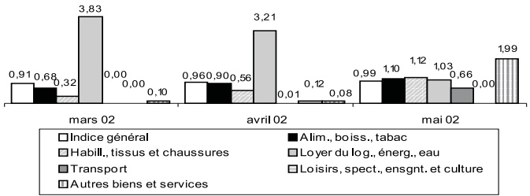

<!-- page 1 -->

## Table des Matières

I. Inflation et change ..... 2
II. Instruments de Politique Monétaire ..... 3
III. Liquidité, Crédit et Dépôts des Banques ..... 4
IV. Bilan des Autorités Monétaires ..... 5
V. Situation Monétaire ..... 6
VI. Finances Publiques ..... 7
VII. Dette Externe ..... 8
VIII. Croissance du Bilan ..... 9
IX. Parts de Marché ..... 10
X. Qualité de l'Actif ..... 12
XI. Rentabilité ..... 13
Glossaire ..... 15

La publication mensuelle des Indicateurs Économiques et Financiers a pour objectif de mettre à la disposition du public en général, et des décideurs et agents économiques en particulier, des informations pertinentes sur les secteurs monétaire et financier. Les informations sont présentées de façon factuelle et sous forme de descriptions lapidaires, du type «bullet points», accompagnées de graphes et tableaux illustratifs.
Un accent particulier a été porté sur l'évolution des indicateurs au cours du mois considéré selon trois repères :
1. le mois antérieur,
2. le début de l'année fiscale, et
3. le même mois de l'année précédente (glissement annuel). Ainsi les tendances qui se dégagent pour un mois donné peuvent être aisément mises en perspective.
Statistiques monétaires et bancaires : Les statistiques monétaires et bancaires sont des données de stock (fin de période). Elles sont présentées avec deux mois de décalage pour des raisons de disponibilité des données bancaires.
Finances publiques : Les statistiques de finances publiques sont des données de flux et sont enregistrées sur la base des encaissements-décaissements. Elles sont décalées de deux mois.
Inflation : La présentation par la BRH des données fournies par l'Institut Haïtien de Statistiques et d'Informatique sur l'évolution de l'indice des prix à la consommation (IPC) se fait avec deux mois de retard; pour les données du change le retard n'est que d'un mois.
Certaines données publiées dans la présente édition des Indicateurs Économiques et Financiers sont provisoires et, par conséquent, sujettes à révision dans des publications futures.

<!-- page 2 -->

### I. Inflation et Change

## Inflation

- En mai 2002, l’indice des prix à la consommation est en hausse (0,99 %) par rapport au mois d’avril 2002 (0,96 %).

- Ce résultat reflète la progression du taux de croissance des indices des principaux groupes de dépenses : les prix des groupes Alimentation, boissons et tabac, Habillement, tissus et chaussures, Transport et Autres biens et services se sont accrus respectivement de 1,10 %, 1,12 %, 0,66 % et 1,99 % par rapport à ceux du mois d'avril 2002 (respectivement 0,90 %, 0,56 %, 0,01 % et 0,08 %). L'indice du groupe Loyer du logement, énergie et eau (1,03 %) est en baisse par rapport à celui du mois d'avril 2002 (3,21 %). Les prix du groupe Loisirs, spectacles, enseignement et culture sont restés stables (0,00 %) en mars 2002.

- En glissement annuel, le taux d'inflation est passé de 8,51 % en avril 2002 à 8,37 % en mai 2002. En moyenne mensuelle, la hausse des prix à la consommation est de 0,70 %.

## Change Taux

Le taux de référence de fin de période de la BRH est passé de 26,9701 gdes en mai 2002 à 27,2819 en juin 2002, atteignant un maximum de 27,2819 gdes le 28 juin 2002.

- En juin 2002, le taux de référence de fin de période s'est déprécié de 1,16 % par rapport au mois précédent. Il s'est déprécié de 4,90 % et de 11,93 % par rapport à octobre 2001 et juin 2001 respectivement.

## Achats et ventes de devises des banques

- Les achats de devises ont diminué de 9,28 % par rapport à mai 2002. Ils ont augmenté de 12,04 % et de 10,47 % par rapport à octobre 2001 et juin 2001 respectivement.

- Les ventes de devises ont diminué de 6,81 % par rapport à mai 2002. Elles ont augmenté de 6,03 % et de 15,18 % par rapport à octobre 2001 et juin 2001 respectivement.

- En juin 2002, la position cambiste de change s'est située à 0,513 million de $ EU contre -1,203 million le mois précédent.

- D’octobre 2001 à juin 2002, les achats et ventes ont totalisé respectivement 620,30 et 631,009 millions de $ EU contre 454,15 et 476,88 millions pour la même période de l’exercice précédent.

- En juin 2002, le spread des banques a représenté 1,05 % du taux à l'achat, une variation nulle par rapport au mois précédent. Il était de 1,45 % en octobre 2001 et de 1,82 % en juin 2001.

## Achats et ventes de devises des agents de change

- Selon les données disponibles à date, reçues d'agents de change enregistrés, les achats se sont chiffrés à 4,23 millions de $ EU et les ventes à 4,29 millions en juin 2002.

## Transferts reçus de l'étranger

- Selon les données disponibles à date reçues des maisons de transfert enregistrées, les transferts privés se sont chiffrés à 21,25 millions de $ EU en juin 2002 comparé à 23,26 millions le mois précédent. Ils s'élevaient à 19,24 millions de $ EU en juin 2001.

- D'octobre 2001 à juin 2002, les transferts privés ont atteint 200,02 millions de $ ÉU contre 174,07 millions pour la même période de l'exercice précédent.

Graphique 1: Taux d'Inflation (%) (variation mensuelle)

Graphique 2: Taux de Change (gourdes/dollars ÉU)

|   | Achats | Ventes |
| --- | --- | --- |
| 3/6/02 | 269.5 | 273.0 |
| 6/6/02 | 270.0 | 273.0 |
| 11/6/02 | 270.0 | 273.0 |
| 14/6/02 | 270.5 | 273.5 |
| 19/6/02 | 272.0 | 275.0 |
| 24/6/02 | 272.0 | 275.5 |
| 27/6/02 | 272.5 | 275.5 |

Graphique 3: Volume des Transactions de Change des Banques

|   | Achats | Ventes |
| --- | --- | --- |
| mars 02 | 73.4 | 72.3 |
| avril 02 | 73.8 | 79.3 |
| mai 02 | 77.6 | 76.4 |
| juin 02 | 71.0 | 71.5 |

<!-- page 3 -->

### II. Instruments de Politique Monétaire

## Coefficients de réserves obligatoires

- La circulaire 86-12 du 15 juin 2001 porte au même niveau les coefficients de réserves obligatoires sur les passifs libellés aussi bien en monnaie étrangère qu'en monnaie nationale soit 31 % pour les banques commerciales et 19,50 % pour les banques d'épargne et de logement.

- Les banques ont l'obligation de constituer en gourdes 30 % des réserves obligatoires sur les passifs libellés en devises étrangères conformément aux dispositions de la circulaire # 86-12A du 15 juin 2001.

## Interventions de la BRH sur le marché des changes

• En juin 2002, la BRH a acheté 4,55 millions de $ ÉU.

D'octobre 2001 à juin 2002, la BRH a acheté 13,25 millions de $ ÉU.

D'octobre 2000 à juin 2001, la BRH avait acheté 3,25 millions et vendu 1,55 million de $ ÉU.

## Bons BRH

- L’encours des bons BRH au 30 juin 2002 a augmenté de 0,69 % sur un mois et de 7,89 % en glissement annuel. Entre septembre 2001 et juin 2002, l’encours des bons a augmenté de 10,77 %. Les bons à 7 et 91 jours représentent respectivement 6,18 % et 93,82 % du total.

- La BNC (1 177 MG), la Sogebank (880 MG), la Unibank (340 MG), la BUH (275 MG), la Capital Bank (145 MG) et la Sogebel (114 MG) détiennent 95,29 % de l'encours des bons BRH émis.

Au 30 juin 2002, l'encours des bons BRH s'élève à 50,08 % des réserves effectives contre 50,54 % au 31 mai 2002.

- Sur le marché monétaire, le taux interbancaire a augmenté passant de 10,79 % à 12,80 % entre le 31 mai 2002 et le 30 juin 2002. Les taux sur les bons à 7 et 91 jours sont demeurés stables respectivement à 5,9 % et à 9,9 %.

Graphique 4: Coefficients de Réserves Obligatoires

| Mare | Passifs en gourdes BEL | Passifs en devises BEL | Passifs en gourdes banques com. | Passifs en devises banques com. |
| --- | --- | --- | --- | --- |
| mars 02 | 3100% | 1950% |   |   |
| avr. 02 | 3100% | 1950% |   | 3100% |
| mai 02 | 3100% | 1950% | 1950% | 3100% |
| juin 02 | 3100% | 1950% |   | 3100% |

Graphique 5: Encours de Bons BRH (millions de gourdes)

|   | Encours total des bons | Encours des bons de 91 jours |
| --- | --- | --- |
| 5/6/02 | 2924 | 2847 |
| 12/6/02 | 2837 | 2687 |
| 19/6/02 | 3088 | 2936 |
| 26/6/02 | 3076 | 2886 |

Graphique 6: Taux d'Intérêt sur le Marché Monétaire (% l'an)

|   | Bons BRH 7 jours | Marché interbancaire |
| --- | --- | --- |
| 1 | 580% | 1079% |
| 2 | 580% | 1176% |
| 3 | 580% | 1176% |
| 4 | 590% | 1333% |

<!-- page 4 -->

### III. Liquidité, Crédit et Dépôts des Banques

## Position de réserves

Au 30 juin 2002, le système bancaire accuse un excédent de 38,0 MG contre un déficit de 136,9 MG pour le même mois de l'exercice précédent.

- En juin 2002, la position moyenne de réserve est excédentaire de 147,8 MG contre 202,9 pour le même mois de l'exercice précédent.

## Crédit brut au secteur privé

Au 30 juin 2002, le crédit total au secteur privé (en gourdes et en devises) a diminué de 0,11 % sur un mois mais a augmenté de 8,78 % en glissement annuel. Entre septembre 2001 et juin 2002, le crédit total a augmenté de 6,72 %.

Au 30 juin 2002, le crédit en gourdes a diminué de 0,94 % sur un mois et de 1,17 % en glissement annuel. La diminution du crédit en gourdes au 30 juin 2002 s'explique essentiellement par la diminution du portefeuille de crédit de six (6) banques dont la Citibank (35,70 MG), la BUH (25,2 MG), la Promobank (16,3 MG) et la BNC (7,9 MG). Sept (7) banques dont la Socabank, la Scotiabank, la Capital Bank ont augmenté leur portefeuille de crédit en gourdes en juin 2002.

Au 30 juin 2002, le crédit en devises exprimé en dollars ÉU a diminué de 0,35 % par rapport à mai 2002 mais a augmenté de 9,13 % en glissement annuel.

## Dépôts

- L'ensemble des dépôts du système bancaire (en gourdes et en devises) au 30 juin 2002 a augmenté de 1,10 % sur un mois et de 9,81 % en glissement annuel. Entre septembre 2001 et juin 2002, l'ensemble des dépôts a augmenté de 6,94 %.

Au 30 juin 2002, les dépôts en gourdes ont augmenté de 0,65 % sur un mois et de 2,72 % en glissement annuel.

- Les dépôts en devises exprimés en gourdes ont augmenté de 1,67 % sur un mois et de 20,29 % en glissement annuel.

## Taux d'intérêt

- Sur le marché bancaire des opérations en gourdes, le taux sur les dépôts d'épargne a diminué en passant de 2,75 % à 2,25 %; alors que le taux sur les dépôts à terme est demeuré stable à 7,63 %, entre le 31 mai 2002 et le 30 juin 2002. Sur la même période, le taux sur les prêts a augmenté en passant de 24,50 % à 26,00 %.

- Sur le marché bancaire des opérations en devises, les taux sur les dépôts d'épargne et à terme sont demeurés stables respectivement à 1,38 % et à 2,50 %, entre le 31 mai 2002 et le 30 juin 2002. Sur la même période, le taux sur les prêts a diminué en passant de 12,00 % à 11,25 %.

|   | mars 02 | avr. 02 | mai 02 | juin 02 |
| --- | --- | --- | --- | --- |
| Value (millions de gourdes) | -76.1 | 215.4 | -14.9 | 38.0 |

Graphique 8: Crédit Brut au Secteur Privé (milliards de gourdes)

|   | ☐ Crédit en gouurdes | ☐ Crédit en devises |
| --- | --- | --- |
| mars 02 | 6.3 | 5.5 |
| avr. 02 | 6.2 | 5.4 |
| mai 02 | 6.3 | 5.7 |
| juin 02 | 6.2 | 5.7 |

Graphique 9: Taux d'Intérêt sur le Marché Bancaire (en % l'an)

|   | Dépôts d'épargne | Dépôts à terme | Prêts |
| --- | --- | --- | --- |
| mars 02 | 250% | 800% | 2600% |
| avr. 02 | 225% | 763% | 2500% |
| mai 02 | 275% | 763% | 2450% |
| juin 02 | 225% | 763% | 2600% |

<!-- page 5 -->

### IV. Bilan des Autorités Monétaires

## Avoirs extérieurs nets

- Les avoirs extérieurs nets sont passés de 176 millions de dollars ÉU en avril 2002 à 166 millions $ ÉU en mai 2002. Ce montant inclut les dépôts en dollars ÉU des banques à la BRH, lesquels sont passés de 89 millions en avril 2002 à 85 millions en mai 2002. Le niveau de septembre 2001 a été de 184 millions de dollars ÉU et celui de mai 2001 a été de 143 millions de $ ÉU.

- Les réserves brutes de change ont totalisé 191 millions de $ ÉU en mai 2002 contre 196 millions de $ ÉU en avril 2002. Par comparaison, leur niveau a été de 222 millions de $ ÉU en septembre 2001 et de 183 millions de $ ÉU en mai 2001.

Le rendement actuariel moyen des portefeuilles de titres est passé à 3,77 % en mai 2002, de 3,91 % qu'il était le mois précédent. Il était de 3,65 % et 5,37 % respectivement en septembre 2001 et en mai 2001.

Le taux moyen offert sur les placements en overnight est en hausse de 1,61 % en mai 2002 contre 1,63 % le mois précédent. Il était de 2,82 % en septembre 2001 et de 4,02 % en mai 2000.

## Créances nettes sur le gouvernement central

- Les créances nettes de la BRH sur le gouvernement central ont connu une augmentation de 1,59 % en mai 2002 par rapport à avril 2002. Elles ont augmenté de 11,07 % par rapport à septembre 2001 et de 16,63 % par rapport à mai 2001.

## Base monétaire

- La base monétaire a augmenté de 0,01 % par rapport à avril 2002, de 9,27 % par rapport à septembre 2001 et de 22,63 % par rapport à mai 2001.

- Les composantes principales de la base monétaire ont évolué ainsi en mai 2002 :

- La monnaie en circulation a augmenté de 2,15 %.

• Les bons BRH et les réserves des banques ont diminué de 0,77 %.

Graphique 10: Base Monétaire et ses Sources (millions de gourdes)

|   | Base monétaire | Crédit intérieur | Avoirs extérieurs nets |
| --- | --- | --- | --- |
| jan. 02 | 17347.8 | 13635.3 | 4552.0 |
| fév. 02 | 17390.2 | 13894.3 | 4309.2 |
| mars 02 | 17622.1 | 14011.9 | 4333.4 |
| avril 02 | 17970.8 | 14099.5 | 4704.3 |
| mai 02 | 17972.4 | 14348.1 | 4476.3 |

|   | jan.02 | fév.02 | mars 02 | avril 02 | mai 02 |
| --- | --- | --- | --- | --- | --- |
| Avoirs extérieurs nets 1/ | 4 552,0 | 4 309,2 | 4 333,4 | 4 704,3 | 4 476,3 |
| Avoirs extérieurs | 7 038,6 | 6 841,2 | 6 821,8 | 7 187,1 | 6 933,8 |
| Engagements extérieurs | -2 486,6 | -2 532,0 | -2 488,4 | -2 482,7 | -2 457,6 |
| Crédit intérieur | 13 635,3 | 13 894,3 | 14 011,9 | 14 099,5 | 14 348,1 |
| Créances nettes sur gouvernement central | 12 844,5 | 13 050,2 | 13 150,6 | 13 317,2 | 13 529,3 |
| Créances sur le système bancaire | 129,8 | 184,8 | 211,5 | 101,0 | 148,4 |
| Créances sur les autres secteurs économiques | 660,9 | 659,2 | 649,9 | 681,4 | 670,4 |
| Actif = Passif | 18 187,2 | 18 203,5 | 18 345,3 | 18 803,9 | 18 824,4 |
| Base monétaire | 17 347,8 | 17 390,2 | 17 622,1 | 17 970,8 | 17 972,4 |
| Monnaie en circulation | 6 098,6 | 6 197,3 | 6 337,0 | 6 007,9 | 6 136,8 |
| Réserves/dépôts & bons BRH des banques | 10 840,0 | 10 792,4 | 10 874,5 | 11 476,0 | 11 387,7 |
| Réserves/dépôts des banques | 8 269,0 | 8 490,4 | 8 091,5 | 8 610,0 | 8 332,7 |
| dont: dépôts en dollars EU 1/ | 2 106,9 | 2 042,9 | 2 200,8 | 2 367,5 | 2 286,9 |
| Bons BRH | 2 571,0 | 2 302,0 | 2 783,0 | 2 866,0 | 3 055,0 |
| Autres engagements envers les BCM | 0,0 | 0,0 | 0,0 | 0,0 | 0,0 |
| Dépôts des autres secteurs économiques | 409,3 | 400,5 | 410,6 | 486,8 | 447,9 |
| Autres postes nets | 839,4 | 813,3 | 723,2 | 833,1 | 852,1 |
| Comptes de capital | 4 007,6 | 4 009,3 | 3 959,5 | 3 934,1 | 3 934,9 |
| dont: Allocations de DTS | 453,8 | 462,5 | 457,1 | 463,2 | 476,8 |
| Autres postes non classés | -3 168,2 | -3 196,0 | -3 236,3 | -3 101,1 | -3 082,8 |

Source : Banque de la République d'Haïti / MAE / Monnaie

1/ Convertis en gourdes au taux de référence de la BRH.

<!-- page 6 -->

### V. Situation Monétaire

## Agrégats Monétaires

- M1 a augmenté de 0,91 % en mai 2002 par rapport à avril 2002, de 11,75 % par rapport à septembre 2001 et de 20,63 % par rapport à mai 2001.

M2 a diminué de 0,33 % par rapport à avril 2002 mais a augmenté de 3,67 % par rapport à septembre 2001 et de 6,92 % par rapport à mai 2001.

M3 a connu une augmentation de 1,46 % en mai 2002 par rapport à avril 2002, de 7,36 % par rapport à septembre 2001 et de 12,86 % par rapport à mai 2001.

## Contreparties de M3

- Les avoirs extérieurs nets du système bancaire ont diminué de 1,30 % en mai 2002 par rapport au mois précédent, de 2,90 % par rapport à septembre 2001 mais ont augmenté de 5,49 % par rapport à mai 2001.

Le crédit intérieur net du système bancaire a augmenté de 2,21 % en mai 2002 par rapport à avril 2002, de 8,68 % par rapport à septembre 2001 et de 13,34 % par rapport à mai 2001.

## Dollarisation

- L'ensemble des dépôts en dollars est passé de 440 millions de dollars ÉU en avril 2002 à 456 millions en mai 2002. L'encours de mai 2002 représente une augmentation de 4,79 % par rapport à avril 2002, de 14,59 % par rapport à septembre 2001 et de 25,20 % par rapport à mai 2001.

- Les dépôts à vue en dollars ont augmenté de 1,89 % par rapport à avril 2002, de 20,02 % par rapport à septembre 2001 et de 28,81 % par rapport à mai 2001.

- Les dépôts d’épargne en dollars ont augmenté de 3,39 % par rapport au mois précédent, de 18,11 % par rapport à septembre 2001 et de 25,28 % par rapport à mai 2001.

- Les dépôts à terme en dollars ont connu une augmentation de 7,98 % par rapport à avril 2002, de 8,75 % par rapport à septembre 2001 et de 22,93 % par rapport à mai 2001.

- La part des dépôts en dollars dans l’ensemble des dépôts est passée de 42,50 % en avril 2002 à 43,97 % en mai 2002.

Graphique 11: Agrégats Monétaires (millions de gourdes)

Le ratio des dépôts en dollars par rapport à M3 est passé de 34,90 % en avril 2002 à 36,05 % en mai 2002. Ce ratio était de 32,50 % en mai 2001.

|   | Jan. 02 | fév. 02 | mars 02 | avril 02 | mai 02 |
| --- | --- | --- | --- | --- | --- |
| M1 | 10247.3 | 10584.6 | 10364.7 | 10302.7 | 10396.7 |
| M2 | 21798.8 | 22082.4 | 21919.2 | 21873.0 | 21800.2 |
| M3 | 33322.0 | 33981.1 | 33316.4 | 33601.1 | 34090.5 |

|   | jan.02 | fév.02 | mar.02 | avril 02 | mai 02 |
| --- | --- | --- | --- | --- | --- |
| Avoirs extérieurs nets 1/ | 8 715,8 | 8 610,2 | 7 925,2 | 8 412,7 | 8 303,4 |
| Avoirs extérieurs | 11 707,3 | 11 654,0 | 10 967,4 | 11 464,6 | 11 357,0 |
| Engagements extérieurs | (2 991,5) | (3 043,8) | (3 042,3) | (3 052,0) | (3 053,6) |
| Crédit intérieur | 25 980,9 | 26 083,6 | 26 245,0 | 26 223,3 | 26 804,1 |
| Créances nettes sur secteur public | 12 688,9 | 12 892,3 | 12 967,6 | 13 104,4 | 13 330,3 |
| Créances nettes sur gouvernement central | 12 790,0 | 13 006,5 | 13 111,2 | 13 276,2 | 13 495,9 |
| Créances nettes sur collectivités locales | (86,0) | (85,6) | (104,0) | (103,2) | (52,5) |
| Créances nettes sur entreprises publiques | (15,0) | (28,6) | (39,6) | (68,6) | (113,1) |
| Créances sur secteur privé | 13 292,0 | 13 191,3 | 13 277,5 | 13 118,9 | 13 473,8 |
| Avoirs = Engagements | 33 322,0 | 33 981,1 | 33 316,4 | 33 601,1 | 34 090,5 |
| M3 | 33 322,0 | 33 981,1 | 33 316,4 | 33 601,1 | 34 090,5 |
| M2 | 21 798,8 | 22 082,4 | 21 919,2 | 21 873,0 | 21 800,2 |
| M1 | 10 247,3 | 10 584,6 | 10 364,7 | 10 302,7 | 10 396,7 |
| Monnaie en circulation | 6 098,6 | 6 197,3 | 6 337,0 | 6 007,9 | 6 136,8 |
| Dépôts à vue | 4 148,7 | 4 387,3 | 4 027,7 | 4 294,7 | 4 259,9 |
| Quasi-monnaie | 11 551,5 | 11 497,8 | 11 554,5 | 11 570,3 | 11 403,5 |
| Dépôts d'épargne | 6 678,7 | 6 652,8 | 6 795,8 | 6 913,8 | 7 002,9 |
| Dépôts à terme | 4 872,8 | 4 845,0 | 4 758,7 | 4 656,5 | 4 400,6 |
| Dépôts en dollars 1/ | 11 523,2 | 11 898,7 | 11 397,2 | 11 728,1 | 12 290,3 |
| Dépôts à vue | 2 889,0 | 3 316,8 | 2 987,8 | 3 123,4 | 3 182,4 |
| Dépôts d'épargne | 3 744,1 | 3 858,9 | 3 890,8 | 4 000,1 | 4 135,9 |
| Dépôts à terme | 4 890,2 | 4 723,0 | 4 518,6 | 4 604,6 | 4 972,0 |
| Autres postes nets | 1 374,7 | 712,7 | 853,9 | 1 159,1 | 1 017,2 |
| Comptes de capital | 6 817,4 | 6 822,3 | 6 772,8 | 6 763,4 | 6 833,2 |
| Créances interbancaires | (492,6) | (918,2) | (649,1) | (618,3) | (686,2) |
| Autres postes non classés | (4 950,1) | (5 191,3) | (5 269,9) | (4 986,0) | (5 129,8) |

Source: Banque de la République d'Haïti (BRH)

1/ Convertis en gourdes au taux de référence de la BRH

<!-- page 7 -->

### VI. Finances Publiques

## Recettes

- Les recettes totales au cours du mois de mai 2002 ont augmenté de 3,15 % par rapport à avril 2002 et de 40,71 % en glissement annuel. Elles ont atteint 733,8 MG contre 521,5 MG pour le même mois de l'exercice précédent. Entre octobre 2001 et mai 2002, elles totalisent 5 283,2 MG contre 4 186,1 MG pour la même période de l'exercice précédent.

- Au mois de mai 2002, la taxe sur le chiffre d'affaires, les droits d'accise, l'impôt sur le revenu et les autres taxes représentent respectivement 47,19 %, 11,05 %, 22,93 % et 18,83 % des recettes internes. Les parts respectives des droits de douane et les frais de vérification dans le total des recettes douanières sont de 49,83 % et 36,69 %.

## Dépenses

Graphique 12: Recettes et Dépenses Totales (millions de gourdes)

Au mois de mai 2002, les dépenses totales ont augmenté de 3,03 % sur un mois et de 15,28 % en glissement annuel. Elles ont atteint 907,8 MG contre 787,5 MG pour le même mois de l'exercice précédent. Entre octobre 2001 et mai 2002 elles totalisent 6 351,6 MG contre 5 851,0 MG pour la même période de l'exercice précédent. Les dépenses de salaires ont diminué de 7,42 % par rapport à avril 2002 et de 5,03 % en glissement annuel.

Au mois de mai 2002, les avances en comptes courants ont atteint 485,6 MG contre 375,0 MG en mai 2001. Entre octobre 2001 et mai 2002, les dépenses d'investissements ont totalisé 1 169,0 MG contre 1 052,0 MG pour la même période de l'exercice précédent.

## Financement

|   | Recettes totales | Dépenses totales |
| --- | --- | --- |
| jan.02 | 679.6 | 906.4 |
| fév.02 | 607.7 | 724.7 |
| mars 02 | 652.3 | 765.8 |
| avr.02 | 711.4 | 881.1 |
| mai 02 | 733.8 | 907.8 |

- Durant le mois de mai 2002, les créances de la BRH sur le gouvernement central ont augmenté de 219,0 MG et les dépôts de 6,9 MG pour un financement de 212,1 MG. Entre octobre 2001 et mai 2002, le gouvernement central a absorbé un déficit de 1 339,3 MG contre 1 734,6 MG pour la même période de l'exercice précédent.

Graphique 13: Composition des Recettes Internes

|   | Droits d'accise | Impôts sur le revenu | TCA | Autres recettes internes |
| --- | --- | --- | --- | --- |
| fév. 02 | 1285% | 4326% | 3516% | 873% |
| mars 02 | 1467% | 4719% | 2636% | 1177% |
| avr.02 | 1713% | 3812% | 2364% | 2110% |
| mai 02 | 1883% | 4719% | 2293% | 1105% |

Graphique 14: Financement des Administrations Publiques (millions de gourdes)

|   | financement net | financement interne | financement externe |
| --- | --- | --- | --- |
| fév.02 | 150.8 | 191.9 | -41.1 |
| mars 02 | 31.4 | 96.1 | -64.7 |
| avr.02 | 159.3 | 161.2 | -1.9 |
| mai 02 | 164.7 | 223.3 | -58.6 |

<!-- page 8 -->

### VII. Dette externe

## Dette externe

- En mai 2002, le service de la dette externe a affiché un montant de 2,7 millions de $ ÉU, soit une différence de 2,4 millions par rapport à avril 2002. En glissement annuel, le service de la dette a augmenté de 67,5 %.

- Le service réel de la dette s'élève à 2,18 millions de $ ÉU en mai 2002. On a enregistré une augmentation de 2,1 millions de $ ÉU par rapport à avril 2002 et de 1,3 million de $ ÉU par rapport à mai 2001.

- En mai 2002, l'encours de la dette a augmenté de 0,9 % par rapport à avril 2002, passant de 1 184,7 à 1 195,8 millions de $ ÉU. En glissement annuel, l'encours de la dette a progressé de 3,44 %.

- En mai 2002, les décaissements sur les prêts étaient nuls. On a enregistré une baisse de 100 % par rapport à avril 2002 et en glissement annuel.

- En mai 2002, les arriérés de paiement de la dette s’élèvent à 41,9 millions $ ÉU contre 39,9 millions de $ ÉU en avril 2002, soit une hausse de 4,7 %. En glissement annuel, les arriérés de paiements sont passés de 11,35 millions en mai 2001 à 41,9 millions en mai 2002.

Dette Externe (En millions de dollars EU)

|   | fév.02 | mars 02 | Avril 02 | mai 02 |
| --- | --- | --- | --- | --- |
| Service de la dette | 2,1 | 2,4 | 0,28 | 2,7 |
| • Amortissements | 1,6 | 2,4 | 0,07 | 2,2 |
| • Intérêt/comm./frais de service | 0,5 | 0,0 | 0,21 | 0,5 |
| Décaissement | 0,0 | 1,9 | 2,5 | 0,0 |
| Flux nets (Decaiss. –Amortis.) | -1,6 | -0,6 | 2,4 | -2,2 |
| Encours de la dette | 1 164,0 | 1 163,2 | 1 184,7 | 1 195,8 |
| • Multilatéral | 975,0 | 972,9 | 990,40 | 1 000,1 |
| • Bilatéral | 188,2 | 190,3 | 194,3 | 195,7 |
| Arriérés de Paiements | 33,7 | 34,9 | 40,0 | 41,9 |

Source : Dette Externe, Direction Affaires Internationales, BRH.

<!-- page 9 -->

### VIII. Croissance du Bilan des Banques

## Actif total

- L'actif total des banques a enregistré une hausse de 1,19 % au mois de mai 2002. Au mois d'avril 2002, l'actif total avait accusé une hausse de 2,25 %.

- La croissance de l’actif total pour l’année fiscale 2000-2001 fut de 0,61 %. En extrapolant à partir de la hausse de 5,63 % enregistrée pour les huit premiers mois de l’exercice, on prévoit une augmentation de l’actif de 8,44 % pour l’exercice fiscal 2001–2002.

La variation de l’actif de chaque banque au cours du mois de mai 2002, en temes absolus et relatifs, se présente comme suit : la BICH (0,0 MG; 0,0 %), la BNC (-63,9 MG; -2,34 %), la BPH (-2,8 MG; -0,34 %), la BUH (-6,1 MG; -0,32 %), la Promobank (88,9 MG; 4,59 %), la Socabank (-104,4 MG; -2,61 %), la Sogebank (93,7 MG; 1,23 %), la Unibank (211,5 MG; 3,12 %), la Capital Bank (20,8 MG; 1,41 %), la Sogebank (1,0 MG; 0,11 %), la Socabel (-7,5 MG; -4,29 %), la Citibank (118,7 MG; 5,72 %), la Scotiabank (26,9 MG; 2,16 %).

## Avoir des Actionnaires

- En mai 2002, l'avoir des actionnaires du système bancaire a enregistré une hausse de 0,51 %. Au mois d'avril 2002, il avait cru de 0,73 %.

- L’avoir des actionnaires avait enregistré une hausse de 14,27 % au cours de l’exercice fiscal 2000–2001. En extrapolant sur la hausse de 5,63 % enregistrée pour les huit premiers mois de l’exercice, on prévoit une augmentation de 8,44 % pour l’année fiscale 2001–2002.

L'accroissement de l'avoir des actionnaires de chaque banque au cours du mois de mai 2002, en termes absolus et relatifs, se présente comme suit : la BICH (0,0 MG; 0,0 %), la BNC (-14,1 MG; -6,39 %), la BPH (-2,9 MG; -8,77 %), la BUH (0,7 MG; 18,06 %), la Capital Bank (-4,2 MG; -3,13 %), la Promobank (0,5 MG; 0,57 %), la Socabank (5,0 MG; 1,99 %), la Sogebank (-11,6 MG; -3,02 %), la Unibank (21,7 MG; 5,64 %), la Socabel (0,2 MG; 1,18 %), la Sogebel (1,9MG; 2,15 %), la Citibank (4,4 MG; 2,40 %), la Scotiabank (7,9 MG; 13,77 %).

Le ratio avoir des actionnaires en pourcentage de l'actif total a évolué ainsi depuis la fin de l'année fiscale 2000-2001 : 5,82 % en septembre 2001, 5,80 % en octobre 2001, 5,88 % en novembre 2001, 5,80 % en décembre 2001, 5,63 % en janvier 2002, 5,66 % en février 2002, 5,91 % en mars 2002, 5,82 % en avril 2002 et 5,78 % en mai 2002. Ainsi, ce ratio a décru de 0,69 % par rapport au 30 septembre 2001.

Graphique 15: Actif total (en millions de gourdes)

| Month | Value |
| --- | --- |
| jan. 02 | 31574.0 |
| fév. 02 | 31792.9 |
| mars 02 | 31016.9 |
| avril 02 | 31715.7 |
| mai 02 | 32092.5 |

Graphique 16: Evolution des principaux postes du bilan (en millions de gourdes)

|   | Bons BRH | Prêts bruts | Dépôts |
| --- | --- | --- | --- |
| jan.02 | 25710 | 118161 |   |
| fév.02 | 23020 | 117246 |   |
| mars 02 | 26830 | 117312 |   |
| avril 02 | 28660 | 116235 |   |
| mai 02 | 30350 | 119547 |   |

Graphique 17: Avoir des actionnaires (en millions de gourdes)

| Month | Value |
| --- | --- |
| jan.02 | 17771 |
| fév.02 | 18010 |
| mars 02 | 18318 |
| avril 02 | 18452 |
| mai 02 | 18547 |

N.B.: Dans cette section du rapport, les comptes de bilan et les ratios utilisant des comptes de bilan sont déterminés au dernier jour du mois.

<!-- page 10 -->

### IX. Parts de Marché

## Actif total

- En mai 2002, toutes les banques du système ont gardé les rangs qu'elles détenaient en avril 2002.

- En mai 2002, les augmentations de parts de marché sont les suivantes : la BNC (0,41%), la Citibank (0,30%), la Promobank (0,19%), la Scotiabank (0,04%), la Sogebank (0,01%), la Capital Bank (0,01%). Les parts de marché des banques suivantes ont diminué : la Socabel (-0,03%), la Sogebel (-0,03%), la BPH (-0,04%), la BUH (-0,09%), la BNC (-0,30%), la Socabank (-0,47%). Les parts de marché de la BICH restent inchangées.

- La part des banques occupant les cinq premières places du système bancaire a décru de 0,05 point. Elle est passée de 73,17 % en avril 2002 à 73,12 % en mai 2002. En mars 2002, elle était de 72,95 %.

## Prêts bruts

• A l'exception de la Sogebank, Unibank, Socabank, BNC et BPH qui ont changé de place, les autres banques du système ont gardé les rangs qu'elles détenaient en avril 2002.

- La BNC a connu l’augmentation de part de marché la plus importante (0,78 %). Elle est suivie de la Unibank (0,36 %), de la Promobank (0,15 %), de la Socabel (0,09 %) et de la Citibank (0,06 %). Les parts de marché des banques suivantes ont diminué : Scotiabank (-0,02 %), Sogebank (-0,02 %), BPH (-0,04 %), Capital Bank (-0,08 %), Sogebel (-0,19 %), BUH (-0,24 %), Socabank (-0,82 %). Les parts de marché de la BICH n’ont pas changé.

- La part des banques occupant les cinq premières places du système bancaire a baissé de 0,27 point. Elle est passée de 75,40 % en avril 2002 à 75,13 % en mai 2002. En mars 2002, elle était de 74,47 %.

## Actif Total - Parts de Marché

<table><tr><td>Banques</td><td>Au 31 mai 02</td><td>Au 30 avril 02</td><td>Au 31 mars 02</td></tr><tr><td>%</td><td>Rang</td><td>%</td><td>Rang</td><td>%</td><td>Rang</td></tr><tr><td>SOGEBANK</td><td>24,06%</td><td>1</td><td>24,05%</td><td>1</td><td>23,85%</td><td>1</td></tr><tr><td>UNIBANK</td><td>21,77%</td><td>2</td><td>21,36%</td><td>2</td><td>21,21%</td><td>2</td></tr><tr><td>SOCABANK</td><td>12,15%</td><td>3</td><td>12,62%</td><td>3</td><td>12,72%</td><td>3</td></tr><tr><td>BNC</td><td>8,30%</td><td>4</td><td>8,60%</td><td>4</td><td>8,25%</td><td>4</td></tr><tr><td>CITIBANK</td><td>6,84%</td><td>5</td><td>6,54%</td><td>5</td><td>6,92%</td><td>5</td></tr><tr><td>PROMOBANK</td><td>6,31%</td><td>6</td><td>6,11%</td><td>6</td><td>6,09%</td><td>7</td></tr><tr><td>BUH</td><td>5,92%</td><td>7</td><td>6,01%</td><td>7</td><td>6,31%</td><td>6</td></tr><tr><td>CAPITALBANK</td><td>4,69%</td><td>8</td><td>4,68%</td><td>8</td><td>4,91%</td><td>8</td></tr><tr><td>SCOTIABANK</td><td>3,97%</td><td>9</td><td>3,93%</td><td>9</td><td>3,90%</td><td>9</td></tr><tr><td>SOGEBEL</td><td>2,85%</td><td>10</td><td>2,88%</td><td>10</td><td>2,85%</td><td>10</td></tr><tr><td>BPH</td><td>2,59%</td><td>11</td><td>2,63%</td><td>11</td><td>2,54%</td><td>11</td></tr><tr><td>SOCABEL</td><td>0,55%</td><td>12</td><td>0,55%</td><td>12</td><td>0,44%</td><td>12</td></tr><tr><td>BICH</td><td>0,03%</td><td>13</td><td>0,03%</td><td>13</td><td>0,03%</td><td>13</td></tr></table>

## Prêts Bruts - Parts de Marché

## Banques

<table><tr><td>Au 31 mai 02</td><td>Au 30 avril 02</td><td>Au 31 mars 02</td></tr><tr><td>%</td><td>Rang</td><td>%</td><td>Rang</td><td>%</td></tr><tr><td>19,03%</td><td>1</td><td>19,05%</td><td>2</td><td>19,66%</td></tr><tr><td>18,95%</td><td>2</td><td>18,59%</td><td>3</td><td>18,40%</td></tr><tr><td>18,48%</td><td>3</td><td>19,30%</td><td>1</td><td>18,92%</td></tr><tr><td>10,45%</td><td>4</td><td>10,39%</td><td>4</td><td>10,42%</td></tr><tr><td>8,22%</td><td>5</td><td>8,07%</td><td>5</td><td>8,07%</td></tr><tr><td>5,28%</td><td>6</td><td>5,36%</td><td>6</td><td>5,15%</td></tr><tr><td>5,14%</td><td>7</td><td>5,16%</td><td>7</td><td>5,05%</td></tr><tr><td>4,75%</td><td>8</td><td>4,99%</td><td>8</td><td>5,10%</td></tr><tr><td>3,62%</td><td>9</td><td>3,81%</td><td>9</td><td>3,79%</td></tr><tr><td>3,01%</td><td>10</td><td>2,23%</td><td>11</td><td>2,33%</td></tr><tr><td>2,93%</td><td>11</td><td>2,97%</td><td>10</td><td>3,05%</td></tr><tr><td>0,13%</td><td>12</td><td>0,04%</td><td>12</td><td>0,04%</td></tr><tr><td>0,02%</td><td>13</td><td>0,02%</td><td>13</td><td>0,02%</td></tr></table>

<!-- page 11 -->

## Dépôts totaux

- En mai 2002, toutes les banques du système ont gardé la place qu'elles occupaient au cours du mois d'avril 2002.

- En mai 2002, les augmentations de parts de marché sont les suivantes : la Unibank (0,44 %), la Citibank (0,19 %), la Promobank (0,18 %), la BPH (0,13 %), la Sogebank (0,09 %), la Scotiabank (0,05 %). Les parts de marché des banques suivantes ont diminué : Sogebel (-0,03 %), Socabel (-0,04 %), BUH (-0,05 %), Capital Bank (-0,06 %), BNC (-0,16 %), Socabank (-0,74 %). Les parts de marché de la BICH restent inchangées.

- La part des banques occupant les cinq premières places du système bancaire a crû de 0,87 point. Elle est passée de 72,17 % en avril 2002 à 73,14 % en mai 2002. En mars 2002, elle était de 72,77 %.

## Dépôts $ ÉU

- En mai 2002, toutes les banques du système ont gardé les rangs qu'elles détenaient en avril 2002.

- La BPH a connu l'augmentation de part de marché la plus importante (0,37 %). Elle est suivie de la Citibank (0,30 %), de la Unibank (0,17 %), de la BNC (0,10 %), de la Promobank (0,07 %), de la BUH (0,05 %) et de la Socabel (0,01 %). Les parts de marché des banques suivantes ont diminué : Scotiabank (-0,02 %), Sogebank (0,06 %), Sogebel (-0,07 %), Capital Bank (-0,12 %), Socabank (-0,82 %). Les parts de marché de la BICH n'ont pas changé.

- La part des banques occupant les cinq premières places du système bancaire a baissé de 0,34 point. Elle est passée de 82,49 % en avril 2002 à 82,15 % en mai 2002. En mars 2002, elle était de 82,39 %.

## Dépôts Totaux - Parts de Marché

<table><tr><td></td><td>Au 31 mai 02</td><td>Au 30 avril 02</td><td>Au 31 mars 02</td></tr><tr><td>Banques</td><td>%</td><td>Rang</td><td>%</td><td>Rang</td><td>%</td><td>Rang</td></tr><tr><td>SOGEBANK</td><td>25,05%</td><td>1</td><td>24,96%</td><td>1</td><td>24,73%</td><td>1</td></tr><tr><td>UNIBANK</td><td>22,31%</td><td>2</td><td>21,87%</td><td>2</td><td>21,50%</td><td>2</td></tr><tr><td>SOCABANK</td><td>11,82%</td><td>3</td><td>12,56%</td><td>3</td><td>12,66%</td><td>3</td></tr><tr><td>BNC</td><td>7,38%</td><td>4</td><td>7,54%</td><td>4</td><td>7,35%</td><td>4</td></tr><tr><td>PROMOBANK</td><td>6,58%</td><td>5</td><td>6,40%</td><td>5</td><td>6,39%</td><td>7</td></tr><tr><td>BUH</td><td>6,24%</td><td>6</td><td>6,24%</td><td>6</td><td>6,53%</td><td>5</td></tr><tr><td>CITIBANK</td><td>6,05%</td><td>7</td><td>6,05%</td><td>7</td><td>6,40%</td><td>6</td></tr><tr><td>CAPITALBANK</td><td>4,57%</td><td>8</td><td>4,63%</td><td>8</td><td>4,78%</td><td>8</td></tr><tr><td>SCOTIABANK</td><td>4,23%</td><td>9</td><td>4,18%</td><td>9</td><td>4,18%</td><td>9</td></tr><tr><td>SOGEBEL</td><td>2,90%</td><td>10</td><td>2,93%</td><td>10</td><td>2,87%</td><td>10</td></tr><tr><td>BPH</td><td>2,28%</td><td>11</td><td>2,15%</td><td>11</td><td>2,24%</td><td>11</td></tr><tr><td>SOCABEL</td><td>0,44%</td><td>12</td><td>0,48%</td><td>12</td><td>0,36%</td><td>12</td></tr><tr><td>BICH</td><td>0,01%</td><td>13</td><td>0,01%</td><td>13</td><td>0,01%</td><td>13</td></tr></table>

## Dépôts US - Parts de Marché

<table><tr><td></td><td>Au 31 mai 02</td><td>Au 30 avril 02</td><td>Au 31 mars 02</td></tr><tr><td>Banques</td><td>%</td><td>Rang</td><td>%</td><td>Rang</td><td>%</td><td>Rang</td></tr><tr><td>UNIBANK</td><td>27,42%</td><td>1</td><td>27,25%</td><td>1</td><td>27,31%</td><td>1</td></tr><tr><td>SOGEBANK</td><td>25,18%</td><td>2</td><td>25,24%</td><td>2</td><td>24,70%</td><td>2</td></tr><tr><td>SOCABANK</td><td>13,65%</td><td>3</td><td>14,47%</td><td>3</td><td>14,11%</td><td>3</td></tr><tr><td>CITIBANK</td><td>8,48%</td><td>4</td><td>8,18%</td><td>4</td><td>8,99%</td><td>4</td></tr><tr><td>PROMOBANK</td><td>7,42%</td><td>5</td><td>7,35%</td><td>5</td><td>7,28%</td><td>5</td></tr><tr><td>CAPITALBANK</td><td>4,66%</td><td>6</td><td>4,78%</td><td>6</td><td>4,98%</td><td>6</td></tr><tr><td>BUH</td><td>3,77%</td><td>7</td><td>3,72%</td><td>7</td><td>3,94%</td><td>7</td></tr><tr><td>SOGEBEL</td><td>3,31%</td><td>8</td><td>3,38%</td><td>8</td><td>3,23%</td><td>8</td></tr><tr><td>BNC</td><td>2,21%</td><td>9</td><td>2,11%</td><td>9</td><td>2,04%</td><td>9</td></tr><tr><td>SCOTIABANK</td><td>1,91%</td><td>10</td><td>1,93%</td><td>10</td><td>1,76%</td><td>10</td></tr><tr><td>BPH</td><td>1,65%</td><td>11</td><td>1,28%</td><td>11</td><td>1,44%</td><td>11</td></tr><tr><td>SOCABEL</td><td>0,34%</td><td>12</td><td>0,33%</td><td>12</td><td>0,21%</td><td>12</td></tr><tr><td>BICH</td><td>0,00%</td><td>13</td><td>0,00%</td><td>13</td><td>0,00%</td><td>13</td></tr></table>

<!-- page 12 -->

### X. Qualité de l'Actif

## Ratio des prêts improductifs bruts sur le portefeuille de prêts bruts

- En mai 2002, les prêts improductifs bruts étaient de 1 000,2 MG, en baisse de 0,74 % par rapport à ceux du mois d'avril 2002 (1 007,7 MG). Parallèlement, les prêts bruts ont augmenté de 2,85 % (de 11 623,4 MG en avril 2002 à 11 954,7 MG).

Le ratio des prêts improductifs bruts en pourcentage des prêts bruts était de 8,37 % en mai 2002, en baisse de 3,46 % par rapport à celui du mois d'avril 2002 (8,67 %).

## Ratio des provisions pour créances douteuses sur les prêts improductifs bruts

- Les provisions pour créances douteuses étaient de 768,8 MG en mai 2002, en hausse de 4,93 % par rapport à celles du mois d'avril 2002 (732,7 MG).

- Les provisions pour créances douteuses représentaient 64,93 % des prêts improductifs bruts en mai 2002. Ce ratio est en hausse par rapport à celui du mois d'avril 2002 (61,06 %).

## Ratio des prêts improductifs nets sur l'avoir des actionnaires

- En mai 2002, les prêts improductifs nets étaient de 119,3 MG, en baisse de 56,62 % par rapport à ceux du mois d'avril 2002 (275,1 MG).

Le ratio des prêts improductifs nets sur l'avoir des actionnaires s'est amélioré. Il est passé de 21,27 % en avril 2002 à 18,91 % en mai 2002.

Graphique 18: Prêts improductifs bruts / prêts bruts (en %)

| Month | Value |
| --- | --- |
| jan.02 | 8.79 |
| fév.02 | 8.97 |
| mars.02 | 8.9 |
| avril.02 | 8.67 |
| mai.02 | 8.37 |

Graphique 19: Provisions pour créances douteuses / prêts improductifs bruts (en %)

| Period | Value |
| --- | --- |
| jan.02 | 5982 |
| fév.02 | 6111 |
| mars 02 | 6970 |
| avril02 | 6106 |
| mai 02 | 6493 |

Graphique 20: Prêts improductifs nets / avoir des actionnaires (en %)

| Month | Value |
| --- | --- |
| jan, 02 | 2348 |
| fév, 02 | 227 |
| mars 02 | 1726 |
| avril 02 | 2127 |
| mai 02 | 1891 |

<!-- page 13 -->

### XI. Rentabilité

## Rendement de l'actif (ROA)

Le ROA annualisé du mois de mai 2002 était de 0,84 %. Par rapport à son niveau d'avril 2002 (0,50 %), il a augmenté de 68,00 %.

- En comparaison avec la même période de l'exercice précédent, le ROA est en baisse de plus de 39 %. Il est passé de 1,39 % en mai 2001 à 0,84 % en mai 2002.

## Rendement de l'avoir des actionnaires (ROE)

Le ROE annualisé du mois de mai 2002 est de 14,51 %, en hausse de plus de 69 % par rapport à celui du mois d'avril 2002 (8,57 %).

- En comparaison avec la même période de l'exercice précédent, le ROE annualisé a enregistré une baisse de plus de 41 %. Il est passé de 24,72 % en mai 2001 à 14,51 % en mai 2002.

## Revenus nets d'intérêt et autres revenus

- En mai 2002, les revenus nets d'intérêt sont de 137,1 MG, en baisse de 9,70 % par rapport à ceux du mois d'avril 2002 (151,8 MG). Par rapport à ceux du mois de mai 2001 (147,1 MG), les revenus nets d'intérêt du mois de mai 2002 ont diminué de 6,81 %.

- Les revenus nets d'intérêt exprimés en pourcentage des revenus d'intérêt étaient de 65,35 % en mai 2002. Ce ratio était en baisse de 5,84 % par rapport à celui du mois d'avril 2002 (69,40 %), mais en hausse de 18,56 % par rapport à celui de mai 2001 (55,12 %).

- En mai 2002, les autres revenus étaient de 74,5 MG, en hausse de 21,29 % par rapport à ceux du mois d'avril 2002 (61,4 MG). Par rapport à ceux de mai 2001 (61,7 MG), ils ont augmenté de plus de 20 %.

Le produit net bancaire du mois de mai 2002 était de 211,6 MG. Il est en baisse de 0,78 % par rapport à celui du mois d'avril 2002 (213,3 MG) mais en hausse de 1,33 % par rapport à celui d'avril 2001 (208,8 MG).

| X-axis | Graphique 21: Rendement de l'actif (ROA) (en %) |
| --- | --- |
| 1 | 106 |
| 2 | 098 |
| 3 | 050 |
| 4 | 084 |

Graphique 22: Rendement de l'avoir des actionnaires (ROE) $ ^{1} $ (en %)

| Month | Value |
| --- | --- |
| jan. 02 | 1849 |
| fév. 02 | 1727 |
| mars 02 | 1688 |
| avril 02 | 857 |
| mai 02 | 1451 |

Graphique 23: Revenus nets d'intérêt / Revenus d'intérêt¹

| Month | (en %) |
| --- | --- |
| jan.02 | 65.16 |
| fév.02 | 66.46 |
| mars 02 | 67.43 |
| avril 02 | 69.4 |
| mai 02 | 65.35 |

<!-- page 14 -->

## Rentabilité (Suite)

## Ratio des dépenses d'exploitation sur le produit net bancaire (ratio de productivité)

- Les dépenses d’exploitation du mois de mai 2002 sont de 171,8 MG. Elles ont accusé une baisse de 5,81 % par rapport à celles du mois d’avril 2002 (182,4 MG) et une hausse de 7,90 % par rapport à celles de mai 2001 (159,2 MG).

- En mai 2002, les banques ont dépensé en moyenne 81,19 centimes pour générer chaque gourde de revenu, soit 4,34 centimes de moins qu'au cours du mois d'avril 2002 (85,53 centimes) ou 4,94 centimes de plus qu'au mois de mai 2001 (76,25 centimes).

## Bénéfice net

- En mai 2002, le système bancaire a enregistré un bénéfice net de 22,4 MG, en hausse de plus de 70 % par rapport à celui du mois d'avril 2002 (13,1 MG), mais en baisse de plus de 35 % par rapport à celui du mois de mai 2001 (34,7 MG).

- En mai 2002, les intérêts sur les bons BRH étaient de 31,9 MG, en hausse de 15,16 % par rapport à ceux d'avril 2002 (27,7 MG) mais en baisse de 25,47 % par rapport à ceux de mai 2001 (42,8 MG).

Revenus nets d'intérêt, Intérêts sur Bons BRH et Bénéfices nets (en millions de gourdes)

Graphique 24: Dépenses d'exploitation (en millions de gourdes)

|   | Revenus nets d'intérêt | Intérêts sur bons BRH | Bénéfices nets |
| --- | --- | --- | --- |
| mai 01 | 147,5 | 42,8 | 34,7 |
| juin 01 | 150,5 | 41,1 | 33,5 |
| juil. 01 | 150,2 | 48,8 | 34,8 |
| août 01 | 138,5 | 60,9 | 33,8 |
| sept. 01 | 159,3 | 54,9 | 36,7 |
| oct. 01 | 163,7 | 53,0 | 27,7 |
| nov. 01 | 153,9 | 44,8 | 22,8 |
| déc. 01 | 160,0 | 78,5 | (7,70) |
| jan. 02 | 159,5 | 42,5 | 27,5 |
| fév. 02 | 147,6 | 32,1 | 25,7 |
| mars 02 | 153,6 | 29,0 | 25,6 |
| avril 02 | 151,8 | 27,7 | 13,1 |
| mai 02 | 137,1 | 31,9 | 22,4 |

| Period | Value |
| --- | --- |
| jan. 02 | 180.2 |
| fév. 02 | 175.1 |
| mars 02 | 183.4 |
| avril 02 | 182.4 |
| mai 02 | 171.8 |

Graphique 25: Dépenses d'exploitation / produit net bancaire

| Period | (eff %) |
| --- | --- |
| jan. 02 | 8153 |
| fév. 02 | 8434 |
| mars 02 | 7913 |
| avril 02 | 8553 |
| mai 02 | 8119 |

Graphique 26: Revenus nets d'intérêt, Intérêts sur bons BRH et Bénéfices nets (en millions de gourdes)

|   | Revenus nets d'intérêt | Intérêts sur bons BRH | Bénéfices nets |
| --- | --- | --- | --- |
| jan. 02 | 159.5 | 42.5 | 27.5 |
| fév. 02 | 147.6 | 32.1 | 25.7 |
| mars 02 | 153.6 | 29.0 | 25.6 |
| avril 02 | 151.8 | 27.7 | 13.1 |
| mai 02 | 137.1 | 31.9 | 22.4 |

<!-- page 15 -->

| Actif total : Ensemble des soldes débiteurs des comptes du bilan, notamment les liquidités, les placements, les prêts et les immobilisations. | M2 : Agrégat monétaire qui correspond à M1 augmenté des dépôts d'épargne et à terme en gourdes qui sont susceptibles d'être transformés aisément et rapidement en moyens de règlement sans risque important de perte en capital. |
| --- | --- |
| Autres revenus : Revenus autres que ceux d'intérêt. | M3 : Agrégat monétaire qui s'obtient par la somme de M2 et de tous les dépôts en devises des résidents de l'économie. |
| Avoir des actionnaires : Intérêt que les actionnaires possèdent dans une société sous forme, notamment, de capital-actions entièrement payé et de bénéfices non répartis. | Revenus net d'intérêt : Différence entre les revenus d'intérêt et les dépenses d'intérêt. |
| Avoirs extérieurs : Moyens de paiement susceptibles d'être acceptés à l'échelon international et dont les autorités monétaires disposent directement soit pour financer les déséquilibres des paiements extérieurs, soit pour corriger les déséquilibres internes en intervenant sur le marché des changes. Les avoirs extérieurs nets comprennent : l'or monétaire, les DTS, la position de réserve au FMI, les avoirs en devises dans les banques à l'étranger et les autres créances. | MG : Millions de gourdes. |
| Base monétaire : Engagements des autorités monétaires prenant la forme de : 1) circulation fiduciaire hors banques, 2) réserves des banques (encassées détenues en billets et pièces de monnaie par les banques créatrices de monnaie, bons BRH et dépôts obligatoirement ou librement effectués par celles-ci à la Banque Centrale). | Part de marché : Portion détenue par une banque dans l'actif total, les prêts bruts, les dépôts en gourdes et les dépôts en dollars américains du système bancaire. |
| Crédit au secteur privé : Avoirs détenus par les banques sous forme d'engagements contractés par les entreprises privées non financières, les ménages et les institutions privées sans but lucratif. | Position cambiste de change : Différence entre le total des achats et des ventes de devises durant la période considérée. Elle est dite longue si elle est positive et courte dans le cas contraire. Elle est dite fermée ou équilibrée si elle est nulle. |
| Dépenses courantes : Somme des dépenses de consommation et des dépenses de transfert. | Prêts improductifs : Prêts dont le principal et les intérêts sont dès et impayés depuis 90 jours ou plus. |
| Dépôts du secteur privé : Montant des dépôts reçus par les banques. | Prêts improductifs bruts sur le portefeuille de crédit brut : Ratio de qualité du portefeuille de crédit qui présente les prêts improductifs en pourcentage des prêts totaux. |
| Dollar ÉU : Dollar des États-Unis d'Amérique. | Prêts improductifs nets sur l'avoir des actionnaires : Ratio qui compare la part des prêts improductifs qui ne sont pas couverts par des provisions pour créances douteuses au coussin de sécurité que représente l'avoir des actionnaires. |
| Dollarisation : Processus par lequel la monnaie nationale perd progressivement au profit d'une devise étrangère l'une de ses fonctions, notamment celle de réserve de valeur et/ou celle de moyen d'échange. | Produit net bancaire (PNB) : Ensemble constitué des revenus nets d'intérêts et des autres revenus des banques. |
| Entreprises publiques : Unités de production marchande dont l'État contrôle le capital et la gestion. | Provisions pour créances douteuses sur les prêts improductifs bruts : Ratio qui indique le niveau de couverture des prêts improductifs par les provisions pour créances douteuses constituées. |
| Filiales non bancaires : Entreprises faisant profession habituelle d'accomplir une ou plusieurs activités assimilables aux opérations de banques. | Recettes courantes : Somme des recettes internes et des recettes douanières. |
| Glissement annuel : Variation relative du mois de l'année en cours par rapport au même mois de l'année précédente. | Rendement de l'actif (ROA) : Ratio de rentabilité égal au rapport du bénéfice net sur l'actif total moyen. |
| Inflation : Hausse continue du niveau général des prix. Le taux d'inflation est mesuré par la variation en pourcentage de l'indice des prix à la consommation. | Rendement de l'avoir des actionnaires (ROE) : Ratio de rentabilité égal au rapport du bénéfice net sur l'avoir moyen des actionnaires. |
| M1 : Agrégat monétaire qui regroupe tous les moyens de paiement directement utilisables par des agents résidents pour régler les transactions sur les marchés des biens et services. Ces moyens de paiement, émis par la Banque Centrale et les banques commerciales, sont essentiellement la monnaie divisionnaire (pièces), les billets et les dépôts mobilisables par chèques gérés par les banques. | Transferts privés : Envois de fonds des travailleurs émigrés. Les données de flux des transferts privés proviennent d'un échantillon de 9 maisons de transfert déclarantes à la BRH. Selon les estimations du Service d'Économie Internationale de la BRH, cet échantillon représente environ 1/5 des envois de fonds effectués par les travailleurs émigrés. |

<!-- page 16 -->
