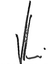

<!-- page 1 -->

KPMG S.A.

Siège social

Tour EQHO

2 Avenue Gambetta

CS 60055

92066 Paris la Défense Cedex

France

7, rue Lechaud, Bourdon

Port au Prince

Haïti

## Banque de la République d'Haïti

Rapport des auditeurs indépendants

Exercice clos le 30 septembre 2017

Banque de la République d'Haïti

BP 1570 - Port au Prince - Haïti

Ce rapport contient 45 pages

<!-- page 2 -->

KPMG S.A.

Siège social

Tour EQHO

2 Avenue Gambetta

CS 60055

92066 Paris la Défense Cedex

France

7, rue Lechaud, Bourdon

Port au Prince

Haïti

Banque de la République d'Haïti

Siège social : BP 1570 - Port au Prince - Haïti Capital social : 50 000 000 Gourdes

Rapport des auditeurs indépendants

Exercice clos le 30 septembre 2017

## Opinion

Nous avons effectué l'audit des états financiers ci-joints de la Banque de la République d'Haïti (Banque Centrale), au 30 septembre 2017.

A notre avis, les états financiers ci-joints, comprenant un bilan, un compte de résultats, un état de variation des capitaux propres, un tableau des flux de trésorerie et des notes annexes pour l'exercice clos à cette date ont été préparés, dans tous leurs aspects significatifs, conformément au plan comptable tel qu'organisé par les dispositions de la loi organique du 17 août 1979 et tel que précisé dans les notes des états financiers pour l'exercice clos le 30 septembre 2017.

Sans remettre en cause l'opinion exprimée ci-dessus, nous attirons votre attention sur les corrections d'erreurs sur la situation d'ouverture dont la nature est exposée dans la note 1 de l'annexe au paragraphe « événements significatifs de l'exercice ».

## Fondement de l'opinion

Nous avons effectué notre audit selon les Normes internationales d'audit (ISA) édictées par la Fédération Internationale des Experts-Comptables (IFAC). Les responsabilités qui nous incombent en vertu de ces normes sont plus amplement décrites dans la section «Responsabilités de l'auditeur relatives à l'audit des états financiers» du présent rapport.

Nous sommes indépendants de la Banque conformément aux règles de déontologie qui s'appliquent à l'audit des états financiers et nous avons satisfait aux autres responsabilités déontologiques qui nous incombent selon ces règles.

Nous estimons que les éléments probants que nous avons recueillis sont suffisants et appropriés pour fonder notre opinion d'audit.

Responsabilités de la Direction et des personnes constituent la gouvernance sur les états financiers

La Direction est responsable de l'établissement et de la présentation sincère des états financiers, ainsi que de la mise en place du contrôle interne qu'elle estime nécessaire à l'établissement d'états financiers ne comportant pas d'anomalies significatives, que celles-ci proviennent de fraudes ou résultent d'erreurs.

<!-- page 3 -->

Lors de l'établissement des états financiers, il incombe à la Direction d'évaluer la capacité de la banque à poursuivre son exploitation, de fournir, le cas échéant, des informations relatives à la continuité d'exploitation et d'appliquer le principe comptable de continuité d'exploitation, sauf si la Direction a l'intention de mettre la banque en liquidation ou de cesser ses activités ou s'il n'existe aucune autre solution alternative réaliste qui s'offre à elle.

Il incombe aux personnes constituent la gouvernance de surveiller le processus d'élaboration de l'information financière de la Banque.

## Responsabilités de l'auditeur relatives à l'audit des états financiers

Nos objectifs sont d'obtenir l'assurance raisonnable que les états financiers pris dans leur ensemble ne comportent pas d'anomalies significatives, que celles-ci proviennent de fraudes ou résultent d'erreurs, et d'émettre un rapport d'audit contenant notre opinion. L'assurance raisonnable correspond à un niveau élevé d'assurance, qui ne garantit toutefois pas qu'un audit réalisé conformément aux normes ISA permette de toujours détecter toute anomalie significative existante. Les anomalies peuvent provenir de fraudes ou résulter d'erreurs et sont considérées comme significatives lorsqu'il est raisonnable de s'attendre à ce que, prises individuellement ou en cumulé, elles puissent influencer les décisions économiques que les utilisateurs des états financiers prennent en se fondant sur ceux-ci.

Dans le cadre d'un audit réalisé conformément aux normes ISA et tout au long de celui-ci, nous exerçons notre jugement professionnel et faisons preuve d'esprit critique.

## En outre:

Nous identifions et évaluons les risques que les états financiers comportent des anomalies significatives, que celles-ci proviennent de fraudes ou résultent d'erreurs, définissons et mettons en œuvre des procédures d'audit en réponse à ces risques, et recueillons des éléments probants suffisants et appropriés pour fonder notre opinion. Le risque de non-détection d'une anomalie significative provenant d'une fraude est plus élevé que celui d'une anomalie significative résultant d'une erreur, car la fraude peut impliquer la collusion, la falsification, les omissions volontaires, les fausses déclarations ou Je contournement du contrôle interne;

Nous prenons connaissance du contrôle interne pertinent pour l'audit afin de définir des procédures d'audit appropriées en la circonstance, mais non dans le but d'exprimer une opinion sur l'efficacité du contrôle interne;

Nous apprécions le caractère approprié des méthodes comptables retenues et le caractère raisonnable des estimations comptables faites par la Direction, de même que des informations fournies les concernant par cette dernière;

<!-- page 4 -->

Nous concluons quant au caractère approprié de l'application par la Direction du principe comptable de continuité d'exploitation et, selon les éléments probants recueillis, quant à l'existence ou non d'une incertitude significative liée à des événements ou situations susceptibles de jeter un doute important sur la capacité de la Banque à poursuivre son exploitation. Si nous concluons à l'existence d'une incertitude significative, nous sommes tenus d'attirer l'attention des lecteurs de notre rapport sur les informations fournies dans les états financiers au sujet de cette incertitude ou, si ces informations ne sont pas adéquates, d'exprimer une opinion modifiée. Nos conclusions s'appuient sur les éléments probants recueillis jusqu'à la date de notre rapport d'audit. Cependant, des conditions ou événements futurs pourraient conduire la Banque à cesser son exploitation;

Nous apprécions la présentation d'ensemble, la structure et le contenu des états financiers, y compris les informations fournies dans les états financiers, et apprécions si les états financiers reflètent les opérations et événements les sous-tendant d'une manière telle qu'ils donnent une présentation sincère.

Nous communiquons aux personnes constituant la gouvernance notamment l'étendue des travaux d'audit et du calendrier de réalisation prévus et les constats importants, y compris toute faiblesse significative du contrôle interne, relevés lors de notre audit.

Paris La Défense et Port au Prince, le 29 juin 2018

KPMG S.A.

Valéry Foussé

Associé

Mérové-Pierre – Cabinet d'Experts-Comptables

Mireille Mérové-Pierre Managing Partner

<!-- page 5 -->

# BANQUE DE LA RÉPUBLIQUE D'HAÎTI Bilans 30 septembre 2017, 2016 et 2015 (Exprimés en milliers de gourdes haïtiennes)

|   | Notes | 2017 | 2016 $ ^{{*}} $ | 2015 $ ^{{*}} $ |
| --- | --- | --- | --- | --- |
| ACTIF |   |   |   |   |
| Avoirs en or | 5 | G 4,672,198 | 4,853,839 | 3,420,937 |
| Avoirs sur le Fonds Monétaire International | 6 | 5,573,699 | 6,149,583 | 5,040,971 |
| Avoirs en monnaies étrangères | 7 | 122,099,231 | 113,936,440 | 82,675,633 |
| Participation dans les organismes internationaux | 8 | 4,014,629 | 4,196,936 | 3,159,478 |
| Placements locaux | 9 | 275,000 | 275,779 | 275,030 |
| Prêts et avances au Gouvernement et aux collectivités | 10 | 67,045,662 | 58,175,019 | 56,177,240 |
| Prêts et avances aux particuliers et aux autres institutions | 11 | 3,818,661 | 3,447,056 | 3,126,124 |
| Prêts et avances aux institutions financières | 12 | 8,890,883 | 4,937,440 | 6,734,445 |
| Immobilisations | 13 | 5,326,300 | 4,425,124 | 3,686,550 |
| Autres actifs | 14 | 3,218,062 | 4,732,367 | 5,494,691 |
| Total de l'actif |   | 224,934,325 | 205,129,583 | 169,791,099 |
| PASSIF |   |   |   |   |
| Billets et monnaies en circulation | 15 | 43,433,151 | 37,561,509 | 32,996,117 |
| Comptes d'engagements | 16 | 137,053,528 | 123,459,363 | 107,908,184 |
| Engagements envers le FMI | 17 | 13,404,596 | 11,419,893 | 9,257,307 |
| Contributions et engagements de l'État Haïtien sur participation au capital des organismes financiers | 18 | 4,960,911 | 5,213,728 | 5,517,536 |
| Autres passifs | 19 | 20,338,167 | 18,772,186 | 15,734,095 |
| Capital et réserves |   | 5,743,972 | 8,702,904 | (1,622,140) |
| Total du passif |   | G 224,934,325 | 205,129,583 | 169,791,099 |

Voir les notes aux états financiers

 $ ^{*} $Comptes aux 30 septembre 2016 et 2015 après correction

<!-- page 6 -->

|   | Notes | 2017 | 2016 $ ^{{*}} $ |
| --- | --- | --- | --- |
| REVENUS D'INTÉRÊTS |   |   |   |
| Placements à l'étranger | G | 4,312,367 | 2,921,522 |
| Placements, prêts et avances à l'État Haïtien |   | 1,211,457 | 1,165,250 |
| Prêts au personnel et institutions financières |   | 330,471 | 247,687 |
| Autres |   | 21,990 | - |
|   | 23 | 5,876,285 | 4,334,459 |
| FRAIS D'INTÉRÊTS |   |   |   |
| Obligations |   | 39,043 | 12,482 |
| Bons BRH |   | 1,233,812 | 1,268,591 |
| Autres |   | 8,293 | 270,283 |
|   | 23 | 1,281,148 | 1,551,356 |
| REVENUS NET D'INTÉRÊTS |   | 4,595,137 | 2,783,103 |
| DIVIDENDES |   | 55,169 | 54,344 |
| Résultat sur ventes de valeurs mobilières |   |   |   |
| Gains sur ventes des valeurs immobilières |   | 709,155 | 1,427,058 |
| Pertes sur ventes des valeurs immobilières |   | (38,867) | - |
|   |   | 670,288 | 1,427,058 |
| PRODUIT NET BANCAIRE |   | 5,320,594 | 4,264,505 |
| Autres produits |   | 339,756 | 409,529 |
| RÉSULTAT OPÉRATIONNEL |   | 5,660,350 | 4,674,034 |
| CHARGES D'EXPLOITATION GÉNÉRALES |   |   |   |
| Entretien de la circulation fiduciaire |   | 342,494 | 280,108 |
| Rémunération et charges sociales | 24 | 3,840,838 | 3,483,591 |
| Dépenses administratives |   | 844,379 | 699,378 |
| Dotations aux amortissements |   | 295,666 | 175,405 |
| Dépenses relatives à la gestion des actifs |   | 151,241 | 110,358 |
| Dons |   | 73,331 | 84,853 |
| Autres dépenses |   | 35,529 | 53,133 |
| Dotation pour mauvaises créances |   | (49,398) | 4,793 |
|   |   | 5,534,080 | 4,891,619 |
| REVENUS NETS DE L'EXERCICE | G | 126,270 | (217,585) |

 $ ^{*} $Comptes au 30 septembre 2016 après correction

<!-- page 7 -->

BANQUE DE LA RÉPUBLIQUE D'HAÎTI

Engagements hors bilan

Exercices terminés les 30 septembre 2017 et 2016

(Exprimés en milliers de gourdes haïtiennes)

|   | Note |   | 2017 | 2016 $ ^{{*}} $ |
| --- | --- | --- | --- | --- |
| Engagements de financement | 26 | G | 24,189,869 | 24,682,788 |
| Engagements de garantie |   |   | 89,972,848 | 86,010,769 |
| Autres engagements | 26 |   | 201,485 | 194,628 |
| Total |   | G | 114,364,202 | 110,888,185 |

 $ ^{*} $Comptes au 30 septembre 2016 après correction

<!-- page 8 -->

BANQUE DE LA RÉPUBLIQUE D'HAÎTI

État de variation des capitaux propres

Exercice terminé le 30 septembre 2016

(Exprimé en milliers de Gourdes haïtiennes)

|   |   | Capital | Report à nouveau * | Résultat de l'exercice * | Réserve légale (note 22) | Réserve de réévaluation de change Or * | Réserve de réévaluation de change | Réserve pour plus - values latentes sur portfeuille de placements * (note 20) | Réserve-pour réévaluation d'immeubles (note 22) | Gains et perte actuarielles sur engagements de retraite | Autres réserves * | Total des capitaux propres |
| --- | --- | --- | --- | --- | --- | --- | --- | --- | --- | --- | --- | --- |
| Solde au $ 1^{er} $ octobre 2015 $ ^{{*}} $ | G | 50,000 | (11,788,569) | 57,788 | 74,454 | (841,228) | 10,164,546 | (852,663) | 719,004 | - | 794,528 | (1,622,140) |
| Résultat de change |   | - | - | - | - | - | 7,169,819 | - | - | - | - | 7,169,819 |
| Gain/(Perte) résultat de l'évaluation des placements à la juste valeur par le biais des autres éléments du résultat global |   | - | 3,922,624 $ ^{{*}} $ | - | - | 1,432,902 | - | (2,409,507) | - | - | - | 2,946,019 |
| Réévaluation du passif des engagements post emploi – indemnités de départ à la retraite – prestations définies |   | - | (327,756) | - | - | - | - | - | - | 327,756 | - | - |
| Autres mouvements |   | - | 437,335 $ ^{{*}} $ | (275,373) | - | - | - | - | - | - | 47,244 | 209,206 |
| Solde au $ 1^{er} $ octobre 2016 $ ^{{*}} $ | G | 50,000 | (7,756,366) | (217,585) | 74,454 | 591,674 | 17,334,365 | (3,262,170) | 719,004 | 327,756 | 841,772 | 8,702,904 |

 $ ^{*} $Comptes après correction

<!-- page 9 -->

BANQUE DE LA RÉPUBLIQUE D'HAÎTI

État de variation des capitaux propres

Exercice terminé le 30 septembre 2017

(Exprimé en milliers de Gourdes haïtiennes)

Réserves

<table><tr><td></td><td>Capital\n(note 22)</td><td>Report à\nnouveau *</td><td>Résultat de\nl'exercice *</td><td>Réserve\nlégale\n(note 22)</td><td>Réserve de\nréévaluation\nOr *</td><td>Réserve\nréévaluation\nde change</td><td>Réserve pour plus - values latentes sur portefeuille de placements * (note 20)</td><td>Réserve-pour réévaluation d'immeubles (note 22)</td><td>Gains et perte actuarielles sur engagements de retraite</td><td>Autres réserves *</td><td>Total des capitaux propres</td></tr><tr><td>Solde au 1 $ ^{er} $ octobre 2016\nreporté*</td><td>G</td><td>50,000</td><td>(7,756,366)</td><td>(217,585)</td><td>74,454</td><td>591,674</td><td>17,334,365</td><td>(3,262,170)</td><td>719,004</td><td>327,756</td><td>841,772</td></tr><tr><td>Distribution de dividendes</td><td></td><td>-</td><td>(243,786)</td><td>-</td><td>-</td><td>-</td><td>-</td><td>-</td><td>-</td><td>-</td><td>(243,786)</td></tr><tr><td>Résultat net de l'exercice</td><td></td><td>-</td><td>-</td><td>126,270</td><td>-</td><td>-</td><td>-</td><td>-</td><td>-</td><td>-</td><td>126,270</td></tr><tr><td>Résultat de change</td><td></td><td>-</td><td>-</td><td>-</td><td>-</td><td>-</td><td>(2,103,605)</td><td>-</td><td>-</td><td>-</td><td>(2,103,605)</td></tr><tr><td>Gain/(Perte) résultat de l'évaluation des placements à la juste valeur par le biais des autres éléments du résultat global</td><td></td><td>-</td><td>(2,768,295)</td><td>-</td><td>-</td><td>(181,641)</td><td>-</td><td>2,600,011</td><td>-</td><td>-</td><td>(349,925)</td></tr><tr><td>Réévaluation du passif des engagements post emploi – indemnités de départ à la retraite – prestations définies</td><td></td><td>-</td><td>83,106</td><td>-</td><td>-</td><td>-</td><td>-</td><td>-</td><td>-</td><td>(83,106)</td><td>-</td></tr><tr><td>Autres mouvements</td><td></td><td>-</td><td>(664,444) $ ^{{*}} $</td><td>217,585</td><td>-</td><td>-</td><td>-</td><td>-</td><td>-</td><td>-</td><td>58,973</td></tr><tr><td>Solde au 1 $ ^{er} $ octobre 2017</td><td>G</td><td>50,000</td><td>(11,349,785)</td><td>126,270</td><td>74,454</td><td>410,033</td><td>15,230,760</td><td>(662,159)</td><td>719,004</td><td>244,650</td><td>900,745</td></tr><tr><td>Voir les notes aux états financiers consolidés</td></tr></table>

<!-- page 10 -->

|   | Notes | 2017 | 2016 $ ^{{*}} $ |
| --- | --- | --- | --- |
| ACTIVITÉS D'EXPLOITATION |   |   |   |
| Revenu net de l'exercice | G | 126,270 | (217,585) |
| Éléments de conciliation du revenu net de l'exercice |   |   |   |
| aux liquidités résultant des activités d'exploitation: |   |   |   |
| Dotation aux amortissements net, des régularisations | 13 | 253,333 | 287,150 |
| Récupération de provision pour perte de valeur sur prêts |   | (49,398) | 4,793 |
| Effet de change résultant de la réévaluation de la participation dans les organismes financiers internationalaux |   | 5,262,614 | 5,512,241 |
| Changements dans les éléments d'actif et de passif: |   |   |   |
| résultant des activités d'exploitation: |   |   |   |
| Augmentation des prêts et avances, net |   | (7,297,896) | (1,604,217) |
| Billets et monnaie en circulation | 15 | 5,871,642 | 4,629,056 |
| Engagements en devises | 16 | (2,988,242) | 17,316,475 |
| Contributions et engagements envers les organismes financiers internationalaux | 18 | (252,817) | 4,987,403 |
| Engagements envers les banques créatrices de monnaie |   | 1,169,618 | 1,409,241 |
| Dépôts du Gouvernement Central | 10 | (5,848,397) | (5,048,468) |
| Engagements envers les autres institutions |   | 12,134,878 | 642,477 |
| Changements dans les autres éléments d'actifs, de passif et de réserves |   | (22,327) | 6,060,663 |
| Liquidités provenant des activités d'exploitation |   | 8,359,278 | 33,979,229 |
| ACTIVITÉS D'INVESTISSEMENT |   |   |   |
| Augmentation des placements étrangers | 7,8 | (7,963,073) | (32,315,676) |
| (Augmentation) diminution des placements locaux | 9 | 779 | 2,710,811 |
| Acquisitions d'immobilisations | 13 | (1,154,509) | (1,025,511) |
| Liquidités provenant des activités d'investissement |   | (9,116,803) | (30,630,376) |
| Diminution nette des liquidités |   | (757,525) | 3,348,853 |
| Liquidités au début de l'exercice |   | 11,003,422 | 7,654,569 |
| Liquidités à la fin de l'exercice | 5 | G 10,245,897 | 11,003,422 |

Voir les notes aux états financiers

 $ ^{*} $Comptes au 30 septembre 2016 après correction

<!-- page 11 -->

# BANQUE DE LA RÉPUBLIQUE D'HAÎTI Notes aux états financiers 30 septembre 2017

## 1 ) ORGANISATION

## Note 1 – Cadre juridique et activités

La Banque de la République d'Haïti (BRH), dont le Siège est sis à la rue du Quai à Port-au-Prince (Haïti), est un organisme public autonome, constitué par l'Etat Haïtien, par la loi du 17 août 1979, modifié en ses articles 9 et 17 par le décret du 28 mars 1985. Son capital social n'est pas divisé en actions. Il est détenu par l'Etat Haïtien et peut être augmenté selon les besoins de l'institution.

La loi du 17 août 1979 portant création de la BRH stipule en son article 6 que celle-ci est dirigée par un Conseil d'Administration dont les membres sont nommés pour une période de trois (3) ans, renouvelable par arrêté du Président de la République. Conformément aux dispositions de la Constitution de 1987, ils sont ratifiés par le Sénat de la République.

Les responsabilités fondamentales de la Banque Centrale sont de fixer les lois et règlements régissant le système bancaire et financier du pays; de définir la politique monétaire du pays; de garder et d'administrer les réserves externes de l'État Haïtien; et d'agir comme agent financier et fiscal de l'État Haïtien pour ses opérations de caisse et de crédit.

La Banque de la République d'Haïti est seule habilitée à émettre les billets et monnaie reçus comme monnaie légale sur le territoire d'Haïti.

Le Conseil d'Administration de la BRH est aussi celui du Fonds de Développement Industriel, une société créée par l'État, destinée à fournir un financement à moyen et long terme aux secteurs productifs de l'économie. En fonction de la Loi du 17 août 1979, le Gouverneur de la BRH est le Président du Conseil d'Administration de la Téléco dont la BRH détient 97% des actions.

## Faits caractéristiques de l'exercice

L'organisation de la Banque Centrale n'a pas connu de changement significatif au cours de l'exercice écoulé.

En revanche, les éléments financiers 2016 qui sont présentés ici en comparables ont dû être corrigés du fait d'ajustements sur:

des schémas d'enregistrement touchant principalement le portefeuille de titres en devises disponibles à la vente,

✓ la prise en compte d'engagements de la Banque Centrale vis-à-vis du Fonds de pension de la Banque

✓ ainsi que la dépréciation des titres de participation de la Téléco.

<!-- page 12 -->

# BANQUE DE LA RÉPUBLIQUE D'HAÎTI Notes aux états financiers 30 septembre 2017

## 1 ) ORGANISATION (SUITE)

Les impacts les plus significatifs de ces ajustements sur la situation d'ouverture au 30 septembre 2015 et de clôture 2016 se décomposent comme suit:

## A l'actif:

## ✓ Or monétaire:

Correction sur les valeurs en or pour respectivement G 41 millions et G 192 millions.

## ✓ Stock de pièces et monnaies:

Correction sur stock de pièces pour respectivement G 17 millions à l'ouverture et la clôture 2016.

## ✓ Titres de participation:

Provisionnement integral des titres Téléco pour G 1,923 millions.

À noter que la Téléco dont la BRH détient 97% des titres n'est pas consolidée au niveau de la Banque de la République d'Haïti. En effet, la Direction de la Banque estime que:

a) le portage de ces titres de participation n'entre pas dans le champ des activités dévolues à la Banque Centrale et que celui-ci résulte d'une décision du Gouvernement antérieure à 1980;

b) il ne dispose pas de perspectives d'encaissement de cash-flows à hauteur de la valeur des titres.

## Au passif:

## ✓ Autres Réserves:

Ajustement de la réserve générale à hauteur des plus-values latentes sur le portefeuille titres pour G 4,273 millions sur la situation d'ouverture 2016 et G 196 millions sur la situation de clôture 2016.

## ✓ Provision dette actuarielle fonds de pension BRH:

Ajustements relatifs à la dette actuarielle relative au plan de retraite à prestations définies pour respectivement G 5,516 millions et G 5,437 millions.

## ✓ Réserve de réévaluation or:

Corrections de la réserve de réévaluation or pour respectivement G 1,641 millions et G 1,094 millions.

## ✓ Autres éléments du résultat global:

Correction du poste autres éléments du résultat global sur la situation de clôture 2016 pour G 328 millions à hauteur des écarts actuariels du Fonds de pension.

<!-- page 13 -->

# BANQUE DE LA RÉPUBLIQUE D'HAÎTI Notes aux états financiers 30 septembre 2017

## 2 ) BASE DE PRÉPARATION DES ÉTATS FINANCIERS

### 2.1 Référentiel comptable en vigueur au 30 septembre 2017

Les états financiers de la Banque de la République d'Haïti ont été élaborés conformément au plan comptable tel qu'organisé par les dispositions de la loi organique du 17 août 1979 et suivant la méthode de comptabilité d'exercice.

Les opérations sont comptabilisées et présentées selon les règles et méthodes comptables définies par le plan comptable adopté par la BRH par référence à la loi organique et aux principes généralement admis pour la comptabilisation des opérations de Banque, adaptés aux spécificités de ses opérations de Banque Centrale, tels que décrits ci-après.

Les états financiers sont établis sur la base des coûts historiques, à l'exception de l'or et l'argent monétaires qui sont évalués selon les modalités décrites ci-dessous.

La monnaie fonctionnelle et de présentation est la gourde, monnaie nationale Haïtienne. Les états financiers et leurs notes annexes sont présentés en milliers de Gourdes.

### 2.2 Exercise

La durée de l'exercice est de douze mois. L'exercice débute le 1er octobre et se termine le 30 septembre de l'année suivante.

### 2.3 Principes et méthodes d'évaluation

Les principales méthodes comptables de la Banque Centrale sont résumées ci-dessous. Sauf indication contraire, ces méthodes ont été mises en œuvre de manière uniforme pour tous les exercices présentés.

## 3 ) PRINCIPALES CONVENTIONS COMPTABLES

## a)  $ \underline{\text{Avoirs en or}} $

Les avoirs en or sont suivis sur la base de leur prix de revient en Gourdes à la date d'acquisition.

Le stock d'or monétaire est évalué en date de clôture comptable en fonction des cours de l'once sur la place de Londres. Les écarts de réévaluation positifs qui en résultent sont comptabilisés dans un compte d'écart de réévaluation présenté au sein des capitaux propres.

En cas de moins-value latente par rapport au coût d'acquisition, une provision pour dépréciation des avoirs en or est comptabilisée par la contrepartie du compte de résultat.

L'avoir en or fait partie des réserves nettes de change en accord avec l'article 52 de la loi organique de la BRH.

<!-- page 14 -->

# BANQUE DE LA RÉPUBLIQUE D'HAÎTI Notes aux états financiers 30 septembre 2017

## 3 ) PRINCIPALES CONVENTIONS COMPTABLES (SUITE)

## b)  $ \underline{\text{Conversion des monnaies étrangères}} $

Les avoirs et engagements en devises sont convertis en gourdes haïtiennes au cours de clôture de l'exercice pour les opérations de bilan et au cours du jour de la transaction pour les opérations de résultat. Les gains ou pertes de change latents et réalisés sont comptabilisés dans un compte de réserve «Réserve de réévaluation de change» au sein des capitaux propres, conformément à l'article 56 de la loi organique.

Les cours retenus à la clôture de l'exercice sont indiqués ci-après.

| (En gourdes haïtiennes) | 2017 | 2016 | 2015 |
| --- | --- | --- | --- |
| Dollar des États-Unis (USD) | 62.6900 | 65.5368 | 52.1417 |
| Euro (EUR) | 74.0619 | 73.6634 | 58.2788 |
| Droit de Tirage Spécial (DTS) | 88.5999 | 91.4763 | 73.1934 |
| Once d'or | 80,053.1350 | 86,673.1176 | 59,029.6185 |

## c)  $ \underline{\text{Placements en devises étrangères}} $

Les réserves de change de la BRH sont investies en comptes à vue, en comptes à terme et dans des actifs obligataires. La BRH a choisi un système de gestion par administrateurs externes de portefeuille (gestion déléguée). Les gérants de portefeuille peuvent bénéficier de pouvoirs discrétionnaires ou peuvent être sujets à des limitations strictes, concernant la sélection des placements.

Ces placements financiers sont placés dans le but d'avoir des liquidités disponibles. Ils sont enregistrés initialement en comptabilité à leur coût d'acquisition, et sont évalués ultérieurement à leur juste valeur.

La variation de juste valeur est constatée directement en capitaux propres dans le compte «Réserve de plus-value non réalisée sur portefeuille» jusqu'à la cession ou l'échéance des titres. Les gains ou les pertes sont comptabilisés en résultat à leur date de réalisation.

Les actifs financiers (créances et titres du portefeuille) pour lesquels il existe des indications objectives de perte de valeur sont réévalués à la valeur recouvrable nette. Le montant de la perte de valeur est constaté par une dépréciation en diminution de la valeur comptable, par la contrepartie du compte de résultat.

<!-- page 15 -->

# BANQUE DE LA RÉPUBLIQUE D'HAÎTI Notes aux états financiers 30 septembre 2017

## 3 ) PRINCIPALES CONVENTIONS COMPTABLES (SUITE)

## d)  $ \underline{\text{Prêts et avances au Gouvernement et aux collectivités}} $

Les crédits à l'État Haïtien représentent un financement au Secteur Public ainsi que les prêts et avances en comptes courants au Gouvernement, aux collectivités locales et aux entreprises publiques. Ils sont évalués au coût historique. La BRH n'enregistre pas de perte de valeur sur les crédits à l'État Haïtien et aux entreprises publiques à moins de désaccords spécifiques. Les revenus d'intérêts sur ces prêts, avances et placements sont comptabilisés selon le taux d'intérêt contractuel.

## e)  $ \underline{\text{Immobilisations corporelles et incorporelles}} $

Les immobilisations corporelles et incorporelles sont évaluées à leur coût d'acquisition sous déduction des amortissements et des pertes de valeurs éventuellement constatées par dépréciation. Les terrains ne sont pas amortissables.

Les autres immobilisations sont amorties selon le mode linéaire à partir de la date de mise en service sur la base des durées d'usage suivantes:

| Immobilisations | Durées d’usage (en mois) |
| --- | --- |
| Terrains | non amortissable |
| Constructions | 240 |
| Matériel et mobilier du bureau | 48 |
| Matériel informatique | 60 |
| Logiciels informatiques | 12 |
| Matériel roulant | 48 |
| Équipements | 60 |
| Installations | 60 |
| Aménagements, extensions, agrandissements | 60 |

Lors du séisme du 12 janvier 2010, certains immeubles de la banque ont subi des dommages importants. Les pertes correspondantes ont été évaluées et enregistrées à concurrence de la valeur aux livres.

Il peut être procédé de façon exceptionnelle à des réévaluations d'actifs. Ces réévaluations sont alors effectuées sur la base de travaux d'expertise réalisés par des experts indépendants. Les écarts de réévaluation ainsi constatés sont imputés aux capitaux propres sous une rubrique séparée en contrepartie des comptes d'immobilisations. Le solde de ce poste sera viré à la réserve spéciale quand les immeubles seront dé-comptabilisés. Toute moins-value résultant de la réévaluation est enregistrée directement comme une dépense à l'état des résultats à moins qu'elle ne soit relative à une plus-value existante pour un même immeuble déjà réévalué. Le cas échéant, cette moins-value sera affectée préalablement au poste de réserve de réévaluation-terains et immeubles.

La dernière réévaluation a eu lieu en septembre 2010 à la suite du séisme.

<!-- page 16 -->

# BANQUE DE LA RÉPUBLIQUE D'HAÎTI Notes aux états financiers 30 septembre 2017

## 4 ) PRINCIPALES CONVENTIONS COMPTABLES (SUITE)

## f)  $ \underline{\text{Autres éléments d'actif}} $

Les autres éléments d'actif sont évalués au coût.

## g)  $ \underline{\text{Billets et monnaie en circulation}} $

Le montant des billets et monnaies figurant au passif du bilan de la BRH correspond à la valeur faciale des billets et pièces de monnaie en circulation, détenus par l'ensemble des agents économiques reflété à leur valeur nominale.

## h)  $ \underline{\text{Avoirs sur le FMI, engagements envers le FMI}} $

La BRH est le correspondant bancaire de l'Etat Haïtien auprès du Fonds Monétaire International (FMI). Elle est en même temps le dépositaire des Gourdes détenues par le FMI. En vertu de la loi du 19 septembre 1952, la Banque représente le Gouvernement Haïtien en toute négociation ou transactions avec le Fonds. Toutes les transactions entre le Gouvernement et le Fonds sont inscrits dans les livres de la BRH.

Les différences de change résultant des opérations de la BRH avec le Fonds sont supportées par le Gouvernement Haïtien et sont comptabilisées au bilan dans le compte «Avance différence de change FMI».

Les opérations avec le FMI sont libellées dans la monnaie du FMI, à savoir le Droit de Tirage Spécial (DTS).

Les opérations et transactions de l'Etat Haïtien avec le FMI concernent le compte de Droit de Tirage Spécial (DTS), le compte de ressources générales et les comptes administrés, ainsi que les facilités élargies de crédit auprès de cette institution.

La position de réserve au FMI est la différence entre les quotes-parts de l'Etat et sa souscription en monnaie nationale, compte non tenu des tirages au titre des ressources générales (avoirs exclus ou recours aux crédits du FMI).

Les tirages effectués par l'Etat auprès du FMI sont reçus et enregistrés dans les comptes dépôt à vue de la BRH à la Federal Reserve Bank en dollars, d'une part, et dans les comptes d'engagements envers le FMI en DTS, d'autre part. Au moment de rembourser au FMI ou de réévaluer les engagements FMI, les différences entre les montants versés à l'état et la dette vis-à-vis du FMI sont portés directement au compte «Avance Différence de change FMI».

Les avoiris du FMI en monnaie nationale (comptes FMI n°1, FMI n°2 et FMI compte titres) font l'objet d'une réévaluation annuelle le 30 avril de chaque année, sur la base du cours représentatif du DTS communiqué par le FMI. Les gains et pertes de réévaluation sont inscrits dans le compte «Avance différence de change FMI».

<!-- page 17 -->

# BANQUE DE LA RÉPUBLIQUE D'HAÎTI Notes aux états financiers 30 septembre 2017

## 3 ) PRINCIPALES CONVENTIONS COMPTABLES (SUITE)

## h)  $ \underline{\text{Avoirs sur le FMI, engagements envers le FMI (suite)}} $

A la clôture de chaque période mensuelle, les avoirs du FMI en DTS sont réévalués sur la base du cours du DTS/Gourdes de fin de mois.

Les DTS détenus, les tirages sur les comptes administrés et les allocations de DTS sont convertis en Gourdes sur la base du cours de change en vigueur lors des transactions. Les différences résultant de réévaluations périodiques sont portées au compte «Avance différence de change FMI».

## i)  $ \underline{\text{Participations, contributions et engagements dans les autres organismes financiers internationaux}} $

Conformément à l'article 2, alinéa 10, et l'article 61, alinéa 2 de la loi du 17 août 1979, la BRH enregistre dans ses livres les participations de la République d'Haïti dans les différents organismes internationaux. Le Gouvernement Haïtien a souscrit au capital de différents organismes financiers internationaux. Les montants payés à titre de capital sont reflétés comme des contributions, et les montants non encore versés sont reflétés comme des engagements. Ces transactions sont gérées par la BRH à titre de fiduciaire et sont réévaluées aux taux de change de la fin de l'exercice. L'effet de change résultant de la réévaluation des actifs et passifs de l'État Haïtien est enregistré au bilan dans le compte «Réserves de réévaluation de change».

## j)  $ \underline{\text{Fonds de retraite}} $

La Banque offre à ses employés un régime de retraite à prestations définies. Ce régime assure aux adhérents le versement d'une pension à la retraite. Un régime à prestations définies est un plan de retraite qui définit les prestations dont bénéficiera l'adhérent au moment de la retraite, généralement tributaires de facteurs comme le taux d'accumulation, l'âge, les années de service et la rémunération moyenne. Une évaluation actuarielle du coût du plan est effectuée en utilisant la méthode des unités de crédit projetées. Dès que l'adhérent atteint l'âge de la retraite, sa pension est calculée sur la base de la dernière rémunération ouvrant droit à pension et la pension est soumise à un ajustement annuel pour tenir compte de l'inflation. Les gains et pertes actuariels ainsi que les différences entre les rendements attendus et réalisés des actifs sont immédiatement comptabilisées par capitaux propres de l'exercice où ils surviennent. Lorsque les avantages du plan sont modifiés ou lorsque le plan est réduit, le changement résultant dans les prestations liées au service passé, ou le gain ou la perte du à la réduction est comptabilisé immédiatement en résultat. Le passif au titre des retraites est comptabilisé dans la rubrique «autres montants à payer» au bilan. Le passif représente la valeur actualisée des prestations définies que la Banque doit verser, déduction faite de la juste valeur des actifs du plan.

<!-- page 18 -->

# BANQUE DE LA RÉPUBLIQUE D'HAÎTI Notes aux états financiers 30 septembre 2017

## 3 ) PRINCIPALES CONVENTIONS COMPTABLES (SUITE)

## j)  $ \underline{\text{Fonds de retraite (suite)}} $

La valeur actuelle des obligations de prestations de retraite post emploi est tributaire des hypothèses financières et actuarielles utilisées, y compris le taux d'actualisation. À la fin de chaque exercice, la Banque détermine le taux d'actualisation approprié ainsi que d'autres variables qui doivent être utilisés pour déterminer la juste valeur des obligations de retraite post emploi futures estimées. Le taux d'actualisation est déterminé sur la base des rendements des marchés à la fin de l'exercice pour des obligations de sociétés de haute qualité, et les estimations des autres variables sont effectuées sur la base du meilleur jugement de la Banque.

## k)  $ \underline{\text{Provisions}} $

Une provision est établie au bilan lorsque la Banque a une obligation légale résultant d'événements passés, qu'il est probable que des ressources économiques seront utilisées pour solder cette obligation, et qu'une estimation vraisemblable du montant de l'obligation peut être établie.

## l)  $ \underline{\text{Autres éléments de passif}} $

Les autres éléments de passif, incluant les provisions, sont évalués au coût.

## m)  $ \underline{\text{Frais d'impression des billets et de pièces de monnaie}} $

Les frais d'impression des billets sont enregistrés à la dépense au moment de la mise en circulation. Les coûts des stocks de billets non encore mis en circulation sont inscrits aux autres actifs pour leur prix de revient.

Les frais d'impression de pièces de monnaie sont amortis sur une base linéaire sur une durée de 20 ans.

## n)  $ \underline{\text{Impôts et taxes}} $

Conformément à l'article 63 de la loi régissant la Banque Centrale, la BRH est exonérée du paiement des droits et taxes de l'État ou des communes dans l'exécution de toutes opérations qui lui sont propres.

## o)  $ \underline{\text{Distribution des profits nets}} $

Selon l'article 59 de la loi régissant la BRH, les résultats nets doivent être distribués de la manière suivante: 25% au Trésor Public, 10% à la réserve légale et le solde à des réserves spéciales destinées aux fins d'investissements, de placements, d'agrandissement et autres, tel que fixé par le Conseil d'Administration.

## 4 )  $ \underline{\text{GESTION DES RISQUES}} $

Parmi les risques financiers que la Banque doit gérer, on retrouve principalement les risques de liquidité, de crédit et de marché incluant les risques de taux d'intérêts et de change.

<!-- page 19 -->

# BANQUE DE LA RÉPUBLIQUE D'HAÎTI Notes aux états financiers 30 septembre 2017

## 4 ) GESTION DES RISQUES (SUITE)

## A) RISQUE DE LIQUIDITÉ

Le risque de liquidité surviendrait si la BRH n'arrivait pas à convertir, à approximativement leur valeur marchande, ses placements en espèces ou si elle n'arrivait pas à disposer des fonds nécessaires pour faire face à ses obligations. Une gestion prudente des risques de liquidité sous-entend le maintien de liquidités ou d'équivalent de liquidités suffisantes et/ou l'utilisation rationnelle de politiques de financement.

La BRH comme toute Banque Centrale n'a pas de risques financiers réels en relation avec ses obligations en monnaie locale. Les obligations de la BRH ne l'exposent pas à des risques importants de liquidités vu qu'elle n'a généralement pas de créances importantes envers des fournisseurs étrangers. La BRH doit également maintenir suffisamment de réserves liquides en dollars US pour permettre, à titre de fiduciaire, le règlement des obligations de l'État à leur date d'échéance. La BRH gère ce risque à travers :

✓ Un processus budgétaire permettant de suivre les échéances étrangères du gouvernement.

✓ Le maintien d'un portefeuille de placements facilement négociable.

## B) RISQUE DE CRÉDIT

## b1- Placements

Le risque de crédit relatif aux placements survient lorsqu'un titre de placement perd de sa valeur en raison de résultats financiers défavorables, réels ou anticipés, de la société émettrice. Pour gérer ce risque, la BRH a mis en place des politiques et procédures qui définissent la nature et la qualité des titres de placements dans lesquels elle investit.

Les principaux paramètres de la politique de la BRH sont les suivants:

✓ Investir dans des titres de créances négociables bien côtés, facilement disponibles et à risques faibles

✓ Fixer des critères de maturité maximale

✓ Diversifier le portefeuille en différents instruments tout en limitant l'exposition maximale permise par type de titre ou par émetteur.

Les placements de la Banque Centrale rencontrent les objectifs de sécurité liés à la gestion des

avoirs en devises.

<!-- page 20 -->

# BANQUE DE LA RÉPUBLIQUE D'HAÎTI Notes aux états financiers 30 septembre 2017

## 4 ) GESTION DES RISQUES (SUITE)

## B) RISQUE DE CRÉDIT (SUITE)

## b2- Crédit

Le portefeuille de crédit de la Banque Centrale est constitué en majeure partie par les crédits au Gouvernement. La BRH en tant que banquier de l'État n'est pas exposée à des risques significatifs de par ses crédits à l'État et aux entités gouvernementales.

## b3- Autres éléments d'actif

La Banque considère comme faible le risque de crédit sur les autres actifs financiers.

## C)  $ \underline{\text{RISQUE DE MARCHÉ}} $

Le risque de marché est celui que des changements de prix résultant des variations de taux de change ou de taux d'intérêts affecteraient les résultats de la Banque ou la valeur des instruments financiers qu'elle détient. La gestion des risques de marché vise à contrôler l'exposition aux risques de marché dans une limite acceptable tout en optimisant le rendement financier.

## c1- Risque de taux d'intérêts

La gestion des risques de taux d'intérêts à la BRH est conditionnée par les objectifs en matière de politique monétaire. Le portefeuille de prêts de la BRH est constitué principalement de crédits au Gouvernement et aux institutions financières dont les taux d'intérêts ne sont pas des taux commerciaux. Les taux de rémunération des Bons BRH sont ajustés régulièrement.

N'ayant pas de passifs financiers d'importance à taux fixes, la BRH n'a aucun risque de taux d'intérêts.

## c2- Risque de change

Le risque de change découle de la variation de la valeur d'actifs et de passifs libellés en devises étrangères, exprimée en gourdes, due aux fluctuations des taux de change. En vertu de l'article 56 de la loi organique de la BRH, les gains et pertes qui résultent de la réévaluation des avoirs et des engagements de la BRH détenus en devises ou en or sont comptabilisés à la Réserve de Réévaluation.

Les gains ou pertes de change résultant des conversions de change sont inscrits au niveau de la réserve de réévaluation à l'avoir et n'affectent donc pas les résultats.

<!-- page 21 -->

# BANQUE DE LA RÉPUBLIQUE D'HAÎTI Notes aux états financiers 30 septembre 2017

## 5 )  $ \underline{\text{AVOIRS EN OR}} $

Les avoirs en or sont valorisés à leur juste valeur telle que publiée au Commodity Exchange Inc. aux 30 septembre 2017 et 2016.

Ces stocks d'or détenus par la BRH et confiés à des tiers sont évalués à :

$ \underline{\text{30 septembre 2017}} $

|   | En onces | Prix de revient | Juste valeur | Réserve de réévaluation Or |
| --- | --- | --- | --- | --- |
| Or en dépôt à la | G | 1,307,53 | 7,464,323 | 104,920,391 |
| Fédéral réserve bank | G | 56,917,94 | 4,254,700,191 | 4,567,277,643 |
| Or en dépôt chez Scotiabank | G | 58,225,47 | 4,262,164,514 | 4,672,198,034 |
| Total |   |   |   | 410,033,521 |

##  $ \underline{\text{30 septembre 2016}} $

|   | En onces | Prix de revient | Juste valeur | Réserve de réévaluation Or |
| --- | --- | --- | --- | --- |
| Or en dépôt à la | G | 1,307,53 | 7,464,323 | 108,999,374 |
| Fédéral réserve bank | G | 56,917,94 | 4,254,700,191 | 4,744,839,395 |
| Or en dépôt chez Scotiabank | G | 58,225,47 | 4,262,164,514 | 4,853,838,769 |
| Total |   |   |   | 591,674,256 |

Ces réserves ne portent pas intérêts. Les cours de l'or en vigueur au 30 septembre 2017 et au 30 septembre 2016 étaient respectivement de: USD 1,280 et USD 1,272 par once d'or.

## 6 )  $ \underline{\text{AVOIRS SUR LE FONDS MONETAIRE INTERNATIONAL (FMI)}} $

La rubrique «Avoirs sur le Fonds Monétaire International» comprend la position de réserve et les avoirs en DTS et se décompose comme suit:

<table><tr><td></td><td>30/09/2017</td><td>30/09/2016</td><td>Variation</td></tr><tr><td></td><td>En DTS</td><td>En milliers de gourdes</td><td>En DTS</td><td>En milliers de gourdes</td><td>En milliers de gourdes</td></tr><tr><td>Position de réserve Avoirs en droits de tirage spéciaux</td><td>20,543,047</td><td>1,820,112</td><td>68,047</td><td>6,225</td><td>1,813,887</td></tr><tr><td>42,365,616</td><td>3,753,587</td><td>67,157,944</td><td>6,143,358</td><td>(2,389,771)</td></tr><tr><td>Total</td><td>62,908,663</td><td>5,573,699</td><td>67,225,991</td><td>6,149,583</td><td>(575,884)</td></tr></table>

<!-- page 22 -->

# BANQUE DE LA RÉPUBLIQUE D'HAÎTI Notes aux états financiers 30 septembre 2017

## 6 ) AVOIRS SUR LE FONDS MONETAIRE INTERNATIONAL (FMI) (SUITE)

## DISPONIBILITÉS EN DROITS DE TIRAGES SPÉCIAUX (DTS)

Ce compte représente les avoir en compte courant, exprimés en DTS, au Fonds Monétaire International (FMI). Au cours de l'exercice 2017, le Fonds Monétaire International (FMI) n'a accordé aucune allocation additionnelle de droits de tirages spéciaux à Haïti. Le solde des disponibilités en DTS 42,365,616 en 2017 et 67,157,944 DTS en 2016 représente le net des intérêts perçus et des intérêts et autres charges de l'État Haïtien envers le FMI.

L'engagement de l'État Haïtien en contrepartie des disponibilités est reflété au poste Contributions et Engagements envers les organismes financiers internationaux, conformément aux dispositions préconisées par le Fonds Monétaire International. L'allocation accordée antérieurement est comptabilisée aux réserves spéciales.

Le solde des disponibilités en DTS a ainsi évolué:

| (En milliers de gourdes) | DTS | Gourdes |
| --- | --- | --- |
| Solde au 30 septembre 2016 | 67,158 | 6,143,358 |
| Intérêts perçus | 104 | 9,214 |
| Effet de réévaluation | - | (193,147) |
| Paiements sur compte | (24,896) | (2,205,838) |
| Disponibilités au 30 septembre 2017 | 42,366 | 3,753,587 |

##  $ \underline{\text{Position de réserve}} $

La position de réserve de la République d'Haïti auprès du FMI s'analyse comme suit :

<table><tr><td></td><td>30/9 2017</td><td>30/9/2016</td><td>Variation</td></tr><tr><td></td><td>En DTS</td><td>En milliers de Gourdes</td><td>En DTS</td><td>En milliers de Gourdes</td><td>En milliers de Gourdes</td></tr><tr><td>Quota FMI</td><td>163,800,000</td><td>14,512,656</td><td>81,900,000</td><td>7,491,906</td><td>7,020,750</td></tr><tr><td>FMI, Compte no. 1</td><td>(36,290,445)</td><td>(3,215,328)</td><td>(36,290,445)</td><td>(3,319,714)</td><td>104,386</td></tr><tr><td>FMI, compte titres</td><td>(106,966,508)</td><td>(9,477,217)</td><td>(45,541,508)</td><td>(4,165,967)</td><td>(5,311,250)</td></tr><tr><td>Total</td><td>20,543,047</td><td>1,820,111</td><td>68,047</td><td>6,225</td><td>1,813,886</td></tr></table>

La variation de G 1,813 millions constatée résulte en premier lieu de l'augmentation du Quota en DTS de la BRH au FMI aux conditions suivantes: 25% payés en cash et reflété dans les disponibilités et droit de tirage et 75% par un billet à ordre reflété dans le compte Engagements Extérieurs FMI et en second lieu, à l'appréciation du cours du DTS qui est passé de G 91,4763 au 30 septembre 2016 à G 88,5999 au 30 septembre 2017.

<!-- page 23 -->

# BANQUE DE LA RÉPUBLIQUE D'HAÎTI Notes aux états financiers 30 septembre 2017

## 6 ) AVOIRS SUR LE FONDS MONETAIRE INTERNATIONAL (FMI) (SUITE)

## Avoirs en Droits de Tirages Spéciaux

Les DTS détenus ont évolué ainsi qu'il suit:

|   | En DTS |
| --- | --- |
| Solde au 30 septembre 2016 | 67,158 |
| Cessions | (20,475) |
| Rémunérations perçues | 104 |
| Commissions payées | (4,421) |
| Solde au 30 septembre 2017 | 42,366 |

Les rémunérations perçues correspondent aux intérêts payés par le FMI sur les avoirs en DTS. Les commissions payées correspondent essentiellement aux intérêts versés au FMI et calculés sur la base du stock de DTS alloués à l'Etat Haïtien.

## 7 ) AVOIRS EN MONNAIES ÉTRANGÈRES

Cette rubrique comprend l'encaisse, les dépôts à vue et de garantie à l'étranger, les valeurs en transit et les placements en devises étrangères. Elle se décompose comme suit:

| (En milliers de gourdes) |   | 30/09/2017 | 30/09/2016 | Variation |
| --- | --- | --- | --- | --- |
| Billet, pièces de monnaie et chèques | G | 2,634,517 | 3,067,875 | (433,358) |
| Avoir dans les banques non résidentes |   | 9,410,276 | 4,880,871 | 4,529,405 |
| Valeurs en transit sur l'étranger |   | 790 | 23,829 | (23,039) |
| Remises en transit en devises sur le pays |   | 4,489 | 10,848 | (6,359) |
| Collatéral |   | 1,756,273 | 852,974 | 903,299 |
| Placement en devises étrangères |   | 108,292,886 | 105,100,043 | 3,192,843 |
| Total | G | 122,099,231 | 113,936,440 | 8,162,791 |

## Billets, pièces de monnaie et chèques en USD

Les billets, pièces de monnaie et chèques en devise, essentiellement en dollars, sont constitués par les encaisses détenues au Siège et au Cap Haïtien.

|   | 30/09/2017 | 30/09/2016 | Variation |
| --- | --- | --- | --- |
| Billet devises guichets | 6,166 | 8,583 | (2,417) |
| Billets devises non triés | 396,711 | 165,883 | 230,828 |
| Billets devises caveau | 1,743,785 | 2,101,765 | (357,980) |
| Pièce devises caveau | 379 | 396 | (17) |
| Sous-total sièges | 2,147,041 | 2,276,627 | (129,586) |
| Billets devises Cap Haïtien | 487,476 | 791,248 | (303,772) |
| Total | 2,634,517 | 3,067,875 | (433,358) |

<!-- page 24 -->

# BANQUE DE LA RÉPUBLIQUE D'HAÎTI Notes aux états financiers 30 septembre 2017

## 7 ) AVOIRS EN MONNAIES ÉTRANGÈRES (SUITE)

## Avoirs dans les banques non résidentes

Les avoirs dans les banques non résidentes sont essentiellement constitués des dépôts à vue en dollars américains et en euros.

<table><tr><td></td><td>30/09/2017</td><td>30/09/2016</td></tr><tr><td>Banque</td><td>En devises</td><td>En milliers de gourdes</td><td>En devises</td><td>En milliers de gourdes</td></tr><tr><td>Correspondants USD</td><td></td><td></td><td></td><td></td></tr><tr><td>Citibank NY</td><td>23,230,547</td><td>1,456,323</td><td>22,914,129</td><td>1,501,719</td></tr><tr><td>Federal Reserve</td><td>122,376,630</td><td>7,671,791</td><td>24,596,032</td><td>1,611,945</td></tr><tr><td>Citibank collateral</td><td>307,268</td><td>19,263</td><td>307,236</td><td>20,135</td></tr><tr><td>Citibank IDA</td><td>12,361</td><td>775</td><td>12,361</td><td>810</td></tr><tr><td>Bladex</td><td>133</td><td>8</td><td>133</td><td>9</td></tr><tr><td>Bladex collateral</td><td>309,557</td><td>19,406</td><td>132,683</td><td>8,696</td></tr><tr><td>Sous-total</td><td>146,236,496</td><td>9,167,566</td><td>47,962,574</td><td>3,143,314</td></tr><tr><td>Correspondant EUR</td><td></td><td></td><td></td><td></td></tr><tr><td>Banque de France</td><td>3,277,123</td><td>242,710</td><td>23,824,172</td><td>1,754,969</td></tr><tr><td>Total</td><td>149,513,619</td><td>9,410,276</td><td>71,786,746</td><td>4,898,283</td></tr></table>

Ces dépôts à vue en dollars sont rémunérés à des taux moyens de rendement de 0.7362% et de 0.2334% en 2017 et 2016 respectivement.

## Placements en devises étrangères

Les placements en devises étrangères sont constitués par un portefeuille de liquidités, en gestion déléguée auprès de gérants de portefeuille aux Etats-Unis. Ce portefeuille de la BRH en dollars américains est composé de liquidités et d'actifs financiers disponible à la vente (Bons du Trésor, Bons émis par les agences fédérales américaines, Obligations municipales et titres de sociétés).

Ces placements sont comptabilisés à leur juste valeur (valeur de marché) par capitaux propres les réévaluations de juste valeur au regard du prix de revient (plus et moins-values latentes) étant comptabilisées via un compte de réserve en attendant leur réalisation effective lors de la vente ou de l'échéance.

Au 30 septembre 2017, la décomposition du portefeuille établi par la BRH s'analyse comme suit, par catégorie de titres (en USD):

| Placements (en milliers de gourdes) | Coût | Juste valeur | Intérêts courus |
| --- | --- | --- | --- |
| Liquidités | $ - | 11,446 | - |
| Obligations gouvernementales | 563,778 | 553,009 | 2,525 |
| Obligations municipales | 83,107 | 82,218 | 1,090 |
| Obligations de sociétés | 1,036,258 | 1,023,654 | 9,747 |
| Assets-backed securities | 5,741 | 5,695 | 5 |
| Actions | 34,923 | 37,477 | - |
| Fonds négociés en bourse (ETF) | 822 | 567 | - |
| Total | $ 1,724,629 | 1,714,066 | 13,367 |
| Equivalent en gourdes | G 108,117,015 | 107,454,909 | 837,977 |

<!-- page 25 -->

# BANQUE DE LA RÉPUBLIQUE D'HAÎTI Notes aux états financiers 30 septembre 2017

## 8 ) PARTICIPATIONS ET CONTRIBUTIONS DANS LES ORGANISMES INTERNATIONAUX

La participation de l'Etat Haïtien au FMI est de 163,800,00 DTS au 30 septembre 2017 (situation inchangée depuis le 30 septembre 2016).

Cette participation, au même titre que les participations suivantes de l'Etat dans les organismes internationaux, est portée par la Banque Centrale:

<table><tr><td>(En milliers de gourdes)</td><td>2017</td><td>2016</td><td>Variation</td></tr><tr><td>Banque Interaméricaine de</td></tr><tr><td>Développement (BID)</td><td>3,123,438</td><td>3,265,275</td><td>(141,837)</td></tr><tr><td>Banque Internationale pour la</td></tr><tr><td>Reconstruction et le Développement (BIRD)</td><td>337,973</td><td>353,321</td><td>(15,348)</td></tr><tr><td>Banque Caribéenne de Développement (BCD)</td><td>206,698</td><td>216,084</td><td>(9,386)</td></tr><tr><td>Association Internationale de Développement (IDA)</td><td>69,161</td><td>72,302</td><td>(3,141)</td></tr><tr><td>Société Interaméricaine d'Investissement (SII)</td><td>196,847</td><td>205,786</td><td>(8,939)</td></tr><tr><td>Fonds Multilatéral d'Investissement</td><td>18,807</td><td>19,661</td><td>(854)</td></tr><tr><td>Société Internationale de Financement (IFC)</td><td>51,531</td><td>53,871</td><td>(2,340)</td></tr><tr><td>Agence de Garantie des investissements\nmultilatéraux (MIGA)</td><td>10,174</td><td>10,636</td><td>(462)</td></tr><tr><td>Total</td><td>4,014,629</td><td>4,196,936</td><td>(182,307)</td></tr></table>

Ces participations sont souscrites en devises ou en monnaie nationale pour le compte de la République d'Haïti.

## 9 ) PLACEMENTS LOCAUX

Cette rubrique comprend des avances de fonds accordées à la Banque Nationale de Crédit et des obligations du Trésor Haïtien souscrites par la BRH.

| (En milliers de gourdes) | 2017 | 2016 | Variation |
| --- | --- | --- | --- |
| Placements en titres/ obligations |   |   |   |
| dans les institutions financières | G 275,000 | 275,000 | - |
| Intérêts sur investissement financiers | - | 779 | (779) |
| Total | G 275,000 | 275,779 | (779) |

## Avances BNC

Obligations subordonnées au 30 septembre 2010 sur une période de 20 ans au taux d'intérêts de 1% l'an selon le protocole d'accord signé en date du 29 septembre 2010 entre la (BNC) et la (BRH).

<!-- page 26 -->

# BANQUE DE LA RÉPUBLIQUE D'HAÎTI Notes aux états financiers 30 septembre 2017

## 10 ) PRÊTS ET AVANCES AU GOUVERNEMENT ET AUX COLLECTIVITÉS

Cette rubrique comprend les créances détenues sur l'Etat Haïtien et les intérêts à recevoir. Le solde se compose comme suit:

| (En milliers de gourdes) |   | 2017 | 2016 | Variation |
| --- | --- | --- | --- | --- |
| Avances à consolider (a) | G | 60,426,639 | 53,555,476 | 6,871,463 |
| Avance au Trésor Public/FMI |   | 2,803,301 | - | 2,803,301 |
| Obligation Post Sandy (b) |   | 1,147,500 | 1,721,250 | (573,750) |
| Avances différences de change FMI (c) |   | 2,647,848 | 2,876,994 | (229,146) |
| Fonds de garantie BRH (d) |   | 20,374 | 21,299 | (925) |
| Total | G | 67,045,662 | 58,175,019 | 8,870,643 |

## a) Avances à consolider

Ce montant correspond à hauteur de G 60,426 millions aux créances de la BRH sur l'Etat Haïtien qui ont fait l'objet d'une évaluation contradictoire entre les deux parties et d'un rapport de consolidation signé par le Ministère de l'Économie et des Finances et la BRH en date du 06 juin 2018.

| (En milliers de gourdes) | 2017 |
| --- | --- |
| Description |   |
| Avances à consolider | 53,555,476 |
| Interêts à recevoir Gouvernement Central (i) | 1,099,847 |
| Comptes à recevoir Gouvernement Central | 154 |
| Compte Central du Trésor (ii) | 5,771,162 |
| Total | G 60,426,639 |

## i) Intérêts à recevoir gouvernement centrale

Dans l'attente de la formalisation des modalités de remboursement des sommes dues à la BRH, l'Etat s'est engagé à verser un montant annuel de G 1.1 milliard au titre d'intérêts sur sa dette interne vis-à-vis de la Banque.

Sur l'exercice 2017, ce montant n'a pas fait l'objet de paiement mais a été reconnu par le Trésor et enregistré parmi les avances à consolider.

<!-- page 27 -->

# BANQUE DE LA RÉPUBLIQUE D'HAÎTI Notes aux états financiers 30 septembre 2017

## 10 ) PRÊTS ET AVANCES AU GOUVERNEMENT ET AUX COLLECTIVITÉS

## ii) Compte Central du trésor

Ce poste s'analyse comme suit:

| (En milliers de gourdes) | 2017 | 2016 | Variation |
| --- | --- | --- | --- |
| Déficit cumulé au 30/9/09/N-1 | G | 77,235 | - 77,235 |
| Dépenses de fonctionnement du trésor public |   | 96,531,240 | 82,230,332 |
| Recettes publiques (-) |   | 90,760,078 | 82,307,567 |
| Fonds de financement (déficit) du trésor public | G | (5,848,397) | 77,235 |
|   |   |   | (5,771,162) |

L'article 2 de la loi du 17 août 1979 créant la BRH précise que la Banque pour objet «d'exercer toutes les activités de Banquier de l'Etat, d'agent financier et fiscal pour toutes ses opérations de caisse et de crédit».

À cet effet, les recettes douanières, les recettes internes (recettes perçues par la Direction Générale des Impôts) et les recettes diverses (frais payés à l'immigration pour les passeports, les prélèvements effectués sur les salaires des employés pour les assurances du secteur public, frais de visa, permis de séjour) sont collectées dans les différents guichets de la BRH pour le compte de l'État.

Les dépenses budgétaires du personnel, de fonctionnement et les subventions de l'État sont effectuées par la BRH sur ordre de l'État.

Le déficit budgétaire correspond à la différence entre les recettes collectées par la BRH et les dépenses effectuées par la BRH, pour le compte de l'État.

Une consolidation des créances de la BRH sur l'État Haïtien a eu lieu en juin 2018 au titre des encours constatés à fin septembre 2017. Cette consolidation de G 60,426 millions porte sur les avances à consolider au 30 septembre 2017, sur les déficits cumulés du Trésor et sur les arriérés d'intérêts sur avances à consolider.

## b) Obligations du Trésor Haïtien (Post Sandy)

Le 12 septembre 2014, la BRH a signé avec le Ministère de l'Économie et des Finances, un protocole d'accord par lequel la BRH accepte de faire l'acquisition d'Obligations du Trésor pour une valeur de G 2,868 millions de gourdes. Ces obligations sont dématérialisées et sont au nombre de trente (30), remboursables au taux de 7% l'an sur une période allant de 1 à 60 mois.

<!-- page 28 -->

# BANQUE DE LA RÉPUBLIQUE D'HAÎTI Notes aux états financiers 30 septembre 2017

## 10 ) PRÊTS ET AVANCES AU GOUVERNEMENT ET AUX COLLECTIVITÉS (SUITE)

## b) Obligations du Trésor Haïtien (Post Sandy) (suite)

Ces obligations ont été émises par l'Etat Haïtien dans le but de liquider les arriérés de paiement du Gouvernement au titre des travaux d'infrastructure entamés à la suite du passage sur le pays de la catastrophe Sandy.

Il convient de noter que des obligations d'égal montant ont été souscrites par les banques commerciales.

## c) Avances différence de change FMI

Ce poste est constitué des écarts de change constatés lors des réévaluations mensuelles des comptes qui enregistrent les opérations avec le FMI et qui sont libellés en DTS. Conformément à l'article 12 du décret du 1er octobre 1952 autorisant le Gouvernement de la République d'Haïti à devenir membre du Fonds Monétaire International, à la fin de chaque année fiscale, toute différence résultant des opérations avec le FMI est supportée par le Gouvernement Haïtien.

## d) Fonds de garanties BRH

La BRH s'est porté garant d'un programme de l'état "Chanje lavi, Chanje metye" à hauteur de G 20.3 millions.

## 11 ) PRÊTS ET AVANCES AUX PARTICULIERS ET AUX AUTRES INSTITUTIONS

Cette rubrique enregistre essentiellement les prêts et avances accordés par la Banque au personnel et à une entreprise publique. Le solde se détaille comme suit:

| (En milliers de gourdes) | 2017 | 2016 | Variation |
| --- | --- | --- | --- |
| Prêts et avances de la Banque Centrale |   |   |   |
| Entreprises publiques (a) | 21,140 | 21,140 | - |
| Prêts et avances aux personnel (b) | 4,129,346 | 3,808,647 | 320,699 |
| Intérêt à recevoir | 10,038 | 8,531 | 1,507 |
| Provisions pour créances douteuses (c) | (341,863) | (391,262) | 49,399 |
| Total | 3,818,661 | 3,447,056 | 371,605 |

a) En vertu d'un accord conclu entre l'État Haïtien, SOGENER et l'EDH pour la production d'énergie électrique dans plusieurs villes du pays, la BRH a honoré des lettres de crédit en faveur de la firme SOGENER. Ces valeurs n'ont pas été remboursées à date.

b) Au 30 septembre 2017, les prêts aux employés portent des intérêts de 4% l'an et les avances portent des intérêts de 4% et de 5% selon que les périodes de remboursement s'échelonnent sur 60 ou 72 mois.

c) Cette provision se rapporte aux prêts inactifs, lesquels sont provisionnés à 100% au 30 septembre 2017. La provision a ainsi évolué:

<!-- page 29 -->

# BANQUE DE LA RÉPUBLIQUE D'HAÎTI Notes aux états financiers 30 septembre 2017

## 11 ) PRÊTS ET AVANCES AUX PARTICULIERS ET AUX AUTRES INSTITUTIONS (SUITE)

| (En milliers de gourdes) | 2017 | 2016 |
| --- | --- | --- |
| Solde début | G 391,261 | 386,469 |
| (Récupération) dotation de provision pour perte de valeur sur prêt |   | (49,398) 4,793 |
| Total | G 341,863 | 391,262 |

## 12 ) PRÊTS ET AVANCES AUX INSTITUTIONS FINANCIÈRES MONÉTAIRES ET NON MONÉTAIRES

Cette rubrique enregistre les prêts et avances aux institutions financières monétaires, non monétaires et les créances rattachées. Le solde se détaille comme suit:

| (En milliers de gourdes) |   | 2017 | 2016 | Variation |
| --- | --- | --- | --- | --- |
| Prêts et avances de la Banque Centrale aux institutions financières monétaires bancaires (a) | G | 7,865,434 | 4,704,998 | 3,160,436 |
| Réescomptes aux institutions financières non monétaires |   | 228 | - | 228 |
| Prêts et avances de la Banque Centrale aux institutions financières non monétaires non bancaires (b) |   | 915,653 | 81,068 | 834,585 |
| Intérêts à recevoir sur prêts et avances aux institutions monétaires et non monétaires |   | 23,345 | 22,040 | 1,305 |
| Réescomptes aux institutions financières monétaires bancaires |   | 86,223 | 129,334 | (43,111) |
| Total | G | 8,890,883 | 4,937,440 | 3,953,443 |

## a) Prêts et avances de la Banque Centrale aux institutions financières monétaires bancaires

Ces prêts ont été octroyés à ces institutions dans le cadre du financement de programmes et de projets de développement. Selon les protocoles d'accord signés entre BRH et ces institutions, les remboursements s'échelonnent sur une durée ne dépassant pas 15 ans et portent des taux d'intérêts de 1.5% ou 3% l'an selon les modalités de chaque prêt.

## b) Prêts et avances de la Banque Centrale aux institutions financières non monétaires non bancaires

Ces prêts ont été octroyés à ces institutions dans le cadre du financement du programme de Facilité de Crédit des Entreprises à l'Exportation. Selon les protocoles d'accord signés entre BRH et ces institutions, les remboursements s'échelonnent sur une durée ne dépassant pas 120 mois et portent des taux d'intérêts de 0.5% l'an selon les modalités de chaque prêt.

<!-- page 30 -->

# BANQUE DE LA RÉPUBLIQUE D'HAÎTI Notes aux états financiers 30 septembre 2017

## 12 ) PRÊTS ET AVANCES AUX INSTITUTIONS FINANCIÈRES MONÉTAIRES ET NON MONÉTAIRES (SUITE)

Les termes d'échéance des remboursements des prêts et avances à ces institutions se présentent comme suit:

|   | Total | 1 an | 2 à 5 ans | Plus de 5 ans |
| --- | --- | --- | --- | --- |
| Institutions financières |   |   |   |   |
| monétaires bancaires | G 7,865,434 | 1,567,895 | 3,976,546 | 2,320,993 |
| Institutions financières non |   |   |   |   |
| monétaires non bancaires | 938,999 | 144,973 | 564,632 | 229,394 |
| Réescomptes aux institutions |   |   |   |   |
| Financières | 86,450 | 86,450 | - | - |
|   | G 8,890,883 | 1,799,318 | 4,541,178 | 2,550,387 |

## 13 ) IMMOBILISATIONS

Les différentes immobilisations détenues par la banque ont ainsi évolué au cours de l'exercice:

|   | 2017 | 2016 | Variation |
| --- | --- | --- | --- |
| Valeurs brutes – immobilisations corporelles | 7,527,364 | 6,327,202 | 1,200,162 |
| Amortissements – immobilisations incorporelles | (2,416,679) | (2,124,990) | (291,689) |
| Valeurs brutes – immobilisations incorporelles | 17,098 | 38,954 | (21,856) |
| Amortissements – immobilisations incorporelles | (14,770) | (29,541) | 14,771 |
| Valeurs brutes – immobilisations financières | 213,287 | 213,499 | (212) |
| Amortissements – immobilisations financières | - | - | - |
| Total | 5,326,300 | 4,425,124 | 901,176 |

Les immobilisations corporelles se présentent comme indiqué ci-dessous au 30 septembre 2017

| (En milliers de gourdes) | 30/09/16 | Acquisitions | Transfert | Disposition | Régularisation | 30/09/17 |
| --- | --- | --- | --- | --- | --- | --- |
| Terrains | 397,824 | - | 568,520 | - | - | 966,345 |
| Bâtisses | 1,392,253 | - | 640,918 | - | 283 | 2,033,454 |
| Matériel et mobilier de bureau | 42,877 | 10,905 | 40,385 | (13,155) | 65 | 81,077 |
| Matériel informatique | 320,017 | 7,853 | - | (258,542) | 18 | 69,345 |
| Matériel roulant | 100,561 | 53,370 | - | (20,130) | (2,346) | 131,456 |
| Équipements | 317,889 | 95,108 | 310,763 | (155,877) | 6,759 | 574,641 |
| Installations | 22,720 | 10,363 | 26,246 | (5,333) | 1,994 | 55,991 |
| Aménagements | 63,141 | 3,408 | - | (46,321) | 5,601 | 25,829 |
| Immobilisations en cours | 2,924,081 | 956,411 | (1,586,832) | - | - | 2,293,659 |
| Biens complètement Amortis (BCA) | 745,840 | - | - | - | 549,728 | 1,295,568 |
| G | 6,327,203 | 1,137,418 |   | (499,358) | 562,102 | 7,527,365 |

<!-- page 31 -->

# BANQUE DE LA RÉPUBLIQUE D'HAÎTI Notes aux états financiers 30 septembre 2017

## 13 ) IMMOBILISATIONS (SUITE)

L'amortissement cumulé a ainsi évolué au cours de l'exercice:

##  $ \underline{\text{Amortissement cumulé}} $

| (En milliers de gourdes) | Solde au 30/09/16 | Dépenses | Disposition (BCA) | Régularisation | Solde au 30/09/17 |
| --- | --- | --- | --- | --- | --- |
| Bâtisses | G 662,891 | 101,673 | - | (16,927) | 747,637 |
| Matériel et mobilier de bureau |   | 31,835 | 15,439 | (13,155) | 34,258 |
| Matériel informatique |   | 342,985 | 13,099 | (258,542) | 36,126 |
| Matériel roulant |   | 46,695 | 31,931 | (20,130) | 61,757 |
| Équipements |   | 233,011 | 105,330 | (155,877) | 211,365 |
| Installations |   | 16,997 | 8,773 | (5,333) | 20,134 |
| Aménagements |   | 51,491 | 4,583 | (46,321) | 9,833 |
| Biens complètement Amortis (BCA) |   | 739,087 | - | - | 556,482 |
|   | G 2,124,992 | 280,828 | (499,358) | 510,217 | 2,416,679 |
| Immobilisations, corporelles net | G 4,202,212 |   |   |   | 5,110,685 |

## Immobilisations incorporelles

Les immobilisations incorporelles sont passées de G 9,413 mille à G 2,328 mille du 30 septembre 2016 au 30 septembre 2017.

<table><tr><td>(En milliers de gourdes)</td><td>Solde au 30/09/2016</td><td>Solde au 30/09/2017</td></tr><tr><td>Coût</td><td>G</td><td>38,954</td><td>17,092</td><td>(38,954)</td><td>6</td></tr><tr><td>Amortissement cumulé</td><td></td><td>29,541</td><td>14,838</td><td>(38,954)</td><td>9,345</td></tr><tr><td>Immobilisations corporelles, net</td><td>G</td><td>9,413</td><td>2,254</td><td>-</td><td>(9,339)</td></tr></table>

## Immobilisations financières

Les immobilisations financières s'analysent comme suit :

| (En milliers de gourdes) | 2017 | 2016 $ ^{{*}} $ | Variation |
| --- | --- | --- | --- |
| Titres Bladex | G 213,287 | 213,499 | (212) |
| Total | G 213,287 | 213,499 | (212) |

<!-- page 32 -->

# BANQUE DE LA RÉPUBLIQUE D'HAÎTI Notes aux états financiers 30 septembre 2017

## 13 ) IMMOBILISATIONS (SUITE)

 $ ^{*} $Comptes au 30 septembre 2016 après correction

La Banque a intégralement déprécié sa participation dans la Téléco au 1 $ ^{er} $ octobre 2015 dans la mesure où sa valeur réalisable pour la Banque a été évaluée comme nulle.

Les titres Bladex (Banque Latino-Américaine De commerce Extérieur) sont des titres de participation côtés aux Etats Unis, ces titres sont valorisés à la clôture à la juste valeur par le compte de résultat.

## 14 )  $ \underline{\text{AUTRES ACTIFS}} $

Les autres actifs se détaillent comme suit:

| (En milliers de gourdes) |   | 2017 | 2016 | Variation |
| --- | --- | --- | --- | --- |
| Comptes à recevoir | G | 771,854 | 169,020 | 602,834 |
| Remises en transit sur le pays |   | 433,144 | 190,739 | 242,405 |
| Stock de fournitures de bureau |   | 138,085 | 190,325 | (52,240) |
| Stock de pièces et billet |   | 921,352 | 487,252 | 434,100 |
| Frais payés d'avances |   | 285,374 | 309,231 | (23,857) |
| Dépôts de cautionnement |   | 470 | 470 | - |
| Intérêts sur placement des institutions non monétaires |   | - | 779 | (779) |
| Dividendes à recevoir |   | - | - | - |
| Autres |   | 667,783 | 3,384,551 | (2,716,768) |
| Total | G | 3,218,062 | 4,732,367 | (1,514,305) |

## Stock de billets et pièces

Ce poste est constitué des billets et monnaies non encore émis à la clôture de l'exercice.

À l'achat, les signes monétaires sont comptabilisés en stocks au prix d'achat, auquel viennent s'ajouter les frais de transport.

À la mise en circulation, les quantités de signes monétaires émises sont comptabilisées en charges de la période pour les billets. Les pièces quant à elles sont amorties sur vingt ans.

À la clôture de l'exercice, les billets et monnaies non mis en circulation (émis ou non émis) sont traités comme des stocks. Ils font l'objet d'un inventaire physique et sont valorisés selon la méthode FIFO.

Le stock de signes monétaires non émis se décompose comme suit :

| (En milliers de gourdes) | 2017 | 2016 |
| --- | --- | --- |
| Stock de billets neufs | G 583,039 | 177,462 |
| Stocks de pièces neuves | 338,313 | 309,790 |
| Total | G 921,352 | 487,252 |

<!-- page 33 -->

# BANQUE DE LA RÉPUBLIQUE D'HAÎTI Notes aux états financiers 30 septembre 2017

## 15 ) BILLETS ET MONNAIES EN CIRCULATION

Cette rubrique s'analyse comme suit:

<table><tr><td>(En milliers de gourdes)</td><td>2017</td><td>Émissions</td><td>Destructions</td><td>2016</td><td>Variation</td></tr><tr><td>Billets émis</td><td>G</td><td>48,664,052</td><td>16,500,110</td><td>10,594,846</td><td>42,758,788</td><td>5,905,264</td></tr><tr><td>Pièces de monnaie émis</td><td></td><td>64,655</td><td>53,855</td><td>-</td><td>10,800</td><td>53,855</td></tr><tr><td>Encaisse</td><td></td><td>(5,295,556)</td><td>-</td><td>-</td><td>(5,208,079)</td><td>(87,477)</td></tr><tr><td>Total</td><td>G</td><td>43,433,151</td><td>-</td><td>-</td><td>37,561,509</td><td>5,871,642</td></tr></table>

Au 30 septembre, les billets et pièces de monnaie émis représentent les billets et pièces de monnaie disponibles juridiquement émis, déduction faite de l'encaisse.

Au cours de l'exercice 2017, G 16.6 milliards ont été juridiquement émis par la BRH.

## 16 ) COMPTES D'ENGAGEMENTS

Cette rubrique comprend les comptes de dépôts en devises et en gourdes du Gouvernement Haïtien, des institutions financières monétaires bancaires, des institutions bancaires résidentes et non résidentes, des entreprises publiques, les obligations et bons BRH émis. Elle s'analyse comme suit :

| (En milliers de gourdes) | 2017 | 2016 | Variation |
| --- | --- | --- | --- |
| Engagement en devises (a) | 63,484,468 | 61,210,083 | 2,274,385 |
| Engagement en monnaie locale (b) | 38,850,665 | 29,294,974 | 9,555,691 |
| Engagement envers le Gouvernement Central (c) | 21,952,982 | 21,358,511 | 594,471 |
| Bons BRH (d) | 12,214,000 | 11,426,300 | 787,700 |
| Obligations BRH | 551,413 | 169,495 | 381,918 |
| Total | 137,053,528 | 123,459,363 | 13,594,165 |

Les comptes d'engagement sont des comptes de dépôts à vue ouverts à la BRH. Ils sont libellés en Gourdes et en devises. Conformément à l'article 38 de la loi du 17 août 1979 créant la BRH, les comptes courants ne sont pas productifs d'intérêt. Ils sont inscrits au bilan à leur valeur nominale.

<!-- page 34 -->

# BANQUE DE LA RÉPUBLIQUE D'HAÎTI Notes aux états financiers 30 septembre 2017

## 16 ) COMPTES D'ENGAGEMENTS (SUITE)

## a) Engagements en devises

Les comptes engagements en devises de la BRH se décomposent comme suit:

<table><tr><td>(En milliers de gourdes)</td><td>2017</td><td>2016</td><td>Variation</td></tr><tr><td>Engagement envers les autres</td></tr><tr><td>institutions non résidentes</td><td>G 1,757,367</td><td>852,974</td><td>904,393</td></tr><tr><td>Engagements envers les institutions</td><td></td><td></td><td></td></tr><tr><td>bancaires résidentes</td><td>59,976,749</td><td>59,026,372</td><td>950,377</td></tr><tr><td>Engagements envers les institutions non</td></tr><tr><td>bancaires résidentes</td><td>313,450</td><td>-</td><td>313,450</td></tr><tr><td>Engagements envers les entreprises publiques</td><td>1,373,611</td><td>1,264,486</td><td>109,125</td></tr><tr><td>Chèques certifiés et comptes spéciaux dollars</td><td>60,644</td><td>63,617</td><td>(2,973)</td></tr><tr><td></td><td>63,481,821</td><td>61,207,449</td><td>2,274,372</td></tr><tr><td>Institutions financières monétaires bancaire Euro</td><td>2,598</td><td>2,584</td><td>14</td></tr><tr><td>Engagement en DTS FMI</td><td>49</td><td>50</td><td>(1)</td></tr><tr><td>Total</td><td>G 63,484,468</td><td>61,210,083</td><td>2,274,385</td></tr></table>

## b) Engagements en monnaie locale

Les comptes engagements en monnaie locale de la BRH se décomposent comme suit:

| (En milliers de gourdes) | 2017 | 2016 | Variation |
| --- | --- | --- | --- |
| Dépôt des institutions financières | G 37,296,720 | 27,855,980 | 9,440,740 |
| Dépôts entreprises publiques |   | 1,031,455 | (42,141) |
| Autres dépôts |   | 522,490 | 365,398 |
| Total | G 38,850,665 | 29,294,974 | 9,555,691 |

<!-- page 35 -->

# BANQUE DE LA RÉPUBLIQUE D'HAÎTI Notes aux états financiers 30 septembre 2017

## 16 ) COMPTES D'ENGAGEMENTS (SUITE)

## c) Engagements envers le Gouvernement

Les comptes d'engagements envers le Gouvernement central sont constitués de comptes de dépôts, de comptes spéciaux et du déficit du Trésor Public qui s'analysent comme suit :

| (En milliers de gourdes) | 2017 | 2016 | Variation |
| --- | --- | --- | --- |
| Dépôts Gouvernement Central-dollars | 10,921,485 | 10,973,261 | (51,776) |
| Dépôts Gouvernement Central- gourdes | 6,198,584 | 7,430,974 | (1,232,390) |
| Dépôts Gouvernement Central-euro | 4,033 | 2,757 | 1,276 |
| Dépôts collectivité locales | 414,795 | 140,884 | 273,911 |
|   | 17,538,897 | 18,547,876 | (1,008,979) |
| Comptes spéciaux | 4,414,084 | 2,810,635 | 1,603,449 |
| Total | 21,952,981 | 21,358,511 | (594,470) |

- Comptes spéciaux

Le solde se décompose comme suit:

| (En milliers de gourdes) | 2017 | 2016 | Variation |
| --- | --- | --- | --- |
| Comptes spéciaux trésor pensions civiles | 4,277,961 | 2,579,197 | 1,698,764 |
| Trésor publique fonds en FIDEICOMMI | 129,944 | 142,817 | (12,873) |
| Fonds spécial dette externe | 5,303 | 87,905 | (82,602) |
| Autres mairies du Nord | 876 | 716 | 160 |
| Total | 4,414,084 | 2,810,635 | 1,603,449 |

## Compte spécial Trésor Pension Civile

Ce compte enregistre les prélèvements effectués, sur ordre du Trésor Public, sur les recettes collectées pour le compte de l'Etat par la BRH. Ces prélèvements sont destinés aux fonds de pension des fonctionnaires de l'Etat.

## - Trésor Public, fonds en fidéicommis

Ce compte enregistre les fonds du Trésor Public placés en fidéicommis. Ce compte est alimenté par les prélèvements effectués sur les recettes collectées pour le compte de l'Etat par la BRH.

## - Trésor Compte spécial – Obligations sur investissements publics

Ce compte enregistre les fonds issus de l'émission des bons du Trésor Public dans le cadre du règlement des arriérés des sociétés de constructions.

<!-- page 36 -->

# BANQUE DE LA RÉPUBLIQUE D'HAÎTI Notes aux états financiers 30 septembre 2017

## 16 ) COMPTES D'ENGAGEMENTS (SUITE)

## d) Bons BRH

Les bons BRH sont des titres non matérialisés émis par la BRH. Ils ont comme objectif principal, le contrôle de la liquidité bancaire en permettant soit de fournir des liquidités, ou de réduire des liquidités excédentaires.

Le solde a évolué comme suit, par échéance:

| (En milliers de gourdes) | 2017 | 2016 | 2015 |
| --- | --- | --- | --- |
| Échéance |   |   |   |
| 7 jours | 1,361,000 | 1,886,300 | 1,000,000 |
| 28 jours | 1,031,000 | 186,000 | 2,000 |
| 91 jours | 9,822,000 | 9,354,000 | 4,446,000 |
| Total | 12,214,000 | 11,426,300 | 5,448,000 |

La rémunération moyenne est de 10.44% et 15.04% pour les exercices 2017 et 2016 respectivement.

## 17 ) ENGAGEMENT ENVERS LE FMI

Cette rubrique s'analyse comme suit :

<table><tr><td>(En milliers de gourdes)</td><td>30/9/2017</td><td>30/9/2016</td><td>Variation</td></tr><tr><td></td><td>En DTS</td><td>En milliers de Gourdes</td><td>En DTS</td><td>En milliers de Gourdes</td><td>En milliers de Gourdes</td></tr><tr><td>DTS alloués (a)</td><td>78,507,957</td><td>6,955,794</td><td>78,507,957</td><td>7,181,615</td><td>(225,821)</td></tr><tr><td>Facilité élargie de crédit (b)</td><td>35,053,200</td><td>3,105,708</td><td>39,312,000</td><td>3,596,115</td><td>(490,407)</td></tr><tr><td>Engagements extérieurs</td><td></td><td></td><td></td><td></td><td></td></tr><tr><td>Prêts FMI (c)</td><td>37,732,500</td><td>3,343,094</td><td>7,020,000</td><td>642,163</td><td>2,700,931</td></tr><tr><td>Total</td><td>151,293,657</td><td>13,404,596</td><td>124,839,957</td><td>11,419,893</td><td>1,984,703</td></tr></table>

## a) DTS alloués

Ce sont des DTS alloués aux pays membres du FMI au prorata de leur quote-part.

## b) Facilité Elargie de Crédit

Au 30 septembre 2017, ce poste est constitué des tirages au titre de la Facilité Elargie de Crédit (FEC) accordée à l'Etat Haïtien.

En tant qu'intermédiaire entre le FMI et l'Etat, la BRH reçoit les tirages en devises effectués par la République d'Haïti auprès du FMI et règle en devises les échéances. La contre-valeur en Gourdes des tirages est reversée à l'Etat.

<!-- page 37 -->

# BANQUE DE LA RÉPUBLIQUE D'HAÎTI Notes aux états financiers 30 septembre 2017

## 17 ) ENGAGEMENT ENVERS LE FMI (SUITE)

## c) Engagement extérieur FMI

Au 30 septembre 2017, les variations de l'exercice ont porté sur les opérations ci-après:

|   | En DTS |
| --- | --- |
| Solde au 30 septembre 2016 | 7,020,000 |
| Allocation | 30,712,500 |
| Solde au 30 septembre 2017 | 37,732,500 |

## 18 ) CONTRIBUTIONS ET ENGAGEMENTS DE L'ETAT HAITIEN SUR PARTICIPATION AU CAPITAL DES ORGANISMES FINANCIERS INTERNATIONAUX

Cette rubrique correspond essentiellement à la contrepartie au passif des participations de l'Etat Haïtien dans le capital des organismes financiers internationaux. Elle s'analyse comme suit au 30 septembre 2017:

• Les comptes de dépôts des autres organismes concernent exclusivement les comptes courants de la Banque Interaméricaine de Développement (BID) ouverts dans les livres de la BRH.

- Aux 30 septembre 2017 et 2016, les dépôts des organismes internationaux s'élèvent à G 946,282 millions et G 1,016,971 millions respectivement. Ils concernent exclusivement les comptes courants de la Banque Interaméricaine de Développement (BID) ouverts dans les livres de la BRH.

| (En milliers de gourdes) |   | 2017 | 2016 | Variation |
| --- | --- | --- | --- | --- |
| Contributions et engagement de L’État Haïtien sur participation au capital des organismes financiers (note 8) | G | 4,014,629 | 4,196,936 | (182,307) |
| Dépôts des organismes internationaux |   | 946,282 | 1,016,792 | (70,510) |
| Total | G | 4,960,911 | 5,213,728 | (252,817) |

<!-- page 38 -->

# BANQUE DE LA RÉPUBLIQUE D'HAÎTI Notes aux états financiers 30 septembre 2017

## 19 ) AUTRES PASSIFS

La situation dans les livres de la Banque au 30 septembre 2017 se présente comme suit:

| (En milliers de gourdes) | 2017 | 2016 | Variation |
| --- | --- | --- | --- |
| Allègement dette FMI après catastrophe (a) | 6,057,825 | 7,443,001 | (1,385,176) |
| Dette actuarielle (b) | 5,844,625 | - | 5,844,625 |
| Dette PDVSA | 4,995,012 | - | 4,995,012 |
| Provisions obligations fin de service |   |   |   |
| et provisions spéciales (c) | 836,660 | 1,025,490 | (188,830) |
| Fonds non sujets à emploi (d) | 704,819 | 535,919 | 168,900 |
| Compte transitoire externe | 243,507 | - | 243,507 |
| Compte à payer | 190,188 | 150,147 | 40,041 |
| Dividendes à verser | 146,474 | - | 146,474 |
| Provisions pour boni | 142,342 | 125,394 | 16,948 |
| Chèque de direction | 56,137 | 114,357 | (58,220) |
| Provisions pour vérificateurs externes | 28,171 | 14,374 | 13,797 |
| Salaires à payer | 9,581 | 7,847 | 1,734 |
| Provisions pour prime des caissiers | 1,017 | 12,029 | (11,012) |
| Dépôts et consignations | 595 | 595 | - |
| Compte transit exercice fiscal/chèques en circulation | - | 1,500,000 | (1,500,000) |
| Divers créditeurs | 1,081,214 | 7,843,031 | (6,761,817) |
| Total | 20,338,167 | 18,772,186 | 1,565,983 |

## (a) Allégement dette FMI après catastrophe

Ce montant correspond principalement à l'annulation de la dette du FMI dont a bénéficié l'Etat Haïtien en 2010 au titre de la Facilité pour la Réduction de la Pauvreté et la Croissance.

Le 21 juillet 2010, le Conseil d'administration du Fonds Monétaire International (FMI) a décidé l'annulation totale de l'encours des engagements d'Haïti envers le FMI, pour un montant de 178 millions de DTS, soit 268 millions de dollars.

A ce titre un compte bloqué intitulé «Allègement de dette du FMI après catastrophe» a été ouvert dans les livres de la BRH au nom du Gouvernement Haïtien.

Ce compte est destiné à financer des projets de reconstruction de bâtiments administratifs, de logements sociaux et de mise en place de fonds d'aide (fonds de garantie, fonds de stabilisation des taux d'intérêts sur prêts au logement).

<!-- page 39 -->

# BANQUE DE LA RÉPUBLIQUE D'HAÏTI Notes aux états financiers 30 septembre 2017

## 19 ) AUTRES PASSIFS (SUITE)

## (b) Dette actuarielle/Fonds de pension

La dette actuarielle correspond au montant engagé par la Banque dans le cadre du Plan de retraite du personnel (le Plan) est un régime à prestations définies, créé par résolution du Conseil d'Administration en 3 novembre 2010 et entré en vigueur le 1er avril 2011. Le plan a connu un amendment le 24 septembre 2015.

Toutes les contributions versées au Fonds de pension sont irrévocables et sont détenues séparément par la Banque dans un fonds de pension à utiliser conformément aux dispositions du Plan. Ni les contributions ni les revenus ne peuvent être utilisés à des fins autres que les prestations exclusivement réservées aux participants en activité et retraités ou à leurs ayants droit, ou à la satisfaction des obligations découlant du Plan. Au 30 septembre 2017, tous les placements du Plan étaient sous gestion externe.

<table><tr><td></td><td>2017</td><td>2016</td></tr><tr><td>Obligations au titre des prestations constituées</td></tr><tr><td>au 01/10/N-1</td><td>G 9,985,851</td><td>8,867,104</td></tr><tr><td>Coût des services rendus total au cours de l'exercice</td><td>291,137</td><td>262,286</td></tr><tr><td>Cotisations des employés</td><td>(137,168)</td><td>(118,920)</td></tr><tr><td>Cout financier brut</td><td>1,098,444</td><td>975,381</td></tr><tr><td>Montant de l'actif du régime au début de la période</td><td>4,548,020</td><td>3,350,433</td></tr><tr><td>Montant de l'actif du régime à la fin de la période</td><td>5,393,639</td><td>4,548,020</td></tr><tr><td>Produit des actifs du régime</td><td>500,282</td><td>368,548</td></tr><tr><td>Coût financier net</td><td>598,161</td><td>606,834</td></tr><tr><td>Obligations au titre des prestations constituées au 30/09/N</td><td>11,238,264</td><td>9,985,851</td></tr><tr><td>Valeur de marché des actifs du Fonds de pension à la fin de l'exercice (-)</td><td>5,394,176</td><td>4,548,375</td></tr><tr><td>Engagement du sponsor au 01/10/N</td><td>5,844,088</td><td>5,437,476</td></tr><tr><td>Charges de l'exercice pour le sponsor exercice N</td><td>G 752,130</td><td>750,200</td></tr></table>

Au 30 septembre 2017, la Banque avait une dette envers le Plan de retraite du personnel pour un montant de G5,844,088 mille correspondant aux obligations au titre des prestations définies déduction faite de la valeur de marché des actifs du Fonds de pension.

<!-- page 40 -->

# BANQUE DE LA RÉPUBLIQUE D'HAÎTI Notes aux états financiers 30 septembre 2017

## 19 ) AUTRES PASSIFS (SUITE)

L'évolution des actifs du Fonds de pension a été la suivante au cours des deux derniers exercices:

|   | 2017 | 2016 |
| --- | --- | --- |
| Juste valeur des actifs du plan |   |   |
| Valeur de marché des actifs du plan à l'ouverture |   |   |
| de l'exercice | G 4,548,375 | 3,353,057 |
| Rendement effectif des actifs |   | 417,176 |
| Cotisations de l'employeur |   | 504,005 |
| Cotisations des participants au plan durant l'exercice |   | 137,168 |
| Prestations payées |   | (212,729) |
| Variations de BFR |   |   |
| Variation des prestations à payer |   | 181 |
| Valeur de marché des actifs du plan à la fin de l'exercice | G 5,394,176 | 4,548,375 |

 $ ^{*} $Comptes au 30 septembre 2016 après correction

Les hypothèses utilisées pour l'évaluation actuarielle aux 30 septembre 2017 et 2016 sont les suivantes:

## Plan de retraite du personnel

| (En pourcentage) | 2017 | 2016 |
| --- | --- | --- |
| Taux d'actualisation | 11% | 11% |
| Rendement escompété des actifs du fonds | 11% | 11% |
| Taux d'augmentation des pensions | 9% | 9% |

Le tableau qui suit présente la moyenne pondérée de l'allocation des actifs du Fonds de pension du personnel aux 30 septembre 2017 et 2016:

|   |   | 2017 | 2016 |
| --- | --- | --- | --- |
| Placements obligataires en USD | G | 1,338,368 | 1,396,327 |
| Placements obligataires en gourdes |   | 3,346,458 | 2,667,763 |
| Disponibilités |   | 709,350 | 484,285 |
| Total | G | 5,394,176 | 4,548,375 |

<!-- page 41 -->

# BANQUE DE LA RÉPUBLIQUE D'HAÎTI Notes aux états financiers 30 septembre 2017

## 19 ) AUTRES PASSIFS (SUITE)

## (c) Provisions obligations fin de service et provisions spéciales

Les provisions pour obligation fin de service sont octroyées au personnel qui part à la retraite. Selon les textes, cette provision est dotée mensuellement à hauteur de 10% des salaires.

## (d) Fonds non sujets à emploi

| (En milliers de gourdes) | 2017 | 2016 | 2015 |
| --- | --- | --- | --- |
| Chèques certifiés BRH - non réclamés G | 64,411 | 64,411 | - |
| Chèques de direction BRH - non réclamés | 19,171 | 24,276 | (5,105) |
| Fonds délaissés | 562,119 | 386,782 | 175,337 |
| Chèques en devises BRH en circulation plus d'un an | 57,803 | 60,069 | (2,266) |
| Valeurs saisies | 1,315 | 381 | (13) |
| Total G | 704,819 | 535,919 | 167,953 |

Ce poste enregistre essentiellement:

- des chèques (chèques certifiés, chèques de direction et chèques en devises) non réclamés par leurs bénéficiaires pour G 141 millions.

- les fonds délaissés pour G 562 millions et qui sont relatifs aux comptes non mouvementés dans les banques commerciales.

Ces fonds sont transférés à la BRH qui est chargée de les conserver dans l'attente d'une éventuelle réclamation des titulaires de comptes.

## 20 ) RÉSERVE DE RÉÉVALUATION DE CHANGE

Voir tableau de variation des capitaux propres.

La réserve de réévaluation de change enregistre les bénéfices ou les pertes qui résultent de la réévaluation des avoirs ou des engagements de la BRH, comme stipulé dans l'article 56 de la loi du 17 août 1979 créant la BRH.

Elle s'élève à G 17,334 millions au 30 septembre 2016, et G 15,230 millions au 30 septembre 2017, soit une baisse de G 2,104 millions sur l'exercice.

<!-- page 42 -->

# BANQUE DE LA RÉPUBLIQUE D'HAÎTI Notes aux états financiers 30 septembre 2017

## 21 ) RESERVES GÉNÉRALES

Voir tableau de variation des capitaux propres.

## a) Résultat net latent

Les gains et pertes latents constatés résultent de l'évaluation mensuelle à la juste valeur des titres détenus dans le portefeuille de la BRH placés en gestion déléguée auprès de gérants de portefeuille. Conformément aux règles et méthodes comptables en vigueur, la BRH ne constate pas au résultat ces gains et pertes.

## b) Écart de réévaluation net

Le compte de «réserves générales» est libellé en USD et fait l'objet de réévaluations mensuelles. Ce montant correspond à l'écart net de réévaluation des soldes mensuels.

## 22 ) CAPITAL ET RÉSERVES

Voir tableau de variation des capitaux propres.

Le capital et les réserves sont restés stables et s'analysent comme suit:

| (En milliers de gourdes) | 2017 | 2016 | 2015 |
| --- | --- | --- | --- |
| Capital (a) | 50,000 | 50,000 | - |
| Réserve légale (b) | 74,454 | 74,454 | - |
| Réserve spéciales (c) | 412,825 | 412,825 | - |
| Allocations spéciales de retraite | 487,920 | 428,947 | 58,973 |
| Réserve pour réévaluation d'immeubles (d) | 719,004 | 719,004 | - |
| Total | 1,744,203 | 1,685,230 | 58,973 |

## a) Capital social

Conformément à l'article 3 de la loi du 17 août 1979 créant la Banque de la République d'Haïti, le capital social autorisé de la BRH est fixé à G 50 millions. Il peut être augmenté selon les besoins de l'institution.

## b) Réserve légale

La réserve légale est dotée à hauteur de 10% des profits nets.

## c) Réserves spéciales

Les réserves spéciales sont destinées à des fins d'investissement, de placement et d'extension etc. Elles sont dotées à hauteur de 65% des profits nets.

## d) Réserves pour réévaluation d'immeubles

Les réserves pour réévaluation d'immeubles correspondent aux surplus nets de réévaluation:

- des immeubles en 2006 et suite au séisme en 2010.

- des terrains en 2010.

<!-- page 43 -->

# BANQUE DE LA RÉPUBLIQUE D'HAÏTI Notes aux états financiers 30 septembre 2017

## 23 ) RÉSULTATS NETS D'INTÉRÊTS

Le résultat net d'intérêt se décompose comme suit:

| (En milliers de gourdes) | 2017 | 2016 | Variation |
| --- | --- | --- | --- |
| Produits sur portefeuille en tires | 4,312,367 | 2,921,900 | 1,390,767 |
| Produits sur opérations de crédit | 1,563,918 | 1,412,937 | 150,981 |
| Intérêts sur prêts au gouvernement | 1,099,847 | 1,099,847 | - |
| Intérêts sur avances au gouvernement | 102 | 86 | 16 |
| Intérêts sur prêts aux collectivités | - | - | - |
| Intérêts sur opérations swap institutions financières |   |   |   |
| monétaires non bancaires | 871 | - | 871 |
| Intérêts sur créances aux institutions financières monétaires | 198,487 | 125,542 | 72,945 |
| Intérêts sur opérations SWAP/Banques locales | 6,906 | - | 6,906 |
| Intérêts sur avances entreprises publiques | - | 7 | (7) |
| Intérêts sur prise en pension bons BRH | 14,213 | - | 14,213 |
| Intérêts acquis/perçus sur prêts au personnel | 68,133 | 58,217 | 9,916 |
| Intérêts acquis/perçus sur effets escomptés | 643 | 3,102 | (2,459) |
| Intérêts acquis/perçus sur effets hypothécaires | 63,209 | 60,826 | 2,383 |
| Intérêts sur obligations post Sandy | 111,507 | 65,310 | 46,197 |
| Produits d'intérêts | 5,876,285 | 4,334,837 | 1,541,748 |
| Frais d'intérêts | 1,281,148 | 1,551,734 | 270,586 |
| Total | 4,595,137 | 2,783,103 | 1,271,162 |

 $ ^{*} $Comptes au 30 septembre 2016 après correction

## e) Produits sur portefeuilles de titres

Les produits sur portefeuilles de titres sont constitués des intérêts sur les placements en devises à l'étranger. Ces produits sont passés de G 2,929 millions au 30 septembre 2016 à G 4,298 millions au 30 septembre 2017, soit une hausse de G 1,368 millions.

## f) Produits sur opérations de crédit

Les produits sur opérations de crédit (G 1,563 millions au 30 septembre 2017) sont essentiellement constitués par le montant annuel de G 1,100 millions versé par le Trésor Public à la BRH, au titre d'intérêts sur sa dette interne, comme stipulé dans l'article 4 du protocole entre le MEF et la BRH en date du 30 septembre 2009.

## g) Charges d'intérêts

- Intérêts débiteurs payés sur bons BRH

Ce compte inclus les charges d'intérêts de la BRH sur les bons qu'elle émet. Au 30 septembre 2017, les charges d'intérêts sur bons BRH s'établissent à G 1,233 millions contre G 1,269 millions sur l'exercice précédent, soit une hausse de G 35 millions.

<!-- page 44 -->

# BANQUE DE LA RÉPUBLIQUE D'HAÎTI Notes aux états financiers 30 septembre 2017

## 24 ) RÉMUNÉRATIONS ET CHARGES SOCIALES

Les rémunérations et charges sociales se détaillent comme suit:

| (En milliers de gourdes) | 2017 | 2016 | Variation |
| --- | --- | --- | --- |
| Salaires et autres compensation (a) | 2,109,905 | 1,824,988 | 284,916 |
| Bénéfices sociaux | 406,934 | 397,635 | 9,299 |
| Contributions – Fonds de retraite (b) | 503,991 | 477,433 | 26,559 |
| Charge actuarielle – Fonds de pension | 598,161 | 606,833 | (8,712) |
| Contribution prestation fin de service | 59,773 | 52,239 | 7,534 |
| Formation | 144,396 | 112,186 | 32,210 |
| Autres | 17,678 | 12,277 | 5,401 |
| Total | 3,840,838 | 3,483,591 | 357,207 |

a) Les salaires et autres compensations comprennent les salaires réguliers les heures supplémentaires et autres gratifications.

b) Ce compte enregistre la part employeur des contributions au fonds de pension des agents de la BRH. Cette contribution s'établit à 15% du salaire de l'employé, conformément aux règles prévues par le Fonds de Pension.

## 25 ) OPÉRATIONS AVEC LES PARTIES LIÉES

La BRH désigne comme parties liées les membres du Conseil d'Administration, l'Etat Haïtien, ainsi que le personnel de direction comprenant le Gouverneur, le Gouverneur-Adjoint et le Directeur Général.

La BRH est dirigée par un Conseil d'Administration dont les membres sont nommés pour une période de trois (3) ans, renouvelable par arrêté du Président de la République. Conformément aux dispositions de la Constitution de 1987, ils sont ratifiés par le Sénat de la République.

Le Conseil est composé:

du Gouverneur, qui remplit la fonction de Président du Conseil

• du Gouverneur-Adjoint, qui remplit la fonction de Vice-Président du Conseil

• de trois (3) membres, dont l'un exerce la fonction de Directeur Général.

<!-- page 45 -->

# BANQUE DE LA RÉPUBLIQUE D'HAÎTI Notes aux états financiers 30 septembre 2017

## 25 ) OPÉRATIONS AVEC LES PARTIES LIÉES (SUITE)

Les transactions effectuées avec les membres du Conseil d'Administration sont essentiellement des prêts et avances. Les membres du Conseil d'Administration ne bénéficient pas de prêts ou avances qui ne soient pas accessibles aux autres membres du personnel. Ces prêts et avances ont évolué comme suit:

| (En milliers de gourdes) |   | 2017 | 2016 |
| --- | --- | --- | --- |
| Avances | G | 12,107 | 16,104 |
| Prêts hypothécaires |   | 35,417 | 27,967 |
| Total | G | 47,524 | 44,071 |

## 26 ) ENGAGEMENTS HORS BILAN

Au 30 septembre les engagements hors bilan incluent:

## Engagements de garantie

Au 30 septembre 2017 et 2016, les lettres de garantie et de crédit émises par la BRH en faveur de sociétés commerciales s'élèvent à environ G 89,972 millions et G 86,497 millions, respectivement. Les lettres de crédit ont été émises sur demande du Ministère de l'Économie et des Finances et garantissent des créances de l'État Haïttien et de certaines entreprises publiques envers des sociétés.

## Engagements de financement

Au 30 septembre 2017 et 2016, les engagements de financement sont émis en faveur d'institutions étrangères et des bons BRH émis. Ces montants totalisent G 24,189 millions.

## 27 ) PROCÉDURE JUDICIAIRE

Au 30 septembre 2017, la BRH suit un certain nombre de dossiers en instruction de litige par ou contre des tiers. Selon l'évaluation des faits à ce jour, de l'avis des conseillers juridiques de la Banque, les positions retenues sont fondées. Aucun impact significatif dans les comptes de la Banque du fait d'un règlement des obligations éventuelles n'est à attendre.

## 28 ) ÉVÉNEMENTS POSTÉRIEURS A LA CLÔTURE DE L'EXERCICE

Signature d'un protocole avec l'État pour la consolidation des encours de dettes au 30 septembre 2017 en date du 6 juin 2018.
