<!-- page 1 -->

## REVUE DÉVELOPPEMENT DE CONNAISSANCES & COMPÉTENCES FINANCIÈRES

NOVEMBRE 2024

RDCCF-VOL.II

<!-- page 2 -->

<!-- page 3 -->

## REVUE DÉVELOPPEMENT DE CONNAISSANCES & COMPÉTENCES FINANCIÈRES

NOVEMBRE 2024

RDCCF-VOL.II

<!-- page 4 -->

<!-- page 5 -->

## SOMMAIRE

VUE D'ENSEMBLE Page 5
LES RISQUES AU PRISME DE L'ÉDUCATION FINANCIÈRE Page 5
PRODUITS ET SERVICES FINANCIERS DÉFINIS - LA MÉTHODE CCH Page 7
PRODUITS ET SERVICES FINANCIERS - RATIONALITÉ Page 8
AUX RENDEZ-VOUS DÉCISIONNELS Page 9
AUX RENDEZ-VOUS DÉCISIONNELS: LES CHOIX DE PEDRO Page 13
ASSURANCE - RATIONALITÉ Page 15
ASSURANCE : CADRE JURIDIQUE Page 17
AUX RENDEZ-VOUS DÉCISIONNELS: L'EXPÉRIENCE D'ASSURANCE DE BÉATRICE Page 20
L'EXPERIENCE D'ASSURANCE DE LA CCRIF SPC Page 21
CONCLUSION Page 22

<!-- page 6 -->

## FIGURES

FIGURE 1 : Les stratégies proposées par Merton ..... Page 5
FIGURE 2 : Des pistes pour la protection des usagers du système ..... Page 7
FIGURE 3 : Agencement de la méthode 4c ..... Page 7
FIGURE 4 : Principe de définition ..... Page 8
FIGURE 5 : Choisir les produits et services financiers ..... Page 9
FIGURE 6 : Carte d'accès aux succursales des banques commerciales en % ..... Page 10
FIGURE 7 : Exploration des produits financiers disponible dans l'écosystème ..... Page 11
FIGURE 8 : Niveau d'accès pour les services financiers ..... Page 12
FIGURE 9 : Surmonter la risquophobie ..... Page 12
FIGURE 10 : Relation entre assureur et assuré ..... Page 15
FIGURE 11 : Rôle de l'assurance ..... Page 15
FIGURE 12 : Les acteurs représentants le secteur des assurances ..... Page 16
FIGURE 13 : Cadre juridique de l'assurance en Haïti ..... Page 17
FIGURE 14 : Les différentes compagnies d'assurance regulées en Haïti ..... Page 18
FIGURE 15 : Les principaux obstacles à l'adoption d'un produit d'assurance ..... Page 19
FIGURE 16 : Les types d'assurance ..... Page 19
FIGURE 17 : Gestion des risques d'assurance par les haïtiens ..... Page 20
FIGURE 18 : Les apports du programme CCRIF ..... Page 21

<!-- page 7 -->

## SIGLES ET ABRÉVIATIONS

| BPH | BANQUE POPULAIRE HAITIENNE |
| --- | --- |
| BRH | BANQUE DE LA RÉPUBLIQUE D'HAITI |
| BUH | BANQUE DE L'UNION HAITIENNE |
| CCRIF | MÉCANISME D'ASSURANCE CONTRE LES RISQUES DE CATASTROPHE EN AMÉRIQUE CENTRALE ET AUX CARAÎBES |
| CGAP | GROUPE D'ASSISTANCE AUX PAUVRES |
| DAT | DÉPÔT À TERME |
| DCCF | DÉVELOPPEMENT DE CONNAISSANCES ET COMPÉTENCES FINANCIÈRES |
| FINSCOPE | ENQUÊTE SUR LA DEMANDE DES PRODUITS ET SERVICES FINANCIERS |
| FMI | FONDS MONÉTAIRE INTERNATIONAL |
| MEF | MINISTÈRE DE L'ECONOMIE ET DES FINANCES |
| MPME | MICRO PETITES ET MOYENNES ENTREPRISES |
| NTIC | NOUVELLES TECHNOLOGIES DE L'INFORMATION ET DE LA COMMUNICATION |
| OCDE | ORGANISATION DE COOPÉRATION ET DE DÉVELOPPEMENT ÉCONOMIQUES |
| RDCCF | REVUE DE DÉVELOPPEMENT DE CONNAISSANCES ET DE COMPÉTENCES FINANCIÈRES |

<!-- page 8 -->

<!-- page 9 -->

## VUE D'ENSEMBLE

Ce deuxième volume de la Revue de Développement de Connaissances et Compétences Financières (RDCCF) explore les principaux produits et services financiers disponibles dans l'écosystème financier haïtien. Dans le contexte macroéconomique actuel, marqué par des défis économiques et sociaux majeurs, ce volume met en lumière les moyens par lesquels les produits et services financiers peuvent contribuer à la stabilité, à la résilience et à la croissance économique en Haïti. Dans un environnement économique aussi fragile, il existe un ensemble de risques tant pour le pays, pour les institutions financières que pour les ménages. La gestion de ces risques est donc primordiale pour la stabilité de l'écosystème économique et financier dans son ensemble.

Selon les enquêtes FinScope réalisées en 2018, seulement 4 % de la population est couverte par une police d'assurance, tandis que 94 % mentionnent n'avoir jamais entendu parler d'assurance. Pourtant, les produits d'assurance santé, d'assurance de vie, d'assurance de biens (automobile, habitation…) et d'assurance contre les catastrophes naturelles sont des exemples de solutions qui pourraient bénéficier d'une adoption plus large. L'augmentation de l'accès à ces produits contribuerait à une meilleure sécurité financière pour les familles et une protection accrue pour les entreprises en cas de sinistres.

Ainsi, ce deuxième volume de la Revue de Développement de Connaissances et Compétences Financières (RDCCF), en mettant un accent particulier sur l'assurance, vise à fournir une ressource précieuse pour renforcer les bases de l'éducation financière de nos cibles, permettant ainsi d'analyser et de gérer efficacement non seulement les risques liés aux décisions financières, mais aussi de nombreux aléas et incertitudes de la vie. Elle offre, en outre, une présentation détaillée des lois en vigueur et des pratiques courantes dans le pays, ainsi que des progrès réalisés dans ce domaine.

## LES RISQUES AU PRISME DE L'ÉDUCATION

L'offre et l'utilisation des produits et services financiers sont donc au cœur de la dynamique de l'inclusion financière. Selon l'économiste Robert Merton, ces activités peuvent être exposées à plusieurs risques différents, notamment les risques réglementaires, les risques de marché, les risques financiers, les risques technologiques, les risques de crédit, les risques de liquidité, les risques opérationnels, les risques politiques, les risques environnementaux et les risques de contrepartie (Merton, 1990). Face à ces risques, il est nécessaire d'avoir des stratégies de réponse et formuler ensuite un plan d'actions afin de minimiser les effets des menaces. Les principales stratégies proposées par Merton sont résumées dans le schéma n°1 ci-dessous.

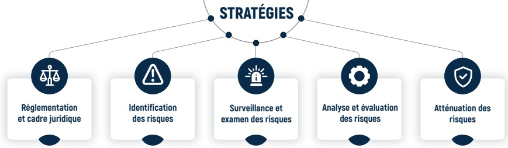

Figure 1: Les stratégies proposées par Merton

<!-- page 10 -->

En ce qui concerne les institutions, pour atténuer ces risques, des outils de politique monétaire ajustés, ainsi que des réformes en matière de régulation, accompagnées d'initiatives de développement et de renforcement des compétences financières, doivent être mis en place. Ces mesures permettront aux acteurs du secteur de mieux identifier et gérer les risques liés aux fluctuations des taux de change, aux variations des taux d'intérêt et aux conditions de liquidité, afin de garantir la stabilité du système financier, la protection des déposants et de renforcer la confiance du public.

En ce qui a trait aux acteurs économiques, l'assurance est un outil encore sous-utilisé mais essentiel pour renforcer la résilience des ménages et des entreprises face aux aléas économiques, sociaux et climatiques. Bien que le secteur de l'assurance en Haïti soit encore en développement, il constitue une stratégie de réponse fondamentale, permettant aux individus et aux entreprises de se protéger contre des pertes imprévues.

De plus, en contribuant au renforcement de la capacité financière des ménages, l'éducation financière constitue un pilier essentiel de la gestion globale des risques et de la résilience financière. Comme souligné par l'OCDE, l'éducation financière se définit comme le « processus par lequel un individu améliore sa connaissance des concepts de base, des produits, services et risques financiers et, au moyen d'informations, acquiert les compétences et la confiance nécessaires pour devenir plus sensible aux risques et opportunités en matière financière » (OCDE).

<!-- page 11 -->

# PRODUITS ET SERVICES FINANCIERS NUMÉRIQUES: LA MÉTHODE CCH

Les produits et services financiers englobent un ensemble d'outils, d'instruments et de mécanismes utilisés dans le cadre des activités financières pour faciliter la gestion des actifs, favoriser les transactions économiques, le financement de projets rentables et la couverture des risques. Ils incluent, entre autres, des produits tels que les prêts, l'épargne, les transferts d'argent, les services de chéquiers, les obligations, les actions, les swaps de devises, les fonds de placement et les dérivés financiers, ainsi que les services financiers numériques associés comme la banque à distance, les services d'investissement, la gestion de patrimoine et la gestion des risques financiers.

L'éducation financière et la protection des consommateurs usagers du système financier, deux (2) des domaines couverts par la Déclaration Maya (AFI, 2012), sont aussi des piliers de la Stratégie Nationale d'Inclusion Financière (SNIF) d'Haïti élaborée en 2014 (DSNIF, 2014). Selon le Plan National d'Éducation Financière (PNEF, 2020-2025), l'inclusion financière permet d'établir un lien étroit entre les produits financiers et la protection des consommateurs de produits et services financiers, notamment dans les domaines reportés dans le schéma ci-dessous :

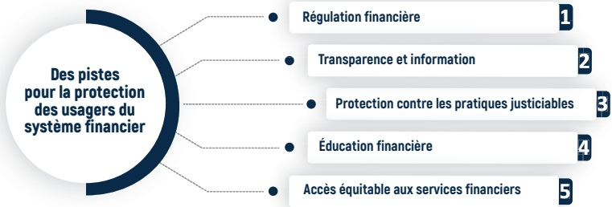

Figure 2: Des pistes pour la protection des usagers du système financier

Le Groupe Consultatif d'Assistance aux plus Pauvres (GCAP), après des expériences sur le terrain et la conception de produits et Services Financiers Numériques (SFN) plus adaptés, reconnaît l'importance de l'utilisation de la méthode CCH. Cette méthode repose sur quatre principes fondamentaux, connus sous le nom des “4 C”, tels que décrits sur la figure n°3 ci-dessous :

Figure 3: Agencement de la Méthode 4 C

Soure : CGAP, 2015.

Définir les produits et services financiers implique une compréhension approfondie de leur nature diversifiée et de leur portée, comme le souligne le Groupe Consultatif d'Assistance aux plus Pauvres (GCAP) en octobre 2015.

<!-- page 12 -->

# PRODUITS ET SERVICES FINANCIERS NUMÉRIQUES - RATIONALITÉ

L'approche de la conception des produits développée par CGAP permet de mieux structurer et analyser les produits et services financiers numériques, surtout dans le cadre de la digitalisation de ces derniers, afin de mieux comprendre leurs caractéristiques, leurs conditions d'utilisation et les principes sou-jacents, comme l'illustre le schéma n° 4 ci-après.

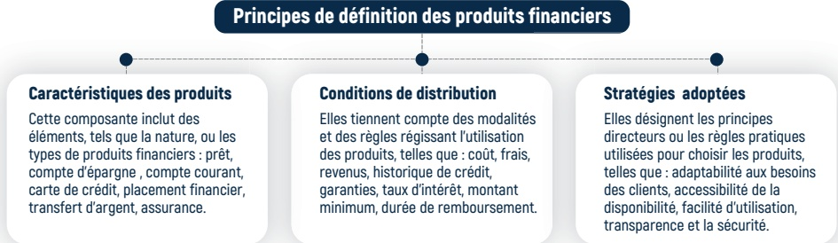

Figure 4: Principes de définition

La méthode des “4 C”, en mettant le client et l'usager au cœur de ses préoccupations, se distingue par son approche holistique qui va au-delà des besoins individuels pour inclure les perspectives des régulateurs, les dynamiques concurrentielles et les capacités des fournisseurs de services financiers numériques. En intégrant ces différentes dimensions, la méthode des “4 C” cherche à assurer une meilleure adéquation entre l'offre et la demande, favorisant ainsi une inclusion financière plus soutenue et durable.

Basé sur l'humain, le modèle cherche à élaborer des produits et services financiers adaptés aux besoins variés de la clientèle tout en intégrant les contraintes et les opportunités de leur environnement opérationnel. Il est structuré en trois phases interdépendantes : la phase d'inspiration, la génération d'idées et la mise en œuvre.

## Les étapes du processus de conception

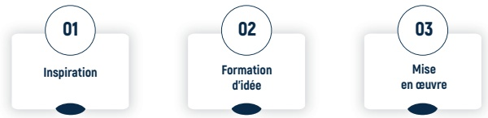

L'approche centrée sur les besoins clients est cruciale pour l'inclusion financière numérique, particulièrement dans le contexte de la crise multidimensionnelle qui a fait fluctuer les priorités des ménages, les exposant à divers risques. Les produits et services financiers doivent incorporer ces changements afin de répondre aux besoins spécifiques des particuliers, des ménages et des entreprises, que ce soit en matière d'épargne, de crédit, d'assurance, de protection des investissements ou de gestion des risques financiers.

<!-- page 13 -->

# AUX RENDEZ-VOUS DÉCISIONNELS

Selon la loi sur les Banques et autres Institutions Financières de 2012, le système financier haïtien est supervisé par la Banque de la République d'Haïti (BRH). Il est composé de huit (8) institutions bancaires, d'une (1) banque de logement, d'une (1) société de promotion des investissements, de trois (3) société financières de développement, de deux (2) sociétés de carte de crédit, et d'une (1) société de crédit-bail. Le système inclut également de nombreuses institutions de microfinance, des coopératives d'épargne et de crédit, ainsi que cinq (5) maisons de transfert et plusieurs fournisseurs de paiement électronique. La liste des institutions régulées est disponible sur le site web de la Banque de la République d'Haïti (BRH). Grâce aux efforts de ces institutions, la population dispose de plusieurs options pour financer des projets générateurs de revenus ou répondre à leurs besoins personnels. Cependant, l'accès et l'utilisation appropriée des solutions financières dépendent de divers facteurs, comme le contexte économique, l'offre financière, les coûts, et le niveau d'éducation financière des utilisateurs (pour une meilleure simplification). Le schéma ci-dessous vous guide dans l'exploration des principaux éléments à prendre en compte lors du choix de produits et services financiers.

LA FAÇON DONT VOUS ALLEZ L'UTILISER

## USAGE PRÉVU

Déterminez comment vous comptez utiliser le produit ou service. Est-ce pour des investissements à long terme, la gestion quotidienne des dépenses, ou peut-être pour une épargne de sécurité?

LES AVANTAGES

## AVANTAGES

Évaluez les bénéfices

que vous pouvez tirer du produit. Par exemple, un

DAT peut offrir un taux d'intérêt plus élevé qu'un

compte d'épargne.

LES FRAIS ET LES TAUX

APPLICABLES, LE CAS ÉCHÉANT

## COÛTS

Informez-vous sur tous les coûts associés, comme les frais de service mensuels, les taux d'intérêt, les frais de pénalité, et les coûts de transaction. Ces frais peuvent diminuer les avantages perçus.

S'IL VOUS CONVIENT

## ADÉQUATION

Assurez-vous que le produit ou service convient bien à votre situation financière actuelle et à vos objectifs futurs. Par exemple, est-ce qu'il existe une synergie entre le temps de remboursement et votre flux de trésorerie.

Figure 5: Choisir les produits et services financiers

## Le Saviez-Vous?

## “

La circulaire 103-1 de la Banque de la République d'Haïti, qui détermine les règles auxquelles sont assujettis les chèques émis en Haïti, oblige les institutions financières à vérifier l'identité et l'adresse du client (personne physique ou morale) en prenant une copie d'une pièce d'identité et d'un justificatif de domicile.

De plus, avant d'ouvrir un compte chèques, l'institution financière doit consulter la liste des interdits bancaires émise par la Banque de la République d'Haïti. Un compte chèques est ouvert pour une durée illimitée et peut être clôturé sans frais par le titulaire quand il le souhaite.

Enfin, la tarification des produits et services liés aux chèques doit être affichée de manière visible et lisible dans les locaux de l'institution financière.

Dans le cadre des prêts, les critères et conditions du contrat, tels que le type de financement, les taux d'intérêt et le calendrier de remboursement, sont influencés par divers éléments comme le profil de risque du client, la capacité du projet à générer des flux de trésorerie suffisants pour rembourser la dette, ainsi que d'autres risques potentiels tels que les fluctuations du marché ou les changements économiques imprévus. Dans certains cas, une garantie est exigée pour couvrir ces risques supplémentaires et assurer la sécurisation du prêt. Il est essentiel d'évaluer soigneusement toutes ces variables afin de choisir l'option de financement la mieux adaptée à vos besoins et à votre situation.

<!-- page 14 -->

# AUX RENDEZ-VOUS DÉCISIONNELS

## Des produits et services financiers : Quelles sont les Options ?

Pour une éducation financière efficace, il est essentiel de disposer d'informations sur les différents produits et services financiers disponibles sur le marché, ainsi que sur leurs caractéristiques et conditions, afin de faire un choix éclairé. Les figures 6 et 7 montrent le pourcentage d'accès par département aux succursales bancaires, ainsi que l'offre de certains de ces produits et services financiers.

Le Saviez-Vous?

La Banque de la République 'Haiti avise toutes les institutions bancaires et non bancaires que les taux d'intérêt sur les bons BRH, exprimés en base annuelle, sont modifiés comme suit :

| Maturité | Taux |
| --- | --- |
| 7 jours | 6 % |
| 28 jours | 8 % |
| 91 jours | 11.5 % |

## Les Régulateurs

Banque de la République d'Haïti

Ministère de l'Économie et des Finances

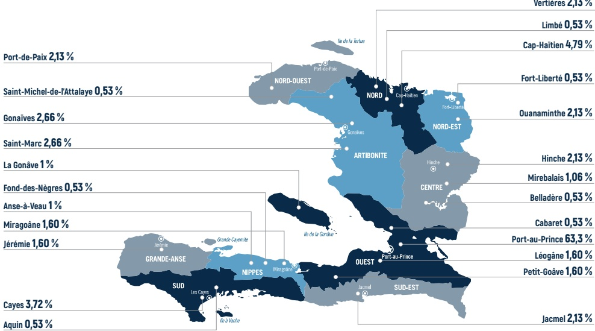

Figure 6: La cartographie des produits et services financiers en Haïti

<!-- page 15 -->

# AUX RENDEZ-VOUS DÉCISIONNELS

Cette partie propose une description des caractéristiques de certains produits et services financiers offerts par les institutions financières. Elle fait suite à la cartographie de l'accès aux succursales des banques en Haïti. L'analyse met en lumière non seulement la diversité des produits financiers disponibles, mais aussi leur accessibilité et leur pertinence pour différents segments de la population.

## Exploration des Produits Financiers Disponibles dans l'Écosystème

## Banques

## Caractéristiques

Services bancaires : Comptes, prêts, transferts d'argent, cartes bancaires, et services de banque en ligne et mobile.

## Conditions

Documents : Fournir une pièce d'identité, des justificatifs de revenu, une preuve d'adresse, faire un dépôt initial, et satisfaire aux exigences spécifiques pour crédits et prêts.

Frais : Les frais d'ouverture de compte varient d'une banque à l'autre.

## Société d'investissement

## Caractéristiques

Services Généraux : Gestion de portefeuilles, vente de produits d'investissement (actions, fonds communs), analyse financière, et services de courtage.

Services Complémentaires : Planification financière, conseil en investissement, et opportunités d'investissement alternatif.

## Conditions

Documents : Pièce d'identité, justificatifs de revenu, et preuve d'adresse.

Frais: Montant minimum d'investissement, critères de solvabilité, et acceptation des conditions spécifiques des produits ou services.

## Maison de Transfert

## Caractéristiques

Transferts d'argent nationaux, internationaux, paiement de factures, change de devises recharge de téléphone, envoi de mandats, suivi de transfert, alertes, et service client.

## Conditions

Identification et Informations : Présenter une pièce d'identité valide et fournir le numéro de référence ou les coordonnées du bénéficiaire selon le service.

Frais: Des frais sont applicables en fonction du service.

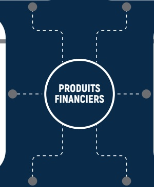

## IMF et CEC

## Caractéristiques

Les IMF et CEC offrent divers produits financiers incluant le service d'épargne, le microcrédit, la micro-assurance, le prêt d'investissement, le prêt personnel, le crédit de groupe, et le prêt agricole. Elles proposent également des services de transferts d'argent, de paiements de factures, de mobile banking, ainsi que des conseils financiers et des formations en gestion financière.

## Conditions

Il est requis d'être âgé de 18 ans, de posséder la nationalité haïtienne, et de fournir une pièce d'identité valide

## Produits financiers digitaux

## Caractéristiques

Simplicité d'utilisation, la sécurité des transactions, l'accès instantané aux fonds, l'interopérabilité entre différents services financiers, et la possibilité d'effectuer des paiements, des transferts, et des dépôts directement depuis un appareil mobile.

## Conditions

Inscription requise, pièces d'identité, et conformité aux régulations spécifiques.

## Société de Crédit Bail

## Caractéristiques

Services généraux : Location d'équipements et de véhicules avec option d'achat.

Services Complémentaires : Solutions de financement personnalisées pour les entreprises et gestion des contrats de crédit-bail.

## Conditions

Documents : Pièce d'identité, justificatifs de revenu, et preuve d'adresse.

Condition : Respecter les montants minimaux requis et signer un contrat détaillant les conditions de location et les obligations.

<!-- page 16 -->

# AUX RENDEZ-VOUS DÉCISIONNELS

Les données ci-dessous révèlent la situation de l'utilisation des produits et services financiers dans le paysage financier actuel. En effet, seulement 44 % de la population est formellement servie par les institutions financières régulées par la BRH, 42 % utilisent des services financiers non bancaires, et seulement 11 % utilisent les services proposés par les banques, tandis que 26,4 % utilisent les services des institutions de microfinance, coopératives et non mutualistes.

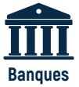

11% ont accès

aux services

bancaires

42 % utilisent d'autres mécanismes formels (non bancaires)

44% ont accès à tous les services financiers formels

## FINSCOPE, 2018

10 % utilisent

les produits financiers

informels

86 354 (1,1%) adultes haïtiens utilisent le compte en banque d'une autre personne

46% sont exclus totalement

Figure 8: Niveaux d'accès pour les services financiers

L'une des raisons avancées pour la non-utilisation des produits financiers est la peur du risque. L'éducation financière représente un outil efficace pour surmonter les barrières liées à la "risquophobie", cette peur paralysante du risque qui empêche de nombreux individus de se lancer dans les investissements.

Assurez-vous de comprendre les concepts de base comme les taux d'intérêt, les obligations BRH, et les fonds communs de placement

Figure 9: Surmonter la risquophobie

Définissez ce que vous voulez atteindre avec vos investissements. Que ce soit pour la retraite, l'achat d'une maison ou l'éducation de vos enfants.

Apprenez à évaluer les risques et souscrivez-vous à une assurance pour mitiger les risques identifiés

La patience est cruciale en investissement pour en récolter les fruits à long terme, par exemple avec les obligations de la BRH ou d'autres opportunités sur le marché.

En se familiarisant avec les principes fondamentaux de l'investissement, les stratégies de diversification et les notions de gestion des risques, les agents économiques deviennent plus avisés. Une fois leur capacité renforcée, ils peuvent surmonter leur appréhension, non seulement pour identifier des opportunités d'investissement, mais aussi pour gérer efficacement les risques associés. Ainsi, investir devient une démarche planifiée, favorisant la création de richesse et à l'atteinte d'objectifs financiers à long terme.

<!-- page 17 -->

# AUX RENDEZ-VOUS DÉCISIONNELS

# PEDRO ENCOURAGE LA DIVERSIFICATION DE PRODUITS ET SERVICES FINANCIERS

L'entreprise de transformation de produits agricoles de Pedro résiste aux épreuves de la crise. Il continue donc à privilégier l'épargne automatique, construisant ainsi un socle d'épargne solide sur son compte bancaire. Après deux ans d'épargne, il estime que sa stratégie est optimale et néglige d'explorer d'autres stratégies qui pourraient potentiellement lui offrir une plus grande utilité dans ce contexte de grande turbulence économique.

Cette décision semble rationnelle à première vue, car elle repose sur une stratégie simple et peu risquée. Cependant, ce type de décision est une posture qui décrit la tendance de Pedro à se conformer aux pratiques courantes plutôt qu'à effectuer une évaluation rigoureuse des options financières disponibles. En réalité, même s'il croit faire un choix sensé, son comportement reflète davantage une dépendance aux habitudes et aux conventions du marché, plutôt qu'une véritable optimisation de ses ressources financières.

## Le Saviez-Vous?

Investir est essentiel pour faire fructifier votre capital, et les obligations de la BRH peuvent être une excellente option à considérer.

Avec un montant d'investissement minimal de seulement 50 000 gourdes, un taux d'intérêt attractif de 7% l'an, assorti d'une rémunération additionnelle en cas de variation positive du taux de change, et une maturité de 91 jours, elles offrent une opportunité intéressante pour les investisseurs en quête de sécurité et de rendement.

## Quels produits financiers Pedro peut-il considérer pour faire prospérer ses ressources disponibles sur son compte bancaire ?

Pedro manque une occasion de diversification et de croissance potentielle de ses ressources financières en négligeant des options comme les obligations BRH, les Dépôts à Terme (DAT) offerts par les Banques Commerciales, ainsi que d'autres placements disponibles auprès d'institutions financières telles les sociétés de promotion des investissements.

En tant qu'agent économique, en raison de notre aversion pour les risques, il est fréquent que nous passions à côté de certaines opportunités financières, même si elles ont le potentiel d'offrir une meilleure santé financière. Sensibilisé par les capsules de la BRH, Pedro cherche désormais à saisir l'opportunité de diversifier ces actifs financiers en investissant dans les obligations de la BRH et potentiellement augmenter ces ressources financières.

<!-- page 18 -->

## 01

Contactez un intermédiaire financier agréé par la BRH

## 02

Ouvrez un compte bancaire ou de titres

Souscrivez aux obligations BRH

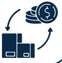

Suivez vos investissements

<!-- page 19 -->

## ASSURANCE - RATIONALITÉ

Le secteur des services financiers ne se contente pas seulement de mettre en relation les épargnants et les emprunteurs, mais il facilite également les relations contractuelles entre les fournisseurs de services d'assurance, appelés assureurs, et les assurés.

## ASSURANCE

L'assuré s'engage à payer sa prime

Pedro paie 25,000.00 gourdes chaque mois pour son assurance auto. Suite à son accident, son assurance lui verse une indemnité pour couvrir la plupart des réparations.

L'assurance s'engage à fournir une indemnité financière en cas d'un sinistre

Figure 10: Relation entre assureur et assuré

Les assurances jouent un rôle crucial dans la gestion des divers risques auxquels nous sommes tous confrontés dans nos vies. Une souscription peut être utile pour les raisons reprises sur le schémas ci-dessous.

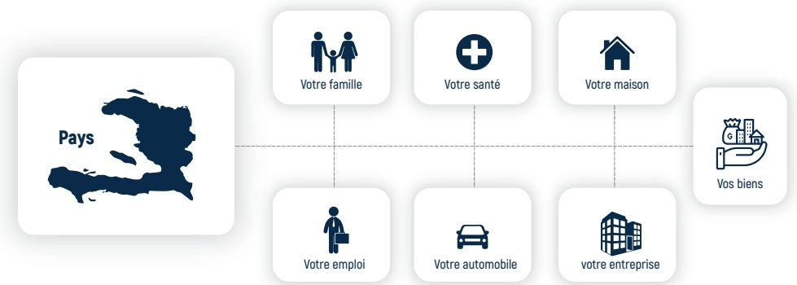

Figure 11: Rôle de l'assurance

La théorie de la prévention des risques revêt une importance cruciale dans l'offre et l'utilisation des produits et services financiers. Elle reconnaît que les risques peuvent varier en intensité en fonction des spécificités du produit financier et des conditions macroéconomiques. Une gestion efficace des risques est essentielle pour assurer la gestion des risques budgétaires, la sécurité financière des individus, des entreprises, des ménages et du système financier en général (FMI, 2014).

<!-- page 20 -->

## ASSURANCE - RATIONALITÉ

AIC, Les Assurances Léger S.A,

La Compagnie d'Assurance

d'Haïti, INASSA, NASSA etc

Agent d'assurance Compagnie

d'assurance

Conseille les clients sur les différents produits d'assurance compagnies.

## Ministère de l'Économie et des Finances (MEF), Association des Assureurs Haïtiens (AAH)

## Spécialiste en Conformité et Règlementation

Assure la conformité aux lois et règlementations gouvernementales dans le secteur des assurances. Il s'assure que les normes éthiques et légales sont respectées.

## Unité de Contrôle et de Supervision des Assurances (UCSA)

## Inspecteur d'Assurance

Procède aux inspections d'évaluation des risques afin de fournir des recommandations préventives contre les risques.

Assurances publique de travail, de Véhicules et Fonds de Pensions

## OFATMA, OAVCT, ONA

Conseille les entreprises et les particuliers sur la gestion proactive des risques.

## SCOR

Négocié des contrats de réassurance

avec d'autres compagnies

d'assurance pour transférer une

partie des risques souscrits

## Expert en réassurance

## BNC/ Uni Assurance/ SOGE Assurance

Figure 12: Les acteurs représentants le secteur des assurances

Gestionnaire de portefeuille

Surveille la performance financière

des polices d'assurance pour un

portefeuille spécifique.

La fonction principale de l'assurance est de transférer le risque financier associé à la situation spécifique de l'assuré à l'assureur. Quelque soit le type d'assurance, ils visent tous à offrir sécurité financière et tranquillité d'esprit en cas d'événements imprévus. Le secteur englobe généralement une diversité de parties prenantes dont les principales sont résumées ci-dessous :

Autorités de régulation et organismes gouvernementaux

Assureurs ou compagnies d'assurances

Réassureurs

Courtiers d'assurance/Broker

Agents d'assurance

Clients/assurés

Professionnels de l'assurance

À ces parties prenantes s'ajoutent d'autres acteurs représentant une partie essentielle du secteur des assurances. Chacun contribue à différents aspects tels que la conformité réglementaire, la gestion des risques, la tarification des produits d'assurance et la satisfaction des clients.

## Le Saviez-Vous?

## “

L'éligibilité à une assurance n'est pas automatique. Le souscripteur évaluera votre demande en tenant compte de votre historique et de votre profil de risque actuel, ce qui déterminera s'il accepte ou refuse de vous assurer.

Ne laissez pas les risques s'imposer à vous avant de prendre les devants. Prenez l'initiative de contacter une compagnie d'assurance pour vous prémunir contre les aléas de la vie.

<!-- page 21 -->

# ASSURANCE - CADRE JURIDIQUE

En Haïti, le cadre législatif existant encourage très peu la culture de l'assurance. Alors que le système financier dans son ensemble est supervisé par la Banque centrale à travers la loi de 2012, la régulation du système d'assurance relève du Ministère de l'Économie et des Finances (MEF). Les principales lois relatives à ce secteur sont résumées dans le schéma ci-dessous :

Loi organique 12 septembre 1951

Modification de la loi de 1949 sur les assurances

sociales (accidents du travail, maladie-maternité).

Loi du 10 octobre 1949

Adoption d'une loi sur les assurances

sociales et création de l'IDASH.

Décision du 21 août 1952

L'IDASH se concentre sur l'assurance

accidents du travail.

Loi du 14 juillet 1955

Amendements à la loi de 1952: assurance

accidents du travail appliquée.

SÉCURITÉ

SOCIALE-ASSURANCE

Amendements 1955, 1957, 1961

Adoption d'une série d'amendements à la loi organique de 1951 et à son règlement d'application.

Décret du 8 novembre 1965

Création de l'assurance vieillesse obligatoire

et de l'ONA.

La loi du 28 août 1967

Loi Subdivisant l'IDASH en :

1- Office d'Assurance Accidents du Travail, Maladie et

maternité (OFATMA).

2- Office National Assurance Vieillesse (ONA)

<!-- page 22 -->

# AUX RENDEZ-VOUS DÉCISIONNELS

Cependant, le décret du 20 mars 1981 a tenté de réorganiser la répartition des compétences entre le Ministère du Commerce et de l'Industrie (MCI) et le Ministère de l'Économie et des Finances (MEF) dans le secteur des assurances. Ce décret visait à clarifier les responsabilités réglementaires de chaque ministère. Toutefois, en pratique, le secteur des assurances ne bénéficie pas d'une réglementation effective. Le MEF est officiellement chargé de la supervision, mais n'exerce pas pleinement cette responsabilité, tandis que le MCI, en dehors de l'autorisation d'opérer en tant que société anonyme, n'exerce aucun pouvoir réel sur ce secteur.

Plusieurs articles de la loi du 13 juillet 1956 sur les compagnies d'assurance ont ainsi été modifiés. Selon les articles 2, 3, 9, 15, 20 et 21, le MCI est chargé d'accorder l'autorisation de fonctionner en tant que société anonyme. Le MEF, quant à lui, est responsable de l'octroi des agréments et de la supervision du secteur, conformément aux articles 3, 5 et 22. À noter que l'assurance maritime est traitée dans le Code de commerce, livre II, titres X et XIV. (MEF, 2014)

Il convient de noter qu'après le séisme de 2010, une tentative d'élaboration d'un avant-projet de loi a été soutenue par le projet FIRST et le Département du Trésor américain (OTA). Suite au séisme, et dans un souci d'améliorer la gestion des risques, le MEF a créé en 2012 un organisme provisoire de contrôle et de supervision du secteur des assurances dénommé USCA.( MEF, 2014).

Les services d'assurance disponible dans le pays sont assurés par les compagnies régulées par le Ministère de l'Économie et des Finances (MEF), reportées sur le schéma ci-après:

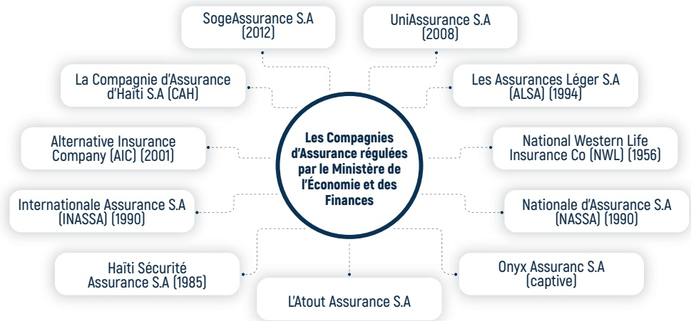

Figure 14: Les différentes compagnies d'assurance régulées en Haïti

Le marché de l'assurance en Haiti est très peu développé. Les rares services d'assurance disponibles dans le pays sont offerts par les compagnies régulées par le Ministère de l'Économie et des Finances (MEF), dont les licences sont délivrées par le Ministère du Commerce et de l'Industrie (MCI).

<!-- page 23 -->

# AUX RENDEZ-VOUS DÉCISIONNELS

Les principaux obstacles à l'adoption d'un produit d'assurance:

| Category | Value (%) |
| --- | --- |
| N'a pas de revenu ni d'emploi régulier | 44 |
| Ne comprends pas le fonctionnement l'assurance | 10 |
| N'a pas assez de connaissance sur les produits d'assurance | 9 |
| Ne crois pas aux produits d'assurance | 8 |
| N'a pas besoin d'assurance | 7 |

Figure 15: Les principaux obstacles à l'adoption d'un produit d'assurance

Le manque de revenu ou d'emploi régulier est le principal obstacle, affectant 44% des répondants, soulignant que l'instabilité financière est une barrière significative à la souscription d'une assurance. Ensuite, les difficultés liées à la compréhension des mécanismes de l'assurance (10%) et à la connaissance insuffisante des produits disponibles (9%) montrent un déficit clair en termes d'éducation financière.

Les différents niveaux d'accès sont décrits dans le schéma ci-dessous.

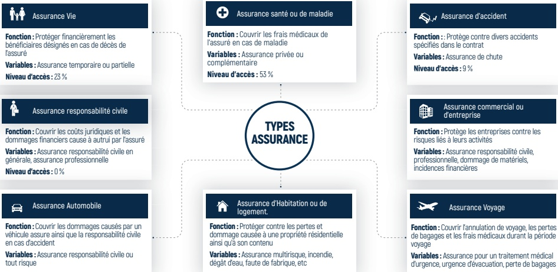

Figure 16: Les types d'Assurance

Fonction : Couvrir l'annulation de voyage, les pertes de bagages et les frais médicaux durant la période voyage

La méfiance envers les produits d'assurance, exprimée par 8% des sondés, et le sentiment que l'assurance n'est pas nécessaire, ressenti par 7%, doivent-être également être abordés par une meilleure communication sur les bénéfices tangibles de l'assurance, ainsi que par la transparence des fournisseurs d'assurance concernant les termes des polices et les processus de réclamation.

<!-- page 24 -->

# AUX RENDEZ-VOUS DÉCISIONNELS

# ASSURANCE REDÉFINIE : L'EXPÉRIENCE INSPIRANTE DE BÉATRICE

Dans un environnement marqué par une crise multidimensionnelle et des risques climatiques auxquels le pays est exposé, Béatrice commence à s'inquiéter pour son investissement immobilier financé par le programme de logement 10-10-20 de la Banque de la République d'Haïti (BRH). Contrainte de quitter sa zone d'habitation en raison de problèmes d'insécurité, elle a informé son assureur, sachant qu'elle est couverte par une police d'assurance logement, dans l'espoir d'obtenir une solution de relogement temporaire en attendant que la situation s'améliore ou qu'elle trouve une autre solution par elle-même.

Malheureusement, l'assureur a refusé tout soutien financier en ce sens. Face à l'absence d'un organisme de protection des consommateurs de produits et services financiers, elle a décidé de consulter son avocat, qui a procédé à une révision détaillée du contrat avec elle. Ensemble, ils ont découvert qu'une clause en petits caractères, située en bas de page du contrat, spécifiait les conditions particulières pour lesquelles le remboursement de sa prime d'assurance ne serait pas réalisé. Choquée par cette découverte, Béatrice a dû se résoudre à se reloger chez ses parents.

Ce phénomène est particulièrement illustré par les faibles taux de souscription des adultes haïtiens à l'assurance logement, qui s'élèvent à seulement 1 % (FinScope, 2018). Cela suggère non seulement un manque d'information et d'éducation financière, mais aussi une sous-estimation significative des risques associés à ce type de bien.

Comment les Haïtiens gèrent-ils le risque en matière d'assurance ?

N'a pas de revenu ni d'emploi régulier

Ne comprends pas le fonctionnement de l'assurance

N'a pas assez de connaissance sur les produits d'assurance

Ne crois pas aux produits d'assurance

N'a pas besoin d'assurance

N'a pas besoin d'assurance

| Category | Value |
| --- | --- |
| 1 | 53% |
| 2 | 23% |
| 3 | 20% |
| 4 | 13% |
| 5 | 9% |
| 6 | 1% |

Figure 17: Gestion des risques d'assurance par les haitiens

## 96 %

96%

des adultes n'ont aucun type de produit financier couvrant le risque

97%

n'ont pas entendu parler

de l'assurance dommages

matériels

Malgré tout, cette approche proactive met en lumière l'importance cruciale de mieux se préparer aux éventualités imprévues et d'assurer une protection adéquate des biens immobiliers dans des circonstances difficiles comme celles vécues par Béatrice, notamment en adhérant à des solutions d'assurance adaptées. Toutefois, elle souligne également la nécessité d'être accompagné par une personne avisée lors des transactions impliquant la conclusion de contrats, surtout lorsqu'il s'agit de décisions aussi importantes.

Béatrice recommande vivement une lecture minutieuse des termes contractuels lors de la souscription d'une police d'assurance afin de cerner les risques couverts et non couverts. Il est crucial de bien comprendre les délais de réalisation des primes après un incident, le montant alloué, la devise utilisée, ainsi que les solutions de relogement temporaires disponibles, entre autres informations pertinentes.

<!-- page 25 -->

# AUX RENDEZ-VOUS DÉCISIONNELS

## LES APPORTS DU PROGRAMME CCRIF

Le sommet sur le pacte financier mondial de 2023, organisé par la Banque Mondiale, a été l'occasion pour les décideurs de se pencher une nouvelle fois sur les crises interconnectées, notamment les risques climatiques qui continuent d'aggraver les inégalités, en particulier dans les pays les plus vulnérables (Banque Mondiale, 2023). Le renforcement de la mise en place de mesures de résilience face aux impacts climatiques a été au cœur des débats. Haïti figure aujourd'hui parmi les pays les plus exposés. La CCRIF (Caribbean Catastrophe Risk Insurance Facility), dont Haïti bénéficie depuis 2007, fait partie de ces mesures visant à renforcer la résilience du pays.

Paiment des droits de participation

Mise à jour régulière

de son portefeuille

de produits

Activités de formation sur l'amélioration de la gestion des risques budgétaires

Renforcement de capacités pour une compréhension des instruments de financement et la prise en compte des risques budgétaires.

Suivi de la performance du modèle.

Expansion géographique

## Figure 18: Les Apports du programme CCRIF

## Le Saviez-Vous?

Le Fonds d'assurance contre le risque de catastrophe dans les Caraïbes (CCRIF SPC) regroupe 24 membres dont 19 pays des Caraïbes, 3 gouvernements d'Amérique centrale et 2 compagnies d'électricité des Caraïbes.

À ce jour, 16 membres ont été indemnisés, dont Haïti, qui a reçu 45 millions de dollars américains suite au tremblement de terre du 14 août 2021, montant représentant la couverture maximale prévue par sa police d'assurance paramétrique pour les séismes en 2021/22.

## Le Saviez-Vous?

Depuis 2007, avec le support de l'IDA Haïti bénéficie une couverture d'assurance à travers le mécanisme d'assurance contre les risques de catastrophe en Amérique Centrale et aux Caraïbes (CCRIF/SPC) en renforçant la capacité technique de leurs Ministères des Finances.

L'assurance peut aider les individus, les entreprises et les pays à couvrir les coûts financiers liés à des situations imprévues.

Au lendemain des catastrophes, le mécanisme est déclenché afin de permettre aux pays de réduire les vulnérabilités de leurs finances publiques.

<!-- page 26 -->

## CONCLUSION

En période de crise économique ou financière, tant les individus que les ménages et les entreprises sont confrontés à de fortes incertitudes et à des risques accrus. Choisir les bons produits et services financiers exige une évaluation prudente des objectifs financiers, du profil de risque et des conditions économiques existantes. De plus, adopter une vraie culture de gestion par le biais de l'assurance, diversifier les investissements, maîtriser les coûts et promouvoir l'éducation financière peuvent contribuer à naviger avec succès à travers les défis économiques et à préparer le terrain pour une reprise plus résiliente à long terme.

À travers le Volume II de la Revue de Développement de Connaissances et Compétences Financières (RDCCF), la BRH invite les usagers du système financier à adopter une approche proactive et réfléchie pour surmonter les difficultés et naviguer à travers les périodes de turbulence. En prenant des décisions prudentes et basées sur une compréhension approfondie des produits financiers et des stratégies de protection, les usagers peuvent mieux gérer les incertitudes, minimiser les impacts des crises, et se positionner avantageusement pour saisir les opportunités futures. En toutes circonstances, la prudence et la diligence dans vos choix financiers peuvent faire toute la différence pour garantir la sécurité financière et la pérennité économique.

Bien que certains produits tels que les transferts aient constitué un véritable refuge pour maintenir la résilience financière durant cette période, les crises précédentes ont néanmoins révélé les limites des opérations traditionnelles. L'accélération de l'implémentation d'un système de paiement digital inclusif représente une voie prometteuse pour renforcer l'inclusion financière en Haïti. Ce système vise à réduire les disparités entre les zones urbaines et rurales, facilitant un accès équitable aux produits et services financiers pour tous. En outre, il contribue activement à promouvoir l'égalité des genres, en permettant aux femmes et aux hommes d'accéder aux mêmes opportunités financières et économiques.

<!-- page 27 -->

## BIBLIOGRAPHIE

AFI (2012). Engagements sur lesquels vous pouvez compter : Rapport d'étape 2012 sur la mise en œuvre de la Déclaration de Maya. AFI

BRH. (2014). Stratégie Nationale d'Inclusion Financière. BRH.

BRH. (2018). Enquête FinScope sur la consommation des ménages. BRH.

BRH. (2020). Plan National d'Éducation Financière (PNEF), 2020-2025. BRH.

BRH. (2022). Plan Stratégique Global (2022-2024). BRH.

BRH. Circulaire 103-1. BRH.

BRH. De l'aménagement des zones franches et des parcs industriels : Circulaire 106. BRH.

Cuervas, C., & Anderson, J. (2015). Comprendre la demande, stimuler l'innovation : Les ménages des petits exploitants agricoles et les services financiers. CGAP.

CGAP. (2015). Global Landscape of Innovations in Digital Finance. CGAP. http://de.slideshare.net/CGAP/the-global-landscape-of-digital-finance-innovations

CGAP. (2015). Concevoir des services financiers numériques pour les familles des petits exploitants. CGAP. Damon, J. (2010). L'éducation financière : Une innovation sociale en plein développement. Futuribles, 43-50. FMI. (2022). Cours en ligne, Développement financier et inclusion financière (FDFIx). Edx.org.

Guérin, I. (éd.), & Selim, M. (2012). L'éducation financière ou comment apprendre aux pauvres à bien consommer.

Jain, A., et al. (2014). A progressive approach to financial inclusion. MasterCard Advisors.

Loi du 26 Novembre 2002 sur le code des investissements modifiant le décret du 30 octobre 1989 relatif au code des investissements.

Le Moniteur. (2012). Loi portant sur les Banques et autres institutions financières.

Mishkin, F. S. (2013). Monnaie, banque et marchés financiers (10e éd.). Nouveaux Horizons/Pearson France. OCDE. (2022). Évaluation des stratégies nationales pour la culture financière. OCDE.

Quiry, P., Le Fur, Y., & Vernimmen, P. (2019). Finance d'entreprise (17e éd.). Dalloz.

Merton, R. C. (1990). Continuous-Time Finance.

<!-- page 28 -->

# SITES WEB CONSULTÉS

CCRIF. (2021, August 23). CCRIF to make US$40 million payout to Haitifollowing devastating August 14 earthquake. CCRIF SPC. http://bit.ly/4fywlCH.

Unit. Consulté le Polycopie étage 2. Retrieved from http://ressources.unit.eu/cours/cyberrisques/etage_2/res/Polycopie_etage_2_v2

Learn Immo. (Consulté le). Importance de la gestion des risques dans la stratégie immobilière. Retrieved from https://www.learn-immo.fr/guide-strategie-immobilière/importance-gestion-risque-strategie-immobilière/#:~:text=Diff%C3%A9rents%20types%20de%20risques%20dans%20l'investissement%20immobilier&text=Le%20risque%20de%20vacance%20locative,p our%20l'achat%20du%20bien

BRH. (Consulté le 17 juillet 2024). Avis sur les taux d'intérêt des bons. Retrieved from https://www.brh.ht/wp-content/uploads/Avis-taux-interet-bons.pdf

<!-- page 29 -->

<!-- page 30 -->

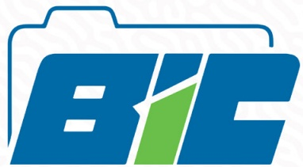

Bureau d'Information sur le Crédit

## Pour solliciter votre rapport de crédit, contactez le BIC aux

28 17 00 00 | 28 17 0001

FAITES CONFIANCE AU BIC !

12, Rue Butte, Bourdon

Tel: 28 17 00 00/28 17 00 01

<!-- page 31 -->

Bureau d'Information sur le Crédit

## Avec votre rapport de crédit, vous pouvez mieux gérer votre crédit et améliorer votre solvabilité à long terme

## FAITES CONFIANCE AU BIC !

12, Rue Butte, Bourdon

Tel: 28 17 00 00/28 17 00 01

<!-- page 32 -->

BANQUE DE LA RÉPUBLIQUE D'HAÎTI

Scannez ce QR Code pour accéder aux informations relatives à la Circulaire 113

INCITATIONS AU FINANCEMENT DU SECTEUR AGRICOLE

CIRCULAIRE No 113

Aux Institutions Financières

<!-- page 33 -->

# 4 raisons de souscrire aux OBLIGATIONS BRH

## 1

TAUX D'INTÉRÊT ATTRACTIF

Les Obligations BRH vous offrent des taux d'intérêt de 7 %, 7,25 %, et 7,50 % par an respectivement pour des maturities de 3, 6, et 12 mois, avec une indexation à la hausse du taux de change.

## 2

ACCESSIBILITÉ

Le montant minimal de souscription est de 50,000.00 gourdes, rendant ce produit financier accessible à une large partie de la population.

## 3

REMOURSEMENT SIMPLE

ET EFFICACE

Deux jours ouvrables après la date d'échéance, les obligations BRH sont rémunérées directement sur votre compte via l'intermédiaire financier, simplifiant ainsi le processus de récupération de votre capital et des intérêts.

## 4

STABILISATION DE LA GOURDE

En investissant dans les obligations BRH, vous contribuez à stabiliser la valeur de la monnaie nationale et à renforcer l'accumulation de l'épargne en gourdes.

<!-- page 34 -->

Banque de la République d'Haiti ⏰

@BRHHaiti

Banque Centrale d'Haiti qui assure la défense de la #Gourde, le développement du système de paiements, la stabilité financière, l'inclusion financière.

Haiti brh.ht Joined April 2024

6 Following 76 Followers

RESTEZ INFORMÉS DE TOUTES

LES DERNIÈRES MISES À JOUR DE LA BRH !

Scannez ce QR code pour nous suivre sur notre nouveau compte X: @BRHHaiti_

<!-- page 35 -->

<!-- page 36 -->

<!-- page 37 -->

RDCCF-VOL.II
