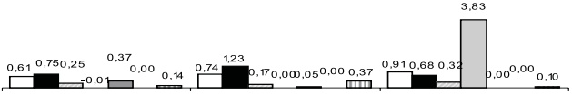

<!-- page 1 -->

## Table des Matières

I. Inflation et change ..... 2
II. Instruments de Politique Monétaire ..... 3
III. Liquidité, Crédit et Dépôts des Banques ..... 4
IV. Bilan des Autorités Monétaires ..... 5
V. Situation Monétaire ..... 6
VI. Finances Publiques ..... 7
VII. Dette Externe ..... 8
VIII. Croissance du Bilan ..... 9
IX. Parts de Marché ..... 10
X. Qualité de l'Actif ..... 12
XI. Rentabilité ..... 13
Glossaire ..... 15

## Avertissement

La publication mensuelle des Indicateurs Économiques et Financiers a pour objectif de mettre à la disposition du public en général, et des décideurs et agents économiques en particulier, des informations pertinentes sur les secteurs monétaire et financier. Les informations sont présentées de façon factuelle et sous forme de descriptions lapidaires, du type «bullet points», accompagnées de graphes et tableaux illustratifs.

Un accent particulier a été porté sur l'évolution des indicateurs au cours du mois considéré selon trois repères :

1. le mois antérieur,

2. le début de l'année fiscale, et

3. le même mois de l'année précédente (glissement annuel). Ainsi les tendances qui se dégagent pour un mois donné peuvent être aisément mises en perspective.

Statistiques monétaires et bancaires : Les statistiques monétaires et bancaires sont des données de stock. Elles sont présentées avec deux mois de décalage pour des raisons de disponibilité des données bancaires.

Finances publiques : Les statistiques de finances publiques sont des données de flux et sont enregistrées sur la base des encaissements-décaissements. Elles sont décalées de deux mois.

Inflation : La présentation par la BRH des données fournies par l'Institut Haïtien de Statistiques et d'Informatique sur l'évolution de l'indice des prix à la consommation (IPC) se fait avec deux mois de retard; pour les données du change le retard n'est que d'un mois.

Certaines données publiées dans la présente édition des Indicateurs Économiques et Financiers sont provisoires et, par conséquent, sujettes à révision dans des publications futures.

<!-- page 2 -->

### I. Inflation et Change

## Inflation

- En mars 2002, l'indice des prix à la consommation est en hausse (0,91 %) par rapport au mois de février 2002 (0,74 %).

- Ce résultat reflète la progression du taux de croissance des indices des principaux groupes de dépenses : les prix des groupes Habillement, tissus et chaussures et Loyer du logement, énergie et eau se sont accrus respectivement de 0,32 % et 3,83 % par rapport à ceux du mois de février 2002 (respectivement 0,17 % et 0,00 %). Les indices des groupes de dépenses Alimentation, boissons et tabac, Transport et Autres biens et services (respectivement 0,68 %, 0,00 % et 0,10 %) sont en baisse par rapport à ceux du mois de février 2002 (respectivement 1,23 %, 0,05 % et 0,37 %). Les prix du groupe Loisirs, spectacles, enseignement et culture sont restés stables (0,00 %) en mars 2002.

- En glissement annuel, le taux d'inflation est passé de 8,03 % en février 2002 à 8,47 % en mars 2002. En moyenne mensuelle, la hausse des prix à la consommation est de 0,62 %.

## Change

## Taux

Le taux de référence de fin de période de la BRH est passé de 26,7658 gdes en mars 2002 à 26,6768 gdes en avril 2002, atteignant un minimum de 26,4498 gdes le 10 avril 2002.

- En avril 2002, le taux de référence de fin de période s'est déprécié de 0,33 % par rapport au mois précédent. Il s'est apprécié de 2,57 % et de 13,69 % par rapport à octobre 2001 et avril 2001 respectivement.

## Achats et ventes de devises des banques

- Les achats de devises ont augmenté de 0,54 % par rapport à mars 2002. Ils ont augmenté de 18,10 % et de 34,89 % par rapport à octobre 2001 et avril 2001 respectivement.

- Les ventes de devises ont augmenté de 9,71 % par rapport à mars 2002. Elles ont augmenté de 17,98 % et 28,58 % par rapport à octobre 2001 et avril 2001 respectivement.

En avril 2002, la position cambiste de change s'est située à 3,394 millions de $ ÉU contre -1,159 million le mois précédent.

- D’octobre 2001 à avril 2002, les achats et ventes ont totalisé respectivement 471,66 et 483,06 millions de $ ÉU contre 387,85 et 412,35 millions pour la même période de l’exercice précédent.

- En avril 2002, le spread des banques a représenté 1,43 % du taux à l'achat contre 1,18 % le mois précédent. Il était de 1,45 % en octobre 2001 et de 2,68 % en avril 2001.

## Achats et ventes de devises des agents de change

- Selon les données disponibles à date, reçues d'agents de change enregistrés, les achats se sont chiffrés à 4,66 millions de $ ÉU et les ventes à 4,62 millions en avril 2002.

## Transferts reçus de l'étranger

- Selon les données disponibles à date reçues des maisons de transfert enregistrées, les transferts privés se sont chiffrés à 15,79 millions de $ ÉU en avril 2002 comparé à 22,99 millions le mois précédent. Ils s'élevaient à 19,75 millions de $ ÉU en avril 2001.

D'octobre 2001 à avril 2002, les transferts privés ont atteint 147,80 millions de $ ÉU contre 133,70 millions pour la même période de l'exercice précédent.

Graphique 1: Taux d'Inflation (%) (variation mensuelle)

Graphique 2: Taux de Change (gourdes/dollars ÉU)

|   | Achats | Ventes |
| --- | --- | --- |
| 1/4/02 | 269.5 | 271.5 |
| 4/4/02 | 268.0 | 270.0 |
| 9/4/02 | 267.0 | 269.0 |
| 12/4/02 | 266.0 | 269.0 |
| 17/4/02 | 267.0 | 269.0 |
| 22/4/02 | 267.0 | 269.0 |
| 27/4/02 | 267.0 | 269.0 |
| 30/4/02 | 267.0 | 269.0 |

Graphique 3: Volume des Transactions de Change des Banques

|   | Achats (millions de dollars ÉU) | Ventes (millions de dollars ÉU) |
| --- | --- | --- |
| jan. 02 | 69.8 | 69.5 |
| fév. 02 | 58.6 | 60.1 |
| mars 02 | 73.4 | 72.3 |
| avril 02 | 73.8 | 79.3 |

<!-- page 3 -->

### II. Instruments de Politique Monétaire

## Coefficients de réserves obligatoires

- La circulaire 86-12 du 15 juin 2001 porte au même niveau les coefficients de réserves obligatoires sur les passifs libellés aussi bien en monnaie étrangère qu’en monnaie nationale soit 31 % pour les banques commerciales et 19,50 % pour les banques d'épargne et de logement.

- Les banques ont l'obligation de constituer en gourdes 30 % des réserves obligatoires sur les passifs libellés en devises étrangères conformément aux dispositions de la circulaire # 86-12A du 15 juin 2001.

## Interventions de la BRH sur le marché des changes

• En avril 2002, la BRH a acheté 5,6 millions de $ ÉU.

D'octobre 2001 à avril 2002, la BRH a acheté 6,10 millions de $ ÉU.

Pour la même période de l'exercice précédent, la BRH n'est pas intervenue sur le marché des changes.

## Bons BRH

- L’encours des bons BRH au 30 avril 2002 a augmenté de 2,98 % sur un mois et de 64,62 % en glissement annuel. Entre septembre 2001 et avril 2002, l’encours des bons a augmenté de 3,20 %. Les bons à 7 et 91 jours représentent respectivement 12,32 % et 87,68 % du total.

- La BNC (1 148 MG), la Sogebank (600 MG), la Unibank (540 MG), la BUH (220 MG) et la Capital Bank (174 MG) détiennent 93,58 % de l'encours des bons BRH émis.

Au 30 avril 2002, l'encours des bons BRH s'élève à 45,91 % des réserves effectives contre 47,26 % au 31 mars 2002.

- Sur le marché monétaire, le taux interbancaire a diminué passant de 13,76 % à 12,78 % entre le 31 mars 2002 et le 30 avril 2002. Les taux sur les bons à 7 et 91 jours ont diminué passant respectivement de 6,8 % à 5,9 % et de 12,00 % à 10,10 %.

|   | passis en gourdes BEL | passis en devises BEL | passis en gourdes banques com. | passis en devises banques com. |
| --- | --- | --- | --- | --- |
| jan. 02 | 19.50% | 3100% | 3100% | 19.50% |
| fév. 02 | 19.50% | 3100% | 19.50% | 19.50% |
| mars. 02 | 19.50% | 3100% | 19.50% | 19.50% |
| avr. 02 | 19.50% | 3100% | 19.50% | 19.50% |

Graphique 5: Encours de Bons BRH (millions de gourdes)

|   | 3/4/02 | 10/4/02 | 17/4/02 | 24/4/02 |
| --- | --- | --- | --- | --- |
| Encours total des bons | 2697 | 2808 | 2642 | 2866 |
| Encours des bons de 91 jours | 2311 | 2383 | 2396 | 2513 |

Graphique 6: Taux d'Intérêt sur le Marché Monétaire (% l'an)

|   | Bons BRH 7 jours | Marché interbancaire |
| --- | --- | --- |
| 3/4/02 | 6.50% | 13,76% |
| 10/4/02 | 6.70% | 12,25% |
| 17/4/02 | 6.50% | 16,68% |
| 24/4/02 | 5.90% | 15,68% |

<!-- page 4 -->

### III. Liquidité, Crédit et Dépôts des Banques

## Position de réserves

Au 30 avril 2002, le système bancaire accuse un excédent de 215,4 MG contre72,6 MG pour le même mois de l'exercice précédent.

- En avril 2002, la position moyenne de réserve est excédentaire de 183,8 MG contre 128,5 MG pour le même mois de l'exercice précédent.

## Crédit brut au secteur privé

Au 30 avril 2002, le crédit total au secteur privé (en gourdes et en devises) a diminué de 0,93 % sur un mois, mais à augmenté de 4,87 % en glissement annuel. Entre septembre 2001 et avril 2002, le crédit total a augmenté de 3,84 %.

Au 30 avril 2002, le crédit en gourdes a diminué de 0,46 % sur un mois et de 5,25 % en glissement annuel. La diminution du crédit en gourdes au 30 avril 2002 s’explique essentiellement par la diminution du portefeuille de crédit de sept (7) banques dont la Sogebank (61,7 MG), la Promobank (19,1 MG) et la BUH (19,1 MG). Six (6) banques dont la Socabank, la Unibank et la Citibank ont augmenté leur portefeuille de crédit en gourdes en avril 2002.

Au 30 avril 2002, le crédit en devises exprimé en dollars ÉU a diminué de 1,14 % par rapport à mars 2002 mais a augmenté de 5,25 % en glissement annuel.

## Dépôts

- L'ensemble des dépôts du système bancaire (en gourdes et en devises) au 30 avril 2002 a augmenté de 2,52 % sur un mois et de 8,21 % en glissement annuel. Entre septembre 2001 et avril 2002, l'ensemble des dépôts a augmenté de 5,19 %.

Au 30 avril 2002, les dépôts en gourdes ont augmenté de 2,05 % sur un mois et de 3,75 % en glissement annuel.

- Les dépôts en devises convertis en gourdes ont augmenté de 3,15 % sur un mois et de 14,63 % en glissement annuel.

## Taux d'intérêt

- Sur le marché bancaire des opérations en gourdes, les taux moyens sur les dépôts d'épargne et à terme ont diminué en passant respectivement de 2,50 % à 2,25 % et de 8,00 % à 7,63 %, entre le 31 mars 2002 et le 30 avril 2002; sur la même période, le taux sur les prêts a également diminué en passant de 26,00 % à 25,00 %.

- Sur le marché bancaire des opérations en devises, le taux sur les dépôts d'épargne a augmenté en passant de 1,50 % à 1,88 % ; alors que le taux sur les dépôts à terme est demeuré stable à 2,75 % entre le 31 mars 2002 et le 30 avril 2002. Sur la même période, le taux sur les prêts a diminué en passant de 12,00 % à 11,50 %.

Graphique 7: Position de Réserves (fin de période) (millions de gourdes)

| Period | (millions de gourdes) |
| --- | --- |
| jan. 02 | 69.1 |
| fév. 02 | 358.1 |
| mars 02 | -76.1 |
| avr. 02 | 215.4 |

Graphique 8: Crédit Brut au Secteur Privé (milliards de gourdes)

|   | Crédit en gourdes | Crédit en devises |
| --- | --- | --- |
| jan. 02 | 6.4 | 5.3 |
| fév. 02 | 6.3 | 5.4 |
| mars 02 | 6.3 | 5.5 |
| avr. 02 | 6.2 | 5.4 |

Graphique 9: Taux d'Intérêt sur le Marché Bancaire (en % l'an)

|   | Jan. 02 | fév. 02 | mars 02 | avr. 02 |
| --- | --- | --- | --- | --- |
| Dépôts d'épargne | 300% | 300% | 250% | 225% |
| Dépôts à terme | 875% | 1075% | 800% | 763% |
| Prêts | 2750% | 2550% | 2600% | 2500% |

<!-- page 5 -->

### IV. Bilan des Autorités Monétaires

## Avoirs extérieurs nets

- Les avoirs extérieurs nets sont passés de 158 millions $ ÉU en février 2002 à 162 millions $ ÉU en mars 2002. Ce montant inclut les dépôts en dollars ÉU des banques à la BRH, lesquels sont passés de 75 millions en février 2002 à 82 millions en mars 2002. Le niveau de septembre 2001 a été de 184 millions de $ ÉU et celui de mars 2001 a été de 144 millions de $ ÉU.

- Les réserves brutes de change ont totalisé 199 millions de $ ÉU en mars 2002 contre 195 millions de $ ÉU en février 2002. Par comparaison, leur niveau a été de 222 millions de $ ÉU en septembre 2001 et de 188 millions de $ ÉU en mars 2001.

Le rendement actuariel moyen des portefeuilles de titres est passé à 4,17 % en mars 2002, de 3,92 % qu'il était le mois précédent. Il était de 3,65 % et de 5,31 % respectivement en septembre 2001 et mars 2001.

Le taux moyen offert sur les placements en overnight est passé à 1,61 % en mars 2002 contre 1,62 % le mois précédent. Il était de 2,82 % en septembre 2001 et de 5,15 % en mars 2001.

## Créances nettes sur le gouvernement central

- Les créances nettes de la BRH sur le gouvernement central ont connu une augmentation de 0,77 % en mars 2002 par rapport à février 2002. Elles ont augmenté de 7,97 % par rapport à septembre 2001 et de 17,25 % par rapport à mars 2001.

## Base monétaire

- La base monétaire a augmenté de 1,33 % par rapport à février 2002, de 7,14 % par rapport à septembre 2001 et de 24,06 % par rapport à mars 2001.

- Les composantes principales de la base monétaire ont évolué ainsi en mars 2002 :

- La monnaie en circulation a augmenté de 2,25 %.

• Les bons BRH et les réserves des banques ont augmenté de 0,76 %.

Graphique 10: Base Monétaire et ses Sources

|   | Base monétaire (millions de gourdes) | Crédit intérieur (millions de gourdes) | Avoirs extérieurs nets (millions de gourdes) |
| --- | --- | --- | --- |
| nov. 01 | 16578.0 | 13014.0 | 4518.5 |
| déc. 01 | 17090.0 | 13400.4 | 4528.7 |
| jan. 02 | 17347.8 | 13635.3 | 4552.0 |
| fév. 02 | 17390.2 | 13894.3 | 4309.2 |
| mars. 02 | 17622.1 | 14011.9 | 4333.4 |

|   | nov.01 | déc.01 | jan.02 | fév.02 | mars.02 |
| --- | --- | --- | --- | --- | --- |
| Avoirs extérieurs nets 1/ | 4 518,5 | 4 528,7 | 4 552,0 | 4 309,2 | 4 333,4 |
| Avoirs extérieurs | 6 931,7 | 6 987,6 | 7 038,6 | 6 841,2 | 6 821,8 |
| Engagements extérieurs | -2 413,2 | -2 458,9 | -2 486,6 | -2 532,0 | -2 488,4 |
| Crédit intérieur | 13 014,0 | 13 400,4 | 13 635,3 | 13 894,3 | 14 011,9 |
| Créances nettes sur gouvernement central | 12 241,7 | 12 653,0 | 12 844,5 | 13 050,2 | 13 150,6 |
| Créances sur le système bancaire | 127,6 | 93,4 | 129,8 | 184,8 | 211,5 |
| Créances sur les autres secteurs économiques | 644,8 | 654,0 | 660,9 | 659,2 | 649,9 |
| Actif = Passif | 17 532,5 | 17 929,2 | 18 187,2 | 18 203,5 | 18 345,3 |
| Base monétaire | 16 578,0 | 17 090,0 | 17 347,8 | 17 390,2 | 17 622,1 |
| Monnaie en circulation | 5 656,1 | 6 571,5 | 6 098,6 | 6 197,3 | 6 337,0 |
| Réserves/dépôts & bons BRH des banques | 10 546,7 | 10 140,0 | 10 840,0 | 10 792,4 | 10 874,5 |
| Réserves/dépôts des banques | 7 476,7 | 7 708,0 | 8 269,0 | 8 490,4 | 8 091,5 |
| dont: dépôts en dollars EU 1/ | 1 832,2 | 1 954,4 | 2 106,9 | 2 042,9 | 2 200,8 |
| Bons BRH | 3 070,0 | 2 432,0 | 2 571,0 | 2 302,0 | 2 783,0 |
| Autres engagements envers les BCM | 0,0 | 0,0 | 0,0 | 0,0 | 0,0 |
| Dépôts des autres secteurs économiques | 375,2 | 378,5 | 409,3 | 400,5 | 410,6 |
| Autres postes nets | 954,5 | 839,1 | 839,4 | 813,3 | 723,2 |
| Comptes de capital | 4 023,7 | 3 997,8 | 4 007,6 | 4 009,3 | 3 959,5 |
| dont: Allocations de DTS | 450,2 | 453,4 | 453,8 | 462,5 | 457,1 |
| Autres postes non classés | -3 069,2 | -3 158,7 | -3 168,2 | -3 196,0 | -3 236,3 |

Source : Banque de la République d'Haïti / MAE / Monnaie

1/ Convertis en gourdes au taux de référence de la BRH.

<!-- page 6 -->

### V. Situation Monétaire

## Agrégats Monétaires

- M1 a diminué de 2,08 % en mars 2002 par rapport à février 2002 mais a augmenté de 11,41 % par rapport à septembre 2001 et de 15,98 % par rapport à mars 2001.

M2 a diminué de 0,74 % par rapport à février 2002 mais a augmenté de 4,24 % par rapport à septembre 2001 et de 6,72 % par rapport à mars 2001.

M3 a connu une diminution de 1,96 % en mars 2002 par rapport à février 2002 mais a connu une augmentation de 4,92 % par rapport à septembre 2001 et de 8,91 % par rapport à mars 2001.

## Contreparties de M3

- Les avoirs extérieurs nets du système bancaire ont diminué de 7,96 % en mars 2002 par rapport au mois précédent, de 7,33 % par rapport à septembre 2001 et de 4,02 % par rapport à mars 2001.

- Le crédit intérieur net du système bancaire a augmenté de 0,62 % en mars 2002 par rapport à février 2002, de 6,41 % par rapport à septembre 2001 et de 11,40 % par rapport à mars 2001.

## Dollarisation

- L'ensemble des dépôts en dollars est passé de 437 millions de $ ÉU en février 2002 à 426 millions de $ ÉU en mars 2002. L'encours de mars 2002 représente une diminution de 4,21 % par rapport à février 2002 mais une augmentation de 6,26 % par rapport à septembre 2001 et de 13,40 % par rapport à mars 2001.

- Les dépôts à vue en dollars ont diminué de 9,92 % par rapport à février 2002 mais ont augmenté de 12,68 % par rapport à septembre 2001 et de 19,43 % par rapport à mars 2001.

- Les dépôts d'épargne en dollars ont augmenté de 0,83 % par rapport au mois précédent, de 11,11 % par rapport à septembre 2001 et de 18,27 % par rapport à mars 2001.

- Les dépôts à terme en dollars ont connu une diminution de 4,33 % par rapport à février 2002, de 1,17 % par rapport à septembre 2001 mais ont augmenté de 6,09 % par rapport à mars 2001.

- La part des dépôts en dollars dans l’ensemble des dépôts est passée de 42,83 % en février 2002 à 42,24 % en mars 2002.

Le ratio des dépôts en dollars par rapport à M3 est passé de 35,02 % en février 2002 à 34,21 % en mars 2002. Ce ratio était de 32,86 % en mars 2001.

Graphique 11: Agrégats Monétaires (millions de gourdes)

|   | Nov. 01 | Dec. 01 | Jan. 02 | Feb. 02 | Mar. 02 |
| --- | --- | --- | --- | --- | --- |
| M1 | 9565.3 | 10313.3 | 10247.3 | 10584.6 | 10364.7 |
| M2 | 21272.4 | 21921.6 | 21798.8 | 22082.4 | 21919.2 |
| M3 | 31967.0 | 33174.2 | 33322.0 | 33981.1 | 33316.4 |

|   | nov.01 | déc.01 | jan.02 | fév.02 | mar.02 |
| --- | --- | --- | --- | --- | --- |
| Avoirs extérieurs nets 1/ | 8 286,4 | 8 698,5 | 8 715,8 | 8 610,2 | 7 925,2 |
| Avoirs extérieurs | 11 225,0 | 11 650,1 | 11 707,3 | 11 654,0 | 10 967,4 |
| Engagements extérieurs | (2 938,6) | (2 951,6) | (2 991,5) | (3 043,8) | (3 042,3) |
| Crédit intérieur | 25 112,3 | 25 817,3 | 25 980,9 | 26 083,6 | 26 245,0 |
| Créances nettes sur secteur public | 12 086,2 | 12 482,1 | 12 688,9 | 12 892,3 | 12 967,6 |
| Créances nettes sur gouvernement central | 12 193,1 | 12 594,8 | 12 790,0 | 13 006,5 | 13 111,2 |
| Créances nettes sur collectivités locales | (68,4) | (85,6) | (86,0) | (85,6) | (104,0) |
| Créances nettes sur entreprises publiques | (38,6) | (27,2) | (15,0) | (28,6) | (39,6) |
| Créances sur secteur privé | 13 026,1 | 13 335,2 | 13 292,0 | 13 191,3 | 13 277,5 |
| Avoirs = Engagements | 31 967,0 | 33 174,2 | 33 322,0 | 33 981,1 | 33 316,4 |
| M3 | 31 967,0 | 33 174,2 | 33 322,0 | 33 981,1 | 33 316,4 |
| M2 | 21 272,4 | 21 921,6 | 21 798,8 | 22 082,4 | 21 919,2 |
| M1 | 9 565,3 | 10 313,3 | 10 247,3 | 10 584,6 | 10 364,7 |
| Monnaie en circulation | 5 656,1 | 6 571,5 | 6 098,6 | 6 197,3 | 6 337,0 |
| Dépôts à vue | 3 909,1 | 3 741,8 | 4 148,7 | 4 387,3 | 4 027,7 |
| Quasi-monnaie | 11 707,1 | 11 608,3 | 11 551,5 | 11 497,8 | 11 554,5 |
| Dépôts d'épargne | 6 590,7 | 6 617,3 | 6 678,7 | 6 652,8 | 6 795,8 |
| Dépôts à terme | 5 116,4 | 4 991,0 | 4 872,8 | 4 845,0 | 4 758,7 |
| Dépôts en dollars 1/ | 10 694,6 | 11 252,6 | 11 523,2 | 11 898,7 | 11 397,2 |
| Dépôts à vue | 2 562,4 | 2 810,9 | 2 889,0 | 3 316,8 | 2 987,8 |
| Dépôts d'épargne | 3 574,4 | 3 799,5 | 3 744,1 | 3 858,9 | 3 890,8 |
| Dépôts à terme | 4 557,7 | 4 642,3 | 4 890,2 | 4 723,0 | 4 518,6 |
| Autres postes nets | 1 431,8 | 1 341,7 | 1 374,7 | 712,7 | 853,9 |
| Comptes de capital | 6 894,4 | 6 876,2 | 6 817,4 | 6 822,3 | 6 772,8 |
| Créances interbancaires | (612,6) | (401,5) | (492,6) | (918,2) | (649,1) |
| Autres postes non classés | (4 850,0) | (5 133,1) | (4 950,1) | (5 191,3) | (5 269,9) |

Source: Banque de la République d'Haïti (BRH)

1/ Convertis en gourdes au taux de référence de la BRH

<!-- page 7 -->

### VI. Finances Publiques

## Recettes

- Les recettes totales au cours du mois de mars 2002 ont augmenté de 7,33 % par rapport à février 2002 et de 16,54 % en glissement annuel. Elles ont atteint 652,3 MG contre 559,7 MG pour le même mois de l'exercice précédent. Entre octobre 2001 et mars 2002, elles totalisent 3 838,0 MG contre 3 143,7 MG pour la même période de l'exercice précédent.

Au mois de mars 2002, la taxe sur le chiffre d'affaires, les droits d'accise, l'impôt sur le revenu et les autres taxes représentent respectivement 47,19 %, 11,77 %, 26,36 % et 14,67 % des recettes internes. Les parts respectives des droits de douane et les frais de vérification dans le total des recettes douanières sont de 43,72 % et 44,49 %.

Graphique 12: Recettes et Dépenses Totales (millions de gourdes)

|   | recettes totales (millions de gourdes) | dépenses totales (millions de gourdes) |
| --- | --- | --- |
| nov. 01 | 567 | 596,1 |
| déc. 01 | 571,6 | 907,9 |
| jan. 02 | 679,6 | 906,4 |
| fév. 02 | 607,7 | 724,7 |
| mars 02 | 652,3 | 765,8 |

## Dépenses

• En mars 2002, les dépenses totales ont augmenté de 5,67 % sur un mois mais ont diminué de 7,04 % en glissement annuel. Elles ont atteint 765,8 MG contre 823,8 MG pour le même mois de l'exercice précédent. Entre octobre 2001 et mars 2002 elles totalisent 4 562,7 MG contre 4 485,2 MG pour la même période de l'exercice précédent. Les dépenses de salaires ont augmenté de 10,35 % par rapport à février 2002 mais ont diminué de 1,41 % en glissement annuel.

Au mois de mars 2002, les avances en comptes courants ont atteint 307,3 MG contre 245,5 MG en mars 2001. Entre octobre 2001 et mars 2002, les dépenses d'investissements ont totalisé 910,0 MG contre 779,0 MG pour la même période de l'exercice précédent.

Graphique 13: Composition des Recettes Internes

|   | Droits d'accise | Impôts sur le revenu | TCA | Autres recettes internes |
| --- | --- | --- | --- | --- |
| dec. 01 | 13.66% | 26.12% | 42.14% | 18.09% |
| jan. 02 | 14.73% | 36.88% | 34.01% | 14.37% |
| fév. 02 | 8.73% | 35.16% | 43.26% | 12.85% |
| mars 02 | 11.77% | 26.36% | 47.19% | 14.67% |

## Financement

- Durant le mois de mars 2002, les créances de la BRH sur le gouvernement central ont augmenté de 116,9 MG et les dépôts de 20,2 MG pour un financement de 96,7 MG. Entre octobre 2001 et mars 2002, le gouvernement central a absorbé un déficit de 831,4 MG contre 1 408,1 MG pour la même période de l'exercice précédent.

Graphique 14: Financement des Administrations Publiques (millions de gourdes)

|   | Financialennet net | Financement interne | Financement extreme |
| --- | --- | --- | --- |
| dec. 01 | 313.0 | 329.4 | -16.4 |
| jan. 02 | 176.1 | 194.2 | -18.1 |
| fév. 02 | 150.8 | 191.9 | -41.1 |
| mars 02 | 31.4 | 96.1 | -64.7 |

<!-- page 8 -->

### VII. Dette Externe

## Dette externe

Le service de la dette a connu une augmentation de 14,29 %, passant de 2,1 millions de $ ÉU en février 2002 à 2,4 millions $ ÉU en mars 2002. En glissement annuel, le montant payé pour le mois de mars 2001 s'élevait à 6,6 millions de $ ÉU, soit une chute de 63,63 %.

- Le service réel de la dette a affiché un montant de 2,4 millions $ ÉU en mars 2002, soit une hausse de 50 % par rapport au mois antérieur et une chute de 44,18 % en glissement annuel.

- L’encours de la dette a enregistré une baisse de 0,07 % par rapport à février 2002, passant de 1 164,0 millions de $ ÉU à 1 163,2 millions $ EU respectivement pour les mois de février et de mars 2002. En glissement annuel l’encours de la dette a affiché une augmentation de 0,35 %, soit 4,1 millions de $ ÉU de plus par rapport à mars 2001.

- Les décaissements effectués sur les prêts ont augmenté de 6 066,67 %, passant de 0,025 million de $ ÉU environ en février 2002 à 1,9 million de $ ÉU en mars 2002. En glissement annuel, on a connu une chute de 26,92 % par rapport au mois de mars 2001, soit une différence de 0,7 million de $ ÉU.

- Les arriérés de paiement de la dette pour le mois de mars 2002 se chiffrent à 34,9 millions de $ ÉU contre 33,7 million de $ ÉU au mois de février 2002, soit une augmentation de 3,56 %. En glissement annuel, on a enregistré une hausse de 413,2 % par rapport à mars 2001.

|   | déc. 2001 | jan. 2002 | fév. 2002 | mars 2002 |
| --- | --- | --- | --- | --- |
| Service de la dette | 1,6 | 1,0 | 2,1 | 2,4 |
| Amortissements | 0,6 | 0,7 | 1,6 | 2,4 |
| Intérêts/Comm./Frais de service | 1,0 | 0,3 | 0,5 | 0,0 |
| Décaissements | 0,3 | 2,5 | 0,0 | 1,9 |
| Flux nets (décaisse-amortis) | -0,3 | 1,8 | -1,6 | -0,6 |
| Encours de la dette | 1 171,9 | 1 166,1 | 1 164,0 | 1 163,2 |
| Multilatéral | 984,1 | 976,4 | 975,8 | 972,9 |
| Bilateral | 187,8 | 189,7 | 188,2 | 190,3 |
| Arriérés de paiement | 25,9 | 29,9 | 33,7 | 34,9 |

<!-- page 9 -->

### VIII. Croissance du Bilan des Banques

## Actif total

- L'actif total des banques a enregistré une baisse de 2,44 % au mois de mars 2002. Au mois de février 2002, l'actif total avait accusé une hausse de 0,69 %.

- La croissance de l’actif total pour l’année fiscale 2000-2001 fut de 0,61 %. En extrapolant à partir de la hausse de 2,39 % enregistrée pour les six premiers mois de l’exercice, on prévoit une augmentation de l’actif de 4,77 % pour l’exercice fiscal 2001–2002.

- La variation de l’actif de chaque banque au cours du mois de mars 2002, en termes absolus et relatifs, se présente comme suit : la BICH (-0,37 MG; -3,65 %), la BNC (-14,7 MG; -0,57 %), la BPH (-41,5 MG; -5,00 %), la BUH (8,4 MG; 0,43 %), la Promobank (-85,1 MG; -4,31 %), la Socabank (-281,6 MG; -6,67 %), la Sogebank (-162,1 MG; -2,14 %), la Unibank (-4,1 MG; -0,06 %), la Capital Bank (-156,8 MG; -9,34 %), la Sogebel (-25,3 MG; -2,78 %), la Socabel (63,9 MG; 89,7 %), la Citibank (-75,7 MG; -3,41 %), la Scotiabank (-1,2 MG; -0,09 %).

## Avoir des Actionnaires

- En mars 2002, l'avoir des actionnaires du système bancaire a enregistré une hausse de 1,71 %. Au mois de février 2002, il avait cru de 1,34 %.

- L’avoir des actionnaires avait enregistré une hausse de 14,27 % au cours de l’exercice fiscal 2000–2001. En extrapolant sur la hausse de 4,33 % enregistrée pour les six premiers mois de l’exercice, on prévoit une augmentation de 8,66 % pour l’année fiscale 2001–2002.

- L'accroissement de l'avoir des actionnaires de chaque banque au cours du mois de mars 2002, en termes absolus et relatifs, se présente comme suit : la BICH (-0,01 MG; -0,23 %), la BNC (6,2 MG; 2,98 %), la BPH (0,9 MG; 3,04 %), la BUH (-3,5 MG; -51,24 %), la Capital Bank (0,4 MG; 0,26 %), la Promobank (1,3 MG; 1,62 %), la Socabank (8,2 MG; 3,39 %), la Sogebank (6,2 MG; 1,62 %), la Unibank (14,2 MG; 3,85 %), la Socabel (-0,2 MG; -1,87 %), la Sogebel (2,9 MG; 3,46 %), la Citibank (-3,3 MG; -1,78 %), la Scotiabank (-2,5 MG; -4,01 %).

Le ratio avoir des actionnaires en pourcentage de l'actif total a évolué ainsi depuis la fin de l'année fiscale 2000-2001: 5,82 % en septembre 2001, 5,80 % en octobre 2001, 5,88 % en novembre 2001, 5,80 % en décembre 2001, 5,63 % en janvier 2002, 5,66 % en février 2002 et 5,91 % en mars 2002. Ainsi, ce ratio a crû de 1,55 % entre le 30 septembre 2001 et le 31 mars 2002.

1: Le classement est effectué par ordre alphabétique et par catégorie : neuf banques commerciales à capitaux haïtiens, trois banques d'épargne et de logement et deux succursales de banques étrangères.

Graphique 15: Actif total (en millions de gourdes)

2: Étant donné que des banques ont envoyé des états financiers amendé pour le mois de septembre, des modifications ont été apportés dans le rapport du mois de septembre 2001.

| Category | Value |
| --- | --- |
| nov.01 | 30809.2 |
| déc.01 | 30895.7 |
| jan.02 | 31574.0 |
| fév.02 | 31792.9 |
| mars.02 | 31016.9 |

Graphique 16: Evolution des principaux postes du bilan (en millions de gourdes)

|   | Bons BRH | Prêts bruts | Dépôts |
| --- | --- | --- | --- |
| nov. 01 | 3069.9 | 11640.1 | 2615.3 |
| dec. 01 | 2432.0 | 11957.6 | 26448.3 |
| jan. 02 | 2571.0 | 11816.1 | 26952.7 |
| fév. 02 | 2302.0 | 11724.6 | 27238.4 |
| mars 02 | 2683.0 | 11731.2 | 26689.0 |

Graphique 17: Avoir des actionnaires (en millions de gourdes)

| Month | Value |
| --- | --- |
| nov.01 | 1812.4 |
| déc.01 | 1797.4 |
| jan.02 | 1777.1 |
| fév.02 | 1801.0 |
| mars.02 | 1831.8 |

N.B.: Dans cette section du rapport, les comptes de bilan et les ratios utilisant des comptes de bilan sont déterminés au dernier jour du mois.

<!-- page 10 -->

### IX. Parts de Marché

## Actif total

- En mars 2002, exception faite de la BUH et de la Promobank qui ont interchange de place, toutes les autres banques du système ont gardé les rangs qu'elles détenaient en février 2002.

- En mars 2002, les augmentations de parts de marché sont les suivantes : la Unibank (0,51 %), la Socabel (0,22 %), la BUH (0,18 %), la BNC (0,16 %), la Scotiabank (0,09 %) et la Sogebank (0,07 %). Les parts de marché des banques suivantes ont diminué : la Sogebel (-0,01 %), la BPH (-0,07 %), la Citibank (-0,07 %), la Promobank (-0,12 %), la Capital Bank (-0,37 %), la Socabank (-0,57 %). Les parts de marché de la BICH restent inchangées.

- La part des banques occupant les cinq premières places du système bancaire a crû de 0,10 point. Elle est passée de 72,85 % en février 2002 à 72,95 % en mars 2002. En janvier 2002, elle était de 72,83 %.

## Prêts bruts

- En mars 2002, exception faite de la Capital Bank et de la BUH qui ont interchangé de place, toutes les banques du système ont gardé les rangs qu'elles détenaient en février 2002.

- La Unibank a connu l’augmentation de part de marché la plus importante (0,56 %). Elle est suivie de la Citibank (0,25 %), de la Sogebank (0,08 %), de la BPH (0,07 %) et de la Socabel (0,01 %). Les parts de marché des banques suivantes ont diminué : Scotiabank (-0,03 %), Sogebel (-0,04 %), BNC (-0,09 %), Capital Bank (-0,15 %), Promobank (-0,30 %), BUH (-0,34 %). Les parts de marché de la Socabank et de la BICH n’ont pas changé.

- La part des banques occupant les cinq premières places du système bancaire a cru de 0,59 point. Elle est passée de 74,88 % en février 2002 à 75,47 % en mars 2002. En janvier 2002, elle était de 74,54 %.

## Actif Total - Parts de Marché

<table><tr><td>Banques</td><td>Au 31 mars 02</td><td>Au 28 février 02</td><td>Au 31 janvier 02</td></tr><tr><td>%</td><td>Rang</td><td>%</td><td>Rang</td><td>%</td><td>Rang</td></tr><tr><td>SOGEBANK</td><td>23,85%</td><td>1</td><td>23,78%</td><td>1</td><td>24,49%</td><td>1</td></tr><tr><td>UNIBANK</td><td>21,21%</td><td>2</td><td>20,70%</td><td>2</td><td>20,77%</td><td>2</td></tr><tr><td>SOCABANK</td><td>12,72%</td><td>3</td><td>13,29%</td><td>3</td><td>12,70%</td><td>3</td></tr><tr><td>BNC</td><td>8,25%</td><td>4</td><td>8,09%</td><td>4</td><td>7,82%</td><td>4</td></tr><tr><td>CITIBANK</td><td>6,92%</td><td>5</td><td>6,99%</td><td>5</td><td>7,05%</td><td>5</td></tr><tr><td>BUH</td><td>6,31%</td><td>6</td><td>6,13%</td><td>7</td><td>6,06%</td><td>7</td></tr><tr><td>PROMOBANK</td><td>6,09%</td><td>7</td><td>6,21%</td><td>6</td><td>6,16%</td><td>6</td></tr><tr><td>CAPITALBANK</td><td>4,91%</td><td>8</td><td>5,28%</td><td>8</td><td>5,20%</td><td>8</td></tr><tr><td>SCOTIABANK</td><td>3,90%</td><td>9</td><td>3,81%</td><td>9</td><td>3,95%</td><td>9</td></tr><tr><td>SOGEBEL</td><td>2,85%</td><td>10</td><td>2,86%</td><td>10</td><td>2,87%</td><td>10</td></tr><tr><td>BPH</td><td>2,54%</td><td>11</td><td>2,61%</td><td>11</td><td>2,38%</td><td>11</td></tr><tr><td>SOCABEL</td><td>0,44%</td><td>12</td><td>0,22%</td><td>12</td><td>0,14%</td><td>13</td></tr><tr><td>BICH</td><td>0,03%</td><td>13</td><td>0,03%</td><td>13</td><td>0,03%</td><td>14</td></tr><tr><td>BHD</td><td>0,00%</td><td>14</td><td>0,00%</td><td>14</td><td>0,39%</td><td>12</td></tr></table>

## Prêts Bruts - Parts de Marché

<table><tr><td>Banques</td><td>Au 31 mars 02</td><td>Au 28 février 02</td><td>Au 31 janvier 02</td></tr><tr><td>%</td><td>Rang</td><td>%</td><td>Rang</td><td>%</td><td>Rang</td></tr><tr><td>SOGEBANK</td><td>19,66%</td><td>1</td><td>19,58%</td><td>1</td><td>19,79%</td><td>1</td></tr><tr><td>SOCABANK</td><td>18,92%</td><td>2</td><td>18,92%</td><td>2</td><td>18,80%</td><td>2</td></tr><tr><td>UNIBANK</td><td>18,40%</td><td>3</td><td>17,84%</td><td>3</td><td>18,46%</td><td>3</td></tr><tr><td>CITIBANK</td><td>10,42%</td><td>4</td><td>10,17%</td><td>4</td><td>9,44%</td><td>4</td></tr><tr><td>PROMOBANK</td><td>8,07%</td><td>5</td><td>8,37%</td><td>5</td><td>8,05%</td><td>5</td></tr><tr><td>CAPITALBANK</td><td>5,15%</td><td>6</td><td>5,30%</td><td>7</td><td>5,35%</td><td>7</td></tr><tr><td>BUH</td><td>5,10%</td><td>7</td><td>5,44%</td><td>6</td><td>5,57%</td><td>6</td></tr><tr><td>SCOTIABANK</td><td>5,05%</td><td>8</td><td>5,08%</td><td>8</td><td>5,10%</td><td>8</td></tr><tr><td>SOGEBEL</td><td>3,79%</td><td>9</td><td>3,83%</td><td>9</td><td>3,67%</td><td>9</td></tr><tr><td>BPH</td><td>3,05%</td><td>10</td><td>2,98%</td><td>10</td><td>2,92%</td><td>10</td></tr><tr><td>BNC</td><td>2,33%</td><td>11</td><td>2,42%</td><td>11</td><td>2,47%</td><td>11</td></tr><tr><td>SOCABEL</td><td>0,04%</td><td>12</td><td>0,03%</td><td>12</td><td>0,00%</td><td>14</td></tr><tr><td>BICH</td><td>0,02%</td><td>13</td><td>0,02%</td><td>13</td><td>0,02%</td><td>13</td></tr><tr><td>BHD</td><td>0,00%</td><td>14</td><td>0,00%</td><td>14</td><td>0,36%</td><td>12</td></tr></table>

<!-- page 11 -->

## Dépôts totaux

- En mars 2002, à part la BUH qui est passée de la septième à la cinquième place, la Citibank de la cinquième à la sixième et la Promobank de la sixième à la septième, toutes les autres banques du système ont gardé la place qu'elles occupaient au cours du mois de février 2002.

- En mars 2002, les augmentations de part de marché sont les suivantes : la Unibank (0,47 %), la BNC (0,29 %), la Socabel (0,25 %), la BUH (0,15 %), la Scotiabank (0,13 %), et la Sogebank (0,06 %). Les parts de marché des banques suivantes ont diminué : Sogebel (-0,03 %), BPH (-0,10 %), Promobank (-0,10 %), Citibank (-0,17 %), Capital Bank (-0,35 %), Socabank (-0,61 %). Les parts de marché de la BICH restent inchangées.

- La part des banques occupant les cinq premières places du système bancaire a cru de 0,17 point. Elle est passée de 72,60 % en février 2002 à 72,77 % en mars 2002. En janvier 2002, elle était de 72,59 %.

## Dépôts Totaux - Parts de Marché

## Dépôts $ ÉU

<table><tr><td></td><td>Au 31 mars 02</td><td>Au 28 février 02</td><td>Au 31 janvier 02</td></tr><tr><td>Banques</td><td>%</td><td>Rang</td><td>%</td><td>Rang</td><td>%</td><td>Rang</td></tr><tr><td>SOGEBANK</td><td>24,73%</td><td>1</td><td>24,67%</td><td>1</td><td>25,52%</td><td>1</td></tr><tr><td>UNIBANK</td><td>21,50%</td><td>2</td><td>21,03%</td><td>2</td><td>21,31%</td><td>2</td></tr><tr><td>SOCABANK</td><td>12,66%</td><td>3</td><td>13,27%</td><td>3</td><td>12,28%</td><td>3</td></tr><tr><td>BNC</td><td>7,35%</td><td>4</td><td>7,06%</td><td>4</td><td>6,94%</td><td>4</td></tr><tr><td>BUH</td><td>6,53%</td><td>5</td><td>6,38%</td><td>7</td><td>6,31%</td><td>7</td></tr><tr><td>CITIBANK</td><td>6,40%</td><td>6</td><td>6,57%</td><td>5</td><td>6,49%</td><td>6</td></tr><tr><td>PROMOBANK</td><td>6,39%</td><td>7</td><td>6,49%</td><td>6</td><td>6,54%</td><td>5</td></tr><tr><td>CAPITALBANK</td><td>4,78%</td><td>8</td><td>5,13%</td><td>8</td><td>5,07%</td><td>8</td></tr><tr><td>SCOTIABANK</td><td>4,18%</td><td>9</td><td>4,05%</td><td>9</td><td>4,21%</td><td>9</td></tr><tr><td>SOGEBEL</td><td>2,87%</td><td>10</td><td>2,90%</td><td>10</td><td>2,91%</td><td>10</td></tr><tr><td>BPH</td><td>2,24%</td><td>11</td><td>2,34%</td><td>11</td><td>2,19%</td><td>11</td></tr><tr><td>SOCABEL</td><td>0,36%</td><td>12</td><td>0,11%</td><td>12</td><td>0,03%</td><td>13</td></tr><tr><td>BICH</td><td>0,01%</td><td>13</td><td>0,01%</td><td>13</td><td>0,01%</td><td>14</td></tr><tr><td>BHD</td><td>0,00%</td><td>14</td><td>0,00%</td><td>14</td><td>0,20%</td><td>12</td></tr></table>

- En mars 2002, hormis la BPH et la Scotiabank qui ont interchange de place, toutes les autres banques du système ont gardé les rangs qu'elles détenaient en février 2002.

- La Unibank a connu l'augmentation de part de marché la plus importante (1,11 %). Elle est suivie de la Citibank (0,31 %), de la BNC (0,23 %), de la BUH (0,18 %), de la Scotiabank (0,14 %) et de la Socabel (0,08 %). Les parts de marché des banques suivantes ont diminué : Promobank (-0,06 %), Sogebank (-0,08 %), Sogebel (-0,10 %), BPH (-0,29 %), Capital Bank (-0,69 %), Socabank (-0,84 %). Les parts de marché de la BICH n'ont pas changé.

- La part des banques occupant les cinq premières places du système bancaire a cru de 0,44 point. Elle est passée de 81,95 % en février 2002 à 82,39 % en mars 2002. En janvier 2002, elle était de 82,06 %.

Dépôts US - Parts de Marché

<table><tr><td></td><td>Au 31 mars 02</td><td>Au 28 février 02</td><td>Au 31 janvier 02</td></tr><tr><td>Banques</td><td>%</td><td>Rang</td><td>%</td><td>Rang</td><td>%</td><td>Rang</td></tr><tr><td>UNIBANK</td><td>27,31%</td><td>1</td><td>26,20%</td><td>1</td><td>26,25%</td><td>1</td></tr><tr><td>SOGEBANK</td><td>24,70%</td><td>2</td><td>24,78%</td><td>2</td><td>24,83%</td><td>2</td></tr><tr><td>SOCABANK</td><td>14,11%</td><td>3</td><td>14,95%</td><td>3</td><td>14,97%</td><td>3</td></tr><tr><td>CITIBANK</td><td>8,99%</td><td>4</td><td>8,68%</td><td>4</td><td>8,69%</td><td>4</td></tr><tr><td>PROMOBANK</td><td>7,28%</td><td>5</td><td>7,34%</td><td>5</td><td>7,35%</td><td>5</td></tr><tr><td>CAPITALBANK</td><td>4,98%</td><td>6</td><td>5,67%</td><td>6</td><td>5,69%</td><td>6</td></tr><tr><td>BUH</td><td>3,94%</td><td>7</td><td>3,76%</td><td>7</td><td>3,72%</td><td>7</td></tr><tr><td>SOGEBEL</td><td>3,23%</td><td>8</td><td>3,33%</td><td>8</td><td>3,34%</td><td>8</td></tr><tr><td>BNC</td><td>2,04%</td><td>9</td><td>1,81%</td><td>9</td><td>1,81%</td><td>9</td></tr><tr><td>SCOTIABANK</td><td>1,76%</td><td>10</td><td>1,62%</td><td>11</td><td>1,62%</td><td>10</td></tr><tr><td>BPH</td><td>1,44%</td><td>11</td><td>1,73%</td><td>10</td><td>1,44%</td><td>11</td></tr><tr><td>SOCABEL</td><td>0,21%</td><td>12</td><td>0,13%</td><td>12</td><td>0,13%</td><td>12</td></tr><tr><td>BHD</td><td>0,00%</td><td>13</td><td>0,00%</td><td>13</td><td>0,00%</td><td>13</td></tr><tr><td>BICH</td><td>0,00%</td><td>14</td><td>0,00%</td><td>14</td><td>0,00%</td><td>14</td></tr></table>

<!-- page 12 -->

### X. Qualité de l'Actif

## Ratio des prêts improductifs bruts sur le portefeuille de prêts bruts

- En mars 2002, les prêts improductifs bruts étaient de 1 043,6 MG, en baisse de 0,79 % par rapport à ceux du mois de février 2002 (1 051,3 MG). Parallèlement, les prêts bruts ont augmenté de 0,06 % (de 11 724,61 MG en février 2002 à 11 731,2 MG).

Le ratio des prêts improductifs bruts en pourcentage des prêts bruts était de 8,90 % en mars 2002, en baisse de 0,07 point par rapport à celui du mois de février 2002 (8,97 %).

Graphique 18: Prêts improductifs bruts / prêts bruts (en %)

- Les provisions pour créances douteuses étaient de 727,4 MG en mars 2002, en baisse de 4,32 % par rapport à celles du mois de février 2002 (760,2 MG).

| Month | Value |
| --- | --- |
| nov.01 | 8.55 |
| dec.01 | 8.46 |
| jan.02 | 8.79 |
| fév.02 | 8.97 |
| mars 02 | 8.90 |

## Ratio des provisions pour créances douteuses sur les prêts improductifs bruts

- Les provisions pour créances douteuses représentaient 69,7 % des prêts improductifs bruts en mars 2002. Ce ratio est en hausse par rapport à celui du mois de février 2002 (61,11 %).

## Ratio des prêts improductifs nets sur l'avoir des actionnaires

• En mars 2002, les prêts improductifs nets étaient de 316,24 MG, en hausse de 8,66 % par rapport à ceux du mois de février 2002 (291,0 MG).

Le ratio des prêts improductifs nets sur l'avoir des actionnaires s'est amélioré. Il est passé de 22,70 % en février 2002 à 17,26 % en mars 2002.

Graphique 19: Provisions pour créances douteuses / prêts improductifs bruts

| Month | Value (en %) |
| --- | --- |
| nov, 01 | 57.26 |
| dec, 01 | 72.67 |
| jan, 02 | 59.82 |
| fév, 02 | 61.11 |
| mars 02 | 69.7 |

Graphique 20: Prêts improductifs nets / avoir des actionnaires (en %)

| Month | Value |
| --- | --- |
| nov.01 | 2347 |
| dec.01 | 1543 |
| jan.02 | 2348 |
| fév.02 | 227 |
| mars 02 | 1726 |

<!-- page 13 -->

### XI. Rentabilité

## Rendement de l'actif (ROA)

Le ROA annualisé du mois de mars 2002 était de 0,98 %. Par rapport à son niveau de février 2002 (0,98 %), il n'a subi aucune fluctuation.

- En comparaison avec la même période de l'exercice précédent, le ROA est en baisse de plus de 50 %. Il est passé de 1,98 % en mars 2001 à 0,98 % en mars 2002.

## Rendement de l'avoir des actionnaires (ROE)

Le ROE annualisé du mois de mars 2002 est de 16,88 %, en baisse de plus de 2 % par rapport à celui du mois de février 2002 (17,27 %).

- En comparaison avec la même période de l'exercice précédent, le ROE annualisé a enregistré une baisse de plus de 50 %. Il est passé de 35,58 % en mars 2001 à 16,88 % en mars 2002.

## Revenus nets d'intérêt et autres revenus

- En mars 2002, les revenus nets d'intérêt sont de 153,6 MG. Ils ont accusé une hausse de 4,10 % par rapport à ceux du mois de février 2002 (147,6 MG). Par rapport à ceux du mois de mars 2001 (153,6 MG), les revenus nets d'intérêt du mois de mars 2002 n'ont accusé aucune variation.

- Les revenus nets d'intérêt exprimés en pourcentage des revenus d'intérêt étaient de 67,43 % en mars 2002. Ce ratio était en hausse de 1,46 % par rapport à celui du mois de février 2002 (66,46 %), et aussi en hausse de 22,91 % par rapport à celui de mars 2001 (54,86 %).

- En mars 2002, les autres revenus étaient de 78,2 MG, en hausse de 30,20 % par rapport à ceux du mois de février 2002 (60,0 MG), mais en baisse de 13,75 % par rapport à ceux de mars 2001 (90,6 MG).

Le produit net bancaire du mois de mars 2002 était de 231,8 MG. Il est en hausse de 11,65 % par rapport à celui du mois de février 2002 (207,6 MG) mais en baisse de 5,10 % par rapport à celui de mars 2001 (244,36 MG).

Graphique 21: Rendement de l'actif (ROA) $ ^{1} $ (en %)

|   | (en %) |
| --- | --- |
| nov. 01 | 0.89 |
| déc. 01 | -0.3 |
| jan. 02 | 1.06 |
| fév. 02 | 0.98 |
| mars 02 | 0.98 |

Graphique 22: Rendement de l'avoir des actionnaires (ROE) $ ^{1} $ (en %)

| Month | Nov | Dec |
| --- | --- | --- |
| nov, 01 | 1523 |   |
| dec, 01 | -513 |   |
| jan, 02 | 1849 |   |
| fév, 02 | 1727 |   |
| mars 02 | 1688 | 1688 |

Graphique 23: Revenus nets d'intérêt / Revenus d'intérêt¹

| Month | (en %) |
| --- | --- |
| nov.01 | 6037 |
| dec.01 | 6226 |
| jan.02 | 6516 |
| fév.02 | 6646 |
| mars 02 | 6743 |

1: Ces ratios sont annualisés

<!-- page 14 -->

## Ratio des dépenses d'exploitation sur le produit net bancaire (ratio de productivité)

- Les dépenses d’exploitation du mois de mars 2002 sont de 183,4 MG. Elles ont accusé une hausse de 4,74 % par rapport à celles du mois de février 2002 (175,1 MG) et de 7,73 % par rapport à celles de mars 2001 (170,3 MG).

- En mars 2002, les banques ont dépensé en moyenne 79,13 centimes pour générer chaque gourde de revenu, soit 6,18 centimes de moins qu'au cours du mois de février 2002 (84,34 centimes) ou 9,43 centimes de plus qu'au mois de mars 2001 (69,70 centimes).

## Bénéfice net

- En mars 2002, le système bancaire a enregistré un bénéfice net de 25,6 MG, en baisse de plus de 0,75 % par rapport à celui du mois de février 2001 (25,7 MG), et aussi en baisse de plus de 46 % par rapport à celui du mois de mars 2001 (47,6 MG).

- En mars 2002, les intérêts sur les Bons BRH étaient de 29 MG, en baisse de 9,66 % par rapport à ceux du mois de février 2002 (32,1 MG) et de 2,03 % par rapport à ceux de mars 2001 (29,6 MG).

Graphique 24: Dépenses d'exploitation

(en millions de gourdes)

Revenus nets d'intérêt, Intérêts sur Bons BRH et Bénéfices nets (en millions de gourdes)

|   | Revenus nets d'intérêt | Intérêts sur bons BRH | Bénéfices nets |
| --- | --- | --- | --- |
| mars 01 | 153,6 | 29,6 | 47,6 |
| avril 01 | 146,7 | 42,8 | 34,6 |
| mai 01 | 147,5 | 42,8 | 34,7 |
| juin 01 | 150,5 | 41,1 | 33,5 |
| juil. 01 | 150,2 | 48,8 | 34,8 |
| août 01 | 138,5 | 60,9 | 33,8 |
| sept. 01 | 159,3 | 54,9 | 36,7 |
| oct. 01 | 163,7 | 53,0 | 27,7 |
| nov. 01 | 153,9 | 44,8 | 22,8 |
| déc. 01 | 160,0 | 78,5 | (7,70) |
| jan. 02 | 159,5 | 42,5 | 27,5 |
| fév. 02 | 147,6 | 32,1 | 25,7 |
| mars 02 | 153,6 | 29,0 | 25,6 |

| Month | Value |
| --- | --- |
| nov.01 | 175.2 |
| déc.01 | 195.2 |
| jan.02 | 180.2 |
| fév.02 | 175.1 |
| mars 02 | 183.4 |

Graphique 25: Dépenses d'exploitation / produit net bancaire

| (en %) | Nov. 01 | fév. 02 | mars 02 |
| --- | --- | --- | --- |
| 82,94 | 82.94 | 84.34 | 79.13 |
| 82,45 | 82.45 | 84.34 |   |
| 81,53 |   |   |   |

Graphique 26: Revenus nets d'intérêt, Intérêts sur bons BRH et Bénéfices nets (en millions de gourdes)

|   | Revenus nets d'intérêt | Intérêts sur bons BRH | Bénéfices nets |
| --- | --- | --- | --- |
| nov. 01 | 153.9 | 44.8 | 22.8 |
| déc. 01 | 160.0 | 78.5 | -7.7 |
| jan. 02 | 159.5 | 42.5 | 27.5 |
| fév. 02 | 147.6 | 32.1 | 25.7 |
| mars 02 | 153.6 | 29.0 | 25.6 |

<!-- page 15 -->

## GLOSSAIRE

Actif total : Ensemble des soldes débiteurs des comptes du bilan, notamment les liquidités, les placements, les prêts et les immobilisations.

Autres revenus : Revenus autres que ceux d'intérêt.

Avoir des actionnaires : Intérêt que les actionnaires possèdent dans une société sous forme, notamment, de capital-actions entièrement payé et de bénéfices non répartis.

Avoirs extérieurs : Moyens de paiement susceptibles d'être acceptés à l'échelon international et dont les autorités monétaires disposent directement soit pour financer les déséquilibres des paiements extérieurs, soit pour corriger les déséquilibres internes en intervenant sur le marché des changes. Les avoirs extérieurs nets comprennent : l'or monétaire, les DTS, la position de réserve au FMI, les avoirs en devises dans les banques à l'étranger et les autres créances.

Base monétaire : Engagements des autorités monétaires prenant la forme de : 1) circulation fiduciaire hors banques, 2) réserves des banques (encaisses détenues en billets et pièces de monnaie par les banques créatrices de monnaie, bons BRH et dépôts obligatoirement ou librement effectués par celles-ci à la Banque Centrale).

Crédit au secteur privé : Avoirs détenus par les banques sous forme d'engagements contractés par les entreprises privées non financières, les ménages et les institutions privées sans but lucratif.

ert.

Dépôts du secteur privé : Montant des dépôts reçus par les banques.

Dollar ÉU : Dollar des États-Unis d'Amérique.

Dollarisation : Processus par lequel la monnaie nationale perd progressivement au profit d'une devise étrangère l'une de ses fonctions, notamment celle de réserve de valeur et/ou celle de moyen d'échange.

Entreprises publiques : Unités de production marchande dont l'État contrôle le capital et la gestion.

Filiales non bancaires : Entreprises faisant profession habituelle d'accomplir une ou plusieurs activités assimilables aux opérations de banques.

Glissement annuel : Variation relative du mois de l'année en cours par rapport au même mois de l'année précédente.

Inflation : Hausse continue du niveau général des prix. Le taux d'inflation est mesuré par la variation en pourcentage de l'indice des prix à la consommation.

M1 : Agrégat monétaire qui regroupe tous les moyens de paiement directement utilisables par des agents résidents pour régler les transactions sur les marchés des biens et services. Ces moyens de paiement, émis par la Banque Centrale et les banques commerciales, sont essentiellement la monnaie divisionnaire (pièces), les billets et les dépôts mobilisables par chèques gérés par les banques.

M3 : Agrégat monétaire qui s’obtient par la somme de M2 et de tous les dépôts en devises des résidents de l’économie.

M2 : Agrégat monétaire qui correspond à M1 augmenté des dépôts d'épargne et à terme en gourdes qui sont susceptibles d'être transformés aisément et rapidement en moyens de règlement sans risque important de perte en capital.

Revenus net d'intérêt : Différence entre les revenus d'intérêt et les dépenses d'intérêt.

MG : Millions de gourdes.

Part de marché : Portion détenue par une banque dans l'actif total, les prêts bruts, les dépôts en gourdes et les dépôts en dollars américains du système bancaire.

Position cambiste de change : Différence entre le total des achats et des ventes de devises durant la période considérée. Elle est dite longue si elle est positive et courte dans le cas contraire. Elle est dite fermée ou équilibrée si elle est nulle.

Prêts improductifs : Prêts dont le principal et les intérêts sont dès et impayés depuis 90 jours ou plus.

Prêts improductifs bruts sur le portefeuille de crédit brut : Ratio de qualité du portefeuille de crédit qui présente les prêts improductifs en pourcentage des prêts totaux.

Prêts improductifs nets sur l'avoir des actionnaires : Ratio qui compare la part des prêts improductifs qui ne sont pas couverts par des provisions pour créances douteuses au coussin de sécurité que représente l'avoir des actionnaires.

Produit net bancaire (PNB) : Ensemble constitué des revenus nets d'intérêts et des autres revenus des banques.

Provisions pour créances douteuses sur les prêts improductifs bruts : Ratio qui indique le niveau de couverture des prêts improductifs par les provisions pour créances douteuses constituées.

Recettes courantes : Somme des recettes internes et des recettes douanières.

Rendement de l'actif (ROA) : Ratio de rentabilité égal au rapport du bénéfice net sur l'actif total moyen.

Rendement de l'avoir des actionnaires (ROE) : Ratio de rentabilité égal au rapport du bénéfice net sur l'avoir moyen des actionnaires.

Transferts privés : Envois de fonds des travailleurs émigrés. Les données de flux des transferts privés proviennent d'un échantillon de 9 maisons de transfert déclarantes à la BRH. Selon les estimations du Service d'Économie Internationale de la BRH, cet échantillon représente environ 1/5 des envois de fonds effectués par les travailleurs émigrés.

<!-- page 16 -->
