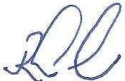

<!-- page 1 -->

# AUX INSTITUTIONS FINANCIÈRES

La présente circulaire définit les conditions et modalités de transmission des déclarations de transactions, et établit les seuils de déclaration de transactions.

### 1. Dispositions générales

Conformément à l'article 17 du décret du 30 avril 2023 sanctionnant le blanchiment de capitaux, le financement du terrorisme et le financement de la prolifération des armes de destruction massive en Haïti, à l'article 175 de la loi du 14 mai 2012 sur les banques et autres institutions financières et à l'article 34 du décret du 25 novembre 2020 sur les intermédiaires de change, toutes les institutions financières désignées ci-après sont tenues de remplir une déclaration de transactions, pour la somme indiquée à la section 2 de la présente circulaire, pour toute transaction en espèces effectuée par tous clients réguliers ou occasionnels, qu'il s'agisse d'une opération unique ou de plusieurs opérations qui apparaissent liées entre elles, et pour tous transferts de fonds ou virements électroniques.

Les formulaires de déclaration de transactions, suivant les modèles élaborés par l'Unité Centrale de Renseignements Financiers (UCREF), devront être transmis par voie électronique quotidiennement à cette institution ou sur support papier au plus tard trois (3) jours ouvrables pour toutes les institutions financières se trouvant dans la zone métropolitaine et cinq (5) jours ouvrables pour toutes les institutions financières se trouvant dans les villes de province, après qu'ils aient été remplis. Les copies desdits formulaires doivent être convenablement répertoriées et disponibles pour inspection par la BRH.

### 2. Seuil de déclaration de transactions

#### 2.1. Banques

Les banques doivent remplir une déclaration de transactions pour toute transaction en espèces, transfert de fonds ou virement électronique d'un montant égal ou supérieur à un million trois cent vingt mille gourdes (HTG 1,320,000.00) ou son équivalent en monnaies étrangères.

<!-- page 2 -->

#### 2.2. Maisons de transfert

Les maisons de transfert doivent remplir une déclaration de transactions pour tout transfert de fonds d'un montant égal ou supérieur à cent trente-deux mille gourdes (HTG 132,000.00) ou son équivalent en monnaies étrangères.

#### 2.3. Bureaux de change

Les bureaux de change doivent remplir une déclaration de transactions pour toute transaction en espèces d'un montant égal ou supérieur à un million cent trente-deux mille gourdes (HTG 1,132,000.00) ou son équivalent en monnaies étrangères.

Les bureaux de change doivent remplir une déclaration de transactions pour toute transaction effectuée par virement bancaire d'un montant égal ou supérieur à trois cent cinquante mille gourdes (HTG 350,000.00) ou son équivalent en monnaies étrangères.

#### 2.4. Coopératives d'épargne et de crédit

Les coopératives d'épargne et de crédit doivent remplir une déclaration de transactions pour toute transaction en espèces d'un montant égal ou supérieur à un million cent trente-deux mille gourdes (HTG 1,132,000.00) ou son équivalent en monnaies étrangères.

#### 2.5. Sociétés de microfinance

Les sociétés de microfinance doivent remplir une déclaration de transactions pour toute transaction en espèces d'un montant égal ou supérieur à un million cent trente-deux mille gourdes (HTG 1,132,000.00) ou son équivalent en monnaies étrangères.

### 3. Sanctions

En cas de non-respect des obligations définies dans la présente circulaire, les institutions financières s'exposent à des pénalités et à des mesures administratives, ce sans préjudice des autres sanctions dont peut être frappée l'institution fautive, en vertu du décret du 30 avril 2023.

## a) Absence de formulaire

A défaut de remplir le formulaire de déclaration de transactions mentionné à la section 2, les institutions financières encourent une amende de cinq cent mille gourdes (HTG. 500,000.⁰⁰) par jour d'infraction.

La période de pénalité s'étend du jour où une transaction aurait dû faire l'objet d'une déclaration à l'UCREF au jour où la BRH constate l'infraction.

<!-- page 3 -->

## b) Retard de transmission du formulaire

En cas de retard de transmission d'un formulaire de déclaration de transactions, les institutions financières encourent une pénalité de trois cent cinquante mille gourdes (HTG 350,000.00) par jour d'infraction.

La période de pénalité s'étend du jour où le formulaire aurait dû être transmis à l'UCREF au jour où cette dernière le reçoit.

## c) Non transmission de formulaire

En cas de non transmission d'un formulaire de déclaration de transactions dûment rempli à l'UCREF, les institutions financières encourent une pénalité de sept cent cinquante mille gourdes (HTG 750,000.00) par jour d'infraction.

La période de pénalité s'étend du jour où le formulaire aurait dû être transmis au jour où la BRH constate l'infraction.

### 4. Abrogation et entrée en vigueur

La présente circulaire abroge la circulaire No 95-4 et entre en vigueur à la date de signature.

Port-au-Prince, le 16 avril 2025

Ronald Gabriel

Gouverneur
