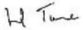
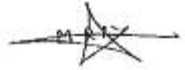

<!-- page 1 -->

## ÉTATS FINANCIERS

<!-- page 2 -->

Banque de la République d'Haiti

(BRH)

Rapport des auditeurs indépendants

Etats financiers annuels

Exercice clos le 30 septembre 2014

<!-- page 3 -->

# Banque de la République d'Haïti (BRH) Rapport des auditeurs indépendants Etats financiers annuels Exercice clos le 30 septembre 2014

Mesdames, Messieurs les Administrateurs.

En exécution de la mission qui nous a été confiée par votre Conseil d'Administration, nous vous présentons notre rapport relatif à l'exercice clos le 30 septembre 2014, sur l'audit des états financiers de la Banque de la République d'Haïti (BRH).

### I. Rapport sur les états financiers

Nous avons effectué l'audit des états financiers ci-joints de la Banque de la République d'Haïti (BRH) comprenant le bilan au 30 septembre 2014, ainsi que le compte de pertes et profits. l'état de variation des capitaux propres, le tableau des flux de trésorerie pour l'exercice clos à cette date et les notes annexes (ci-après désignés « les états financiers »). Ces états financiers ont été établis par le Management conformément aux principes et méthodes comptables édictés par la BRH qui sont décrits dans les notes annexes.

## Responsabilité du Management dans l'établissement et la présentation des états financiers

Le Management de la BRH est responsable de l'établissement et de la présentation sincère de ces états financiers, conformément aux principes et méthodes comptables édictés par la BRH, ainsi que d'un contrôle interne qu'elle juge nécessaire pour permettre l'établissement d'états financiers ne comportant pas d'anomalies significatives, que celles-ci proviennent de fraudes ou résultant d'erreurs.

## Responsabilité de l'auditeur

Notre responsabilité est d'exprimer une opinion sur ces états financiers sur la base de notre audit.

Nous avons effectué notre audit selon les Normes Internationales d'Audit. Ces normes requièrent ce

notre part de nous conformer aux règles d'éthique et de planifier et de réaliser l'audit pour obtenir une

assurance raisonnable que les états financiers ne comportent pas d'anomalies significatives.

<!-- page 4 -->

Un audit implique la mise en œuvre de procédures en vue de recueillir des éléments probants concernant les montants et les informations tournies dans les états financiers. Le choix des procédures relève du jugement de l'auditeur, de même que l'évaluation du risque que les états financiers contiennent des anomalies significatives, que celles-ci résultent de fraudes ou d'erreurs. En procédant à cette évaluation du risque, l'auditeur prend en compte le contrôle interne en vigueur dans l'entité relatif à l'établissement et la présentation sincère des états financiers afin de définir des procédures d'audit appropriées en la circonstance, et non dans le but d'exprimer une opinion sur le fonctionnement efficace du contrôle interne de l'entité. Un audit comporte également l'appréciation du caractère approprié des méthodes comptables relenues et le caractère raisonnable des estimations comptables faites par la Direction, de même que l'appréciation de la présentation d'ensemble des états financiers.

Nous estimons que les éléments probants recueillis sont suffisants et appropriés pour l'onder notre opinion avec réserves.

Justification de l'opinion avec réserves

• Comptes d'engagements (dépôts)

Suite à notre demande d'informations, nous n'avons pas reçu de réponse des titulaires des comptes de dépôts suivants :

<table><tr><td>En millions de Gourdes</td></tr><tr><td>Libellé</td><td>Montant</td></tr><tr><td>Gouvernement Central Institutions locales</td><td>30.854 31</td></tr><tr><td>Total</td><td>30.085</td></tr></table>

En l'absence de ces réponses, nous n'avons pas pu obtenir les informations suivantes :

éventuel désaccord sur les soldes comptabilisés par la BRH.

- liste des éventuels prêts et avances consenties par la BRH.

- liste des éventuels engagements hors bilan.

- liste des personnes habilitées à faire fonctionner les comptes.

Par ailleurs, le rapprochement entre la situation auxiliaire dans GCC des comptes d'engagement et la balance générale (CODA) a mis en évidence des solices des comptes du Trésor Public que nous n'avons pas pu rapprocher avec la balance générale. Les soldes de ces comptes dans GCC s'établissent à 87 milliards de gourdes (créditeurs).

## Participation TELECO

La quote-part de la B&H dans les résultats annuels enregistrés par la TELECO s'élève à un montant

cumulé de 6.1.900 millions au 30 septembre 2014. En l'absence d'états financiers récents et audités

<!-- page 5 -->

de la TELECO, nous n'avons pas été en mesure de recueillir des éléments probants suffisants et appropriés pour justifier, d'une part, la valeur comptable de la participation dans la société TELECO au 30 septembre 2014 et, d'autre part, la quote-part du résultat net de cette société revenant à la BRH à cette date.

## Opinion avec réserves

A notre avis, sous réserve des incidences éventuelles des points décrits dans les paragraphes ci-dessus, les états financiers sont réguliers et sincères et donnent une image fidèle de la situation financière de la BRH au 30 septembre 2014, de son patrimoine, de ses résultats et de la variation de la situation financière pour l'exercice clos à cette date, conformément aux règles et méthodes comptables décrites dans les notes annexes.

## Principes comptables

Sans remettre en cause l'opinion exprimée ci-dessus, nous attirons l'attention sur les points suivants :

1. Les notes 1 et 2 annexées aux états financiers qui décrivent les principes complèbles suivis. Les états financiers ont été établis pour satisfaire aux obligations issues de la loi organique du 17 août 1979 relatives à la présentation d'informations financières sur la BRH.

2. Les états financiers ci-joints ne comprennent pas les engagements hors bilan de la BRH.

3. Selon l'article 59 de la loi du 17 août 1979 créant la BRH, et les profits nets de la BRH seront distribués de la façon suivante : 25 % au Trésor Public, 10 % à la réserve légale et le reste à des réserves spéciales destinées aux fins d'investissement, de placement, d'extension qui seront fixés par le Conseil d'Administration ». Sur l'exercice 2012-2013, la BRH a réalisé un profit G.629 millions. En février 2016, sur autorisation du Gouverneur, la quote-part revenant au Trésor Public a fait l'objet de paiement. Toutefois, le Conseil d'Administration n'a pas autorisé l'affectation de ce résultat au titre des réserves légales et spéciales.

FIRM TIONIER

Antoine Lionel TURNIER

Associé

ERNST & YOUNG (RACINE)

Makha SY

Associé

Le 29 février 2016

<!-- page 6 -->

## Sommaire

Etats financiers au 30 septembre 2014 5-8
Bilan 5
Comptes de pertes et profits 6
Etat de variation des capiteux propres 7
Tableau des flux de trésorerie 8
Notes annexes aux états financiers 9-19
Informations sur le bilan 20-57
Informations sur le compte de pertes et profits 58-63
Divers 64

<!-- page 7 -->

## Etats financiers au 30 septembre 2014

Bilan

(En milliers de Gourdes)

<table><tr><td></td><td>Notes</td><td>30/09/2014</td><td>30/09/2013</td><td>Variation</td></tr><tr><td>Valeur</td><td>%</td></tr><tr><td>ACTIF</td><td></td><td></td><td></td><td></td><td></td></tr><tr><td>Avolrs en or</td><td>4</td><td>3 197 200</td><td>3 348 820</td><td>(151 620)</td><td>-5%</td></tr><tr><td>Avolrs sur le Fonds Monétaire International</td><td>5</td><td>4 652 294</td><td>4 622 406</td><td>29 888</td><td>1%</td></tr><tr><td>Avolrs en monnaies étrangères</td><td>6</td><td>76 619 690</td><td>93 560 800</td><td>(16 941 110)</td><td>-18%</td></tr><tr><td>Participations dans les organismes Internationalux</td><td>7</td><td>2 764 344</td><td>2 632 801</td><td>131 543</td><td>5%</td></tr><tr><td>Placements locaux</td><td>8</td><td>3 143 750</td><td>275 000</td><td>2 868 750</td><td>1043%</td></tr><tr><td>Prêts et avances au gouvernement et aux collectivités</td><td>9</td><td>46 637 150</td><td>46 431 986</td><td>205 164</td><td>0%</td></tr><tr><td>Prêts et avances aux particuliers et aux autres institutions</td><td>10</td><td>2 733 749</td><td>2 464 006</td><td>269 743</td><td>11%</td></tr><tr><td>Prêts et avances aux institutions financières monétaires et non monétaires</td><td>11</td><td>806 775</td><td>620 803</td><td>185 973</td><td>30%</td></tr><tr><td>Immobilisations</td><td>12</td><td>4 729 225</td><td>4 231 918</td><td>497 307</td><td>12%</td></tr><tr><td>Autres actifs</td><td>13</td><td>2 347 978</td><td>2 189 793</td><td>158 185</td><td>7%</td></tr><tr><td>TOTAL</td><td></td><td>147 632 156</td><td>160 378 333</td><td>(12 746 177)</td><td>-8%</td></tr><tr><td>PASSIF</td><td></td><td></td><td></td><td></td><td></td></tr><tr><td>Billets et monnaies en circulation</td><td>14</td><td>27 269 017</td><td>24 082 405</td><td>3 186 612</td><td>13%</td></tr><tr><td>Comptes d'engagements</td><td>15</td><td>94 652 752</td><td>110 913 871</td><td>(16 261 119)</td><td>-15%</td></tr><tr><td>Engagements envers le FMI</td><td>16</td><td>7 958 013</td><td>7 795 833</td><td>162 180</td><td>2%</td></tr><tr><td>Contributions et engagements de l'État haïllen sur participation au capital des organismes financiers internationalaux</td><td>17</td><td>3 565 580</td><td>3 423 065</td><td>142 515</td><td>4%</td></tr><tr><td>Autres passifs</td><td>18</td><td>11 114 591</td><td>11 791 132</td><td>(676 541)</td><td>-6%</td></tr><tr><td>Réservas de réévaluation de change</td><td>19</td><td>6 350 777</td><td>5 404 464</td><td>946 313</td><td>18%</td></tr><tr><td>Réservas générales</td><td>20</td><td>(3 657 049)</td><td>(2 533 885)</td><td>(1 123 164)</td><td>44%</td></tr><tr><td>Réserva de réévaluation de for</td><td>21</td><td>246 389</td><td>105 297</td><td>141 092</td><td>134%</td></tr><tr><td>Réserva allocation spéciale retraite</td><td>22</td><td>367 674</td><td>272 933</td><td>94 741</td><td>35%</td></tr><tr><td>Capital et réserves</td><td>23</td><td>1 256 282</td><td>1 256 282</td><td>-</td><td>0%</td></tr><tr><td>Résultat des exercices antérieurs</td><td>24</td><td>(2 126 556)</td><td>(2 761 758)</td><td>635 202</td><td>23%</td></tr><tr><td>Résultat</td><td></td><td>634 686</td><td>628 694</td><td>5 992</td><td>1%</td></tr><tr><td>TOTAL</td><td></td><td>147 632 156</td><td>160 378 333</td><td>(12 746 177)</td><td>-8%</td></tr></table>

<!-- page 8 -->

Comptes de pertes et profits

(En milliers de Gourdes)

<table><tr><td></td><td>Notes</td><td>30/09/2014</td><td>30/09/2013</td><td>Variation</td></tr><tr><td>Valeur</td><td>%</td></tr><tr><td>Produits des opérations avec étranger : intérêts</td><td></td><td>2 735 155</td><td>2 616 122</td><td>119 033</td><td>5%</td></tr><tr><td>1 099 090</td><td>1 099 042</td><td>48</td><td>0%</td></tr><tr><td>Produits de placements, prêts et avances à l'Etat Haïten</td><td></td><td></td><td></td><td></td><td></td></tr><tr><td>Produits des opérations de crédit</td><td></td><td>125 555</td><td>112 639</td><td>12 916</td><td>11%</td></tr><tr><td>Intérêts débiteurs et frais financiers</td><td></td><td>(275 668)</td><td>(444 347)</td><td>168 679</td><td>38%</td></tr><tr><td>Autres dépenses d'intérêts</td><td></td><td>(44 058)</td><td>(144 075)</td><td>100 017</td><td>69%</td></tr><tr><td>Résultat net d'intérêts</td><td>25</td><td>3 640 874</td><td>3 240 181</td><td>400 693</td><td>12%</td></tr><tr><td>Dividends</td><td></td><td>6 918</td><td>5 954</td><td>964</td><td>16%</td></tr><tr><td>Gains sur ventes des valeurs mobilières</td><td></td><td>511 693</td><td>590 907</td><td>(79 214)</td><td>-13%</td></tr><tr><td>Perties sur ventes des valeurs mobilières</td><td></td><td>(11 308)</td><td></td><td>(11 308)</td><td>100%</td></tr><tr><td>Résultats sur ventes de valeurs mobilières</td><td>26</td><td>500 385</td><td>590 907</td><td>-90 522</td><td>-15%</td></tr><tr><td>Produit net bancaire</td><td></td><td>4 148 177</td><td>3 837 042</td><td>311 135</td><td>8%</td></tr><tr><td>Autres produits</td><td>27</td><td>210 939</td><td>232 327</td><td>-21 388</td><td>-9%</td></tr><tr><td>Gain extraordinaire</td><td></td><td>410</td><td>367</td><td>43</td><td>12%</td></tr><tr><td>Résultat opérationnel</td><td></td><td>4 359 526</td><td>4 069 736</td><td>289 790</td><td>7%</td></tr><tr><td>Entretien de la circulation fiducieure</td><td></td><td>301 390</td><td>263 578</td><td>37 812</td><td>14%</td></tr><tr><td>Rémunérations et charges sociales</td><td></td><td>2 520 255</td><td>2 350 724</td><td>169 531</td><td>7%</td></tr><tr><td>Dépenses administratives</td><td></td><td>552 029</td><td>522 005</td><td>30 024</td><td>6%</td></tr><tr><td>Dotation aux amortissements</td><td></td><td>196 638</td><td>180 617</td><td>16 021</td><td>9%</td></tr><tr><td>Dépenses relatives à la gestion des actifs</td><td></td><td>69 663</td><td>60 682</td><td>8 981</td><td>15%</td></tr><tr><td>Dons</td><td></td><td>57 752</td><td>46 439</td><td>11 313</td><td>24%</td></tr><tr><td>Autres dépenses</td><td></td><td>-</td><td>4 354</td><td>-4 354</td><td>-100%</td></tr><tr><td>Perties nettes dues au selsme</td><td></td><td>-</td><td>108</td><td>-108</td><td>-100%</td></tr><tr><td>Dotation pour mauvaises créances</td><td></td><td>27 113</td><td>12 097</td><td>15 016</td><td>124%</td></tr><tr><td>Dotation pour risques et charges</td><td></td><td>-</td><td>438</td><td>-438</td><td>-100%</td></tr><tr><td>Charges d'exploitation générale</td><td>28</td><td>3 724 840</td><td>3 441 042</td><td>283 798</td><td>8%</td></tr><tr><td>Revenus nets de l'exercice</td><td></td><td>634 686</td><td>629 694</td><td>5 992</td><td>1%</td></tr></table>

<!-- page 9 -->

Etat de variation des capitaux propres

(En milliers de Gourdes)

|   | Capital | Réserves légales | Réservos spéciales | Réserve pour réévaluation d'immeubles | Total capitaux propres |
| --- | --- | --- | --- | --- | --- |
| Solde au | - | - | - | - | - |
| 30/09/2013 | -50 000 | -74 454 | -412 825 | -719 003 | 1 256 282 |
| Affectations | - | - | - | - | - |
| Prélèvements | - | - | - | - | - |
| Réévaluation | - | - | - | - | - |
| Solde au | -50 000 | -74 454 | -412 825 | -719 003 | -1 256 282 |
| 30/09/2014 | -50 000 | -74 454 | -412 825 | -719 003 | -1 256 282 |

<!-- page 10 -->

Tableau des flux de trésorerie

<table><tr><td></td><td>(En milliers de Gourdes)</td></tr><tr><td></td><td>2014</td><td>2013</td></tr><tr><td>Activités d'exploitation</td><td></td><td></td></tr><tr><td>Revenu net de l'exercice</td><td>634 686</td><td>628 694</td></tr><tr><td>Éléments de conciliation du revenu net aux liquidités résultant des activités d'exploitation</td><td></td><td></td></tr><tr><td>Dotations aux amortissements</td><td>179 547</td><td>320 791</td></tr><tr><td>Provisions pour pertes de valeur sur prêts</td><td>26 182</td><td>10 367</td></tr><tr><td>Effet de change suite à la réévaluation de la participation des organismes financiers inter</td><td>919 512</td><td>408 379</td></tr><tr><td>Changements dans les éléments d'actif et de passif résultant des activités d'exploitation</td><td></td><td></td></tr><tr><td>Augmentations des prêts et avances, net</td><td>4 518 531</td><td>(157 459)</td></tr><tr><td>Billets en monnales en circulation</td><td>3 205 866</td><td>1 364 253</td></tr><tr><td>Engagements en devises</td><td>2 162 744</td><td>(6 763 284)</td></tr><tr><td>Contributions et engagements envers les organismes financiers internationaux</td><td>341 017</td><td>965 492</td></tr><tr><td>Engagements envers les banques créatrices de monnole</td><td>(4 515 998)</td><td>5 582 700</td></tr><tr><td>Dépôts du Gouvernement Central</td><td>(4 794 410)</td><td>(1 640 582)</td></tr><tr><td>Engagements envers les autres institutions</td><td>(1 474 689)</td><td>593 875</td></tr><tr><td>Changements dans les autres éléments d'actif, de passif et de réserves</td><td>(14 439 519)</td><td>8 261 604</td></tr><tr><td>Liquidités provenant des activités d'exploitation</td><td>(13 236 531)</td><td>9 574 830</td></tr><tr><td>Activités d'investissement</td><td></td><td></td></tr><tr><td>Augmentation des placements étrangers</td><td>13 233 424</td><td>(27 905 779)</td></tr><tr><td>(Augmentation) diminution des placements locaux</td><td>(1 806 116)</td><td>382 638</td></tr><tr><td>Acquisitions d'immobilisations nettes</td><td>(641 519)</td><td>(568 599)</td></tr><tr><td>Liquidités utilisées dans des activités d'investissement</td><td>10 785 789</td><td>(28 091 740)</td></tr><tr><td>Augmentation (Diminution) nette des liquidités</td><td>(2 450 742)</td><td>(10 516 910)</td></tr><tr><td>Liquidités au début de l'exercice</td><td>8 950 776</td><td>27 467 686</td></tr><tr><td>Liquidité à la fin de l'exercice</td><td>6 500 034</td><td>8 950 776</td></tr></table>

<!-- page 11 -->

## Notes annexes aux états financiers

## Règles et méthodes comptables de la BRH

## Note 1 - Cadre juridique et activités

La Banque de la République d'Haiti (BRH), dont le Siège est sis à la rue du Quai à Port-au-Prince (Haiti), est un organisme public autonome, constitué par l'Etat Haitien, par la loi du 17 août 1979, modifié en ses articles 9 et 17 par le décret du 28 mars 1985. Son capital social n'est pas divisé en actions. Il est détenu par l'Etat Haitien et peut être augmenté selon les besoins de l'institution.

La loi du 17 août 1979 portant création de la BRH stipule en son article 6 que celle ci est dirigée par un Conseil d'Administration dont les membres sont nommés pour une période de trois (3) ans, renouvelable par arrêté du Président de la République. Conformément aux dispositions de la Constitution de 1987, ils sont ratifiés par le Sénat de la République.

La BRH est une Banque Centrale et, à ce titre, a pour objet de :

• promouvoir dans le domaine de la monnaie, du crédit et des changes, les conditions les plus favorables au développement de l'économicie nationale ;

• encourager le développement et l'utilisation la plus complète et la plus efficace des ressources productives du pays :

- acapter les moyens de paiement et la politique de crédit aux besoins légitimes de l'économie halitienne et, en particulier, à la croissance de la production nationale ;

- aider à éviter toutes tendances inflationnistes, spéculatives et déflationnistes qui seraient nuisibles aux intérêts permanents de la nation ;

- conseiller le Gouvernement en matière de politique monétaire, dans le but principal de maintenir, à l'intérieur du pays, la stabilité relative des prix et à l'extérieur, la croissance des échanges ;

- faciliter l'expansion du commerce indérieur et extérieur en vue de contribuer à l'instauration et au maintien d'un niveau élevé de l'emploi et du revenu réel ;

• assurer l'administration et la gestion des réserves de changes, veiller à l'application des dispositions légales et réglementaires relatives aux institutions financières ;

· contrôler et orienter la circulation et la distribution du crédit :

• Émettre des billets de banque, frapper des pièces métalliques et créer de la monnaie scripturale :

- exercer toutes les activités de banquier de l'Etat, d'agent financier et fiscal pour toutes ses opérations de caisse et de crédit.

<!-- page 12 -->

La BRH utilise divers instruments dans la mise en œuvre de la politique monétaire, dont l'objectif

fondamental demeure la stabilité des prix. Son principal canal de gestion monétaire est, depuis 1996,

la vente aux banques de la place des bons qu'elle émet.

La BRH mène des négociations avec le Ministère de l'Économie et des Finances en ce qui a trait au niveau et aux conditions de financement du déficit budgétaire. Ces ententes se matérialisent, en général, par des accords signés entre le Gouverneur de la BRH et le Ministre de l'Économie et des Finances.

Au plan de la réglementation et de la supervision bancaires, la BRH, conformément aux articles 29 à 32 de sa loi organique et à l'article 43 du décret du 14 novembre 1980 réglementant le fonctionnement des banques, à le pouvoir d'inspector celles-ci et de les soumettre à un régime de normes prudentielles.

En sa qualité de banquier de l'Etat (article 37 de la loi organique), la BRH tient le compte courant de toutes les institutions et collectivités publiques. Elle se charge de la collecte des recettes de l'Etat et encalsse directement pour le compte de celui-ci les taxes internes et les droits de douane. Elle fait sussi fonction de gardienne des titres appartenant à ces entités (article 38 de la loi organique).

Pour l'exécution de ces opérations, la BRH est organisée en un réseau comportant un Siège et une succursale au Cap-Haïtien. La BRH s'est orientée vers une organisation interne destinée à faciliter la mise en œuvre de sa stratégie de modernisation.

<!-- page 13 -->

## Note 2 - Principes et méthodes comptables

### 2.1 - Référentiel comptable en vigueur au 30 septembre 2014

Les états financiers de la Banque de la République d'Haiti ont été élaborés conformément aux dispositions de la loi organique du 17 août 1979 et suivant la méthode de comptabilité d'exercice. Ils sont libellés en Gourde qui est la monnaie nationale Haitienne.

### 2.2 - Exercice

La durée de l'exercice est de douze mois, l'exercice début le 1 $ ^{er} $ octobre et se termine le 30 septembre de l'année suivante.

### 2.3 · Principes comptables

Les principes comptables suivants sont appliqués :

· comptabilité d'engagement.

intelliġilité.

pertinence.

fiabilité.

comparabilité.

### 2.4 - Méthode d'évaluation

Les états financiers sont préparés sur la base de la valeur de marché pour l'or, des titres et des

éléments d'actif et de passif libellés en devises inscrits au bilan, ainsi que du coût historique pour les

autres rubricues

### 2.5 - Estimations et jugements

Lors de la préparation de ces états financiers, la Direction doit faire des estimations et formuler des hypothèses qui affectent l'application des normes comptables et les montants des éléments d'actif et de passif déclarés et la présentation de l'actif et du passif éventuels à la date des états financiers ainsi que les résultats de l'exercice. Les résultats actuelles peuvent être différents de ces estimations.

La BRH établit une provision pour pertes de valeur sur prêts en fin d'exercice qui représente une estimation de la perte de valeur réelle sur le portefeuille de prêts à cette date. Cette provision est établi en prenant en considération les éléments probants spécifiques tels que les arrières de remboursement, la valeur des garanties, les possibilités de recouvrement futur, et la situation économique de l'emprunteur qui ont un impact sur les flux de trésorerie futurs estimés d'un prêt spécifique ou d'un groupe de prêts avec un risque similaire.

<!-- page 14 -->

### 2.6 - Effets des transactions et événements

Les effets des transactions et autres événements sont pris en compte dès que ces transactions et événements se produisent.

Par ailleurs, en raison du découpage de l'activité en exercices comptables, les transactions et autres événements sont raitachés à l'exercice qu'ils concernent effectivement et à celui-ci seulement. Dans ce cadre, les produits sont comptabilisés dès qu'ils sont acquis et les charges au fur et à mesure qu'elles sont engagées.

### 2.7 - Opérations en devises

Les transactions en devises étrangères sont initialement comptabilisées aux cours de change en vigueur à la date de transaction. En fin de mois, les actifs et passifs en monnaies étrangères sont convertis au cours de change en vigueur en fin de période. Les gains ou pertes de change, qui en découent, sont enregistrés dans un compte de réserve « Réserve de réévaluation de change », conformément à l'article 56 de la loi organique.

### 2.8 - Impôts et taxes

Conformément à l'article 63 de la loi organique, la BRH est exonérée du paiement des droits et taxes de l'Etat ou des communes à l'occasion de toutes opérations qui lui sont propres. De même, elle bénéfice de l'exemption des droits à l'occasion de ses importations y compris matériels, équipements, lubrifiants, carburants.

### 2.9 - Avoirs en or

L'or est valorisé au cours en vigueur à la date du bilan. Les gains et les pertes résultant de cette valorisation sont inscrits à la réserve de réévaluation. Le stock d'or n'est pas porteur d'intérêts. L'avoir en or fait partie des réserves nettes de change en accord avec l'article 52 de la loi organique de la BRH.

### 2.10 - Avoirs sur le FMI, engagements envers le FMI

La BRH est l'agent fiscal de l'Etat Haïbien auprès du Fonds Monétaire International (FMI). Elle est en même temps le dépositaire des Gourdes détenus par le FMI. En vertu de la loi du 19 septembre 1952, la Banque représente le Gouvernement Haïbien en toute négociation ou transactions avec le fonds. Toutes les transactions entre le Gouvernement et le Fonds sont inscrites dans les livres de la BRH.

Les différences résultant des opérations de la BRH avec le Fonds sont supportées par le Gouvernement

Heitien et sont comptabilisées au bilan dans le compte «Avance différence de change FM».

<!-- page 15 -->

Les opérations avec le FMI sont libellées dans la monnaie du FMI, à savoir le Droit de Tirage Spécial (OTS).

Les opérations et transactions de l'Etat Haïtien avec le FMI concernent le compte de Droit de Tirage Spécial (DTS), le comple de ressources générales et les comptes administres.

La position de réserve au FMI est la différence entre les quotes-parts de l'Etat et sa souscription en monnaie nationale, compte non tenu des tirages au titre des ressources générales (avoirs exclus ou recours aux crédits du FMI).

Les tirages effectués par l'Etat auprès du FMI sont reçus et enregistrés dans les comptes dépôt à vue

ce la BRH à la Federal Reserve Bank en dollars, d'une part, et dans les comptes d'engagements envers

le FMI en DTS, d'autre part. Au moment des tirages, les différences entre les montants versés à l'Etat

et la dettre vis-à-vis du FMI sont portées directement au compte « Avance Différence de change FMI ».

Les avoiris du FMI en monnaie nationale (comptes FMI n°1, FMI n°2 et FMI compte (tres) font l'objet d'une réévaluation annuelle le 30 avril de chaque année, sur la base du cours représentatif du DTS communiqué par le FMI. Les gains et pertes de réévaluation sont inscrits dans le compte « Avance différence de change FMI ».

A la clôture de chaque période mensuelle, les avoirs du FMI en DTS sont réévalués sur la base du cours du DTS/Gourdes de fin de mois.

Les DTS détenus, les tirages sur les comptes administrés et les allocations de DTS sont convertis en Gourdes sur la base du cours de change en vigueur lors des transactions. Les différences résultant de réévaluations périodiques sont portées au compte « Avance différence de change FM ».

### 2.11 - Participations, contributions et engagements dans les autres organismes financiers internationaux

Conformément à l'article 2, alinéa 10, et l'article 61, alinéa 2 de la loi du 17 août 1979, la BRH enregistre dans ses livres les participations de la République d'Haiti dans les différents organismes internationaux. Le Gouvernement Haïtien a souscrit au capital de différents organismes financiers internationaux. Les montants payés à titre de capital sont reflétés comme des contributions, et les montants non encore versés sont reflétés comme des engagements. Ces transactions sont gérées par la BRH à titre de fiduciaire et sont réévaluées aux taux de change de la fin de l'exercice. L'effet de change résultant de la réévaluation des actifs et passifs de l'État Haïtien est enregistré au bilan dans le compte « Réserves de réévaluation de change ».

<!-- page 16 -->

### 2.12 - Placements à la Télécommunication d'Haïtl (TELECO)

La BRH détient 97 % des actions de la TELECO et le Gouverneur de la BRH est le président du Conseil d'Administration de cette institution. Les titres de participation détenus sur la TELECO ont été initialement comptabilisés à leur coût d'acquisition. La valeur comptable de ces titres est ajustée en y incluant la quote-part de la BRH dans les résultats annuels enregistrés par la TELECO. Depuis 2001, en l'absence d'états financiers audités de la TELECO, la valeur comptable du placement à la TELECO n'a pas connu d'évolution.

### 2.13 - Avoirs en monnaies étrangères

Les réserves de change de la BRH sont investies en comptes à vue, en comptes à terme et dans des actifs obligataires.

#### 2.13.1 Portefeuille titres

Dans le cadre de la stratégie globale de gestion de son portefeuille, la BRH détient des valeurs mobilières de placement. La BRH a choisi un système de gestion par administrateurs externes de portefeuille (gestion déléguée). Les gérants de portéfeuille pouvant bénéficier de pouvoirs discrétionnaires ou peuvent être sujets à des limitations strictes, concernant la sélection des placements.

Ces placements sont disponibles à la vente.

## • Actifs financiers disponibles à la vente

Ce sont des actifs financiers cétenus dans le but d'avoir des liquidités disponibles. Ils sont enregistrés initialement en comptabilité à leur coût d'acquisition, coupons courus et frais d'acquisition Inclus, et sont évalués ultérieurement à leur juste valeur. La variation de juste valeur est constatée directement en capitaux propres dans le compte « Réserve de réévaluation de change ».

### 2.14 - Prêts et avances au Gouvernement et aux collectivités

Les crédits à l'Etat Haïtien représentent un financement au Secteur Public ainsi que les prêts et avances en comptes courants au Gouvernement, aux collectivités locales et aux entreprises publiques.

Ils sont évalués au coût. La BRH n'enregistre pas de perte de valeur sur les crédits à l'Etat Haïtien et aux entreprises publiques à moins de désaccords spécifiques. Les revenus d'intérêts sur ces prêts, avances et placements sont comptabilisés sur une base d'exercice.

### 2.15 - Immobilisations corporelles et incorporelles

Les immobilisations sont comptabilisées à leur coût d'acquisition, avec possibilité de réévaluation.

<!-- page 17 -->

Les réévaluations sont effectuées par des experts en évaluation.

L'écart de réévaluation est imputé aux capitaux propres sous une rubrique séparée en contrepartie des

comptes d'immobilisations.

Suite au séisme du 12 janvier 2010, les pertes sur les immeubles de la Banque qui ont subi des dommages ont été évaluées et enregistrées dans les livres de la BRH.

A l'exception des terrains, des constructions en cours, les Immobilisations sont amorties selon la méthode de l'amortissement linéaire sur le durée estimative de leur vie utile.

Les durées de vie retenues sont les suivantes :

| Immobilisations | Durées de vie utile (en mois) |
| --- | --- |
| Terrains | Non amortissable |
| Bâtisses | 240 |
| Mobiliér et matériel de bureau | 48 |
| Matériel informatique | 60 |
| Logiciel informatique | 12 |
| Matériel roulant | 48 |
| Equipements | 60 |
| Installations | 60 |
| Aménagements, Extensions, Agrandissements | 60 |

Les immobilisations entièrement amorties demeurent inscrites au bilan dans un compte distinct « Blens totalement amortis » aussi longtemps qu'elles subsistent. Les immobilisations figurent au bilan à leurs valeurs nettes.

### 2.16 - Stocks de billets neufs en transit

A l'achat, les signes monétaires sont comptabilisés en engagements hors bilan au prix d'achat, aucune viennent s'ajouter les frais de transport.

A l'émission, les quantités de signes monétaires émises sont valorisées selon la méthode FIFO et comptabilisées au bilan. A la clôture de l'exercice, les billets et monnaies non émis sont traités comme des stocks. Ils font l'objet d'un inventaire physique et sont valorisés selon la méthode FIFO.

<!-- page 18 -->

Les réévaluations sont effectuées par des experts en évaluation.

L'écart de réévaluation est imputé aux capitaux propres sous une rubrique séparée en contrepartie des

comptes d'immobilisations.

Suite au séisme du 12 janvier 2010, les pertes sur les immeubles de la Banque qui ont subi des dommages ont été évaluées et enregistrées dans les livres de la BRH.

A l'exception des terrains, des constructions en cours, les Immobilisations sont amorties selon la méthode de l'amortissement linéaire sur le durée estimative de leur vie utile.

Les durées de vie retenues sont les suivantes :

| Immobilisations | Durées de vie utile (en mois) |
| --- | --- |
| Terrains | Non amortissable |
| Bâtisses | 240 |
| Mobiliér et matériel de bureau | 48 |
| Matériel informatique | 60 |
| Logiciel informatique | 12 |
| Matériel roulant | 48 |
| Equipements | 60 |
| Installations | 60 |
| Aménagements, Extensions, Agrandissements | 60 |

Les immobilisations entièrement amorties demeurent inscrites au bilan dans un compte distinct « Blens totalement amortis » aussi longtemps qu'elles subsistent. Les immobilisations figurent au bilan à leurs valeurs nettes.

### 2.16 - Stocks de billets neufs en transit

A l'achat, les signes monétaires sont comptabilisés en engagements hors bilan au prix d'achat, aucune viennent s'ajouter les frais de transport.

A l'émission, les quantités de signes monétaires émises sont valorisées selon la méthode FIFO et comptabilisées au bilan. A la clôture de l'exercice, les billets et monnaies non émis sont traités comme des stocks. Ils font l'objet d'un inventaire physique et sont valorisés selon la méthode FIFO.

<!-- page 19 -->

### 2.17 - Billets et monnaies en circulation

Les billets et pièces de mornaie en circulation sont analysés comme des dettes envers les détenteurs.

Ils sont inscrits au bilan à leur valeur faciale ou valeur nominale.

### 2.18 - Comptes d'engagements

Les comptes à vue (dettes à vue) et les dépôts auprès de la BRH sont inscrits au bilan à leur valeur nominale et ne sont pas rémunérés.

### 2.19 - Provisions pour risques et charges

Une provision est constituée lorsque la BRH a une obligation réglementaire, impilcite ou juridique qui résulte d'un événement passé et dont il est probable ou certain qu'elle provoquera une sortie de ressources dont le montant peut être estimé de manière flable.

Conformément au principe de prudence, des provisions sont aussi constituées pour tous les risques

potertiels liés à certains compés d'actif (actifs non performants).

### 2.20 - Fonds de retraite et prime de séparation

La dépense annuelle pour le fond de retraite et primes de séparation est établie en fonction d'un taux de contribution fixé par la Banque de la République d'Haïti.

### 2.21 - Reserve de réévaluation de change

L'article 56 de la loi organique de la BRH précise que les gains et les pertes, qui résultent de la réévaluation des avoirs et des engagements de la BRH détenus en devises ou en or, doivent être comptabilisés à un compte dénommé "Réserve de réévaluation" présenté au bilan au niveau du capital et réserves.

### 2.22 - Réserve pour réévaluation d'immeubles

Le solde de ce poste sera viré à la réserve spéciale quand les immeubies seront compilisés. Toute moins-value résultant de la réévaluation est enregistrée directement comme une dépense à l'état des résultats à moins qu'elle ne soit relative à une plus-value existante pour un même immeuble, déjà réévalué. Le cas échéant, cette moins-value sera affectée préalablement au poste de réserve de réévaluation-terains et immeubles.

<!-- page 20 -->

### 2.23 - Réserves générales

Ce poste enregistre les pertes et gains latents qui résultent des réévaluations périodiques du portefeuille de titres de la BRH.

### 2.24 - Distribution des profits nets

Selon l'article 59 de la loi régissant la BRH, les résultats nets doivent être distribués de la manière suivante : 25 % au Trésor Public, 10 % à la réserve légale et le solde à des réserves spéciales destinées aux fins d'investissements, de placements, d'égrandissement et autres, le i

cue fixé par le Conseil d'Administration. En 2010 et 2009, le Conseil d'Administration a convenu avec le Ministère de l'Économie et des Finances de ne pas effectuer de distribution à l'Etat en vue d'éponger les pertes antérieures et de constituer les réserves nécessaires à la recapitalisation de la BRH, tel que prévu dans le cadre d'accords avec les partenaires internationaux.

### 2.25 - Gestion des risques

La BRH est exposée à des risques variés qui sont les suivants :

Risque de marché : risque de perte due aux changements dans les prix et aux taux de marché (cours de l'or, cours de change et taux d'intérêt) ;

• Risque de contrepartie : risque de perte due à l'incapacité des contreparties de la Banque de faire face à leurs obligations financières :

• Risque opérationnel : risque de perte résultant de l'inadaptation ou de la défaillance des procédures, des personnes, des systèmes internes ou d'événements extérieurs.

La gestion des risques est centrée sur le caractère imprévisible de l'environnement financier et a pour objet d'en minimiser les conséquences négatives potentielles sur les performances de la BRH.

### 2.26 · Reconnaissance des produits et des charges

La reconnaissance des produits et des charges est effectuée selon les règles suivantes :

• les produits et les charges sont pris en compte au cours de l'exercice pendant lequel ils sont réalisés, acquis ou dus :

- les produits et les charges en monnaies étrangères sont convertis au cours de change de la date de transaction ;

<!-- page 21 -->

• les plus-values et moins-values latentes sur les instruments financiers liées aux taux d'intérêt et aux prix du marché, sont comptabilisées au bilan dans le compte « Réserves générales » :

• les écarts de conversion sur les devises étrangères sont comptabilisés au bilan dans le compte « Réserves de réévaluation de change ».

### 2.27 - Evénements postérieurs à la date de clôture

Les événements significatifs ayant un lien prépondrant et direct avec une situation qui existait à la date de clôture des comptes, donnent lieu à un ajustement des montants comptabilisés dans les états financiers. A cet égard, les actifs et les passifs font l'objet d'un ajustement pour tenir compte d'événements significatifs survenus entre le date de clôture et la date d'approbation des états financiers. Ceux concernant des situations apparues postérieurement à la date de clôture, sont mentionnés dans les notes annexes, avec une estimation de leur incidence financière.

### 2.28 - Changement de méthodes, d'estimations comptables

Aucun changement de méthode ou d'estimation comptables n'est intervenu durant l'exercice 2013-2014.

<!-- page 22 -->

Note 3 - Cours des monnaies étrangères et prix de l'Or

| Monnaies étrangères et or | 30/09/2014 (en Gourdes) | 30/09/2013 (en Gourdes) |
| --- | --- | --- |
| 1 Dollar des Etats-Unis (USD) | 45,5577 | 43,7429 |
| 1 Euro (EUR) | 57,5439 | 59,1710 |
| 1 Droit de Tirage Spécial (DTS) | 67,5438 | 67,1051 |
| 1 Once d'or | 55 420,94 | 58 024,95 |

<!-- page 23 -->

# Informations sur le bilan

Bilan - Actif

Note 4 - Avoirs en or

Cette rubrique s'analyse comme suit :

(En milliers de Gourdes)

<table><tr><td></td><td>30/09/2014</td><td>30/09/2013</td><td>Variation</td></tr><tr><td>En once</td><td>En milliers de Gourdes</td><td>En once</td><td>En milliers de Gourdes</td><td>En milliers de Gourdes</td></tr><tr><td>Or en dépot chez Morgan Stanley Smith Barney</td><td>1 308</td><td>72 643</td><td>1 308</td><td>75 870</td><td>(3 227)</td></tr><tr><td>Or en dépot à la Federal Reserve Bank</td><td>56 918</td><td>3 124 557</td><td>56 918</td><td>3 272 950</td><td>(148 393)</td></tr><tr><td>Total</td><td>58 226</td><td>3 197 200</td><td>58 226</td><td>3 348 820</td><td>(151 620)</td></tr></table>

Cette rubrique enregistre les avoir en or détenus par la BRH à la Federal Reserve Bank of New York (1308 Oz) et chez Morgan Stanley (56 918 Oz).

Le stock d'or est réévalué mensuellement sur la base du cours de l'once d'or affiché sur le site Bloomberg. L'écart entre la valeur réévaluée du stock et sa valeur comptable est enregistré au capital dans les comptes "533000 Réserve de réévaluation or" pour l'or détenu à la Federal Reserve et "538400 Réserve de plus-value non réalisée sur placement" pour l'or détenu à la Morgan Stanley. L'évolution du solde par rapport à l'exercice précédent résulte de la dépréciation de l'once d'or qui est passé de G. 58 024 au 30 septembre 2013 à G. 55 421 au 30 septembre 2014.

<!-- page 24 -->

## Note 5 - Avoirs sur le Fonds Monétaire International (FMI)

La rubrique « Avoirs sur le Fonds Monétaire International » comprend la position de réserve et les

avoirs en DTS et se détaille comme suit :

<table><tr><td></td><td>30/09/2014</td><td>30/09/2013</td><td>Variation</td></tr><tr><td>En DTS</td><td>En milliers de Gourdes</td><td>En DTS</td><td>En milliers de Gourdes</td><td>En milliers de Gourdes</td></tr><tr><td>Position de réserve</td><td>68 047</td><td>4 596</td><td>68 047</td><td>4 566</td><td>30</td></tr><tr><td>Avoirs en droits de Tirages Spéclaux</td><td>68 810 090</td><td>4 647 698</td><td>68 820 267</td><td>4 617 840</td><td>29 858</td></tr><tr><td>Total</td><td>68 878 137</td><td>4 652 294</td><td>68 888 314</td><td>4 622 406</td><td>29 888</td></tr></table>

## Position de réserve

Constitué en 1945, le FMI a été investi par ses textes fondateurs de la mission statutaire de restaurer la stabilité du système monétaire international. Les opérations de l'Etat Haïlien avec le FMI (le Fonds) sont régies par l'article VIII des statuts du FMI.

Les souscriptions des pays membres constituent l'origine normale des ressources du Fonds. A chaque pays est assignée une quote-part. Les quotes-parts souscrites sont libérées en devises par les Etais membres à concurrence de 25 %, et en monnaie nationale à concurrence de 75 %.

La position de réserve d'un pays auprès du FMI est égale à la différence entre sa quote-part et la souscription versée en monnaie nationale.

La position de réserve de la République d'Haiti auprès du FMI s'analyse comme suit :

<!-- page 25 -->

<table><tr><td></td><td>30/09/2014</td><td>30/09/2013</td><td>Variation</td></tr><tr><td>En DTS</td><td>En milliers de Gourdes</td><td>En DTS</td><td>En milliers de Gourdes</td><td>En milliers de Gourdes</td></tr><tr><td>Quota FMI</td><td>81 900 000</td><td>5 531 841</td><td>81 900 000</td><td>5 495 490</td><td>36 351</td></tr><tr><td>FMI, Compte no 1</td><td>(36 290 445)</td><td>(2 451 196)</td><td>(36 290 445)</td><td>(2 435 089)</td><td>(16 107)</td></tr><tr><td>FMI, Compte titres</td><td>(45 541 508)</td><td>(3 076 049)</td><td>(45 541 508)</td><td>(3 055 835)</td><td>(20 214)</td></tr><tr><td>Total</td><td>68 047</td><td>4 596</td><td>68 047</td><td>4 566</td><td>30</td></tr></table>

## • Quota FMI

Le quota FMI correspond à la quote-part exprimée en DTS et attribuée à l'Etat Haïtien dans le cadre de sa souscription lors de son admission au Fonds. Il représente un actif de la République d'Haïti. Comme sur les exercices précédents, le quota FMI est resté stable en l'absence de décision par le Conseil d'Administration du FMI d'une augmentation de la quote-part de l'Etat Haïtien.

## • Compte FMI n° 1 et compte de titres

Le compte FMI n° 1 et le compte de titres correspondent à la quote-part réglée en monnaie nationale ou sous forme de titres par l'Etat Heilten. En qualité de dépositaire, la BRH tient ces comptes enregistrant les avoirs du FMI en Gourdes. Ces comptes constituent des engagements de la BRH vis-à-vis du Fonds.

Au 30 septembre 2014, le compte FMI n° 1 et le compte de titres présentent respectivement des soldes créditeurs de G.2.451 millions et G.3.076 millions. En l'absence d'évolution des soldes en DTS de ces comptes, les variations respectives constatées de G.16 millions et G.20 millions, résultent exclusivement de l'appréciation du cours du DTS qui est passé de G.67.1 au 30 septembre 2013 à G.67,5438 au 30 septembre 2014.

## • Avoirs en droits de tirages spéciaux

Les DTS détenus ont évolué ainsi qu'il suit :

<!-- page 26 -->

|   | En DTS |
| --- | --- |
| Solde au 30/09/2013 | 68 820 267 |
| Acquisitions | - |
| Cessions | - |
| Rémunérations perques | 68 582 |
| Commissoris payées | (78 759) |
| Solde au 30/09/2014 | 68 810 090 |

Les rémunérations perçues correspondent aux intérêts payés par le FMI sur les avoirs en DTS. Les commissions payées correspondent essentiellement aux intérêts versés au FMI et calculés sur la base du stock de DTS alloués à l'Etat Haïtien.

<!-- page 27 -->

## Note 6 - Avoirs en monnaies étrangères

Cette rubrique comprend l'encaisse, les dépôts à vue et de garantie à l'étranger, les valeurs en transit et les placements en devises étrangères. Elle se décompose comme suit :

|   | 30/09/2014 | 30/09/2013 | Variation |
| --- | --- | --- | --- |
| Billets, pièces de monnaie et chèques | 1 494 006 | 900 183 | 593 623 |
| Avoirs dans les banques non résidentes | 4 962 502 | 7 921 375 | (2 958 873) |
| Valeurs en transit sur l'étranger | 24 501 | 24 604 | (103) |
| Remises en transit en devises sur le pays | 19 039 | 203 074 | (184 035) |
| Collateral | 596 015 | 570 452 | 25 563 |
| Placements en devises étrangères | 69 523 627 | 83 941 112 | (14 417 485) |
| Total | 76 619 690 | 93 560 800 | (16 941 110) |

• Billets, pièces de monnaie et chèques en USD

Les billets, pièces de monnaie et chèques en devise, essentiellement en dollars, sont constitués par les

encaisses détenues au Siège et au Cap Haitien. Ces encaisses s'analysent comme suit :

<table><tr><td></td><td>(En millions de Gourdes)</td></tr><tr><td></td><td>30/09/2014</td><td>30/09/2013</td><td>Variation</td></tr><tr><td>Billets devises gulchets</td><td>7 780</td><td>5 611</td><td>2 169</td></tr><tr><td>Billets devises non tries</td><td>466 306</td><td>128 395</td><td>337 911</td></tr><tr><td>Billets devises caveau</td><td>726 736</td><td>735 887</td><td>(9 151)</td></tr><tr><td>Pièces devises caveau</td><td>275</td><td>265</td><td>10</td></tr><tr><td>Sous-total Slage</td><td>1 201 097</td><td>870 158</td><td>330 939</td></tr><tr><td>Billets devises Cap Halften</td><td>292 909</td><td>30 025</td><td>262 884</td></tr><tr><td>Total</td><td>1 494 006</td><td>900 183</td><td>593 823</td></tr></table>

• Avoirs dans les banques non résidentes

Les avoirs dans les banques non résidentes sont essentiellement constitués des dépôts à vue et se décomposent comme suit :

<!-- page 28 -->

<table><tr><td></td><td>30/09/2014</td><td>30/09/2013</td><td>Variation</td></tr><tr><td>Banque</td><td>En devise</td><td>En milliers de Gourdes</td><td>En devise</td><td>En milliers de Gourdes</td><td>En milliers de Gourdes</td></tr><tr><td>Correspondants USD</td><td></td><td></td><td></td><td></td><td></td></tr><tr><td>Citibank NY</td><td>21 667 694</td><td>987 130</td><td>66 408 814</td><td>2 992 400</td><td>(2 005 270)</td></tr><tr><td>Fédéral Reserve</td><td>81 612 264</td><td>3 718 067</td><td>99 853 250</td><td>4 367 871</td><td>(649 804)</td></tr><tr><td>Citibank Collateral</td><td>307 172</td><td>13 994</td><td>307 139</td><td>13 435</td><td>559</td></tr><tr><td>Citibank IDA</td><td>14 157</td><td>645</td><td>14 900</td><td>651</td><td>(6)</td></tr><tr><td>Bladex</td><td>2 695 514</td><td>122 801</td><td>2 694 331</td><td>117 858</td><td>4 943</td></tr><tr><td>Bladex collateral</td><td>864 684</td><td>39 393</td><td>709 026</td><td>31 015</td><td>8 378</td></tr><tr><td>Correspondant EUR</td><td></td><td></td><td></td><td></td><td></td></tr><tr><td>Banque de France</td><td>1 398 437</td><td>80 472</td><td>6 728 825</td><td>398 145</td><td>(317 673)</td></tr><tr><td>Total</td><td></td><td>4 962 502</td><td></td><td>7 921 375</td><td>(2 958 873)</td></tr></table>

## • Collatéral

Ce comple enregistre les dépôts de garantie constitués auprès de la Citibank New-York pour la mise en place de lettre de crédit, sur demande du Ministère de l'Economie et des Finances haïtien.

## • Placements non-residents

Les placements non-résidents sont constitués par un portefeuille de liquidité, en gestion déléguée auprès de gérants de portefeuille aux Etats-Unis. Ils se décomposent comme suit par gestionnaire :

<!-- page 29 -->

(En milliers de Gourdes)

<table><tr><td></td><td>(En millions de gourdes)</td></tr><tr><td>30/09/2014</td><td>30/09/2013</td><td>Variation</td></tr><tr><td>En USD</td><td>En milliers de gourdes</td><td>En USD</td><td>En milliers de gourdes</td><td>En milliers de gourdes</td></tr><tr><td>FIDELITY INVEST/COLBERT</td><td>146 625 053</td><td>6 679 900</td><td>109 795 794</td><td>4 802 786</td><td>1 877 114</td></tr><tr><td>INVEST M.</td><td></td><td></td><td></td><td></td><td></td></tr><tr><td>GOLDMAN SACHS ASSET MANAG</td><td>90 007 603</td><td>4 100 539</td><td>107 542 347</td><td>4 704 214</td><td>(603 675)</td></tr><tr><td>REFO ACCOUNT</td><td>-</td><td>-</td><td>776 553 207</td><td>33 968 689</td><td>(33 968 689)</td></tr><tr><td>CITIFIX ALPHA LIQUIDITY</td><td>173 711 038</td><td>7 913 875</td><td>155 079 788</td><td>6 783 640</td><td>1 130 235</td></tr><tr><td>BLACKROCK INVEST. MANAGEMENT</td><td>82 592 370</td><td>3 762 719</td><td>101 160 874</td><td>4 425 070</td><td>(662 351)</td></tr><tr><td>JANUS CAPITAL GROUP</td><td>49 463 656</td><td>2 253 451</td><td>-</td><td>-</td><td>2 253 451</td></tr><tr><td>LUCOR CAPITAL ADVISORS LP</td><td>39 900 075</td><td>1 817 756</td><td>-</td><td>-</td><td>1 817 756</td></tr><tr><td>MSSB</td><td>943 756 760</td><td>42 995 387</td><td>668 833 399</td><td>29 256 713</td><td>13 738 674</td></tr><tr><td>Total</td><td>1 526 056 555</td><td>69 523 627</td><td>1 918 965 409</td><td>83 941 112</td><td>(14 417 485)</td></tr></table>

Le portefeuille de la BRH est essentiellement composé de cash et d'actifs financiers disponibles à la vente détenus par les gestionnaires de portefeuille pour le compte de la BRH. Ces actifs financiers sont détenus dans le but d'avoir des liquidités disponibles. Ils sont enregistrés en comptabilité à leur juste valeur.

Ils sont constitués de bons du Trésor et de bons émis par les Agences Fédérales Américaines, c'obligations municipales et de sociétés.

Au 30 septembre 2014, le portefeuille de la BRH se vent le comme suit, par catégorie (en USD) :

<table><tr><td></td><td>Stockstock</td><td>BRH Main</td><td>Former CHFX</td><td>Free-list Western Asset</td><td>Dollarism Sachs</td></tr><tr><td>Justice value</td><td>CoR</td><td>Justice value</td><td>CoR</td><td>Justice value</td><td>CoR</td><td>Justice value</td><td>CoR</td><td>Justice value</td><td>CoR</td></tr><tr><td>Completion marché (can)</td><td>1 327 521</td><td></td><td>11 206 597</td><td></td><td>209 775</td><td></td><td>149 276</td><td></td><td>5 674 081</td><td></td></tr><tr><td>US Treasury Securities</td><td>12 471 047</td><td>12 653 966</td><td></td><td></td><td></td><td></td><td></td><td></td><td>27 707 279</td><td>25 423 492</td></tr><tr><td>Agencies ledrenes</td><td>4 900 132</td><td>5 044 356</td><td>308 089 899</td><td>336 769 239</td><td></td><td></td><td></td><td></td><td>13 203 350</td><td>13 519 683</td></tr><tr><td>Surrealpurs securities</td><td>0</td><td></td><td>2 473 000</td><td>2 148 070</td><td></td><td></td><td></td><td></td><td>2 560 724</td><td>2 730 433</td></tr><tr><td>Obligations nonlipsins</td><td>499 420</td><td>500 000</td><td>17 919 004</td><td>17 967 699</td><td></td><td></td><td></td><td></td><td>562 594</td><td>548 940</td></tr><tr><td>Obligations de solides</td><td>62 585 019</td><td>66 278 408</td><td>312 942 636</td><td>316 050 034</td><td>171 828 064</td><td>176 943 774</td><td>60 747 708</td><td>64 505 059</td><td>40 142 251</td><td>40 842 894</td></tr><tr><td>Unrealized</td><td>17 173</td><td></td><td>-1 869 417</td><td></td><td></td><td></td><td></td><td></td><td>-399 848</td><td></td></tr><tr><td>Purchases/Sales</td><td></td><td></td><td></td><td></td><td></td><td></td><td></td><td></td><td></td><td></td></tr><tr><td>Stocks</td><td></td><td></td><td></td><td></td><td></td><td></td><td></td><td></td><td></td><td></td></tr><tr><td>Exchange-Traded &</td><td></td><td></td><td></td><td></td><td></td><td></td><td></td><td></td><td></td><td></td></tr><tr><td>Gross/End Period</td><td></td><td></td><td></td><td></td><td></td><td></td><td></td><td></td><td></td><td></td></tr><tr><td>Interest accrues</td><td>491 465</td><td></td><td>6 094 057</td><td></td><td>1 673 158</td><td></td><td>534 306</td><td></td><td>356 771</td><td></td></tr></table>

<table><tr><td></td><td>Intermediate Duration</td><td>Junior Capital Group</td><td>Senior Capital Acxior</td><td>Fiability</td><td>Grand total</td></tr><tr><td>Justice value</td><td>Cost</td><td>Justice value</td><td>Cost</td><td>Justice value</td><td>Cost</td><td>Justice value</td><td>Cost</td><td>Justice value</td><td>Cost</td></tr><tr><td>Complex on monthly Nash</td><td></td><td></td><td></td><td></td><td></td><td></td><td></td><td></td><td>85,430,379</td><td></td></tr><tr><td>US Treasury Securities Agencies Idol sales</td><td></td><td></td><td>14,843,250</td><td>14,041,401</td><td></td><td></td><td>37,778,662</td><td></td><td>55,015,572</td><td>52,918,939</td></tr><tr><td>Foreign securities</td><td></td><td></td><td></td><td></td><td></td><td></td><td></td><td></td><td>365,365,447</td><td>376,991,723</td></tr><tr><td>Obligations misspices</td><td></td><td></td><td></td><td></td><td></td><td></td><td>20,175,526</td><td>21,662,442</td><td>5,038,724</td><td>5,188,108</td></tr><tr><td>Obligations of contracts</td><td>4,292,226</td><td>4,322,755</td><td></td><td></td><td></td><td></td><td>49,965,589</td><td>47,867,071</td><td>73,239,252</td><td>73,234,469</td></tr><tr><td>Unsettled</td><td>219,261,727</td><td>224,994,774</td><td>22,805,440</td><td>34,405,062</td><td></td><td></td><td>37,793,550</td><td>36,981,718</td><td>939,026,628</td><td>960,806,500</td></tr><tr><td>Purchases/Sales</td><td></td><td></td><td></td><td></td><td>-265,370</td><td></td><td></td><td></td><td>32,917,565</td><td></td></tr><tr><td>Stocks</td><td></td><td></td><td></td><td></td><td>948,543</td><td>972,411</td><td></td><td></td><td>948,543</td><td>972,411</td></tr><tr><td>Purchases/Sales&</td><td></td><td></td><td></td><td></td><td>10,086,039</td><td>10,151,761</td><td></td><td></td><td>10,086,039</td><td>10,161,761</td></tr><tr><td>Closed-list assets</td><td></td><td></td><td></td><td></td><td></td><td></td><td>911,550</td><td></td><td>12,423,675</td><td></td></tr><tr><td>Interest accrues</td><td>1,870,010</td><td></td><td>292,210</td><td></td><td></td><td></td><td></td><td></td><td>1,526,056,555</td><td>1,477,943,924</td></tr></table>

<!-- page 30 -->

## Note 7 - Participation dans les organismes internationaux

Cette rubrique comprend les participations de l'Etat Haïtien dans le capital des organismes financiers internationales. Elle s'analyse comme suit. au 30 septembre 2014 :

<table><tr><td></td><td>(En milliers de Gourdes)</td></tr><tr><td></td><td>30/09/2014</td><td>30/09/2013</td><td>Variation</td></tr><tr><td>Banque Interaméricaine de Développement (BID)</td><td>2 116 512</td><td>1 944 076</td><td>172 436</td></tr><tr><td>Banque Internationale pour la Reconstruction et le Développement (BIRD)</td><td>245 610</td><td>302 511</td><td>(56 901)</td></tr><tr><td>Banque Caribienne de Développement (BCD)</td><td>150 210</td><td>144 227</td><td>5 983</td></tr><tr><td>Association Internationale de Développement (IDA)</td><td>50 451</td><td>48 455</td><td>1 996</td></tr><tr><td>Société Interaméricaine d'Investissement (SI)</td><td>143 051</td><td>137 353</td><td>5 698</td></tr><tr><td>Tonds Multilateral d'Investissement</td><td>13 667</td><td>13 123</td><td>544</td></tr><tr><td>Société Internationale de Financement (IFC)</td><td>37 449</td><td>35 957</td><td>1 492</td></tr><tr><td>Agence de Garantie des Investissements</td><td></td><td></td><td></td></tr><tr><td>Multilateraux (MIGA)</td><td>7 394</td><td>7 099</td><td>295</td></tr><tr><td>Total</td><td>2 764 344</td><td>2 632 801</td><td>131 543</td></tr></table>

Ces participations sont souscrites en devise ou en monnale nationale pour le compte de la République d'Halti.

<!-- page 31 -->

## Note 8 - Placements locaux

Cette rubrique comprend des avances de fonds accordées à la Banque Nationale de Crédit et des obligations du Trésor Haitien souscrites par la 8RH.

Elle s'analyse comme suit, au 30 septembre 2014 :

(En milliers de Gourdes)

|   | 30/09/2014 | 30/09/2013 | Variation |
| --- | --- | --- | --- |
| Avances BNC | 2.75 000 | 275 000 | - |
| Obligations du Trésor Haïtien | 2.868,750 | - | 2.868,750 |
| Total | 3.143 750 | 275 000 | 2.868,750 |

## • Avances BNC

Ce poste enregistre exclusivement des avances de fonds accordées à la Banque Nationale de Crédit (BNC) par la République d'Haiti en 2009.

Ces avances ont été converties en obligations subordonnées conformément au protocole d'accord signé en date du 29 septembre 2010 entre la BRH et la BNC. Ce protocole fixe la durée des remboursements à 20 ans avec un taux d'intérêt de 1 % l'an.

## • Obligations du Trésor Haïtien

En date du 12 septembre 2014, la BRH a signé avec le Ministère de l'Économie et des Finances, un

protocole d'accord par lequel la BRH accepte de faire l'acquisition d'Obligations du Trésor pour une

valeur de 2.868.750 milliers de gourdes. Ces obligations sont dématérialisées et sont au nombre de

trente (30), remboursables au taux de 7 % l'an sur une période allant de 1 à 60 mois.

Ces obligations ont été émises par l'Etat Haïtien dans le but de l'quier les arriérés de paiement du Gouvernement au titre des travaux d'infrastructure entamés à la suite du passage sur le pays de la catastrophe Sandy.

Il convient de noter que des obligations d'égal montant ont été souscrites par les banques commerciales.

<!-- page 32 -->

## Note 9 - Prêts et avances au Gouvernement et aux collectivités

Cette rubrique comprend les créances détenues sur l'Etat Haïtion et les intérêts à recevoir. Elle s'analyse comme suit :

<table><tr><td></td><td>(En millions de Gourdes)</td></tr><tr><td></td><td>30/09/2014</td><td>30/09/2013</td><td>Variation</td></tr><tr><td>Frais différés bons BRH</td><td>24 298</td><td>20 827</td><td>3 471</td></tr><tr><td>Autres prêts et avances au Gouvernement</td><td>46 337 890</td><td>46 319 505</td><td>18 385</td></tr><tr><td>Intérêts à recevoir sur prêts et avances au Gouvernement</td><td>274 962</td><td>91 654</td><td>183 308</td></tr><tr><td>Total</td><td>46 637 150</td><td>46 431 986</td><td>205 164</td></tr></table>

• Autres prêts et avances au Gouvernement

Le solde se décompose comme suit :

<table><tr><td></td><td>(En millions de Gourdes</td></tr><tr><td></td><td>30/09/2014</td><td>30/09/2013</td><td>Variation</td></tr><tr><td>Avances différence de change FMI</td><td>1 497 177</td><td>1 478 793</td><td>18 384</td></tr><tr><td>Avances à conserver</td><td>44 840 713</td><td>44 640 712</td><td>1</td></tr><tr><td>Total</td><td>46 337 890</td><td>46 319 505</td><td>18 385</td></tr></table>

## - Avances différence de change FMI

Ce poste est constitué des écarts de changes constatés lors des réévaluations mensuelles des comptes qui enregistrent les opérations avec le FMI et qui sont libellés en DTS.

Conformément à l'article 12 du décret du 1er octobre 1952 autorisant le Gouvernement de la République d'Haiti à devenir membre du Fonds Monétaire International, à la fin de chaque année fiscale, toute différence résultant des opérations avec le FMI est supporlée par le Gouvernement Haitien.

## - Avances à consolider

Ce poste enregistre les créances de la BRH sur l'Etal Haitien, qui ont fait l'objet de consolidation et/ou de protocole d'accord signés entre les deux parties. Il s'analyse comme suit au 30 septembre 2014 :

<!-- page 33 -->

|   | (En milliers de Gourdes) |
| --- | --- |
|   | 30/09/2014 |
| Dettes consolidées de l'Etat Haïtien envers la BRH au 30/09/2013 (1) | 42 865 239 |
| Dette das institutions publiques envers la TELECO au 31/12/2009 (2) | 1 023 479 |
| Billet à ordre du 11 octobre 2007 (2) | 951 995 |
| Total | 44 840 713 |

(1) Ce montant correspond à hauteur de G.42.865.025 milliers aux créances de la BRH sur l'Etat Haïbien qui ont fait l'objet d'une évaluation contradictoire entre les deux parties et d'un rapport de consolidation signé par le Ministère de l'Économie et des Finances et la BRH au 30 septembre 2009.

Il se décompose comme suit :

<table><tr><td>(En milliers de Gourdes)</td></tr><tr><td>Description</td><td>Montant</td></tr><tr><td>Titres du Gouvernement</td><td>1 217 103</td></tr><tr><td>Déficit cumulé du Trésor au 30/09/2009</td><td>28 655 885</td></tr><tr><td>Déficit cumulé du Trésor 2010 et 2011</td><td>6 084 602</td></tr><tr><td>Arriérés d'intérêts</td><td>12 435</td></tr><tr><td>Autres avances</td><td>158 444</td></tr><tr><td>Avances à consolider 2007-2008</td><td>6 736 556</td></tr><tr><td>Total</td><td>42 865 025</td></tr></table>

(2) Ces créances ont fait l'objet d'un protocole d'accord tripartite en date du 29 septembre 2010 entre le Ministère de l'Economie et des Finances, la BRH et la TELECO. Les termes de ce protocole prévient :

- le paiement à la BRH d'une créance de la TÉLÉCO sur l'administration publique pour G.1.023 millions en vue de l'apurement des créances de la BRH vis-à-vis de la TÉLÉCO ;

- le remboursement d'un billet à ordre d'un montant de 6.952 millions, datant du 11 octobre 2007 et resté sans couverture. Ce billet à ordre avait été émis par l'Etat Haïtien en faveur de la BRH et correspond au montant décaissé par la BRH pour le compte de l'Etat afin de combler le déficit de la SOCABANK.

<!-- page 34 -->

## • Intérêts à recevoir

Dans l'attente de la formalisation des modalités de remboursement des sommes dues à la BRH, l'Etat

Haltien s'est engagé à verser un montant annuel de G.1.1 milliard au titre d'intérêts sur sa dette

interne vis-à-vis de la Banque.

Sur l'exercice 2014, ce montant a fait régulièrement l'objet de palement mensuel.

Le solde à la clôture correspond au palement des mols de juillet, août et septembre 2014.

<!-- page 35 -->

## Note 10 - Prêts et avances aux particuliers et aux autres institutions

Cette rubrique enregistre essentiellement les prêts et avances accordés par la Banque au personnel et à une entreprise publique. Le solde se détaille comme suit :

<table><tr><td></td><td>(En millions de Coures)</td></tr><tr><td></td><td>30/09/2014</td><td>30/09/2013</td><td>Variation</td></tr><tr><td>Prêts et avances de la Banque Contrate aux entreprises publiques</td><td>21 140</td><td>21 140</td><td>-</td></tr><tr><td>Prêts et avances au personnel</td><td>3 086 953</td><td>2 791 834</td><td>295 119</td></tr><tr><td>Intérêt à recevoir sur prêts au personnel</td><td>6 078</td><td>5 273</td><td>805</td></tr><tr><td>Provisions pour créances douteuses</td><td>(380 422)</td><td>(354 241)</td><td>(26 181)</td></tr><tr><td>Total</td><td>2 733 749</td><td>2 464 006</td><td>269 743</td></tr></table>

Les prêts et avances au personnel se détaillent comme suit au 30 septembre 2014 :

<table><tr><td></td><td>(En milliers de Gourdes)</td></tr><tr><td></td><td>30/09/2014</td><td>30/09/2013</td><td>Variation</td></tr><tr><td>Avances au personnel</td><td>1 228 190</td><td>1 198 378</td><td>29 812</td></tr><tr><td>Avances spéciales</td><td>461 918</td><td>360 557</td><td>101 361</td></tr><tr><td>Effets escomptés au personnel</td><td>12 959</td><td>14 968</td><td>(2 009)</td></tr><tr><td>Prêts hypothécaires</td><td>1 352 709</td><td>1 191 211</td><td>161 498</td></tr><tr><td>Assurance hypothécaire</td><td>31 177</td><td>26 720</td><td>4 457</td></tr><tr><td>Total</td><td>3 086 953</td><td>2 791 834</td><td>295 119</td></tr></table>

<!-- page 36 -->

## Note 11 - Prêts et avances aux institutions financières monétaires et non monétaires

Cette rubrique enregistre les prêts et avances aux institutions financières monétaires, non monétaires et les créances rattachées. Le solde se détaille comme suit :

<table><tr><td></td><td>(En milliers de Gourdes)</td></tr><tr><td></td><td>30/09/2014</td><td>30/09/2013</td><td>Variation</td></tr><tr><td>Prêts et avances de la banque centrale aux institutions financières non monétaires bancaires</td><td>714 644</td><td>527 342</td><td>187 303</td></tr><tr><td>Prêts et avances de la banque centrale aux institutions financières non monétaires non bancaires</td><td>80 898</td><td>80 682</td><td>216</td></tr><tr><td>Intérêts à recevoir sur prêts et avances aux institutions financières monétaires et non monétaires</td><td>11 234</td><td>12 779</td><td>(1 545)</td></tr><tr><td>Total</td><td>806 776</td><td>620 803</td><td>185 973</td></tr></table>

• Prêts et avances de la banque centrale aux institutions financières non monétaires bancaires

Au 30 septembre 2014, le solde correspond à l'encours de trois (3) prêts consentis à la BNC (G.505 millions), la BPH (G.9 millions) et la BUH (G.200 millions).

• Prêts et avances de la banque centrale aux institutions financières non monétaires non bancaires

Ce poste correspond aux prêts accordés à la Société Haïtienne d'Espagne (SHEC). Cette institution étant en faillite, la BRH a pris l'option de déprécier la totalité de cette créance.

<!-- page 37 -->

## Note 12 - Immobilisations

Cette rubrique s'analyse comme suit :

<table><tr><td></td><td>(En millions de Gourdes)</td></tr><tr><td></td><td>30/09/2014</td><td>30/09/2013</td><td>Variation</td></tr><tr><td>immobilisations financières</td><td>2 084 859</td><td>2 049 524</td><td>35 335</td></tr><tr><td>immobilisations incorporelles</td><td>2 270</td><td>428</td><td>1 842</td></tr><tr><td>immobilisations corporelles</td><td>2 642 096</td><td>2 181 966</td><td>450 130</td></tr><tr><td>Total</td><td>4 729 225</td><td>4 231 918</td><td>497 307</td></tr></table>

• Immobilisations financières

Les immobilisations financières s'analysent comme suit :

<table><tr><td></td><td>(En milliers de Gourdes)</td></tr><tr><td></td><td>30/09/2014</td><td>30/09/2013</td><td>Variation</td></tr><tr><td>Titres TELECO</td><td>1 923 381</td><td>1 923 381</td><td>-</td></tr><tr><td>Titres BLADEX</td><td>161 478</td><td>126 143</td><td>35 335</td></tr><tr><td>Total</td><td>2 084 859</td><td>2 049 524</td><td>35 335</td></tr></table>

Titres de participation TELECO

Comme sur les exercices précédents, la valeur des titres de participation à la TELECO n'a pas connu de variation et s'analyse comme suit :

<!-- page 38 -->

| Description | Montant |
| --- | --- |
| Valeur au coût d'acquisition des titres | 13 600 |
| Quote-part des profits nets de la TELECO | 1 909 781 |
| Total | 1 923 381 |

Les titres de participation détenus sur la TELECO ont été initialement comptabilisés à leur coût d'acquisition. Conformément à la méthode de la « mise en équivalence », la BRH a ajusté la valeur comptable de ces titres en y incluant sa quote-part des résultats annuels enregistrés par la TELECO. Cette quote-part a été comptabilisée de 1997 à 2000 sur la base d'états financiers internes de la TELECO non vérifiés. A partir de l'exercice 2001, en raison de l'absence de fiabilité récurrente des états financiers transmis par la TELECO, la BRH a cessé de comptabiliser cette quote part.

## • Immobilisations corporelles

Les immobilisations corporelles comprennent les éléments suivants :

(En milliers de Gourdes)

|   | Valeurs nettes comptables 30/09/2014 | Valeurs nettes comptables 30/09/2013 | Variation |
| --- | --- | --- | --- |
| Terrains | 397 824 | 397 824 | - |
| Immeubles | 868 616 | 938 243 | (69 627) |
| Matériels et mobiliers | 15 980 | 14 409 | 1 571 |
| Matériel Informatique | 11 507 | 16 636 | (5 129) |
| Matériels roulants | 25 123 | 29 245 | (4 122) |
| Equipements | 51 025 | 82 750 | (31 725) |
| Installations | 7 127 | 9 155 | (2 028) |
| Aménagement Ext 8 Agr | 24 358 | 33 097 | (8 739) |
| Immobilisations en cours | 1 240 536 | 660 607 | 579 929 |
| Total | 2 642 096 | 2 181 966 | 460 130 |

<!-- page 39 -->

Les mouvements de l'exercice 2014 se détaillent comme suit :

- Valeurs brutes

(En milliers de Gourdes)

| Description | Valeur brute au 30/09/2013 | Acquisition | cessions | Autres mouvements (reclassements/régularisations) | Valeur brute au 30/09/2014 |
| --- | --- | --- | --- | --- | --- |
| Terrains | 397 824 |   |   |   | 397 824 |
| Immeubles | 1 392 253 |   |   |   | 1 392 253 |
| Malériels et mobilier | 22 570 | 9 236 |   | (30) | 31 776 |
| Malériel informatique | 260 818 | 15 339 |   | (1 794) | 274 363 |
| Malériels roulants | 57 643 | 11 279 |   | (7 289) | 61 633 |
| Equipements | 163 874 | 12 118 |   |   | 175 992 |
| Installations | 14 665 | 2 212 |   |   | 16 877 |
| Aménagement Ext & Agr | 46 321 | 9 010 |   |   | 55 331 |
| Immobilisations en cours | 660 607 | 1 076 230 |   | (496 300) | 1 240 537 |
| Total | 3 016 576 | 1 135 424 |   | (505 414) | 3 646 586 |

- Cumul des amortissements

(En milliers de Gourdes)

| Description | Cumul amortissements et provisions 30/09/2013 | Amortissements de l'exercice | Amortissements/disposition | Autres mouvements (reclassements/régularisations) | Cumul amortissements et provisions 30/09/2014 |
| --- | --- | --- | --- | --- | --- |
| Immeubles | 454 010 | 69 627 |   |   | 523 637 |
| Matériels et mobilier | 8 161 | 7 634 |   |   | 15 795 |
| Matériel informatique | 244 183 | 35 823 |   | (17 149) | 262 857 |
| Matériels roulants | 28 398 | 15 401 |   | (7 290) | 36 509 |
| Equipements | 81 124 | 43 802 |   | 41 | 124 967 |
| Installations | 5 510 | 4 241 |   |   | 9 751 |
| Aménagement Ext & Agr | 13 224 | 17 750 |   |   | 30 974 |
| Total | 834 610 | 194 278 |   | (24 398) | 1 004 490 |

<!-- page 40 -->

- Valeur nette comptable

(En milliers de Gourdes)

|   | Valeurs nettes\ncomptables\n30/09/2014 | Valeurs nettes\ncomptables\n30/09/2013 | Variation |
| --- | --- | --- | --- |
| Terrains | 397 824 | 397 824 | - |
| Immuebles | 868 616 | 938 243 | (69 627) |
| Matériels et mobilier | 15 981 | 14 409 | 1 571 |
| Matériel Informatique | 11 506 | 16 636 | (5 130) |
| Matériels roulants | 25 124 | 29 245 | (4 121) |
| Equipements | 51 025 | 82 750 | (31 725) |
| Installations | 7 126 | 9 155 | (2 029) |
| Aménagement Exit & Agr | 24 357 | 33 097 | (8 740) |
| Immobilisations en cours | 1 240 537 | 660 607 | 579 930 |
| Total | 2 642 096 | 2 181 966 | 460 130 |

<!-- page 41 -->

## Note 13 - Autres actifs

Les autres actifs se détaillent comme suit :

<table><tr><td></td><td>(En milliers de Gourdes)</td></tr><tr><td></td><td>30/09/2014</td><td>30/09/2013</td><td>Variation</td></tr><tr><td>Comptes à recevoir</td><td>178 303</td><td>172 992</td><td>5 311</td></tr><tr><td>Contrats SWAP</td><td>-</td><td>963 732</td><td>(963 732)</td></tr><tr><td>Remises en transit sur le pays</td><td>144 975</td><td>164 229</td><td>(19 254)</td></tr><tr><td>Stock de fournitures de bureau</td><td>9 344</td><td>10 587</td><td>(1 243)</td></tr><tr><td>Stock de billets neuf en transit</td><td>575 226</td><td>380 164</td><td>195 062</td></tr><tr><td>Frais payés d'avances</td><td>253 183</td><td>121 627</td><td>131 556</td></tr><tr><td>Dépôts de cautionnements</td><td>470</td><td>470</td><td>-</td></tr><tr><td>Intérêts à payer sur Contrats Swap</td><td>-</td><td>-</td><td>-</td></tr><tr><td>Dividendes à recevoir Bladex</td><td>-</td><td>-</td><td>-</td></tr><tr><td>Autres</td><td>1 186 477</td><td>375 992</td><td>810 485</td></tr><tr><td>Total</td><td>2 347 978</td><td>2 189 793</td><td>158 185</td></tr></table>

## • Comptes à recevoir

Les recettes fiscales et douanières de l'Etat sont collectées par la BRH qui joue le rôle de caissier de l'Etat. Lorsque la BRH ne dispose pas de succursale dans les lieux de collecte, la Banque Nationale de Crédit (BNC) se charge de la collecte et reverse mensuellement les montants à la BRH.

Le solde de ce poste correspond principalement aux recettes du Trésor Public du mois de septembre 2014, collectées par la BNC et non encore reversées à la BRH. Le solde s'apure sur la période subséquence.

## • Remises en transit sur le pays

Les remises en transit représentent le solde des opérations de compensation à la BRH et retracent les chèques qui y sont présentés ou reçus. Le règlement intervient avec un jour de décalage. Le solde s'apure sur la période suisséquente.

## • Stock de billets neufs en transit

Ce poste est constitué des billets et monnaies neufs non encore émis à la clôture de l'exercice.

A l'achat, les signes monétaires sont comptabilisés en engagements hors bilan au prix d'achat, auquel viennent s'ajouter les frais de transport.

<!-- page 42 -->

A l'émission, les quantités de signes monétaires émises sont valorisées selon la méthode FIFO et comptabilisées au bilan. A la ciôture de l'exercice, les billets et monnaies non émis sont traités comme des stocks. Ils font l'objet d'un inventaire physique et sont valorisés selon la méthode FIFO.

Le stock de signes monétaires non émis se décompose comme suit :

<table><tr><td></td><td>(En millions de Gourtes)</td></tr><tr><td></td><td>30/09/2014</td><td>30/09/2013</td></tr><tr><td>Stock de billets neufs</td><td>338 429</td><td>175 861</td></tr><tr><td>Stock de pièces de monnaies</td><td>236 797</td><td>204 303</td></tr><tr><td>Total</td><td>575 226</td><td>380 164</td></tr></table>

Autres

Ce poste se décompose comme suit, au 30 septembre 2014 :

<table><tr><td></td><td>(En milliers de Gources)</td></tr><tr><td></td><td>30/09/2014</td><td>30/09/2013</td><td>Variation</td></tr><tr><td>Encaisse métallique or et argent</td><td>11 488</td><td>10 164</td><td>1 324</td></tr><tr><td>Dépot à terme fonds CERA</td><td>12 000</td><td>12 000</td><td>-</td></tr><tr><td>Collection pièces or et argent</td><td>766</td><td>55</td><td>711</td></tr><tr><td>Objets d'art</td><td>22 696</td><td>19 368</td><td>3 328</td></tr><tr><td>Musée numismatique</td><td>18 160</td><td>18 160</td><td>-</td></tr><tr><td>Valeurs à régulariser par service</td><td>599 695</td><td>33 354</td><td>566 341</td></tr><tr><td>Avances sur commande</td><td>379 794</td><td>133 934</td><td>245 860</td></tr><tr><td>Autres comptes à recevoir</td><td>90 701</td><td>94 329</td><td>(3 628)</td></tr><tr><td>Cpte/rec. dessaisissement des banques</td><td>1 673</td><td>1 673</td><td>-</td></tr><tr><td>Avances sur quinzaine</td><td>228</td><td>294</td><td>(66)</td></tr><tr><td>Véhicule de fonction/BRH</td><td>49 276</td><td>52 661</td><td>(3 385)</td></tr><tr><td>Total</td><td>1 186 477</td><td>375 992</td><td>810 485</td></tr></table>

Le solde est essentiellement constitué des avances sur commande et des valeurs à régulariser par service qui s'établissent respectivement à G.599 millions et 6.379 millions au 30 septembre 2014.

Le poste « Autres comptes à recevoir » est constitué à hauteur d'un montant de G.53 millions

représentant des indemnisations à recevoir de l'assureur GFA suite au séisme.

<!-- page 43 -->

## Bilan - Passif

## Note 14 - Billets et monnaies en circulation

Cette rubrique s'analyse comme suit :

<table><tr><td></td><td>(En milles de Gourdes)</td></tr><tr><td></td><td>30/09/2014</td><td>30/09/2013</td><td>Variation</td></tr><tr><td>Billets émis</td><td>33 204 190</td><td>29 154 190</td><td>4 050 000</td></tr><tr><td>Encaisse</td><td>(5 935 173)</td><td>(5 071 785)</td><td>(963 388)</td></tr><tr><td>Total</td><td>27 269 017</td><td>24 082 405</td><td>3 186 612</td></tr></table>

Au 30 septembre 2014, la situation comptable des billets en circulation correspond à la différence entre le solde du compte billets émis et la situation de l'encaisse.

La situation détaillée des soldes de l'encaisse est la suivante :

<table><tr><td></td><td>(En milliers de Gourdes)</td></tr><tr><td></td><td>30/09/2014</td><td>30/09/2013</td><td>Variation</td></tr><tr><td>Petite caisse</td><td>80</td><td>40</td><td>40</td></tr><tr><td>Gulchets</td><td>1 381 221</td><td>1 343 358</td><td>37 863</td></tr><tr><td>Retrait</td><td>2 058 298</td><td>414 352</td><td>1 643 946</td></tr><tr><td>Caveau</td><td>2 495 574</td><td>3 314 035</td><td>(818 461)</td></tr><tr><td>Total</td><td>5 935 173</td><td>5 071 785</td><td>863 388</td></tr></table>

<!-- page 44 -->

## Note 15 - Comptes d'engagements

Cette rubrique comprend les comptes de dépôts en devises et en gourdes du Gouvernement Haïtien, des institutions financières monétaires bancaires, des institutions bancaires résidentes et non résidentes, des entreprises publiques et les bons BRH émis. Elle s'analyse comme suit :

<table><tr><td></td><td>(En milliers de Gourdes)</td></tr><tr><td></td><td>30/09/2014</td><td>30/09/2013</td><td>Variation</td></tr><tr><td>Engagement en devises</td><td>36 618 528</td><td>48 259 469</td><td>(11 640 941)</td></tr><tr><td>Engagement en monnaie locale</td><td>22 323 366</td><td>26 082 572</td><td>(3 759 206)</td></tr><tr><td>Engagement envers le Gouvernement Central</td><td>30 853 858</td><td>30 350 830</td><td>503 028</td></tr><tr><td>Bans BRH</td><td>4 857 000</td><td>6 221 000</td><td>(1 364 000)</td></tr><tr><td>Total</td><td>94 652 752</td><td>110 913 871</td><td>(16 261 119)</td></tr></table>

Les comptes d'engagement sont des comptes de dépôts à vue ouverts à la BRH. Ils sont libellés en

Gourdes et en devises. Conformément à l'article 38 de la loi du 17 août 1979 créant la BRH, les

comptes courants ne sont pas productifs d'intérêt. Ils sont inscrits au bilan à leur valeur nominale.

Les bons BRH sont des titres non matérialisés émis par la BRH. Ils ont comme objectif principal, le contrôle de la liquidité bancaire en permettant soit de fournir des liquidités, ou de réduire des liquidités excédentaires.

• Engagements en devises

Les comptes engagements en devises de la BRH se décomposent comme suit :

<table><tr><td></td><td>(En milliers de Gourdes)</td></tr><tr><td></td><td>30/09/2014</td><td>30/09/2013</td><td>Variation</td></tr><tr><td>Engagements envers les autres institutions non résidentes</td><td>773 084</td><td>13 727 534</td><td>(12 954 450)</td></tr><tr><td>Engagements envers les institutions bancaires</td><td></td><td></td><td></td></tr><tr><td>résidentes</td><td>33 497 231</td><td>31 163 756</td><td>2 333 475</td></tr><tr><td>Engagements envers les entreprises publiques</td><td>2 254 924</td><td>3 264 952</td><td>(1 010 028)</td></tr><tr><td>Crèques certifiés et comptes spéciaux Dollars</td><td>7 597</td><td>20 810</td><td>(13 213)</td></tr><tr><td>Engagements envers EximBank</td><td>83 637</td><td>80 305</td><td>3 332</td></tr><tr><td>Engagements en Dollars</td><td>36 616 473</td><td>48 257 357</td><td>(11 640 884)</td></tr><tr><td>Institutions financières monétaires bancaire Euro</td><td>2 018</td><td>2 075</td><td>(57)</td></tr><tr><td>Engagements en Euro</td><td>2 018</td><td>2 075</td><td>(57)</td></tr><tr><td>Compte FMI n° 2</td><td>37</td><td>37</td><td>0</td></tr><tr><td>Engagements en DTS</td><td>37</td><td>37</td><td>0</td></tr><tr><td>Total</td><td>36 618 528</td><td>48 259 469</td><td>(11 640 941)</td></tr></table>

<!-- page 45 -->

Ces engagements en devises n'incluent pas ceux du Gouvernement Central.

Ils sont essentiellement constitués d'engagements libellés en dollars et envers les institutions bancaires

résidentes qui ont évolué comme suit au 30 septembre 2014 :

<table><tr><td></td><td>(En millions de Gourdes)</td></tr><tr><td></td><td>30/09/2014</td><td>30/09/2013</td><td>Variation</td></tr><tr><td>Sogebank - Compte clearing US</td><td>9 462 262</td><td>7 933 490</td><td>1 528 772</td></tr><tr><td>Sogebel - Compte clearing US</td><td>445 437</td><td>345 585</td><td>99 857</td></tr><tr><td>Unitbank - Compte clearing US</td><td>12 623 692</td><td>11 667 466</td><td>956 226</td></tr><tr><td>Banque Nationale de Crédit - Compte clearing US</td><td>4 478 873</td><td>4 494 228</td><td>(15 355)</td></tr><tr><td>Banque de l'Union Haitienne - Compte clearing US</td><td>830 990</td><td>1 277 713</td><td>(446 723)</td></tr><tr><td>Citibank NA. - Compte clearing US</td><td>1 218 262</td><td>1 635 097</td><td>(416 835)</td></tr><tr><td>Banque of Nova Scotia - Compte clearing US</td><td>1 192 403</td><td>946 068</td><td>246 335</td></tr><tr><td>Capital Bank - Compte clearing US</td><td>2 432 392</td><td>2 147 718</td><td>284 674</td></tr><tr><td>Banque - Populaire Haitienne - Compte clearing US</td><td>595 495</td><td>373 232</td><td>222 263</td></tr><tr><td>Banque Haitienne de Développement S.A</td><td>(489)</td><td>(469)</td><td>(20)</td></tr><tr><td>B.I.C.H. - Compte clearing US</td><td>16</td><td>15</td><td>1</td></tr><tr><td>Banque de l'Union Haitienne - Compte Escrow</td><td>-</td><td>-</td><td>-</td></tr><tr><td>Banque de l'Union Haitienne - Escrow account/l</td><td>-</td><td>-</td><td>-</td></tr><tr><td>Sofildes</td><td>300</td><td>3 172</td><td>(2 872)</td></tr><tr><td>Fonds de développement Industriel - FDI</td><td>195 778</td><td>340 441</td><td>(144 663)</td></tr><tr><td>FDI/FCPC/2416/GR-HA Fonds de garantie partielle de</td><td>-</td><td>-</td><td>-</td></tr><tr><td>FDI/Fonds de garantie partielle de crédit FGPC 2416</td><td>-</td><td>-</td><td>-</td></tr><tr><td>Le Levier</td><td>21 820</td><td>-</td><td>21 820</td></tr><tr><td>Total</td><td>33 497 231</td><td>31 163 756</td><td>2 333 475</td></tr></table>

## • Engagements en monnaie locale

Les comptes engagements en monnaie locale de la BRH se décomposent comme suit :

<table><tr><td></td><td>(En milliers de Gourdes)</td></tr><tr><td></td><td>30/09/2014</td><td>30/09/2013</td><td>Variation</td></tr><tr><td>Dépôts des institutions financières</td><td>21 035 941</td><td>23 338 703</td><td>(2 302 762)</td></tr><tr><td>Dépôts entreprises publiques</td><td>905 928</td><td>2 360 463</td><td>(1 454 535)</td></tr><tr><td>Autres dépôts</td><td>381 497</td><td>383 406</td><td>(1 909)</td></tr><tr><td>Total</td><td>22 323 366</td><td>26 082 572</td><td>(3 759 206)</td></tr></table>

Les engagements en Gourdes n'incluent pas ceux du Gouvernement Central. Ils sont pour l'essentiel constitués des dépôts des institutions financières qui ont évolué comme suit :

<!-- page 46 -->

<table><tr><td></td><td>(En millions de Gourdes)</td></tr><tr><td></td><td>30/09/2014</td><td>30/09/2013</td><td>Variation</td></tr><tr><td>Sogebank - Compte clearing Gourdes</td><td>3 353 811</td><td>4 599 371</td><td>(1 245 560)</td></tr><tr><td>Sogebel - Compte clearing Gourdes</td><td>76 316</td><td>7 320</td><td>68 996</td></tr><tr><td>Unibank S.A - Compte clearing Gourdes</td><td>5 467 080</td><td>5 431 109</td><td>35 971</td></tr><tr><td>Banque Nationale de Crédit - Compte clearing Gourdes</td><td>6 894 483</td><td>8 628 014</td><td>(1 733 531)</td></tr><tr><td>Banque de l'Union Haitienne - Compte clearing Gourdes</td><td>686 255</td><td>413 190</td><td>273 065</td></tr><tr><td>Cilibank NA - Compte clearing Gourdes</td><td>1 908 082</td><td>1 378 217</td><td>529 865</td></tr><tr><td>Banque of Nova Scotia - Compte clearing Gourdes</td><td>995 662</td><td>1 063 671</td><td>(68 009)</td></tr><tr><td>Capital Bank - Compte clearing Gourdes</td><td>1 309 932</td><td>1 023 180</td><td>286 752</td></tr><tr><td>Banque - Populaire Haitienne - Compte clearing Gourdes</td><td>337 089</td><td>445 627</td><td>(108 538)</td></tr><tr><td>Autres institutions financières</td><td>7 231</td><td>349 004</td><td>(341 772)</td></tr><tr><td>Total</td><td>21 035 941</td><td>23 338 703</td><td>(2 302 762)</td></tr></table>

## • Engagements envers le Gouvernement Central

Les comptes d'engagements envers le Gouvernement central sont constitués de comptes de dépôts, de comptes spéciaux et du déficit du Trésor Public qui s'analysent comme suit :

<table><tr><td></td><td>(En milliers de Gourdes)</td></tr><tr><td></td><td>30/09/2014</td><td>30/09/2013</td><td>Variation</td></tr><tr><td>Dépôts Guvernement Central (Dolar)</td><td>9 899 250</td><td>15 212 047</td><td>(5 312 787)</td></tr><tr><td>Dépôts Guvernement Central (Euro)</td><td>93 142</td><td>36 980</td><td>56 162</td></tr><tr><td>Dépôts Guvernement Central (Gouide)</td><td>14 370 415</td><td>14 134 769</td><td>235 646</td></tr><tr><td>Dépôts collectivités locales (Gourde)</td><td>76 360</td><td>79 459</td><td>(3 099)</td></tr><tr><td>Sous-total Dépôts</td><td>24 439 177</td><td>29 463 255</td><td>(5 024 078)</td></tr><tr><td>Comptes spécieux (Gourde)</td><td>6 905 768</td><td>1 582 329</td><td>5 323 439</td></tr><tr><td>Déficit budgétaire du Trésor Public (Gourde)</td><td>(491 087)</td><td>(694 754)</td><td>203 667</td></tr><tr><td>Total</td><td>30 853 858</td><td>30 350 830</td><td>503 028</td></tr></table>

## • Comptes de dépôts

Ce poste enregistre les opérations courantes du Gouvernement Central (dépôts, retraits et virements).

<!-- page 47 -->

- Comptes spéciaux

Le solide se décompose comme suit :

<table><tr><td></td><td>(En millions de Gourdes)</td></tr><tr><td></td><td>30/09/2014</td><td>30/09/2014</td><td>Variation</td></tr><tr><td>Comptes spéciaux Trésor pension civile</td><td>1 754 167</td><td>1 434 751</td><td>319 416</td></tr><tr><td>Trésor Public fonds en fidéicommis</td><td>110 884</td><td>124 318</td><td>(13 434)</td></tr><tr><td>TP CPTE SPEC - OBLIGATION/INVEST PUB</td><td>5 000 000</td><td>-</td><td>5 000 000</td></tr><tr><td>Fonds spécial cette externe</td><td>40 125</td><td>22 792</td><td>17 333</td></tr><tr><td>Autres mairies du Nord</td><td>592</td><td>468</td><td>124</td></tr><tr><td>Total</td><td>6 905 768</td><td>1 582 329</td><td>5 323 439</td></tr></table>

## - Compte spécial Trésor Pension Civile

Ce compte enregistre les prélèvements effectués, sur ordre du Trésor Public, sur les recettes collectées pour le compte de l'Etat par la BRH. Ces prélèvements sont destinés aux fonds de pension des fonctionnaires de l'Etat.

- Trésor Public, fonds en fidélcommIs

Ce compte enregistre les fonds du Trésor Public placés en fidéicommis. Ce compte est alimenté par les prélèvements effectués sur les recettes collectées pour le compte de l'Etat par la BRH.

- Trésor Compte spécial - Obligations sur investissements publics

Ce compte enregistre les fonds issus de l'émission des bons du Trésor Public dans le cadre du règlement des arriérés des sociétés de constructions ;

• Déficit Trésor Public

Ce poste s'anélyse comme suit :

<table><tr><td></td><td>(En millions de Gourdes</td></tr><tr><td></td><td>30/09/2014</td><td>30/09/2013</td></tr><tr><td>Déficit cumulé non consolidé au 30/09/2013</td><td>(694 744)</td><td>(1 320 460)</td></tr><tr><td>Dépenses de fonctionnement du Trésor Public</td><td>(39 706 227)</td><td>(40 948 820)</td></tr><tr><td>Recettes publiques</td><td>47 103 170</td><td>44 636 432</td></tr><tr><td>Fonds de financement du Trésor Public</td><td>(7 193 286)</td><td>(3 061 906)</td></tr><tr><td>Déficit cumulé 2014</td><td>(491 087)</td><td>(694 744)</td></tr></table>

<!-- page 48 -->

L'article 2 de la loi du 17 août 1979 créent la BRH précise que le Banque pour objet « d'exercer toutes les activités de Banquier de l'Etat, d'agent financier et fiscal pour toutes ses opérations de caisse et de crédit ».

A cet effet, les recettes douanières, les recettes internes (recettes perçues par la Direction Générale des Impôts) et les recettes diverses (frais payés à l'immigration pour les passeports, les prélèvements effectués sur les salaires des employés pour les assurances du secteur public, frais de visa, permis de séjour....) sont collectées dans les différents quichets de la BRH pour le compte de l'Etat.

Les dépenses budgétaires du personnel, de fonctionnement et les subventions de l'Etat sont effectuées par la BRH sur ordre de l'Etat.

Le déficit budgétaire correspond à la différence entre les recettes collectées par la BRH et les dépenses effectuées par la BRH, pour le complete de l'Etat.

Dans le cadre de la restructuration des actifs de la BRH, les créances de la BRH sur l'Etat y compris les déficits budgétaires cumulés antérieurs à l'exercice 2012 avaient fait l'objet d'une consolidation au 30 septembre 2013 et ont été reclassés dans un compte d'attente « Avances à consolider »

Bons BRH

Les bons BRH émis se décomposent comme suit au 30 septembre 2014, par soumissionnaire :

| Soumissionnaires | 30/09/2014 | 30/09/2013 |
| --- | --- | --- |
| BNC | 2 384 000 | 5 670 000 |
| Sogepank | 1 900 000 | 100 000 |
| Citibank | 250 000 | - |
| Capital Bank | 75 000 | 175 000 |
| Le Levier | 141 000 | 261 000 |
| BPH | 100 000 | - |
| KOTELAM | - | 6 000 |
| LE Garant | 3 000 | 3 000 |
| Caisse Ste Anne | 4 000 | 6 000 |
| Total | 4 857 000 | 6 221 000 |

Les bons BRH sont émis par adjudication à des échéances de 7 ou 28 ou 91 jours. Les intérêts sont précomptés et calculés au prorata temporis.

A la date de communication des résultats de l'adjudication, une dette constituée par la valeur totale des bons attribués, est constatée dans les comptes de la BRH en contrepartie :

<!-- page 49 -->

• des comptes courants des soumissionnaires pour le montant net :

d'un compte de charge constatée d'avance (« Frais différés bons BRH ») pour le montant des intérêts précomptés.

A l'échéance, la dette constatée lors de l'adjudication est soldée par le compte courant du soumissionnaire et les intérêts débiteurs précomplés sont enregistrés en charge.

Le solde a évolué comme suit. par échéance :

| Echéance | 30/09/2014 | 30/09/2013 |
| --- | --- | --- |
| 7 jours | 60 000 | 100 000 |
| 28 jours | 975 000 | 7 000 |
| 91 jours | 3 822 000 | 6 114 000 |
| Total | 4 857 000 | 6 221 000 |

Toutes ces opérations se sont apurées à échéance sur la période subséquence.

<!-- page 50 -->

## Note 16 - Engagements envers le FMI

Cette rubrique s'analyse comme suit :

(En millions de Gourdes)

<table><tr><td></td><td>30/09/2014</td><td>30/09/2013</td><td>Variation</td></tr><tr><td>En DTS</td><td>En milliers de Gourdes</td><td>En DTS</td><td>En milliers de Gourdes</td><td>En milliers de Gourdes</td></tr><tr><td>DTS alloués</td><td>78 507 957</td><td>5 302 729</td><td>78 507 957</td><td>5 267 884</td><td>34 845</td></tr><tr><td>Facilité Elargie de Crédit</td><td>39 312 000</td><td>2 655 284</td><td>37 674 346</td><td>2 527 949</td><td>127 335</td></tr><tr><td>Total</td><td>117 819 957</td><td>7 958 013</td><td>116 182 303</td><td>7 795 833</td><td>162 180</td></tr></table>

• DTS alloués

Ce sont des DTS alloués aux pays membres du FMI au prorata de leur quote part.

Facilité élargie de crédit

Au 30 septembre 2014, ce poste est constitué des tirages au titre de la Facilité Elargie de Crédit (FEC) accordée à l'État haïtien.

En tant qu'intermédiaire entre le FMI et l'Etat, la BRH reçoit les tirages en devises effectués par la République d'Haiti auprès du FMI et réçle en devises les échéances. La contre-valeur en Gourdes des tirages est reversée à l'Etat.

Au 30 septembre 2014, les variations de l'exercice ont porté sur les opérations ci-après :

|   | En DTS |
| --- | --- |
| Solde au 30/09/2013 | 37 674 346 |
| Annulation ( ) |   |
| Régularisation Tirages (2014) |   |
| Tirage (2014) | 1 637 654 |
| Remboursement ( ) |   |
| Solde au 30/09/2014 | 39 312 000 |

En mars 2014, dans le cadre du programme ECF, des tirages de DTS 1.637.654 ont été reçus par la BRH pour le compte de l'Etat Haitien.

<!-- page 51 -->

Note 17 – Contributions et engagements de l'Etat Haïtien sur participation au capital des organismes financiers internationaux

Cette rubrique correspond essentiellement à la contrepartie au passif des participations de l'État

Haïtien dans le capital des organismes financiers internationaux. Elle s'analyse comme suit au 30

septembre 2014 :

<table><tr><td></td><td>(En milliers de Gources)</td></tr><tr><td></td><td>30/09/2014</td><td>30/09/2013</td><td>Variation</td></tr><tr><td>Banque Interaméricaine de Développement (BID)</td><td>2 116 512</td><td>1 944 076</td><td>172 436</td></tr><tr><td>Banque Internationale pour la reconstruction et le Développement (BIRD)</td><td>245 610</td><td>302 511</td><td>(56 901)</td></tr><tr><td>Banque Carabéenne de Développement (BCD)</td><td>150 210</td><td>144 227</td><td>5 983</td></tr><tr><td>Association Internationale de Développement (IDA)</td><td>50 451</td><td>48 455</td><td>1 996</td></tr><tr><td>Société Interaméricaine d'Investissement (SII)</td><td>143 051</td><td>137 353</td><td>5 698</td></tr><tr><td>Société Internationale de Financement (SFI)</td><td>37 449</td><td>35 957</td><td>1 492</td></tr><tr><td>Agence de Garantie des Investissement Multilateraux (MIGA)</td><td>21 061</td><td>20 222</td><td>839</td></tr><tr><td>Sous-total</td><td>2 764 344</td><td>2 632 801</td><td>131 543</td></tr><tr><td>Dépôts des organismes internationaux</td><td>801 236</td><td>790 264</td><td>10 972</td></tr><tr><td>Total</td><td>3 565 580</td><td>3 423 065</td><td>142 515</td></tr></table>

Les comptes de dépôts des autres organismes concernent exclusivement les comptes courants de la Banque Interaméricaine de Développement (DID) ouverts dans les livres de la BRH.

<!-- page 52 -->

## Note 18 - Autres passifs

La situation dans les livres de la Banque au 30 septembre 2014 se présente comme suit :

<table><tr><td></td><td>(En millions de courdes)</td></tr><tr><td></td><td>30/09/2014</td><td>30/09/2013</td><td>Variation</td></tr><tr><td>Provisions pour béné
provisions pour vérification
provisions pour vérification
provisions pour prime des caissiers</td><td>95 296
6 252
12 729</td><td>83 959
4 703
10 473</td><td>11 337
1 549
2 256</td></tr><tr><td>Provisions pour prime état de service, état de séparation et pension spéciale</td><td>995 072
18 476</td><td>866 837
24 499</td><td>128 235
(6 023)</td></tr><tr><td>Salés et payer</td><td>115 935</td><td>101 938</td><td>13 997</td></tr><tr><td>Compte à payer</td><td>209 269</td><td>53 623</td><td>155 646</td></tr><tr><td>Chèque de direction</td><td>332 940</td><td>345 085</td><td>(13 145)</td></tr><tr><td>Fonds non sujets à emploi</td><td>994 710</td><td>1 225 716</td><td>(232 006)</td></tr><tr><td>Divers créditeurs</td><td>595</td><td>595</td><td>-</td></tr><tr><td>DEFOTS ET CONSIGNATIONS</td><td>7 429 778</td><td>8 498 477</td><td>(1 068 699)</td></tr><tr><td>Allégement dettre FMI après catastrophe</td><td>737 500</td><td>445 962</td><td>291 538</td></tr><tr><td>Comote transit exercice fiscal/ chèques en circulation Autres</td><td>166 039</td><td>127 268</td><td>38 774</td></tr><tr><td>Total</td><td>11 114 591</td><td>11 791 132</td><td>(676 541)</td></tr></table>

## • Provisions pour boni

Ce compte enregistre la provision pour boni à payer au personnel de la banque.

Conformément à l'article 154 du Code du Travaill de la République d'Haiti, ce boni est payé fors de la deuxième quinzaine de mois de décembre et représente 1/12 du salaire et autres avantages regus par l'employé au cours de l'année. Le boni est grevé d'une retenue à la source libératoire de 10 % qui est versée à la Direction Générale des Impôts dans la quinzaine qui suit le prélèvement.

## • Provisions pour prime état de service, était de séparation et pension spéciale

Ce poste est constitué essentiellement de la provision pour obligation de fin de service et s'analyse

comme suit au 30 septembre 2014 :

<table><tr><td></td><td>(In millions de Gourds)</td></tr><tr><td></td><td>30/09/2014</td><td>30/09/2013</td><td>Variation</td></tr><tr><td>Provisions pour obligation fin de service</td><td>987 506</td><td>857 553</td><td>129 953</td></tr><tr><td>Provisions spécies</td><td>7 566</td><td>9 284</td><td>(1 718)</td></tr><tr><td>Total</td><td>998 072</td><td>866 837</td><td>128 235</td></tr></table>

<!-- page 53 -->

## • Provisions pour obligations de fin de service

Cette provision est octroyée au personnel qui part à la retraite. Selon les textes, cette provision est dotée mensuellement à hauteur de 1 % des salaires. Par ailleurs, cette dotation a été renforcée, à le demande du Conseil d'Administration, d'une alimentation forfaitaire de G.300 millions pour l'exercice 2012-2013 et de G.150 millions pour l'exercice 2013-2014.

Les provisions pour obligation fin de service peuvent s'analyser comme suit :

|   | Solde au 30/09/2013 | Dotations | Palement aux employés | Solde au 30/09/2014 |
| --- | --- | --- | --- | --- |
| Provisions pour obligation fin de service | 857 553 | 156 059 | 26 106 | 987 506 |

• Compte à payer

Ce poste enregistre les sommes dues par la BRH au titre des dettes fournisseurs et ces provisions diverses constituées par le service des ressources humaines. Il s'analyse comme suit au 30 septembre 2014 :

<table><tr><td></td><td>(En millions de Gourdes)</td></tr><tr><td></td><td>30/09/2014</td><td>30/09/2013</td><td>Variation</td></tr><tr><td>Cautionnement</td><td>8 832</td><td>9 037</td><td>(205)</td></tr><tr><td>Fournisseurs</td><td>-</td><td>42 460</td><td>(42 460)</td></tr><tr><td>Rétenues de garantie</td><td>41 057</td><td>21 855</td><td>19 202</td></tr><tr><td>Provisions dettes estimatives</td><td>28 367</td><td>-</td><td>28 367</td></tr><tr><td>Provisions diverses ressources humaines</td><td>37 679</td><td>28 586</td><td>9 093</td></tr><tr><td>Intérêts à payer</td><td>-</td><td>-</td><td>-</td></tr><tr><td>Total</td><td>115 935</td><td>101 938</td><td>13 997</td></tr></table>

• Fonds non sujets à emploi

Le poste « Fonds non sujets à emploi » se décompose comme suit :

<table><tr><td></td><td>(En milliers de Gourdes)</td></tr><tr><td></td><td>30/09/2014</td><td>30/09/2013</td><td>Variation</td></tr><tr><td>Chèques certifiés BRH non réclamés</td><td>64 411</td><td>64 999</td><td>(588)</td></tr><tr><td>Chèques de direction BRH - non réclamés</td><td>17 710</td><td>12 134</td><td>5 576</td></tr><tr><td>Fonds délaissés</td><td>226 059</td><td>245 330</td><td>(19 271)</td></tr><tr><td>Chèques en devises BRH en circ. Plus d'un an</td><td>24 382</td><td>23 262</td><td>1 120</td></tr><tr><td>Valeurs saisies</td><td>378</td><td>360</td><td>18</td></tr><tr><td>Total</td><td>332 940</td><td>346 085</td><td>(13 145)</td></tr></table>

<!-- page 54 -->

Ce poste enregistre essentiellement :

- des chèques (chèques certifiés, chèques de direction et chèques en devises) non réclamés par leurs bénéficiaires pour 6.82 millions.

- les fonds délaissés pour G. 226 millions et qui sont relatifs aux comptes non mouvementés dans les banques commerciales. Ces fonds sont transférés à la BRH qui est chargée de les conserver dans l'attente d'une éventuelle réclamation des titulaires de comptes.

## Divers créditeurs

Le poste « Divers créditeurs » se décompose comme suit :

<table><tr><td></td><td>(En millions de Gourdes)</td></tr><tr><td></td><td>30/09/2014</td><td>30/09/2013</td><td>Variation</td></tr><tr><td>Prélevement assurance</td><td>7</td><td>7</td><td>-</td></tr><tr><td>Prélevement retenue boni</td><td>534</td><td>342</td><td>192</td></tr><tr><td>Prélevement impôt sur le revenu</td><td>11</td><td>-</td><td>11</td></tr><tr><td>Prélevement sécurité sociale</td><td>409</td><td>398</td><td>11</td></tr><tr><td>Dépôis reçus en garantie lettres de crédit</td><td>-</td><td>110 550</td><td>(110 550)</td></tr><tr><td>Fonds de pension BRH</td><td>743 210</td><td>446 715</td><td>296 495</td></tr><tr><td>Intérêts sur titres DNA/Douane</td><td>640</td><td>1 037</td><td>(397)</td></tr><tr><td>Fonds de pension ex-BNDAl</td><td>377</td><td>377</td><td>-</td></tr><tr><td>Recettes ex BNDAl</td><td>45 215</td><td>37 348</td><td>7 867</td></tr><tr><td>Dépôt à terme fonds ex-BNDAl</td><td>12 000</td><td>12 000</td><td>-</td></tr><tr><td>Valeurs à régulariser par service</td><td>107 901</td><td>359 297</td><td>(251 396)</td></tr><tr><td>MEF Compte spécial lettres de crédit</td><td>-</td><td>154 981</td><td>(154 981)</td></tr><tr><td>Fonds divers USD</td><td>54 582</td><td>11 493</td><td>43 089</td></tr><tr><td>Valeurs à régulariser par Services USD</td><td>29 824</td><td>92 171</td><td>(62 347)</td></tr><tr><td>Total</td><td>994 710</td><td>1 226 716</td><td>(232 006)</td></tr></table>

## • Fonds de pension BRH

Ce compte enregistre les contributions de la 3RH et de ses employés au titre du plan de pension des agents assujettis au Fonds. Des prélevements sont effectués sur les salaires et primes des employés actifs assujettis au Fonds de pension, auxquels stajoura la contribution de la Banque représentant 15% du salaire de l'employé, conformément aux règles prévues par la Fonds de pension.

Cette provision alimente le Fonds en vue de procurer une rente mensuelle aux employés qui sont retraillés selon les prescrits du Fonds de pension de la BRH.

Sur les exercices précédents, la BRH participait conjointement à ce Fonds avec la Banque Nationale de Crédit (BNC) et la Banque Populaire de Haiti (BPH). Depuis le mois d'avril 2011, la BRH s'est retiré du fonds commun de retraite et a pris la décision de constituer son propre fonds.

<!-- page 55 -->

Le solte du comple a évolué sur l'exercice 2014 :

<table><tr><td></td><td>(En milliers de Gourdes)</td></tr><tr><td></td><td>30/09/2014</td><td>30/09/2013</td></tr><tr><td>Solde au 30/09/2013</td><td>446 715</td><td>1 644 589</td></tr><tr><td>Augmentation (+)</td><td>3 964 101</td><td>5 524 295</td></tr><tr><td>Diminution (-)</td><td>3 567 606</td><td>6 722 169</td></tr><tr><td>Solde au 30/09/2014</td><td>743 210</td><td>446 715</td></tr></table>

Les augmentations enregistrés par le Fonds sont essentiellement constituées à hauteur de :

VITOS

Finances

G.400 millions par une alimentation du Fonds suite à la résolution n°11-14 du Conseil d'Administration de la BRI.

G.231 millions par les coûtsations des employés et la quote-part de la BRH.

G.33 millions par un versement effectué dans le cadre de la finalisation du processus de liquidation du Fonds de Pension BRII-BNC-BPH.

Les diminutions enregistrées par le fonds sont essentiellement constituées à hauteur de :

G.2.930 millions par le montant net des souscriptions du fonds à des certificats de trésorerie de l'Etat Haitien.

G.666 millions par des achats de dollars en vue de constituer un fonds d'investissement.

G.71 millions par les paiements de rentes aux pensionnaires.

• Valeurs à régulariser service

Le compte « Valeurs à régulariser service » enregistre des opérations initiées par un service et pour lesquelles un traitement définitif est en attente.

Fonds divers USD

Ce compte enregistre principalement les commissions sur transferts internationaux prélevées par les banques commerciales et les sociétés financières pour le compte de l'Etat haltien. Ces commissions sont transférées dans ce compte dans l'attente de leur reversement à l'Etat Haltien sur une base mensuelle.

<!-- page 56 -->

## • Allégement dette FMl après catastrophe

Ce montant correspond principalement à l'annulation de la dette du FMI dont a bénéficié l'Etat Haitien en 2010 au titre de la Facilité pour la Réduction de la Pauvreté et la Croissance.

Le 21 juillet 2010, le Conseil d'Administration du Fonds Monétaire International (FMI) a décidé l'annulation totale de l'encours des engagements d'Haiti envers le FMI, pour un montant de 178 millions de DTS, soit 268 millions de dollars.

A ce titre un compte bloqué intitulé « Allégement de dette du FMI après catastrophe » a été ouvert dans les livres de la BRH au nom du Gouvernement Haïtien.

Ce compte est destiné à financer des projets de reconstruction de détônements administratifs, de logements sociaux et de mise en place de fonds d'aide (fonds de garantie, fonds de stabilisation des taux d'intérêts sur prêts au logement).

Sur l'exercice 2013-2014, la baisse de G.1.06B millions constatée sur l'année s'explique essentiellement par des prélevements effectués sur ordre du Ministère de l'Économie et des Finances pour le financement de projets de reconstructions.

## - Comptes transit exercice fiscal/Chèques en circulation

Ce solde correspond à des prélevements d'égal montant effectués sur le compte « fonds de financement du Trésor Public », à la demande du Ministère de l'Economie et des Finances (MEF).

Autres

Le poste « Autres » est essentiellement constitué des comptes de dépôts des employés de la BRH et décompose comme suit :

<table><tr><td></td><td>(En milliers de Gourdes)</td></tr><tr><td></td><td>30/09/2014</td><td>30/09/2013</td><td>Variation</td></tr><tr><td>Autres compôts à payer - Caution El Rancho</td><td>250</td><td>250</td><td>-</td></tr><tr><td>Autres assurances véhicules</td><td>122</td><td>122</td><td>-</td></tr><tr><td>Dépôt employés BRH Consell d'Administration</td><td>7 436</td><td>4 247</td><td>3 189</td></tr><tr><td>Dépôt employés Cadre direction</td><td>117 188</td><td>91 634</td><td>25 554</td></tr><tr><td>Dépôt employés Cadre exécution</td><td>28 501</td><td>21 417</td><td>7 084</td></tr><tr><td>Dépôt employés Cadre de support</td><td>589</td><td>507</td><td>82</td></tr><tr><td>Dépôt employés Hors cadres</td><td>4 190</td><td>2 263</td><td>1 927</td></tr><tr><td>Dépôt pensionnaires BRH</td><td>1 426</td><td>736</td><td>690</td></tr><tr><td>Personnel, avances et autres</td><td>6 337</td><td>6 089</td><td>248</td></tr><tr><td>Total</td><td>166 039</td><td>127 265</td><td>38 774</td></tr></table>

<!-- page 57 -->

## Note 19 - Réserve de réévaluation de change

La réserve de réévaluation de change enregistre les bénéfices ou les pertes qui résultent de la réévaluation des avoirs ou des engagements de la BRH, comme stipulé dans l'article 56 de la loi du 17 août 1979 créant la BRH.

Elle s'élève à G.6.351 millions au 30 septembre 2014, contre G.5.404 millions au 30 septembre 2013, soit une hausse de G. 947 millions. Cette variation correspond à la différence de réévaluation nette des comptes en devises sur l'exercice 2014, à l'exception des comptes libellés en DTS.

## Note 20 - Réserves générales

Ce poste enregistre les pertes et les gains latents qui résultent des réévaluations périodiques du portefeuille de titres de la ERH.

La situation dans les livres de la BRH au 30 septembre 2014 s'analyse comme suit (en milliers de gourdes):

| (a) | (b) | (c) | (d)=(c)+(c) | (e) | (f) | (g)=(d)+(e)+(f) |
| --- | --- | --- | --- | --- | --- | --- |
| Selde au 30/09/2013 | Gains latents | Portes latentes | Résultat net latent | Ecart de réévaluation | Régularisations | Selde au 30/09/2014 |
| 2 533 885 | -7 813 195 | 8 766 424 | 953 229 | 168 199 | 1 736 | 3 657 049 |

## • Resultat net latent

Les gains et pertes latents constatés résuitent de l'évaluation mensuelle à la juste valeur des titres détenus dans le portefeuille de la BRH placés en gestion déléguée auprès de gérants de portefeuille. Conformément aux règles et méthodes comptables en vigueur, la BRH ne constate pas au résultat ces gains et pertes.

## • Ecart de réévaluation net

Le compte de « réserves générales » est libellé en USD et fait l'objet de réévaluations mensuelles. Ce montant correspond à l'écart net de réévaluation des soldes mensuels.

<!-- page 58 -->

## Note 21 - Réserve de réévaluation de l'or

Les avoirs en or sont réévalués mensuellement à leur juste valeur, sur la base du cours de l'once d'or

issu de Bloomberg et convarti en Gourdes au cours indicatif du Dollar US du dernier jour du mois écoulé.

La situation dans les livres de la Banque Centrale au 30 septembre 2014 se présente comme suit :

|   | Solde au 30/09/2013 | Plus-Values | Moins-Value | Encours au 30/09/2014 |
| --- | --- | --- | --- | --- |
| Réserve de réévaluation or | 105 297 | 275 448 | 134 356 | 246 389 |

## Note 22 - Réserve allocation spéciale retraite

La situation dans les livres de la Banque au 30 septembre 2014 se présente comme suit :

<table><tr><td></td><td>(En milliers de Gourdes)</td></tr><tr><td></td><td>30/09/2014</td><td>30/09/2013</td><td>Variation</td></tr><tr><td>Réserve allocation spéciale retraite</td><td>367 674</td><td>272 933</td><td>94 741</td></tr><tr><td>Total</td><td>367 674</td><td>272 933</td><td>94 741</td></tr></table>

Cette réserve fait l'objet d'une dotation mensuelle qui équivaut à 5 % du profit mensuel de la Banque.

<!-- page 59 -->

## Note 23 - Capital et réserves

Le capital et les réserves sont restés stables et s'analysent comme suit :

|   | (En milliers de Gourdes) |
| --- | --- |
|   | 30/09/2014 |
| Capital | 50 000 |
| Réserve légale | 74 454 |
| Réserves spéciales | 412 825 |
| Réserve pour réévaluation d'imméubles | 719 004 |
| Total | 1 256 282 |

• Capital social

Conformément à l'article 3 de la loi du 17 août 1979 créant la Banque de la République d'Halti, le capital social autorisé de la BRH est fixé à 6,50 millions. Il peut être augmenté selon les besoins de l'institution.

• Réserve légale

La réserve légale est dotée à hauteur de 10 % des profits nets.

• Réserves spéciales

Les réserves spéciales sont destinées à des fins d'investissement, de placement et d'extension etc.

Elles sont dotées à hauteur ce 65 % des profits nets.

• Réserves pour réévaluation d'immeubles

Les réserves pour réévaluation d'imméubles correspondent aux surplus nets de réévaluation :

- des immeubles en 2006 et suite au séisme en 2010.

- des terrains en 2010.

Le soie se décompose comme suit (en milliers de Gourdes):

| Description | 30/09/2014 |
| --- | --- |
| Immeubics | 704 557 |
| Terrains | 14 447 |
|   | 719 004 |
|   | ------ |

<!-- page 60 -->

## Note 24 - Résultat des exercices antérieurs

Cette rubrique enregistre essentiellement les résultats cumulés des exercices antérieurs à l'exercice 2014. Ella a évolué comme suit :

|   | Sole au 30/09/13 | Résultat de l'exercice précédent | Ajustements | Sole au 30/09/14 |
| --- | --- | --- | --- | --- |
| Résultat des exercices antérieurs | (2 761 758) | 628 694 | 8 | (2 126 556) |

<!-- page 61 -->

## Informations sur le compte de pertes et profits

## Note 25 - Résultat net d'Intérêts

Le résultat net d'intérêts se décompose comme suit :

<table><tr><td></td><td>(En millions de gaudres)</td></tr><tr><td></td><td>30/09/2014</td><td>30/09/2013</td><td>Variation</td></tr><tr><td>Produits d'intérêts</td><td>3 960 600</td><td>3 828 603</td><td>131 997</td></tr><tr><td>Produits sur les avoirs dans les banques résidentes</td><td>7 319</td><td>16 221</td><td>(8 902)</td></tr><tr><td>Revenus sur avoirs en devises étrangères</td><td>7 319</td><td>16 221</td><td>(8 902)</td></tr><tr><td>Produits sur portefeuille en titres</td><td>2 727 836</td><td>2 599 901</td><td>127 935</td></tr><tr><td>Produits sur opérations de crédit</td><td>1 225 445</td><td>1 212 481</td><td>12 964</td></tr><tr><td>Intérêts sur prêts au gouvernement</td><td>1 099 847</td><td>1 099 834</td><td>13</td></tr><tr><td>Intérêts sur evances au gouvernement</td><td>43</td><td>8</td><td>35</td></tr><tr><td>Intérêts sur prêts aux collectivités</td><td>0</td><td>1</td><td>(1)</td></tr><tr><td>Intérêts sur créances aux institutions financières</td><td>13 227</td><td>8 740</td><td>4 487</td></tr><tr><td>monétaires</td><td></td><td></td><td></td></tr><tr><td>Intérêts sur prêts aux institutions financières</td><td></td><td></td><td></td></tr><tr><td>monétaires</td><td></td><td></td><td></td></tr><tr><td>Intérêts sur opérations SWAP / Banques locales</td><td>7 499</td><td>1 611</td><td>5 888</td></tr><tr><td>Intérêts sur avances aux entreprises publiques</td><td></td><td></td><td></td></tr><tr><td>Intérêts sur prêts aux entreprises publiques</td><td></td><td></td><td></td></tr><tr><td>Intérêts sur prise en pension bons BRH</td><td>1 462</td><td>1 460</td><td>2</td></tr><tr><td>Intérêts acquis/perçus sur prêts au personnel</td><td>56 075</td><td>54 251</td><td>1 824</td></tr><tr><td>Intérêts acquis/perçus sur offets excomptés</td><td>791</td><td>870</td><td>(79)</td></tr><tr><td>Intérêts acquis/perçus sur effets hypothécaires</td><td>46 501</td><td>45 706</td><td>795</td></tr><tr><td>Charges d'intérêts</td><td>319 726</td><td>588 422</td><td>(268 696)</td></tr><tr><td>Charges sur opérations de crédit</td><td>319 726</td><td>588 422</td><td>(268 696)</td></tr><tr><td>Intérêts débiteurs payés sur bons BRH</td><td>162 585</td><td>119 618</td><td>42 967</td></tr><tr><td>Intérêts envers inst. Financières Monétaires & Non Monét.</td><td>44 058</td><td>144 075</td><td>(100 017)</td></tr><tr><td>Ajustement Evaluation de change versée</td><td>113 083</td><td>199 360</td><td>(86 277)</td></tr><tr><td>Autres dépenses d'intérêts</td><td></td><td>125 369</td><td>(125 369)</td></tr><tr><td>Total</td><td>3 640 874</td><td>3 240 181</td><td>400 693</td></tr></table>

<!-- page 62 -->

Note 26 - Résultat sur ventes de valeurs mobilières

Le résultat sur ventes de valeurs mobilières s'analyse comme suit :

<table><tr><td>(En militers de Gourdes)</td></tr><tr><td>Résultats sur ventes de valeurs mobilières</td><td>30/09/2014</td><td>30/09/2013</td><td>Variation</td></tr><tr><td>Gains sur ventes de valeurs mobilières</td><td>1 168 762</td><td>593 377</td><td>575 365</td></tr><tr><td>Pertes sur ventes de valeurs mobilières</td><td>(668 377)</td><td>(2 470)</td><td>(665 907)</td></tr><tr><td>Total</td><td>500 385</td><td>590 907</td><td>(90 522)</td></tr></table>

Ce poste enregistre les gains et les pertes résultants des ventes des titres détenus dans le portefeuille de la BRH en gestion déléguée.

Au 30 septembre 2014, le résultat sur les ventes de valeurs mobilières est un gain qui s'élève à G.500 millions, contre un gain de G. 591 millions au 30 septembre 2013.

<!-- page 63 -->

## Note 27 - Autres produits

Les autres produits comprennent essentiellement les frais de virement perçus de la clientèle, les

commissions et agios sur les chèques, sur les transferts et sur les lettres de crédit. Ils ont évolué

comme suit :

<table><tr><td></td><td>(En militers de Gources)</td></tr><tr><td></td><td>30/09/2014</td><td>30/09/2013</td><td>Variation</td></tr><tr><td>FRAIS DE SERVICE/COM&AGIO</td><td>241</td><td>151</td><td>90</td></tr><tr><td>COM. AGIOS CHEQUES & TRANSFERTS</td><td>52 843</td><td>42 448</td><td>10 395</td></tr><tr><td>COM. AGIOS LETTRES DE CREDIT</td><td>7 560</td><td>14 169</td><td>(6 629)</td></tr><tr><td>REVENUS SUR VIR. BANCAIRE SPH</td><td>45 074</td><td>30 613</td><td>6 861</td></tr><tr><td>PENALITES PR INSUFFISANCE DE RESERVE</td><td>-</td><td>10 135</td><td>(10 135)</td></tr><tr><td>PENALITES PR RETARD EXPED. RAPPORTS</td><td>654</td><td>863</td><td>(209)</td></tr><tr><td>PENALITES PR, POSITION DE CHGE N/REC</td><td>43</td><td>208</td><td>(165)</td></tr><tr><td>DCNS & CONTRIBUTIONS</td><td>-</td><td>-</td><td>-</td></tr><tr><td>REV'DIVERS/VENTES D'ACTIFS</td><td>91</td><td>429</td><td>(338)</td></tr><tr><td>REV'DIVERS/PRETS ET AVANCES AU PERS</td><td>-</td><td>-</td><td>-</td></tr><tr><td>VENTES DE CARNETS DE CHEQUES</td><td>1 697</td><td>2 161</td><td>(464)</td></tr><tr><td>CAFETERIA/REVENU</td><td>1 685</td><td>1 602</td><td>83</td></tr><tr><td>AMENDES</td><td>854</td><td>587</td><td>267</td></tr><tr><td>LOCATIONS DE VOTURES BLINORES</td><td>1 349</td><td>2 171</td><td>(822)</td></tr><tr><td>REVENUS DIVERS- AUTRES</td><td>98 448</td><td>117 693</td><td>(19 245)</td></tr><tr><td>REVENUS GAGNES VSAT</td><td>-</td><td>1 077</td><td>(1 077)</td></tr><tr><td>Total</td><td>210 939</td><td>232 327</td><td>(21 388)</td></tr></table>

<!-- page 64 -->

## Note 28- Charges d'exploitation générale

Les charges d'exploitation générale ont évolué comme suit :

<table><tr><td></td><td>(En millions de Gourdes)</td></tr><tr><td></td><td>30/09/2014</td><td>30/09/2013</td><td>Variation</td></tr><tr><td></td><td></td><td></td><td>Valeur</td><td>%</td></tr><tr><td>Charges d'exploitation générale</td><td></td><td></td><td></td><td></td></tr><tr><td>Coûts de fabrication des blits et des pièces de monnaie</td><td>301 390</td><td>263 570</td><td>37 812</td><td>14%</td></tr><tr><td>Rémunérations et charges sociales</td><td>2 520 255</td><td>2 350 724</td><td>169 531</td><td>7%</td></tr><tr><td>Dépenses administratives</td><td>552 029</td><td>522 005</td><td>30 024</td><td>6%</td></tr><tr><td>Délation aux amortissements</td><td>196 638</td><td>180 617</td><td>16 021</td><td>9%</td></tr><tr><td>Perte</td><td>-</td><td>108</td><td>(108)</td><td>-100%</td></tr><tr><td>Dépenses relatives à la gestion des actifs</td><td>69 663</td><td>60 682</td><td>8 981</td><td>15%</td></tr><tr><td>Dons</td><td>57 752</td><td>46 439</td><td>11 313</td><td>24%</td></tr><tr><td>Dépenses Extrordinaires</td><td>-</td><td>4 354</td><td>(4 354)</td><td>-100%</td></tr><tr><td>Déations pour mauvaises créances</td><td>27 113</td><td>12 097</td><td>15 016</td><td>124%</td></tr><tr><td>Déations pour risques et charges</td><td>-</td><td>438</td><td>(438)</td><td>-100%</td></tr><tr><td>Total</td><td>3 724 840</td><td>3 441 042</td><td>283 798</td><td>8%</td></tr></table>

• Rémunérations et charges sociales

Les rémunérations et charges sociales se détaillent comme suit :

<table><tr><td></td><td>(En millions de Gourdes)</td></tr><tr><td></td><td>30/09/2014</td><td>30/09/2013</td><td>Variation</td></tr><tr><td>Salaires et autres compensation</td><td>1 451 269</td><td>1 201 671</td><td>249 596</td></tr><tr><td>Bénéfices sociaux</td><td>266 437</td><td>218 906</td><td>47 531</td></tr><tr><td>Contributions - Fonds de retraite</td><td>536 519</td><td>517 334</td><td>19 185</td></tr><tr><td>Formation</td><td>106 700</td><td>89 404</td><td>17 296</td></tr><tr><td>Autres</td><td>159 330</td><td>323 409</td><td>(164 079)</td></tr><tr><td>Total</td><td>2 520 255</td><td>2 350 724</td><td>169 531</td></tr></table>

Salaires et autres compensations

Ce poste enregistre les salaires de base, les heures supplémentaires et autres gratifications.

<!-- page 65 -->

## Contributions - Fonds de retraite

Ce compte enregistre la part employeur des contributions au fonds de pension des agents de la BRH.

Cette contribution s'établit à 15 % du salaire de l'employé, conformément aux règles prévues par le

Fonds de Pension.

## Autres

Ce poste enregistre essentiellement les congés payés aux agents partis en congés durant la période et la dotation de l'obligation de fin de service.

Ce compte a été approvisionné, sur résolution n° 10-14 du Conseil d'Administration, au titre de l'obligation de fin de service d'un montant de G. 150 millions.

## • Dépenses administratives

Les dépenses administratives se détaillent comme suit :

<!-- page 66 -->

<table><tr><td></td><td>(Er milliers de Gourdes</td></tr><tr><td></td><td>30/09/2014</td><td>30/09/2013</td><td>Variation</td></tr><tr><td>Communication intérieure</td><td>14 005</td><td>10 352</td><td>3 653</td></tr><tr><td>Communication extérieure</td><td>19 927</td><td>20 022</td><td>(95)</td></tr><tr><td>Communication poste</td><td>4 152</td><td>4 565</td><td>(413)</td></tr><tr><td>Péperterle et fournitures de bureau</td><td>11 865</td><td>9 513</td><td>2 352</td></tr><tr><td>Carurant & Lubrifiant</td><td>55 914</td><td>36 208</td><td>19 706</td></tr><tr><td>Honoraires professionnels</td><td>84 707</td><td>69 462</td><td>15 245</td></tr><tr><td>Electricité</td><td>41 301</td><td>36 205</td><td>5 096</td></tr><tr><td>Eau</td><td>1 060</td><td>772</td><td>269</td></tr><tr><td>Dép. Adm. Meubles et Matiérals de bureau</td><td>373</td><td>573</td><td>(200)</td></tr><tr><td>Dép. Adm. Frais Légaux</td><td>518</td><td>92</td><td>426</td></tr><tr><td>Dép. Adm. Frais de services</td><td>7 130</td><td>155</td><td>6 975</td></tr><tr><td>Dép. Adm. Frais de gestion</td><td>0</td><td>842</td><td>(842)</td></tr><tr><td>Cotsation d'Halt aux diverses institutions</td><td>934</td><td>1 701</td><td>(767)</td></tr><tr><td>Autres frais généraux</td><td>44 472</td><td>32 876</td><td>11 596</td></tr><tr><td>Transport de fonds</td><td>13 636</td><td>6 068</td><td>7 568</td></tr><tr><td>Locations diverses</td><td>7 511</td><td>4 246</td><td>3 265</td></tr><tr><td>Allocations spéciales</td><td>22 800</td><td>22 243</td><td>557</td></tr><tr><td>Incemnité spéciale retraite</td><td>94 741</td><td>74 611</td><td>20 130</td></tr><tr><td>Allocation BNC</td><td>18 000</td><td>18 000</td><td>-</td></tr><tr><td>Appui Financier aux institutions & Organismes</td><td>4 458</td><td>100 000</td><td>(95 542)</td></tr><tr><td>Sport & loisirs</td><td>1 692</td><td>327</td><td>1 365</td></tr><tr><td>Assistance au Personnel Funérailles</td><td>100</td><td>94</td><td>6</td></tr><tr><td>R.P. Anniversaire</td><td>165</td><td>103</td><td>52</td></tr><tr><td>R.P. Fête fin d'année</td><td>6 426</td><td>2 577</td><td>3 849</td></tr><tr><td>Réception et collation</td><td>3 102</td><td>2 966</td><td>136</td></tr><tr><td>Publicité</td><td>13 809</td><td>13 402</td><td>407</td></tr><tr><td>Livres/Périodiques/ Journaux</td><td>10 827</td><td>2 456</td><td>8 371</td></tr><tr><td>Relations publiques</td><td>4 715</td><td>2 738</td><td>1 977</td></tr><tr><td>Promotion et vulgarisation</td><td>29 183</td><td>17 874</td><td>11 309</td></tr><tr><td>Caféteria</td><td>11 038</td><td>10 455</td><td>593</td></tr><tr><td>Utilisation véhicule de fonction</td><td>23 468</td><td>20 507</td><td>2 961</td></tr><tr><td>Total</td><td>552 029</td><td>522 005</td><td>30 024</td></tr></table>

## • Dotation pour mauvaises créances

Ce poste accuse au 30 septembre 2014 un solde G.27 millions représentant la dotation pour mauvaises créances sur les prêts aux employés et créanciers divers de la banque.

<!-- page 67 -->

## Divers

## Note 29 - Opérations avec les parties liées

La BRH désigne comme parties liées les membres du Conseil d'Administration, l'Etat Haïtien, ainsi que le personnel de direction comprenant le Gouverneur, le Gouverneur-Adjoint, le Directeur Général et les autres hauts responsables de direction de la Banque.

La BRH est dirigée par un Conseil d'Administration dont les membres sont nommés pour une période de trois (3) ans, renouvelable par arrêté du Président de la République. Conformément aux dispositions de la Constitution de 1987, ils sont ratifiés par le Sénat de la République.

Le Conseil est composé :

• du Gouverneur, qui remplit la fonction de Président du Conseil.

• du Gouverneur-Adjoint, qui remplit la fonction de Vice-président du Conseil.

• de trois (3) membres, dont l'un exerce la fonction de Directeur Général.

Les transactions effectuées avec les membres du Conseil d'Administration sont essentiellement des prêts et avances. Les membres du Conseil d'Administration ne bénéficient pas de prêts ou avances qui ne soient pas accessibles aux autres membres du personnel. Ces prêts et avances ont involué comme suit :

(En milliers de Gourdes)

|   | 2014 | 2013 |
| --- | --- | --- |
| Avances | 41 430 | 18 218 |
| Prêts hypothécaires | 24 350 | 25 025 |
| Total | 65 780 | 43 243 |

Note 30- Procédure judiciaire

Néant.

Note 31 - Evénements postérieurs à la clôture de l'exercice

Nét.

54. Rapport des maîtres indiqués

<!-- page 68 -->

<!-- page 69 -->

## LISTE DES CIRCULAIRES

<!-- page 70 -->

Date de parution

|   | 2013-2014 |   |
| --- | --- | --- |
| 28 novembre 2013 | Circulaire 105\nRelative à la transmission d'informations sur les crédits octroyés aux clients des Institutions Financières au Bureau d'information sur le crédit (BIC). | 9 décembre 2013 |

<!-- page 71 -->

<!-- page 72 -->

## ANNEXE JURIDIQUE

<!-- page 73 -->

# CONSEILS D'ADMINISTRATION

# BANQUE NATIONALE DE LA RÉPUBLIQUE D'HAÎTI (BNRH)

## MONITEUR # 84 DU 25 SEPTEMBRE 1947

MONTEUR # 84 DU 25 SEPTEMBRE 1947

Arrêté du 25 septembre 1947 nommant pour 5 ans à partir du 1er octobre 1947 :

Gaston Margron

C.E. Van Waterschoodt

Emmanuel Thézan *

Christian Aimé *

A.M. Herres

## MONITEUR #27DU21MARS1949

Arrêté du 21 mars 1949 nommant M. Victor M. Coicou*, membre du Conseil d'Administration de la Banque Nationale de la République d'Haïti pour une durée finissant le 30 septembre 1952 afin de combler la vacance produite par la mise à la retraite de M. Chs. Van Waterschoodt.

## MONITEUR #22 DU 4 MARS 1952

Arrêté du 3 mars 1952 nommant M. Arsène E. Magloire Membre du Conseil d'Administration de la BNRH pour une durée finissant le 30 septembre 1952 afin de combler la vacance produite par le décès de M. Gaston Margron.

## MONITEUR #93 DU 29 SEPTEMBRE 1952

rrêté du 29 septembre 1952 nommant pour 5 ans à partir du 1er octobre 1952 :

Christian F. Aimé *

Arthur M. Herres

Victor M. Coicou *

Arsène E. Magloire

J. Frédéric Magny *

## MONTEUR #23 DU 11 MARS 1957

MONTEUR #23 DU 11 MARS 1957

Arrêté du 11 mars 1957 nommant pour 5 ans à partir du 11 mars 1957 :

Silvère Pilié *

Maurice Télémaque *

François Auguste *

Jean Méhu

Robert Bonhomme

## MONITEUR # 114 DU 17 OCTOBRE 1957

Arrêté nommant M. Benjamin Prophète, Membre du Conseil d'Administration de la Banque Nationale de la République d'Haïti en remplacement de M. Robert Bonhomme, démissionnaire.

## MONITEUR #2 DU 4 JANVIER 1958

Arrêté du 31 décembre 1957 nommant pour 5 ans :

Maurice Télémaque *

Antonio André $ ^{*} $

François Auguste $ ^{*} $

Marcel Vaval

Jean Pierre Mompoint

<!-- page 74 -->

## MONITEUR #8 DU 23 JANVIER 1960

23 janvier 1960 nommant pour 5 ans :

Antonio André *

Joseph Chatelain *

Louis Smith *

Vilfort Beauvoir

Lebert Jean Pierre

## MONITEUR #113 DU 27 NOVEMBRE 1960

rêté du 26 novembre 1960 nommant pour 5 ans :

Antonio André*

Vilfort Beauvoir

François Murat *

Noé Fourcand

Jean Magloire

## MONITEUR #110 DU 26 NOVEMBRE 1965

Arrêté du 26 novembre 1965 nommant pour 5 ans :

Antonio André *, Président et Directeur Général

Vilfort Beauvoir, Vice-Président et Directeur

François Murat *, Membre et Directeur Commercial

Noé Fourcand, Membre

Jean Magloire, Membre

## MONITEUR #82 DU 5 OCTOBRE 1970

octobre 1970 nommant pour 5 ans :

Antonio André *

Léon Mirambeau

René Adrien *

Noé Fourcand

Jean Magloire

## MONITEUR # 75 DU 30 OCTOBRE 1975

Arrêté du 3 octobre 1970 nommant pour 5 ans :

François Murat *

Adrien Bonnefil *

Franck Bouchereau *

Léon Mirambeau

Donasson Alphonse

## MONITEUR # 69-A DU 9 SEPTEMBRE 1976

Arrêté du 8 septembre 1976 nommant pour 5 ans :

Antonio André *, Président-Directeur Général

Adrien Bonnefil *

Franck Bouchereau *

Donasson Alphonse

Léon Mirambeau

<!-- page 75 -->

# BANQUE DE LA RÉPUBLIQUE D'HAÎTI (BRH)

## MONITEUR #76-B DU 27 SEPTEMBRE 1979

Arrêté du 26 septembre 1979 nommant pour 3 ans :

Antonio André, Gouverneur *

Edouard Racine, Gouverneur Adjoint *

René Lafontant, Directeur Général *

Lameck Georges, Membre *

Allan Nolté, Membre *

## MONITEUR # 42 DU 21 JUILLET 1980

Arrêté du 18 juillet 1980 nommant pour 3 ans :

Gérard Martineau, Gouverneur *

Raoul Berret, Gouverneur Adjoint

René Lafontant, Directeur Général *

Lameck Georges, Membre *

Allan Nolté, Membre *

## MONITEUR #12 DU 8 FÉVRIER 1982

Arrêté du 8 février 1982 nommant pour 3 ans :

Marcel Léger, Gouverneur *

Allan Nolté, Gouverneur Adjoint *

Jean Claude Sanon, Directeur Général *

Lameck Georges, Membre *

Bonivert Claude, Membre *

## MONITEUR #51 DU 14 JUILLET 1982

Arrêté du 12 juillet 1982 nommant pour 3 ans :

Antonio André, Gouverneur *

Allan Nolté, Gouverneur Adjoint *

Jean Claude Sanon, Directeur Général *

Lameck Georges, Membre *

Bonivert Claude, Membre *

## MONITEUR # 87-A DU 16 DÉCEMBRE 1982

Arrêté du 14 décembre 1982 nommant pour 3 ans :

Antonio André, Gouverneur *

Allan Nolté, Gouverneur Adjoint *

Jean Claude Sanon, Directeur Général *

Lameck Georges, Membre *

André Josaphat, Membre *

<!-- page 76 -->

## MONITEUR #26DU18AVRIL1983

Arrêté du 6 avril 1983 nommant pour 3 ans :

Allan Nolté, Gouverneur *

Ludner Ulysse, Vice-Gouverneur *

Jean Claude Sanon, Directeur Général *

André Josaphat, Membre *

Stanley Théard, Membre

## MONITEUR #70 DU 6 OCTOBRE 1983

Arrêté du 31 août 1983 nommant pour 3 ans :

Allan Nolté, Gouverneur *

Ludner Ulysse, Vice-Gouverneur *

Jean Claude Sanon, Directeur Général *

André Josaphat, Membre *

Gérard Pierre-Louis, Membre

## MONITEUR #43 DU 20 JUIN 1985

Arrêté du 11 juin 1985 nommant pour 3 ans :

Jean Claude Sanon, Gouverneur *

Jacques Joubert, Gouverneur Adjoint *

Félix Gaston, Directeur Général *

Stanley Théard, Membre

Bonivert Claude, Membre *

## MONITEUR # 19 DU 27 FÉVRIER 1986

Arrêté du 27 février 1986 nommant pour 3 ans :

Onill Millet, Gouverneur *

Félix Gaston, Gouverneur Adjoint *

Sully Belancourt, Directeur Général *

Joseph Lagroue, Membre *

Guy A. Douyon, Membre

## MONITEUR #57DU30JUIN1988

MONTEOR #57 00 30 JON 1988

Arrêté du 23 juin 1988 nommant :

Hubert Cameau *, Membre du Conseil d'Administration en remplacement de Guy A. Douyon, démissionnaire.

## MONITEUR #71-A DU 11 AOÛT 1988

Arrêté du 3 août 1988 nommant :

Joseph Lagroue *, Directeur Général en remplacement de Sully Belancourt, démissionnaire et

M. Gérard Noël *, Membre.

## MONITEUR # 85-A DU 29 SEPTEMBRE 1988

Arrêté du 26 septembre 1988 nommant pour 3 ans :

Ernest Ricot, Gouverneur

<!-- page 77 -->

Félix Gaston, Gouverneur Adjoint *

Eddy V. Etienne, Directeur Général *

Yvon Guirand, Membre

Ernst Nicolas, Membre *

## MONITEUR # 48 DU 26 JUIN 1989

Arrêté du 22 juin 1989 nommant pour 3 ans :

Jacques Vilgrain, Gouverneur

Félix Gaston, Gouverneur Adjoint *

Charles Beaulieu, Directeur Général *

Fritz Viala, Membre

Fritz Laurenceau, Membre *

## MONTEUR #30 DU 29 MARS 1990

Arrêté du 26 mars 1990 nommant Serge Pothel, Gouverneur

## MONITEUR # 68-A DU 6 AOÛT 1990

Arrêté du 3 août 1990 nommant :

Charles Beaulieu, Gouverneur *

Fritz Laurenceau, Gouverneur Adjoint *

Joachim Noel, Directeur Général *

Fritz Viala, Membre

René Durand, Membre *

## MONITEUR # 28-A DU IER AVRIL 1991

Arrêté du 21 mars 1991 nommant :

Roger Pérodin, Gouverneur *

Dumas Benjamin, Gouverneur Adjoint *

Monique Ph. Thébaud, Directeur Général *

Marie Thérèse O. Narcisse, Membre *

Venel Joseph, Membre *

## MONITEUR # 94-A DU 2 DÉCEMBRE 1991

Arrêté du 25 novembre 1991

Bonivert Claude, Gouverneur *

Fritzner Beauzile, Vice Président *

Monique Ph. Thébaud, Directeur Général *

Marie Thérèse O. Narcisse, Membre *

Serge Pérodin, Membre *

## MONITEUR D'OCTOBRE 1994

Arrêté d'Octobre 1994 nommant la Commission Provisoire de Gestion de la Banque de la République d'Haiti :

Commission Provisoire de Gestion de

Roger Pérodin, Président *

Bonivert Claude, Membre *

Monique Ph. Thébaud, Membre *

Venel Joseph, Membre *

<!-- page 78 -->

Dumas Benjamin, Membre *

## MONITEUR # 99 DU 15 DÉCEMBRE 1994

Arrêté du 8 décembre 1994 nommant :

Leslie Delatour, Gouverneur

Fred Joseph, Vice-Gouverneur

Roland Pierre, Directeur Général

Venel Joseph, Membre *

Henry Cassion, Membre

## MONITEUR #9 DU 31 JANVIER 1996

Arrêté du 16 janvier 1996 nommant :

Fritz Jean, Gouverneur Adjoint en remplacement de Fred Joseph.

## MONITEUR #12DU12FÉVRIER1998

Arrêté du 9 février 1998 nommant :

Fritz Jean, Gouverneur

Roland Pierre, Gouverneur Adjoint

Henry Cassion, Directeur Général

Venel Joseph, Membre *

Max Etienne, Membre *

## MONITEUR #71 DU 30 AOÛT 2001

Arrêté du 16 août 2001 nommant:

Venel Joseph, Gouverneur*

Hancy Pierre-Louis, Gouverneur Adjoint*

Réginald Mondésir, Directeur Général

Gladys Péan, Membre

Yvon Guirand, Membre

## MONITEUR # 22 DU 27 AVRIL 2004

Arrêté du 31 mars 2004 nommant:

Raymond Magloire, Gouverneur

Philippe W. Lahens, Gouverneur Adjoint

Charles Castel, Directeur Général*

Rémy Montas, Membre

Georges Henry Fils, Membre

## MONITEUR # 86 DU 30 SEPTEMBRE 2007

Arrêté du 20 septembre 2007 nommant: Charles Castel, Gouverneur Philippe W. Lahens, Gouverneur Adjoint Marc Hébert Ignace, Directeur Général* Rémy Montas, Membre Fritz Duroseau, Membre

<!-- page 79 -->

MONITEUR # 162 DU 16 NOVEMBRE 2011

Arrêté du 31 octobre 2011 nommant:

Charles Castel, Gouverneur*

Georges Henry Fils, Gouverneur Adjoint

Jean Baden Dubois, Directeur Général*

Fritz Duroseau, Membre*

Georgette Jean-Louis, Membre

* Cadre de la BNRH ou de la BRH
