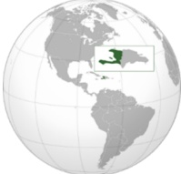

<!-- page 1 -->

MINISTÈRE DE LA JUSTICE

ET DE LA SÉCURITÉ PUBLIQUE

## ÉVALUATION NATIONALE DES RISQUES DE BLANCHIMENT DE CAPITAUX ET DE FINANCEMENT DU TERRORISME

CNLBΛ

Comité National de Lutte contre le Blanchiment des Avoirs

RÉPUBLIQUE D'HAÏTI

Décembre 2025

<!-- page 2 -->

ÉVALUATION NATIONALE DES RISQUES DE BLANCHIMENT DE CAPITAUX ET DE FINANCEMENT DU TERRORISME DE LA RÉPUBLIQUE D'HAÎTI

COMITÉ NATIONAL DE LUTTE CONTRE LE BLANCHIMENT DES AVOIRS

Décembre 2025

<!-- page 3 -->

## AVIS DE NON-RESPONSABILITÉ

L'évaluation nationale des risques de blanchiment de capitaux et de financement du terrorisme (BC/FT) de la République d'Haïti a été réalisée en tant qu'auto-évaluation par les autorités haïtiennes, en utilisant l'Outil national d'évaluation des risques de BC/FT qui a été développé et fourni par la Banque mondiale. Le rôle de l'équipe de la Banque mondiale s'est limité à mettre à disposition l'outil, à fournir des orientations sur ses aspects techniques et à examiner/faire des retours afin d'aider à son utilisation correcte. Les données, statistiques et informations renseignées dans les modèles de l'Outil national d'évaluation des risques de BC/FT, ainsi que toute autre constatation, interprétation et jugement dans le cadre du processus national d'évaluation des risques appartiennent entièrement aux autorités haïtiennes et ne reflètent pas les opinions de la Banque mondiale.

<!-- page 4 -->

## SOMMAIRE

SIGLES ET ABRÉVIATIONS.....7
AVANT-PROPOS.....9
SYNTHÈSE EXÉCUTIVE.....10
Chapitre I : INTRODUCTION.....12
1.1. PRÉSENTATION DE LA RÉPUBLIQUE D'HAÎTI.....12
1.2. CONTEXTE ET OBJECTIF DE L'ÉVALUATION.....13
1.3. MÉTHODOLOGIE DE L'ENR.....17
1.4. ORGANISATION DU TRAVAIL ET OUTILS UTILISÉS.....17
1.5. SOURCES DES DONNÉES.....18
1.6. ÉTAPES PRINCIPALES.....19
1.7. LIMITES ET EXPÉRIENCES TIRÉES DE L'ÉVALUATION.....19
Chapitre 2 : ANALYSE DES MENACES.....21
2.1. BLANCHIMENT DE CAPITAUX.....21
2.2. TRAFIC ILLICITE DE STUPÉFIANTS ET DE SUBSTANCES PSYCHOTROPES.....27
2.3. TRAFIC ILLICITE D'ARMES À FEU ET DE MUNITIONS.....28
2.4. CORRUPTION ET DÉTOURNEMENT DE FONDS PUBLICS.....30
2.5. CONTREBANDE.....31
2.6. TRAITE DES PERSONNES ET TRAFIC DE MIGRANTS.....32
2.7. ENLÈVEMENTS CONTRE RANÇON.....34
2.8. INFRACTIONS FISCALES LIÉES AUX IMPÔTS.....35
2.9. CLASSEMENT HIÉRARCHISÉ DES MENACES.....36
Chapitre 3 : ANALYSE DES VULNÉRABILITÉS NATIONALES.....38
3.1. VULNÉRABILITÉS NATIONALES.....38
3.1.1. Qualité de la politique et de la stratégie de LBC/FT/FP.....41
3.1.2. Efficacité de la définition du crime de BC/FT.....44
3.1.3. Exhaustivité des lois sur la confiscation des actifs.....45
3.1.4. Qualité de la collecte et du traitement du renseignement par l'UCREF.....47
3.1.5. Capacité et ressources pour enquêter sur les crimes financiers y compris la confiscation des avoirs.....50
3.1.6. Probité et indépendance des enquêteurs de crimes financiers y compris CdA.....53

<!-- page 5 -->

3.1.7. Capacité et ressources pour le jugement des crimes financiers y compris CdA ..... 54
3.1.8. Probité et indépendance des juges de crimes financiers y compris CdA ..... 56
3.1.9. Capacité et ressources pour les procédures judiciaires y compris CdA ..... 58
3.1.10. Qualité des contrôles douaniers ..... 59
3.1.11. Exhaustivité du régime douanier sur les espèces et instruments assimilés ..... 61
3.1.12. Efficacité des contrôles douaniers sur les espèces et instruments similaires ..... 62
3.1.13. Efficacité de la coopération nationale ..... 63
3.1.14. Efficacité de la coopération internationale ..... 64
3.1.15. Niveau de formalité de l'économie ..... 66
3.1.16. Niveau de l'intégrité financière ..... 67
3.1.18. Existence d'un audit indépendant ..... 70
3.1.19. Existence d'une infrastructure fiable d'identification ..... 72
3.1.20. Existence de sources indépendantes d'information ..... 73
3.1.21. Existence et accès aux renseignements sur la propriété effective ..... 74
3.1.22. Conclusion de l'analyse des vulnérabilités nationales ..... 75
3.2. ANALYSE DES VULNÉRABILITÉS SECTORIELLES ..... 75
3.2.1. BANQUE ..... 76
3.2.2. TITRES ..... 85
3.2.3. AUTRES INSTITUTIONS FINANCIÈRES (AIF) ..... 93
3.2.4. ASSURANCES ..... 98
3.2.5. ENTREPRISES ET PROFESSSIONS NON FINANCIÈRES DÉSIGNÉES (EPNFD) ..... 102
3.2.5.1. JEUX DE HASARD : CASINOS, LOTERIES, BORLETTS ET AUTRES ÉTABLISSEMENTS DE JEUX ..... 103
3.2.5.2. AVOCATS ET AUTRES JURISTES INDÉPENDANTS ..... 108
3.2.5.3. NOTAIRES ..... 113
3.2.5.4. COMPTABLES ..... 117
3.2.5.5. IMMOBILIER ..... 120
Chapitre 4 : RISQUES DE BC/FT LIÉS AUX PRODUITS D'INCLUSION FINANCIÈRE ..... 126
4.1. RISQUE LIÉ AU CLIENT ..... 128
4.2. RISQUE LIÉ AU PRODUIT ..... 129
4.3. RISQUE LIÉ À LA JURIDICTION ..... 129
4.4. RISQUE LIÉ AU CANAL DE DISTRIBUTION ..... 130
Chapitre 5 : RISQUES DE FINANCEMENT DU TERRORISME ..... 131

<!-- page 6 -->

Chapitre 6 : RISQUES LIÉS À LA CRIMINALITÉ ORGANISÉE .....132
6.1. DÉFINITION OPÉRATIONNELLE ET CADRAGE .....133
6.2. TYPOLOGIE DOMINANTE ET MENACE NATIONALE CONSOLIDÉE .....134
6.2.1. Enlèvements contre rançon et extorsion .....135
6.2.2. Trafic d'armes et de stupéfiants .....135
6.2.3. Taxation illégale des flux .....135
6.2.4. Infiltration du secteur formel .....136
6.2.5. Menace nationale consolidée .....136
6.3. VULNÉRABILITÉS NATIONALES FACE À LA CRIMINALITÉ ORGANISÉE .....136
6.4. RISQUES SECTORIELS COMPARÉS .....137
Chapitre 7 : CONCLUSION .....138

<!-- page 7 -->

## SIGLES ET ABRÉVIATIONS

| ACAMS : | Association of Certified Anti-Money Laundering Specialists |
| --- | --- |
| AGD : | Administration générale des douanes |
| AIF : | Autres institutions financières |
| ASNOP : | Association syndicale professionnelle de notaires de Port-au-Prince |
| BAFE : | Bureau des affaires financières et économiques |
| BAFOS : | Bureau d'administration du fonds spécial |
| BC : | Blanchiment de capitaux |
| BE : | Bénéficiaire effectif |
| BIC : | Bureau d'information sur le crédit |
| BID : | Banque interaméricaine de développement |
| BINUH : | Bureau intégré des Nations Unies en Haiti |
| BLTS : | Bureau de lutte contre le trafic de stupéfiants |
| BNDA : | Banque nationale de développement agricole |
| BRH : | Banque de la République d'Haïti |
| BUGASC : | Bureau de gestion des avoirs saisis et confisqués |
| CdA ou CA | Confiscation des avoirs |
| CNLBA : | Comité national de lutte contre le blanchiment des avoirs |
| CNMP : | Commission nationale des marchés publics |
| CONALD : | Commission nationale de lutte contre la drogue |
| CONATEL : | Conseil national des télécommunications |
| CSPJ : | Conseil supérieur du pouvoir judiciaire |
| DCPJ : | Direction centrale de la police judiciaire |
| DGI : | Direction générale des impôts |
| DOS : | Déclaration d'opération suspecte |
| DTR : | Déclaration de transactions |
| ENR : | Évaluation nationale des risques |
| EPNFD : | Entreprises et professions non financières désignées |
| FBH : | Fédération des barreaux d'Haïti |
| FMI : | Fonds monétaire international |
| FP : | Financement de la prolifération des armes de destruction massive |
| FT : | Financement du terrorisme |
| GAFI : | Groupe d'action financière |
| GAFIC : | Groupe d'action financière des Caraïbes |
| GITOC | Global Initiative against Transnational Organized Crime (Initiative mondiale contre le crime transnational organisé) |
| HCDH : | Haut-Commissariat des Nations Unies aux droits de l'homme |
| IF : | Institution financière |
| IFAC : | International Federation of Accountants |
| IFRS : | International Financial Reporting Standards |
| IHSI : | Institut haïtien de statistique et d'informatique |
| INCR : | International Narcotics Control Board |

INCB : International Narcotics Control Board

<!-- page 8 -->

| KYC : | Know Your Customer – Connaissance de sa clientèle |
| --- | --- |
| LBC/FT/FP : | Lutte contre le blanchiment de capitaux, le financement du terrorisme et le financement de la proliferation des armes de destruction massive |
| MCI : | Ministère du Commerce et de l'Industrie |
| MEF : | Ministère de l'Économie et des Finances |
| MJSP : | Ministère de la Justice et de la Sécurité publique |
| MPME : | Micro petite et moyenne entreprise |
| OCDE : | Organisation de coopération et de développement économiques |
| OCPAH : | Ordre des comptables professionnels agréés d'Haïti |
| OEA : | Organisation des États américains |
| OFAC : | Office of Foreign Assets Control – Bureau de contrôle des avoirs étrangers |
| OICS : | Organe international de contrôle des stupéfiants (voir INCB) |
| OIM : | Organisation internationale pour la migration |
| OMD : | Organisation mondiale des douanes |
| ONI : | Office national d'identification |
| ONU : | Organisation des Nations Unies |
| ONUDC : | Office des Nations Unies contre la drogue et le crime |
| PIB : | Produit intérieur brut |
| PNH : | Police nationale d'Haïti |
| PPE : | Personne politiquement exposées |
| SFD : | Société financière de développement |
| SNJH : | Syndicat des notaires des juridictions d'Haïti |
| UCREF : | Unité centrale de renseignements financiers |
| ULCC : | Unité de lutte contre la corruption |
| USAID : | United States Agency for International Development |

<!-- page 9 -->

## AVANT-PROPOS

Le présent rapport consolidé de la première Évaluation Nationale des Risques (ENR) de blanchiment de capitaux et de financement du terrorisme (BC/FT) en Haïti représente l'aboutissement d'un long processus et d'un vaste effort collectif. Sa réalisation a été rendue possible grâce à la mobilisation conjointe des secteurs public et privé, sous l'impulsion et la coordination du Comité d'ENR, organe technique du Comité National de Lutte contre le Blanchiment des Avoirs (CNLBA), ainsi qu'à l'assistance technique de la Banque mondiale.

Environ trente-cinq (35) cadres issus d'institutions diverses ont apporté leur expertise et leur engagement à cette entreprise stratégique. Nous leur adressons l'expression de notre profonde gratitude. Nous remercions également les experts de la Banque mondiale pour les outils méthodologiques mis à disposition, qui ont contribué de manière déterminante à la conduite et à la réussite de cette évaluation.

Prendre conscience des menaces qui nous entourent et identifier nos vulnérabilités constituent un préalable indispensable à toute action efficace. En ce sens, ce rapport répond à des questions clés : quelques sont les menaces ? quelques sont leurs conséquences ? quel est notre niveau de vulnérabilité face à ces menaces ? quels secteurs sont les plus à risque ? quelques sont les priorités à adresser ? Le taux de réponses globalement satisfaisantes aux questionnaires qui ont alimenté cette ENR traduit une prise de conscience croissante et renforce la crédibilité du processus. Toutefois, l'absence de certaines contributions, tant publiques que privées, rappelle l'importance d'un engagement plus inclusif et coordonné lors des prochaines évaluations. Un engagement plus inclusif implique la participation active de l'ensemble des institutions et parties prenantes, sans exception, afin de garantir une analyse complète, représentative et utile à la prise de décision.

Au-delà du diagnostic, cette première auto-évaluation atteste devant les instances internationales que la République d'Haïti, forte d'une compréhension claire de ses vulnérabilités nationales et sectorielles, dispose des bases nécessaires pour élaborer une stratégie nationale et un plan d'actions robuste. L'exercice a permis de hiérarchiser les risques afin de concentrer les efforts là où ils sont le plus nécessaires.

La conduite de l'ENR constitue également une étape décisive dans l'engagement pris par Haïti par devant la communauté internationale, à savoir renforcer son dispositif de lutte anti-blanchiment et contre le financement du terrorisme (FT) en mettant l'accent sur les risques, afin de contribuer à la protection du système financier national et international, par la mise en œuvre des mesures appropriées.

Nous formulons le vœu que l'ensemble des acteurs publics et privés, sous l'impulsion constante du CNLBA, reste mobilisé afin que ce rapport devienne non seulement un outil de référence, mais aussi un levier d'efficacité et de créabilité pour consolider la place de la République d'Haïti sur la scène internationale.

<!-- page 10 -->

## SYNTHÈSE EXÉCUTIVE

L'Évaluation Nationale des Risques (ENR) de BC/FT en Haïti marque un tournant décisif dans la compréhension stratégique des menaces qui pèsent sur le pays et dans la consolidation de son dispositif de prévention. Les constats issus de l'analyse révèlent un niveau global de risque de blanchiment de capitaux élevé (E), résultat d'une combinaison entre une menace structurellement forte (E), et une vulnérabilité moyennement élevée (ME).

<table><tr><td>MENACE GLOBALE</td><td>Niveau global du risque de Blanchiment de capitaux et de financement du terrorisme/criminalité organisée</td></tr><tr><td>E</td><td>M</td><td>M</td><td>ME</td><td>E</td><td>E</td><td>E</td></tr><tr><td>ME</td><td>M</td><td>M</td><td>ME</td><td>ME</td><td>E</td><td>E</td></tr><tr><td>MF</td><td>MF</td><td>M</td><td>M</td><td>ME</td><td>ME</td><td>ME</td></tr><tr><td>F</td><td>MF</td><td>MF</td><td>M</td><td>M</td><td>M</td><td>M</td></tr><tr><td></td><td>F</td><td>MF</td><td>MF</td><td>M</td><td>M</td><td>M</td></tr><tr><td></td><td>F</td><td>MF</td><td>M</td><td>ME</td><td>E</td><td>E</td></tr></table>

Ce score traduit une réalité particulièrement préoccupante : les dynamiques interconnectées de la criminalité organisée, du trafic d'armes, d'enlèvements contre rançon, de la corruption, de la contrebande, du trafic de stupéfiants, d'infractions fiscales, de la traite des personnes, et de l'économie informelle exercent une pression systémique et durable sur les institutions nationales, alors même que les capacités de mitigation demeurent inégalement développées. Cette pression se manifeste à la fois sur les plans sécuritaire, judiciaire, économique, financier et social, dans un contexte où les capacités de prévention, de détection et de répression demeurent inégalement développées.

Malgré un cadre juridique modernisé et des avancées institutionnelles significatives, notamment la promulgation du décret du 30 avril 2023, la réorganisation de l'UCREF et l'annonce, par le décret, de la création du Bureau de gestion des avoirs saisis et confisqués (BUGASC), la pleine efficacité du dispositif repose encore sur la mise en œuvre concrète, coordonnée et pérenne de ces réformes.

Le risque élevé mis en évidence par la matrice globale doit être compris comme un signal d'alerte stratégique et non comme une fatalité. Il souligne la nécessité d'un engagement collectif renouvelé des

<!-- page 11 -->

pouvoirs publics, du secteur privé et des professions non financières désignées pour transformer les acquis juridiques en leviers opérationnels.

La prochaine étape consistera à traduire ce diagnostic en des actions ciblées telles que :

a) l'adoption d'une politique nationale et d'une stratégie coordonnée de LBC/FT/FP assortie d'un mécanisme permanent de suivi ;

b) la formation et la professionnalisation des autorités d'enquête et de poursuite judiciaire ;

c) la mise en place du BUGASC avec un cadre organique et budgétaire clair ;

d) la modernisation du cadre juridique des entreprises et professions non financières désignées (EPNFD) (jeux de hasard, secteur immobilier, notaire, avocat, expert-comptable, etc.), ainsi que la désignation claire des autorités de régulation et de supervision de ces acteurs ;

e) le renforcement durable de la conformité LBC/FT/FP du secteur des assurances en modernisant le cadre juridique, professionnalisant la supervision et en consolidant les dispositifs internes des compagnies, afin de préparer le marché à un éventuel retour de l'assurance vie dans un environnement sécurisé et aligné sur les standards du GAFI ;

f) la modernisation du contrôle douanier ;

g) le renforcement de la surveillance maritime intégrée (radars, patrouilles mixtes, drones) afin de détecter, intercepter et démanteler les réseaux organisés de trafic de migrants par mer, en coordination avec les garde-côtes et les partenaires internationaux ;

h) le renforcement du renseignement financier par la modernisation de l'UCREF, son adhésion au Groupe Egmont, la mise à disposition d'outils technologiques, et la coopération renforcée avec les autorités de poursuite judiciaire et les autres autorités d'enquête ;

i) l'amélioration des capacités d'enquête et de poursuite à travers la formation spécialisée des enquêteurs (UCREF, BAFE, ULCC), la mise en place d'outils technologiques, et la protection des enquêteurs ;

j) l'institutionnalisation d'un système de retour d'informations ;

k) la formalisation progressive de l'économie et la mise en œuvre d'une stratégie d'intégrité fiscale et financière ;

l) la création de sources d'informations fiables et indépendantes, notamment la mise en place d'un registre complet, à jour, permettant d'identifier des bénéficiaires effectifs ;

m) le renforcement du cadre de conformité au sein de certaines institutions financières ;

n) la formation et la professionnalisation du personnel des institutions financières et des EPNFD ;

o) le renforcement des systèmes de surveillance des transactions par la réévaluation périodique des paramètres et scénarios intégrés, l'ajustement dynamique des seuils d'alerte, et la mise à jour continue des scénarios de détection selon les nouvelles typologies nationales et internationales ; et

p) la tenue systématique de statistiques.

Enfin, l'ensemble de ces orientations stratégiques se décline en mesures opérationnelles précises. Celles-ci sont entièrement détaillées dans un Plan d'action qui fournit, pour chaque axe prioritaire, les actions à entreprendre, les institutions responsables, les échéances indicatives et les indicateurs de suivi nécessaires à une mise en œuvre efficace et coordonnée.

<!-- page 12 -->

## Chapitre I : INTRODUCTION

#### 1.1. PRÉSENTATION DE LA RÉPUBLIQUE D'HAÎTI

La République d'Haïti est située dans le bassin des Caraïbes. Ses côtes sont baignées au Nord par l'Océan Atlantique et au Sud par la mer des Caraïbes. Elle est limitée à l'Ouest par Cuba (90 km) et par la Jamaïque (190 km), et à l'Est par la République dominicaine avec près de 386 km de frontière. Haïti occupe environ un tiers (36,0%) de l'Île qu'elle partage avec la République dominicaine. Elle est placée entre 18° et 19° de latitude Nord et 68° et 75° de longitude Ouest¹. Le pays couvre une superficie de 27 750 km² et compte 11 867 032 habitants en 2024². Sa capitale, Port-au-Prince, est secondée par d'autres grandes villes telles que Cap-Haitien, Gonaïves, Saint-Marc, Cayes, Hinche, Jacmel et Jérémie. Le créole, langue maternelle, parlé par toute la population, et le français, langue de l'enseignement, sont les deux langues officielles. Le pays est présidé actuellement par Monsieur Laurent Saint Cyr dans le cadre d'une présidence tournante du Conseil présidentiel de transition, et est dirigé par un gouvernement conduit par Monsieur Alix Didier Fils-Aimé.

Figure 1 : localisation d'Haïti

Avec une densité de 438 habitants au km²³, une croissance démographique annuelle de 1,28 %⁴ et un taux d'alphabétisation de 68 % en 2017⁵, Haïti fait face à de nombreux défis socio-économiques, reflétés par un indice de développement humain de 0,552 (158e rang mondial)⁶ et une espérance de vie moyenne de 65 ans⁷.

Sur le plan économique, Haïti a enregistré un produit intérieur brut (PIB) de 568,0 Milliards de gourdes pour l'exercice fiscal 2023-2024, avec une contraction économique persistante (4.2 % en 2024)⁸. L'économie repose sur trois principaux secteurs : l'agriculture (17 %), l'industrie (25 %) et le commerce de biens et de services (58 %)⁹. Elle connaît un taux de chômage de 15.10 % en 2024, selon Trading Economics¹⁰. L'inflation reste très élevée (28.4 % en juin 2025¹¹) et la balance commerciale est déficitaire,

<!-- page 13 -->

en raison des exportations (113,464,000.00 millions de gourdes) qui sont largement inférieures aux importations (628,820,000.00 millions de gourdes), soit 15% contre 85%. $ ^{12} $

La situation sécuritéaire en Haïti demeure critique et constitue un des principaux freins au développement du pays. L'augmentation de la violence, dominée par les gangs armés, a entraîné en 2024 plus de 5 600 morts et le déplacement de plus d'un million de personnes, selon la Banque mondiale, accentuant un climat d'insécurité généralisée. Cette crise affecte directement la perception et la collecte des recettes fiscales, décourage les investissements privés et aggrave la récession économique. À ces violences s'ajoute la vulnérabilité extrême du pays aux catastrophes naturelles (ouragans, inondations et séismes) qui déstabilisent davantage les infrastructures et la sécurité humaine. Ainsi, l'insécurité chronique et l'exposition aux chocs naturels entretiennent un cercle vicieux de fragilité où la survie quotidienne de millions d'Haïtiens est menacée $ ^{13} $.

#### 1.2. CONTEXTE ET OBJECTIF DE L'ÉVALUATION

Haïti a entrepris de réaliser sa première ENR de BC/FT dans un contexte marqué par des fragilités structurelles et des défis socio-économiques persistants.

L'ENR est un exercice analytique structuré qui permet aux autorités nationales de disposer d'une vision globale et intégrée de leur exposition aux risques de BC/FT, afin d'adapter leur stratégie de lutte.

En effet, la lutte contre le BC/FT constitue aujourd'hui un enjeu majeur pour la stabilité économique, la sécurité nationale et la crédibilité du système financier mondial. Dans un contexte marqué par la mondialisation des échanges, la porosité des frontières et l'essor des technologies financières, ces phénomènes criminels transcendent les limites géographiques et nécessitent une réponse coordonnée aux niveaux national, régional et international. C'est dans ce contexte que Kofi Annan eut à dire : « Si la criminalité traverse les frontières, la répression doit les traverser. Si l'état de droit est sapé non pas dans un, mais dans beaucoup de pays, alors ceux qui le défendent ne peuvent se limiter à des moyens purement nationaux »¹⁴.

Dans cette perspective, Haïti a progressivement renforcé son engagement sur la scène internationale, en ratifiant plusieurs instruments juridiques majeurs, parmi lesquels :

- la Convention des Nations Unies contre le trafic illicite de stupéfiants et de substances psychotropes $ ^{15} $ (Convention de Vienne, 1988) $ ^{16} $;

<!-- page 14 -->

- la Convention internationale des Nations Unies pour la répression du financement du terrorisme (1999);

- la Convention des Nations Unies contre la criminalité transnationale organisée (Convention de Palermo, 2000)17;

- la Convention des Nations Unies contre la Corruption, ratifiée le 14 mai 2007 $ ^{18} $.

En octobre 2001¹⁹, Haïti a adhéré au Groupe d'action financière des Caraïbes (GAFIC), confirmant ainsi sa volonté de mettre en œuvre les standards internationaux du Groupe d'action financière Internationale (GAFI) et de toujours renforcer son dispositif national de LBC/FT/FP. L'adhésion au GAFIC implique principalement pour chaque État membre de transposer les quarante (40) Recommandations du GAFI dans son droit interne et de se soumettre régulièrement à des évaluations mutuelles. Elle suppose également la présentation de rapports de suivi sur les progrès réalisés en termes de conformité et d'efficacité, la participation active aux réunions plénières et techniques, ainsi que la coopération avec les autres juridictions membres pour l'échange d'informations et de bonnes pratiques. Par ce mécanisme, chaque État doit adapter en permanence son cadre législatif et institutionnel, renforcer ses capacités opérationnelles et démontrer l'efficacité de son dispositif de lutte, sous peine de contre-mesures ou listes publiques (liste grise²⁰ et liste noire).

Il en résulte que la participation d'Haïti à cette lutte s'impose comme une exigence incontourable, inhérente à ses engagements internationaux et à son appartenance au GAFIC. Ainsi, depuis 2001, Haïti a entrepris une succession de réformes législatives, réglementaires et institutionnelles, destinées à aligner son dispositif national sur les normes du GAFIC. Malgré ces réformes, après sa 2ème évaluation mutuelle en juin 2018, Haïti s'est retrouvé sur la liste grise du GAFIC à cause de certaines faiblesses structurelles, notamment des déficiencies $ ^{21} $ du dispositif existant, des faiblesses institutionnelles, la non-réalisation de l'ENR, l'absence de résultats concrets (condamnation, gel, saisie, confiscation), le manque de supervision $ ^{22} $ de certains secteurs, et la limitation des autres formes de coopération internationale $ ^{23} $.

« Le cadre de la lutte contre le blanchiment de capitaux et le financement du terrorisme [haïtien] reste inadéquat et nécessite un véritable effort pour que soit atteint un niveau de conformité acceptable avec les normes mondiales [...] », extrait du Rapport d'Évaluation Mutuelle d'Haïti de juillet 2019.

<!-- page 15 -->

L'inscription sur la liste grise place ainsi Haïti sous surveillance renforcée, avec l'obligation de corriger rapidement certaines déficiencies stratégiques. Dans le cadre de l'exécution du plan d'action lié à l'inscription d'Haïti sur la liste grise, deux (2) décrets majeurs ont été adoptés :

• le décret du 30 avril 2023 sanctionnant le BC/FT/FP ;

• le décret du 29 septembre 2023 portant réorganisation de l'Unité Centrale de Renseignements Financiers (UCREF).

Conformément à la Recommandation 1 du GAFI $ ^{24} $, l'article 11 du décret du 30 avril 2023 prévoit que le CNLBA prend toutes mesures nécessaires pour identifier, évaluer, comprendre et atténuer les risques liés au BC/FT/FP. L'évaluation doit être actualisée tous les cinq (5) ans et diffusée aux autorités compétentes, organismes de contrôle, institutions financières et EPNFD.

Eu égard à cette disposition issue des recommandations du GAFI, l'ENR a été officiellement lancée le 14 mars 2024. Cette évaluation repose sur trois piliers interdépendants : menaces, vulnérabilités et conséquences.

D'une manière générale, la menace désigne une personne ou un groupe de personnes, un objet ou une activité ayant le potentiel de causer des dommages. Dans le contexte de la LBC/FT, les menaces représentent les crimes financiers, les criminels, les groupes terroristes et leurs facilitateurs, leurs fonds, ainsi que les activités passées, présentes et futures de BC/FT. Ces menaces ont le potentiel de causer des dommages à la société, à l'État, à l'économie en général, et au système financier en particulier. Elles sont mesurées par la quantité et la qualité des produits du crime qui entrent dans un pays ou sont générés à l'intérieur de celui-ci. La menace est quantifiée au moyen des données sur la fréquence des crimes générant des capitaux illicites, et sur la valeur monétaire des produits générés. L'évaluation qualitative se fait sur la base des méthodes utilisées par les blanchisseurs de capitaux, les tendances, les itinéraires répétitifs, la direction du blanchiment, à partir d'un lieu en passant par un marché ou un système spécifique.

En tant que facteurs de risque, les menaces servent généralement de point de départ essentiel pour développer une compréhension des risques de BC/FT.

Quant à la vulnérabilité, elle correspond à la situation dans laquelle un pays se retrouve complètement ou partiellement dépourvu de moyens (bouclier) de protection, pour se prémunir efficacement contre les menaces. Quand elle est faible, elle renvoie au volet réaction au risque, se référant à la capacité de résilience face à une attaque (menace) et à l'aptitude à combattre cette menace spécifique. La vulnérabilité peut concerner un secteur unique, s'étendre à plusieurs secteurs, ou encore découler d'une

<!-- page 16 -->

cause commune qui touche divers secteurs, voire l'ensemble des secteurs, mettant ainsi en péril le système national dans son ensemble. Plus clairement, la vulnérabilité comprend les facteurs qui pourraient représenter des faiblesses légales, organisationnelles, opérationnelles et structurelles, par exemple le vide juridique ou réglementaire, l'absence de supervision, l'absence d'institutions spécialisées, la passivité des autorités répressives, le manque de ressources, la porosité des frontières, le niveau élevé d'informalité de l'économie, l'incompréhension ou la gestion inefficace des risques, l'absence de contrôles adéquats, l'absence de politiques, processus et procédures écrites en matière de connaissance de la clientèle (KYC). La vulnérabilité concerne aussi l'absence d'outils technologiques nécessaires pour la surveillance des transactions, le manque de formation du personnel ou le manque de mise à jour, la non-mise à jour des informations du registre national des bénéficiaires effectifs (BE) ou l'inaccessibilité, privant les institutions financières et les EPNFD d'un outil essentiel d'identification des propriétaires réels des entités juridiques, ce qui pourrait faciliter la réalisation de typologies de blanchiment, par exemple l'utilisation de sociétés écrans à des fins de blanchiment ou de FT.

Lorsqu'un pays, ou un secteur est vulnérable, il est sujet à des menaces. En ce sens, le niveau de survenance d'un événement ou d'une menace est directement proportionnel au degré de vulnérabilité. Autrement dit, une menace élevée combinée à une vulnérabilité élevée se traduit par un risque élevé. À l'inverse, une menace élevée associée à une faible vulnérabilité génère un risque résiduel, car les mesures de protection atténuent l'impact potentiel, d'où la formule :

## RISQUE INHÉRENT – CONTRÔLE EFFECTIF = RISQUE RÉSIDUEL

Les conséquences du blanchiment de capitaux (BC) se traduisent par des effets préjudiciables sur les institutions et systèmes financiers, l'économie et la société en général, tant au niveau national qu'international. Elles peuvent être immédiates ou différées et concerner les populations, les communautés, l'environnement des affaires ainsi que les intérêts stratégiques d'un État. Le BC/FT compromet également la réputation et l'attractivité du secteur financier d'un pays.

Dès lors, il est essentiel que l'évaluation des menaces et vulnérabilités prenne en compte ces conséquences potentielles, afin de hiérarchiser efficacement les mesures d'atténuation et de renforcer durablement la résilience des systèmes économique et financier. En effet, il ne suffit pas de dire « il y a un risque », mais il faut également évaluer « quelques seraient les conséquences si ce risque se matérialisait ». Une fois la gravité des conséquences connue, les autorités peuvent « prioriser », c'est-à-dire concentrer les ressources là où les risques sont les plus élevés, et adapter les réponses. Cela évite de disperser les efforts et permet une allocation optimale des ressources.

Le processus d'ENR consiste donc à identifier, évaluer et hiérarchiser les menaces et les vulnérabilités en matière de BC/FT, compte tenu des conséquences, en vue de l'application d'une approche « fondée sur les risques ». Cette approche suppose notamment, l'élaboration de politiques et de stratégies ciblées, la priorisation des efforts de lutte, l'adoption de mesures adéquates, l'allocation de ressources de manière proportionnée, et la coordination interinstitutionnelle.

La conduite de l'ENR a été possible grâce à l'appui technique de la Banque mondiale. Cet appui comprend, d'une part, la mise à disposition d'une série d'outils/modules informatiques accompagnée de

<!-- page 17 -->

la méthodologie d'évaluation, d'autre part, d'un suivi régulier à travers des réunions techniques et des séances de travail en vidéoconférence, et enfin de révisions des rapports d'évaluation.

Les modules de la Banque mondiale sont des matrices normalisées au format Excel, destinées à l'exploitation des données collectées et couvrant l'ensemble des dimensions du risque de BC/FT.

#### 1.3. MÉTHODOLOGIE DE L'ENR

La méthodologie présentée dans ce rapport a été volontairement détaillée afin de constituer une référence, destinée à guider les futures Évaluations Nationales des Risques (ENR).

#### 1.4. ORGANISATION DU TRAVAIL ET OUTILS UTILISÉS

L'ENR est organisée en sept (7) groupes thématiques [menaces (1), vulnérabilités nationales (2), vulnérabilités du secteur bancaire, des titres et du secteur des assurances (3), vulnérabilité des autres institutions financières (AIF) (4), vulnérabilité des EPNFD (5), évaluation des risques de FT (6), et évaluation des risques liés aux produits d'inclusion financière (7)]. Chaque groupe dispose de ses propres modules d'évaluation, adaptés à son thème.

Le Groupe Menaces dispose de trois (3) modules qui permettent de collecter et d'organiser des informations qualitatives et quantitatives tant sur le blanchiment que sur les infractions sous-jacentes, d'identifier l'origine géographique et les secteurs économiques exposés, et de produire une évaluation globale des menaces. Ces modules intègrent également la collecte de données basées sur des cas concrets ainsi que l'analyse des risques transfrontaliers à travers l'examen des flux financiers entrants et sortants.

Le Groupe Vulnérabilités nationales dispose d'un module qui évalue la politique et la stratégie de lutte, la capacité des institutions (organes d'enquête et de poursuites judiciaires, DGI, l'Administration générale des douanes, etc.), la qualité du cadre légal, la coopération interinstitutionnelle, et l'efficacité judiciaire. Cet outil constitue la base méthodologique pour identifier les points faibles du dispositif de lutte haïtien et définir les actions de renforcement prioritaires. Il permet de calculer un indice global de vulnérabilité selon l'approche dite « porte ouverte », et génère des graphiques pour appuyer la prise de décision, et orienter les priorités stratégiques grâce à la hiérarchisation des risques.

Concernant les groupes de vulnérabilité sectorielle (banque, titre, assurance, AIF et EPNFD), chacun dispose d'un module spécifique d'évaluation. Les variables retenues sont globalement similaires [cadre juridique, obligations de vigilance à l'égard de la clientèle (KYC), dispositifs de supervision, conformité, intégrité, accès à l'information et sensibilisation / connaissance du personnel de la LBC/FT], tout en étant ajustées aux particularités et aux risques inhérents à chaque secteur.

<!-- page 18 -->

Le Groupe d'évaluation des risques en matière de FT a appliqué une méthodologie en cinq étapes, fondée sur un cadre méthodologique garantissant la cohérence et l'harmonisation des analyses. Toutefois, compte tenu de l'absence de groupes terroristes actifs, d'idéologies extrémistes ou de réseaux affiliés à des organisations telles que Daesh ou Al-Qaïda en Haïti, le risque de FT a été jugé faible. Sur recommandation de la Banque mondiale, le Groupe a donc mobilisé cette même méthodologie pour analyser la criminalité organisée, considérée comme la menace la plus pressante pour la sécurité et la stabilité nationales, proche du FT. L'application de ces outils a permis de cartographier les menaces et vulnérabilités associées aux activités des groupes criminels, d'identifier les secteurs les plus exposés, et de définir les priorités nationales en matière de prévention, de supervision et de coopération institutionnelle.

Le Groupe Inclusion financière dispose d'un module qui analyse les caractéristiques et l'environnement global des produits d'inclusion financière.

D'une manière générale, les modules de la Banque mondiale utilisent des fichiers Excel qui contiennent des formules mathématiques et macros pour suggérer des résultats/scores (Élevé, Moyen/Élevé ; Moyen, Moyen/Bas, Faible) et souligner les tendances (Pas de changement, en augmentation, en diminution) en matière de BC/FT. En ce sens, ils guident vers des conclusions rationnelles.

Les résultats ainsi obtenus sont discutés et validés en réunion entre les membres des groupes.

#### 1.5. SOURCES DES DONNÉES

Globalement, les données mobilisées pour effectuer l'ENR proviennent de sources nationales et internationales. Au niveau national, elles proviennent de certaines institutions publiques et privées telles que le Ministère de la Justice et de la Sécurité publique (MJSP), l'UCREF, la Police Nationale d'Haïti (PNH) à travers le Bureau des affaires financières et économiques (BAFE) et le Bureau de lutte contre le trafic de stupéfiants (BLTS), la Commission nationale de lutte contre la drogue (CONALD/BAFOS), l'Unité de lutte contre la corruption (ULCC), la Direction générale des impôts (DGI), la Banque de la République d'Haïti (BRH), le secteur financier et des EPNFD, etc. Au niveau international, les données proviennent principalement des rapports publiés par des organisations internationales sur internet telles que l'Organisation des Nations Unies (ONU), le Bureau intégré des Nations Unies en Haïti (BINUH), l'Initiative globale contre les crimes transnationales « Global Initiative Against Transnational Organized Crime (GITOC) », l'Office des Nations Unies contre la drogue et le crime (ONUDC), la Banque mondiale, le Fonds monétaire international (FMI), « Transparency International », l'Organe international de contrôle des stupéfiants (OICS), etc.

Les données collectées couvrent généralement la période de 2019 à 2024, bien que certaines portent également sur le premier semestre de l'année 2025.

<!-- page 19 -->

#### 1.6. ÉTAPES PRINCIPALES

1. Mise en place d'une structure de coordination de l'évaluation :

a. création d'un Comité national de coordination de l'évaluation sur la base d'un protocole

d'accord entre le MJSP, le MEF, la BRH et l'UCREF, tous membres du CNLBA ;

b. mise en place des groupes de travail thématiques (chaque institution impliquée dans la lutte désigne ses représentants).

2. Lancement officiel du processus d'ENR en vidéoconférence avec la participation des experts de la Banque mondiale ;

3. Séance de présentation des outils par la Banque mondiale ;

4. Séance de présentation du cadre général de la lutte aux groupes constitués par un cadre de la BRH ;

5. Collecte de données :

a. Élaboration et communication de questionnaires destinés aux institutions publiques, aux secteurs bancaires, titres, assurances, professions non financières désignées, et aux fournisseurs de services de paiement électronique ;

b. retour des questionnaires :

c. distribution des questionnaires remplis aux groupes de travail ;

6. Élaboration des feuilles de calcul, enregistrement des données et justification des notations ;

7. Enregistrement des notations dans les fichiers Excel (Entry page) et traitement des facteurs de vulnérabilité inhérentes (Entry page Product) ;

8. Élaboration des rapports sectoriels par groupe ;

9. Remise des rapports sectoriels au comité ;

10. Élaboration d'un premier projet du rapport consolidé de l'ENR ;

11. Transmission du premier projet de rapport à la Banque mondiale pour commentaires et discussions ;

12. Remise du rapport final.

#### 1.7. LIMITES ET EXPERIENCES TIRÉES DE L'ÉVALUATION

Le processus d'ENR a été confronté à plusieurs défis majeurs, en grande partie liés au contexte socio-politique actuel en Haïti, marqué par une instabilité persistante, des contraintes sécuritéaires et des limitations institutionnelles. Ces conditions ont considérablement entravé la collecte des données, les entretiens et les ateliers de travail.

Par ailleurs, la nature inédite de l'exercice pour plusieurs parties prenantes a mis en lumière un besoin fondamental de renforcement des capacités en amont du processus. Cette première expérience d'ENR a souligné la nécessité de planifier plusieurs sessions de formation préparatoires pour l'ensemble des

<!-- page 20 -->

membres des groupes de travail, non seulement sur le domaine en général, mais sur les fichiers Excel en particulier. Ces formations viseraient à harmoniser le niveau de compréhension des concepts clés liés à la lutte contre le blanchiment de capitaux, le financement du terrorisme et de la prolifération (LBC/FT/FP), ainsi qu'à assurer une appropriation effective de la méthodologie de l'ENR. Un tel renforcement contribuera à améliorer significativement l'efficacité, la rigueur et la qualité des travaux menés collectivement.

Enfin, les résultats présentés dans le présent rapport doivent être interprétés avec prudence, en raison du cadre temporel retenu pour l'analyse (2019–2024) et de la portée partielle de la collecte des données. Les conclusions reflètent essentiellement la situation observée au cours de la période évaluée. Il est possible que certaines vulnérabilités ou tendances aient évolué depuis, notamment en lien avec l'apparition de nouveaux produits et services financiers, des modifications du cadre réglementaire, l'émergence de nouvelles menaces criminelles, ou diminué, notamment en raison de l'adoption de certaines mesures qui augmenteraient les capacités ou la résilience nationale ou sectorielle. Par ailleurs, certaines données sectorielles n'ont pas pu être intégralement collectées ni systématiquement vérifiées, ce qui peut affecter la représentativité des résultats pour certains sous-secteurs ou catégorie d'institutions.

Aussi les analyses et recommandations fournies doivent-elles être considérées comme une photographie à un instant donné et utilisées comme base de travail pour les évaluations futures, plutôt que comme une généralisation absolue à l'ensemble des secteurs ou des périodes postérieures à 2024, et dans certains cas, au premier semestre 2025.

Ces limitations mettent en évidence plusieurs pistes pour renforcer les prochaines évaluations à savoir :

• l'amélioration de l'accès aux données, en renforçant la coordination interinstitutionnelle ;

• l'intégration systématique de tous les secteurs ;

• la sensibilisation et la formation ciblée en amont des évaluateurs.

<!-- page 21 -->

## Chapitre 2 : ANALYSE DES MENACES

L'évaluation de la menace de BC consiste, d'une part, à analyser les manifestations directes du phénomène, notamment à travers l'examen des cas de soupçon déjà enregistrés, des typologies identifiées et des circuits utilisés pour introduire les fonds illicites dans le système financier ou l'économie réelle ; et, d'autre part, à identifier et estimer l'ampleur des principales infractions sous-jacentes génératrices de fonds illicites. En ce sens, sept (7) infractions sous-jacentes ont été retenues pour être analysées, en raison de leur prévalence, de leur impact potentiel sur l'économie nationale et le niveau de documentation disponible. Ces infractions constituent les menaces prioritaires qui feront l'objet de l'évaluation, à savoir :

1) le trafic illicite de stupéfiants et de substances psychotropes ;

2) le trafic illicite d'armes et de munitions ;

3) la corruption et le détournement des fonds publics ;

4) la contrebande y compris relativement aux taxes et droits de douane ;

5) le trafic illicite de migrants et la traite d'êtres humains ;

6) l'enlèvement, la séquestration et la prise d'otages ; et

7) les infractions fiscales liées aux impôts directs et indirects.

#### 2.1. BLANCHIMENT DE CAPITAUX

La méthodologie de l'analyse des risques de BC repose sur la logique suivante :

## Risque = Menace * Vulnérabilité * Conséquences

Le BC est un processus en trois étapes (placement, empilement et intégration) qui vise à donner une apparence légitime à de l'argent ou des biens issus d'activités criminelles, telles que le trafic d'armes, le trafic de stupéfiants, la contrebande, la corruption, l'enlèvement contre rançon, l'évasion fiscale, etc.

État des déclarations de soupçon reçues par l'UCREF

Entre 2019 et 2024, l'UCREF a reçu 1254 déclarations de soupçon et traité 566 $ ^{25} $. Seuls19 dossiers ont été transmis à la justice, et aucun d'entre eux n'a débouché sur une condamnation connue. Les typologies de blanchiment identifiées incluent le fractionnement des dépôts (Schtroumpfage / Smurfing), la création de sociétés écrans et des virements bancaires internationaux injustifiés.

<!-- page 22 -->

DÉCLARATIONS DE SOUPCON (2019 à 2024)

<table><tr><td>ANNÉE FISCALE</td><td>NOMBRE REÇU</td><td>NOMBRE TRAITÉ</td><td>NOMBRE TRANSMIS</td></tr><tr><td>2019-2020</td><td>140</td><td>292</td><td>3</td></tr><tr><td>2020-2021</td><td>0</td><td>89</td><td>0</td></tr><tr><td>2021-2022</td><td>614</td><td>73</td><td>9</td></tr><tr><td>2022-2023</td><td>68</td><td>47</td><td>0</td></tr><tr><td>2023-2024</td><td>432</td><td>65</td><td>7</td></tr><tr><td>TOTAL</td><td>1254</td><td>566</td><td>19</td></tr><tr><td>Source : UCREF</td></tr></table>

État des déclarations de transaction reçues par l'UCREF

Entre 2019 et 2024, l'UCREF a reçu 2,831,310 déclarations de transactions.

DÉCLARATIONS DE TRANSACTIONS (2019 à 2024)

<table><tr><td>ANNÉE FISCALE</td><td>NOMBRE REÇU</td><td>SOUPCON DÉTECTÉ</td><td>TRANSMIS À LA DIRECTION GÉNÉRALE</td></tr><tr><td>2019-2020</td><td>243135</td><td>0</td><td>0</td></tr><tr><td>2020-2021</td><td>443994</td><td>8</td><td>8</td></tr><tr><td>2021-2022</td><td>580187</td><td>0</td><td>0</td></tr><tr><td>2022-2023</td><td>741792</td><td>0</td><td>0</td></tr><tr><td>2023-2024</td><td>822202</td><td>30</td><td>11</td></tr><tr><td>TOTAL</td><td>2831310</td><td>38</td><td>19</td></tr><tr><td>Source : UCREF</td></tr></table>

Ces résultats illustrent à la fois les efforts réalisés en matière de collecte d'informations financières, les défis persistants liés au traitement analytique et à la transformation des signalements en dossiers exploitables, et les limites actuelles du dispositif judiciaire. La très faible proportion de dossiers effectivement transmis aux autorités judiciaires souligne la nécessité de renforcer la qualité des déclarations, d'améliorer les outils de filtrage et d'accroître la capacité analytique de l'UCREF. Par ailleurs, l'absence de condamnations neutralise l'effet dissuasif du régime répressif, ce qui affaiblit l'efficacité globale de la lutte contre le blanchiment.

##### 2.1.1. Typologie de blanchiment

Selon les rapports de l'UCREF pour la période 2019-2023, les typologies de blanchiment identifiées incluent :

• Le fractionnement des dépôts (Schtroumpfage / Smurfing):

o dépôts fractionnés en espèces dans divers comptes bancaires ;

○ utilisation de traites bancaires en dessous du seuil légal de déclaration ;

<!-- page 23 -->

o implication de plusieurs personnes (« smurfs ») pour diluer l'origine des fonds.

## • La création de sociétés écrans :

○ multiplication de nouvelles entreprises servant de façade ;

ouverture de multiples comptes bancaires au nom de ces entités ;

o facturation de services fictifs ou artificiels avec signature de contrats simulés avec des entités publiques ;

o encaissement de chèques sur ces comptes puis transfert rapide des fonds vers des comptes personnels.

## • Les virements bancaires internationaux injustifiés :

☐ transferts de montants élevés vers l'étranger ;

○ justifications insuffisantes ou absentes pour ces mouvements de fonds ;

risque élevé de blanchiment d'argent et de FT.

Le tableau ci-dessous reprend les typologies de blanchiment identifiées par l'UCREF et indique les risques associés.

| Technique | Description | Risque associé |
| --- | --- | --- |
| Fractionnement des dépôts (Smurfing) | Dépôts fractionnés en espèces dans divers comptes ; utilisation de traites bancaires en dessous du seuil de déclaration ; recours à plusieurs personnes (« smurfs »). | Contournement des seuils de déclaration, dilution de l’origine des fonds, difficulté accrue de détection. |
| Création de sociétés écrans | Constitution de sociétés sans activité réelle ou avec une activité fictive, utilisées pour détenir des fonds, ouvrir des comptes ou réaliser des transactions afin de masquer l’identité des bénéficiaires effectifs. | Opacité sur la propriété réelle des fonds, dissimulation de l’identité des bénéficiaires effectifs, facilitation du blanchiment et du financement du terrorisme. |
| Virements bancaires internationaux injustifiés | Transferts importants vers l’étranger ; absence ou insuffisance de justificatifs économiques. | Sortie rapide de capitaux illicites, exposition accrue au blanchiment transnational et au financement du terrorisme. |

<!-- page 24 -->

Le tableau ci-dessous présente un cas concret (anonymisé) qui illustre les typologies décrites ci-dessus. Il détaille les secteurs impliqués, les modalités d'opération, les comptes utilisés, ainsi que les suites judiciaires et administratives.

| Référence de l’affaire | Cas # 12345 |
| --- | --- |
| Secteurs impliqués | Institution financière et EPNFD |
| Nombre d’entités impliquées (avec détail par secteur) | Deux (2) banques ; une (1) maison de transfert ; un (1) cabinet d’avocat |
| Nombre de comptes bancaires impliqués | 5 |
| Montant moyen dans les comptes bancaires | USD 50 000.00 |
| Nombre de transferts monétaires | 10 |
| Montant moyen des transferts monétaire | USD 2000 à USD 3000 |
| Produits/services financiers concernés | Services de transfert monétaire, comptes bancaires et chèques |
| Infractions sous-jacentes présumée | Trafic de drogue |
| Montant total détecté | USD 500 000 |
| Montant total saisi | USD 220 000 |
| Montant total confisqué | 100 000 USD |
| Nombre de citoyen impliqué | 12 |
| Nombre de non-citoyens impliqué | 2 |
| Pays de destination | Pays A ; Pays B |
| Pays d’origine | HAITI |
| Régions concernées | Région A ; Région B |
| Résumé des techniques et méthodes utilisées | Utilisation de la structuration et du secteur immobilier |
| Déclencheur de l’enquête | Déclaration de soupçon à l’UCREF |
| Résultat de l’enquête | Poursuite, condamnation |
| Brève description du cas | Les fonds introduits dans le système sous forme de dépôts fractionnés en espèces, ont été canalisés via cinq (5) comptes bancaires avant d’être transférés par tranches de 2000 à 2000 dollars américains vers deux (2) juridictions étrangères. Une partie des fonds a été utilisée pour acheter des biens Via le secteur immobilier local. L’enquête, déclenché par une déclaration d’opération suspecte à permis la saisie de USD 220 000 et la confiscation définitive de USD 100 000. |

<!-- page 25 -->

Les typologies identifiées par l'UCREF entre 2019 et 2023 illustrent clairement une menace élevée de BC en Haïti. Le fractionnement des dépôts (smurfing), observé de façon constante, démontre la velléité des criminels de contourner les seuils de déclaration en mobilisant plusieurs personnes et en multipliant les dépôts de faible montant. Cette pratique accroît la difficulté de détection pour les institutions financières et constitue un indicateur majeur de blanchiment. Les virements bancaires internationaux injustifiés confirment le caractère transnational de la menace. Ils facilitent la sortie rapide de capitaux vers des juridictions étrangères sans justificatif économique valable.

La création de sociétés écrans et leur utilisation pour ouvrir des comptes multiples, la facturation de fausses prestations et le transfert rapide des fonds vers des comptes personnels mettent en évidence un niveau de sophistication très élevé. Ce mécanisme permet de brouiller les pistes, c'est-à-dire d'éloigner les fonds le plus que possible de leur source, de légitimer artificiellement des flux financiers et d'impliquer, dans certains cas, des entités publiques, ce qui accroît le risque de corruption et de détournement.

En somme, la récurrence de ces trois techniques et la prédominance du fractionnement témoignent de la présence de schémas de blanchiment bien ancrés, capables d'exploiter toutes les failles qui existeraient dans les dispositifs de prévention.

La menace de blanchiment est renforcée par le niveau élevé de l'informalité de l'économie. Selon le rapport FINSCOP MPME Haïti 2023, le secteur informel représente plus de 35 % du PIB (environ 198,8 milliards de gourdes en 2023–2024), ce qui génère un volume massif de fonds intraçable. En parallèle, 89 % des micro, petites et moyennes entreprises (MPME) opèrent hors du cadre formel, accentuant la vulnérabilité du pays. Par ailleurs, les EPNFD (jeux de hasard, notaires, avocats, immobiliers et jeux de hasard, etc.) ne participent pratiquement pas au dispositif, ce qui crée un déséquilibre critique et augmente par le fait même le niveau de la menace.

Cette dynamique se trouve aggravée par un ensemble de vulnérabilités structurelles, telles que l'impunité résultant de la faiblesse du système, de faibles taux de condamnation et d'une faible confiscation des avoirs, réduisant ainsi l'effet dissuasif des textes; la non-mise à jour des registres de BE empêchant d'identifier facilement les vrais propriétaires derrière les montages de sociétés; et la prévalence de secteurs à forte utilisation d'espèces (jeux et marchés informels) ainsi que le recours aux transports des espèces non déclarés offrant des canaux faciles pour le placement et le transfert de fonds illicites. Parallèlement, la corruption et l'instabilité politique protègent et facilitent l'action des réseaux criminels, tandis que l'insuffisance d'outils d'investigation numérique, le faible échange d'informations avec les partenaires étrangers, les ressources limitées pour la récupération des actifs et la faible qualité des déclarations de soupçon privent les autorités des éléments nécessaires pour mener des enquêtes complètes et aboutir à des poursuites. Sans une réponse coordonnée à ces faiblesses, les typologies identifiées (smurfing, sociétés écrans, virements injustifiés) risquent de se normaliser et d'enraciner davantage la menace de blanchiment.

##### 2.1.2. Opérations de saisies

Les tableaux ci-dessous illustrent les principales saisies effectuées par les autorités haïtiennes durant la période 2019 au premier semestre 2025.

<!-- page 26 -->

<table><tr><td>Saisie de fonds (2019 au premier semestre 2025)</td></tr><tr><td>Année</td><td>HTG</td><td>USD</td><td>Euros</td><td>Pesos</td></tr><tr><td>2019</td><td>6,310,859.00</td><td>433,886.00</td><td>13,450.00</td><td>2,007,908.00</td></tr><tr><td>2020</td><td>4,066,853.00</td><td>25,000.00</td><td></td><td>25,000.00</td></tr><tr><td>2021</td><td>27,472,830.00</td><td>246,508.00</td><td></td><td></td></tr><tr><td>2022</td><td>22,252,425.00</td><td>270,620.00</td><td></td><td>6,100.00</td></tr><tr><td>2023</td><td>31,363,015.00</td><td>203,254.00</td><td></td><td></td></tr><tr><td>2024</td><td>22,992,245.00</td><td>26,458.00</td><td></td><td>20</td></tr><tr><td>2025</td><td>5,106,650.00</td><td>127,924.00</td><td></td><td></td></tr><tr><td>TOTAL</td><td>119,564,877.00</td><td>1,333,650.00</td><td>13,450.00</td><td>2,039,028.00</td></tr></table>

<table><tr><td>Saisie de biens meubles et immeubles (2019 au premier semestre 2025)</td></tr><tr><td>Description</td><td>Quantité</td><td>Valeur estimée en USD</td></tr><tr><td>Motocyclettes</td><td>64</td><td>51,200.00</td></tr><tr><td>Chaloupes</td><td>26</td><td>390,000.00</td></tr><tr><td>Avions</td><td>5</td><td>1,750,000.00</td></tr><tr><td>Immeubles</td><td>14</td><td>10,500,000.00</td></tr><tr><td>TOTAL</td><td>324</td><td>12,906,200.00</td></tr><tr><td>Source : CONALD</td></tr></table>

Le tableau des biens meubles et immeubles saisis de 2019 au premier semestre 2025 révèle l'ampleur et la diversité des actifs acquis au moyen de fonds illicites. La saisie de 215 véhicules et 64 motocyclettes illustre le recours fréquent aux biens de consommation durables comme moyen de recycler et de stockage des valeurs issues d'activités criminelles.

La présence de 26 chaloupes et de 5 avions révèle une utilisation du patrimoine mobile non seulement comme instrument de placement, mais aussi comme vecteur logistique pour le trafic transnational, renforçant le lien entre criminalité organisée, blanchiment et flux illicites transfrontaliers.

Les 14 immeubles saisis, représentant à eux seuls 81 % de la valeur totale estimée des biens confisqués (plus de 12 millions de dollars US), confirment la préférence des blanchisseurs pour l'investissement immobilier, secteur particulièrement vulnérable en Haïti en raison de l'absence de législation, de cadastre, et de pratiques informelles.

<!-- page 27 -->

En complément, les fonds saisis sur la même période, près de 120 millions de gourdes, plus de 1,3 million USD et des montants en euros et en pesos, montrent que le blanchiment se manifeste à la fois par la circulation de liquidités multidevises et par leur transformation en patrimoines tangibles. En somme, la composition et la valeur des biens et des fonds saisis démontrent que le BC ne se limite pas à des flux financiers abstrains : il se traduit par l'acquisition de patrimoines significatifs, servant à la fois de vitrine sociale, de réserve de valeur et de mécanisme de réinjection des fonds criminels dans l'économie formelle. Ces éléments confirment la menace élevée et persistante que représente le blanchiment pour l'intégrité du système économique et financier national.

##### 2.1.3. Conséquences du BC

Les effets du BC sont dévastateurs. Parce que les activités sont difficiles à mesurer, elles faussent les données macro-économiques, accroissent le risque de faillite des banques et d'autres institutions de dépôts, accentuent le risque de réputation des systèmes financiers et compliquent les efforts en matière de politique monétaire et économique. De plus, les blanchisseurs peuvent tenter de dominer et de ce fait déséquilibrer le marché quand ils contrôlent des entreprises légitimes, sans oublier les préjudices sociaux.

Le BC expose les banques à des risques majeurs de réputation mais aussi de liquidité, car les fonds illicites ne font que transiter rapidement, ce qui fragilise la trésorerie et peut entraîner des faillites. Le caractère temporaire et massif de ces flux déstabilise la structure financière des institutions et, par effet domino, peut perturber l'ensemble du système financier mondial, comme l'a relevé le FMI. Dans les pays en développement, ces impacts sont amplifiés : la réputation d'abriter des opérations de blanchiment limite l'accès aux marchés internationaux, réduit les relations bancaires et aggrave les difficultés socio-économiques. Cette vulnérabilité est reconnue depuis la Déclaration de Bâle de 1988, qui rappelle que la stabilité des banques repose essentiellement sur la confiance et l'intégrité, la réputation constituent l'un de leurs actifs les plus précieux.

Appréciation finale de la menace de Blanchiment : ÉLEVÉE et structurelle

#### 2.2. TRAFIC ILLICITE DE STUPÉFIANTS ET DE SUBSTANCES PSYCHOTROPES

Le trafic de stupéfiants désigne l'ensemble des activités liées à la production, la fabrication, l'extraction, la préparation, l'offre, la mise en vente, la distribution, la livraison, l'importation, l'exportation ou le transport illicites de substances classées comme stupéfiants au sens des Conventions internationales (1961 et 1971), y compris leur détention ou leur acquisition à des fins de trafic. Le terme « stupéfiant » recouvre toute substance d'origine naturelle ou de synthèse inscrite aux Tableaux I ou II de la Convention unique de 1961 sur les stupéfiants, telle que modifiée.

<!-- page 28 -->

Le tableau ci-dessous montre les données empiriques collectées auprès du Bureau de Lutte Contre le Trafic de Stupéfiants (BLTS) de la PNH.

<table><tr><td>Volume de drogue saisi en Haiti entre 2019 et 2024 en Kg</td></tr><tr><td>Année</td><td>Cannabis\n(paille sèche)</td><td>Cocaine\n(poudre blanchâtre)</td><td>Autres</td></tr><tr><td>2019</td><td>1,531.80</td><td>18.93</td><td>2.57</td></tr><tr><td>2020</td><td>2,718.15</td><td>111.6</td><td></td></tr><tr><td>2021</td><td>3,078.36</td><td>32.45</td><td></td></tr><tr><td>2022</td><td>2,065.11</td><td>35.1</td><td></td></tr><tr><td>2023</td><td>221.36</td><td>12.19</td><td></td></tr><tr><td>2024</td><td>386.35</td><td>21.05</td><td></td></tr><tr><td>TOTAL</td><td>10,001.13</td><td>231.32</td><td>2.57</td></tr><tr><td>Source : BLTS</td></tr></table>

L'analyse des saisies entre 2019 et 2024 confirme la prédominance du cannabis (10 001 kg interceptés), suivie de la cocaïne (231 kg), tandis que cette dernière représente une menace stratégique majeure, du fait de ses méfaits, de sa valeur marchande et de son rôle central dans les flux transnationaux. Selon l'Organe international de contrôle des stupéfiants (OICS), Haïti constitue une plaque tournante régionale du trafic de cocaïne (en provenance d'Amérique du Sud) et de cannabis (en provenance des Caraïbes) $ ^{26} $. Le territoire est utilisé pour le stockage temporaire, le transbordement et, dans certains cas, la distribution locale $ ^{27} $. Les revenus issus du trafic de la drogue sont susceptibles d'être blanchis au moyen de fractionnement, de la création de sociétés écrans, du commerce formel et informel et d'investissement en immobilier. Ils peuvent également être utilisés pour l'achat d'armes et le financement de gangs.

Les revenus issus du trafic de la drogue sont susceptibles d'être blanchis au moyen de fractionnement, de la création de sociétés écrans, du commerce formel et informel et d'investissement en immobilier. Ils peuvent également être utilisés pour l'achat d'armes et le financement de gangs.

Appréciation finale de la menace de trafic de stupéfiant : ÉLEVÉE, tendance stable.

#### 2.3. TRAFIC ILLICITE D'ARMES À FEU ET DE MUNITIONS

Le trafic d'armes à feu et de munitions désigne l'importation, l'exportation, la fabrication, la distribution, la vente ou le transport illicite d'armes et de munitions, en violation des lois nationales ou des conventions internationales en vigueur.

<!-- page 29 -->

<table><tr><td>Saisie d'armes à feu et de munitions de 2019 à 2024</td></tr><tr><td>Année</td><td>Arme courte</td><td>Arme longue</td><td>Munition</td></tr><tr><td>2019</td><td>6</td><td>7</td><td>112</td></tr><tr><td>2020</td><td>72</td><td>43</td><td>43561</td></tr><tr><td>2021</td><td>27</td><td>8</td><td>27289</td></tr><tr><td>2022</td><td>22</td><td>29</td><td>16936</td></tr><tr><td>2023</td><td>8</td><td>0</td><td>907</td></tr><tr><td>2024</td><td>28</td><td>12</td><td>1316</td></tr><tr><td>TOTAL</td><td>163</td><td>99</td><td>90121</td></tr><tr><td>Source : BLTS</td></tr></table>

Selon le BLTS, entre 2019 et 2024, 262 armes et plus de 90 000 munitions ont été saisies, sans compter celles qui ont échappé à la vigilance des autorités. La majorité provient des États-Unis et transite par les ports et aéroports $ ^{28} $. Ces saisies restent relativement modestes au regard de l'ampleur réelle du phénomène. Selon l'expert onusien William O'Neill $ ^{29} $, les gangs disposent désormais d'armes lourdes, automatiques et de précision, capables de neutraliser les forces de sécurité.

Le Rapport du Haut-commissaire des Nations Unies aux droits de l'homme sur la situation des droits de l'Homme en Haïti indique ceci : « Malgré les efforts en cours pour perturber le trafic d'armes à feu et de munitions en Haïti dans le cadre du plan d'action national 2023 pour lutter contre le trafic illicite d'armes à feu dans le pays, les trafiquants ont continué à exploiter les systèmes de contrôle frontalier inefficaces et inadéquats pour faciliter l'importation illégale d'armes dans le pays³⁰ ».

Le Haut-commissaire des Nations Unies aux droits de l'homme a également souligné dans son rapport de 2024 que cette prolifération d'armes a permis aux groupes armés de surpasser les capacités des forces nationales, illustrant ainsi l'écart entre les saisies officielles et la réalité du marché illicite.

Le trafic illicite d'armes à feu et de munitions constitue le moteur de la criminalité organisée et par le fait même une menace majeure en Haïti, étroitement lié à prolifération des groupes armés qui contrôlent une partie significative du territoire national, spécialement la région métropolitaine de Port-au-Prince. Ce phénomène contribue à alimenter et à intensifier la violence criminelle, à faciliter la commission d'autres infractions telles que trafic de drogue, l'enlèvements, l'extorsion, la traite de personnes, et compromet la sécurité publique.

Appréciation finale de la menace de trafic d'armes et de munition : TRÈS ÉLEVÉE, tendance croissante, liée directement au niveau de la menace de la criminalité organisée.

<!-- page 30 -->

#### 2.4. CORRUPTION ET DÉTOURNEMENT DE FONDS PUBLICS

La corruption peut s'entendre comme tout abus ou toute utilisation faite à son profit ou pour autrui, de sa fonction ou de son occupation par les personnes visées par la loi du 12 mars 2014 sur la prévention et la répression de la corruption, au détriment de l'État, d'un organisme autonome, d'une institution indépendante, d'une collectivité territoriale, d'une organisation non gouvernementale ou d'une fondation bénéficiant d'une subvention publique, d'une entreprise privée avec participation de l'État. Ce phénomène mine la confiance dans les institutions publiques et détourne les ressources qui devraient servir au développement économique et social. Il favorise l'impunité, accroît les inégalités et fragilité l'État de droit en affaiblissant les mécanismes de transparence et de justice.

Entre 2019 et 2024, l'ULCC a recensé plusieurs formes d'infractions, parmi lesquelles l'abus de fonction (21 cas), le détournement de biens publics (18 cas), la passation illégale de marchés publics (11 cas), la prise illégale d'intérêts (8 cas), l'association de malfaiteurs (8 cas), la concussion (6 cas) et la complicité de détournement de biens publics (5 cas). Entre 2019 et 2024, elle a transmis 47 dossiers aux autorités judiciaires impliquant 130 personnes et 38 institutions, dont 35 publiques. Ces dossiers mettent en cause plusieurs millions de gourdes.

Le tableau ci-dessous présente les statistiques de l'ULCC sur la corruption en Haiti :

<table><tr><td>Statistiques de l'ULCC (2019-2024)</td></tr><tr><td>INDICATEUR</td><td>Nombre</td></tr><tr><td>Dossiers traités et envoyés à la justice</td><td>47</td></tr><tr><td>Montant estimatif en cause</td><td>Des millions de gourdes</td></tr><tr><td>Nombre d'institutions impliquées</td><td>38 (35 étatiques, 3 non étatiques)</td></tr><tr><td>Personnes impliquées</td><td>130</td></tr><tr><td>Ordonnance de renvoi</td><td>4</td></tr><tr><td>Jugement</td><td>1</td></tr><tr><td>Condamnations</td><td>1</td></tr></table>

Ces chiffres mettent en lumière plusieurs faiblesses structurelles notamment :

- un faible taux de poursuite : à peine 8 % des dossiers transmis ont franchi l'étape du renvoi, ce qui traduit soit un manque de solidité probatoire des enquêtes, soit un dysfonctionnement dans le traitement judiciaire ;

- une quasi-absence de condamnations : un seul jugement et une seule condamnation en 5 ans démontrent une incapacité à transformer le travail d'investigation en sanctions effectives. Cela crée une impunité de fait, affaiblissant la crédibilité de la lutte contre la corruption ;

<!-- page 31 -->

- une implication massive d'institutions publiques : que 35 institutions étatiques mises en cause révèle que la corruption est largement systémique et institutionnelle, mais reste largement impunie ;

- un faible signal de dissuasion : l'écart entre le volume d'affaires traitées et les résultats judiciaires réels réduit l'effet préventif et alimenté la perception d'inefficacité et d'impunité.

Ces statistiques traduisent un décalage significatif entre l'effort d'investigation et les résultats judiciaires, révélant une chaîne de lutte contre la corruption fragmentée et inefficace, dans laquelle la transmission des dossiers par l'ULCC ne se traduit pas en répression effective.

Par ailleurs, selon l'Indice de perception de la corruption (CPI) 2023 publié par Transparency International, Haïti obtient un score de 16/100, et classée 168° sur 180 pays. Ce résultat place le pays parmi les États présentant les niveaux de corruption perçus comme les plus élevés au monde. À titre de comparaison, la moyenne régionale pour les Amériques est de 43/100, soit près de trois fois supérieure au score haïtien, et la moyenne mondiale est également de 43/100. Ce classement reflète une perception généralisée de corruption systémique dans les institutions publiques et privées, traduisant un faible niveau de transparence, d'intégrité et de responsabilisation. Cette situation fragilise la gouvernance, mine la confiance de la population et affecte directement la capacité des autorités à appliquer efficacement les lois, y compris dans les domaines de la lutte contre le BC/FT et les autres crimes financiers.

Au regard de ces considérations, la menace de corruption est jugée très élevée et stable parce qu'elle existe depuis longtemps et reste présente de manière constante dans le temps. Son évaluation révèle un fort décalage entre enquêtes et décisions judiciaires, affaiblissant ainsi la dissuasion et la gouvernance.

Appréciation finale de la menace de corruption : TRÈS ÉLEVÉE, tendance stable.

#### 2.5. CONTREBANDE

Selon le décret du 23 décembre 2022 portant Code des douanes, la contrebande est une infraction douanière consistant à introduire clandestinement des marchandises à travers la frontière, en échappant au contrôle de la douane. Elle inclut aussi toute violation de la législation sur la circulation et la détention de marchandises à l'intérieur du territoire douanier.

Répartition semestrielle des recettes douanières pour l'exercice 2023-2024

|   | SEMESTRE I | SEMESTRE II | TOTAL |
| --- | --- | --- | --- |
| Recettes douanières | 30,585.70 | 30,322.20 | 60,907.90 |
| dont : Droits de douane | 15,755.90 | 13,743.00 | 29,498.80 |
| Frais de vérification | 11,327.90 | 10,261.40 | 21,589.30 |

<!-- page 32 -->

Suivant le tableau ci-dessus, les recettes douanières officielles pour l'exercice 2023–2024 se sont élevées à 60,9 milliards de gourdes, dont près de la moitié en droits de douane (29,5 milliards). Or, selon le FMI³¹ et les Nations Unies, les flux de marchandises qui traversent effectivement la frontière haïtiano-dominicaine sont nettement supérieurs à ceux enregistrés par les douanes haïtiennes. L'écart entre la réalité économique et les recettes fiscales collectées traduit une perte massive de recettes publiques, directement imputable à la contrebande et à l'évasion fiscale. L'impact de cette menace est double : ralentissement du développement économique et renforcement des réseaux criminels. La répartition semestrielle des recettes douanières montre une relative stabilité des encaissements (environ 30 milliards de gourdes par semestre), ce qui confirme que le système fonctionne sur une base constante, mais ne maitrise pas l'ampleur des échanges transfrontaliers.

Dans son rapport diagnostic sur la gouvernance d'Haïti de janvier 2025, le FMI souligne que cette faiblesse découle d'un système de contrôle fragmenté, d'une faible coordination interinstitutionnelle et d'une forte vulnérabilité à la corruption.

Ces constats rejoignent les rapports des Nations Unies qui documentent l'existence de flux massifs non déclarés, incluant non seulement des produits de consommation courante (carburant, alcool, denrées, textile), mais aussi des espèces, des métaux précieux et des marchandises prohibées. Le fait que la frontière haïtiano-dominicaine concentre la majorité de ces flux, tout en disposant de points de passage non officiels (maritimes et terrestres), confirme que les recettes douanières officielles ne représentent qu'une partie minoritaire des échanges. Dans le rapport ci-dessus mentionné, le FMI souligne que le développement des fraudes en tout genre et de la contre-bande constituent des facteurs qui continuent d'impacter négativement les performances des administrations fiscale et douanière en matière de collecte des recettes fiscales.

En définitive, la confrontation entre les données officielles et les rapports internationaux permet de démontrer que la stabilité des recettes douanières ne reflète pas la réalité des flux commerciaux, et que la contrebande représente une perte fiscale colossale et une menace majeure pour l'économie et la sécurité nationale. Elle prive l'État de ressources, fragilise l'économie légale, met en danger la population et renforce les réseaux criminels. Dans le même rapport, le FMI recommande de renforcer l'administration des recettes fiscales et douanières en réduisant notamment la fraude et la contrebande.

Appréciation finale de la menace de contrebande : TRÈS ÉLEVÉE, active et persistante.

#### 2.6. TRAITE DES PERSONNES ET TRAFIC DE MIGRANTS

La traite des personnes est définie par le Protocole de Palermo de 2000 $ ^{32} $ comme : « Le recrutement, le transport, le transfert, l'hébergement ou l'accueil de personnes, par la menace ou le recours à la force, ou par d'autres formes de contrainte, par un acte d'enlèvement, de fraude, de tromperie, d'abus d'autorité ou de situation de vulnérabilité, ou par l'offre ou l'acceptation de paiements ou d'avantages de la part d'une personne ayant autorité sur une autre pour obtenir son consentement, à des fins

<!-- page 33 -->

d'exploitation. » L'exploitation inclut, au minimum, l'exploitation sexuelle, le travail forcé, la servitude domestique, le prélèvement d'organes, ou toute autre forme de prétudices semblables à ceux-là.

Le trafic illicite de migrants se définit comme : « L’obtention, afin d’en tirer directement ou indirectement un avantage financier ou un autre bénéfice matériel, de l’entrée illégale d’une personne dans un État Partie dont cette personne n’est pas un ressortissant ou un résident permanent. »

La traite des personnes et le trafic de migrants constituent une menace croissante en Haïti. Selon le BINUH, la traite des personnes et le trafic de migrants sont alimentés par l'insécurité, la pauvreté et l'effondrement des services publics. Les victimes sont majoritairement des femmes, des filles et des enfants, avec une hausse marquée de la traite d'enfants au début de l'année 2025. Les principales routes passent par la République dominicaine et par la mer vers les Caraïbes et les États-Unis³³, avec pour destinations fréquentes : États-Unis, Cuba, Chili, Brésil, Canada, Bahamas, et Iles Turques. La faiblesse des contrôles frontaliers, la complicité de passeurs et d'agents corrompus, ainsi que le rôle de la diaspora, entretiennent un système parallèle de migration irrégulière. Selon l'indice mondial du crime organisé, la violence des gangs a poussé une partie importante de la population à se tourner vers les trafiquants pour échapper aux conflits et à l'instabilité, ce qui l'expose à des risques d'exploitation. À l'échelle mondiale, on observe une augmentation de la détection des victimes depuis la période post-Covid, avec une hausse particulière en ce qui a traité aux enfants³⁴.

Selon l'Indice mondial du crime organisé, Haïti est un des principaux pays d'origine des flux migratoires intrarégionaux, à côté de Guyana. La diaspora haïtienne (majoritairement installée aux États-Unis) et la faiblesse des contrôles frontaliers facilitent le trafic. Une escalade de la violence des gangs a poussé des milliers de personnes à fuir le pays. Les scores de criminalité d'Haïti en matière de traite des personnes et de trafic d'étres humains dans l'indice mondial du crime organisé sont respectivement de 7.5 et 7 sur 10 $ ^{35} $. Le rapport mondial sur la traite de l'ONU confirme le rôle d'Haïti comme pays d'origine et de transit. Les crises politiques et humanitaires aggravent la vulnérabilité des populations et favorisent l'action des réseaux criminels $ ^{36} $.

Selon l'Organisation internationale pour la migration (OIM) en Haiti, les migrations haïtiennes vers la République dominicaine s'inscrivent dans une longue tradition de déplacements transfrontaliers. Les expulsions fréquentes ne découragent pas la migration clandestine, qui reste perçue comme une option « normale » malgré les risques $ ^{37} $. Selon le rapport trimestriel de janvier à mars 2025 du BINUH, plusieurs acteurs locaux ont continué d'alerter sur l'augmentation de la traite d'enfants et de leur exploitation par les gangs $ ^{38} $.

Appréciation finale de la menace de traite des personnes et trafic de migrants : ÉLEVÉE, croissante.

<!-- page 34 -->

#### 2.7. ENLÈVEMENTS CONTRE RANÇON

L'enlèvement, la séquestration et la prise d'otages désignent des formes graves de privation illégale de liberté. L'enlèvement consiste à soustraire une personne par la force, généralement en vue d'obtenir une rançon ou d'exercer une pression. La séquestration renvoie au fait de retenir une personne contre sa volonté dans un lieu déterminé, sans base légale, souvent à la suite d'un enlèvement. La prise d'otages, définie par la Convention internationale de 1979, ajoute une dimension de contrainte envers un tiers : la victime est détenue ou menacée pour obliger une personne, une famille, une entreprise ou même un État à agir ou s'abstenir d'agir.

Les enlèvements ne sont pas tous signalés aux autorités car les familles craignent que, si elles sollicitent l'intervention de la police, les ravisseurs refusent de libérer l'otage ou mettent sa vie en danger. Toutefois, selon les rapports du Secrétaire Général de l'ONU sur la situation en Haïti pour la période allant de juin 2020 à janvier 2025, la PNH a tout de même enregistré un nombre cumulé d'environ 8 744 cas d'enlèvements contre rançon. Depuis 2019, les enlèvements contre rançon ont fortement augmenté. Ils sont surtout commis par les gangs organisés, avec violences et menaces. Le phénomène est concentré à Port-au-Prince et dans des axes routiers clés. L'usage massif de l'argent en espèce rend la traçabilité difficile, ce qui favorise encore plus cette pratique.

Le rapport trimestriel d'avril 2025 de l'ONU indique une pression très élevée et une forte extension géographique des violences, y compris hors de la capitale, avec des assauts coordonnés et des zones récemment touchées. Cette situation indique que l'ampleur réelle du phénomène est supérieure aux chiffres disponibles.

La figure suivante, tirée du rapport susmentionné, présente les victimes d'enlèvement, en Haïti.

Victimes d'enlèvement, par sexe et par groupe d'âge

<table>
  <thead><tr><th>Month</th><th>2020</th><th>2021</th><th>2022</th><th>2023</th></tr></thead>
  <tbody>
    <tr><td>Jan-ver</td><td>15</td><td>10</td><td>10</td><td>10</td></tr>
    <tr><td>Feb-ver</td><td>10</td><td>10</td><td>10</td><td>10</td></tr>
    <tr><td>Mar-ver</td><td>10</td><td>10</td><td>10</td><td>10</td></tr>
    <tr><td>Apr-ver</td><td>5</td><td>5</td><td>5</td><td>5</td></tr>
    <tr><td>May-ver</td><td>5</td><td>5</td><td>5</td><td>5</td></tr>
    <tr><td>Jun-ver</td><td>5</td><td>5</td><td>5</td><td>5</td></tr>
    <tr><td>Jul-ver</td><td>10</td><td>10</td><td>10</td><td>10</td></tr>
    <tr><td>Aug-ver</td><td>10</td><td>10</td><td>10</td><td>10</td></tr>
    <tr><td>Sep-ver</td><td>10</td><td>10</td><td>10</td><td>10</td></tr>
    <tr><td>Oct-ver</td><td>10</td><td>10</td><td>10</td><td>10</td></tr>
    <tr><td>Nov-ver</td><td>10</td><td>10</td><td>10</td><td>10</td></tr>
    <tr><td>Dec-ver</td><td>10</td><td>10</td><td>10</td><td>10</td></tr>
    <tr><td>Jan-ver</td><td>10</td><td>10</td><td>10</td><td>10</td></tr>
    <tr><td>Feb-ver</td><td>10</td><td>10</td><td>10</td><td>10</td></tr>
    <tr><td>Mar-ver</td><td>10</td><td>10</td><td>10</td><td>10</td></tr>
    <tr><td>Apr-ver</td><td>10</td><td>10</td><td>10</td><td>10</td></tr>
    <tr><td>May-ver</td><td>10</td><td>10</td><td>10</td><td>10</td></tr>
    <tr><td>Jun-ver</td><td>10</td><td>10</td><td>10</td><td>10</td></tr>
    <tr><td>Jul-ver</td><td>10</td><td>10</td><td>10</td><td>10</td></tr>
    <tr><td>Aug-ver</td><td>10</td><td>10</td><td>10</td><td>10</td></tr>
    <tr><td>Sep-ver</td><td>10</td><td>10</td><td>10</td><td>10</td></tr>
    <tr><td>Oct-ver</td><td>10</td><td>10</td><td>10</td><td>10</td></tr>
    <tr><td>Nov-ver</td><td>10</td><td>10</td><td>10</td><td>10</td></tr>
    <tr><td>Dec-ver</td><td>10</td><td>10</td><td>10</td><td>10</td></tr>
    <tr><td>Jan-Dec-ver</td><td>10</td><td>10</td><td>10</td><td>10</td></tr>
    <tr><td>Feb-Fevrier</td><td>10</td><td>10</td><td>10</td><td>10</td></tr>
    <tr><td>Mar-Fevrier</td><td>10</td><td>10</td><td>10</td><td>10</td></tr>
    <tr><td>Apr-Fevrier</td><td>10</td><td>10</td><td>10</td><td>10</td></tr>
    <tr><td>May-Fevrier</td><td>10</td><td>10</td><td>10</td><td>10</td></tr>
    <tr><td>Jun-Fevrier</td><td>10</td><td>10</td><td>10</td><td>10</td></tr>
    <tr><td>Jul-Fevrier</td><td>10</td><td>10</td><td>10</td><td>10</td></tr>
    <tr><td>Aug-Fevrier</td><td>10</td><td>10</td><td>10</td><td>10</td></tr>
    <tr><td>Sep-Fevrier</td><td>10</td><td>10</td><td>10</td><td>10</td></tr>
    <tr><td>Oct-Fevrier</td><td>10</td><td>10</td><td>10</td><td>10</td></tr>
    <tr><td>Nov-Fevrier</td><td>10</td><td>10</td><td>10</td><td>10</td></tr>
    <tr><td>Dec-Fevrier</td><td>10</td><td>10</td><td>10</td><td>10</td></tr>
    <tr><td>Jan-Fevrier</td><td>10</td><td>10</td><td>10</td><td>10</td></tr>
    <tr><td>Feb-Fevrier</td><td>10</td><td>10</td><td>10</td><td>10</td></tr>
    <tr><td>Mar-Fevrier</td><td>10</td><td>10</td><td>10</td><td>10</td></tr>
    <tr><td>Apr-Fevrier</td><td>10</td><td>10</td><td>10</td><td>10</td></tr>
    <tr><td>May-Fevrier</td><td>10</td><td>10</td><td>10</td><td>10</td></tr>
    <tr><td>Jun-Fevrier</td><td>10</td><td>10</td><td>10</td><td>10</td></tr>
    <tr><td>Jul-Fevrier</td><td>10</td><td>10</td><td>10</td><td>10</td></tr>
    <tr><td>Aug-Fevrier</td><td>10</td><td>10</td><td>10</td><td>10</td></tr>
    <tr><td>Sep-Fevrier</td><td>10</td><td>10</td><td>10</td><td>10</td></tr>
    <tr><td>Oct-Fevrier</td><td>10</td><td>10</td><td>10</td><td>10</td></tr>
    <tr><td>Nov-Fevrier</td><td>10</td><td>10</td><td>10</td><td>10</td></tr>
    <tr><td>Dec-Fevrier</td><td>10</td><td>10</td><td>10</td><td>10</td></tr>
    <tr><td>Jan-Fevrier</td><td>10</td><td>10</td><td>10</td><td>10</td></tr>
    <tr><td>Feb-Fevrier</td><td>10</td><td>10</td><td>10</td><td>10</td></tr>
    <tr><td>Mar-Fevrier</td><td>10</td><td>10</td><td>10</td><td>10</td></tr>
    <tr><td>Apr-Fevrier</td><td>10</td><td>10</td><td>10</td><td>10</td></tr>
    <tr><td>May-Fevrier</td><td>10</td><td>10</td><td>10</td><td>10</td></tr>
    <tr><td>Jun-Fevrier</td><td>10</td><td>10</td><td>10</td><td>10</td></tr>
    <tr><td>Jul-Fevrier</td><td>10</td><td>10</td><td>10</td><td>10</td></tr>
    <tr><td>Aug-Fevrier</td><td>10</td><td>10</td><td>10</td><td>10</td></tr>
    <tr><td>Sep-Fevrier</td><td>10</td><td>10</td><td>10</td><td>10</td></tr>
    <tr><td>Oct-Fevrier</td><td>10</td><td>10</td><td>10</td><td>10</td></tr>
    <tr><td>Nov-Fevrier</td><td>10</td><td>10</td><td>10</td><td>10</td></tr>
    <tr><td>Dec-Fevrier</td><td>10</td><td>10</td><td>10</td><td>10</td></tr>
    <tr><td>Jan-Fevrier</td><td>10</td><td>10</td><td>10</td><td>10</td></tr>
    <tr><td>Feb-Fevrier</td><td>10</td><td>10</td><td>10</td><td>10</td></tr>
    <tr><td>Mar-Fevrier</td><td>10</td><td>10</td><td>10</td><td>10</td></tr>
    <tr><td>Apr-Fevrier</td><td>10</td><td>10</td><td>10</td><td>10</td></tr>
    <tr><td>May-Fevrier</td><td>10</td><td>10</td><td>10</td><td>10</td></tr>
    <tr><td>Jun-Fevrier</td><td>10</td><td>10</td><td>10</td><td>10</td></tr>
    <tr><td>Jul-Fevrier</td><td>10</td><td>10</td><td>10</td><td>10</td></tr>
    <tr><td>Aug-Fevrier</td><td>10</td><td>10</td><td>10</td><td>10</td></tr>
    <tr><td>Sep-Fevrier</td><td>10</td><td>10</td><td>10</td><td>10</td></tr>
    <tr><td>Oct-Fevrier</td><td>10</td><td>10</td><td>10</td><td>10</td></tr>
    <tr><td>Nov-Fevrier</td><td>10</td><td>10</td><td>10</td><td>10</td></tr>
    <tr><td>Dec-Fevrier</td><td>10</td><td>10</td><td>10</td><td>10</td></tr>
    <tr><td>Jan-Fevrier</td><td>10</td><td>10</td><td>10</td><td>10</td></tr>
    <tr><td>Feb-Fevrier</td><td>10</td><td>10</td><td>10</td><td>10</td></tr>
    <tr><td>Mar-Fevrier</td><td>10</td><td>10</td><td>10</td><td>10</td></tr>
    <tr><td>Apr-Fevrier</td><td>10</td><td>10</td><td>10</td><td>10</td></tr>
    <tr><td>May-Fevrier</td><td>10</td><td>10</td><td>10</td><td>10</td></tr>
    <tr><td>Jun-Fevrier</td><td>10</td><td>10</td><td>10</td><td>10</td></tr>
    <tr><td>Jul-Fevrier</td><td>10</td><td>10</td><td>10</td><td>10</td></tr>
    <tr><td>Aug-Fevrier</td><td>10</td><td>10</td><td>10</td><td>10</td></tr>
    <tr><td>Sep-Fevrier</td><td>10</td><td>10</td><td>10</td><td>10</td></tr>
    <tr><td>Oct-Fevrier</td><td>10</td><td>10</td><td>10</td><td>10</td></tr>
    <tr><td>Nov-Fevrier</td><td>10</td><td>10</td><td>10</td><td>10</td></tr>
    <tr><td>Dec-Fevrier</td><td>10</td><td>10</td><td>10</td><td>10</td></tr>
    <tr><td>Jan-Fevrier</td><td>10</td><td>10</td><td>10</td><td>10</td></tr>
    <tr><td>Feb-Fevrier</td><td>10</td><td>10</td><td>10</td><td>10</td></tr>
    <tr><td>Mar-Fevrier</td><td>10</td><td>10</td><td>10</td><td>10</td></tr>
    <tr><td>Apr-Fevrier</td><td>10</td><td>10</td><td>10</td><td>10</td></tr>
    <tr><td>May-Fevrier</td><td>10</td><td>10</td><td>10</td><td>10</td></tr>
    <tr><td>Jun-Fevrier</td><td>10</td><td>10</td><td>10</td><td>10</td></tr>
    <tr><td>Jul-Fevrier</td><td>10</td><td>10</td><td>10</td><td>10</td></tr>
    <tr><td>Aug-Fevrier</td><td>10</td><td>10</td><td>10</td><td>10</td></tr>
    <tr><td>Sep-Fevrier</td><td>10</td><td>10</td><td>10</td><td>10</td></tr>
    <tr><td>Oct-Fevrier</td><td>10</td><td>10</td><td>10</td><td>10</td></tr>
    <tr><td>Nov-Fevrier</td><td>10</td><td>10</td><td>10</td><td>10</td></tr>
    <tr><td>Dec-Fevrier</td><td>10</td><td>10</td><td>10</td><td>10</td></tr>
    <tr><td>Jan-Fevrier</td><td>10</td><td>10</td><td>10</td><td>10</td></tr>
    <tr><td>Feb-Fevrier</td><td>10</td><td>10</td><td>10</td><td>10</td></tr>
    <tr><td>Mar-Fevrier</td><td>10</td><td>10</td><td>10</td><td>10</td></tr>
    <tr><td>Apr-Fevrier</td><td>10</td><td>10</td><td>10</td><td>10</td></tr>
    <tr><td>May-Fevrier</td><td>10</td><td>10</td><td>10</td><td>10</td></tr>
    <tr><td>Jun-Fevrier</td><td>10</td><td>10</td><td>10</td><td>10</td></tr>
    <tr><td>Jul-Fevrier</td><td>10</td><td>10</td><td>10</td><td>10</td></tr>
    <tr><td>Aug-Fevrier</td><td>10</td><td>10</td><td>10</td><td>10</td></tr>
    <tr><td>Sep-Fevrier</td><td>10</td><td>10</td><td>10</td><td>10</td></tr>
    <tr><td>Oct-Fevrier</td><td>10</td><td>10</td><td>10</td><td>10</td></tr>
    <tr><td>Nov-Fevrier</td><td>10</td><td>10</td><td>10</td><td>10</td></tr>
    <tr><td>Dec-Fevrier</td><td>10</td><td>10</td><td>10</td><td>10</td></tr>
    <tr><td>Jan-Fevrier</td><td>10</td><td>10</td><td>10</td><td>10</td></tr>
    <tr><td>Feb-Fevrier</td><td>10</td><td>10</td><td>10</td><td>10</td></tr>
    <tr><td>Mar-Fevrier</td><td>10</td><td>10</td><td>10</td><td>10</td></tr>
    <tr><td>Apr-Fevrier</td><td>10</td><td>10</td><td>10</td><td>10</td></tr>
    <tr><td>May-Fevrier</td><td>10</td><td>10</td><td>10</td><td>10</td></tr>
    <tr><td>Jun-Fevrier</td><td>10</td><td>10</td><td>10</td><td>10</td></tr>
    <tr><td>Jul-Fevrier</td><td>10</td><td>10</td><td>10</td><td>10</td></tr>
    <tr><td>Aug-Fevrier</td><td>10</td><td>10</td><td>10</td><td>10</td></tr>
    <tr><td>Sep-Fevrier</td><td>10</td><td>10</td><td>10</td><td>10</td></tr>
    <tr><td>Oct-Fevrier</td><td>10</td><td>10</td><td>10</td><td>10</td></tr>
    <tr><td>Nov-Fevrier</td><td>10</td><td>10</td><td>10</td><td>10</td></tr>
    <tr><td>Dec-Fevrier</td><td>10</td><td>10</td><td>10</td><td>10</td></tr>
    <tr><td>Jan-Fevrier</td><td>10</td><td>10</td><td>10</td><td>10</td></tr>
    <tr><td>Feb-Fevrier</td><td>10</td><td>10</td><td>10</td><td>10</td></tr>
    <tr><td>Mar-Fevrier</td><td>10</td><td>10</td><td>10</td><td>10</td></tr>
    <tr><td>Apr-Fevrier</td><td>10</td><td>10</td><td>10</td><td>10</td></tr>
    <tr><td>May-Fevrier</td><td>10</td><td>10</td><td>10</td><td>10</td></tr>
    <tr><td>Jun-Fevrier</td><td>10</td><td>10</td><td>10</td><td>10</td></tr>
    <tr><td>Jul-Fevrier</td><td>10</td><td>10</td><td>10</td><td>10</td></tr>
    <tr><td>Aug-Fevrier</td><td>10</td><td>10</td><td>10</td><td>10</td></tr>
    <tr><td>Sep-Fevrier</td><td>10</td><td>10</td><td>10</td><td>10</td></tr>
    <tr><td>Oct-Fevrier</td><td>10</td><td>10</td><td>10</td><td>10</td></tr>
    <tr><td>Nov-Fevrier</td><td>10</td><td>10</td><td>10</td><td>10</td></tr>
    <tr><td>Dec-Fevrier</td><td>10</td><td>10</td><td>10</td><td>10</td></tr>
    <tr><td>Jan-Fevrier</td><td>10</td><td>10</td><td>10</td><td>10</td></tr>
    <tr><td>Feb-Fevrier</td><td>10</td><td>10</td><td>10</td><td>10</td></tr>
    <tr><td>Mar-Fevrier</td><td>10</td><td>10</td><td>10</td><td>10</td></tr>
    <tr><td>Apr-Fevrier</td><td>10</td><td>10</td><td>10</td><td>10</td></tr>
    <tr><td>May-Fevrier</td><td>10</td><td>10</td><td>10</td><td>10</td></tr>
    <tr><td>Jun-Fevrier</td><td>10</td><td>10</td><td>10</td><td>10</td></tr>
    <tr><td>Jul-Fevrier</td><td>10</td><td>10</td><td>10</td><td>10</td></tr>
    <tr><td>Aug-Fevrier</td><td>10</td><td>10</td><td>10</td><td>10</td></tr>
    <tr><td>Sep-Fevrier</td><td>10</td><td>10</td><td>10</td><td>10</td></tr>
    <tr><td>Oct-Fevrier</td><td>10</td><td>10</td><td>10</td><td>10</td></tr>
    <tr><td>Nov-Fevrier</td><td>10</td><td>10</td><td>10</td><td>10</td></tr>
    <tr><td>Dec-Fevrier</td><td>10</td><td>10</td><td>10</td><td>10</td></tr>
    <tr><td>Jan-Fevrier</td><td>10</td><td>10</td><td>10</td><td>10</td></tr>
    <tr><td>Feb-Fevrier</td><td>10</td><td>10</td><td>10</td><td>10</td></tr>
    <tr><td>Mar-Fevrier</td><td>10</td><td>10</td><td>10</td><td>10</td></tr>
    <tr><td>Apr-Fevrier</td><td>10</td><td>10</td><td>10</td><td>10</td></tr>
    <tr><td>May-Fevrier</td><td>10</td><td>10</td><td>10</td><td>10</td></tr>
    <tr><td>Jun-Fevrier</td><td>10</td><td>10</td><td>10</td><td>10</td></tr>
    <tr><td>Jul-Fevrier</td><td>10</td><td>10</td><td>10</td><td>10</td></tr>
    <tr><td>Aug-Fevrier</td><td>10</td><td>10</td><td>10</td><td>10</td></tr>
    <tr><td>Sep-Fevrier</td><td>10</td><td>10</td><td>10</td><td>10</td></tr>
    <tr><td>Oct-Fevrier</td><td>10</td><td>10</td><td>10</td><td>10</td></tr>
    <tr><td>Nov-Fevrier</td><td>10</td><td>10</td><td>10</td><td>10</td></tr>
    <tr><td>Dec-Fevrier</td><td>10</td><td>10</td><td>10</td><td>10</td></tr>
    <tr><td>Jan-Fevrier</td><td>10</td><td>10</td><td>10</td><td>10</td></tr>
    <tr><td>Feb-Fevrier</td><td>10</td><td>10</td><td>10</td><td>10</td></tr>
    <tr><td>Mar-Fevrier</td><td>10</td><td>10</td><td>10</td><td>10</td></tr>
    <tr><td>Apr-Fevrier</td><td>10</td><td>10</td><td>10</td><td>10</td></tr>
    <tr><td>May-Fevrier</td><td>10</td><td>10</td><td>10</td><td>10</td></tr>
    <tr><td>Jun-Fevrier</td><td>10</td><td>10</td><td>10</td><td>10</td></tr>
    <tr><td>Jul-Fevrier</td><td>10</td><td>10</td><td>10</td><td>10</td></tr>
    <tr><td>Aug-Fevrier</td><td>10</td><td>10</td><td>10</td><td>10</td></tr>
    <tr><td>Sep-Fevrier</td><td>10</td><td>10</td><td>10</td><td>10</td></tr>
    <tr><td>Oct-Fevrier</td><td>10</td><td>10</td><td>10</td><td>10</td></tr>
    <tr><td>Nov-Fevrier</td><td>10</td><td>10</td><td>10</td><td>10</td></tr>
    <tr><td>Dec-Fevrier</td><td>10</td><td>10</td><td>10</td><td>10</td></tr>
    <tr><td>Jan-Fevrier</td><td>10</td><td>10</td><td>10</td><td>10</td></tr>
    <tr><td>Feb-Fevrier</td><td>10</td><td>10</td><td>10</td><td>10</td></tr>
    <tr><td>Mar-Fevrier</td><td>10</td><td>10</td><td>10</td><td>10</td></tr>
    <tr><td>Apr-Fevrier</td><td>10</td><td>10</td><td>10</td><td>10</td></tr>
    <tr><td>May-Fevrier</td><td>10</td><td>10</td><td>10</td><td>10</td></tr>
    <tr><td>Jun-Fevrier</td><td>10</td><td>10</td><td>10</td><td>10</td></tr>
    <tr><td>Jul-Fevrier</td><td>10</td><td>10</td><td>10</td><td>10</td></tr>
    <tr><td>Aug-Fevrier</td><td>10</td><td>10</td><td>10</td><td>10</td></tr>
    <tr><td>Sep-Fevrier</td><td>10</td><td>10</td><td>10</td><td>10</td></tr>
    <tr><td>Oct-Fevrier</td><td>10</td><td>10</td><td>10</td><td>10</td></tr>
    <tr><td>Nov-Fevrier</td><td>10</td><td>10</td><td>10</td><td>10</td></tr>
    <tr><td>Dec-Fevrier</td><td>10</td><td>10</td><td>10</td><td>10</td></tr>
    <tr><td>Jan-Fevrier</td><td>10</td><td>10</td><td>10</td><td>10</td></tr>
    <tr><td>Feb-Fevrier</td><td>10</td><td>10</td><td>10</td><td>10</td></tr>
    <tr><td>Mar-Fevrier</td><td>10</td><td>10</td><td>10</td><td>10</td></tr>
    <tr><td>Apr-Fevrier</td><td>10</td><td>10</td><td>10</td><td>10</td></tr>
    <tr><td>May-Fevrier</td><td>10</td><td>10</td><td>10</td><td>10</td></tr>
    <tr><td>Jun-Fevrier</td><td>10</td><td>10</td><td>10</td><td>10</td></tr>
    <tr><td>Jul-Fevrier</td><td>10</td><td>10</td><td>10</td><td>10</td></tr>
    <tr><td>Aug-Fevrier</td><td>10</td><td>10</td><td>1</td></tr>
  </tbody>
</table>

Appréciation finale de la menace enlèvement et séquestration : TRÈS ÉLEVÉE, stable à un niveau critique.

<!-- page 35 -->

#### 2.8. INFRACTIONS FISCALES LIÉES AUX IMPÔTS

Les infractions fiscales désignent l'ensemble des actes volontaires par lesquels un contribuable cherche à échapper illégalement à l'impôt, ou à en réduire le montant, en violation des lois fiscales en vigueur. Elle peut prendre la forme de dissimulation totale ou partielle de revenus, de sous-déclaration du chiffre d'affaires, de fausses facturations, de recours à des sociétés écrans, de manipulation comptable, ou encore du passage par la contrebande et la corruption pour éviter le paiement des droits et taxes.

En 2023 - 2024, l'État haïtien a collecté environ 167 milliards de gourdes de recettes fiscales et douanières. Même si ce montant paraît élevé, il reste très faible par rapport à la taille de l'économie : à peine 6 % du PIB, alors que la moyenne régionale est beaucoup plus élevée. Cela veut dire qu'une grande partie des impôts et taxes échappe encore à l'État, à cause de la fraude, de la contrebande et d'un système fiscal trop limité. Dans son rapport diagnostic de la gouvernance en Haïti de janvier 2025, le FMI précise qu'en dépit des réformes récentes instaurées par les nouveaux codes fiscal et douanier, les administrations fiscale et douanière restent sujettes à l'arbitraire et à la corruption, en raison de la complexité du système, de l'iniquité des procédures et du faible niveau de numérisation. Le manque général de transparence et de responsabilité, la faiblesse des normes d'intégrité et des mécanismes de contrôle exposent les agents et cadres des administrations fiscales et douanières à des risques de corruption, malgré les premiers efforts de digitalisation des principales procédures douanières. Il souligne que, malgré quelques réformes récentes, les procédures fiscales et douanières restent compliquées, peu transparentes et vulnérables à la corruption. Le manque de contrôle et de numérisation facilite encore les fraudes. Les infractions fiscales réduisent le budget de l'État et par le fait même limite sa capacité à satisfaire les besoins de la population.

Le tableau suivant illustre les recettes fiscales et douanières pour l'exercice 2023 - 2024.

TABLEAU DES RECETTES FISCALES ET DOUANIÈRES (2023,2024)

<table><tr><td></td><td>TR I</td><td>TR II</td><td>TR III</td><td>TR IV</td><td>SEM I</td><td>SEM II</td><td>TOTAL</td></tr><tr><td></td><td></td><td></td><td></td><td></td><td></td><td></td><td></td></tr><tr><td>Recettes totales</td><td>48,988.20</td><td>34,701.90</td><td>41,188.20</td><td>42,105.20</td><td>83,690.10</td><td>83,293.40</td><td>166,983.60</td></tr><tr><td>Recettes courantes</td><td>48,988.20</td><td>34,701.90</td><td>41,188.20</td><td>42,105.20</td><td>83,690.10</td><td>83,293.40</td><td>166,983.60</td></tr><tr><td>Recettes internes</td><td>31,028.00</td><td>21,999.00</td><td>26,653.20</td><td>26,101.90</td><td>53,027.00</td><td>52,755.10</td><td>105,782.20</td></tr><tr><td>dont: Impôt sur le revenu</td><td>4,234.60</td><td>2,503.20</td><td>5,264.70</td><td>4,969.30</td><td>6,737.80</td><td>10,234.00</td><td>16,971.80</td></tr><tr><td>Taxe sur le chiffre d'affaires</td><td>9,498.80</td><td>6,303.50</td><td>6,453.20</td><td>7,455.20</td><td>15,802.30</td><td>13,908.40</td><td>29,710.70</td></tr><tr><td>Droits d'accise</td><td>1,123.50</td><td>1,989.40</td><td>1,550.30</td><td>2,452.70</td><td>3,112.90</td><td>4,003.00</td><td>7,115.90</td></tr><tr><td>Recettes douanières</td><td>17,891.90</td><td>12,693.80</td><td>14,379.70</td><td>15,942.50</td><td>30,585.70</td><td>30,322.20</td><td>60,907.90</td></tr><tr><td>dont: Droits de douane</td><td>9,075.60</td><td>6,680.30</td><td>6,241.30</td><td>7,501.60</td><td>15,755.90</td><td>13,743.00</td><td>29,498.80</td></tr><tr><td>Frais de vérification</td><td>6,764.60</td><td>4,563.20</td><td>5,014.00</td><td>5,247.40</td><td>11,327.90</td><td>10,261.40</td><td>21,589.30</td></tr><tr><td>Autres recettes</td><td>68.3</td><td>9.1</td><td>155.3</td><td>60.8</td><td>77.4</td><td>216.1</td><td>293.5</td></tr><tr><td>Transferts des entreprises publiques</td><td>0</td><td>0</td><td>0</td><td>0</td><td>0</td><td>0</td><td>0</td></tr><tr><td>Source : BRH</td></tr></table>

<!-- page 36 -->

En résumé, si l'État ne renforce pas la lutte contre la contrebande et les infractions fiscales, et s'il n'élargit pas la base d'imposition, il ne pourra pas collecter assez de ressources pour financer correctement les services publics essentiels.

Appréciation finale de la menace d'infractions fiscales : ÉLEVÉE, persistante.

#### 2.9. CLASSEMENT HIÉRARCHISÉ DES MENACES

Après avoir procédé à l'évaluation individuelle de chaque menace selon son ampleur et son impact potentiel, le tableau ci-après en présente la hiérarchisation. Cette synthèse comparative met en évidence le poids relatif des différentes menaces et permet d'identifier les plus critiques $ ^{39} $, afin d'orienter la priorisation stratégique des mesures d'atténuation.

| Menace | Niveau global | Tendance |
| --- | --- | --- |
| Trafic d'armes et de munitions | Très élevé | Croissante |
| Enlèvements | Très élevé | Croissante |
| Corruption et détournement de fonds publics | Très élevé | Stable et persistante |
| Contrebande et trafic transfrontalier | Très élevé | Active et persistante |
| Infractions fiscales | Très élevé | Stable et persistante |
| Trafic de stupéfiants | Élevé | Stable et persistante |
| Blanchiment de capitaux | Élevé | Stable et persistent |
| Traite des personnes/migrants | Élevé | Croissante |

La hiérarchisation confirme que les menaces les plus critiques pour Haïti, après la criminalité organisée étudiée plus loin, se situent au niveau très élevé. Il s'agit du trafic d'armes et de munitions (en expansion), des enlèvements (activement répandus), de la corruption et du détournement de fonds publics, de la contrebande transfrontalière, des infractions fiscales et désormais du trafic de stupéfiants, dont l'ampleur et la persistance renforcent leur caractère stratégique. Ces menaces, à la fois systémiques et interconnectées, fragilisent l'État, nourrissent l'économie criminelle et exigent des mesures d'atténuation prioritaires et coordonnées.

Le BC, bien que classé à un niveau « élevé » et non « très élevé » comme plusieurs de ses infractions sous-jacentes, conserve une importance centrale. Ce classement relativement moins critique peut

<!-- page 37 -->

s'expliquer par la présence de contrôles institutionnels et prudentiels dans le secteur financier, qui atténuent partiellement son ampleur perçue. Toutefois, son rôle transversal dans la consolidation des profits issus des activités criminelles en fait une menace structurelle nécessitant une vigilance continue.

Enfin, la traite des personnes et des migrants demeure une menace « élevée », certes d'intensité moindre que les infractions précitées, mais dont les implications humanitaires, sécuritéaires et financières appellent également une réponse ciblée.

Dans l'ensemble, cette cartographie met en évidence un paysage de menaces persistant, complexe et interdépendant, imposant une réponse stratégique qui combine priorisation des risques, renforcement institutionnel, lutte contre l'impunité et intensification des contrôles financiers et douaniers.

À titre comparatif, il est pertinent de se référer au rapport de l'Indice mondial du crime organisé (GITOC) de 2023, qui évalue la criminalité et la résilience des pays. Les scores attribués à Haïti entre 2021 et 2023 permettent de situer le pays dans l'évolution régionale et mondiale des dynamiques criminelles.

<!-- page 38 -->

## Chapitre 3 : ANALYSE DES VULNÉRABILITÉS NATIONALES

L'analyse de la vulnérabilité vise à comprendre dans quelle mesure un secteur, une institution ou un système est exposé aux risques de BC/FT/FP. Elle repose sur l'examen des dispositifs existants afin d'identifier à la fois les points forts et les fragilités, pour orienter les priorités d'action. Cette étape permet d'avoir une vision complète des dispositifs existants et de distinguer ce qui fonctionne bien de ce qui doit être renforcé ou mis en place. L'évaluation de la vulnérabilité est subdivisée en deux grandes parties : les vulnérabilités nationales et les vulnérabilités sectorielles.

#### 3.1. VULNÉRABILITÉS NATIONALES

Les vulnérabilités nationales sont entendues comme les facteurs internes qui réduisent de manière générale, la capacité du pays à prévenir, détecter, poursuivre ou sanctionner efficacement les infractions liées au BC.

Le graphique ci-dessous illustre un niveau de vulnérabilité nationale au BC partiellement élevé, plaçant le pays dans la zone critique de risque.

VULNERABILITÉ AU BLANCHIMENT DE CAPITAUX À L'ECHELLE NATIONALE

| Category | Value |
| --- | --- |
| E | 0.71 |
| PE | 0.71 |
| M | 0.71 |
| PF | 0.71 |
| F | 0.71 |

Ce résultat découle de l'application de la méthodologie de la Banque mondiale, fondée sur l'analyse des 22 variables d'entrée générales, combinée aux scores finaux de vulnérabilité sectorielle ci-dessous. L'évaluation s'appuie également sur l'approche dite de la « porte ouverte », selon laquelle la présence

<!-- page 39 -->

d'une seule faiblesse critique suffit à accroître de manière disproportionnée le niveau global de vulnérabilité, même lorsque d'autres dispositifs apparaissent solides. Cette approche intégrée permet ainsi de produire une évaluation cohérente et réaliste du risque.

VULNERABILITÉS SECTORIELLES (DERNIER CAS)

| Category | Value |
| --- | --- |
| BANQUE | 0.43 |
| MAISON DE TRANSFERT | 0.46 |
| BUREAU DE CHANGE | 0.33 |
| SOCIETE DE PROMOTION | 0.36 |
| DES INVESTISSEMENTS... | 0.33 |
| SOCIETE FINANCIERE DE | 0.45 |
| DEVELOPPEMENT | 0.45 |
| FOURNISSEUR DE SERVICES | 0.46 |
| DE PAIEMENT... | 0.73 |
| INSTITUTIONS DE | 0.80 |
| MICROFINANCE | 0.73 |
| COOPERATIVES D'EPARGNE ET DE CREDIT | 0.86 |
| AVOCAT | 0.86 |
| NOTAIRE | 0.86 |
| COMPTABLE | 0.86 |
| JEUX DE HASARD | 0.86 |
| IMMOBILIER | 0.50 |
| ASSURANCE | 0.50 |

L'analyse des 22 variables suivants a permis de relever des efforts qui constituent la capacité de résilience du pays, ainsi que des points faibles, considérés comme des facteurs de vulnérabilité face aux menaces identifiées.

<!-- page 40 -->

<table><tr><td>A. VARIABLES DE DONNEES/FACTEURS DES CAPACITES NATIONALES DE LUTTE CONTRE LE BC</td><td>NOTES D'EVALUATION</td></tr><tr><td>Qualité de la politique et de la stratégie de LBC</td><td>(0,6) Moyennement élevé</td><td>0,6</td></tr><tr><td>Efficacité de la définition du crime de BC</td><td>(0,9) Presque excellent</td><td>0,9</td></tr><tr><td>Exhaustivité des lois sur la confiscation des actifs (CA)</td><td>(0,6) Moyennement élevé</td><td>0,6</td></tr><tr><td>Qualité de la collecte et du traitement du renseignement par la CRF</td><td>(0,7) Élevé</td><td>0,7</td></tr><tr><td>Capacité et ressources pour enquêter sur les crimes financiers y compris CA)</td><td>(0,4) Moyennement bas</td><td>0,4</td></tr><tr><td>Probité et indépendance des enquêteurs de crimes financiers (y compris CA)</td><td>(0,7) Élevé</td><td>0,7</td></tr><tr><td>Capacité et ressources pour le jugement des crimes financiers (y compris CA)</td><td>(0,3) Bas</td><td>0,3</td></tr><tr><td>Probité et indépendance des juges de crimes financiers (y compris CA)</td><td>(0,5) Moyen</td><td>0,5</td></tr><tr><td>Capacité et ressources pour les procédures judiciaires (y compris CA)</td><td>(0,4) Moyennement bas</td><td>0,4</td></tr><tr><td>Probité et indépendance de juges (y compris CA)</td><td>(0,5) Moyen</td><td>0,5</td></tr><tr><td>Qualité des contrôles douaniers</td><td>(0,3) Bas</td><td>0,3</td></tr><tr><td>Exhaustivité du régime douanier sur les espèces et les instruments assimilés</td><td>(0,7) Élevé</td><td>0,7</td></tr><tr><td>Exhaustivité des contrôles douaniers sur les espèces et les instruments assimilés</td><td>(0,4) Moyennement bas</td><td>0,4</td></tr><tr><td>Efficacité de la coopération nationale</td><td>(0,7) Élevé</td><td>0,7</td></tr><tr><td>Efficacité de la coopération internationale</td><td>(0,7) Élevé</td><td>0,7</td></tr><tr><td>Niveau de formalité de l'économie</td><td>(0,3) Bas</td><td>0,3</td></tr><tr><td>Niveau de l'intégrité financière</td><td>(0,4) Moyennement bas</td><td>0,4</td></tr><tr><td>Efficacité de la collecte d'impôts</td><td>(0,3) Bas</td><td>0,3</td></tr><tr><td>Existence d'un audit indépendant</td><td>(0,5) Moyen</td><td>0,5</td></tr><tr><td>Existence d'une infrastructure fiable d'identification</td><td>(0,6) Moyennement élevé</td><td>0,6</td></tr><tr><td>Existence de sources indépendantes d'information</td><td>(0,6) Moyennement élevé</td><td>0,6</td></tr><tr><td>Existence et accès aux renseignements sur la propriété effective</td><td>(0,6) Moyennement élevé</td><td>0,6</td></tr></table>

<!-- page 41 -->

Classement hiérarchisé des vulnérabilités nationales

| CAPACITÉS NATIONALES DE LUTTE CONTRE LE BC/FT | NOTE | NIVEAU DE VULNÉRABILITÉ |
| --- | --- | --- |
| Capacité et ressources pour le jugement des crimes financiers (y compris CA) | 0.3 | Très élevée |
| Niveau de formalité de l'économie | 0.3 | Très élevée |
| Qualité des contrôles douaniers | 0.3 | Très élevée |
| Efficacité de la collecte d'impôts | 0.3 | Très élevée |
| Capacité et ressources pour enquêter sur les crimes financiers (y compris CdA) | 0.4 | Élevée |
| Capacité et ressources pour les procédures judiciaires (y compris CdA) | 0.4 | Élevée |
| Exhaustivité des contrôles douaniers sur les espèces et les instruments assimilés | 0.4 | Élevée |
| Niveau de l'intégrité financière | 0.4 | Élevée |
| Probité et indépendance des juges de crimes financiers (y compris CdA) | 0.5 | Moyenne |
| Probité et indépendance de juges (y compris CdA) | 0.5 | Moyenne |
| Existence d'un audit indépendant | 0.5 | Moyenne |
| Qualité de la politique et de la stratégie de LBC | 0.6 | Moyenne |
| Exhaustivité des lois sur la confiscation des actifs (CdA) | 0.6 | Moyenne |
| Existence d'une infrastructure fiable d'identification | 0.6 | Moyenne |
| Existence de sources indépendantes d'information | 0.6 | Moyenne |
| Existence et accès aux renseignements sur la propriété effective | 0.6 | Moyenne |
| Qualité de la collecte et du traitement du renseignement par la CRF | 0.7 | Faible |
| Probité et indépendance des enquêteurs de crimes financiers (y compris CdA) | 0.7 | Faible |
| Exhaustivité du régime douanier sur les espèces et les instruments assimilés | 0.7 | Faible |
| Efficacité de la coopération nationale | 0.7 | Faible |
| Efficacité de la coopération internationale | 0.7 | Faible |
| Efficacité de la définition du crime de BC | 0.9 | Très faible |

##### 3.1.1. Qualité de la politique et de la stratégie de LBC/FT/FP

La politique constitue le cadre d'orientation général. Elle reflète la position officielle de l'État, ses priorités fondamentales, ses engagements, et les principes directeurs qui régissent la lutte contre le BC/FT/FP à l'échelle nationale. La stratégie est le plan d'actions concret qui découle de la politique. Elle définit les objectifs spécifiques, les actions prioritaires, les délais et les indicateurs de performance pour renforcer la lutte contre le BC/FT/FP. Cette variable examine si le pays élabore effectivement une politique et une

<!-- page 42 -->

stratégie nationales de lutte contre le BC/FT/FP, fondées sur une évaluation des risques réalisée en collaboration avec l'ensemble des autorités publiques compétentes et les parties prenantes du secteur privé. Elle vérifie également si ces documents sont actualisés de manière périodique et si la coordination de leur élaboration et de leur mise en œuvre est assurée par une autorité désignée à cet effet.

## Forces/capacité ou atouts constatés

Haïti n'a pas encore formellement adopté, à date, une politique et une stratégie nationales de lutte contre le BC/FT/FP. Malgré l'absence de ces documents, plusieurs éléments montrent que les fondations structurelles nécessaires à leur élaboration sont en place ou en cours de consolidation, notamment les réalisations suivantes :

a) Renforcement du dispositif légal de lutte par le décret du 30 avril 2023 sanctionnant le BC/FT/FP et celui du 29 septembre 2023 portant réorganisation de l'UCREF.

b) Renforcement du dispositif pénal à travers la publication du nouveau code pénal et du nouveau code de procédure pénale.

c) Renforcement du dispositif réglementaire de la BRH en matière de LBC/FT/FP.

d) Élaboration de lignes directrices à l'intention du secteur des assurances par le MEF.

e) Existence légale d'une autorité de coordination formelle et fonctionnelle investie d'un mandat clair, en l'occurrence le CNLBA, haut lieu de coordination nationale et de mise en place de politique de LBC/FT/FP. Ce comité se réunit trimestriellement et est présidé par le Directeur général du MJSP.

f) Représentation régulière du pays aux plénières du GAFIC : Haïti assure une présence constante aux plénières du GAFIC, aux réunions ministérielles et aux sessions techniques, y compris aux rencontres en face-à-face avec le GAFIC. Cette participation active reflète l'engagement du pays dans le processus régional de suivi et de conformité aux normes internationales en matière de LBC/FT/FP, et favorise le dialogue avec les partenaires internationaux ainsi que le renforcement des capacités nationales.

g) Conduite de l'ENR : Le processus d'ENR de BC/FT/FP mené conformément à la Recommandation 1 du GAFI et aux exigences du décret du 30 avril 2023 a donné lieu au présent rapport. Cette démarche, inclusive et participative a mobilisé l'ensemble des parties prenantes concernées et vise à doter le pays d'un diagnostic structuré de ses menaces et vulnérabilités, en vue de définir des priorités stratégiques fondées sur les risques identifiés.

h) Participation régulière des institutions financières au dispositif de LBC/FT/FP et utilisation de l'approche fondée sur les risques : L'ensemble des institutions financières participe activement au dispositif national de lutte contre le BC/FT/FP. Elles appliquent systématiquement une approche fondée sur les risques, en adaptant leurs mesures de vigilance aux profils de risque de leurs clients, produits, services et canaux de distribution, conformément aux exigences de la circulaire 129 de la BRH. Cette démarche permet une allocation plus efficace des ressources de conformité et renforce la capacité du secteur financier à prévenir les crimes financiers.

i) Rôle actif de l'UCREF dans la coordination : En dépit de quelques faiblesses opérationnelles, l'UCREF joue un rôle central dans le dispositif national de LBC/FT. Elle collabore étroitement avec

<!-- page 43 -->

les institutions déclarantes, participe activement aux travaux du CNLBA, et entretient des échanges réguliers avec les autorités compétentes. Cette implication renforce la coordination nationale et contribue à l'efficacité de la chaîne de renseignement financier.

j) Réalisation d'analyses stratégiques par l'UCREF : Entre 2020 et 2025, l'UCREF a produit un total de 37 rapports d'analyse stratégique, dont 33 portent sur des personnes physiques à risque de BC et/ou de FT, et 4 sur des personnes morales, principalement issues du secteur commercial, ainsi qu'une ONG. Ces analyses ont permis de documenter diverses typologies de BC/FT, notamment le placement, l'empilement, l'intégration et le financement indirect. L'ensemble reflète une attention soutenue aux cas individuels, tout en identifiant des schémas récurrents d'opérations suspectes.

k) Dialogue interinstitutionnel fonctionnel : Des comités conjoints existent entre le MEF, l'UCREF, l'ULCC, la BRH, la DCPJ, etc., afin de faciliter les échanges et le partage d'informations.

I) Volonté politique : Un engagement gouvernemental est perceptible, bien qu'il doive être renforcé pour assurer l'efficacité de la lutte.

m) Création de deux pôles judiciaires spécialisés par décret référendaire pour la modernisation du système judiciaire, notamment en matière de crimes financiers complexes (corruption, blanchiment d'argent, détournements) et de crimes de masse (massacres, violences sexuelles, crimes contre l'humanité). Ces pôles sont basés à Port-au-Prince, avec la possibilité de relocalisation sécurisée, et réunissent des juges spécialisés ainsi que des chambres d'appel dédiées à la répression des crimes et délits financiers.

## Faiblesses relevées

Malgré ces avancées d'ordre structurel, des vulnérabilités subsistantes limitent la portée et l'efficacité du dispositif national de LBC/FT/FP. Parmi les principales vulnérabilités identifiées figurent notamment :

a) L'absence du document de politique et de stratégique formel : À ce jour, Haïti n'a pas encore adopté un document de politique et de stratégique intégré, basé sur une ENR complète. Cette lacune constitue une vulnérabilité critique, car elle empêche l'État de disposer d'un cadre de référence clair, cohérent et coordonné pour guider l'action des autorités compétentes. En l'absence d'un tel document, les interventions nationales manquent de vision stratégique, de hiérarchisation des priorités, et de mécanismes de suivi-évaluation. Cela nuit à l'alignement des ressources sur les risques identifiés, limite la responsabilisation des parties prenantes, complique la coopération interinstitutionnelle et affaiblit la capacité du pays à démontrer l'efficacité de son dispositif aux évaluateurs internationaux, notamment dans le cadre des processus d'évaluation mutuelle du GAÉTIC.

b) L'absence d'un plan d'action fondé sur les risques : Il n'existe pas de plan national formel qui alloue les ressources en fonction des niveaux de risque identifiés/inventoriés et qui définit des mesures concrètes, coordonnées et efficaces pour prévenir et atténuer les risques de BC/FT/FP. Cette lacune limite la capacité du pays à répondre de manière ciblée et stratégique aux menaces prioritaires.

<!-- page 44 -->

##### 3.1.2. Efficacité de la définition du crime de BC/FT

L'efficacité de la définition du crime de blanchiment désigne le fait que la loi nationale couvre l'ensemble des actes, infractions sous-jacentes et modes opératoires visés par les normes internationales, notamment celles du GAFI. Cette variable examine si la législation nationale définit de manière complète et précise l'infraction de BC, en couvrant l'ensemble des éléments requis par les normes internationales. Elle évalue si cette incrimination permet une application effective de la loi, conduisant à des poursuites et condamnations en justice.

## Atouts constatés

L'incrimination du BC en l'article 7 du décret du 30 avril 2023 est considérée largement conforme (LC) au regard des standards internationaux. L'infraction de BC tel que défini inclut l'ensemble des infractions sous-jacentes prévu à l'article 2 dudit décret. Ce dernier prévoit l'infraction autonome de BC, l'autoblanchiment, et le blanchiment commis par un tiers. L'incrimination du FT en l'article 8 du décret est considérée largement conforme (LC) au regard des standards internationaux. La définition d'acte terroriste a été révisée en vue d'intégrer tous les éléments de l'article 2(1) de la Convention internationale des Nations Unies pour la répression du terrorisme du 9 décembre 1999. La plupart des éléments constitutifs de l'infraction sont couverts, notamment le financement de voyages pour les combattants terroristes étrangers.

Afin de garantir l'effectivité du dispositif de LBC/FT, le décret de 2023 établit un double régime de sanctions : administratif et pénal. Le régime de sanctions administratives s'applique aux institutions financières (IF) et aux EPNFD. Il prévoit des mesures allant de l'avertissement au retrait de l'agrément, ainsi que des sanctions pécuniaires, en fonction de la gravité des manquements constatés. Le régime de sanctions pénales vise les auteurs et complices d'infractions de BC/FT/FP, y compris les personnes morales, leurs administrateurs, dirigeants et employés. Il prévoit des peines d'emprisonnement de 7 à 20 ans, des amendes de 500 000 à plus de 100 000 000 gourdes, des mesures conservatoires ainsi que la confiscation avec ou sans condamnation des biens, avoirs ou instruments liés à l'infraction, y compris, le cas échéant, des biens de valeur équivalente.

Quant aux sanctions financières ciblées, le décret prévoit qu'elles doivent être mises en œuvre à partir de la transposition des listes de sanctions internationales telles que la liste de l'ONU ou à partir de la désignation nationale. Elles consistent au gel des fonds et autres biens des personnes figurant sur les listes. Le gel porte sur les fonds et autres biens possédés, détenus ou contrôlés par les personnes physiques ou morales qui commettent, tentent de commettre, facilitent ou participent au FT ou au FP.

## Faiblesses relevées

Le cadre juridique issu du décret du 30 avril 2023 est globalement conforme aux normes internationales en ce qui concerne la définition des infractions et la structure des sanctions applicables. Toutefois, deux vulnérabilités subsistent notamment :

<!-- page 45 -->

a) L'absence d'un texte encadrant la désignation nationale : Bien que le décret de 2023 autorise la désignation nationale de personnes impliquées dans le FT/FP, aucun texte réglementaire ou normatif ne précise à ce jour les modalités de mise en œuvre, particulièrement les critères de désignation. Cette lacune compromet l'effectivité des sanctions financières ciblées de nature autonome et affaiblit la sécurité juridique du mécanisme national de gel des avoirs. Elle crée également une incertitude opérationnelle pour les institutions tenues d'exécuter les mesures de gel. La mise en place d'un encadrement formel pourrait pourtant constituer un levier stratégique pour remédier à l'incapacité de transposer des listes nationales et renforcer la légitimité et la conformité du dispositif haïtien aux standards internationaux, tels que ceux prévus par la Recommandation 6 du GAFI.

b) Le manque de guides pratiques d'application à destination des magistrats : L'absence de supports opérationnels (manuels, lignes directrices, etc.) rend plus difficile la compréhension et l'application effective des infractions de BC/FT, en particulier dans les juridictions éloignées ou faiblement dotées en ressources humaines spécialisées. Le manque d'outils d'interprétation et d'orientation (jurisprudence, guides pratiques, doctrine) rend l'application de certaines dispositions techniques encore perfectible, notamment en ce qui concerne l'infraction autonome de blanchiment, l'autoblanchiment, le blanchiment commis par un tiers, l'enquête financière, les mesures conservatoires, la confiscation sans condamnation, les biens de valeur équivalente, les instruments du crime, les produits indirects, etc. Cela peut freiner la traduction des dispositions légales en poursuites effectives et condamnations judiciaires.

##### 3.1.3. Exhaustivité des lois sur la confiscation des actifs

L'exhaustivité des lois sur la confiscation des actifs désigne le degré de couverture juridique des mesures permettant le gel, la saisie et la confiscation des avoirs criminels. Elle reflète l'étendue et la précision des dispositions légales encadrant ces mesures, y compris leur application aux biens de valeur équivalente, aux instruments du crime et aux produits indirects. Cette variable examine si le pays dispose d'un cadre juridique complet et conforme aux normes internationales permettant la saisie, le gel et la confiscation des produits et instruments du crime.

## Atouts constatés

En termes de saisie, les atouts suivants ont été constatés :

a. Mesure ex parte $ ^{40} $ visant la saisie des fonds et des biens en relation avec le BC, une infraction sous-jacente ou de FT dans le cadre de l'enquête financière.

b. La saisie est autorisée dans le cadre de l'instruction pour des fonds et d'autres biens liés au BC ou à une infraction sous-jacente dans le but de préserver la disponibilité desdits fonds et autres biens.

<!-- page 46 -->

c. En cas d'une mesure conservatoire prononcée à l'étranger, le juge d'instruction compétent peut substituer celle-ci à une mesure prévue par le droit interne.

d. La saisie peut faire l'objet de main levée.

En ce qui a trait à la saisie d'espèces et d'instruments négociables au porteur, il y a lieu de noter les atouts suivants :

a) Existence d'une déclaration de transport international de monnaies communément appelée déclaration de douanes.

b) Existence d'une déclaration d'espèces et d'instruments monétaires négociables au porteur fait par écrit, signée et datée (article 91) en cas de dépassement du seuil déclaratif.

c) L'Administration générale des douanes (AGD) procède à la saisie de la totalité des espèces ou Instrument Monétaire Négociable au Porteur (IMNP) en cas de non-déclaration, de fausse déclaration ou de déclaration incomplète ou s'il y a suspicion de BC ou FT.

d) L'AGD informe l'UCREF sans délai de tout incident suspect de transport transfrontalier et de la rétention temporaire d'espèces ou instruments négociables au porteur.

e) L'AGD peut maintenir sa rétention temporaire pour une période maximale de 5 jours ; ce qui permet à l'UCREF de mener son enquête sur la personne dont les fonds ont été saisis.

f) À l'expiration de ce délai, au cas où il n'y a aucun indice de BC ou de FT, l'AGD met fin à cette rétention après avis de l'UCREF.

g) À l'expiration de ce délai, au cas où il y a indice de BC ou FT, les fonds sont saisis et acheminés au BUGASC, un organisme techniquesologique déconcentré dénommé « Bureau de gestion des avoiris saisis et confisqués chargé de l'administration, de la gestion et de la conservation des fonds et biens saisis et confisqués. »

## Peuvent être confisqués :

a) Biens objets de l'infraction, y compris les revenus et autres avantages qui en sont tirés, à moins que leur propriétaire n'établisse qu'il les a acquis de bonne foi.

b) Biens appartenant, directement ou indirectement, à une personne condamnée pour fait de BC ou de FT, à moins que les intéressés n'en établissent l'origine licite.

c) Fonds et autres biens, mobiliers ou immobiliers, liés à une infraction ainsi que de tout bien destiné ou ayant servi à la commission d'une infraction.

d) Biens de valeur correspondante détenus par la personne condamnée, lorsque les avoirs ayant fait l'objet de l'infraction ont été dissipés.

e) Biens constituent le produit du terrorisme, ou utilisés pour celui-ci, ou destinés à être utilisés en vue du terrorisme ou affectés au financement de celui-ci, des actes terroristes ou des organisations terroristes.

La confiscation est le but ultime de l'enquête financière préalable ; elle repose fondamentalement sur le principe de l'inversion de la charge de la preuve ; elle est indépendante des poursuites et de toute

<!-- page 47 -->

condamnation pénale. Elle est possible lors même que des poursuites seraient impossibles (décès de l'accusé par exemple) ; elle est possible en cas de non-justification de ressources.

En ce qui a trait à la gestion des biens saisis et confisqués, il est créé par le décret de 2023 le BUGASC.

## Faiblesses / Vulnérabilités

Malgré un cadre juridique solide introduit par le décret du 30 avril 2023, plusieurs faiblesses structurelles et opérationnelles limitent l'effectivité du régime de confiscation :

a) Absence du cadre légal et institutionnel du BUGASC : le texte organique devant encadrer l'organisation et le fonctionnement du BUGASC est en cours d'élaboration depuis la publication du décret en 2023, ce qui laisse un vide juridique dans la gestion post-saisie des avoirs, et rend par le fait même difficile l'application harmonisée du cadre légal par les acteurs de la lutte.

b) Amalgame institutionnel et chevauchement des compétences : suivant le décret de 2023, en attendant l'adoption de la loi organique du BUGASC, les espèces saisies sont déposées sur un compte spécial domicilié à la BRH et les biens saisis ou confisqués sont gérés par la DGI. Or, dans la pratique, les biens saisis sont actuellement gérés par d'autres structures, telles que le Bureau d'Administration du Fonds Spécial (BAFOS) de la CONALD. Cette confusion institutionnelle nuit à la transparence, à la traçabilité et à la sécurité juridique de la chaîne de gestion des avoirs saisis.

c) Risque d'ineffectivité dans les juridictions éloignées : En l'absence de formation ciblée, de ressources techniques et de protocoles opérationnels décrivant qui fait quoi, quand, comment et avec quels outils, dans une situation donnée, l'application des dispositions relatives à la confiscation reste limitée dans les juridictions les moins dotées. Cela peut conduire à une mise en œuvre inégale de la loi sur le territoire national et à un traitement non uniforme des dossiers liés à la confiscation.

d) Inexistence de mécanismes de reddition de comptes sur la gestion des avoirs saisis : Il n'existe actuellement aucun dispositif public de suivi, d'audit ou de publication périodique relatif à l'utilisation, la vente ou l'affectation des biens saisis ou confisqués. Cette opacité entrave l'efficiency, la redevabilité et la confiance dans le système.

##### 3.1.4. Qualité de la collecte et du traitement du renseignement par l'UCREF

Cette variable évalue l'efficacité avec laquelle l'UCREF, en tant que Cellule de renseignements financiers (CRF), collecte, stocke, analyse et diffuse les déclarations d'opérations suspectes et les déclarations de transactions atteignant un seuil légal, afin de déclencher ou soutenir efficacement les enquêtes sur le

<!-- page 48 -->

BC/FT/FP. L'objectif est d'apprécier la capacité de l'UCREF à jouer un rôle central dans le dispositif national de lutte contre le BC, en assurant une gestion efficace du renseignement financier. Elle vise à déterminer si les informations recueillies par l'UCREF sont suffisamment exploitées pour produire un renseignement pertinent, utilisable par les autorités compétentes en vue d'identifier les flux financiers illicites, d'appuyer les enquêtes et de faciliter l'application des sanctions.

## Atouts constatés

L'UCREF dispose de plusieurs atouts structurels et organisationnels qui contribuent à la qualité de la collecte et du traitement du renseignement.

Le cadre légal régissant l'UCREF est clair, complet et cohérent. Ensemble, les dispositions du décret du 30 avril 2023 sanctionnant le BC/FT et du 29 septembre 2023 réorganisant l'UCREF définissent avec précision les pouvoirs d'accès à l'information, les délais de transmission et les garanties de confidentialité. Ces cadres juridiques assez robustes confèrent à l'institution une assise normative claire et stable, lui permettant d'exercer sa mission de traitement des renseignements financiers.

L'UCREF ne rencontre pas d'obstacles majeurs dans l'accès aux données essentielles à ses investigations. Les échanges avec les institutions financières et les autorités publiques s'effectuent de manière relativement fluide, permettant la collecte efficace d'informations fiscales et bancaires.

L'UCREF assure une production régulière d'analyses stratégiques, avec trente-sept (37) rapports réalisés entre 2019 et 2025 sur des personnes physiques et morales à risque, fondés sur des typologies pertinentes (placement, empilement, intégration, financement indirect), et sept (7) autres en cours d'élaboration. Après une chute des déclarations d'opérations suspectes (DOS) entre 2020 et 2022, le volume a fortement augmenté à partir de 2022–2023, pour atteindre quatre cent trente-deux (432) DOS en 2023–2024.

Les institutions financières coopèrent activement avec l'UCREF, transmettant les déclarations de soupçon et les informations complémentaires dans les délais requis. Les relations de travail, spécifiquement avec le secteur financier se sont consolidées au fil du temps, traduisant une amélioration notable du climat de collaboration et de confiance.

Sur le plan technologique, l'UCREF dispose depuis 2021 d'une plateforme interne qui assure le traitement sécurisé des déclarations de transaction (DTR) (sauvegardes régulières, pare-feu) et la protection des données sensibles via des protocoles et des procédures de confidentialité stricts ; aucun incident de fuite ou de piratage n'a été signalé à ce jour. L'équipe comprend treize (13) analystes pluridisciplinaires (droit, science politique, économie, comptabilité, relations internationales).

Enfin, l'UCREF bénéficie également d'une stabilité appréciable de son personnel. Cette continuité contribue à préserver la mémoire institutionnelle et à capitaliser sur l'expérience accumulée.

<!-- page 49 -->

Malgré ces avancées, plusieurs défis freinent le plein rendement de l'UCREF dans la LBC/FT.

Le premier obstacle majeur demeure l'absence de condamnation. Le faible taux de condamnations découlant des dossiers de l'UCREF reste une source de frustration institutionnelle. Les rapports d'analyse sont souvent sous-utilisés par les autorités judiciaires. Malgré des analyses bien documentées, peu de cas se traduisent par des décisions judiciaires. Sur mille deux cent quatre-vingt-trois (1,283) DOS reçues (2019–2025), dix-neuf (19) rapports ont été transmis au parquet, sans informations disponibles sur les suites judiciaires (enquêtes ou décisions). Cet état de fait alimenta la perception d'une impunité persistante et peut même contribuer à une perception publique mitigée, car le manque de résultats judiciaires visibles peut conduire la population et les partenaires internationaux à douter de l'efficacité globale du dispositif national de lutte contre le BC/FT. À cela s'ajoute l'absence de retour d'information (feedback).

Sur le plan technologique, l'UCREF ne dispose ni de logiciels spécialisés (type goAML), ni d'outils de visualisation des flux financiers ou de cartographie, ni d'interconnexion avec des bases de données extérieures. Toutefois, elle détient un système AML, qui, malgré ses limitations, enregistre, gère et traite les DTR provenant des institutions financières assujetties. Cette application, bien que fonctionnelle, limite la capacité à détecter les typologies de blanchiment complexes et à établir des corrélations avancées.

Les défis concernent aussi la formation et la spécialisation du personnel. Bien que les analystes aient des formations de base solides, ils n'ont pas tous accès à des programmes réguliers de perfectionnement en matière de renseignement financier, d'analyse de données, de criminalité financière et de conformité. Le renforcement des capacités dans ces domaines, notamment à travers des formations spécialisées sur les techniques d'enquête financière, la détection des typologies de blanchiment et les normes internationales de conformité, demeure essentiel pour accroître l'efficacité opérationnelle de l'UCREF et harmoniser les pratiques analytiques.

La coordination interinstitutionnelle, bien qu'en amélioration, demeure inégale. Des efforts significatifs ont été faits pour renforcer les liens avec la police, la douane et le parquet, mais des défaillances de communication persistent encore dans certains cas.

Sur le plan externe, la coopération demeure limitée, en raison de la non-adhésion actuelle de l'UCREF au Groupe Egmont, ce qui restreint ses possibilités d'échanges directs et sécurisés avec les autres cellules de renseignements financiers à travers le monde. Cette situation constitue un handicap majeur pour le traitement des affaires à dimension transfrontalière. Toutefois, des efforts significatifs ont été réalisés pour pallier cette contrainte. Plusieurs protocoles d'accord bilatéraux ont été conclus avec des juridictions partenaires, permettant de faciliter l'échange d'informations et la coopération dans des enquêtes conjointes.

Sur le plan du FT ou de la criminalité organisée, il n'existe pas de filtrage automatisé, ni d'intégration des sanctions dans les analyses stratégiques ou comme déclencheur d'enquêtes.

<!-- page 50 -->

Enfin, la protection des informateurs et des analystes reste à consolider. Bien qu'aucun incident grave n'ait été signalé, le risque de pressions ou de représailles demeure présent, surtout lorsque les enquêtes touchent à des personnalités influentes.

##### 3.1.5. Capacité et ressources pour enquêter sur les crimes financiers y compris la confiscation des avoirs

Cette variable évalue si le pays dispose des moyens humains, techniques, juridiques et institutionnels nécessaires pour enquêter efficacement sur les crimes financiers, pour effectuer la confiscation des avoirs criminels, y compris ceux provenant de crimes commis hors du territoire. Elle vise à apprécier l'aptitude opérationnelle des autorités d'enquête à identifier, retracer, saisir et confisquer les produits, profits et instruments du crime. L'évaluation porte notamment sur la structuration et les ressources des organismes d'enquête, la formation spécialisée du personnel, l'utilisation du renseignement financier, l'existence de pouvoirs juridiques adéquats (perquisition, saisie, collecte de preuves), ainsi que la capacité de coopération nationale et internationale.

## Atouts constatés

Le cadre juridique haïtien, consolidé par le décret du 30 avril 2023, ainsi que certaines performances opérationnelles, représente des avancées importantes en matière de capacité d'enquête sur les crimes financiers et de saisie. Les résultats statistiques entre 2019 et 2024 illustrent une certaine efficacité dans l'investigation de cas complexes tels que le trafic de drogue et d'armes à feu, ainsi que la corruption, d'où les cas suivants, par exemple :

a) Sur 455 cas détectés de trafic de drogue et d'armes à feu, 420 ont été investigés (92,3 %) et 407 ont donné lieu à des arrestation (89,45 %), indiquant une mobilisation effective.

b) Le BAFE, entité spécialisée de la Direction centrale de la police judiciaire (DCPJ), est formellement saisi dans des affaires à fort enjeu financier. Il a été sollicité dans 19 enquêtes financières sur la période récente, notamment en matière de blanchiment lié au trafic. 684 personnes ont été interpellées, dont 99 % déférées, et 5 personnes extradées, ce qui dénote une capacité d'action judiciaire et de coopération internationale.

c) Des saisies substantielles ont été effectuées : plus de 10 tonnes de drogue, 74,5 millions HTG et 1,1 million USD en espèces, ainsi que de nombreux biens meubles (motos, véhicules, avions, armes).

d) L'UCREF, en amont, joue un rôle de détection initiale grâce à l'analyse des déclarations de soupçon (DS) dont 1,254 reçues entre 2019 et 2024 ; et des DTR dont 2,831,310 reçues entre 2019 et 2024.

e) L'ULCC a recensé plusieurs formes d'infractions, parmi lesquelles l'abus de fonction (21 cas), le détournement de biens publics (18 cas), la passation illégale de marchés publics (11 cas), la prise illégale d'intérêts (8 cas), l'association de malfaiteurs (8 cas), la concussion (6 cas) et la complicité

<!-- page 51 -->

de détournement de biens publics (5 cas). Entre 2019 et 2024, elle a transmis 47 dossiers aux autorités judiciaires impliquant 130 personnes et 38 institutions, dont 35 publiques.

Le décret du 30 avril 2023 consacre des pouvoirs étendus d'enquête, de saisie et de confiscation, y compris pour les biens de valeur équivalente, les produits indirects et les instruments du crime. Les autorités disposent du pouvoir de recourir à des mesures contraignantes : perquisitions, demandes de production de documents, audition de témoins, gel sans notification préalable. Le décret prévoit des mécanismes de confiscation préventive et autonome, renforçant la flexibilité des autorités.

Les actions de l'ULCC et de l'UCREF bénéficient d'une coopération effective avec des partenaires clés tels que l'ambassade du Canada et l'ONUDC. L'ULCC est membre du Réseau Globe, le plus grand réseau mondial des autorités de lutte contre la corruption soutenue par l'ONU. Cette intégration lui permet d'obtenir facilement toutes les informations financières et fiscales nécessaires dans le cadre de la conduite des enquêtes à dimension transfrontalière.

Le BAFE, en tant que structure spécialisée rattachée à la DCPJ, constitue un maillon essentiel du dispositif répressif mis en place par l'État haïtien pour préserver l'intégrité du système financier. Son existence traduit une volonté politique de doter la PNH d'une capacité d'enquête adaptée aux crimes économiques et financiers, souvent transnationaux et complexes.

Sur le plan institutionnel, cette unité bénéficie d'un ancrage légal clair dans le décret du 30 avril 2023, qui consacre la LBC/FT. Ce cadre juridique lui confère la compétence d'enquêter, en appui à l'UCREF et au parquet, sur toute infraction financière grave. L'unité agit ainsi comme un instrument d'exécution judiciaire, capable de traduire les renseignements financiers en preuves utilisables devant les tribunaux.

Dans l'exercice de ses fonctions, cette structure dispose d'un personnel formé aux procédures pénales, habitué aux techniques d'enquête classiques (surveillance, filature, perquisition, saisie, etc.) et capable de travailler en équipe pluridisciplinaire avec les institutions judiciaires, douanières ou financières. La coopération interinstitutionnelle a d'ailleurs enregistré des progrès notables au cours des dernières années. Le BAFE collabore régulièrement avec l'UCREF, dans le cadre d'enquêtes coordonnées.

Sur le plan juridique, les enquêtes policières en matière de BC/FT s'inscrivent dans un cadre légal rigoureux, garantissant le respect des droits fondamentaux et la protection de la confidentialité des données financières. L'obligation pour les enquêteurs de solliciter la collaboration de l'UCREF ou d'obtenir une autorisation judiciaire préalable avant d'accéder aux informations bancaires constitue une garantie de transparence et de légalité dans le processus d'enquête.

Ce mécanisme contribue à préserver l'équilibre entre efficacité répressive et respect de l'État de droit, tout en assurant la traçabilité des mesures de gel et de saisie d'avoirs ordonnées dans le cadre des investigations financières.

Enfin, la création de cette structure spécialisée qu'est le BAFE favorise une professionnalisation progressive de la police dans le domaine des crimes financiers, et témoigne d'une évolution positive de la culture institutionnelle en matière de LBC/FT.

<!-- page 52 -->

## Faiblesses

Malgré ces efforts, des obstacles structurels et institutionnels nuisent à la pleine exploitation des enquêtes financières et à la confiscation des avoirs. Parmi ces obstacles nous pouvons retenir :

a) L'insuffisance structurelle des ressources humaines, financières, matérielles et technologiques compromet sérieusement l'efficacité des enquêtes. Le budget alloué aux autorités compétentes demeure insuffisant face à la complexité croissante des affaires de blanchiment et de ses infractions sous-jacentes comme la corruption. Cette contrainte budgétaire se traduit par un manque de personnel qualifié, une quasi-absence de formation spécialisée et continue sur les typologies et techniques de traçabilité financière, ainsi que par le déficit d'outils technologiques modernes indispensables à la collecte, à l'analyse et au croisement des données.

b) Le faible taux de poursuites et de condamnations découlant des enquêtes financières constitue une source de frustration. Bien que plusieurs dossiers solides soient transmis au parquet, le manque de magistrats spécialisés et la complexité technique des affaires limitent souvent les suites judiciaires.

c) L'absence de statistiques judiciaires (nombre de condamnations, confiscations effectives, retours d'enquête) empêche de mesurer l'impact concret du travail des enquêteurs.

d) L'absence d'un texte d'application pour le BUGASC et les chevauchements institutionnels (BAFOS et DGI).

e) Le faible nombre de demandes d'enquête financière montre que les enquêtes sur les infractions financières sont rarement accompagnées d'une analyse de la situation patrimoniale approfondie visant à identifier, localiser et saisir les avoirs criminels. L'analyse patrimoniale devrait être systématiquement intégrée aux enquêtes sur les infractions. Son absence prive les procédures d'un levier essentiel pour identifier et saisir les avoirs issus d'activités criminelles.

f) L'absence d'un système automatisé de suivi et de gestion des avoirs saisis ou confisqués ainsi que l'absence d'un registre centralisé de ces avoirs.

g) La coopération interinstitutionnelle demeure ponctuelle et fortement dépendante des personnes plutôt que des procédures formalisées.

h) L'UCREF produit peu de rapports, ce qui peut être attribué à un manque de capacité analytique, de formation spécialisée ou à des obstacles dans l'accès aux données. En effet, seulement 19 rapports d'enquête ont été transmis au parquet sur la période 2019–2025, malgré les 1 144 DOS reçues, soit un taux de transformation très faible (environ 1.66 %).

i) La coopération institutionnelle entre l'UCREF, l'ULCC, le BAFE, le parquet et les juges d'instruction n'est ni formalisée, ni soutenue par des protocoles ou des plateformes sécurisées.

j) En ce qui a trait à l'ULCC, le décret du 8 septembre 2004 portant sa création prévoit un Conseil d'administration de trois (3) membres pour assurer l'administration de l'institution qui n'a jamais été définie. À date, personne n'est en mesure d'identifier les personnalités composant ce conseil, mis à part le ministre des Finances qui est clairement indiqué dans le texte. Il y a lieu de faire remarquer également que la loi de 2014 portant prévention et répression de la corruption détient

<!-- page 53 -->

des faiblesses qui impactent les actions de l'institution. En effet, cette loi ne s'intéresse pas dans une certaine mesure à la corruption dans le secteur privé. À part quelques légères considérations touchant le privé, tout est centralisé sur le public. Or, les corrompus évoluent tant dans le public que dans le privé.

k) Les lanceurs d'alerte, les plaignants et dénonciateurs ne bénéficient d'aucune protection effective, ce qui diminue les plaintes, freine la dénonciation des faits et réduit la coopération du public. L'article 18 de la loi du 12 mars 2014 prévoit l'adoption d'une loi pour la protection des dénonciateurs, des lanceurs d'alerte et des témoins d'actes de corruption ainsi que des experts, une protection qui devrait s'étendre également à leurs proches susceptibles d'être l'objet de menaces ou de représailles. Mais ce texte n'a jamais été adopté.

I) Les enquêteurs et dirigeants n'ont pas signalé de menaces directes ou d'intimidations récentes, mais le risque de pressions ou de représailles demeure réel, compte tenu de la sensibilité des dossiers traités. L'absence d'un dispositif formel de protection du personnel et des témoins constitue une vulnérabilité potentielle qui pourrait fragiliser la continuité des enquêtes en cas d'escalade des tensions.

m) Malgré son adhésion au réseau GlobE, l'ULCC souffre d'une absence de coopération avec d'autres institutions étrangères de lutte anticorruption ; ce qui empêche ses enquêteurs d'avoir des échanges de bonnes pratiques avec d'autres enquêteurs étrangers.

##### 3.1.6. Probité et indépendance des enquêteurs de crimes financiers y compris CdA

La variable évalue dans quelle mesure les enquêteurs chargés d'investiguer sur les cas de BC et de saisie des avoirs peuvent mener leurs investigations en toute indépendance, sans ingérence politique, sociale ou économique, ni exposition à des pressions, intimidations ou actes de corruption. Elle vise à apprécier l'existence effective de garanties juridiques et pratiques permettant aux enquêteurs d'agir avec intégrité et autonomie, notamment lorsqu'ils s'attaquent à des dossiers sensibles impliquant des acteurs puissants ou influents.

L'UCREF bénéficie d'un statut autonome et d'une indépendance opérationnelle garantis par sa loi organique lui permettant de conduire ses analyses et enquêtes sans interference politique directe. Cette indépendance opérationnelle favorise la neutralité des décisions et renforce la confiance des partenaires nationaux et internationaux.

Le BAFE est une unité spécialisée de la PNH. Il agit sous la tutelle hiérarchique de la DCPJ et du MJSP. Ainsi, ses inspecteurs demeurent des agents de la PNH, soumis à la chaîne de commandement policier et aux instructions du parquet. Leur indépendance est donc fonctionnelle mais limitée : ils ne peuvent initier, suspendre ou clore une enquête sans l'autorisation de leurs supérieurs ou du parquet.

<!-- page 54 -->

L'ULCC bénéficie de plusieurs atouts qui renforcent sa crédibilité, son efficacité et la confiance du public à son égard. Le décret du 8 septembre 2004 portant création de l'ULCC a prévu un ensemble de mécanismes de protection et de garanties d'intégrité pour ses enquêteurs. Il impose notamment une enquête préalable sur la moralité de tout postulant, une assommentation obligatoire assortie d'un engagement au secret professionnel, ainsi qu'une confidentialité stricte des investigations, dont la violation est pénalement sanctionnée. Les agents disposent également de pouvoirs étendus d'enquête, de perquisitions, de saisies, d'inspection de comptes, de recours à la force publique, tout en étant encadrés par des règlements internes visant à prévenir les abus. L'ULCC est en outre tenue d'assurer la protection des dénonciateurs et témoins contre toute forme de représailles. Parallèlement, le décret intègre des principes d'éthique et de bonne gouvernance, à travers l'élaboration d'un code de conduite, la mise en place d'un pacte d'intégrité et la délivrance d'un label de probité, contribuant à renforcer l'honnêteté, l'indépendance et la responsabilité des enquêteurs dans l'exercice de leurs fonctions.

Sur le plan institutionnel, bien que l'ULCC soit administrativement rattachée au ministère de l'Économie et des Finances, relevant du pouvoir exécutif, elle jouit dans la pratique d'une autonomie fonctionnelle reconnue. Les professionnels interrogés au sein de l'institution affirment n'avoir jamais subi d'ingérences politiques dans la conduite de leurs enquêtes, lesquelles sont menées de manière rigoureuse, impartiale et conforme à la loi, y compris lorsqu'elles concernent des personnalités publiques de haut rang. Cette indépendance d'action constitue un facteur essentiel de crédibilité et de confiance publique.

La loi du 10 mai 2013 portant prévention et répression de la corruption renforce ce cadre, en définit clairement les infractions, les procédures applicables et les sanctions encourues, garantissant une base juridique solide pour l'action de l'ULCC.

Sur le plan interne, les procédures administratives sont appliquées avec rigueur et aucun cas de corruption interne n'a été rapporté publiquement. Par ailleurs, les groupes économiques ou politiques influents ne disposent d'aucun pouvoir de blocage sur les enquêtes sensibles, ce qui témoigne de la solidité institutionnelle de l'ULCC.

Aucune faiblesse significative n'a été relevée du point de vue de l'indépendance de l'UCREF et de l'ULCC.

S'agissant du BAFE, il fait partie intégrante de la PNH, donc une hiérarchie est normale et nécessaire. Mais des faiblesses peuvent quand même résider dans l'absence de garanties suffisantes d'autonomie fonctionnelle et technique dans la conduite des enquêtes financières

##### 3.1.7. Capacité et ressources pour le jugement des crimes financiers y compris CdA

Cette variable évalue si les autorités judiciaires, notamment les commissaires du gouvernement et les magistrats, disposent des compétences, de l'expérience, des pouvoirs et des ressources humaines, techniques et financières nécessaires pour poursuivre efficacement les infractions de BC/FT/FP, les infractions sous-jacentes connexes, et pour obtenir la confiscation des avoirs criminels. Elle vise à

<!-- page 55 -->

déterminer si le pays est en mesure de porter les affaires financières complexes devant les juridictions compétentes, de formuler des actes de poursuite appropriés, et de soutenir efficacement l'accusation jusqu'au jugement, y compris par l'obtention d'ordonnances de confiscation. Elle cherche à évaluer si les parquetiers et les magistrats :

a. disposent d'une formation spécialisée en matière de criminalité financière ;

b. ont accès aux informations, documents et outils nécessaires à la conduite de poursuites complexes ;

c. peuvent collaborer avec des experts et mobiliser les ressources requises pour faire aboutir les procédures ;

d. agissent dans un environnement leur permettant d'assurer la continuité, l'efficacité et l'indépendance de leur mission.

## Atouts constatés

Le décret du 30 avril 2023 confère aux magistrats des pouvoirs renforcés pour engager des poursuites en matière de blanchiment et de confiscation, incluant la possibilité de geler ou saisir les avoirs sans préavis.

En mars 2025, vingt-et-un (magistrats et avocats) ont reçu une formation spécialisée en droit bancaire et criminalité financière, avec l'appui de la BRH. Le contenu incluait des modules portant notamment sur le dispositif international de lutte contre le BC/FT/FP, les réformes apportées par le décret du 30 avril 2023 et le cadre institutionnel haïtien.

De plus, deux pôles judiciaires spécialisés ont été créés par décret pour la modernisation du système judiciaire, notamment en matière de crimes financiers complexes (corruption, blanchiment d'argent, détournements) et de crimes de masse (massacres, violences sexuelles, crimes contre l'humanité). Ces pôles sont basés à Port-au-Prince, avec la possibilité de relocalisation sécurisée, et réunissent des juges spécialisés ainsi que des chambres d'appel dédiées à la répression des crimes et délits financiers.

## Faiblesses / Vulnérabilités

Malgré l'existence d'un régime répressif solide et la création de ces pôles, les capacités réelles des parquetiers et des juges restent gravement limitées, en témoigne l'absence de condamnation ou le niveau très faible de condamnation pour les actes de blanchiment et pour les infractions sous-jacentes à ce jour. Les faiblesses suivantes ont été relevées :

a) Manque de formation et de sensibilisation des magistrats : Le dispositif répressif reste fragilisé par un déficit majeur de compétences spécialisées : la grande majorité des magistrats (assis et debout) pour ne pas dire tous, en particulier en province, n'est pas sensibilisée sur la lutte et n'a pas reçu de formation adaptée aux typologies et aux produits financiers complexes liés au BC/FT/FP. Seuls quelques magistrats ont bénéficié d'une session de formation sur le cadre

<!-- page 56 -->

général de la lutte et le décret du 30 avril 2023. Cette carence est accentuée par l'absence d'un système d'accréditation permettant de certifier les acteurs spécialisés, ainsi que par le manque de mécanismes d'évaluation post-formation pour mesurer les acquis et corriger les lacunes.

b) Absence de mécanisme d'évaluation : Il n'existe aucune procédure systématique pour :

- mesurer ce que les magistrats ont effectivement retenu ou maîtrisé à la suite des formations suivies (ex. : tests post-formation) ;

• vérifier que les compétences pratiques nécessaires pour traiter les affaires financières sont acquises ;

- identifier les lacunes persistantes afin d'ajuster les contenus ou organiser des formations de rappel ciblées. En ce sens, il est difficile de s'assurer que la formation reçue se traduit en capacités opérationnelles concrètes dans le traitement des dossiers de BC/FT/FP incluant la confiscation. En l'absence d'évaluation des acquis, il n'est pas possible d'apprécier si la formation est efficace.

c) Absence de dispositif d'accréditation : Il n'y a aucun système officiel permettant de certifier ou de reconnaître formellement qu'un magistrat ou un parquetier :

• est compétent en matière de criminalité financière ;

- peut être désigné comme juge spécialisé ou parquetier référent pour les affaires de BC/FT/FP/CdA, conformément aux standards internationaux. Ainsi, tous les magistrats peuvent être appelés à traiter des affaires complexes sans distinction de compétences, ce qui fragilise la qualité et l'homogénéité des décisions judiciaires. L'absence d'un dispositif d'accréditation en matière de BC/FT/FP ne permet pas de garantir que les magistrats appelés à juger les crimes financiers ont le profil requis.

d) Manque d'outils et d'infrastructures : La plupart des juridictions manquent de locaux adaptés, de personnel de soutien, de bases de données accessibles ou d'outils numériques pour gérer des dossiers complexes.

e) Coordination déficiente avec les autorités de détection et d'enquête : Les rapports transmis par l'UCREF ou le BAFE ne donnent lieu à aucun retour systématique ; les informations stratégiques ne sont pas exploitées de manière dynamique pour orienter les poursuites.

##### 3.1.8. Probité et indépendance des juges de crimes financiers y compris CdA

Cette variable consiste à regarder dans quelle mesure les juges en charge du jugement des infractions de BC et de la confiscation des avoirs exercent leurs fonctions avec intégrité, impartialité et autonomie, sans subir d'influences indues, de pressions politiques, sociales ou économiques. L'objectif est de déterminer si les décisions judiciaires en matière de criminalité financière sont rendues de manière objective et professionnelle, y compris dans les affaires impliquant des personnalités influentes, et si les juges disposent de garanties juridiques et institutionnelles leur permettant d'agir librement, sans corruption, intimidation ou conflit d'intérêts, tout en appliquant les normes de droit avec rigueur.

<!-- page 57 -->

## Atouts constatés

Malgré un contexte institutionnel et politique difficile, plusieurs éléments normatifs et structurels témoignent d'un cadre juridique favorable à l'indépendance et à l'intégrité des juges, en particulier dans le traitement des infractions financières. Ces atouts se traduisent notamment par les points suivants :

a) La Constitution haïtienne garantit l'indépendance des magistrats du siège, et plusieurs textes, dont le décret du 30 avril 2023, imposent la désignation de juges spécialisés pour les crimes financiers dans chaque juridiction.

b) La loi prévoit des règles de conduite strictes pour les magistrats et un mécanisme de certification sous la supervision du Conseil supérieur du pouvoir judiciaire (CSPJ).

c) Lorsqu'ils en ont les moyens, les magistrats peuvent s'appuyer sur les rapports de l'UCREF, du BAFE et de l'ULCC, ainsi que sur des dispositifs de coopération régionale ou internationale. Ces canaux sont essentiels dans le traitement des dossiers financiers complexes.

## Faiblesses et vulnérabilités

Malgré ces garanties en droit, l'analyse montre une série de défaillances structurelles et contextuelles qui limitent fortement l'effectivité de l'indépendance judiciaire dans la pratique :

a) L'indépendance est fortement fragilisée dans les faits : Bien que protégée légalement, l'indépendance des juges n'est pas assurée dans la pratique. Le rapport diagnostic de la gouvernance de janvier 2025 du FMI note des cas de révocation arbitraire de juges de la Cour de cassation, sans recours ni procédure transparente, illustrant une ingérence directe du pouvoir exécutif.

b) Pressions politiques et sociales fréquentes : Plusieurs parquetiers et juges sont contraints d'agir en contradiction avec la loi, notamment dans des affaires impliquant des personnalités influentes. Le rythme et les résultats des poursuites sont souvent influencés par des pressions ou des intimidations. Le système judiciaire haïtien est perçu comme un maillon faible dans l'architecture de lutte contre la corruption et le blanchiment, en raison de son exposition aux influences politiques, économiques et sociales.

c) Faible protection des magistrats contre les représentatives : Si le cadre juridique existe, les mécanismes de protection en cas d'atteinte à l'intégrité ou à l'indépendance sont peu appliqués, exposant les magistrats aux représentatives lorsqu'ils instruisent des affaires sensibles.

d) Contexte de corruption généralisée : Selon l'Indice de perception de la corruption de Transparency International, Haïti figure parmi les pays les plus corrompus au monde. Ce contexte général affecte la perception et parfois l'exercice de la fonction judiciaire, y compris dans les affaires économiques sensibles.

e) Manque d'intégrité dans le corps judiciaire : En janvier 2023, le CSPJ a constaté que 28 des 69 juges ne pouvaient être certifiés pour des raisons d'intégrité morale, notamment des allégations

<!-- page 58 -->

liées à l'abus d'autorité, à la présentation de titres usurpés et à la libération illégale de criminels dangereux.

f) Faible coopération nationale : Bien que le cadre juridique permette aux autorités chargées de la LBC/FT et de la lutte contre la corruption d'échanger des informations avec peu de restrictions, la coopération et l'utilisation des synergies sont faibles, voire inexistantes, dans la pratique.

g) Risque de traitement différencié des affaires impliquant des élites : Les affaires de BC impliquant des figures influentes sont rarement menées à terme, faute d'indépendance et d'engagement judiciaire, souvent en raison de pressions ou d'intimidations.

##### 3.1.9. Capacité et ressources pour les procédures judiciaires y compris CdA

Cette variable évalue si les juridictions haïtiennes disposent des compétences, ressources humaines, matérielles et techniques nécessaires pour conduire efficacement les procédures judiciaires liées au BC, aux infractions connexes et à la confiscation des avoirs. Elle vise à apprécier si les juges et structures judiciaires sont en mesure d'instruire, entendre et juger équitablement les affaires financières complexes, en s'appuyant sur une organisation fonctionnelle, des outils adaptés, une formation spécialisée et un appui institutionnel suffisant.

## Atouts constatés

Malgré des limites importantes, certains atouts existent :

a) Existence d'un cadre juridique modernisé : Le décret du 30 avril 2023 consacre la possibilité de désigner des juges spécialisés en matière de crimes financiers et de confiscation des avoirs, et prévoit les modalités de gestion judiciaire de ces infractions.

b) Mise en place de pôles judiciaires spécialisés : Deux pôles judiciaires ont été créés à Port-au-Prince pour traiter les crimes économiques et de masse. Ils constituent une initiative prometteuse pour doter le système de structures stables et sécurisées dédiées aux affaires complexes.

c) Début d'initiative de formation : En mars 2025, vingt-et-un (magistrats et avocats) ont reçu une formation spécialisée en droit bancaire et criminalité financière, avec l'appui de la BRH. Le contenu incluait des modules portant notamment sur le dispositif international de lutte contre le BC/FT/FP, les réformes apportées par le décret du 30 avril 2023 et le cadre institutionnel haïtien.

## Limites

Malgré ces efforts structurels, le système judiciaire reste largement sous-équipé pour faire face aux exigences des procédures financières complexes :

<!-- page 59 -->

a) Absence de juges spécialisés dans la majorité des juridictions : En dépit de l'obligation du décret du 30 avril 2023, la majorité des juridictions ne disposent pas encore de juges spécialisés en matière de crimes financiers, et ceux qui y sont confrontés n'ont pas reçu de formation spécifique.

Seulement 15 magistrats assis et 4 parquetiers formés récemment à l'échelle nationale.

Aucune stratégie pérenne de formation ni plan de relève institutionnelle.

b) Faible culture judiciaire financière : Les juges manquent souvent de maîtrise des produits, processus financiers, et mécanismes de blanchiment, ce qui nuit à leur capacité à trancher efficacement ces affaires.

c) Ressources matérielles et logistiques très limitées :

a. bureaux mal équipés ou inadaptés,

b. manque de personnel de soutien,

c. accès restreint aux bases de données.

d. absence d'outils technologiques intégrés pour gérer les dossiers (aucun système d'information judiciaire moderne) ;

d) Nombre très limité de magistrats formés ;

e) Quasi-inexistence de condamnation en matière de crimes financiers : Cette absence de résultats concrets s'explique en partie par l'insuffisance des capacités techniques, matérielles et humaines des juridictions. Aucune poursuite aboutie dans les affaires de BC/FT/CdA : les rapports transmis par l'UCREF ou d'autres organes n'ont conduit à aucune condamnation ni ordonnance de confiscation, malgré l'existence de cas identifiés. Cela traduit une inertie judiciaire, souvent liée à des considérations politiques plus qu'à des insuffisances techniques.

f) Traitement inégal des dossiers de confiscation : Bien que des biens aient été saisis et confisqués dans certains cas, le nombre d'ordonnances judiciaires formelles reste faible et souvent non motivées ou exécutées de façon aléatoire.

g) Manque de coordination et de chaîne de suivi : Il n'existe pas de circuit judiciaire fluide entre enquête, instruction, jugement et exécution en matière de blanchiment et de confiscation. L'absence de registre public des décisions ou de statistiques consolidées empêche l'évaluation de l'impact réel des procédures.

##### 3.1.10. Qualité des contrôles douaniers

La qualité des contrôles douaniers évalue la capacité de l'AGD à détecter, prévenir et signaler les mouvements transfrontaliers illicites de biens, d'espèces ou d'autres instruments financiers. Elle prend en compte les moyens légaux, techniques, humains, organisationnels et institutionnels disponibles.

<!-- page 60 -->

## Atouts constatés

À côté des réformes douanières opérées par le décret du 23 décembre 2022 portant Code des Douanes, l'une des principales forces du système douanier haïtien réside dans le renforcement substantiel du cadre juridique opéré par le décret du 30 avril 2023 sur le BC. Ce texte établit une obligation formelle de déclaration écrite des espèces et instruments négociables au porteur, assortie d'un seuil à définir par voie réglementaire, et impose cette déclaration à toute personne entrant ou sortant du territoire. L'AGD dispose de pouvoirs étendus, incluant la fouille des bagages, la visite corporelle des personnes, la retenue de fonds, ainsi que la perquisition des véhicules et autres moyens de transport. Elle est également légalement tenue d'informer sans délai l'UCREF en cas de suspicion ou de saisie, ce qui introduit un mécanisme de coordination institutionnelle structuré et conforme aux normes internationales du GAFI, notamment à la Recommandation 32. En outre, la loi précise que la déclaration n'est pas réputée valide si les informations sont inexactes ou incomplètes, ce qui renforce le principe de vérification active par les agents douaniers.

Sur les plans opérationnel et technique, plusieurs éléments du décret de 2022 portant Code des Douanes viennent appuyer la capacité de AGD à exercer des contrôles efficaces. L'utilisation du système de gestion automatisé SIDONIA permet une meilleure traçabilité des déclarations, une gestion centralisée des opérations douanières et un potentiel d'intégration des nouvelles obligations déclaratives relatives aux espèces. De plus, la présence d'unités spécialisées dans la lutte contre la contrebande au sein de certains ports et aéroports renforce la capacité d'intervention ciblée, notamment en matière de détection de flux illicites. Cette dynamique est soutenue par des partenariats avec des organismes internationaux tels que l'Organisation mondiale des douanes (OMD), l'Organisation des États américains (OEA), la Banque interaméricaine de développement (BID) ou l'USAID, qui accompagnent Haïti dans des projets de renforcement des capacités douanières. Par ailleurs, la présence physique de la douane dans les principaux points d'entrée — ports maritimes, aéroports et certains postes terrestres comme Malpasse ou Ouanaminthe — constitue une base essentielle pour la mise en œuvre des contrôles, bien que cette couverture reste incomplète à l'échelle nationale.

## Faiblesses

Malgré l'existence d'un cadre juridique robuste, la qualité des contrôles douaniers en Haïti demeure limitée en raison de plusieurs faiblesses structurelles et opérationnelles. D'abord, l'application effective des dispositions du décret de 2023 est compromise par un déficit de capacités humaines et matérielles : de nombreux postes frontaliers ne disposent ni d'agents spécialisés, ni de matériels modernes de détection (scanners, portiques, lecteurs optiques, chiens renifleurs, etc.). En particulier, la majorité des points de passage terrestres secondaires restent non surveillés ou faiblement contrôlés, ce qui crée des brèches exploitables pour le transport illicite d'armes, d'espèces ou de marchandises. Ensuite, la douane haïtienne demeure principalement orientée vers la collecte de recettes fiscales, au détriment d'un mandat renforcé en matière de lutte contre le BC et la criminalité organisée. À cela s'ajoutent des problèmes persistants de corruption, d'absence de supervision rigoureuse et de formation insuffisante du personnel sur les obligations en matière de LBC/FT. Par ailleurs, les mécanismes de coordination et de transmission d'informations avec les autres autorités compétentes, bien que prévus par la loi, ne sont pas encore systématisés en pratique. Enfin, l'absence de déploisement effectif de formulaires normalisés de

<!-- page 61 -->

déclaration aux frontières, ainsi que le manque de sensibilisation des voyageurs et commerçants sur leurs obligations, réduisent l'efficacité réelle du dispositif.

##### 3.1.11. Exhaustivité du régime douanier sur les espèces et instruments assimilés

La présente variable évalue si, en pratique, les autorités douanières appliquent les lois et règlements de manière efficace et complète, de façon à détecter, intercepter et prévenir tout transport non autorisé d'espèces, d'instruments négociables, de métaux précieux et de pierres précieuses. L'analyse distingue les contrôles effectués sur les passagers (aéroports, frontières terrestres) et ceux sur les échanges commerciaux (marchandises, frets, conteneurs), conformément aux exigences de la Recommandation 32 du GAFI.

###### 3.1.11.1. Services de douane chargés des passagers

## Atouts constatés

Les forces principales du régime douanier en matière de contrôle des passagers résident dans un cadre légal récemment renforcé. En témoignent les éléments suivants :

Le décret du 30 avril 2023 prévoit une obligation de déclaration écrite et signée pour les espèces et instruments négociables au porteur dépassant un seuil réglementaire ;

• Le décret du 23 décembre 2022 portant Code des Douanes ;

- L'AGD dispose de pouvoirs étendus de fouille, de saisie, de retenue et d'interrogatoire, y compris la visite corporelle ;

• Un mécanisme de transmission immédiate à l'UCREF est prévu en cas de suspicion ou de saisie ;

- Des unités spécialisées sont présentes dans les principaux aéroports et ports, avec des capacités d'intervention ponctuelle (anti-contrebande, sécurisation).

## Faiblesses relevées

L'application partielle du régime et l'insuffisance de moyens dans les zones frontalières secondaires constituent les principales vulnérabilités du contrôle douanier sur les passagers :

- L'arrêté fixant le seuil prévu à l'article 14 du décret de 2023 n'a pas encore été publié, rendant le régime partiellement inopérant ;

• Formulaire de déclaration non à jour fait référence jusqu'à présent à la loi de 2001 et indisponible dans la majorité des points d'entrée ;

• Très faible couverture des postes secondaires et passages informels, en particulier le long de la frontière avec la République dominicaine ;

• Manque de sensibilisation des voyageurs aux obligations de déclaration ;

• Absence de moyens modernes de détection (pas de scanners corporels, de portiques de détection de métaux ni de chiens renifleurs affectés aux espèces).

<!-- page 62 -->

###### 3.1.11.2. Services de douane chargés des échanges commerciaux

## Atouts

Concernant les flux commerciaux, plusieurs dispositifs techniques et institutionnels soutiennent la surveillance des cargaisons, bien que des lacunes subsistent dans la détection des espèces :

• Utilisation du système SIDONIA, qui permet la traçabilité des déclarations de marchandises ;

• Présence de procédures de dédouanement électronique, pouvant intégrer à terme des alertes ou modules de déclaration de valeurs suspectes ;

- Partenariats techniques avec des institutions internationales (BID, OMD, USAID) visant à renforcer la gestion des risques dans les échanges commerciaux ;

La douane a un mandat légal clair pour inspecter tout véhicule ou conteneur, même sans indice spécifique.

## Faiblesses relevées

Du côté commercial, les procédures de contrôle sont peu orientées vers la détection de valeurs dissimulées, et le maillon LBC/FT reste encore faiblement intégré :

Pas de système spécifique pour déclarer les espèces ou objets de valeur dissimulés dans des cargaisons commerciales.

Manque de scanners et d'outils de fouille dans les ports de fret (ex. : Ports de Port-au-Prince, du Cap-Haïtien).

- Capacité humaine insuffisante pour inspecter les conteneurs sur une base aléatoire ou fondée sur les risques.

Pas de protocole spécifique de transmission d'alertes commerciales à l'UCREF, en cas de détection de valeurs suspectes dans le fret.

Culture de contrôle centrée sur le volet fiscal (recettes douanières), au détriment de la dimension LBC/FT.

• Aucune statistique publiée sur les interceptions ou sanctions liées aux flux commerciaux.

##### 3.1.12. Efficacité des contrôles douaniers sur les espèces et instruments similaires

Cette variable évalue dans quelle mesure les services douaniers appliquent de manière efficace les contrôles visant à détecter, intercepter et sanctionner le transport transfrontalier non autorisé ou non déclaré d'espèces, d'instruments négociables au porteur, de métaux et de pierres précieuses. Il s'agit de mesurer les performances réelles du système douanier, en analysant la capacité à informer les passagers, à faire appliquer les obligations déclaratives, à effectuer des fouilles physiques fondées sur les risques, et à appliquer des sanctions en cas d'infractions. L'évaluation distingue les services chargés

<!-- page 63 -->

des passagers et ceux chargés des échanges commerciaux, compte tenu des différences de risque et de modalités d'intervention.

##### 3.1.13. Efficacité de la coopération nationale

Cette variable permet d'analyser la capacité des différentes autorités nationales, judiciaires, policières, administratives, financières et réglementaires à collaborer efficacement dans la prévention, la détection, l'enquête, la poursuite et la confiscation liées aux infractions de BC/FT et des infractions connexes. L'objectif est de déterminer si les institutions impliquées dans la lutte contre la criminalité financière partagent les informations de manière fluide, coordonnent leurs actions, disposent de mécanismes formalisés de coopération (protocoles, groupes de travail, plateformes techniques), et s'engagent dans une approche cohérente et intégrée pour mener efficacement la lutte.

## Atouts constatés

La coopération nationale en matière de lutte contre le BC en Haïti bénéficie d'un socle institutionnel solide et actif. Plusieurs mécanismes montrent une dynamique de coordination interinstitutionnelle appréciable, conforme aux standards internationaux. Les principaux atouts sont les suivants :

• Existence d'un comité interinstitutionnel central actif : Le CNLBA, réformé par le décret de 2023, est pleinement fonctionnel. Il regroupe un large éventail d'acteurs publics, privés, judiciaires, et professionnels.

• Régularité des réunions : Le CNLBA se réunit au moins une fois par trimestre. Cette régularité est conforme aux normes internationales et renforce la coordination stratégique.

- Cadres de coopération fonctionnels : Des comités conjoints (ex. : UCREF, ULCC, DCPJ/BAFE, BRH) et des protocoles d'échange de renseignements entre organismes existent.

• Efforts sectoriels coordonnés : Les travaux du CNLBA ont permis l'élaboration de lois, le renforcement du cadre réglementaire, la sensibilisation multisectorielle et la mise en place du comité en charge de l'ENR.

• Rôle d'accompagnement de la BRH : La Banque centrale joue un rôle actif, notamment auprès des institutions déclarantes du secteur financier, en accompagnant et en renforçant leur coopération avec l'UCREF.

## Faiblesses/vulnérabilités

En revanche, les points suivants mettent en évidence les faiblesses qui continuent d'affecter l'efficacité opérationnelle de la coopération nationale. Ces vulnérabilités compromettent l'aboutissement des efforts engagés et la performance globale du dispositif :

- Absence de retours d'informations : Les autorités d'enquête ne reçoivent pas de retour sur les suites données à leurs dossiers par les autorités de poursuite. Ce manque de traçabilité mine la motivation des enquêteurs et nuit à l'efficacité du système judiciaire.

<!-- page 64 -->

• Participation inégale des entités déclarantes : La majorité des EPNFD ne participent pas activement au système déclaratif. Cela affaiblit la portée et la cohérence du système national de LBC/FT.

Absence de statistique sur les enquêtes conjointes : Aucun détail n'a été fourni sur les enquêtes conjointes déjà réalisées, ce qui suggère un déficit de suivi, en dépit de l'existence d'un cadre légal favorable.

Cadre juridique d'enquêtes conjointes non exploité : Bien que des textes autorisent les enquêtes conjointes, et malgré l'existence de certains protocoles d'accord interinstitutionnels, aucune documentation ou retour d'expérience ne permet d'en mesurer l'effectivité.

##### 3.1.14. Efficacité de la coopération internationale

Cette variable évalue si les autorités compétentes disposent des mécanismes, des compétences et des ressources nécessaires pour coopérer activement en matière d'entraide et d'extradition. Elle vise à apprécier la capacité du pays à solliciter ou répondre à des demandes d'entraide judiciaire ou administrative (y compris le gel, la saisie et la confiscation de fonds à l'étranger) et d'extradition ; l'existence de protocoles, d'accords ou d'adhésions à des réseaux internationaux tels que le Groupe Egmont ; la rapidité, la qualité et la traçabilité des actions de coopération engagées.

## Atouts constatés

Plusieurs éléments témoignent d'une volonté d'ouverture à la coopération transnationale :

• Existence d'un cadre juridique conforme aux normes du GAFI qui pose les bases permettant aux autorités compétentes de coopérer avec leurs homologues étrangers en matière d'entraide judiciaire et d'extradition.

## ○ Cadre légal :

Le décret du 30 avril 2023 prévoit les mécanismes de coopération internationale, notamment l'entraide judiciaire, la reconnaissance des demandes étrangères de gel ou confiscation des avoirs, et l'échange de renseignements financiers ou douaniers. La loi haïtienne permet la coopération avec des juridictions étrangères, sur demande judiciaire ou administrative formelle, et prévoit d'autres formes de coopération internationale.

## ○ Conventions

Traité d'extradition du 9 août 1904 avec les États-Unis d'Amérique

Accord entre les États-Unis d'Amérique et la République d'Haiti concernant la coopération en vue de mettre fin au Trafic illicite par mer de la drogue, signé le 17 octobre 1997, ratifié le 19 décembre 2000 (Moniteur # 59 du jeudi 25 juillet 2002);

<!-- page 65 -->

■ Convention des Nations Unies contre la criminalité transnationale organisée et ses trois protocoles additionnels, adoptée à Palermo en 2000, ratifiée le 12 mars 2009 (Moniteur spécial # 2 du vendredi 17 avril 2009) ;

## Lois, décrets et arrêtés

Loi du 17 août 1912 sur l'extradition des criminels fugitifs ;

Décret du 30 avril 2023 sanctionnant le BC/FT/FP :

Le nouveau code pénal et le nouveau code de procédure pénale.

Partenariats multilatéraux actifs : Haïti bénéficie de programmes de renforcement des capacités appuyés par des partenaires tels que l'ONUDC, la Banque mondiale, le FMI, etc.

• Réponses ponctuelles à des demandes d'entraide : Certaines affaires ont donné lieu à des échanges avec des autorités étrangères. De 2020 à 2025, Haïti a coopéré avec les pays suivants :

États-Unis d'Amérique : (Environ quinze (15) extraditions et transfèrements, deux (2) cas d'expulsions et quatre (4) cas d'entraide judiciaire)

o France : Entraide judiciaire (trois cent cinquante (350) dossiers d'actes à signifier et d'entraide judiciaire)

○ Canada : un (1) cas d'entraide judiciaire

Suisse : un (1) cas d'entraide judiciaire

Turquie : deux (2) cas d'entraide judiciaire

○ Jamaïque : une (1) demande d'extradition et un (1) cas d'expulsion

○ Pérou : une (1) demande d'extradition

○ Colombie : quatre (4) cas d'entraide et de coopération judiciaires

○ Royaume des Pays-Bas : deux (2) cas d'entraide judiciaire

○ Mexique : deux (2) cas d'expulsion et 10 cas d'entraide judiciaire

○ Côte d'Ivoire : un (1) cas d'entraide judiciaire

○ Chine : un (1) cas d'entraide judiciaire

Panama : deux (2) cas d'entraide judiciaire

○ Inde : un (1) cas d'entraide judiciaire

○ Bélarus : deux (2) cas de coopération judiciaire

Équateur : un (1) cas d'entraide judiciaire

○ Chili : un (1) cas d'entraide judiciaire

○ Taïwan : un (1) cas d'entraide judiciaire

Guatemala : deux (2) cas d'entraide judiciaire

○ Bahamas : trois (3) cas d'entraide judiciaire

Brésil : environ cinquante (50) dossiers d'entrade judiciaire et de commission rogatoire

○ Argentine : un (1) cas d'entraide judiciaire

<!-- page 66 -->

## Faiblesses relevées

Les faiblesses suivantes ont été relevées en matière de coopération internationale :

- Faible institutionnalisation de l'entraide judiciaire : Il n'existe pas de cellule dédiée ni de procédure standardisée pour l'envoi, la réception ou le suivi des demandes d'entraide judiciaire internationale.

Manque de statistiques consolidées : La non-disponibilité de données complètes et centralisée sur les demandes envoyées, reçues, exécutées ou rejetées empêche toute évaluation rationnelle de performance.

- Faible spécialisation des magistrats : Peu de magistrats ont reçu une formation sur les instruments internationaux (ex. : Conventions de Vienne, de Mérida, de Palermo) ou sur les procédures de coopération transfrontalière, y compris en matière de gel et de confiscation.

Haïti possède les fondations juridiques pour coopérer efficacement avec les partenaires étrangers, mais le dispositif gagnerait à être renforcé du point de vue opérationnel.

##### 3.1.15. Niveau de formalité de l'économie

Cette variable analyse la proportion de l'activité économique opérant en dehors du cadre légal, réglementaire ou fiscal formel, et examine dans quelle mesure les activités économiques sont déclarées, enregistrées et traçables. L'objectif est de déterminer si l'ampleur de l'économie informelle, y compris les activités non enregistrées ou hors bilan des entreprises formelles, entrave l'accès des autorités aux informations nécessaires à la détection, à l'enquête et à la poursuite des infractions financières, notamment le BC. Elle permet également d'apprécier le niveau d'application effective des lois économiques et fiscales ; la prévalence des transactions en espèces non tracées ; et la capacité structurelle du pays à inciter à la formalisation des activités économiques.

## Forces et faiblesses

Les efforts qui ont été effectués par des institutions locales entre 2020 et 2023, avec le support de quelques partenaires internationaux, pour générer des données autour de l'économie informelle, constituent un pas important vers la mise en place d'un cadre d'analyse du niveau de formalisation de l'économie. Les données disponibles renseignent non seulement sur le poids du secteur informel dans la valeur de la richesse nationale (PIB), tout en ôtant les activités informelles liées à l'agriculture, mais aussi le niveau d'informalité qui existe dans les MPME qui génèrent des chiffres d'affaires assez substantiels par rapport à la taille de l'économie.

Une approche par le PIB : Le dernier travail de l'Institut haïtien de statistique et d'informatique (IHSI) sur le changement de base pour le calcul du PIB permet d'avoir une idée globale du poids de l'économie

<!-- page 67 -->

informelle dans la valeur des activités du pays. En effet, selon les données de l'IHSI, le secteur informel représente un peu plus d'un tiers du PIB, soit environ 35%. En utilisant la notation d'évaluation correspondante pour la formalisation de l'économie, Haïti tombe dans la catégorie « moyennement faible (0.4) », en termes de formalisation de l'économie si l'on se réfère aux données existantes. Toutefois, il faut noter que le calcul de l'IHSI ne prend pas en compte les activités informelles du secteur agricole. En ajoutant ce dernier secteur, Haïti pourrait tomber dans la catégorie « faible (0.3) » avec un secteur informel qui représente plus de 35% du PIB.

Une approche par entreprise : Au niveau du secteur des affaires, il existe un nombre important d'entreprises, notamment celles du secteur des MPME, qui ne sont pas conformes en termes de formalités commerciales. Selon les résultats de l'enquête FinScope MPME (2023), sur plus de 710,000 MPME recensées à travers les 10 département du pays, 89% évoluent dans le secteur informel, cela revient à dire que seulement 11% sont formalisées. À noter que le total des MPME recensées génèrent un chiffre d'affaires de plus de 3.7 milliards de dollars, soit près de 15% du PIB. Toutefois le mode de ventilation des entreprises ne permet pas de quantifier le poids de celles dans l'informel dans le total des chiffres d'affaires : micro (71%), petites (24%), moyennes (5%).

##### 3.1.16. Niveau de l'intégrité financière

La variable « Niveau de l'intégrité financière » mesure la solidité de l'éthique des affaires, la transparence fiscale et la capacité des institutions à prévenir et sanctionner les crimes financiers. Elle tient compte des obligations déclaratives, des codes de conduite, des mécanismes de partage d'informations et de la fiabilité des registres comptables. Cette variable vise également à déterminer si le pays présente un environnement propice ou non à la facilitation du BC, en évaluant notamment la rigueur des contrôles, l'effectivité des sanctions et la coopération des autorités fiscales et judiciaires.

## Atouts constatés

Plusieurs éléments témoignent d'une structuration progressive du cadre fiscal haïtien et des efforts entrepris pour en améliorer l'efficacité et la couverture :

a) Haïti dispose d'un Code fiscal formel qui établit les principales obligations fiscales applicables aux contribuables, assurant ainsi une base légale pour l'imposition.

b) Intégration des infractions fiscales liées aux impôts directs et indirects dans la liste des infractions sous-jacentes au BC/FT/FP établie à l'article 2 du décret du 30 avril 2023 sanctionnant le BC/FT/FP.

c) Généralement, le recours à des lois de finances annuelles permet d'adapter le cadre fiscal aux priorités économiques du moment et d'introduire rapidement des ajustements ou des mesures incitatives.

d) Des efforts de modernisation numérique sont en cours avec la possibilité d'une interopérabilité avec les bases de données de l'AGD afin de renforcer la lutte contre les infractions fiscales.

<!-- page 68 -->

Plusieurs limites structurelles et pratiques continuent d'entraver l'efficacité et la transparence du système fiscal haïtien. En témoignent les éléments suivants :

a) Malgré l'existence des agences locales d'impôts, l'efficacité de la collecte d'impôt en Haïti demeure très limitée, en raison des faiblesses du cadre interne de l'administration fiscale, du faible niveau de formalisation de l'économie nationale, etc. Cet état de fait a des impacts directs sur les capacités nationales à détecter les flux financiers illicites et assurer une traçabilité adéquate des revenus.

b) Le taux de pression fiscale est très bas (6.2% en 2024) bien en dessous des standards régionaux (autour de 15%) et des pays de même caractéristiques qu'Haïti, traduisant ainsi une faible mobilisation des ressources internes et une large évasion fiscale.

c) À cette date, aucune donnée n'est disponible quant au taux de recouvrement effectif des impôts, dus, ainsi que des arriérés d'impôts. C'est le même cas de figure pour les contribuables potentiels.

d) Dans la plupart des points de perception de la DGI, les outils de suivi sont encore manuels pour les impôts directs, ce qui limite la capacité de détection des irrégularités, d'appariement des revenus déclarés et de contrôle de la cohérence économique.

e) Les sanctions administratives sont peu appliquées, et les coordinations interinstitutionnelles avec la justice et l'UCREF sont inexistantes, ce qui affaiblit la chaîne de répression.

f) L'évasion fiscale est persistante, facilitée par l'insuffisance des règles fiscales (problème adressé dans le code fiscal) et l'absence de croisement de données fiscales avec celles des institutions financières, permettant aux criminels de dissimuler facilement des revenus d'origine illicite.

g) L'absence d'un système d'informations adequat et les faibles capacites de controle ne permettent pas à l'administration fiscale d'identifier les grands fraudeurs économiques qui pourraient être utilisés comme intermédiaires ou véhicules pour le blanchiment ou le financement occulte d'activités terroristes.

h) Il n'existe pas une cartographie sectorielle des risques fiscaux en lien avec les typologies de BC/FT. Le lien entre fiscalité et LBC/FT n'est pas encore intégré dans la stratégie de réforme à la DGI.

i) L'incapacité de l'administration fiscale de faire du dépistage et de mener des enquêtes sont favorables à une situation de non-déclaration massive d'activités économiques en espèces, échappant à tout contrôle fiscal qui pourrait faciliter les mouvements non tracés de fonds.

j) Le recours fréquent à des doubles comptabilités, des transactions en espèces non documentées et des pratiques d'évasion fiscale démontre un déficit d'intégrité chez certains contribuables.

k) Le niveau élevé de l'économie informelle (estimé à plus de 35 % du PIB) indique une culture fiscale faible et une faible acceptabilité de l'impôt.

I) Haïti ne fait pas partie du Forum mondial sur la transparence et l'échange de renseignements à des fins fiscales de l'Organisation de coopération et de développement économiques (OCDE)

<!-- page 69 -->

##### 3.1.17. Efficacité de la collecte d'impôts

Cette variable évalue la capacité de l'administration fiscale à recouvrer les recettes de manière efficiente, équitable et conforme aux lois. Elle mesure l'application effective des règles fiscales à travers les audits, les sanctions, et les contentieux, ainsi que les moyens juridiques, humains et techniques mis à disposition. Elle vise à déterminer si le pays dispose des outils nécessaires pour assurer une collecte efficace de l'impôt, notamment à travers des audits bien structurés, un personnel compétent et suffisamment formé, ainsi qu'un système de sanctions appliqué de manière cohérente. La variable examine aussi si les autorités fiscales agissent avec intégrité, sans influence indue, et si leurs actions incitent réellement les contribuables à respecter volontairement leurs obligations fiscales.

## Atouts constatés

Malgre un contexte institutionnel difficile, certains elements demontrent des fondations juridiques et une volonté de réforme qui constituent des points d'appui pour améliorer l'efficacité de la collecte des impôts :

a) Existence d'un cadre juridique de base définissant les obligations fiscales et les sanctions en cas de non-conformité.

b) Intégration de l'infraction fiscale dans le champ des infractions de BC/FT/FP selon le décret du 30 avril 2023, renforçant juridiquement les possibilités de poursuite.

c) Recettes fiscales internes importantes en valeur absolue : En 2023–2024, Haïti a collecté 105,78 milliards de gourdes en recettes internes et 60,91 milliards de gourdes en recettes douanières. Le total des recettes fiscales s'élève à 166,98 milliards de gourdes.

d) Structure budgétaire transparente : les données sont consolidées par mois, trimestre, semestre et total annuel, offrant une base analytique utile.

e) Lancement en juillet 2025 d'une plateforme numérique interconnectée (MEF-DGI-AGD) de centralisation des données fiscales, permettant le partage en temps réel des données de collecte, le renforcement de la traçabilité et de la lutte contre la fraude, le déploisement à venir d'un chatbot fiscal intelligent et d'un portail de business intelligence (août 2025).

f) Initiatives de renforcement de la gouvernance (ULCC, MEF) visant à moraliser l'administration fiscale et améliorer l'accès à l'information des contribuables.

g) Volonté institutionnelle affichée de renforcer les capacités de la DGI, à travers des projets de coopération technique (avec la BID, le FMI, ou Expertise France).

## Faiblesses

a) Malgré ces signaux positifs, l'administration fiscale haïtienne demeure marquée par des faiblesses structurelles profondes qui entravent gravement sa performance :

b) Taux de pression fiscale extrêmement faible (6,2 % du PIB en 2024), bien en dessous des standards régionaux, révélant une faible efficacité de la collecte.

c) Dépendance élevée aux taxes indirectes :

• Impôt sur le revenu = seulement 16 % des recettes internes ;

<!-- page 70 -->

• Recettes douanières = 36,5 % des recettes totales.

d) Absence de programme structuré d'audit fiscal avec des effectifs insuffisants, peu spécialisés, et un déficit chronique de formation continue.

e) Pratiques d'évasion et de double comptabilité répandues dans le secteur privé.

f) Aucune évaluation publique de la performance des agents fiscaux ou des résultats des contrôles.

Aucune statistique publique fiable sur les recouvrements effectifs, les arriérés, ou les taux de conformité des contribuables. Manque de traçabilité des inspections fiscales, et d'évaluations post-audit permettant de mesurer l'impact réel des contrôles sur le comportement fiscal.

g) Taux d'exécution budgétaire très faible (13,5 % en 2024), révélant un échec de la mobilisation des ressources internes.

h) Inégalités de traitement et perception d'impunité fiscale, accentuées par l'absence de sanctions visibles ou médiatisées.

i) Manque de coordination opérationnelle avec UCREF, l'appareil judiciaire, les auditeurs privés, et d'autres entités utiles à la lutte contre la fraude, réduisant l'efficacité du contentieux fiscal et la capacité de sanctionner les cas de fraude graves.

j) Recours encore dominant à des systèmes manuels dans des points de perception, surtout pour les impôts directs, limitant la capacité d'audit et de détection des fraudes.

k) Faible autonomie opérationnelle de l'administration fiscale, souvent soumise à des influences politiques ou institutionnelles.

I) Absence de mesures incitatives et d'un système structuré de sensibilisation fiscale, limitant le développement d'une culture de conformité volontaire.

m) Très faible rendement par contribuable enregistré : Haïti compte 4 989 017 personnes physiques et 417 626 personnes morales enregistrées comme contribuables, soit plus de 5,4 millions d'entités. Pourtant, les recettes fiscales internes collectées représentent en moyenne environ 19 569 HTG (environ 132 USD) par contribuable et environ 3 138 HTG (environ 21 USD) d'impôt sur le revenu moyen par an. Ce déséquilibre suggère une non-conformité massive, une absence de suivi actif des contribuables enregistrés, ou une inefficacité de recouvrement généralisée.

n) Indicateur de conformité fiscale extrêmement bas : Si l'on considère que seuls quelques pourcents des contribuables paient réellement l'impôt, le ratio recettes/nombre enregistré reflète une faible efficacité du système de déclaration, de recouvrement et de sanction.

##### 3.1.18. Existence d'un audit indépendant

Cette variable vise à évaluer si le pays dispose de mécanismes efficaces garantissant la conduite d'audits indépendants conformes aux normes internationales. Elle examine notamment si les vérificateurs ou cabinets d'audit sont véritablement autonomes vis-à-vis des entités qu'ils contrôlent, s'ils appliquent des normes professionnelles reconnues, et s'ils font preuve de jugement objectif et d'esprit critique dans l'évaluation de la conformité et de la fiabilité des états financiers. L'objectif principal est de jauger dans quelle mesure l'audit indépendant contribue à la transparence financière, à la fiabilité de l'information

<!-- page 71 -->

comptable et à la prévention des abus criminels, tels que le BC ou la manipulation de données financières. Un audit crédible et indépendant permet en effet de détecter ou de dissuader les pratiques illicites, tout en renforçant la confiance des parties prenantes (actionnaires, régulateurs, investisseurs) dans le système financier.

## Atouts identifiés dans le secteur financier

Les forces identifiées dans le secteur financier sont significatives :

- encadrement réglementaire clair et spécifique, notamment à travers la circulaire 61-3 de la BRH et la loi sur les banques et les AIF du 14 mai 2012 ;

application systématique des Normes d'audit internationalement reconnues (ISA);

• existence d'un mécanisme de rotation : Mandat de 3 ans renouvelable deux fois, soit 6 ans maximum ;

- criteres stricts de qualification et d'independence des auditeurs (y compris obligation de dessaisissement en cas de conflit d'intérêt) ;

• dialogue régulier avec les comités d'audit, renforcé par la circulaire 89-2 sur le contrôle interne de la BRH ;

• vérifications périodiques de la qualité de l'audit par la BRH (revue des rapports, feuilles de travail, conformité) ;

• collaboration active entre la BRH et l'Ordre des comptables professionnels agréés d'Haïti (OCPAH), avec des initiatives de renforcement de la profession ;

• exigence de déclaration d'indépendance dans les rapports d'audit ;

• existence d'un cadre formalisé de communication entre l'audit, la supervision et la profession comptable.

## Vulnérabilités du secteur financier

Deux faiblesses ont été relevées en termes d'audit indépendant dans le secteur financier :

- Rotation de cabinet peu effective dans la pratique : Certaines firmes assurent l'audit d'institutions financières depuis plus de 10 ans, malgré la limitation prévue.

• Concentration du marché : Le nombre limité de cabinets qualifiés restreint l'indépendance réelle et l'effectivité de la rotation.

## Atouts identifiés dans les autres secteurs

L'article 49 de la loi sur l'impôt sur le revenu exige que les états financiers présentés à la DGI pour des entreprises dont le chiffre d'affaires est supérieur à 25 millions de gourdes soit vérifiés par un comptable professionnel agréé indépendant ou d'une firme de vérificateur autorisée par l'OCPAH ce, depuis les lois de finances de 2015-2016.

<!-- page 72 -->

## Vulnérabilités des autres secteurs

Il existe une faible culture d'audit dans les autres secteurs.

##### 3.1.19. Existence d'une infrastructure fiable d'identification

Cette variable évalue si le pays dispose d'un système d'identification officiel, sécurisé, accessible et à jour, permettant d'attribuer de manière unique une identité légale vérifiable à chaque personne physique, y compris pour les besoins de contrôle financier, fiscal, judiciaire ou sécuritéaire.

L'objectif est d'apprécier si les autorités publiques, les institutions financières et les EPNFD peuvent s'appuyer sur une infrastructure d'identification fonctionnelle et interopérable pour vérifier l'identité des clients et usagers ; prévenir les usurpations d'identité ; tracer les transactions financières ; et contribuer efficacement à la lutte contre les crimes financiers. Cette variable examine aussi la qualité, la couverture, l'unicité, l'accessibilité, et la fiabilité des bases de données nationales (registre de population, registre civil, numéro d'identification unique, biométrie, etc.).

## Atouts identifiés

Malgré certaines limites structurelles, le pays dispose de fondations institutionnelles et techniques sur lesquelles repose une infrastructure d'identification partiellement opérationnelle. Ces éléments constituent des atouts à consolider pour garantir une couverture nationale et une fiabilité accrue du système :

a) Existence d'un système centralisé géré par l'Office national d'identification (ONI), doté d'une base de données informatisée.

b) Documents officiels sécurisés disponibles, notamment :

○ Carte d'identification nationale ;

Passesport biométrique :

Permis de conduire.

c) Utilisation effective de ces documents pour les processus d'identification par les institutions financières, judiciaires, et sécuritéaires.

d) Infrastructures matérielles (sièges régionaux, centres d'enrôlement) présentes sur une grande partie du territoire.

## Faiblesses constatées

Plusieurs lacunes freinent l'efficacité globale du dispositif d'identification en Haïti. Parmi ces lacunes :

a) Couverture incomplète et enregistrement non universel :

<!-- page 73 -->

1) Une proportion significative de la population n'est pas enregistrée à l'état civil ou n'a pas de carte d'identité valide, notamment dans les zones rurales ou marginalisées. Cette situation est un obstacle à l'efficacité du processus d'inclusion financière.

2) L'absence d'inscription systématique à la naissance et l'insuffisance du lien entre registre civil et registre d'identification compromettent la continuité de l'identité légale.

b) Accès restreint et non automatisé à la vérification des données : les institutions publiques ou privées n'ont pas d'accès automatisé et sécurisé à la base de données de l'ONI pour vérifier l'existence et la validité d'une identité en temps réel, en cas de besoin.

##### 3.1.20. Existence de sources indépendantes d'information $ ^{41} $

Cette variable permet d'analyser la disponibilité, l'accessibilité et la fiabilité de sources d'information vérifiables, extérieures aux déclarations des parties concernées, permettant de corroborer l'identité, les activités, les revenus, la situation juridique ou la réputation d'un individu ou d'une entité. L'objectif est de déterminer si les autorités compétentes, institutions financières et autres entités réglementées peuvent accéder à des informations objectives et indépendantes (telles que bureaux de crédit, registres publics, bases de données officielles, sources médiatiques crédibles, ou registres professionnels) afin de vérifier les informations des clients ou contreparties ; détecter les incohérences ou risques lors de contrôles ou d'enquêtes ; renforcer l'efficacité des mécanismes de LBC/FT, de due diligence et d'évaluation des risques.

## Forces

Le paysage national offre un socle utile de sources indépendantes d'informations permettant des vérifications croisées : le registre du commerce atteste l'existence légale des entreprises ; le site de la BRH publie la liste officielle des institutions financières agréées ; les registres professionnels (Barreau, OCPAH) confirment l'adhésion et le statut des praticiens ; le greffe délivre les casiers judiciaires et la DCPJ les certificats de police ; la Commission nationale des marchés publics (CNMP) met en ligne la base d'attribution des marchés publics ; l'Office d'assurance véhicule contre tiers, la DGI disposent également de base de données, des médias reconnus complètent « l'adverse media » ; enfin, les preuves de domicile (factures d'eau, d'électricité, attestations d'opérateurs télécom, certificats de mairie) offrent des justificatifs indépendants d'adresse. Le bureau d'information sur le crédit (BIC) constitue, pour sa part, une source régulée sur la solvabilité, utile à l'évaluation du risque financier.

<!-- page 74 -->

## Faiblesses

Ces atouts restent toutefois bridés par des déficits structurels. Le registre du commerce est insuffisamment à jour et incomplet sur les BE, en deçà des attentes du GAFI ; le registre de l'ONI n'est pas accessible, empêchant la vérification directe des identités en cas de doute ; et le BIC, outre qu'il est limité à la solvabilité, n'est pas accessible aux institutions qui ne sont pas légalement assimilées à des établissements de crédit, du fait de la sensibilité des données et du périmètre réglementaire d'accès. Surtout, il n'existe aucune base centralisée, publique ou réglementée, permettant des vérifications d'antécédents ou un profilage transactionnel de façon systématique et fiable. La conséquence est une fragmentation des sources, une faible interopérabilité, des processus judiciaires/police au cas par cas et peu vérifiables en ligne, une fiabilité inégale de certaines preuves de domicile, et des mises à jour variables (CNMP, médias). Faute d'infrastructure informationnelle intégrée, les institutions recourent à des solutions alternatives non normalisées — watchlists internationales, vérifications manuelles, qui compensent partiellement mais restent hétérogènes, coûteuses et moins efficaces, notamment pour la traçabilité et l'audit, ce qui freine l'exécution rigoureuse du KYC, la surveillance des transactions et l'évaluation du risque.

##### 3.1.21. Existence et accès aux renseignements sur la propriété effective

Cette variable évalue si le pays dispose de mécanismes juridiques et institutionnels efficaces pour identifier, enregistrer et rendre accessibles les informations sur les BE des personnes morales, des trusts ou autres structures juridiques.

## Forces et faiblesses

La loi établit l'obligation de conserver les informations sur les BE et certaines informations de base sont effectivement conservées dans le registre des sociétés du Ministère du Commerce et de l'Industrie (MCI). Toutefois, ces informations ne sont pas systématiquement mises à jour, ni accessibles aux assujettis à la loi sur le blanchiment en temps réel.

Dans la pratique, l'accès à des informations fiables, à jour et indépendantes sur les BE reste limité. Les documents fournis par les clients (statuts, acte constitutif, procès-verbaux) sont souvent les seules sources disponibles. Or, ces documents ne sont pas toujours une photographie actuelle de l'actionnariat de l'entreprise, et leur contenu n'est pas toujours suffisant pour retracer la chaîne complète de propriété ou de contrôle. Généralement, si l'entreprise est ancienne, ces documents présentent une photographie de l'entreprise au moment de sa création. Cela expose les institutions à un risque de contournement ou de dissimulation.

<!-- page 75 -->

En l'absence d'un registre national de commerce complet et à jour, les acteurs doivent s'appuyer sur leurs propres moyens (analyse documentaire, questionnaires, etc.), ce qui limite l'efficacité globale du processus de vérification.

##### 3.1.22. Conclusion de l'analyse des vulnérabilités nationales

L'évaluation des vulnérabilités nationales de LBC/FT démontre que, malgré des avancées notables sur le plan normatif et institutionnel, le dispositif demeure fragilisé par des lacunes structurelles et opérationnelles. Le décret du 30 avril 2023 fournit un cadre juridique modernisé et conforme aux standards internationaux, et des institutions spécialisées telles que l'UCREF, l'ULCC, le BAFE et les parquets disposent d'un mandat légal clair. Toutefois, ces acquis sont limités par l'absence de politique et de stratégie nationales intégrées, le déficit de formation des acteurs clés, l'insuffisance des ressources humaines et technologiques, la porosité frontalière, et le poids prédominant de l'économie informelle.

Ces vulnérabilités interagissent et se renforcent mutuellement, créant un environnement propice aux flux financiers illicites. Elles appellent, en conséquence, à des mesures correctives urgentes, orientées vers le renforcement stratégique et opérationnel du dispositif, la sensibilisation et la professionnalisation des acteurs et l'amélioration de la transparence. Sans un tel effort, le pays restera exposé à un risque élevé et persistant de BC/FT, avec des incidences directes sur la stabilité économique, la sécurité nationale et la crédibilité internationale d'Haïti.

L'efficacité du dispositif de LBC/FT haïtien ne peut se mesurer seulement à l'existence d'un arsenal juridique, mais à la capacité démontrée de produire des résultats concrets : enquêtes, poursuites, condamnations, gels et confiscations effectives.

#### 3.2. ANALYSE DES VULNÉRABILITÉS SECTORIELLES

L'évaluation des vulnérabilités nationales ne se limite pas à l'analyse des variables structurelles et institutionnelles. Elle s'attache également à mesurer le degré de vulnérabilité de chaque secteur financier et non financier exposé aux risques de BC/FT. Ainsi, l'approche dite de la « Porte Ouverte » a été retenue pour compléter l'analyse pondérée des vulnérabilités. Cette approche signifie que la vulnérabilité d'un seul secteur peut accroître de manière disproportionnée le risque global, indépendamment du niveau de résilience des autres secteurs. Ainsi, plutôt que de s'en tenir uniquement à une moyenne pondérée des vulnérabilités sectorielles, l'analyse accorde une attention particulière aux secteurs présentant des failles majeures, considérés comme de véritables « portes ouvertes » pour le BC/FT.

Compte tenu de l'approche « Porte Ouverte » retenue, les résultats obtenus révèlent des disparités significatives : certains secteurs présentent des dispositifs de conformité plus structurés et des mécanismes de contrôle mieux établis, tandis que d'autres affichent des vulnérabilités persistantes liées à l'informalité, à des capacités institutionnelles limitées ou encore à un déficit de régulation et de supervision. Ces faiblesses sectorielles, comparables à des « portes ouvertes », suffisent à accroître de manière disproportionnée la vulnérabilité de l'ensemble du dispositif.

<!-- page 76 -->

##### 3.2.1. BANQUE

Le secteur bancaire est analysé à travers deux composantes : la première, intitulée Entry Page (Sector), évalue les vulnérabilités institutionnelles, structurelles et de gouvernance propre aux banques ; la seconde, Entry Page (Product), porte sur les produits et services financiers offerts, afin d'identifier ceux présentant les niveaux de vulnérabilité les plus élevés face aux risques de BC/FT.

Analyse des vulnérabilités institutionnelles, structurelles et de gouvernance propre aux banques

Cette analyse révèle un niveau de vulnérabilité au blanchiment situé entre moyennement faible et moyen (0.43). Le tableau et le graphique ci-dessous illustrent respectivement le score de vulnérabilité du secteur bancaire et la notation attribuée à chacune des variables analysées pour atteindre ce résultat.

VULNÉRABILITÉ DU SECTEUR BANCAIRE

|   | Cas initial | Scenario 2 | Scenario 3 | Scenario 4 | Scenario 5 | Scenario 6 | Scenario 7 | Scenario 8 | Scenario 9 | Scenario 10 |
| --- | --- | --- | --- | --- | --- | --- | --- | --- | --- | --- |
| H | 0.00 | 0.00 | 0.00 | 0.00 | 0.00 | 0.00 | 0.00 | 0.00 | 0.00 | 0.00 |
| MH | 0.00 | 0.00 | 0.00 | 0.00 | 0.00 | 0.00 | 0.00 | 0.00 | 0.00 | 0.00 |
| M | 0.00 | 0.00 | 0.00 | 0.00 | 0.00 | 0.00 | 0.00 | 0.00 | 0.00 | 0.00 |
| ML | 0.43 | 0.00 | 0.00 | 0.00 | 0.00 | 0.00 | 0.00 | 0.00 | 0.00 | 0.00 |
| L | 0.00 | 0.00 | 0.00 | 0.00 | 0.00 | 0.00 | 0.00 | 0.00 | 0.00 | 0.00 |

<!-- page 77 -->

<table><tr><td>SECTEUR BANCAIRE</td><td>RÉSULTAT DE L'ÉVALUATION</td></tr><tr><td>A. VARIABLES GÉNÉRALES D'ENTRÉE</td><td></td></tr><tr><td>Exhaustivité du Cadre juridique de la LBC</td><td>(1.0) Excellent</td><td>1</td></tr><tr><td>Disponibilité et application de sanctions pénales</td><td>(0.5) Moyen</td><td>0.5</td></tr><tr><td>Niveau de pression du marché exercée pour la conformité aux normes de LBC</td><td>(0.9) Presque excellent</td><td>0.9</td></tr><tr><td>Disponibilité et efficacité des contrôles d'entrée</td><td>(0.9) Presque excellent</td><td>0.9</td></tr><tr><td>Efficacité des procédures et pratiques de supervision</td><td>(0.7) Élevé</td><td>0.7</td></tr><tr><td>Disponibilité et application de sanctions administratives</td><td>(0.9) Presque excellent</td><td>0.9</td></tr><tr><td>Intégrité du personnel des banques</td><td>(0.7) Élevé</td><td>0.7</td></tr><tr><td>Connaissance de la LBC par le personnel des banques</td><td>(0.7) Élevé</td><td>0.7</td></tr><tr><td>Efficacité des systèmes de conformité</td><td>(0.7) Élevé</td><td>0.7</td></tr><tr><td>Efficacité du suivi et de la déclaration d'activités suspectes</td><td>(0.7) Élevé</td><td>0.7</td></tr><tr><td>Disponibilité et accès aux informations sur les bénéficiaires effectifs</td><td>(0.6) Moyennement élevé</td><td>0.6</td></tr><tr><td>Disponibilité d'infrastructures d'identification fiables</td><td>(0.6) Moyennement élevé</td><td>0.6</td></tr><tr><td>Disponibilité de sources d'information indépendantes</td><td>(0.6) Moyennement élevé</td><td>0.6</td></tr></table>

Le secteur bancaire occupe une place centrale dans l'écosystème financier haïtien, tant par son rôle de vecteur principal de circulation des capitaux que par son exposition directe aux risques de BC/FT. L'analyse de la vulnérabilité de ce secteur permet de mesurer la robustesse des dispositifs de conformité mis en place et l'efficacité des mécanismes de supervision et de contrôle face aux menaces. Elle constitue donc un élément déterminant pour apprécier la résilience du dispositif national de LBC/FT dans son ensemble.

## Présentation du secteur

Le système bancaire haïtien est composé de huit (8) institutions agréées par la BRH, incluant une banque nationale de développement agricole (BNDA), deux banques d'État et cinq banques à capitaux privés. Il affiche une diversité institutionnelle mixte. À la fin de décembre 2024, les chiffres $ ^{42} $ clés en milliers de gourdes sont les suivants : actif total : 666,8 HTG, prêts bruts : 128,3 HTG, dépôts : 542,1 HTG, passif total : 609,2 HTG. Le secteur emploie 4 860 personnes, gère 49 888 prêts et 2 908 916 comptes de dépôts. Ces chiffres donnent un ordre de grandeur des opérations et de l'exposition aux risques.

<!-- page 78 -->

La BRH assure le contrôle du système bancaire sur le fondement d'un dispositif légal et réglementaire composé principalement de la loi du 14 mai 2012 portant sur les banques et les AIF, du décret du 30 avril 2023 sanctionnant le BC/FT/FP, ainsi que d'un ensemble de normes prudentielles et non prudentielles, notamment la circulaire 129 définissant les mesures préventives que les institutions financières doivent prendre pour lutter contre le BC/FT/FT et la circulaire 127 qui précise les exigences liées à l'agrément des institutions financières.

## Analyse des variables

Exhaustivité du cadre juridique : Le cadre juridique de la LBC en Haïti est composé d'un ensemble de lois et de règlements qui ont été adoptés conformément aux standards internationaux, notamment les Recommandations du GAFI en matière d'obligation de vigilance simplifiée et de vigilance renforcée vis-à-vis des personnes politiquement exposées (PPE), en matière d'identification de la clientèle, de conservation de documents, de BE, de virement internationaux, de secret professionnel, de contrôle interne, des pouvoirs de supervision, d'obligations de déclaration de transaction et de soupçon envers l'UCREF, etc.

Par ailleurs, tous les principes de BALE, notamment les principes 1, 2, 3, 4, 5, 9, 11, 13, 25, 26 et 29 sont pris en compte dans la loi et les règlements.

En somme, le cadre légal haïtien de LBC/FT est exhaustif et conforme aux normes internationales (GAFI). Il couvre, entre autres les éléments suivants : contrôles internes, conformité, gestion des risques, identification des personnes physiques et des personnes morales, filtrage des noms en matière de sanctions Internationales ciblées, vigilance continue et vigilance renforcée, profil de risque du client, surveillance des transactions, déclaration de transactions, déclaration de soupçon, mise à jour des renseignements, conservation des données et archivage, formation du personnel et critères de recrutement, et audit indépendant. De plus, il intègre les principes essentiels du Comité de Bâle.

Efficacité des procédures et pratiques de supervision : La BRH a instauré un dispositif de contrôle structuré et cohérent pour le secteur bancaire, combinant des inspections sur place et des contrôles sur pièces selon l'approche fondée sur les risques. Toutefois, un renforcement des effectifs de superviseurs est à envisager, car cela permettrait à la direction en charge de la supervision de conduire plusieurs missions de manière simultanée. Par ailleurs, les superviseurs de la BRH gagneraient à se spécialiser en conformité avec des institutions internationalement reconnues telles que l'«Association of Certified Anti-Money Laundering Specialists (ACAMS) ».

Disponibilité et application de sanctions administratives : Le cadre juridique en vigueur prévoit un dispositif clair et complet de sanctions administratives applicables aux institutions bancaires en cas de manquements aux obligations en matière de LBC/FT. La BRH dispose des pouvoirs nécessaires pour imposer des mesures proportionnées, dissuasives et progressives, en fonction de la gravité des faits constatés. À ce titre, la BRH applique régulièrement des sanctions administratives aux banques en cas de non-conformité.

Disponibilité et application des sanctions pénales : L'environnement légal de la République d'Haiti prévoit des sanctions pénales pour les infractions relatives au BC/FT. Ces sanctions sont applicables non seulement aux institutions financières, mais également aux personnes physiques, notamment les dirigeants et les employés, en cas de complicité, de divulgation ou de dissimulation, ainsi que de négligence grave. À ce jour, le secteur bancaire

<!-- page 79 -->

n'a pas fait l'objet de poursuites pénales, aucun cas de négligence en matière de déclaration d'opérations suspectes n'ayant été recensé. Cependant, il a été constaté une certaine faiblesse du système pénal haïtien en matière d'enquêtes financières, de poursuites effectives et de condamnations pour des infractions liées au BC/FT.

Disponibilité et efficacité des contrôles d'entrée : Le système de régulation de l'accès au secteur bancaire est formellement mis en place et pleinement opérationnel, tant sur le plan juridique qu'institutionnel. L'autorité compétente applique des critères stricts de sélection, incluant l'évaluation de l'honorabilité, de la compétence professionnelle, de la transparence, de la structure de propriété, ainsi que de la capacité à se conformer aux obligations de LBC/FT. Le processus d'autorisation est centralisé, documenté et structuré, comportant une analyse préalable des profils des actionnaires, des administrateurs et des BE. Les dossiers sont examinés avec rigueur, et l'autorité dispose de la faculté de refuser, suspendre ou retirer une autorisation en cas de risque identifié. À ce jour, toutes les banques agréées satisfont pleinement à ces exigences, ce qui témoigne de l'effectivité du dispositif. La documentation relative aux décisions d'autorisation est accessible et conforme aux bonnes pratiques.

Intégrité du personnel des banques : Les procédures internes des institutions bancaires mettent en exergue les exigences minimales en matière d'intégrité en imposant au personnel bancaire une probité irréprochable excluant toute implication passée ou présente dans des pratiques illicites. Chaque employé doit faire preuve d'éthique, d'honnêteté et de transparence, notamment en signalant les comportements suspects. Il lui est également exigé de préserver la confidentialité des informations professionnelles, de résister à toute forme de pression ou d'avantages induits et d'adopter un comportement exemplaire, y compris en dehors du cadre professionnel, afin de protéger la réputation de l'institution.

Certaines banques rapportent avoir pris des mesures disciplinaires à l'encontre d'employés ayant manqué à leur devoir d'intégrité.

Toutefois, des facteurs limitants justifient une évaluation inférieure à la note maximale :

- La vérification régulière de l'intégrité du personnel après l'embauche (screening continu) pourrait être instaurée de manière systématique, en particulier pour les postes sensibles.

- La mise en place d'un mécanisme confidentiel et sécurisé de signalement (whistleblowing), permettant aux employés de dénoncer, sans crainte de représailles, tout comportement suspect, irrégulier ou contraire aux règles de conformité, en vue de renforcer la culture d'intégrité, de transparence et de prévention des risques au sein de l'institution.

- L'établissement de procédures dédiées au signalement des écarts de conduite favoriserait un environnement professionnel fondé sur l'éthique, la confiance et la vigilance.

Connaissance de la lutte contre le blanchiment par le personnel des banques : Conformément aux exigences légales et réglementaires, les banques mettent en place des séances de formation régulières sur la LBC/FT. Ces formations visent à renforcer les connaissances et les compétences du personnel sur les obligations et les pratiques en matière de conformité.

Les thématiques abordées incluent notamment :

• le programme d'identification des clients :

<!-- page 80 -->

• les mesures de vigilance à exercer à l'égard de la clientèle ;

• le signalement des opérations suspectes ;

• l’obligation de déclaration ;

- la conservation des documents.

L'évaluation menée a attribué une note globalement favorable aux banques concernées quant à la connaissance de la LBC/FT de leur personnel. Cependant, cette notation repose essentiellement sur l'existence déclarée ou constatée de documents (politiques de formation, réponses positives aux questions) et non sur l'analyse du contenu de ces documents ni sur les mécanismes de contrôle ou d'effectivité associés. Cependant, certains éléments viennent tempérer l'attribution de la note maximale.

- absence d'adaptation des programmes de formation aux fonctions spécifiques des participants (direction, conformité, front office, etc.) ;

• manque de modules spécialisés pour chaque ligne de défense ;

- inexistence d'un mécanisme d'évaluation continue permettant de mesurer l'efficacité des formations et d'ajuster les contenus en conséquence ;

- faible recours à des approches pratiques (études de cas, mises en situation, retours d'expérience), limitant l'ancrage des connaissances.

Efficacité de la fonction de conformité (organisation) : Le secteur bancaire est doté de structures de conformité à la LBC/FT, dirigées par des officiers de conformité indépendants, nommés par la haute direction. Ces responsables disposent de ressources limitées, mais ont le pouvoir de prendre des mesures disciplinaires à l'encontre du personnel en cas de violation de la politique de conformité de l'institution. Les dispositifs de conformité font régulièrement l'objet d'audits, tant internes qu'externes, afin d'en évaluer l'efficacité et la conformité aux exigences réglementaires. Toutefois, l'absence de rapports d'audit récents des institutions évaluées constitue une faiblesse majeure, ayant significativement impacté la notation. Par ailleurs, la notation est tempérée par les ressources limitées allouées aux responsables de conformité, car cela peut entraver l'exécution efficace de leurs missions.

Efficacité du suivi et de la déclaration d'opérations suspectes : Le secteur bancaire est globalement doté de systèmes appropriés pour la tenue des archives, le suivi des transactions et la déclaration des opérations suspectes. L'ensemble des banques dispose de systèmes informatiques sophistiques, tels que Monitor Plus, permettant une surveillance efficace des transactions et facilitant la déclaration des opérations suspectes. Par ailleurs, les banques identifient les secteurs à haut risque, en particulier les PPE. Les clients appartenant à ces catégories font l'objet de mesures de vigilance renforcée, conformément aux exigences réglementaires en matière de LBC/FT. Cependant, deux manquements importants ont été relevés :

• Deux établissements ne disposent ni de systèmes de surveillance, ni des documents requis, ce qui constitue une non-conformité réglementaire.

Cinq banques n'ont pas soumis de cartographie des risques, limitant leur capacité à appliquer une approche fondée sur les risques en matière de vigilance.

Niveau de pression du marché exercé pour la conformité aux normes LBC/FT/FP : Dans le cadre des relations de correspondance bancaire, les banques haïtiennes sont soumises à des exigences de conformité

<!-- page 81 -->

croissantes, notamment en matière de LBC/FT. Les banques correspondantes internationales exercent une pression constante sur les banques locales, à travers :

- la soumission périodique de questionnaires de due diligence, tels que les questionnaires Wolfsberg ;

- des demandes informelles portant sur la structure de conformité, les politiques internes de surveillance ou les procédures KYC (connaissance du client).

Les réponses à ces questionnaires sont obligatoires et constituent une condition sine qua non au maintien des relations de correspondance. En cas de non-respect ou de réponses jugées insuffisantes, les correspondants n'hésitent pas à rompre la relation, compromettant ainsi l'accès aux services financiers internationaux, notamment les opérations de paiement transfrontalier. Toutefois, aucune documentation spécifique n'a été fournie pour illustrer clairement la nature, la fréquence ou l'intensité de ces pressions, rendant l'évaluation à ce niveau fortement tributaire des déclarations des institutions. Par ailleurs, deux établissements n'ont pas produit de questionnaire Wolfsberg, ce qui a contribué à une notation moyenne en raison de leur non-conformité.

La BRH applique un cadre réglementaire conforme aux standards internationaux, s'appuyant sur des mécanismes rigoureux de contrôle du respect des obligations incombant aux acteurs financiers. L'institution surveillée manifeste une attitude proactive, marquée par une écoute attentive des attentes des partenaires internationaux, ce qui contribue à affermir sa crédibilité et sa compétitivité sur les marchés financiers mondiaux et à la pérennité de ses relations internationales.

Disponibilité et accès aux informations sur les bénéficiaires effectifs : Les banques ont soumis des documents relatifs à l'identification des BE, conformément aux exigences des circulaires réglementaires. Cette conformité formelle a conduit à une notation moyennement élevée, fondée principalement sur l'existence déclarée de politiques et de procédures internes.

Cependant, l'évaluation n'a pas porté sur la qualité, la clarté ni la profondeur de ces dispositifs, ni sur leur capacité à traiter les cas complexes (tels que les chaînes de propriété imbriquées, les entités étrangères ou les structures juridiques à étages). Ainsi, aucune validation du contenu ni de l'application concrète sur le terrain n'a été effectuée, ce qui limite la portée de l'évaluation.

En pratique, l'obtention d'informations fiables, actualisées et indépendantes sur les BE demeure difficile. En effet, la loi établit l'obligation de conserver les informations sur les BE et certaines informations de base sont effectivement conservées dans le registre des sociétés du MCI. Toutefois, ces informations ne sont pas toujours complètes, systématiquement mises à jour, ni accessibles aux assujettis à la loi sur le blanchiment en temps réel.

Dans ces conditions, les banques doivent souvent s'appuyer sur des documents transmis par les clients (statuts, procès-verbaux, etc.), qui sont parfois insuffisants pour reconstituer la chaîne réelle de propriété ou de contrôle, augmentant ainsi les risques de dissimulation ou de manipulation.

<!-- page 82 -->

Faute d'un registre national complet et à jour, les banques doivent recourir à leurs propres ressources : analyses documentaires, questionnaires internes et recoupements manuels. Cette approche fragmentaire affaiblit l'efficacité globale du processus d'identification des BE.

Disponibilité d'infrastructures d'identification fiables: Le pays dispose d'un système d'identification officiel et centralisé, géré par l'ONI, placé sous la tutelle du MJSP. L'ONI délivre une carte d'identité biométrique intégrant des données multi-biométriques (empreintes digitales, iris, reconnaissance faciale, photographie), régulièrement utilisée par les institutions financières, aux côtés du permis de conduire et du passeport, pour satisfaire aux exigences de vigilance lors de l'entrée en relation d'affaires.

Cependant, malgré l'existence de cette infrastructure, la capacité des banques à vérifier l'authenticité des documents et à confirmer l'identité déclarée quand il y a des doutes reste limitée, car la base de données de l'ONI n'est pas interconnectée avec les institutions financières, ce qui empêche toute vérification en ligne, en temps réel, au besoin.

Disponibilité de sources d'informations indépendantes : En Haïti, la disponibilité de sources d'informations indépendantes et fiables est partiellement assurée par le BIC mis en place par la BRH. Le BIC joue un rôle central dans le renforcement de l'inclusion financière et la gestion du risque de crédit en collectant, traitant et mettant à disposition des institutions financières des données relatives à l'historique de crédit des clients. Ces données, fournies par les banques, coopératives, institutions de microfinance, les sociétés financières de développement, les sociétés de cartes de crédit et les sociétés de crédit-bail couvrent tous types de créances, bilantaires comme hors bilan.

Les rapports du BIC permettent de réduire l'asymétrie d'information, d'accélérer les décisions de crédit, de prévenir le surendettement et de renforcer la protection des consommateurs par un accès à leur dossier et un mécanisme de correction des erreurs. Cette disponibilité a valu à la source une note élevée lors de l'évaluation de la disponibilité d'informations indépendantes.

Cependant, cette source unique présente des limites importantes : sa couverture est restreinte aux engagements de crédit et elle n'intègre pas les risques liés à la réputation, à l'intégrité ou au blanchiment d'argent. Le secteur bancaire ne dispose pas d'un accès rapide et sécurisé à d'autres bases de données essentielles.

Face à ces lacunes, certaines banques complètent leur évaluation du profil client en utilisant par exemple : les listes de PPE, les listes de surveillance et de sanction, ainsi que certains registres publics. Néanmoins, l'absence d'interconnexion entre ces systèmes limite la capacité des institutions à réaliser une vérification complète en temps réel, affaiblissant ainsi les dispositifs de vigilance.

ANALYSE DES FACTEURS DE VULNÉRABILITÉ INHÉRENTE (PRODUITS FINANCIERS)

Le graphique ci-après résume les niveaux de vulnérabilité par produit bancaire tels qu'évalués dans l'onglet Entry Page (Product).

<!-- page 83 -->

VULNÉRABILITÉ PRODUIT/SERVICE

|   | L | ML | M | MH | H |
| --- | --- | --- | --- | --- | --- |
| Commissions et autres revenus de services financiers | 0.25 | 0.25 | 0.25 | 0.25 | 1.00 |
| Dépots de Détail | 0.50 | 0.34 | 0.50 | 0.34 | 0.25 |
| Dépots Personnes Morales | 0.57 | 0.38 | 0.57 | 0.38 | 0.24 |
| Portefeuille de Crédit Clientèle Régulière | 0.24 | 0.24 | 0.24 | 0.24 | 0.24 |
| Portefeuille de Crédit PME | 0.52 | 0.41 | 0.52 | 0.41 | 0.24 |
| Portefeuille de Crédit Grandes Entreprises | 0.57 | 0.45 | 0.57 | 0.45 | 0.24 |
| Comptes Courants | 0.54 | 0.37 | 0.54 | 0.37 | 0.24 |
| Virement Télégraphiques | 0.63 | 0.42 | 0.63 | 0.42 | 0.24 |
| Instruments Négociables | 0.00 | 0.00 | 0.00 | 0.00 | 0.00 |
| Services de gestion fiduciaire et d'actifs | 0.33 | 0.30 | 0.33 | 0.30 | 0.24 |
| Financements Commerciaux | 0.50 | 0.40 | 0.50 | 0.40 | 0.24 |
| Comptes Correspondants | 0.00 | 0.00 | 0.00 | 0.00 | 0.00 |
| Monétiques | 0.13 | 0.13 | 0.13 | 0.13 | 0.00 |
| Micro Crédit | 0.29 | 0.28 | 0.29 | 0.28 | 0.00 |
| PRODUIT/SERVICE/CANAL 15 | 0.00 | 0.00 | 0.00 | 0.00 | 0.00 |
| PRODUIT/SERVICE/CANAL 16 | 0.00 | 0.00 | 0.00 | 0.00 | 0.00 |
| PRODUIT/SERVICE/CANAL 17 | 0.00 | 0.00 | 0.00 | 0.00 | 0.00 |
| PRODUIT/SERVICE/CANAL 18 | 0.00 | 0.00 | 0.00 | 0.00 | 0.00 |
| PRODUIT/SERVICE/CANAL 19 | 0.00 | 0.00 | 0.00 | 0.00 | 0.00 |
| PRODUIT/SERVICE/CANAL 20 | 0.00 | 0.00 | 0.00 | 0.00 | 0.00 |

L'analyse issue de l'onglet « Entry Page (Product) » met en évidence les cinq (5) produits financiers les plus exposés aux risques de blanchiment, ainsi que l'effet des contrôles sur leur vulnérabilité.

Produits à forte vulnérabilité

| Produit/Service | Vuln. inhérente | Vuln. finale | Écart (impact du contrôle) |
| --- | --- | --- | --- |
| Virements internationaux | 0.63 | 0.42 | Faible réduction |
| Dépôts personnes morales | 0.57 | 0.38 | Moyenne réduction |
| Crédit grandes entreprises | 0.57 | 0.45 | Faible réduction |
| Comptes courants | 0.54 | 0.37 | Moyenne réduction |
| Crédit PME | 0.52 | 0.41 | Faible réduction |

<!-- page 84 -->

#### 1. Virements internationaux (0.63 - Vulnérabilité élevée)

Les virements télégraphiques constituent le produit le plus vulnérable du secteur bancaire. Leur caractère transfrontalier, la rapidité des transferts et la multiplicité des intermédiaires rendent difficile la détection des transactions suspectes. En l'absence d'un filtrage automatisé systématique et de contrôles renforcés sur les bénéficiaires ultimes, ces opérations peuvent être exploitées pour transférer des fonds issus d'activités criminelles ou pour contourner les contrôles de change. Le risque est accru lorsque les transferts sont effectués au nom de tiers ou à destination de juridictions à faible transparence financière.

## vee)

Les comptes de dépôts ouverts par des sociétés commerciales constituent une source récurrente de vulnérabilité. Ces comptes peuvent être utilisés pour faire transiter des fonds sans lien économique clair avec l'activité déclarée, notamment à travers des facturations fictives, des sociétés écrans ou des entités à propriété complexe. Dans plusieurs cas, les contrôles KYC appliqués aux entreprises demeurent limités à la documentation de base, sans vérification approfondie de la structure de propriété ni du bénéficiaire effectif. Le manque de solutions technologiques de profilage accentue la difficulté à détecter les anomalies de comportement.

#### 3. Portefeuille de crédit aux grandes entreprises (0.57 - Vulnérabilité modérément élevée)

Les crédits accordés aux grandes entreprises comportent des risques structurels liés à la taille et à la complexité des emprunteurs. Les opérations de refinancement, la consolidation de dettes ou les prêts interconnectés entre filiales peuvent servir à dissimuler des flux illicites ou à légitimer des revenus d'origine criminelle. L'absence de publication fiable des états financiers et la faible transparence sur les relations d'affaires de certains groupes économiques renforcent cette vulnérabilité. En outre, les processus d'évaluation du risque de crédit privilégient souvent la solvabilité commerciale au détriment des considérations de conformité LBC/FT.

## vee)

Les comptes courants, du fait de leur utilisation quotidienne et de leur flexibilité, offrent un vecteur privilégié pour le mouvement et la dissimulation de fonds. Ils permettent la multiplication de dépôts et retraits successifs, et peuvent être alimentés par plusieurs sources sans justification économique claire. Le risque est amplifié par la forte circulation de liquidités en Haïti et la faible numérisation des paiements. Bien que les institutions bancaires appliquent des seuils de vigilance, le suivi en temps réel des opérations reste encore insuffisant pour détecter des schémas de fractionnement ou de transferts circulaires.

<!-- page 85 -->

#### 5. Portefeuille de crédit des MPME (0.52 - Vulnérabilité moyenne à élevée)

Le crédit aux MPME contribue au financement de l'économie réelle, mais présente des vulnérabilités significatives. Les informations financières fournies par les emprunteurs sont souvent incomplètes ou non vérifiables, ce qui complique l'évaluation de la légitimité des fonds utilisés pour le remboursement. La forte informalité du tissu entrepreneurial haïtien, combinée à un registre de commerce incomplet et non à jour, limite la capacité des banques à exercer une surveillance efficace. En outre, la concurrence dans le segment des petites entreprises incite parfois les institutions à assouplir leurs exigences de conformité pour maintenir leurs parts de marché.

Les graphiques illustrant la capacité du système bancaire à lutter contre le BC/FT sont annexés au présent rapport.

## Conclusion

Le système bancaire haïtien est normativement solide et opérationnellement actif, mais quelques faiblesses subsistent notamment l'inégalité de la culture de conformité entre institutions, le manque de moyens pour remonter le plus loin possible aux BE ultimes, le manque de professionnalisation de la conformité, l'absence de cartographie concrète des risques, le manque d'effectif de supervision. Ces lacunes ne remettent pas en cause le rôle de pilier du dispositif national, mais elles réduisent son efficacité réelle et exposent le secteur à des vulnérabilités persistantes, notamment face aux schémas complexes de blanchiment, aux flux transfrontaliers et à l'évolution des menaces financières globales. En outre, même lorsque les banques déploient de solides dispositifs de vigilance, leur action demeure entravée par certaines faiblesses structurelles du cadre national, telles que l'inaccessibilité à un registre contenant des informations actualisées sur des BE. Ce déficit, qui ne relève pas de leur responsabilité directe, limite leur capacité à vérifier rapidement l'identité des propriétaires réels derrière les sociétés et accroît les risques d'utilisation de structures opaques à des fins de blanchiment ou d'évasion.

##### 3.2.2. TITRES

À l'instar du secteur bancaire, le secteur titres est analysé à travers deux composantes : la première, intitulée Entry Page (Sector), évalue les vulnérabilités institutionnelles, structurelles et de gouvernance propre au secteur ; la seconde, Entry Page (Product), porte sur les facteurs de vulnérabilité inhérente.

Analyse des vulnérabilités institutionnelles, structurelles et de gouvernance propre secteur titres

Cette analyse révèle un niveau de vulnérabilité au blanchiment moyennement faible (0.36). Le graphique et le tableau ci-après illustrent respectivement le score de vulnérabilité du secteur titres et la notation attribuée à chacune des variables analysées pour atteindre ce résultat.

<!-- page 86 -->

VULNÉRABILITÉ FINALE DU TYPE D'INSTITUTION DE TITRES

| Volenerabilite Finale DU Type D Institution DE TIRES | Value |
| --- | --- |
| 1.00 | 0.80 |
| 0.90 | 0.70 |
| 0.80 | 0.60 |
| 0.70 | 0.50 |
| 0.60 | 0.40 |
| 0.50 | 0.30 |
| 0.40 | 0.20 |
| 0.36 | 0.10 |
| 0.30 | 0.00 |
| 0.20 | 0.00 |
| 0.10 | 0.00 |
| 0.00 | 0.00 |

Cas initial Scénario 2 Scénario 3 Scénario 4 Scénario 5 Scénario 6 Scénario 7 Scénario 8 Scénario 9 Scénario 10

<table><tr><td>SECTEUR VALEURS MOBILIERES/ TITRES</td><td>RÉSULTAT DE L'ÉVALUATION</td></tr><tr><td>A. VARIABLES D'ENTRÉE GÉNÉRALES/CONTRÔLES LBC (POUR LE TYPE D'INSTITUTIONS DE TITRES)</td></tr><tr><td>Exhaustivité du Cadre juridique de la LBC\nEfficacité des procédures et pratiques de supervision\nDisponibilité et application de sanctions administratives\nDisponibilité et application de sanctions pénales\nDisponibilité et efficacité des contrôles d'entrée\nIntégrité du personnel des maisons de titres\nConnaissance de la LBC par le personnel des maisons de titres\nEfficacité de la fonction de conformité (Organisation)\nEfficacité du suivi et de la déclaration d'activités suspectes\nNiveau de pression du marché exercée pour la conformité aux normes de LBC\nDisponibilité et accès aux informations sur les bénéficiaires effectifs\nDisponibilité d'infrastructures d'identification fiables\nDisponibilité de sources d'information indépendantes</td><td>(0.9) Presque excellent\n(0.8) Très élevé\n(0.9) Presque excellent\n(0.6) Moyennement élevé\n(0.9) Presque excellent\n(0.8) Très élevé\n(0.7) Élevé\n(0.8) Très élevé\n(0.8) Très élevé\n(0.9) Presque excellent\n(0.6) Moyennement élevé\n(0.6) Moyennement élevé\n(0.6) Moyennement élevé\n(0.6) Moyennement élevé</td><td>0.9\n0.8\n0.9\n0.6\n0.9\n0.8\n0.7\n0.8\n0.8\n0.9\n0.6\n0.6\n0.6</td></tr></table>

<!-- page 87 -->

L'analyse de la vulnérabilité du secteur titres permet de mesurer sa capacité à lutter contre les menaces de BC/FT. Elle constitue donc un élément déterminant pour apprécier la résilience du dispositif national de LBC/FT dans son ensemble.

## Présentation du secteur

Le secteur des titres est régulé et supervisé par la BRH. Les activités sont régies notamment par la loi du 14 mai 2012 portant sur les banques et les AIF ; la circulaire 129 sur les mesures préventives en matière de LBC/FT/FP ; la circulaire 120 sur l'appel public à l'épargne et le placement restreint, qui définit les obligations prudentielles et les normes de conduite applicables aux intervenants du marché ; et la circulaire 127 qui précise les conditions d'agrément.

Sur le plan économique, le secteur représente une part estimée de 0.29% approximatif du PIB, avec un volume d'actifs sous gestion au 28 mars 2025 s'élevant à environ USD 73,090,527.⁰⁰ et une valeur annuelle des transactions sur titres de l'ordre de USD 951,062.00. Les instruments financiers disponibles comprennent principalement les actions et les obligations.

La liquidité est limitée et l'absence de marché secondaire réduit les possibilités de cession ou de transfert des titres dans des conditions de marché efficientes. Toutefois, des efforts institutionnels sont en cours pour structurer progressivement ce segment, notamment à travers des initiatives pilotées par la BRH, visant l'opérationnalisation d'un dépositaire central de titres, d'une plateforme de négociation et la mise en place d'un cadre réglementaire renforcé en vue de moderniser l'infrastructure du marché.

Le secteur est subdivisé en deux segments : le marché des titres publics, constitué des Bons du Trésor et des instruments émis par la BRH, et le marché des titres privés regroupant les actions et obligations émises par des entités du secteur privé. En raison du profil généralement stable et restreint des émetteurs et investisseurs présents sur le marché des titres publics, l'évaluation des vulnérabilités LBC/FT s'est concentrée sur le marché des titres privés.

Le marché des titres privés se présente comme un environnement en développement dans lequel les opérations sont principalement assurées par une seule institution, une société de promotion des investissements agréée (teneur de comptes titres), qui agit à la fois comme émetteur, intermédiaire et gestionnaire de titres. Le marché reste limité en taille et en structure : il ne dispose pas encore de plateforme électronique de négociation, de chambre de compensation, ni de dépositaire central opérationnel. Les transactions s'effectuent majoritairement par voie de souscription directe, dans un cadre contractuel.

La clientèle est constituée majoritairement d'investisseurs institutionnels et d'investisseurs avertis, avec une part très marginale de PPE (0,08 % des comptes enregistrés au 28 mars 2025), soit 13 clients sur 1350. À cette date, le portefeuille de produits comprend 41 types d'instruments financiers, incluant des actions ordinaires et privilégiées, des obligations, ainsi que des placements à l'étranger, tels que les T-bills américains, les titres de Raymond James et d'autres instruments régionaux (ex : Sixt, Jamaïque).

<!-- page 88 -->

Exhaustivité du cadre juridique : Le cadre juridique applicable au secteur des titres financiers est largement conforme aux 40 recommandations du GAFI. De plus, tous les principes de Bâle, notamment les principes 1, 2, 3, 4, 5, 9, 11, 13, 25, 26 et 29 sont pris en compte dans la loi et les règlements.

Certaines lignes directrices opérationnelles ou certains documents d'orientation pourraient être développés dans le but d'accompagner l'effectivité de l'application du corpus légal et règlementaire, en particulier :

a) les techniques d'identification des structures juridiques opaques, sociétés écrans, etc.

b) la lutte contre l'utilisation d'identités synthétiques $ ^{43} $;

c) la surveillance des transactions et l'analyse des transactions suspectes ;

d) la gestion des sanctions financières ciblées ;

e) l'analyse de la provenance des fonds et de la source des richesse

f) la conduite de recherches hors ligne (offline) et l'exploitation de sources non automatisées ;

g) la documentation de l'évaluation du risque client ou l'élaboration du profil de risque ;

h) la conservation et la présentation du profil de risque client aux autorités compétentes (audit trail);

i) l'identification des crimes financiers liés au commerce [ex. : sur et sous facturation (over or under-invocing ; multiple facturation pour une même opération (multiple invoicing) ; sur ou sous livraison (over-shipping ou short-shipping ; expédition fictive (phantom shipping), etc.)] ;

Le socle juridique est complet, mais gagnerait à être renforcé par des instruments secondaires ciblés afin de mieux orienter les professionnels dans la mise en œuvre concrète des obligations.

Efficacité et pratiques de supervision : Le régime de supervision haïtien dispose d'un cadre juridique et réglementaire global, soutenu par des pouvoirs appropriés et utilisant l'approche fondée sur les risques. L'autorité de supervision du secteur (la BRH) a mis en place une structure de contrôle cohérente pour le secteur des titres financiers, avec une combinaison d'inspections sur place et sur pièces fondées sur l'approche par les risques. La proximité du superviseur avec le secteur permet un suivi individualisé et réactif. Toutefois, des améliorations sont identifiées pour consolider la qualité du dispositif :

- L'effectif des superviseurs demeure limité, ce qui constitue une contrainte même dans un secteur restreint, surtout dans la perspective d'une expansion du marché ou d'une diversification des services.

• Il est nécessaire de renforcer les compétences spécialisées des superviseurs en matière de KYC approfondi, de surveillance des transactions (calibrage des systèmes, gestion des faux positifs,

<!-- page 89 -->

etc.), de classification des risques (clients, produits, canaux, juridictions), ainsi que sur l'interprétation des signaux d'alerte liés à l'usage abusif du système financier. Ces compétences leur permettraient de mieux identifier les faiblesses opérationnelles.

Disponibilité et application de sanctions administratives : Le régime juridique en vigueur prévoit un arsenal clair et complet de sanctions administratives applicables aux institutions du secteur des titres, en cas de manquements à leurs obligations. La BRH est dotée des pouvoirs nécessaires pour imposer des mesures proportionnées, dissuasives et progressives, en fonction de la gravité des faits constatés.

À la date du présent rapport, aucun cas de non-conformité ou de défaillance en matière de déclaration d'opérations suspectes n'a été relevé chez l'unique institution active dans le secteur. Aucun incident mettant en cause l'intégrité ou la vigilance de l'institution n'a été porté à la connaissance de la BRH.

Disponibilité et application de sanctions pénales : Le cadre légal prévoit des sanctions pénales pour les infractions liées au BC/FT, applicables aussi bien aux institutions financières qu'à leurs dirigeants et employés, en cas de complicité, de divulgation, de dissimulation ou de négligence grave.

Dans le cas spécifique du secteur des titres financiers, aucune procédure pénale n'a été ouverte à ce jour contre le seul teneur de comptes titres du secteur, ce qui s'explique principalement par l'absence de faits ou de manquements avérés.

En revanche, d'une manière générale, le système pénal national dans son ensemble souffre d'un déficit d'enquêtes financières, de poursuites effectives et de condamnations en matière de BC/FT/FP. Cela traduit une faible culture institutionnelle en matière de poursuites, ce qui limite l'effet dissuasif et correctif du régime.

Disponibilité et efficacité des contrôles d'entrée : Le dispositif de contrôle d'entrée dans le secteur des titres financiers est formellement établi et fonctionnel, tant sur le plan juridique qu'institutionnel. L'autorité compétente applique des critères stricts de sélection, incluant l'évaluation de l'honorabilité, de la compétence professionnelle, de la transparence de la structure de propriété et de la capacité à se conformer aux obligations LBC/FT.

Le processus d'autorisation est centralisé, documenté et structuré, avec une analyse préalable des profils des actionnaires, des administrateurs et des BE. Les dossiers de demande d'agrément sont examinés avec rigueur par des cadres certifiés ACAMS. Le régulateur dispose de la faculté de refuser, suspendre ou retirer une autorisation lorsque cela est nécessaire.

À ce jour, le seul teneur de comptes titres autorisé a satisfait pleinement à ces exigences, ce qui témoigne de l'effectivité du dispositif. La documentation de la décision d'autorisation est accessible et conforme aux bonnes pratiques.

Les améliorations à envisager concernent la mise en place de bases de données fiables, complètes, à jour et accessibles permettant la vérification ex-ante des informations sur les demandeurs d'agrément.

<!-- page 90 -->

Intégrité du personnel des teneurs de comptes titres : Le secteur a mis en place des procédures rigoureuses de recrutement et de vérification de l'intégrité du personnel de toutes les lignes de défense. Les mécanismes internes incluent des vérifications d'antécédents, une exigence de transparence sur les conflits d'intérêts, et un encadrement hiérarchique renforcé. Aucun incident ou signalement d'atteinte à l'intégrité n'a été rapporté à ce jour. L'institution fait preuve d'une culture de contrôle interne et d'éthique professionnelle, soutenue par des politiques formalisées et un environnement de travail structuré.

Il a été noté que le personnel est bien conscient que le fait d'alerter une personne qu'elle fait l'objet d'une déclaration de soupçon ou d'une enquête (divulgation ou tipping-off) est lourdement sanctionné par la loi.

Toutefois, certaines limites modèrent la notation maximale :

- La vérification périodique de l'intégrité après embauche (screening continu) pourrait être systématisée, notamment pour les postes clés.

• Il serait utile de mettre en place des mécanismes internes permettant de détecter des changements de comportement ou de situations à risque (ex.: conflits d'intérêts, vulnérabilités financières personnelles pouvant exposer à des pressions externes).

- Une procédure claire pour signaler des comportements douteux ou des manquements internes pourrait être mise en place, afin de renforcer la culture d'intégrité au sein du personnel.

Connaissance de la lutte contre le blanchiment par le personnel des teneurs de comptes titres : Le personnel a bénéficié de formations générales sur les obligations en matière de LBC/FT/FP, en particulier sur les mesures de vigilance à l'égard de la clientèle, incluant l'identification des clients, et les procédures internes de conformité. Ces actions ont permis d'instaurer une conscience globale des enjeux liés au BC dans les opérations courantes. Toutefois, plusieurs limites structurelles ont été relevées concernant le niveau de technicité et la spécialisation des formations dispensées :

- Les contenus restent génériques et ne couvrent pas suffisamment les éléments avancés du KYC et de la surveillance des transactions, notamment l'analyse de la source des fonds, la compréhension du profil économique du client, la détection des sociétés écrans ; l'identification des opérations complexes, le déclenchement d'alertes pertinentes, le filtrage des noms dans le cadre des sanctions financières ciblées, etc.

- Les employés ne sont pas encore suffisamment formés à la détection de faux positifs, à l'interprétation des alertes issues de systèmes automatisés, ni à la conduite de recherches manuelles (offline) lorsque c'est nécessaire.

En résumé, des bases solides sont posées. Mais le personnel nécessite des formations plus ciblées, approfondies et récurrentes, portant spécifiquement sur les domaines techniques essentiels à une mise en œuvre plus efficace du dispositif LBC/FT dans le secteur des titres financiers.

Efficacité de la fonction de conformité : L'unique institution du secteur dispose d'une fonction de conformité opérationnelle et active, intégrée dans la structure organisationnelle. Des procédures

<!-- page 91 -->

formalisées sont en place, et la fonction participe aux décisions stratégiques liées à la gestion des risques de blanchiment.

Toutefois, des limites ont été identifiées en ce qui a trait à l'approche par les risques. Les informations communiquées par le secteur dans le formulaire d'évaluation indiquent que le niveau de compréhension de l'approche fondée sur les risques a été évalué à 3 sur 5, ce qui reflète une maîtrise intermédiaire mais encore incomplète des mécanismes de hiérarchisation des risques, d'adaptation des mesures de vigilance, et d'interprétation des facteurs de risque spécifiques au secteur.

En résumé, la fonction conformité est actuellement bien structurée et active, mais des efforts supplémentaires sont nécessaires pour une meilleure maitrise de l'approche par les risques afin de renforcer la culture de cette approche au sein de l'organisation.

Efficacité du suivi et de la déclaration d'opérations suspectes : Le secteur dispose de systèmes d'informations qui sont fonctionnels et adaptés pour la surveillance des transactions, permettant de les relier aux profils des clients. Ces systèmes facilitent également l'identification des PPE, la détection potentielle d'opérations inhabituelles, et la conservation des données dans un format exploitable pour les besoins de vérification et de conformité LBC/FT.

Bien qu'aucune transaction inhabituelle ou suspect n'ait été enregistrée à ce jour, le secteur est suffisamment outillé pour répondre aux exigences réglementaires en cas de survenance d'un tel événement. Les procédures de déclaration sont en place, et la fonction conformité est habilitée à traiter les alertes et à les transmettre à l'UCREF si nécessaire. Toutefois, la formalisation des processus d'analyse interne, de documentation des alertes, et de critères de déclaration pourrait être renforcée.

Niveau de pression du marché exercé pour la conformité aux normes de lutte contre le blanchiment : Le secteur des titres financiers est soumis à une pression de conformité soutenue, à la fois locale et internationale, qui contribue fortement à l'adoption de standards rigoureux en matière de LBC/FT.

Cette pression est particulièrement marquée du fait que le teneur de comptes titres effectue des placements à l'étranger. Dans ce contexte, il est régulièrement soumis à des vérifications et à des diligences renforcées de la part d'institutions financières étrangères, qui exigent des garanties solides en matière de conformité. Cela inclut des revues institutionnelles (KYC), des preuves d'audits, des questionnaires détaillés (ex. : Wolfsberg), et parfois des preuves documentées de l'application effective des politiques LBC/FT.

De plus, la BRH applique une réglementation conforme aux normes internationales, avec un suivi structuré du respect des obligations par le secteur. L'institution surveillée démontre une posture proactive et réceptive aux attentes de la BRH.

L'environnement dans lequel évolue le secteur l'oblige donc à adopter une culture de conformité élevée, renforcée par le besoin de préserver l'accès aux marchés internationaux et la solidité de ses relations internationales.

<!-- page 92 -->

Disponibilité et accès aux informations sur les BE : Le secteur des titres financiers dispose d'un cadre réglementaire imposant l'identification des BE ultimes dans le cadre des obligations de vigilance à l'égard de la clientèle. L'institution est consciente de cette exigence et prend des mesures pour obtenir ces informations au moment de l'entrée en relation d'affaires.

Toutefois, l'accès à des informations fiables, à jour et indépendantes sur les BE reste limité à cause des limites du registre de commerce. Les documents fournis par les clients (statuts, procès-verbaux) sont souvent les seules sources disponibles. Or, ces documents ne sont pas toujours une photographie actuelle de l'actionnariat de l'entreprise, et leur contenu n'est pas toujours suffisant pour retracer la chaîne complète de propriété ou de contrôle. Si l'entreprise est ancienne, ces documents présentent une photographie de l'entreprise au moment de sa création.

Disponibilité d'infrastructures d'identification fiables : Le cadre national prévoit l'existence de documents officiels permettant l'identification des personnes physiques, notamment à travers des pièces d'identité sécurisées délivrées par l'ONI. Ce dernier dispose d'un système de gestion informatisé de l'identité, qui constitue une base institutionnelle crédible. La carte d'identification nationale, le permis de conduire, ainsi que le passeport sont régulièrement utilisés par le secteur pour satisfaire aux obligations d'identification de la clientèle dès l'entrée en relation d'affaires.

Toutefois, la principale limite réside dans le fait que le système de l'ONI n'est pas accessible en ligne par les institutions financières. Il n'existe pas de mécanisme de consultation sécurisé permettant à cette institution de vérifier l'authenticité et la validité des pièces d'identité en temps réel en cas de doute, ce qui affaiblit la capacité de détection des documents falsifiés. En effet, en l'état actuel des choses, l'authenticité des documents d'identification est vérifiée à partir d'un jugement de la signature, de la date de validité, et des éléments de sécurité tels que des hologrammes, des filigranes, de la micro-impression, du relief et de la texture.

Disponibilité de sources d'informations indépendantes : Le contexte national met à disposition un ensemble pertinent de sources indépendantes permettant des recoupements d'informations. Le registre du commerce confirme l'existence légale des entreprises, tandis que le site de la BRH publie la liste officielle des institutions financières agréées. Les registres professionnels, notamment le Barreau et l'OCPAH, attestent de l'appartenance et du statut des praticiens. Par ailleurs, le greffe délivre les casiers judiciaires et la DCPJ les certificats de police. La CNMP met à disposition une base de données relative à l'attribution des marchés publics, et les médias reconnus contribuent à l'analyse de type « adverse media ». En complément, les justificatifs de domicile, tels que les factures de services publics, les attestations d'opérateurs télécoms ou les certificats de mairie, constituent des sources indépendantes de vérification d'adresse. Enfin, le BIC représente une source régulée d'information sur la solvabilité, utile à l'évaluation du risque financier.

Toutefois, ces atouts restent bridés par des déficits structurels. Le registre du commerce est insuffisamment à jour et incomplet sur les BE ; le registre de l'ONI n'est pas accessible, empêchant la vérification directe des identités en cas de doute ; et le BIC, outre qu'il est limité à la solvabilité, n'est pas accessible aux institutions qui ne sont pas légalement assimilées à des établissements de crédit, du fait

<!-- page 93 -->

de la sensibilité des données et du périmètre réglementaire d'accès. Surtout, il n'existe aucune base centralisée, publique ou réglementée, permettant des vérifications d'antécédents ou un profilage transactionnel de façon systématique et fiable. La conséquence est une fragmentation des sources, une faible interopérabilité, des processus judiciaires/police au cas par cas et peu vérifiables en ligne, une fiabilité inégale de certaines preuves de domicile, et des mises à jour variables (CNMP, médias). Faute d'infrastructure informationnelle intégrée, les institutions recourent à des solutions alternatives non normalisées, watchlists internationales, vérifications manuelles, qui compensent partiellement mais restent hétérogènes, coûteuses et moins efficaces, notamment pour la traçabilité et l'audit, ce qui freine l'exécution rigoureuse du KYC, la surveillance des transactions et l'évaluation du risque.

## facteurs de vulnérabilité inhérente

| Censario | Value |
| --- | --- |
| Cas initial | 0.40 |
| Scénario 2 |   |
| Scénario 3 |   |
| Scénario 4 |   |
| Scénario 5 |   |
| Scénario 6 |   |
| Scénario 7 |   |
| Scénario 8 |   |
| Scénario 9 |   |
| Scénario 10 |   |

##### 3.2.3. AUTRES INSTITUTIONS FINANCIÈRES (AIF)

spe:

• les institutions de microfinance non mutualistes ;

• les caisses d'épargne et de crédit ;

• les bureaux de change :

• les maisons de transfert :

• les sociétés financières de développement ;

• les sociétés de crédit-bail ; et

• les sociétés de cartes de crédit.

À l'instar des secteurs banque et titres, le secteur des AIF est analysé à travers deux composantes : la première, intitulée Entry Page (Sector), évalue les vulnérabilités institutionnelles, structurelles et de gouvernance propre au secteur ; la seconde, Entry Page (Product), porte sur les facteurs de vulnérabilité inhérente.

<!-- page 94 -->

Analyse des vulnérabilités institutionnelles, structurelles et de gouvernance propre du secteur des AIF

Cette analyse révèle un niveau de vulnérabilité au blanchiment moyen (0.45). Le graphique et le tableau ci-dessous illustrent respectivement le score de vulnérabilité du secteur des AIF et la notation attribuée à chacune des variables analysées pour atteindre ce résultat.

VULNÉRABILITÉ FINALE DE LA CATÉGORIE DES AUTRES INSTITUTIONS FINANCIÈRES

| Category | Value |
| --- | --- |
| Cas initial | 0.45 |
| Scénario 2 | 0.45 |
| Scénario 3 | 0.45 |
| Scénario 4 | 0.45 |
| Scénario 5 | 0.45 |
| Scénario 6 | 0.45 |
| Scénario 7 | 0.45 |
| Scénario 8 | 0.45 |
| Scénario 9 | 0.45 |
| Scénario 10 | 0.45 |

<table><tr><td>SECTEUR AUTRES INSTITUTIONS FINANCIERES</td><td></td></tr><tr><td>A. VARIABLES GÉNÉRALES D'ENTRÉE/CONTRÔLES LIÉS À LA LBC</td><td>RÉSULTAT DE L'ÉVALUATION</td></tr><tr><td>Exhaustivité du Cadre juridique de la LBC\nEfficacité des activités de supervision/surveillance\nDisponibilité et application de sanctions administratives\nDisponibilité et application de sanctions pénales\nDisponibilité et efficacité des contrôles d'entrée\nIntégrité du personnel des entreprises/institutions\nConnaissance de la LBC par le personnel des entreprises/institutions\nEfficacité de la fonction de conformité (Organisation)\nEfficacité du suivi et de la déclaration d'activités suspectes\nDisponibilité et accès aux informations sur les bénéficiaires effectifs\nDisponibilité d'infrastructures d'identification fiables\nDisponibilité de sources d'information indépendantes</td><td>(0.9) Presque excellent\n(0.8) Très élevé\n(0.6) Moyennement élevé\n(0.5) Moyen\n(0.9) Presque excellent\n(0.6) Moyennement élevé\n(0.5) Moyen\n(0.7) Élevé\n(0.6) Moyennement élevé\n(0.6) Moyennement élevé\n(0.6) Moyennement élevé\n(0.6) Moyennement élevé</td><td>0.9\n0.8\n0.6\n0.5\n0.9\n0.6\n0.5\n0.5\n0.7\n0.6\n0.6\n0.6\n0.6\n0.6</td></tr></table>

<!-- page 95 -->

Tableau de hiérarchisation de vulnérabilité du secteur des AIF

| Secteur | Niveau de vulnérabilité | Facteurs principaux |
| --- | --- | --- |
| Maisons de transfert | Moyennement élevé (0.6) | Volumes très importants de flux transfrontaliers (environ 3 milliards de dollars/an), forte dépendance aux espèces. Le cadre juridique est robuste et la supervision efficace mais le risque reste constamment à surveiller. |
| Caisses d'épargne et de crédit (CEC) | Moyennement élevé (0.6) | Poids croissant dans l'épargne, dispositif de conformité inégal, faible culture de conformité et manque de formation. |
| Institutions de microfinance non mutualistes (IMF) | Moyen (0.4) | Dépendance élevée aux transactions en espèces, clientèle à haut risque possible, mais l'existence d'un cadre juridique robuste et d'une supervision efficace atténue le risque. |
| Bureaux de change | Moyennement faible (0.3) | Activité régulée, transactions souvent adossées aux banques (double KYC), risques limités, mais moyens humains et technologiques encore insuffisants pour la conformité |
| Sociétés financières de développement (SFD) | Moyennement faible (0.20) | Taille réduite (2 institutions dont 1 publique), activité centree sur le crédit, exposition limitée aux transactions en espèces et encadrement réglementaire solide |

## Présentation du secteur des AIF

Les AIF occupent une place essentielle dans le système financier haïtien, en complément du secteur bancaire. Placées sous la supervision de la BRH, ces institutions participent directement à l'inclusion financière, au financement de l'économie et à la circulation des flux monétaires, aussi bien à l'échelle nationale qu'internationale. Leur rôle justifie pleinement qu'elles soient intégrées dans le champ de l'ENR de BC/FT.

L'encadrement des AIF repose sur un corpus législatif et réglementaire relativement étoffé. La loi du 14 mai 2012 sur les banques et les AIF fixe les bases générales, tandis que des textes spécifiques régissent chaque catégorie : le décret du 5 juin 2020 pour les institutions de microfinance non mutualistes, la loi du 26 juin 2002 pour les caisses d'épargne et de crédit, le décret du 25 novembre 2020 pour les intermédiaires de change, le décret du 5 juin 2020 modifiant celui du 6 juillet 1989 pour les maisons de transfert, la loi du 30 août 1982 modifiant le décret du 10 octobre 1979 pour les sociétés financières de développement, et le décret du 9 avril 2020 pour les sociétés de crédit-bail. La circulaire 129 de la BRH, enfin, s'applique à toutes ces institutions, au même titre qu'aux banques, en matière de lutte contre le BC/FT. Il est à noter que les sociétés de crédit-bail et les sociétés de cartes de crédit n'ont pas été évaluées dans le cadre de cette première ENR, en raison d'une mauvaise compréhension initiale du champ d'évaluation. Les sections suivantes présentent chaque secteur, suivie d'une synthèse de son évaluation.

<!-- page 96 -->

Présentation par catégorie d'AIF

Institutions de microfinance : Le décret du 5 juin 2020 portant organisation et fonctionnement des institutions de microfinance (IMF) définit deux catégories d'IMF, les entreprises de microcrédit, qui prêtent de l'argent à leurs clients mais n'ont pas le droit de recevoir des dépôts ; et les sociétés de microfinance, qui, elles, peuvent à la fois recevoir des dépôts et accorder des crédits.

Le secteur des IMF regroupe seulement deux sociétés de microfinance et une entreprise de microcrédit, mais il joue un rôle clé dans l'inclusion financière. Il est à noter que certaines banques octroient également des microcrédits à travers des divisions dédiées à cette activité. L'épargne collectée a fortement augmenté pour atteindre 3,74 milliards de gourdes en 2024, avant de retomber à 831 millions en 2025. Le volume de crédits suit également une tendance à la baisse passant de 4,628,986,101 gourdes en 2024 à 4,525,017,490 gourdes en 2025.

Coopératives d'épargne et de crédit : Les caisses d'épargne et de crédit (CEC) constituent un réseau important d'institutions financières de proximité. Au 31 mai 2025, on en dénombre soixante (60) à travers le pays, avec une forte implantation dans les villes de province, où elles jouent un rôle majeur dans la mobilisation de l'épargne et l'accès au crédit. Leur poids dans le système financier s'est nettement renforcé au cours des quatre dernières années : l'épargne collectée est passée de 16,13 milliards de gourdes en 2021 à 23,16 milliards en 2024, traduisant une progression continue et une confiance croissante des sociétaires. Ces résultats confirment la place centrale des CEC dans la collecte des ressources financières locales et leur contribution au financement de l'économie nationale.

Bureaux de change : Le secteur des bureaux de change reste limité en termes de taille, avec seulement quatre (4) institutions régulièrement agréées par la BRH à la date du présent rapport. Ces institutions jouent néanmoins un rôle important dans la facilitation des transactions en devises étrangères. Leur activité est marquée par une forte volatilité : en mars 2025, les achats et ventes de devises s'élevaient chacun à environ 54,4 millions et 54,3 millions de dollars américains, tandis qu'en avril 2025, ces volumes ont chuté de moitié, atteignant respectivement 28,9 millions et 28,8 millions de dollars américains. Cette variation illustre la sensibilité du secteur aux fluctuations de l'offre et de la demande en devises, tout en confirmant sa contribution à la fluidité du marché des changes en Haïti.

Maisons de transfert : Dans le cadre de l'ENR de BC/FT, le secteur des maisons de transfert retient une attention particulière en raison de son rôle central dans la circulation des fonds transfrontaliers. Au 31 juillet 2025, cinq (5) institutions sont régulièrement agréées par la BRH. Le volume consolidé des transactions à cette date atteint environ 195,7 millions USD en émission et 2,94 milliards USD en réception, ce qui correspond pratiquement à l'ensemble des flux financiers de la diaspora estimés à 3 milliards USD. Ce secteur constitue donc un canal incontourable de transferts internationaux, et de ce fait, un point de vigilance prioritaire dans l'analyse des vulnérabilités liées au BC/FT/FP.

Sociétés financières de développement : Le secteur des sociétés financières de développement (SFD) est un segment restreint du système financier haïtien, composé de seulement deux (2) institutions, dont l'une est publique. Leur activité principale est l'octroi de crédits orientés vers le financement du développement économique. Sur les trois derniers exercices, le volume de crédit octroyé par les SFD a

<!-- page 97 -->

évolué de manière relativement stable, passant de 3,66 milliards de gourdes en 2021-2022 à 3,22 milliards en 2022-2023, puis à 3,96 milliards en 2023-2024. Ces chiffres traduisent une activité modeste mais régulière, confirmant le rôle des SFD comme acteurs de niche dans le financement à moyen et long terme des entreprises.

Résumé consolidé des évaluations : Dans le cadre de l'évaluation des AIF, il a été jugé pertinent de regrouper les analyses dans une synthèse unique parce que l'évaluation de chaque sous-secteur repose sur les mêmes variables d'analyse (cadre juridique, supervision, sanctions, conformité, ressources, accès à l'information, etc.), et fait ressortir des forces et faiblesses largement communes à l'ensemble. Dès lors, une approche consolidée a été utilisée.

## Forces principales

Cadre juridique complet et conforme aux standards du GAFI et aux principes de Bâle.

• Supervision active de la BRH, combinant contrôles sur pièces et sur place.

• Désignation d'officiers de conformité et existence de politiques internes LBC/FT/FP.

• Volonté institutionnelle de conformité, traduite par la mise en place de dispositifs internes et par l'amélioration progressive des pratiques.

L'évaluation met en évidence un secteur diversifié, mais qui partage des atouts structurants. Dans l'ensemble, ces institutions évoluent dans un cadre juridique solide et aligné sur les standards internationaux, sous la supervision active de la BRH. La mise en place de dispositifs de conformité et la désignation d'officiers dédiés témoignent d'une volonté d'encadrer efficacement les opérations financières. Ces éléments, conjugués aux mécanismes de contrôle instaurés par la BRH, contribuent à bâtir un système qui, malgré ses limites, progresse dans sa capacité à prévenir et détecter le BC/FT/FP.

Toutefois, le secteur fait face à des faiblesses relativement communes telles que :

• manque de formation et de sensibilisation du personnel sur les obligations LBC/FT/FP :

• insuffisance des ressources humaines et technologiques dédiées à la conformité ;

application inégale des sanctions administratives ;

• faiblesse dans l'identification des BE et la documentation KYC ;

• dépendance persistante aux transactions en espèces et déficit d'interconnexion des bases de données publiques.

Suivant l'analyse, les maisons de transfert apparaissent comme le sous-secteur le plus exposé, en raison des volumes massifs de flux financiers transfrontaliers et de leur forte dépendance aux espèces. Sa vulnérabilité est donc classée moyennement élevée (0.6).

Les caisses d'épargne et de crédit présentent également une vulnérabilité moyennement élevée (0.6), liée principalement à leur poids croissant dans la mobilisation de l'épargne et du crédit, combiné à une utilisation élevée de transactions en espèces, et une faiblesse en matière de conformité.

<!-- page 98 -->

Les institutions de microfinance, les bureaux de change et les sociétés financières de développement sont classées respectivement moyen à moyennement faible. Les bureaux de change affichent une vulnérabilité moyennement faible parce qu'ils bénéficient du filtrage complémentaire opéré par les banques. Quant aux SFD, elles sont de taille réduite, avec des activités limitées au crédit, un produit moins exposé aux risques de blanchiment.

En définitive, le secteur des AIF présente une vulnérabilité globale jugée moyenne, traduisant un niveau de risque contenu mais non négligeable. La solidité du cadre juridique, la supervision active de la BRH et la mise en place de dispositifs de conformité constituent des acquis importants qui renforcent la crédibilité et la résilience de ce secteur. Toutefois, la dépendance persistante aux transactions en espèces, l'insuffisance des ressources humaines et technologiques dédiées à la conformité, ainsi que les limites des infrastructures nationales d'information maintiennent des zones de fragilité. Ces facteurs justifient que, malgré une base institutionnelle robuste, le secteur demeure exposé à certains risques structurels qui exigent une vigilance soutenue et un renforcement continu des dispositifs de prévention et de contrôle.

##### 3.2.4. ASSURANCES

L'analyse des vulnérabilités institutionnelles, structurelles et de gouvernance propre au secteur des assurances révèle un niveau de vulnérabilité au blanchiment moyen (0.50). Le graphique et le tableau ci-après illustrent respectivement le score de vulnérabilité et la notation attribuée à chacune des variables analysées.

VULNÉRABILITÉ DU SECTEUR DES ASSURANCES

|   | Cas initial | Scénario 2 | Scénario 3 | Scénario 4 | Scénario 5 | Scénario 6 | Scénario 7 | Scénario 8 | Scénario 9 | Scénario 10 |
| --- | --- | --- | --- | --- | --- | --- | --- | --- | --- | --- |
| 1.00 | 1.00 | 1.00 | 1.00 | 1.00 | 1.00 | 1.00 | 1.00 | 1.00 | 1.00 | 1.00 |
| 0.90 | 1.00 | 1.00 | 1.00 | 1.00 | 1.00 | 1.00 | 1.00 | 1.00 | 1.00 | 1.00 |
| 0.80 | 1.00 | 1.00 | 1.00 | 1.00 | 1.00 | 1.00 | 1.00 | 1.00 | 1.00 | 1.00 |
| 0.70 | 1.00 | 1.00 | 1.00 | 1.00 | 1.00 | 1.00 | 1.00 | 1.00 | 1.00 | 1.00 |
| 0.60 | 1.00 | 1.00 | 1.00 | 1.00 | 1.00 | 1.00 | 1.00 | 1.00 | 1.00 | 1.00 |
| 0.50 | 1.00 | 1.00 | 1.00 | 1.00 | 1.00 | 1.00 | 1.00 | 1.00 | 1.00 | 1.00 |
| 0.40 | 1.00 | 1.00 | 1.00 | 1.00 | 1.00 | 1.00 | 1.00 | 1.00 | 1.00 | 1.00 |
| 0.30 | 1.00 | 1.00 | 1.00 | 1.00 | 1.00 | 1.00 | 1.00 | 1.00 | 1.00 | 1.00 |
| 0.20 | 1.00 | 1.00 | 1.00 | 1.00 | 1.00 | 1.00 | 1.00 | 1.00 | 1.00 | 1.00 |
| 0.10 | 1.00 | 1.00 | 1.00 | 1.00 | 1.00 | 1.00 | 1.00 | 1.00 | 1.00 | 1.00 |
| 0.00 | 1.00 | 1.00 | 1.00 | 1.00 | 1.00 | 1.00 | 1.00 | 1.00 | 1.00 | 1.00 |

<!-- page 99 -->

<table><tr><td>SECTEUR ASSURANCES</td><td>RÉSULTAT DE L'ÉVALUATION</td></tr><tr><td>A. VARIABLES GÉNÉRALES D'ENTRÉE</td><td></td></tr><tr><td>Exhaustivité du Cadre juridique de la LBC</td><td>(0,7) Élevé</td><td>5</td><td>0,7</td></tr><tr><td>Efficacité des procédures et pratiques de supervision</td><td>(0,4) Moyennement bas</td><td>8</td><td>0,4</td></tr><tr><td>Disponibilité et application de sanctions administratives</td><td>(0,2) Très bas</td><td>#</td><td>0,2</td></tr><tr><td>Disponibilité et application de sanctions pénales</td><td>(0,5) Moyen</td><td>7</td><td>0,5</td></tr><tr><td>Disponibilité et efficacité des contrôles d'entrée</td><td>(0,5) Moyen</td><td>7</td><td>0,5</td></tr><tr><td>Intégrité du personnel des compagnies d'assurance</td><td>(0,5) Moyen</td><td>7</td><td>0,5</td></tr><tr><td>Connaissance de la LBC par le personnel des compagnies d'assurance</td><td>(0,4) Moyennement bas</td><td>8</td><td>0,4</td></tr><tr><td>Efficacité de la fonction de conformité (Organisation)</td><td>(0,4) Moyennement bas</td><td>8</td><td>0,4</td></tr><tr><td>Efficacité du suivi et de la déclaration d'activités suspectes</td><td>(0,0) N’existe pas</td><td>#</td><td>0</td></tr><tr><td>Niveau de pression du marché exercée pour la conformité aux normes de LBC</td><td>(0,8) Très élevé</td><td>4</td><td>0,8</td></tr><tr><td>Disponibilité et accès aux informations sur les bénéficiaires effectifs</td><td>(0,6) Moyennement élevé</td><td>6</td><td>0,6</td></tr><tr><td>Disponibilité d'infrastructures d'identification fiables</td><td>(0,6) Moyennement élevé</td><td>6</td><td>0,6</td></tr><tr><td>Disponibilité de sources d'information indépendantes</td><td>(0,6) Moyennement élevé</td><td>6</td><td>0,6</td></tr></table>

## Présentation du secteur

Le secteur des assurances en Haïti compte seulement huit compagnies regroupées au sein de l'Association des assureurs haïtiens (AAH). Ces entreprises sont supervisées par le Ministère de l'Économie et des Finances (MEF) et réalisent ensemble environ quarante-cinq millions de dollars (45 000 000 USD) de chiffre d'affaires par an.

La plupart des activités concernent l'assurance santé. L'assurance vie, autrefois très utilisée, a disparu du marché depuis près de cinq ans parce que les compagnies étrangères qui garantissaient ces contrats se sont retirées. Cette situation limite la possibilité d'utiliser l'assurance vie comme vecteur potentiel de recyclage des fonds d'origine illicite.

Les compagnies qui couvrent les biens (appelées IARD) ont aussi réduit leur offre : elles ne couvrent plus les émeutes ni les actes de malveillance. Certaines assurent encore les risques liés au terrorisme, mais ces polices sont très coûteuses et soumises à des conditions d'acceptation très strictes.

Un projet de loi-cadre destiné à moderniser le secteur avait été lancé, mais il a été interrompu. L'absence de ce texte laisse donc persister une certaine incertitude sur les règles qui encadrent les compagnies d'assurance en Haïti.

<!-- page 100 -->

Exhaustivité du cadre juridique de la LBC : Le pays dispose d'un socle juridique solide avec le décret du 30 avril 2023 sanctionnant le BC/FT/FP. Ce texte définit les obligations principales applicables à tous les acteurs assujettis, y compris les compagnies d'assurance. De plus, le MEF a publié des lignes directrices sectorielles destinées à orienter les compagnies d'assurance dans la mise en œuvre concrète de leurs obligations de vigilance et de déclaration en matière de LBC/FT. Toutefois, le secteur ne dispose pas encore d'une loi-cadre spécifique alignée sur les standards internationaux récents (FATF, IAIS, etc.).

Efficacité des procédures et pratiques de supervision : Le secteur des assurances relève de la supervision du MEF à travers l'Unité de Contrôle et de Supervision des Assurances (UCSA). Cette structure assure un lien institutionnel régulier avec les compagnies d'assurance et veille au respect des exigences techniques et financières de base, notamment l'agrément et le suivi administratif des sociétés. Ces interactions constituent un cadre minimal de surveillance du marché.

Toutefois, la supervision exercée par l'UCSA n'intègre pas encore pleinement la dimension LBC/FT. Les contrôles menés restent centrés sur la conformité prudentielle et administrative, sans véritable approche fondée sur les risques, ni dispositifs d'inspection thématique ciblant les vulnérabilités liées au blanchiment ou au FT. Les procédures de vérification sur place demeurent limitées, et il n'existe pas de mécanisme systématique de suivi des obligations de vigilance, de déclaration de soupçon ou de gouvernance de la conformité.

En l'absence d'une supervision orientée vers la LBC/FT et basée sur le risque, la capacité de détection précoce des défaillances demeure faible. Cette lacune réduit l'efficacité du dispositif global et accroît la vulnérabilité du secteur face aux risques émergents.

Disponibilité et application de sanctions administratives : Les lignes directrices élaborées pour le secteur des assurances prévoient que le MEF, par l'intermédiaire de l'UCSA, détient le pouvoir d'engager des procédures administratives ou disciplinaires en cas de non-respect des obligations légales ou réglementaires. Ce principe confère au régulateur une base d'action potentielle pour corriger les manquements. Toutefois, dans la pratique, le régime de sanctions administratives demeure incomplet et peu opérationnel. Les infractions spécifiques liées à la non-conformité LBC/FT ne sont pas clairement définies et aucun barème de sanctions n'est établi. De plus, l'applicabilité effective de ces mesures dépend d'une supervision fondée sur la conformité et les risques, ce qui n'est pas encore le cas. En l'absence d'un dispositif clair et appliqué de sanctions administratives, la dissuasion reste faible et la responsabilisation des compagnies limitée. Cette situation fragilise l'efficacité globale du cadre LBC/FT dans le secteur des assurances.

Disponibilité et application de sanctions pénales : Les incriminations générales couvrent le BC/FT avec une possibilité de poursuites. Les dossiers impliquant des acteurs des assurances restent rares, avec une chaîne pénale peu spécialisée pour les typologies propres au secteur.

Disponibilité et efficacité des contrôles d'entrée : Les conditions d'agrément et d'accès au marché posent un filtre minimal sur la probité et la solidité des opérateurs. Le filtrage reste hétérogène sur les

<!-- page 101 -->

BE, les actionnaires significatifs et la capacité opérationnelle en LBC/FT. Les failles au moment de l'entrée exposent à des risques de gouvernance et de complaisance future.

Intégrité du personnel des compagnies d'assurance : Les compagnies appliquent des standards de recrutement et des contrôles de base, mais les mécanismes de vérification renforcée, axés sur la LBC/FT ne sont pas systématisés.

Connaissance de la LBC par le personnel : Des formations introducives existent. Cependant, les contenus ne sont pas actualisés selon les typologies récentes et ne couvrent pas les chaînes de distribution ni les produits sensibles. Les équipes opérationnelles ne disposent pas d'une culture homogène des obligations et des signaux d'alerte.

Efficacité de la fonction de conformité : Des responsables conformité sont désignés dans certaines structures, par exemple les conglomérats. Mais, d'une manière générale, la fonction conformité reste sous dotée, et la capacité d'identifier, de remédier et d'escalader les risques de LBC/FT demeure insatisfaisante.

Suivi et déclaration d'activités suspectes : L'absence de déclarations ou leur quasi-absence traduit un angle mort majeur dans la chaîne nationale de détection et nuit à l'effet dissuasif global.

Pression du marché pour la conformité : Les exigences des partenaires de réassurance, des donneurs d'ordres institutionnels et des correspondants poussent à des pratiques plus sûres, même en contexte d'exclusions étendues. La contraction des capacités de réassurance vie et les exclusions IARD réduisent l'effet d'entraînement sur la qualité globale des contrôles. La pression externe soutient la conformité mais ne remplace pas l'action normative et la supervision.

Le traitement des variables « Informations sur les bénéficiaires effectifs », « Infrastructures d'identification fiables » et « Sources d'information indépendantes » repose sur une approche transversale applicable à l'ensemble des secteurs assujettis. Il convient de se référer à la section consacrée au secteur bancaire, qui en constitue la référence analytique principale.

## ANALYSE DES FACTEURS DE VULNÉRABILITÉ INHÉRENTE (PRODUIT ASSURANCE VIE)

L'assurance vie est historiquement le produit le plus exposé au risque de BC dans le secteur des assurances, en raison de sa nature capitalisable, de la possibilité de rachats anticipés et de la multiplicité des acteurs impliqués (souscripteur, assuré, bénéficiaire, intermédiaire). Cependant, ce produit n'est plus offert en Haïti depuis environ cinq ans, à la suite du retrait des réassureurs étrangers. Cette absence réduit fortement la vulnérabilité effective du secteur, même si le risque structurel demeure latent.

Les principaux facteurs de vulnérabilité théorique incluent :

- la valeur élevée et la flexibilité des contrats vie ;

• le recours à des agents ou intermédiaires, souvent faiblement contrôlés ;

<!-- page 102 -->

• la possibilité d'opérations transfrontalières et de transferts de valeur ;

- la complexité des produits et la difficulté d'identifier les BE.

Sur le plan structurel, le secteur souffre encore de l'absence d'une supervision active fondée sur les risques et de contrôles spécifiques à la LBC/FT. Si les contrats vie étaient réintroduits sans encadrement renforcé, ils pourraient devenir un vecteur significatif de blanchiment à travers la manipulation des primes, des rachats ou des désignations de bénéficiaires.

En revanche, la disparition du produit du marché a, pour l'instant, atténué la vulnérabilité effective. Le risque actuel va donc de faible à modéré, mais il pourrait augmenter rapidement en cas de relance du produit sans un cadre juridique, prudentiel et de conformité robuste.

##### 3.2.5. ENTREPRISES ET PROFESSSIONS NON FINANCIÈRES DÉSIGNÉES (EPNFD)

En Haïti, à l'instar du reste du monde, certaines professions et entreprises, bien qu'elles ne soient pas des institutions financières, manipulent de l'argent ou facilitent des transactions financières et sensibles. On les appelle les EPNFD. Dans le cadre de cette évaluation, le secteur des EPNFD regroupe :

- les jeux de hasard (casinos, loteries, tenanciers de borlette et tous autres établissements de jeux) lorsque leurs clients effectuent des opérations financières d'un montant égal ou supérieur à cinquante mille (50,000) gourdes ou son équivalent en monnaie étrangère ;

- les sociétés immobilières ou les personnes physiques qui réalisent ou contrôlent des opérations immobilières au bénéfice d'un client ou lorsqu'elles fournissent des services de conseil concernant l'achat ou la vente de biens immobiliers ;

- les avocats, les notaires ou toutes autres professions juridiques indépendantes, et les comptables lorsqu'ils préparent ou effectuent des opérations pour leurs clients concernant les activités suivantes :

achat et vente de biens immobiliers :

gestion de capitaux, de titres ou autres actifs du client ;

gestion de comptes bancaires, d'épargne ou de titres ;

○ organisation des apports pour la création, l'exploitation ou la gestion de sociétés ;

création, exploitation ou administration de personnes morales ou de constructions juridiques, et achat et vente d'entités commerciales.

## ANALYSE PAR SECTEUR

Dans le cadre de cette première ENR, le secteur des EPNFD ne peut pas être présenté de manière exhaustive, en raison du manque de données sur toutes les catégories existantes. Les informations disponibles sont fragmentaires, souvent limitées aux perceptions ou aux données fournies par un nombre

<!-- page 103 -->

restreint d'acteurs. Cette insuffisance statistique empêche d'obtenir une vision complète de la taille réelle du secteur, du volume des transactions et du degré d'exposition effectif aux risques, ce qui constitue une limite importante de l'analyse et par le fait même augmente le niveau de vulnérabilité.

Cette absence de données spécifiques traduit déjà une première faiblesse : la difficulté à disposer d'une vision consolidée et fiable du secteur. À cela s'ajoute l'absence d'une législation spécifique dédiée au secteur immobilier, qui laisse un vide juridique et réglementaire important.

Comme tous les autres secteurs, chaque catégorie d'EPNFD est analysée à travers deux composantes: la première, intitulée Entry Page (Sector), évalue les vulnérabilités institutionnelles, structurelles et de gouvernance ; la seconde, Entry Page (Product), porte sur les vulnérabilités inhérentes. Ces analyses donnent lieu aux résultats suivants pour chaque catégorie d'ENPNF.

3.2.5.1. JEUX DE HASARD : CASINOS, LOTERIES, BORLETTE $ ^{44} $ ET AUTRES ÉTABLISSEMENTS DE JEUX

Selon les informations fournies par la Loterie de l'État haïtien (LEH), cent vingt-six (126) maisons de jeux de hasard fonctionnent en Haïti, dont des casinos et des établissements de borlette, offrant des produits comme des jeux en ligne, des paris sportifs, des casinos et des établissements de borlette, répartis sur les dix (10) départements géographiques du pays. En raison de l'insuffisance des informations disponibles, l'équipe n'est pas en mesure de les répartir par département. La LEH n'a pas été en mesure de fournir des chiffres sur la taille globale de casinos dans le pays, ni sur le chiffre d'affaires total généré par les casinos et autres opérateurs de jeux de hasard. Il existe également un nombre incertain d'opérateurs de borlette non réglementés et non supervisés, fonctionnant dans un système de loterie populaire, national et sans licence dans le secteur des jeux, gérés de manière privée par un nombre important d'opérateurs, dont il est impossible pour l'Association nationale des tenanciers de borlette (ANTB) et la LEH de préciser le nombre. L'absence de données disponibles empêche la réalisation d'une analyse chiffrée des revenus générés par le secteur des jeux de hasard dans le pays, ainsi que l'estimation précise des flux de liquidités qui y circulent. Néanmoins, il a été observé qu'il s'agit d'un secteur à haut risque, en raison du volume important de transactions en espèces. Une telle intensité dans la manipulation de liquidités accroît la vulnérabilité au BC et aux infractions qui y sont associées.

Le graphique et le tableau ci-après présentent respectivement le score de vulnérabilité du secteur des jeux de hasard et les notes attribués aux variables d'entrée générale.

<!-- page 104 -->

# VULNÉRABILITÉ FINALE SECTEUR JEUX DE HASARD

|   | Cas initial | Scenario 2 | Scenario 3 | Scenario 4 | Scenario 5 | Scenario 6 | Scenario 7 | Scenario 8 | Scenario 9 | Scenario 10 |
| --- | --- | --- | --- | --- | --- | --- | --- | --- | --- | --- |
| 0.00 | 0.86 | 0.86 | 0.86 | 0.86 | 0.86 | 0.86 | 0.86 | 0.86 | 0.86 | 0.86 |
| 0.20 | 0.86 | 0.86 | 0.86 | 0.86 | 0.86 | 0.86 | 0.86 | 0.86 | 0.86 | 0.86 |
| 0.40 | 0.86 | 0.86 | 0.86 | 0.86 | 0.86 | 0.86 | 0.86 | 0.86 | 0.86 | 0.86 |
| 0.60 | 0.86 | 0.86 | 0.86 | 0.86 | 0.86 | 0.86 | 0.86 | 0.86 | 0.86 | 0.86 |
| 0.80 | 0.86 | 0.86 | 0.86 | 0.86 | 0.86 | 0.86 | 0.86 | 0.86 | 0.86 | 0.86 |
| 1.00 | 0.86 | 0.86 | 0.86 | 0.86 | 0.86 | 0.86 | 0.86 | 0.86 | 0.86 | 0.86 |

<table><tr><td>SECTEUR EPNFDs / JEUX DE HASARD</td><td></td></tr><tr><td>A. VARIABLES GÉNÉRALES D'ENTRÉE/CONTRÔLES LIÉS À LA LBC</td><td>RÉSULTAT DE L'ÉVALUATION</td></tr><tr><td>Exhaustivité du Cadre juridique de la LBC\nEfficacité des activités de supervision/surveillance\nDisponibilité et application de sanctions administratives\nDisponibilité et application de sanctions pénales\nDisponibilité et efficacité des contrôles d'entrée\nIntégrité du personnel des entreprises/professions\nConnaissance de la LBC par le personnel des entreprises/professions\nEfficacité de la fonction de conformité (Organisation)\nEfficacité du suivi et de la déclaration d'activités suspectes\nDisponibilité et accès aux informations sur les bénéficiaires effectifs\nDisponibilité d'infrastructures d'identification fiables\nDisponibilité de sources d'information indépendantes</td><td>(0.6) Moyennement élevé ▼</td><td>0.6</td></tr><tr><td>(0.3) Bas ▼</td><td>0.3</td></tr><tr><td>(0.4) Moyennement bas ▼</td><td>0.4</td></tr><tr><td>(0.5) Moyen ▼</td><td>0.5</td></tr><tr><td>(0.4) Moyennement bas ▼</td><td>0.4</td></tr><tr><td>(0.2) Très bas ▼</td><td>0.2</td></tr><tr><td>(0.1) Presque rien ▼</td><td>0.1</td></tr><tr><td>(0.0) N'existe pas ▼</td><td>0</td></tr><tr><td>(0.0) N'existe pas ▼</td><td>0</td></tr><tr><td>(0.5) Moyen ▼</td><td>0.5</td></tr><tr><td>(0.5) Moyen ▼</td><td>0.5</td></tr><tr><td>(0.5) Moyen ▼</td><td>0.5</td></tr></table>

## ANALYSE DES VARIABLES

Exhaustivité du cadre juridique de la LBC/FT : Le secteur des jeux de hasard en Haïti demeure régulé par un cadre juridique incomplet et peu adapté, ne répondant pas encore aux standards internationaux en matière de LBC/FT.

<!-- page 105 -->

Le dispositif juridique actuel ne prévoit pas de règlements spécifiques pour encadrer les obligations LBC/FT du secteur (vigilance client, déclaration de soupçon, tenue des registres, formation, etc.). En l'absence d'un texte sectoriel dédié, le décret du 30 avril 2023 constitue la seule référence légale en matière de LBC/FT, mais il n'a pas encore fait l'objet d'une déclinaison opérationnelle applicable aux établissements de jeux. Ce vide réglementaire crée une fragilité importante dans la mise en œuvre des mesures préventives et contribue à un niveau de vulnérabilité élevé du secteur, caractérisé par la forte circulation d'espèces et l'absence de traçabilité des flux financiers.

Efficacité des activités de supervision/surveillance : L'efficacité de la supervision du secteur des jeux de hasard demeure limitée et fragmentaire. Les institutions concernées ne soumettent pas de rapports réguliers, et l'autorité de régulation n'est pas clairement identifiée dans les textes légaux actuels. En pratique, la LEH exerce une fonction de régulation de fait, mais ses moyens humains, techniques et financiers restent insuffisants pour assurer une surveillance spécialisée en matière de LBC/FT. Les inspections effectuées, bien que réelles et parfois inopinées, ne portent ni sur la conformité LBC/FT, ni sur la détection des opérations suspectes, ce qui limite leur portée. L'absence de réglementation sectorielle claire empêche l'instauration d'un système d'évaluation des risques et de contrôle fondé sur les obligations internationales. En conséquence, aucune déclaration de soupçon n'a été recensée dans le secteur, et le niveau général de conformité demeure faible. Cette situation traduit un cadre de supervision encore embryonnaire, nécessitant des réformes légales et institutionnelles pour permettre un contrôle cohérent, ciblé et fondé sur les risques.

Disponibilité et application de sanctions administratives : Le décret du 30 avril 2023 constitue le fondement du régime de sanctions administratives en matière de LBC/FT. Ses articles 116 à 126 autorisent les autorités de contrôle et organismes d'autorégulation à imposer des sanctions administratives graduées (amendes, avertissements, suspensions, retraits de licence, interdictions d'exercer), en conformité avec la Recommandation 35 du GAFI.

Cependant, dans le secteur des jeux de hasard, ces dispositions demeurent théoriques. La loi n'a pas encore désigné une autorité formellement compétente pour appliquer ces mesures. La LEH, bien qu'elle assure une fonction de régulateur de fait, ne dispose pas de pouvoirs de contrainte effectifs pour sanctionner les manquements constatés.

Aucune donnée officielle, ni archive ne fait état de sanctions administratives appliquées à l'encontre de casinos, de loteries ou de tenanciers de borlette. Le faible effet dissuasif perçu par les opérateurs traduit cette inapplication pratique.

Ainsi, la capacité du cadre existant à prévenir, corriger ou dissuader les comportements non conformes demeure très limitée, réduisant considérablement l'impact du régime de sanctions sur la réduction du risque de blanchiment dans le secteur.

Disponibilité et application de sanctions pénales : (Cf. Les explications fournies pour cette variable dans l'analyse du secteur des avocats)

<!-- page 106 -->

Disponibilité et efficacité des contrôles d'entrée : Bien que la LEH assume actuellement la fonction d'organe d'octroi des licences, cette mission n'est pas formellement consacrée par un texte légal, ce qui limite la portée et la légitimité de ses interventions. Cette absence de base réglementaire claire réduit l'efficacité de l'encadrement institutionnel, même si des initiatives récentes, notamment un projet de décret prévoyant un régime de licence, cherchent à structurer et formaliser davantage les conditions d'exploitation. Dans cette configuration, les contrôles d'entrée existent, mais leur efficacité demeure conditionnée à un renforcement du cadre juridique et de l'autorité de régulation.

Par ailleurs, il faut souligner que l'efficacité des contrôles dépend également de la capacité de l'organe régulateur à appréhender les risques liés au BC/FT. Sur ce point, les résultats de l'analyse de cette variable révèlent une compréhension encore incomplète, bien que des efforts soient rapportés notamment à travers la mise en place de plans de formation spécifiques et l'élaboration de critères clairs pour l'obtention des licences. Si l'existence d'un cadre réglementaire en cours de consolidation constitue un signal positif, l'efficacité réelle du dispositif de contrôle exige non seulement une reconnaissance légale formelle des compétences du LEH, mais aussi un renforcement progressif de ses pouvoirs d'action et de ses capacités techniques en matière de LBC/FT.

Intégrité du personnel des opérateurs du secteur : Le secteur des jeux de hasard est caractérisé par une fragilité manifeste quant à l'intégrité du personnel. En effet, l'absence d'un code d'éthique ou de déontologie, et d'antécédents d'application de sanctions proportionnelles en cas de non-respect des obligations de LBCFT, traduit un vide normatif et une faiblesse institutionnelle qui laissent le champ libre au personnel en matière de conduite professionnelle. Cette carence structurelle rend difficile la promotion de comportements intègres et favorise une exposition aux pratiques de corruption et de BC. La LEH elle-même confirme que le personnel du secteur des jeux de hasard est vulnérable au BC/FT en raison notamment de la nature même des opérations liées aux jeux, qui peuvent attirer des flux financiers illicites.

Bien que le secteur soit en passe de réglementation, il demeure actuellement exposé à un risque élevé de blanchiment d'argent et de corruption, faute d'outils de gouvernance robustes. Ni la prévention des actes de corruption et de blanchiment, ni la mise en place de garde-fous institutionnels ne sont réellement effectives, ce qui accroît la vulnérabilité de ce secteur. L'intégrité du personnel, dans ce contexte, apparaît donc comme un enjeu central devant être renforcé par l'adoption de codes de conduite, de sanctions dissuasives et de mécanismes de protection adaptés.

Connaissance de la LBC par le personnel des opérateurs du secteur : Il existe une faiblesse notable en matière de connaissance de la LBC par le personnel des opérateurs du secteur des jeux de hasard. En effet, il n'existe pas de programmes de formation structurés pour garantir que l'ensemble du personnel bénéficie d'un apprentissage adéquat en matière de LBC. De plus, les employés ne sont pas soumis à une obligation de formation continue pour actualiser leurs connaissances des lois et procédures en vigueur. Cette absence de dispositifs formels de formation laisse apparaître un risque élevé de méconnaissance des exigences légales et réglementaires, ce qui compromet la capacité du secteur à détecter et prévenir efficacement les activités liées au BC/FT.

<!-- page 107 -->

Par ailleurs, le personnel n'est pas suffisamment sensibilisé aux conséquences administratives et juridiques en cas de non-respect des obligations liées à la LBC. Ainsi, le manque de mécanismes de formation, conjugué à une sensibilisation insuffisante sur les sanctions potentielles, témoigne d'une vulnérabilité organisationnelle qui expose les opérateurs du secteur des jeux de hasard à des manquements réglementaires. Le secteur des jeux de hasard ne répond pas aux exigences minimales de compétence et de vigilance en matière de LBC, laissant subsister une vulnérabilité élevée face aux risques de BC/FT. Ces lacunes révèlent un déficit global de culture de conformité et de vigilance dans le secteur. Il est donc nécessaire d'instaurer des programmes de formation initiale et continue, accompagnés de supports pérennes, afin de renforcer la conformité et la culture de vigilance au sein du secteur.

Efficacité de la fonction de conformité : La fonction de conformité des opérateurs du secteur des jeux de hasard en matière de LBC est manifestement inexistante. Aucun opérateur du secteur n'a nommé de responsable de la conformité, ce qui traduit une absence de gouvernance claire et de responsabilisation au niveau stratégique. Par ailleurs, l'absence de programmes internes de conformité proportionnés tant aux risques du secteur qu'aux produits fournis par les opérateurs met en évidence une vulnérabilité structurelle. Dans l'ensemble, les opérateurs du secteur sont dépourvus d'outils organisationnels essentiels pour identifier, évaluer et gérer efficacement les risques liés au BC.

À cela s'ajoute l'absence totale de mécanismes de contrôle et de discipline. À date, aucune mesure disciplinaire n'est appliquée contre le non-respect total, par les opérateurs, des exigences de conformité prescrites par le décret anti-blanchiment du 30 avril 2023, ce qui s'explique justement par les multiples faiblesses de l'autorité de régulation, comme analysée précédemment. De même, l'absence d'audits internes ou externes indépendants prive le secteur d'une évaluation objective et régulière de ses dispositifs de LBC. Ces lacunes cumulées indiquent que la fonction de conformité n'est pas seulement inefficace mais totalement inexistante, exposant les opérateurs du secteur à un risque élevé de BC et compromettant la crédibilité de la juridiction quant au secteur des jeux et des casinos.

Efficacité du suivi et de la déclaration d'opérations suspectes : Bien qu'il existe une obligation légale de déclarer à l'UCREF toute opération suspectée se rapportant au BC ou au FT $ ^{45} $, le secteur des jeux de hasard est caractérisé par une faiblesse généralisée en matière de suivi et de déclaration des activités suspectes. En effet, le personnel ne maîtrise pas clairement l'étendue de ses obligations légales de déclaration, ce qui constitue une lacune majeure au regard des exigences de lutte contre le BC. À cela s'ajoute l'absence totale de systèmes informatiques ou de manuels de suivi permettant d'analyser les transactions des clients par rapport à leur profil de risques. Sans ces dispositifs, il est difficile d'identifier les incohérences ou anomalies caractéristiques des opérations suspectes. De plus, le problème de la disponibilité des archives relatives aux transactions limite fortement les possibilités de traçabilité et compromet l'efficacité des contrôles internes, des enquêtes de l'UCREF et de tout autre organe compétent en matière de LBC.

Il faut aussi souligner que les opérateurs du secteur ne disposent pas d'outils adéquats pour faciliter la détection et la déclaration des opérations inhabituelles ou suspectes. Le personnel n'étant pas

<!-- page 108 -->

accompagné par les dispositifs technologiques adéquats, la détection des PPE et la gestion des risques liés au BC/FT restent totalement inexistantes. Cette situation démontre une inefficacité totale du dispositif actuel de suivi et de déclaration, exposant ainsi les opérateurs du secteur à des risques élevés de BC/FT.

Globalement, le secteur des jeux de hasard a une très faible compréhension des risques de BC/FT y compris de leurs obligations en matière de LBC/FT. Conséquemment, les mesures de règlementation et de supervision prévues par le décret du 30 avril 2023 pour permettre de prévenir, de détecter et de déclarer les cas de BC ne sont pas mises en œuvre. Aucune mesure d'atténuation des risques BC/FT n'est appliquée dans le secteur. Par ailleurs, il n'existe aucune supervision ciblée LBC/FT des opérateurs du secteur.

###### 3.2.5.2. AVOCATS ET AUTRES JURISTES INDÉPENDANTS

Le graphique et le tableau ci-après présentent respectivement le score de vulnérabilité du secteur des avocats et autres juristes indépendants et les notes attribuées aux variables d'entrée générales.

VULNÉRABILITÉ FINALE DE LA PROFESSION D'AVOCAT

| Category | Value |
| --- | --- |
| Cas initial | 0.73 |
| Scénario 2 |   |
| Scénario 3 |   |
| Scénario 4 |   |
| Scénario 5 |   |
| Scénario 6 |   |
| Scénario 7 |   |
| Scénario 8 |   |
| Scénario 9 |   |
| Scénario 10 |   |

<!-- page 109 -->

| SECTEUR EPNFDs / AVOCATS |   |
| --- | --- |
| A. VARIABLES GÉNÉRALES D'ENTRÉE/CONTROLES LIÉS À LA LBC | RÉSULTAT DE L'ÉVALUATION |
| Exhaustivité du Cadre juridique de la LBC\nEfficacité des activités de supervision/surveillance\nDisponibilité et application de sanctions administratives\nDisponibilité et application de sanctions pénales\nDisponibilité et efficacité des contrôles d'entrée\nIntégrité du personnel des entreprises/professions\nConnaissance de la LBC par le personnel des entreprises/professions\nEfficacité de la fonction de conformité (Organisation)\nEfficacité du suivi et de la déclaration d'activités suspectes\nDisponibilité et accès aux informations sur les bénéficiaires effectifs\nDisponibilité d'infrastructures d'identification fiables\nDisponibilité de sources d'information indépendantes | (0,5) Moyen\n(0,2) Très bas\n(0,4) Moyennement bas\n(0,5) Moyen\n(0,5) Moyen\n(0,3) Bas\n(0,5) Moyen\n(0,0) N'existe pas\n(0,0) N'existe pas\n(0,6) Moyennement élevé\n(0,6) Moyennement élevé\n(0,6) Moyennement élevé |
| 0,5\n0,2\n0,4\n0,5\n0,5\n0,3\n0,5\n0\n0,6\n0,6 |   |

## ANALYSE DES VARIABLES

Exhaustivité du cadre juridique de la LBC/FT : La profession d'avocat en Haïti est régie par le décret du 29 mars 1979, qui organise les barreaux dans chaque juridiction de Tribunal de première instance (TPI) et définit leurs structures disciplinaires. Bien que ce texte fournisse une base institutionnelle solide, il ne prend pas en compte les obligations modernes liées à la LBC/FT.

Le cadre juridique demeure donc ancien, lacunaire et non aligné sur les standards internationaux applicables aux professions juridiques désignées comme entités non financières à risque (EPNFD).

Aucune disposition ne confère explicitement aux barreaux un rôle de supervision en matière de conformité, ni n'introduit d'obligations de vigilance, de déclaration de soupçon ou de contrôle interne. Si le décret du 30 avril 2023 prévoit, de manière générale, l'application du régime LBC/FT à l'ensemble des EPNFD, y compris les avocats, aucune mesure d'exécution sectorielle (règlement, circulaire, code de conduite) n'a été adoptée pour en préciser les modalités. Ainsi, malgré l'existence d'un socle légal général, l'exhaustivité du cadre juridique LBC/FT demeure faible pour la profession d'avocat, laissant persister une zone grise entre le respect du secret professionnel et la responsabilité de prévenir les abus du système juridique à des fins de blanchiment.

<!-- page 110 -->

Efficacité des activités de supervision/surveillance : En pratique, aucune activité de supervision en matière de LBC/FT n'est exercée sur la profession d'avocat. Les barreaux auprès des juridictions des TPI assurent une fonction disciplinaire classique, mais non orientée vers la conformité financière. La Fédération des barreaux d'Haïti (FBH) joue un rôle de coordination institutionnelle, sans mandat ni mécanisme opérationnel de suivi des risques liés au BC/FT.

Aucune évaluation sectorielle des risques n'a été conduite, et aucun cabinet d'avocats ne dispose de dispositif interne de conformité (responsable LBC, procédures écrites, registre des clients ou programme de formation). La majorité des avocats exercent de manière individuelle, en dehors de tout système de contrôle ou de reporting. En l'absence d'autorité de supervision clairement désignée, le secteur échappe à toute surveillance effective, et les obligations prévues par le décret du 30 avril 2023 ne sont ni comprises ni appliquées. De plus, le secret professionnel, bien qu'essentiel à la protection des droits de la défense, peut constituer un obstacle à la détection d'opérations suspectes lorsqu'il est invoqué de manière extensive. Cette situation entretient une vulnérabilité structurelle élevée et place la supervision du secteur à un niveau quasi nul d'efficacité.

Disponibilité et application de sanctions administratives : Le décret du 30 avril 2023 constitue la base légale pour la mise en œuvre de sanctions administratives et disciplinaires en matière de LBC/FT, y compris à l'encontre des professions juridiques. Il prévoit un large éventail de mesures, allant de l'avertissement à l'interdiction d'exercer, et habilite les organismes d'autorégulation à appliquer ces sanctions en cas de manquement. Cependant, aucune application effective n'a été constatée dans le secteur des avocats. Aucun dossier disciplinaire, avertissement ou suspension lié à un manquement de conformité n'a été enregistré. L'absence de mise en œuvre de ces dispositions traduit un décalage entre le cadre légal et sa traduction opérationnelle. Les avocats ne perçoivent pas de risque réel de sanction en cas de non-conformité, et les barreaux ne disposent ni de moyens, ni de procédures, ni de mandat explicite pour exercer ce type de pouvoir dans le domaine LBC/FT, malgré les dispositions de l'article 116 du décret du 30 avril 2023. Cette inapplication systématique prive le dispositif de son effet dissuasif et limite fortement la capacité du cadre LBC/FT à influencer les comportements professionnels. En conséquence, la disponibilité et l'application des sanctions administratives sont jugées très faibles, ce qui accentue la vulnérabilité globale du secteur.

Disponibilité et application de sanctions pénales : Le dispositif légal en vigueur présente un potentiel de dissuasion élevé. Les sanctions prévues par le décret du 30 avril 2023 sont proportionnées à la gravité des infractions, allant jusqu'à dix ans de prison et cent millions de gourdes d'amende pour BC⁴⁶. Elles couvrent non seulement l'infraction principale mais aussi une gamme d'infractions sous-jacentes, ce qui répond aux standards d'efficacité et de proportionnalité exigés au niveau international. Cependant, bien que le décret de 2023 ait prévu un éventail de sanctions pénales robustes et graduées, aucune donnée ne témoigne de leur application effective. Le faible taux de poursuites et de condamnations, l'absence d'archives sur l'application des sanctions pénales pour réprimer la nonconformité des avocats et autres professionnels juridiques aux exigences de LBC/FT indiquent une rupture entre le cadre normatif et son application concrète. Cette carence affaiblit la crédibilité du régime de sanctions pénales, car les professionnels du secteur ne perçoivent pas de réelle probabilité de

<!-- page 111 -->

poursuites ou de condamnations en cas de non-respect des obligations. L'écart entre la disponibilité des sanctions et leur application effective traduit une faiblesse institutionnelle et compromet la capacité du dispositif à influencer positivement les comportements dans la profession.

Disponibilité et efficacité des contrôles d'entrée : Il existe pour la profession d'avocat un cadre institutionnel formel relatif au contrôle d'entrée. Le décret du 29 mars 1979 règlementant la profession d'avocat définit de manière claire les conditions d'accès à la profession, notamment en matière de diplômes académiques, et identifie les barreaux comme organes de discipline. Dans la pratique, les barreaux assument leurs fonctions de contrôle de l'exercice de la profession, ce qui traduit une certaine efficacité. Cependant, le susdit décret ne prend pas en compte la dimension de la LBC, ce qui crée un vide normatif. Il n'y a aucun contrôle ciblé LBC pour empêcher que des individus à risques accèdent à la profession, et il n'existe pas non plus d'obligation pour les avocats, particulièrement ceux agissant comme intermédiaires financiers, de mettre en place des mécanismes internes de conformité, tels que des procédures, des structures ou la désignation de responsables de conformité. De plus, les barreaux ne sont pas suffisamment sensibilisés quant à leur rôle en matière de supervision LBC et ne disposent pas de ressources suffisantes pour assurer un contrôle rigoureux en la matière. En somme, les contrôles d'entrée sont garantis sur le plan traditionnel de l'organisation et du fonctionnement de la profession, son efficacité au regard des standards internationaux de LBC reste limitée, créant une vulnérabilité structurelle pour la profession d'avocat en Haïti.

Intégrité du personnel de la profession : L'intégrité du personnel de la profession d'avocat en Haïti se situe à la croisée de normes déontologiques et éthiques bien établies et d'un environnement qui fragilise considérablement leur mise en application. Selon la FBH, la profession dispose d'un code déontologique qui est assorti de sanctions en cas de manquement, ce qui traduit une volonté institutionnelle d'encadrer la conduite des avocats et de promouvoir des standards d'intégrité et de probité. Par ailleurs, le décret du 30 avril 2023 en ses articles 84 à 86 garantit la protection des avocats et autres professionnels contre toutes poursuites et/ou sanctions lorsqu'ils respectent leurs obligations en matière de LBC/FT, notamment lorsqu'ils déclarent de bonne foi des opérations suspectes. Toutefois, malgré ce cadre normatif protecteur, la FBH ne considère pas les avocats comme à l'abri de la corruption $ ^{47} $. Il existe une forte vulnérabilité des avocats et autres professionnels du droit à la corruption, en raison notamment de la faiblesse du système judiciaire haïtien et de l'impunité généralisée qui y prévaut, facteurs qui ouvrent la voie à des pratiques contraires à l'éthique. En somme, bien qu'il soit vrai que les instruments de protection juridique existent, les avocats demeurent très exposés aux pressions criminelles et aux risques de blanchiment dans la mesure où la capacité réelle du système à protéger les professionnels et à limiter les comportements déviants reste faible, ce qui entache l'intégrité globale de la profession.

Connaissance de la LBC par le personnel de la profession : Les avocats sont, dans une certaine mesure, conscients des implications administratives et juridiques liées au non-respect des obligations en matière de LBC/FT, notamment grâce aux séances de formation et d'information organisées par le barreau de Port-au-Prince, certaines fois en collaboration avec la BRH. Ces formations constituent une base utile, mais elles ne sont pas organisées de manière régulière et systématisée. De surcroit, l'absence

<!-- page 112 -->

d'une approche coordonnée entre les différents barreaux du pays limite la diffusion homogène, à l'ensemble des membres de la profession, des connaissances et les bonnes pratiques liées à la LBC/FT. Par ailleurs, même si les supports de formation sont conservés par les formateurs, il n'existe pas de mécanisme institutionnalisé pour en assurer l'archivage, limitant ainsi leur accessibilité et leur diffusion continue auprès de l'ensemble des avocats. En somme, malgré les efforts de formation et de sensibilisation fournis par le barreau de Port-au-Prince, les connaissances qu'ont la majorité des avocats sur les obligations LBC/FT demeurent partielles et perfectibles. Pour une meilleure efficacité, les séances de formation et de sensibilisation gagneraient donc à être élargies, renforcées et systématisées afin de pouvoir toucher l'ensemble des barreaux du pays.

Efficacité de la fonction de conformité : Les réponses fournies par la FBH mettent en évidence une faiblesse structurelle importante dans l'efficacité de la fonction de conformité à la LBC/FT au sein de la profession d'avocat en Haïti. Selon les informations recueillies, aucun cabinet d'avocats n'a nommé un responsable de la conformité chargé de la LBC/FT, contrairement aux exigences prévues par le décret du 30 avril 2023. De plus, les avocats intervenant comme intermédiaires financiers n'ont mis en place aucun programme interne de conformité, proportionné au niveau de risques propres à leurs activités, ce qui signifie une absence totale de procédures, de contrôles internes et de dispositifs de centralisation des informations sur la clientèle. À cela s'ajoute une totale ineffectivité des mesures disciplinaires prévues pour sanctionner les violations aux exigences de conformité LBC/FT. Cette situation réduit considérablement la capacité des avocats à jouer un rôle actif dans la prévention du BC/FT et les rend très vulnérables face aux risques de BC, dans un contexte où ils peuvent être exposés à des transactions complexes et à des risques liés à l'opacité de certaines structures juridiques nationales ou internationales.

Efficacité du suivi et de la déclaration d'opérations suspectes : Les résultats de l'évaluation révèlent que les avocats ne disposent pas d'une bonne compréhension de la portée de leurs obligations légales de déclaration, ce qui limite leur capacité à identifier et signaler efficacement les opérations suspectes. Bien que les articles 19 à 24 du décret du 30 avril 2023 imposent aux EPNFD, y compris les avocats, de déclarer sans délai toute opération suspecte à l'UCREF, les cabinets d'avocats ne se sont pas dotés de systèmes, qu'ils soient manuels ou informatiques, permettant d'archiver et de suivre réellement les transactions des clients en fonction de leur profil de risques. Ce qui empêche la réalisation de contrôles adaptés, notamment vis-à-vis des PPE. Par ailleurs, l'absence de tels mécanismes de suivi limite fortement la capacité des avocats à identifier, documenter et transmettre les déclarations d'opérations suspectes (DOS) à l'UCREF. Cela accroît également le risque que des criminels profitent des services des avocats pour conduire des opérations de blanchiment, échappant à toute vigilance de ces professionnels.

<!-- page 113 -->

###### 3.2.5.3. NOTAIRES

Le graphique et le tableau ci-dessous présentent respectivement le score de vulnérabilité du secteur notarial et les notes attribués aux variables d'entrée générales.

VULNÉRABILITÉ FINALE DU SECTEUR NOTARIAL

|   | Cas initial | Scenario 2 | Scenario 3 | Scenario 4 | Scenario 5 | Scenario 6 | Scenario 7 | Scenario 8 | Scenario 9 | Scenario 10 |
| --- | --- | --- | --- | --- | --- | --- | --- | --- | --- | --- |
| 0.00 | 0.00 | 0.00 | 0.00 | 0.00 | 0.00 | 0.00 | 0.00 | 0.00 | 0.00 | 0.00 |
| 0.10 | 0.00 | 0.00 | 0.00 | 0.00 | 0.00 | 0.00 | 0.00 | 0.00 | 0.00 | 0.00 |
| 0.20 | 0.00 | 0.00 | 0.00 | 0.00 | 0.00 | 0.00 | 0.00 | 0.00 | 0.00 | 0.00 |
| 0.30 | 0.00 | 0.00 | 0.00 | 0.00 | 0.00 | 0.00 | 0.00 | 0.00 | 0.00 | 0.00 |
| 0.40 | 0.00 | 0.00 | 0.00 | 0.00 | 0.00 | 0.00 | 0.00 | 0.00 | 0.00 | 0.00 |
| 0.50 | 0.00 | 0.00 | 0.00 | 0.00 | 0.00 | 0.00 | 0.00 | 0.00 | 0.00 | 0.00 |
| 0.60 | 0.00 | 0.00 | 0.00 | 0.00 | 0.00 | 0.00 | 0.00 | 0.00 | 0.00 | 0.00 |
| 0.70 | 0.00 | 0.00 | 0.00 | 0.00 | 0.00 | 0.00 | 0.00 | 0.00 | 0.00 | 0.00 |
| 0.80 | 0.00 | 0.00 | 0.00 | 0.00 | 0.00 | 0.00 | 0.00 | 0.00 | 0.00 | 0.00 |
| 0.90 | 0.00 | 0.00 | 0.00 | 0.00 | 0.00 | 0.00 | 0.00 | 0.00 | 0.00 | 0.00 |
| 1.00 | 0.72 | 0.00 | 0.00 | 0.00 | 0.00 | 0.00 | 0.00 | 0.00 | 0.00 | 0.00 |

<table><tr><td>SECTEUR EPNFDs / NOTAIRES</td><td></td></tr><tr><td>A. VARIABLES GÉNÉRALES D'ENTRÉE/CONTRÔLES LIÉS À LA LBC</td><td>RÉSULTAT DE L'ÉVALUATION</td></tr><tr><td>Exhaustivité du Cadre juridique de la LBC</td><td>(0.5) Moyen</td><td>0.5</td></tr><tr><td>Efficacité des activités de supervision/surveillance</td><td>(0.2) Très bas</td><td>0.2</td></tr><tr><td>Disponibilité et application de sanctions administratives</td><td>(0.2) Très bas</td><td>0.2</td></tr><tr><td>Disponibilité et application de sanctions pénales</td><td>(0.5) Moyen</td><td>0.5</td></tr><tr><td>Disponibilité et efficacité des contrôles d'entrée</td><td>(0.5) Moyen</td><td>0.5</td></tr><tr><td>Intégrité du personnel des entreprises/professions</td><td>(0.7) Élevé</td><td>0.7</td></tr><tr><td>Connaissance de la LBC par le personnel des entreprises/professions</td><td>(0.4) Moyennement bas</td><td>0.4</td></tr><tr><td>Efficacité de la fonction de conformité (Organisation)</td><td>(0.0) N'existe pas</td><td>0</td></tr><tr><td>Efficacité du suivi et de la déclaration d'activités suspectes</td><td>(0.0) N'existe pas</td><td>0</td></tr><tr><td>Disponibilité et accès aux informations sur les bénéficiaires effectifs</td><td>(0.6) Moyennement élevé</td><td>0.6</td></tr><tr><td>Disponibilité d'infrastructures d'identification fiables</td><td>(0.6) Moyennement élevé</td><td>0.6</td></tr><tr><td>Disponibilité de sources d'information indépendantes</td><td>(0.6) Moyennement élevé</td><td>0.6</td></tr></table>

## ANALYSE DES VARIABLES

Exhaustivité du cadre juridique de la LBC/FT : La profession notariale en Haïti est régie par le décret-loi du 27 novembre 1969, complété par les dispositions du Code civil, qui confèrent aux notaires

<!-- page 114 -->

le statut d'Officiers publics et garantissent la valeur authentique de leurs actes. Ce cadre, bien qu'il assure la légitimité juridique de la profession, n'intègre pas pleinement les obligations liées à la LBC/FT.

Le décret du 30 avril 2023 a formellement étendu les obligations LBC/FT/FP aux notaires, en classant leur profession parmi les EPNFD, tenues d'appliquer des mesures de vigilance, de conserver les documents relatifs aux transactions et de déclarer à l'UCREF toute opération suspecte.

Toutefois, aucun texte d'application ou règlement spécifique n'est venu préciser les modalités concrètes de mise en œuvre de ces obligations pour le notariat. Le décret-loi de 1969, demeuré inchangé depuis, n'aborde ni la conformité, ni la responsabilité financière, ni les mécanismes internes de contrôle. Cette absence d'adaptation aux exigences internationales (Recommandations 22 et 23 du GAFI) constitue une lacune majeure.

Ainsi, si le cadre juridique de base est clair et institutionnellement établi, il reste incomplet au regard des standards LBC/FT modernes, ne permettant pas une application effective des obligations préventives et de déclaration.

Efficacité des activités de supervision/surveillance : La supervision du secteur notarial en matière de LBC/FT demeure très limitée. En théorie, les notaires sont placés sous la tutelle du MJSP et soumis au contrôle du Parquet, mais ce contrôle reste essentiellement formel et ne s'étend pas à la conformité financière.

Aucune supervision sectorielle spécialisée n'existe pour évaluer le respect des obligations de vigilance, de conservation des données ou de déclaration de soupçon. Les inspections, lorsqu'elles ont lieu, visent principalement des aspects administratifs ou disciplinaires, sans dimension LBC/FT.

Les syndicats professionnels comme l'association syndicale professionnelle de notaires de Port-au-Prince (ASNOP) et le syndicat des notaires des juridictions d'Haïti (SNJH) assurent un rôle de coordination et d'organisation interne, mais ne disposent d'aucun mandat légal en matière de supervision de conformité.

La culture de vigilance reste faible : à ce jour, aucune déclaration de soupçon n'a été transmise à l'UCREF par un notaire, et la plupart des études notariales ne disposent ni de procédures écrites, ni de formation en matière de détection des risques.

L'absence de mécanisme de supervision fondé sur les risques, combinée à la prépondérance des paiements en espèces, à la fragmentation du marché immobilier et à la persistance d'un segment informel important, accentue la vulnérabilité du secteur.

En conséquence, l'efficacité globale de la supervision notariale en matière de LBC/FI peut être considérée comme faible, voire très faible, limitant la capacité du dispositif national à prévenir ou détecter les abus.

<!-- page 115 -->

Disponibilité et application de sanctions administratives : Le décret du 30 avril 2023 prévoit un régime de sanctions administratives et disciplinaires applicable aux EPNFD, y compris les notaires. Les articles 116 à 126 habilitent les autorités de contrôle et les organismes d'autorégulation à imposer des mesures graduées telles que des avertissements, des amendes, des suspensions ou retraits de licence, en cas de manquement aux obligations de conformité.

Cependant, aucune application concrète n'a été observée dans le secteur notarial. Aucune sanction administrative ou disciplinaire n'a été prononcée à ce jour pour non-respect des obligations LBC/FT, et aucun mécanisme de documentation ou de suivi des sanctions n'existe au niveau du MJSP ou des syndicats professionnels.

Le parquet, qui exerce une fonction de tutelle, ne dispose pas des ressources, ni du mandat technique pour mettre en œuvre ces sanctions dans une logique de conformité financière. Cette inapplication traduit une faible appropriation institutionnelle du décret de 2023 dans le champ professionnel notarial et un effet dissuasif quasi nul.

En pratique, les notaires n'associent pas la discipline professionnelle aux manquements en matière de LBC/FT, et les obligations de conformité demeurent perçues comme théoriques. La disponibilité et l'application des sanctions administratives sont donc évaluées comme très faibles, réduisant considérablement la portée corrective et préventive du dispositif.

Disponibilité et application de sanctions pénales : (Cf. Les explications fournies pour cette variable dans l'analyse du secteur des avocats)

Disponibilité et efficacité des contrôles d'entrée : Les notaires sont nommés et commissionnés par le président de la République sur présentation du ministre de la Justice. En réalité, les conditions pour être commissionné ne prennent pas en compte la dimension de la LBC/FT, ce qui laisse un vide en termes de vérification d'intégrité, d'évaluation du profil de risque et de sensibilisation aux obligations déontologiques et financières. Ainsi, malgré les dispositions sur l'honorabilité contenues dans le décret, aucune procédure rigoureuse de contrôle préalable (vérification d'antécédents, attestation d'absence de condamnation pour des infractions financières, formation obligatoire en conformité) n'est réalisée avant la délivrance de la commission notariale. Cette lacune compromet le capacité du système à s'assurer que les officers publics chargés d'authentifier les actes juridiques sensibles disposent du niveau requis de probité, de compétence et de connaissance des risques LBC/FT. L'urgence d'une réforme est manifeste : la législation de 1969, est aujourd'hui largement dépassée et ne permet pas de répondre aux réalités actuelles, notamment en termes de contrôle d'entrée, de supervision et de sanctions administratives. Il serait donc nécessaire d'envisager d'intégrer à la procédure de nomination un filtrage de conformité et un module de formation certifiante en éthique, intégrité et prévention du blanchiment, sous la supervision conjointe du MJSP, de l'UCREF et des associations des notaires, dans le cas où un ordre ne serait pas créé.

Intégrité du personnel de la profession : Bien que les notaires soient investis d'une mission d'autorité publique et soumis à des obligations déontologiques, le système actuel de contrôle et de discipline présente de sérieuses limites. Sur le plan institutionnel, la nomination des notaires relève du

<!-- page 116 -->

pouvoir exécutif, sur proposition du ministre de la Justice. Cette procédure, dépourvue de mécanismes de vérification d'antécédents ou d'évaluation d'intégrité, ouvre la voie à des nominations influencées par des considérations non professionnelles. De plus, aucun organe de supervision indépendant n'exerce un contrôle régulier sur la probité, la conformité ou la qualité du service notarial. Sur le plan opérationnel, l'absence de rotation, de formation continue et de contrôle financier favorise le risque de conflits d'intérêts, d'abus de pouvoir et de collusion avec des acteurs privés dans des opérations de nature patrimoniale, immobilière ou successorale.

Connaissance de la LBC par le personnel de la profession : La connaissance des obligations relatives à la LBC/FT demeure très limitée au sein de la profession notariale en Haïti. La majorité des notaires et de leur personnel n'ont reçu aucune formation spécifique sur les exigences légales, les indicateurs de soupçon ou les procédures de déclaration auprès de l'UCREF. Cette méconnaissance découle de l'absence à la fois de programme de sensibilisation systématique du MJSP et de culture de conformité dans l'exercice de la fonction notariale. En pratique, les notaires se concentrent sur la dimension civile et administrative de leur mission (authentification, enregistrement, transfert de propriété), sans percevoir leur rôle comme acteur de première ligne dans la prévention du blanchiment. Cette faiblesse crée un angle mort important dans le dispositif national, notamment dans les transactions immobilières et la constitution de sociétés, où le notaire pourrait pourtant détecter des schémas suspects.

Efficacité de la fonction de conformité : La profession notariale en Haïti ne dispose d'aucune fonction de conformité structurée. Il n'existe ni responsable désigné, ni mécanisme interne de contrôle, ni procédure formalisée permettant d'assurer la conformité aux obligations de la LBC/FT. Chaque étude notariale agit de manière isolée, sans encadrement institutionnel, sans supervision régulière du MJSP ou d'un ordre professionnel doté de pouvoirs disciplinaires. En conséquence, les obligations légales en matière de vigilance, de conservation des documents et de déclaration de soupçon ne sont pas appliquées dans la pratique. L'absence de toute structure de conformité rend impossible la détection ou le signalement des opérations à risque et place la profession dans une situation de vulnérabilité élevée, particulièrement dans les transactions immobilières et la création de sociétés, domaines fréquemment exploités à des fins de blanchiment.

Efficacité du suivi et de la déclaration d'opérations suspectes : Le suivi et la déclaration d'activités suspectes au sein de la profession notariale sont inexistants à ce jour. Aucun notaire n'a jamais transmis de déclaration de soupçon à l'UCREF, malgré la nature sensible des opérations qu'ils authentifient (ventes immobilières, successions, création de sociétés, donations, etc.). Cette absence totale de signalement révèle non seulement une méconnaissance des obligations légales, mais aussi une défaillance structurelle du dispositif de supervision et de coordination. Aucun mécanisme n'existe pour identifier, centraliser ou examiner les opérations atypiques, et aucune directive opérationnelle n'a été diffusée par le MJSP pour encadrer ce processus. En conséquence, la profession notariale demeure en marge du dispositif national de détection du blanchiment, privant les autorités compétentes d'informations précieuses sur des transactions potentiellement illicites. Cette situation traduit un niveau d'efficacité nul du suivi et du reporting, justifiant l'adoption urgente de mesures de sensibilisation, de formation et de mise en conformité.

<!-- page 117 -->

###### 3.2.5.4. COMPTABLES

Le graphique et le tableau ci-dessous présentent respectivement le score de vulnérabilité du secteur des professionnels de la comptabilité et les notes attribués aux variables d'entrée générales.

VULNÉRABILITÉ FINALE DE LA PROFESSION COMPTABLE

|   | Cas initial | Scenario 2 | Scenario 3 | Scenario 4 | Scenario 5 | Scenario 6 | Scenario 7 | Scenario 8 | Scenario 9 | Scenario 10 |
| --- | --- | --- | --- | --- | --- | --- | --- | --- | --- | --- |
| 0.00 | 0.00 | 0.00 | 0.00 | 0.00 | 0.00 | 0.00 | 0.00 | 0.00 | 0.00 | 0.00 |
| 0.10 | 0.00 | 0.00 | 0.00 | 0.00 | 0.00 | 0.00 | 0.00 | 0.00 | 0.00 | 0.00 |
| 0.20 | 0.00 | 0.00 | 0.00 | 0.00 | 0.00 | 0.00 | 0.00 | 0.00 | 0.00 | 0.00 |
| 0.30 | 0.00 | 0.00 | 0.00 | 0.00 | 0.00 | 0.00 | 0.00 | 0.00 | 0.00 | 0.00 |
| 0.40 | 0.00 | 0.00 | 0.00 | 0.00 | 0.00 | 0.00 | 0.00 | 0.00 | 0.00 | 0.00 |
| 0.50 | 0.00 | 0.00 | 0.00 | 0.00 | 0.00 | 0.00 | 0.00 | 0.00 | 0.00 | 0.00 |
| 0.60 | 0.00 | 0.00 | 0.00 | 0.00 | 0.00 | 0.00 | 0.00 | 0.00 | 0.00 | 0.00 |
| 0.70 | 0.00 | 0.00 | 0.00 | 0.00 | 0.00 | 0.00 | 0.00 | 0.00 | 0.00 | 0.00 |
| 0.80 | 0.00 | 0.00 | 0.00 | 0.00 | 0.00 | 0.00 | 0.00 | 0.00 | 0.00 | 0.00 |
| 0.90 | 0.00 | 0.00 | 0.00 | 0.00 | 0.00 | 0.00 | 0.00 | 0.00 | 0.00 | 0.00 |
| 1.00 | 0.73 | 0.00 | 0.00 | 0.00 | 0.00 | 0.00 | 0.00 | 0.00 | 0.00 | 0.00 |

<table><tr><td>SECTEUR EPNFDs / COMPTABLE</td><td></td></tr><tr><td>A. VARIABLES GÉNÉRALES D'ENTRÉE/CONTRÔLES LIÉS À LA LBC</td><td>RÉSULTAT DE L'ÉVALUATION</td></tr><tr><td>Exhaustivité du Cadre juridique de la LBC\nEfficacité des activités de supervision/surveillance</td><td>(0.5) Moyen</td><td>0.5</td></tr><tr><td>(0.0) N'existe pas</td><td>0</td></tr><tr><td>Disponibilité et application de sanctions administratives</td><td>(0.2) Très bas</td><td>0.2</td></tr><tr><td>Disponibilité et application de sanctions pénales</td><td>(0.5) Moyen</td><td>0.5</td></tr><tr><td>Disponibilité et efficacité des contrôles d'entrée</td><td>(0.7) Élevé</td><td>0.7</td></tr><tr><td>Intégrité du personnel des entreprises/professions</td><td>(0.6) Moyennement élevé</td><td>0.6</td></tr><tr><td>Connaissance de la LBC par le personnel des entreprises/professions</td><td>(0.1) Presque rien</td><td>0.1</td></tr><tr><td>Efficacité de la fonction de conformité (Organisation)</td><td>(0.0) N'existe pas</td><td>0</td></tr><tr><td>Efficacité du suivi et de la déclaration d'activités suspectes</td><td>(0.0) N'existe pas</td><td>0</td></tr><tr><td>Disponibilité et accès aux informations sur les bénéficiaires effectifs</td><td>(0.6) Moyennement élevé</td><td>0.6</td></tr><tr><td>Disponibilité d'infrastructures d'identification fiables</td><td>(0.6) Moyennement élevé</td><td>0.6</td></tr><tr><td>Disponibilité de sources d'information indépendantes</td><td>(0.6) Moyennement élevé</td><td>0.6</td></tr></table>

<!-- page 118 -->

Exhaustivité du cadre juridique de la LBC/FT : La profession comptable en Haïti repose sur un cadre juridique ancien, constitué principalement de la Loi du 12 mars 1944 et du décret du 23 février 1981. Bien que ces textes aient instauré une base organisationnelle claire et durable pour la profession, ils ne prennent pas en compte les exigences modernes de la LBC/FT.

Le cadre actuel ne prévoit aucune disposition spécifique relative aux obligations de vigilance, de déclaration de soupçon de conformité interne applicables aux comptables. Parallèlement, l'OCPAH a adhéré à la Fédération Internationale des Comptables (IFAC) et adopté les normes IFRS et ISA, favorisant un certain alignment sur les standards internationaux. Toutefois, cette harmonisation reste partielle et peu opérationnelle, notamment en dehors du secteur formel. Ainsi, malgré la solidité institutionnelle de l'OCPAH, le cadre juridique demeure incomplet au regard des standards LBC/FT : il n'intègre ni les obligations de conformité ni les mécanismes de contrôle nécessaires pour assurer une application effective des principes de transparence et de prévention des risques financiers.

Efficacité des activités de supervision/surveillance : La supervision du secteur comptable est assurée par l'OCPAH, reconnu comme autorité de référence en matière d'éthique, de discipline et de certification. Néanmoins, cette supervision demeure largement insuffisante pour répondre aux exigences d'un dispositif LBC/FT moderne.

L'Ordre ne dispose pas encore de moyens techniques, financiers et humains suffisants pour exercer une surveillance active fondée sur les risques. Les contrôles de conformité sont rares, et les inspections portent principalement sur les aspects professionnels et déontologiques, sans aborder la prévention du BC/FT. La présence importante de praticiens non agréés exerçant en dehors de tout encadrement accentue cette fragilité et affaiblit la portée de la supervision. En outre, les comptables agréés ne font pas encore l'objet de directives spécifiques sur les obligations de vigilance et de déclaration à l'UCREF, ce qui réduit l'efficacité du dispositif de détection. Dans l'ensemble, l'activité de supervision peut être qualifiée de peu opérationnelle et réactive, laissant subsister un écart important entre la réglementation formelle et la mise en œuvre effective des obligations de conformité.

Disponibilité et application de sanctions administratives : Le décret du 30 avril 2023 sanctionnant le BC/FT/FP prévoit un régime de sanctions administratives applicables aux EPNFD, y compris les comptables agréés. Les articles 116 à 126 permettent aux autorités de contrôle et les organismes d'autorégulation à imposer des amendes, des suspensions, des retraits d'agrément et d'autres mesures disciplinaires.

Cependant, aucune application effective de ces sanctions n'a été observée à ce jour dans le secteur comptable. L'OCPAH, bien qu'habilité à prendre des mesures disciplinaires internes, n'a pas encore intégré la LBC/FT dans son régime de contrôle et ne documente pas de sanctions liées à la nonconformité financière. L'absence de statistiques consolidées et de procédures de coordination avec l'UCREF ou le MJSP affaiblit encore la capacité du dispositif à produire un effet dissuasif. En pratique, les sanctions prévues par la loi restent théoriques, et la perception du risque disciplinaire demeure faible

<!-- page 119 -->

parmi les professionnels. Ainsi, la disponibilité des sanctions est réelle sur le plan juridique, mais leur application concrète est quasi inexistante, réduisant significativement leur portée corrective et dissuasive.

Disponibilité et application de sanctions pénales : (Cf. Les explications fournies pour cette variable dans l'analyse du secteur des avocats)

Disponibilité et efficacité des contrôles d'entrée : L'adhésion à l'OCPAH est obligatoire pour tout professionnel de la comptabilité, ce qui constitue un dispositif formel de régulation et de contrôle de l'accès à la profession. Toutefois, les mécanismes actuellement en place se concentrent essentiellement sur la vérification des qualifications académiques et de l'expérience pratique, sans inclure de manière systématique des évaluations liées à l'intégrité, à la conformité éthique ou à la prévention des risques financiers.

Intégrité du personnel de la profession : La profession comptable en Haïti bénéficie globalement d'une réputation de compétence et de sérieux, notamment parmi les membres agréés de l'OCPAH qui sont soumis à un code de déontologie et à des obligations professionnelles strictes. Toutefois, l'absence de mécanismes systématiques de vérification d'intégrité – tels que le contrôle d'antécédents, la déclaration de patrimoine ou les audits d'éthique – limite la capacité de l'institution à prévenir les risques de manquements individuels. Dans certains cas, la coexistence de professionnels agréés et non agréés sur le marché peut créer des écarts de comportement et de conformité. Malgré cela, la majorité des membres de la profession s'efforcent de maintenir des standards élevés de probité et de responsabilité, contribuant à la créabilité générale du secteur.

Connaissance de la LBC par le personnel de la profession : La connaissance des obligations relatives à la LBC/FT demeure très limitée au sein de la profession comptable. Les notions de conformité et de vigilance ne sont pas encore intégrées dans la pratique quotidienne ni dans les programmes de formation initiale ou continue des professionnels. La majorité des comptables exercent leurs fonctions sans disposer des connaissances nécessaires pour identifier ou signaler des opérations atypiques, malgré leur rôle clé dans la préparation et la certification des états financiers. Cette situation illustre un manque de sensibilisation et de formation spécialisée, qui affaiblit la capacité de la profession à contribuer efficacement au dispositif national de prévention du BC/FT.

Efficacité de la fonction de conformité : La profession comptable en Haiti ne dispose pas encore d'une fonction de conformité formalisée. Aucun dispositif interne n'est prévu pour assurer le suivi des obligations liées à la LBC/FT, ni pour encadrer la détection et le traitement des risques de non-conformité. Les cabinets opèrent de manière autonome, sans responsable désigné ni procédures internes en matière de contrôle éthique ou de conformité réglementaire. Cette absence de structure dédiée limite la capacité du secteur à prévenir les abus potentiels et à assurer une traçabilité adéquate des opérations sensibles. L'instauration d'un cadre de conformité adapté représenterait une étape essentielle vers une profession plus alignée sur les standards internationaux.

Efficacité du suivi et de la déclaration d'opérations suspectes : À ce jour, aucun mécanisme formel de suivi ou de déclaration d'opérations suspectes n'existe au sein de la profession comptable en Haïti. Les professionnels ne disposent ni de procédures internes, ni de lignes directrices spécifiques pour

<!-- page 120 -->

identifier, documenter ou signaler les opérations présentant un risque de BC ou de FT. Aucune déclaration de soupçon n'a été transmise à l'UCREF par des comptables, ce qui traduit à la fois une absence de sensibilisation et un vide institutionnel en matière de reporting. Cette situation empêche la profession de jouer pleinement son rôle de premier niveau dans la détection des anomalies financières et souligne la nécessité d'un cadre de collaboration et de communication structuré entre l'OCPAH et les autorités compétentes.

###### 3.2.5.5. IMMOBILIER

Le graphique et le tableau ci-après présentent respectivement le score de vulnérabilité du secteur immobilier et les notes attribués aux variables d'entrée générales.

VULNÉRABILITÉ FINALE SECTEUR IMMOBILIER

|   | Cas initial | Scénario 2 | Scénario 3 | Scénario 4 | Scénario 5 | Scénario 6 | Scénario 7 | Scénario 8 | Scénario 9 | Scénario 10 |
| --- | --- | --- | --- | --- | --- | --- | --- | --- | --- | --- |
| 0.00 | 1.00 | 0.86 | 0.86 | 0.86 | 0.86 | 0.86 | 0.86 | 0.86 | 0.86 | 0.86 |
| 0.20 | 0.86 | 1.00 | 0.86 | 0.86 | 0.86 | 0.86 | 0.86 | 0.86 | 0.86 | 0.86 |
| 0.40 | 0.86 | 0.86 | 1.00 | 0.86 | 0.86 | 0.86 | 0.86 | 0.86 | 0.86 | 0.86 |
| 0.60 | 0.86 | 0.86 | 0.86 | 1.00 | 0.86 | 0.86 | 0.86 | 0.86 | 0.86 | 0.86 |
| 0.80 | 0.86 | 0.86 | 0.86 | 0.86 | 1.00 | 0.86 | 0.86 | 0.86 | 0.86 | 0.86 |
| 1.00 | 0.86 | 0.86 | 0.86 | 0.86 | 0.86 | 1.00 | 0.86 | 0.86 | 0.86 | 0.86 |

<!-- page 121 -->

<table><tr><td>SECTEUR EPNFDs / IMMOBILIER</td><td></td></tr><tr><td>A. VARIABLES GÉNÉRALES D'ENTRÉE/CONTRÔLES LIÉS À LA LBC</td><td>RÉSULTAT DE L'ÉVALUATION</td></tr><tr><td>Exhaustivité du Cadre juridique de la LBC\nEfficacité des activités de supervision/surveillance\nDisponibilité et application de sanctions administratives\nDisponibilité et application de sanctions pénales\nDisponibilité et efficacité des contrôles d'entrée\nIntégrité du personnel des entreprises/professions\nConnaissance de la LBC par le personnel des entreprises/professions\nEfficacité de la fonction de conformité (Organisation)\nEfficacité du suivi et de la déclaration d'activités suspectes\nDisponibilité et accès aux informations sur les bénéficiaires effectifs\nDisponibilité d'infrastructures d'identification fiables\nDisponibilité de sources d'information indépendantes</td><td>(0.4) Moyennement bas\n(0.0) N'existe pas\n(0.0) N'existe pas\n(0.5) Moyen\n(0.0) N'existe pas\n(0.5) Moyen\n(0.1) Presque rien\n(0.0) N'existe pas\n(0.0) N'existe pas\n(0.6) Moyennement élevé\n(0.6) Moyennement élevé\n(0.6) Moyennement élevé</td><td>0.4\n0\n0\n0\n0.5\n0.5\n0.1\n0\n0\n0.6\n0.6</td></tr></table>

## ANALYSE DES VARIABLES

Exhaustivité du cadre juridique de la LBC/FT : Le secteur immobilier en Haïti ne dispose d'aucun cadre juridique spécifique réglementant ses obligations en matière de LBC/FT.

Les activités immobilières qu'il s'agisse d'achat, de vente, de location ou d'intermédiation s'inscrivent dans un environnement marqué par une grande informalité et une faible traçabilité financière. À ce jour, il n'existe aucune loi sectorielle dédiée, ni de réglementation encadrant la profession d'agent immobilier, les courtiers ou les promoteurs. Le cadastre national reste incomplet et obsolète, ce qui empêche d'assurer la transparence des droits de propriété et d'identifier les BE des transactions.

Le décret du 30 avril 2023 prévoit bien que les EPNFD, y compris les opérateurs immobiliers, sont assujetties aux obligations de vigilance et de déclaration de soupçon. Toutefois, faute de cadre d'application spécifique, ces dispositions demeurent inopérantes.

Ainsi, le cadre juridique actuel est fragmenté, non adapté aux standards internationaux, et ne permet pas d'imposer aux acteurs du secteur des obligations de conformité, de tenue de registre ou de contrôle des flux financiers. Cette absence de réglementation sectorielle formelle crée un vide normatif majeur et expose le secteur à un risque structurel élevé de BC.

<!-- page 122 -->

Efficacité des activités de supervision/surveillance : L'efficacité de la supervision dans le secteur immobilier est quasi inexistante. Aucune autorité sectorielle clairement désignée ne supervise les transactions immobilières ou ne contrôle les intermédiaires. Les institutions publiques concernées, telles que la DGI pour l'enregistrement des actes, le ministère des Travaux publics pour l'urbanisme, et le MJSP pour la régularité des actes notariés, interviennent de manière fragmentée, sans coordination institutionnelle ni approche basée sur les risques.

Les transactions se déroulent pour une large part en espèces, souvent sans intermédiaire formel, et échappent aux circuits bancaires et à la surveillance réglementaire. Les acteurs privés non agréés (agents immobiliers informels, courtiers, intermédiaires) dominent le marché, rendant la supervision encore plus difficile. Aucune inspection, aucun mécanisme de reporting ni de déclaration de soupçon n'a été observé dans le secteur. En conséquence, aucune transaction suspecte n'a jamais été signalée à l'UCREF.

Cette absence totale de supervision structurée, combinée à la faiblesse du contrôle fiscal et au manque de coordination entre les entités publiques, place le secteur immobilier dans une situation de vulnérabilité opérationnelle élevée, où les risques de dissimulation, de sous-évaluation ou de transfert illicite de fonds sont importants.

Disponibilité et application de sanctions administratives : Le décret du 30 avril 2023 prévoit un régime général de sanctions administratives applicable aux EPNFD, incluant théoriquement les opérateurs immobiliers. Cependant, dans la pratique, aucune application sectorielle n'existe.

Le secteur ne dispose ni d'une autorité habilitée à sanctionner les manquements, ni de mécanismes de contrôle ou de suivi des infractions. Les établissements informels et intermédiaires non agréés opèrent librement, sans crainte de sanctions ou de retrait d'autorisation, puisqu'aucun système de licence ou d'enregistrement professionnel n'est en place.

Cette absence d'application concrète des sanctions réduit à néant l'effet dissuasif du cadre légal et renforce la perception d'impunité. En outre, les transactions immobilières, souvent réalisées en espèces ou via des prête-noms, ne font l'objet d'aucune sanction administrative ni fiscale lorsqu'elles échappent à la formalisation, ce qui accentue les risques de blanchiment et d'évasion fiscale.

Ainsi, bien que les fondements juridiques existent dans la législation nationale, leur portée effective demeure nulle pour le secteur immobilier, traduisant une faible maturité réglementaire et institutionnelle du dispositif.

Disponibilité et application de sanctions pénales : (Cf. Les explications fournies pour cette variable dans l'analyse du secteur des avocats)

Disponibilité et efficacité des contrôles d'entrée : Il n'existe actuellement aucun mécanisme formel de contrôle d'entrée dans le secteur immobilier en Haïti. Aucune procédure d'enregistrement, d'agrément ou de délivrance de licence n'est prévue pour les acteurs opérant comme agents, courtiers ou promoteurs.

<!-- page 123 -->

immobiliers. L'accès à la profession est totalement libre, sans vérification d'intégrité, de compétence ou de conformité.

Cette absence de filtrage à l'entrée permet à un grand nombre d'intervenants informels d'exercer sans encadrement ni obligation légale, favorisant la prolifération de pratiques irrégulières et rendant impossible toute traçabilité institutionnelle des opérateurs.

En conséquence, la disponibilité et l'efficacité des contrôles d'entrée sont inexistantes, ce qui accentue la vulnérabilité du secteur face aux risques d'abus et d'infiltration de capitaux illicites.

Intégrité du personnel de la profession : Aucune donnée empirique ou étude spécifique n'est actuellement disponible pour évaluer le niveau d'intégrité des acteurs du secteur immobilier en Haïti. Le caractère largement informé du marché, l'absence de mécanisme d'agrément et de supervision, ainsi que l'inexistence d'un registre professionnel rendent impossible toute appréciation objective du comportement éthique ou du respect des normes déontologiques des intervenants. En l'absence de vérification préalable à l'exercice, ni de procédure disciplinaire en cas de faute, le risque d'infiltration d'acteurs peu scrupuleux demeure théorique mais plausible, notamment dans un environnement marqué par des transactions en espèces et une traçabilité limitée. Ainsi, faute d'informations structurées et de système de contrôle, le niveau d'intégrité du personnel du secteur immobilier ne peut être évalué à ce stade.

Connaissance de la LBC par le personnel de la profession : La connaissance des obligations relatives à la LBC/FT est quasi inexistante au sein du secteur immobilier en Haïti. Les acteurs, souvent informels et non agréés, ne disposent d'aucune formation, ni de sensibilisation spécifique sur les exigences légales en matière de vigilance, de déclaration de soupçon ou de traçabilité des transactions. Les professionnels formels, notamment les notaires ou institutions financières intervenant ponctuellement dans des transactions immobilières, appliquent partiellement les principes de conformité, mais aucune culture sectorielle de prévention ou de détection des risques n'a encore émergé. L'absence de structure de supervision, de guide de conformité ou de communication institutionnelle sur les obligations LBC/FT accentue cette méconnaissance. En conséquence, le niveau de connaissance du personnel est très faible, ce qui limite la capacité du secteur immobilier à détecter et à prévenir les opérations à caractère suspect.

Efficacité de la fonction de conformité : Le secteur immobilier en Haïti ne dispose d'aucune fonction de conformité organisée ou formalisée. Aucun acteur du marché - qu'il s'agisse des agences immobilières, des courtiers, des promoteurs ou des intermédiaires - n'a mis en place de mécanisme interne de contrôle, de vérification ou de suivi des obligations prévues en matière de LBC/FT. Il n'existe ni responsable de conformité désigné, ni procédure écrite de diligence raisonnable, ni dispositif de signalement ou d'archivage des transactions. Les opérations s'effectuent le plus souvent en dehors des circuits financiers formels, sans documentation complète, ce qui rend impossible tout contrôle à posteriori.

En conséquence, la fonction de conformité est inexistante dans le secteur immobilier, et les risques de BC liés à la manipulation d'espèces, à l'usage de prête-noms ou à la sous-évaluation d'actifs ne font l'objet d'aucune détection ou mitigation institutionnelle.

<!-- page 124 -->

Efficacité du suivi et de la déclaration d'opérations suspectes : À ce jour, aucune déclaration d'opérations suspectes n'a jamais été transmise à l'UCREF par un acteur du secteur immobilier en Haïti. Aucun mécanisme formel de suivi, de détection ou de signalement des transactions inhabituelles n'existe, et les professionnels du secteur ne disposent d'aucune procédure, ni formation leur permettant d'identifier des opérations potentiellement liées au BC ou au FT. L'absence d'autorité de régulation, conjuguée à la prédominance des transactions en espèces et à la forte informalité du marché, empêche toute remontée d'informations pertinentes vers les autorités compétentes. Ainsi, l'efficacité du suivi et de la déclaration d'activités suspectes dans le secteur immobilier est nulle, ce qui constitue une faiblesse majeure du dispositif national de détection et de prévention des flux financiers illicites.

Tableau de hiérarchisation des risques

| Secteur / Profession | Niveau de vulnérabilité | Risque |
| --- | --- | --- |
| Jeux de hasard | 0.86 | Élevé |
| Immobiliers | 0.86 | Élevé |
| Comptables | 0.73 | Moyennement élevé |
| Avocats | 0.73 | Moyennement élevé |
| Notaire | 0.72 | Moyennement élevé |

## CONCLUSION GÉNÉRALE SUR LES EPNFD

Les EPNFD en Haïti présentent une vulnérabilité particulièrement élevée face aux risques de BC/FT et appellent à une prise de mesures urgentes. Les principales raisons expliquant cette vulnérabilité se résument ci-dessous :

## Faiblesses institutionnelles et réglementaires

Le secteur des EPNFD souffre d'une absence de supervision LBC/FT et d'une insuffisance du cadre réglementaire. Les autorités d'autoréglementation n'exercent pas un rôle de surveillance structurée et ne disposent pas des moyens techniques et humains nécessaires. De plus, certaines entreprises, notamment les casinos et autres jeux de hasard, opèrent sans encadrement légal clair, dans un secteur fortement exposé en raison du volume élevé de transactions en espèces, ce qui accentue l'opacité et complique l'application des mesures de vigilance. Les avocats, bien que réglementés par les barreaux des 23 juridictions du pays, demeurent peu sensibilisés aux enjeux LBC/FT. Leur compréhension de leur rôle en matière de prévention est limitée et aucun effort significatif n'a été constaté pour promouvoir, sur tout le territoire national, la conformité de la profession aux exigences LBC/FT. Les barreaux ne démontrent pas un trop grand engagement en faveur de la LBC/FT et ne mènent pas, par conséquent, de supervisions ciblées LBC/FT. L'Association des Notaires témoigne d'une meilleure compréhension des obligations et d'une volonté de collaborer avec l'État. Toutefois, l'absence de directives claires et d'un cadre de supervision bien défini limite les capacités d'action de l'association. Selon les perceptions

<!-- page 125 -->

recueillies, certains notaires, quoique sensibilisés sur l'importance de la lutte contre le blanchiment, craignent que l'application stricte des mesures de vigilance entraîne une perte de clientèle au profit de confrères moins pointilleux.

## Absence de mise en œuvre des obligations LBC/FT

Dans l'ensemble du secteur, aucune mesure de vigilance à l'égard de la clientèle n'est réellement appliquée. L'identification des clients se limite souvent à la simple présentation d'une carte d'identité ou fiscale, sans mécanisme pour déterminer les BE. Les politiques de conservation des archives, quand elles existent, sont insuffisantes et non conformes aux conditions de conservation prévues par le décret du 30 avril 2023. Pour toutes les EPNFD évaluées, aucune déclaration d'opérations suspectes n'a été enregistrée auprès de l'UCREF. Aucune des EPNFD évaluée n'a mis en place de procédures internes ou d'outils de suivi et de conformité.

## Déficit d'informations et manque de coopération avec les autorités étatiques

Le secteur des EPNFD est marqué par une grande opacité. L'équipe d'évaluation n'a obtenu que peu d'informations exploitables. Les questionnaires transmis aux autorités et aux acteurs sont restés largement sans réponse. Aussi, plusieurs tentatives d'entretiens avec les administrateurs de certaines entités n'ont pas pu aboutir. Cette opacité mène à une absence de statistiques fiables et de données consolidées, empêchant toute évaluation précise de la taille du secteur des EPNFD et des flux financiers qui y circulent.

<!-- page 126 -->

## Chapitre 4 : RISQUES DE BC/FT LIÉS AUX PRODUITS D'INCLUSION FINANCIÈRE

L'évaluation des risques liés aux produits d'inclusion financière révèle un niveau de risque modéré avec des différences marquées entre les deux produits d'inclusion financière les plus répandus en Haïti, tel que le démontre le graphique ci-dessous. Ce niveau intermédiaire traduit un secteur généralement maîtrisé, mais encore fragile dans son maillon opérationnel, en particulier au niveau des programmes de conformité des fournisseurs de services de paiement électronique et des sous-agents.

Niveaux de risque par type de produit d'inclusion financière (Haïti)

|   | Cartes prépayées | Païement électronique |
| --- | --- | --- |
| Risque client | 1.0 | 2.0 |
| Risque produit | 1.0 | 2.0 |
| Risque juridiction | 0.0 | 2.0 |
| Risque canal | 1.0 | 2.0 |

Ce résultat provient de l'analyse des caractéristiques intrinsèques des produits d'inclusion financière et de leur environnement opérationnel, réalisée selon une méthodologie mixte de la Banque mondiale combinant approche qualitative et quantitative. L'évaluation a pris en compte les caractéristiques propres à chaque produit, les mesures d'atténuation existantes ou planifiées, ainsi que les menaces externes liées au contexte haïtien.

<!-- page 127 -->

Tableau de hiérarchisation des vulnérabilités des produits d'inclusion financière

| Domaine / Facteur de vulnérabilité | Niveau de vulnérabilité | Explications principales |
| --- | --- | --- |
| Clients et SIM non enregistrés | Moyen | Réduction de la traçabilité. le CONATEL entreprend de sérieux efforts pour résoudre le problème. |
| Formation des acteurs | Moyen | Manque de formation ciblée des acteurs et des sous-agents : risque d'acceptation de faux documents, faible maîtrise des typologies de blanchiment |
| Surveillance et gouvernance des réseaux de sous-agents | Moyen | Absence de mécanismes de contrôle systématiques, pratiques hétérogènes au sein des réseaux (discipline et conformité inégales). |
| Environnement juridictionnel et sécuritéaire | Moyen | Risques d’abus par les gangs, mais atténué par les plafonds |
| Produits et seuils de transaction | Faible | Produits simples (paiement électronique, cartes prépayées) mais plafonds stricts fixés par la BRH (100 000 HTG/transaction) exposition limitée. |
| Cadre réglementaire et supervision BRH | Faible | Circulaires 121 et 129 robustes, supervision active et existence de pouvoirs de sanction de la BRH. Vulnérabilité contenue. |

L'inclusion financière représente un pilier fondamental pour la réduction des inégalités socio-économiques et l'amélioration des conditions de vie en Haïti. Dans un contexte marqué par une économie informelle prédominante et une faible bancarisation des populations rurales et périurbaines, l'accès aux services financiers formels constitue un levier essentiel pour favoriser l'autonomisation économique, stimuler l'entrepreneuriat et renforcer la résilience des ménages vulnérables. Haïti présente des caractéristiques économiques et démographiques qui rendent l'inclusion financière à la fois un impératif et un défi complexe. Avec un taux de bancarisation traditionnelle demeurant faible, une grande partie de la population dépend encore des mécanismes informels pour gérer ses finances. Selon les données de la BRH, le taux d'inclusion financière de la population adulte est de 54% en Haïti avec des disparités marquées selon les catégories socio-économiques et les zones géographiques. Les populations les plus touchées par l'exclusion financière sont principalement :

a. les femmes, souvent exclues des circuits financiers traditionnels en raison de contraintes socio-culturelles et économiques ;

b. les jeunes, confrontés à des difficultés d'accès au crédit et à l'épargne formelle ;

c. les travailleurs du secteur informel (petits commerçants, artisans, agriculteurs), dont les revenus irréguliers limitent l'accès aux produits bancaires classiques ;

<!-- page 128 -->

d. les habitants des zones rurales, où l'absence d'infrastructures financières pénalise le développement économique local.

Face à ces défis, les innovations technologiques, notamment les services de paiement électronique et les services bancaires mobiles, ont ouvert de nouvelles perspectives en réduisant les coûts de transaction et en élargissant l'accès aux services financiers de base. L'accès aux services financiers en Haïti a connu ces dernières années une transformation marquée par une expansion des solutions digitales et l'émergence de nouveaux acteurs financiers. Cette dynamique, portée par des innovations menées par les fournisseurs de service de paiement électronique (FSPE) et à travers les cartes prépayées simplifiées à permis de réduire significativement les coûts d'accès aux services financiers pour les populations traditionnellement exclues.

L'évaluation des risques se concentre sur les deux catégories de produits d'inclusion financière les plus répandues en Haïti, les portefeuilles de paiement électronique et les cartes prépayées à ouverture simplifiée.

Les portefeuilles de paiement électronique sont des services financiers offerts par des FSPE. Ils sont principalement accessibles via un téléphone mobile (basic ou smartphone). Ils permettent aux utilisateurs de stocker de la valeur monétaire électronique sur un compte sécurisé associé à leur numéro de téléphone. Ces portefeuilles virtues sont principalement utilisés pour les transferts d'argent nationaux, peer-to-peer (d'un particulier à un autre), le paiement de factures (électricité, téléphonie), l'achat de crédit de communication, et les transactions de dépôt et de retrait d'espèces (cash in, cash out) via un vaste réseau de sous agents. Leur force réside dans leur accessibilité universelle via le réseau téléphonique et leur simplicité d'usage.

Les cartes prépayées à ouverture simplifiée sont principalement émises par des banques commerciales. Ces cartes de paiement physique sont liées à un compte de paiement basique. Elles sont conçues pour offrir une alternative inclusive aux cartes de débit ou de crédit traditionnelles, qui exigent des conditions d'éligibilité plus strictes. Ces cartes permettent à leurs détenteurs d'effectuer des paiements chez les commerçants acceptant les cartes, ainsi que des retraits d'espèces aux guichets automatiques.

Les points suivants visent à expliquer les principaux facteurs à l'origine des risques identifiés afin de mieux comprendre les mécanismes par lesquels ces vulnérabilités se manifestent.

#### 4.1. RISQUE LIÉ AU CLIENT

Le risque lié au client est jugé faible pour les cartes prépayées et modéré pour les services de paiement mobile. Cette distinction s'explique par la maturité du secteur bancaire, qui possède une expérience plus solide dans la mise en œuvre du KYC, la formation des trois lignes de défense et la gestion des alertes de conformité. Les banques émettrices appliquent des politiques KYC détaillées, fondées sur une vérification documentaire rigoureuse et des outils de surveillance automatisés. À l'inverse, les FSPE, bien

<!-- page 129 -->

qu'agréés et supervisés par la BRH, affichent encore des capacités inégales en matière de conformité (identification de la clientèle) surtout en raison du fait que les processus d'enregistrement sont délégués aux sous-agents. Les principales vulnérabilités résident ainsi dans la possibilité d'accepter de faux documents d'identité et l'ouverture de comptes au nom de tiers. Cela désigne les situations où une personne ouvre un compte ou un portefeuille électronique au nom d'une autre personne, généralement pour masquer l'identité du véritable utilisateur. Par exemple, un individu utilise sa propre carte d'identité pour ouvrir un compte de paiement électronique, mais ce compte est en réalité utilisé par un autre (qui pourrait être un membre d'un réseau criminel, ou une personne sanctionnée).

La mise en œuvre de seuils de transaction et les procédures de suivi automatisé permettent de maintenir le risque résiduel à un niveau modéré.

#### 4.2. RISQUE LIÉ AU PRODUIT

Le risque inhérent au produit varie également selon la structure de chaque instrument. Les cartes prépayées sont généralement adossées à des banques commerciales soumises à des contrôles internes stricts et à une supervision continue, ce qui réduit considérablement le risque d'utilisation abusive. Les services de paiement électronique, quant à eux, offrent davantage de flexibilité et de rapidité, mais cette même agilité peut être exploitée pour réaliser des transferts anonymes ou fractionnés (« smurfing »). La possibilité d'ouverture de comptes à distance et la documentation simplifiée constituent des facteurs de risque, compensés toutefois par une réglementation claire et des contrôles techniques imposés par la BRH.

Dans l'ensemble, le risque résiduel lié au produit demeure faible pour les cartes prépayées et modéré pour les paiements électroniques, grâce à la combinaison de plafonds opérationnels, de procédures de validation électronique et de l'obligation de soumettre des rapports réguliers imposée aux prestataires.

#### 4.3. RISQUE LIÉ À LA JURIDICTION

Le risque juridictionnel est évalué comme modéré pour les deux produits. Il n'y a pas vraiment de risque transfrontalier parce que ces produits sont domestiques et par le fait même ne peuvent être utilisés au niveau international. Toutefois, des vulnérabilités sont liées à leur utilisation par les membres des groupes armés opérant sur le territoire national. Les exigences des circulaires 121 et 129 de la BRH contribuent à maintenir le risque résiduel à un niveau modéré.

<!-- page 130 -->

#### 4.4. RISQUE LIÉ AU CANAL DE DISTRIBUTION

Le canal de distribution constitue la principale vulnérabilité du dispositif d'inclusion financière en Haïti. Le niveau de risque est jugé faible pour les cartes prépayées, qui sont distribuées sous le contrôle direct des banques, et modéré pour les services de paiement électronique, dont la distribution repose sur un réseau plus étendu et moins structuré.

Si les cartes prépayées bénéficient d'un encadrement institutionnel solide, les services de paiement électronique s'appuient sur un réseau dense de sous-agents, faiblement encadrés. Les principales faiblesses observées sont :

- la formation limitée des acteurs, particulièrement des sous-agents en matière de LBC/FT, voire absence totale de formation ;

- la surveillance insuffisante des sous-agents, particulièrement ceux opérant dans des zones éloignées ; et

• la présence de clients et de cartes SIM non enregistrés, favorisant l'anonymat et la non-traçabilité.

Le cadre réglementaire prévoit bien un agrément et une supervision des FSPE par la BRH. Toutefois, les sous-agents, qui opèrent souvent au niveau du dernier maillon de la chaîne de distribution, ne relèvent pas directement de la supervision de la BRH. Leur encadrement, leur formation et le contrôle de leurs activités relèvent de la responsabilité exclusive des FSPE. Or, les capacités de suivi et de contrôle interne des FSPE variant d'un opérateur à l'autre, et la surveillance exercée sur les sous-agents demeure parfois insuffisante ou irrégulière, ce qui affaiblit la prévention des risques d'abus et accroît la vulnérabilité du dispositif d'inclusion financière.

Globalement, les produits d'inclusion financière présentent un risque modéré, dominé par les vulnérabilités de la chaîne de distribution. Les cartes prépayées se distinguent par un niveau de risque plus faible, grâce à l'expérience, à la discipline de conformité et à la culture de contrôle du secteur bancaire, qui bénéficie d'un haut degré de professionnalisation. Les services de paiement électronique demeurent plus exposés aux risques opérationnels et humains, mais leur expansion s'accompagne de progrès notables dans la mise en place d'outils KYC, de filtrage et de supervision.

<!-- page 131 -->

## Chapitre 5 : RISQUES DE FINANCEMENT DU TERRORISME

Le FT $ ^{48} $ consiste à fournir ou collecter des fonds, biens ou ressources, directement ou indirectement, avec l'intention ou la connaissance qu'ils serviront à commettre un acte terroriste ou à soutenir un terroriste ou une organisation terroriste. Selon la définition contenue dans le décret du 30 avril 2023, adopté en conformité aux standards internationaux (ONU, GAFI),

- un acte terroriste est soit une infraction prévue dans les conventions internationales listées (prise d'otages, détournement d'avion, attentats à l'explosif, etc.); soit

- un acte commis contre des civils, destiné à provoquer leur mort ou des blessures graves, dans le but d'intimider une population ou de contraindre un gouvernement ou une organisation internationale à agir ou à s'abstenir d'agir.

Cela signifie qu'il ne suffit pas qu'il y ait des violences, même graves : il faut que ces violences soient intentionnellement politiques, idéologiques ou stratégiques.

L'analyse du FT en Haïti révèle qu'aucune organisation en Haïti ne poursuit un agenda terroriste au sens défini par les conventions internationales, c'est-à-dire qu'il n'existe aucune menace avérée de terrorisme international au sens classique, visant à contraindre un État ou à intimider une population par des actes idéologiquement motivés. Aucune présence ni activité connue de groupes liés à Al-Qaïda, Daech ou d'autres organisations terroristes transnationales n'a été établie sur le territoire. Le pays n'apparaît pas non plus comme une base logistique, un centre de recrutement ou une zone de financement pour ces mouvements. Le risque de FT reste donc limité, même si le maintien de dispositifs de vigilance demeure nécessaire pour prévenir toute tentative d'exploitation future.

À cet égard, le système financier haïtien demeure faiblement exposé aux flux internationaux susceptibles d'être utilisés à des fins de FT. Par ailleurs, le décret du 30 avril 2023 a instauré un cadre juridique nettement renforcé pour lutter contre le FT.

## L'ENR a donc conclu à un niveau de risque « FAIBLE » pour le FT

En revanche, l'évaluation démontre que la violence extrême qui sévit dans le pays relève quasi exclusivement de la criminalité organisée. Les vulnérabilités structurelles (économie informelle, faiblesse du contrôle des frontières, circulation massive d'espèces) sont aujourd'hui exploitées par des réseaux criminels fortement implantés, notamment des groupes armés (gangs) impliqués dans le trafic d'armes, des enlèvements, de l'extorsion et le blanchiment d'argent. Il est donc impératif d'orienter la supervision, la coopération interinstitutionnelle et les mesures préventives vers la détection et la disruption des schémas propres à la criminalité organisée, tout en conservant une capacité d'anticipation face aux risques émergents de financement terroriste.

<!-- page 132 -->

## Chapitre 6 : RISQUES LIÉS À LA CRIMINALITÉ ORGANISÉE

Compte tenu des conclusions de l'évaluation nationale sur le FT, lesquelles indiquent l'absence de menace terroriste avérée ou d'activités liées à des organisations extrémistes transnationales en Haïti, les outils de la Banque mondiale destinés à l'analyse du risque de FT ont été réorientés pour examiner la criminalité organisée, phénomène jugé plus concret et plus significatif dans le contexte haïtien. Cette adaptation méthodologique a permis de concentrer l'analyse sur les réseaux criminels structurés qui constituent les principales menaces internes au pays.

Ainsi, toutes les occurrences de FT sont interprétées comme criminalité organisée. L'approche croise la menace portée par les groupes, la vulnérabilité des institutions et la traduction sectorielle en risques concrets.

Le risque national lié à la criminalité organisée est ÉLEVÉ. La menace est alimentée par le contrôle territorial, l'extorsion et les trafic d'armes et de stupéfiants. La vulnérabilité est amplifiée par l'informalité de l'économie et la porosité des frontières. Le secteur bancaire formel offre une atténuation partielle par ses dispositifs LBC/FT et ses outils de filtrage et de surveillance. Cette atténuation reste contournée par des prête-noms, des entreprises écrans et un basculement des flux vers des acteurs moins régulés. Le graphique ci-dessous illustre le niveau de risque de financement de la criminalité organisée.

| Vulnérabilité au Financement de la criminalité organisée | Value |
| --- | --- |
| 0.00 | 0.00 |
| 0.00 | 0.90 |
| 0.80 | 0.80 |

<!-- page 133 -->

Ce graphique met en évidence une situation à haut niveau de menace (0,90) combinée à une vulnérabilité élevée. Cette configuration traduit un contexte où les capриés opérationnelles et financières des groupes criminels sont particulièrement fortes, tandis que les mécanismes institutionnels de prévention et de contrôle assurent une atténuation insuffisante.

#### 6.1. DÉFINITION OPÉRATIONNELLE ET CADRAGE

Selon la Convention des Nations Unies contre la criminalité transnationale organisée (Convention de Palermo, 2000), la criminalité organisée désigne un groupe structuré de trois personnes ou plus existant depuis un certain temps et agissant de concert dans le but de commettre une ou plusieurs infractions graves [...], pour en tirer, directement ou indirectement, un avantage financier ou un autre avantage matériel. Cette définition, largement reconnue à l'échelle internationale, met en évidence quatre éléments constitutifs essentiels :

- une structure organisée, même informelle, dotée d'une répartition des rôles ;

• une durée d'existence suffisante pour démontrer la continuité des activités ;

- une finalité économique ou matérielle centrée sur le profit ;

- une planification concertée d'infractions graves, souvent transnationales, recourant à la corruption, la fraude, la violence ou l'intimidation.

Appliquée au contexte haïtien, cette définition permet d'identifier les gangs armés non comme de simples groupes violents, mais comme de véritables organisations criminelles structurées. L'évaluation a révélé que ces groupes opèrent selon une logique économique, stratégique et territoriale, caractéristique des réseaux de criminalité organisée. Leur objectif prioritaire est de contrôler des zones à forte valeur économique, axes routiers, ports, terminaux de marchandises, marchés ou quartiers urbains stratégiques, afin d'y exploiter les ressources, les flux de biens et de personnes, et d'imposer leur propre système de taxation, d'extorsion et de rançon. Ces groupes fonctionnent selon des mécanismes d'alliance, de hiérarchie et de financement comparables à ceux observés dans d'autres contextes de criminalité organisée. Ils assurent la pérennité de leurs activités par la violence systématique.

Selon le rapport sur l'Indice mondial du crime organisé en Haïti de 2023⁴⁹, publié par Global Initiative (GI-TOC), le pays est classé au 50e rang sur 193 pays au niveau mondial, au 12e rang sur 35 pays des Amériques, et au 1er rang sur 13 pays de la Caraïbe pour le score de criminalité. Ce positionnement traduit une criminalité particulièrement élevée, alimentée par la prolifération des gangs armés, le rôle de transit dans les trafics de drogues et d'armes, ainsi que par les enlèvements et la corruption systémique, plaçant Haïti parmi les pays les plus vulnérables face au crime organisé dans sa région. Le rapport à caractère mondial de cette même organisation indique que « 200 gangs exercent leur influence sur une grande partie du pays, et près de 100 d'entre eux sont concentrés à Port-au-Prince ». La situation est

<!-- page 134 -->

telle que l'aéroport international de la capitale a dû être fermé en raison des activités des groupes armés, illustrant le niveau extrême de la menace.

Les indicateurs issus des rapports les plus récents confirment l'ampleur exceptionnelle de la violence criminelle en Haïti et son aggravation continue. Selon les rapports combinés du Secrétaire général de l'ONU sur la situation en Haïti, du BINUH et du Haut-Commissariat des Nations Unies aux droits de l'homme (HCDH), entre 2020 et mars 2025, environ 13 863 personnes ont été tuées, 23 261 blessées, et 1 245 cas de violences divers ont été perpétrées, principalement en raison des attaques de gangs. Parallèlement, au moins 8 744 enlèvements ont été signalés sur la période de 2020 à janvier 2025, confirmant que les rançons demeurent une source majeure de revenus criminels. Ces violences ont entraîné le déplacement forcé de près de 41 000 personnes en 2024. Ces vagues successives de crimes ont eu pour conséquence directe la paralysie quasi totale de la capitale, isolée du reste du pays en raison du contrôle exercé par les groupes armés sur les principales routes d'accès. Ce contexte illustre la gravité systémique de la menace que représente aujourd'hui la criminalité organisée pour la sécurité nationale et la stabilité du pays.

Deux principales organisations criminelles, désignées ici sous les noms de groupe X et groupe Y, illustrent la montée en puissance des coalitions armées en Haïti. Ces entités présentent des niveaux de menace particulièrement élevés et témoignent d'une évolution vers des structures plus hiérarchisées et coordonnées, capables de planifier des actions simultanées sur plusieurs fronts. Le groupe X exerce un contrôle étendu sur près de 80 % de la région métropolitaine de Port-au-Prince, y imposant ses propres règles économiques et sécuritéaires. En raison de leur portée et de leur influence, ces groupes ont été désignés en mai 2025 comme organisations terroristes étrangères (FTO) et entités spécifiquement désignées pour terrorisme (SDGT) par les autorités américaines, et font également l'objet de sanctions émanant de l'Office of Foreign Assets Control (OFAC), du Canada, des Nations Unies, etc. Ces mesures reflètent la reconnaissance internationale du caractère transnational, organisé et déstabilisateur de leurs activités.

#### 6.2. TYPOLOGIE DOMINANTE ET MENACE NATIONALE CONSOLIDÉE

L'analyse de la criminalité organisée en Haïti montre qu'il existe un système bien structuré, présent à la fois dans les quartiers, dans l'économie et à l'international. Plusieurs formes de crimes sont liées entre elles et forment un véritable modèle économique fondé sur la violence.

On peut distinguer quatre grands types d'activités : les enlèvements et extorsions, le trafic d'armes et de drogues, la perception illégale d'argent sur les activités économiques, et l'utilisation d'entreprises de façade pour dissimuler des revenus illicites.

Ces pratiques visent à contrôler le territoire et à s'approprier les ressources, ce qui transforme peu à peu certaines zones du pays en espaces dominés par des intérêts criminels.

<!-- page 135 -->

##### 6.2.1. Enlèvements contre rançon et extorsion

Les enlèvements et les extorsions sont aujourd'hui la principale source d'argent du crime organisé en Haïti. Ces pratiques, très liées à une économie basée sur l'argent liquide et aux canaux de transfert non officiels, procurent aux groupes criminels des revenus à la fois rapides et réguliers.

Entre 2020 et janvier 2025, on estime qu'il y a eu au moins 8 744 enlèvements, selon les rapports du Secrétaire général des Nations Unies sur Haiti. Les rançons versées en espèces ou par des circuits informels servent ensuite à acheter des armes, corrompre des acteurs clés ou financer la logistique des groupes armés.

En plus d'alimenter la violence, ces activités entretiennent un climat de peur qui affaiblit les communautés locales et réduit la confiance de la population envers l'État et ses institutions.

##### 6.2.2. Trafic d'armes et de stupéfiants

Le trafic d'armes et de munitions constitue le cœur du système criminel organisé en Haïti. Entre 2019 et 2024, les autorités ont saisi 262 armes à feu et plus de 90 000 munitions, dont la plupart provenaient des États-Unis. Ce commerce alimenté directement la puissance des gangs, leur permet de garder le contrôle de certains territoires, surtout dans la région de Port-au-Prince, et favorise d'autres crimes graves comme le trafic de drogue, les enlèvements, la traite de personnes et la corruption.

Le trafic de drogue s'ajoute à ce système. Sur la même période, les forces de l'ordre ont saisi 10 001 kg de cannabis et 231 kg de cocaïne. Cette dernière est particulièrement préoccupante en raison de sa valeur marchande élevée et de son rôle dans les réseaux transnationaux. D'après l'OICS, Haïti est aujourd'hui un point de passage important pour la cocaïne venant d'Amérique du Sud et le cannabis circulant dans les Caraïbes. Le pays sert souvent de zone de stockage ou de transit, et une partie de la drogue est revendue localement.

Les profits tirés de ces trafics sont ensuite blanchis à travers plusieurs moyens : division des montants en petites sommes, création de fausses entreprises, investissements dans le commerce ou l'immobilier. Ces pratiques forment un système criminel complet, où drogue, armes et blanchiment d'argent se soutiennent et se renforcent mutuellement.

##### 6.2.3. Taxation illégale des flux

Une autre forme importante de criminalité concerne la taxation illégale des activités économiques par les groupes armés. Ceux-ci imposent des paiements forcés sur les routes, dans les ports, les terminaux et les marchés, sous forme de droits de passage, de redevances sur les cargaisons ou d'extorsion des commerçants. Ce système fonctionne comme une fiscalité parallèle : il détourne les revenus publics, affaiblit l'autorité de l'État et le finance directement la criminalité organisée.

<!-- page 136 -->

Souvent facilité par des complicités administratives, ce mécanisme alimenté la corruption et la contrebande, tout en fragilisant l'économie réelle. Il augmente les coûts de transport, contribue à l'inflation et freine les investissements productifs, aggravant ainsi la crise économique du pays.

##### 6.2.4. Infiltration du secteur formel

Enfin, les réseaux criminels utilisent une partie du secteur formel pour blanchir et cacher leurs profits. Ils passent par des prête-noms, des entreprises fictives ou des sociétés écrans afin de dissimuler la véritable origine de l'argent et rendre difficile l'identification des responsables réels.

Ces entreprises, souvent créées rapidement, ouvrent des comptes bancaires, émettent de fausses factures ou participent à des appels d'offres publics pour donner une apparence légale à des fonds illicites. Ce procédé permet non seulement de blanchir l'argent issu des rançons, des trafics ou des extorsions, mais aussi d'accéder à des marchés publics et de pénétrer l'économie légale, brouillant la frontière entre activités licites et criminelles.

##### 6.2.5. Menace nationale consolidée

L'ensemble de ces activités criminelles constitue une menace nationale de haut niveau, marquée par une forte emprise territoriale dans les zones urbaines et le long des axes stratégiques. Les groupes armés contrôlent désormais l'accès à des infrastructures essentielles : routes, ports, terminaux, et y imposent leurs propres règles économiques et sécuritéaires.

Leur capacité à mener des attaques coordonnées contre des institutions publiques, des centres de détention ou même l'aéroport international démontre un haut degré d'organisation et une stratégie délibérée d'affaiblissement de l'État.

Cette situation se traduit par un niveau de violence exceptionnel et une multiplication des enlèvements. Les saisies d'armes et de munitions confirment l'existence de réseaux d'approvisionnement actifs, tandis que les blocages d'infrastructures et les fermetures d'accès montrent la capacité des groupes armés à perturber directement l'économie réelle du pays.

#### 6.3. VULNÉRABILITÉS NATIONALES FACE À LA CRIMINALITÉ ORGANISÉE

Le décret du 30 avril 2023 offre un cadre juridique solide pour lutter contre la criminalité organisée et le BC. L'UCREF joue un rôle central dans la collecte et l'analyse des renseignements financiers, tandis que le secteur financier formel applique déjà des mesures de connaissance du client (KYC) et un filtrage des listes de sanctions internationales.

<!-- page 137 -->

Cependant, ces avancées demeurent fragiles. Les contrôles aux frontières et dans les douanes restent limités. Cela facilite la circulation d'armes, de drogues et d'espèces. Les enquêtes financières manquent encore de moyens techniques et humains, et la justice peine à traiter rapidement des affaires complexes impliquant des montages criminels sophistiques.

De plus, les mécanismes nationaux de sanctions financières ciblées ne disposent pas encore de règlements d'application précisant les procédures de désignation, de radiation ou de contestation, ce qui réduit leur efficacité opérationnelle.

#### 6.4. RISQUES SECTORIELS COMPARÉS

Le secteur bancaire est mieux protégé contre les activités criminelles, car il applique déjà des mesures de contrôle et de surveillance efficaces. En revanche, les EPNFD sont plus exposées. L'économie informelle, où beaucoup de transactions se font en espèces, facilite la circulation d'argent non déclaré et rend plus difficile la détection des activités illégales. Les zones de transport et de commerce transfrontalier sont particulièrement risquées, car elles concentrent à la fois des flux de marchandises et d'argent. Le secteur des assurances, lui, reste relativement peu exposé, mais le risque pourrait augmenter si les produits d'assurance-vie reviennent sans contrôle strict.

Pour réduire ces risques, il est essentiel de diminuer l'usage des espèces et de rendre les paiements plus traçables. Les institutions publiques comme l'UCREF, les douanes, la police judiciaire et la justice doivent travailler ensemble pour mieux surveiller les zones de transport sensibles. Les règles concernant les sanctions financières doivent être précisées pour permettre un gel rapide et efficace des avoirs. En parallèle, il faut former les acteurs non bancaires et renforcer les institutions qui manquent encore de moyens. Le développement des paiements électroniques dans les secteurs à risque réduira les marges de manœuvre financières des groupes criminels. Enfin, la vérification de l'identité réelle des propriétaires d'entreprises et l'analyse de leurs transactions sont indispensables pour repérer les réseaux cachés.

En résumé, la criminalité organisée en Haïti repose sur une économie parallèle puissante, alimentée par l'usage d'espèces, l'informalité et les flux transfrontaliers. Le secteur bancaire joue un rôle de barrière, mais les réseaux criminels contournent les contrôles en passant par les zones grises. La stratégie nationale doit donc combiner des contrôles ciblés, une coopération entre institutions et une réduction des espèces en circulation, afin de rendre le crime plus coûteux et plus risqué pour ceux qui l'organisent.

<!-- page 138 -->

## Chapitre 7 : CONCLUSION

L'ENR de BC/FT en Haïti marque un tournant décisif dans la compréhension stratégique des menaces qui pèsent sur le pays et dans la consolidation de son dispositif de prévention. Les constats issus de l'analyse révèlent un niveau global de risque de BC élevé (E), résultat d'une combinaison entre une menace structurellement forte (E), et une vulnérabilité moyennement élevée (ME).

<table><tr><td>MENACE GLOBALE</td><td>Niveau global du risque de Blanchiment de capitaux et de financement du\nterrorisme/criminalité organisée</td></tr><tr><td>E</td><td>M</td><td>M</td><td>ME</td><td>E</td><td>E</td><td></td></tr><tr><td>ME</td><td>M</td><td>M</td><td>ME</td><td>ME</td><td>E</td><td></td></tr><tr><td>MF</td><td>MF</td><td>M</td><td>M</td><td>ME</td><td>ME</td><td></td></tr><tr><td>F</td><td>MF</td><td>MF</td><td>M</td><td>M</td><td>M</td><td></td></tr><tr><td></td><td>F</td><td>MF</td><td>MF</td><td>M</td><td>M</td><td></td></tr><tr><td></td><td>F</td><td>MF</td><td>M</td><td>ME</td><td>E</td><td></td></tr><tr><td></td><td>VULNERABILITE GLOBALE</td></tr></table>

Ce score traduit une réalité particulièrement préoccupante : les dynamiques interconnectées de la criminalité organisée, du trafic d'armes, d'enlèvements contre rançon, de la corruption, de la contrebande, du trafic de stupéfiants, d'infractions fiscales, de la traite des personnes, et de l'économie informelle exercent une pression systémique et durable sur les institutions nationales, alors même que les capacités de mitigation demeurent inégalement développées. Cette pression se manifeste à la fois sur les plans sécuritaire, judiciaire, économique, financier, et social, dans un contexte où les capacités de prévention, de détection et de répression demeurent inégalement développées.

Malgré un cadre juridique modernisé et des avancées institutionnelles significatives, notamment la promulgation du décret du 30 avril 2023, la réorganisation de l'UCREF et la création par le décret du BUGASC, la pleine efficacité du dispositif repose encore sur la mise en œuvre concrète, coordonnée et pérenne de ces réformes.

<!-- page 139 -->

Le risque élevé mis en évidence par la matrice globale doit être compris comme un signal d'alerte stratégique et non comme une fatalité. Il souligne la nécessité d'un engagement collectif renouvelé des pouvoirs publics, du secteur privé et des professions désignées pour transformer les acquis juridiques en leviers opérationnels.

La prochaine étape consistera à traduire ce diagnostic en des actions ciblées telles que :

a) l'adoption d'une politique nationale et d'une stratégie coordonnée de LBC/FT/FP assortie d'un mécanisme permanent de suivi ;

b) la formation et la professionnalisation des autorités d'enquête et de poursuite judiciaire ;

c) la mise en place du BUGASC avec un cadre organique et budgétaire clair ;

d) la modernisation du cadre juridique des EPNFD (jeux de hasard, secteur immobilier, notaire, avocat, expert-comptable, etc.), ainsi que la désignation claire des autorités de régulation et de supervision de ces acteurs ;

e) le renforcement durable de la conformité LBC/FT/FP du secteur des assurances en modernisant le cadre juridique, professionnalisant la supervision et en consolidant les dispositifs internes des compagnies, afin de préparer le marché à un éventuel retour de l'assurance vie, dans un environnement sécurisé et aligné sur les standards du GAFI ;

f) la modernisation du contrôle douanier ;

g) le renforcement de la surveillance maritime intégrée (radars, patrouilles mixtes, drones) afin de détecter, intercepter et démanteler les réseaux organisés de trafic de migrants par mer, en coordination avec les garde-côtes et les partenaires internationaux ;

h) le renforcement du renseignement financier par la modernisation de l'UCREF, son adhésion au Groupe Egmont, la mise à disposition d'outils technologiques, et la coopération renforcée avec les autorités de poursuite judiciaire et les autres autorités d'enquête ;

i) l'amélioration des capacités d'enquête et de poursuite à travers la formation spécialisée des enquêteurs (UCREF, BAFE, ULCC), la mise en place d'outils technologiques, et la protection des enquêteurs ;

j) l'institutionnalisation d'un système de retour d'informations ;

k) la formalisation progressive de l'économie et la mise en œuvre d'une stratégie d'intégrité fiscale et financière ;

I) la création de sources d'informations fiables et indépendantes, notamment la mise en place d'un registre complet, à jour, permettant d'identifier des BE ;

m) le renforcement du cadre de conformité au sein de certaines institutions financières ;

n) la formation et la professionnalisation du personnel des institutions financières ;

o) le renforcement des systèmes de surveillance des transactions par la réévaluation périodique des paramètres et scénarios intégrés, l'ajustement dynamique des seuils d'alerte, et la mise à jour continue des scénarios de détection selon les nouvelles typologies nationales et internationales ;

p) la tenue systématique de statistiques.

Enfin, l'ensemble de ces orientations stratégiques se décline en mesures opérationnelles précises. Celles-ci sont entièrement détaillées dans un plan d'action qui fournit, pour chaque axe prioritaire, les actions à entreprendre, les institutions responsables, les échéances indicatives et les indicateurs de suivi nécessaires à une mise en œuvre efficace et coordonnée.

<!-- page 140 -->

<!-- page 141 -->
