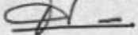

<!-- page 1 -->

## AUX BANQUES COMMERCIALES AUX BANQUES D'EPARGNE ET DE LOGEMENT

Conformément au paragraphe premier de l'article 2.1.2 de la loi du 21 février 2001 relative au blanchiment des avoirs provenant du trafic illicite de la drogue et d'autres infractions graves, pour tenir compte de l'évolution du cours de la gourde par rapport aux principales devises étrangères, la Banque de la République d'Haïti (BRH) modifie le seuil établi par la loi ainsi qu'il suit :

Les banques commerciales, les banques d'épargne et de logément sont tenues de recueillir de tous clients, réguliers ou occasionnels, des déclarations de transaction en espèces pour tout montant supérieur ou égal à QUATRE CENT MILLE GOURDES (Gdes 400,000.00) ou son équivalent en monnaies étrangères.

Les formulaires de déclaration de transaction des clients annexés à la présente circulaire, devront être transmis à l'Unité Centrale de Renseignements Financier (UCREF) au plus tard trois (3) jours ouvrables pour les banques commerciales, banques à epargne et le logement se trouvant dans la zone métropolitaine et cinq (5) jours ouvrables pour les banques commerciales, banques d'épargne et le logement se trouvant dans les villes de province, après qu'ils ont été remplis. Les copies desdits formulaires doivent être convenablement répertoriées et disponibles pour inspection par la BRH.

En cas de non respect de la présente circulaire, les banques commerciales, les banques d'épargne et de logement s'exposent à des pénalités et à des mesures administratives, ce sans préjudice des autres sanctions dont peut être frappée l'institution ou la personne fautive, en vertu de la loi du 21 février 2001.

## a) Pénalité pour non disponibilité de renseignements pour inspection

A défaut de fournir les copies des formulaires, les institutions bancaires sont assujetties à une pénalité de vingt mille gourdes (Gdes. 20,000. $ ^{00} $) par jour d'infraction.

La période de pénalité s'étend du jour de l'infraction (demande de renseignements par la BRH) jusqu'à celui où les renseignements sont mis à la disposition des agents de la BRH.

## b) Pénalité pour absence de formulaire

A défaut de remplir le formulaire de transaction, les institutions bancaires encourent une amende de cent mille gourdes (Gdes. 100,000. $ ^{00} $) par jour d'infraction.

<!-- page 2 -->

La période de pénalité s'étend du jour où une transaction aurait du faire l'objet d'un report auprès de l'UCREF au jour où la BRH constate l'infraction.

## c) Pénalité pour retard de transmission de formulaire

En cas de retard de transmission d'un formulaire, les institutions bancaires encourent une pénalité de cinquante mille gourdes (Gdes. 50,000.00) par jour d'infraction.

La période de pénalité s'étend du jour où un formulaire aurait du être transmis à l'UCREF au jour où cette dernière le reçoit.

## d) Pénalité pour non transmission de formulaire

En cas de non transmission de formulaire de transactions dûment rempli à l'UCREF, les institutions bancaires encourent une pénalité de cent mille gourdes (Gdes. 100,000.⁰⁰) par jour d'infraction.

La période de pénalité s'étend du jour où un formulaire aurait dû être transmis au jour où la BRH constate l'infraction.

La présente circulaire entre en vigueur le 3 novembre 2008 et remplace la circulaire No 95 du 1^{e} août 2000.

Port-au-Prince, 1e 30 octobre 2008

Philippe W. Lahens

Vice-Gouverneur

p.j.: Formulaire de déclaration de transactions

<!-- page 3 -->

# FORMULAIRE DE DECLARATION DE TRANSACTIONS

La circulaire 95-1 de la BRH exige que l'institution recueille les informations sur la transaction.

<table><tr><td>SECTION A - LA TRANSACTION</td></tr><tr><td>A.1 Nom de l'institution Financière :</td><td>A.2 Adresse</td></tr><tr><td>A.3 Succursale :</td><td></td></tr><tr><td>A.4 Date de la Transaction : (jj/mm/aa) ____ / ____ / ____</td></tr><tr><td>A.5 Instrument de la transaction :
Espèces ☐ Montant</td></tr><tr><td>Chèque ☐ Montant</td></tr><tr><td>Autres</td></tr><tr><td>A.6 Montant total de la transaction :</td></tr><tr><td>A.7 Numéro du compte :</td></tr><tr><td>A.8 Monnaie : GDES ☐ USD ☐ EURO ☐ PESO ☐ CAN ☐ AUTRES ☐</td></tr><tr><td>A.9 Type de transaction
Dépôt ☐ Achat de devises ☐ Achat de chèque ☐ Transfert ☐ Autres</td></tr><tr><td>SECTION B - L'EXECUTANT DE LA TRANSACTION</td></tr><tr><td>B.1. Nom :</td><td>Prénom :</td></tr><tr><td>B.2. Type d'identification :</td></tr><tr><td>CIN ☐</td><td>NIF ☐</td><td>Passeport ☐</td><td>Permis de conduire ☐</td><td>Autres ☐</td></tr><tr><td>Pays :</td></tr><tr><td>B.3. Numéro d'identification</td></tr><tr><td>B.4. Adresse de l'exécutant :</td></tr><tr><td>B.5. Numéro de téléphone
Portable</td><td>B.6. L'exécutant est-il bénéficiaire de la transaction :
Oui ☐ Non ☐
Si non donnez le nom du bénéficiaire</td></tr><tr><td>Résidence</td></tr><tr><td>Bureau</td><td>B.7 Lien avec le donneur d'ordre</td></tr><tr><td>Autres</td></tr><tr><td>SECTION C - LE BENEFICIAIRE DE LA TRANSACTION
Cette section est à remplir si l'exécutant n'est pas le bénéficiaire de la transaction</td></tr></table>

<!-- page 4 -->

<table><tr><td>C.1. Personne Morale ☐\nNom\nStatut Juridique\nSecteur d'activité\nAdresse\nTéléphone\nNom du propriétaire/ Directeur/\nTéléphone</td><td>C.2. Personne Physique ☐\nNom\nPrénom\nAdresse\nTéléphone\nProfession\nNIF</td></tr><tr><td>SECTION D – LE DONNEUR D'ORDRE\nCette section est à remplir si l'exécutant agit pour une tierce personne qui n'est pas le bénéficiaire</td></tr><tr><td>D.1. Personne Morale ☐\nNom\nStatut Juridique\nSecteur d'activité\nAdresse\nTéléphone\nNom du propriétaire\nTéléphone</td><td>D.2. Personne Physique ☐\nNom\nPrénom\nAdresse\nTéléphone\nProfession\nNIF</td></tr><tr><td>SECTION E – LA PROVENANCE DES FONDS\nCette section doit être toujours remplie</td></tr><tr><td>E.1. Je soussigné (e) déclare que les fonds objet de la présente transaction proviennent de : ______\nJej m'engage d'ores et déjà à fournir toute les fois où ceci sera sollicité, la preuve de la provenance desdits fonds.</td></tr><tr><td>Fait à Port-au-Prince, ce\nLu et approuve\nSignature</td></tr><tr><td>SECTION F – ESPACE RESERVE A L'INSTITUTION FINANCIERE</td></tr><tr><td>F.1. Initié par : F.2. Autorisé par :\nF.3 Transaction acceptée F.4 Transaction refusée Motif</td></tr></table>

<!-- page 5 -->

G.5 Remarques :
