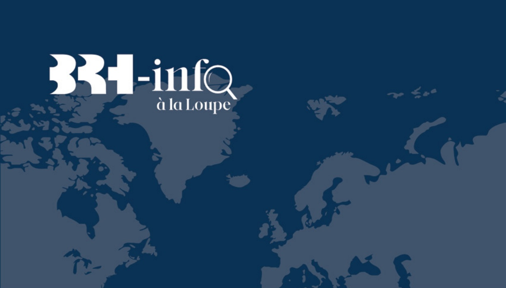
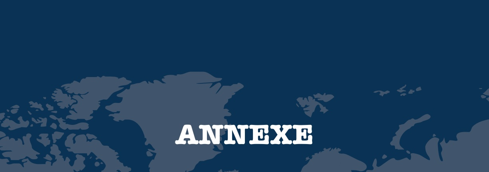
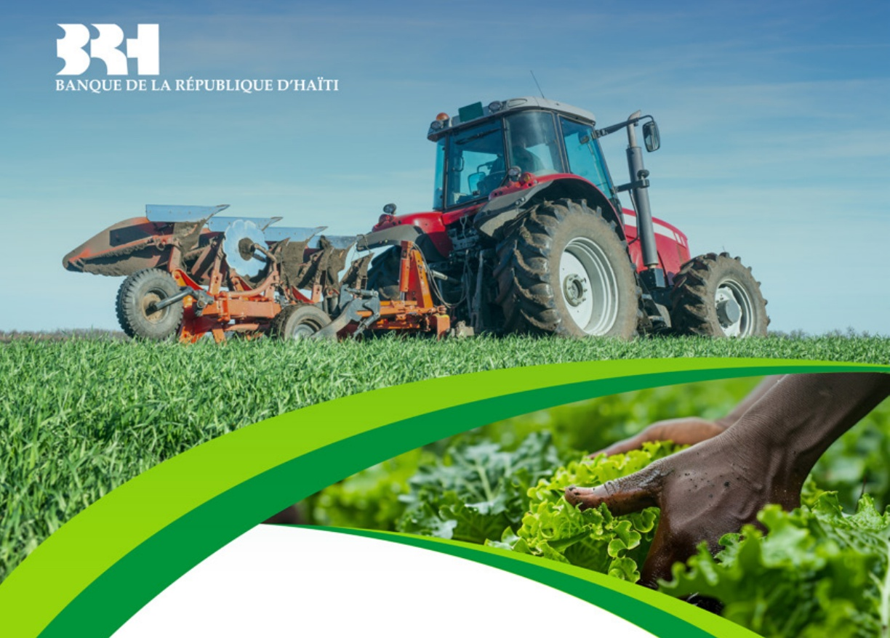
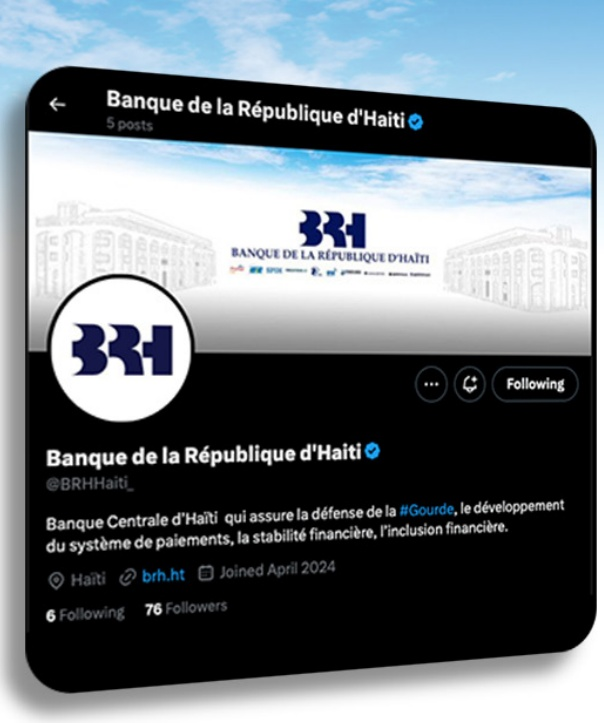
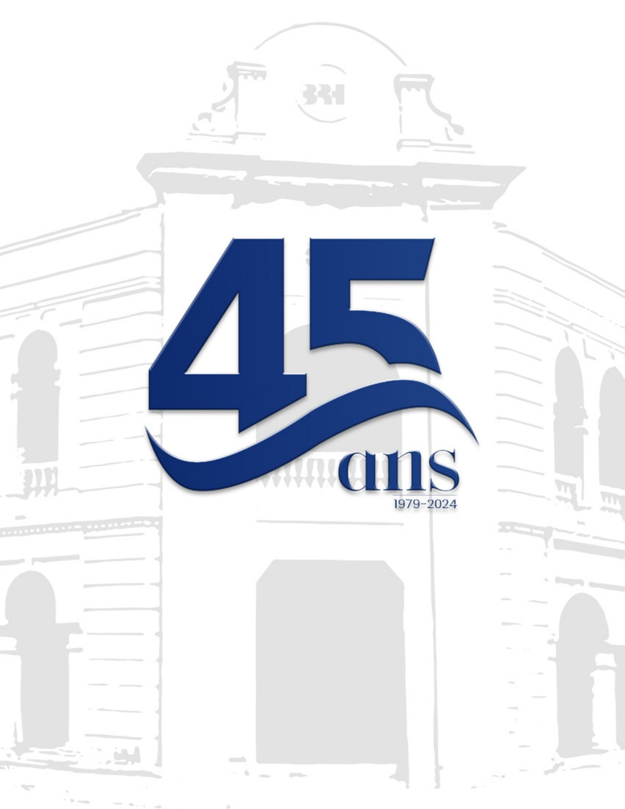

<!-- page 1 -->

IMPACT DE L'INSÉCURITÉ SUR LE SECTEUR RÉEL :

LES MADAN SARA DU DÉPARTEMENT

DE L'OUEST

## SEPTEMBRE 2024

<!-- page 2 -->

<!-- page 3 -->

## SOMMAIRE

Sigles & Abréviations ..... PAGE 4
1. Introduction ..... PAGE 5
2. Présentation Rasanbleman Madan Sara Dayiti (RAMSA) ..... PAGE 8
3. Méthodologie de réalisation de l'enquête ..... PAGE 10
4. Résultats de l'enquête réalisée ..... PAGE 13
4.1. Caractéristiques démographiques ..... PAGE 14
4.2. Panorama des activités économiques des Madan Sara ..... PAGE 16
4.3. Impact de l'insécurité sur les activités des Madan Sara ..... PAGE 19
4.4. Inclusion financière et Situation d'endettement ..... PAGE 22
4.5. Violences subies par les Madan Sara et/ou leurs proches ..... PAGE 23
5. Conclusion ..... PAGE 25
Annexe ..... PAGE 27

<!-- page 4 -->

BRH Banque de la République d'Haïti

MAE Monnaie et Analyse Économique

RAMSA Rasanbleman Madan Sara Dayiti

<!-- page 5 -->

### 1. INTRODUCTION

<!-- page 6 -->

### 1. INTRODUCTION

L'économie haïtienne est empreinte d'une intensification des pressions inflationnistes sur l'ensemble des cinq (5) dernières années. Cette progression soutenue des prix s'est maintenue en 2024 en dépit de l'évolution contenue du taux de change et d'une meilleure gestion des finances publiques. Selon les analyses réalisées par la Banque de la République d'Haïti (BRH), cette volatilité des prix d'un mois à un autre traduit surtout les effets induits des contraintes pesant sur la libre circulation des biens et des personnes dans l'économie. Cette distorsion observée au niveau de la chaîne de distribution et d'approvisionnement découle de plusieurs événements qui ont entraîné une fragmentation continue du territoire haïtien, lesquels ont impacté les coûts de commercialisation, d'où un renchérissement du prix des biens d'une région à une autre. La BRH, dans le souci de mieux cerner les impacts de cette conjoncture adverse sur les différentes strates de l'économie haïtienne a décidé de réaliser une enquête auprès des « Madan Sara » afin de déterminer l'impact de l'insécurité sur ce secteur.

Les « Madan Sara », communément appelées ainsi depuis plus de 200 ans, représentent majoritairement ces marchandes et marchands qui revendent, au niveau des grands marchés publics du pays, les denrées alimentaires achetées des exploitants agricoles. Conséquement, ils jouent un rôle crucial d'intermédiation dans l'économie haïtienne, en particulier pour le secteur informel, qui représente plus de 30% du PIB. Cependant, ces intermédiaires ont aussi subi les contrecoups de la dégradation des conditions sécuritaires qui ont amplifié les défis auxquels ils font habituellement face dans le cadre de leurs activités. Les impacts de cette crise multidimensionnelle ont été mis en exergue lors d'une rencontre sollicité par l'organisation « Rasanbleman Madan Sara Dayiti » (RAMSA) qui représente la première structure à mettre en avant l'importance de ces Madan Sara.

Suite à cette rencontre, la Banque centrale a décidé de mener une investigation plus poussée sur ces acteurs économiques afin de mieux cerner ce secteur et comprendre comment l'instabilité socio-économique entrave leurs opérations. À travers cette démarche, il sera possible de déceler les incidences de cet environnement délétère sur la structure des prix des produits alimentaires, lesquels ont une forte pondération dans le panier de consommation des ménages haïtiens.

La méthodologie utilisée dans le cadre de cette enquête a consisté, dans un premier temps, à une collecte d'informations auprès de l'organisation précitée et, dans un second temps, à la tenue d'un focus group avec les responsables des 20 communes du département de l'Ouest représenté au niveau de RAMSA. Ainsi, à travers le focus group, la Banque centrale a rencontré les représentants des différentes communes de l'Ouest, membres actifs de RAMSA. Les délégués des communes suivantes : Pétion-ville (Belle Fontaine, Séguin), Croix des Bossales, Carrefour, Tabarre, Croix des Bouquets, Cabaret, Cité Soleil, Kenscoff, Delmas et Port-au-Prince, ont assisté au focus groupe tenu le 21 juin 2024. Pour les représentants des communes qui étaient empêchés en raison

<!-- page 7 -->

des contraintes de déplacement par rapport à leur zone d'affectation, plus précisément les résidents de Cornillon, la Gonâve, Arcahaie, Léogâne et Fermathe, des séances téléphoniques ont été conduites par l'équipe de la Banque centrale.

Les informations recueillies nous ont permis de produire ce troisième numéro de BRH—info à la loupe. Ce document vise à mettre en lumière les activités de ces marchands ambulants du département de l'Ouest, fortement impactés par la dégradation du climat sécuritaire. Les interrogations portant sur le déroulement de leurs activités ont permis à la BRH de réaliser une analyse comparative sur ce secteur pour les périodes entourant les perturbations les plus récentes. Les informations qualitatives obtenues favoriseront la compréhension des agents économiques sur l'incidence des tensions socio-économiques sur le niveau général des prix tout en permettant aux autorités monétaires de mieux cerner l'origine des tensions inflationnistes de manière à prendre les décisions adéquates.

<!-- page 8 -->

### 2. PRESENTATION RASANBLEMAN MADAN SARA DAYITI

<!-- page 9 -->

### 2. PRESENTATION RASANBLEMAN MADAN SARA DAYITI (RAMSA)

L'organisation Rasanbleman Madan Sara Dayiti (RAMSA) est une structure sociale à but non lucratif, apolitique et non religieuse. Cette institution a été créée le 10 décembre 2018 et a pour mission d'organiser et d'accompagner ses membres pour une modernisation du commerce. RAMSA regroupe plus de 100 mille membres à travers tous les départementes du pays.

## DIVISIONS GÉOGRAPHIQUES DES GRANDS MARCHÉS PUBLICS ET PRINCIPALES CONTRAINTES

En termes de divisions géographiques des marchés publics, il est à noter celui de :

Croix des Bossales : Le marché de Croix des Bossales représente le plus important marché du département de l'Ouest. Il constitue un point de rencontre des produits en provenance des 10 départementes du pays. Selon RAMSA, il regroupe environ 22 000 marchands dont 75 % ont dû quitter le centre-ville en raison des troubles sécuritaires.

Marché de Carrefour : Ce marché dessert 13 sections communales et fait face à des coûts élevés de transport et des problèmes d'approvisionnement.

Marché de Cabaret : Le marché de Cabaret comprend 4 sections communales et confronte des difficultés d'infrastructures routières (route et pont de Casale), des coûts élevés de transport, des pertes de marchandises avariées, conséquence, entre autres, du délai d'accès à certains points de vente, avec une faible opportunité de crédit (taux très élevé).

Marché de Pétion-ville : Le marché de Pétion Ville regroupe 5 sections communales, soit 16 blocs ou 4 quartiers. Les principales préoccupations concernent les besoins de modernisation des marchés et d'amélioration du transport.

Alors que l'insécurité constitue un facteur transversal, les Madan Sara sont aussi confrontés à la détérioration ou à l'absence même de certaines infrastructures tant au niveau de l'espace de vente qu'à celui de l'enclavement entravant la circulation des biens. Ce dernier a un impact considérable sur la disponibilité de certains produits qui, ne sont pas sujets à des mécanismes de conservation.

<!-- page 10 -->

### 3. MÉTHODOLOGIE DE RÉALISATION DE L'ENQUETE

<!-- page 11 -->

# 3. MÉTHODOLOGIE DE RÉALISATION DE L'ENQUÊTE

Afin d'évaluer l'impact de l'insécurité sur les Madan Sara et de mieux comprendre les conséquences de cet environnement hostile sur leurs activités économiques, une enquête a été menée auprès de celles et ceux évoluant dans le département de l'Ouest.

### 3.1 MÉTHODOLOGIE

##### 3.1.1. PHASE PRÉPARATOIRE

L'organisation préalable à cette enquête a été faite en collaboration avec le regroupement RAMSA qui a facilité les liens entre la BRH et les délégués des différentes communes du département de l'Ouest, alors qu'une équipe d'enquêteurs a été constituée et formée à la Banque centrale sur les outils de l'enquête, dont la réalisation du focus group.

##### 3.1.2. PROCÉDURES DE COLLECTE ET ÉCHANTILLONNAGE

La collecte de données visait à recueillir, d'une part, des informations générales et spécifiques sur les activités des Madan Sara et à identifier, d'autre part, les divers impacts de la dégradation du climat sécuritaire sur leurs activités. Ainsi, ces participants ont été invités à une rencontre avec la BRH dans le cadre de cette investigation.

Un échantillon de 25 participants (es), représentants (es) des Madan Sara dans différentes communes de l'Aire Métropolitaine de Port-au-Prince, a pris part à l'enquête. La méthode d'échantillonnage LQAS (méthode d'échantillonnage aléatoire stratifié par quotas) a été utilisée, permettant un niveau d'erreur acceptable pour les analyses statistiques et la prise de décision.

Toutefois, l'une des limites de cette enquête réside dans le fait que ce sont uniquement les Madan Sara membres de RAMSA qui ont été considérés. Il s'agit d'un "biais de sélection" que l'on a dû accepter vu les difficultés à répertorier les non membres de cette organisation.

##### 3.1.3. OUTILS DE COLLECTE

La collecte des données a été réalisée à partir d'un questionnaire rédigé en créole qui contient principalement des questions fermées et semi-fermées. Il est subdivisé en cinq (5) rubriques : Caractéristiques sociodémographiques, Activités économiques, Conséquences de l'insécurité, Inclusion financière et Victimisation par les gangs. De plus, des focus groups ont permis de recueillir des informations qualitatives.

<!-- page 12 -->

## SAISIE, TRAITEMENT ET ANALYSE DES DONNÉES :

Les questionnaires ont été digitalisés et la saisie des données a été effectuée via l'outil en ligne « SurveyMonkey ». Les données recueillies après la saisie ont été traitées et analysées à partir de MS Excel. Une analyse bi- variée a également été réalisée, ce qui a permis, via des tableaux croisés, d'obtenir plus de précision sur l'impact de l'insécurité sur les Madan Sara aux profils homogènes.

## EQUIPE TECHNIQUE :

La collecte des informations a été prise en charge par 5 enquêteurs (dont un superviseur), tous employés de la BRH.

<!-- page 13 -->

### 4. RÉSULTATS DE L'ENQUÊTE RÉALISÉE

<!-- page 14 -->

### 4. RÉSULTATS DE L'ENQUÊTE RÉALISÉE

Les résultats de cette enquête menée auprès des représentants des Madan Sara du département de l'Ouest avaient pour but d'évaluer l'impact des troubles socio-politiques sur leurs activités commerciales.

#### 4.1. CARACTÉRISTIQUES DÉMOGRAPHIQUES

La majorité des représentants des Madan Sara ayant participé à l'enquête, soit 88 %, est de sexe féminin. Trente-six pour cent (36 %) d'entre eux sont mariés, 32 % sont célibataires et 12 % vivent en concubinage. Par ailleurs, 80 % des représentants des Madan Sara ont déclaré avoir des enfants, 60 % de cette catégorie ont entre 1 et 3 enfants. En grande partie âgés entre 45 et 54 ans (40 %), la totalité des répondants a atteint au moins le niveau scolaire « secondaire ».

<table><tr><td>Tableau 1</td><td>Répartition des représentants des Madan Sara selon leur sexe</td></tr><tr><td>Sexe</td><td>Fréquence</td><td>Pourcentage</td></tr><tr><td>Femme</td><td>22</td><td>88 %</td></tr><tr><td>Homme</td><td>3</td><td>12 %</td></tr><tr><td>Total</td><td>25</td><td>100 %</td></tr></table>

Source : BRH/MAE

Selon les résultats de l'enquête, l'activité principale des Madan Sara consiste en l'achat et la revente de différentes marchandises notamment les produits alimentaires. En outre, environ 28 % des répondants ont déclaré s'adonner également à la transformation et à la préparation de produits, notamment des engrais et de sons de blé. La production de ces derniers s'est révélée déterminante dans l'agriculture et même dans certains cas pour l'élevage.

<!-- page 15 -->

| Branche d'activité | Fréquence | Pourcentage |
| --- | --- | --- |
| Achat | 20 | 80 % |
| Revente | 25 | 100 % |
| Transport | 2 | 8 % |
| Transformation/Préparation de produits | 7 | 28 % |
| Autre | 4 | 16 % |

Source : BRH/MAE

Les représentants des Madan Sara ayant plus de 10 ans d'expérience constituent plus de 60 % des répondants, 16 % de l'échantillon retenu possèdent moins de 5 ans d'expérience alors que 20 % en cumulent 5 à 10 ans.

<table><tr><td>Tableau 3</td><td>Répartition des représentants des Madan Sara selon leur nombre d'années d'activité</td></tr><tr><td>Nombre d'années d'activité</td><td>Fréquence</td><td>Pourcentage</td></tr><tr><td>Moins de 5 ans</td><td>4</td><td>16 %</td></tr><tr><td>5 - 10 ans</td><td>5</td><td>20 %</td></tr><tr><td>10 - 15 ans</td><td>8</td><td>32 %</td></tr><tr><td>Plus de 15 ans</td><td>8</td><td>32 %</td></tr><tr><td>Grand Total</td><td>25</td><td>100 %</td></tr></table>

Source : BRH/MAE

<!-- page 16 -->

#### 4.2. PANORAMA DES ACTIVITÉS ÉCONOMIQUES DES MADAN SARA

Les Madan Sara vivant dans le département de l'Ouest ont effectué leurs plus récents achats de denrées essentiellement dans les départementes de l'Ouest (76 %), de l'Artibonite (24 %), de la Grande Anse (8 %) et du Centre (8 %), tandis que leurs ventes ont été réalisées dans le département de l'Ouest, principalement à Pétion ville (16 %), Kenscoff (16 %), Delmas (16 %), Tabarre (12 %), Carrefour (12 %), Arcahaie (8 %), Croix des Bouquets (8 %). L'impossibilité d'accéder à certains espaces de commerce tels le marché de la Croix-des-Bossales en raison du déclin des conditions sécuritaires a contraint ces marchands à se relocaliser vers d'autres zones de la Capitale. En effet, parmi les représentants des Madan Sara de l'Ouest, 72 % ont révélé qu'il leur est arrivé de s'approvisionner ailleurs que dans leur lieu habituel. De même, 52 % d'entre eux ont eu à écouler leurs marchandises dans des sites différents de leur emplacement traditionnel.

Les Madan Sara se consacrent essentiellement à la vente du riz (60 %), du pois (60 %), des mangues (24 %), des autres fruits (28 %), des légumes (28 %) et des vivres alimentaires (28 %). Ces commerçants vendent également d'autres céréales comme le maïs et le petit mil, des articles et vêtements de prêt-à-porter (habits, tissus et chaussures) ainsi que des produits cosmétiques et artisanaux.

<table><tr><td>Tableau 4</td><td>Produits généralement vendus par les Madan Sara</td></tr><tr><td>Produits</td><td>Fréquence</td><td>Pourcentage</td></tr><tr><td>Riz</td><td>15</td><td>60 %</td></tr><tr><td>Pois</td><td>15</td><td>60 %</td></tr><tr><td>Mangues</td><td>6</td><td>24 %</td></tr><tr><td>Autres fruits</td><td>7</td><td>28 %</td></tr><tr><td>Légumes</td><td>7</td><td>28 %</td></tr><tr><td>Vivres alimentaires</td><td>7</td><td>28 %</td></tr><tr><td>Autres</td><td>18</td><td>72 %</td></tr></table>

Source : BRH/MAE

Le riz (local et importé) est le produit le plus vendu selon 72 % des répondants. Parmi les autres denrées les plus demandées sur le marché, on retrouve le pois (52 %), les mangues (20 %), les autres fruits (20 %), les vivres alimentaires (16 %) et les légumes (12 %).

<!-- page 17 -->

<table><tr><td>Tableau 5</td><td>Produits les plus vendus dans les marchés</td></tr><tr><td>Produits</td><td>Fréquence</td><td>Pourcentage</td></tr><tr><td>Riz</td><td>18</td><td>72 %</td></tr><tr><td>Pois</td><td>13</td><td>52 %</td></tr><tr><td>Mangues</td><td>5</td><td>20 %</td></tr><tr><td>Autres fruits</td><td>5</td><td>20 %</td></tr><tr><td>Légumes</td><td>3</td><td>12 %</td></tr><tr><td>Vivres alimentaires</td><td>4</td><td>24 %</td></tr><tr><td>Autres</td><td>11</td><td>44 %</td></tr></table>

Source : BRH/MAE

Durant la période antérieure aux troubles sociopolitiques, les Madan Sara pouvaient généralement effectuer entre 3 et 5 déplacements par semaine. Certains d'entre eux se déplaçaient presque tous les jours. Toutefois, 80 % des Madan Sara ont avoué que depuis la période de crise, leur nombre de « voyages hebdomadaires » ne dépasse pas 3.

<table><tr><td>Tableau 6</td><td>Nombre de voyages hebdomadaires des représentants des Madan Sara</td></tr><tr><td>Nombre de voyage</td><td>Fréquence</td><td>Pourcentage</td></tr><tr><td>1 voyage</td><td>10</td><td>40 %</td></tr><tr><td>2 - 3 voyages</td><td>10</td><td>40 %</td></tr><tr><td>6 - 7 voyages</td><td>2</td><td>8 %</td></tr><tr><td>Non concerné</td><td>3</td><td>12 %</td></tr><tr><td>Total</td><td>25</td><td>100 %</td></tr></table>

Source : BRH/MAE

<!-- page 18 -->

À côté de la diminution flagrante du nombre de « voyages », les Madan Sara ont également été confrontés à la non-disponibilité de certains produits, principalement en raison de l'insécurité, de la rareté de certaines cultures (baisse de la production) et de l'augmentation des prix. En effet, l'occupation de certaines régions par les bandes armées a été à la base de la réduction des espaces cultivables qui, ajoutée aux problèmes financiers des producteurs agricoles, s'est traduite par une diminution de l'offre nationale des produits alimentaires.

Selon 36 % des Madan Sara, leurs ventes hebdomadaires ne dépassent pas 50 mille gourdes. Pour 32 % d'entre eux, elles se situent entre 50 et 150 mille gourdes. Par ailleurs, 20 % des Madan Sara ont déclaré pouvoir écouler entre 150 et 750 mille gourdes de marchandises en une semaine et seulement 8 % vendent pour au moins un million de gourdes.

<table><tr><td>Tableau 7</td><td>Montant (en gourdes) des ventes hebdomadaires des Madan Sara</td></tr><tr><td>Ventes hebdomadaires</td><td>Fréquence</td><td>Pourcentage</td></tr><tr><td>Moins de 50 000</td><td>9</td><td>36 %</td></tr><tr><td>50 000 - 150 000</td><td>8</td><td>32 %</td></tr><tr><td>150 000 - 750 000</td><td>5</td><td>20 %</td></tr><tr><td>Plus de 750 000</td><td>2</td><td>8 %</td></tr><tr><td>Ne sait pas</td><td>1</td><td>4 %</td></tr><tr><td>Grand Total</td><td>25</td><td>100 %</td></tr></table>

<!-- page 19 -->

#### 4.3. IMPACT DE L'INSÉCURITÉ SUR LES ACTIVITÉS DES MADAN SARA

Le climat sécuritéaire reste un facteur déterminant du comportement des Madan Sara, les amenant à s'établir dans un lieu de vente différent ou à changer de lieu d'approvisionnement. Selon le graphique ci-après, 18 répondants sur 25, soit 72 %, ont été contraints de s'établir dans un nouveau point de vente. De plus, 14 d'entre eux, soit 58,33 %, ont changé leur lieu d'approvisionnement en raison de l'insécurité.

Graphique 1 Impact de l'insécurité sur les lieux de ventes et d'approvisionnement des Madan Sara (n=25)

|   | S'être établi(e) dans un lieu de vente différent | Avoir changé de lieu d'approvisionnement |
| --- | --- | --- |
| Non | 18 | 14 |
| Oui | 7 | 10 |

Source : BRH/MAE

Les lieux de vente habituellement fréquentés par les Madan Sara et qu'ils ont maintenant délaissés pour cause d'insécurité sont notamment : Carrefour, Croix des Bossales, Delmas 89, Fort Jacques, Gérald Bataille, Laboule, Pétion-Ville, Port-au-Prince et Route de Frères. En ce qui concerne les lieux d'approvisionnement, ceux qui sont indiqués comme difficiles d'accès à cause de l'insécurité sont : Cornillon, Croix des Bossales, Croix des Bouquets, L'Estère (Pont Sondé), Malpasse, certains espaces de Pétion-Ville, Port-au-Prince, République Dominicaine, Saint Marc, SHODECOSA, Sud et Grande Anse, Tabarre et Thomazeau.

Le graphique ci-après montre que l'insécurité a eu un impact négatif accru sur les activités commerciales entre janvier 2024 à 20 juin comparé à l'année 2023. Six (6) des répondants ont rapporté des vols de marchandises et d'argent au cours de la période sus-citée contre 5 répondants pour ces cas de vols sur l'année 2023. Quinze (15) des répondants ont rencontré des difficultés pour s'approvisionner en marchandises en 2023 contre 18 sur les 6 premiers mois de l'année calendaire 2024. Les répondants ayant

<!-- page 20 -->

enregistré une baisse des ventes sur l'année 2023 sont au nombre de 16 contre 21 pour la période de janvier 2024 jusqu'à la veille de la date de l'enquête, soit le 21 juin 2024. Quant aux cas récurrents de rançonnage exigé par les bandits, 7 des répondants se sont retrouvés dans cette situation en 2023 contre 12 d'entre eux en janvier 2024.

Cette aggravation du climat d'insécurité depuis le début de l'année a induit une détérioration significative de l'environnement commercial. Le graphique ci-dessous atteste des conséquences de l'insécurité en fonction du nombre de répondants affectés.

| Graphique 2 | Janvier - décembre 2023 | Janvier - juin 2024 |
| --- | --- | --- |
| Vol de marchandises | 5 | 6 |
| Vol d'argent | 5 | 6 |
| Achat de marchandises impossible | 15 | 18 |
| Baisses des ventes | 16 | 21 |
| Versement aux bandits | 7 | 12 |
| Autres | 3 | 6 |

Source : BRH/MAE

| Tableau 8 | Impact de l'insécurité sur les prix de vente des produits (Janvier 2024 à date) |
| --- | --- |
| Réponses | Fréquence |
| Augmentation du Prix de certains produits | 3 |
| Augmentation du Prix de tous les produits | 22 |

Source : BRH/MAE

L'insécurité a également eu une incidence significative et variée sur les activités commerciales, affectant aussi bien les coûts d'approvisionnement, les frais de transport et par conséquent les prix de vente Suivant le graphique ci-après, 3 des répondants ont indiqué une augmentation des prix de certains produits dans les marchés qu'ils fréquentent. En revanche, les 22 autres répondants ont indiqué avoir observé une augmentation des prix de tous les produits.

<!-- page 21 -->

| Impact | Value |
| --- | --- |
| Augmentation des prix de certains produits | 3 |
| Augmentation des prix de tous les produits | 22 |
| Baisses de la quantité de produits vendus | 23 |
| Avoir des difficultés à s'approvisionner en certains produits | 21 |
| Des marchands(es) ont abandonné leurs lieux de vente | 23 |

Source : BRH/MAE

De plus, 23 d'entre eux rapportent avoir constaté une baisse de la quantité de produits vendus alors que 21 ont signalé des difficultés à s'approvisionner en certains produits. Ci-contre la liste des produits dont la rareté s'est accentuée, laquelle varie selon les lieux d'activités.

<table><tr><td>Tableau 9</td><td>Liste des produits difficile à s'approvisionner</td></tr><tr><td>Arcahaie</td></tr><tr><td>Pistach</td></tr><tr><td>Cabaret</td></tr><tr><td>Tabac en poudre</td></tr><tr><td>Carrefour</td></tr><tr><td>Carotte, betterave, Riz, sucre, maïs</td></tr><tr><td>Cité Soleil</td></tr><tr><td>Tabasco, Sport Shake</td></tr><tr><td>Cornillon</td></tr><tr><td>Maïs, chadèque</td></tr><tr><td>Croix des Bossales, Pétion Ville, Kenskoff</td></tr><tr><td>Riz, petit mil</td></tr><tr><td>Croix des Bouquets</td></tr><tr><td>Tissu, foulard</td></tr><tr><td>Delmas</td></tr><tr><td>Ananas, figue, melon\nRiz TCS et lacrète</td></tr><tr><td>Kenskoff</td></tr><tr><td>Clairin\nEngrais\nPistache,pois, maïs, riz local</td></tr><tr><td>Pétion Ville</td></tr><tr><td>Cochon\nLait en poudre, huile, blé, engrais\nRiz (Lacrète, TCS, Sheila)</td></tr><tr><td>Riz (Shelda, Lacrète, TCS)\nRiz local, pois\nRiz Sheila, riz shelda, pois beurre</td></tr><tr><td>Tabarre</td></tr><tr><td>Articles pour bébé, bijou, produits cosmétiques\nLes habits les plus chers</td></tr><tr><td>Source : BRH/MAE</td></tr></table>

<!-- page 22 -->

#### 4.4. Inclusion financière et Situation d'endettement

Un seul des participants à l'enquête rapporte ne pas avoir de compte bancaire ni de compte Moncash. 88 % ont indiqué posséder un compte Moncash et 68 % un compte bancaire. Plus de la moitié (60 %) d'entre eux disposent de ces deux comptes.

<table><tr><td>Tableau 10</td><td>Répartition des répondants selon la possession d'un compte bancaire et d'un compte Moncash</td></tr><tr><td>Avoir un compte Moncash</td></tr><tr><td>Avoir un compte en Banque</td><td>Non</td><td>Oui</td><td>Grand Total</td></tr><tr><td>Non</td><td>1</td><td>4 %</td><td>7</td><td>28 %</td><td>8</td><td>32 %</td></tr><tr><td>Oui</td><td>2</td><td>8 %</td><td>15</td><td>60 %</td><td>17</td><td>68 %</td></tr><tr><td>Grand Total</td><td>3</td><td>12 %</td><td>22</td><td>88 %</td><td>25</td><td>100 %</td></tr></table>

Source : BRH/MAE

La répartition des répondants selon leur situation d'endettement, présentée à travers le tableau No 11, montre que parmi les 25 répondants, 14 (56 %) ont rapporté avoir contracté des dettes, tandis que 11 (44 %) n'en ont pas. La provenance de l'endettement est principalement la tontine “Sol” (24 %), les prêts usuraires “Ponya” (16 %), les prêts microcrédits (24 %), des avances d'un membre de leur famille et des achats à crédit.

Parmi les 14 répondants qui ont affirmé être en situation d'endettement, seulement 2 d'entre eux (14,29 %) n'ont jamais eu de difficultés pour rembourser leurs prêts. Parmi les 12 autres (85,71 %), 5 d'entre eux n'éprouvent actuellement aucune difficulté à rembourser leurs dettes contrairement aux 7 restants qui peinent à honorer les crédits contractés.

Tableau 11 Répartition des répondants selon qu'ils ont eu ou rencontrent actuellement des difficultés pour rembourser leurs prêts

Rencontrer actuellement des difficultés pour rembourser ses prêts

<table><tr><td>Avoir rencontré des difficultés pour rembourser ses prêts</td><td>Non</td><td>Oui</td><td>N/A</td><td>Grand Total</td></tr><tr><td>Non</td><td>0</td><td>0.00 %</td><td>0</td><td>0.00%</td><td>2</td><td>14.29%</td><td>2</td><td>14.29 %</td></tr><tr><td>Oui</td><td>5</td><td>35.71 %</td><td>7</td><td>50.00%</td><td>0</td><td>0.00 %</td><td>12</td><td>85.71 %</td></tr><tr><td>Grand Total</td><td>5</td><td>35.71 %</td><td>7</td><td>50.00%</td><td>2</td><td>14.29 %</td><td>14</td><td>100 %</td></tr></table>

Source : BRH/MAE

<!-- page 23 -->

#### 4.5. Violences subies par les Madan Sara et/ou leurs proches

Les situations de violence que subissent les Madan Sara sont préoccupantes selon les réponses obtenues des participants à l'enquête. La répartition des répondants selon qu'ils aient été victimes de violence indique que 32 % d'entre eux ont déjà été agressés par des hommes armés. Parmi ces derniers, 12 % (3) en ont été victimes au cours des six derniers mois, tandis que 20 % ont déjà été la cible de brutalité des bandits au cours des années antérieures à 2024.

<table><tr><td>Tableau 12</td><td>Répartition des répondants suivant qu'ils aient été victimes ou non de violence</td></tr><tr><td>Avoir été victime (de violence) des bandits</td><td>Fréquence</td><td>Pourcentage</td><td></td></tr><tr><td>Non</td><td>17</td><td>68 %</td><td></td></tr><tr><td>Oui, sur les 6 derniers mois</td><td>3</td><td>12 %</td><td></td></tr><tr><td>Oui, mais pas sur les 6 derniers mois</td><td>5</td><td>20 %</td><td></td></tr><tr><td>Grand Total</td><td>25</td><td>100 %</td><td></td></tr></table>

Source : BRH/MAE

La plupart des questionnés (64 % des répondants,16) ont souligné que d'autres marchands ont aussi été la proie des bandits sur la période allant de janvier à juin 2024, alors que 20 % (5) soutiennent que certains commerçants ont aussi subi des actes de violences au cours des années antérieures.

<table><tr><td>Tableau 13</td><td>Répartition des répondants selon qu’ils connaissent ou non d'autres marchands victimes de violence par des bandits</td></tr><tr><td>D’autres marchands ayant été victimes (de violence) des bandits</td><td>Fréquence</td><td>Pourcentage</td><td></td></tr><tr><td>Non</td><td>4</td><td>16 %</td><td></td></tr><tr><td>Oui, sur les 6 derniers mois</td><td>16</td><td>64 %</td><td></td></tr><tr><td>Oui, mais pas sur les 6 derniers mois</td><td>5</td><td>20 %</td><td></td></tr><tr><td>Grand Total</td><td>25</td><td>100 %</td><td></td></tr></table>

<!-- page 24 -->

Les participants à l'enquête ont aussi indiqué que leurs proches sont aussi victimes de violence par des bandits : 2 d'entre eux (8 %) ont avancé que leurs propres enfants ont été la cible d'attaques des hommes armés, et 10 autres (40 %) ont rapporté le cas d'autres membres de la famille ayant subi des agressions. Par ailleurs, 14 des répondants (56 %) ont rapporté avoir des amis victimes de brutalité des bandits et 5 autres (20 %) connaissent d'autres personnes victimes de violence par des bandits.

<!-- page 25 -->

### 5. CONCLUSION

<!-- page 26 -->

### 5. CONCLUSION

La détérioration des conditions de fonctionnement des Madan Sara, notamment celles et ceux évoluant dans le département de l'Ouest, a des répercussions significatives sur l'économie haïtienne. Avec l'aggravation du climat d'insécurité, ce groupe, constitué à 80 % de femmes, est de plus en plus en proie à des agressions physiques, à des extorsions et à des pertes financières substantielles. Le resserrement des contraintes sur le transport des marchandises, lequel est conditionné au versement de droits de passage à plusieurs points du circuit de commercialisation, a entraîné une hausse importante des coûts de distribution, contribuant ainsi à une accélération des tensions inflationnistes dans l'économie. Lors du focus groupe organisé par la BRH en juin dernier, 90 % des participants ont confirmé la hausse des prix de tous les produits sur les différents marchés, notamment ceux de première nécessité tels que les céréales (riz, maïs), les haricots, le sucre entre autres. D'un autre côté, plus de 80 % des répondants ont évoqué des difficultés d'approvisionnement accrues en marchandises, avec des effets induits non seulement sur la disponibilité des produits dans les marchés, mais aussi sur la sécurité alimentaire de nombreuses familles haïtiennes. Ce contexte difficile, qui a contraint divers commerçants, y compris ceux du plus grand marché de la capitale (Croix des Bossales) à se relocaliser, a négativement impacté leurs revenus et réduit leur capacité à honorer leurs engagements financiers.

Les Madan Sara représentent un des piliers de l'économie haïtienne, nonobstant leur statut informel. Ainsi, leur protection et le renforcement de leur résilience doivent être des priorités nationales. Dans ce contexte de crise multidimensionnelle, ils sont confrontés à des défis croissants qui menacent non seulement leur subsistance, mais aussi la stabilité macroéconomique. Il s'avère donc nécessaire d'initier des réflexions profondes et d'adopter des mesures devant amener à leur pleine intégration dans le secteur formel, tout en garantissant leur sécurité physique. Un changement de leur statut permettra un meilleur accès de ces agents économiques au financement et contribuera à l'élargissement de l'assiette fiscale. À travers cette démarche, les Autorités peuvent non seulement assurer la pérennité de leurs activités, mais aussi jeter les bases d'une relance économique durable et inclusive.

<!-- page 27 -->

# ANNEXE

## CONSIDÉRATIONS ÉTHIQUES AUTOUR DE L'ENQUÊTE

Cette étude a été mise en œuvre en prenant en compte les considérations suivantes :

## RISQUES

Compte tenu du contexte sécuritéaire volatile, les enquêtés pourraient être exposés à des risques d'insécurité. Pour contourner ces contraintes, l'équipe d'enquête s'est assurée que l'administration du questionnaire se déroule dans un lieu sûr.

## BENÉFICES ET AVANTAGES POTENTIELS

Si les répondants ne tirent aucun avantage direct de leur participation à cette enquête, ses résultats contribueront à orienter les décisions en matière de politique publique et les interventions de la Banque de la République d'Haïti (BRH) dans le cadre de sa politique monétaire. Ces initiatives visent à améliorer l'environnement économique et social, ce qui pourrait bénéficier à l'ensemble de la population, y compris les Madan Sara.

## OBTENIR LE CONSENTEMENT

Aucun participant n'a été interrogé sans son consentement éclairé. Avant de commencer l'enquête, les participants ont reçu une explication claire des objectifs de l'enquête, de la procédure de collecte de données, de leurs droits et de la manière dont leurs informations seront traitées.

## VIE PRIVÉE ET CONFIDENTIALITÉ

Certaines questions ont porté sur la vie privée des participants. En ce qui concerne la confidentialité, l'identité des répondants ainsi que leurs réponses sont restées confidentielles. Les données recueillies ont été stockées en toute sécurité.

<!-- page 28 -->

<!-- page 29 -->

Bureau d'Information sur le Crédit

## Le Crédit Responsable commence par une bonne information

## FAITES CONFIANCE AU BIC !

12, Rue Butte, Bourdon

Tel: 28 17 00 00/28 17 00 01

<!-- page 30 -->

# 4 raisons de souscrire aux OBLIGATIONS BRH

## 1

TAUX D'INTÉRÊT ATTRACTIF

Les Obligations BRH vous offrent des taux d'intérêt de 7 %, 7,25 %, et 7,50 % par an respectivement pour des maturities de 3, 6, et 12 mois, avec une indexation à la hausse du taux de change.

## 2

ACCESSIBILITÉ

Le montant minimal de souscription est de 50,000.00 gourdes, rendant ce produit financier accessible à une large partie de la population.

## 3

REMOURSEMENT SIMPLE

ET EFFICACE

Deux jours ouvrables après la date d'échéance, les obligations BRH sont rémunérées directement sur votre compte via l'intermédiaire financier, simplifiant ainsi le processus de récupération de votre capital et des intérêts.

## 4

STABILISATION DE LA GOURDE

En investissant dans les obligations BRH, vous contribuez à stabiliser la valeur de la monnaie nationale et à renforcer l'accumulation de l'épargne en gourdes.

<!-- page 31 -->

BANQUE DE LA RÉPUBLIQUE D'HAÎTI

INCITATIONS

AU FINANCEMENT

DU SECTEUR

AGRICOLE

CIRCULAIRE No 113

Aux Institutions Financières

<!-- page 32 -->

## SIMPLIFIEZ -VOUS LA VIE AVEC LES VIREMENTS SPIH!

Virements rapides et sécurisés, opérationnels

depuis 2007 en Haiti.

<!-- page 33 -->

Banque de la République d'Haiti ⏰

@BRHHaiti

Banque Centrale d'Haiti qui assure la défense de la #Gourde, le développement du système de paiements, la stabilité financière, l'inclusion financière.

Haiti brh.ht Joined April 2024

6 Following 76 Followers

RESTEZ INFORMÉS DE TOUTES

LES DERNIÈRES MISES À JOUR DE LA BRH !

Scannez ce QR code pour nous suivre sur notre nouveau compte X: @BRHHaiti_

<!-- page 34 -->

<!-- page 35 -->

<!-- page 36 -->

## 33 -infQ à la Loupe
