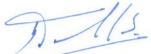

<!-- page 1 -->

## Aux Banques et aux Maisons de transfert Note de rappel

Dans le cadre de l'application de la Circulaire 114-2, la Banque de la République d'Haïti (BRH) rappelle aux banques et maisons de transfert qu'elles sont tenues de faire appliquer les dispositions de ladite circulaire par leurs sous-agents dans l'exercice des activités de transferts internationaux sans contrepartie. Notamment, elles doivent s'assurer que ces derniers affichent le taux de référence et le taux moyen d'acquisition publiés par la BRH dans un endroit visible de tous leurs points de service et que ces taux soient effectivement utilisés pour le règlement des transferts.

Par ailleurs, les banques et les maisons de transfert doivent faire parvenir à la BRH trimestriellement la liste des sous-agents qui contreviennent aux dispositions de la circulaire en question et les mesures prises à leur encontre.

Faute par elles d'assurer ce suivi, elles seront sujettes aux sanctions prescrites par la section 5 de la circulaire 114-2.

Port-au-Prince, le 20 avril 2022.

Georges Henry
