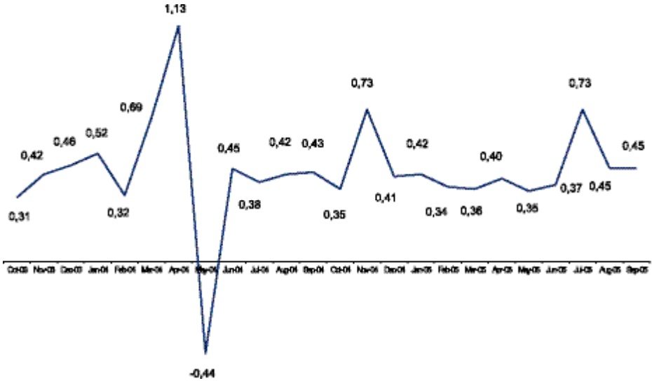

<!-- page 1 -->

### C. LA BRH EN 2005

En 2005, la BRH a adapté le volume de monnaie offert aux besoins de l'économie et poursuivi les activités de développement et d'entretien relatives au Système d'Information Financier (SIF), aux projets techniques et à l'alimentation en énergie. En 2005 en effet, neuf millions sept cent trente mille (9 730 000) nouveaux billets ont été injectés dans l'économie pour répondre aux besoins des agents, soit dix (10) fois plus qu'en 2004. Ces nouveaux billets ont représenté 1 345 MG, soit six (6) fois plus que ceux émis en 2004 (215 MG). La demande des agents pour les grosses coupures a particulièrement augmenté en 2005, puisque cette année la BRH a remplacé dans l'économie près de six (6) millions de billets de 250 et 500 gourdes mutilés. En 2005, au sens large, 12 781,9 MG ont circulé dans l'économie (encaisses des banques incluses), soit 20,38 % de plus qu'en 2004. Pour assurer l'efficacité du système de paiements, la BRH a, en 2005, compensé près de trois millions (3 000 000) de chèques, en a imprimé près de quatre cent mille (400 000) pour l'État, en a certifié près de cinq cent mille (500 000) en gourdes, et exécuté plus de huit cent (800) ordres de virement.

Sur le plan de sa gestion interne, la BRH a poursuivi en 2005 les activités de développement et d'entretien relatives à ses différentes applications, aux projets techniques et à l'alimentation en énergie. Concernant ses différentes applications, la BRH a finalisé les modules Change et Fonds délaissés du Système d'Information Financier en 2005, et planifié d'en finaliser, tester et mettre en production les autres modules (Réserve Légale, Centrale des Risques et Impayés) en 2006. L'interface entre les applications GRH et GCC a été finalisé et testé en 2005, mais d'autres tests et sa mise en opération sont prévus pour 2006. La BRH a réalisé en 2005, la migration du système d'exploitation et du moteur de base de données des applications GESMAT, AIBIF et INTRANET, la migration des Oracle Forms de GESMAT et d'AIBIF, du Cold Fusion de INTRANET et du protocole de l'application SWIFT. Elle a aussi ajouté un formulaire Fiche de paie et une nouvelle fonction, Requête DIT (Track It), à l'application INTRANET. Elle a effectué plusieurs mises à jour sur l'application SWIFT, et installé le programme de contingence pour les chèques du Trésor public à sa succursale du Cap-haïtien.

Concernant les projets techniques, dans le cadre du Réseau Télématique Financier (RTF), la BRH a installé des équipements terminaux dans les diverses institutions financières, rendant le RTF opérationnel depuis lors. En 2005, la BRH a renforcé la sécurité et augmenté la capacité de son réseau informatique interne, rendu le centre de communication (HUB) du réseau VSAT opérationnel, redémarré les travaux au centre de technologie, et planifié de déployer les VSAT et d'installer un deuxième centre de communication pour contingence en 2006. Concernant les projets relatifs à l'alimentation en énergie, le plus important est la construction d'une nouvelle centrale électrique qui prévoit l'acquisition de trois groupes de 750 kW chacun.

<!-- page 2 -->

# IX.- LA MONNAIE FIDUCIAIRE ET LA MONNAIE SCRIPTURALE

# IX.1 BILLETS ET MONNAIE DIVISIONNAIRE

#### IX. 1.1 ÉMISSION, DESTRUCTION ET REMPLACEMENT DE LA MONNAIE

Parmi les moyens de paiement généralement utilisés comme intermédiaires des échanges, deux sont privilégiés en Haïti : les billets et pièces de monnaie émis par la BRH qui constituent la monnaie fiduciaire et les chèques tirés sur les institutions financières bancaires. L'introduction, au cours de ces dernières années, de cartes de débit et de crédit, de transferts, de virements bancaires et des cartes chèques dans l'économie haïtienne, ainsi que l'accroissement sensible de son taux de bancarisation n'ont pas fortement influencé les habitudes de paiement des agents économiques qui continuent à cultiver une préférence pour le cash dans leurs transactions. En effet, pour régler leurs transactions en 2005, ils ont utilisé 10 fois plus de billets et de pièces de monnaie qu'en 2004. Neuf millions sept cent trente mille (9 730 000) nouveaux billets valant 1 345 MG ont en effet été mis en circulation en 2005, contre un (1) million de nouveaux billets émis en 2004 valant 215 MG.

Au cours de l'exercice 2004-2005, les coupures de 25, 50 et 100 gourdes ont respectivement représenté 20,55 %, 35,97 % et 20,55 % des billets émis, tandis que les 23 % restants ont été constitués de coupures de 250 (8,02 %) et 500 gourdes (14,90 %).

Par suite du retrait progressif des coupures de 1,2 et 5 gourdes de l'économie par la BRH depuis 1998, lesquelles représentaient plus de 50 % du volume des billets en circulation vers la fin des années 1990, les quantités de billets détruits et remplacés ont respectivement baissé de 14 % et de 18 % en 2005 par rapport à 2004. La majorité des billets détruits en 2005 a été constituée de coupures de 10,50 et 100 gourdes (26 %, 30 % et 18 % du total, respectivement). Environ la même portion de billets de 25 gourdes a été détruit en 2005 (12 % du total) qu'en 2004 (11,60%). Par contre, en termes relatifs, deux fois plus de billets de 500 gourdes ont été détruits en 2005 (6 % du total des billets détruits) qu'en 2004 (2,70 % du total des billets détruit), ce qui révèle une plus grande utilisation de ces billets par le public. De même, le fait que les coupures de 250 gourdes aient représenté une plus grande part du total des billets détruits en 2005 (7 %) qu'en 2004 (4,70 %) révèle que le public les utilise plus avant.

Tableau 41.- Destruction, remplacement et émission de la monnaie (en milliers de billets et pièces)

<table><tr><td>Compare(in million shares)</td><td>Destruction</td><td>%</td><td>Redemption</td><td>%</td><td>Emission</td><td>%</td></tr><tr><td>Allstate grounds</td><td></td><td></td><td></td><td></td><td></td><td></td><td></td><td></td></tr><tr><td></td><td>1</td><td>513</td><td>1%</td><td>-</td><td>-</td><td>-</td><td>-</td><td>0%</td></tr><tr><td></td><td>2</td><td>-</td><td>-</td><td>-</td><td>+</td><td>-</td><td>-</td><td>0%</td></tr><tr><td></td><td>5</td><td>5</td><td>-</td><td>-</td><td>-</td><td>-</td><td>-</td><td>0%</td></tr><tr><td></td><td>10</td><td>19,072</td><td>26%</td><td>13,500</td><td>23%</td><td>-</td><td>-</td><td>0%</td></tr><tr><td></td><td>20</td><td>8,996</td><td>12%</td><td>#000</td><td>10%</td><td>-</td><td>-</td><td>21%</td></tr><tr><td></td><td>50</td><td>21,398</td><td>30%</td><td>16,800</td><td>28%</td><td>2,000</td><td>3,600</td><td>36%</td></tr><tr><td></td><td>100</td><td>12,996</td><td>16%</td><td>10,000</td><td>17%</td><td>2,000</td><td>2,000</td><td>21%</td></tr><tr><td></td><td>200</td><td>8,200</td><td>7%</td><td>#200</td><td>11%</td><td>780</td><td>8%</td><td>8%</td></tr><tr><td></td><td>500</td><td>4,114</td><td>6%</td><td>5,870</td><td>10%</td><td>1,432</td><td>15%</td><td>15%</td></tr><tr><td>Total allstate</td><td></td><td>72,352</td><td>100%</td><td>57,910</td><td>100%</td><td>9,730</td><td>100%</td><td>100%</td></tr><tr><td>Plains</td><td></td><td></td><td></td><td></td><td></td><td></td><td></td><td></td></tr><tr><td></td><td>0,05</td><td>-</td><td>-</td><td>-</td><td>-</td><td>-</td><td>-</td><td>-</td></tr><tr><td></td><td>0,10</td><td>-</td><td>-</td><td>-</td><td>-</td><td>-</td><td>-</td><td>-</td></tr><tr><td></td><td>0,20</td><td>-</td><td>-</td><td>-</td><td>-</td><td>-</td><td>-</td><td>-</td></tr><tr><td></td><td>0,50</td><td>-</td><td>-</td><td>1,500</td><td>13%</td><td>-</td><td>-</td><td>-</td></tr><tr><td></td><td>1</td><td>-</td><td>-</td><td>9,000</td><td>64%</td><td>-</td><td>-</td><td>-</td></tr><tr><td></td><td>5</td><td>-</td><td>-</td><td>3,380</td><td>24%</td><td>-</td><td>-</td><td>-</td></tr><tr><td>Total allstate</td><td></td><td></td><td></td><td>15,180,00</td><td>100%</td><td>-</td><td>-</td><td>-</td></tr></table>

BOECK BAHNLOWSKO DE KÖN

<!-- page 3 -->

Les billets de 100, 250 et 500 gourdes ont été plus largement utilisés en 2005 qu'en 2004 puisque, combinés, ils ont représenté 38 % des coupures remplacées en 2005 contre 21 % en 2004. La réduction de la part combinée des coupures de 10, 25 et 50 gourdes dans le total de coupures remplacées (62 % en 2005 contre 79 % en 2004), révèle également que le public les utilise moins en faveur des plus grosses coupures. Le fait que la BRH ait remplacé trois (3) fois plus de billets de 100 gourdes dans l'économie en 2005 (17 %) qu'en 2004 (5,70 %), et deux (2) fois plus de billets de 250 gourdes (11 % en 2005 contre 5,70 % en 2004), traduit avec plus d'acuité une plus grande utilisation de ces coupures par le public.

Par ailleurs, 14,2 millions de pièces métalliques de dénomination diverse ont remplacé cette année les billets détruits. La quantité de pièces de 1 gourde remplacées a augmenté de 50 % en 2005 (9 millions) par rapport à l'exercice précédent (6 millions). Celle des pièces de 5 gourdes remplacées a légèrement augmenté (4 %) de 3,24 millions en 2004 à 3,36 millions en 2005. De plus, la part cumulée des pièces de 1 et 5 gourdes dans l'ensemble des pièces remplacées est passée de 77,20 % en 2004 à 87 % en 2005, illustrant le fait que les agents économiques ont utilisé ces pièces beaucoup plus cette année que l'an dernier. Leur utilisation des pièces de 50 centimes a également augmenté puisque la BRH en a remis 1,8 million en circulation en 2005 (13 % du total de pièces remplacées cette année), alors qu'en 2004, elle n'en avait pas remis en circulation.

Graphiques 39.- « Remplacement de billets » et « composition de l'encours par coupure »

| Remplacement (%) | Number of Plants |
| --- | --- |
| 50 | 10 |
| 25 | 10 |
| 10 | 5 |
| 250 | 5 |
| 100 | 3 |
| 2500 | 1 |

Composition de l'encoura

| Category | Value |
| --- | --- |
| 1 G | 21% |
| 2 G | 17% |
| 10 G | 12% |
| 25 G | 10% |
| 50 G | 11% |
| 100 G | 10% |
| 250 & 500 G | 19% |

IX.1.2 LA CIRCULATION FIDUCIAURE AU SENS STRICT

La circulation fiduciaire au sens strict, qui est le montant global de la monnaie hors chambres fortes de la BRH diminué de l'encaisse des banques, a atteint 10 906,5 MG en septembre 2005 après 9 062 MG en septembre 2004. Cette circulation a ainsi augmenté de 20,35 % en 2005 par rapport à 2004, soit une croissance annuelle 20 fois plus grande que celle enregistrée un an plus tôt (1 %).

#### IX. 1.3 LA CIRCULATION FIDUCIAIRE AU SENS LARGE

Affectée notamment par la hausse de 525,58 % de la valeur des nouveaux billets émis en 2005, la valeur globale de la monnaie hors chambres fortes de la BRH, qui constitue la circulation fiduciaire au sens large, s'est accrue de 20,38 % en 2005 (12 781,9 MG) par rapport à 2004 (10 617,6 MG). Cette progression survient après un recul de 0,48 % de cette valeur en 2004 et un accroissement de 32 % de cette dernière en 2003.

#### IX. 1.4 LA COMPOSITION DE L'ENCOURS PAR COUPURE

Le volume de billets a augmenté de 1,60 %, passant de 125 millions de billets à 127 millions de billets en 2005. Cependant, la valeur de l'encours s'est appréciée de 20,80 %, passant de 10315 MG à 12 461 MG. Ceci s'explique par l'augmentation considérable (29 %) des coupures de 250 et 500 gourdes dans l'encours des billets. Les billets de 1 et 2 gourdes, dont la BRH arrêta la mise en circulation depuis l'année 1998, ont accusé des soldes respectifs de 27 millions et 21 millions d'unités, qui seraient encore en circulation dans l'économie en dépit de leur grande rareté dans le circuit monétaire.

<!-- page 4 -->

En 2005, près d'un cinquième (19 %) de la masse de billets en circulation a été constitué de coupures de 250 et 500 gourdes. Un autre cinquième (21 %) de cette masse a été constitué de coupures de 1 gourde, et un autre cinquième, de billets de 25 gourdes (10 %) et de 100 gourdes (10 %). Ceux de 10 et de 50 gourdes ont représenté 23 % de la gamme des dénominations de la monnaie fiduciaire haïtienne, qui exclut les coupures de 5 gourdes du fait de leur élimination et de leur remplacement par des pièces de même valeur.

En 2005, la part des coupures de 250 et 500 gourdes dans le lot des billets (19 %) a augmenté de 5 points de pourcentage par rapport à l'année d'avant (14 %). Pour les coupures de 25 gourdes, cette part est passée de 6 % en 2004 à 10 % en 2005, et de 16 % en 2004 à 17 % en 2005 pour les billets de 2 gourdes. Les parts de tous les autres billets dans l'encours total ont baissé en 2005 par rapport à 2004, de 16 % en 2004 à 12 % en 2005 pour les coupures de 10 gourdes, de 22 % en 2004 à 21 % en 2005 pour les billets de 1 gourdes, et de 11 % en 2004 à 10 % en 2005 pour les billets de 100 gourdes.

### IX. 2 LES CHÈQUES

## LES OPÉRATIONS DE LA CHAMBRE DE COMPENSATION

La baisse observée en 2004 (-8,70 %) et en 2003 (-2 %) au niveau du nombre de chèques en gourdes compensés par la BRH ne s'est pas poursuivie en 2005. Ce nombre a, en effet, augmenté de 3,98%, passant de 2 425 006 en 2004 à 2 521 628 en 2005. La valeur globale de ces chèques a crû de 7,40 % en 2005 par rapport à 2004. Malgré cette hausse, le solde final de la compensation en gourdes a diminué de 154,05 % en 2005 (9 145,0 MG) par rapport à 2004 (23 232,9 MG). Ceci révèle une concentration des transactions à vue, entre les clients d'une même banque, pour chaque banque en particulier.

Du fait que 15,35 % plus de chèques en dollars ÊU ont été compensés cette année (411 218) par rapport à 2004 (356 486), le solde final de la compensation en dollars a augmenté de 30,06 % en 2005 (265,2 millions de dollars ÊU) par rapport à 2004 (203,9 millions de dollars ÊU). Cet accroissement provient de la hausse de 9,50 % de la valeur totale des chèques en dollars compensés cette année (1831,19 millions de dollars ÊU) par rapport à l'an dernier (1 672,90 millions de dollars ÊU).

Les frais prélevés par la BRH sur les chèques en gourdes compensés (cinquante centimes de gourde par chèque), ont atteint 1,3 MG en 2005 après 1,2 MG en 2004, soit 8,33 % de plus. Ceux prélevés sur les chèques en dollars ÉU, (dix centimes de dollars par chèque) ont crû de 15,45 % cette année (41,1 milliers de dollars ÉU) par rapport à l'an dernier (35,6 milliers de dollars ÉU). Le montant des chèques du Trésor Public enregistrés à la Chambre de Compensation a atteint 6 467,7 MG en 2005, soit 34,38 % de plus qu'un an plus tôt (4 813 MG).

Tableau 42.- Résultat de la compensation par banque des chèques en gourdes (en MG)

|   | DHRK | CrHRK | Sellele debenture | Sellele Créditeur |
| --- | --- | --- | --- | --- |
| BRH | 14 013,84 | 17 815,82 |   | 3 904,80 |
| BNC | 5 006,10 | 7 637,43 |   | 2 681,35 |
| SGHE | 19 885,68 | 16 464,01 | 3 431,68 |   |
| BPH | 2 308,73 | 1 890,82 | 385,81 |   |
| BUH | 3 360,00 | 4 053,54 |   | 893,54 |
| BNS | 3 788,38 | 3 427,17 |   | 38,77 |
| CBNA | 9 736,78 | 8 570,57 | 184,21 |   |
| PMB | 3 718,02 | 2 892,20 | 784,92 |   |
| CAP.BK | 7 438,92 | 7 847,28 |   | 606,39 |
| SQBL | 1 768,42 | 2 087,60 |   | 319,07 |
| BRCH | 4,42 | 12,20 |   | 8,06 |
| BNRK | 20 061,23 | 18 268,14 | 1 783,19 |   |
| BOCABK | 7 672,84 | 8 420,71 | 1 192,14 |   |
| SOCBEL | 1 190,77 | 1 158,68 | 32,21 |   |
| Total | 39 446,25 | 39 448,29 | 7 704,13 | 7 704,15 |

Etoron:

<!-- page 5 -->

Tableau 43- Résultat de la compensation par mois des chèques en gourdes (en MG)

|   | Debit | Credit | Sold to/with/out | Sold to Credit/out |
| --- | --- | --- | --- | --- |
| Oct. 04 | 5379.42 | 8379.42 | 627.22 | 627.22 |
| Nov. 04 | 7827.47 | 7627.47 | 814.89 | 614.89 |
| Dec. 04 | 9226.82 | 8224.60 | 743.48 | 743.48 |
| Jan. 05 | 7412.22 | 7412.22 | 785.19 | 795.19 |
| Feb. 05 | 7267.86 | 7267.86 | 680.10 | 890.10 |
| Mar. 05 | 6219.97 | 6319.97 | 695.16 | 695.16 |
| Apr. 05 | 8313.58 | 8313.59 | 860.18 | 960.19 |
| May 05 | 8478.66 | 8478.66 | 925.61 | 905.61 |
| Jun. 05 | 8124.85 | 8124.85 | 482.07 | 492.27 |
| Jul. 05 | 8794.80 | 8794.80 | 505.58 | 603.65 |
| Aug. 05 | 10282.58 | 10032.58 | 860.46 | 868.46 |
| Sept. 05 | 8973.62 | 8873.62 | 841.78 | 841.78 |
| Total | 90446.25 | 90446.25 | 8148.90 | 8148.90 |

Section: 310-312 Section: 311-313

Tableau 44.Résultat de la compensation par banque des chèques en devises (en millions de dollars ÉU)

|   | Debit | Credit | Gold debit/our | Gold Credit/our |
| --- | --- | --- | --- | --- |
| BCH | 34,60 | 42,93 |   | 6,34 |
| BNC | 114,02 | 44,59 | 89,03 |   |
| SGMB | 376,38 | 453,18 |   | 76,81 |
| BPH | 54,60 | 20,37 | 34,24 |   |
| BUH | 86,19 | 74,70 | 11,46 |   |
| BNS | 84,54 | 88,90 | 15,64 |   |
| CBNA | 158,09 | 168,39 |   | 26,30 |
| PMB | 152,78 | 82,80 | 59,86 |   |
| CAPBK | 188,62 | 186,63 | 3,19 |   |
| SQBL | 41,21 | 48,61 |   | 7,40 |
| BCH | 0,00 | 0,00 |   |   |
| BNB | 343,64 | 460,81 |   | 118,77 |
| BOCAB | 188,13 | 161,48 | 41,84 |   |
| SOCBEL | 22,76 | 20,29 | 2,47 |   |
| Total | 1 881,89 | 1 831,30 | 237,81 | 237,81 |

Elevator: 3rd Stage Elevator in the building

<!-- page 6 -->

Tableau 45- Résultat de la compensation par mois des chèques devises (en millions de dollars ÉU)

|   | Debit | Credit | Gold debt/hour | Gold Créat/hour |
| --- | --- | --- | --- | --- |
| Oct. 04 | 134,50 | 134,50 | 154,17 | 15,42 |
| Nov. 04 | 146,87 | 148,67 | 176,75 | 17,66 |
| Dec. 04 | 164,83 | 164,63 | 228,24 | 22,02 |
| Jan. 05 | 136,59 | 139,58 | 195,82 | 18,35 |
| Feb. 05 | 143,99 | 143,88 | 194,12 | 19,41 |
| Mar. 05 | 155,87 | 155,87 | 280,94 | 26,09 |
| Apr. 05 | 157,47 | 157,47 | 268,61 | 24,80 |
| May 05 | 147,68 | 147,88 | 211,26 | 21,14 |
| Jun. 05 | 156,32 | 166,32 | 196,00 | 16,81 |
| Jul. 05 | 151,31 | 161,31 | 247,80 | 24,76 |
| Aug. 05 | 178,00 | 178,00 | 308,72 | 30,87 |
| Sept. 05 | 156,48 | 156,48 | 251,11 | 25,51 |
| Total | 1 821,89 | 1 831,88 | 2 852,33 | 265,23 |

Source: 310112 Stockman de la catale

Au cours des cinq dernières années, les opérations de compensation sur les chèques en gourdes ont affiché une croissance continue avec un taux moyen annuel de 14,80 %. Cependant, le nombre de chèques compensés a diminué régulièrement en dépit d'une reprise en 2005 ; ceci qui indique que les chèques étaient moins nombreux, mais avec des montants plus élevés. Pour les opérations en dollars ÊU, la croissance moyenne annuelle du nombre de chèques est de 25,50 % et celle des opérations est de 17,40 %.

Tableau 46 Evolution des activités de compensation au cours des cinq dernière années (opération en gourdes).

| Annue | Non-revenue de chique components | Resultat de la Compensation (an. $PG) |
| --- | --- | --- |
| 2000/2001 | 2 703 612 | 57 688,0 |
| 2001/2002 | 2 707 535 | 87 580,3 |
| 2002/2003 | 2 698 881 | 88 230,0 |
| 2003/2004 | 2 625 006 | 82 692,2 |
| 2004/2005 | 2 581 628 | 99 446,3 |

BRHCTK

Tableau 47 Evolution des activités de compensation au cours des cinq dernière années (opération en dollars ÉU).

| Année | Nombre du chiffre compagnel | Résultat de la Compensation (en $€11.) |
| --- | --- | --- |
| 2000/2001 | 186 173 | 972,9 |
| 2001/2002 | 194 867 | 1 186,1 |
| 2002/2003 | 286 308 | 1 206,1 |
| 2003/2004 | 358 438 | 1 872,9 |
| 2004/2005 | 415 218 | 1 831,9 |

5000: ARHDEecant de la Crame

<!-- page 7 -->

# IX.3 DÉPÔTS ET TIRAGES DES BANQUES COMMERCIALES

Atteignant 8 633,1 MG en 2005, les dépôts par chèques en gourdes effectués par les banques commerciales à la BRH ont cru de 9,35 % par rapport à 2004 (7 895 MG). Par contre, ceux effectués en dollars ÉU ont diminué de 83,26 %, passant de 411,6 millions de dollars en 2004 à 246,1 millions en 2005.

En 2005, les banques commerciales ont tiré 6 171,8 MG sur leurs comptes en gourdes détenus à la BRH, soit 37,39 % de plus qu'en 2004 (4 492,3 MG). En 2004, elles avaient tiré trois fois plus qu'en 2003 (1729,0 MG) sur ces comptes. Par contre, en 2005, les banques commerciales ont tiré 18,87 % moins de dollars sur leurs comptes en dollars à la BRH (24,5 millions de dollars) qu'en 2004 (30,2 millions de dollars ÉU), année où elles avaient tiré quatre fois plus qu'en 2003 (1 729,0 MG) sur ces comptes.

Tableau 48.- Tirage des banques commerciales sur leurs comptes en gourdes détenus à la BRH en 2005

|   | Oct. | Nov. | Dec. | Jan. | Feb. | Mar. | Apr. | May | Jun. | July | Aug. | Sept. | Total |
| --- | --- | --- | --- | --- | --- | --- | --- | --- | --- | --- | --- | --- | --- |
| Sogabank | 15.50 | 15.80 | 89.00 | 0.00 | 30.20 | 20.00 | 60.20 | 0.00 | 40.00 | 9.00 | 39.00 | 30.00 | 325.60 |
| Nittank | 150.00 | 230.00 | 405.00 | 0.00 | 62.00 | 150.00 | 150.00 | 110.00 | 20.00 | 0.00 | 200.00 | 150.00 | 1485.00 |
| Promobank | 5.00 | 15.00 | 10.00 | 0.00 | 5.00 | 0.00 | 5.00 | 0.00 | 5.00 | 5.00 | 0.00 | 5.00 | 35.00 |
| BHR | 34.00 | 70.00 | 150.00 | 50.00 | 50.00 | 32.00 | 190.00 | 0.00 | 75.00 | 25.00 | 50.00 | 25.00 | 579.00 |
| Capital Bank | 110.00 | 60.00 | 100.00 | 0.00 | 5.00 | 135.00 | 60.00 | 8.00 | 31.00 | 55.00 | 30.00 | 20.00 | 644.00 |
| Southbank | 16.00 | 0.00 | 80.00 | 0.00 | 0.00 | 0.00 | 0.00 | 0.00 | 0.00 | 0.00 | 0.00 | 0.00 | 105.80 |
| Sogabank | 10.00 | 0.00 | 0.00 | 0.00 | 0.00 | 0.00 | 0.00 | 0.00 | 0.00 | 0.00 | 0.00 | 0.00 | 10.00 |
| Sozabai | 0.00 | 0.00 | 0.00 | 0.00 | 0.00 | 0.00 | 0.00 | 0.00 | 0.00 | 0.00 | 0.00 | 0.00 | 0.00 |
| BHR | 0.00 | 0.00 | 0.00 | 0.00 | 0.00 | 0.00 | 0.00 | 0.00 | 0.75 | 0.00 | 0.00 | 0.00 | 4.75 |
| BDC | 0.00 | 0.00 | 0.00 | 0.00 | 0.78 | 0.00 | 0.78 | 0.00 | 0.00 | 0.75 | 0.00 | 0.75 | 3.30 |
| BPH | 10.61 | 20.95 | 31.75 | 15.10 | 15.33 | 21.70 | 6.00 | 37.32 | 30.00 | 21.90 | 21.75 | 44.62 | 281.82 |
| DBBank | 28.00 | 32.40 | 21.00 | 7.00 | 15.00 | 31.80 | 25.00 | 35.00 | 37.00 | 30.50 | 32.00 | 40.00 | 312.20 |
| Nottabank | 6.10 | 6.70 | 35.70 | 10.40 | 0.00 | 14.80 | 15.40 | 10.40 | 10.00 | 26.70 | 24.80 | 18.80 | 177.80 |
| BNC | 40.00 | 120.00 | 280.00 | 210.00 | 40.00 | 320.00 | 140.00 | 90.00 | 130.00 | 90.00 | 140.00 | 130.00 | 1760.00 |
| Total | 430.61 | 641.25 | 1170.20 | 262.80 | 245.27 | 743.40 | 584.35 | 275.32 | 379.75 | 375.35 | 387.83 | 482.37 | 6171.82 |

37074354-D

<!-- page 8 -->

# IX.4 SERVICES À L'ÉTAT

#### IX. 4.1 BANQUIERS DE L'ÉTAT

## IMPRESSION DE CHÈQUES

La BRH n'a pas dévié de son objectif de lutte contre les réseaux de contrefaçon. Elle a maintenu les standards de qualité fournis dans la production des chéquiers tout en améliorant le délai de livraison qui est passé de 3 à 2 jours. Au cours de cet exercice, 392 570 chèques ont été imprimés, un volume en hausse de 33,88 % par rapport à l'exercice antérieur au cours duquel 293 234 chèques ont été produits à l'intention des clients, toute catégorie confondue (Tableau ci-dessous).

Tableau 49.- Quantité de chèques imprimés au cours de l'exercice

| Meis | Total |
| --- | --- |
| Octobre 04 | 27 210 |
| Neravare 04 | 22 864 |
| Decemare 04 | 39 810 |
| Januar 05 | 33 535 |
| Rivmar 05 | 32 622 |
| Mars 05 | 30 716 |
| Avr 06 | 22 800 |
| Mai 05 | 56 120 |
| Juni 06 | 56 310 |
| Julian 06 | 58 660 |
| April 06 | 19 170 |
| September 06 | 32 780 |
| Total | 332 570 |

8000 BRH00000000000

## CERTIFICATION DE CHEQUES

La certification est une opération qui consiste à mobiliser le montant d'un chèque avant même sa livraison au bénéficiaire. Les demandes de cette catégorie sont produites exclusivement par les signataires autorisés des comptes moyennant le paiement de certains frais appliqués en fonction du montant du chèque et de la devise dans laquelle il est exprimé. En 2005, un total de 4 766 chèques pour un montant de 1 427,2 MG a été certifié alors qu'en devises américaines 408 chèques ont été certifiés équivalent à 1,83 millions de dollars EU. La valeur des chèques en gourdes compensés a ainsi augmenté de 175,52 % en 2005 par rapport à 2004, alors que celle des chèques en dollars compensés a chuté de 12,86 % sur cette période. Le nombre de chèques en gourdes certifiés est en progression de 81,77 % en 2005 par rapport à l'exercice précédent (2622 chèques en gourdes certifiés), et celui des chèques en dollars a crû de 133,14 % sur cette même période (408 chèques en dollars sont traités en 2005 contre 175 en 2004).

<!-- page 9 -->

<table><tr><td>Mois</td><td>Chèques certifiée Gourdes</td><td>Chèques certifiés Dollars</td></tr><tr><td>Quantité</td><td>Montant (en M€)</td><td>Quantité</td><td>Montant (en EU)</td></tr><tr><td>Octobre</td><td>242</td><td>69,16</td><td>31</td><td>21,27</td></tr><tr><td>Noverbra</td><td>238</td><td>79,00</td><td>63</td><td>266,12</td></tr><tr><td>Décembre</td><td>213</td><td>166,62</td><td>16</td><td>40,40</td></tr><tr><td>Janvier</td><td>360</td><td>101,16</td><td>36</td><td>23,13</td></tr><tr><td>Février</td><td>285</td><td>94,05</td><td>17</td><td>169,23</td></tr><tr><td>Mars</td><td>489</td><td>159,10</td><td>14</td><td>157,69</td></tr><tr><td>Avril</td><td>448</td><td>107,88</td><td>28</td><td>220,67</td></tr><tr><td>Mai</td><td>396</td><td>64,65</td><td>65</td><td>73,79</td></tr><tr><td>Juni</td><td>611</td><td>148,19</td><td>43</td><td>113,32</td></tr><tr><td>Juliol</td><td>425</td><td>140,43</td><td>16</td><td>81,06</td></tr><tr><td>Acit</td><td>440</td><td>121,16</td><td>21</td><td>255,13</td></tr><tr><td>Septembre</td><td>650</td><td>156,77</td><td>38</td><td>421,98</td></tr></table>

Spstap@PHTputon de la colap

## ORDRES DE VIREMENT

Le montant des ordres de virements reçus des organismes et institutions visés par la Loi organique créant la BRH a augmenté d'environ 10 % au cours de cet exercice, tant en gourdes qu'en devises américaines. Le nombre des ordres de virements a ainsi augmenté de 3,67 % entre 2004 (599) et 2005 (621) pour les opérations en gourdes, et de 32,81 % pour les opérations en dollars (170 en 2005 contre 128 en 2004). Le tableau suivant présente une ventilation mensuelle et par devises des différents ordres de virements traités au cours de cet exercice :

Tableau 51.-Ordre de virement en milliers de gourdes et en milliers de dollars ÉU

<table><tr><td>Mols</td><td>Chèques certifiée Bourdes</td><td>Chèques certifiée Dollars</td></tr><tr><td>Quantité</td><td>Montant (an MG)</td><td>Quantité</td><td>Montant (an EU)</td></tr><tr><td>Octobre 04</td><td>65</td><td>103,34</td><td>14</td><td>2,16</td></tr><tr><td>Novembre 04</td><td>68</td><td>121,59</td><td>13</td><td>1,23</td></tr><tr><td>Décembre 04</td><td>69</td><td>128,07</td><td>17</td><td>1,34</td></tr><tr><td>Janvier 05</td><td>42</td><td>116,04</td><td>10</td><td>1,23</td></tr><tr><td>Février 05</td><td>30</td><td>125,69</td><td>19</td><td>3,20</td></tr><tr><td>Mars 05</td><td>20</td><td>30,72</td><td>8</td><td>1,11</td></tr><tr><td>Avril 05</td><td>48</td><td>103,98</td><td>8</td><td>2,31</td></tr><tr><td>Mai 05</td><td>55</td><td>96,07</td><td>18</td><td>3,54</td></tr><tr><td>Juli 05</td><td>53</td><td>88,97</td><td>15</td><td>3,18</td></tr><tr><td>Juliet 05</td><td>48</td><td>110,28</td><td>10</td><td>3,09</td></tr><tr><td>Aout 05</td><td>80</td><td>144,81</td><td>18</td><td>2,82</td></tr><tr><td>Septembre 05</td><td>65</td><td>270,45</td><td>22</td><td>4,00</td></tr></table>

S

<!-- page 10 -->

Tableau 52.- ÉVOLUTION DES SOLDES des comptes des institutions financières (En millions d'unités monétaires)

| COMPTES | OCTOBRE 2004 | DECEMBRE 2004 | EVOLUTION |
| --- | --- | --- | --- |
| Clearing Gales | 6,728,74 | 8,106,41 | 1,370,27 |
| Clearing Dollars | 83,43 | 94,54 | 11,11 |
| Special FDI Gdes | 67,81 | 35,71 | 32,10 |

|   | JANVIER 2005 | MARS 2005 | EVOLUTION |
| --- | --- | --- | --- |
| Clearing Gdes | 8,105.41 | 7,774.41 | - 331.00 |
| Clearing Dollars | 94.54 | 114.13 | 19.59 |
| Special FDI Gdes | 35.71 | 32.75 | - 2.96 |
|   |   |   |   |
| COMPTES | AVRIL 2005 | JUN 2005 | EVOLUTION |
| Clearing Gdes | 7,774.41 | 8,179.38 | 404.95 |
| Clearing Dollars | 114.13 | 120.15 | 6.02 |
| Special FDI Gdes | 32.75 | 23.01 | - 9.74 |
|   |   |   |   |
| COMPTES | JULIET 2005 | SEPTEMBRE 2005 | EVOLUTION |
| Clearing Gdes | 8,172.38 | 11,672.34 | 3,393.00 |
| Clearing Dollars | 120.15 | 121.25 | 1.10 |
| Special FDI Gdes | 23.01 | 22.46 | - 0.65 |

304

## TRAITEMENT DES DEPOTS

La BRH a collecté au cours de cet exercice 17 563 dépôts pour le compte des différents organismes publics et institutions financières éligibles, soit 6,46 % de plus qu'en 2004 (16 498 dépôts collectés). Les détails relatifs au nombre de dépôts captés sur une base mensuelle sont présentés dans le tableau ci-après :

Tableau 53.- Nombre de dépôts captés dans le système bancaire sur une base mensuelle

| Mots | Pîches de dépôt |
| --- | --- |
| Octobre 2004 | 1687 |
| Noverembre 2004 | 1224 |
| Décembre 2004 | 2122 |
| Janvier 2005 | 1204 |
| Février 2005 | 1233 |
| Mars 2005 | 1606 |
| Avril 2005 | 1484 |
| Mai 2005 | 1200 |
| Juni 2005 | 1330 |
| Juliet 2005 | 1503 |
| Adt 2005 | 1625 |
| Septembra 2005 | 1366 |
| Total | 17 583 |

Source: FIFTECHNO 44 C

<!-- page 11 -->

## TRAITEMENT DES CHEQUES

Les chèques payés par la Direction de la Caisse et du Réseau ont atteint un nombre de 335 343, toute catégorie confondue, soit 0,29 % moins qu'en 2004 (336 332 chèques payés). Les détails mensuels se trouvent dans le tableau suivant :

Tableau 54.- Quantité de chèques traités pour l'exercice fiscal 2005

| Mots | Nombre de chèques |
| --- | --- |
| Octobre 2004 | 21 379 |
| Nombre 2004 | 22 520 |
| Décembre 2004 | 33 843 |
| Janvier 2005 | 21 378 |
| Février 2005 | 22 520 |
| Mera 2005 | 29 792 |
| Avril 2005 | 22 352 |
| Mai 2005 | 29 943 |
| Juni 2005 | 30 815 |
| Jüln 2005 | 32 798 |
| Aonl 2005 | 33 288 |
| Septembre 2005 | 34 784 |
| Total | 338 343 |

Bessere BRH Obstellung der la Qüssgen

#### IX. 4.2 CAISSIER DE L'ÉTAT

Les recettes globales encaissées par le Service des Guichets ont accusé une hausse de 36,64 % en 2005, atteignant un montant de 15 874 MG dont 55,47 % (8 805,4 MG) sont des recettes douanières et 44,53 % (7 068,6 MG), des recettes attribuables à la DGI. En regard à l'exercice antérieur, les recettes ont progressé de 36,60 % alors que le nombre de bordereaux traités a reculé de 2 %, passant de 291 502 à 285 772.

La BRH a honoré pour l'exercice fiscal 2005, 171 585 chèques du Trésor Public pour un montant de 8682,2 MG, soit 46,58 % plus qu'en 2004 (5 923 MG).

Tableau 55.- Ventilation du nombre de chèques honorés et montants correspondant

<table><tr><td>Ex : 2004-2005 Nbre de Chéques</td><td>Montant (en M€)</td></tr><tr><td>Octobre</td><td>12,490</td><td>669,79</td></tr><tr><td>Novembre</td><td>12,919</td><td>597,82</td></tr><tr><td>Décembre</td><td>23,238</td><td>825,25</td></tr><tr><td>Janvier</td><td>13,388</td><td>589,79</td></tr><tr><td>Fabrier</td><td>11,391</td><td>1,357,45</td></tr><tr><td>Mare</td><td>17,743</td><td>701,17</td></tr><tr><td>Avril</td><td>11,721</td><td>537,98</td></tr><tr><td>Mai</td><td>12,168</td><td>702,03</td></tr><tr><td>Juni</td><td>10,906</td><td>707,08</td></tr><tr><td>juillet</td><td>10,646</td><td>653,72</td></tr><tr><td>Aut</td><td>12,858</td><td>897,11</td></tr><tr><td>Septembre</td><td>22,027</td><td>843,10</td></tr><tr><td>Total</td><td>171,585</td><td>8,552,25</td></tr></table>

Source: UN Mission de la catena

<!-- page 12 -->

# X. EFFORTS LIÉS À LA MISE EN ŒUVRE DE LA POLITIQUE MONÉTAIRE

# X.1.- DE L'UTILISATION DES OPÉRATIONS DE CHANGE PAR LA BRH.

## EVOLUTION DU TAUX DE CHANGE D'OCTOBRE 2004 À SEPTEMBRE 2005

D’octobre 2004 à septembre 2005, le taux de change de référence moyen mensuel a augmenté, passant de 36,78 à 42,39 gourdes pour 1 dollar ÉU, soit une dépréciation de 13,23 % de la monnaie locale. Pour la période correspondante de l’exercice antérieur, il avait enregistré un recul de 12,52 %.

## LES PRINCIPAUX FACTEURS QUI ONT CONTRIBUÉ À CETTE ÉVOLUTION EN 2005 SONT :

Un accroissement de 125,05 % du financement monétaire du déficit budgétaire, passant d'un remboursement net de 530,54 millions de gourdes, du Trésor à la BRH en octobre 2004, à un financement de 132,88 millions de gourdes en septembre 2005, atteignant en juillet 2005 un maximum de 1,03 milliard de gourdes. Ce financement qui a débuté en mai 2005 semble être en forte corrélation avec l'évolution du taux de change. En effet une amplification de la variation du taux de change a été observée un mois plus tard, ce qui a eu pour conséquence une dépréciation de la gourde de plus de 8,19 % de juin à septembre 2005.

● Une augmentation d'environ 27 % du prix moyen du baril de pétrole sur le marché international entraînant une hausse d'environ 100 millions de dollars de la facture pétrolière annuelle. Au fait, le cours mondial du pétrole avait au mois de septembre 2005, atteint le cap de 59,05 dollars par baril, alors qu'il était de 46,52 dollars au mois d'octobre 2004. Cette situation a induit une progression de 8 % de la valeur des importations $ ^{15} $ qui s'est traduite par des pressions sur la demande des devises transigées sur le marché local des changes;

● Des anticipations pessimistes des agents économiques, liées à la dégradation alarmante du climat socio-économique et à la situation d'insécurité. Il en est résulté des phénomènes de désinvestissement et de délocalisation qui ont contribué à assécher davantage les sources d'approvisionnement en devises. Cette propension à l'appréciation du dollar par rapport à la monnaie locale allait connaître un essor considérable à partir du mois de mai avec l'intensification du phénomène de kidnapping qui a accentué la tendance à l'émigration ;

● Des comportements spéculatifs émanant des principaux opérateurs sur le marché des changes. Ces spéculations ont été observées durant la période allant d'avril à septembre, elles se sont manifestées par le maintien ponctuel de positions cambistes longues et le relèvement de spread, en particulier en novembre 2004 et juillet 2005.

<!-- page 13 -->

En dépit de la dépréciation continue, en moyenne mensuelle, de la monnaie locale en 2005, l'évolution à la hausse du cours du change a été contenue dans une fourchette de (-0,49 %, 6,04 %) grâce au relèvement des taux sur les Bons BRH qui a favorisé une politique d'assèchement de liquidités excédentaires du système bancaire, menée par les Autorités Monétaires, contrairement à l'exercice fiscal 2004, où elle a évolué dans une fourchette de (-7,42% , 1,74 %). En effet, de 7 % en octobre 2005, les taux sur les Bons à 91 jours sont passés à 13 %, 15 % et 18 % respectivement en mai, juillet et septembre 2005. Il a été aussi observé une augmentation de 55,37 % de l'encours des Bons BRH au cours de l'exercice en cours. Cette relative stabilité affichée par la gourde cette année aura des incidences moins néfastes sur l'ensemble de l'économie, dans la mesure où des fluctuations trop amples accroissent l'incertitude chez les opérateurs économiques et forcent ces derniers à reporter leur décision d'investissement à court terme.

Tableau 56.- COURS MOYEN DE LA GOURDE PAR RAPPORT AU DOLLAR E.U. (HTG/$EU)

|   | Exercise\n2002/2003 | Exercise\n2003/2004 | Exercise\n2004/2005 |
| --- | --- | --- | --- |
| Octobre | 31,000 | 41,8573 | 36,7785 |
| Novembra | 38,1445 | 42,5048 | 37,1748 |
| Décembre | 37,2054 | 42,8947 | 37,4835 |
| Jérôme | 39,4298 | 43,4428 | 37,8006 |
| Février | 45,2528 | 43,9289 | 37,7423 |
| Mars | 43,0104 | 40,6702 | 38,0790 |
| Avril | 42,8088 | 38,1818 | 38,6212 |
| Mai | 41,4992 | 37,9571 | 38,0551 |
| Juni | 41,5904 | 36,3213 | 39,1788 |
| Juni | 43,1851 | 36,0411 | 41,5445 |
| Aofi | 41,5286 | 38,2818 | 42,5957 |
| Septembre | 41,5980 | 38,8082 | 42,3862 |
| Moyenne Annuelle | 40,4360 | 38,68423 | 38,98838 |

3000:

<!-- page 14 -->

Tableau 57 Variation du cours moyen de la gourde par rapport au dollar ÉU (en %)

|   | Exercise | Exercise | Exercise |
| --- | --- | --- | --- |
|   | 2002/2003 | 2003/2004 | 2004/2005 |
| Octobre | ---- | 0,62 | 0,48 |
| Novembra | 16,29 | 1,74 | 1,08 |
| Décembre | 2,94 | 0,82 | 0,63 |
| Jérôme | 5,08 | 1,18 | 0,31 |
| Février | 14,77 | 1,12 | 0,38 |
| Mars | -2,97 | -7,42 | 0,89 |
| Avril | -2,51 | -6,17 | 1,42 |
| Mai | -3,05 | -2,00 | 0,09 |
| Juni | 0,22 | -2,88 | 1,35 |
| Juni | 3,69 | -0,77 | 6,04 |
| Abfit | -3,84 | 0,61 | 2,53 |
| September | 0,17 | 0,98 | -0,49 |

Inca: 344500000 km de la Hidrat第2

#### XI.- ACTIVITÉ DE DÉVELOPPEMENT ET D'ENTRETIEN XI.1- LE SYSTÈME D'INFORMATION FINANCIER

Les Services « Recherche et Développement » et « Production et Opérations » ont travaillé étroitement sur l'application « Système d'Information Financier (SIF) » au cours des exercices précédents. Le module « Change » de cette application a été finalisé au cours de cet exercice et sera mis en production au cours du prochain exercice. Les autres modules, « Réserve Légale », « Centrale des Risques » et « Impayés », seront finalisés, testés et mis en production également au cours de cet exercice.

##### XI.1.1. GESTION DES FONDS DÉLAISSÉS

L'application « Fonds délaissés » est prête à l'emploi, mais elle n'a pas été exploitée par les utilisateurs au cours de cet exercice. Sont déclarés Fonds délaissés, les avoirs reçus par une banque à titre de dépôt, de prêt ou autres, sur lesquels le propriétaire n'a pas effectué de transactions durant 10 ans $ ^{16} $.

##### XI.1.2. INTERFACE GRH - GCC

L'interface entre les applications « Gestion des Ressources Humaines (GRH) » et « Gestion des Comptes-Courants (GCC) » permettra d'automatiser les transferts d'informations entre le Service des Ressources Humaines et le Service des Comptes-Courants pour minimiser les risques d'erreur lors des calculs du payroll. Des tests en environnement de développement ont été conduits en 2005. Des tests sur les serveurs en production GRH et GCC et la mise en opération de cette interface sont prévus pour l'exercice fiscal 2006.

##### XI.1.3. MIGRATIONS GESMAT, AIBIF, INTRANET ET CONTINGENCE CHK TP POUR LE CAP-HAITIEN

La BRH a réalisé différentes migrations en 2005 : (1) celle du système d'exploitation des applications GESMAT, AIBIF et INTRANET (de Windows NT à Windows 2000) ; (2) celle du moteur de base de données de ces applications (de Oracle serveur 7.3.4 à Oracle 8i enterprise edition) ; (3) celle de Oracle Forms de GESMAT et d'AIBIF (de la version 4.5 à la version 6) ; et (4) celle du Cold Fusion de INTRANET (de la version 2.1 à la version 6.1). Elle a aussi ajouté un formulaire Fiche de paie et une nouvelle fonction, Requête DIT, à l'application INTRANET. Elle a effectué plusieurs mises à jour sur l'application SWIFT, et installé le programme de contingence pour les chèques du Trésor public à sa succursale du Cap-haïtien.

<!-- page 15 -->

# XI.2. PROJETS TECHNIQUES XI.2.1. RÉSEAU TÉLÉMATIQUE FINANCIER (RTF)

Le RTF est opérationnel depuis le deuxième trimestre de l'exercice fiscal 2005. Les équipements terminaux ont été installés et configurés dans les institutions financières et à la Banque Centrale. Actuellement les banques commerciales soumettent des informations financières à la Banque Centrale à travers le RTF en utilisant l'application SIF. Alternativement, la BRH offre aux institutions financières la possibilité d'accéder aux applications par Internet ou par réseau commuté de la Teleco (dialup).

##### XI.2.2. INTERNET

La BRH, dans le souci de garantir une plus grande disponibilité et une meilleure qualité du service Internet, a connecté son réseau à une deuxième liaison de capacité 1 Mbit. Un outil pour l'optimisation de l'utilisation des différentes liaisons Internet est déjà identifié.

##### XI.2.3. RÉSEAU VSAT ET CENTRE DE TECHNOLOGIE

Le centre de communication (HUB) du réseau VSAT est déjà opérationnel. Le déploisement des VSAT devrait s'effectuer au cours de l'exercice fiscal 2006. Les institutions connectées à ce réseau pourront jouir de la facilité de communiquer avec leur site distant. Un deuxième centre de communication sera installé pour contingence. Par ailleurs, les travaux au centre de technologie ont redémarré. Ce centre devrait être opérationnel au cours de l'exercice fiscal 2006.

#### XI.3. ALIMENTATION EN ÉNERGIE

##### XI.3.1. GESTION DES ÉQUIPEMENTS ÉLECTROMÉCANIQUES

Au cours de cet exercice, le Service Electrotechnique (ET) a procédé à l'exécution et à la supervision d'opérations d'entretien de divers équipements électromécaniques à Port-au-Prince et au Cap. Ces opérations ont permis un fonctionnement régulier des équipements de broyage et de comptage des billets et pièces de monnaie, et de climatisation de l'ancien bâtiment. Cependant, certaines difficultés se sont manifestées au niveau de la production d'énergie et de la climatisation du nouveau bâtiment et de la succursale du Cap haïtien.

##### XI.3.2. PARC DE PRODUCTION ACTUEL

Au cours de cet exercice, les moteurs des groupes de 900 kVA, 500kVA #2 et 500kVA #3 sont tombés en panne. L'alternateur du groupe de 500kVA #3 est en réparation et celui du groupe de 500kVA #2, tombé en panne suite à un court circuit au niveau des conducteurs de fin de bobines du stator qui a endommagé sa plaque à bornes, a été remplacé. Avec la panne du groupe de 900 kVA, la capacité d'alimentation électrique de la BRH a été réduite de plus de 50 %. Pour y pallier, la BRH a signé un contrat avec la Haytian Tractor pour la location d'un groupe de 1.6 MW.

##### XI.3.3. PROJET D'UNE NOUVELLE CENTRALE ÉLECTRIQUE

Pour rétablir la capacité de production de la banque, le Conseil d'Administration a décidé l'implantation d'une nouvelle centrale électrique à la BRH. Suite à une étude de faisabilité concluante, la BRH compte acquérir 3 groupes de 750 kW chacun et raccorder la centrale à la Banque à partir d'une ligne basse tension. L'appel d'offres lancé a été remporté par les entreprises Haytian Tractor et GRETCO, pour la fourniture des groupes et l'installation de la ligne basse tension, respectivement.

##### XI.3.4. ALIMENTATION DES CHARGES CRITIQUES

Depuis la panne de l'ASI (Alimentateur Sans Interruption) de 125 kVA du nouveau bâtiment, les charges critiques de ce bâtiment sont alimentées par le système des deux ASI de l'ancien bâtiment. Ce système est constitué de deux modules 100 kVA montés en parallèle.

<!-- page 16 -->

##### XI.3.5. CLIMATISATION

Les systèmes de climatisation du nouveau bâtiment ont été moins performants en 2005 qu'en 2004. Deux compresseurs sont tombés en panne, et des fuites de réfrigérant ont occasionné de fréquents arrêts des autres unités. Suite à la reconduction du contrat d'entretien annuel passé avec la firme YORK, des travaux d'entretien ont pu avoir lieu, permettant le fonctionnement normal de quatre unités sur six.

##### XI.3.6. BROYEUR

Des opérations de maintenance préventive ont été réalisées sur le broyeur de marque SEM qui continue de fonctionner normalement. L'installation du nouveau broyeur Blackfriars est prévue pour 2006.

#### XI.4. SÉCURITÉ

En 2005, la BRH a consolidé la chaîne de sécurité physique de ses systèmes d'information en réalisant la migration vers la version 4.0 du logiciel de détection d'intrusions. Elle a également renforcé son potentiel humain en matière de sécurité de ses systèmes d'information.

### XII. DE L'INSPECTION GÉNÉRALE DES CAISSES POPULAIRES

Au cours de la période 2004-2005, la DIGCP a surtout concentré ses activités sur deux points essentiels. La réalisation de l'inventaire des caisses d'épargne et de crédit et les inspections.

En effet, d'avril à septembre 2005, un inventaire s'est réalisé dans les 10 départements géographiques du pays. Cette opération financée partiellement par l'Agence canadienne de Développement Internationale (ACDI) dans le cadre du projet ACOOPECH, a mobilisé une grande partie des ressources de la Direction. Des cadres se sont déployés dans tout le pays pour obtenir des informations à caractère institutionnel et financier sur les CEC évoluant dans toutes les régions. Ainsi, 223 caisses ont été repérées dans les 10 départements. L'actif total des ces institutions financières s'est élevé à 1,55 milliards de gourdes pour un niveau de crédit de 1,2 milliard et un sociétariat de 337 126 membres. La plus forte concentration se situe dans les départements de l'ouest, du sud et de l'Artibonite (59%).

Outre les activités liées à l'inventaire, la DIGCP a conduit des missions d'inspection dans 35 caisses dont le niveau d'actif est estimé dans une fourchette de 15 à 120 millions de gourdes. Des recommandations ont été faites aux dirigeants dans le but d'apporter des améliorations dans leur mode de gestion et assurer la protection de l'épargne des sociétaires.

De nombreuses démarches ont été également entreprises auprès des bailleurs de fonds, en vue d'obtenir un consultant à plein temps qui devra nous aider à la mise en place des normes pour le secteur. Tenant compte des exigences de la loi, de nombreuses réflexions et contacts ont été entamés en vue d'inciter les caisses à se fédérer

Il convient de noter que dans le souci de développer des rapports harmonieux avec tous les opérateurs évoluant dans le secteur, la BRH a participé à de nombreux colloques organisés soit par l'association nationale des caisses populaires haïtiennes (ANACAPH), soit par le conseil national des coopératives (CNC).

<!-- page 17 -->

# XIII.- RESSOURCES HUMAINES DE LA BRH EN 2005 XIII.1.- MOUVEMENT ET RÉPARTITION DE L'EFFECTIF

Au terme de l'exercice fiscal 2004-2005 l'effectif de la BRH, toutes catégories confondues, se chiffre à 648 employés, comparé à 606 à la fin de l'exercice précédent.

Tableau 58.- Effectif de la BRH en 2005

| Categorie | Effectif au 30/03/2024 | Distribution de l'Efficit Exercises 04-05 | Augmentation de l'Efficit Exercises 04-05 | Efficit au 30/03/2024 |
| --- | --- | --- | --- | --- |
| Conseil | 5 | - | - | 8 |
| Détection | 259 | - | 16 | 234 |
| Exécution | 184 | - | 12 | 178 |
| Support | 158 |   | 23 | 181 |
| Contractuals | 93 | 8 | - | 45 |
| Stéphère | 7 | - | - | 7 |
| Cumul | 806 | 8 | 50 | 648 |

3×4×3: 3×4×3=12×12×3=12×12×3

La variation constatée au niveau de l'effectif est due aux événements consignés dans le tableau ci-dessous:

Tableau 59.- Mouvements du personnel de la BRH en 2005

| Elevationrate | Number |
| --- | --- |
| Disaster | 3 |
| Gamification de Control | 1 |
| Dismission | 4 |
| Non-exposive Controls | 28 |
| Missile & Restraste | 4 |
| Disposition# | 28 |
| Transfers | 31 |
| Integrations | 100 |
| Protections | 127 |
| RenovationRemarks de Contracts | 31 |
| Chargement de Status | 8 |
| Adjustment | 112 |
| Attachment | 0 |
| Amendements de Contracts | 0 |
| Sanctions | 1 |
| Revisations | 11 |

Bayman 80010000

Hormis le Conseil d'Administration dont le mandat est de 3 ans et les contractuels dont la durée du contrat est limitée, la répartition de l'effectif des employés actifs et réguliers en fonction de leur ancienneté se présente comme suit:

<!-- page 18 -->

Tableau 60.- Répartition de l'effectif des employés actifs et réguliers par ancienneté

|   | Classo d'encarentè | Poésie dans la structure |
| --- | --- | --- |
| ✓ | 1 à 5 ans de service | 244 employés,�ort40,80% |
| ✓ | 6 à 10 ans de service | 91 employés,�ort16,20 % |
| ✓ | 11 à 15 ans de service | 49 employés,�ort8,20 % |
| ✓ | 16 à 20 ans de service | 32 employés,�ort12 % |
| ✓ | 21 à 25 ans de service | 118 employés,�ort19,40 % |
| ✓ | 26 à 30 ans de service | 22 employés,�ort3,70 % |
| ✓ | 31 à 35 ans de service | 4 employees,�ort0,70 % |

Source: 6#12redlist Annual values: 6#1

## PROMOTIONS ET AJUSTEMENTS

Au cours de l'exercice 2004-2005, un pourcentage relativement important des ressources humaines, (35,60%) a bénéficié des promotions et/ou des ajustements de salaires sur la base de l'ancienneté et de la performance. Un total de 231 cadres et employés ont été touchés par cette mesure:

Tableau 61.- Rotation du personnel de la BRH en 2005

| Directions | Promotions | Adjustment | Total |
| --- | --- | --- | --- |
| Administration | 53 | 64 | 67 |
| Affiliate Information | 10 | 4 | 20 |
| Affiliate Indicators | 8 | 1 | 4 |
| Business Guide Compliance | - | - |   |
| Direction General |   |   |   |
| Cautious | 48 |   | 48 |
| Corporate Tax Credit | 5 |   | 5 |
| Information and Technology | 9 |   | 9 |
| Mortgage and Analysis Economic | 6 | 1 | 6 |
| Supervision | 50 | 1 | 11 |
| L.F.B.C | - |   |   |
| U.O.M | 3 |   | 3 |
| OBSP | 8 | 1 | 4 |
| Business of F.M.J | - |   |   |
| U.S.P.C | 1 |   | 1 |
| Direction Regulatory | 4 | 1 | 8 |
| U.A.J. | 5 |   | 5 |
| U.M.N. | 1 | 1 | 2 |
| U.S.T. |   | 48 | 48 |
| General | 107 | 112 | 201 |

$BRH000
