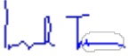

<!-- page 1 -->

FIRME TURNIER

60, Rue Mérisier

Delmas 48, Port-au-Prince

République d'Haïti

ERNST & YOUNG (RACINE)

22, Rue Ramez Bourgi

BP 545 - Dakar

République du Sénégal

# Banque de la République d'Haïti (BRH)

Rapport des auditeurs indépendants

Etats financiers annuels

Exercice clos le 30 septembre 2016

<!-- page 2 -->

# Banque de la République d'Haïti (BRH)

# Rapport des auditeurs indépendants

# Etats financiers annuels

# Exercice clos le 30 septembre 2016

Mesdames, Messieurs les Administrateurs,

En exécution de la mission qui nous a été confiée par votre Conseil d'administration, nous vous présentons notre rapport relatif à l'exercice clos le 30 septembre 2016, sur l'audit des états financiers de la Banque de la République d'Haïti (BRH).

### I. Rapport sur les états financiers

Nous avons effectué l'audit des états financiers ci-joints de la Banque de la République d'Haïti (BRH) comprenant le bilan au 30 septembre 2016, ainsi que le compte de pertes et profits, l'état de variation des capitaux propres, le tableau des flux de trésorerie pour l'exercice clos à cette date et les notes annexes (ci-après désignés « les états financiers »). Ces états financiers ont été établis par le Management conformément aux principes et méthodes comptables édictés par la BRH qui sont décrits dans les notes annexes.

## Responsabilité du Management dans l'établissement et la présentation des états financiers

Le Management de la BRH est responsable de l'établissement et de la présentation sincère de ces états financiers, conformément aux principes et méthodes comptables édictés par la BRH, ainsi que d'un contrôle interne qu'elle juge nécessaire pour permettre l'établissement d'états financiers ne comportant pas d'anomalies significatives, que celles-ci proviennent de fraudes ou résultant d'erreurs.

## Responsabilité de l'auditeur

Notre responsabilité est d'exprimer une opinion sur ces états financiers sur la base de notre audit. Nous avons effectué notre audit selon les normes internationales d'audit. Ces normes requièrent de notre part de nous conformer aux règles d'éthique et de planifier et de réaliser l'audit pour obtenir une assurance raisonnable que les états financiers ne comportent pas d'anomalies significatives.

<!-- page 3 -->

Un audit implique la mise en œuvre de procédures en vue de recueillir des éléments probants concernant les montants et les informations fournis dans les états financiers. Le choix des procédures relève du jugement de l'auditeur, de même que l'évaluation du risque que les états financiers contiennent des anomalies significatives, que celles-ci résultent de fraudes ou d'erreurs. En procédant à cette évaluation du risque, l'auditeur prend en compte le contrôle interne en vigueur dans l'entité relatif à l'établissement et la présentation sincère des états financiers afin de définir des procédures d'audit appropriées en la circonstance, et non dans le but d'exprimer une opinion sur le fonctionnement efficace du contrôle interne de l'entité. Un audit comporte également l'appréciation du caractère approprié des méthodes comptables retenues et le caractère raisonnable des estimations comptables faites par la Direction, de même que l'appréciation de la présentation d'ensemble des états financiers.

Nous estimons que les éléments probants recueillis sont suffisants et appropriés pour fonder notre opinion avec réserves.

## Justification de l'opinion avec réserves

## • Comptes d'engagements (dépôts)

Suite à notre demande d'informations, nous n'avons pas reçu de réponse des titulaires des comptes suivants :

|   | En millions de Gourdes |
| --- | --- |
| Libellé | Montant |
| Gouvernement Central | 21.358 |
| Entreprises publiques | 657 |
| Total | 22.015 |

En l'absence de ces réponses et de procédures alternatives probantes, nous n'avons pas pu obtenir les informations suivantes :

- éventuel désaccord sur les soldes,

- liste des éventuels prêts et avances consentis par la BRH.

- liste des éventuels engagements hors bilan.

- liste des personnes habilitées à faire fonctionner les comptes.

Par conséquent, nous ne sommes pas en mesure de nous prononcer sur la correcte justification de ces soldes qui s'établissent à un montant total de G.22.015 millions.

<!-- page 4 -->

## • Participation TELECO

La valeur des titres de participation détenus à la TELECO s'élèvent à G.1.900 millions au 30 septembre 2016 dans les livres de la BRH.

En l'absence d'états financiers récents et audités, nous n'avons pas été en mesure de nous prononcer sur la correcte évaluation de cet actif.

## Opinion avec réserves

A notre avis, sous réserve des incidences éventuelles des points décrits dans les paragraphes ci-dessus, les états financiers sont réguliers et sincères et donnent une image fidèle de la situation financière de la BRH au 30 septembre 2016, de son patrimoine, de ses résultats et de la variation de la situation financière pour l'exercice clos à cette date, conformément aux règles et méthodes comptables décrites dans les notes annexes.

## Principes comptables

Sans remettre en cause l'opinion exprimée ci-dessus, nous attirons l'attention sur les points suivants :

1. Les notes 1 et 2 annexées aux états financiers décrivent les principes comptables suivis. Les états financiers ont été établis pour satisfaire aux obligations issues de la loi organique du 17 août 1979 relatives à la présentation d'informations financières sur la BRH.

2. La revue de l'état des litiges au 30 septembre 2016 a mis en évidence deux litiges opposant la BRH avec d'anciens détenteurs de comptes d'épargnes et de dépôts à terme en dollars à la Société Haïtienne de l'Epargne et du Crédit (SHEC). Au titre du premier litige, la BRH a été condamnée à payer la somme d'USD.9.931.238, soit G.651 millions, au motif que la SHEC était une institution financière sous sa supervision. En date du 4 avril 2016, la BRH a reçu par voie d'huissier une ordonnance de référé la condamnant à payer ce montant. La BRH a fait opposition à cette décision. Toutefois le juge a confirmé la condamnation en première instance de la BRH. La BRH compte faire appel de cette décision.

Au titre du second litige, le montant réclamé serait de USD 71.752, soit G.4,7 millions. Selon les informations recueillies, la BRH aurait eu gain de cause en première instance. Le demandeur a interjeté appel et l'affaire serait toujours pendante à la Cour d'Appel. Toutefois la BRH ne nous a pas fourni la décision de justice en première instance. Par conséquent nous n'avons pas pu confirmer le montant qui aurait été réclamé.

En l'état actuel des informations disponibles, nous ne pouvons pas nous prononcer sur l'issue finale de ces litiges ni sur les conséquences financières éventuelles sur les comptes de l'exercice clos le 30 septembre 2016.

3. Les états financiers ci-joints ne comprennent pas d'états des engagements hors bilan de la BRH.

<!-- page 5 -->

4. Selon l'article 59 de la loi du 17 août 1979 créant la BRH, « les profits nets de la BRH seront distribués de la façon suivante : 25 % au Trésor Public, 10 % à la réserve légale et le reste à des réserves spéciales destinés aux fins d'investissement, de placement, d'extension qui seront fixés par le Conseil d'administration ». Les résultats réalisés au titre des exercices 2013/2014 et 2014/2015 n'ont pas fait l'objet d'une affectation conformément à l'article précité.

Seule la quote-part du Trésor Public d'un montant de G.157 millions et se rapportant à l'exercice 2012/2013 a fait l'objet d'une distribution sur l'autorisation du Conseil d'administration du 24 février 2016.

FIRME TURNIER

Antoine Lionel TURNIER

Associé

Ernst & Young (Racine)

Le 8 février 2018

Makha SY

Associé

<!-- page 6 -->

## Sommaire

Rapport d'audit                                                                 1-4
Etats financiers au 30 septembre 2016 6-9
Bilan 6
Comptes de pertes et profits 7
Etat de variation des capitaux propres 8
Tableau des flux de trésorerie 9
Notes annexes aux états financiers 10-20
Informations sur le bilan 21-58
Informations sur le compte de pertes et profits 59-64
Divers 65-66

<!-- page 7 -->

## Etats financiers au 30 septembre 2016

Bilan

(En milliers de Gourdes)

<table><tr><td>ACTIF</td><td>Notes</td><td>30/09/2016</td><td>30/09/2015</td><td>(En milliers de Gourdes)</td></tr><tr><td>Variation</td></tr><tr><td>Valeur</td><td>%</td></tr><tr><td>Avoirs en or</td><td>4</td><td>5 046 542</td><td>3 437 027</td><td>1 609 515</td><td>47%</td></tr><tr><td>Avoirs sur le Fonds Monétaire International</td><td>5</td><td>6 149 583</td><td>5 040 971</td><td>1 108 612</td><td>22%</td></tr><tr><td>Avoirs en monnaies étrangères</td><td>6</td><td>113 953 851</td><td>82 804 209</td><td>31 149 642</td><td>38%</td></tr><tr><td>Participations dans les organismes internationaux</td><td>7</td><td>4 196 936</td><td>3 163 725</td><td>1 033 211</td><td>33%</td></tr><tr><td>Placements locaux</td><td>8</td><td>1 996 250</td><td>2 570 000</td><td>(573 750)</td><td>(22%)</td></tr><tr><td>Prêts et avances au gouvernement et aux collectivités</td><td>9</td><td>56 700 139</td><td>48 115 138</td><td>8 585 001</td><td>18%</td></tr><tr><td>Prêts et avances aux particuliers et aux autres institutions</td><td>10</td><td>3 447 056</td><td>3 126 124</td><td>320 932</td><td>10%</td></tr><tr><td>Prêts et avances aux institutions financières monétaires et non monétaires</td><td>11</td><td>4 937 440</td><td>6 850 733</td><td>(1 913 293)</td><td>(28%)</td></tr><tr><td>Immobilisations</td><td>12</td><td>6 430 723</td><td>5 495 291</td><td>935 432</td><td>17%</td></tr><tr><td>Autres actifs</td><td>13</td><td>4 690 588</td><td>4 753 657</td><td>(63 069)</td><td>(1%)</td></tr><tr><td>TOTAL</td><td></td><td>207 549 108</td><td>165 356 875</td><td>42 192 233</td><td>26%</td></tr><tr><td>PASSIF</td><td></td><td></td><td></td><td></td><td></td></tr><tr><td>Billets et monnaies en circulation</td><td>14</td><td>37 730 795</td><td>33 055 095</td><td>4 675 700</td><td>14%</td></tr><tr><td>Comptes d'engagements</td><td>15</td><td>123 536 599</td><td>103 793 563</td><td>19 743 036</td><td>19%</td></tr><tr><td>Engagements envers le FMI</td><td>16</td><td>11 419 893</td><td>9 257 307</td><td>2 162 586</td><td>23%</td></tr><tr><td>Contributions et engagements de l'Etat haïtien sur participation au capital des organismes financiers internationaux</td><td>17</td><td>5 213 728</td><td>3 885 073</td><td>1 328 655</td><td>34%</td></tr><tr><td>Autres passifs</td><td>18</td><td>13 334 356</td><td>9 441 225</td><td>3 893 131</td><td>41%</td></tr><tr><td>Provisions pour risques et charges</td><td></td><td></td><td>-</td><td>-</td><td>-</td></tr><tr><td>Réserves de réévaluation de change</td><td>19</td><td>17 334 365</td><td>10 202 568</td><td>7 131 797</td><td>70%</td></tr><tr><td>Réserves générales</td><td>20</td><td>(3 066 486)</td><td>(5 133 444)</td><td>2 066 958</td><td>(40%)</td></tr><tr><td>Allocations DTS</td><td></td><td></td><td>-</td><td>-</td><td>-</td></tr><tr><td>Réserve de réévaluation de l'or</td><td>21</td><td>1 686 362</td><td>775 311</td><td>911 051</td><td>118%</td></tr><tr><td>Réserve allocation spéciale retraite</td><td>22</td><td>428 947</td><td>381 703</td><td>47 244</td><td>12%</td></tr><tr><td>Capital et réserves</td><td>23</td><td>1 256 282</td><td>1 256 282</td><td>-</td><td>-%</td></tr><tr><td>Résultat des exercices antérieurs</td><td>24</td><td>(1 714 982)</td><td>(1 584 214)</td><td>(130 768)</td><td>8%</td></tr><tr><td>Résultat</td><td></td><td>389 249</td><td>26 406</td><td>362 843</td><td>1374%</td></tr><tr><td>TOTAL</td><td></td><td>207 549 108</td><td>165 356 875</td><td>42 192 233</td><td>26%</td></tr></table>

<!-- page 8 -->

Comptes de pertes et profits

(En milliers de Gourdes)

<table><tr><td></td><td>Notes</td><td>(En milliers de Gourdes)</td></tr><tr><td>30/09/2016</td><td>30/09/2015</td><td>Variation</td></tr><tr><td>Valeur</td><td>%</td></tr><tr><td>Produits des opérations avec l'étranger : intérêts</td><td></td><td>2 921 522</td><td>2 766 702</td><td>154 820</td><td>6%</td></tr><tr><td>Produits de placements, prêts et avances à l'Etat</td><td></td><td>1 099 933</td><td>1 099 982</td><td>(49)</td><td>-%</td></tr><tr><td>Haïtien</td><td></td><td>313 004</td><td>199 295</td><td>113 709</td><td>57%</td></tr><tr><td>Produits des opérations de crédit</td><td></td><td>(1 551 356)</td><td>(885 365)</td><td>2 436 721</td><td>(275%)</td></tr><tr><td>Intérêts débiteurs et frais financiers</td><td></td><td>-</td><td>-</td><td>-</td><td>-</td></tr><tr><td>Autres dépenses d'intérêts</td><td>25</td><td>2 783 103</td><td>3 180 614</td><td>(397 511)</td><td>(12%)</td></tr><tr><td>Résultat net d'intérêts</td><td></td><td>-</td><td>-</td><td>-</td><td>-</td></tr><tr><td>Dividendes</td><td></td><td>54 344</td><td>27 554</td><td>26 790</td><td>97%</td></tr><tr><td>Gains sur ventes des valeurs mobilières</td><td></td><td>1 362 038</td><td>227 225</td><td>1 134 813</td><td>499%</td></tr><tr><td>Pertes sur ventes des valeurs mobilières</td><td></td><td>65 020</td><td>(120 176)</td><td>185 196</td><td>(154%)</td></tr><tr><td>Résultats sur ventes de valeurs mobilières</td><td>26</td><td>1 427 058</td><td>107 049</td><td>1 320 009</td><td>1233%</td></tr><tr><td>Produit net bancaire</td><td></td><td>4 264 505</td><td>3 315 217</td><td>949 288</td><td>29%</td></tr><tr><td>Autres produits</td><td>27</td><td>404 982</td><td>200 075</td><td>204 907</td><td>102%</td></tr><tr><td>Gain extraordinaire</td><td></td><td>4 547</td><td>-</td><td>4 547</td><td>100%</td></tr><tr><td>Résultat opérationnel</td><td></td><td>4 674 034</td><td>3 515 291</td><td>1 158 743</td><td>33%</td></tr><tr><td>Entretien de la circulation fiduciaire</td><td></td><td>280 108</td><td>335 378</td><td>(55 270)</td><td>(16%)</td></tr><tr><td>Rémunérations et charges sociales</td><td></td><td>2 876 758</td><td>2 204 503</td><td>672 255</td><td>30%</td></tr><tr><td>Dépenses administratives</td><td></td><td>699 378</td><td>529 952</td><td>169 426</td><td>32%</td></tr><tr><td>Dotation aux amortissements</td><td></td><td>175 405</td><td>258 241</td><td>(82 836)</td><td>(32%)</td></tr><tr><td>Dépenses relatives à la gestion des actifs</td><td></td><td>110 358</td><td>78 794</td><td>31 564</td><td>40%</td></tr><tr><td>Dons</td><td></td><td>84 853</td><td>75 034</td><td>9 819</td><td>13%</td></tr><tr><td>Autres dépenses</td><td></td><td>53 132</td><td>938</td><td>52 194</td><td>5564%</td></tr><tr><td>Pertes nettes dues au séisme</td><td></td><td>-</td><td>-</td><td>-</td><td>-</td></tr><tr><td>Dotation pour mauvaises créances</td><td></td><td>4 793</td><td>6 046</td><td>(1 253)</td><td>(21%)</td></tr><tr><td>Dotation pour risques et charges</td><td></td><td>-</td><td>-</td><td>-</td><td>-</td></tr><tr><td>Charges d'exploitation générale</td><td>28</td><td>4 284 785</td><td>3 488 886</td><td>795 899</td><td>23%</td></tr><tr><td>Revenus nets de l'exercice</td><td></td><td>389 249</td><td>26 406</td><td>362 843</td><td>1374%</td></tr></table>

<!-- page 9 -->

## Etat de variation des capitaux propres

|   | Capital | Réserves légales | Réserves spéciales | Réserve pour réévaluation d'immeubles | Total capitaux propres |
| --- | --- | --- | --- | --- | --- |
| Solde au | -50 000 | (74 454) | (412 825) | (719 003) | (1 256 282) |
| Affectations | - | - | - | - | - |
| Prélèvements | - | - | - | - | - |
| Réévaluation | - | - | - | - | - |
| Solde au | -50 000 | (74 454) | (412 825) | (719 003) | (1 256 282) |

<!-- page 10 -->

## Tableau des flux de trésorerie

<table><tr><td></td><td>(En milliers de Gourdes)</td></tr><tr><td></td><td>30/09/2016</td><td>30/09/2015</td></tr><tr><td>Activités d'exploitation</td><td></td><td></td></tr><tr><td>Revenu net de l'exercice</td><td>389 249</td><td>26 406</td></tr><tr><td>Éléments de conciliation du revenu net aux liquidités résultant des activités d'exploitation</td><td></td><td></td></tr><tr><td>Dotations aux amortissements</td><td>159 448</td><td>308 483</td></tr><tr><td>Provisions pour pertes de valeur sur prêts</td><td>4 793</td><td>(6 046)</td></tr><tr><td>Effet de change suite à la réévaluation de la participation des organismes financiers inter</td><td>5 512 241</td><td>3 501 716</td></tr><tr><td>Changements dans les éléments d'actif et de passif résultant des activités d'exploitation</td><td></td><td></td></tr><tr><td>Augmentations des prêts et avances, net</td><td>(1 604 217)</td><td>(17 556 071)</td></tr><tr><td>Billets en monnaies en circulation</td><td>4 629 056</td><td>5 786 958</td></tr><tr><td>Engagements en devises</td><td>17 316 475</td><td>7 195 177</td></tr><tr><td>Contributions et engagements envers les organismes financiers internationaux</td><td>4 987 403</td><td>2 081 074</td></tr><tr><td>Engagements envers les banques créatrices de monnaie</td><td>1 409 241</td><td>12 149 594</td></tr><tr><td>Dépôts du Gouvernement Central</td><td>(5 048 468)</td><td>(9 695)</td></tr><tr><td>Engagements envers les autres institutions</td><td>642 477</td><td>(416 761)</td></tr><tr><td>Changements dans les autres éléments d'actif, de passif et de réserves</td><td>(926 590)</td><td>(2 761 284)</td></tr><tr><td>Liquidités provenant des activités d'exploitation</td><td>27 471 108</td><td>10 299 552</td></tr><tr><td>Activités d'investissement</td><td></td><td></td></tr><tr><td>Augmentation des placements étrangers</td><td>(28 810 143)</td><td>(6 484 691)</td></tr><tr><td>(Augmentation) diminution des placements locaux</td><td>2 710 811</td><td>(1 564 090)</td></tr><tr><td>Acquisitions d'immobilisations nettes</td><td>(1 025 511)</td><td>(1 096 250)</td></tr><tr><td>Liquidités utilisées dans des activités d'investissement</td><td>(27 124 843)</td><td>(9 145 031)</td></tr><tr><td>Augmentation (Diminution) nette des liquidités</td><td>346 265</td><td>1 154 521</td></tr><tr><td>Liquidités au début de l'exercice</td><td>7 654 569</td><td>6 500 049</td></tr><tr><td>Liquidité à la fin de l'exercice</td><td>8 000 834</td><td>7 654 569</td></tr></table>

<!-- page 11 -->

# Notes annexes aux états financiers

## Règles et méthodes comptables de la BRH

## Note 1 - Cadre juridique et activités

La Banque de la République d'Haïti (BRH), dont le Siège est sis à la rue du Quai à Port-au-Prince (Haïti), est un organisme public autonome, constitué par l'Etat Haïtien, par la loi du 17 août 1979, modifié en ses articles 9 et 17 par le décret du 28 mars 1985. Son capital social n'est pas divisé en actions. Il est détenu par l'Etat Haïtien et peut être augmenté selon les besoins de l'institution.

La loi du 17 août 1979 portant création de la BRH stipule en son article 6 que celle-ci est dirigée par un Conseil d'Administration dont les membres sont nommés pour une période de trois (3) ans, renouvelable par arrêté du Président de la République. Conformément aux dispositions de la Constitution de 1987, ils sont ratifiés par le Sénat de la République.

La BRH est une Banque Centrale et, à ce titre, a pour objet de :

• promouvoir dans le domaine de la monnaie, du crédit et des changes, les conditions les plus favorables au développement de l'économie nationale ;

• encourager le développement et l'utilisation la plus complète et la plus efficace des ressources productives du pays ;

- adapter les moyens de paiement et la politique de crédit aux besoins légitimes de l'économie haïtienne et, en particulier, à la croissance de la production nationale ;

- aider à éviter toutes tendances inflationnistes, spéculatives et déflationnistes qui seraient nuisibles aux intérêts permanents de la nation ;

- conseiller le Gouvernement en matière de politique monétaire, dans le but principal de maintenir, à l'intérieur du pays, la stabilité relative des prix et à l'extérieur, la croissance des échanges ;

- faciliter l'expansion du commerce intérieur et extérieur en vue de contribuer à l'instauration et au maintien d'un niveau élevé de l'emploi et du revenu réel ;

• assurer l'administration et la gestion des réserves de changes, veiller à l'application des dispositions légales et réglementaires relatives aux institutions financières ;

• contrôler et orienter la circulation et la distribution du crédit ;

- émettre des billets de banque, frapper des pièces métalliques et créer de la monnaie scripturale ;

- exercer toutes les activités de banquier de l'Etat, d'agent financier et fiscal pour toutes ses opérations de caisse et de crédit.

La BRH utilise divers instruments dans la mise en œuvre de la politique monétaire, dont l'objectif fondamental demeure la stabilité des prix. Son principal canal de gestion monétaire est, depuis 1996, la vente aux banques de la place des bons qu'elle émet.

<!-- page 12 -->

La BRH mène des négociations avec le Ministère de l'Économie et des Finances en ce qui a trait au niveau et aux conditions de financement du déficit budgétaire. Ces ententes se matérialisent, en général, par des accords signés entre le Gouverneur de la BRH et le Ministre de l'Économie et des Finances.

Au plan de la réglementation et de la supervision bancaires, la BRH, conformément aux articles 29 à 32 de sa loi organique et à l'article 43 du décret du 14 novembre 1980 réglementant le fonctionnement des banques, a le pouvoir d'inspecter celles-ci et de les soumettre à un régime de normes prudentielles.

En sa qualité de banquier de l'Etat (article 37 de la loi organique), la BRH tient le compte courant de toutes les institutions et collectivités publiques. Elle se charge de la collecte des recettes de l'Etat et encaisse directement pour le compte de celui-ci les taxes internes et les droits de douane. Elle fait aussi fonction de gardienne des titres appartenant à ces entités (article 38 de la loi organique).

Pour l'exécution de ces opérations, la BRH est organisée en un réseau comportant un Siège et une succursale au Cap-Haïtien. La BRH s'est orientée vers une organisation interne destinée à faciliter la mise en œuvre de sa stratégie de modernisation.

<!-- page 13 -->

## Note 2 - Principes et méthodes comptables

### 2.1 - Référentiel comptable en vigueur au 30 septembre 2016

Les états financiers de la Banque de la République d'Haïti ont été élaborés conformément aux dispositions de la loi organique du 17 août 1979 et suivant la méthode de comptabilité d'exercice. Ils sont libellés en Gourde qui est la monnaie nationale Haïtienne.

### 2.2 - Exercice

La durée de l'exercice est de douze mois. L'exercice débute le  $ 1^{er} $ octobre et se termine le 30 septembre de l'année suivante.

### 2.3 - Principes comptables

Les principes comptables suivants sont appliqués :

• comptabilité d'engagement.

• intelligibilité.

• pertinence,

fiabilité,

comparabilité.

### 2.4 - Méthode d'évaluation

Les états financiers sont préparés sur la base de la valeur de marché pour l'or, des titres et des éléments d'actif et de passif libellés en devises inscrits au bilan, ainsi que du coût historique pour les autres rubriques

### 2.5 - Estimations et jugements

Lors de la préparation de ces états financiers, la Direction doit faire des estimations et formuler des hypothèses qui affectent l'application des normes comptables et les montants des éléments d'actif et de passif déclarés et la présentation de l'actif et du passif éventuels à la date des états financiers ainsi que les résultats de l'exercice. Les résultats actuels peuvent être différents de ces estimations.

La BRH établit une provision pour pertes de valeur sur prêts en fin d'exercice qui représente une estimation de la perte de valeur réelle sur le portefeuille de prêts à cette date. Cette provision est établie en prenant en considération les éléments probants spécifiques tels que les arriérés de remboursement, la valeur des garanties, les possibilités de recouvrement futur, et la situation économique de l'emprunteur qui ont un impact sur les flux de trésorerie futurs estimés d'un prêt spécifique ou d'un groupe de prêts avec un risque similaire.

<!-- page 14 -->

### 2.6 - Effets des transactions et événements

Les effets des transactions et autres événements sont pris en compte dès que ces transactions et événements se produisent.

Par ailleurs, en raison du découpage de l'activité en exercices comptables, les transactions et autres événements sont rattachés à l'exercice qu'ils concernent effectivement et à celui-ci seulement. Dans ce cadre, les produits sont comptabilisés dès qu'ils sont acquis et les charges au fur et à mesure qu'elles sont engagées.

### 2.7 - Opérations en devises

Les transactions en devises étrangères sont initialement comptabilisées aux cours de change en vigueur à la date de transaction. En fin de mois, les actifs et passifs en monnaies étrangères sont convertis au cours de change en vigueur en fin de période. Les gains ou pertes de change, qui en découlent, sont enregistrés dans un compte de réserve « Réserve de réévaluation de change », conformément à l'article 56 de la loi organique.

### 2.8 - Impôts et taxes

Conformément à l'article 63 de la loi organique, la BRH est exonérée du paiement des droits et taxes de l'Etat ou des communes à l'occasion de toutes opérations qui lui sont propres. De même, elle bénéfice de l'exemption des droits à l'occasion de ses importations y compris matériels, équipements, lubrifiants, carburants.

### 2.9 - Avoirs en or

L'or est valorisé au cours en vigueur à la date du bilan. Les gains et les pertes résultant de cette valorisation sont inscrits à la réserve de réévaluation. Le stock d'or n'est pas porteur d'intérêts. L'avoir en or fait partie des réserves nettes de change en accord avec l'article 52 de la loi organique de la BRH.

### 2.10 - Avoirs sur le FMI, engagements envers le FMI

La BRH est l'agent fiscal de l'Etat Haïtien auprès du Fonds Monétaire International (FMI). Elle est en même temps le dépositaire des Gourdes détenus par le FMI. En vertu de la loi du 19 septembre 1952, la Banque représente le Gouvernement Haïtien en toute négociation ou transactions avec le Fonds. Toutes les transactions entre le Gouvernement et le Fonds sont inscrites dans les livres de la BRH.

Les différences résultant des opérations de la BRH avec le Fonds sont supportées par le Gouvernement Haïtien et sont comptabilisées au bilan dans le compte «Avance différence de change FMI ».

<!-- page 15 -->

Les opérations avec le FMI sont libellées dans la monnaie du FMI, à savoir le Droit de Tirage Spécial (DTS).

Les opérations et transactions de l'Etat Haïtien avec le FMI concernent le compte de Droit de Tirage Spécial (DTS), le compte de ressources générales et les comptes administrés.

La position de réserve au FMI est la différence entre les quotes-parts de l'Etat et sa souscription en monnaie nationale, compte non tenu des tirages au titre des ressources générales (avoirs exclus ou recours aux crédits du FMI).

Les tirages effectués par l'Etat auprès du FMI sont reçus et enregistrés dans les comptes dépôt à vue de la BRH à la Federal Reserve Bank en dollars, d'une part, et dans les comptes d'engagements envers le FMI en DTS, d'autre part. Au moment des tirages, les différences entre les montants versés à l'Etat et la dette vis-à-vis du FMI sont portées directement au compte « Avance Différence de change FMI ».

Les avoirs du FMI en monnaie nationale (comptes FMI n° 1, FMI n° 2 et FMI compte titres) font l'objet d'une réévaluation annuelle le 30 avril de chaque année, sur la base du cours représentatif du DTS communiqué par le FMI. Les gains et pertes de réévaluation sont inscrits dans le compte « Avance différence de change FMI ».

A la clôture de chaque période mensuelle, les avoirs du FMI en DTS sont réévalués sur la base du cours du DTS/Gourdes de fin de mois.

Les DTS détenus, les tirages sur les comptes administrés et les allocations de DTS sont convertis en Gourdes sur la base du cours de change en vigueur lors des transactions. Les différences résultant de réévaluations périodiques sont portées au compte « Avance différence de change FMI ».

### 2.11 - Participations, contributions et engagements dans les autres organismes financiers internationaux

Conformément à l'article 2, alinéa 10, et l'article 61, alinéa 2 de la loi du 17 août 1979, la BRH enregistre dans ses livres les participations de la République d'Haïti dans les différents organismes internationaux. Le Gouvernement Haïtien a souscrit au capital de différents organismes financiers internationalaux. Les montants payés à titre de capital sont reflétés comme des contributions, et les montants non encore versés sont reflétés comme des engagements. Ces transactions sont gérées par la BRH à titre de fiduciaire et sont réévaluées aux taux de change de la fin de l'exercice. L'effet de change résultant de la réévaluation des actifs et passifs de l'État Haïtien est enregistré au bilan dans le compte « Réserves de réévaluation de change ».

<!-- page 16 -->

### 2.12 - Placements à la Télécommunication d'Haïti (TELECO)

La BRH détient 97 % des actions de la TELECO et le Gouverneur de la BRH est le président du Conseil d'Administration de cette institution. Les titres de participation détenus sur la TELECO ont été initialement comptabilisés à leur coût d'acquisition. La valeur comptable de ces titres est ajustée en y incluant la quote-part de la BRH dans les résultats annuels enregistrés par la TELECO. Depuis 2001, en l'absence d'états financiers audités de la TELECO, la valeur comptable du placement à la TELECO n'a pas connu d'évolution.

### 2.13 - Avoirs en monnaies étrangères

Les réserves de change de la BRH sont investies en comptes à vue, en comptes à terme et dans des actifs obligataires.

#### 2.13.1 - Portefeuille titres

Dans le cadre de la stratégie globale de gestion de son portefeuille, la BRH détient des valeurs mobilières de placement. La BRH a choisi un système de gestion par administrateurs externes de portefeuille (gestion déléguée). Les gérants de portefeuille peuvent bénéficier de pouvoirs discrétionnaires ou peuvent être sujets à des limitations strictes, concernant la sélection des placements.

Ces placements sont disponibles à la vente.

## • Actifs financiers disponibles à la vente

Ce sont des actifs financiers détenus dans le but d'avoir des liquidités disponibles. Ils sont enregistrés initialement en comptabilité à leur coût d'acquisition, coupons courus et frais d'acquisition inclus, et sont évalués ultérieurement à leur juste valeur. La variation de juste valeur est constatée directement en capitaux propres dans le compte « Réserve de réévaluation de change ».

### 2.14 - Prêts et avances au Gouvernement et aux collectivités

Les crédits à l'Etat Haïtien représentent un financement au Secteur Public ainsi que les prêts et avances en comptes courants au Gouvernement, aux collectivités locales et aux entreprises publiques. Ils sont évalués au coût. La BRH n'enregistre pas de perte de valeur sur les crédits à l'Etat Haïtien et aux entreprises publiques à moins de désaccords spécifiques. Les revenus d'intérêts sur ces prêts, avances et placements sont comptabilisés sur une base d'exercice.

### 2.15 - Immobilisations corporelles et incorporelles

Les immobilisations sont comptabilisées à leur coût d'acquisition, avec possibilité de réévaluation.

<!-- page 17 -->

Les réévaluations sont effectuées par des experts en évaluation.

L'écart de réévaluation est imputé aux capitaux propres sous une rubrique séparée en contrepartie des comptes d'immobilisations.

Suite au séisme du 12 janvier 2010, les pertes sur les immeubles de la Banque qui ont subi des dommages ont été évaluées et enregistrées dans les livres de la BRH.

A l'exception des terrains, des constructions en cours, les immobilisations sont amorties selon la méthode de l'amortissement linéaire sur la durée estimative de leur vie utile.

Les durées de vie retenues sont les suivantes :

| Immobilisations | Durées de vie utile\n(en mois) |
| --- | --- |
| Terrains | Non amortissable |
| Bâtisses | 240 |
| Mobilier et matériel de bureau | 48 |
| Matériel informatique | 60 |
| Logiciel informatique | 12 |
| Matériel roulant | 48 |
| Equipements | 60 |
| Installations | 60 |
| Aménagements, Extensions, Agrandissements | 60 |

Les immobilisations entièrement amorties demeurent inscrites au bilan dans un compte distinct « Biens totalement amortis » aussi longtemps qu'elles subsistent. Les immobilisations figurent au bilan à leurs valeurs nettes.

### 2.16 - Stocks de billets neufs en transit

A l'achat, les signes monétaires sont comptabilisés en engagements hors bilan au prix d'achat, auquel viennent s'ajouter les frais de transport.

A l'émission, les quantités de signes monétaires émises sont valorisées selon la méthode FIFO et comptabilisées au bilan. A la clôture de l'exercice, les billets et monnaies non émis sont traités comme des stocks. Ils font l'objet d'un inventaire physique et sont valorisés selon la méthode FIFO.

<!-- page 18 -->

### 2.17 - Billets et monnaies en circulation

Les billets et pièces de monnaie en circulation sont analysés comme des dettes envers les détenteurs. Ils sont inscrits au bilan à leur valeur faciale ou valeur nominale.

### 2.18 - Comptes d'engagements

Les comptes à vue (dettes à vue) et les dépôts auprès de la BRH sont inscrits au bilan à leur valeur nominale et ne sont pas rémunérés.

### 2.19 - Provisions pour risques et charges

Une provision est constituée lorsque la BRH a une obligation réglementaire, implicite ou juridique qui résulte d'un événement passé et dont il est probable ou certain qu'elle provoquera une sortie de ressources dont le montant peut être estimé de manière fiable.

Conformément au principe de prudence, des provisions sont aussi constituées pour tous les risques potentiels liés à certains comptes d'actif (actifs non performants).

### 2.20 - Fonds de retraite et prime de séparation

La dépense annuelle pour le fond de retraite et primes de séparation est établie en fonction d'un taux de contribution fixé par la Banque de la République d'Haïti.

### 2.21 - Reserve de réévaluation de change

L'article 56 de la loi organique de la BRH précise que les gains et les pertes, qui résultent de la réévaluation des avoirs et des engagements de la BRH détenus en devises ou en or, doivent être comptabilisés à un compte dénommé "Réserve de réévaluation" présenté au bilan au niveau du capital et réserves.

### 2.22 - Réserve pour réévaluation d'immeubles

Le solde de ce poste sera viré à la réserve spéciale quand les immeubles seront comptabilisés. Toute moins-value résultant de la réévaluation est enregistrée directement comme une dépense à l'état des résultats à moins qu'elle ne soit relative à une plus-value existante pour un même immeuble déjà réévalué. Le cas échéant, cette moins-value sera affectée préalablement au poste de réserve de réévaluation-terains et immeubles.

<!-- page 19 -->

### 2.23 - Réserves générales

Ce poste enregistre les pertes et gains latents qui résultent des réévaluations périodiques du portefeuille de titres de la BRH.

### 2.24 - Distribution des profits nets

Selon l'article 59 de la loi régissant la BRH, les résultats nets doivent être distribués de la manière suivante : 25 % au Trésor Public, 10 % à la réserve légale et le solde à des réserves spéciales destinées aux fins d'investissements, de placements, d'agrandissement et autres, tel que fixé par le Conseil d'Administration. En 2010 et 2009, le Conseil d'administration a convenu avec le Ministère de l'Économie et des Finances de ne pas effectuer de distribution à l'Etat en vue d'éponger les pertes antérieures et de constituer les réserves nécessaires à la recapitalisation de la BRH, tel que prévu dans le cadre d'accords avec les partenaires internationaux.

### 2.25 - Gestion des risques

La BRH est exposée à des risques variés qui sont les suivants :

• Risque de marché : risque de perte due aux changements dans les prix et aux taux de marché (cours de l'or, cours de change et taux d'intérêt) ;

• Risque de contrepartie : risque de perte due à l'incapacité des contreparties de la Banque de faire face à leurs obligations financières ;

• Risque opérationnel : risque de perte résultant de l'inadaptation ou de la défaillance des procédures, des personnes, des systèmes internes ou d'événements extérieurs.

La gestion des risques est centrée sur le caractère imprévisible de l'environnement financier et a pour objet d'en minimiser les conséquences négatives potentielles sur les performances de la BRH.

### 2.26 - Reconnaissance des produits et des charges

La reconnaissance des produits et des charges est effectuée selon les règles suivantes :

- les produits et les charges sont pris en compte au cours de l'exercice pendant lequel ils sont réalisés, acquis ou dus ;

- les produits et les charges en monnaies étrangères sont convertis au cours de change de la date de transaction ;

<!-- page 20 -->

- les plus-values et moins-values latentes sur les instruments financiers liées aux taux d'intérêt et aux prix du marché, sont comptabilisées au bilan dans le compte « Réserves générales » ;

- les écarts de conversion sur les devises étrangères sont comptabilisés au bilan dans le compte « Réserves de réévaluation de change ».

### 2.27 - Evénements postérieurs à la date de clôture

Les événements significatifs ayant un lien prépondérant et direct avec une situation qui existait à la date de clôture des comptes, donnent lieu à un ajustement des montants comptabilisés dans les états financiers. A cet égard, les actifs et les passifs font l'objet d'un ajustement pour tenir compte d'événements significatifs survenus entre la date de clôture et la date d'approbation des états financiers. Ceux concernant des situations apparues postérieurement à la date de clôture, sont mentionnés dans les notes annexes, avec une estimation de leur incidence financière.

### 2.28 - Changement de méthodes, d'estimations comptables

Aucun changement de méthode ou d'estimation comptables n'est intervenu durant l'exercice 2015-2016.

<!-- page 21 -->

## Note 3 - Cours des monnaies étrangères et prix de l'Or

| Monnaies étrangères et or | 30/09/2016\n(en Gourdes) | 30/09/2015\n(en Gourdes) |
| --- | --- | --- |
| 1 Dollar des Etats-Unis (USD) | 65,5368 | 52,1417 |
| 1 Euro (EUR) | 73,6634 | 58,2788 |
| 1 Droit de Tirage Spécial (DTS) | 91,4763 | 73,1934 |
| 1 Once d'or | 86.673,1176 | 59.029,61857 |

<!-- page 22 -->

# Informations sur le bilan

## Bilan - Actif

## Note 4 - Avoirs en or

Cette rubrique s'analyse comme suit :

<table><tr><td></td><td>30/09/2016</td><td>30/09/2015</td><td>Variation</td></tr><tr><td>En onces</td><td>En milliers de Gourdes</td><td>En onces</td><td>En milliers de Gourdes</td><td>En milliers de Gourdes</td></tr><tr><td>Or en dépôt à la Federal Reserve Bank</td><td>1 308</td><td>113 327</td><td>1 308</td><td>77 183</td><td>36 144</td></tr><tr><td>Or en dépôt chez Morgan Stanley Smith Barney</td><td>56 918</td><td>4 933 215</td><td>56 918</td><td>3 359 844</td><td>1 573 371</td></tr><tr><td>Total</td><td>58 226</td><td>5 046 542</td><td>58 226</td><td>3 437 027</td><td>1 609 515</td></tr></table>

Cette rubrique enregistre les avoirs en or détenus par la BRH à la Federal Reserve Bank of New York (1308 Oz) et chez Morgan Stanley (56 918 Oz).

Le stock d'or est réévalué mensuellement sur la base du cours de l'once d'or affiché sur le site Bloomberg. L'écart entre la valeur réévaluée du stock et sa valeur comptable est enregistré au passif, dans les comptes "533000 Réserve de réévaluation or" pour l'or détenu à la Federal Reserve et "538400 Réserve de plus-value non réalisée sur placement" pour l'or détenu à la Morgan Stanley.

L'évolution du solde par rapport à l'exercice précédent résulte de l'appréciation de l'once d'or.

<!-- page 23 -->

## Note 5 - Avoirs sur le Fonds Monétaire International (FMI)

La rubrique « Avoirs sur le Fonds Monétaire International » comprend la position de réserve et les

avoirs en DTS et se détaille comme suit :

<table><tr><td></td><td>30/09/2016</td><td>30/09/2015</td><td>Variation</td></tr><tr><td>En DTS</td><td>En milliers de Gourdes</td><td>En DTS</td><td>En milliers de Gourdes</td><td>En milliers de Gourdes</td></tr><tr><td>Position de réserve</td><td>68 047</td><td>6 225</td><td>68 047</td><td>4 981</td><td>1 244</td></tr><tr><td>Avoirs en droits de Tirages</td><td>67 157 944</td><td>6 143 358</td><td>68 804 214</td><td>5 035 990</td><td>1 107 368</td></tr><tr><td>Spéciaux</td><td></td><td></td><td></td><td></td><td></td></tr><tr><td>Total</td><td>67 225 991</td><td>6 149 583</td><td>68 872 261</td><td>5 040 971</td><td>1 108 612</td></tr></table>

## Position de réserve

Constitué en 1945, le FMI a été investi par ses textes fondateurs de la mission statutaire de restaurer la stabilité du système monétaire international. Les opérations de l'Etat Haïtien avec le FMI (le Fonds) sont régies par l'article VIII des statuts du FMI.

Les souscriptions des pays membres constituent l'origine normale des ressources du Fonds. A chaque pays est assignée une quote-part. Les quotes-parts souscrites sont libérées en devises par les Etats membres à concurrence de 25 %, et en monnaie nationale à concurrence de 75 %.

La position de réserve d'un pays auprès du FMI est égale à la différence entre sa quote-part et la souscription versée en monnaie nationale.

La position de réserve de la République d'Haïti auprès du FMI s'analyse comme suit :

<table><tr><td></td><td>30/09/2016</td><td>30/09/2015</td><td>Variation</td></tr><tr><td>En DTS</td><td>En milliers de Gourdes</td><td>En DTS</td><td>En milliers de Gourdes</td><td>En milliers de Gourdes</td></tr><tr><td>Quota FMI</td><td>81.900.000</td><td>7.491.906</td><td>81 900 000</td><td>5 994 511</td><td>1.497.396</td></tr><tr><td>FMI, Compte no 1</td><td>(36.290.445)</td><td>(3.319.714)</td><td>(36 290 445)</td><td>(2 656 208)</td><td>(663.506)</td></tr><tr><td>FMI, Compte titres</td><td>(45.541.508)</td><td>(4.165.967)</td><td>(45 541 508)</td><td>(3 333 322)</td><td>(832.645)</td></tr><tr><td>Total</td><td>68.047</td><td>6.225</td><td>68 047</td><td>4 981</td><td>1.244</td></tr></table>

<!-- page 24 -->

## • Quota FMI

Le quota FMI correspond à la quote-part exprimée en DTS et attribuée à l'Etat Haïtien dans le cadre de sa souscription lors de son admission au Fonds. Il représente un actif de la République d'Haïti. Comme sur les exercices précédents, le quota FMI est resté stable en l'absence de décision par le Conseil d'Administration du FMI d'une augmentation de la quote-part de l'Etat Haïtien.

## • Compte FMI n° 1 et compte de titres

Le compte FMI n° 1 et le compte de titres correspondent à la quote-part réglée en monnaie nationale ou sous forme de titres par l'Etat Haïtien. En qualité de dépositaire, la BRH tient ces comptes enregistrant les avoirs du FMI en Gourdes. Ces comptes constituent des engagements de la BRH vis-à-vis du Fonds.

Au 30 septembre 2016, le compte FMI n° 1 et le compte FMI compte de titres présentent respectivement des soldes créditeurs de G.3.320 millions et G.4.166 millions. En l'absence d'évolution des soldes en DTS de ces comptes, les variations respectives constatées de G.664 millions et G.833 millions, résultent exclusivement de l'appréciation du cours du DTS qui est passé de G.73,1934 au 30 septembre 2015 à G.91,4763 au 30 septembre 2016.

## • Avoirs en Droits de Tirages Spéciaux

Les DTS détenus ont évolué ainsi qu'il suit :

|   | En DTS |
| --- | --- |
| Solde au 30/09/2015 | 68.804.214 |
| Acquisitions | - |
| Cessions | - |
| Rémunérations perçues | 44.420 |
| Commissions payées | (1.690.690) |
| Solde au 30/09/2016 | 67.157.944 |

Les rémunérations perçues correspondent aux intérêts payés par le FMI sur les avoirs en DTS. Les commissions payées correspondent essentiellement aux intérêts versés au FMI et calculés sur la base du stock de DTS alloués à l'Etat Haïtien.

<!-- page 25 -->

## Note 6 - Avoirs en monnaies étrangères

Cette rubrique comprend l'encaisse, les dépôts à vue et de garantie à l'étranger, les valeurs en transit et les placements en devises étrangères. Elle se décompose comme suit :

(En milliers de Gourdes)

|   | 30/09/2016 | 30/09/2015 | Variation |
| --- | --- | --- | --- |
| Billets, pièces de monnaie et chèques | 3 067 875 | 3 590 557 | (522 682) |
| Avoirs dans les banques non résidentes | 4 898 282 | 3 971 192 | 927 090 |
| Valeurs en transit sur l'étranger | 23 829 | 15 177 | 8 652 |
| Remises en transit en devises sur le pays | 10 848 | 77 643 | (66 795) |
| Collatéral | 852 974 | 678 753 | 174 221 |
| Placements en devises étrangères | 105 100 043 | 74 470 887 | 30 629 156 |
| Total | 113 953 851 | 82 804 209 | 31 149 642 |

• Billets, pièces de monnaie et chèques en USD

Les billets, pièces de monnaie et chèques en devise, essentiellement en dollars, sont constitués par les encaisses détenues au Siège et au Cap Haïtien. Ces encaisses s'analysent comme suit :

(En milliers de Gourdes)

|   | 30/09/2016 | 30/09/2015 | Variation |
| --- | --- | --- | --- |
| Billets devises guichets | 8.583 | 8 140 | 443 |
| Billets devises non triés | 165.883 | 1 107 769 | (941.886) |
| Billets devises caveau | 2.101.765 | 2 262 063 | (160.298) |
| Pièces devises caveau | 396 | 315 | (81) |
| Sous-total Siège | 2.276.627 | 3 378 287 | (1.101.660) |
| Billets devises Cap Haïtien | 791.248 | 212 270 | 578.978 |
| Total | 3.067.875 | 3 590 557 | (522.682) |

<!-- page 26 -->

## • Avoirs dans les banques non résidentes

Les avoirs dans les banques non résidentes sont essentiellement constitués des dépôts à vue et se décomposent comme suit :

<table><tr><td></td><td>(En milliers de Gourdes)</td></tr><tr><td></td><td>30/09/2016</td><td>30/09/2015</td><td>Variation</td></tr><tr><td>Banque</td><td>En devise</td><td>En milliers de Gourdes</td><td>En devise</td><td>En milliers de Gourde</td><td>En milliers de Gourde</td></tr><tr><td>Correspondants USD</td><td></td><td></td><td></td><td></td><td></td></tr><tr><td>Citibank NY</td><td>22.914.129</td><td>1.501.719</td><td>25 024 921</td><td>1 304 842</td><td>196.877</td></tr><tr><td>Fédéral Reserve</td><td>24.596.032</td><td>1.611.945</td><td>10 514 618</td><td>548 250</td><td>1.063.695</td></tr><tr><td>Citibank Collatéral</td><td>307.236</td><td>20.135</td><td>307 204</td><td>16 018</td><td>4.117</td></tr><tr><td>Citibank IDA</td><td>12.361</td><td>810</td><td>13 301</td><td>694</td><td>116</td></tr><tr><td>Bladex</td><td>133</td><td>8</td><td>2 697 728</td><td>140 664</td><td>(140.656)</td></tr><tr><td>Bladex collateral</td><td>132.683</td><td>8.696</td><td>1 038 291</td><td>54 138</td><td>(45.442)</td></tr><tr><td></td><td></td><td></td><td></td><td></td><td>0</td></tr><tr><td>Correspondant EUR</td><td></td><td></td><td></td><td></td><td>0</td></tr><tr><td>Banque de France</td><td>23.824.172</td><td>1.754.969</td><td>32 714 924</td><td>1 906 586</td><td>(151.617)</td></tr><tr><td>Total</td><td></td><td>4.898.282</td><td></td><td>3 971 192</td><td>927.090</td></tr></table>

## - Collatéral

Ce compte enregistre les dépôts de garantie constitués auprès de la Citibank New-York pour la mise en place de lettre de crédit, sur demande du Ministère de l'Economie et des Finances haïtien.

## - Placements non-résidents

Les placements non-résidents sont constitués par un portefeuille de liquidité, en gestion déléguée auprès de gérants de portefeuille aux Etats-Unis. Ils se décomposent comme suit par gestionnaire :

<!-- page 27 -->

<table><tr><td></td><td>(En milliers de Gourdes)</td></tr><tr><td></td><td>30/09/2016</td><td>30/09/2015</td><td>Variation</td></tr><tr><td></td><td>En USD</td><td>En milliers de gourdes</td><td>En USD</td><td>En milliers de gourdes</td><td>En milliers de gourdes</td></tr><tr><td>FIDELITY INVEST/COLBERT INVEST M.</td><td>160.527.415</td><td>10.520.453</td><td>149 967 288</td><td>7 819 550</td><td>2.700.903</td></tr><tr><td>GOLDMAN SACHS ASSET MANAG.</td><td>96.258.684</td><td>6.308.486</td><td>92 620 500</td><td>4 829 391</td><td>1.479.095</td></tr><tr><td>CITIFIX ALPHA LIQUIDITY</td><td>195.696.649</td><td>12.825.332</td><td>182 195 233</td><td>9 499 969</td><td>3.325.363</td></tr><tr><td>BLACKROCK INVEST. MANAGEMENT</td><td>88.745.136</td><td>5.816.072</td><td>84 799 557</td><td>4 421 593</td><td>1.394.479</td></tr><tr><td>JANUS CAPITAL GROUP</td><td>56.121.330</td><td>3.678.012</td><td>52 606 038</td><td>2 742 968</td><td>935.044</td></tr><tr><td>LUCROR CAPITAL ADVISORS LP</td><td>34.354.604</td><td>2.251.492</td><td>37 848 827</td><td>1 973 502</td><td>277.990</td></tr><tr><td>MSSB</td><td>917.004.263</td><td>60.097.525</td><td>828 203 037</td><td>43 183 914</td><td>16.913.611</td></tr><tr><td>ALLIANZ ASSET MANAGEMENT</td><td>49.985.142</td><td>3.275.866</td><td></td><td></td><td>3.275.866</td></tr><tr><td>TANDEM INVESTMENT ADVISORS</td><td>4.986.582</td><td>326.805</td><td></td><td></td><td>326.805</td></tr><tr><td>Total</td><td>1.603.679.805</td><td>105.100.043</td><td>1 428 240 480</td><td>74 470 887</td><td>30.629.156</td></tr></table>

Le portefeuille de la BRH est essentiellement composé de cash et d'actifs financiers disponibles à la vente détenus par les gestionnaires de portefeuille pour le compte de la BRH.

Ces actifs financiers sont détenus dans le but d'avoir des liquidités disponibles. Ils sont enregistrés en comptabilité à leur juste valeur. Ils sont constitués de bons du Trésor et de bons émis par les Agences Fédérales Américaines, d'obligations municipales et de sociétés. Au 30 septembre 2016, la décomposition du portefeuille établi par la BRH s'analyse comme suit, par catégorie de titres (en USD) :

| Placement | Coût | Juste valeur |
| --- | --- | --- |
| Comptes en marché (cash) | - | 61 424 275 |
| US Treasury Securities | 100 060 599 | 215 672 959 |
| Agences fédérales | 165 024 910 | 165 651 401 |
| Obligations municipales | 72 664 355 | 74 599 043 |
| Obligations de sociétés | 1 054 856 191 | 1 044 698 876 |
| Unsettled Purchases/Sales | 2 803 194 | 2 808 480 |
| Stocks | 27 916 595 | 25 879 850 |
| Exchange-Traded & Closed-End Funds | 822 141 | 680 718 |
| Intérêts accrus | - | 12 264 203 |
| Total | 1 424 147 985 | 1 603 679 805 |

Au 30 septembre 2016, le portefeuille de la BRH se ventile comme suit, par catégorie (en USD):

<!-- page 28 -->

<table><tr><td></td><td>Blackrock</td><td>BRH MAIN</td><td>BRH FIXED INCOME ALPHA (EX FORMER CIT FX )</td><td>BRH FIXED INCOME CORE (EX FORMER WESTERN ASSET MANAGEMENT )</td><td>GOLDMAN SACHS</td><td>INTERMEDIATE DURATION</td><td>BRH FIXED INCOME (EX JANUS CAPITAL GROUP)</td></tr><tr><td></td><td>Justice</td><td>Value</td><td>Coût</td><td>Justice</td><td>Coût</td><td>Justice valeur</td><td>Coût</td><td>Justice valeur</td><td>Coût</td><td>Justice valeur</td><td>Coût</td><td>Justice valeur</td><td>Coût</td><td>Justice valeur</td></tr><tr><td>Complte en marchi cash</td><td>477 278</td><td>-</td><td>319 362</td><td>-</td><td>10 494 962</td><td>-</td><td>1 957 205</td><td>-</td><td>1 769 842</td><td>-</td><td>4 037 866</td><td>-</td><td>3 033 839</td><td>-</td></tr><tr><td>U1 Treasury Securities</td><td>17 470 624</td><td>17 323 149</td><td>94 994 300</td><td>-</td><td>-</td><td>-</td><td>-</td><td>-</td><td>39 110 694</td><td>38 558 465</td><td>19 998 800</td><td>-</td><td>24 996 750</td><td>24 998 406</td></tr><tr><td>Government Sponsored Enterprise Securities (GSE)</td><td>5 045 665</td><td>4 804 810</td><td>126 465 799</td><td>127 245 688</td><td>-</td><td>-</td><td>-</td><td>-</td><td>14 160 687</td><td>12 852 863</td><td>19 979 250</td><td>20 121 550</td><td>-</td><td>-</td></tr><tr><td>SOVEREIGN SECURITIES</td><td>5 785 000</td><td>-</td><td>-</td><td>-</td><td>-</td><td>-</td><td>-</td><td>-</td><td>-</td><td>-</td><td>-</td><td>-</td><td>-</td><td>-</td></tr><tr><td>Obligations municipales</td><td>5 785 000</td><td>5 313 635</td><td>6 523 348</td><td>6 611 411</td><td>7 789 357</td><td>7 800 833</td><td>9 701 227</td><td>10 110 288</td><td>-</td><td>-</td><td>12 408 979</td><td>12 955 605</td><td>-</td><td>-</td></tr><tr><td>Obligations de sociais</td><td>36 599 129</td><td>55 880 208</td><td>362 471 833</td><td>367 975 965</td><td>175 361 679</td><td>178 259 699</td><td>36 113 350</td><td>58 519 729</td><td>40 830 867</td><td>41 326 882</td><td>194 471 408</td><td>195 894 525</td><td>27 840 834</td><td>27 784 538</td></tr><tr><td>Asset-Backed Securities (ABS), Mortgage-Backed Securities (MBS), Collateralized Mortgage Obligations (CMOs)</td><td>2 808 480</td><td>2 803 194</td><td>-</td><td>-</td><td>-</td><td>-</td><td>-</td><td>-</td><td>-</td><td>-</td><td>-</td><td>-</td><td>-</td><td>-</td></tr><tr><td>Equities (stocks, REITs / Tangibles)</td><td>-</td><td>-</td><td>-</td><td>-</td><td>-</td><td>-</td><td>-</td><td>-</td><td>-</td><td>-</td><td>-</td><td>-</td><td>-</td><td>-</td></tr><tr><td>Exchange-Traded Funds</td><td>-</td><td>-</td><td>-</td><td>-</td><td>-</td><td>-</td><td>-</td><td>-</td><td>-</td><td>-</td><td>-</td><td>-</td><td>-</td><td>-</td></tr><tr><td>Accrued Interest</td><td>562 959</td><td>-</td><td>4 641 411</td><td>-</td><td>2 050 651</td><td>-</td><td>630 644</td><td>-</td><td>386 595</td><td>-</td><td>2 289 482</td><td>-</td><td>2 499 907</td><td>-</td></tr><tr><td>Total</td><td>88 745 136</td><td>86 124 995</td><td>595 416 052</td><td>501 833 063</td><td>195 696 649</td><td>186 060 532</td><td>68 402 426</td><td>68 630 017</td><td>96 258 684</td><td>92 738 210</td><td>253 185 785</td><td>228 971 680</td><td>56 121 330</td><td>52 782 944</td></tr></table>

<table><tr><td></td><td>BRH FIXED INCOME LC (EX LUCROR CAPITAL ADVISOR)</td><td>Fidelity</td><td>BRH ALLIANZ ASSET MANAGEMENT</td><td>BRH TANDEM INVESTMENT ADVISORS</td><td>Total Juste valeur</td><td>Total Coût</td></tr><tr><td></td><td>Juste valeur</td><td>Coût</td><td>Juste valeur</td><td>Coût</td><td>Juste valeur</td><td>Coût</td><td>Juste valeur</td><td>Coût</td></tr><tr><td>Compté en marché cash</td><td>1 878 242</td><td>-</td><td>13 244 169</td><td>-</td><td>20 620 524</td><td>-</td><td>3 590 986</td><td>-</td><td>61 424 275</td><td>-</td></tr><tr><td>Us treasury Securities</td><td>-</td><td>-</td><td>1 001 770</td><td>1 068 443</td><td>18 100 021</td><td>18 112 136</td><td>-</td><td>-</td><td>215 672 959</td><td>100 060 599</td></tr><tr><td>Government Sponsored Enterprise Securities (OSE)</td><td>-</td><td>-</td><td>-</td><td>-</td><td>-</td><td>-</td><td>-</td><td>-</td><td>165 651 401</td><td>165 024 910</td></tr><tr><td>SOVEREIGN SECURITIES</td><td>-</td><td>-</td><td>-</td><td>-</td><td>-</td><td>-</td><td>-</td><td>-</td><td>-</td><td>-</td></tr><tr><td>Obligations municipales</td><td>-</td><td>-</td><td>32 391 132</td><td>29 872 583</td><td>-</td><td>-</td><td>-</td><td>-</td><td>74 599 043</td><td>72 664 355</td></tr><tr><td>Obligations de société</td><td>29 825 039</td><td>30 092 374</td><td>90 016 101</td><td>87 932 868</td><td>11 172 637</td><td>11 189 404</td><td>-</td><td>-</td><td>1 044 698 876</td><td>1 054 856 191</td></tr><tr><td>Asset-Backed Securities (ABS), Mortgage-Backed Securities (MBS), Collateralized Mortgage Obligations (CMOs)</td><td>-</td><td>-</td><td>-</td><td>-</td><td>-</td><td>-</td><td>-</td><td>-</td><td>2 808 480</td><td>2 803 194</td></tr><tr><td>Equities, stocks, REITs / Tanibles)</td><td>1 554 638</td><td>2 092 322</td><td>22 929 616</td><td>24 420 786</td><td>-</td><td>-</td><td>1 395 594</td><td>1 403 487</td><td>25 879 848</td><td>27 916 595</td></tr><tr><td>Exchange-Traded Funds</td><td>680 718</td><td>822 141</td><td>-</td><td>-</td><td>-</td><td>-</td><td>-</td><td>-</td><td>680 718</td><td>822 141</td></tr><tr><td>Accrued interest</td><td>415 967</td><td>-</td><td>944 626</td><td>-</td><td>91 961</td><td>-</td><td>-</td><td>-</td><td>12 264 203</td><td>-</td></tr><tr><td>Total</td><td>34 354 604</td><td>33 006 837</td><td>160 527 415</td><td>143 294 680</td><td>49 985 142</td><td>29 301 540</td><td>4 986 580</td><td>1 403 487</td><td>1 603 679 803</td><td>1 424 147 983</td></tr></table>

<!-- page 29 -->

## Note 7 - Participation dans les organismes internationaux

Cette rubrique comprend les participations de l'Etat Haïtien dans le capital des organismes financiers internationaux. Elle s'analyse comme suit au 30 septembre 2016 :

(En milliers de Gourdes)

<table><tr><td></td><td>(En milliers de Gourdes</td></tr><tr><td></td><td>30/09/2016</td><td>30/09/2015</td><td>Variation</td></tr><tr><td>Banque Interaméricaine de Développement (BID)</td><td>3 265 275</td><td>2 422 391</td><td>842 884</td></tr><tr><td>Banque Internationale pour la Reconstruction et le Développement (BIRD)</td><td>353 321</td><td>281 105</td><td>72 216</td></tr><tr><td>Banque Caribéenne de Développement (BCD)</td><td>216 084</td><td>171 919</td><td>44 165</td></tr><tr><td>Association Internationale de Développement (IDA)</td><td>72 302</td><td>57 620</td><td>14 682</td></tr><tr><td>Société Interaméricaine d'Investissement (SII)</td><td>205 786</td><td>163 725</td><td>42 061</td></tr><tr><td>Fonds Multilatéral d'Investissement</td><td>19 661</td><td>15 642</td><td>4 019</td></tr><tr><td>Société Internationale de Financement (IFC)</td><td>53 871</td><td>42 860</td><td>11 011</td></tr><tr><td>Agence de Garantie des Investissements</td><td>10 636</td><td>8 463</td><td>2 173</td></tr><tr><td>Multilatéraux (MIGA)</td><td></td><td></td><td></td></tr><tr><td>Total</td><td>4 196 936</td><td>3 163 725</td><td>1 033 211</td></tr></table>

Ces participations sont souscrites en devise ou en monnaie nationale pour le compte de la République d'Haïti.

<!-- page 30 -->

## Note 8 - Placements locaux

Cette rubrique comprend des avances de fonds accordées à la Banque Nationale de Crédit et des obligations du Trésor Haïtien souscrites par la BRH.

Elle s'analyse comme suit, au 30 septembre 2016 :

(En milliers de Gourdes)

<table><tr><td></td><td>(En miniers de Gourdes)</td></tr><tr><td></td><td>30/09/2016</td><td>30/09/2015</td><td>Variation</td></tr><tr><td>Avances BNC</td><td>275 000</td><td>275 000</td><td>-</td></tr><tr><td>Obligations du Trésor Haïtien</td><td>1 721 250</td><td>2 295 000</td><td>(573 750)</td></tr><tr><td>Total</td><td>1 996 250</td><td>2 570 000</td><td>(573 750)</td></tr></table>

## • Avances BNC

Ce poste enregistre exclusivement des avances de fonds accordées à la Banque Nationale de Crédit (BNC) par la République d'Haïti en 2009.

Ces avances ont été converties en obligations subordonnées conformément au protocole d'accord signé en date du 29 septembre 2010 entre la BRH et la BNC. Ce protocole fixe la durée des remboursements à 20 ans avec un taux d'intérêt de 1 % l'an.

## • Obligations du Trésor Haïtien

En date du 12 septembre 2014, la BRH a signé avec le Ministère de l'Économie et des Finances, un protocole d'accord par lequel la BRH accepte de faire l'acquisition d'Obligations du Trésor pour une valeur de 2.868.750 milliers de gourdes. Ces obligations sont dématérialisées et sont au nombre de trente (30), remboursables au taux de 7 % l'an sur une période allant de 1 à 60 mois.

Ces obligations ont été émises par l'Etat Haïtien dans le but de liquider les arriérés de paiement du Gouvernement au titre des travaux d'infrastructure entamés à la suite du passage sur le pays de la catastrophe Sandy.

Il convient de noter que des obligations d'égal montant ont été souscrites par les banques commerciales.

<!-- page 31 -->

## Note 9 - Prêts et avances au Gouvernement et aux collectivités

Cette rubrique comprend les créances détenues sur l'Etat Haïtien et les intérêts à recevoir. Elle s'analyse comme suit :

<table><tr><td></td><td>(En milliers de Gourdes)</td></tr><tr><td></td><td>30/09/2016</td><td>30/09/2015</td><td>Variation</td></tr><tr><td>Frais différés bons BRH</td><td>169 287</td><td>58 978</td><td>110 309</td></tr><tr><td>Autres prêts et avances au Gouvernement</td><td>55 431 005</td><td>46 681 352</td><td>8 749 653</td></tr><tr><td>Intérêts à recevoir sur prêts et avances au Gouvernement</td><td>1 099 847</td><td>1 374 808</td><td>(274 961)</td></tr><tr><td>Total</td><td>56 700 139</td><td>48 115 138</td><td>8 585 001</td></tr></table>

• Autres prêts et avances au Gouvernement

Le solde se décompose comme suit :

<table><tr><td></td><td>(En milliers de Gourdes)</td></tr><tr><td></td><td>30/09/2016</td><td>30/09/2015</td><td>Variation</td></tr><tr><td>Avances différence de change FMI</td><td>2 876 994</td><td>1 823 693</td><td>1 053 301</td></tr><tr><td>Avances à consolider</td><td>52 532 711</td><td>44 840 713</td><td>7 691 998</td></tr><tr><td>Fonds de garantie BRH</td><td>21 300</td><td>16 946</td><td>4 354</td></tr><tr><td>Total</td><td>55 431 005</td><td>46 681 352</td><td>8 749 653</td></tr></table>

## - Avances différence de change FMI

Ce poste est constitué des écarts de change constatés lors des réévaluations mensuelles des comptes qui enregistrent les opérations avec le FMI et qui sont libellés en DTS.

<!-- page 32 -->

Conformément à l'article 12 du décret du 1er octobre 1952 autorisant le Gouvernement de la République d'Haïti à devenir membre du Fonds Monétaire International, à la fin de chaque année fiscale, toute différence résultant des opérations avec le FMI est supportée par le Gouvernement Haïtien.

## - Avances à consolider

Ce poste enregistre les créances de la BRH sur l'Etat Haïtien, qui ont fait l'objet de consolidation et/ou de protocole d'accord signés entre les deux parties. Il s'analyse comme suit au 30 septembre 2016 :

|   | (En milliers de Gourdes |
| --- | --- |
|   | 30/09/2016 |
| Dettes consolidées de l'Etat Haïtien envers la BRH au 30/09/2013 (1) | 50 557 237 |
| Dette des institutions publiques envers la TELECO au 31/12/2009 (2) | 1 023 479 |
| Billet à ordre du 11 octobre 2007 (2) | 951 995 |
| Total | 52 532 711 |

(1) Ce montant correspond à hauteur de G.50.557.237 milliers aux créances de la BRH sur l'Etat

Haïtien qui ont fait l'objet d'une évaluation contradictoire entre les deux parties et d'un

rapport de consolidation signé par le Ministère de l'Économie et des Finances et la BRH.

Il se décompose comme suit :

|   | (En milliers de Gourdes) |
| --- | --- |
| Description | 30/09/16 |
| Titres du Gouvernement | 1 217 102 |
| Déficit cumulé du trésor au 30/09/2013 | 34 740 701 |
| Arriérés d'intérêts | 12 435 |
| Autres avances | 158 444 |
| Avances à consolider 2007-2008 / 2015 | 14 428 555 |
| Total | 50 557 237 |

<!-- page 33 -->

(2) Ces créances ont fait l'objet d'un protocole d'accord tripartite en date du 29 septembre 2010 entre le Ministère de l'Économie et des Finances, la BRH et la TELECO. Les termes de ce protocole prévoient :

- le paiement à la BRH d'une créance de la TELECO sur l'administration publique pour G.1.023 millions en vue de l'apurement des créances de la BRH vis-à-vis de la TELECO ;

- le remboursement d'un billet à ordre d'un montant de G.952 millions, datant du 11 octobre

2007 et resté sans couverture. Ce billet à ordre avait été émis par l'Etat Haïtien en faveur de

la BRH et correspond au montant décaissé par la BRH pour le compte de l'Etat afin de

combler le déficit de la SOCABANK.

Dans un protocole d'accord signé en date du 5 décembre 2012, l'Etat Haïtien a confirmé sa dette envers la BRH pour un montant de G.44.840.712.797, correspondant au solde du compte « Avances à consolider » figurant dans les livres de la BRH.

## • Intérêts à recevoir

Dans l'attente de la formalisation des modalités de remboursement des sommes dues à la BRH, dans le protocole d'accord signé au 5 décembre 2012, l'Etat s'est engagé à verser un montant annuel de G.1.1 milliards au titre d'intérêts sur sa dette interne vis-à-vis de la Banque.

Sur l'exercice 2016, ce montant n'a pas fait l'objet de paiement. Le solde de G.1.100 millions à la clôture de l'exercice 2016, correspond aux impayés d'octobre 2015 à septembre 2016.

<!-- page 34 -->

## Note 10 - Prêts et avances aux particuliers et aux autres institutions

Cette rubrique enregistre essentiellement les prêts et avances accordés par la Banque au personnel et à une entreprise publique. Le solde se détaille comme suit :

<table><tr><td></td><td>(En milliers de Gourdes)</td></tr><tr><td></td><td>30/09/2016</td><td>30/09/2015</td><td>Variation</td></tr><tr><td>Prêts et avances de la Banque Centrale aux entreprises publiques</td><td>21 140</td><td>21 140</td><td>-</td></tr><tr><td>Prêts et avances au personnel</td><td>3 808 647</td><td>3 483 710</td><td>324 937</td></tr><tr><td>Intérêt à recevoir sur prêts au personnel</td><td>8 530</td><td>7 742</td><td>788</td></tr><tr><td>Provisions pour créances douteuses (1)</td><td>(391 261)</td><td>(386 468)</td><td>(4 793)</td></tr><tr><td>Total</td><td>3 447 056</td><td>3 126 124</td><td>320 932</td></tr></table>

Les prêts et avances au personnel se détaillent comme suit au 30 septembre 2016 :

|   | 30/09/2016 | 30/09/2015 | Variation |
| --- | --- | --- | --- |
| Avances au personnel | 1 353 500 | 1 276 217 | 77 283 |
| Avances spéciales | 745 094 | 642 199 | 102 895 |
| Effets escomptés au personnel | 13 293 | 12 778 | 515 |
| Prêts hypothécaires | 1 656 819 | 1 517 881 | 138 938 |
| Assurance hypothécaire | 39 941 | 34 634 | 5 307 |
| Total | 3 808 647 | 3 483 709 | 324 937 |

<!-- page 35 -->

## Note 11 - Prêts et avances aux institutions financières monétaires et non monétaires

Cette rubrique enregistre les prêts et avances aux institutions financières monétaires, non monétaires et les créances rattachées. Le solde se détaille comme suit :

(En milliers de Gourdes)

|   | 30/09/2016 | 30/09/2015 | Variation |
| --- | --- | --- | --- |
| Prêts et avances de la Banque Centrale aux institutions financières non monétaires bancaires | 4 704 998 | 6 570 504 | (1 865 506) |
| Prêts et avances de la Banque Centrale aux institutions financières non monétaires non bancaires | 81 068 | 80 898 | 170 |
| Intérêts à recevoir sur prêts et avances aux institutions monétaires et non monétaires | 22 040 | 26 887 | (4 847) |
| Réescompte aux institutions financières monétaires et bancaires | 129 334 | 172 444 | (43 110) |
| Total | 4 937 440 | 6 850 733 | (1 913 293) |

## • Prêts et avances de la Banque Centrale aux institutions financières non monétaires bancaires

Ces prêts ont été octroyés par la BRH sur l'exercice sous revue. Selon les protocoles d'accord et les tableaux d'amortissement signés par la BRH et ces institutions, le remboursement de ces prêts s'étale sur une période de 1 mois à 20 ans selon les modalités définies pour chaque prêt.

• Prêts et avances de la banque centrale aux institutions financières non monétaires non bancaires

Ce poste correspond aux prêts accordés à la Société Haïtienne d'Epargne (SHEC). Cette institution étant en faillite, la BRH a pris l'option de déprécier la totalité de cette créance.

<!-- page 36 -->

## Note 12 - Immobilisations

Cette rubrique s'analyse comme suit :

(En milliers de Gourdes)

|   | 30/09/2016 | 30/09/2015 | Variation |
| --- | --- | --- | --- |
| Immobilisations financières | 2 136 880 | 2 063 158 | 73 722 |
| Immobilisations incorporelles | 16 166 | 25 447 | (9 281) |
| Immobilisations corporelles | 4 277 677 | 3 406 686 | 870 991 |
| Total | 6 430 723 | 5 495 291 | 935 432 |

## • Immobilisations financières

Les immobilisations financières s'analysent comme suit :

(En milliers de Gourdes)

<table><tr><td></td><td>(In Inflows de courdes)</td></tr><tr><td></td><td>30/09/2016</td><td>30/09/2015</td><td>Variation</td></tr><tr><td>Titres TELECO</td><td>1 923 381</td><td>1 923 381</td><td>-</td></tr><tr><td>Titres BLADEX</td><td>213 499</td><td>139 777</td><td>73 722</td></tr><tr><td></td><td></td><td></td><td>0</td></tr><tr><td>Total</td><td>2 136 880</td><td>2 063 158</td><td>73 722</td></tr></table>

## Titres de participation TELECO

Comme sur les exercices précédents, la valeur des titres de participation à la TELECO n'a pas connu de variation et s'analyse comme suit :

| Description | Montant |
| --- | --- |
| Valeur au coût d'acquisition des titres | 13 600 |
| Quote-part des profits nets de la TELECO | 1 909 781 |
| Total | 1 923 381 |

<!-- page 37 -->

Les titres de participation détenus sur la TELECO ont été initialement comptabilisés à leur coût d'acquisition. Conformément à la méthode de la « mise en équivalence », la BRH a ajusté la valeur comptable de ces titres en y incluant sa quote-part des résultats annuels enregistrés par la TELECO. Cette quote-part a été comptabilisée de 1997 à 2000 sur la base d'états financiers internes de la TELECO non vérifiés. A partir de l'exercice 2001, en raison de l'absence de fiabilité récurrente des états financiers transmis par la TELECO, la BRH a cessé de comptabiliser cette quote-part.

## • Immobilisations corporelles

Les immobilisations corporelles comprennent les éléments suivants :

|   | Valeurs nettes\ncomptables\n30/09/2016 | Valeurs nettes\ncomptables\n30/09/2015 | Variation |
| --- | --- | --- | --- |
| Terrains | 397 824 | 397 824 | - |
| Immeubles | 729 362 | 798 989 | (69 627) |
| Matériels et mobilier | 11 042 | 12 690 | (1 648) |
| Matériel Informatique | (22 968) | (26 171) | 3 203 |
| Matériels roulants | 53 866 | 62 335 | (8 469) |
| Equipements | 84 878 | 88 351 | (3 473) |
| Installations | 5 723 | 3 816 | 1 907 |
| Aménagement Ext & Agr | 11 650 | 6 529 | 5 121 |
| Immobilisations en cours | 2 918 995 | 2 062 323 | 856 672 |
| Immobilisations temporaires | 5 087 |   | 5 087 |
| Immobilisations payées d'avance | 82 218 |   | 82 218 |
| Total | 4 277 677 | 3 406 686 | 870 991 |

<!-- page 38 -->

## Note 13 - Autres actifs

Les autres actifs se détaillent comme suit :

(En milliers de Gourdes)

<table><tr><td></td><td>(En miners de goudes)</td></tr><tr><td></td><td>30/09/2016</td><td>30/09/2015</td><td>Variation</td></tr><tr><td>Comptes à recevoir</td><td>169 173</td><td>2 310 349</td><td>(2 141 176)</td></tr><tr><td>Remises en transit sur le pays</td><td>190 739</td><td>144 095</td><td>46 644</td></tr><tr><td>Stock de fournitures de bureau</td><td>190 325</td><td>17 915</td><td>172 410</td></tr><tr><td>Stock de billets neufs en transit</td><td>487 252</td><td>700 832</td><td>(213 580)</td></tr><tr><td>Frais payés d'avances</td><td>309 231</td><td>192 994</td><td>116 237</td></tr><tr><td>Dépôts de cautionnement</td><td>470</td><td>470</td><td>-</td></tr><tr><td>Intérêts à recevoir</td><td>779</td><td>30</td><td>749</td></tr><tr><td>Autres</td><td>3 342 619</td><td>1 386 972</td><td>1 955 647</td></tr><tr><td>Total</td><td>4 690 588</td><td>4 753 657</td><td>(63 069)</td></tr></table>

## • Comptes à recevoir

Les recettes fiscales et douanières de l'Etat sont collectées par la BRH qui joue le rôle de caissier de l'Etat. Lorsque la BRH ne dispose pas de succursale dans les lieux de collecte, la Banque Nationale de Crédit (BNC) se charge de la collecte et reverse mensuellement les montants à la BRH.

Le solde de ce poste correspond principalement aux recettes du Trésor Public du mois de septembre 2016, collectées par la BNC et non encore reversées à la BRH. Le solde s'apure sur la période subséquente.

## • Remises en transit sur le pays

Les remises en transit représentent le solde des opérations de compensation à la BRH et retracent les chèques qui y sont présentés ou reçus. Le règlement intervient avec un jour de décalage. Le solde s'apure sur la période subséquente.

## • Stock de billets neufs en transit

Ce poste est constitué des billets et monnaies neufs non encore émis à la clôture de l'exercice.

A l'achat, les signes monétaires sont comptabilisés en engagements hors bilan au prix d'achat, auquel viennent s'ajouter les frais de transport.

<!-- page 39 -->

A l'émission, les quantités de signes monétaires émises sont valorisées selon la méthode FIFO et comptabilisées au bilan. A la clôture de l'exercice, les billets et monnaies non émis sont traités comme des stocks. Ils font l'objet d'un inventaire physique et sont valorisés selon la méthode FIFO.

Le stock de signes monétaires non émis se décompose comme suit :

(En milliers de Gourdes)

|   | 30/09/2016 | 30/09/2015 |
| --- | --- | --- |
| Stock de billets neufs | 177 462 | 403 364 |
| Stock de pièces de monnaies | 309 790 | 297 468 |
| Total | 487 252 | 700 832 |

<!-- page 40 -->

## Autres

Ce poste se décompose au 30 septembre 2016 comme suit :

<table><tr><td></td><td>(En milliers de Gourdes)</td></tr><tr><td></td><td>30/09/2016</td><td>30/09/2015</td><td>Variation</td></tr><tr><td>Encaisse métallique or et argent</td><td>30 071</td><td>31 318</td><td>(1 247</td></tr><tr><td>Dépôt à terme fonds CERA</td><td>12 000</td><td>12 000</td><td>0</td></tr><tr><td>Collection pièces or et argent</td><td>3 603</td><td>3 602</td><td>1</td></tr><tr><td>Objets d'art</td><td>30 729</td><td>29 976</td><td>753</td></tr><tr><td>Musée numismatique</td><td>18 160</td><td>18 160</td><td>0</td></tr><tr><td>Valeurs à régulariser par service</td><td>2 702 393</td><td>565 949</td><td>2 136 444</td></tr><tr><td>Avances sur commande</td><td>156 857</td><td>322 116</td><td>(165 259)</td></tr><tr><td>Autres comptes à recevoir</td><td>273 027</td><td>351 484</td><td>(78 457)</td></tr><tr><td>Cpte/rec. dessaisissement des banques</td><td>1 673</td><td>1 673</td><td>0</td></tr><tr><td>Avances sur quinzaine</td><td>112</td><td>283</td><td>(171)</td></tr><tr><td>Véhicule de fonction/BRH</td><td>73 536</td><td>50 411</td><td>23 125</td></tr><tr><td>Avances et acomptes sur immobilisations</td><td>40 458</td><td></td><td>40 458</td></tr><tr><td></td><td></td><td></td><td>0</td></tr><tr><td>Total</td><td>3 342 619</td><td>1 386 972</td><td>1 955 647</td></tr></table>

Le solde est essentiellement constitué des autres comptes à recevoir, des avances sur commande et des valeurs à régulariser par service qui s'établissent respectivement à G.273 millions, G.157 millions et G.2.702 millions au 30 septembre 2016.

<!-- page 41 -->

## Bilan - Passif

## Note 14 - Billets et monnaies en circulation

Cette rubrique s'analyse comme suit :

(En milliers de Gourdes)

<table><tr><td></td><td>(En finiers de Gout)</td></tr><tr><td></td><td>30/09/2016</td><td>30/09/2015</td><td>Variation</td></tr><tr><td>Billets émis</td><td>42 758 788</td><td>36 831 865</td><td>5 926 923</td></tr><tr><td>Pièces de monnaie émises</td><td>10 800</td><td></td><td>10 800</td></tr><tr><td>Encaisse</td><td>(5 038 793)</td><td>(3 776 770)</td><td>(1 262 023)</td></tr><tr><td>Total</td><td>37 730 795</td><td>33 055 095</td><td>4 675 700</td></tr></table>

Au 30 septembre 2016, la situation comptable des billets en circulation correspond à la différence entre le solde du compte billets émis et la situation de l'encaisse.

<!-- page 42 -->

## Note 15 - Comptes d'engagements

Cette rubrique comprend les comptes de dépôts en devises et en gourdes du Gouvernement Haïtien, des institutions financières monétaires bancaires, des institutions bancaires résidentes et non résidentes, des entreprises publiques, les obligations et bons BRH émis. Elle s'analyse comme suit :

(En milliers de Gourdes)

<table><tr><td></td><td>(En miniers de Gourdes)</td></tr><tr><td></td><td>30/09/2016</td><td>30/09/2015</td><td>Variation</td></tr><tr><td>Engagement en devises</td><td>61 210 083</td><td>43 807 089</td><td>17 402 994</td></tr><tr><td>Engagement en monnaie locale</td><td>29 294 974</td><td>31 407 291</td><td>(2 112 317)</td></tr><tr><td>Engagement envers le Gouvernement Central</td><td>21 435 746</td><td>21 081 311</td><td>354 435</td></tr><tr><td>Bons BRH</td><td>11 426 300</td><td>5 448 000</td><td>5 978 300</td></tr><tr><td>Obligations BRH</td><td>169 496</td><td>2 049 872</td><td>(1 880 376)</td></tr><tr><td>Total</td><td>123 536 599</td><td>103 793 563</td><td>19 743 036</td></tr></table>

Les comptes d'engagement sont des comptes de dépôts à vue ouverts à la BRH. Ils sont libellés en Gourdes et en devises. Conformément à l'article 38 de la loi du 17 août 1979 créant la BRH, les comptes courants ne sont pas productifs d'intérêt. Ils sont inscrits au bilan à leur valeur nominale.

Les bons BRH sont des titres non matérialisés émis par la BRH. Ils ont comme objectif principal, le contrôle de la liquidité bancaire en permettant soit de fournir des liquidités, ou de réduire des liquidités excédentaires.

## • Engagements en devises

Les comptes engagements en devises de la BRH se décomposent comme suit :

<!-- page 43 -->

<table><tr><td></td><td>(En milliers de Gourdes)</td></tr><tr><td></td><td>30/09/2016</td><td>30/09/2015</td><td>Variation</td></tr><tr><td>Engagements envers les autres institutions non résidentes</td><td>852 974</td><td>766 464</td><td>86 510</td></tr><tr><td>Engagements envers les institutions bancaires résidentes</td><td>59 026 372</td><td>41 769 261</td><td>17 257 111</td></tr><tr><td>Engagements envers les entreprises publiques</td><td>1 264 486</td><td>1 218 345</td><td>46 141</td></tr><tr><td>Chèques certifiés et comptes spéciaux Dollars</td><td>63 617</td><td>50 934</td><td>12 683</td></tr><tr><td>Engagements en Dollars</td><td>61 207 449</td><td>43 805 004</td><td>17 402 445</td></tr><tr><td>Institutions financières monétaires bancaire Euro</td><td>2 584</td><td>2 044</td><td>540</td></tr><tr><td>Engagements en Euro</td><td>2 584</td><td>2 044</td><td>540</td></tr><tr><td>Compte FMI no 2</td><td>51</td><td>41</td><td>10</td></tr><tr><td>Engagements en DTS</td><td>51</td><td>41</td><td>10</td></tr><tr><td>Total</td><td>61 210 084</td><td>43 807 089</td><td>17 402 995</td></tr></table>

Ces engagements en devises n'incluent pas ceux du Gouvernement Central. Ils sont essentiellement constitués d'engagements libellés en dollars et envers les institutions bancaires résidentes qui ont évolué comme suit au 30 septembre 2016 :

<table><tr><td></td><td>(En milliers de Gourdes)</td></tr><tr><td></td><td>30/09/16</td><td>30/09/15</td><td>Variation</td></tr><tr><td>Sogebank - Compte clearing US</td><td>17 327 601</td><td>12 588 911</td><td>4 738 690</td></tr><tr><td>Sogebel - Compte clearing US</td><td>1 074 315</td><td>842 226</td><td>232 089</td></tr><tr><td>Unibank- Compte clearing US</td><td>21 243 769</td><td>17 007 902</td><td>4 235 867</td></tr><tr><td>Banque Nationale de Crédit - Compte clearing US</td><td>6 288 554</td><td>1 598 822</td><td>4 689 732</td></tr><tr><td>Banque de l' Union Haïtienne - Compte clearing US</td><td>3 219 714</td><td>1 840 298</td><td>1 379 416</td></tr><tr><td>Citibank NA. - Compte clearing US</td><td>2 368 274</td><td>1 972 021</td><td>396 253</td></tr><tr><td>Banque of Nova Scotia - Compte clearing US</td><td>1 856 329</td><td>1 254 621</td><td>601 708</td></tr><tr><td>Capital Bank - Compte clearing US</td><td>4 656 878</td><td>3 547 128</td><td>1 109 750</td></tr><tr><td>Banque Populaire Haïtienne - Compte clearing US</td><td>873 146</td><td>1 013 830</td><td>(140 684)</td></tr><tr><td>Banque Haïtienne de Développement S.A</td><td>(704)</td><td>(560)</td><td>(144)</td></tr><tr><td>B.I.C.H. - Compte clearing US</td><td>23</td><td>17</td><td>6</td></tr><tr><td>Sofihdes</td><td>1 049</td><td>1 923</td><td>(874)</td></tr><tr><td>Profin SA</td><td>132</td><td></td><td>132</td></tr><tr><td>Fonds de développement Industriel - FDI</td><td>109 856</td><td>88 639</td><td>21 217</td></tr><tr><td>Le Levier</td><td>7 436</td><td>13 483</td><td>(6 047)</td></tr><tr><td>Total</td><td>59 026 372</td><td>41 769 261</td><td>17 257 111</td></tr></table>

<!-- page 44 -->

## • Engagements en monnaie locale

Les comptes engagements en monnaie locale de la BRH se décomposent comme suit :

<table><tr><td></td><td>(En milliers de Gourdes)</td></tr><tr><td></td><td>30/09/2016</td><td>30/09/2015</td><td>Variation</td></tr><tr><td>Dépôts des institutions financières</td><td>27 855 980</td><td>30 544 663</td><td>(2 688 683)</td></tr><tr><td>Dépôts entreprises publiques</td><td>1 073 596</td><td>531 058</td><td>542 538</td></tr><tr><td>Autres dépôts</td><td>365 398</td><td>331 570</td><td>33 828</td></tr><tr><td>Total</td><td>29 294 974</td><td>31 407 291</td><td>(2 112 317)</td></tr></table>

Les engagements en Gourdes n'incluent pas ceux du Gouvernement Central. Ils sont pour l'essentiel constitués des dépôts des institutions financières qui ont évolué comme suit :

<table><tr><td></td><td>(En milliers de Gourdes)</td></tr><tr><td></td><td>30/09/2016</td><td>30/09/2015</td><td>Variation</td></tr><tr><td>Sogebank - Compte clearing Gourdes</td><td>5 995 515</td><td>4 075 211</td><td>1 920 304</td></tr><tr><td>Sogebel - Compte clearing Gourdes</td><td>33 941</td><td>67 302</td><td>(33 361)</td></tr><tr><td>Unibank S.A - Compte clearing Gourdes</td><td>5 782 695</td><td>9 507 795</td><td>(3 725 100)</td></tr><tr><td>Banque Nationale de Crédit - Compte clearing Gourdes</td><td>11 684 083</td><td>9 376 192</td><td>2 307 891</td></tr><tr><td>Banque de l' Union Haïtienne - Compte clearing Gourdes</td><td>816 515</td><td>705 510</td><td>111 005</td></tr><tr><td>Citibank NA. - Compte clearing Gourdes</td><td>853 400</td><td>1 340 523</td><td>(487 123)</td></tr><tr><td>Banque of Nova Scotia - Compte clearing Gourdes</td><td>1 307 500</td><td>1 041 299</td><td>266.201</td></tr><tr><td>Capital Bank - Compte clearing Gourdes</td><td>890 266</td><td>1 861 032</td><td>(970 766)</td></tr><tr><td>Banque Populaire Haïtienne - Compte clearing Gourdes</td><td>417 686</td><td>352 338</td><td>65 348</td></tr><tr><td>Autres institutions financières</td><td>74 379</td><td>2 217 461</td><td>(2 143 082)</td></tr><tr><td>Total</td><td>27 855 980</td><td>30 544 663</td><td>(2 688 683)</td></tr></table>

<!-- page 45 -->

## • Engagements envers le Gouvernement

Les comptes d'engagements envers le Gouvernement central sont constitués de comptes de dépôts, de comptes spéciaux et du déficit du Trésor Public qui s'analysent comme suit :

<table><tr><td></td><td>(En milliers de Gourdes)</td></tr><tr><td></td><td>30/09/2016</td><td>30/09/2015</td><td>Variation</td></tr><tr><td>Dépôts Gouvernement Central (Dollar)</td><td>10 973 261</td><td>10 889 222</td><td>84 039</td></tr><tr><td>Dépôts Gouvernement Central (Euro)</td><td>2 757</td><td>11 029</td><td>(8 272)</td></tr><tr><td>Dépôts Gouvernement Central (Gourde)</td><td>7 430 974</td><td>13 702 115</td><td>(6 271 141)</td></tr><tr><td>Dépôts collectivités locales (Gourde)</td><td>140 883</td><td>25 699</td><td>115 184</td></tr><tr><td></td><td></td><td></td><td>0</td></tr><tr><td>Sous-total Dépôts</td><td>18 547 875</td><td>24 628 065</td><td>(6 080 190)</td></tr><tr><td>Comptes spéciaux (Gourde)</td><td>2 810 635</td><td>2 770 245</td><td>40 390</td></tr><tr><td>Déficit budgétaire du trésor Public (Gourde)</td><td>77 235</td><td>(6 316 999)</td><td>6 394 234</td></tr><tr><td>Total</td><td>21 435 746</td><td>21 081 311</td><td>354 435</td></tr></table>

- Comptes de dépôts

Ce poste enregistre les opérations courantes du Gouvernement Central (dépôts, retraits et virements).

- Comptes spéciaux

Le solde se décompose comme suit :

<table><tr><td></td><td>(En milliers de Gourdes)</td></tr><tr><td></td><td>30/09/2016</td><td>30/09/2015</td><td>Variation</td></tr><tr><td>Compte spéciaux trésor pension civile</td><td>2 579 197</td><td>1 388 913</td><td>1 190 284</td></tr><tr><td>Trésor publique fonds en Fideicommis</td><td>142 817</td><td>130 514</td><td>12 303</td></tr><tr><td>TP Cpte Spéc - Obligation / Invest Publique</td><td>-</td><td>1 110 835</td><td>(1 110 835)</td></tr><tr><td>Fonds spécial dette externe</td><td>87 905</td><td>138 616</td><td>(50 711)</td></tr><tr><td>Autres mairies du Nord</td><td>716</td><td>1 367</td><td>(651)</td></tr><tr><td>Total</td><td>2 810 635</td><td>2 770 245</td><td>40 390</td></tr></table>

### . Compte spécial Trésor Pension Civile

Ce compte enregistre les prélèvements effectués, sur ordre du Trésor Public, sur les recettes collectées pour le compte de l'Etat par la BRH. Ces prélèvements sont destinés aux fonds de pension des fonctionnaires de l'Etat.

<!-- page 46 -->

## Trésor Public, fonds en fidéicommis

Ce compte enregistre les fonds du Trésor Public placés en fidéicommis. Ce compte est alimenté par les prélèvements effectués sur les recettes collectées pour le compte de l'Etat par la BRH.

### . Trésor Compte spécial - Obligations sur investissements publics

Ce compte enregistre les fonds issus de l'émission des bons du Trésor Public dans le cadre du règlement des arriérés des sociétés de constructions ;

Déficit Trésor Public

Ce poste s'analyse comme suit :

<table><tr><td></td><td>(Les miners de gourdes)</td></tr><tr><td></td><td>30/09/2016</td><td>30/09/2015</td></tr><tr><td>Déficit cumulé non consolidé au 30/09/2015</td><td>(6 316 999)</td><td>(491 087)</td></tr><tr><td>Consolidation au 24 Aout 2016</td><td>6 316 999</td><td></td></tr><tr><td>Dépenses de fonctionnement du Trésor Public</td><td>(78 816 742)</td><td>(75 936 603)</td></tr><tr><td>Recettes Public 2016</td><td>82 307 567</td><td>75 943 767</td></tr><tr><td>Fonds de financement du trésor Public</td><td>(3 413 590)</td><td>(5 833 076)</td></tr><tr><td>Déficit cumulé 2016</td><td>77 235</td><td>(6 316 999)</td></tr></table>

L'article 2 de la loi du 17 août 1979 créant la BRH précise que la Banque pour objet « d'exercer toutes les activités de Banquier de l'Etat, d'agent financier et fiscal pour toutes ses opérations de caisse et de crédit ».

A cet effet, les recettes douanières, les recettes internes (recettes perçues par la Direction Générale des Impôts) et les recettes diverses (frais payés à l'immigration pour les passeports, les prélèvements effectués sur les salaires des employés pour les assurances du secteur public, frais de visa, permis de séjour,...) sont collectées dans les différents guichets de la BRH pour le compte de l'Etat.

Les dépenses budgétaires du personnel, de fonctionnement et les subventions de l'Etat sont effectuées par la BRH sur ordre de l'Etat.

Le déficit budgétaire correspond à la différence entre les recettes collectées par la BRH et les dépenses effectuées par la BRH, pour le compte de l'Etat.

Dans le cadre de la restructuration des actifs de la BRH, les créances de la BRH sur l'Etat y compris les déficits budgétaires cumulés antérieurs à l'exercice 2012 avaient fait l'objet d'une consolidation et avaient été reclassés dans un compte d'attente « Avances à consolider ».

<!-- page 47 -->

Une nouvelle consolidation des créances de la BRH sur l'Etat Haïtien a eu lieu sur 2016. Cette consolidation porte sur les avances à consolider au 30 septembre 2011, sur les déficits cumulés du Trésor de 2012 à 2015 et sur les arriérés d'intérêts sur avances à consolider au 30 septembre 2015.

## Bons BRH

Les bons BRH émis se décomposent comme suit, au 30 septembre 2016, par soumissionnaire :

| Soumissionnaires | 30/09/2016 | 30/09/2015 |
| --- | --- | --- |
| BNC | 8 550 000 | 4 275 000 |
| Sogebank | 450 000 | - |
| Citibank | 718 300 | 500 000 |
| Unibank | - | - |
| Capital Bank | 410 000 | 150 000 |
| Le Levier | 767 000 | 456 000 |
| BPH | 520 000 | 50 000 |
| KOTELAM | - | 7 000 |
| LE Garant | 7 000 | 6 000 |
| Caisse Ste Anne | 4 000 | 4 000 |
| Total | 11 426 300 | 5 448 000 |

Les bons BRH sont émis par adjudication à des échéances de 7 ou 28 ou 91 jours. Les intérêts sont précomptés et calculés au prorata temporis.

A la date de communication des résultats de l'adjudication, une dette constituée par la valeur totale des bons attribués, est constatée dans les comptes de la BRH en contrepartie :

- des comptes courants des soumissionnaires pour le montant net ;

d'un compte de charge constatée d'avance (« Frais différés bons BRH ») pour le montant des intérêts précomptés.

A l'échéance, la dette constatée lors de l'adjudication est soldée par le compte courant du soumissionnaire et les intérêts débiteurs précomptés sont enregistrés en charge.

Le solde a évolué comme suit, par échéance :

|   |   | (En milliers de Gourdes) |
| --- | --- | --- |
| Echéance | 30/09/2016 | 30/09/2015 |
| 7 Jours | 1 886 300 | 1 000 000 |
| 28 Jours | 186 000 | 2 000 |
| 91 Jours | 9 354 000 | 4 446 000 |
| Total | 11 426 300 | 5 448 000 |

<!-- page 48 -->

Toutes ces opérations se sont apurées à échéance sur la période subséquente.

## • Obligations BRH

Les obligations BRH se détaillent comme suit :

<table><tr><td></td><td>(En milliers de gourdes)</td></tr><tr><td>Obligations</td><td>Echéance</td><td>30/09/2016</td></tr><tr><td>Banque Nationale de Crédit</td><td>91 jours</td><td>54 197</td></tr><tr><td>Banque de l'Union Haïtienne</td><td>91 jours</td><td>93 821</td></tr><tr><td>Banque Nova Scotia</td><td>91 jours</td><td>50</td></tr><tr><td>Capital Bank</td><td>91 jours</td><td>11 900</td></tr><tr><td>Profin SA</td><td>91 jours</td><td>9 528</td></tr><tr><td>Total</td><td></td><td>169 496</td></tr></table>

Les obligations BRH sont des titres servants à faciliter la transmission directe des taux d'intérêt, à contenir la volatilité du taux de change et à absorber davantage de liquidités du système bancaire.

Le montant de l'émission de l'obligation BRH est fonction des objectifs fixés lors des réunions hebdomadaires du comité d'adjudication des bons BRH. Cet instrument de dette est émis par la BRH en utilisant les services des banques commerciales et de certaines caisses populaires comme intermédiaires, en échange de frais de commission.

Le taux d'intérêt est constitué de deux composantes: l'une fixe et l'autre variable représentant le coefficient d'indexation de la période. Ce dernier est la variation du taux de change de la gourde par rapport au dollar américain (TMA) entre la date d'émission des titres et leur date d'échéance. Ces intérêts sont payables selon la maturité.

<!-- page 49 -->

## Note 16 - Engagements envers le FMI

Cette rubrique s'analyse comme suit :

(En milliers de Gourdes)

<table><tr><td></td><td>(En milliers de Gourdes)</td></tr><tr><td></td><td>30/09/2016</td><td>30/09/2015</td><td>Variation</td></tr><tr><td></td><td>En DTS</td><td>En milliers de Gourdes</td><td>En DTS</td><td>En milliers de Gourdes</td><td>En milliers de Gourdes</td></tr><tr><td>DTS alloués</td><td>78 507 957</td><td>7 181 615</td><td>78 507 957</td><td>5 746 237</td><td>1 435 378</td></tr><tr><td>Facilité Elargie de Crédit</td><td>46 332 000</td><td>4 238 278</td><td>47 970 000</td><td>3 511 070</td><td>727 208</td></tr><tr><td>Total</td><td>124 839 957</td><td>11 419 893</td><td>126 477 957</td><td>9 257 307</td><td>2 162 586</td></tr></table>

## • DTS alloués

Ce sont des DTS alloués aux pays membres du FMI au prorata de leur quote-part.

• Facilité Elargie de Crédit

Au 30 septembre 2016, ce poste est constitué des tirages au titre de la Facilité Elargie de Crédit (FEC) accordée à l'Etat Haïtien.

En tant qu'intermédiaire entre le FMI et l'Etat, la BRH reçoit les tirages en devises effectués par la République d'Haïti auprès du FMI et règle en devises les échéances. La contre-valeur en Gourdes des tirages est reversée à l'Etat.

Au 30 septembre 2016, les variations de l'exercice ont porté sur les opérations ci-après :

|   | En DTS |
| --- | --- |
| Solde au 30/09/2015 | 47 970 000 |
| Annulation (-) |   |
| Régularisation Tirages (2016) | (1 638 000) |
| Tirage (2015) |   |
| Remboursement (-) | - |
| Solde au 30/09/2016 | 46 332 000 |

<!-- page 50 -->

## Note 17 - Contributions et engagements de l'Etat Haïtien sur participation au capital des organismes financiers internationaux

Cette rubrique correspond essentiellement à la contrepartie au passif des participations de l'Etat Haïtien dans le capital des organismes financiers internationaux. Elle s'analyse comme suit au 30 septembre 2016 :

<table><tr><td></td><td>(En milliers de Gourdes)</td></tr><tr><td></td><td>30/09/2016</td><td>30/09/2015</td><td>Variation</td></tr><tr><td>Banque Interaméricaine de Développement (BID)</td><td>3 265 275</td><td>2 422 391</td><td>842 884</td></tr><tr><td>Banque Internationale pour la reconstruction et le Développement (BIRD)</td><td>353 321</td><td>281 105</td><td>72 216</td></tr><tr><td>Banque caribéenne de Développement (BCD)</td><td>216 084</td><td>171 919</td><td>44 165</td></tr><tr><td>Association Internationale de Développement (IDA)</td><td>72 302</td><td>57 620</td><td>14 682</td></tr><tr><td>Société Interaméricaine d'Investissement (SII)</td><td>205 786</td><td>163 725</td><td>42 061</td></tr><tr><td>Société Internationale de Financement (SFI)</td><td>53 871</td><td>42 860</td><td>11 011</td></tr><tr><td>Agence de Garantie des Investissement Multilatéraux (MIGA)</td><td>30 298</td><td>24 105</td><td>6 193</td></tr><tr><td>Sous-total</td><td>4 196 937</td><td>3 163 725</td><td>1 033 212</td></tr><tr><td>Dépôts des organismes internationaux</td><td>1 016 791</td><td>721 347</td><td>295 444</td></tr><tr><td>Total</td><td>5 213 728</td><td>3 885 073</td><td>1 328 655</td></tr></table>

Les comptes de dépôts des autres organismes concernent exclusivement les comptes courants de la Banque Interaméricaine de Développement (BID) ouverts dans les livres de la BRH.

<!-- page 51 -->

## Note 18 - Autres passifs

La situation dans les livres de la Banque au 30 septembre 2015 se présente comme suit :

<table><tr><td></td><td>(En milliers de Gourdes)</td></tr><tr><td></td><td>30/09/2016</td><td>30/09/2015</td><td>Variation</td></tr><tr><td>Provisions pour boni</td><td>125 394</td><td>111 619</td><td>13 775</td></tr><tr><td>Provisions pour vérificateurs externes</td><td>14 374</td><td>11 787</td><td>2 587</td></tr><tr><td>Provisions pour prime des caissiers</td><td>12 029</td><td>10 699</td><td>1 330</td></tr><tr><td>Provisions pour prime état de service, état de séparation et pension spéciale</td><td>1 025 490</td><td>990 173</td><td>35 317</td></tr><tr><td>Salaires à payer</td><td>7 847</td><td>15 041</td><td>(7 194)</td></tr><tr><td>Compte à payer</td><td>150 147</td><td>184 714</td><td>(34 567)</td></tr><tr><td>Chèque de direction</td><td>114 357</td><td>61 383</td><td>52 974</td></tr><tr><td>Fonds non sujets à emploi</td><td>535 919</td><td>436 343</td><td>99 576</td></tr><tr><td>Divers créditeurs</td><td>2 277 179</td><td>494 461</td><td>1 782 718</td></tr><tr><td>Dépôts et consignations</td><td>595</td><td>595</td><td>-</td></tr><tr><td>Allègement dette FMI après catastrophe</td><td>7 443 001</td><td>6 960 896</td><td>482 105</td></tr><tr><td>Compte transit exercice fiscal/ chèques en circulation</td><td>1 500 000</td><td>-</td><td>1 500 000</td></tr><tr><td>Autres</td><td>128 024</td><td>163 514</td><td>(35 490)</td></tr><tr><td>Total</td><td>13 334 356</td><td>9 441 225</td><td>3 893 131</td></tr></table>

## • Provisions pour boni

Ce compte enregistre la provision pour boni à payer au personnel de la banque.

Conformément à l'article 154 du Code du Travail de la République d'Haïti, ce boni est payé lors de la deuxième quinzaine de mois de décembre et représente 1/12 du salaire et autres avantages reçus par l'employé au cours de l'année. Le boni est grevé d'une retenue à la source libératoire de 10 % qui est versée à la Direction Générale des Impôts dans la quinzaine qui suit le prélèvement.

## • Provisions pour prime état de service, état de séparation et pension spéciale

Ce poste est constitué essentiellement de la provision pour obligation de fin de service et s'analyse comme suit au 30 septembre 2016 :

<!-- page 52 -->

<table><tr><td></td><td>(En milliers de Gourdes)</td></tr><tr><td></td><td>30/09/2016</td><td>30/09/2015</td><td>Variation</td></tr><tr><td>Provisions pour obligation fin de service</td><td>1 024 319</td><td>989 662</td><td>34 657</td></tr><tr><td>Provisions spéciales</td><td>1 171</td><td>511</td><td>660</td></tr><tr><td>Total</td><td>1 025 490</td><td>990 173</td><td>35 317</td></tr></table>

Les provisions pour obligation fin de service sont octroyées au personnel qui part à la retraite. Selon les textes, cette provision est dotée mensuellement à hauteur de 1 % des salaires.

Elles peuvent s'analysent comme suit :

<table><tr><td></td><td>(En milliers de Gourdes)</td></tr><tr><td></td><td>Solde au 30/09/2015</td><td>Dotations</td><td>Paiement aux employés</td><td>Solde au 30/09/2016</td></tr><tr><td>Provisions pour obligation fin de service</td><td>989 662</td><td>84 043</td><td>49 386</td><td>1 024 319</td></tr></table>

## • Compte à payer

Ce poste enregistre les sommes dues par la BRH au titre des dettes fournisseurs et des provisions diverses constituées par le service des ressources humaines. Il s'analyse comme suit au 30 septembre 2016 :

<table><tr><td></td><td>(En milliers de Gourdes)</td></tr><tr><td></td><td>30/09/2016</td><td>30/09/2015</td><td>Variation</td></tr><tr><td>Cautionnement</td><td>10 267</td><td>9 397</td><td>870</td></tr><tr><td>Fournisseurs</td><td>34 758</td><td>35 555</td><td>(797)</td></tr><tr><td>Retenues de garantie</td><td>59 846</td><td>46 301</td><td>13 545</td></tr><tr><td>Provisions dettes estimatives</td><td>7 117</td><td>16 108</td><td>(8 991)</td></tr><tr><td>Provisions diverses ressources humaines</td><td>33 820</td><td>34 115</td><td>(295)</td></tr><tr><td>Intérêts à payer</td><td>4 340</td><td>43 238</td><td>(38 898)</td></tr><tr><td>Total</td><td>150 148</td><td>184 714</td><td>(34 566)</td></tr></table>

## • Fonds non sujets à emploi

Le poste « Fonds non sujets à emploi » se décompose comme suit :

<!-- page 53 -->

<table><tr><td></td><td>(En milliers de Gourdes)</td></tr><tr><td></td><td>30/09/2016</td><td>30/09/2015</td><td>Variation</td></tr><tr><td>Chèques certifiés BRH non réclamés</td><td>64 411</td><td>64 411</td><td>-</td></tr><tr><td>Chèques de direction BRH - non réclamés</td><td>24 276</td><td>17 248</td><td>7 028</td></tr><tr><td>Fonds délaissés</td><td>386 782</td><td>306 536</td><td>80 246</td></tr><tr><td>Chèques en devises BRH en circ. Plus d'un an</td><td>60 069</td><td>47 776</td><td>12 293</td></tr><tr><td>Valeurs saisies</td><td>381</td><td>372</td><td>9</td></tr><tr><td>Total</td><td>535 919</td><td>436 343</td><td>99 576</td></tr></table>

Ce poste enregistre essentiellement :

- des chèques (chèques certifiés, chèques de direction et chèques en devises) non réclamés par leurs bénéficiaires pour G.149 millions ;

les fonds délaissés pour G.387 millions et qui sont relatifs aux comptes non mouvementés dans les banques commerciales. Ces fonds sont transférés à la BRH qui est chargée de les conserver dans l'attente d'une éventuelle réclamation des titulaires de comptes.

## Divers créditeurs

Le poste « Divers créditeurs » se décompose comme suit :

|   | 30/09/2016 | 30/09/2015 | Variation |
| --- | --- | --- | --- |
| Prélèvement assurance | 7 | 7 | - |
| Prélèvement retenue boni | 841 | 676 | 165 |
| Prélèvement impôt sur le revenu | 4 | 18 | (14) |
| Prélèvement sécurité sociale | - | 409 | (409) |
| Fonds de pension BRH | 307 250 | 8 559 | 298 691 |
| Intérêts sur titres ONA/DOUANE | 947 | 793 | 154 |
| Fonds de pension ex-BNDAI | 377 | 377 | - |
| Recettes ex-BNDAI | 52 915 | 44 095 | 8 820 |
| Dépôt à terme fonds ex-BNDAI | 12 000 | 12 000 | 0 |
| Valeurs à régulariser par service | 1 833 997 | 298 378 | 1 535 619 |
| Fonds divers USD | 57 124 | 111 167 | (54 043) |
| Valeurs à régulariser par Services USD | 8 146 | 15 836 | (7 690) |
| Rente Pensionnaires TELECO | 3 572 | 2 146 | 1 426 |
| Total | 2 277 180 | 494 461 | 1 782 719 |

<!-- page 54 -->

## - Fonds de pension BRH

Ce compte enregistre les contributions de la BRH et de ses employés au titre du plan de pension des agents assujettis au Fonds. Des prélèvements sont effectués sur les salaires et primes des employés actifs assujettis au Fonds de pension, auxquels s'ajoute la contribution de la Banque représentant 15% du salaire de l'employé, conformément aux règles prévues par le Fonds de pension.

Cette provision alimente le Fonds en vue de procurer une rente mensuelle aux employés qui sont retraités selon les prescrits du Fonds de pension de la BRH.

Sur les exercices précédents, la BRH participait conjointement à ce Fonds avec la Banque Nationale de Crédit (BNC) et la Banque Populaire de Haïti (BPH). Depuis le mois d'avril 2011, la BRH s'est retiré du fonds commun de retraite et a pris la décision de constituer son propre fonds.

Le solde du compte a évolué sur l'exercice 2016 :

<table><tr><td></td><td>(En milliers de Gourdes)</td></tr><tr><td></td><td>30/09/2016</td><td>30/09/2015</td></tr><tr><td>Solde d'ouverture</td><td>8 559</td><td>743 210</td></tr><tr><td>Augmentation (+)</td><td>596 203</td><td>1 769 744</td></tr><tr><td>Diminution (-)</td><td>297 512</td><td>2 504 395</td></tr><tr><td>Solde de clôture</td><td>307 250</td><td>8 559</td></tr></table>

Les augmentations enregistrés par le Fonds sont essentiellement constituées à hauteur de :

G.300 millions d'une alimentation décidée par le Conseil

- G.295 millions par les cotisations des employés et la quote-part de la BRH.

- G.1 million de diverses alimentations du fonds

Les diminutions enregistrées par le Fonds sont essentiellement constituées à hauteur de :

G.550 millions d'investissements auprès de la BUH (DAT de G.100 millions), Capital Bank (DAT de G.100 millions,

G.98 millions d'allocation aux pensionnaires.

Valeurs à régulariser service

Le compte « Valeurs à régulariser service » enregistre des opérations initiées par un service et pour lesquelles un traitement définitif est en attente.

<!-- page 55 -->

## - Fonds divers USD

Ce compte enregistre principalement les commissions sur transferts internationaux prélevées par les banques commerciales et les sociétés financières pour le compte de l'Etat haïtien. Ces commissions sont transférées dans ce compte dans l'attente de leur reversement à l'Etat Haïtien sur une base mensuelle.

## • Allègement dette FMI après catastrophe

Ce montant correspond principalement à l'annulation de la dette du FMI dont a bénéficié l'Etat Haïtien en 2010 au titre de la Facilité pour la Réduction de la Pauvreté et la Croissance.

Le 21 juillet 2010, le Conseil d'administration du Fonds Monétaire International (FMI) a décidé l'annulation totale de l'encours des engagements d'Haïti envers le FMI, pour un montant de 178 millions de DTS, soit 268 millions de dollars.

A ce titre un compte bloqué intitulé « Allègement de dette du FMI après catastrophe » a été ouvert dans les livres de la BRH au nom du Gouvernement Haïtien.

Ce compte est destiné à financer des projets de reconstruction de bâtiments administratifs, de logements sociaux et de mise en place de fonds d'aide (fonds de garantie, fonds de stabilisation des taux d'intérêts sur prêts au logement).

## Autres

Le poste « Autres » est essentiellement constitué des comptes de dépôts des employés de la BRH et décompose comme suit :

<table><tr><td></td><td>(En milliers de Gourdes)</td></tr><tr><td></td><td>30/09/16</td><td>30/09/16</td><td>Variation</td></tr><tr><td>Autres comptes à payer - Caution El Rancho</td><td>250</td><td>250</td><td>-</td></tr><tr><td>Autres assurances véhicules</td><td>122</td><td>122</td><td>-</td></tr><tr><td>Dépôt employés BRH Conseil d'Administration</td><td>5 989</td><td>3 297</td><td>2 692</td></tr><tr><td>Dépôt employés Cadre direction</td><td>88 776</td><td>118 890</td><td>(30 114)</td></tr><tr><td>Dépôt employés Cadre exécution</td><td>23 544</td><td>32 040</td><td>(8 496)</td></tr><tr><td>Dépôt employés Cadre de support</td><td>1 015</td><td>603</td><td>412</td></tr><tr><td>Dépôt employés Hors cadres</td><td>1 749</td><td>2 105</td><td>(356)</td></tr><tr><td>Dépôt pensionnaires BRH</td><td>2 004</td><td>937</td><td>1 067</td></tr><tr><td>Personnel, avances et autres</td><td>4 576</td><td>5 270</td><td>(694)</td></tr><tr><td>Total</td><td>128 025</td><td>163 514</td><td>(35 489)</td></tr></table>

<!-- page 56 -->

## Note 19 - Réserve de réévaluation de change

La réserve de réévaluation de change enregistre les bénéfices ou les pertes qui résultent de la réévaluation des avoirs ou des engagements de la BRH, comme stipulé dans l'article 56 de la loi du 17 août 1979 créant la BRH.

Elle s'élève à G. 17.334 millions au 30 septembre 2015, contre G.10.203 millions au 30 septembre 2015, soit une hausse de G.7.132 millions. Cette variation correspond à la différence de réévaluation nette des comptes en devises sur l'exercice 2016, à l'exception des comptes libellés en DTS.

## Note 20 - Réserves générales

Ce poste enregistre les pertes et les gains latents qui résultent des réévaluations périodiques du portefeuille de titres de la BRH.

La situation dans les livres de la BRH au 30 septembre 2016 s'analyse comme suit :

(En milliers de Gourdes)

| Solde au 30/09/2015\n(a) | Gains latents\n(+) | Pertes latentes\n(-) | Résultat net latent\n(b) - (c) = (d) | Ecart de réévaluation net\n(e) | Solde au 30/09/2016\n(a) + (d) + (e) |
| --- | --- | --- | --- | --- | --- |
| (5 133 444) | 6 415 092 | (3 198 518) | 3 216 574 | (1 149 616) | (3 066 486) |

## • Résultat net latent

Les gains et pertes latents constatés résultent de l'évaluation mensuelle à la juste valeur des titres détenus dans le portefeuille de la BRH placés en gestion déléguée auprès de gérants de portefeuille. Conformément aux règles et méthodes comptables en vigueur, la BRH ne constate pas au résultat ces gains et pertes.

## • Ecart de réévaluation net

Le compte de « réserves générales » est libellé en USD et fait l'objet de réévaluations mensuelles. Ce montant correspond à l'écart net de réévaluation des soldes mensuels.

<!-- page 57 -->

## Note 21 - Réserve de réévaluation de l'or

Les avoirs en or sont réévalués mensuellement à leur juste valeur, sur la base du cours de l'once d'or issu de Bloomberg et converti en Gourdes au cours indicatif du Dollar US du dernier jour du mois écoulé.

La situation dans les livres de la Banque Centrale au 30 septembre 2016 se présente comme suit :

|   | Encours au\n30/09/2015 | Plus-Values | Moins-Value | Encours au\n30/09/2016 |
| --- | --- | --- | --- | --- |
| Réserve de réévaluation or | 775 311 | 972 027 | 60 976 | 1 686 362 |

## Note 22 - Réserve allocation spéciale retraite

La situation dans les livres de la Banque au 30 septembre 2016 se présente comme suit :

<table><tr><td></td><td>(En milliers de Gourdes)</td></tr><tr><td>30/09/2016</td><td>30/09/2015</td><td>Variation</td></tr><tr><td>Réserve allocation spéciale retraite</td><td>428 947</td><td>381 703</td><td>47 244</td></tr></table>

Cette réserve fait l'objet d'une dotation mensuelle qui équivaut à 5 % du profit mensuel de la Banque.

<!-- page 58 -->

## Note 23 - Capital et réserves

Le capital et les réserves sont restés stables et s'analysent comme suit :

<table><tr><td></td><td>(En milliers de Gourdes)</td></tr><tr><td>30/09/2016</td></tr><tr><td>Capital</td><td>50 000</td></tr><tr><td>Réserve légale</td><td>74 453</td></tr><tr><td>Réserves spéciales</td><td>412 825</td></tr><tr><td>Réserve pour réévaluation d'immeubles</td><td>719 004</td></tr><tr><td>Total</td><td>1 256 282</td></tr></table>

• Capital social

Conformément à l'article 3 de la loi du 17 août 1979 créant la Banque de la République d'Haïti, le capital social autorisé de la BRH est fixé à G.50 millions. Il peut être augmenté selon les besoins de l'institution.

• Réserve légale

La réserve légale est dotée à hauteur de 10 % des profits nets.

• Réserves spéciales

Les réserves spéciales sont destinées à des fins d'investissement, de placement et d'extension etc.

Elles sont dotées à hauteur de 65 % des profits nets.

• Réserves pour réévaluation d'immeubles

Les réserves pour réévaluation d'immeubles correspondent aux surplus nets de réévaluation :

- des immeubles en 2006 et suite au séisme en 2010,

- des terrains en 2010.

<!-- page 59 -->

Le solde se décompose comme suit (en milliers de Gourdes):

| Description | 30/09/2016 |
| --- | --- |
| Immeubles | 704 557 |
| Terrains | 14 447 |
|   | 719 004 |
|   | ================ |

## Note 24 - Résultat des exercices antérieurs

Cette rubrique enregistre essentiellement les résultats cumulés des exercices antérieurs à l'exercice 2016.

Ce poste a évolué comme suit :

<table><tr><td></td><td>En milliers de gourdes</td></tr><tr><td></td><td>Solde au 30/09/2015</td><td>Résultat de l'exercice précédent</td><td>Paiement de dividendes</td><td>Solde au 30/09/2016</td></tr><tr><td>Résultat exercices antérieurs</td><td>(1 584 214)</td><td>26 406</td><td>(157 174)</td><td>(1 714 982)</td></tr></table>

<!-- page 60 -->

## Informations sur le compte de pertes et profits

## Note 25 - Résultat net d'intérêts

Le résultat net d'intérêts se décompose comme suit :

<table><tr><td></td><td>(En milliers de Gourdes)</td></tr><tr><td></td><td>30/09/2016</td><td>30/09/2015</td><td>Variation</td></tr><tr><td>Produits d'intérêts</td><td>4.334.459</td><td>4 065 979</td><td>268.480</td></tr><tr><td>Produits sur les avoirs dans les banques résidentes</td><td>46.837</td><td>5 803</td><td>41.034</td></tr><tr><td>Revenus sur avoirs en devises étrangères</td><td>46.837</td><td>5 803</td><td>41.034</td></tr><tr><td>Produits sur portefeuille en titres</td><td>2.874.685</td><td>2 760 899</td><td>113.786</td></tr><tr><td>Produits sur opérations de crédit</td><td>1.412.937</td><td>1 299 277</td><td>113.660</td></tr><tr><td>Intérêts sur prêts au gouvernement</td><td>1.099.847</td><td>1 099 847</td><td>-</td></tr><tr><td>Intérêts sur avances au gouvernement</td><td>86</td><td>135</td><td>(49)</td></tr><tr><td>Intérêts sur créances aux institutions financières monétaires</td><td>125.541</td><td>62 965</td><td>62.576</td></tr><tr><td>Intérêts sur avances entreprises publiques</td><td>8</td><td>-</td><td>8</td></tr><tr><td>Intérêts sur prise en pension bons BRH</td><td>-</td><td>1 467</td><td>(1.467)</td></tr><tr><td>Intérêts acquis/perçus sur prêts au personnel</td><td>58.217</td><td>61 002</td><td>(2.785)</td></tr><tr><td>Intérêts acquis/perçus sur effets escomptés</td><td>3.102</td><td>426</td><td>2.676</td></tr><tr><td>Intérêts acquis/perçus sur effets hypothécaires</td><td>60.826</td><td>51 208</td><td>9.618</td></tr><tr><td>Intérêts sur obligations post sandy</td><td>65.310</td><td>22 227</td><td>43.083</td></tr><tr><td></td><td></td><td></td><td>0</td></tr><tr><td>Charges d'intérêts</td><td>1.551.356</td><td>885 365</td><td>665.991</td></tr><tr><td></td><td></td><td></td><td>0</td></tr><tr><td>Charges sur opérations de crédit</td><td>1.551.356</td><td>885 365</td><td>665.991</td></tr><tr><td></td><td></td><td></td><td>0</td></tr><tr><td>Intérêts débiteurs payés sur bons BRH</td><td>1.268.591</td><td>582 317</td><td>686.274</td></tr><tr><td>Ajustement Evaluation de change versée</td><td>8.345</td><td>258 086</td><td>(249.741)</td></tr><tr><td>Autres dépenses d'intérêts</td><td>274.420</td><td>44 962</td><td>229.458</td></tr><tr><td>Total</td><td>2.783.103</td><td>3 180 614</td><td>(397.511)</td></tr></table>

<!-- page 61 -->

## • Produits sur portefeuilles de titres

Les produits sur portefeuilles de titres sont constitués des intérêts sur les placements en devises à l'étranger.

Ces produits sont passés de G.2.761 millions au 30 septembre 2015 à G.2.875 millions au 30 septembre 2016, soit une hausse de G.114 millions.

## • Produits sur opérations de crédit

Les produits sur opérations de crédit sont essentiellement constitués par le montant annuel de G.1,100 millions versé par le Trésor Public à la BRH, au titre d'intérêts sur sa dette interne, comme stipulé dans l'article 4 du protocole entre le MEF et la BRH en date du 30 septembre 2009.

## • Charges d'intérêts

## - Intérêts payés sur bons BRH

Ce compte enregistre les intérêts payés par la BRH sur les bons qu'elle émet. Les intérêts payés en rémunération de ces bons sont précomptés et enregistrés dans un compte de frais différés à l'actif lorsqu'ils sont courus et non encore échus et transférés dans ce compte de dépense à l'échéance.

Au 30 septembre 2016, les intérêts payés sur bons BRH s'établissent à G.1.269 millions contre G.582 millions sur l'exercice précédent, soit une hausse de G.686 millions.

<!-- page 62 -->

## Note 26 - Résultat sur ventes de valeurs mobilières

Le résultat sur ventes de valeurs mobilières s'analyse comme suit :

<table><tr><td></td><td>(En milliers de Gourdes)</td></tr><tr><td>Résultats sur ventes de valeurs mobilières</td><td>30/09/2016</td><td>30/09/2015</td><td>Variation</td></tr><tr><td>Gains sur ventes de valeurs mobilières</td><td>1.362.038</td><td>227 225</td><td>1.134.813</td></tr><tr><td>Pertes sur ventes de valeurs mobilières</td><td>65.020</td><td>(120 176)</td><td>185.196</td></tr><tr><td>Total</td><td>1.427.058</td><td>107 049</td><td>1.320.009</td></tr></table>

Ce poste enregistre les gains et les pertes résultants des ventes des titres détenus dans le portefeuille de la BRH en gestion déléguée.

Au 30 septembre 2016, le résultat sur les ventes de valeurs mobilières est un gain qui s'élève à G.1.427 millions, contre un gain de G. 107 millions au 30 septembre 2015.

## Note 27 - Autres produits

Les autres produits comprennent essentiellement les frais de virement perçus de la clientèle, les commissions et agios sur les chèques, sur les transferts et sur les lettres de crédit. Les autres produits ont évolué comme suit :

<table><tr><td></td><td>(En milliers de Gourdes)</td></tr><tr><td></td><td>30/09/2016</td><td>30/09/2015</td><td>Variation</td></tr><tr><td>FRAIS DE SERVICE/COM& AGIO</td><td>-</td><td>306</td><td>(306)</td></tr><tr><td>COM. AGIOS CHEQUES & TRANSFERTS</td><td>70 959</td><td>55 737</td><td>15 222</td></tr><tr><td>COM.AGIOS LETTRES DE CREDIT</td><td>6 660</td><td>789</td><td>5 871</td></tr><tr><td>REVENUS SUR VIR. BANCAIRE SPIH</td><td>40 888</td><td>40 309</td><td>579</td></tr><tr><td>PENALITES PR INSUFFISANCE DE RESERVE</td><td>84 925</td><td>347</td><td>84 578</td></tr><tr><td>PENALITES PR RETARD EXPED. RAPPORTS</td><td>261</td><td>495</td><td>(234)</td></tr><tr><td>PENALITES PR. POSITION DE CHGE.N/REG</td><td>70 512</td><td>372</td><td>70 140</td></tr><tr><td>REVENU/DIVERS/SURPLUS</td><td>2</td><td></td><td>2</td></tr><tr><td>VENTES DE CARNETS DE CHEQUES</td><td>1 371</td><td>1 432</td><td>(61)</td></tr><tr><td>CAFETERIA/REVENU</td><td>2 466</td><td>2 173</td><td>293</td></tr><tr><td>AMENDES</td><td>857</td><td>722</td><td>134</td></tr><tr><td>LOCATIONS DE VOITURES BLINDEES</td><td>1 135</td><td>639</td><td>496</td></tr><tr><td>REVENUS DIVERS- AUTRES</td><td>124 946</td><td>96 754</td><td>28 192</td></tr><tr><td>Total</td><td>404 982</td><td>200 075</td><td>204 907</td></tr></table>

<!-- page 63 -->

## Note 28 - Charges d'exploitation générale

Les charges d'exploitation générale ont évolué comme suit :

<table><tr><td></td><td>(En milliers de Gourdes)</td></tr><tr><td></td><td>30/09/2016</td><td>30/09/2015</td><td>Variation</td></tr><tr><td></td><td></td><td></td><td>Valeur</td><td>%</td></tr><tr><td>Coûts de fabrication des billets et des pièces de monnaie</td><td>280 108</td><td>335 378</td><td>(55 270)</td><td>(16%)</td></tr><tr><td>Rémunérations et charges sociales</td><td>2 876 758</td><td>2 204 503</td><td>672 255</td><td>30%</td></tr><tr><td>Dépenses administratives</td><td>699 378</td><td>529 952</td><td>169 426</td><td>32%</td></tr><tr><td>Dotation aux amortissements</td><td>175 405</td><td>258 241</td><td>(82 836)</td><td>(32%)</td></tr><tr><td>Perte</td><td>-</td><td>-</td><td>-</td><td></td></tr><tr><td>Dépenses relatives à la gestion des actifs</td><td>110 358</td><td>78 794</td><td>31 564</td><td>40%</td></tr><tr><td>Dons</td><td>84 853</td><td>75 034</td><td>9 819</td><td>13%</td></tr><tr><td>Dépenses Extraordinaires</td><td>53 132</td><td>938</td><td>52 194</td><td>5 564%</td></tr><tr><td>Dotations pour mauvaises créances</td><td>4 793</td><td>6 046</td><td>(1 253)</td><td>(21%)</td></tr><tr><td>Dotations pour risques et charges</td><td>-</td><td>-</td><td>-</td><td></td></tr><tr><td>Total</td><td>4 284 785</td><td>3 488 886</td><td>795 899</td><td>23%</td></tr></table>

## • Rémunérations et charges sociales

Les rémunérations et charges sociales se détaillent comme suit :

<table><tr><td></td><td>(En milliers de Gourdes)</td></tr><tr><td></td><td>30/09/2015</td><td>30/09/2015</td><td>Variation</td></tr><tr><td>Salaires et autres compensation</td><td>1 824 988</td><td>1 605 685</td><td>219 303</td></tr><tr><td>Bénéfices sociaux</td><td>397 635</td><td>296 193</td><td>101 442</td></tr><tr><td>Contributions - Fonds de retraite</td><td>477 433</td><td>155 021</td><td>322 412</td></tr><tr><td>Contribution Prestation Fin de Service</td><td>52 239</td><td>27 685</td><td>24 554</td></tr><tr><td>Formation</td><td>112 186</td><td>102 991</td><td>9 195</td></tr><tr><td>Autres</td><td>12 277</td><td>16 928</td><td>(4 651)</td></tr><tr><td>Total</td><td>2 876 758</td><td>2 204 503</td><td>672 255</td></tr></table>

## Salaires et autres compensations

Ce poste enregistre les salaires de base, les heures supplémentaires et autres gratifications.

<!-- page 64 -->

## Contributions - Fonds de retraite

Ce compte enregistre la part employeur des contributions au fonds de pension des agents de la BRH. Cette contribution s'établit à 15 % du salaire de l'employé, conformément aux règles prévues par le Fonds de Pension.

## Autres

Ce poste enregistre essentiellement les congés payés aux agents partis en congés durant la période et la dotation de l'obligation de fin de service.

## • Dépenses administratives

Les dépenses administratives se détaillent comme suit :

<!-- page 65 -->

<table><tr><td></td><td>(En milliers de Gourdes)</td></tr><tr><td></td><td>30/09/2016</td><td>30/09/2015</td><td>Variation</td></tr><tr><td>Communication Intérieure</td><td>23 770</td><td>18 745</td><td>5 025</td></tr><tr><td>Communication extérieure</td><td>24 096</td><td>27 922</td><td>(3 826)</td></tr><tr><td>Communication poste</td><td>4 317</td><td>4 317</td><td>0</td></tr><tr><td>Papeterie et fournitures de bureau</td><td>14 396</td><td>12 958</td><td>1 438</td></tr><tr><td>Carburant & Lubrifiant</td><td>63 352</td><td>53 628</td><td>9 724</td></tr><tr><td>Honoraires professionnels</td><td>103 562</td><td>84 045</td><td>19 517</td></tr><tr><td>Electricité</td><td>64 190</td><td>54 272</td><td>9 918</td></tr><tr><td>Eau</td><td>1 555</td><td>1 726</td><td>(171)</td></tr><tr><td>Dép. Adm. Meubles et Matériels de bureau</td><td>588</td><td>441</td><td>147</td></tr><tr><td>Dép. Adm. Frais Légaux</td><td>197</td><td>144</td><td>53</td></tr><tr><td>Dép. Adm. Frais de services</td><td>9 168</td><td>6 328</td><td>2 840</td></tr><tr><td>Cotisation d'Haïti aux diverses institutions</td><td>3 018</td><td>2 187</td><td>831</td></tr><tr><td>Autres frais généraux</td><td>58 754</td><td>54 958</td><td>3 796</td></tr><tr><td>Transport de fonds</td><td>24 652</td><td>8 953</td><td>15 699</td></tr><tr><td>Locations diverses</td><td>9 691</td><td>10 677</td><td>(986)</td></tr><tr><td>Allocations spéciales</td><td>27 667</td><td>27 677</td><td>(10)</td></tr><tr><td>Indemnité spéciale retraite</td><td>47 244</td><td>14 029</td><td>33 215</td></tr><tr><td>Allocation BNC</td><td>18 000</td><td>18 000</td><td>-</td></tr><tr><td>Appui Financier aux Institutions & Organismes</td><td>14 290</td><td>912</td><td>13 378</td></tr><tr><td>Sport & loisirs</td><td>3 093</td><td>2 602</td><td>491</td></tr><tr><td>Assistance au Personnel Funérailles</td><td>3 247</td><td>2 964</td><td>283</td></tr><tr><td>R.P. Anniversaire</td><td>140</td><td>138</td><td>2</td></tr><tr><td>R.P. Fête fin d'année</td><td>14 812</td><td>13 005</td><td>1 807</td></tr><tr><td>Réception et collation</td><td>5 264</td><td>4 994</td><td>270</td></tr><tr><td>Publicité</td><td>56 128</td><td>21 549</td><td>34 579</td></tr><tr><td>Livres/Périodiques/ Journaux</td><td>14 826</td><td>14 003</td><td>823</td></tr><tr><td>Relations publiques</td><td>6 880</td><td>5 306</td><td>1 574</td></tr><tr><td>Promotion et vulgarisation</td><td>32 537</td><td>25 568</td><td>6 969</td></tr><tr><td>Cafétèria</td><td>17 369</td><td>14 681</td><td>2 688</td></tr><tr><td>Utilisation véhicule de fonction</td><td>32 579</td><td>23 223</td><td>9 356</td></tr><tr><td>Total</td><td>699 382</td><td>529 952</td><td>169 430</td></tr></table>

<!-- page 66 -->

## Divers

## Note 29 - Opérations avec les parties liées

La BRH désigne comme parties liées les membres du Conseil d'Administration, l'Etat Haïtien, ainsi que le personnel de direction comprenant le Gouverneur, le Gouverneur-Adjoint, le Directeur Général et les autres hauts responsables de direction de la Banque.

La BRH est dirigée par un Conseil d'administration dont les membres sont nommés pour une période de trois (3) ans, renouvelable par arrêté du Président de la République. Conformément aux dispositions de la Constitution de 1987, ils sont ratifiés par le Sénat de la République.

Le Conseil est composé :

• du Gouverneur, qui remplit la fonction de Président du Conseil,

• du Gouverneur-Adjoint, qui remplit la fonction de Vice-président du Conseil,

• de trois (3) membres, dont l'un exerce la fonction de Directeur Général.

Les transactions effectuées avec les membres du Conseil d'administration sont essentiellement des prêts et avances. Les membres du Conseil d'administration ne bénéficient pas de prêts ou avances qui ne soient pas accessibles aux autres membres du personnel. Ces prêts et avances ont évolué comme suit :

(En milliers de Gourdes)

|   | 2016 | 2015 |
| --- | --- | --- |
| Avances | 16 105 | 66 722 |
| Prêts hypothécaires | 27 968 | 39 255 |
| Total | 44 071 | 105 977 |

<!-- page 67 -->

Banque de la République d'Haïti (BRH)

Exercice clos le 30 septembre 2016

## Note 30- Procédure judiciaire

Au 30 septembre 2016, le risque financier des actions en justice contre la BRH s'élève à G.1.331 millions.

Note 31 - Evénements postérieurs à la clôture de l'exercice

Néant.
