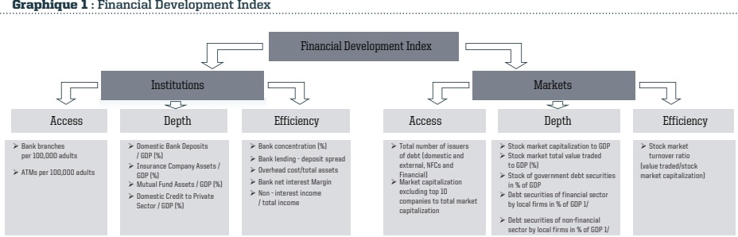
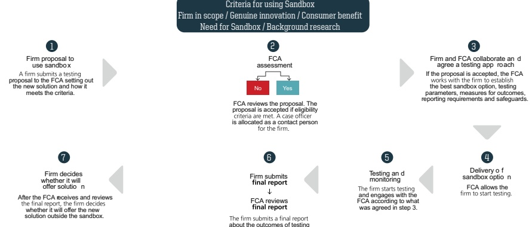

<!-- page 1 -->

## CAHIER DE RECHERCHE

MAE/BRH - CR-004

<!-- page 2 -->

## Avant-Propos

a Banque de la République d'Haïti (BRH) prend plaisir à présenter aux chercheurs, aux étudiants, aux partenaires du système financier et au public en général son cahier de recherche numéro quatre (4). Une fois de plus, la BRH souhaite partager avec vous les réflexions de ses cadres sur des thèmes de grande importance pour la conduite de sa politique monétaire.

Cette publication, contrairement aux précédentes, ne s'articule pas autour d'un thème spécifique mais présente quatre articles où sont analysés des sujets variés qui sont liés au fonctionnement du système financier haïtien et à la politique monétaire. Ces sujets constituent des champs d'investigation utiles pour tous ceux qui sont curieux d'approfondir leur connaissance sur les mécanismes de fonctionnement de l'économie haïtienne en général et du secteur financier en particulier.

Le premier article a mis en exergue les mouvements au niveau des taux bancaires découlant des impulsions monétaires (taux directeurs). À partir d'un modèle à correction d'erreur (MCE), l'auteur fait ressortir la présence d'asymétrie dans la transmission des chocs monétaires. Les résultats des estimations ont montré un faible degré de pass-through des taux bancaires, avec des effets asymétriques dans certains cas.

De même, l'analyse des données financières de neuf banques du système a permis de mettre en évidence les principaux déterminants de la rentabilité des banques en Haïti. Celle-ci s'est basée sur une régression du rendement des actifs (ROA) et un ensemble de facteurs spécifiques aux banques, des facteurs de structure du marché aussi bien que des paramètres macroéconomiques. Les résultats ont indiqué que les rendements passés continuent d'influencer modérément la rentabilité actuelle des banques alors qu'une augmentation du portefeuille de crédit par rapport aux dépôts est associée à un ROA plus élevé.

Le troisième article traite de la relation entre les cycles de crédit et l'activité économique en Haïti au cours de la période 1980-2016. A travers ce papier il est effectué une investigation sur les profils d'évolution du crédit et de l'activité réelle en Haïti au cours de ces trente dernières années. Pour y parvenir, trois méthodes ont été retenues. Il s'agit de l'indice de concordance proposé par Harding et Pagan, de celui des coefficients de corrélation croisées entre les composantes cycliques du crédit et du PIB et du test de causalité entre crédit et PIB au sens de Granger. Les résultats ont confirmé l'existence d'un co-mouvement relativement important entre le crédit et le Produit Intérieur Brut sur la période 1981-2016 (70%) mais ne dégagent aucune relation de causalité.

<!-- page 3 -->

Dans le dernier article la problématique de l'accès au financement a été posée. L'étroitesse du marché financier apparait comme un handicap majeur à la croissance. Après avoir identifié les problèmes communs rencontrés dans les pays de la Caraïbes, parmi lesquels: l'accessibilité des marchés financiers, l'auteur a démontré l'importance de la Fintech tels que le financement participatif, les prêts P2P et les financements mobiles comme des instruments susceptibles de combler les lacunes du marché financier.

La BRH demeure convaincue que ces réflexions qui favorisent une meilleure compréhension du fonctionnement de notre système financier et de la transmission de la politique monétaire, vont servir de base pour alimenter les débats et encourager le développement de la recherche scientifique en Haïti. Elle tient toutefois à signaler que les opinions émises dans ces textes ne représentent pas le point de vue officiel de la BRH et n'engagent que leurs auteurs.

Erol SAINT LOUIS

Directeur

Monnaie Et Analyse Economique

Banque de la République d'Haïti (BRH)

<!-- page 4 -->

## Sommaire

01 Pass-through des taux directeurs de la Banque Centrale sur les taux bancaires en Haiti : Implications pour les autorités monétaires
02 Par Claude Jacques Divers
Les déterminants de la rentabilité des banques en Haiti
Par Dudley Augustin et Carl-Henri Prophète
Analyse des cycles du crédit
et de l'activité économique en Haiti
[1980-2016]
Par Gihanne Amboise
04 Financial market development
6 FINTECH Development
in the caribbean region
Par Gwendoline Darguste

<!-- page 5 -->

<!-- page 6 -->

<!-- page 7 -->

# Pass-through des taux directeurs de la Banque Centrale sur les taux bancaires en Haïti : Implications pour les autorités monétaires

<!-- page 8 -->

# Résumé

L es taux d'intérêt directeurs jouent un rôle fondamental comme courroie de transmission de la politique monétaire. En effet, à travers ces taux, la banque centrale transmet ses impulsions monétaires à l'économie réelle via les répercussions sur les taux d'intérêt offerts par les institutions bancaires. La connaissance du degré d'ajustement

des taux bancaires par rapport aux taux directeurs s'avère incontournable compte tenu du fait que cela permet de mesurer l'efficacité de la politique monétaire qui en découle. A cet effet, ce travail vise à investiger la relation entre les taux directeurs et les taux bancaires à travers l'estimation du pass-through et aussi à étudier la présence d'asymétrie dans la dynamique de transmission de la politique monétaire au niveau du système bancaire haïtien. Pour ce, un modèle à correction d'erreur (MCE) est utilisé pour mesurer le degré de réactivité des taux bancaires suite aux modifications des conditions monétaires. Pour tester la présence d'asymétrie dans la transmission des chocs monétaires, un modèle à seuil est donc utilisé lequel est un prolongement du modèle à correction d'erreur. Enfin, dans le but d'apprécier les conditions de stabilité des coefficients d'ajustement, un test de stabilité est utilisé. Les résultats des estimations ont révélé un faible degré de pass-through des taux bancaires, avec des effets asymétriques dans certains cas. Aussi, la transmission de la politique monétaire aux taux créditeurs s'est-elle révellée instable sur la période allant de juin 2000 à juin 2011.

JEL Classification: E43, E52

Mots clés : Pass-through, système bancaire, asymétrie, modèle à correction d'erreur (ECM), modèle asymétrique.

<!-- page 9 -->

## Sommaire

Résumé .....8
0.-Introduction .....9
1.-Revue de littérature théorique et empirique .....11
1.1.-Revue de littérature théorique .....11
1.2.-Revue de littérature empirique .....12
2.-Évolution de quelques variables bancaires entre juin 2000-juin 2011 .....14
3.-Méthodologie de l'étude .....16
3.1.-Les données .....16
3.2.-Les modèles .....16
3.2.2.-Modèles symétriques : Approche standard / Approche par la Cointégration .....17
3.2.3.-Modèles asymétriques .....17
4.-Les résultats empiriques .....18
4.1.-Interprétation des résultats .....19
4.2.-Test de stabilité des coefficients de Pass-through .....21
5.-Conclusion .....22
perspectives .....23
Bibliographie .....24

<!-- page 10 -->

# Introduction

Dans la poursuite de ses objectifs, qui consistent fondamentalement en la stabilité des prix, la Banque Centrale dispose de plusieurs canaux de transmission qui permettent de répercuter les impulsions monétaires sur l'économie réelle. Au cours de ces dernières décennies, une abondante littérature a été publiée sur les mécanismes de transmission de la politique monétaire par le biais du taux d'intérêt. Ce mécanisme est plus généralement connu sur le nom de pass-through des taux directeurs sur les taux offerts par les institutions bancaires. La connaissance du degré et de la vitesse de ce pass-through est fondamentale pour la banque centrale dans la mesure où elle permet d'appréhender l'efficacité de la politique monétaire.

Suite à une variation des taux du marché monétaire, l'ajustement des taux bancaires se fait de manière plus ou moins rapide selon qu'il s'agit des taux sur les dépôts ou encore sur les prêts. La transmission dépendra alors de plusieurs facteurs dont le niveau de développement du marché financier, le degré de concurrence, la volatilité des taux directeurs pour ne citer que ceux-là.

Parmi les points révélateurs dans la littérature économique sur le degré de pass-through des taux directeurs sur les taux bancaires, on retient que la transmission est parfois lente et incomplète à court terme (Pass-trough incomplet) mais complète à moyen et long termes. Ainsi donc, les changements opérés au niveau du marché monétaire domestique se transmettent avec des retards sur les taux bancaires. Ce laps de temps est fonction du degré de viscosité $ ^{1} $ des taux bancaires.

L'une des premières tentatives d'explication de cette viscosité ou encore du degré d'inertie des taux bancaires a été l'œuvre de Stiglitz et Weiss (1981). Le fait est qu'il existe de l'asymétrie informationnelle au niveau du marché bancaire peu concurrentiel, ce qui conduit à un rationnement² du crédit. Dès lors, les gains espérés des banques sont une fonction des taux d'intérêt sur les prêts. Etant donné que la probabilité d'avoir un défaut de paiement augmente d'autant que les taux d'intérêt sont élevés, alors toute hausse des taux d'intérêt est susceptible de provoquer une hausse des risques de portefeuille des prêts bancaires par sélection adverse ou aléa moral. Dans cette logique, les banques ne peuvent pas augmenter les taux débiteurs même dans les cas où elles font face à une hausse des coûts marginaux. Tout ceci peut se traduire par le fait que les

<!-- page 11 -->

investisseurs prudents seraient découragés et d'autres plus averses au risque seraient attirés par ces taux élevés. Autrement dit, les prêteurs auront tendance à investir dans des projets plus risqués à cause des taux d'intérêt élevés. Tout compte fait, l'existence de l'asymétrie informationnelle entre prêteurs et emprunteurs sur le marché des prêts peut générer une certaine viscosité des taux d'intérêt sur les prêts bancaires.

L'objectif de ce papier consiste à estimer le degré de pass-through et d'évaluer la présence éventuelle d'effets asymétriques dans la dynamique de transmission de la politique monétaire. Pour ce, nous allons recourir à l'estimation d'un modèle à correction d'erreur (MCE) en utilisant des données mensuelles pour la période juin 2000-juin 2011, puis une variante du modèle MCE (modèle à seuil) pour étudier la dynamique asymétrique. Ce travail comprend cinq sections. Dans la première, nous présenterons les déterminants théoriques du pass-through puis passerons en revue quelques travaux empiriques ayant investigué cette problématique. La deuxième est consacrée à une brève présentation de l'évolution des différents taux d'intérêt. Nous présenterons au niveau de la troisième section, la méthodologie adoptée dans le cadre de cette étude. La quatrième section comprend la présentation et l'interprétation des résultats empiriques et la dernière est consacrée à la conclusion ainsi qu'aux perspectives.

<!-- page 12 -->

### 1. Revue de littérature théorique et empirique

#### 1.1. - Revue de littérature théorique

Théoriquement, le pass-through des taux directeurs sur les taux bancaires peut être influencé positivement ou négativement par des facteurs d'ordre institutionnel ou financier.

Les déterminants du pass-through des taux directeurs sur les taux bancaires

## a) La structure de la dette

La littérature économique retient la structure de la dette d'une économie comme facteur explicatif de la vitesse de transmission des impulsions monétaires sur les taux bancaires. En effet, dans une économie où la structure de la dette des agents non financiers est composée essentiellement de passifs à taux variables (ou taux à court terme), les ajustements des taux bancaires en réaction aux chocs de la politique monétaire se font de manière plus rapide. Par contre, si les dépôts sont rémunérés majoritairement à des taux fixes, la vitesse de transmission des chocs monétaires devrait être relativement faible. Tout compte fait, la structure de la dette a une incidence majeure sur la vitesse d'ajustement des taux débiteurs en cas de modification des conditions monétaires.

## b) La pression concurrentielle au niveau du marché bancaire

Le niveau de concurrence au niveau du marché bancaire joue un rôle fondamental dans la qualité de transmission des chocs monétaires sur les taux offerts par les banques commerciales. Selon le degré de pression concurrentielle, l'ajustement des taux bancaires devrait être plus ou moins complet. D'une manière générale, se basant sur certains éléments théoriques, il est admis que la transmission des impulsions monétaires sur les taux intermédiels se fait de manière nettement plus rapide dans une économie où la pression concurrentielle entre banques est très élevée (Cottarelli et Kourelis, 1994, Borio et Fritz 1995, Mojon, 2000, Sanders et Kleimeier, 2003). Une des approches retenues pour évaluer l'influence de la concurrence sur le pass-through consiste à déterminer l'indice de concentration basé sur le calcul du ratio entre le total des actifs d'une banque ou d'un groupe de banques par rapport au total des actifs du système bancaire.

## c] L'Inflation

L'environnement inflationniste détermine théoriquement le pass-through des taux directeurs sur les taux bancaires, sur la base de l'ajustement plus ou moins rapide des prix. En effet, certains prix sont rigides à la baisse et l'inflation permet un réajustement par les prix relatifs (Mojon, 2000). Il est admis que les taux directeurs de la Banque Centrale augmentent parfois moins vite que l'inflation, ce qui se traduit par une baisse du taux d'intérêt réel. Par rapport à cette situation, les banques commerciales se voient dans l'obligation d'augmenter leurs taux débiteurs car cette chute du taux d'intérêt réel constitue une détérioration des profits bancaires. Vue sous cet angle, l'inflation peut contribuer à l'amélioration de la vitesse du pass-through et permettre un meilleur ajustement à la hausse des taux d'intérêt.

## d) La volatilité des taux directeurs

L'incertitude influe négativement sur l'effet de la politique monétaire dès lors que les banques commerciales ont du mal à ajuster leurs taux. A cela, s'associent des coûts d'ajustement d'autant plus élevés pour les banques que le niveau d'incertitude sur la politique monétaire est grand. De plus, les emprunteurs sont averses au risque, les banques peuvent vouloir privilégier la stabilité de leurs taux en adoptant un comportement de lissage des variations du marché monétaire. S'il s'avère que ce comportement est adopté par ces derniers, la mise en place d'une politique monétaire crédible devrait pouvoir influencer positivement la transmission des fluctuations des taux directeurs sur les taux bancaires. Le niveau d'incertitude en question est associé empiriquement à la variance des taux d'intérêt directeurs. Plus la variance est grande, plus le niveau

<!-- page 13 -->

d'incertitude est élevé et se traduit par une viscosité dans le pass-through $ ^{3} $. Tout compte fait, les variations des taux directeurs auraient un impact plus considérable sur les taux du marché bancaire lorsque ces variations sont perçues comme étant permanentes (Mojon, 2000).

## e) Le niveau de la croissance économique

La croissance économique peut s'avérer très bénéfique dans la transmission des impulsions monétaires au marché bancaire. En effet, la croissance va avoir un fort impact sur l'investissement et l'endettement. En situation de croissance économique, lorsqu'une forte demande est anticipée, avec de bonnes perspectives en termes de profits et de débouchés, les entreprises sont alors incitées à investir, participant une hausse de l'activité économique. Étant fortement corrélée avec l'investissement, toute hausse de cette dernière se traduit par une hausse préalable du niveau d'investissement (multiplicateur keynésien). Dans les conditions décrites précédemment, les entreprises auront tendance à s'endetter en recourant soit à la finance directe ou encore au crédit bancaire. Dès lors, il est fort probable que la hausse de la demande et du volume des crédits ait un impact positif sur le pass-through (Mojon, 2000).

#### 1.2. -Revue de littérature empirique

Au cours de ces dernières décennies, les recherches autour de la problématique de la transmission des impulsions monétaires se sont affluées et ont fait l'objet d'une attention particulière, étant donné que cela témoigne de l'efficacité même de la politique monétaire. Plusieurs auteurs ont investigé ce champ d'étude et ont permis d'isoler certains faits cruciaux pour la compréhension des mécanismes de transmission, la réactivité des institutions bancaires aux changements des conditions monétaires, ce qui permet de dégager des pistes de réflexions quant à une meilleure appropriation des instruments de politique monétaire et particulièrement du taux d'intérêt.

Le point commun de toutes ces recherches est qu'il existe une certaine inertie des taux bancaires suite aux variations des taux du marché monétaire. Cottarelli et Kourelis (1994) ont trouvé que le pass-through diffère d'un pays à un autre et que certains paramètres tels le cycle des affaires, la structure des dépôts, le risque de crédit, et la volatilité bancaire sont autant de facteurs susceptibles de rendre le pass-through incomplet. Ils sont parvenus à conclure que les taux bancaires sont assez visqueux à court terme et le sont probablement à long terme. Ces auteurs expliquent la viscosité des taux créditeurs comme une conséquence de la structure concurrentielle de l'économie. Dans un environnement bancaire peu concurrentiel, les taux sur les dépôts ne vont pas réagir, car cette variation marginale ne pourra pas compenser les coûts d'ajustement des banques. Aussi, étant dans un contexte de marché peu concurrentiel, les banques peuvent agir de manière collusive, ce qui fait que l'atteinte d'un nouvel équilibre suite à une variation des taux directeurs se fait très lentement.

Hannan et Berger (1991) s'appuient sur l'élasticité de la demande de prêts pour expliquer le caractère visqueux des taux bancaires. Pour eux, le marché bancaire peut être considéré comme une industrie : L'industrie bancaire. Etant donné que toute industrie fait face à des coûts d'ajustement, alors c'est pareil pour l'industrie bancaire. Par conséquent, lorsque les prix, à savoir les taux du marché, ont été modifiés, la vitesse d'ajustement (le pass-through) devrait dépendre de la demande des prêts bancaires, laquelle dépend de la structure du système financier.

L'idée de symétrie et d'asymétrie dans l'ajustement des taux bancaires a été explorée par Hannan et Berger (1991), par Neumark et Sharpe (1992) et a été plus largement développée par Scholnic (1996). Ces auteurs ont fait ressortir l'existence des rigidités symétriques et asymétriques au niveau des taux sur les dépôts et les prêts, lesquelles sont dues aux coûts d'ajustement. Les explications fournies par ces auteurs autour des effets asymétriques dans l'ajustement des taux se fondent sur deux hypothèses clés : Les réactions

<!-- page 14 -->

des clients et le « Collusive pricing arrangements ». Selon la première hypothèse, on devrait s'attendre à une meilleure rigidité à la baisse et à la hausse sur les dépôts et les prêts respectivement, due aux réactions défavorables des clients par rapport aux taux instables. Suivant la deuxième hypothèse, en particulier dans les marchés très concentrés, les taux sur les dépôts sont supposés être très rigides à la hausse et les taux sur les prêts, très rigides à la baisse.

## a) Évaluation de l'ajustement des taux bancaires

Les travaux empiriques sur l'évaluation du pass-through ont été initiés en 1994 avec notamment les études publiées par la Banque des Règlements Internationaux (BRI). Au cours de la même année, Cottarelli et Kourelis, suivis une année plus tard par Borio et Fritz ont approfondi les résultats de la BRI (1994). Les travaux de Cottarelli et Kourelis (1994) se donnaient pour principal objectif d'expliquer l'inertie des taux bancaires observée dans la transmission de la politique monétaire. Pour ce, ils ont maintenu la même démarche que la BRI qui consista à estimer pour une période donnée, les délais de réaction et l'amplitude de réponse des taux bancaires suite aux interventions de la banque centrale. Ils ont utilisé une approche théorique standard avec un modèle dit de première génération. Ce modèle standard a constitué la base des autres travaux qui ont suivi jusqu'au cours des années 2000, où les modèles à correction d'erreurs ont été utilisés.

## b) Les travaux empiriques de Cottarelli et Kourelis (1994)

Le cadre d'analyse proposé par Cottarelli et Kourelis (1994) permettant d'estimer le degré de réactivité des taux bancaires, repose sur une modélisation assez simplifiée qui peut être décrite de la manière suivante :

 $$ \Delta r l_{t}=\Phi+\lambda(r l_{t-1}-\beta r m_{t-1}-k)+\alpha_{1}\Delta r m_{t}+\alpha_{2}\Delta r m_{t-1}+\varepsilon_{t} $$

\textbf{Avec:}  $ \nu = \frac{\beta + \sum_{n=1}^{nmax} \beta_n}{1 - \sum_{k=1}^{kmax} \lambda_k} $

Où rl représente le taux d'intérêt bancaire, rm le taux officiel du marché monétaire et λ le coefficient qui mesure la sensibilité des taux bancaires aux chocs de la politique monétaire. Ce coefficient indique l'amplitude de la réponse des taux bancaires. Ce modèle ainsi spécifié vise uniquement à mesurer la qualité d'ajustement des taux débiteurs et créditeurs et présente certains inconvénients majeurs. D'une part, il ne prend pas en compte les facteurs structurels et d'autre part se pose la question du choix du taux de référence pour le coût de la liquidité bancaire. Compte tenu de la multiplicité des crédits et des échéances, la littérature empirique retient le plus souvent le taux du marché de trois mois comme taux de référence pour les emprunts à court terme.

## c) Les résultats obtenus par Cottarelli et Kourelis

Cottarelli et Kourelis (1994) ont réalisé une étude sur 32 pays de tous les continents, hormis l'Afrique. Les résultats présentés ont mis en évidence une très forte disparité entre les pays développementés et ceux en développement que faisaient partie de l'échantillon. Il a eu lieu de constater des écarts de transmission entre les pays industrialisés et ceux en voie de développement, ce qui était théoriquement prévisible. Cependant, cela apparaît moins évident pour les pays avec des structures financières assez proches. Les résultats ont permis de voir que l'ajustement des taux bancaires reste incomplet après six mois à l'exception du Canada et du Royaume-Uni, ce qui confirme l'hypothèse de l'inertie des taux bancaires à court terme. Par contre, à long terme, l'ajustement des taux bancaires est complet.

## d) La réactivité des taux bancaires au cours des années 2000

A partir de l'année 2000, la littérature empirique sur la transmission des impulsions monétaires au secteur bancaire a connu une nouvelle envolée, notamment avec des auteurs tels : Mojon (2000) ; Angeloni et Hermann (2003) ; Coffinet (2005), de Bondt et al. (2005) pour ne citer que ceux-là. Leurs travaux ont permis

<!-- page 15 -->

de mieux apprécier la transmission des décisions de politique monétaire dans la plupart des pays industrialisés. Cette nouvelle littérature isole d'autres facteurs pouvant justifier la vitesse à laquelle les taux bancaires s'ajustent aux variations du taux du marché monétaire. A cet effet, la progression de la part de la dette à taux variables, le recul du poids des dépôts au passif des banques, le changement de régime monétaire ont été identifiés comme des déterminants de la vitesse du pass-through. Ce dernier facteur vient corroborer la hausse de réactivité des taux bancaires dans la Zone Euro. Selon ces auteurs, la mise en place de cette monnaie unique a permis d'améliorer la transmission des chocs monétaires, car avant l'euro, on pouvait observer une certaine inertie dans l'ajustement des taux bancaires, tel n'a pas été le cas depuis l'apparition de celle-ci.

## e) Modélisation adoptée au cours des années 2000

Depuis les travaux de Cottarelli et Kourelis (1994), considérés comme des pionniers dans la littérature sur le pass-through des chocs monétaires sur les taux bancaires, d'autres travaux ont suivi, conséquemment d'autres modèles ont été spécifiés pour prendre en compte toutes les spécificités de cette problématique. De fait, les modèles à correction d'erreur sont venus renforcer les modèles standards, apportant ainsi plus de précisions sur l'amplitude des réponses.

Le modèle à correction d'erreur émanant de cette nouvelle approche du pass-through se présente de la manière suivante :

 $$ \Delta r l_{t}=\Phi+\lambda(r l_{t-1}-\beta r m_{t-1}-k)+\alpha_{1}\Delta r m_{t}+\alpha_{2}\Delta r m_{t-1}+\varepsilon_{t} $$

Avec  $ \Delta rl_{t-1} $ Les taux d'intérêt bancaires à court terme à la date t-1

 $ \Delta rm_{t-1} $: Le taux du marché monétaire à trois mois pris pour les taux directeurs

 $$ \mathrm{e c t}_{t-1}=r l_{t-1}-\beta r m_{t-1}-k $$

Δ : L'opérateur de différence

 $ \varepsilon_{t} $: Un bruit blanc

Cette équation ainsi spécifiée fait apparaître trois variables clés : les taux d'intérêt bancaires  $ \Delta r_l $(t-1), régressés sur les modifications du taux du marché( $ \Delta r_{t-1} $),  $ \operatorname{ect}_{t-1} $ qui prend en compte la dynamique de court terme et qui donne la qualité de la transmission. Aussi, d'autres indicateurs ont été construits pour mesurer à court et à long termes la vitesse et l'amplitude de la réactivité des taux bancaires. Pour ce, on a :  $ \lambda $ qui mesure la vitesse d'ajustement des taux bancaires ;  $ \alpha_1 $ : la transmission instantanée ;  $ \beta $ : la transmission finale et le rapport  $ \frac{(\alpha_1+\alpha_2)-1}{\lambda} $ qui donne le délai moyen d'ajustement du pass-through.

### 2. - Évolution de quelques variables bancaires

Au cours de la période allant de juin 2000 à juin 2011, les taux d'intérêt bancaires et monétaire ont connu globalement une évolution à la baisse. Les taux sur les dépôts d'épargne se sont fixés en moyenne à 1.68%, tout en restant dans une fourchette de 0.28% et 4%, avec un écart moyen de 1.47%. Ceux-ci ont accusé leurs plus fortes rémunérations au cours des sous-périodes juin 2000-février 2002, avril 2003-février 2004, soit une moyenne de 3.42% et 3.32%. À partir de juin 2008 jusqu'au mois de juin 2011, les dépôts d'épargne ont été moins bien rémunérés, soit 0.59% en moyenne. D'autre part, les taux sur les dépôts à terme ont été fixés en moyenne à 6.79%, fluctuant dans une fourchette de 0.28% à 17.5%, avec une déviation moyenne de 5.12%. Ces dépôts sont très fortement rémunérés sur la période juin 2004 –décembre 2004 (12.12% en moyenne) tandis que depuis cette date, ces taux ont été relativement faibles (3.15% en moyenne).

<!-- page 16 -->

<table>
  <thead><tr><th>Juni-2000</th><th>Novembre-2000</th><th>Avril-2001</th><th>Septembre-2001</th><th>février-2002</th><th>Juillet-2002</th><th>Décembre-2002</th><th>Mai-2003</th><th>Octobre-2003</th><th>Mars-2004</th><th>Aout-2004</th><th>Janvier-2005</th><th>Juin-2005</th><th>Novembre-2006</th><th>Avril-2006</th><th>Sepembre-2006</th><th>février-2007</th><th>Juillet-2007</th><th>Décembre-2007</th><th>Mai-2008</th><th>Octobre-2008</th><th>Mars-2009</th><th>Aout-2009</th><th>Janvier-2010</th><th>Juin-2010</th><th>Novembre-2010</th><th>Avril-2011</th></tr></thead>
  <tbody>
    <tr><td>Taux d'intérêt sur les bons (91jours)</td><td>4</td><td>4</td><td>3</td><td>3</td><td>3</td><td>3</td><td>3</td><td>3</td><td>3</td><td>3</td><td>3</td><td>3</td><td>4</td><td>4</td><td>4</td><td>3</td><td>3</td><td>3</td><td>3</td><td>3</td><td>3</td><td>3</td><td>3</td><td>3</td><td>3</td></tr>
    <tr><td>Taux sur les dépots d'épargne (en gdes)</td><td>11</td><td>16</td><td>15</td><td>10</td><td>8</td><td>10</td><td>15</td><td>15</td><td>15</td><td>8</td><td>8</td><td>15</td><td>18</td><td>20</td><td>18</td><td>17</td><td>16</td><td>8</td><td>8</td><td>8</td><td>8</td><td>8</td><td>8</td><td>8</td><td>8</td></tr>
    <tr><td>Taux sur les prêts (en gdes)</td><td>25</td><td>29</td><td>29</td><td>25</td><td>29</td><td>29</td><td>29</td><td>29</td><td>29</td><td>23</td><td>8</td><td>8</td><td>18</td><td>20</td><td>18</td><td>17</td><td>15</td><td>8</td><td>8</td><td>8</td><td>8</td><td>8</td><td>8</td><td>8</td><td>8</td></tr>
  </tbody>
</table>

Source: www.brh.net

Parallèlement, les taux débiteurs ont été très élevés sur la période étudiée, fluctuant dans une fourchette de 17.75% à 36.5%, tout en étant moyennement fixés à 26.57%, avec une déviation moyenne de 4.57%. Les taux sur les prêts en gourdes, ont commencé à gonfler sur la période mars 2003-septembre 2007, en se fixant en moyenne à 30.25%, puis se sont relativement stabilisés autour de 21.87% en moyenne jusqu'en juin 2011.

Les taux directeurs de référence (taux sur les bons à 91 jours) ont fluctué entre 0% et 27.8% sur toute la période en s'écartant moyennement de 8.43% par rapport aux taux directeurs moyen qui s'est fixé à 13.9%. Il est à remarquer qu'il a été assez élevé au cours de trois sous-périodes : juin 2000-septembre 2001 ; février 2003-janvier 2004 ; juin 2005-juillet 2007, avec une moyenne de 26.28%, 27.52%, 16.74%, respectivement. Juste après cette date, les taux sur les bons à maturité de 91 jours ont été maintenus en moyenne à 5.93%. Ces chiffres-là permettent de voir que la politique monétaire de la banque centrale a été plutôt restrictive (visant à éponager le surplus de liquidité dans le système, sachant que les taux directeurs sont des instruments privilégiés des autorités monétaires haïtiennes) au regard de ces trois sous-périodes.

| Juni-2000 | Dépôts à l'épargne en MG | Dépôts à terme en MG | Crédits au secteur privé en MG |
| --- | --- | --- | --- |
| 6000 | 5500 | 5000 | 7500 |
| Jun-2000 | 5500 | 5000 | 7500 |
| Decembre-2000 | 6000 | 5500 | 8000 |
| Juni-2001 | 6000 | 5500 | 8000 |
| Décembre-2001 | 6000 | 5500 | 8000 |
| Juni-2002 | 6000 | 5500 | 8000 |
| Decembre-2002 | 6500 | 6000 | 9000 |
| Juni-2003 | 7000 | 6500 | 10500 |
| Décembre-2003 | 8000 | 7000 | 11000 |
| Jun-2004 | 8500 | 7500 | 11500 |
| Juni-2005 | 8500 | 7500 | 12000 |
| Décembre-2005 | 9000 | 8000 | 13000 |
| Juni-2006 | 9500 | 8500 | 13500 |
| Décembre-2006 | 10500 | 9500 | 14000 |
| Juni-2007 | 10000 | 9000 | 14500 |
| Décembre-2007 | 10500 | 9000 | 15000 |
| Juni-2008 | 11000 | 9000 | 16000 |
| Décembre-2008 | 11500 | 9000 | 17000 |
| Juni-2009 | 12000 | 9000 | 18000 |
| Décembre-2009 | 13000 | 8500 | 19500 |
| Juni-2010 | 13500 | 8500 | 21000 |
| Décembre-2010 | 14000 | 8500 | 22500 |
| Juni-2011 | 14500 | 8000 | 24000 |

<!-- page 17 -->

Au regard de l'évolution de l'indice Herfindahl-Hirschmann, on peut voir que le secteur bancaire affiche un degré de concentration plutôt modéré sur la période 2000-2003. Cependant, à partir de 2004, cette concentration au niveau des activités bancaires s'est largement accentuée d'une manière générale, et pour ce qui est des rubriques : Actif total, portefeuille de prêts, dépôts totaux et dépôts en dollars ÊU, on peut même parler de très forte concentration à partir de 2006. Compte tenu de ces statistiques, on peut conclure que le marché bancaire haïtien a été très concentré au cours de cette dernière décennie.

<table><tr><td>Tableau 1. -Évolution de l'indice de concentration bancaire [Indice de Herfindahl-Hirschmann]</td></tr><tr><td>Année</td><td>Actif total</td><td>Portefeuille de prêts</td><td>Dépôts totaux</td><td>Dépôts en dollars EU</td></tr><tr><td>2000</td><td>1348.3</td><td>1307.1</td><td>1420.8</td><td>1712.7</td></tr><tr><td>2001</td><td>1416.1</td><td>1309.2</td><td>1457.2</td><td>1738.2</td></tr><tr><td>2002</td><td>1469.3</td><td>1391.2</td><td>1540.8</td><td>1753.0</td></tr><tr><td>2003</td><td>1606.4</td><td>1414.0</td><td>1727.2</td><td>1940.3</td></tr><tr><td>2004</td><td>1627.1</td><td>1477.2</td><td>1744.8</td><td>2027.3</td></tr><tr><td>2005</td><td>1760.1</td><td>1501.9</td><td>1863.2</td><td>2150.9</td></tr><tr><td>2006</td><td>2 307,90</td><td>1 923,86</td><td>2 356,98</td><td>2 392,83</td></tr><tr><td>2007</td><td>2 283,94</td><td>1 897,70</td><td>2 428,34</td><td>2 638,81</td></tr><tr><td>2008</td><td>2 122,23</td><td>1 797,62</td><td>2 266,63</td><td>2 463,09</td></tr></table>

Source : Rapports Annuels 2005 et 2008 de la BRH

### 3. -Méthodologie de l'étude

#### 3.1. -Les données

Dans le cadre de ce travail, nous aurons à utiliser quatre variables : le taux d'intérêt sur les dépôts d'épargne (rd) en gourde, le taux d'intérêt sur les dépôts à terme (rdat) en gourde, le taux d'intérêt sur les prêts en gourde (rl) et le taux sur les bons à maturité de 91 jours (rm) comme une approximation des taux directeurs de la banque centrale. Les données sont collectées sur une base mensuelle et couvrent la période allant de juin 2000 à juin 2011. Elles proviennent du site de la Banque de la République d'Haiti (BRH). Le choix du taux de référence (taux directeurs) pour estimer le pass-through se base sur les travaux de Sanders et Kleimeier (2003). En effet, pour estimer la vitesse et la qualité du pass-through, ces derniers utilisent le taux au jour le jour (overnight) qui se réfère à la « monetary policy approach » et des taux à maturités différentes dans le cadre de ce qu'ils appellent le « cost of funds approach ». Cette méthodologie permet d'envisager deux cadres d'analyse : en utilisant le taux overnight, on apprécie la transmission de la politique monétaire de court terme sur les taux bancaires. Lorsque les taux à 1, 2,3 ou 6 mois sont utilisés, on observe plutôt la qualité de la transmission sur le long terme. La deuxième approche est plus couramment utilisée, car elle semble donner une meilleure appréciation de la réalité économique. Et ce sont les taux directeurs à maturité de 91 jours qui seront utilisés dans la suite.

#### 3.2. -Les modèles

Tel que présenté précédemment, il existe à travers la littérature plusieurs modèles économétriques permettant de mesurer le degré de réactivité des taux bancaires aux chocs émanant des décisions de politique monétaire. On retrouve les modèles symétriques avec deux approches complémentaires : L'approche standard utilisée par Cottarelli et Kourelis (1994) et l'approche par la cointégration (Mojon et al, 2000).

<!-- page 18 -->

3.2.1.-Modèles symétriques : approche standard

 $$ \Delta r l_{t}=\alpha_{0}+\sum_{k=1}^{k m a x}\lambda_{k}\Delta r l_{t-k}+\beta\Delta r m_{t}+\sum_{n=1}^{n m a x}\beta_{n}\Delta r m_{t-n}+\varepsilon_{t} $$

 $$ \begin{array}{r l}&{\mathrm{A v e c:~}\nu=\frac{\beta+\sum_{n=1}^{n m a x}\beta_{n}}{1-\sum_{k=1}^{k m a x}\lambda_{k}}}\end{array} $$

ν : est le coefficient de long terme calculé à partir des paramètres estimés du modèle. Ce coefficient ne peut être calculé que si les variables sont en niveau, tel n'est pas le cas ici car elles ont été prises en différence première afin d'éviter tout risque de régression fallacieuse. En fait, le modèle standard ne prend pas en compte la relation de cointégration pouvant exister entre les variables, conséquemment, une partie de l'information est perdue avec l'utilisation de ce modèle. Il peut exister des situations où la relation de cointégration n'est pas vérifiée, alors l'utilisation du modèle standard est de mise, permettant toutefois d'avoir une estimation du pass-through.

##### 3.2.2. -Modèle symétrique : Approche par la cointégration

L'approche par la cointégration couramment utilisée est celle d'Engel et Granger(1987) qui consiste dans un premier temps à estimer la relation de long terme entre les deux variables : taux directeurs et bancaire. Ensuite, on construit un modèle à correction d'erreur, où l'on fait apparaître les résidus de la première estimation $ ^{4} $ Il importe de souligner que l'absence de cointégration constitue un moyen de mesure de la qualité de la transmission. Cela dit, lorsque la relation de cointégration n'existe pas, ceci signifie que la transmission se fait très difficilement. Par contre si on observe une relation de cointegration, on peut dire que la transmission est quasi complète.

 $$ r l_{t}=\alpha+\beta r m_{t}+u_{t}\qquad(1) $$

 $$ \begin{array}{r}{\Delta r l_{t}=\alpha_{0}+\sum_{k=1}^{k m a x}\lambda_{k}\Delta r l_{t-k}+\beta\Delta r m_{t}+\sum_{n=1}^{n m a x}\beta_{n}\Delta r m_{t-n}+\lambda\mathrm{e}c t_{t-1}+\varepsilon_{t}}\end{array} $$

Avec :  $ \lambda $ qui est la force de rappel vers l'équilibre de long terme. Il est censé être statistiquement négatif;  $ \operatorname{ect}_{(t-1)} $ le terme de correction de l'erreur faisant intervenir les résidus de l'équation (1).

##### 3.2.3. -Modèle asymétrique

Scholnic (1996), ainsi que Kleimeier et Sander (2000), ont construit un modèle à correction d'erreur asymétrique, lequel est une variante du modèle initial, dans le but de savoir si les taux d'intérêt bancaires s'ajustent différemment aux chocs monétaires selon qu'ils sont en dessous ou en dessus du niveau d'équilibre. Le terme d'erreur du modèle initial est divisé en deux composantes (Kleimeier, 2000) et se présente de sorte que l'on ait :

 $$ \begin{array}{r}{\Delta r l_{t}=\;\alpha_{0}+\sum_{k=1}^{k m a x}\lambda_{k}\Delta r l_{t-k}+\;\beta\Delta r m_{t}+\sum_{n=1}^{n m a x}\beta_{n}\Delta r m_{t-n}+\lambda\mathrm{e}c t_{t-1}+\varepsilon_{t}}\end{array} $$

 $$ \mathrm{e}ct_{t}^{+}=ect_{t}si~ect>moyenne(ect)(2) $$

 $$ \mathbf{e}ct_{t}=0\mathrm{~s i n o n} $$

et

 $$ \mathbf{e}c{t}_{t}^{-}=e c{t}_{t}{~s i~e c t}<m o y e n n e(e c t)(3) $$

 $$ \mathrm{e}ct_{t}=0\mathrm{s i n o n} $$

On aboutit à cette forme :

 $$ \begin{array}{r}{\Delta r l_{t}=\;\alpha_{0}+\sum_{k=1}^{k m a x}\lambda_{k}\Delta r l_{t-k}+\;\beta\Delta r m_{t}+\sum_{n=1}^{n m a x}\beta_{n}\Delta r m_{t-n}+\alpha_{1}\mathrm{e}c t_{t-1}^{+}+\alpha_{2}\mathrm{e}c t_{t-1}^{-}+\varepsilon_{t}\;(4)}\end{array} $$

<!-- page 19 -->

Le terme positif de l'équation (2) signifie que si le taux d'intérêt sur les dépôts ou sur les prêts est en dessus de sa valeur d'équilibre suite à une baisse du taux du marché, alors il s'ajustera à la baisse au cours de la prochaine période. De manière analogue, le terme négatif du modèle (3) suggère que si les taux d'intérêt sur les dépôts ou sur les prêts est en dessous sa valeur d'équilibre suite à une hausse des taux directeurs, il devra s'ajuster à la hausse au cours de la prochaine période.

Le coefficient  $ \alpha_1 $ mesure la vitesse d'ajustement suite à la période de déséquilibre entre les taux directeurs et bancaires quand ces derniers sont en dessus de l'équilibre. De même,  $ \alpha_2 $ mesure la vitesse d'ajustement des taux du marché monétaire et bancaire suite à un déséquilibre survenu lors des précédentes périodes lorsque ceux-ci sont en dessous de la valeur d'équilibre. Pour tester la présence d'asymétrie dans l'ajustement des taux bancaires, il suffit de comparer les deux paramètres  $ \alpha_1 $ et  $ \alpha_2 $, en réalisant un test de Wald (Scholnic, 1996). $ ^6 $ S'ils sont significativement différents, on en déduit que les taux bancaires s'ajustent de manière asymétrique aux variations des taux du marché monétaire. Pour ce qui est des taux sur les dépôts, si  $ \alpha_1 > \alpha_2 $, alors on en conclut que les taux créditeurs s'ajustent plus rapidement à la baisse qu'à la hausse. Par contre, pour les taux débiteurs, si  $ \alpha_2 > \alpha_1 $, cela signifie que ceux-ci s'ajustent plus rapidement à la hausse qu'à la baisse. Dans ces conditions, on dit que les taux sur les dépôts sont plus visqueux à la hausse et que les taux sur les prêts le sont plus à la baisse.

## a)Test de stationnarité des séries

### 4. - Résultats empiriques

La manipulation des séries chronologiques recommande que celles-ci soient stationnaires, afin d'éviter tout risque de régressions fallacieuses. Par conséquent, l'étude de stationnarité des séries sera faite à partir des tests de Dickey-Fuller Augmenté.

Les résultats des tests ont révélé que toutes les séries sont stationnaires en différence première, ce qui laisse présager la présence de relation de cointégration entre elles.

<table><tr><td>Tableau 2. Test de cointégration : Engel-Granger</td></tr><tr><td>séries</td><td>Test de Dickey - Fuller</td><td>Règle de décision</td><td>Conclusion</td></tr><tr><td>ectd</td><td>[-4.975141]</td><td>Rejet de hO</td><td>La série est stationnaire</td></tr><tr><td>[0.0004 $ ^{{*}} $]</td><td></td><td></td></tr><tr><td>ectl</td><td>[-4.16226]</td><td>Rejet de hO</td><td>La série est stationnaire</td></tr><tr><td>[0.0066 $ ^{{*}} $]</td><td></td><td></td></tr><tr><td>ecdat</td><td>[-3.5239]</td><td>Rejet de hO</td><td>La série est stationnaire</td></tr><tr><td>[0.0410 $ ^{{*}} $]</td><td></td><td></td></tr></table>

Source : résultats générés à partir du logiciel Eviews [.] t-student (.) probabilité associée * stationnaire au seuil de 5 %.avec : ectd, le résidu du modèle incluant les taux directeurs et le taux sur les dépôts d’épargne, ectl : le résidu du modèle incluant les taux directeurs et le taux sur les prêts, ecdat : le résidu du modèle de long terme entre les taux directeurs et les taux sur les dépôts à terme

## b) Test de cointégration

Étant donné que les variables sont toutes intégrées de même ordre : rm (1), rl (1) et rd(1), alors il s'avère important de tester une éventuelle relation de cointégration entre les taux directeurs et les taux bancaires sous étude. La méthodologie du test a été décrite précédemment (Engle et Granger, 1987). On estime d'abord la relation de long terme avec les variables en niveau puis, on effectue un test de stationnarité des résidus estimés. Si la série des résidus est stationnaire, alors les séries sont cointégrées et on estime un modèle à correction d'erreur.

Les résultats confirment l'existence de la relation de cointégration entre les séries alors l'estimation d'un modèle à correction d'erreur s'impose (Voir Tableau #2 en annexe).

<!-- page 20 -->

#### 4.1. -Résultats des estimations et interprétations

L'estimation de la relation de long terme a permis de voir que le pass-through des taux directeurs sur les taux bancaires est incomplet, qu'il s'agisse des taux d'intérêt sur les dépôts d'épargne (0.10%), des taux débiteurs (0.29%) et les dépôts à termes (0.5%). (Voir Tableau #1).

 $$ \begin{aligned}rd_{t}&=0.24\;17\;+\;0.1034\;rm_{t}\quad&rl_{t}&=22.506\;+\;0.2921\;rm_{t}\\&\quad rda_{t}=-0.286735\quad&0.507712\quad rm_{t}\end{aligned} $$

Les résultats des estimations pour les deux modèles (symétrique et asymétrique) sont présentés au tableau qui suit :

<table><tr><td>Tableau 3. .Resultats des estimations des modèles symétriques et asymétriques</td></tr><tr><td></td><td>rl</td><td>rd</td><td>rdat</td></tr><tr><td>Variables</td><td>symétrique</td><td>asymétrique</td><td>symétrique</td><td>asymétrique</td><td>symétrique</td><td>asymétrique</td></tr><tr><td>constante</td><td>[-0.019]</td><td>[-0.77]</td><td>[-0.033]</td><td>[0.0145]</td><td>[-0.0759]</td><td>[-0.1453]</td></tr><tr><td></td><td>(0.9215)</td><td>(0.0648)</td><td>(0.1416)</td><td>(0.6923)</td><td>(0.4565)</td><td>(0.3516)</td></tr><tr><td>$ \Delta r l_{t-1} $</td><td>[-0.245]</td><td>[-0.466]</td><td></td><td></td><td></td><td></td></tr><tr><td></td><td>(0.0042)</td><td>(0.000)</td><td></td><td></td><td></td><td></td></tr><tr><td>$ \Delta rd r_{t-1} $</td><td></td><td></td><td>[-0.378]</td><td>[-0.374]</td><td></td><td></td></tr><tr><td></td><td></td><td></td><td>(0.0000)</td><td>(0.0000)</td><td></td><td></td></tr><tr><td>$ \Delta rda_{t-1} $</td><td></td><td></td><td></td><td></td><td>[-0.14303]</td><td>0.1447} {</td></tr><tr><td></td><td></td><td></td><td></td><td></td><td>(0.0854)</td><td>(0.0851)</td></tr><tr><td>$ \Delta rm_t $</td><td>[0.0515]</td><td>[0.0265]</td><td>[-0.015]</td><td>[-0.0127]</td><td>[-0.0482]</td><td></td></tr><tr><td></td><td>(0.3408)</td><td>(0.6299)</td><td>(0.0212)</td><td>(0.0606)</td><td>(0.1052)</td><td></td></tr><tr><td>$ \Delta rm_{t-1} $</td><td>[0.0022]</td><td>[0.0426]</td><td>[0.023]</td><td>[0.0186]</td><td>[0.0482]</td><td>[0.0407]</td></tr><tr><td></td><td>(0.9680)</td><td>(0.4464)</td><td>(0.0011)</td><td>(0.0111)</td><td>(0.3780)</td><td>(0.2149)</td></tr><tr><td>ec  $ t_{t-1} $</td><td>[0.1793]</td><td></td><td>[-0.095]</td><td></td><td>[-0.1427]</td><td></td></tr><tr><td></td><td>(0.0009)</td><td></td><td>(0.0048)</td><td></td><td>(0.0006)</td><td></td></tr><tr><td>$ ect_{t-1}^{+} $</td><td></td><td>[0.0059]</td><td></td><td>[-0.1727]</td><td></td><td>[-0.1045]</td></tr><tr><td></td><td></td><td>(0.9477)</td><td></td><td>(0.0033)</td><td></td><td>(0.0652)</td></tr><tr><td>$ ect_{t-1}^{-} $</td><td></td><td>[-0.4885]</td><td></td><td>[-0.0032]</td><td></td><td>[-0.1717]</td></tr><tr><td></td><td></td><td>(0.006)</td><td></td><td>(0.9599)</td><td></td><td>(0.0693)</td></tr><tr><td>$ R^{2} $</td><td>0.1835</td><td>0.19</td><td>0.35</td><td>0.37</td><td>0.15</td><td>0.14</td></tr><tr><td>DW</td><td>2.05</td><td>2.01</td><td>2.11</td><td>2.09</td><td>1.99</td><td>1.97</td></tr><tr><td>Wald  $ stat^{8} $</td><td></td><td>[4.229]</td><td></td><td>[-2.66722]</td><td></td><td>[0.2905]</td></tr><tr><td></td><td></td><td>(0.0397)**</td><td></td><td>(0.1024)</td><td></td><td>(0.5898)</td></tr></table>

Source : Résultats générés sur Éviews ; [.] : Coefficients estimés (.) : probabilité associée.

<!-- page 21 -->

Pour estimer le modèle à correction d'erreur(MCE), trois retards ont été introduits afin de prendre en compte la dynamique de court terme existant entre les taux directeurs et les taux bancaires. Après trois estimations, on est parvenu à un MCE avec p=1. Comme attendu théoriquement, les coefficients du terme d'erreur (décalé d'une période) sont négatifs et statistiquement significatif dans les deux cas, ce qui justifie l'utilisation du modèle. Les résultats des estimations montrent que les chocs sur les taux du marché monétaire ne se répercutent que partiellement sur les taux bancaires. En effet, à court terme, les taux sur les dépôts d'épargne, les dépôts à terme et les prêts ne s'ajustent qu'à hauteur de 0.095%, 0.14% et 0.18% respectivement suite à un choc de 1% sur le taux du marché monétaire. D'autre part, les résultats du modèle asymétrique montrent que les taux sur les dépôts d'épargne sont très rigides à la hausse (0.0032%) avec une faible flexibilité dans l'ajustement à la baisse (0.17%) suite à un déséquilibre de 1% au niveau du marché monétaire. Contrairement, les taux sur les dépôts à terme, s'ajustent plus rapidement à la hausse qu'à la baisse, soit un ajustement de 0.17% lorsque ceux-ci se trouvent en dessous de l'équilibre et de 0.10% dans la situation inverse. Parallèlement, les taux débiteurs afficient une réactivité assez considérable à la hausse (0.49%) alors qu'ils sont très visqueux à la baisse, soit un ajustement de 0.01%. Ces résultats laissent présager la présence d'asymétrie dans la transmission des chocs monétaires aux taux bancaires. Pour ce, nous avons réalisé un test de Wald (Scholnic, 1996), qui permet de savoir si les coefficients associés aux termes d'erreur des modèles asymétriques (modèle à seuil) sont statistiquement différents et le cas échéant conclure sur la présence d'effets asymétriques dans le pass-through. Les résultats du test ont montré qu'il n'existe pas d'asymétrie dans la transmission des variations des taux directeurs sur les taux créditeurs, ce qui signifie qu'ils s'ajustent de manière uniforme. Parallèlement, des effets asymétriques ont été isolés dans le pass-through des taux débiteurs.

<table><tr><td>Tableau 4. Test de Wald</td></tr><tr><td>Test de Wald</td><td>Taux sur les Dépôts d'épargne</td><td>Taux sur les dépôts à terme</td><td>Taux sur les prêts</td></tr><tr><td>F - stat</td><td>[2.667][0.105]</td><td>[0.2905] (0.5908)</td><td>[4.229][0.0418]</td></tr><tr><td>Chi-carré</td><td>[2.667] (0.1024)</td><td>[0.2905] (0.5898)</td><td>[4.2296][0.0397]</td></tr><tr><td>Règle de décision</td><td>Non rejet de h0: Il n'a pas</td><td>Non rejet de h0: Il n'a pas</td><td>Rejet de h0: il y a asymétrie dans la transmission</td></tr><tr><td></td><td>d'asymétrie dans la transmission</td><td>d'asymétrie dans la transmission</td><td></td></tr><tr><td>[ ] Statistique du test: [ ] probabilité associée</td></tr></table>

La présence d'asymétrie dans la transmission des chocs monétaires aux taux d'intérêts débiteurs peut s'expliquer par le fait que les institutions bancaires ajustent plus rapidement ces taux à la hausse quand la banque centrale décide d'augmenter ses taux directeurs. Toutefois, lorsque la banque centrale baisse son taux directeur, les banques ajustent lentement leurs taux débiteurs à la baisse. Cette asymétrie est d'autant plus importante étant donné le caractère oligopolistique du marché bancaire haïtien.

## ✗ Délai moyen d'ajustement des taux bancaires

Le modèle symétrique permet également de déterminer le délai moyen d'ajustement des taux bancaires suite aux modifications des conditions monétaires. En effet, avec la formule qui suit :

 $$ D m=\frac{\left(\alpha_{1}+\alpha_{2}\right)-1}{\lambda} $$

 $ \alpha_{1} $: Coefficient de transmission instantanée

 $ \alpha_{2} $: Coefficient de transmission finale

 $ \lambda $: Vitesse d'ajustement des taux

On obtient les résultats suivants:

|   | Taux d'intérêt sur les dépôts d'épargne | Taux d'intérêt sur les dépôts à terme | Taux d'intérêt sur les prêts |
| --- | --- | --- | --- |
| Délai moyen en mois | 10 |   | 6 |

<!-- page 22 -->

Ces résultats montrent que les taux sur les dépôts d'épargne commencent à s'ajuster en moyenne au bout de dix mois, ceux sur les dépôts à terme au bout de six mois et finalement les taux sur les prêts s'ajustent moyennement au bout de cinq mois. Ce qui confirme la présence d'inertie dans la réaction des taux bancaires aux variations des taux directeurs dans le cas d'Haïti.

Compte tenu de ce résultat, on devrait observer une certaine inefficacité dans la transmission des décisions de politique monétaire sur le système bancaire haïtien. En ce sens, les autorités monétaires devraient prendre certaines mesures pour faire en sorte que le système soit beaucoup réactif suite aux modifications des conditions monétaires. Améliorer la culture financière de la population, favoriser un environnement concurrentiel entre les institutions financières, promouvoir une meilleure communication des décisions de politique monétaire sont entre autres des éléments à considérer en vue d'améliorer le pass-through de la politique monétaire aux taux bancaires.

### 4.2 -Test de stabilité des coefficients de Pass-through : Chow Breakpoint Test

Afin de savoir si les taux bancaires se sont ajustés de manière constante sur toute la période de référence, un test de stabilité des coefficients est réalisé à travers un test de Chow. Ce test consiste à diviser l'échantillon initial en deux sous périodes. On estime d'abord les deux sous-périodes et on additionne la somme des carrés résiduels de chacune des estimations ( $ SCR_{1}+SCR_{2} $), puis on la compare avec la somme des carrés résiduels de l'estimation pour l'échantillon initial ( $ SCR_{tot} $).

Sous  $ h_0 $:  $ SCR_{tot}=SCR_1+SCR_2\rightarrow les paramètres sont stables

 $ h_1 $:  $ SCR_{tot} \neq SCR_1 + SCR_2 \rightarrow $ les paramètres sont instables

**La statistique du test suit une loi de Fisher à n-k-1 degrés de liberté**

Les résultats des différents tests de stabilité des paramètres montrent que la vitesse de transmission est stable pour les taux débiteurs alors que pour les taux créditeurs, on note une certaine instabilité dans la transmission des chocs sur les deux périodes. (Voir Tableaux 4, 5,6, en annexe).

Aussi, au regard des valeurs estimées pour les deux sous-périodes, on peut voir qu'à long terme, la politique monétaire n'a pas eu de grands effets sur les taux bancaires. En effet, les coefficients de pass-through pour les deux sous-périodes restent très faibles. Toutefois, il convient de remarquer que la transmission des chocs de long terme s'est plus ou moins améliorée au cours de la période (mars 2004-juin 2011) et ce, qu'il s'agisse des taux créditeurs ou débiteurs. Par contre, les résultats des estimations pour les modèles de court-terme révèlent que le pass-through a été relativement plus important pour la première sous-période, notamment pour les taux sur les dépôts à terme qui se sont ajustés à 0.71% contre 0.14% au cours de la seconde période suite à un choc de 1% sur le marché monétaire (voir Tableau # 3 en annexe).

<!-- page 23 -->

## Conclusion

Ce travail visait à estimer la vitesse d'ajustement des taux bancaires en réaction aux chocs sur le marché monétaire et aussi de tester une éventuelle présence d'asymétrie dans la transmission des décisions monétaires. Pour cela, les taux d'intérêt sur les dépôts d'épargne, sur les dépôts à terme et sur les prêts en gourdes ont été retenus pour le marché bancaire. Pour mesurer le degré de réactivité de ces taux, les taux sur les bons à 91 jours ont été utilisés comme une valeur proxy des taux directeurs de la banque centrale. Les données ont été collectées sur une base mensuelle et nous avons utilisé plusieurs modèles pour estimer les coefficients de pass-through des chocs monétaires. Les résultats ont révélé que les taux bancaires sont très peu réactifs aux variations des taux directeurs. En effet, le faible niveau obtenu pour les coefficients d'ajustement témoigne de la viscosité des taux bancaires, laquelle constitue une entrave à l'efficacité de la politique monétaire. D'autre part, le modèle à seuil utilisé a permis d'isoler les effets asymétriques dans la transmission des variations des taux du marché aux taux débiteurs. On a pu également remarquer que ces taux sont très visqueux à la baisse tandis qu'ils s'ajustent plus rapidement à la hausse (0.49%) suite à un choc positif sur le marché monétaire. Parallèlement, les taux sur les dépôts d'épargne ont paru être plus visqueux à la hausse tandis que ceux sur les dépôts à terme semblaient s'ajuster plus rapidement à la hausse. Toutefois les tests de Wald n'ont pas confirmé cette éventuelle présence d'asymétrie dans le pass-through. Enfin, les tests de stabilité des paramètres ont révélé que la transmission a été plutôt instable sur les dépôts, notamment les taux sur dépôts à terme et stable sur les taux débiteurs. Aussi, elle s'est révélée meilleure au cours de la sous-période juin 2000-février 2004 par rapport à celle de mars 2004-juin 2011, compte tenu des coefficients d'ajustement estimés à partir des modèles de court terme.

Tout compte fait, nous pouvons dire que le faible niveau de développement du marché financier haïtien, sa structure oligopolistique (faible pression concurrentielle), l'asymétrie informationnelle sont des facteurs explicatifs potentiels du faible degré de pass-through des chocs monétaires au marché bancaire. Aussi, peut-on ajouter la forte concentration des activités bancaires ainsi que le faible niveau de l'activité économique.

<!-- page 24 -->

## Perspectives

Dans le cadre de cette étude, nous n'avons considéré que les taux sur les opérations en gourdes, l'utilisation des taux d'intérêt sur les opérations en dollars pourrait aussi s'avérer très instructive. Également, nous avons considéré les taux sur les bons à 91 jours comme approximation des taux directeurs de la Banque Centrale, les taux à plus courte échéance peuvent être utilisés à des fins de comparaison. De même, l'approche par la méthode des régressions glissantes permettant de mieux repérer les conditions de stabilité dans la transmission des chocs monétaires aux taux bancaires peut être envisagée. Enfin, une approche par un modèle de type VECM (Vector Error Correction Model) pourrait être utilisée afin d'apprécier l'évolution des chocs monétaires sur les taux bancaires à travers le temps.

<!-- page 25 -->

## Bibliographie

Alexander Tieman (2004), Interest Rate Pass-Through in Romania and Other Central European Economics"/IMF Working paper, Nov 2004

Amelia Pais, The transmission of Interest Rate Changes in the New Zealand Economy/working paper/Massey University-Departement of Finance, Banking and Property. 35 pages

Bénoit Mojon (200), Financial Structure and the interest rate channel of ECB monetary policy p. 8-16

Bilge K. Ozdemir (2009), Retail Bank Interest Rate Pass-Through: The Turkish Experience. 9 pages

Christophe Blot et al. (2010), Bank interest pass-through in the eurozone: monetary policy transmission during boom and since the financial crash. 35 pages

Csilla Horváth et al. (2004), Interest rate pass-through: the case of Hungry. 31 pages

Massaër Marone (2010), Systèmes financiers et canaux de transmission de la politique monétaire. P. 187-220

Nikoloz Gigineishvili (2011), Determinants of Interest Rate Pass-Through: Do Macroeconomic Conditions and Financial Market Structure Matter? / IMF Working paper July 2011. 20 pages

Raphaël Jeudy (2008), Analyse des déterminants de la transmission des taux bancaires en Europe

<!-- page 26 -->

<!-- page 27 -->

<!-- page 28 -->

<!-- page 29 -->

## Les déterminants de la rentabilité des banques en Haïti

Par Dudley Augustin et Carl-Henri Prophète

<!-- page 30 -->

# Résumé

L es profits des banques en Haïti ont généralement été substantiels malgré la piètre performance du pays en termes de croissance économique. Cette étude analyse les données financières de 9 banques du pays du 1er trimestre de 2001 au dernier trimestre de 2015 de façon à déterminer les facteurs affectant leur

rentabilité. Ceci est réalisé à partir d'une régression du rendement des actifs (ROA) sur un ensemble de facteurs spécifiques aux banques, des facteurs de structure du marché aussi bien que des paramètres macroéconomiques. Nos résultats indiquent que les rendements passés continuent d'influencer modérément la rentabilité actuelle des banques alors qu'une augmentation du portefeuille de crédit par rapport aux dépôts est associée à un ROA plus élevé. De plus, le contrôle des dépenses de fonctionnement joue un rôle primordial dans la détermination de la rentabilité. En ce qui a traité à la structure de marché, la concentration du secteur bancaire a un impact faible et positif sur la rentabilité. Sur le plan macroéconomique, les facteurs positivement associés à un ROA plus élevé incluent la croissance de l'activité commerciale ainsi que le taux d'intérêt sur les bons BRH à 91 jours.

Numéro de classification JEL: E44, G21, L8.

Mots clés: rentabilité des banques, politique monétaire, structure du marché, Haïti, données de panel.

Adresses e-mail des auteurs: dudley.augustin@brh.ht; carl-henri.prophete@brh.ht

Remerciements: Les auteurs tiennent à remercier Lyssandre Léandre pour son aide dans la mise en place de la base de données.

<!-- page 31 -->

## Sommaire

Résumé .....29
I. Introduction .....31
II. Mesures de la rentabilité bancaire .....32
III. Revue de littérature .....33
III. Données et méthodologie .....34
IV. Résultats empiriques .....37
V. Remarques finales et implications pour les décideurs .....40
Bibliographie .....41
Tableau 1. Statistiques descriptives .....42
Tableau 2. Matrice de corrélation .....42
Tableau 3. Définition des variables et notation .....43
Tableau 4. Résultats d'estimation .....44
Tableau 5. Test de causalité de Granger entre le ROA et les capitaux propres sans variables de contrôle .....45

<!-- page 32 -->

# Introduction

Au cours des deux dernières décennies, l'économie haïtienne a connu une situation léthargique caractérisée par un taux de croissance moyen de 1,20 % sur la période 2001 à 2015. Toutefois, malgré cette piètre performance du pays en termes de croissance économique, les profits générés par les banques haïtiennes ont généralement été substantiels. La moyenne des rendements sur actifs du système bancaire se chiffrait à 1,37% entre 2001 et 2015. Plusieurs arguments sont généralement proposés pour expliquer cet état des choses. Pour certains il serait dû à un faible niveau de concurrence dans le secteur bancaire, alors que d'autres pointent du doigt la politique monétaire de la BRH, laquelle utilise les « bons » de la banque centrale comme l'un de ses principaux instruments. Ces titres sans risque, acquis principalement par les banques commerciales, ont été rémunérés à une moyenne de 10,92% entre 2001 et 2015 tout en représentant plus de 11% des actifs du système bancaire.

En ce qui a trait à la concentration du secteur bancaire, le pouvoir de marché qu'elle confère à ses acteurs devrait théoriquement contribuer à maintenir des rendements élevés. En effet, la concentration du secteur bancaire haïtien est considérée comme étant importante avec un indice de Herfindahl-Hirschman allant au-delà du seuil de 2000 depuis le 3ème trimestre de l'année 2002 alors que la part des actifs des quatre plus grandes banques a accusé une moyenne de 79,73% sur la période.

C'est pour tenter de faire la part entre les différents facteurs pouvant être à la base de la relative bonne santé des banques haïtiennes dans un environnement plutôt difficile que cette étude examine les déterminants de la rentabilité des banques telle que mesurée par le ratio du rendement des actifs (ROA). Pour y arriver, les données financières de 9 banques du pays du 1er trimestre de 2001 au dernier trimestre de 2015 sont utilisées. Sont investigés les impacts de facteurs spécifiques aux banques tels que la taille, le niveau de fonds propres, le portefeuille de crédit, les dépenses de fonctionnement, la part des revenus d'intérêt par rapport aux autres revenus ; des facteurs de structure du marché aussi bien que des facteurs macroéconomiques tels que le niveau d'activité économique, l'inflation, le taux de change et les instruments de politique monétaire.

La section 2 de l'étude passe en revue la littérature sur les déterminants des profits des banques. La section 3 présente les données et la méthodologie utilisée. Les résultats sont discutés à la section 4 alors que les remarques finales sont l'objet de la section 5.

<!-- page 33 -->

### II. Mesures de la rentabilité bancaire

La façon d'apprécier la rentabilité bancaire varie selon l'objectif poursuivi. En effet, l'indicateur qui intéresse les actionnaires n'est pas forcément celui qui intéresse les analystes extérieurs. Trois indicateurs sont généralement considérés : le coefficient de rentabilité ou « return on equity » (ROE), le coefficient de rendement ou « return on assets » (ROA), la marge nette d'intérêt ou « net interest margin » (NIM).

## Le coefficient de rentabilité ou return on equity (ROE)

Le rapport du résultat net aux fonds propres, appelé coefficient de rentabilité ou return on equity (ROE), met en évidence le rendement de l'investissement des actionnaires. En effet, le coefficient de rentabilité mesure en pourcentage le rapport entre le résultat net et les capitaux propres investis par les actionnaires. Cet indicateur est souvent considéré comme l'un des plus importants des ratios financiers. Il mesure la capacité d'une entreprise à générer des profits à partir de ses capitaux propres nets (capitaux moins dettes).

 $$ ROE=\frac{Résultat~net}{Capitaux~propres} $$

## Le coefficient de rendement ou return on assets (ROA)

Les analystes extérieurs, notamment les contreparties des établissements de crédit, prennent également en compte les autres aspects de la structure financière et en particulier, le coefficient de rendement ou return on assets (ROA). Il permet d'illustrer ce que l'entreprise peut faire avec les ressources à sa disposition. Le coefficient de rendement est un indicateur très important pour la comparaison d'entreprises évoluant dans le même secteur d'activité.

 $$ ROA=\frac{Résultat~net}{Total~actif} $$

L'inconvénient de cet indicateur est qu'il place tous les actifs sur un même plan, alors que leurs risques sont différents. De plus, il néglige les activités hors-bilan qui se sont fort développementées au cours des dernières années. Finalement, les limites du ROE sont aussi valables pour le ROA dans la mesure où ce dernier ne permet pas de comparer des entreprises évoluant dans des secteurs d'activité différents en raison de facteurs d'échelle et des exigences de fonds propres. En effet, les entreprises évoluant dans des secteurs d'activités nécessitant d'importants investissements initiaux ont généralement une coefficient de rendement plus faible.

## Marge nette d'intérêt (MNI)

La marge nette d'intérêt est généralement exprimée comme un pourcentage obtenu en calculant ce que les institutions financières gagnent, durant une période, sur les prêts et autres actifs moins les intérêts versés sur les fonds empruntés divisé par les actifs moyens générateurs de revenus pour la période en question. Autrement dit cet indicateur mesure dans le cas des institutions financières la rentabilité découlant de leur activité fondamentale consistant en l'intermédiation financière.

 $$ MNI=\frac{Revenu~net~d^{\prime}int\acute{e}r\hat{e}t}{Total~actif} $$

Le revenu net d'intérêt s'obtient par la formule suivante :

Revenu net d'intérêt = (intérêts perçus sur actifs) - (intérêts versés sur les passifs)

<!-- page 34 -->

### III. Revue de littérature

Plusieurs travaux de recherche sur les déterminants de la rentabilité des banques ont été effectuées, soit sur un seul pays comme dans le cas des études de Berger (1995, 1987, 2000) et Guorong Jiang et al (2003), soit sur plusieurs pays comme les études de Demirguc-Kunt et Huizinga (1999 et 2001) et Abreu et Mendes (2002). Ces travaux examinent généralement la façon dont les mesures relatives de rentabilité sont affectées par les facteurs spécifiques aux banques, la structure du marché et la situation macroéconomique.

Haslem (1968, 1969), dans l'une des premières études de ce genre a trouvé que les indicateurs financiers tels que les ratios de capital, les intérêts payés et reçus de même que le niveau des salaires étaient significativement liés à la rentabilité des banques américaines. Wall (1985) a abouti à la conclusion que la gestion actif-passif aussi bien que celle des coûts de financement et des frais non liés aux intérêts avaient un impact significatif sur la rentabilité.

Bourke (1989) examine les déterminants de la rentabilité de banques internationales en utilisant des données temporelles groupées et estime une relation linéaire entre les facteurs internes (salaires, liquidité, ratios de capital), la structure du marché, les facteurs macroéconomiques et la rentabilité. Il trouve une relation positive mais modérée entre le niveau de concentration et la rentabilité aussi bien que des évidences d'évitement de risque de la part des banques disposant d'un pouvoir de marché conséquent (hypothèse d'Edwards-Heggestad-Mingo).

Moulyneux, P. et J. Thornton (1992) appliquent la méthodologie de Bourke à un ensemble de banques dans dix pays européens de 1986 à 1989. Le résultat obtenu est similaire à celui de Bourke en ce qui concerne l'impact de la concentration du marché alors qu'aucune évidence n'est trouvée pour l'hypothèse d'Edwards-Heggestad-Mingo.

Demirgüç-Kunt, A. et A. Huizinga (1998) analysent les déterminants des marges d'intérêt et de la rentabilité des banques pour 80 pays en 1998 et 1995. Leurs résultats indiquent qu'un ratio plus élevé d'actifs bancaires par rapport au PIB et une plus faible concentration du marché sont associés à des marges d'intérêt ainsi que des profits plus faibles. Le régime de propriété des banques joue aussi un rôle significatif avec des profits et des marges plus élevées pour les banques étrangères dans les pays en développement alors que l'effet inverse est observé dans les économies développées. De plus, le fardeau fiscal des banques est ultimement transféré aux consommateurs alors que ce n'est pas le cas pour le fardeau représenté par les réserves obligatoires.

Dans une étude de la rentabilité des banques du sud-est de l'Europe sur la période 1998-2002, Athanasoglou, et al. (2006) trouvent que la concentration du marché s'accompagne d'un impact positif sur le ROA des banques alors que le risque de liquidité n'a aucun effet significatif. En ce qui a trait aux déterminants macroéconomiques, leurs résultats indiquent que l'inflation affecte le ROA aussi bien que le ROE positivement alors que le PIB par habitant n'a aucun effet significatif. Athanasoglou, et al. (2006) aboutissent également à la conclusion que les profits tendent à persister à travers le temps suite à leur analyse utilisant un modèle dynamique de données en panel pour étudier la performance des banques grecques entre 1985 et 2001. Cette caractéristique a généralement été interprétée comme étant indicative d'une structure de marché non compétitive.

Plus récemment, la littérature s'est intéressée à la rentabilité des banques dans les marchés financiers moins développés ainsi que dans les pays à faible revenu. Par exemple, Flamini et al. (2009) étudient les déterminants de la rentabilité pour un échantillon de 389 banques dans 41 pays africains. Il en ressort que la taille des banques, la diversification des activités, le risque de crédit et les banques à capitaux privés ont une relation positive avec le ROA, alors que la concentration du marché ne semble avoir aucun effet direct sur la rentabilité des banques. Ils obtiennent également une relation positive entre l'inflation, la croissance

<!-- page 35 -->

économique et les profits alors que le PIB par habitant n'affecte pas les rendements de façon significative. Les auteurs investigent également le sens de la causation entre le ROA et les capitaux propres, et trouvent que les rendements ne sont pas immédiatement utilisés par les actionnaires en vue d'augmenter les fonds propres.

Ally (2014) passe en revue la façon dont les facteurs spécifiques aux banques aussi bien que les facteurs macroéconomiques affectent la rentabilité en Tanzania en utilisant les données de 23 banques entre 2009 et 2013. À partir d'une régression avec effets fixes, il aboutit à un impact significatif des facteurs internes alors qu'aucun effet significatif n'est décelé pour les facteurs macroéconomiques. Amoah et Gyamerah (2015) réalisent une analyse similaire pour le Ghana entre 1999 et 2010. Ils décélent entre autres, que la taille des banques et leur niveau de risque de crédit affectent positivement la rentabilité.

### III. Données et méthodologie

Cette étude utilise un panel de données trimestrielles de 9 banques évoluant en Haïti entre 2005 et 2015. Les données des banques sont tirées du rapport trimestriel publié par la Direction de la Supervision de la BRH. Les données de taux de change et de taux d'intérêt proviennent de la base de données de la Banque Centrale alors que l'inflation et l'indice d'activité commerciale sont fournis par l'Institut Haïtien de Statistique et d'Informatique (IHSI).

Les indices de rentabilité traditionnellement utilisés dans la littérature sont le rendement des fonds propres (ROE), ratio des bénéfices nets sur les capitaux propres, et le rendement des actifs (ROA), ratio des bénéfices nets sur les actifs totaux. En plus d'être une mesure de la rentabilité, le ROA est souvent considéré comme un indicateur de l'efficacité de la gestion d'une entreprise. En effet, vu qu'un objectif majeur des actifs est de générer des revenus et des profits pour la firme, le ROA indique avec quelle efficacité les investissements dans les actifs sont transformés en profits. De plus, comparativement au ROE, le ROA prend en compte les risques associés à l'effet de levier et est à ce titre un ratio de rentabilité bancaire clé (Athanasoglou et al. 2005). S'il est vrai que l'existence d'actifs hors-bilan complique l'interprétation du ratio, ces types d'actifs sont relativement rares dans le système financier haïtien et ne représentent pas une source majeure de revenus bancaires comme c'est le cas dans des systèmes financiers plus développés. Certaines études utilisent également un indice composé de rentabilité (voir par exemple Amoah et Gyamerah, 2015), toutefois nous nous en tenons au ROA vu qu'il est facile à interpréter et largement utilisé.

En général, les études similaires à la nôtre ont séparé les déterminants de la rentabilité des banques entre variables spécifiques aux banques, facteurs de structure du marché et déterminants macroéconomiques. Suivant cette description, un modèle linéaire général pourrait prendre la forme suivante :

 $$ ROA_{it}=\varphi+\beta_{1}SPEC_{it}+\beta_{2}MKT_{it}+\beta_{3}MACRO_{it}+\varepsilon_{it}\quad(1) $$

Avec ROA désignant le rendement des actifs de la banque i à la période t,  $ \varepsilon $ une constante, un vecteur de déterminants spécifiques aux banques, un vecteur d'indicateurs de la structure du marché et un vecteur de déterminants macroéconomiques. est le terme d'erreur où i varie en fonction de la banque et t en fonction du temps.

Les tableaux 1 et 2 en annexe présentent respectivement les principales statistiques descriptives et la matrice de corrélation des variables utilisées dans notre estimation. Il convient de noter la dispersion substantielle de la variable Mix¹, tel qu'indiqué par le niveau élevé de son écart-type.

<!-- page 36 -->

## Déterminants spécifiques aux banques

Parmi les facteurs internes affectant la rentabilité, la gestion des coûts de fonctionnement est généralement désignée comme un facteur primordial. Les salaires en particulier sont perçus comme ayant une relation négative avec les profits et d'autres indicateurs de rentabilité relative. Toutefois, alors que certaines études comme celles de Bourke (1989) ont trouvé que les dépenses de personnel affectent négativement le ROA, d'autres ont souligné le lien positif entre les salaires et les profits, ce que les auteurs interprètent comme la capacité des banques les plus profitables à accorder une paie plus élevée. Plus généralement, des dépenses de fonctionnement plus importantes devraient avoir un impact négatif sur la rentabilité si les banques ne transfèrent pas la totalité de leurs coûts aux consommateurs. De plus, des coûts d'opération plus importants, comme c'est le cas en Haïti, sont généralement le signe de faibles pressions concurrentielles. Dans le modèle estimé et présenté plus loin, ces coûts sont approximés par le logarithme des dépenses d'exploitation (OpExp).

Les banques haïtiennes opèrent dans un environnement relativement risqué. La faiblesse du système judiciaire aussi bien que le manque d'information sur les emprunteurs, dans un contexte où un bureau de crédit ne fonctionne que depuis tout récemment créé des risques additionnels pour les banques à chaque fois qu'elles accordent un prêt. C'est ainsi que le risque de crédit est ici mesuré par le ratio des prêts sur les dépôts de chaque banque (CrRisk), suivant l'approche adoptée par Flamini et al. (2009). Suivant le Modèle d'évaluation des actifs financiers (sigle anglais CAPM), nous devrions nous attendre à une relation positive entre le risque de crédit et la rentabilité.

La littérature en finance considère généralement les actifs totaux des banques comme un indicateur de leur taille. Suivant les théories sur l'intermédiation financière, l'augmentation de la taille devrait conduire à des gains d'efficacité et des profits accrus grâce à des économies d'échelle, jusqu'à un certain point. Au-delà de ce dernier, des déséconomies d'échelle devraient commencer à se manifester, transformant ainsi le lien entre taille et rentabilité en une relation négative. Ceci a été souligné notamment par Athanasoglou et al. (2005). Afin de permettre la possibilité de déséconomies d'échelle et d'une relation non linéaire entre les profits et la taille, notre modèle utilise le logarithme des actifs totaux (Size) aussi bien que le carré de ces actifs (Size2).

Les fonds propres constituent un autre facteur interne d'importance pour les banques. Une banque bien capitalisée devrait être en position de mieux absorber des pertes et de recourir moins fréquemment au financement externe. Elle bénéficie également d'un coût des fonds moindre étant donné que la probabilité d'une banqueroute soit plus faible, toutes choses étant égales par ailleurs. De plus, comme mentionné par Athanasoglou et al. (2005), une banque bien capitalisée peut mieux exploiter de nouvelles opportunités d'affaires. Finalement, Athanasoglou et al. (2005) tout comme Berger (1995) indiquent que des capitaux propres plus importants peuvent signaler de façon plus crédible de meilleures perspectives de performance en situation d'asymétrie d'information. Dans notre modèle, nous utilisons le ratio standard des fonds propres sur les actifs totaux afin de mesurer l'adéquation du capital de chaque banque (Equity).

De même que Flamini et al. (2009), nous incluons le ratio des revenus nets d'intérêt sur les autres revenus d'exploitation (Mix), comme un déterminant spécifique à chaque banque. Cette inclusion est notamment liée à Demirgüç-Kunt et Huizinga (1998), lesquels avaient remarqué que les banques avec un niveau relativement élevé d'actifs non générateurs d'intérêts étaient généralement moins profitables. Il convient de noter que cette étude avait trouvé un impact négatif plus faible des actifs non générateurs d'intérêt dans les pays à revenu faible. Il serait alors intéressant de voir si Haïti se rapproche plus du cas théorique standard où la détention d'actifs risqués est compensée par des rendements plus élevés si elle suit de préférence la tendance exhibée par les pays à faible revenu dans Demirgüç-Kunt et Huizinga (1998).

<!-- page 37 -->

## Facteurs de structure du marché

En ce qui a trait à la relation entre la structure du marché et la performance des banques, la théorie standard en économie industrielle suppose un lien positif entre rentabilité et concentration dans un secteur donné. Par exemple, l'hypothèse Structure-Comportement-Performance (SCP) soutient que les marchés concentrés permettent aux banques d'obtenir des rentes monopolistiques en leur offrant la possibilité d'accorder des taux d'intérêt faibles sur les dépôts tout en pratiquant des taux élevés sur les prêts. De même, suivant l'hypothèse du pouvoir de marché relatif (sigle anglais RMP) $ ^{2} $, les banques avec une part de marché importante et des services différenciés par rapport à leurs concurrents peuvent utiliser leur pouvoir de marché en fixant le prix de leurs services et gagner ainsi des profits « plus élevés que la normale ».

Nous mesurons le niveau de concentration du système bancaire à partir de l'indice de Herfindahl-Hirschman (Herf), lequel est défini comme la somme des carrés des parts de marché de chaque banque. Étant donné les hypothèses SCP et RMP, on s'attend à ce que le coefficient de cette variable soit positif.

Nous incluons également deux variables indicatrices (dummies), l'une pour les banques à capitaux publics (Public) et l'autre pour les filiales de banques étrangères (Foreign). Vu que les banques publiques ont souvent des objectifs allant au-delà de la rentabilité financière, on s'attend à ce que le coefficient pour de telles institutions soit négatif. Quant aux filiales étrangères, on suppose qu'elles ont un plus grand accès aux technologies et techniques de management les plus récentes. Par conséquent, on s'attend à ce que leur coefficient soit positif.

## Déterminants macroéconomiques

Pour mesurer l'impact de l'environnement macroéconomique sur la rentabilité des banques, nous utilisons un indicateur du niveau d'activité économique, le taux d'inflation, la variation du taux de change, le taux d'intérêt directeur ainsi que le taux de réserve obligatoire. Généralement, on s'attend à ce qu'un ralentissement de l'économie entraîne une détérioration de la qualité du portefeuille, une hausse des défauts de paiement et conséquemment une baisse des rendements sur les capitaux et les actifs. Un effet inverse est attendu en période d'expansion. En effet, Demirgüç-Kunt et Huizinga (1998), aussi bien que Bikker et Hu (2002) observent une relation positive entre les mouvements du cycle économique et la rentabilité bancaire. Dans le cas des banques grecques, Athanasoglou, et al. (2005) ont décelé une relation positive mais assymétrique entre les variations cycliques de la production et les profits, ces variations n'ayant un impact que durant les périodes d'expansion. Pour tenir compte de l'effet de l'activité économique, un indicateur largement utilisé aurait été la croissance du PIB. Ceci ne serait toutefois pas possible vu que les données trimestrielles sur le PIB haïtien ne sont pas disponibles. Par conséquent, nous utilisons l'indice de l'activité commerciale (Icom), lequel est calculé sur une base trimestrielle, comme proxy de l'activité économique. Cet indice est également approprié dans la mesure où plus de la moitié du portefeuille de crédit des banques haïtiennes sur la période étudiée est alloué au secteur commercial.

En ce qui concerne l'inflation, son impact sur la rentabilité a été rapporté dans la littérature comme étant positif ou négatif dépendamment du fait qu'il soit anticipé ou pas. Quand les banques anticipent correctement la croissance des prix, ils peuvent augmenter leurs profits en ajustant les taux d'intérêt en vue de renforcer les revenus. Dans le cas contraire, l'inflation se traduira par une augmentation des coûts et une baisse de la rentabilité. C'est ainsi que Bourke (1989), Molyneux et Thornton (1992), Demirgüç-Kunt et Huizinga (1998) ainsi que Flamini (2009) ont tous trouvé une relation positive entre inflation et rentabilité. De plus, à partir de l'équation de Fisher, on peut facilement trouver l'expression du lien entre les deux variables. Avec les taux d'intérêt réels respectifs sur les prêts et sur les dépôts, et le taux d'inflation, les spreads bancaires peuvent être réécrits en termes nominaux de la façon suivante :

<!-- page 38 -->

$$ (1+r_{L})(1+\pi)-(1+r_{D})(1+\pi) $$

Expression pouvant être réarrangée de la façon suivante :

 $$ (r_{L}-r_{D})(1+\pi) $$

Si l'on accepte que les marges nettes d'intérêt représentent une composante majeure des profits bancaires, nous avons là l'expression d'un effet positif de l'inflation sur la rentabilité même quand il n'y a pas de tentative de la part des banques de contrer l'impact des chocs d'inflation. Nous mesurons ici l'inflation par le taux de croissance trimestriel de l'IPC (Inf).

L'économie haïtienne est fortement dollarisée, avec le crédit en dollars américains représentant en moyenne 47,31% du portefeuille de crédit total des banques alors que les dépôts en dollars représentent en 53,85% en moyenne sur la même période. Avec la dollarisation du portefeuille de crédit, les banques haïtiennes font face à un risque significatif de taux de change vu que les revenus de la plupart de leurs clients sont en gourdes. Par conséquent, quand la monnaie nationale se déprécie par rapport au dollar, on s'attend à une détérioration du portefeuille de crédit avec des conséquences adverses sur la rentabilité. En même temps, les banques ont exhibé une tendance à tirer une plus grande partie de leurs revenus des opérations de change au cours des ans, ce qui peut avoir un impact positif sur leurs profits. Il serait alors intéressant de déterminer lequel de ces deux effets domine. Notre mesure de la variation du taux de change est le taux de croissance trimestrielle du taux de change de fin de période (Exch).

Pour évaluer l'impact de la politique monétaire sur la rentabilité des banques, nous utilisons le taux d'intérêt directeur. Comme mentionné précédemment, il s'agit du taux sur les bons BRH de 91 jours. Ces bons étant des titres sans risque, nous faisons l'hypothèse d'une relation positive entre le taux directeur (Rate91) et la rentabilité bancaire.

Étant donné l'impact négatif des réserves obligatoires sur la liquidité des banques, nous supposons un lien négatif entre ces réserves et la rentabilité. Quoiqu'il y ait des taux de réserve différents pour les dépôts en monnaie locale ou en dollars, nous utilisons uniquement le taux de réserves en gourdes (ReqRes) dans le modèle, vu la forte corrélation entre ces deux instruments (84% durant la période sous étude).

Finalement, nous incluons une variable indicatrice pour l'année 2010 en vue de prendre en compte les pertes majeures pour le système bancaire causées par le séisme de cette année-là. Nous nous attendons donc à ce que le signe du coefficient de cette variable (Quake) soit négatif.

### IV. Résultats empiriques

Pour tester la relation entre la rentabilité des banques et les déterminants décrits plus haut, nous estimons le modèle suivant, dérivé de l'équation présenté initialement :

 $$ \begin{aligned}ROA_{it}=&\varphi+\beta_{1}OpExp_{it}+\beta_{2}Size_{it}+\beta_{3}Size2_{it}+\beta_{4}Equity_{it}+\beta_{5}Exch_{it}+\beta_{6}Inf_{it}+\beta_{7}Icom_{it}+\beta_{8}Rate91_{it}\\&+\beta_{9}ReqRes_{it}+\beta_{10}Mix_{it}+\beta_{11}CrRisk_{it}+\beta_{12}Herf_{it}+\varepsilon_{it}\end{aligned} $$

Vu le niveau relativement élevé de concentration dans le secteur bancaire haïtien et la possibilité de forte sensibilité aux facteurs macroéconomiques, nous avons choisi une version dynamique du modèle incluant les variables retardées du ROA comme facteurs explicatifs. Si les coefficients du ROA retardé se trouvent entre 0 et 1, nous pouvons en déduire que les profits bancaires montrent un caractère persistant, avec néanmoins une tendance de retour vers un niveau d'équilibre. Parallèlement, plus ces coefficients sont

<!-- page 39 -->

proches de zéro, moins les profits passés influencent les profits actuels, signalant ainsi un caractère plus concurrentiel du marché. À l'inverse, des coefficients plus proches de 1 signalent une plus grande persistance de la rentabilité et une structure moins concurrentielle du marché. Ceci nous conduit à la spécification suivante du modèle:

 $$ ROA_{it}=\varphi+\gamma ROA_{it-1}+\theta ROA_{it-2}+\beta_{1}OpExp_{it}+\beta_{2}Size_{it}+\beta_{3}Size2_{it}+\beta_{4}Equity_{it}+\beta_{5}Exch_{it}+\beta_{6}Inf_{it}+ $$

 $$ \beta_{7}Icom_{it}+\beta_{8}Rate91_{it}+\beta_{9}ReqRes_{it}+\beta_{10}Mix_{it}+\beta_{11}CrRisk_{it}+\beta_{12}Herf_{it}+\varepsilon_{it}\ (2) $$

Tenant compte de la forme dynamique du modèle, nous ne pouvons ici utiliser la méthode des Moindres Carrés Ordinaires (MCO). En effet, les estimateurs qui en résulteraient seraient biaisés et inconsistants vu la corrélation entre les effets non observés au niveau du panel et la variable dépendante décalée. Pour répondre à ce problème, nous aurions pu utiliser l'estimateur Arellano-Bond (1991). Toutefois, ce dernier montre ces propres faiblesses en présence de paramètres autorégressifs de grande taille ou quand le ratio de la variance de l'effet de panel sur la variance de l'erreur idiosyncratique est importante. Par conséquent, nous utilisons la méthode des moments généralisés (GMM) suivant Arellano-Bover/Blundell-Bond (1995, 1998), lequel inclut des conditions additionnels sur les moments. Cette méthode suppose l'absence d'autocorrélation des erreurs idiosyncratiques alors que la condition de non corrélation entre les effets de niveau panel et la différence première de la première observation de la variable dépendante constitue un prérequis.

Le tableau 4 retranscrit les principaux résultats de notre principale spécification du modèle. Le test de Wald rejette l'hypothèse nulle de non significativité jointe des paramètres alors que le test de Sargan indique que les restrictions suridentifiantes à la base du modèle sont valides. Nous vérifions également la présence d'autocorrélation sérielle des résidus en différence première et ne décelons pas de signe de spécification erronée du modèle. De plus, les données révèlent une autocorrélation de second ordre, ce qui peut être considéré comme un signe de validité des conditions de moment du modèle.

Les coefficients du ROA décalé d'une période et de deux périodes confirment la nature dynamique du modèle et une relation moyennement persistante entre les rendements trimestriels à travers le temps. Le coefficient de 0,12 du ROA décalé d'une période est inférieur au 0,21 observé pour l'Afrique Sub-Saharienne (Flamini et al. 2009). Ceci tendrait à indiquer un marché un peu plus concurrentiel sur cette période en Haïti par rapport à ce qui est observé en moyenne dans les pays africains. Le coefficient du ROA retardé de deux périodes est de taille similaire (0,13) et est significatif au seuil de 5%.

La relation entre capitaux propres et ROA est positive et significative au seuil de 1% avec un coefficient relativement important (0,15). Il s'agit là d'un signe fort que les banques les mieux capitalisées sont beaucoup plus rentables. Toutefois, comme indiqué par Flamini et al. (2009), des rendements plus importants peuvent aider à renforcer le coussin des fonds propres quand une partie des bénéfices n'est pas distribuée sous forme de dividendes. Pour vérifier cette potentielle relation inverse entre la rentabilité et les capitaux propres, nous réalisons un test de causalité de Granger, lequel examine comment le ROA affecte les fonds propres et vice versa. Le tableau 5 indique les résultats de ce test où chaque variable est régressée sur ses propres valeurs passées durant trois périodes, une constante ainsi que l'autre variable. Il en ressort que dans les cas des capitaux propres comme variable dépendante, les coefficients du ROA retardé ne sont pas significatifs. Par conséquent, on peut avancer qu'il n'y a pas de causalité au sens de Granger du ROA vers les capitaux propres. Une autre interprétation possible est que les profits ne sont pas systématiquement réinvestis dans le système bancaire.

Le coefficient du risque de crédit est positif et significatif au seuil de 10%. Ceci concorde avec les modèles financiers où les banques avec aversion pour le risque nécessitent des rendements plus élevés afin de compenser un risque de crédit accru.

<!-- page 40 -->

Les résultats soulignent également le fort impact négatif des dépenses d'exploitation sur la rentabilité. En effet, le coefficient de ces dépenses est relativement large, avec un signe négatif et est significatif au seuil de 1%. Ceci peut être interprété comme un signe de l'incapacité des banques à transférer complètement leurs coûts vers le consommateur. La taille du coefficient laisse également présager d'importants gains de rentabilité aux banques qui arrivent à mieux contrôler leurs dépenses d'exploitation. À noter que ce coefficient est de loin supérieur au 0,05 observé pour les banques d'Afrique Subsaharienne par Flamini et al. (2009). Ce qui porterait à penser que les dépenses d'exploitation pèsent plus lourdement sur la rentabilité des banques haïtiennes.

Le ratio des revenus nets d'intérêt sur les autres revenus d'exploitation affiche une relation négative avec la rentabilité. Son coefficient est négatif, hautement significatif et faible. Par conséquent, on peut dire que la diversification au-delà du crédit bancaire standard a un impact positif mais faible sur la rentabilité. Ceci peut être dû au fait que les revenus associés aux autres types de service soient moins risqués et plus stables que les intérêts générés par les prêts.

Le coefficient de la taille est significatif au seuil de 5% et affiche le signe attendu suivant les hypothèses d'économie d'échelle et de pouvoir de marché. La relative importance du coefficient de la taille, lequel est significatif à 10% semble confirmer l'existence d'inefficiences de gestion quand une banque devient "trop grande", conduisant ainsi à des déséconomies d'échelle.

Le coefficient de l'indice Herfindahl-Hirschman est significatif et a un impact positif, quoique faible, sur la rentabilité. Ceci tend à confirmer les hypothèses SCP et RMP.

Comme attendu, le fait d'être à capitaux publics semble affecter la rentabilité de façon négative. Toutefois, le coefficient de cette variable indicatrice n'est pas significatif. Contrairement à nos attentes, être une filiale de banque étrangère a un impact négatif sur le ROA. Ceci peut être dû au fait que les banques étrangères opérant en Haïti soient limitées dans leur capacité de prendre des risques par leurs maisons mères, vu que le pays est perçu comme hautement à risque par les investisseurs internationaux. Par exemple, les filiales de Citibank et Scotiabank fonctionnent en Haïti n'ont pas l'autorisation de leurs propriétaires en ce qui a traité à l'acquisition de titres du gouvernement haïtien tandis que Citibank se restreint à servir uniquement une clientèle d'affaires et institutionnelle. Ceci met clairement les banques étrangères en désavantage par rapport à leurs compétiteurs nationaux et restreint leurs opportunités de profit.

Comme attendu, l'inflation exhibe une relation positive avec la rentabilité bancaire. Toutefois, le coefficient n'est pas significatif. Ce manque de significativité peut être dû à l'échec des banques à correctement anticiper l'inflation en vue d'ajuster leurs taux ou encore parce que l'inflation capture d'autres effets de l'instabilité macroéconomique pas tout à fait bien pris en compte par les autres variables macroéconomiques. Le coefficient de la variation du taux de change est positif, faible et non significatif.

Tel qu'on s'y attendait, le coefficient de la croissance de l'indice de l'activité commerciale indique une relation positive avec la rentabilité et est significatif au seuil de 1%.

Conformément aux attentes, le coefficient de la variable indicatrice du séisme de janvier 2010 est significatif au seuil de 1%. C'est aussi le coefficient à plus large taille de l'estimation. Un résultat qui vient confirmer l'effet dévastateur du séisme sur le système bancaire haïtien.

Finalement, le taux d'intérêt directeur sur les bons de maturité de 91 jours a été utilisé comme variable mesurant l'impact de la politique monétaire sur la rentabilité des banques. Les résultats de l'estimation ont confirmé la relation positive entre ce dernier et la rentabilité bancaire. Autrement dit, une augmentation des taux d'intérêt directeurs permet aux banques d'être plus rentables.

<!-- page 41 -->

### V. Remarques finales et implications pour les décideurs

Ce travail est une première tentative d'étude de la rentabilité du système bancaire haïtien et il peut être prématuré d'en tirer des conclusions définitives en termes de mesures à adopter. Des recherches additionnelles sont définitivement nécessaires sur la question. Il serait particulièrement intéressant d'investiguer les déterminants de la rentabilité dans des sous-groupes tels par exemple pour les banques de plus grande taille.

Néanmoins, les résultats d'estimation actuels tendent à montrer que si un niveau de concentration relativement élevé existe sur le marché bancaire haïtien, il a eu toutefois un impact moins élevé durant la période sous étude que généralement admis. Il parait également que les banques arrivent à gagner en rentabilité en assumant un risque de crédit plus important sous la forme d'un ratio crédit sur dépôt plus élevé. Ceci peut être le signe de situation gagnant-gagnant pour les banques et l'économie en général si des instruments financiers sont développés afin d'inciter les banques à accorder plus de crédit et à prendre plus de risques. De tels instruments pourraient ainsi être conçus pour des secteurs tels l'agriculture sous forme de mécanismes d'assurance récolte. Finalement, la taille du coefficient des dépenses d'exploitation semble pointer vers des gains potentiellement importants pour les banques si elles arrivent à mieux contrôler leurs coûts. Par conséquent, le récent développement de réseaux bancaires en dehors des succursales traditionnelles et installant des points de service dans des entreprises déjà existantes (agency banking) est à suivre avec attention. Cette évolution pourrait aider à minimiser les coûts fixes et jouer un rôle majeur dans la détermination des profits futurs.

<!-- page 42 -->

## Bibliographie

Ally Z. (2014). “Determinants of Banks' Profitability in a Developing Economy: Empirical Evidence from Tanzania,” European Journal of Business and Management 6, 363-375.

Amoah B. et al. Gyamerah (2015). “Determinants of Bank Profitability in Ghana,” International Journal of Accounting and Financial Reporting 5, 173-187.

Arellano, M., et al. (2009). Another look at the instrumental variable estimation of error-components models. Journal of Econometrics 68: 29–51.

Athanasoglou P., Delis M. et C. Staikouras (2006). “Determinants of Banking Profitability in the South Eastern European Region,” Bank of Greece Working Paper 06/47

Banque de la République d'Haïti (2013), Rapport Annuel

Bikker, J.A. et al. (2002). Cyclical Patterns in Profits, Provisioning and Lending of Banks and Procyclicality of the New Basle Capital Requirements. BNL Quarterly Review, 221, pp. 143-175.

Blundell, R. et al. 1998. Initial conditions and moment restrictions in dynamic panel data models. Journal of Econometrics 87: 115–143.

Bourke, P. (1989). “Concentration and Other Determinants of Bank Profitability in Europe, North America and Australia,” Journal of Banking and Finance 13, 65-79.

Berger, A. (1995b). “The Relationship Between Capital and Earnings in Banking,” Journal of Money, Credit and Banking 27, 432-456.

Demirgüç-Kunt, A. et A. Huizinga (1998). "Determinants of Commercial Bank Interest Margins and Profitability: Some International Evidence," World Bank Economic Review 13, 379-408.

Flamini, V. McDonald, C. A., et al. Schumacher, L. B. (2009) "The determinants of commercial bank profitability in Sub-Saharan Africa" IMF Working Papers (9), pp.1-30

Haslem, John. (1969). A Statistical Estimation of Commercial Bank Profitability. The Journal of Business. 42. 22-35.

Molyneux, P. et J. Thornton (1992). “Determinants of European Bank Profitability: A Note,” Journal of Banking and Finance 16, 1173-1178.

Wall, Larry. "Why Are Some Banks More Profitable Than Others?" Journal of Bank Research 15 (Winter 1985): 240-56.

<!-- page 43 -->

<table><tr><td>Tableau 1. Statistiques descriptives</td></tr><tr><td>Variable</td><td>Moyenne</td><td>Écart-type</td><td>Min</td><td>Max</td></tr><tr><td>ROA</td><td>1.37</td><td>1.80</td><td>-11.75</td><td>8.06</td></tr><tr><td>OpExp</td><td>1.44</td><td>0.60</td><td>0.42</td><td>3.28</td></tr><tr><td>Size</td><td>6.74</td><td>0.50</td><td>5.85</td><td>7.86</td></tr><tr><td>Size2</td><td>45.62</td><td>6.94</td><td>34.24</td><td>61.85</td></tr><tr><td>Equity</td><td>5.97</td><td>2.94</td><td>-7.07</td><td>12.63</td></tr><tr><td>Exch</td><td>1.40</td><td>5.24</td><td>-10.74</td><td>28.02</td></tr><tr><td>Inf</td><td>2.68</td><td>2.59</td><td>-5.38</td><td>14.25</td></tr><tr><td>Éom</td><td>4.60</td><td>13.60</td><td>-45.45</td><td>66.03</td></tr><tr><td>Rate91</td><td>10.92</td><td>8.19</td><td>0.00</td><td>27.80</td></tr><tr><td>ReqRes</td><td>31.47</td><td>2.95</td><td>29.00</td><td>44.00</td></tr><tr><td>Mix</td><td>224.12</td><td>379.06</td><td>-7196.28</td><td>1368.59</td></tr><tr><td>CrRisk</td><td>42.72</td><td>16.09</td><td>5.96</td><td>106.34</td></tr><tr><td>Herf</td><td>2222.79</td><td>972.96</td><td>86.83</td><td>2395.97</td></tr><tr><td>Tableau 2. Matrice de corrélation</td></tr><tr><td></td><td>ROA</td><td>OpExp</td><td>Size</td><td>Size2</td><td>Equity</td><td>Exch</td><td>Inf</td><td>Icom</td><td>Rate91</td><td>ReqRes</td><td>Mix</td><td>CrRisk</td><td>Herf</td></tr><tr><td>ROA</td><td>1</td><td></td><td></td><td></td><td></td><td></td><td></td><td></td><td></td><td></td><td></td><td></td><td></td></tr><tr><td>OpExp</td><td>-0.203</td><td>1</td><td></td><td></td><td></td><td></td><td></td><td></td><td></td><td></td><td></td><td></td><td></td></tr><tr><td>Size</td><td>0.024</td><td>-0.455</td><td>1</td><td></td><td></td><td></td><td></td><td></td><td></td><td></td><td></td><td></td><td></td></tr><tr><td>Size2</td><td>0.024</td><td>-0.458</td><td>0.999</td><td>1</td><td></td><td></td><td></td><td></td><td></td><td></td><td></td><td></td><td></td></tr><tr><td>Equity</td><td>0.340</td><td>-0.401</td><td>0.192</td><td>0.194</td><td>1</td><td></td><td></td><td></td><td></td><td></td><td></td><td></td><td></td></tr><tr><td>Exch</td><td>0.077</td><td>0.049</td><td>-0.072</td><td>-0.070</td><td>-0.001</td><td>1</td><td></td><td></td><td></td><td></td><td></td><td></td><td></td></tr><tr><td>Inf</td><td>0.122</td><td>0.113</td><td>-0.167</td><td>-0.166</td><td>0.008</td><td>0.340</td><td>1</td><td></td><td></td><td></td><td></td><td></td><td></td></tr><tr><td>Icom</td><td>0.075</td><td>-0.005</td><td>0.004</td><td>0.004</td><td>-0.018</td><td>-0.023</td><td>-0.135</td><td>1</td><td></td><td></td><td></td><td></td><td></td></tr><tr><td>Rate91</td><td>0.165</td><td>0.249</td><td>-0.352</td><td>-0.348</td><td>0.046</td><td>0.107</td><td>0.413</td><td>-0.001</td><td>1</td><td></td><td></td><td></td><td></td></tr><tr><td>ReqRes</td><td>0.027</td><td>-0.151</td><td>0.194</td><td>0.194</td><td>0.106</td><td>0.104</td><td>0.022</td><td>-0.071</td><td>0.031</td><td>1</td><td></td><td></td><td></td></tr><tr><td>Mix</td><td>-0.089</td><td>-0.088</td><td>-0.144</td><td>-0.146</td><td>0.109</td><td>0.017</td><td>0.003</td><td>-0.006</td><td>0.032</td><td>-0.040</td><td>1</td><td></td><td></td></tr><tr><td>CrRisk</td><td>0.127</td><td>-0.019</td><td>-0.386</td><td>-0.387</td><td>0.145</td><td>0.044</td><td>-0.020</td><td>-0.040</td><td>0.023</td><td>0.082</td><td>0.036</td><td>1</td><td></td></tr><tr><td>Herf</td><td>-0.072</td><td>-0.216</td><td>0.396</td><td>0.389</td><td>0.016</td><td>-0.186</td><td>-0.422</td><td>0.056</td><td>-0.639</td><td>0.072</td><td>-0.058</td><td>0.022</td><td>1</td></tr></table>

<!-- page 44 -->

<table><tr><td>Variable\ndependante</td><td>Variable\nRentabilité</td><td>Mesure\nBénéfices nets / actif</td><td>Notation\nROA</td><td>Signe attendu</td></tr><tr><td>Determinants</td><td>Spécifiques aux banques\nà la structure de marché</td><td>Capitaux</td><td>Capitaux / actif</td><td>Equity</td><td>Positive</td></tr><tr><td>Risque de crédit</td><td>Crédit / Dépôts</td><td>CrRisk</td><td>Positive</td></tr><tr><td>Mix d'activités de la banque</td><td>Revenus nets d'intérêt / autres revenus</td><td>Mix</td><td>Positive</td></tr><tr><td>Charges d'exploitation</td><td>Ln (dépenses d'exploitation)</td><td>OpExp</td><td>Négative</td></tr><tr><td>Liquidité</td><td>Crédits / actifs</td><td>Liquid</td><td>Positive</td></tr><tr><td>Taille</td><td>Ln (total actifs)</td><td>Size</td><td>Positive</td></tr><tr><td></td><td>Ln (total actif)</td><td>Size2</td><td>Négative</td></tr><tr><td>Spécifiques\nà la structure de marché</td><td>Propriété</td><td>Variable muette égale à l pour les banques à capitaux publics</td><td>Public</td><td>Négative</td></tr><tr><td>Variable muette égale à l pour les banques à capitaux étrangers</td><td>Foreign</td><td>Positive</td></tr><tr><td>Concentration</td><td>Indice de Herfindahl-Hirschman</td><td>Concent</td><td>?</td></tr><tr><td>Inflation</td><td>Taux de croissance de l'IPC</td><td>Inf</td><td>Positive</td></tr><tr><td>Dépréciation de la monnaie locale</td><td>Taux de croissance du taux de change</td><td>Exch</td><td>?</td></tr><tr><td>Séisme de 2010</td><td>Variable muette égale à l pour 2010</td><td>Quake</td><td>Négative</td></tr><tr><td>Activité économique</td><td>Taux de croissance de l'Indice de l'activité commerciale</td><td>Icom</td><td>Positive</td></tr><tr><td>Taux de réserves obligatoires</td><td>Taux de réserves obligatoires sur dépôts en monnaie locale</td><td>ResReq</td><td>Négative</td></tr><tr><td>Politique monétaire</td><td>Taux d'intérêt sur les Bons BRH de 91 jours</td><td>Rate91</td><td>Positive</td></tr></table>

<!-- page 45 -->

<table><tr><td></td><td>Coef.</td><td>Robust</td><td>Std. Err.z</td><td>P>z</td></tr><tr><td>ROA[-1]</td><td>0.1282</td><td>0.074</td><td>1.740</td><td>0.081</td></tr><tr><td>ROA[-2]</td><td>0.1325</td><td>0.045</td><td>2.980</td><td>0.003</td></tr><tr><td>CrRisk</td><td>0.0133</td><td>0.007</td><td>1.880</td><td>0.060</td></tr><tr><td>Equity</td><td>0.1540</td><td>0.060</td><td>2.580</td><td>0.010</td></tr><tr><td>OpExp</td><td>-1.0847</td><td>0.460</td><td>-2.360</td><td>0.018</td></tr><tr><td>Size</td><td>1.7441</td><td>0.845</td><td>2.060</td><td>0.039</td></tr><tr><td>Size2</td><td>-0.2174</td><td>0.120</td><td>-1.810</td><td>0.071</td></tr><tr><td>Herf</td><td>0.0002</td><td>0.000</td><td>2.070</td><td>0.038</td></tr><tr><td>Exch</td><td>0.060</td><td>0.012</td><td>0.500</td><td>0.616</td></tr><tr><td>Inf</td><td>0.0521</td><td>0.043</td><td>1.210</td><td>0.228</td></tr><tr><td>Icom</td><td>0.0161</td><td>0.003</td><td>6.400</td><td>0.000</td></tr><tr><td>rate91</td><td>0.0290</td><td>0.014</td><td>2.070</td><td>0.038</td></tr><tr><td>regres</td><td>-0.0237</td><td>0.021</td><td>-1.120</td><td>0.261</td></tr><tr><td>Mix</td><td>-0.0007</td><td>0.000</td><td>-4.900</td><td>0.000</td></tr><tr><td>dum</td><td>-1.8891</td><td>0.778</td><td>-2.430</td><td>0.015</td></tr><tr><td>public</td><td>-0.1302</td><td>0.412</td><td>-0.320</td><td>0.752</td></tr><tr><td>foreign</td><td>-0.5783</td><td>0.278</td><td>-2.080</td><td>0.037</td></tr><tr><td>Wald test</td><td></td><td></td><td></td><td></td></tr><tr><td>chi2[8]</td><td>=</td><td>293.58</td><td></td><td></td></tr><tr><td>Prob>chi2</td><td>=</td><td>0.000</td><td></td><td></td></tr><tr><td>Arellano-Bond test for zero autocorrelation in first-differenced errors</td></tr><tr><td>Order</td><td>z</td><td>Prob>z</td><td></td><td></td></tr><tr><td>1</td><td>-2.380</td><td>0.02</td><td></td><td></td></tr><tr><td>2</td><td>0.779</td><td>0.44</td><td></td><td></td></tr><tr><td>HO: no autocorrelation</td></tr><tr><td>Sargan test of over identifying restrictions</td></tr><tr><td>chi2[518]</td><td>=</td><td>549.7168</td><td></td><td></td></tr><tr><td>Prob>chi2</td><td>=</td><td>0.3426</td><td></td><td></td></tr><tr><td>HO: over identifying restrictions are valid</td></tr></table>

<!-- page 46 -->

<table><tr><td>Equity</td><td>ROA</td></tr><tr><td></td><td>Coef.</td><td>Robust Std.Err.</td><td>z</td><td>P>z</td><td>Coef.</td><td>Robust Std.Err.</td><td>z</td><td>P>z</td></tr><tr><td>ROA(-1)</td><td>0.054</td><td>0.038</td><td>1.430</td><td>0.152</td><td>0.182</td><td>0.045</td><td>4.030</td><td>0.000</td></tr><tr><td>ROA(-2)</td><td>0.055</td><td>0.026</td><td>2.150</td><td>0.032</td><td>0.134</td><td>0.039</td><td>3.480</td><td>0.001</td></tr><tr><td>ROA(-3) -</td><td>-0.002</td><td>0.022</td><td>-0.080</td><td>0.940</td><td>-0.009</td><td>0.052</td><td>-0.170</td><td>0.866</td></tr><tr><td>Equity(-1)</td><td>0.758</td><td>0.132</td><td>5.740</td><td>0.000</td><td>0.186</td><td>0.089</td><td>2.080</td><td>0.037</td></tr><tr><td>Equity(-2)</td><td>0.057</td><td>0.088</td><td>0.650</td><td>0.514</td><td>-0.195</td><td>0.059</td><td>-3.300</td><td>0.001</td></tr><tr><td>Equity(-3)</td><td>0.019</td><td>0.040</td><td>0.470</td><td>0.639</td><td>0.111</td><td>0.091</td><td>1.220</td><td>0.222</td></tr><tr><td>_cons</td><td>0.870</td><td>0.280</td><td>3.100</td><td>0.002</td><td>0.341</td><td>0.201</td><td>1.700</td><td>0.089</td></tr><tr><td>Wald test</td></tr><tr><td>chi2(6)</td><td>=</td><td>8791.93</td><td></td><td></td><td>chi2(6)</td><td>=</td><td>119.84</td><td></td></tr><tr><td>Prob> chi2</td><td>=</td><td>0.000</td><td></td><td></td><td>Prob> chi2</td><td>=</td><td>0.000</td><td></td></tr><tr><td>Arellano-Bond test for zero autocorrelation in first-differenced errors</td></tr><tr><td>Order</td><td>z</td><td>Prob>z</td><td></td><td></td><td>Order</td><td>z</td><td>Prob>z</td><td></td></tr><tr><td>1</td><td>-2.385</td><td>0.0171</td><td></td><td></td><td>1</td><td>-2.3 024</td><td>0.0213</td><td></td></tr><tr><td>2</td><td>-1.5223</td><td>0.1279</td><td></td><td></td><td>2</td><td>-0.92427</td><td>0.3553</td><td></td></tr><tr><td>HO: no autocorrelation</td></tr></table>

<!-- page 47 -->

<!-- page 48 -->

<!-- page 49 -->

## Analyse des cycles du crédit et de l'activité économique en Haiti (1980-2016)

<!-- page 50 -->

# Résumé

L a relation entre le crédit bancaire au secteur privé et l'activité économique détermine en grande partie l'efficacité de la politique monétaire. En effet, l'atteinte des objectifs de stabilité des prix et de croissance économique est étroitement liée à la capacité des autorités monétaires à influencer le financement de la consommation des

ménages et de l'investissement des entreprises. Toutefois, le fonctionnement du crédit en tant que canal de transmission des impulsions monétaires au secteur réel dépend de plusieurs facteurs notamment sa distribution sectorielle. En Haïti, le constat d'une trappe à la croissance faible a motivé l'adoption par les autorités monétaires d'un agenda pro-croissance, axé sur l'assouplissement des conditions de financement des secteurs porteurs. Cette approche suggère une investigation sur les profils d'évolution du crédit et de l'activité réelle en Haïti au cours de ces 30 dernières années, laquelle a été réalisée suivant trois méthodes. Il s'agit du calcul de l'indice de concordance proposé par Harding et Pagan, de celui des coefficients de corrélations croisées entre les composantes cycliques du crédit et du PIB et d'un test de causalité entre ces deux agrégats au sens de Granger. Les résultats ont confirmé l'existence d'un co-mouvement relativement important entre le crédit et le Produit Intérieur Brut sur la période 1981-2016 (70%) mais ne dégagent aucune relation de causalité. Les politiques à mettre en œuvre devraient viser à changer la structure actuelle de l'offre de crédit en agissant sur les différents facteurs tant structurels que conjoncturels qui incitent au financement des activités moins risquées au détriment de celles à plus forte valeur ajoutée.

Mots clés : Indice de concordance, co-mouvement, cycles du crédit et de l'activité économique.

<!-- page 51 -->

## Sommaire

1-Introduction.....51
II-Relation entre crédit privé et croissance économique : considérations théoriques et empiriques .....52
III-Identification des cycles du crédit et du PIB en Haïti .....52
IV-Relation entre crédit privé et croissance économique en Haïti .....54
IV.I-Elasticité instantanée du PIB par rapport au crédit privé .....55
IV.II-Analyse de l'indice de concordance entre les cycles du crédit et de l'activité économique en Haïti .....56
IV.III-Approche par les corrélations croisées dynamiques .....58
V-Conclusion .....60
VI-Références bibliographiques .....61

<!-- page 52 -->

## Introduction

Au cours de la période récente, la BRH a mis l'emphase sur l'un des principaux aspects de son mandat à savoir le soutien à l'économie et à l'emploi. Motivée par le constat d'un manque de dynamisme persistant de l'économie haïtienne, lequel entretient les déséquilibres macroéconomiques et compromet l'atteinte des objectifs de réduction de la pauvreté, elle s'est engagée dans une démarche visant à favoriser une croissance soutenue et durable de l'activité économique au-delà du maintien de la stabilité des prix.

Dans cette perspective, l'un des principaux leviers dont disposent les Autorités Monétaires pour influencer l'activité économique est le canal du crédit au secteur privé. Toutefois, de nombreuses contraintes entravent l'efficacité de ce canal de transmission de la politique monétaire. Ces contraintes sont liées, entre autres, à une importante asymétrie d'information découlant de la faiblesse des statistiques sur l'historique des clients, à la structure oligopolistique du marché bancaire impliquant la détention de pouvoir de marché et la possibilité d'accroître les marges d'intérêt et de rationner l'offre de crédit et à celle de l'économie haïtienne dominée par les activités commerciales à faible valeur ajoutée. Dans un tel contexte, les autorités monétaires ont adopté un ensemble de mesures incitatives dans le cadre d'un agenda monétaire pro-croissance visant la promotion des secteurs porteurs de l'économie notamment l'immobilier, le tourisme, l'hôtellerie ainsi que les entreprises tournées vers les exportations.

Dans le cadre de la mise en œuvre d'une telle stratégie, il s'avère donc pertinent d'analyser le comportement du crédit au secteur privé au cours de ces 30 dernières années en mettant l'accent sur des aspects spécifiques, notamment l'évolution du cycle du crédit (succession des phases d'expansion et de contraction) et sa relation avec celui de l'activité réelle en Haïti.

<!-- page 53 -->

## 2 - Relation entre crédit privé et croissance économique : considérations théoriques et empiriques

Plusieurs travaux théoriques mettent en relief la relation entre le financement bancaire et l'activité économique. Déjà en 1912, Joseph Schumpeter souligne la place prépondérante des banques dans le fonctionnement du système économique et leur contribution à la croissance à travers le financement de l'innovation. Gurley et Shaw (1955) mettent l'emphase sur le rôle des banques dans le processus de croissance économique par la mobilisation de l'épargne privée et l'offre de fonds à l'activité économique par le canal du crédit. Gerschenkron (1962), pour sa part, soutient que l'importance du secteur bancaire croît avec le retard de l'économie. Il inscrit le crédit bancaire dans un contexte d'économie sous développement de l'écollage requiert un secteur financier actif.

Au cours des années 1980, la littérature traitant de l'influence du crédit bancaire sur l'activité économique s'est axée autour de deux approches: « le canal strict du crédit » et « le canal large du crédit ». Le canal strict du crédit est fondé sur l'idée qu'un durcissement de la politique monétaire donne lieu à une réduction de la liquidité bancaire et donc du volume de fonds prêtables, se traduis par une baisse des concours à l'économie et des dépenses d'investissements pour les catégories d'emprunteurs dépendants du financement bancaire. Face aux problèmes d'anti-sélection et d'aléa moral inhérents au marché du crédit, les banques peuvent aussi plafonner leurs taux débiteurs malgré la hausse des taux directeurs et opter pour un rationnement de l'offre du crédit (Stiglitz et Weiss, 1981). Il s'agit alors d'un canal de transmission supplémentaire de la politique monétaire à la sphère réelle. Quant au canal large du crédit (encore appelé canal du bilan), il met en évidence le fait qu'un choc affectant négativement le patrimoine des agents augmente le coût de financement externe, et diminue donc leur capacité d'endettement. La dégradation de la position financière des emprunteurs aboutit donc à une réduction des prêts destinés aux dépenses d'investissement puisque les créanciers disposent d'une moindre garantie en contrepartie des prêts qu'ils accordent.

Selon Clerc (2001), en raison des imperfections du marché du crédit, les banques peuvent également surestimer la solvabilité des emprunteurs durant la phase d'expansion du cycle d'activité et augmenter en conséquence leurs crédits, contribuant ainsi à amplifier le cycle.

Sur le plan empirique, la relation entre le crédit privé et l'activité a fait l'objet de divers travaux récents. La Banque Centrale des Etats de l'Afrique de l'Ouest (2010) a notamment analysé le lien entre ces deux agrégats sur la période 1970-2009 à partir de trois méthodes. Il s'agit de l'indice de synchronisation, proposé par Harding et Pagan (2002), de l'analyse des corrélations croisées entre les composantes cycliques et de l'estimation d'une relation économétrique entre les deux cycles. L'étude a permis de mettre en évidence la pro-cyclicité du crédit dans l'UEMOA avec un retard d'une année du cycle du crédit par rapport à celui de l'activité réelle au Bénin et au Burkina et une avance d'une année au Mali.

## 3 -Identification des cycles du crédit et du PIB en Haïti

L'évolution mitigée du crédit au secteur privé en Haïti au cours de ces 35 dernières années témoigne de l'importance des différentes contraintes structurelles entravant l'efficacité de ce canal de transmission de la politique monétaire. Rapporté au PIB, le crédit privé n'atteint pas 20%, ce qui est nettement inférieur à la performance regionale (50%) et même au niveau de certains pays d'Afrique présentant des caractéristiques proches de celles d'Haïti.

L'extraction de la tendance de cette série (en termes réels  $ ^{1} $) à partir d'un fitre Hodrick Prescott a permis d'analyser l'évolution de sa composante cyclique sur la période 1981-2016 (voir l'encadré). Ainsi, les phases d'expansion concernent les périodes 1986-1990, 1994-2000 et 2010-2014. La période 1994-2000 a été

<!-- page 54 -->

marquée par le retour à une relative stabilité politique tandis que 2010-2014 s'est caracterisée par une politique monétaire accommodante visant la reprise de l'économie suite au séisme du 12 janvier 2010. Cette période consacre aussi le début des programmes incitatifs mis en œuvre par les Autorités monétaires en soutien aux secteurs porteurs notamment l'immobilier à travers l'initiative « kay pam ». Quant aux phases de contraction, elles renvoient aux périodes 1981-1986, 1990-1994 et 2000-2010. La période 1981-1986 a été entachée de troubles socio-politiques, entamant le fonctionnement des activités économiques, ets ands que celle couvrant 1990-1994 s'est caracterisée par un coup d'état et un embargo commercial. Entre 2000 et 2010, se sont succédés troubles socio-politiques et catastrophes naturelles, lesquels ont découragé à la fois l'offre et la demande de crédit.

Graphique 1.: Composante cyclique du crédit et de l'activité économique

| Year | cyclecredit | cyclePIB |
| --- | --- | --- |
| 1981 | 200 | 80 |
| 1982 | -100 | -300 |
| 1983 | -150 | -100 |
| 1984 | -50 | 0 |
| 1985 | -100 | 100 |
| 1986 | -200 | 100 |
| 1987 | -100 | 100 |
| 1988 | 100 | 400 |
| 1989 | 300 | 150 |
| 1990 | 250 | 400 |
| 1991 | 0 | 750 |
| 1992 | -200 | 100 |
| 1993 | -50 | -700 |
| 1994 | -400 | -1750 |
| 1995 | -200 | -600 |
| 1996 | -100 | -200 |
| 1997 | 100 | 150 |
| 1998 | 100 | 300 |
| 1999 | 500 | 500 |
| 2000 | 500 | 500 |
| 2001 | 100 | 250 |
| 2002 | 100 | 150 |
| 2003 | 0 | 100 |
| 2004 | -100 | -400 |
| 2005 | -150 | -200 |
| 2006 | -200 | -50 |
| 2007 | -100 | 150 |
| 2008 | -50 | 50 |
| 2009 | -100 | 250 |
| 2010 | -400 | -700 |
| 2011 | -100 | -200 |
| 2012 | 150 | 100 |
| 2013 | 200 | 250 |
| 2014 | 250 | 300 |
| 2015 | 0 | 100 |
| 2016 | 50 | 50 |

Graphique 2.: Ratio crédit privé / PIB (en %)

| Year | Haiti | Republique Dominicaine | Benin | Amerique latine et Caraibes |
| --- | --- | --- | --- | --- |
| 2000 | 15.00 | 29.00 | 10.50 | 25.00 |
| 2001 | 14.00 | 31.00 | 6.50 | 23.00 |
| 2002 | 17.00 | 32.00 | 6.50 | 23.00 |
| 2003 | 16.00 | 37.00 | 10.50 | 23.00 |
| 2004 | 14.00 | 23.00 | 11.00 | 24.00 |
| 2005 | 13.00 | 19.00 | 12.00 | 26.00 |
| 2006 | 12.00 | 18.50 | 13.50 | 29.00 |
| 2007 | 12.50 | 20.50 | 16.00 | 32.00 |
| 2008 | 13.00 | 20.00 | 17.00 | 35.00 |
| 2009 | 13.50 | 21.50 | 19.00 | 38.00 |
| 2010 | 13.00 | 22.00 | 20.00 | 40.00 |
| 2011 | 14.00 | 22.50 | 21.50 | 43.00 |
| 2012 | 18.00 | 22.00 | 20.00 | 46.00 |
| 2013 | 18.50 | 23.00 | 21.00 | 48.00 |
| 2014 | 19.00 | 25.50 | 21.00 | 50.00 |
| 2015 | 18.00 | 26.50 | 20.00 | 49.00 |
| 2016 | 18.00 | 28.50 | 21.00 | 49.00 |

Les cycles du PIB présentent des caractéristiques plus ou moins proches de ceux du crédit. Les phases d'expansion s'étendent sur les périodes 1982-1991, 1994-2000, 2004-2009 et 2010-2014 alors que les phases de récession couvrent les périodes 1981-1982, 1991-1994, 2000-2004 et 2009-2010. La 1ère phase de récession (1981-1982) traduit les répercussions négatives du choc pétrolier de 1979/1980, laquelle sera suivie par de légers signes de reprise, enrayés par un embargo commercial de 1991 à 1994. Les politiques publiques mises en œuvre au cours de la 2ème moitié des années 90 permettront toutefois de renouer

<!-- page 55 -->

avec un taux de croissance économique positif. Les troubles socio-politiques du début des années 2000 consacreront une autre phase de contraction (2000-2004) suivie d'une reprise favorisée par l'amélioration des conditions de sécurité, la mise en œuvre des programmes de stabilisation (FRPC notamment  $ ^{2} $) et le développement, entre autres, du secteur des télécommunications. Les acquis de cette période (2004-2009) seront altérés par le séisme du 12 janvier 2010, lequel aura causé des dommages équivalent à près de 120% du PIB, selon les estimations du FMI. Suite à cette catastrophe, les politiques publiques convergent dans le sens de la relance économique, avec des interventions plus importantes de l'Etat soutenues par une intensification des apports externes (allègement de dette, Petro Caribe). A noter toutefois que depuis 2014, l'économie haitienne semble entamer une phase de récession, sur fond de dégradation du climat des affaires, d'intensification de chocs climatiques et de resserrement des conditions monétaires afin d'endiguer les pressions sur le change et les poussées inflationnistes subséquentes à l'amplification des désequilibres internes et externes.

## Encadré

| Year | CRED | Trend | Cycle |
| --- | --- | --- | --- |
| 1982 | 2200 | 2100 | 180 |
| 1983 | 2000 | 1950 | -100 |
| 1984 | 1800 | 1800 | -200 |
| 1985 | 1500 | 1700 | -250 |
| 1986 | 1200 | 1600 | -300 |
| 1987 | 1500 | 1550 | -200 |
| 1988 | 2000 | 1500 | 100 |
| 1989 | 1800 | 1450 | 250 |
| 1990 | 1500 | 1400 | 0 |
| 1991 | 1200 | 1400 | -200 |
| 1992 | 1000 | 1450 | -350 |
| 1993 | 1500 | 1500 | -450 |
| 1994 | 1800 | 1550 | -300 |
| 1995 | 1500 | 1600 | -200 |
| 1996 | 1800 | 1650 | 0 |
| 1997 | 2000 | 1700 | 100 |
| 1998 | 2200 | 1750 | 150 |
| 1999 | 2500 | 1800 | 100 |
| 2000 | 2000 | 1850 | 150 |
| 2001 | 1800 | 1900 | 0 |
| 2002 | 1500 | 1950 | -100 |
| 2003 | 1200 | 2000 | -200 |
| 2004 | 1000 | 2050 | -300 |
| 2005 | 1200 | 2100 | -250 |
| 2006 | 1500 | 2150 | -150 |
| 2007 | 1800 | 2200 | -200 |
| 2008 | 2000 | 2250 | -300 |
| 2009 | 1800 | 2300 | -450 |
| 2010 | 2500 | 2400 | -200 |
| 2011 | 2800 | 2500 | 0 |
| 2012 | 3000 | 2600 | 100 |
| 2013 | 3200 | 2700 | 150 |
| 2014 | 3300 | 2800 | 100 |
| 2015 | 3400 | 2900 | 50 |

| Céux | Composante cyclique du crédit privé en termes réels |
| --- | --- |
| 1861 | 210 |
| 1882 | 102 |
| 1883 | -130 |
| 1884 | -210 |
| 1885 | -230 |
| 1886 | -200 |
| 1887 | -170 |
| 1888 | 0 |
| 1889 | 24 |
| 1890 | 218 |
| 1891 | 346 |
| 1892 | -180 |
| 1893 | -210 |
| 1894 | 46 |
| 1895 | -180 |
| 1896 | -200 |
| 1897 | -170 |
| 1898 | 126 |
| 1899 | 107 |
| 1900 | 95 |
| 1901 | 456 |
| 1902 | 495 |
| 1903 | 123 |
| 1904 | 185 |
| 1905 | -210 |
| 1906 | -200 |
| 1907 | -280 |
| 1908 | -288 |
| 1909 | -200 |
| 1910 | -380 |
| 1911 | -200 |
| 1912 | 716 |
| 1913 | 244 |
| 1914 | 271 |
| 1915 | -100 |
| 1916 | -200 |
| 1917 | 37 |
| 1918 | -21 |

Le cycle est une succession de phases d'expansion et de récession. La phase d'expansion se définit comme la période séparant un creux d'un pic et à l'inverse, la phase de récession correspond à la période séparant un pic d'un creux. L'approche (Avouyi-Dovi, 2005) est retenue pour identifier les points de retournement, laquelle consiste à ne considérer que les valeurs supérieures, en valeur absolue à la moitié de l'ecart-type de la composite cyclique de la série étudiée. Ainsi,  $ c_t $ est un pic si  $ c_t > \frac{1}{2} $  $ \sigma $.avec  $ c_t > c_{t+1} $ et  $ c_t > c_{t+1} $;  $ c_t $ est un creux si  $ c_t < \frac{1}{2} $  $ \sigma_c $ avec  $ c_t < c_{t+1} $ et  $ c_t < c_{t+1} $. Lorsque deux creux (ou deux pics) se suivent, la valeur la plus élevée est maintenue afin d'assurer l'alternance entre les phases d'expansion et de récession.

L'extraction de la tendance de la série « crédit réel » par un filtre Hodrick Prescott permet d'en dégager la composante cyclique dont l'écart-type sur la période 1981-2016 est chiffré à 201,77 d'où  $ \frac{1}{2}\sigma_c = 100,88 $. Au regard de la méthodologie utilisée, les pics ont été observés au cours des années 1990,2000 et 2014 tandis que les creux correspondent aux années 1986, 1994 et 2010.

## 4 - Relation entre crédit privé et croissance économique en Haïti

Le caractère interdépendant de ces variables est une contrainte majeure pour l'estimation d'un modèle économérique. Aussi, l'étude de leur relation a-t-elle été réalisée à travers le calcul de l'élasticité du produit intérieur brut par rapport au crédit privé (en termes réels), celui d'un indice de concordance et des coefficients de correlations croisées avant de tester l'existence d'une relation de causalité (au sens de Granger).

<!-- page 56 -->

### 4.1 - Elasticité instantanée du PIB par rapport au crédit privé

L'analyse de l'élasticité instantanée du PIB réel par rapport au crédit privé (réel) révèle une certaine disproportionalité dans l'évolution de ces deux variables. En effet, cette élasticité est généralement inférieure à 0,50%, ce qui traduit une progression plus lente du PIB par rapport au crédit privé, à l'exception des années 1998 et 1999. La concentration du crédit dans le commerce, un secteur à très faible valeur ajoutée et peu integré dans le tissu économique local (dépendant des importations) pourrait expliquer l'écart entre l'évolution du crédit et celle de l'économie réelle.

Les données relatives à la distribution sectorielle du crédit sont disponibles à partir de 2007 et confirment en effet que la structure du crédit privé reste dominée par le secteur commercial. Sur la période 2007-2016, la part allouée au commerce est de 25,58 % en moyenne et si l'on considère l'année 2010 comme point de rupture, dans la mesure où elle marque le début des incitations au crédit, la part allouée audit secteur est de 28% entre 2007 et 2009 et de 24 % de 2011 à 2016. Cette baisse de la part relative du commerce après le séisme du 12 janvier 2010 s'est réalisée au profit du crédit immobilier, lequel a fait l'objet d'un encadrement particulier lié aux efforts de reconstruction du pays. En effet, à travers la circulaire du 31 juillet 2010, la BRH a autorisé les banques commerciales à ne pas constituer de réserves obligatoires pour les ressources destinées aux prêts au logement. De plus, un protocole d'accord signé avec 5 banques commerciales a permis de mettre en place un mécanisme d'orientation des placements en bons BRH ou des liquidités oisives vers le crédit immobilier. Fort de ces incitations, l'immobilier résidentiel et commercial bénéficient actuellement jusqu'à 20 % des concours à l'économie contre une part relative de 13 % avant le séisme.

Toutefois, globalement, le secteur tertiaire concentre près de 50% du crédit alors que l'agriculture, un secteur très risqué, représente moins de 1% du portefeuille.

| Año | Élective des cycles (parochial et paracritique) |
| --- | --- |
| 1981 | 0.0 |
| 1982 | 0.4 |
| 1983 | -0.1 |
| 1984 | -0.2 |
| 1985 | -0.1 |
| 1986 | 0.05 |
| 1987 | -0.2 |
| 1988 | 0.2 |
| 1989 | -0.1 |
| 1990 | 0.2 |
| 1991 | -0.3 |
| 1992 | 0.4 |
| 1993 | -0.2 |
| 1994 | 0.4 |
| 1995 | 0.55 |
| 1996 | 0.5 |
| 1997 | -0.2 |
| 1998 | 1.4 |
| 1999 | 1.5 |
| 2000 | 0.05 |
| 2001 | 0.05 |
| 2002 | -0.1 |
| 2003 | 0.1 |
| 2004 | 0.3 |
| 2005 | 0.55 |
| 2006 | -0.3 |
| 2007 | 0.4 |
| 2008 | -0.2 |
| 2009 | 0.2 |
| 2010 | 0.5 |
| 2011 | 0.3 |
| 2012 | -0.2 |
| 2013 | 0.45 |
| 2014 | 0.4 |
| 2015 | -0.4 |
| 2016 | 0.2 |

Graphique 4 : distribution du crédit au secteur privé

|   | Avant le séisme (2007-2009) | 2016 |
| --- | --- | --- |
| Agriculture, Sylviculture et Pêche | 0.58% | 0.84% |
| Electricité, Gaz et Eau | 4% | 3% |
| Bâtiments et travaux publics | 6% | 7% |
| Transport, Entrepôt et Communication | 3% | 4% |
| Immobilier résidentiel et commercial | 13% | 20% |
| Prêts aux particuliers | 10% | 10% |
| Industries manufactières | 16% | 16% |
| Services et autres | 19% | 17% |
| Commerce de Gros et Détail | 28% | 23% |

<!-- page 57 -->

L'indice de concordance mis en place par Harding et Pagan (2002) correspond au nombre moyen de périodes où deux variables x et y se trouvent simultanément dans la même phase du cycle. Formellement, cet indice est défini comme suit:

 $$ I C_{x y}=\frac{1}{T}_{\mathrm{s}}^{\top}\left[\mathrm{S}_{\mathrm{x},\mathrm{t}}\cdot\mathrm{S}_{\mathrm{y},\mathrm{t}}+(1-\mathrm{S}_{\mathrm{x},\mathrm{t}}).(1-\mathrm{S}_{\mathrm{y},\mathrm{t}})\right](1) $$

Pour une série Z donnée, $S_{z,t}=1$ si Z augmente et $S_{z,t}=0$ sinon ($S_{\mathrm{PIB}}=1$ lorsque le PIB réel augmente et $S_{\mathrm{PIB}}=0$ sinon et il en est de même pour le crédit privé). L'indice $IC_{xy}$ prend la valeur 1 si x et y sont toujours dans la même phase. Si tel est le cas, alors il y a parfaite concordance entre les deux séries, c'est-à-dire une parfaite juxtaposition des phases d'expansion et de recession. En revanche, lorsque l'indice prend la valeur 0, x et y sont toujours dans des phases opposées, c'est-à-dire qu'il y a parfaite anti-concordance entre les deux séries (opposition des phases).

Pour calculer le degré de significativité de l'indice, Harding et Pagan (2004) suggèrent d'exprimer ce dernier en fonction des éléments ci-après :

 $ \mu_{Sx} $: la moyenne de  $ S_{x,t} $;  $ \mu_{Sy} $: la moyenne de  $ S_{y,t} $

 $ \sigma_{Sx} $: l'écart-type de  $ S_{x,t} $;  $ \sigma_{Sy} $: l'écart-type de  $ S_{y,t} $  $ \rho_{s} $: le coefficient de corrélation entre  $ S_{x,t} $ et  $ S_{y,t} $.

L'équation devient alors :  $ IC_{xy} = 1 + 2\rho_{s}\sigma_{Sx}\sigma_{Sx} + 2\mu_{Sx}\mu_{Sy}-\mu_{Sx}-\mu_{Sy} $ (2).

Cette 2ème équation met en évidence la relation entre $\mathrm{IC}_{xy}$ et $\rho_s$ de sorte que Harding et Pagan propose d'estimer la relation linéaire : $S_{y,t}/\sigma_{Sy} = \alpha + \rho s(S_{x,t}/\sigma_{Sx}) + \varepsilon_t$ avec $\alpha$ : une constante. La significativité de l'indice de concordance est alors verifiée à partir des tests effectués sur $\rho_s$.

Sur la période 1980-2016, l'analyse de la relation entre les cycles du crédit et du PIB en termes réels en Haiti indique une concordance assez importante entre ces deux agrégats, soit environ 70%. Ce niveau relativement élevé de l'indice de Pagan suggère que plus de deux tiers des mouvements de ces deux séries sont similaires. La significativité de l'indice au seuil de 5% est confirmée par les tests effectués sur le coefficient estimé à partir de la relation :  $ \mathrm{S}_{\mathrm{PIB}} / \sigma_{\mathrm{PIB}} = \alpha + \rho_{\mathrm{s}} (\mathrm{S}_{\mathrm{credit}} / \sigma_{\mathrm{credit}}) + \varepsilon_{\mathrm{t}} $.

<!-- page 58 -->

Tableau 1: Calcul de l'indice de concordance entre les cycles du crédit et de l'activité économique

|   | Credit reel | PIB reel | DeltaCredit | DeltaPIB | Scredit | SPIB | Scredit*SPIB | (1-Scredit)*(1-SPIB) | Somme | SPIB/ „PIB | Scredit/ „credit |
| --- | --- | --- | --- | --- | --- | --- | --- | --- | --- | --- | --- |
| 1980 | 2,140.05 | 14,015.20 |   |   |   |   |   |   |   |   |   |
| 1981 | 2,280.52 | 13,616.63 | 140.47 | (398.57) | 1 | 0 | 0 | 0 | 0 | 0.00 | 2.05 |
| 1982 | 2,096.97 | 13,130.32 | (183.55) | (486.31) | 0 | 0 | 0 | 1 | 1 | 0.00 | 0.00 |
| 1983 | 1,828.02 | 13,248.13 | (268.96) | 117.82 | 0 | 1 | 0 | 0 | 0 | 2.09 | 0.00 |
| 1984 | 1,787.86 | 13,288.24 | (40.16) | 40.11 | 0 | 1 | 0 | 0 | 0 | 2.09 | 0.00 |
| 1985 | 1,711.99 | 13,368.46 | (75.87) | 80.22 | 0 | 1 | 0 | 0 | 0 | 2.09 | 0.00 |
| 1986 | 1,530.97 | 13,303.09 | (181.02) | (65.37) | 0 | 0 | 0 | 1 | 1 | 0.00 | 0.00 |
| 1987 | 1,580.48 | 13,198.00 | 49.52 | (105.09) | 1 | 0 | 0 | 0 | 0 | 0.00 | 2.05 |
| 1988 | 1,687.88 | 13,398.00 | 107.40 | 200.00 | 1 | 1 | 1 | 0 | 1 | 2.09 | 2.05 |
| 1989 | 1,853.75 | 13,008.00 | 165.87 | (390.00) | 1 | 0 | 0 | 0 | 0 | 0.00 | 2.05 |
| 1990 | 1,956.32 | 13,143.00 | 102.57 | 135.00 | 1 | 1 | 1 | 0 | 1 | 2.09 | 2.05 |
| 1991 | 1,610.12 | 13,390.00 | (346.20) | 247.00 | 0 | 1 | 0 | 0 | 0 | 2.09 | 0.00 |
| 1992 | 1,413.00 | 12,679.00 | (197.11) | (711.00) | 0 | 0 | 0 | 1 | 1 | 0.00 | 0.00 |
| 1993 | 1,616.32 | 11,990.00 | 203.31 | (689.00) | 1 | 0 | 0 | 0 | 0 | 0.00 | 2.05 |
| 1994 | 1,165.21 | 10,558.00 | (451.11) | (1,432.00) | 0 | 0 | 0 | 1 | 1 | 0.00 | 0.00 |
| 1995 | 1,358.52 | 11,603.00 | 193.31 | 1,045.00 | 1 | 1 | 1 | 0 | 1 | 2.09 | 2.05 |
| 1996 | 1,461.78 | 12,083.00 | 103.26 | 480.00 | 1 | 1 | 1 | 0 | 1 | 2.09 | 2.05 |
| 1997 | 1,804.43 | 12,410.00 | 342.65 | 327.00 | 1 | 1 | 1 | 0 | 1 | 2.09 | 2.05 |
| 1998 | 1,832.54 | 12,681.00 | 28.10 | 271.00 | 1 | 1 | 1 | 0 | 1 | 2.09 | 2.05 |
| 1999 | 1,865.91 | 13,025.00 | 33.38 | 344.00 | 1 | 1 | 1 | 0 | 1 | 2.09 | 2.05 |
| 2000 | 2,305.34 | 13,138.00 | 439.42 | 113.00 | 1 | 1 | 1 | 0 | 1 | 2.09 | 2.05 |
| 2001 | 1,909.10 | 13,001.00 | (396.24) | (137.00) | 0 | 0 | 0 | 1 | 1 | 0.00 | 0.00 |
| 2002 | 1,992.41 | 12,968.00 | 83.32 | (33.00) | 1 | 0 | 0 | 0 | 0 | 0.00 | 2.05 |
| 2003 | 2,078.88 | 13,015.00 | 86.47 | 47.00 | 1 | 1 | 1 | 0 | 1 | 2.09 | 2.05 |
| 2004 | 1,878.53 | 12,557.00 | (200.35) | (458.00) | 0 | 0 | 0 | 1 | 1 | 0.00 | 0.00 |
| 2005 | 1,937.60 | 12,783.00 | 59.07 | 226.00 | 1 | 1 | 1 | 0 | 1 | 2.09 | 2.05 |
| 2006 | 1,710.64 | 13,071.00 | (226.96) | 288.00 | 0 | 1 | 0 | 0 | 0 | 2.09 | 0.00 |
| 2007 | 1,839.38 | 13,508.00 | 128.75 | 437.00 | 1 | 1 | 1 | 0 | 1 | 2.09 | 2.05 |
| 2008 | 2,038.29 | 13,622.00 | 198.91 | 114.00 | 1 | 1 | 1 | 0 | 1 | 2.09 | 2.05 |
| 2009 | 2,254.10 | 14,042.00 | 215.81 | 420.00 | 1 | 1 | 1 | 0 | 1 | 2.09 | 2.05 |
| 2010 | 2,017.46 | 13,270.00 | (236.65) | (772.00) | 0 | 0 | 0 | 1 | 1 | 0.00 | 0.00 |
| 2011 | 2,336.14 | 14,003.00 | 318.69 | 733.00 | 1 | 1 | 1 | 0 | 1 | 2.09 | 2.05 |
| 2012 | 2,879.67 | 14,407.00 | 543.52 | 404.00 | 1 | 1 | 1 | 0 | 1 | 2.09 | 2.05 |
| 2013 | 3,139.22 | 15,019.00 | 259.55 | 612.00 | 1 | 1 | 1 | 0 | 1 | 2.09 | 2.05 |
| 2014 | 3,346.26 | 15,439.00 | 207.04 | 420.00 | 1 | 1 | 1 | 0 | 1 | 2.09 | 2.05 |
| 2015 | 3,234.43 | 15,626.00 | (111.83) | 187.00 | 0 | 1 | 0 | 0 | 0 | 2.09 | 0.00 |
| 2016 | 3,473.64 | 15,851.00 | 239.21 | 225.00 | 1 | 1 | 1 | 0 | 1 | 2.09 | 2.05 |
|   |   |   |   | Somme |   |   |   |   | 25 |   |   |
|   |   |   |   | Moyenne | 1 | 1 |   |   |   |   |   |
|   |   |   |   | Ecart | 0.49 | 0.48 |   |   |   | IC1 | 0.6944 |
|   |   |   |   | Correl | 0.33 |   |   |   |   | IC2 | 0.6987 |

Tableau 2 : test de significativité de l'indice de concordance

| S PIB/ $ \sigma_{PIB} $ | Coefficient | T student | Prob. |
| --- | --- | --- | --- |
| S credit / $ \sigma_{credit} $ | 0.327335 | 2.018640 | 0.0515 |
| $ \alpha $ | 0.964615 | 3.630396 | 0.0009 |
| $ R^{2} $ | 0.107023 |   |   |
| DW | 1.51 |   |   |
| F | 4.07 |   |   |

Toutefois, il convient de souligner que l'indice de concordance, étant calculé à partir de variables en niveau, ne tient pas compte de la présence d'une tendance dans les séries, autrement dit d'une non-stationnarité. C'est la raison qui incite à compléter cette analyse par le calcul des corrélations des composantes cycliques stationnaires des séries étudiées.

<!-- page 59 -->

### 4.3 - Approche par les corrélations croisées dynamiques

Le co-mouvement des phases d'expansion et de contraction du crédit et de l'activité peut être aussi analysé en calculant les correlations croisées des composantes cycliques stationnaires des variables contemporaines, avancées ou décalées. Cette méthode inspirée d'Agenor et al.(2000) et Rand et Tarp(2002) est resumée ci-après :

Soient  $ X_t $ et  $ Y_t $ deux séries stationnaires, la corrélation croisée d'ordre  $ k $ entre  $ X_t $ et  $ Y_{t-k} $ est notée  $ \rho_{(k)} $,  $ k\{0, \pm1, \pm2,\ldots, \pm n\} $, de même l'écart-type de l'échantillon  $ \sigma_T $ est approximé par  $ 1/\sqrt{T} $. La démarche retient les critères suivants :

Xt est dite procyclique si  $ k = \arg\max\rho(k) $,  $ \rho(k) $ est significativement positif

Xt est dite contractyclique si k= Argmax ρ(k), ρ(k) est significativement négatif

La corrélation est significative si  $ \rho(k) > 1/\sqrt{T} $. Elle est significative au seuil de  $ 5\% $ si  $ 2/\sqrt{T} < \rho(k) < 1 $ et de  $ 10\% $ si  $ 1/\sqrt{T} < \rho(k) < 2/\sqrt{T} $.

Soit Xt la composante cyclique du crédit et Y $ _{t+k} $ celle du PIB avancée ou retardée de k périodes, (par exemple, k  $ \{-1,0,1\} $).

• pour k = 0, une corrélation significativement positive indique un comportement similaire des composantes cycliques des deux variables : c'est un comportement procyclique du crédit. A l'inverse, une corrélation négative correspond à un comportement opposé entre les deux variables, donc contra-cyclique du crédit.

• Pour k=-1 (ou +1), une corrélation significativement positive signale que la composante cyclique du crédit est en retard (ou en avance) d'une année par rapport à celle du PIB.

Le tableau ci-après présente les coefficients de correlations calculés à partir des composantes cycliques du crédit et du PIB, couvrant au total deux périodes retardées et avancées des deux séries $ ^{3} $.

| Nombre de retards [k] | Coefficient de corrélation [ $ \rho $] |
| --- | --- |
| 0 | 0.6150 $ ^{**} $ |
| -1 | 0.4034 $ ^{**} $ |
| -2 | 0.1835 $ ^{**} $ |
| 1 | 0.31 $ ^{**} $ |
| 2 | 0.2090 $ ^{**} $ |

(**) Indique que la corrélation est significative au seuil de 5%, 0,33 <P(k<1, (*) indique que la corrélation est significative au seuil de 10%, 0,1667 <P(k<0,33)

<table><tr><td>Tableau 4 : Test de causalité de Granger</td></tr><tr><td>Lags: 2</td></tr><tr><td>Null Hypothesis:</td><td>Obs</td><td>F-Statistic</td><td>Prob.</td></tr><tr><td>PIBCYCLE does not Granger Cause CREDITCYCLE</td><td>34</td><td>0.63865</td><td>0.5353</td></tr><tr><td>CREDITCYCLE does not Granger Cause PIBCYCLE</td><td></td><td>0.83762</td><td>0.4429</td></tr></table>

L'analyse des corrélations montre que la composante cyclique du crédit est positivement et significativement liée à celle de l'activité économique. Cette relation est contemporaine puisque les coefficients de corrélation diminuent lorsqu'on retarde ou avance le crédit. Ainsi, à plus de 60%, une hausse (ou une baisse) des crédits à l'économie coïncide avec une augmentation (ou une diminution) du PIB.

<!-- page 60 -->

Cette procyclicité du crédit pourrait laisser croire qu'en période d'expansion, les banques estiment que la demande est solvable et tendent à accroître leur offre de crédit. Cependant, tout en attestant d'un co-mouvement relativement élevé entre ces 2 agrégats, le résultat obtenu par le calcul des corrélations croisées ne confirme aucune relation de causalité. Le test de Granger indique une absence de causalité entre les 2 variables sur la période considérée, ce qui confirme les limites de la structure actuelle de la distribution du crédit et son incapacité à impulser une croissance significative de l'activité économique.

<!-- page 61 -->

## 5 -Conclusion

L'objectif poursuivi dans le cadre de ce papier était d'examiner la relation entre le cycle du crédit et de l'activité économique en Haiti. Les résultats obtenus ont confirmé l'existence d'un co-mouvement relativement important entre ces deux agrégats, traduit par un indice de concordance d'environ 70%, mais ne décèlent aucune relation de causalité. Cette situation constitue une entrave à la transmission efficace des impulsions monétaires au secteur réel et reflète en grande partie les répercussions de la concentration de l'offre de crédit dans des secteurs qui ne peuvent jouer le rôle de locomotive vu leur faible niveau d'intégration. Ceci cautionne également l'agenda actuel des Autorités monétaires, axé sur l'assouplissement des conditions de financement de secteurs porteurs. Elles espèrent, par cette approche, contribuer à enrayer cette trappe à la croissance faible caractérisant l'économie haitienne depuis ces 30 dernières années. La réussite de cette démarche est toutefois conditionnée par une gestion saine des finances publiques, une stabilisation durable des prix dans l'économie, un climat politique favorable devant restaurer la confiance des agents économiques ainsi que la mise en place d'instruments de couverture adéquats pour les secteurs à forte valeur ajoutée mais soumis à des risques importants.

<!-- page 62 -->

## 6 -Références bibliographiques

AGÉNOR P. et al (2000), “Macroeconomic fluctuations in Developing Countries : Some Stylized Facts”, World Bank Economic Review, N° 14.

ALEXANDER Gerschenkron (1962), “Economic Backwardness in Historical Perspective”, A Book of Essays, Cambridge, Massachusetts, The Belknap Press of Harvard University Press.

BCEAO (2010), “Analyse comparée des évolutions du crédit et de l'activité économique dans l'UEMOA”, Document d'Etude et de Recherche N° DER/10/01.

Banque de France (2005), “Analyse des cycles réels, du crédit et de taux d'intérêt : Pologne, Hongrie, République TCHEQUE ET ZONE EURO”, Bulletin de la Banque de France • N° 144.

CLERC Laurent (2001), “Cycle du crédit, une revue de la littérature : intermédiation, prime de financement externe et politique monétaire”, Bulletin de la Banque de France, 94, 43-61.

GURLEY, J. G., & SHAW, E. S. (1955), “Financial Aspects of Economic Development. The American Economic Review, 45(4), 515-538.

GOMEZ-GONZALEZ José E et al (2013), “The Interdependence between Credit and Real Business Cycles in Latin American Economies”, (Borradores de Economía n°768.

HARDING D. et PAGAN A. (2002), “Synchronization of Cycles”, Document de travail, MlebourneUniversity.

MEZUI-MBENG Pamphile (2012), “Cycle du crédit et cycle des affaires dans les pays de la CEMAC”, Département d'Economie - Université Omar Bongo (Gabon), Cahier de Recherche n°2012-02.

RAMIREZ DE LEON Francisco Alberto (2013), “The Relationship Between Credit and Business Cycles in Central America and the Dominican Republic”, Banco Central de la República Dominicana, Documento de Trabajo 2013-02.

RAND J. et TARP F. (2002), “Business Cycles in Developing Countries: Are They Different?”, World Development, N° 30 pp. 2071-2088.

SANVI Avouyi-Dovi et al. (2006), "Cycles réel et du crédit : convergence ou divergence ? Une comparaison Pologne, Hongrie, République tchèque et zone euro", Revue économique 2006/4 (Vol. 57), p. 851-879.

SCHUMPETER J. A. (1912), "Theorie der Wirtschaftlichen Entwicklung", Leipzig, Duncker & Humblot.

STIGLITZ J.E. & WEISS A. (1981), “Credit rationing in markets with imperfect information”, American Economic Review, vol. 71, n $ ^{\circ} $ 3, pp. 393-410.

<!-- page 63 -->

<!-- page 64 -->

<!-- page 65 -->

## Financial market development & FINTECH Development in the caribbean region

Gwendoline Darguste

<!-- page 66 -->

# Abstract

long the years, the financial system in the Caribbean has been described as a largely bank-based system. However, the recognition from the authorities that the banking sector is insufficient to the needs of development finance has unleashed a major era dedicated to the development and expansion of the financial market.

Inspired by the IMF's assessment of the financial development and inclusion in the Caribbean Region, this paper will explore how financial technology tools (FINTECH) can provide solutions to the gaps identified in the region. IMF's financial development index via valuation of the depth, accessibility and efficiency of the financial framework pinpoints the core strengths and weaknesses in countries' financial markets and institutions. This index allows a focus on the available solutions to target the feebleness of the market. After identifying common issues encountered in Caribbean nations among which: financial market accessibility, the paper will examine Fintech developments such as crowdfunding, P2P lending and mobile finance that can be key instruments for meeting shortcomings in the region's financial market. Considering efforts already showcased in countries in the region (Jamaica, Barbados and Trinidad & Tobago) we will discuss the possibility for Fintech to be a gateway for countries to leapfrog entire stages in financial market development. Haiti is at the primary phase of the Fintech revolution and has been using this movement to promote inclusion in its market. Even though research reveals the Caribbean region as a fertile area for Fintech advances, conservative results seen in countries like Haiti unveils that without proper regulatory framework, this movement will be unable to mature.

## Acknowledgements

First and Foremost, I would like to acknowledge my heartedly thanks to M. Edwige Jean and M. Pierre Richard Simon who gave me the golden opportunity to do this research and dive into innovative thinking.

I would also like to thank, M. Jean Armand Mondelis, M. Louis Olivier Verret, M. Edison Joseph and Ms. Ann Valéry V. Metellus for their valuable help during the development of this project.

<!-- page 67 -->

## Sommaire

Introduction & Background .....67
Current financial system situation in the Caribbean: .....68
Financial development index results for the Caribbean
Jamaica
Barbados
Trinidad & Tobago
The Bahamas
Haiti
Assessment of the results from the Index: .....71
* Strengths of the Caribbean region:
Strong market depth due to great development of government debt market in the region: government
bonds issued by Jamaica, Barbados, T&T, Bahamas are dominating the region.
Deep (data on deposits to GDP Ratio), accessible and efficient financial institutions compared to the
rest of Latin America (number of ATM, # of banks & FI, Credit to GDP evaluation)
* Weaknesses of the Caribbean region:
Weak market accessibility due to undiversified lending practices, to heavy collateral requirements and
risk aversions
Weak market efficiency
Fintech A Solution For Financial Market Development in the Caribbean .....72
Fintech products and usage
Predisposition of Caribbean region to be able to use fintech innovations (heavy usage of cellphones for
mobile finance; access to internet)
Crowdfunding (what it is and its history in the Caribbean; current situation in Haiti)
P2P lending (practice in the Caribbean ex of Carilend; current situation in Haiti)
Mobile finance (what it is and usage in the Caribbean; current situation in Haiti)
Crowdfunding & P2P lending vectors that allow easier access to credit to the untapped section of the
market (SME's); low cost implications (no intermediary cost)
Haiti's ability to use these methods
Regulation of Fintech Development .....77
Why should Fintech be regulated?
Who should Regulate Fintech?
Suggested approach to regulate FINTECH .....78
Conclusion .....81

<!-- page 68 -->

## Introduction

Financial Markets have the potential to allocate and reallocate resources within an economy in order to support sustainable growth. Its direct impact on the economic landscape of a country makes it one of the key components to the development of the Caribbean Region. However, in order for it to reach its purpose, proper infrastructure, sound and most importantly diversified financial system must be in place.

The Caribbean financial sector is primarily comprised of banks which accounts for more than half of the total asset of the financial system. For instance, as per stated in Jamaica's financial stability reports of 2017, commercial bank assets as a percentage of overall financial system assets increased to 34.8 % by-September 2017 and their market share in terms of asset base has increased for more than 90%. In Barbados, Commercial banks represent 53 % of the country's total financial asset and in Trinidad and Tobago 43%. Haiti, does not defer from any of these leading regional countries, commercial banks are set to hold around 90% of total assets in the system. In the region, it is argued that this domination of banks in the financial system is due to the small size and scale of the countries in the region in addition to high debt history, vulnerability to external shocks, low growth and recent losses of correspondent banks. These factors pose main constraints to the development of financial markets in the region $ ^{1} $.

Using the financial development index developed in Heng and al (2016) and affirming the results found by Li & Wong regarding the current state of financial markets and institutions in the Caribbean, this paper will show that through the development of FINTECH and efforts showcased in leading FINTECH markets in the area: Jamaica, Barbados and Trinidad & Tobago, FINTECH could be a gateway for less developed financial markets like Haiti to leapfrog entire stages in financial market development.

<!-- page 69 -->

## Overview of the financial system in the Caribbean

The Financial Development Index developed in Heng and al in 2016 assesses two major components of a country's financial system; its institutions and its market. These components are broken down in 3 main categories: depth, accessibility, efficiency in order to evaluate the strength and the weakness in the system. Given data restriction in the region, a matter that can be resolved with FINTECH since one of its biggest asset is transparency; the research is limited to the markets that show greater sign of activity and development. Through this assessment of the financial system in the region, key areas are pinpointed for discussion and solutions.

Source: (Financial Development and Inclusion in the Caribbean, WP/18/53, 03/18)

## “REGIONAL MARKET ASSESSMENT”

| Financial Institutions | Depth | BRB | JAM | BHS | TTO | rest of LAC |
| --- | --- | --- | --- | --- | --- | --- |
| Financial Markets | Depth | 1.0 | 0.86 | 0.8 | 0.44 | 0.34 |
| Financial Markets | Access | 0 | 0 | 0 | 0 | 1.0 |
| Financial Markets | Efficiency | 0.04 | 0.37 | 0.09 | 0 | 1.0 |
| Financial Institutions | Depth | 1.0 | 0.42 | 0.75 | 0.54 | 0.37 |
| Financial Institutions | Access | 0.52 | 0.24 | 1.0 | 0.41 | 0.72 |
| Financial Institutions | Efficiency | 0.87 | 0.53 | 1.0 | 0.88 | 0.89 |

## Barbados

Barbadian financial market has experienced a deepening phenomenon which according to researchers is in part, due to high level of transactions between financial institutions themselves. Concentration, interconnectedness and cross-border linkages are key structural characteristics of the Barbadian financial system. Dominated by commercial banks (53% of the total financial assets in 2017), all 5 of them foreign, there is an emerging

<!-- page 70 -->

non-bank financial sector: Mutual Assurance Company has become a global financial corporation along with international and regional insurance companies (holding in 2017, 15% of the system's total assets); credit Unions have grown to be key players in the market; mutual fund industry is thriving; and, the National Insurance Scheme has become the largest domestic financial institution. Moreover, similarly to Jamaica, a major aspect of the financial market depth is due to the country's internal debt amount; according to IMF projections, by the end of 2018 fiscal year, Barbados domestic debt is set to reach 68.9 % of GDP compared to external liabilities accounting for 25% of GDP. However, even when the depth is a recent stage in the Barbadian market, market accessibility remains a problem as it is noticed in the graph above.

## Jamaica

Jamaica has had a stable financial development after 30 years of low economic growth and high fiscal deficit. The index showcase that the Jamaican market strength is its depth; indeed in terms of debt issuance for the public sector, Jamaica holds the third spot in the Latin America and the Caribbean Region. As of June of 2018, Jamaica's internal debt amounts to more than 650 million Jamaican dollar with notes, treasury bills and bonds accounting for 90% of that debt. However, stagnation in the development of financial institution is apparent; it is an aftermath of the 1990's financial shock that left the financial landscape scattered and a high public debt which encumbered the private sector's balance sheet and crowded private credit. It is also steered by low ratios of deposits and credit to GDP, high interest rate spreads, high operating costs, and a concentrated banking market. Moreover, lack of access to credit and equity has constrained the operations and growth of Small and Medium Sized Enterprise (SME) ultimately hindering their contribution to the economy.

## Trinidad & Tobago

According to Trinidad and Tobago (T&T) latest Financial Stability report, 80 % of the financial system total asset is concentrated predominantly within the banking sector, followed by insurance and pension. The financial market's activity is dominated by the public sector which gives it some depth. In fact, even when stock and bond markets reflect thin and low liquidity levels which have inevitably adverse implications for market efficiency, the Central Government bond index exhibited positive total return growth over the five-year period. However, despite advances in some performance indicators in 2017, as illustrated in the graph above, compared to both Jamaica and Barbados, evidence of sustained financial market deepening tends to be somewhat elusive. Market inaccessibility is another tendency that Trinidad & Tobago shares with the majority of the Caribbean region. Most of the country's capital is concentrated in the banking sector; their loan portfolio is highly restricted to a recurrent group of consumers. In T&T latest financial report, household debt is estimated to be at 35.5 % of GDP, of which just over 60% was attributed to consumer loans granted by the banking system. Indeed, loan repartition has remained relatively consistent with previous periods: 41 % of those loans are allocated in real estate mortgages, followed by motor vehicles and other durables (16%) and refinancing and consolidation (13%); SME financing seems to be shallow.

## The Bahamas

Following the trend of market depth domination in the LAC region, the Bahamas seconds Jamaica in Market depth feature. This depth is mostly driven by international debt issuances from the public sector, debt issuances by the financial sector and the corporate non-financial sector. Furthermore, among the Caribbean Countries assessed in the index, the Bahamas surpassed both Latin American & the Caribbean in both market accessibility and efficiency. This is due to their strong performance in the amount of automated teller machines (ATMs) available throughout the region and the number of banks branches per capita. However, the IMF study does acknowledge that this positive note in market access is mainly linked to the proliferation of banking access points mainly in tourism areas. This factor provides an illusion of high accessibility while it does not necessarily reach everyone in the population. Dominated by banks, there are around 245 Banks and Trust

<!-- page 71 -->

companies licensed to operate in the Region amongst which 8 commercial banks. Commonly to the rest of the region, credit access is shallow; this is also due to high collateral demands.

## Haiti

Commonly to the other countries, the Haitian financial system is essentially a bank based system dominated by seven (7) commercial banks and 1 investment bank. Commercial banks in Haiti hold 90 % of the total assets of the system and they tend to serve only the formal sector, automatically making them a less viable option to the many informal merchants and the underserved rural communities. The Haitian financial system is also comprised of 132 microcredits and 52 credit unions and Microfinance's; they hold 10 Percent of the systems total assets.

| Category | Percentage (%) |
| --- | --- |
| Commercial Banks | 20 |
| Credit Unions | 8 |
| Microfinances | 2 |
| Untapped market | 70 |

Source: Financial Inclusion Unit, BRH

Unlike the other countries in the region, Haiti Financial Market is at the nascent stage. Depth, Accessibility and Efficiency are factors to be developed: Indeed, Haiti, a small market with 10,911,819 inhabitants and a deposits statistics, as of September of 2017, amounting to 3.3 billion US dollars (about $303/person) concentrated within licensed institutions in the country. This amount is insignificant given the fact that more than half of the population is unbanked. Therefore, due to the lack of financial inclusion also driven by the lack of transparency (inability to access information) financial markets accessibility and efficiency are the main weaknesses in the country. The diversity of the instruments is also lacking; among the few instruments existing in the primary market are: treasury bills that were created after the January 12, 2010 earthquake of maturities going from 90 days to 364 days; Central Bank Bonds of short-term maturities and Central Bank Obligations of maturities going from 90 days to 364 days. Only financial institutions have access to those financial instruments, except for the Central Banks Obligations (CBO) that are accessible to the public via commercial banks and cooperatives. The central government is not issuing long-term instruments given the uncertainty that lies within the market and the culture of risk aversion. Activity is very shallow; out of 7 commercial banks in the country, from September 2015 to June 2018, only one commercial bank which has direct ties to the government "the national bank of credit" participated in the T-Bills auctions. The last T-bills auction in September of 2018 had 3 participants because of the new added characteristic "the Central Bank Guarantee". However, the Central Bank of Haiti's (BRH) instruments seems to be dominating the market. Indeed, all 7 commercial banks including non-bank financial institutions (cooperatives) participate actively in BRH bond auctions as these instruments are deemed more trustworthy. CB Obligations are open to the general public; however, they are not accessible to everyone. As previously stated, only the portion of the population that have access to financial services are able to take advantage of such instruments. Many cases are reported that bank clients are unable to access the obligations due to the fact that this instrument competes with certain products offered by certain commercial banks.

<!-- page 72 -->

The amount of participants in CB obligations program and the amount of existing bank accounts (even though it is not a viable reflection of the banked portion of the population as clients can hold multiple accounts at multiple institutions) showcase that the instrument does not reach a big portion of the population banked and unbanked. For instance, on a population of around 11 million inhabitants, less than 20% hold a bank account (mobile account included) and around 0.6 % of the banked population hold obligations certificates. Giving this recurrent bank led model, without financial inclusion which can be attained via the development of the FINTECH industry, market depth, accessibility and efficiency are difficult to achieve.

| Bank | #of comptes | Obligation 91 Jours | 182 J |
| --- | --- | --- | --- |
| BNC | 650000.00 | 50000.00 | 5000.00 |
| BPH | 20000.00 | 2000.00 | 200.00 |
| BUH | 40000.00 | 4000.00 | 5000.00 |
| Capital Bank | 100000.00 | 50000.00 | 5000.00 |
| CBNA | 20000.00 | 10000.00 | 200.00 |
| Sogebank | 850000.00 | 30000.00 | 5000.00 |
| Sogebel | 20000.00 | 10000.00 | 200.00 |
| Unibank | 1450000.00 | 10000.00 | 200.00 |

Sources: DAI & Supervision, BRH

## Region's index Result Summary

The Development index shows that overall depth is the main driver of the financial market in these Caribbean countries. Jamaica, Barbados, Trinidad & Tobago and The Bahamas are set to be among the top four in the index's financial markets depth category for the whole LAC region, surpassing bigger markets and more developed countries such as Brazil. This depth is concentrated within those few key actors while Small and Medium Enterprises, that represent the backbones of true development for the region, have little access to the market. Driven by a bank led model to which the majority of the population does not have access to, the capital circulating in these financial markets is predominantly from deposits and is limited to the few in the region that have access to financial products. As a consequence, banks are extremely risk averse when channeling this capital.

## Furthermore, a cultural issue seems to be a driver of those identified weaknesses:

1) For instance, cash transaction is the norm and very common; indeed the Jamaican Financial inclusion council affirms that the reliance on cash is very high in the country while the usage of accounts and electronic transactions instruments is low. For example: 65% of wage earners in Jamaica receive their wages in cash, 23% of account holders do not make any deposits or withdrawals into their accounts and most importantly only 30% of Jamaicans save through a regulated financial institution.

2) It is reported that Caribbean countries severely lag the rest of LAC in financial market access and efficiency because of shallow equity markets with only a few issuers; indeed, in countries such as Haiti, there is a need to develop an equity culture for the development of the market. Businesses tend to be solely family owned with freight of outside intervention; hence, the reason why there is a deep debt market and little equity on the market. Also, a lack of trust in the regulation and financial institutions is another factor explaining the inefficiency of the market; for instance, protection for minority shareholders is non-existent or inadequate in certain countries in the Caribbean.

<!-- page 73 -->

## FINTECH a solution to improve market accessibility and efficiency in the Caribbean region

A certitude that is found in most studies of the region's financial market is that the distribution cost for the traditional financial service models are too high. This brick-and-mortar bank branch model that dominates the region's financial system is unable to reach many low-income people in the market, especially those leaving in rural, sparsely populated areas, far from any traditional financial branch. By definition, the financially excluded have little to no access to formal credit; hence, have no traditional credit history.

A solution to this dilemma is technology, most precisely financial technology. In fact, FINTECH has the power to overcome physical barriers impeding market access by opening new markets that include people located at the base of the pyramid. However, in order for this to happen, regulations must be aligned to incite inclusion and the right products & services must be developed in order to meet the specific needs of the underserved and the particularities of the environment in which they operate.

Moreover, access to capital is an ongoing obstacle for many entrepreneurs especially in the Caribbean. SMEs are undoubtedly the backbones of Caribbean economy; however, they are deemed too risky which impedes them to access traditional financing in order to develop. The financial system in the Caribbean is primarily a bank based system and commercial banking loans are difficult to secure because of the cash flow and collateral requirements of those banks.

Graphique 5 : Country-Specific Financial Constraints

| Company | Firm | Credit (%) |
| --- | --- | --- |
| TTO | 61 |   |
| DOM | 59 |   |
| BRB | 54 |   |
| KNA | 50 |   |
| ATG | 49 |   |
| LCA | 40 |   |
| BHS | 34 |   |
| JAM | 30 |   |
| Best in Survey | JAM | 95 |

| Category | Collateral Needed (% of loan) |
| --- | --- |
| JAM | 188 |
| LCA | 167 |
| ATG | 167 |
| KNA | 129 |
| BHS | 118 |
| BRB | 111 |
| TTO | 100 |
| DOM | 79 |
| Best in Survey | 50 |

Additionally, the informal nature of many Caribbean companies makes it challenging for the traditional market players (banks in the case of the region) to connect capital supply and demand. However, with the rise of financial technology innovations, bridges are being set in order to link opportunities with needs. Indeed, alternative form of financing via technology enabled finance permits and eases access of capital to consumers and companies with low transactional cost; this immediately improves market accessibility and efficiency. Alternative Financial innovative models such as crowdfunding, peer to peer (P2P) lending and mobile banking are imminent solutions to the problems of accessibility, transparency and risk aversion faced in these markets.

## Crowdfunding

In the case of the Caribbean, crowdfunding is one of the biggest innovations with the ability to facilitate the growth of key sectors of the region's economy. It is a method of raising capital via the collective efforts of a large pool of individuals through an electronic platform. It is highly differs from the traditional sources by which one would raise capital on the financial market (banks, angel investors etc.) limiting your main options to a few key players by broadening the spectrum in order to tap into a wider investor pool and enjoy more flexible fundraising options. There are a variety of crowdfunding types similarly to the different capital round raising

<!-- page 74 -->

activities practiced in all stages of growth of a company. Based on your goals, the type of product or service that your enterprise offers, one can opt for one of the primary crowdfunding methods available:

1) The donation based crowdfunding in which there is no financial return for the investor; these are typically used for social projects;

2) The reward-based crowdfunding in which the investor provides capital in exchange of a reward typically a form of the product or service your company offers;

3) Equity based crowdfunding in which the investors become part-owners of the company by trading capital for equity shares. As equity owners, they receive a financial return on their investment and ultimately receive a share of the profits in the form of a dividend;

4) Debt based crowdfunding in which capital raising is through the form of a debt instrument etc.

The Caribbean region represents a potential environment for the development of FINTECH in order to jumpstart and even to surpass early capital market stages. In fact, the use of internet and social media is competitive in the Caribbean. As of January of 2018, Internet world statistic reports an internet penetration of 48 % compared to 27% in Eastern Africa, 39% in Western Africa, 36% in South Asian, 68% in South America; a social media penetration of 40% compared to 31% in Southern Africa, and a mobile connectivity of 74% compared to 61% in Eastern Africa. (Digital in 2018, part 1) However, FINTECH alternatives such as crowdfunding activities in the Caribbean are relatively low but present.

For instance, Barbados is home to a pioneer of rewards based crowdfunding in the eastern Caribbean “VisionFunder”. This platform was launched in August of 2014; as stated in its mission statement, while its initial goal is to raise funds for Barbadian business and when imperative provide links to build partnerships with international partners; its long term goal is to become a Caribbean Wide platform. (VisionFunder). Therefore, VisionFunder is one aspect of how the Barbadian financial market could be more accessible to the unconventional borrower matched with the unconventional investor.

In addition crowdfunding may serve as an important tool for Haiti; in fact, more than 50% of banks portfolio's in Haiti is allocated towards 10-20 % of its clientele.

Graphique 6.: Bank Loans Distribution By Sector

| Sector | Percentage |
| --- | --- |
| Resources Naturelles | 1.0% |
| Industrie des Boissons | 3.2% |
| Industrie Chimique | 3.3% |
| Industrie Pharmaceutique | 1.5% |
| Siderugie, Aciérie | 0.5% |
| Autres Industrie | 1.2% |
| Production et Distribution | 2.2% |
| Entrep/Batiment et corps | 3.2% |
| Commerce et détail (2) | 6.2% |
| Hotel, Motels et Pensions | 14.0% |
| Immobilier | 12.8% |
| Telecommunications | 9.5% |
| Services d'agence ou de | 13.0% |
| Autres Services | 5.8% |

Source: Supervision, BRH

<!-- page 75 -->

Small and medium enterprises are vital to Haiti's economy. They account for 80 % of total employment but they are facing numerous hurdles in their quest for growth, job and value creation. These constraints are due to the lack of access to and high cost of financing. From the allocation of bank loans in the sector, it is imminent that local financial institutions are finding it difficult to extend credit to this market segment given credit risk, market capacity and lack of information; hence, the necessity to encourage the development of alternative financing. Haiti possesses two active crowdfunding platforms:

1) Zafén which is a loan crowdfunding platform backed by the Fonkoze Foundation. It provides access to the financial market to businesses who normally would not qualify for a bank loan. Its new partnership with international crowdfunding organization KIVA is set to open many doors for their clients. Kiva is a nonprofit, based in California; they operate in more than 80 countries and count in their roster: 3 Million borrowers and 1.8 Million lenders with a portfolio of 1.21 Billion US dollars of loans. This new partnership will help Haitian SMEs tap in the international financial market.

2) Simen Ayiti is another crowdfunding platform in Haiti that is led by S.A enterprise called FINPEP. The platform currently has 3 projects in which you can invest in; most of them are halfway to reaching the investment goal. This platform allows you to conduct either reward based crowdfunding, debt based crowdfunding or equity based crowdfunding, while this platform limits the amount that you are able to invest in each project, there is no concrete information as to who is running the project etc. These crowdfunding platforms are giving opportunities to Haitian SME's by tapping into both local and international market; however, these informal market players as well as their clients are unprotected, therefore limited.

## P2P Lending

Peer to Peer lending and crowdfunding share one common aspect; it is that they both raise finance through an online platform by a group of people and investors that are pooled together. However, they differ in the repayment procedure; in P2P lending, there is no option to become an equity holder or any donation platform. Unlike the diverse repayment options that crowdfunding allows to choose from, Peer to Peer lending is solely a loan based financing mechanism. While Crowdfunding can be considered more appropriate for early business stages and startups, Peer to Peer lending is a faster and more accessible way to inject cash into your business. Whether you need a loan to purchase a piece of equipment or property to expand, to acquire stocks or general working capital, P2P lending for businesses provides the most accessible and flexible way of finance for established enterprises.

This credit mechanism has gained great momentum in Latin America during the last few years; however, this methodology still suffers from headwinds stemming due to an uninformed population and a vague regulatory system. Statistics published by Ziegler et al. (2017) state that the Latin American and Caribbean P2P market closed 2016 with a total value of USD 342.1 million compared to USD 110.6 million in 2015 and that it represents more than 30% of the region's market value. While this is mainly due to countries like Mexico and Brazil, this trend is slowly but surely catching up in the Caribbean.

Barbados and Jamaica have both been leading by pioneering and encouraging this FINTECH innovation in the region. In Barbados, the lending market has undergone a transformation with the rise of Carilend the first peer to peer lending service of its kind in the Caribbean. This innovative online platform brings lenders and borrowers; and, one of the best features of this company is that when a borrower repays the loans the funds are split and passed onto the lenders who can choose to either reinvest or withdraw their funds. This methodology insures the 3 key components to a successful and fruitful e-financial market:

<!-- page 76 -->

-Efficiency: As it displays all the potential risks that may be associated with peer-to-peer lending and the procedures used by the company to manage risk through diversification.

One of the best e-marketplace lending in Jamaica is found in Biztech. With the motto to provide loans were banks are not able to, this platform assess loan request 24/7, 365 days a year. It assures to the lenders high returns up to 40%; sophisticated risk assessment as they employ semi-automated risk assessment and non-traditional data points to screen and verify their borrowers.

## Mobile Banking

Traditional Banking methods have failed to provide to all the population of the Caribbean region reliable and efficient financial services. With its rigid policies and high costs, the traditional banking system is unable to meet the needs of the region. Mobile technology serves as an alternative to potentially fill the banking void with its flexibility and mobility. As reported by GSMA, the Caribbean has experienced in the last 3 years the fastest growth in mobile financial services. Mobile money services serve as a powerful tool to expand financial access in developing markets and play a critical role in building bridges to integrate the world's financial ecosystem. For countries like Haiti, it is a gateway to financial market inclusion.

The use of Digital Technology in Haiti dates from 1996 with the introduction of credit cards from Visa and Mastercard, and expanded in 2008 with the introduction of debit cards. After the earthquake in 2010, FINTECH activities started to make their mark in the country with the introduction of the Haiti Mobile Money Initiative (HMMI). Inspired by the success of M-Pesa in Kenya, “HMMI” co-founded by the Bill & Melinda Gates Foundation and the United States Agency for International Development (USAID), which started in June of 2010, was designed to spur the launch of mobile money services and aimed to facilitate access to financial services via this newly designed service “mobile cash”. This initiative laid out the ground for the evolution of FINTECH in the country. 7 months after the start of HMMI, “tcho-tcho mobile” the first electronic wallet and T-cash in the country was launched by two mobile service providers, Digicel and Voilà. In January 2011, after a subsequent scaling assessment, Digicel, the first to meet HMMI requirements with its tcho tcho Mobile 2 services, was able to win the US$2.5 million “First to Market Award”. The first 2 years of implementation of this program registered more than 800,000 mobile money users. Even though the program fell short in transforming those registered customers into active customers, restricting the potential impact of mobile money in the economy, it was able to change the landscape for dialogue on mobile money and e-payment, as well as, showcase the potential for FINTECH evolution in the country.

In April 2012, Digicel eliminated competition when it acquired Voilà, leaving a single product on the market. However, HMMI had laid down the groundwork allowing new mobile providers to enter the market and spark up the evolution of FINTECH products. Digicel made a strategic move when investing in BOOM Financial (a startup first focusing in financial inclusion) but in July of 2015, Boom ceased all activity in Haiti. In 2013 a joint venture between the national bank of credit and mobile payment provider “Haiti Pay” gave birth to “lajan Cash” a bank-led product, focused on establishing a strong national merchant network and mobile transactions. One of the most successful mobile financial products in the country “Mon Cash” led by leading communication company Digicel currently has more than 900,000 customers. As of March of 2018, it has 2,200 active agents and had processed more than 7.1 million transactions totaling around 44 million US dollars. 44 million USD that was not circulating on the market and that could be channeled in the financial market. Mobile Financial services truly serve as an escape for financial market integration.

<!-- page 77 -->

Graphique 7.: Bank Loans Distribution By Sector actifs (90-jours)

| Date | Value | +30% |
| --- | --- | --- |
| Mar. 17 | 383 |   |
| Jun. 17 | 674 | 756 |
| Sept. 17 | 868 |   |
| Dec. 17 | 859 |   |
| Mar. 18 | 875 |   |

Agents actifs [30-jours] (Units)

Mar. 16 | Volume de transactions

| Date | Value |
| --- | --- |
| Mar. 16 | 1268 |
| Mar. 17 | 1940 |
| Jun. 17 | 1974 |
| Sept. 17 | 2014 |
| Dec. 17 | 2058 |
| Mar. 18 | 2200 |

Valeur de transaction (USD Millions)

| Date | Value (Millions) |
| --- | --- |
| Mar. 16 | 2.2 |
| Mar. 17 | 5.6 |
| Jun. 17 | 6.0 |
| Sept. 17 | 5.8 |
| Dec. 17 | 6.6 |
| Mar. 18 | 7.1 |

Source: Financial Inclusion Unit, BRH

| Date | Value |
| --- | --- |
| Mar.16 | 9.7 |
| Mar.17 | 28.4 |
| Jun.17 | 31.2 |
| Sept.17 | 32.6 |
| Dec.17 | 42.6 |
| Mar.18 | 44.0 |

It can serve as module for FINTECH activity of peer to peer lending. This potential was acknowledge by international non-profit platform Zidisha that has launched, in 2015, its cross-border P2P lending platform in Haiti, its first Latin American & Caribbean market. Zidisha leverages the Internet revolution to create a new type of platform that gets rid of intermediaries. But, one of the most interesting features of the Zidisha P2P lending platform is its reliance on mobile payment options. Indeed, with the evolution of mobile financial services in Haiti, this serves as the perfect example suited to serve the underserved portion of the population and stimulate economic growth in the country. To illustrate, in Zambia and Ghana, Zidisha funds are transferred via a mobile phone payment service called MTN Mobile Money. In other countries Zidisha loans are disbursed via electronic payment order. In Haiti, it ended up partnering with cash-to-mobile Boom; however, since Boom is no longer active, it is stated that till this day negotiations are still in process for an eventual partnering with tcho-tcho mobile now labeled "Mon Cash" owned by leading communication company Digicel; hence, the non-activity of this platform in the country.

Just like HMMI was unable to transform its registered customers into active customers, despite significant advances in digital banking in Jamaica many Jamaicans are reluctant to use electronic payment instruments. One of the main reasons for these setbacks is skepticism, the fear of making transactions on these unconventional platforms; hence, the necessity to setup regulations that will stimulate confidence in these innovative financial platforms.

## Regulation for FINTECH development

FINTECH has been a leader in innovation on every angle of the financial industry: lending methods, asset management and acquisition, payment and settlement etc. This trend seeks to provide low-cost financial services to anyone regardless of wealth and location. These financial technology firms are bringing to market innovative solutions to promote efficiency and inclusiveness in banking and financial services with the potential of having a great impact in emerging markets. As a result, financial regulation is facing a myriad of pressure.

<!-- page 78 -->

as regulators are being forced to reform their tools and infrastructures. Regulators tend to be fearful of the fast growth of FINTECH in the world; indeed, this alternative finance market poses a substantial set of challenges in terms of regulatory risk and oversight. While FINTECH companies can fall within existing legislative perimeter if they conduct activities specified in legislation, they do not easily fit within already established regulatory frameworks. It does not necessarily mean that the regulatory environment should not adapt and adjust to the particularities of the FINTECH sector.

Before elaborating what methodologies need to be used when regulating FINTECH, two important questions to be asked are: Why should FINTECH be regulated? And who should regulate them?

## Why FINTECH should be regulated:

For traditional regulators, the most important reason why FINTECH should be regulated is because of the imminent systemic risk that it might have on the whole financial system. The rise of FINTECH undermines the traditional thinking that the primary source of systemic risk lays through the domination of large banks and other financial institutions. With the development of this sector in the financial system, this conventional wisdom underestimates the extent to which these numerous scattered platforms can impact the system. Decentralized and atomized market actors tend to carry more risk than singular and concentrated ones. In fact, as exposed by Law Expert William Magnuson: "FINTECH presents a particularly acute problem from the perspective of systemic risk for three reasons: First, FINTECH firms, because of their size and business model, are more vulnerable to adverse economic shocks than large financial institutions, and those shocks are more likely to spread to other firms in the industry. Second, FINTECH firms are more difficult to monitor and constrain than typical financial institutions because regulators lack reliable information about the structure and operations of FINTECH markets. Third, FINTECH markets suffer from collective action problems that inhibit cooperation among market actors."

Therefore, even though some regulations can be applied to FINTECH Firms, the particularities this trend requires some reconceptualization of how regulation approaches this reigning E-Market. However, when trying to enable a favorable regulatory framework, it is essential to promote a legislative environment able to promote innovation while limiting the risks associated with it.

## Who should regulate the FINTECH Industry in the Caribbean?

Depending on the level of authority of each institution on the financial Market, in a region dominated by banks, Central Banks should be at the forefront of any regulatory updates as it will inevitably impact the banking system. However, in the Bahamas and Trinidad & Tobago, the Securities and Exchange Commission of these countries have been active in regulating activities in this industry as they represent the Authorities of financial market operations in their respective countries (identical to the USSEC - US market regulator & FINTECH regulators).

In Barbados, the Financial Services Commission, an integrated regulatory body in the system is in charge of regulating non-bank financial institutions; therefore, could be more suited to intervene in that aspect in terms of harmonization. In Jamaica, the Financial Services Commission represents one side of the coin of the supervisory perimeter, completed by the Bank of Jamaica; However, given the specificity of the attribution of this regulatory body, it might be more interesting for Bank of Jamaica to regulate this particular Market.

Haiti's financial market is at the embryo stage, consequently, does not carry an independent capital Market authority as it is primarily a bank based system; in this case, the Central Bank of Haiti is more suited to conduct these supervisory duties.

<!-- page 79 -->

Suggested regulatory approaches to encourage FINTECH developments in the region:

One of the approaches regulators could use when trying to understand FINTECH is to create “innovation hubs”. An innovation hub is a platform that can provide to those market participants the necessary knowledge in order to function in complete legality. Provided by the market’s regulatory body, it facilitates the innovation of the financial sector by supporting, informing, advising and guiding those regulated or unregulated innovative companies. As stated by the Basel Committee, it is an information exchange platform. (BSC, 2017) The dialogues held in the innovation hub can also help regulator understand how these FINTECH companies operate in order to monitor them and identify the regulatory challenges and opportunities this sector carries.

This approach could be used by the Central Bank of Haiti in regards to some existing FINTECH companies that are undertaking activities non-conform to the law in vigor. As an example “Ibous” is a Haitian FINTECH platform that allows you to make payments, receive payments, make transfers etc. It also allows you to create an account in which you can deposit and withdraw money, but most importantly, they have a secret box in which you can save money for a certain amount of time. According to the law in Haiti, all institution providing banking services (deposit, saving accounts etc.) must be licensed by the Central Bank of Haiti. By setting up an informal innovation hub, the central bank can communicate with Ibous owners, inform and guide them in order to ensure the legality of their operations by helping them in the licensing process; in return, the Central Bank will be able to monitor Ibous activities (make sure that they comply to AML, CFT & KYC laws), have access to their data (promoting transparency) and better protect this platform's customers. Furthermore, with better understanding of Ibous framework and with insurance of the legality of their operations, the Central Bank could even push the platform innovation and development by signing a convention similar to the one signed with banks and financial institutions to sell CB Obligations. Ibous is an accessible and open platform that can open the door to an untapped portion of the market; with a license from the Central Bank, these Central Bank products could be accessible through this platform; it will help expand the Haitian financial market borders automatically improving its accessibility and depth.

A second approach for supervisors when addressing the FINTECH regulatory framework is the “sandbox approach”. Regulatory sandbox differs from innovation hubs in the fact that it is more than just a dialogue or an unofficial exchange between regulators and participants. It is a testing platform where FINTECH companies experiment their products in a controlled environment, under the scrutiny of regulators. Therefore, these innovative firms must meet a set of criteria elaborated by the supervisors in order to participate. This unconventional methodology is set to be one of the most successful to date, especially in the world of FINTECH. It permits the regulators to lower the barriers by having a monitored perimeter within which innovative financial products and services can be tested in an opportune and cost-effective process. The sandbox approach evaluates and mitigates the potential risks associated with these innovative ideas in order to ensure the appropriate safeguards before launching them on a larger -scale.

Many countries are adopting the sandbox approach as a response to the FINTECH revolution, even though in some markets impact appears limited, it remain highly viable; especially in the United Kingdom.

When contemplating the establishment of a regulatory sandbox it seems that many countries have opted to follow FCA's blueprint. Setup: Objectives- eligibility- criteria-safeguards- timing.

<!-- page 80 -->

Criteria for using Sandbox Firm in scope / Genuine innovation / Consumer benefit Need for Sandbox / Background research

FCA reviews the proposal. The proposal is accepted if eligibility criteria are met. A case officer is allocated as a contact person for the firm.

After the FCA receives and reviews the final report, the firm decides whether it will offer the new solution outside the sandbox.

The firm submits a final report about the outcomes of testing and the FCA reviews the report

By implementing a sandbox approach, instead of pushing away the crowdfunding trend which can be deemed a necessity for SME development given the current financial politics adopted by commercial banks, the Central Bank of Haiti could help platforms such as SIMEN AYITI create a viable market by setting up a testing platform to monitor their activities within the current legislation. This method will help BRH gather data on activities on the market (a current problem that we face as it is difficult to acquire information - greater transparency, identify which laws to alleviate, enforce and create for the safety and viability of this innovative sector in the country. Nevertheless, in emerging markets like Haiti, regulatory sandboxes alone will not generate the desired innovative current to leapfrog early stages of capital markets in order to keep up with the rest of the region. FINTECH firms and investor will consider beyond these initiatives when deciding to take a business venue or investing. In order to develop the FINTECH industry, Caribbean markets need to take a holistic approach in order to create a business environment that enables true innovation. To accomplish this particular objective, governments must promote FINTECH innovations as part of their agenda by creating incentivizing mechanisms to stimulate the industry. Such as:

## 1 ) Providing Tax incentives

2) Setting up Incubators. For ex: in June 2018, the Haitian government launched its first numerical incubator "ALPHA HAITI" to promote the creation of new enterprises.

## 3 ) Providing technical and legal advice

4) Promoting policies incentivizing FINTECH practices. For instance: The Securities & Commission of The Bahamas drafted a set of rules in order to: "allow entrepreneurs to use crowdfunding to raise capital and to ease access to capital market funding by small and medium enterprises (SME). The main objective of the Rules is to lighten the regulatory burden and open access to funding for SMEs via the public markets while maintaining appropriate mechanisms to protect investors. The proposed Rules would allow the general public to participate in crowdfund distributions within limitations and would require that all equity crowdfund distributions are conducted on a platform that is registered with the Commission. To help protect small and/or sophisticated investors, the Rules would limit the amount such persons could invest in such distributions in any given year." (SEC Bahamas, Business rules draft 2017) A similar approach could be used by the Central Bank of Haiti "BRH" in regards to crowdfunding activities in the country.

<!-- page 81 -->

5) Encouraging partnerships as well as strategic agreements etc. for instance this could be very helpful to Haitian FINTECH firm IBOUS as it cannot reach an agreement with local banks to carry the financial activities. Most if not all of their financial activities are carried via US bank: Bank of America. Etc....

Haiti does not have any regulation that directly impedes the rise of FINTECH activities. The lack of regulations in this matter can turn out to be a double edged sword, as too many regulations can be risky as it impedes innovation and too little regulation can provoke a crash of the FINTECH market that could even lead to damaging the financial system. Haiti has a bank led regulatory approach for any new technological financial innovations. Active regulations that cover FINTECH activities are scattered through different laws: Guidelines relating to Online Banking; additional note to the guidelines concerning online banking; Law on banks and other financial institutions; Electronic Exchange Act; Law on electronic signatures; circular letter 101-3 and circular letter 109. While this set of regulations has helped foster primarily bank led FINTECH activities, it does not respond entirely responds to the pressing needs for the quick development of Haiti's financial market.

It is important to understand that the proposed methodologies are meant to help foster an encouraging regulatory framework for FINTECH development and to help emerging markets leap over stages in capital market development. But, as stated by both Herrera and Vadillo, (2018) they are not a solution!!! "They should be considered as a part of a set of policies and measures that enable prudential development of FINTECH. Such packages must be tailored to the sector's business model and risks, which tend to be different from those of traditional financial institutions" (Boodoo & Ramsoobhag, T&T SEC 2018, FINTECH Policy Development Determining Appropriate Policy Mechanism for Trinidad and Tobago).

Conclusion

<!-- page 82 -->

In the Caribbean region and certainly in Haiti, FINTECH is making an entry in the financial system. Dominated by the banking system, for reasons developed in the paper, the region's financial market lacks accessibility and efficiency. Financial innovations such as Crowdfunding, P2P lending and especially mobile banking are able to provide these features to the market as they are less rigid than financial institutions and provide access to a significant untapped portion of capital. Thus, allowing less developed countries, such as Haiti, to skip development steps in order to catch up with the rest of the region.

Acknowledging the importance of this innovation for the Caribbean market, countries like Barbados, Jamaica, The Bahamas, and Eastern Caribbean Union have led the way to an integrated FINTECH acceptance as it is a vector for inclusion and economic growth. With the acceptance of innovations such as cryptographic technology via initiatives like digital currencies pilot programs initiated by both the Eastern Caribbean Union and Jamaica, FINTECH is being recognized as a module to build a unified financial market and a solution to a more equal distribution of the world's financial resources. Indeed enabling innovative financial technology firms to grow cross borders by lowering barriers and providing a more integrated market, FINTECH can help build a stronger regional market; but, it comes with major risks. All markets in the region are not at the same level of financial market development or economic growth, the use of financial technology can help supplying to these differences by channeling untapped portions of the region's capital and redirecting them towards productive sectors of the economy and increasing financial inclusion. However, it also open doors to contagion, extreme cyber security risk, systemic risks, fair lending discrimination etc. therefore, caution must be taken when opening borders. In order for FINTECH development, it should succeed in the region, there needs to be an harmonization of the regulatory framework of the region's countries in which they are evolving in order to provide a clear venue of the development path for this industry and of protection of the regions consumers. In order to ensure an integrated regional FINTECH development, opting for a regional sandbox approach could be a viable option. This regional sandbox would act as a network of regulators from countries in the Caribbean to share experience from sandboxes in their respective jurisdictions; it would also be a center to work on joint policies and incite discussions on the industry; and it could also serve as an environment for FINTECH firms to test cross-border activities in order to push development and innovation. Integration is the gateway towards globalization and FINTECH could be the avenue.

<!-- page 83 -->

## Bibliography

## 2017 ANNUAL REPORT & Statement of Accounts

“About the FSC : Financial Services Commission of Jamaica (FSC).” Financial Services Commission of Jamaica RSS, www.fscjamaica.org/about-the-fsc/.

### Bakker, Evan. "PEER-TO-PEER LENDING MARKETS:

The Leading Countries for Alternative Finance and the next High-Growth Markets." Business Insider, Business Insider, 17 Mar. 2016.

www.businessinsider.com/p2p-lending-markets-countries-high-growth-markets-2016-3.

Central Bank Regulatory Framework to Support FinTech in Payment System.

## FINANCIAL REPORT 2017 TRINIDAD & TOBAGO

“FinTech Regulation in the US: Policy, Implementation, and Future Directions.” White & Case, 24 July 2018, www.whitecase.com/publications/article/fintech-regulation-us-policy-implementation-and-future-directions. “FinTech Policy Development Determining Appropriate Policy Mechanism for Trinidad and Tobago” Dr. Earl T. Boodoo and Kavena Ramsoobhag,

http://investucatett.com/wp-content/uploads/2018/10/K-Ramsoobhal-and-E-Bood-FinTech-Development-Sandboxing-v5.pdf

“IMF Executive Board Concludes 2017 Article IV Consultation with Barbados.” IMF, www.imf.org/en/News/Articles/2018/05/30/pr18203-barbados-imf-executive-board-concludes-2017-article-iv-consultation.

Li, Chuan, and Joyce Cheng Wong. “Financial Development and Inclusion in the Caribbean.” IMF WORKING PAPER, Mar. 2018.

Magnuson, William, and Texas A&M Law School. "How Should We Regulate Fintech?" How Should We Regulate Fintech?, corpgov.law.harvard.edu/2017/09/13/how-should-we-regulate-fintech/. NATIONAL FINANCIAL INCLUSION STRATEGY.

“P2P Lending & Crowdfunding | Funding Circle.” P2P Lending & Crowdfunding | Funding Circle, www.fundingcircle.com/uk/businesses/peer-to-peer-vs-crowdfunding/.

Release Date : 1 St October , 2018 Mothly Economicand FinanciAl DeveLopMen Ts August 2018.

Services Financiers Numériques (SFN) En Haïti. Services Financiers Numériques (SFN) En Haïti. Sound Practices: Implications of Fintech Developments for Banks and Bank Supervisors. Bank for International Settlement, Oct. 2017.

Sumroy, Rob. "International Comparative Legal Guides." Fintech 2018 | Laws and Regulations | United Kingdom | ICLG, Global Legal Group, iclg.com/practice-areas/fintech-laws-and-regulations/united-kingdom. Team, Editorial. "The Role Of Regulatory Sandboxes In Fintech Innovation." Finextra Research, Finextra, 10 Sept. 2018, www.finextra.com/blogposting/15759/the-role-of-regulatory-sandboxes-in-fintech-innovation.

"Why P2P Lending Can Be the Game Changer for SMEs." Why P2P Lending Can Be the Game Changer for SMEs- Perspectives from Latin America, itforchange.net/platformpolitics/2018/04/18/why-p2p-lending-can-be-the-game-changer-for-smes-perspectives-from-latin-america-2/.

“FinTech Policy Development Determining Appropriate Policy Mechanism for Trinidad and Tobago” Dr. Earl T. Boodoo and Kavena Ramsoobhag, http://investucatett.com/wp-content/uploads/2018/10/K-Ramsoobhal-and-E-Bood-FinTech-Development-Sandboxing-v5.pdf

<!-- page 84 -->

<!-- page 85 -->

<!-- page 86 -->

## Conception et Mise en page :

Direction Communication

Service Impression et Publication

Banque de la République d'Haiti

Achevé d'imprimer: Août 2019

Imprimeur : Protech Inc., Canada

Pour toutes informations, s'adresser à :

Banque de la République d'Haïti

Direction Monnaie et Analyse Économique

Port-au-Prince, Haïti

Boîte postale : (BP) 1570

Téléphone : (509) 2299-1200 / (509) 22.99.12.51

Télécopieur : (Fax) (509) 22.99.11.49

Internet : http://www.brh.ht
