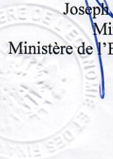
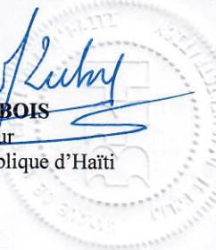

<!-- page 1 -->

Banque de la République d'Haïti

# PACTE DE GOUVERNANCE ECONOMIQUE ET FINANCIERE

# PROTOCOLE D'ACCORD PORTANT SUR LA GESTION DE L'EXECUTION DES DEPENSES PUBLIQUES

## ENTRE :

Le Ministère de l'Économie et des Finances (MEF) représenté par son titulaire, Monsieur Joseph JOUTHE, Ministre, propriétaire, demeurant et domicilié à Port-au-Prince, identifié par son NIF : 003-057-206-8 et sa CIN : 06-03-99-1961-10-00012, ci-après dénommé le MEF, d'une part ;

## ET

La Banque de la République d'Haïti (BRH), organisme public, jouissant de la personnalité juridique et de l'autonomie financière, créée par la loi du 17 août 1979, ayant son siège à Port-au-Prince, représentée par son Gouverneur, Monsieur Jean Baden DUBOIS, propriétaire, demeurant et domicilié à Port-au-Prince, identifié par son NIF :003-424-282-5 et sa CIN : 05-14-99-1960-03-0000-6, ci-après dénommé la BRH, d'autre part ;

Considérant la nécessité de contenir les dépenses de l'Etat dans les limites des ressources disponibles ;

Considérant que le rythme de mobilisation des ressources publiques ne coïncide pas toujours à celui des dépenses publiques ;

Considérant la nécessité de contenir l'accumulation d'arriérés susceptibles d'affecter la bonne gestion des Finances Publiques ;

Considérant la nécessité d'assurer la continuité des opérations du Trésor;

Page 1 de 3

<!-- page 2 -->

Considérant qu'il y a lieu d'établir, entre le Ministère de l'Économie et des Finances et la Banque de la République d'Haïti, un mécanisme visant à une meilleure gestion du financement des dépenses publiques ;

## IL A ETE ARRETE ET CONVENU CE QUI SUIT

Article 1.- Le présent protocole d'accord a pour objet de déterminer les conditions dans lesquelles le MEF et la BRH s'engagent à assurer la gestion efficace de l'exécution des dépenses publiques.

Article 2.- Dans le cadre du présent protocole, le MEF s'engage à veiller au maintien d'une bonne adéquation entre les ressources disponibles et les dépenses de l'Administration Centrale de l'Etat.

Article 3.- Lorsque les ressources disponibles sont déclarées insuffisantes, le MEF pourra solliciter de la BRH une avance, sur une base mensuelle, limitée strictement au montant des fonds nécessaires pour couvrir les dépenses essentielles, en priorité celles relatives aux dépenses du personnel. Ainsi, les parties conviennent que la BRH ne devra pas honorer les autres dépenses ordonnancées sous forme de chèque ou de virement.

Article 4.- A la fin de chaque trimestre, le total de ces avances doit être compatible avec le niveau du financement monétaire convenu entre le MEF et la BRH, soit un montant de Dix Milliards de Gourdes. Quand les circonstances l'exigent, des avances supplémentaires pourront être consenties, sur une base temporaire, par la BRH au taux du marché, lesquelles devront être remboursées avant la fin de l'exercice fiscal en cours.

Article 5.- Le Ministère de l'Economie et des Finances s'engage à établir un plan de trésorerie sur la base d'une programmation trimestrielle de dépenses élaborée de concert avec les autres ministères conformément aux dispositions de l'article 59 de la loi du 4 mai 2016 sur l'élaboration et l'exécution des lois de finances.

Article 6.- La BRH fournira chaque semaine au MEF le montant estimé du financement de l'Administration Centrale de l'Etat, selon la méthodologie arrêtée par les parties.

Article 7.- Afin de faciliter les opérations mentionnées dans le présent protocole d'accord, le MEF transmettra sur une base hebdomadaire à la BRH une programmation sommaire des dépenses à exécuter.

Article 8.- Le présent protocole d'accord lie les parties immédiatement après l'apposition de leur signature. Il est conclu pour une période de douze (12) mois qui prend effet le  $ 1^{er} $ octobre 2019 pour prendre fin le 30 septembre 2020.

Article 9.- Les parties s'engagent à se rencontrer sur une base mensuelle afin d'adapter les termes de ce protocole d'accord aux amendments éventuels de la loi de finances, à l'évolution de la conjoncture, et aux engagements pris envers les bailleurs de fonds internationaux.

<!-- page 3 -->

Article 10.- Les parties déclarent résoudre à l'amiable tout différend qui pourrait découler soit de l'interprétation soit de l'exécution du présent protocole d'accord.

Article 11.- Pour l'exécution du présent protocole d'accord, le MEF élit domicile en son siège au 5 de l'Avenue Charles Summer, Port-au-Prince et la BRH en son siège à l'angle des Rues Pavée et du Quai, Port-au-Prince, Haïti.

Fait à Port-au-Prince, en double original et de bonne foi, le .....2019.

27 NOV.

Joseph JOUTHE

Ministre

Ministère de l'Economie et des Finances

Bradwell Lucky

Jean Baden DUBOIS

Gouverneur

Banque de la République d'Haïti
