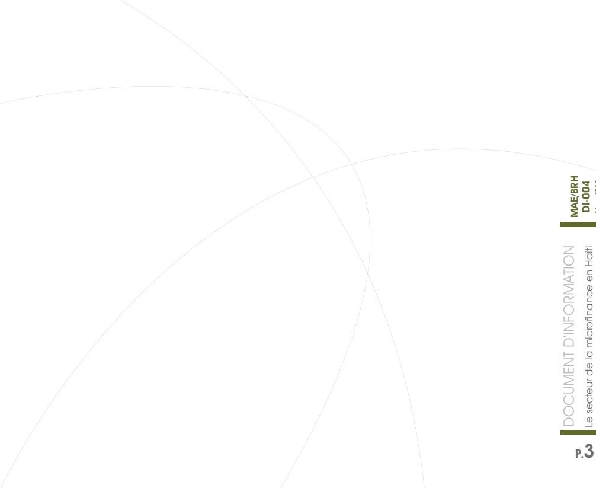

<!-- page 1 -->

## DOCUMENT D'INFORMATION

## Le secteur de la microfinance en Haiti

| Category | Value |
| --- | --- |
| Red |   |
| Blue |   |
| Green |   |

<!-- page 2 -->

<!-- page 3 -->

a Banque de la République d'Haiti (BRH) a le plaisir de vous présenter le quatrième numéro de la série « Document d'Information ». Cette publication vise à informer le public en général et les opérateurs économiques et financiers en particulier, sur l'action de la BRH, les objectifs et l'orientation de sa politique monétaire, l'évolution des différents secteurs de l'économie haïtienne, ainsi que tout sujet et information jugés pertinents.

Cette série de publications répond au souci de réduire l'asymétrie d'information par une plus grande dissémination et de renforcer la transparence en mettant l'emphase sur le bien-fondé des choix de politique de l'institution.

Ce numéro présente le secteur de la microfinance en Haïti, des informations sont fournies sur le cadre réglementaire et l'encadrement de la BRH à travers la Direction de l'Inspection Générale des Caisses Populaires (DIGCP).

<!-- page 4 -->

### 1. Introduction

La microfinance se définit comme le secteur qui regroupe les dispositifs d'allocation de crédits de faible montant à des personnes à faible revenu, leur permettant ainsi de créer et de gérer leurs microentreprises. La microfinance a pour objectif de fournir des services financiers aux personnes à faible revenu ou à celles qui sont exclues du système financier formel. Elle permet à ces personnes d'avoir accès de façon permanente à des services financiers abordables et de qualité pour financer des activités générales de revenus, épargner, accumuler des actifs, stabiliser leurs dépenses de consommation et se prémunir contre les risques.

Historiquement la microfinance concernait des groupes de personnes qui mettaient en commun leurs économies afin d'accorder des prêts aux membres du groupe, que ce soit pour affaires, mariages, funérailles, etc. Depuis, la microfinance a évolué pour couvrir une gamme plus large de services financiers tels que l'épargne, le crédit, l'assurance, les paiements pour le compte de tiers et les transferts d'argent, pour ne citer que ceux-là.

En Haïti, l'introduction de la microfinance formelle a eu lieu en 1946 avec la création de la première caisse populaire. Ce secteur a vu son rôle s'accroître au cours des trois dernières décennies, période durant laquelle l'activité économique a perdu de son dynamisme. En effet, le taux de chômage élevé et le faible niveau du revenu per capita découlant de la croissance économique ont eu pour conséquence l'exclusion de plus de 50 % de la population des circuits formels de l'économie. La microfinance fournit alors des services financiers aux plus défavorisés, notamment ceux évoluant dans les zones rurales, en marge des services bancaires formels. Leur clientèle est majoritairement constituée de femmes, ce qui leur confère un impact social plus important.

<!-- page 5 -->

### 2. Définition des institutions de microfinance

Parmi les institutions de microfinance (IMF), on peut différencier les institutions de microfinance mutualistes ou coopératives, les institutions de microfinance non-coopératives et les mutuelles de Solidarité.

## - Les institutions de microfinance coopératives

Les institutions de microfinance de type coopératif constituent un groupe de personnes physiques ou morales, formant une organisation à but non lucratif et fondée sur les principes de coopération, de solidarité et d'entraide mutuelle avec principalement pour objetif la collecte de l'épargne de ses membres et/ou l'octroi du crédit. Elles accordent des prêts aux membres et également à des particuliers. À titre d'exemple, on peut citer KOTELAM qui est la « Koperativ Tèt Ansanm  Pou Lavi Miyò ».

## Les institutions de microfinance non-coopératives

Ces institutions, différentes de celles constituées sous forme mutualiste ou coopérative, sont des organismes qui accordent du crédit à partir des fonds empruntés du système bancaire ou d'une organisation financière internationale ou reçus en dons d'une ONG. C'est le cas d'ACME, l'Association pour la Coopération avec la Micro Entreprise.

Bien que le nombre d'IMF de type non-coopératif soit inférieur à celui de la branche coopérative, la microfinance non-coopérative est relativement très diversifiée en Haïti. Elle dispose d'un actif financier plus important et touche une plus large population. La diversification des acteurs de la branche non-coopérative va des associations locales aux organisations internationales en passant par les banques et les sociétés de droit privé. Par exemple, l'initiative des ONG a été significative. À côté de leurs activités traditionnelles, elles ont ajouté des volets crédits en faveur de leurs bénéficiaires et à la création d'organisations dédiées à la microfinance. La deuxième moitié des années 1990 a été marquée par un fort développement des services micro-financiers en Haïti.

## Les mutuelles de solidarité

Une mutuelle de solidarité (MS) est un groupe de personnes ayant des liens solides entre elles (origine socioprofessionnelle, lieu de résidence, famille, amitié, etc.) qui décident de créer un fonds alimenté par leurs cotisations, en vue d'atteindre un objectif clairement défini : l'octroi du crédit aux membres du groupe sur une base rotative. Contrairement aux banques communautaires, les mutuelles de solidarité sont indépendantes dès le départ : les règles de fonctionnement sont établies par le groupe lui-même sans ingérence d'une quelconque IMF, même si cette dernière peut être une source

<!-- page 6 -->

alternative de fonds pour suppléer à l'insuffisance des ressources internes et également fournir de l'assistance technique.

### 3. Historique du secteur de la microfinance en Haïti

En 1946, apparurent les deux premières caisses populaires du pays : l'une à la Vallée de Jacmel (Sud-Est du pays) et l'autre à Cavaillon (département du Sud). Ces caisses ont été structurées sur le modèle canadien des caisses Desjardins, puisqu'elles ont été créées sous l'impulsion des missionnaires canadiens. Il a fallu attendre les années 1950 pour assister à l'émergence d'un mouvement coopératif et du crédit en Haïti. En effet, avec l'échec des politiques de financement agricole et rural en Haiti, le Service Coopératif Interaméricain de Production Agricole (SCIPA) a encouragé la formation de coopératives de crédit agricole en Haiti. Dès l'année 1951, les Pères Oblats ont initié en tout cinq (5) caisses populaires dans le sud du pays. En 1953, le mouvement coopératif haïtien comptait déjà 52 caisses populaires regroupant plus de 6 000 membres.

Dès l'année 1952, les autorités haitiennes ont été amenées à former une commission chargée de travailler sur un projet de législation coopérative. L'idée de coopération a été officialisée en Haiti à partir de septembre 1953, lorsque le sénat a adopté une loi créant un Conseil National de la Coopération (CNC) rattaché au département de l'économie nationale.

Le secteur est encadré par trois réseaux ou associations professionnelles : l'Association Nationale des Caisses Populaires Haïtiennes (ANACAPH), le « Konsèy Nasyonal Finansman » (KNFP) et l'Association Nationale des Institutions de la Microfinance en Haiti (ANIMA). Ces associations ont pour but de renforcer les caisses populaires afin qu'elles soient beaucoup plus intégrées dans la vie des membres. D'une manière générale, ces dernières assurent la représentation, l'intermédiation et l'accompagnement. Elles interviennent dans le domaine de la gouvernance et facilitent le dialogue entre les différents acteurs afin de permettre aux coopératives de mieux connaître les besoins du milieu et à la population de mieux comprendre la mission de ces dernières.

<!-- page 7 -->

Les cinq (5) plus anciennes CEC du pays sont :

1) CAPPEV ou Caisse Populaire Petite Epargne de La Vallée, implantée le 22 septembre 1946 à la Vallée de Jacmel sous l'initiative d'Edouard A. Tardieu.

2) CAPOSAC ou Caisse Populaire Sainte-Anne de Camp-Perrin, créée le 27 mars 1949 à Camp-Perrin par le père Langlois.

3) CPC ou Caisse Populaire Concorde, fondée le 9 octobre 1949 aux Cayes par le père Jean Salgado.

4) CPSA ou Caisse Populaire Sainte-Anne, créée en 1951 à Port-au-Prince sous l'initiative du père Kébreau Emmanuel.

5) CAPODOSA ou Caisse Populaire Dominique Savio, fondée le 23 mars 1963 à Pétion-Ville.

En 2010, le secteur de la microfinance en Haiti comprenait 175 caisses populaires, 20 institutions de microfinance (IMF) (fondations ou associations, filiales de département spécialisées de banques commerciales), 3 000 structures de financement de base et un grand nombre de mutuelles de solidarité accompagnées par le KNFP.

En tout, au 31 juillet de l'année 2017, le système compte 59 caisses agréées par la BRH et le Conseil National des Coopératives (CNC), dont plus d'une trentaine de la fédération « Le Levier » et d'une autre récemment créée connue sous le nom de « Le Sociétaire ». En effet, à la suite de la mise en vigueur de la loi de 2002, la fédération de caisses populaires « Le Levier », a été créée le 30 juin 2007 et une autre le Sociétaire, dix ans plus tard. Avec 11 CEC, membres fondateurs, cette nouvelle fédération a organisé son assemblée constitutive en janvier 2017 en attendant d'être reconnue légalement par les Autorités compétentes.

Tableau 1. Regroupement des caisses en fédération

<table><tr><td>Le Levier</td><td>Le Sociétaire</td></tr><tr><td>30 Juin 2007</td><td>Assemblée constitutive</td><td>28 Janvier 2017</td><td>Assemblée constitutive</td></tr><tr><td>Novembre 2008</td><td>Reconnaissance par la CNC</td><td></td><td>Reconnaissance par la CNC</td></tr><tr><td>Mars 2011</td><td>Publication de l'autorisation de fonctionnement de la fédération\n" LE LEVIER " dans le Moniteur</td><td></td><td>Publication de l'autorisation de fonctionnement de la fédération\n" LE SOCIETAIRE " dans le Moniteur</td></tr><tr><td>Nombre de membres</td><td>42 caisses</td><td>Nombre de membres</td><td>11 caisses</td></tr></table>

<!-- page 8 -->

### 4. Cadre réglementaire de la microfinance

Dans la plupart des pays, l'État joue un rôle décisif dans le développement du secteur de la microfinance. Il détermine le cadre légal et fiscal et intervient parfois au niveau du refinancement des institutions de microfinance ou de la création des programmes de crédit pour les personnes à revenus faibles. La réglementation et la supervision de l'Etat ont pour objectifs la prévention des risques de faillite systémique, risques de faillite en chaînes et la protection des épargnants. En Haïti, le cadre juridique a été mis en place à partir de la promulgation de la loi du 22 avril 1939 instituant les coopératives agricoles sous le contrôle du Département de l'Agriculture. Le législateur avait créé à l'époque une Caisse Générale à travers laquelle le refinancement des coopératives agricoles pouvait s'effectuer.

Par la loi du 14 septembre 1953, l'État fixe le mode d'organisation des coopératives, leur fonctionnement jusqu'à leur dissolution, le cas échéant. Des mesures incitatives et des avantages fiscaux sont offerts aux coopératives notamment l'affermage de toute terre vacante du domaine privé de l'Etat ou l'exonération du paiement de l'impôt sur le revenu (art. 16). Toutefois, une certaine préférence est accordée aux coopératives agricoles. Le décret du 2 avril 1981 mettra en place la structure constituée par la coopérative et l'union de coopératives tout en prévoyant la création de sociétés mixtes de développement coopératif. Ce décret, en ses articles 38 et suivants, traite des caisses populaires.

Parmi les lois qui ont existé dans ce secteur, l'une des plus importantes est celle du 26 juin 2002, avec laquelle la réglementation a connu à nouveau des changements portant plus spécifiquement sur l'organisation et le fonctionnement des caisses populaires laissant les autres catégories de coopératives sous l'égide du décret de 1981. C'est la première loi détaillée sur les caisses populaires. Elle désigne le CNC comme autorité de tutelle des coopératives, chargée de formuler et promouvoir la politique du gouvernement en matière coopérative et attribue la supervision de ces institutions à la Banque Centrale à travers des inspections tout en introduisant la supervision déléguée via la fédération.

- Supervisions des caisses populaires : normes prudentielles

Dans le cadre de sa nouvelle mission de supervision des caisses populaires, la BRH, à travers la DIGCP, a travaillé à l'établissement de normes prudentielles, au nombre de 9 au total, auxquelles sont assujetties les caisses populaires. Concernant la charte comptable, à l'initiative de la BRH, une formation s'est tenue, en avril 2015,

<!-- page 9 -->

à Port-au-Prince, aux Cayes et au Cap. Aussi, la BRH a-t-elle établi deux annexes dans ces villes, lesquelles sont chargées de superviser chacune environ 20 caisses.

Les inspections des caisses populaires se réalisent sur pièces et sur place. Les inspections sur pièces concernent une analyse de données et un suivi à partir du rapport durant les 3 mois précédant la date d'inspection, tandis que les inspections sur place consistent en des missions de visite dans les caisses populaires. En ce qui a traité à la fédération « le Levier », elle regroupe 42 caisses dont 29 membres à part entière et 13 caisses utilisatrices. Ces dernières utilisent la fédération pour certaines informations et données à des frais beaucoup moindres que pour les caisses membres.

Par ailleurs, en vue d'assurer une gestion plus rigoureuse et transparente du risque dans la microfinance, la BRH à travers la Direction D'Inspection des Caisses Populaires (DIGCP) a introduit un outil de notation prudentielle appelée « CAMELI ». La mise en œuvre de cet outil sera axée sur 6 piliers par type de risque :

- Capitalisation :

- Actif;

Management, organisation et contrôle;

Equilibre financier:

Liquidités et gestion actif/passif;

Information.

<!-- page 10 -->

# Encadré 1. Liste des normes émises par la BRH dans le cadre de la régulation du secteur de la Microfinance

Dans le cadre de sa mission, la BRH a émis en septembre 2008 un recueil composé de 9 normes :

1) Norme relative à la gestion des liquidités des coopératives d'épargne et de crédit (Liquidités/Passif Dépôt ≥ 25 %);

2) Norme relative à la gestion des placements des coopératives d'épargne et de crédit (Placement/Actif ≤ 9 %);

3) Norme relative à la gestion des risques de crédit des coopératives d'épargne et de crédit (Portefeuille crédit + Risque hors bilan / Actif ≤70%);

4) Norme relative à la capitalisation des CEC (Fonds Propres / Actif ≥ 12,5%);

5) Norme relative au contrôle interne des CEC

(>+50 millions gourdes = Exigence de Contrôle Interne);

6) Norme relative à la vérification externe des CEC;

7) Norme relative à la transmission des états financiers, rapport sur les activités des CEC et statistiques générales;

8) Normes relatives à l'ouverture de succursales ou de points de services des caisses d'épargne et de crédit (CEC);

9) Charte comptable.

## Perspectives d'une révision du cadre réglementaire

La Banque Centrale, dans l'exercice de sa mission de supervision, a jugé primordial d'améliorer le cadre légal des coopératives financières (caisses populaires) et de mettre en place un cadre juridique pour les IMF non-coopératives. À cet effet, un projet de circulaire sur le plan comptable des caisses populaires a été mis sur pied. De même, le projet de révision de la loi sur les Coopératives de 2002 devrait aider la BRH au niveau des agréments. S'agissant des IMF non-coopératives, le projet de loi y relatif est également en révision à la BRH. Ces dernières ne sont pas encore régulées par la BRH, mais fonctionnent en tant qu'institutions de crédit. Cela limite les actions légales de la Banque Centrale lorsque les normes ne sont pas respectées. Sur le plan global, il existe également un projet relatif au système de gestion qui va servir à la fois pour les CEC et les institutions de microfinance non-coopératives.

<!-- page 11 -->

### 5. Conclusion et Perspectives

L'encadrement de la microfinance en Haïti s'inscrit dans le cadre des actions des autorités monétaires visant à lutter contre la pauvreté et toutes les formes d'exclusion. En effet, les institutions de microfinance s'avèrent essentielles pour la réussite de la stratégie nationale d'inclusion financière considèrent leurs caractéristiques et leurs stratégies d'implantation.

Par ailleurs, en tant que garante de la stabilité du système financier, la Banque Centrale tient à la régularité et à la fiabilité des statistiques couvrant le secteur dans son ensemble (banques et autres institutions financières). La BRH continuera de mettre l'accent sur les normes relatives à la transmission des états financiers des IMF, ce qui permettra à l'institution d'une part, de compléter les statistiques monétaires, lesquelles ne couvrent actuellement que le secteur bancaire et d'autre part, à mieux cerner le comportement du système financier et les mécanismes d'éventuelles propagations de risques

| Document | Information |
| --- | --- |
| DOCUMENT D'INFORMATION |   |
| MAE/BRH |   |
| DI-004 |   |
| Le secteur de la microfinance en Haïti |   |
| Mors 2018 |   |

<!-- page 12 -->

ACME : Association pour la Coopération avec la Micro Entreprise

ANACAPH : Association des Caisses Populaires Haïtiennes

CPSA : Caisse Populaire Sainte-Anne

ANIMH : Association Nationale des Institutions de la Microfinance en Haiti

DIGCP : Direction de l'Inspection Générale des Caisses Populaires

BRH : Banque de la République d'Haiti

CAPOSAC : Caisse Populaire Sainte-Anne de Camp-Perrin

KNFP : Konsèy Nasyonal Finansman Popilè

KOTELAM : Koperativ Têt Ansanm pou Lavi Miyò

CAPODOSA : Caisse Populaire Dominique Savio

CAPPEV : Caisse Populaire Petite Epargne de la Vallée

CNC : Conseil National des Coopératives

CEC : Coopératives d'Epargne et de Crédit

IMF : Institution de Microfinance

CPC : Caisse Populaire Concorde

MS : Mutuelle de Solidarité

ONG : Organisation Non Gouvernementale

<!-- page 13 -->

Tableau 2. Liste des coopératives d'épargne et de crédit supervisées par la BRH (janvier 2018)

| NOM DES CAISSES | SIGLE | ZONE | Agréée par la BRH | Membre de la Fédération « Le Levier » |
| --- | --- | --- | --- | --- |
|   |   | OUEST |   |   |
| Kopérativ Têt Ansanm\nPou La Vi Miyò | KOTELAM | Port-au-Prince, Delmas,\nPétion-Ville | ✓ | ✓ |
| Caisse Populaire\nde Sainte-Anne | CPSA | Port-au-Prince | ✓ | ✓ |
| Koperativ Fad Ia Site | KOFAS | Port-au-Prince | ✓ | ✓ |
| Men Ale Men Vini | MAMEV | Gressier | ✓ |   |
| Mouvement Coopératif\nd'Epargne et de Crédit de Fermathe | MOCECF | Fermathe |   |   |
| Coopérative Solidarité\npour le Développement | COSODEV | Santo / Croix-des-Bouquets | ✓ | ✓ |
| Kès Popilè Men Kontre | KEPOMEK | Darbonne et Carrefour\nDarbonne et Carrefour Dufort,\nLéogane | ✓ | ✓ |
| Caisse Léogannais d'Épargne\net de Financement | CLEF | Léogane | ✓ | ✓ |
| Caisse Populaire\nDominique Savio | CAPODOSA | Pétion-Ville |   |   |
| Coopérative Caisse Populaire\nde la Caridad | CCPC | Port-au-Prince |   |   |
| Caisse Centrale MUCI | MUCI-CEC | Port-au-Prince | ✓ |   |
| Urgence Caisse d'épargne\net de Crédit | UCEC | Pétion-Ville, Frères |   |   |
| Kès Popilè Dano | KAPODA | Grand-Goave |   |   |
| Caisse Populaire de Cabaret | KPK | Cabaret |   | ✓ |

<table><tr><td>ARTIBONITE</td></tr><tr><td>Sosyete koperativ\npou La Vi Miyò</td><td>SOCOLAVIM</td><td>Saint Marc - Montrouis\nPont-Sonde - Marchand\nGonaïves</td><td>✓</td><td>✓</td></tr><tr><td>Kès Popilè Espwa Gwo Mòn</td><td>KPEGM</td><td>Gros morne / Gonaïves</td><td>✓</td><td>✓</td></tr><tr><td>Caisse Populaire Solidarité des\nVerrettes</td><td>CAPOSOV</td><td>Verrettes</td><td>✓</td><td>✓</td></tr><tr><td>Kès Epay ak Kredi\npou avansman Mamlad</td><td>KEKAM</td><td>Marmelade</td><td>✓</td><td></td></tr><tr><td>Caisse Populaire Solidarité\nSt. Michel de l'attalaye</td><td>CAPOSOSMA</td><td>St Michel de l'Attalaye</td><td>✓</td><td></td></tr><tr><td>Kès Popilè Dezam</td><td>KPD</td><td>Désarme - Route Pont-Sondé et\nMirebalais</td><td>✓</td><td>✓</td></tr><tr><td>Coopérative d'Épargne\net de Crédit de la\nPetite Rivière de l'Artibonite</td><td>COPECPRA</td><td>Petite Rivière de l'Artibonite</td><td>✓</td><td>✓</td></tr><tr><td>Caisse Populaire pour la Réussite</td><td>CAPOR</td><td>Gros-morne</td><td>✓</td><td></td></tr><tr><td>Caisse Populaire Bon Secours</td><td>CPBS</td><td>Gonaïves</td><td></td><td></td></tr></table>

<!-- page 14 -->

Tableau 2. Liste des coopératives d'épargne et de crédit supervisées par la BRH (janvier 2018)

| NOM DES CAISSES | SIGLE | ZONE | Agréée par la BRH | Membre de la Fédération « Le Levier » |
| --- | --- | --- | --- | --- |
|   |   | CENTRE |   |   |
| Coopérative d'Épargne et de Crédit de Lascahobas | COOPECLAS | Lascahobas-Hinche - Thomonde | √ |   |
| Apò Sosyal pour yon Koperativ | ASOKOP | Hinche |   |   |
| Coopérative pour le Développement Economique et Social | COOPDES | Rue Saint-Charles, Belladère | √ |   |
| Sere Pou Lè ou Bezwen | SPLB | Savannette |   |   |
| Sere Pou Chofé | SPC | Hinche |   |   |

NORD ET NORD-EST

| Caisse Populaire la Fraternité | CPF | Cap-Haitien - Limonade | √ | √ |
| --- | --- | --- | --- | --- |
| Kès Popilè Leve Kanpe Milot | KPLKM | Milot | √ | √ |
| Caisse Populaire Union Plaisance | CPUP | Plaisance | √ | √ |
| Caisse Populaire pour l'Avancement de Mombin Crochu | CPAM | Mombin-Crochu | √ | √ |
| Caisse Populaire le Dauphin | CPD | ForlLiberté - Ferrier | √ | √ |
| Kès Popilè Sent Elén Karis | KPSEK | En face de la place publique - Mont Organisé | √ | √ |
| Kès Popilè Tèt Ansanm Terye-wouj | KPTAT | Terrier-Rouge - Les Perches | √ | √ |
| Caisse Populaire Solidarité | CAPOSOL | Pilate | √ | √ |

NORD-OUEST

| Kooperativ pou lespwa | KOPLES | Port-de-Paix - Bassin bleu | ✓ |   |
| --- | --- | --- | --- | --- |
| Société Coopérative pour le Relèvement Economique au Développement du Nord-ouest | SOCOREDNO | Jean Rabel | ✓ | ✓ |
| Caisse Populaire Mare-Rouge | CAPOMAR | Mare Rouge\nMôle St Nicolas | ✓ |   |
| Caisse Populaire de St Louis du Nord | CAPS | St Louis du Nord |   |   |
| Société Coopérative d'Entraide Mutuelle | SOCEM | Port-de-Paix | ✓ |   |
| Koperativ Na Chanje | KONAC | St Louis du Nord |   |   |
| Coopérative d'Epargne et de Crédit de SaintLouis du Nord | COOPECS | Saint Louis du Nord / Port de Paix | ✓ | ✓ |

<!-- page 15 -->

Tableau 2. Liste des coopératives d'épargne et de crédit supervisées par la BRH (janvier 2018)

| NOM DES CAISSES | SIGLE | ZONE | Agréée par la BRH | Membre de la Fédération « Le Levier » |
| --- | --- | --- | --- | --- |
|   |   | SUD-EST |   |   |
| Caisse Populaire Ressource\nConfiance de Marigot | CPRCM | Marigot - Peredo | ✓ | ✓ |
| Societe d'Utilisation Coopérative du Crédit et de l'Epargne pour l'Epanouissement Socio-Economique | SUCCES | Jacmel | ✓ | ✓ |
| Caisse Populaire Petite Épargne\nla Vallée | CAPPEV | La Vallée de Jacmel |   |   |
| Caisse Régionale pour la Promotion Economique et Sociale | CREPES | Rue Mac Tela # 5 Centre\nville -Thiotte | ✓ | ✓ |
| Coopérative pour le Développement de Belle-Anse | CODEB | Belle-Anse | ✓ | ✓ |
| Caisse Populaire Avenir Cayes\njacmel | CPAC | Cayes-Jacmel | ✓ | ✓ |
| Coopérative Service financier et Technique | COSEFT | Jacmel | ✓ |   |
| Caisse Populaire Espoir | CPE | Jacmel |   |   |
| Coopérative des Employés du | COOPESE | Jacmel |   |   |
| Caisse Populaire Union\nValléenne | CAPUVA | La Vallée de Jacmel |   |   |

<table><tr><td>SUD</td></tr><tr><td>Caisse Populaire de la Cote Sud - Chardonnière</td><td>CPCS</td><td>Chardonnières</td><td>✓</td><td>✓</td></tr><tr><td>Caisse Populaire du Sud</td><td>CAPOSUD</td><td>Cayes-</td><td>✓</td><td>✓</td></tr><tr><td>Caisse Populaire Sainte-Rose de Maniche</td><td>CPSRM</td><td>Maniche</td><td>✓</td><td>✓</td></tr><tr><td>Caisse Populaire Sainte-Anne Camp Perrin</td><td>CAPOSAC</td><td>Camp-Perrin</td><td>✓</td><td></td></tr><tr><td>Caisse Populaire Union Cavaillonnaise</td><td>CAPUC</td><td>Cavaillon</td><td>✓</td><td>✓</td></tr><tr><td>Caisse Populaire des Cayes</td><td>CPC</td><td>Cayes</td><td></td><td></td></tr><tr><td>Mutuelle Croissance Economique de Camp-Perrin</td><td>MUCEC</td><td>Camp-Perrin</td><td></td><td></td></tr></table>

<table><tr><td>NIPPES</td></tr><tr><td>Caisse d'Epargne et de Credit pour l'Avancement des Nippes</td><td>CECANIPPES</td><td>Petite Rivieres de Nippes</td><td>✓</td><td></td></tr><tr><td>Kès Popilè Lazil Nip</td><td>KPLAN</td><td>l'Asile</td><td>✓</td><td>✓</td></tr><tr><td>Coopérative Têt Ansanm</td><td>COTEM</td><td>Miragoane</td><td>✓</td><td>✓</td></tr><tr><td>Caisse Populaire pour le Développement Economique de Barradères</td><td>CAPODEB</td><td>Barradères</td><td>✓</td><td></td></tr><tr><td>Caisse Populaire Saint Joseph</td><td>CAPOSAJ</td><td>Fonds des Négres</td><td></td><td></td></tr></table>

<table><tr><td>GRAND-ANSE</td></tr><tr><td>Caisse Populaire pour l'Avancement de Jérémie</td><td>CAPAJ</td><td>Jérémie</td><td>√</td><td>√</td></tr><tr><td>Caisse Populaire de Dame-Marie</td><td>CPDAM</td><td>Dame-Marie</td><td></td><td></td></tr><tr><td>Caisse Populaire Concorde</td><td>CPC</td><td>Anse d'Hainault</td><td>√</td><td>√</td></tr></table>

<!-- page 16 -->

Banque de la République D'Haïti

www.brh.ht

Direction Monnaie et Analyse Economique

Angle rues Pavée et du Quai / Port-au-Prince, Haïti W.I.

Boite Postale 1570

Téléphone: (509) 22.99.11.64

Fax: (509)22.99.11.92
