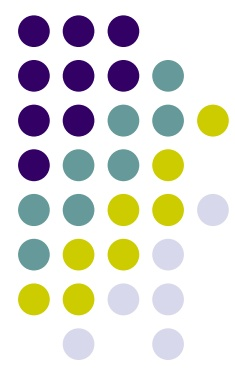

<!-- page 1 -->

## Haïti: Economic recovery strategy

Ambassade d'Haïti à Londres/ 3 $ ^{rd} $ Haitian European Diaspora Dinner Business Conference

Fritz Duroseau

Member of the Board

Banque de la République d'Haïti

December 2, 2017

London

<!-- page 2 -->

## Outline

Factors leading to economic growth;

Haitian economic context;

BRH Financial incentives to investment;

• Proposal of a diaspora investment strategy;

Conclusion.

<!-- page 3 -->

## Factors leading to growth

- The growth process targets an improved welfare: rise in GDP per capita;

Production factors: Physical, Human, Intangible (Knowhow, cumulated expertise, branding);

Productivity of human and physical capital positively correlated to technological progress;

- Growth can be led by consumption (public & private), exports, investment (public & private);

- Investment depends on domestic and international savings;

<!-- page 4 -->

## Factors leading to growth

- A growth strategy is not a quick-fix/ miracle-cure:

  - Identification and minimization of constraints, identification and maximization of opportunities;

- Iterative public policies adapted to the local context provide better results than “copy and paste” policies. However common denominators are found for countries with similar characteristics and similar problems;

South-Korea, exporter for 600 million USD of primary goods in 1963,

<!-- page 5 -->

## Factors leading to growth: example

- Today, after implementing key outward-oriented policies and reforms, exports more than 600 Billion USD of goods;

- Its export-led public policies targeted FDIs (conglomerates): Samsung stages of development: 1) Trade agency, 2) food processing, 3) textile, 4) Insurance, 5) electronics, 6) Naval construction, 7) engineering, 8) construction, 9) aerospace;

- Its per capita GDP, 146,00$ in 1963 to 27,538.00$ in 2016;

<!-- page 6 -->

## Factors leading to growth: example

- FDIs are more stable/ long term risk taking decision : Digicel 1st taxpayer ;

- FDIs come with capital, new knowhow including new technologies, new demand, connections to international networks (hotels to tourism networks, airlines, car rentals, etc) ;

- FDI may contribute to some public infrastructure projects;

<!-- page 7 -->

## Economic context

| GDP Per capita | Macroeconomic framework | Data from BOP |
| --- | --- | --- |
| • Haiti's annual per capita GDP inferior to 800 dollars;\n• Average GDP growth of 1,4% for the past 5 decades while average demographic growth of 1,8%; | • Relatively stable macroeconomic framework since 2004;\n• Sound financial sector: profitable, liquid, well capitalized;\n• Improvements in the socio-political climate since 2004; | •Net importer of goods and services: vulnerable to external shocks (natural, prices);\n•Diaspora contributes to growth via the sending of remittances (2,4 billion USD, 25% of GDP, superior to international aid).\nNew contributions from Chile;\n•Remittances finance mostly consumption goods, education services and imports |

<!-- page 8 -->

## Economic context

Competitive/ high potential sectors already identified by studies

some agricultural value-chains, tourism, textile, construction, infrastructure, renewable energies, BPOs: Collier, DSNCRP, National Commission on competitiveness;

## What should be done

The quality and the volume of public investment should be improved in order to maximize its catalyst effect on private investment: advocacy toward multilateral and bilateral donors and better cost-benefit analysis of public projects;

<!-- page 9 -->

## Economic context

| Year | Haiti | République Dominicaine |
| --- | --- | --- |
| 1966 | 100.0 | 200.0 |
| 1968 | 150.0 | 250.0 |
| 1970 | 150.0 | 350.0 |
| 1972 | 150.0 | 450.0 |
| 1974 | 200.0 | 650.0 |
| 1976 | 250.0 | 850.0 |
| 1978 | 200.0 | 1000.0 |
| 1980 | 250.0 | 1200.0 |
| 1982 | 250.0 | 1350.0 |
| 1984 | 300.0 | 1650.0 |
| 1986 | 350.0 | 850.0 |
| 1988 | 400.0 | 950.0 |
| 1990 | 450.0 | 1050.0 |
| 1992 | 300.0 | 1400.0 |
| 1994 | 250.0 | 1800.0 |
| 1996 | 350.0 | 2100.0 |
| 1998 | 450.0 | 2500.0 |
| 2000 | 500.0 | 2700.0 |
| 2002 | 400.0 | 3000.0 |
| 2004 | 350.0 | 2400.0 |
| 2006 | 500.0 | 3800.0 |
| 2008 | 650.0 | 4950.0 |
| 2010 | 700.0 | 5500.0 |
| 2012 | 800.0 | 5900.0 |
| 2014 | 850.0 | 6150.0 |

<!-- page 10 -->

## Economic context

Foreign direct investments

Million of US dollars

|   | 1990 | 2000 | 2010 | 2015 |
| --- | --- | --- | --- | --- |
| Haiti | 15 | 20 | 200 | 100 |
| Jamaïque | 150 | 420 | 180 | 800 |
| République Dominicaine | 150 | 1000 | 1420 | 2250 |

<!-- page 11 -->

## Economic context

Haiti: Foreign direct investments

million of US dollars

| Year | Value |
| --- | --- |
| 2004 | 590 |
| 2005 | 2600 |
| 2006 | 16060 |
| 2007 | 7450 |
| 2008 | 2980 |
| 2009 | 5547 |
| 2010 | 17800 |
| 2011 | 11900 |
| 2012 | 15600 |
| 2013 | 16192 |
| 2014 | 9900 |
| 2015 | 10568 |
| 2016 | 10490 |

<!-- page 12 -->

## Foreign direct Investments net (million of USD: Worldbank)

| Country | Value |
| --- | --- |
| Dominican Republic | 100 |
| Haiti | 100 |
| Jamaica | 800 |
| South Korea | 10800 |
| Honduras | 1200 |

<!-- page 13 -->

GDP per capita (current USD: Worldbank)

| Country | 1960 | 2016 |
| --- | --- | --- |
| Dominican Republic | 250 | 6700 |
| Haiti | 150 | 700 |
| Jamaica | 400 | 4900 |
| South Korea | 150 | 27500 |
| Honduras | 200 | 2300 |

<!-- page 14 -->

## Economic context

| PBOD (%) | 2005-2006 | 2006-2007 | 2007-2008 | 2008-2009 | 2009-2010 | 2010-2011 | 2011-2012 | 2012-2013 | 2013-2014 | 2014-2015 |
| --- | --- | --- | --- | --- | --- | --- | --- | --- | --- | --- |
| Agriculture,Sylviculture,Elevage,Chasse,Pêche | 25.3 | 25.0 | 22.8 | 23.5 | 24.8 | 23.2 | 22.5 | 22.3 | 21.5 | 20.5 |
| Electricité, Gaz et Eau | 0.5 | 0.4 | 0.4 | 0.5 | 0.5 | 0.6 | 0.6 | 0.5 | 0.4 | 0.5 |
| Commerce, Restaurants et Hotels | 26.2 | 27.0 | 28.5 | 27.8 | 26.8 | 26.5 | 27.2 | 27.5 | 27.8 | 28.2 |
| Services | 6.5 | 6.8 | 7.2 | 7.0 | 7.2 | 7.5 | 7.5 | 7.2 | 7.5 | 7.5 |
| Industries | 7.8 | 7.8 | 7.8 | 7.8 | 7.2 | 7.8 | 8.0 | 7.8 | 7.8 | 7.8 |
| Bâtiments et Travaux Publics | 7.5 | 7.5 | 7.8 | 7.8 | 8.8 | 9.2 | 9.2 | 9.8 | 10.2 | 10.5 |
| Transports et communications | 6.5 | 6.5 | 6.8 | 6.8 | 7.2 | 7.8 | 7.5 | 7.2 | 7.5 | 7.5 |

<!-- page 15 -->

## Financial incentives to investment

| Financials mechanisms established by BRH | Commitment of BRH |
| --- | --- |
| Apart from the existing fiscal incentives to investment (National Investment Code), BRH has established a set of financial mechanisms that :\n• ease the cost of credit\n• improve access to finance for : housing, hotels, assembly, agriculture, exports; | • BRH is committed to extend these mechanisms to other sectors with high potential;\n• BRH also facilitates the organisation of sectoral round tables to identify and minimize the impediments to their development. To date we’ve supported, at the request of the MARNDR, the following round tables: Eggs, chicken poultry, moringa, rice, cocoa were considered; |

<!-- page 16 -->

## BRA

## BRH Financial Incentives

## Housing 0% legal reserves on bank resources financing housing;

- Refinancing window for banks at BRH: rate 1% to 3%, 20 to 30 Yr term

• Interest rate on mortgages: 8% to 10% fix in gourdes, 10 Yr term

• Construction, acquisition, renovation

## Industrial free zones

• Construction of new industrial space/ textile HOPE/HELP

• Refinancing window at BRH to banks

• Fix interest rate on loans: maximum 7% annual

## Export firms

☐☐

• Refinancing window at BRH to FDI and SOFIDHES: 1) account receivables; 2) Refinancing to enhance productive capacity (Capex)

- Fix interest rate on loans: Max. 5% annual (AR), Max 6% annual (Capex);

<!-- page 17 -->

# BRH Financial Incentives

## Tourism and Hospitality services (hotels)

• 0% legal reserves on bank resources financing tourism and hospitality projects

• Facility to restructure existing loans and provisioning rate of 5% compared to 50% for other restructured loans;

• Construction and renovation

## Agriculture and Agro-industry

• 0% legal reserves on bank resources financing agriculture production and transformation

<!-- page 18 -->

## Investment strategy/ diaspora

Avoid tiny individual investment: low capital, vulnerable to shocks, poor infrastructure (overheads: security, electricity, accounting, audit, legal fees, too costly);

Regional diaspora associations can support municipalities (technical and financial) in policy design, implementation and in infrastructure investments that can lead to competitiveness gains and to improvements in the business climate;

Partner with American and multinational firms to take advantage of the opportunities in the identified high potential sectors;

<!-- page 19 -->

## Investment strategy/ diaspora

Implement projects that meet a certain demand from the diaspora: gated communities, retirement communities, cultural services, transportation, etc;

Private equity investment via long term capital injections or acquisition of shares and participation to the governance of:

-Existing projects in need of capital in order to expand;

-Firms experiencing financial and governance problems;

-Firms that are in the process of being sold or transferred;

-Venture capital investments;

<!-- page 20 -->

## Investment strategy/ diaspora

Explore international sources of funding and submit viable projects: private sector windows offered by multilateral agencies, IIC, IFC, etc;

Invest in coherence with the public investment program of the Haitian authorities;

Invest in risk mitigation mechanisms: crop insurance against natural or other hazards;

<!-- page 21 -->

## Conclusion

BRH committed to extend the incentive mechanisms to real estate developers and agriculture clusters;

- The quest for FDI flows is an absolute must for any country experiencing negative national savings;

- Investments in capital and knowhow from the diaspora can enhance the competitiveness of local firms and play a key role in economic diversification and resilience to shocks;

- The diaspora strategy should put the emphasis on complex economic sectors (case of Sweden wood) less vulnerable to competition and with high value-added;

- Opportunities in the aforementioned sectors and in import substitution (agriculture, food processing, pharmaceuticals) should be maximized by the diaspora;

<!-- page 22 -->

| Item | Value |
| --- | --- |
| ELECTRONICS | 100 |
| MAZINGERY | 100 |
| AHOSWHT | 100 |
| BOLEERS | 100 |
| SHIPS | 100 |
| METAL PRODUCTS | 100 |
| CONSTRANTS & SEPT. | 100 |
| HOME & OFFICE | 100 |
| PULP & OWNER | 100 |
| CHEMICALS & HEALTH | 100 |
| ADOCHEMICALS | 100 |
| OTHER CHEMICALS | 100 |
| MORE SKILTS & ADOS | 100 |
| PETRICHEMICALS | 100 |
| LEATHER | 100 |
| MULA & CHEESE | 100 |
| ANIMAL FISHES | 100 |
| MEAT & EGGS | 100 |
| FISH & SEASFOOD | 100 |
| TROPICAL HARD | 100 |
| CEREMAL & VEL. OILS | 100 |
| CUT-ON INCESEED ALOOHEERS | 100 |
| TOBACCO | 100 |
| FRUIT | 100 |
| MORE ADOCULTURE | 100 |
| NOT CLASSIFIED | 100 |
| TEXTILE & FARMERS | 100 |
| GARMENTS | 100 |
| FOOD PRODESSING | 100 |
| BEER SPORTS & COSS | 100 |
| PREODOUS STONES | 100 |
| COIL | 100 |
| OL | 100 |
| MINGING | 100 |

<!-- page 23 -->

| AUS | -10 | 50 | 2008 | Red |
| --- | --- | --- | --- | --- |

<!-- page 24 -->

## Conclusion

- Worldbank 2016 data: GDP per capita of outward oriented economies in the region:

The Bahamas, 23124.0 USD,

Barbados 16097.0 USD;

Jamaica 4868.0 USD,

Dominican Republic 6722.0 USD: inferior to 1000 USD in 1990. Post-90's performance highly correlated to FDIs. Quite diversified, not as vulnerable to natural disasters as Haiti (Agriculture) and other caribbean islands with high dependency on tourism revenues;

- Actions mentioned previously will create a virtuous circle of prosperity that will put Haiti back on the international map and impulse the appetite of foreign direct investors;

<!-- page 25 -->

## Thank You
