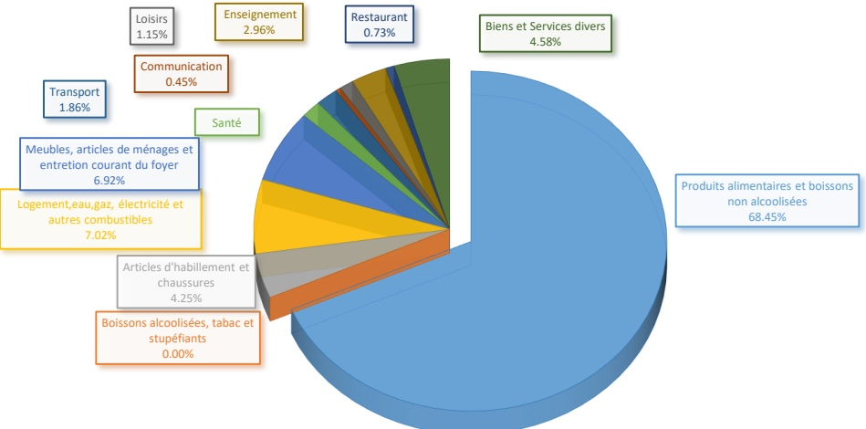

<!-- page 1 -->

Banque de la République d'Haïti

Note mensuelle d'inflation

Août 2023

<!-- page 2 -->

## Table des matières

I.- Introduction.....2
II.- Évolution de l'inflation globale en août 2023.....2
III.- Évolution des principales fonctions de consommation en août 2023.....2
IV.- Évolution de l'inflation selon l'origine des produits et les régions géographiques du pays.....4
V.- Évolution de l'inflation sous-jacente.....4
VI.- Facteur explicatif de l'évolution de l'inflation mensuelle en août 2023.....5
VII.- Prévisions d'inflation.....6

<!-- page 3 -->

### I. - Introduction

Cette note analyse l'évolution de l'indice des prix à la consommation (IPC) en Haïti au cours du mois d'août 2023. Elle apporte quelques éléments explicatifs permettant de comprendre les facteurs qui influencent la variation mensuelle de l'IPC.

### II. - Évolution de l'inflation globale en août 2023

En août 2023, l'indice des prix à la consommation (IPC) a été estimé à 322,4 contre 317,9 en juillet 2023 et 234,9 un an plus tôt. Ainsi, le taux d'inflation annuel s'est établi à 37,2 % en baisse de 2,5 points de pourcentage (pp) par rapport à celui enregistré un mois auparavant. Cette évolution de l'IPC s'inscrit dans le prolongement de la décélération de l'inflation annuelle entamée depuis février 2023.

Sur une base mensuelle, l'inflation a gagné 1,16 point de pourcentage pour s'établir à 1,4 % en août 2023. Cependant, d'octobre 2022 à août 2023, l'inflation mensuelle cumulée a atteint 26,1 % contre 26,8 % sur la même période de l'exercice précédent. Considérée en moyenne mensuelle sur les onze (11) premiers mois de l'exercice fiscal 2023, le taux d'inflation s'est chiffré à 2,4 %, soit le même rythme que celui de l'exercice précédent. Ce taux moyen d'inflation mensuel demeure néanmoins supérieur à celui enregistré chez nos principaux partenaires commerciaux (États-Unis : 0,3 % et République Dominicaine : 0,35 %).

Graphique 1. Évolution de l'inflation mensuelle et annuelle en août 2023 (en %)

| Date | Inflation Annuelle | Inflation Mensuelle |
| --- | --- | --- |
| Aug/20 | 30.0 | 21.0 |
| Oct/20 | 21.5 | 10.0 |
| Dec/20 | 20.5 | 11.5 |
| Feb/21 | 19.0 | 11.5 |
| Apr/21 | 17.0 | 11.0 |
| Jun/21 | 15.0 | 11.0 |
| Aug/21 | 11.0 | 15.0 |
| Oct/21 | 20.0 | 26.0 |
| Dec/21 | 24.0 | 11.0 |
| Feb/22 | 23.0 | 13.0 |
| Apr/22 | 25.0 | 15.0 |
| Jun/22 | 28.0 | 17.0 |
| Aug/22 | 32.0 | 22.0 |
| Oct/22 | 47.0 | 40.0 |
| Dec/22 | 48.0 | 25.0 |
| Feb/23 | 48.0 | 13.0 |
| Apr/23 | 47.0 | 14.0 |
| Jun/23 | 42.0 | 10.0 |
| Aug/23 | 37.2 | 1.4 |

Source : IHSI

### III. - Évolution des principales fonctions de consommation en août 2023

Le comportement de l'inflation mensuelle résulte de l'augmentation des prix de la majorité des fonctions de consommation notamment : « Biens et services divers » (+4,5 pp à 1,2 %), « Santé » (+3,4 pp à 0,86 %), « Transport » (+2,7 pp à 0,3 %), « Restaurant » (+2 pp à 2 %) et « Produits Alimentaires et boissons non alcoolisées » (+1,90 pp à 1,9 %). Cependant, l'IPC du groupe « Boissons alcoolisées, tabac et

<!-- page 4 -->

stupéfiants » est resté inchangé à 196,4 entre juillet et août 2023, tandis que celui du poste « Logement, eau, gaz, électricité et autres combustibles » s'est replié de 3,9 pp à 0,7 %¹.

En glissement annuel, le ralentissement de l'inflation globale a été tributaire de la baisse du rythme de progression de l'indice de la quasi-totalité des divisions de consommation à l'exception de celui du poste « Enseignement » qui a crû de 1,1 pp à 12,4 % en août 2023. En effet, la variation de l'IPC du groupe « Produits alimentaires et boissons non alcoolisées » est passée de 38 % en juillet à 35,3 % en août 2023, celle des postes « Boissons alcoolisés, tabac et stupéfiants » (de 20,8 % à 17,8 %), « Articles d'habillement et chaussures » (de 32,8 % à 29,5 %), « Logement, eau, gaz, électricité et autres combustibles » (de 44,4 % à 42,8 %), « Meubles, articles de ménage et entretien courant du foyer » (de 34 % à 31,6 %), « Santé » (de 27,2 % à 24,4 %), « Transport » (de 94,6 % à 91,4 %), « Communications » (de 19,1 % à 17,1 %), « Loisirs » (de 21,6 % à 20,1 %), « Restaurants » (de 34,6 à 32,6 %), et « Biens et services divers » (de 24,4 % à 21,9 %).

Par ailleurs, pour le mois d'août 2023, la contribution de la fonction « Produits alimentaires et boissons non alcoolisées » à l'inflation annuelle et mensuelle, s'est portée respectivement à 68,45 % et 44,87 %.

Tableau 1. Contributions à l'inflation mensuelle et annuelle en août 2023 (en %)

<table><tr><td>Août 2023</td></tr><tr><td>Poste</td><td>Pondération</td><td>Contribution à l'inflation mensuelle</td><td>Contribution à l'inflation annuelle</td></tr><tr><td></td><td>en %</td><td>en %</td><td></td></tr><tr><td>Indice Général</td><td>100.00</td><td>100.00</td><td>100.00</td></tr><tr><td>Produits alimentaires et boissons non alcoolisées</td><td>48.50</td><td>68.45</td><td>44.87</td></tr><tr><td>Boissons alcoolisées, tabac et stupéfiants</td><td>1.42</td><td>0.00</td><td>0.66</td></tr><tr><td>Articles d'habillement et chaussures</td><td>5.55</td><td>4.25</td><td>4.29</td></tr><tr><td>Logement, eau, gaz, électricité et autres combustibles</td><td>14.14</td><td>7.02</td><td>15.85</td></tr><tr><td>Meubles, articles de ménages et entretien courant du foyer</td><td>5.32</td><td>6.92</td><td>4.41</td></tr><tr><td>Santé</td><td>2.56</td><td>1.63</td><td>1.63</td></tr><tr><td>Transports</td><td>9.10</td><td>1.86</td><td>21.78</td></tr><tr><td>Communications</td><td>2.23</td><td>0.45</td><td>1.00</td></tr><tr><td>Loisirs</td><td>1.52</td><td>1.15</td><td>0.80</td></tr><tr><td>Enseignement</td><td>3.91</td><td>2.96</td><td>1.27</td></tr><tr><td>Restaurants</td><td>0.49</td><td>0.73</td><td>0.42</td></tr><tr><td>Biens et Services divers</td><td>5.26</td><td>4.58</td><td>3.02</td></tr></table>

Source : Calculs de la BRH/MAE

<!-- page 5 -->

### IV. - Évolution de l'inflation selon l'origine des produits et les régions géographiques du pays

La variation annuelle de l'IPC des produits locaux et celle de l'IPC des produits importés ont évolué à la baisse en août 2023. Le taux de croissance de l'indice des produits locaux a connu un repli de 1,5 point de pourcentage par rapport à juillet 2023 pour se porter à 37,3 %. De même, la croissance de l'IPC des produits importés s'est établi à 38,2 %, soit 3,3 points de pourcentage de moins que le mois précédent.

Considérée suivant la distribution géographique, l’inflation mensuelle a augmenté au niveau de toutes les zones géographiques. En effet, l’IPC des régions « Aire Métropolitaine » et « Transversale » a crû d’un point de pourcentage (1 pp) pour se chiffrer à 1,3 % chacun. L’inflation du « Reste Ouest » a atteint 1,3 % en hausse de 1,1 pp. L’indice des régions « Nord » et « Sud » s’est établi à 1,5 % (+0,9 pp) et 1,9 % (+0,5 pp) respectivement.

Sur une base annuelle, l’indice des prix de toutes les zones a évolué en-dessous du niveau observé au mois antérieur « Aire Métropolitaine » (35,4 % contre 38,1 %), « Reste Ouest » (39 % contre 41,4 %), Nord (37,5 % contre 39,8 %), « Sud » (38,4 % contre 40,4 %) et « Transversale » (37,7 % contre 40,3%).

### V. - Évolution de l'inflation sous-jacente

Au cours du mois sous revue, l'inflation sous-jacente, calculée en excluant l'IPC des produits à prix volatils du panier de consommation, a suivi la même tendance que l'inflation courante. En effet, en rythme mensuel, elle s'est établie à 1,33 % contre 0,93 % un mois plus tôt, soit 7,8 points de base de moins par rapport à l'inflation globale. De même, en glissement annuel, le taux de croissance de l'indice sous-jacent est passé de 34,10 % en juillet 2023 à 31,59 % en août 2023, une évolution inférieure de 5,7 pp à celle de l'indice global. Ainsi, la progression de l'inflation tant sur base mensuelle qu'annuelle semble découler principalement des composantes volatiles du panier de consommation.

<!-- page 6 -->

Graphique 2. Évolution de l'inflation globale et de l'inflation sous-jacente en rythme mensuel (en %)

| Date | Inflation globale | Inflation sous-jacente |
| --- | --- | --- |
| Aug-21 | 2.10 | 2.20 |
| Sep-21 | 1.50 | 1.40 |
| Oct-21 | 4.60 | 4.60 |
| Nov-21 | 4.60 | 4.60 |
| Dec-21 | 1.00 | 0.00 |
| Jan-22 | 0.60 | 0.80 |
| Feb-22 | 2.20 | 2.30 |
| Mar-22 | 1.60 | 1.60 |
| Apr-22 | 1.60 | 1.60 |
| May-22 | 1.80 | 1.80 |
| Jun-22 | 2.20 | 2.20 |
| Jul-22 | 3.20 | 3.20 |
| Aug-22 | 3.20 | 3.20 |
| Sep-22 | 5.00 | 5.00 |
| Oct-22 | 10.80 | 10.60 |
| Nov-22 | 3.50 | -1.50 |
| Dec-22 | 2.80 | 2.80 |
| Jan-23 | 1.30 | 1.50 |
| Feb-23 | 1.30 | 1.90 |
| Mar-23 | 1.80 | 1.80 |
| Apr-23 | 1.20 | 1.00 |
| May-23 | 0.50 | 0.50 |
| Jun-23 | 0.30 | 0.50 |
| Jul-23 | 0.20 | 0.80 |
| Aug-23 | 1.30 | 1.40 |

Source : Calculs de la BRH/ MAE

## 2023

L'évolution de l'inflation mensuelle observée au mois d'août 2023 découle principalement de la hausse des prix des produits alimentaires sur le marché national.

Graphique 3. Inflation mensuelle du poste "Produits alimentaires et boissons non alcoolisées (%)

| Date | Value |
| --- | --- |
| OCT-22 | 12.34 |
| NOV-22 | -2.68 |
| DEC-22 | 3.74 |
| JAN-23 | 1.39 |
| FEB-23 | 1.22 |
| MAR-23 | 2.04 |
| APR-23 | 1.65 |
| MAY-23 | 0.72 |
| JUN-23 | 0.89 |
| JUL-23 | 0.06 |
| AUG-23 | 1.91 |

Le lancement de la campagne agricole de printemps s'est réalisé après une période de sécheresse, laquelle n'a pas été compensée par le retard de démarrage de la saison pluvieuse. Ainsi, les récoltes de cette campagne, évoluant en dessous de la moyenne, se sont traduites par un déficit d'offre de produits agricoles dans un contexte de perturbation des marchés. De plus, en dépit de la contraction des prix sur

<!-- page 7 -->

le marché mondial, les difficultés d'accès à plusieurs grands axes routiers ont affecté les chaînes d'approvisionnement et augmenté ainsi le prix de revient des produits alimentaires importés². Conséquement, la baisse de l'offre alimentaire nationale et le renchérissement des produits d'importation ont eu des effets inflationnistes dans l'économie compte tenu de la demande existante. En témoigne l'analyse de l'insécurité alimentaire. En effet, selon la Coordination nationale de la sécurité alimentaire (CNSA), 44% de la population analysée font face à une insécurité alimentaire élevée et nécessitent une assistance alimentaire pour combler les déficits de consommation et protéger les moyens d'existence de la population vulnérable³

Graphique 4 : Contribution des fonctions à l'inflation mensuelle (août 2023)

## VII- Prévisions d'inflation

Les prévisions d'inflation réalisées par les Services techniques de la Banque de la République d'Haïti (BRH) tablent sur une poursuite de la décélération de l'inflation annuelle, laquelle devrait s'établir à 29,7 % en septembre pour ensuite se porter à 17,8 % en octobre et à 16,4 % en novembre 2023. Par ailleurs, l'inflation mensuelle devrait se replier à 0,7 % et 0,8 % respectivement en septembre et en octobre pour ensuite se chiffrer à 2,2 % en novembre 2023.

<!-- page 8 -->

Graphique 5. Prévisions de l'inflation en variation mensuelle et annuelle pour les mois de septembre, octobre et novembre 2023

| Month | Infl_m | Infl_y |
| --- | --- | --- |
| Nov-21 | 2.9 | 25.0 |
| Dec-21 | 0.9 | 24.8 |
| Jan-22 | 2.1 | 25.5 |
| Feb-22 | 1.6 | 26.5 |
| Mar-22 | 1.6 | 27.5 |
| Apr-22 | 1.8 | 28.5 |
| May-22 | 2.2 | 30.0 |
| Jun-22 | 3.2 | 31.5 |
| Jul-22 | 3.2 | 33.0 |
| Aug-22 | 6.5 | 36.0 |
| Sep-22 | 11.0 | 45.0 |
| Oct-22 | 3.5 | 48.3 |
| Nov-22 | 2.9 | 49.3 |
| Dec-22 | 1.3 | 48.2 |
| Jan-23 | 1.3 | 48.2 |
| Feb-23 | 1.7 | 48.3 |
| Mar-23 | 1.3 | 47.9 |
| Apr-23 | 0.9 | 46.4 |
| May-23 | 0.4 | 43.9 |
| Jun-23 | 0.3 | 39.8 |
| Jul-23 | 1.4 | 37.3 |
| Aug-23 | 0.7 | 29.7 |
| Sep-23 | 0.8 | 17.8 |
| Oct-23 | 2.2 | 16.4 |
| Nov-23 |   | 16.4 |

Sources : Prévisions du Service de Modélisation et Prévisions Macrééconomiques de la BRH

<!-- page 9 -->

Tableau 2. Indice des prix à la consommation (IPC) par postes de dépenses et Variation mensuelle et annuelle de l'IPC en août 2023

<table><tr><td>Poste</td><td>IPC</td><td>Variation IPC (%)</td></tr><tr><td>Août 2022</td><td>Juillet 2023</td><td>Août 2023</td><td>Mensuelle</td><td>Annuelle</td></tr><tr><td>Indice général</td><td>234.9</td><td>317.9</td><td>322.4</td><td>1.4%</td><td>35.3</td></tr><tr><td>Produits alimentaires et boissons non alcoolisées</td><td>264.4</td><td>351.1</td><td>357.8</td><td>1.9%</td><td>32.8</td></tr><tr><td>Boissons alcoolisés, tabac et stupéfiants</td><td>166.7</td><td>196.4</td><td>196.4</td><td>0.0%</td><td>17.8</td></tr><tr><td>Articles d'habillement et chaussures</td><td>256.4</td><td>328.6</td><td>332</td><td>1.0%</td><td>28.2</td></tr><tr><td>Logement,eau,gaz, électricité et autres combustibles</td><td>210.1</td><td>298</td><td>300</td><td>0.7%</td><td>41.8</td></tr><tr><td>Meubles, articles de ménages et entretien courant du foyer</td><td>232.9</td><td>301.3</td><td>306.6</td><td>1.8%</td><td>29.4</td></tr><tr><td>Santé</td><td>311.4</td><td>384</td><td>387.3</td><td>0.9%</td><td>23.3</td></tr><tr><td>Transports</td><td>170.7</td><td>325.8</td><td>326.7</td><td>0.3%</td><td>90.9</td></tr><tr><td>Communications</td><td>126.1</td><td>147.3</td><td>147.7</td><td>0.3%</td><td>16.8</td></tr><tr><td>Loisirs</td><td>222.6</td><td>264.7</td><td>267.4</td><td>1.0%</td><td>18.9</td></tr><tr><td>Enseignement</td><td>140.3</td><td>156.1</td><td>157.7</td><td>1.0%</td><td>11.3</td></tr><tr><td>Restaurants</td><td>263.6</td><td>342.6</td><td>349.5</td><td>2.0%</td><td>30.0</td></tr><tr><td>Biens et Services divers</td><td>218.3</td><td>263.1</td><td>266.2</td><td>1.2%</td><td>20.5</td></tr></table>

Source : IHSI

<!-- page 10 -->

## Glossaire

<table><tr><td>Glossaire</td></tr><tr><td>Variation mensuelle</td><td>: Variation par rapport au mois précédent.</td></tr><tr><td>Glissement annuel</td><td>: Variation par rapport au même mois de l'année antérieure.</td></tr><tr><td>Inflation</td><td>: Mouvement persistant à la hausse du niveau général des prix.</td></tr><tr><td>Désinflation</td><td>: Ralentissement de la croissance des prix.</td></tr><tr><td>Déflation</td><td>: Baisse du niveau général des prix associée à une contraction de la masse monétaire et du crédit.</td></tr><tr><td>Inflation sous-jacente</td><td>: Tendance de long terme des prix, tout en excluant la volatilité, les mouvements saisonniers, conjoncturels, et les chocs qui affectent les composantes du panier considéré.</td></tr><tr><td>Région Nord</td><td>: Elle couvre les départementes du Nord, Nord-Est et Nord-Ouest.</td></tr><tr><td>Région Sud</td><td>: Elle comprend les départementes du Sud, de la Grand-Anse et des Nippes.</td></tr><tr><td>Région Reste Ouest</td><td>: Y sont inclus les départementes du Sud-Est et de l'Ouest, à l'exception de l'aire métropolitaine</td></tr><tr><td>Région Transversale</td><td>: Elle regroupe les départementes du Centre et de l'Artibonite.</td></tr><tr><td>Aire Métropolitaine</td><td>: Elle contient les villes de Port-au-Prince, de Delmas, de Pétion-Ville, de Carrefour et de Croix des Bouquets.</td></tr></table>
