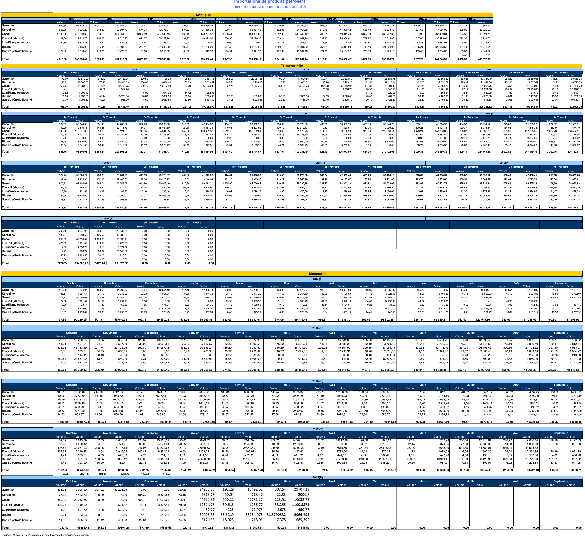

<!-- page 1 -->

Sources : Ministère de l'Économie et des Finances & Compagnies pétrolières

1 baril = 42 gallons

N.B. La rubrique LUBRIFIANTS & AUTRES contient des produits bitumeux pour l'exercice 94-95 (source: Dépt. du Commerce des U.S.A)
