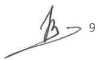

<!-- page 1 -->

## AUX BANQUES

La présente circulaire détermine certaines mesures préventives que les banques doivent prendre aux fins de lutter contre le blanchiment de capitaux et le financement du terrorisme.

### 1. Du devoir de vigilance relatif à la clientèle

Les banques doivent accorder une importance particulière aux normes relatives à la connaissance du client pour préserver leur réputation et l'intégrité du système bancaire et financier. Pour ne pas s'exposer au risque d'atteinte à la réputation, au risque opérationnel et au risque juridique, les banques doivent disposer de politiques, méthodes et procédures appropriées en tenant compte entre autres des éléments suivants :

a) des conditions claires d'acceptation de nouveaux clients ;

b) des règles précises sur l'identification des clients et de leurs mandataires, et la surveillance constante ;

c) une surveillance constante des comptes à hauts risques ;

d) des procédures et moyens appropriés pour la gestion des risques ;

e) des mesures de vigilance pour la clientèle.

Les banques doivent disposer de procédures de gestion des risques quant aux conditions dans lesquelles un client peut bénéficier de la relation d'affaires avant la vérification de son identification (opérations n'impliquant pas la présence physique du client).

Les banques doivent exercer une vigilance constante et examiner attentivement les opérations effectuées par la clientèle en vue de s'assurer qu'elles sont conformes à ce qu'elles savent de leurs clients, de leurs activités commerciales, de leur profil de risque et le cas échéant de la source de leurs fonds.

### 2. De l'identification de la clientèle

En conformité aux dispositions du décret du 30 avril 2023 sanctionnant le blanchiment de capitaux, le financement du terrorisme et le financement de la prolifération des armes de destruction massive, les banques sont tenues d'identifier leurs clients permanents ou occasionnels, les mandataires de leurs clients, les titulaires de procuration et les bénéficiaires effectifs. L'identification des clients a lieu lors :

1) de l'établissement de la relation d'affaires ;

1

<!-- page 2 -->

2) des transactions occasionnelles supérieures au seuil réglementaire ou en cas de répétition d'opérations distinctes pour un montant individuel inférieur au seuil réglementaire ou lorsque la provenance licite des fonds n'est pas certaine ou s'il s'agit d'un transfert de fonds au niveau national ou international ;

_us);

4) des transactions multiples en espèces, tant en gourdes qu'en devises étrangères, lorsque le total dépasse le seuil établi et lorsqu'elles sont réalisées par et pour le compte de la même personne en l'espace d'une journée ou dans une fréquence inhabituelle ;

5) de l'existence d'un soupçon de blanchiment de capitaux ;

6) de l'existence d'un soupçon de financement du terrorisme ;

7) des doutes quant à la véracité ou la pertinence des données d'identification du client précédemment obtenues.

Avant d'entrer en relation d'affaires avec un client, qu'il s'agisse d'une personne physique ou morale ou d'une construction juridique, les banques doivent recueillir et analyser les éléments d'information nécessaires à la connaissance du client ainsi que l'objet et la nature envisagée de la relation d'affaires. Pour les personnes morales ou les constructions juridiques, les banques doivent comprendre leur structure de propriété et de contrôle.

Lorsque les clients n'agissent pas pour leur propre compte, les banques sont tenues de se renseigner par tout moyen sur l'identité du véritable donneur d'ordre. Après vérification, si le doute persiste sur l'identité du véritable donneur d'ordre, il doit être mis fin à l'opération, sans préjudice de l'obligation d'effectuer une déclaration de soupçon. En outre, un avocat, un notaire, un comptable, un courtier en valeurs mobilières intervenant en tant qu'intermédiaire financier ne peut pas arguer du secret professionnel pour ne pas divulguer l'identité du véritable donneur d'ordre, ce conformément à l'article 43 du décret du 30 avril 2023.

Lors de l'identification des clients, une copie de tous les documents doit être faite, classée et centralisée par la banque. Des contrôles formels doivent être effectués quant à la signature, aux éventuelles anomalies sur la photographie et à l'apparence physique du client potentiel.

Si les banques ne peuvent pas respecter les dispositions prévues ci-dessus, elles ne peuvent ni nour ou maintenir une relation d'affaires, ni effectuer une opération pour le client. Elles détermineront, dans ce cas, s'il y a lieu de produire une déclaration de soupçon à l'Unité Centrale de Renseignements Financiers (UCREF) ou d'établir un rapport confidentiel interne conformément à l'article 46 du décret du 30 avril 2023.

Les banques ne sont pas tenues de façon répétée d'identifier chaque client et en vérifier l'identité chaque fois que celui-ci réalise une opération. Elles peuvent s'en remettre aux mesures d'identification et de vérification déjà réalisées, à moins qu'elles aient des doutes quant à la véracité des informations préalablement obtenues.

#### 2.1. De l'identification des personnes physiques

L'identification d'une personne physique selon l'article 36 du décret du 30 avril 2023 implique « l'obtention des nom et prénom complets, de la date et du lieu de naissance, et de l'adresse de

<!-- page 3 -->

son domicile principal ». Les banques sont tenues d’obtenir en ce sens les renseignements suivants :

a) patronyme légal et autres noms utilisés (par exemple nom de jeune fille);

b) date et lieu de naissance ;

c) nationalité ;

d) profession, charge publique et/ou nom de l'employeur ;

e) adresse (l'adresse complète doit être obtenue, un numéro de boite postale n'est pas suffisant);

f) pays de résidence ;

g) numéros de téléphone, courrier électronique.

Les personnes physiques non résidentes dans le pays doivent être identifiées de la même manière que les résidents. Les enfants mineurs doivent être représentés par un parent, client de l'institution financière, sinon des preuves documentaires sur l'identité de l'enfant et de son tuteur légal doivent être apportées.

#### 2.2. De l'identification des personnes morales et des constructions juridiques

Lorsque le client est une personne morale ou une construction juridique, l'identification porte sur « la dénomination sociale, la preuve de sa constitution légale, l'adresse du siège social, l'identité et les pouvoirs des administrateurs et dirigeants sociaux ou de leurs équivalents en droit étranger », selon l'article 38 du décret du 30 avril 2023.

Les banques sont tenues d'obtenir les renseignements suivants aux fins d'identifier les personnes morales :

a) adresse du siège principal de la société et des succursales, le cas échéant (l'adresse complète doit être obtenue, un numéro de boite postale n'est pas suffisant) ;

b) numéros de téléphone, courrier électronique, site internet ;

c) nom(s) et prénom(s) des actionnaires, pays de résidence, catégorie d'actions détenues (nominative ou au porteur), pourcentage d'actions détenues (pour les sociétés anonymes);

d) nom(s) et prénom(s) des associés, des fondateurs, pays de résidence, pourcentage de parts sociales détenues (suivant la forme juridique de la personne morale);

e) nom(s) et prénom(s) des propriétaires, des membres du conseil d'administration, des dirigeants (suivant la forme juridique de la personne morale) ;

f) nom(s) et prénom(s), profession, adresse des mandataires et des bénéficiaires effectifs, téléphone, courrier électronique, le cas échéant.

### 3. De la vérification de l'identité de la clientèle

Les banques sont tenues de vérifier l'identité des clients au moyen de documents, de données ou informations de sources fiables et indépendants.

3

<!-- page 4 -->

En ce qui a trait à la vérification des informations, l'article 36 du décret du 30 avril 2023 précise que : « la vérification de l'identité d'une personne physique requiert la présentation d'un (1) document officiel original en cours de validité et comportant une photographie, dont il en est pris copie. La vérification de son adresse est effectuée par la présentation d'un (1) document de nature à en rapporter la preuve ou par tout autre moyen ».

Lorsque le client est une personne morale ou une construction juridique, la vérification porte sur « la dénomination sociale, l'adresse du siège social, l'identité et les pouvoirs des administrateurs et dirigeants sociaux ou de leurs équivalents en droit étranger, la preuve de sa constitution légale à savoir l'original, voire l'expédition ou la copie certifiée conforme de tout acte ou extrait du registre du commerce attestant notamment de sa forme juridique », selon l'article 38 du décret du 30 avril 2023.

#### 3.1. Documents d'identification

Les pièces et documents suivants doivent être exigés lors de l'ouverture de comptes, l'émission de cartes de paiement, la location de coffres, l'exécution des transactions importantes en espèces c'est-à-dire pour une somme globalement égale ou supérieure au seuil établi par la BRH ou l'équivalent en devise étrangère, pour une opération occasionnelle de montant élevé, pour toute transaction effectuée dans des conditions de complexité inhabituelles ou injustifiées, pour toute transaction qui parait ne pas avoir de justification économique ou d'objet licite, au moment de l'exécution de transactions sous forme de virements électroniques, pour la garde des titres et d'autres avoirs, ou toutes autres transactions.

##### 3.1.1. Personnes physiques

a) un (1) document officiel original en cours de validité et comportant une photographie (carte d'identification nationale ou passeport ou permis de conduire);

b) un (1) document prouvant l'adresse : facture d'électricité ou facture d'eau ou avis d'imposition ou relevé bancaire, etc.

##### 3.1.2. Enfants mineurs

a) acte de naissance ou extrait d'archives ;

b) un (1) document officiel original en cours de validité et comportant une photographie (carte d'identification nationale ou permis de conduire ou passeport) identifiant l'un des parents et un (1) document prouvant l'adresse du parent, ou

c) un (1) document officiel original en cours de validité et comportant une photographie (carte d'identification nationale ou permis de conduire ou passeport) du tuteur légal et un (1) document prouvant l'adresse du tuteur ;

d) jugement homologuant le conseil de famille, le cas échéant.

<!-- page 5 -->

##### 3.1.3. Personnes morales

## Société civile

a) contrat ou convention créant la société dûment enregistrée au Ministère du Commerce et de l'Industrie ;

b) copie de la carte d'immatriculation fiscale et du certificat de patente ;

c) un (1) document habilitant un ou plusieurs associés à effectuer des transactions et opérations financières ;

d) un (1) document officiel original en cours de validité et comportant une photographie (carte d'identification nationale ou passeport ou permis de conduire) identifiant les associés mandataires et les bénéficiaires effectifs ;

e) un (1) document prouvant l'adresse des associés mandataires (facture d'électricité ou facture d'eau ou avis d'imposition ou relevé bancaire, etc.).

## Société en nom collectif et Société en commandite

a) acte constitutif de la société dûment enregistrée au Ministère du Commerce et de l'Industrie ;

b) statuts de la société dûment enregistrée au Ministère du Commerce et de l'Industrie ;

c) copie de la carte d'immatriculation fiscale et du certificat de patente ;

d) un (1) document habilitant un ou plusieurs associés à effectuer des transactions et opérations financières ;

e) un (1) document officiel original en cours de validité et comportant une photographie (carte d'identification nationale ou passeport ou permis de conduire) identifiant les associés mandataires et les bénéficiaires effectifs ;

f) un (1) document prouvant l'adresse des associés mandataires (facture d'électricité ou facture d'eau ou avis d'imposition ou relevé bancaire, etc.).

## Société anonyme

a) autorisation de fonctionnement délivrée par le Ministère du Commerce et de l'Industrie ;

b) statuts de la société dûment enregistrée au Ministère du Commerce et de l'Industrie ;

c) copie de la carte d'immatriculation fiscale et du certificat de patente ;

d) un (1) document du conseil d'administration habilitant une ou des personnes à effectuer des transactions et opérations financières ;

e) un (1) document officiel original en cours de validité et comportant une photographie (carte d'identification nationale ou passeport ou permis de conduire) identifiant les mandataires et les bénéficiaires effectifs ;

f) un (1) document prouvant l'adresse des mandataires (facture d'électricité ou facture d'eau ou avis d'imposition ou relevé bancaire, etc.).

Les sociétés anonymes de droit étranger doivent fournir toutes les pièces ci-dessus mentionnées. Les copies de documents doivent être certifiées conformes aux originaux par les personnes autorisées (notaire ou consulat ou ambassade, etc.) et traduits en français, le cas échéant.

后

<!-- page 6 -->

a) autorisation de fonctionnement délivrée par le Ministère de la Planification et de la Coopération Externe ;

b) statuts de l'ONG ;

c) copie de la carte d'immatriculation fiscale et du certificat de patente ;

d) un (1) document des membres du conseil de direction aux personnes habilitées à faire des transactions et opérations financières ;

e) un (1) document officiel original en cours de validité et comportant une photographie (carte d'identification nationale ou passeport ou permis de conduire) identifiant les mandataires et les bénéficiaires effectifs ;

f) un (1) document prouvant l'adresse des mandataires (facture d'électricité ou facture d'eau ou avis d'imposition ou relevé bancaire etc.).

### Coopératives (épargne et crédit, agricole, de transport, etc.)

a) autorisation de fonctionnement délivrée par le Conseil National des Coopératives ou par la BRH, le cas échéant ;

b) statuts de la coopérative dûment enregistrée au Conseil National des Coopératives ;

c) copie de la carte d'immatriculation fiscale ;

d) un (1) document du conseil d'administration aux personnes habilitées à faire des transactions et opérations financières ;

e) un (1) document officiel original en cours de validité et comportant une photographie (carte d'identification nationale ou passeport ou permis de conduire) identifiant les mandataires ;

f) un (1) document prouvant l'adresse des mandataires (facture d'électricité ou facture d'eau ou avis d'imposition ou relevé bancaire, etc.).

##  $ \underline{\text{Fondation}} $

a) inscription délivrée par la Mairie ;

b) statuts de la fondation ;

c) copie de la carte d'immatriculation fiscale ;

d) un (1) document du conseil d'administration aux personnes habilitées à faire des transactions et opérations financières ;

e) un (1) document officiel original en cours de validité et comportant une photographie (carte d'identification nationale ou passeport ou permis de conduire) identifiant les mandataires et les bénéficiaires effectifs ;

f) un (1) document prouvant l'adresse des mandataires (facture d'électricité ou facture d'eau ou avis d'imposition ou relevé bancaire, etc.).

## Autres entreprises commerciales

a) copies du certificat de patente, de la carte d'immatriculation fiscale et de la carte d'identité professionnelle ;

6

<!-- page 7 -->

b) un (1) document du ou des propriétaires aux personnes habilitées à faire des transactions et opérations financières;

c) un (1) document officiel original en cours de validité et comportant une photographie (carte d'identification nationale ou permis de conduire ou passeport) identifiant les mandataires et les bénéficiaires effectifs ;

d) un (1) document prouvant l'adresse des mandataires (facture d'électricité ou facture d'eau ou avis d'imposition ou relevé bancaire, etc.).

## Evres caritatives, clubs, associations, églises et partis politiques

Dans le cas de telles entités, les banques doivent vérifier l'identité d'au moins deux (2) signataires, en sus de l'entité elle-même. Les responsables à identifier doivent être les personnes qui contrôlent totalement ou partiellement les actifs, c'est-à-dire les membres de l'organe ou comité exécutif, le président, un administrateur, le trésorier et tous les signataires autorisés.

En ce qui a trait aux partis politiques, la copie des pièces suivantes doit être réclamée :

a) l'enregistrement au Ministère de la Justice et de la Sécurité Publique ;

b) l'acte constitutif ;

c) les documents d'identification du représentant officiel ou de ceux mandatés par le Comité de direction.

## Fonds de retraite

Le fiduciaire ou tout autre dirigeant en charge des relations avec la banque (administrateur, gérant, signataire autorisé) doit être considéré comme le responsable et son identité doit être vérifiée par la banque.

##  $ \underline{\text{Autres}} $

Pour tout autre type d'entités non mentionnées dans la présente circulaire, les banques sont tenues de prendre les mesures adéquates aux fins d'établir l'identité du client et des bénéficiaires effectifs et à n'accepter de clients qu'à l'issue de cette procédure.

En ce qui a trait aux institutions financières non bancaires, les banques doivent s'assurer qu'elles sont agréées par la BRH (copie autorisation de la BRH ou vérification du site internet de la BRH).

##### 3.1.4. Sociétés en formation

Pour les sociétés en formation (sociétés, fondations, ONG), les copies des documents notariés de constitution (acte de fondation, statut, assemblée constitutive) et tous documents prouvant le processus d'enregistrement de la nouvelle entité (facture des Presses Nationales, correspondances, etc.) sont acceptables. Les banques s'assurent, dans des délais raisonnables,

7

<!-- page 8 -->

de compléter le dossier d'ouverture de compte et s'efforce de vérifier l'identité des mandataires de la société en formation.

#### 3.2. Des comptes ouverts à distance

Lorsqu'un compte est ouvert par voie électronique, l'envoi de tous les documents doit être fait par courrier recommandé avec accusé de réception dans les cinq (5) jours ouvrables, suivant la date d'ouverture du compte. Cet accusé doit être signé en personne par le titulaire du compte. Les copies des documents d'identification doivent être certifiées conformes aux originaux par les personnes autorisées (notaire ou consulat ou ambassade, etc.). Lorsqu'il s'agit d'une personne morale ou d'une construction juridique, tous les documents doivent être traduits en français et notariés, le cas échéant.

Les banques doivent donc prendre toutes les dispositions particulières et suffisantes pour prévenir le blanchiment de capitaux et le financement du terrorisme lorsqu'elles entretiennent des relations d'affaires ou exécutent des opérations avec un client qui n'est pas physiquement présent aux fins d'identification, ce conformément à l'article 30 du décret du 30 avril 2023.

### 4. Des bénéficiaires effectifs

Les banques sont tenues d'identifier les bénéficiaires effectifs conformément aux dispositions des articles 40 à 42 du décret du 30 avril 2023.

Des mesures adéquates doivent être prises pour la vérification des informations recueillies, ainsi que pour leur mise à jour lorsqu'il apparait que celles-ci ne sont plus actuelles.

Si les banques ne peuvent pas obtenir ces informations ou leurs clients restent en défaut de les communiquer ou leur communiquent des informations non pertinentes ou invraisemblables, elles ne peuvent ni nouer ou maintenir une relation d'affaires, ni effectuer une opération pour le client. Elles détermineront, dans ce cas, s'il y a lieu d'en informer l'UCREF.

### 5. Les personnes politiquement exposées

Un devoir de vigilance renforcée doit s'exercer à l'égard des personnes politiquement exposées (PPE), qui sont définies par l'article 6 du décret du 30 avril 2023 comme des personnes qui exercent ou ont exercé d'importantes fonctions publiques dans un pays étranger ou en Haïti ou au sein de ou pour le compte d'une organisation internationale, ainsi que les membres de la famille de cette personne, ou toutes autres personnes qui lui sont étroitement liées ou associées.

Les banques doivent disposer de systèmes appropriés de gestion de risques adéquats permettant de déterminer si le client ou le bénéficiaire effectif est une personne politiquement exposée. Dès que le client est identifié comme personne politiquement exposée, il faut :

a) obtenir l'autorisation de la haute direction avant de nouer ou de continuer une relation d'affaires avec le client ;

8

<!-- page 9 -->

b) prendre toute mesures appropriées pour établir l’origine du patrimoine et l’origine des fonds des clients et des bénéficiaires effectifs identifiés comme PPE ;

c) assurer une surveillance continue renforcée de la relation d'affaires.

Lors du versement des prestations de contrats d'assurance vie, les banques doivent prendre des mesures raisonnables afin de déterminer si les bénéficiaires de contrat d'assurance vie et/ ou le bénéficiaire effectif du bénéficiaire du contrat sont des PPE.

Lors du versement des prestations, si des risques plus élevés sont identifiés, il faut que :

a) la haute direction soit informée avant le paiement du capital ;

b) soit considéré un examen renforcé de l'ensemble de la relation d'affaires avec le titulaire du contrat ;

c) soit envisagé une déclaration de soupçon, le cas échéant.

En sus des PPE, un contrôle rigoureux doit être appliqué envers toute personne ayant une fortune élevée d'origine incertaine ou douteuse.

### 6. Correspondant bancaire transfrontalier

Toutes les banques doivent disposer de politiques, procédures et mécanismes susceptibles de favoriser une bonne connaissance des activités légitimes de leur correspondant bancaire transfrontalier et autres relations similaires. Les banques doivent s'assurer :

a) d'identifier et de vérifier l'identification des institutions clientes avec lesquelles elles entretiennent des relations de correspondant bancaire ;

b) de recueillir des informations sur la nature des activités de l'institution cliente ;

c) d'évaluer, sur la base d'informations publiquement disponibles, la réputation de l'institution cliente et le degré de surveillance à laquelle elle est soumise et de déterminer si elle a fait l'objet d'une enquête ou de mesures de la part d'une autorité de contrôle en matière de blanchiment de capitaux ;

d) d'évaluer les contrôles mis en place par l'institution cliente pour lutter contre le blanchiment de capitaux et le financement du terrorisme ;

e) pour les comptes de passage, que l'institution cliente a appliqué les mesures de vigilance aux clients ayant un accès direct à ses comptes et qu'elle est en mesure de fournir les données d'identification pertinentes sur demande ;

f) de comprendre les responsabilités respectives de chaque institution en matière de lutte contre le blanchiment de capitaux et le financement du terrorisme ;

g) d'obtenir l'autorisation de la haute direction avant d'établir de nouvelles relations de correspondance bancaire.

Les banques ne peuvent en outre établir une relation de correspondant bancaire avec une banque fictive. Elles doivent s'assurer que leur correspondant bancaire ne noue pas ou ne maintient pas des relations avec des banques fictives.

<!-- page 10 -->

### 7. Elaboration du profil de risque de la clientèle

Les banques doivent établir le profil de risque des clients ou de catégorie de clients afin d'effectuer une vigilance constante sur la clientèle.

Le profil de risque est une évaluation individualisée du niveau de risque de chaque client. Il prend en compte des éléments permettant de caractériser les risques présentés par un client, à savoir : ses activités (profession), ses revenus ou sa situation financière, tout élément permettant d'apprécier son patrimoine, l'objet et la nature intentionnels de la relation d'affaires ou de l'opération ponctuelle, le niveau d'activité attendu, la provenance des fonds, les opérations envisagées ou réalisées, le fonctionnement envisagé du compte, etc.

Le profil de risque doit être complet, exact et mis à jour selon une fréquence adaptée au risque.

### 8. Mesures de vigilance renforcée

Les banques doivent appliquer, en fonction de leur appréciation du risque, des mesures de vigilance renforcées dans des situations qui, de par leur nature, peuvent présenter un risque élevé de blanchiment de capitaux ou de financement du terrorisme et, à tout le moins, dans les cas suivants (liste non limitative) :

a) lorsque le client ou son bénéficiaire effectif n'est pas présent physiquement ;

b) le client ou son bénéficiaire effectif est une personne politiquement exposée résidant à l'étranger ;

c) les relations de correspondants bancaires.

En outre, comme le prescrit l'article 28 du décret du 30 avril 2023, une attention particulière doit être exercée à l'égard des relations d'affaires et des opérations avec des personnes physiques ou morales, y compris les institutions financières, provenant de pays qui n'appliquent pas ou appliquent insuffisamment les normes internationales en matière de lutte contre le blanchiment de capitaux et contre le financement du terrorisme. Les banques doivent leur appliquer des mesures de vigilance renforcées, proportionnées aux risques.

Les banques sont également tenues d'appliquer des mesures de vigilance renforcées à l'égard de la clientèle opérant dans des secteurs d'activités où l'utilisation des espèces est fortement constatée, et de celle évoluant dans des secteurs dont la réglementation est insuffisante et qui fait partie de la catégorie dénommée « entreprises et professions non financières désignées (EPNFD) ».

### 9. Clients existants

Les banques sont tenues d'appliquer à leurs clients existants les mesures de vigilance à la clientèle en tenant compte du moment où elles ont été mises en œuvre ainsi que de la pertinence des informations obtenues, selon l'importance des risques qu'ils représentent.

<!-- page 11 -->

### 10. Recours à des tiers

Les banques peuvent avoir recours à des intermédiaires ou autre tiers pour l'exécution de leurs obligations à l'entrée en relation d'affaires et de l'obligation de vigilance constante sur la clientèle et sur toutes les opérations de la clientèle si elles ont pu s'assurer que :

a) le tiers est en mesure de fournir sur demande et sans retard des copies des données d'identification et autres documents qui ont traité à l'obligation de vigilance ;

b) le tiers est soumis à une réglementation, fait l'objet d'un contrôle ou d'une surveillance et a pris des mesures pour respecter les obligations de vigilance relatives à la clientèle et les obligations de conservation de documents, s'il s'agit d'une autre institution financière.

La responsabilité finale appartient aux institutions financières qui ont recours aux tiers.

Cette obligation ne s'applique pas aux relations de sous-traitance ou de mandat.

### 11. Virements électroniques de fonds

Dans le cadre d'opérations de virement électronique de fonds, les banques sont tenus d'identifier les donneurs d'ordre et les bénéficiaires conformément aux dispositions des articles 47 et suivants du décret du 30 avril 2023. L'identification inclut les prénoms, le nom, l'adresse, le numéro de compte le cas échéant et tous autres renseignements qui accompagnent le virement électronique ou le message qui s'y rapporte tout au long de la chaîne de paiement.

Les banques doivent s'assurer que les virements électroniques contiennent toutes les informations requises sur le donneur d'ordre et/ou le bénéficiaire et prendre des mesures appropriées dans le cas contraire.

On entend par virement électronique de fonds, toute transaction par voie électronique effectuée au nom d'un donneur d'ordre (personne physique ou morale) en vue de mettre à disposition d'un bénéficiaire une certaine somme d'argent. Le donneur d'ordre et le bénéficiaire peuvent être une seule et même personne. Le virement peut être transfrontalier ou national.

Les dispositions de la présente section ne s'appliquent pas :

a) aux virements de fonds effectués au moyen d'une carte de crédit ou de débit ou par carte prépayée ou d'un téléphone portable pour l'achat de biens et de services tant que le numéro de ladite carte ou du téléphone accompagne l'ensemble des transferts découlant de l'opération ;

b) aux transferts effectués entre les institutions financières lorsque le donneur d'ordre et le bénéficiaire sont des institutions financières opérant pour leur propre compte ;

c) aux virements effectués au profit d'autorités publiques pour le paiement d'impôts, d'amendes ou d'autres prélèvements.

<!-- page 12 -->

### 12. Des technologies nouvelles

Les banques doivent identifier et évaluer les risques de blanchiment de capitaux et de financement du terrorisme pouvant résulter :

a) du développement de nouveaux produits et de nouvelles pratiques commerciales, y compris de nouveaux mécanismes de distribution ;

b) de l'utilisation de technologies nouvelles ou en développement en lien avec de nouveaux produits ou des produits préexistants.

Cette évaluation de risques devrait avoir lieu avant le lancement des nouveaux produits ou des nouvelles pratiques commerciales ou avant l'utilisation de technologies nouvelles ou en développement. Les banques doivent prendre des mesures appropriées pour gérer ces risques.

### 13. Conservation de documents

Les banques sont tenues de conserver pendant une période de cinq (5) ans au moins, après la clôture des comptes ou la cessation des relations avec le client habituel ou occasionnel, les pièces et documents obtenus dans le cadre des mesures de vigilance relative à la clientèle. Elles conservent également les pièces et documents relatifs aux opérations, nationales et internationales, que les clients ont effectué ainsi que les livres de comptes et les correspondances commerciales doivent être gardés dans les archives de l'institution pendant cinq (5) ans au moins après l'exécution de la transaction.

A cette fin, une formule d'archivage des documents sur les opérations doit être utilisée pour la conservation des documents.

Cette conservation des documents, se rapportant aux transactions nationales et/ou internationales effectuées, permettra de répondre rapidement aux demandes d'informations des autorités compétentes et de reconstituer les transactions individuelles (y compris les montants et les types d'espèces en cause, le cas échéant) de façon à fournir, le cas échéant, des preuves en cas de poursuite pour conduite criminelle.

De même, une copie des rapports systématiques de transactions et des déclarations de soupçons doit être gardée et archivée par les banques.

### 14. Mise à jour des renseignements sur la clientèle

La fréquence des mises à jour des renseignements sur les clients, varie selon le contexte dans lequel les opérations se déroulent, donc d'une situation à l'autre. Les banques sont responsables du choix de la fréquence qui ne peut dépasser trois (3) ans. Toutefois, pour les situations posant des risques élevés, les mises à jour doivent être effectuées au moins tous les deux (2) ans.

### 15. Sanctions

En cas de non respect des obligations définies dans la présente circulaire ou de constat de défaut de vigilance de la part des banques, la BRH se réserve le droit de prendre toutes sanctions

<!-- page 13 -->

administratives allant de l'avertissement au retrait de l'agrément dans les cas les plus graves, et/ou d'appliquer une amende de cinq cent mille gourdes (HTG 500,000.00) par violation constatée.

La BRH peut exiger d'une banque qu'elle apporte les corrections nécessaires quant aux violations relatives à la présente circulaire. A défaut de se conformer aux actions de redressement requises par la BRH, la banque est assujettie à une pénalité de trois cent mille gourdes (HTG 300,000.00) par jour d'infraction à compter de la date à laquelle l'infraction lui est notifiée par la BRH, sans dépasser trente (30) jours. Toute pénalité sera déduite du solde du compte de la banque fautive à la BRH.

### 16. Abrogation et Entrée en vigueur

La présente circulaire abroge la circulaire 99-3 du 27 août 2020 et la note additionnelle du 14 novembre 2022. Elle entre en vigueur le 14 août 2023.

Port-au-Prince, le 27 juillet 2023.

Braden Club

Jean Baden Dubois

Gouvernetur
