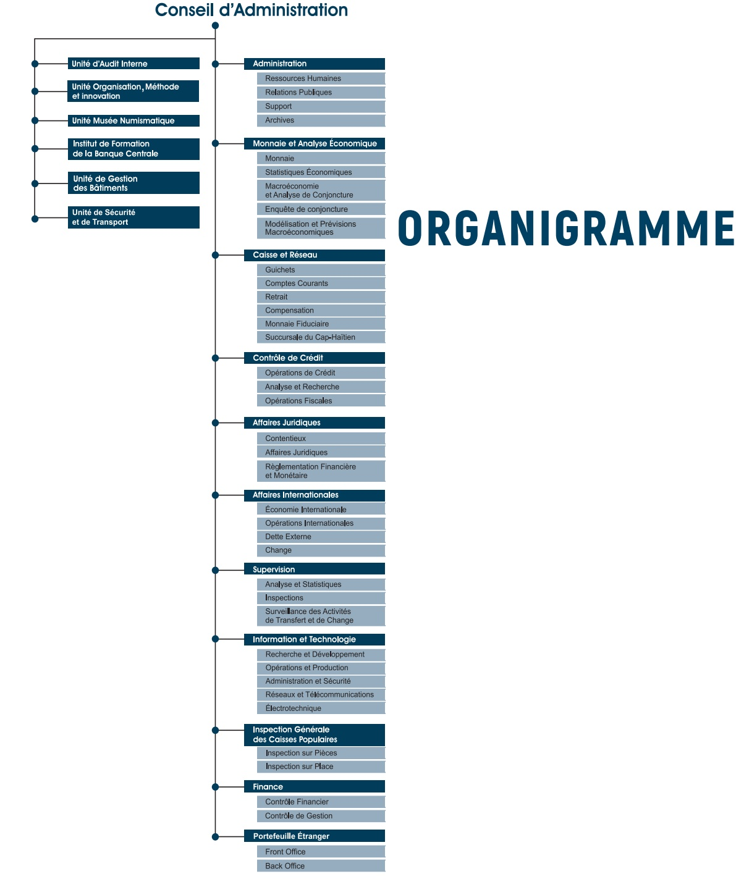

<!-- page 1 -->

# RAPPORT Annuel 2020

<!-- page 2 -->

<!-- page 3 -->

## CONSEIL D'ADMINISTRATION

JEAN BADEN DUBOIS

Gouverneur

GEORGES HENRY

Gouverneur-Adjoint

RONALD GABRIEL

Directeur Général

MYRTHO RENÉ

Membre

EDGARD JEUDY

Membre

<!-- page 4 -->

<!-- page 5 -->

## Conseil d'Administration

## ORGANIGRAMME

<!-- page 6 -->

<!-- page 7 -->

## TABLE

## DES MATIÈRES

AVANT-PROPOS DU GOUVERNEUR.....13
A- L'ACTIVITÉ ÉCONOMIQUE EN 2020

ENVIRONNEMENT ÉCONOMIQUE EN 2020 .....16
I.1 Environnement économique international .....16
I.2 Environnement économique national .....17
I.2.1 Secteur réel en 2020 .....17
I.2.1.1 Valeur ajoutée par branche d'activité .....18
I.2.1.2 Évolution des prix en 2020 .....19
I.2.1.3 Situation de l'emploi et des salaires en Haïti en 2020 .....21

MONNAIE ET FINANCEMENT DE L'ÉCONOMIE EN 2020 .....23
II.1 Politique monétaire en 2020 .....23
II.1.1 Instruments de la politique monétaire .....24
II.1.1.1 Bons BRH .....24
II.1.1.2 Taux de réserves obligatoires .....25
II.1.1.3 Interventions de la BRH sur le marché des changes .....26
II.1.1.4 Mesures réglementaires .....26
II.1.2 Résultats .....27
II.1.2.1 Résultats intermédiaires .....27
II.1.2.2 Résultats finals .....28
II.1.2.2.1 Rémunération des dépôts et des prêts sur les opérations en gourdes .....28
II.1.2.2.2 Rémunération des dépôts et des prêts sur les opérations en devises .....28
II.1.3 Évolution des agrégats monétaires en 2020 .....29
II.1.3.1 Contreparties de M3 et financement de l'économie .....30

FINANCES PUBLIQUES EN 2020 .....30
III.1 Recettes .....31
III.1.1 Recettes Internes .....31
III.1.2 Recettes Douanières .....32
III.1.3 Autres recettes .....32
III.1.4 Performance Institutionnelle .....32
III.2 Dépenses .....33
III.2.1 Dépenses Courantes .....33
III.2.2 Dépenses d'investissement .....33
III.3 Financement de l'Administration Centrale .....34
III.4 Évaluation du programme financier .....35

BALANCE DES PAIEMENTS EN 2020 .....35
IV.1 Compte courant .....35
IV.2 Solde des biens et services .....36
IV.2.1 Exportations de biens .....36
IV.2.2 Importations de biens .....37
IV.3 Solde des revenus .....38
IV.4 Solde des transferts courants .....38
IV.5 Compte de capital .....39
IV.5.1 Compte des opérations financières .....39
IV.5.2 Financement de la balance des paiements .....39

DETTE PUBLIQUE EXTERNE .....39
V.1 Encour de la dett publique externe .....39

V DETTE PUBLIQUE EXTERNE.....39
V.1 Encours de la dette publique externe.....39
V.1.1 Créances bilatérales.....40

<!-- page 8 -->

V.1.2 Créances multilatérales ..... 40
V.1.3 Structure de l'encours de la dette publique externe par types de devises ..... 40
V.1.4 Répartition de l'encours de la dette par secteur économique ..... 41
V.2 Décaissements, Service de la Dette et Arriérés de Paiement ..... 41
V.3 Allégement de dette reçu au cours de l'exercice fiscal 2019-2020 ..... 42
VI ÉVOLUTION DU TAUX DE CHANGE NOMINAL ..... 43
VI.1 Facteurs explicatifs de la progression du taux de change en 2020 ..... 43
VI.2 Évolution des spreads bancaire et informel ..... 44

## B- LE SYSTÈME BANCAIRE EN 2020 : VUE D'ENSEMBLE

VII ÉVOLUTION DU SYSTÈME BANCAIRE EN 2020.....44
VIII.1 Système bancaire : Établissements, Environnement concurrentiel et Taux de bancarisation.....46
VIII.2 Structure du système bancaire.....48
VIII.3 Distribution du crédit.....50
VIII.4 Parts de marché individuelles dans le système bancaire haïtien.....52
VIII ACTIVITÉS ET RÉSULTATS DU SYSTÈME BANCAIRE EN 2020.....53
VIII.1 Activités bancaires.....53
VIII.1.1 Opérations avec la clientèle.....55
VIII.1.2 Emplois du système et évolution des actifs productifs.....57
VIII.1.3 Opérations sur titres.....57
VIII.1.4 Autres placements.....58
VIII.1.5 Opérations de change.....58
VIII.2 Structure financière et qualité de l'actif.....59
VIII.2.1 Assise financière et fonds propres.....59
VIII.2.2 Qualité de l'actif.....59
VIII.3 Résultats des activités bancaires.....61
VIII.3.1 Revenus nets d'intérêt.....62
VIII.3.2 Autres revenus.....62
VIII.4 Produit net bancaire et provisions pour créances douteuses.....63
VIII.4.1 Dépenses d'exploitation.....63
VIII.4.2 Taux de rémunération moyenne des dépôts et de rendement moyen des prêts.....64
VIII.5 Effectif des banques et productivité.....64
IX ACTIVITÉ DE SURVEILLANCE.....65
IX.1 Mission de surveillance.....65
IX.2 Autres.....65
X SECTEURS DES COOPERATIVES ET DE CRÉDIT : VUE D'ENSEMBLE.....66
X.1 Évolution du secteur des CEC en 2020.....66
X.2 Structure du secteur des coopératives d'épargne et de crédit.....68
X.3 Environnement concurrentiel.....68
X.4 Poids des différents départementes du pays dans le secteur des CEC.....69
IX.5 Brève analyse des données bilantielles du secteur en 2020.....72
X 6 Activités de surveillance des Coopératives d'épargne et de crédit (CEC).....73

## C LA BRH EN 2020

XI GESTION DES AVOIRS EXTÉRIEURS DE LA BRH.....74
XI.1 Composition des avoirs extérieurs.....74
XI.2 Rendement du portefeuille.....75
XI.3 Rendement des fonds places sur le marché du loyer au jour le jour (repos).....75
XII MONNAIE FIDUCIAURE ET MONNAIE SCRIPTURALE.....75
XII.1 Billets et monnaie divisionnaire.....75
XII.1 Émission, destruction et remplacement de la monnaie.....75

<!-- page 9 -->

XII.1.2 Circulation fiduciaire au sens strict .....76
XII.1.3 Circulation fiduciaire au sens large .....76
XII.1.4 Composition de l'encours des billets .....77
XII.1.5 Billets contrefaits retenus aux guichets de la BRH .....77
XII.2 Chèques traités en gourdes .....78
XII.3 Chèques traités en dollars ÉU .....79
XII.4 Dépôts et tirages des banques commerciales .....80
XII.4.1 Dépôts reçus .....80
XII.4.2 Tirages des banques commerciales à la BRH .....81
XII.5 Services à l'État .....81
XII.5.1 Caissier de l'État .....81
XII.6 Impressions de chèques .....82
XII.7 Certification des chèques .....83
XII.8 Chèques tirés sur les comptes courants payés aux guichets de la BRH .....83
XII.9 Système de paiement interbancaire haïtien (SPIH) .....84
XII.9.1 Virements en gourdes .....84
XII.9.2 Virements en dollar ÉU .....86
XII.9.3 Revenu généré par le SPIH pour la BRH .....88
XII.10 Règlement des cartes de crédit .....89

## D- ÉTATS FINANCIERS & ANNEXE JURIDIQUE

ETATS FINANCIERS.....87
LISTE DES CIRCULAIRES.....88
ANNEXE JURIDIQUE.....139

## E- ANNEXE STATISTIQUE

1.1a Contribution à la valeur ajoutée du PIB réel (en pourcentage).....149
1.1b Taux de croissance du PIB réel (en pourcentage).....150
2. Compte du produit intérieur brut (en millions de gourdes à prix courants).....151
2.a Structure du PIB nominal (en millions de gourdes à prix courants).....151
3. Compte du produit intérieur brut (en millions de gourdes de 2011-2012).....152
3.a Structure du PIB réel (en millions de gourdes de 2011-2012).....152
3.b Compte du produit intérieur brut (variations en pourcentage).....153
3.c Structure de la croissance du PIB réel (en pourcentage).....153
3.d Contribution à la croissance du PIB réel (en pourcentage).....154
4.4 Indice des prix à la consommation (IPC) - ensemble du pays (2017-2018=100).....154
4.a Indice des prix à la consommation (IPC) - ensemble du pays (2017-2018=100) (Suite).....155
5. Taux d'inflation (variation de l'IPC en pourcentage, 2017-2018=100).....156
5.5 Taux d'inflation (variation de l'IPC en pourcentage) (suite).....157
5.5a Taux d'inflation (variation de l'IPC en glissement annuel, en pourcentage).....158
6. Taux de change à Port-au-Prince (Gourdes/Dollar ÉU).....159
7. Composantes et contreparties de l'agrégat M3 (en millions de gourdes).....160
8. Base monétaire et ses sources (en millions de gourdes).....161
9. Bilan de la BRH (en millions de gourdes) millions de gourdes.....162
1.10 Bilan consolidé des banques commerciales (en millions de gourdes).....163
1.11 Bilan consolidé des banques commerciales (en millions de gourdes).....164
1.12 Résumé des opérations financières de l'Administration Centrale.....165
1.13 Résumé des opérations financières des administrations publiques.....166
1.14 Résumé de la Balance des Paiements d'Haïti (en millions de dollars ÉU).....167
1.15 Position extérieure globale d'Haïti (en millions de dollars ÉU).....168
1.16 Exportations d'Haïti par produits (en millions de dollars ÉU).....169
1.17 Exportations aux USA (FOB) à base de matières premières locales (en milliers de dollars ÉU).....170
1.18 Exportations des industries d'assemblage aux USA (FOB) base de matières premières importées.....171
1.19 Importations totales d'Haïti par catégories de produits (en millions de dollars ÉU).....172
2.0 Importations de produits pétroliers (en milliers de barils et en milliers de dollars ÉU).....173
2.1 Dette externe totale du secteur public (en millions de dollars ÉU).....174
2.2 Décaissements effectués sur les prêts (en millions de dollars ÉU).....175

<!-- page 10 -->

Paiement du service de la dette (en millions de dollars ÉU) .....176
Chiffres clés du bilan par banque (en milliers de gourdes) .....177
Chiffres clés des résultats par banque (en milliers de gourdes) .....178
Ratios financiers par banque .....179
Ratios financiers par banque – ratios de rentabilité .....180
Système bancaire - Sommaire financier détaillé - Bilan par banque (devises et gourdes) .....181
Système bancaire - Sommaire financier détaillé - Résultats cumulatifs par banque .....182
DES SIGLES .....184

Systeme bancaire - Sommaire financier détaillé - Brian par barique (devises et gourdes) ..... 181
Système bancaire - Sommaire financier détaillé - Résultats cumulatifs par banque ..... 182
DES SIGLES ..... 184
F- TABLEAUX
Inflation par région géographique en 2019 ..... 21
Emploi dans le secteur de la sous-traitance ..... 22
Salaire Minimum Réel ..... 23
Évolution des recettes internes par institutions ..... 33
Évolution des flux nets du solde des comptes de l'Administration Centrale (en MG) ..... 35
Tableau des réalisations budgétaires (en millions de gourdes) ..... 35
Composition du portefeuille de la dettre externe par type de devise en dollars ÊU et en pourcentage ..... 39
Allègement reçu en 2019 (en millions de dollars ÊU) ..... 41
Indicateurs financiers clés au 30 septembre ..... 45
Établissements bancaires fonctionnant en Haïti (au 30 septembre 2019) ..... 46
Établissements non bancaires fonctionnant en Haïti au 30 septembre 2019 ..... 46
Évolution du nombre de succursales autorisées et opérationnelles par établissement ..... 46
Nombre de succursales et agences autorisées ..... 47
Poids des principaux établissements bancaires au 30 septembre (en %) ..... 47
Poids des différentes catégories d'établissements bancaires au 30 septembre (en %) ..... 48
Indicateur de concentration Herfindhal-Hirschman au 30 septembre ..... 49
Répartition de l'encours des prêts par secteur d'activité au 30 septembre (en MG et en %) ..... 49
Répartition du nombre de prêts par emprunteur au 30 septembre ..... 49
Parts de marché et rang Actif total et portefeuille de prêts bruts (au 30 septembre) ..... 27
Composantes de la base monétaire (milliards de gourdes) ..... 27
Taux d'intérêt moyens pratiqués par les banques commerciales (opérations en gourdes) ..... 28
Taux d'intérêt moyens pratiqués par les banques commerciales (Opérations en dollars ÊU) ..... 28
Évolution des agrégats monétaires (en milliards de gourdes) ..... 29
Les contreparties de M3 (en milliards de gourdes) ..... 30
Financement du déficit budgétaire en pourcentage du PIB et en MG ..... 31
Évolution de la pression fiscale ..... 31
Évolution des composantes des recettes courantes en 2019 (En millions de gourdes) ..... 32
Projets et programmes par secteur ..... 34
Évolution du solde du Compte des transactions courantes (en millions de dollars ÊU) ..... 35
Parts relatives des principales exportations (en pourcentage du total) ..... 36
Parts relatives des principales importations ..... 36
Solde des opérations financières de la balance des paiements (en millions de dollars ÊU) ..... 37
Réserves brutes en mois d'importations ..... 38
Encours de la dettre publique externe par type de créanciers (en millions de dollars ÊU) ..... 38
Répartition de la dettre par secteur économique en 2019 (en millions de dollars ÊU) ..... 39
Répartition de la dettre par organisme en 2019 (en millions de dollars ÊU) ..... 40
Évolution des décaissements, des amortissements et des flux nets ..... 41
Taux de référence du dollar par rapport à la gourde (fin de période) et TMA ..... 42
Évolution du taux moyen d'acquisition bancaire (TMA) USD/HTG (Moyenne mensuelle) ..... 42
Évolution des spreads bancaire et informel ..... 43
Répartition en pourcentage et selon l'échéance de l'encours des prêts de 75 000 gourdes ..... 50
Liquidités du système bancaire au 30 septembre 2019 (en MG) ..... 53
Évolution des dépôts du système bancaire (en MG) ..... 54
Portefeuille de prêts bruts du système bancaire au 30 septembre 2019 (en MG) ..... 55
Volume des achats et des ventes de dollars ÊU (en millions de dollars ÊU) ..... 56
Position nette en devises du système bancaire en pourcentage des fonds propres ..... 56
Évolution des fonds propres du système bancaire au 30 septembre 2019 (en MG) ..... 57
Évolution du bénéfice net du système pour l'exercice terminé le 30 septembre (en MG) ..... 59
Rendement de l'actif (ROA) pour l'exercice terminé au 30 septembre (en %) ..... 59
Rendement de l'avoir des actionnaires (ROE) au 30 Septembre (en %) ..... 59
Évolution des autres revenus pour l'exercice terminé au 30 septembre (en MG) ..... 60
Évolution annuelle des dépenses d'exploitation et de leurs composantes de 2015 à 2019 ..... 61

<!-- page 11 -->

Evolution du nombre d'employés du système bancaire .....62
Évolution des intérêts versés sur Bons BRH (en MG) .....64
Évolution de l'actif, du crédit et des dépôts des membres du secteur .....65
Répartition de l'actif des CEC par département (en %) .....68
Ratio des dépôts des CEC par département (en %) .....68
Ratio du crédit décassé par les CEC par département .....69
Présentation des indicateurs clés du secteur par département .....70
Évolution des réserves brutes de change (en millions de $ ÉU) .....72
Allocation du portefeuille de titres de la BRH au 30 septembre 2019 .....73
Composition de l'encours et remplacement de billets en 2019 .....75
Évolution du nombre de faux billets remis à la BRH de 2017 à 2019 .....75
Évolution du nombre de faux billets dollar ÉU retenus au guichet de la BRH de 2017 à 2019 .....76
Montbre de chèques en gourde compensés de 2015 à 2019 .....77
Montbre des chèques compensés en gourde de 2015 à 2019 .....77
Montbre de chèques en dollar ÉU compensés de 2015 à 2019 .....78
Montbre des chèques en dollar ÉU compensés de 2015 à 2019 .....78
Évolution de la valeur des chèques payés aux Guichets de la BRH .....80
Variation mensuelle du volume de chèques gourdes imprimés en 2018-2019 .....80
Nombre de transactions SPIH gourde échangées de 2015 à 2019 .....82
Montbre des transactions SPIH de 2015 à 2019 en gourdes .....82
Nombre de transactions SPIH dollar ÉU échangées de 2015 à 2019 en dollar ÉU .....82
Montbre des transactions SPIH en dollar ÉU de 2015 à 2019 .....83
Revenus générés par le SPIH en 2018-2019 .....83
Évolution des transactions par cartes de crédit .....84

<!-- page 12 -->

<!-- page 13 -->

AVANT-PROPOS DU GOUVERNEUR

Fidèle à son devoir de reddition de comptes, la Banque de la République d'Haïti (BRH) soumet au public le Rapport Annuel 2020. Ledit rapport passe en revue l'évolution de l'environnement macroéconomique, la conduite de la politique monétaire, la situation du système bancaire et celle des caisses populaires, ainsi que les développementes observés au niveau du système de paiement. Y sont notamment soulignées les initiatives prises par les autorités monétaires en vue de favoriser un meilleur fonctionnement du marché des transferts ainsi que celui des changes. En annexe, conformément aux exigences et pratiques en la matière, les états financiers audités et certifiés de la Banque centrale sont joints à ce rapport.

Sur le plan international, l'économie a surtout pâti des effets négatifs de la crise sanitaire liée à la covid 19, laquelle a entraîné un recul de 8,5 % du commerce international. Conséquemment, la croissance mondiale s'est contractée de 3,3 % en 2020 après une progression de 2,8 % en 2019. Les principaux partenaires économiques d'Haïti ont été particulièrement frappés par les retombées négatives de cette pandémie, en témoigne la contraction de 3,5 % du PIB américain et de 6,7 % de celui de la République dominicaine. En ce qui a traité au cours des produits de base, la crise sanitaire a conduit à des évolutions contrastées. D'un côté, les denrées alimentaires ont affiché des prix en hausse à la faveur de la rupture de certaines chaînes d'approvisionnement comme l'illustre l'augmentation de 5,44 % de l'indice FAO. De l'autre côté, la baisse de la demande mondiale, notamment en ce qui concerne les transports, a conduit à une chute des cours du pétrole, ce qui est reflété dans la baisse de 38,45 % du cours moyen du baril de Brent sur l'année.

Au niveau national, pour la première fois depuis 1994, l'économie a enregistré en 2020, deux années consécutives de croissance négative, le PIB accusant une contraction de 3,3 % après un repli de 1,7 % en 2019. Cette contre-performance économique découle de l'effet des incertitudes liées à la crise politique à laquelle s'est greffée le dysfonctionnement des activités durant la période de « peyi lôk », à la dégradation de la situation sécuritéaire ainsi qu'aux mesures visant à limiter la propagation du coronavirus à partir du mois de mars 2020. Les pressions inflationnistes se sont également intensifiées tout au long de l'exercice 2019 - 2020 à la faveur des difficultés d'approvisionnement de plusieurs marchés et d'une hausse de 26,90 % du taux de change durant les onze premiers mois. Considérée en glissement annuel, l'inflation s'est accélérée, atteignant 25,20 % sur l'exercice fiscal après s'être établie à 19,7 % en septembre 2019.

S'agissant du secteur externe, les exportations ont chuté de 36,20 % en raison de la baisse de la demande internationale induite par la pandémie. Parallèlement, les importations ont reculé d'environ 21,80 %, reflétant à la fois le déclin de l'activité ainsi qu'un allègement de la facture pétrolière en raison du recul des cours du brut. Par ailleurs, les transferts de la diaspora ont crû de 13,50 %, une dynamique reflétant notamment les mesures d'accompagnement des ménages prises dans de nombreux pays en particulier aux États-Unis, afin de mitiger les incideτές négatives de la crise sanitaire. Il en est résulté une contraction 15 % du déficit commercial alors que le compte des transactions courantes s'est soldé par un excédent de 781 millions de dollars ÉU.

<!-- page 14 -->

Pour ce qui est des finances publiques, la situation a été marquée par un niveau de recettes inférieur aux prévisions du budget à la faveur du ralentissement des activités tandis que les dépenses sont demeurées relativement élevées. Cette situation a entravé l'atteinte des objectifs poursuivis dans le cadre du Pacte de gouvernance économique et financière entre le Ministère de l'Économie et des Finances (MEF) et la BRH, débouchant ainsi sur le dépassement du plafond de financement monétaire prévu. Ceci a porté le trésor public à adopter un budget rectificatif à partir du mois de juin 2020 ainsi qu'une révision à la hausse dudit plafond. Au terme de l'exercice fiscal, une hausse de 15,5 % des recettes fiscales a été observée, laquelle s'est inscrite légèrement en deçà des prévisions du budget rectificatif contre des dépenses en dépassement de 8,80 % comparativement au niveau programmé. Conséquement, il en est découlé un déficit public de 74 380,90 MG, financé à hauteur de 57,7 % (42 910,20 MG) par la Banque centrale.

Dans un tel environnement, les mesures de politique monétaire de la BRH ont principalement visé à supporter les secteurs qui ont subi les contrecoups de la conjoncture morose tout en veillant à un meilleur encadrement du marché des changes. En effet, compte tenu de l'évolution relativement stable du taux de change au premier trimestre, la Banque centrale a baissé les taux d'intérêt sur les bons BRH des différentes maturités. Au deuxième trimestre, en soutien aux agents économiques fortement impactés par la double crise sociopolitique et sanitaire, elle a renforcé ses mesures d'assouplissement, en abaissant les taux d'intérêt sur les bons BRH, le taux d'intérêt de mise en pension de ces titres ainsi que les coefficients de réserves obligatoires sur les passifs en gourdes. De plus, vers la fin de l'année fiscale, la BRH a modifié les normes relatives aux transferts de la diaspora en vue de protéger les bénéficiaires de ces fonds et réduire la désintermédiation au niveau du marché des changes. La conjoncture et les réponses qui y ont été apportées ont ainsi permis de contenir la progression de la masse monétaire M3 qui a fléchi de 0,65 %. Cette évolution s'explique par la contraction du crédit au secteur privé alors que le crédit au secteur public a significativement augmenté en raison de la hausse des besoins de financement de l'État.

En ce qui a trait au secteur bancaire, il convient de noter que la baisse du taux de change en septembre 2020 et les contraintes liées au climat des affaires ont conduit à une réduction de la taille de l'actif et de la rentabilité du système. Toutefois, ces développementements n'ont pas eu d'impact ni sur l'assise financière, ni sur l'adéquation des fonds propres du secteur dans son ensemble. En effet, l'avoir des actionnaires en pourcentage de l'actif s'est portée au-dessus du seuil minimal de 5 % pour s'établir à 9,28 %. Quant au ratio de Cooke, mesurant le rapport entre les fonds propres réglementaires et l'actif pondéré en fonction du risque, il s'est chiffré à 26,17 % contre un minimum réglementaire de 12 %.

Au regard de l'expérience accumulée durant un exercice marqué par la double crise sociopolitique et sanitaire, la BRH renouvelle sa volonté de poursuivre le développement de stratégies et de politiques visant à contenir les pressions sur les prix, à maintenir la stabilité du système financier et assurer le bon fonctionnement du système de paiement. De plus, elle continuera à mettre en œuvre ses différents projets notamment au niveau de la modernisation du système de paiement à travers l'introduction d'une gourde digitale, de l'inclusion financière, du développement des marchés financiers et des incitations aux secteurs à fort potentiel pour la croissance économique et l'emploi.

Jean Baden Dubois

Gouverneur

<!-- page 15 -->

<!-- page 16 -->

# I.1 ENVIRONNEMENT ÉCONOMIQUE INTERNATIONAL

En 2020, l'économie mondiale a pâti des effets négatifs de la crise sanitaire exceptionnelle déclenchée par l'apparition de la covid 19. Les restrictions imposées par la quasi-totalité des pays sur les activités économiques et sociales pour contrer sa propagation se sont traduites par la plus sévère récession que le monde ait enregistrée depuis la Seconde Guerre mondiale. Hormis la Chine dont l'économie a pu se relancer rapidement et croître de 2,3 %, l'ensemble des pays développés et émergents ont vu leur produit intérieur brut (PIB) se contracter, astreignant la croissance mondiale à s'établir à -3,3 % en 2020 après une progression de 2,8 % en 2019. Parallèlement, l'affaiblissement subséquent de la demande associé aux perturbations au niveau des chaînes de production et d'approvisionnement ont considérablement affecté le commerce mondial qui a accusé une baisse de 8,5 %. Ces évolutions se sont reflétées dans la vigueur des marchés du travail, entraînant des destructions massives d'emplois et une forte augmentation du taux de chômage au niveau mondial, notamment dans les pays développés.

En effet, aux États-Unis, le pays le plus touché par la pandémie, la croissance s'est portée à -3,5 % en 2020 après +2,2 % en 2019, subséquement aux diminutions significatives de la consommation des ménages, de l'investissement et des exportations. De même, cette contreperformance a résulté des mesures restrictives mises en place pour limiter l'expansion de la pandémie. Ces dernières ont grandement affecté les circuits d'approvisionnement, lesquels étaient déjà altérés par les tensions commerciales entre la Chine et les États-Unis. Ainsi, le dynamisme qui caractérisait le marché de l'emploi américain depuis près d'une décennie s'est brutalement estompé en 2020. En conséquence, le taux de chômage a plus que doublé sur l'année, passant de 3,7 % en 2019 à 8,1 %. Parallèlement, l'inflation, perdant 56 points de base par rapport à 2019, s'est établie à 1,3 % en 2020.

Pour atténuer l'impact économique et social de la pandémie, différents programmes de soutien à l'économie ont été mis en place par les autorités américaines pour venir en aide aux principaux secteurs d'activité---. Ces derniers se sont traduits par des mesures budgétaires d'une ampleur inédite, consistant particulièrement en des transferts directs aux ménages, des soutiens à l'emploi et des prêts garantis aux entreprises. La Réserve fédérale (Fed), pour sa part, a abassé à deux reprises consécutives les taux directeurs, ces derniers oscillant entre 0 % et 0,25 % depuis le 15 mars 2020. De même, elle a procédé à l'augmentation de ses achats de bons du Trésor de plus 500 milliards de dollars ÉU et ainsi que de titres hypothécaires de plus 200 milliards de dollars ÉU. De plus, pour soutenir de manière plus directe le financement de l'économie et empêcher un durcissement des conditions financières, la Fed a lancé plusieurs nouvelles facilités et en a réactivées d'autres¹.

S'agissant de la Zone Euro, les retombées sanitaires ont conduit à une détérioration du cadre macroéconomique et, en dépit du lancement d'un vaste programme de sauvetage, une chute de 6,6% du PIB contre une croissance de 1,3 % en 2019. Sous l'effet des mesures de confinement imposées dans les pays de cette zone monétaire, le taux de chômage a augmenté à 7,9 % en 2020 contre 7,6 % un an plus tôt. En revanche, en raison de la baisse de la demande, l'inflation a accusé un net ralentissement, se situant à partir du mois d'août en territoire négatif, se portant à -0,3 % sur l'année 2020 contre 1,3 % en 2019. Les mesures de relance budgétaire prises par les états membres pour relancer l'activité économique et éviter la poursuite de la déflation, ont entrainé un creusement du déficit de 0,6 % à 7,6 % du PIB et un alourdissement de la dette publique d'environ 13 points de pourcentage à 96,9 % du PIB. Parallèlement, la Banque centrale européenne (BCE) a renforcé sa politique d'assouplissement quantitatif. D'une part, une enveloppe supplémentaire d'un montant de 120 milliards d'euros a été mise en place en complément des achats mensuels de 20 milliards prévus au titre de son programme d'achat d'actifs (APP). D'autre part, un programme temporaire d'achats d'urgence face à la pandémie (PEPP) a été lancé, offrant un large degré de flexibilité au fil du temps, entre les classes d'actifs et entre les pays.

Drainé par les impacts négatifs de la pandémie de covid 19, l'environnement économique en République dominicaine s'est dégradé en 2020. En effet, l'indicateur mensuel de l'activité économique (IMAE) a affiché une contraction de 7,8 % en septembre 2020 contre +5,1 % l'année antérieure. Par ailleurs, l'inflation a accusé une hausse de 2,68 points de pourcentage, à 5,3 % en 2020, soit un niveau légèrement au-dessus de la fourchette cible de 4,0 % ± 1,0 % de la banque centrale. Avec une faible inflation et une augmentation du taux de chômage dans l'économie (7,1 % en 2020 contre 6,5 % en 2019), les autorités monétaires dominicaines ont décidé de baisser à deux reprises le taux directeur, ce dernier s'établissant à 3 % depuis septembre 2020.

Si les prix des produits alimentaires ont renchéri en 2020, ceux des produits pétroliers ont affiché une tendance à la baisse sur l'exercice sous l'effet de la contraction de la demande mondiale. L'indice FAO des prix des produits alimentaires, qui

<!-- page 17 -->

mesure la variation mensuelle des cours internationaux d'un panier de denrées alimentaires, a crû de 5,44 % sur l'exercice 2019-2020. Par ailleurs, le cours du baril de Brent s'est porté 34,86 dollars ÉU en 2020, soit un recul de 9,33 % par rapport à 2019. Parallèlement, le prix du West Texas Intermediate (WTI) a atteint 39,16 dollars ÉU le baril en septembre 2020 contre 56,99 dollars ÉU le baril l'année antérieure.

| Date | Indice FAO des prix des produits alimentaires | Prix du baril de WTI en dollars ÉU |
| --- | --- | --- |
| September 2019 | 95 | 58 |
| October 2019 | 98 | 54 |
| November 2019 | 101 | 59 |
| Décembre 2019 | 104 | 60 |
| Janvier 2020 | 102 | 52 |
| Février 2020 | 98 | 28 |
| Mars 2020 | 94 | 15 |
| Avril 2020 | 92 | 23 |
| Mai 2020 | 93 | 32 |
| Juin 2020 | 95 | 38 |
| Juillet 2020 | 96 | 40 |
| Aout 2020 | 98 | 42 |
| Septembre 2020 | 100 | 41 |

Sources: FAO | U.S. Energy Information Administration

####### I.2.- ENVIRONNEMENT ÉCONOMIQUE NATIONAL I.2.1. SECTEUR RÉEL EN 2020

L'économie haïtienne a enregistré, au cours de l'exercice fiscal 2019-2020, une contraction de 3,3 %, portant le produit intérieur brut (PIB) en volume à 625 558 millions de gourdes sous l'effet du double choc issu du prolongement du phénomène « peyi lôk » et de la pandémie de covid 19. Il s'agit du plus important recul de l'activité économique observé depuis le tremblement de terre du 12 janvier 2010 (-5,5 %). Cette évolution du PIB réel traduit un enlisement de l'économie dans la récession, après la baisse de 1,7 % observée un an plus tôt. Elle s'est également reflétée dans le comportement de tous les secteurs de l'économie à l'exception de quelques branches du secteur tertiaire.

En fréquence infra-annuelle, un large pan de l'économie s'est retrouvé paralysé durant les mois d'octobre et de novembre 2019 en raison de la poursuite des troubles socio-politiques, occasionnant un ralentissement de l'activité économique au premier trimestre malgré une certaine reprise en décembre 2019, impulsée par les fêtes de fin d'année. Vers la fin du deuxième trimestre 2020, des dispositions ont été mises en place pour endiguer la propagation de la pandémie en Haïti. Ces dernières ont inclus : l'interdiction du transit international de passagers, l'arrêt de fonctionnement des écoles, la fermeture des usines du secteur de l'assemblage, la promotion de la distanciation sociale ainsi que la réduction des heures de travail de nombreuses entreprises du secteur formel. Ainsi, ces mesures, couplées au contexte social et sécuritéaire fragile, se sont traduites en l'arrêt quasi complet des activités dans la zone métropolitaine, provoquant des distorsions au niveau des circuits d'approvisionnement à la fois au niveau interne qu'avec les principaux partenaires commerciaux (États-Unis, République dominicaine et Chine). Aux troisième et quatrième trimestres, malgré un certain relâchement au niveau des mesures sanitaires et la réouverture des ports et aéroports, la reprise de l'activité ne s'est pas matérialisée, en dépit des mesures d'accompagnement mises en place par les autorités monétaires et financières pour mitiger l'impact économique du choc sanitaire. Parallèlement, en raison du déficit pluviométrique ayant marqué l'exercice fiscal, la production du secteur agricole a été en dessous de la moyenne.

Par ailleurs, la demande globale en termes réels a pâti du repli enregistré au niveau de sa composante intérieure, sous l'effet de la baisse de la consommation des ménages et de l'investissement. Ces deux principales composantes de la demande globale ont connu un fléchissement respectif de 4,4 % et 20,6 %, contribuant négativement à la croissance à hauteur de 140 et 110 points de base chacun. S'agissant des exportations, leur importante régression (39,7 %) s'est traduite par un apport négatif à la croissance de 131 points de base. Au niveau de l'offre, le déclin du PIB s'est accompagné d'un recul de 18,3 % des importations en volume. Cette diminution prononcée des importations est liée au ralentissement de l'activité économique sous l'effet du contexte socio-politique et des mesures pour contrer l'expansion de la covid 19, notamment la fermeture des ports et aéroports pendant plus de trois mois et demi. L'analyse de l'évolution de l'offre et de la demande globale en termes nominaux a montré que le PIB à prix courants s'est chiffré à 1 449,89 milliards de gourdes,

<!-- page 18 -->

ce qui représente un accroissement de 16,5 % par rapport à l'exercice précédent. Cette évolution du PIB nominal a résulté essentiellement d'un effet prix. Le déflateur du PIB, estimé à 231,8 en 2020, a crû de 20,6 % comparativement à l'année fiscale 2018-2019 alors que, parallèlement, une baisse de 3,3 % du PIB réel a été enregistrée.

Graphique 2. Évolution du PIB réel (en MG) et de son taux de croissance (en %)

| Year | PIB en volume | Taux de croissance |
| --- | --- | --- |
| 2016 | 631631 | 1.8 |
| 2017 | 647486 | 2.5 |
| 2018 | 658286 | 1.7 |
| 2019 | 647196 | -1.7 |
| 2020 | 625558 | -3.3 |

###### I. 2.1.1.- VALEUR AJOUTÉE PAR BRANCHE D'ACTIVITÉ SECTEUR PRIMAIRE

Au cours de l'exercice fiscal 2019-2020, le PIB du secteur primaire, dominé essentiellement par la branche agricole (94 %), a été évalué à 103,8 milliards de gourdes, soit une baisse de 2,5 % par rapport à l'exercice précédent, traduisant ainsi une contraction plus prononcée par rapport à celle de 1,9 % enregistrée un an plus tôt. En dépit de cette évolution baissière de la valeur ajoutée de ce secteur, son poids relatif dans le PIB global a légèrement augmenté, passant de 17,5 % en 2019 à 17,68 % en 2020. Toutefois, sa contribution en termes de valeur ajoutée a été moins importante, se chiffrant à 0,42 % contre 1,56 % l'année fiscale antérieure. Cette contreperformance du secteur pour la deuxième année consécutive est liée à un ensemble de facteurs tels que la sécheresse dans certains départements comme le Nord-Ouest, l'Artibonite, le Centre et le Sud. À ces chocs s'ajoutent la faiblesse des investissements et la difficulté d'approvisionnement des agriculteurs en intrants, notamment en engrais. Le déficit hydrique a retardé notamment les activités de labours et de semis des principales denrées récoltées au cours de la campagne de printemps qui fournit, en moyenne, 60 % de la production agricole annuelle. Parallèlement, comme la plupart des secteurs d'activité économique, l'agriculture a également subi l'impact de la pandémie du coronavirus à travers les retards enregistrés dans l'exécution de certains programmes publics en faveur de ce secteur. En effet, les reports induits par les conditions sécuritaires et les incidences de la pandémie sur les chaînes d'approvisionnement ont amplement affecté la distribution gratuite d'engrais, de semences et d'outils agricoles. De même, ces derniers ont ralenti la mise en œuvre du programme d'intensification agricole dont l'objectif était de renforcer la résilience du secteur en l'aidant à s'adapter au changement climatique.

## SECTEUR SECONDAIRE

Ayant été le plus affecté par la conjoncture socio-politique et les mesures pour contrer la propagation de la pandémie, le secteur secondaire a été celui qui a connu la plus forte contraction au cours de l'exercice 2020. En effet, après un repli de 7 % en 2019, la valeur ajoutée de ce secteur, établie à 146 314 millions de gourdes, a diminué de 5,2 %. Cette situation a résulté de la contreperformance de la branche des activités de fabrication (74,2 % du secteur) qui ont baissé de 4,2 %. L'activité au niveau de cette branche a relativement bien résisté aux chocs enregistrés au premier trimestre en raison du comportement des usines d'assemblage qui ont pu travailler à environ 95 % de leurs capacités. Toutefois, vers la fin du deuxième trimestre, les activités de fabrication ont subi l'effet néfaste des dispositions gouvernementales pour contrer la propagation du coronavirus dans le pays. Ces dernières ont inclus notamment la fermeture des usines d'assemblage, la promotion de la distanciation sociale ainsi que la réduction des heures de travail. De plus, cette branche a pâti de la baisse de la demande externe pour le textile à cause de l'impact de la pandémie aux États-Unis, la principale destination des produits de l'industrie d'assemblage. Les exportations de cette branche ont aussi régressé de 22,6 % à 309,2 millions de dollars ÉU en 2020. Par ailleurs, en dépit de la

<!-- page 19 -->

réouverture progressive de plusieurs de ces usines et de la reconversion d'une partie de leur production vers les équipements de protection personnelle, l'activité du secteur est demeurée largement en deçà de son potentiel. À cela, il faut ajouter la production et la distribution d'électricité qui a diminué de plus de 25 %, laquelle a contribué à la baisse de l'activité de fabrication dans le pays au cours de l'exercice sous étude. L'important repli enregistré au niveau de la production d'énergie électrique est lié au dysfonctionnement de plusieurs centrales thermiques dont celles de Varreux et de Carrefour, ainsi qu'à la diminution significative de la production hydro-électrique au niveau du barrage de Péligre.

S'agissant de la branche « Construction », sa valeur ajoutée a diminué de 15 % par rapport à 2019 pour s'établir à environ 28,57 milliards de gourdes en 2020. Cette évolution des activités de construction a été attribuable au climat des affaires défavorable lié à la situation socio-politique et à la pandémie du coronavirus, poussant de nombreux agents économiques privés à garder une posture attentiste quant à leur décision de construire des logements ou des édifices commerciaux. En effet, le crédit bancaire octroyé aux entreprises évoluant dans le secteur de la construction a baissé de plus de 32 %, alors que les prêts accordés à l'immobilier résidentiel et commercial ont régressé de 14,1 %. Au niveau public, malgré l'augmentation de 19 % des dépenses d'investissement durant l'exercice 2019-2020, un ralentissement a été observé dans l'exécution des travaux relatifs aux projets de construction d'infrastructure.

## SECTEUR TERTIAIRE

L'analyse des données des comptes nationaux a montré que, malgré une contraction de sa production de 1,2 % le portant à 339,38 milliards de gourdes, le secteur tertiaire a été le plus résilient aux chocs qui ont affecté l'économie haïtienne au cours de l'exercice 2019-2020. En effet, les branches : « Commerce de gros et de détail, réparation de véhicules automobiles et de motocycles », « Transport et entreposage » et « Hébergement et restauration », dont la valeur ajoutée a baissé respectivement de 2,9 %, 24,2 % et 3,1 %, ont été les seules à enregistrer une croissance négative alors que l'inverse a été observé dans l'évolution des autres branches d'activité composant ce secteur. Le recul de la valeur ajoutée de ces trois branches qui représentent 47 % du PIB du secteur tertiaire, a contrebalancé la croissance de 2,3 % des activités au niveau des autres branches, estimées à 178,66 milliards de gourdes en termes réels en 2020.

De façon ventilée, la contreperformance de la branche « Commerce de gros et de détail, réparation de véhicules automobiles et de motocycles » a été tributaire de l'évolution des activités au niveau du secteur agricole et de la baisse des importations, notamment des produits agro-alimentaires et des biens manufacturés. Le climat des affaires qui a prévalu au cours de l'exercice sous étude, a également affecté le potentiel de cette branche qui est la plus importante débitrice du système bancaire. Ainsi, le crédit accordé à cette dernière a fléchi de 12,7 % par rapport à 2019 pour s'établir à 37,67 milliards de gourdes. En ce qui a traité à la branche « Transport et entreposage », le repli de sa valeur ajoutée a subi l'effet néfaste des contraintes à la circulation et du comportement de l'ensemble de l'économie, notamment de la branche commerciale avec laquelle, elle détient un lien direct. S'agissant des activités d'hébergement et de restauration, elles ont continué, en 2020, à subir les retombées négatives des turbulences socio-politiques ainsi que les restrictions liées à la covid 19.

Au niveau de la branche non-marchande, les activités ont augmenté de 4,9 % et de 11 % respectivement, portant la valeur ajoutée à 34,5 milliards de gourdes en 2020 pour l'Administration publique et 9,1 milliards de gourdes pour les institutions sans but lucratif au service des ménages, dont les organisations non-gouvernementales (ONG). Par ailleurs, la progression de la valeur ajoutée de l'Administration publique a été attribuable particulièrement aux dépenses sur biens et services de l'État, lesquelles ont cru de 61 % pour s'établir à 108,57 milliards de gourdes².

###### I. 2.1.2.- ÉVOLUTION DES PRIX EN 2020

Au cours de l'exercice 2019-2020, les pressions inflationnistes se sont intensifiées dans l'économie haïtienne. En effet, l'inflation mesurée par la variation de l'indice des prix à la consommation (IPC), a atteint 25,2 % en septembre 2020, enregistrant une augmentation de 5,5 points de pourcentage par rapport à la fin de l'exercice 2019. De son niveau d'octobre 2019 (20 %), le taux d'inflation annuel a maintenu sa tendance à la hausse, passant à 22 % en mars 2020, puis à 24,7 % en juillet avant de s'établir à 27,8 % en août 2020. Toutefois, en septembre 2020, l'IPC s'est décéleré, ce qui a porté l'inflation à la fin de l'exercice à 25,2 %.

<!-- page 20 -->

La croissance annuelle de l'IPC en septembre 2020 a été tributaire de celle de l'indice de la quasi-totalité des fonctions de consommation. En effet, les postes dont les indices ont enregistré les plus importantes progressions ont été : « Santé » (+13,5 points de pourcentage), « Enseignement » (+9 points de pourcentage), « Produits alimentaires et boissons non alcoolisées » (+6,8 points de pourcentage), « Biens et services divers » (+5 points de pourcentage), « Meubles, articles de ménage et entretien courant du foyer » (+3,7 points de pourcentage), « Boissons alcoolisées, tabac et stupéfiants » (+3,6 points de pourcentage), « Transport » (+2,7 points de pourcentage), « Logement, eau, gaz, électricité et autres » et « Communication » (+2,1 points de pourcentage). Cependant, une décélération a été constatée dans le rythme de croissance des indices des postes suivants : « Loisirs » (-23 points de pourcentage) et « Restaurants » (-3,8 points de pourcentage). Par ailleurs, le poste « Produits alimentaires et boissons non alcoolisées » a eu la contribution à l'inflation annuelle la plus marquée (59,75 %) en raison de son poids prépondérant dans le panier de consommation des ménages en Haïti (50,4 %).

| Date | Inflation Globalale | Inflation Alimentaire |
| --- | --- | --- |
| Sep-19 | 19.5 | 23.8 |
| Nov-19 | 20.5 | 24.8 |
| Jan-20 | 20.5 | 25.2 |
| Mar-20 | 22.0 | 27.0 |
| May-20 | 23.5 | 28.5 |
| Jul-20 | 25.8 | 32.0 |
| Sep-20 | 25.2 | 30.5 |

Source: IHSI

En variation mensuelle, l'inflation a fortement ralenti pour s'établir à -0,5 % en septembre 2020 contre 1,6 % en septembre 2019. Toutefois, au cours de l'exercice fiscal, l'indice des prix à la consommation a évolué en dents de scie d'un mois à l'autre d'octobre 2019 à mars 2020, clôturant ainsi le premier semestre avec un taux d'inflation moyen de 1,7 %. Au cours du troisième trimestre, l'inflation a affiché une tendance haussière autour d'une moyenne de 2,1 %. En dépit de la contraction de l'IPC en septembre 2020, le taux d'inflation moyen mensuel (1,9 %), a été supérieur à celui de l'année dernière (1,5 %), et a grandement dépassé celui de nos partenaires commerciaux tels que les États-Unis (0,12 %) et la République dominicaine (0,41 %).

Analysée sous l'angle de l'origine des produits, l'inflation annuelle au niveau national des produits importés ainsi que celle des produits locaux ont affiché le même comportement que l'inflation globale en glissement annuel. En effet, le taux de croissance de l'indice des prix des produits locaux a progressé de 5,1 points de pourcentage à 24,3 %, alors que l'inflation des produits importés a augmenté de 6 points de pourcentage à 26,6 %.

Par ailleurs, l'évolution de l'inflation annuelle s'est reflétée dans celle des régions géographiques du pays. Sur un an, l'indice des prix à la consommation a connu, à travers toutes les zones du pays, une accélération plus importante de sa croissance par rapport à l'année précédente : « Aire métropolitaine » (25,6 % contre 19,8 %), « Transversale » (25,3 % contre 19,2 %) « Nord » (24,9 % contre 19,1 %), « Reste Ouest » (24,7 % contre 19,6 %) et « Sud » (24,7 % contre 20,9 %).

<!-- page 21 -->

<table><tr><td>Tableau 1. :: Inflation par région géographique en 2020</td></tr><tr><td>Région</td><td>Aire Métropolitaine</td><td>Reste Ouest</td><td>Nord</td><td>Sud</td><td>Transversale</td></tr><tr><td>Oct-19</td><td>17.1</td><td>17.8</td><td>17.9</td><td>20.9</td><td>19.3</td></tr><tr><td>Nov-19</td><td>20.6</td><td>18.1</td><td>19.8</td><td>21.4</td><td>20.5</td></tr><tr><td>Dec-19</td><td>19.5</td><td>20.7</td><td>19.9</td><td>21.4</td><td>20.1</td></tr><tr><td>Jan-20</td><td>20.7</td><td>20.6</td><td>19.8</td><td>21.5</td><td>20.9</td></tr><tr><td>Feb-20</td><td>20.7</td><td>20.5</td><td>20.7</td><td>21.6</td><td>20.9</td></tr><tr><td>Mar-20</td><td>22.0</td><td>21.4</td><td>21.9</td><td>23.2</td><td>22.0</td></tr><tr><td>Apr-20</td><td>17.1</td><td>18.4</td><td>17.9</td><td>23.2</td><td>20.3</td></tr><tr><td>May-20</td><td>23.3</td><td>18.7</td><td>23.1</td><td>23.6</td><td>23.3</td></tr><tr><td>Jun-20</td><td>24.8</td><td>24.7</td><td>24.7</td><td>24.8</td><td>24.5</td></tr><tr><td>Jul-20</td><td>25.6</td><td>25.8</td><td>26.1</td><td>25.8</td><td>25.5</td></tr><tr><td>Aug-20</td><td>28.3</td><td>27.2</td><td>27.4</td><td>27.4</td><td>28.0</td></tr><tr><td>Sep-20</td><td>25.6</td><td>24.7</td><td>24.9</td><td>24.7</td><td>25.3</td></tr></table>

En glissement annuel, l'accélération des prix à la consommation en 2020 a été associée à la baisse de l'offre alimentaire locale, combinée à la progression du financement monétaire et à la dépréciation de la monnaie locale. En effet, selon la Coordination Nationale de la Sécurité Alimentaire (CNSA), une faible disponibilité des produits alimentaires locaux a été observée en 2020. Les récoltes de la saison de printemps, dont l'apport à la production agricole annuelle est de plus de 50 %, ont été perturbées par les mauvaises conditions climatiques. Parallèlement, la situation sécuritaire et les mesures pour contrer la propagation de la pandémie se sont traduites par des difficultés au niveau des circuits d'approvisionnement des marchés locaux. Subséquemment, l'indice des prix des produits alimentaires locaux a enregistré une progression de 30,6 % en 2020 contre 23,6 % en 2019.

Parallèlement, la dépréciation nominale de la gourde s'est poursuivie sur l'exercice fiscal sous étude, toutefois le taux de change a clôturé l'année à un niveau inférieur à celui enregistré en 2019. En effet, d'octobre 2019 à avril 2020, il a évolué autour d'une moyenne de 94,80 gourdes et dépassé la barre de 100 gourdes pour un dollar ÊU à partir de mai 2020 jusqu'à août 2020. Cette dépréciation nominale de la gourde³, évaluée à 24,8 % sur les dix premiers mois de l'année fiscale, a eu des incidences néfastes sur l'évolution des prix des produits importés. En effet, le rythme de progression de l'indice des prix de ces produits s'est accéléré de 6 points de pourcentage pour s'établir à 26,6 % en 2020. Il importe de souligner qu'au-delà de la dépréciation, l'accroissement de l'IPC des produits importés est également lié à l'augmentation des prix des produits alimentaires sur le marché international. L'indice FAO des prix des produits alimentaires, qui présente l'évolution des produits alimentaires de base sur le marché international, s'est chiffré à 97,9 points en 2020, en hausse de 4,6 points de pourcentage par rapport au niveau enregistré en 2019.

S'agissant du financement monétaire du déficit budgétaire, il a atteint pour la première fois 42,9 milliards de gourdes. La création monétaire y relative, jointe à la progression des transferts privés sans contrepartie, s'est traduite par un accroissement des encaisses monétaires des agents économiques, en témoigne la croissance de 41 % de la monnaie en circulation. Il en est résulté une augmentation de la demande de biens et de services, générant ainsi des pressions inflationnistes dans l'économie au cours de l'exercice 2019-2020.

###### I. 2.1.3.- SITUATION DE L'EMPLOI ET DES SALAIRES EN HAÎTI EN 2020 ÉVOLUTION DE L'EMPLOI EN 2020

La contraction de l'activité économique enregistrée au cours de l'exercice 2020 a fragilisé davantage le marché de l'emploi en Haïti dont la situation est caractérisée par l'existence d'importants problèmes structurels. Les nombreux épisodes de « peyi lòk », notamment au début de l'exercice sous étude, combinés aux effets néfastes de la crise sanitaire de la covid 19, ont impacté négativement le fonctionnement de nombreuses entreprises au niveau du secteur privé formel et de l'administration publique. En effet, ces dernières ont dû, d'une part, fermer leurs portes à plusieurs reprises en raison de la paralysie des activités associées aux troubles socio-politiques. D'autre part, en raison des mesures prises par les autorités pour limiter la propagation du coronavirus, elles ont été contraintes de fonctionner à partir d'un effectif réduit en procédant à une rotation du personnel. Une telle situation jointe à la baisse des investissements privés, a réduit la capacité de l'économie à créer de nouveaux emplois nécessaires à la résorption du chômage en Haïti.

<!-- page 22 -->

## EMPLOI DANS LE SECTEUR DE LA SOUS-TRAITANCE

Au cours de l'exercice fiscal 2019-2020, sous l'effet de la conjoncture socio-politique, les activités dans le secteur de la sous-traitance ont ralenti et se sont traduites par une baisse du nombre d'emplois créés pour la première fois depuis 2016. Les données ont montré que les usines ont procédé au renvoi de 904 employés. Leur effectif s'est ainsi replié de 1,64 % pour se porter à 54 378 en 2020. De même, il a reflété le comportement du portefeuille de crédit bancaire octroyé à ce secteur. En effet, le volume des prêts accordés aux entreprises dans le secteur de la sous-traitance a reculé de 14,3 % contre une progression de 4 % au cours de l'exercice précédent.

|   | Emplois sous-traitance | Taux de croissance (%) | Nouveaux emplois créés |
| --- | --- | --- | --- |
| 2010 | 27,983 | 8.5 | 2,192 |
| 2011 | 27,858 | -0.5 | -125 |
| 2012 | 28,726 | 3.1 | 868 |
| 2013 | 31,424 | 9.4 | 2,698 |
| 2014 | 36,340 | 15.6 | 4,916 |
| 2015 | 41,188 | 13.3 | 4,848 |
| 2016 | 40,713 | -1.2 | -475 |
| 2017 | 46,034 | 13.1 | 5,321 |
| 2018 | 52,187 | 13.4 | 6,153 |
| 2019 | 55,282 | 5.9 | 3,095 |
| 2020 | 54,378 | -1.64 | -904 |

## EMPLOI DANS LE SECTEUR BANCAIRE

En 2020, le nombre d'employés au niveau du système bancaire a augmenté de 0,7 % pour se chiffrer à 5 872, malgré la diminution de l'effectif au niveau des banques d'État. Le nombre d'emplois créés en 2020 a suivi la tendance à la hausse observée depuis les six (6) années précédentes pour se porter à 65. Ainsi, les ressources humaines travaillant dans ce secteur se sont établies à 4 858 en 2020, marquant une progression de 1,5 % par rapport à l'exercice antérieur. Cette évolution de l'effectif des banques commerciales a été attribuée à l'ouverture de cinq (5) nouvelles succursales et à la remise en fonctionnement de deux (2) anciennes.

Graphique 4. ::: Emplois dans le secteur bancaire

| Year | Value |
| --- | --- |
| Sept 2015 | 4377 |
| Sept 2016 | 4594 |
| Sept 2017 | 4734 |
| Sept 2018 | 4786 |
| Sept 2019 | 4786 |
| Sept 2020 | 4858 |

Source : Direction de Supervision des Banques et des Institutions Financières (DSBIF/BRH)

<!-- page 23 -->

## ÉVOLUTION DU SALAIRE MINIMUM

Au cours de l'exercice sous revue, le gouvernement a procédé à une révision à la hausse du salaire minimum suivant les recommandations du rapport du Conseil supérieur des salaires (CSS). En effet, selon un décret publié dans le journal officiel « Le Moniteur » en date du 31 octobre 2019, le salaire minimum au niveau des industries d'assemblage et d'autres industries manufacturières tournées vers l'exportation, a augmenté de 80 gourdes, passant de 420 à 500 gourdes pour une journée de travail de huit heures. Cette révision du salaire nominal correspond à une progression de 19,05 % entre 2018 et 2019. Cependant, en termes réels, ce niveau du salaire minimum équivaut à une perte de valeur de 4,9 % en 2020 contre une amélioration de 0,3 % en 2019.

<table><tr><td>Tableau 3. :: Salaire minimum réel</td></tr><tr><td></td><td>Indice des prix à la consommation</td><td>Taux d'inflation (en %)</td><td>Salaire nominal (Gourdes)</td><td>Salaire réel (Gourdes exercice 2017-2018)</td><td>Taux de croissance salaire réel (%)</td></tr><tr><td>2010</td><td>57.9</td><td>4,3</td><td>200</td><td>345,2</td><td>174,1</td></tr><tr><td>2011</td><td>62,3</td><td>7,5</td><td>200</td><td>321,2</td><td>-7,0</td></tr><tr><td>2012</td><td>65,2</td><td>4,7</td><td>200</td><td>306,7</td><td>-4,5</td></tr><tr><td>2013</td><td>68</td><td>4,3</td><td>200</td><td>294,1</td><td>-4,1</td></tr><tr><td>2014</td><td>70,7</td><td>4</td><td>225</td><td>318,1</td><td>8,2</td></tr><tr><td>2015</td><td>76,7</td><td>8,4</td><td>240</td><td>312,9</td><td>-1,6</td></tr><tr><td>2016</td><td>84,9</td><td>10,7</td><td>300</td><td>353,5</td><td>13,0</td></tr><tr><td>2017</td><td>94,1</td><td>10,8</td><td>350</td><td>372,1</td><td>5,3</td></tr><tr><td>2018</td><td>106,5</td><td>13,3</td><td>350</td><td>328,5</td><td>-11,7</td></tr><tr><td>2019</td><td>127,5</td><td>19,7</td><td>420</td><td>329,4</td><td>0,3</td></tr><tr><td>2020</td><td>159,6</td><td>25,2</td><td>500</td><td>313,3</td><td>-4,9</td></tr></table>

Sources: IHSI, calculs de la Direction Monnaie et Analyse Economique (MAE/BRH).

### II. - MONNAIE ET FINANCEMENT DE L'ÉCONOMIE EN 2020

L'exercice fiscal 2019-2020 s'est déroulé dans le contexte de la crise sanitaire liée à la covid 19 et d'une accentuation de la crise sociopolitique. Du côté des finances publiques, la progression des dépenses du gouvernement a largement dépassé celle de ses recettes en raison notamment de la covid 19. Ceci a induit un creusement du déficit budgétaire. Étant donné la rareté de l'aide externe, le recours au financement de la Banque centrale s'est accentuée, resserrant ainsi les contraintes sur la conduite de la politique monétaire. Dans un tel contexte, les autorités monétaires ont dû adopter des mesures visant à contrer les impacts négatifs des crises sanitaire et socio-politique sur l'activité économique tout en continuant d'œuvrer dans le sens de la stabilité du change et des prix.

#### II. 1.- POLITIQUE MONÉTAIRE EN 2020

Dans un contexte marqué par la persistance de la crise politique et les impacts de la pandémie de coronavirus, la Banque centrale a adopté une posture accommodante en vue de soutenir la reprise de l'activité économique. Ainsi, compte tenu de l'évolution relativement stable du taux de change au premier trimestre, la Banque centrale a abassé les taux d'intérêt sur les bons BRH des différentes maturités. Au deuxième trimestre, dans le souci de supporter les secteurs négativement affectés par la conjoncture, elle a renforcé ses mesures d'assouplissement, notamment en abaisant à nouveau les taux d'intérêt sur les bons BRH, le taux d'intérêt de mise en pension de ces titres ainsi que les coefficients de réserves obligatoires sur les passifs en gourde. Les taux de réserves obligatoires sur les passifs en devise étrangère ont été gardés inchangés ainsi que leur mode de constitution. Elle a également initié des mesures spécifiques visant à alléger les charges financières des entreprises significativement affectées. En ce sens, un moratoire sur les prêts a été adopté et cette politique d'accompagnement a été poursuivie jusqu'à la fin de l'exercice. Néanmoins, pour pallier les effets des tensions observées sur le marché des changes, notamment au début du quatrième trimestre, et étant donné les risques de transmission de ces dernières sur les prix dans l'économie, la BRH a renforcé ses interventions sur le marché des changes en vue de soutenir l'offre de devises et d'atténuer les anticipations négatives sous-jacentes à la dépréciation de la monnaie nationale. À travers la circulaire 114-1, laquelle a été revue et transformée en circulaire 114-2, la Banque centrale a également modifié les normes relatives aux transferts privés sans contrepartie en vue de protéger les bénéficiaires de ces fonds et de réduire la désintermédiation au niveau du marché des changes.

<!-- page 24 -->

Grâce à l'ensemble des mesures prises par les autorités monétaires, une appréciation de la gourde a été enregistrée à partir de septembre 2020, combinée à une baisse du taux d'inflation, même si ce dernier est resté à un niveau élevé.

##### II. 1.1.- INSTRUMENTS DE POLITIQUE MONÉTAIRE EN 2020

S'agissant des bons BRH, deux grandes tendances ont été observées en ce qui a trait à leur évolution durant l'exercice fiscal. Ainsi, l'encours de ces titres a continuellement progressé entre octobre 2019 et avril 2020, passant de 2 632 MG à un pic de 17 289 MG, traduisant une reprise systématique de la liquidité oisive du système bancaire alimentée en partie par la hausse du financement monétaire. Cette tendance s'est inversée en mai 2020 afin de faciliter la souscription des institutions financières aux billets de trésorerie. L'encours des bons BRH a ainsi baissé de manière graduelle pour se porter à zéro au 30 septembre 2020.

Graphique 5. …… Composition de l'encours des bons BRH en 2020

| Period | Dark Red (%) | Light Red (%) |
| --- | --- | --- |
| Oct.-19 | 100.0% | 0.0% |
| Nov.-19 | 93.2% | 6.8% |
| Dec.-19 | 96.3% | 3.7% |
| Jan.-20 | 50.0% | 11.3% |
| Feb.-20 | 93.3% | 6.7% |
| Mar.-20 | 81.4% | 7.7% |
| Apr.-20 | 10.9% | 1.0% |
| May.-20 | 93.3% | 0.0% |
| Jun.-20 | 100.0% | 0.0% |
| Jul.-20 | 100.0% | 0.0% |
| Aug.-20 | 100.0% | 0.0% |
| Sept.-20 | 100.0% | 0.0% |

Source : Direction du Contrôle de Crédit (DCC/BRH)

##### II. 1.1.1- BONS BRH

Quant aux taux d'intérêt sur ces titres financiers, ils ont dans un premier temps, été révisés à la baisse en novembre 2019, passant de 22 %, 14 % et 10 % à 15 %, 7 % et 5 %, respectivement pour les maturités de 91, 28 et 7 jours, en vue de mitiger les effets de la crise sociopolitique sur les activités des emprunteurs. En effet, la paralysie des activités en septembre et en octobre 2019 a significativement affecté la situation financière des entreprises et leur capacité à honorer leurs engagements envers le système bancaire, ceci a porté la Banque centrale à assouplir les conditions monétaires. À ce contexte est venu s'ajouter la pandémie de covid 19, et la BRH a dû, une fois de plus, abaisser ses taux directeurs, les fixant respectivement à 10 %, 6 % et 4 % en mars 2020. De même, le taux de mise en pension a graduiellement diminué, passant de 27 % à 22 % en novembre 2019 puis 17 % en mars 2020 afin de réduire le coût d'accès à la liquidité pour les autres institutions de dépôt. Les variations au niveau des taux nominales se sont transmises aux taux moyens pondérés, alors que le taux d'intérêt réel sur les bons de 91 jours, positif jusqu'en mars 2020 est passé en territoire négatif. Cette baisse est liée à l'accélération de l'inflation en glissement annuel et par l'assouplissement de la politique monétaire. Ainsi, le taux d'intérêt réel sur les titres de 91 jours est passé de 2,3 % en septembre 2019 à -5,4 % en novembre 2019 puis à -12 % en mars 2020 avant de terminer l'exercice à -15,1 %.

<!-- page 25 -->

Graphique 6. …… Taux nominaux sur les bons BRH des différentes maturities

| Month | 7j | 28j | 91j |
| --- | --- | --- | --- |
| Oct-19 | 9.5% | 14% | 22% |
| Nov-19 | 4.5% | 6.5% | 14.5% |
| Dec-19 | 4.5% | 6.5% | 15% |
| Jan-20 | 4.5% | 6.5% | 15% |
| Feb-20 | 4.5% | 6.5% | 15% |
| Mar-20 | 3.5% | 5.5% | 9.5% |
| Apr-20 | 3.5% | 5.5% | 9.5% |
| May-20 | 3.5% | 5.5% | 9.5% |
| Jun-20 | 3.5% | 5.5% | 9.5% |
| Jul-20 | 3.5% | 5.5% | 9.5% |
| Aug-20 | 3.5% | 5.5% | 9.5% |
| Sep-20 | 3.5% | 5.5% | 9.5% |

Source : Direction du Contrôle de Crédit (DCC/BRH)

Graphique 7. …… Taux d'intérêt réel sur les bons BRH des différentes maturities

|   | 7j | 28j | 91j |
| --- | --- | --- | --- |
| Oct-19 | -11% | -7% | 0% |
| Nov-19 | -17% | -15% | -7% |
| Dec-19 | -17% | -15% | -7% |
| Jan-20 | -17% | -15% | -7% |
| Feb-20 | -17% | -15% | -7% |
| Mar-20 | -19% | -17% | -12% |
| Apr-20 | -20% | -18% | -13% |
| May-20 | -21% | -19% | -14% |
| Jun-20 | -22% | -20% | -15% |
| Jul-20 | -23% | -22% | -17% |
| Aug-20 | -25% | -23% | -19% |
| Sep-20 | -23% | -21% | -17% |

Source : Direction du Contrôle de Crédit (DCC/BRH)

###### II. 1.1.2.- TAUX DE RÉSERVES OBLIGATOIRES

Au cours de l'exercice fiscal 2020, la tendance imprimée aux coefficients de réserves obligatoires s'est inscrite dans le prolongement des mesures visant à limiter les effets de la crise sanitaire sur le système financier et ses débiteurs. Ainsi, pour la première fois depuis 2009, la Banque centrale a procédé, en mars 2020, à la baisse des taux de réserves obligatoires (TRO) sur les passifs en gourdes en vue de rendre la captation de ressources et l'octroi de crédits moins coûteux pour les banques commerciales. Ce taux est passé de 45 % à 40 % pour les banques commerciales et les filiales non bancaires (FNB) et de 33,5 % à 28,5 % pour les banques d'épargne et de logement (BEL). Parallèlement, les coefficients sur les passifs en dollars ont été maintenus à 51 % et 39,5 % respectivement pour les banques commerciales et les BEL. De même, la couverture en gourdes des réserves obligatoires sur les passifs en dollars est restée stable à son niveau de janvier 2019, soit 12,5 %, en vue de continuer à libérer de la liquidité en dollars dans un contexte de forte volatilité du change.

<!-- page 26 -->

| Período | Coeficients de réserves obligatoires sur les passifs en gourdes (en %) |
| --- | --- |
| Sep-00 | 20% |
| Sep-01 | 20% |
| Sep-02 | 20% |
| Sep-03 | 20% |
| Sep-04 | 20% |
| Sep-05 | 20% |
| Sep-06 | 20% |
| Sep-07 | 20% |
| Sep-08 | 19% |
| Sep-09 | 18% |
| Sep-10 | 18% |
| Sep-11 | 18% |
| Sep-12 | 17% |
| Sep-13 | 25% |
| Sep-14 | 28% |
| Sep-15 | 33% |
| Sep-16 | 33% |
| Sep-17 | 33% |
| Sep-18 | 34% |
| Sep-19 | 33% |
| Sep-20 | 29% |

Source: DCC / BRH

| Date | BCM (%) | BEL (%) |
| --- | --- | --- |
| Sep-00 | 22.5 | 20.0 |
| Sep-01 | 31.5 | 20.0 |
| Sep-02 | 31.0 | 20.0 |
| Sep-03 | 31.0 | 20.0 |
| Sep-04 | 31.0 | 20.0 |
| Sep-05 | 31.0 | 20.0 |
| Sep-06 | 31.0 | 20.0 |
| Sep-07 | 31.0 | 20.0 |
| Sep-08 | 31.0 | 20.0 |
| Sep-09 | 33.0 | 22.0 |
| Sep-10 | 33.5 | 22.5 |
| Sep-11 | 33.5 | 22.5 |
| Sep-12 | 33.0 | 22.0 |
| Sep-13 | 37.0 | 26.0 |
| Sep-14 | 38.5 | 27.5 |
| Sep-15 | 45.0 | 35.0 |
| Sep-16 | 45.5 | 35.5 |
| Sep-17 | 45.0 | 35.0 |
| Sep-18 | 46.0 | 36.0 |
| Sep-19 | 47.0 | 37.0 |
| Sep-20 | 47.5 | 37.5 |

Source: DCC / BRH

###### II. 1.1.3.- INTERVENTIONS DE LA BRH SUR LE MARCHÉ DES CHANGES ET AUTRES MESURES SPÉCIFIQUES

La crise sociopolitique et la pandémie de covid 19 ayant négativement affecté l'offre de devises sur le marché des changes, la BRH a été portée à intensifier ses injections de devise américaine face à une demande structurellement excédentaire. Elle a ainsi injecté un montant total de 241 millions de dollars ÉU, dont 164 millions au cours des deux derniers mois de l'exercice, en vue d'inverser la tendance croissante du taux de change qui avait atteint la barre de 120 gourdes pour un dollar ÉU au début du mois d'août 2020. L'efficacité de ces interventions a permis d'atténuer les anticipations négatives en fin d'exercice, et la BRH a pu renforcer son coussin de réserves par des achats de l'ordre de 146 millions de dollars ÉU, dont 126 millions au cours du mois de septembre 2020. En termes nets, la Banque centrale a alimenté le marché à hauteur de 94,47 millions de dollars ÉU, ce qui a permis d'éponger plus de 9 milliards de gourdes d'excédent de liquidité.

Par ailleurs, l'émission des obligations BRH s'est poursuivie en vue de pallier l'effet sur le taux de change, de la hausse de la demande d'encaisses de précaution en devises étrangères. L'encours de ces titres a augmenté de 27,49 % au cours de l'année fiscale sous étude, pour se chiffrer à 3,8 milliards de gourdes au 30 septembre 2020.

###### II. 1.1.4.- MESURES RÉGLEMENTAIRES

La BRH a adopté un ensemble de mesures administratives et règlementaires en vue de limiter les incidences négatives de la pandémie sur les conditions socio-économiques. Ainsi, afin d'alléger la charge financière des débiteurs du système financier, un moratoire a été accordé sur le remboursement du capital à compter du 1er avril jusqu'au 30 septembre 2020 pour les prêts aux particuliers et au 31 décembre 2020 pour ceux aux entreprises. Durant la période du moratoire, les retards de paiement sur toutes les créances, notamment ceux sur les cartes de crédit, n'ont pas été pénalisés. De même, les institutions financières ont été autorisées à ne pas constituer de provisions spécifiques sur les prêts sains au 31 mars 2020 pour une période d'un an. Pour ne pas entacher l'historique de crédit des clients, aucune transmission de données au Bureau d'Information sur le Crédit (BIC) n'a été effectuée sur la période allant de mars à juin 2020. Par ailleurs, en vue de consolider les fonds propres des institutions financières face aux risques découlant de cette crise sanitaire, la BRH a interdit toute distribution de dividendes pour l'exercice 2019-2020.

<!-- page 27 -->

En ce qui a trait au système de paiement, des mesures ont été prises en vue, d'une part, de limiter la propagation du coronavirus via les pièces et billets de banque et, d'autre part, de réduire les coûts de transaction pour la clientèle. Les autorités monétaires ont ainsi relevé les limites de transactions effectuées à travers les services de paiement mobile et ont renoncé aux frais relatifs aux virements interbancaires (SPIH).

Parallèlement, la Banque centrale a, en juin 2020, pris des dispositions, à travers la circulaire 114-1, pour renforcer la formalisation des opérations de change sur le territoire national, notamment celles liées au paiement des transferts à leurs bénéficiaires. En effet, injonction a été désormais faite aux banques et aux maisons de transfert de payer les transferts internationaux en monnaie étrangère, si le bénéficiaire reçoit les fonds sur son compte bancaire, ou en gourdes si celui-ci requiert le paiement en numéraire. Toutefois, les paiements en gourdes devront s'effectuer au taux de référence publié quotidiennement par la BRH. Ces mesures ont été motivées, aussi bien par la rareté de numéraire en dollar américain exacerbée par l'arrêt des vols commerciaux dans le contexte de la pandémie, que par la nécessité de protéger les bénéficiaires de transferts. Ces derniers ont longtemps été lésés par une pratique très répandue consistant à verser les transferts en gourdes à des taux hors marché et différents en fonction de la zone géographique de paiement. La mise en vigueur de la circulaire 114-1 a été retardée afin de prendre en compte les contraintes auxquelles font face les différentes parties prenantes du marché des transferts. Une version revue de la circulaire 114-2 a été mise en application à compter du 1er octobre 2020.

##### II. 1.2.- RÉSULTATS DE LA POLITIQUE MONÉTAIRE

En 2020, la posture monétaire accommodante adoptée par les autorités monétaires s'est traduite par une baisse des taux d'intérêt débiteurs du système bancaire. Toutefois, les taux d'intérêt sur les dépôts bancaires ont connu une évolution mitigée sur la période.

###### II. 1.2.1.- RÉSULTATS INTERMÉDIAIRES

Les recours de l'État au financement de la Banque centrale ont accentué l'expansion de la base monétaire au sens restreint. En effet, dans la lignée de la hausse observée en 2019, la monnaie centrale s'est accrue de 23,41 % en 2020. Cette évolution de la base monétaire reflète principalement une forte progression de la monnaie en circulation (+40,85 %), s'établissant à 85,5 milliards de gourdes. Prise en valeur absolue, cette augmentation représente près de 58 % du financement monétaire enregistré au cours de l'exercice, traduisant ainsi une forte préférence pour la liquidité des agents économiques dans un contexte marqué par les crises socio-politique et sanitaire.

Les dépôts en gourdes des banques commerciales à la BRH, pour leur part, ont chuté de 4,15 % en 2020 comparativement à une hausse de 8 % un an auparavant. La base monétaire au sens large a connu une progression moins importante (+8,47 %), sous l'effet de la contraction de 9,52 % des dépôts en dollars convertis en gourde des banques commerciales à la BRH, laquelle baisse a été induite par la forte appréciation de la gourde constatée au cours du dernier mois de l'exercice.

Du côté de l'actif de la base monétaire, les créances de la BRH sur le gouvernement central ont connu une forte hausse de 56,91 % en 2020, soit une nette accélération par rapport à 2019 (15,60 %). Cependant, les réserves internationales nettes se sont contractées de 19,77 % en 2020 en raison de l'effet change, car exprimées en dollars, elles ont cru de 13,58 %.

Graphique 10. ☐☐☐ Évolution des composantes de la base monétaire en 2020 (en milliards de gourdes)

| Year | Red | Dark Gray | Light Pink |
| --- | --- | --- | --- |
| 2019 | 148.4 | 103.6 | 1.5 |
| 2020 | 151.4 | 104.6 | 1.5 |
| 2021 | 152.8 | 105.4 | 5.6 |
| 2022 | 155.6 | 106.4 | 6.5 |
| 2023 | 159.4 | 105.4 | 7.9 |
| 2024 | 161.4 | 105.4 | 8.5 |
| 2025 | 166.4 | 106.4 | 13.7 |
| 2026 | 177.1 | 107.4 | 15.4 |
| 2027 | 189.2 | 108.4 | 12.3 |
| 2028 | 199.4 | 109.4 | 8.7 |
| 2029 | 197.8 | 110.4 | 4.7 |
| 2030 | 185.0 | 111.6 | 0.6 |
| 2031 | 180.0 | 113.8 | 84.3 |
| 2032 | 175.0 | 116.0 | 138.8 |
| 2033 | 170.0 | 118.2 | 0.0 |

<!-- page 28 -->

###### II. 1.2.2.- RÉSULTATS FINALS

Les décisions prises par les autorités monétaires au cours de l'exercice fiscal 2020 ont eu des impacts significatifs sur le comportement du taux de change, des taux d'intérêt du système bancaire et des agrégats monétaires. En effet, le taux de change a connu une baisse historique de 43,4 % entre août et septembre 2020 et de 29,28 % en glissement annuel. Les taux d'intérêt sur les comptes en gourdes et ceux libellés en dollars ont, pour la plupart, chuté au cours de l'exercice 2020 suivant la tendance dictée par la politique monétaire à travers les taux d'intérêt pratiqués sur les bons BRH.

####### II. 1.2.2.1.- RÉMUNÉRATION DES DÉPÔTS ET DES PRÊTS SUR LES OPÉRATIONS EN GOURDES

En moyenne annuelle, les taux sur les dépôts à terme et les prêts ont affiché une baisse respective de 0,67 et de 1,47 point de pourcentage par rapport à l'exercice précédent pour se chiffrer à 4,92 % et 17,20 % en 2020. De 22,15 % en octobre 2019, les taux débiteurs ont chuté à 13,75 % en avril 2020 pour remonter à 16,31 % en septembre 2020. Par ailleurs, les taux d'intérêt moyens sur les dépôts d'épargne en gourdes sont restés très faibles, affichant ainsi une moyenne de 0,14 % en 2020. En glissement annuel, ils ont augmenté de seulement 1 point de base, mais les données sur l'exercice ont montré qu'ils n'ont relativement pas réagi aux impulsions monétaires.

| Month | DAT | Prêts | DE (axe Gauche) |
| --- | --- | --- | --- |
| October 2019 | 0.048% | 0.165% | 12.00% |
| November 2019 | 0.045% | 0.135% | 12.00% |
| décembre 2019 | 0.042% | 0.140% | 12.00% |
| janvier 2020 | 0.040% | 0.148% | 12.00% |
| février 2020 | 0.045% | 0.120% | 12.00% |
| mars 2020 | 0.035% | 0.125% | 12.00% |
| avril 2020 | 0.032% | 0.105% | 11.50% |
| mai 2020 | 0.030% | 0.115% | 12.00% |
| juin 2020 | 0.025% | 0.115% | 17.50% |
| juillet 2020 | 0.030% | 0.115% | 13.00% |
| août 2020 | 0.025% | 0.115% | 16.00% |
| septembre 2020 | 0.030% | 0.120% | 16.50% |

Source : DSBIF / BRH

####### II. 1.2.2.2.- LA RÉMUNÉRATION DES DÉPÔTS ET DES PRÊTS SUR LES OPÉRATIONS EN DEVISES

Le comportement du taux d'intérêt débiteur en dollars a été pratiquement le même que celui en gourdes. De 11,56 % en 2019, les taux d'intérêt moyens sur les prêts en dollars ÉU ont atteint 10,75 % en 2020. Par contre, les taux d'intérêt moyens pratiqués sur les dépôts d'épargne et à terme ont affiché une légère baisse, passant respectivement de 0,08 % et 1,47 % en 2019 à 0,09 % et 1,58 % un an plus tard.

<!-- page 29 -->

| Month | DE (%) | DAT (%) | Prêts (%) |
| --- | --- | --- | --- |
| Octobre 2019 | 0.2 | 12.0 | 2.5 |
| Novembre 2019 | 0.0 | 2.6 | 2.6 |
| Décembre 2019 | 0.0 | 2.5 | 2.5 |
| Janvier 2020 | 0.0 | 1.8 | 2.3 |
| Février 2020 | 0.0 | 2.2 | 2.2 |
| Mars 2020 | 0.0 | 2.2 | 2.2 |
| Avril 2020 | 0.0 | 1.8 | 2.1 |
| Mai 2020 | 0.0 | 1.2 | 2.1 |
| Juin 2020 | 0.0 | 1.7 | 2.2 |
| Juillet 2020 | 0.0 | 2.0 | 2.1 |
| Aout 2020 | 0.0 | 1.5 | 1.8 |
| Septembre 2020 | 0.0 | 1.3 | 2.0 |

Source : DSBIF / BRH

##### II. 1.3.- ÉVOLUTION DES AGRÉGATS MONÉTAIRES EN 2020

Évalué à 373,82 milliards de gourdes au 30 septembre 2020, le stock de la masse monétaire au sens large a connu une légère baisse par rapport à la même période en 2019. En effet, l'offre de monnaie a reculé de 0,65 % en rythme annuel, comparativement à une croissance de 22,48 % un an auparavant. En revanche, le rythme de progression des agrégats M1 et M2 s'est accéléré par rapport à l'exercice passé, soit respectivement une hausse de 38,47 % et 28,88 % en 2020, contre 9,72 % et 10,68 % en 2019.

L'écart observé entre le rythme de croissance de M3 en comparaison à ceux de M1 et M2 est imputable à l'évolution contrastée entre les composantes gourdes de l'offre de monnaie (monnaie en circulation et dépôts en gourdes) et les dépôts en devises converties. Ainsi, dans un contexte de financement monétaire élevé, la monnaie en circulation et les dépôts en gourdes ont augmenté respectivement de 40,85 % et de 21,77 % en 2020, en accélération de 12,25 points et de 19,5 points de pourcentage par rapport à 2019. La hausse des dépôts en gourdes est due principalement à celle des dépôts à vue (34,68 %), des dépôts d'épargne (20,82 %) et, dans une moindre mesure, des dépôts à terme (4,19 %). De leur côté, les dépôts en devises converties ont régressé de 23,10 % en 2020, soit une décélération de 56,39 points de pourcentage par rapport à 2019. Ce retournement de tendance est principalement attribuable à la baisse d'environ 29 % du taux de change sur l'exercice, le volume des dépôts en dollars n'ayant crûé que de 8,87 % au cours de l'exercice sous revue.

L'augmentation du volume des dépôts en dollars a été essentiellement imputable à celle des dépôts à vue (13,51 %) et des dépôts d'épargne (11,15 %), les dépôts à terme ayant chuté de 1,91 % sur l'exercice. La diminution des dépôts à terme libellés en devises étrangères pour un second exercice consécutif a été en partie une résultante des mesures incitatives des autorités monétaires visant à encourager les agents économiques à reprendre confiance dans la monnaie nationale, notamment à travers les obligations BRH.

Graphique 13. ☐ Évolution des agrégats monétaires en 2020 (en milliards de gourdes)

|   | 147 | 142 | 141 |
| --- | --- | --- | --- |
| October 2019 | 372.9 | 166.1 | 102.1 |
| November 2019 | 371.1 | 167.4 | 102.7 |
| Décembre 2019 | 385.7 | 179.1 | 112.9 |
| Janvier 2020 | 394.5 | 178.1 | 111.2 |
| Février 2020 | 391.5 | 180.0 | 113.1 |
| Mars 2020 | 406.7 | 187.3 | 118.6 |
| Avril 2020 | 427.7 | 193.1 | 123.3 |
| Mai 2020 | 447.6 | 196.9 | 126.1 |
| Juin 2020 | 467.2 | 200.9 | 130.0 |
| Juillet 2020 | 460.2 | 207.5 | 134.0 |
| Aout 2020 | 497.2 | 204.5 | 129.7 |
| Septembre 2020 | 373.8 | 208.9 | 135.9 |

Source: MAE / BRH

<!-- page 30 -->

# II.1.3.1.- CONTREPARTIES DE M3 ET FINANCEMENT DE L'ÉCONOMIE

Le crédit intérieur net a progressé de 19,84 % en 2020, soit un ralentissement de 2,35 points de pourcentage par rapport à 2019. Cette légère décélération est essentiellement liée au comportement du crédit au secteur privé, pour lequel on a enregistré une contraction de 7,93 % comparativement à une progression de 22,97 % en 2019. Ce repli du crédit privé a traduit non seulement l'impact de la baisse du taux de change sur la valeur en gourdes du portefeuille de prêt en devises, mais également celui de la dégradation de la conjoncture sur les activités d'intermédiation financière. Parallèlement, le crédit net au secteur public a connu une croissance accélérée (+90,12 % en 2020 contre 20,22 % un an plus tôt), les besoins de financement de l'État ayant significativement augmenté dans le contexte de la pandémie du covid 19.

Graphique 14. ☐ Les contreparties de M3 en 2020 (en milliards de gourdes)

| Month | AEN | Crédit au secteur privé | Crédit au secteur public | Autres Postes Nets |
| --- | --- | --- | --- | --- |
| 0219 | 221.3 | 147.5 | 60.8 | -56.7 |
| 02019 | 217.3 | 145.9 | 64.6 | -56.8 |
| 12019 | 223.5 | 144.9 | 78.5 | -61.2 |
| 12020 | 220.2 | 144.4 | 77.8 | -57.9 |
| 12020 | 225.5 | 146.2 | 81.0 | -61.1 |
| 12020 | 226.5 | 149.3 | 87.1 | -56.2 |
| 12020 | 244.0 | 154.5 | 93.3 | -64.1 |
| 12020 | 261.5 | 160.0 | 98.8 | -72.8 |
| 12020 | 274.5 | 164.0 | 99.4 | -70.6 |
| 12020 | 289.8 | 167.6 | 97.1 | -94.3 |
| 12020 | 301.3 | 175.6 | 99.5 | -79.2 |
| 12020 | 172.8 | 141.0 | 113.0 | -53.0 |

Source: MAE / BRH

### III. - FINANCES PUBLIQUES EN 2020

Durant l'exercice 2019-2020, la gestion des finances publiques s'est déroulée dans un environnement socio-politique délicat marqué par de vives tensions associées au phénomène dénommé « peyi lòk » paralysant l'ensemble des activités au cours des trois premiers mois. Parallèlement, l'intensification des pressions inflationnistes consécutive à la dépréciation accélérée de la gourde par rapport au dollar ÉU, les effets de l'état d'urgence sanitaire suite à la pandémie de covid 19 combinés aux incertitudes liées au climat d'insécurité, ont entraîné une contraction de l'activité économique. Cette situation a entravé l'atteinte des objectifs poursuivis par les autorités gouvernementales dans le cadre du pacte de governance économique et financière conclu entre le MEF et la Banque centrale, dès le début de l'exercice. En effet, au 31 mai 2020, le financement monétaire s'était déjà établi à 33,21 MG contre un plafond annuel de dix (10) milliards de gourdes prévu.

Dans ce contexte et suite à l'adoption d'un budget rectificatif au cours du mois de juin 2020, le plafond de financement a été révisé dans la perspective d'une amélioration de la situation des finances publiques via notamment, la poursuite des réformes fiscales et douanières et une rationalisation des dépenses. Un ensemble de mesures ont été également prises par les autorités monétaires en vue de lisser la hausse des prix et de contenir les fortes fluctuations du taux de change. Ceci a contribué à une meilleure mobilisation des recettes au quatrième trimestre de l'exercice sous revue et une appréciation de la gourde par rapport au dollar américain.

Toutefois, les résultats cumulés au 30 septembre 2020 ont fait état d'une réalisation de recettes de 87 984,3 MG, en hausse de 15,5 % en glissement annuel, mais en deçà des prévisions budgétaires de 89 339,9 MG, et d'une exécution des dépenses totalisant 176 752,5 MG, en dépassement de 8,8 % par rapport au niveau programmé de 162 436,9 MG. En dépit de la clôture anticipée des engagements financiers de l'État, ce déséquilibre entre les recettes et les dépenses, a porté le déficit public à 74 380,9 MG, dont un montant de 42 910,2 MG, représentant 57,7 %, a été financé par la Banque centrale.

<!-- page 31 -->

Graphique 15. :: Financement total du déficit budgétaire (en pourcentage du PIB et en millions de gourdes)

| Year | Financement total (en MG) | Financement total en % du PIB |
| --- | --- | --- |
| 2010 | 4880.6 | 1.8% |
| 2011 | -1141.4 | -0.4% |
| 2012 | 450.3 | 0.2% |
| 2013 | 2855.4 | 0.8% |
| 2014 | 15582.2 | 3.8% |
| 2015 | 17167.3 | 3.8% |
| 2016 | 14843.7 | 2.9% |
| 2017 | 12180.1 | 2.1% |
| 2018 | 35385.8 | 5.6% |
| 2019 | 13040.5 | 1.8% |
| 2020 | 74380.9 | 10.3% |

Source: DCC / BRH

III.1.- RECETTES

Les recettes courantes de l'exercice 2019-2020, établies à 87 984,3 MG, se sont accrues de 15,5 % par rapport à l'exercice précédent. Cette augmentation s'est réalisée sous l'impulsion des recettes internes et des recettes diverses qui ont cru respectivement de 29,6 % et de 92,9 %, en dépit de la baisse de 8,8 % des recettes douanières. Ces dernières ont enregistré une contre-performance de 1 355,6 MG par rapport à la cible budgétaire, ce qui a néanmoins porté la pression fiscale à 12 %, en hausse de 1,6 point de pourcentage.

Graphique 16. … Évolution de la pression fiscale

| Year | Value |
| --- | --- |
| 2010 | 11.8% |
| 2011 | 12.9% |
| 2012 | 12.9% |
| 2013 | 12.3% |
| 2014 | 12.0% |
| 2015 | 13.3% |
| 2016 | 13.6% |
| 2017 | 13.6% |
| 2018 | 12.6% |
| 2019 | 10.4% |
| 2020 | 12.0% |

Source: DCC / BRH

##### III. 1.1.- RECETTES INTERNES

De 47 232,2 MG au 30 septembre 2019, les recettes internes qui représentent 69,6 % du total des recettes courantes, ont progressé de 29,6 % pour atteindre 61 203,4 MG au 30 septembre 2020. Elles sont constituées, entre autres, de 25,7 % des revenus tirés de l'Impôt sur le Revenu (ISR), de 33,1 % des recettes provenant de la Taxe sur le chiffre d'affaires (TCA) et de 1,9 % des droits d'accises. Cependant, il convient de mentionner que la structure des recettes internes n'a pas subi de modification, au regard des années antérieures, où la TCA demeurait la principale composante, suivie de l'ISR et des droits d'accises. Alors que ces principales composantes ont connu, en glissement annuel, des baisses respectives de 21,1 %, de 8,3 % et de 11,4 %, la hausse des recettes internes a été imputable en grande partie, à la croissance d'environ 30 % des recettes collectées au niveau des villes de province par le biais de la Banque Nationale de Crédit (BNC).

<!-- page 32 -->

##### III. 1.2.- RECETTES DOUANIÈRES

Au cours de l'exercice 2020, l'Administration Générale des Douanes (AGD) a adopté un ensemble de mesures telles la modernisation des réseaux informatiques en vue de faciliter le traitement rapide et efficace des dossiers notamment l'ajout de nouveaux modules au logiciel Sydneyon World afin de dynamiser le processus de dédouanement, la signature électronique des bordereaux, la production automatisée de l'attestation de dédouanement des véhicules dans la perspective de lutter contre la sous-facturation et la contrebande. Ces mesures ont favorisé la perception de 26 041,6 MG de recettes douanières contre un montant de 22 927,9 MG programmé dans le budget de l'exercice sous-étude, soit un dépassement de 13,6 %. Toutefois, comparée à l'année précédente, leur performance a fléchi de 8,8 %, ce qui a été sans conséquence sur l'évolution de ses principales composantes. Ces dernières, en l'occurrence les droits de douane et les frais de vérification, ont connu des progressions respectives de 7 % et de 10,8 % pour s'établir à 10 856,7 MG et à 10 072,1 MG respectivement.

##### III. 1.3.- AUTRES RECETTES

Au terme de l'exercice 2019-2020, les recettes fiscales provenant de sources diverses et représentant 0,8 % des recettes courantes, ont connu une augmentation significative de 92,9 %, en glissement annuel, pour se chiffrer à 739,3 MG contre 383,3 MG un an plus tôt. Cette augmentation des recettes diverses a été attribuable, principalement, aux recettes non ventilées perçues par la Direction des grands contribuables (DGC) et la Direction des moyens contribuables (DMC).

| Evolution des composantes des recettes courantes | 2018/2019 | 2019/2020 |
| --- | --- | --- |
| RECETTES INTERNES | 47238.2 | 61203.4 |
| RECETTES DOUANIÈRES | 28544.0 | 26041.6 |
| AUTRES RECETTES | 382.3 | 739.3 |

Source: DCC / BRH

III.1.4.- PERFORMANCE INSTITUTIONNELLE

En dépit des initiatives prises par la Direction générale des impôts (DGI), notamment le renforcement des capacités de ses différentes entités à travers la formation des cadres, les recouvrements forcés, l'implémentation de nouveaux systèmes de gestion fiscale dans certains points de perception, tels la Direction des grands contribuables (DGC) et la Direction des moyens contribuables (DMC), en vue d'une mobilisation plus importante de recettes, les résultats n'ont pas été totalement satisfaisants. En effet, au 30 septembre 2020, l'accroissement de 40,5 % des recettes encaissées par la DGI est lié essentiellement à la forte croissance des recettes diverses (507,5 %) qui peut s'expliquer par la difficulté du logiciel de gestion des revenus (RMS) à ventiler les recettes perçues au cours de certaines journées, profitant ainsi aux recettes non classées. Les recettes en provenance des principales sources de perception : le Bureau central, la DGC et la DMC ont évolué négativement avec des pourcentages respectifs de -0,1 %, de -38,9 % et de -6,7 %. Conséquemment, l'apport des recettes diverses dans le total des recettes internes (59,1 %) a été plus important au cours de l'exercice considéré.

Par ailleurs, les recettes collectées par l'Administration générale des douanes (AGD) pour le compte de la DGI ont connu une augmentation de 6,7 %, en glissement annuel, passant de 15 240,8 MG à 16 258,7 MG. Toutefois, sa contribution au total des recettes internes (26,6 %) a enregistré un recul de 5,7 points de pourcentage par rapport à celle de l'exercice précédent.

<!-- page 33 -->

|   | Encours 2018-2019 | % Recettes Internes | Encours 2019-2020 | % Recettes Internes | Var. % |
| --- | --- | --- | --- | --- | --- |
| DGI | 31,991.4 | 67.7% | 44,944.9 | 73.4% | 40.5% |
| Bureau Central | 4,935.1 | 10.4% | 4,929.6 | 8.0% | -0.1% |
| DGC/ UGCF | 22,044.1 | 46.7% | 13,471.9 | 22.0% | -38.9% |
| DMC/ DPME | 759.8 | 1.6% | 708.8 | 1.2% | -6.7% |
| Recettes diverses/ Autres points de perception | 4,252.4 | 9.0% | 25,834.6 | 42.2% | 507.5% |
| Douane | 15,240.8 | 32.3% | 16,258.7 | 26.6% | 6.7% |
| Total | 47,232.2 | 100.0% | 61,203.6 | 100.0% | 29.6% |

#### III. 2.- DÉPENSES

Les dépenses publiques ont atteint 176 752 MG, enregistrant ainsi une hausse de 77,5 % par rapport à l'année antérieure. Cette progression est attribuable aux dépenses inhérentes à la gestion de la crise sanitaire. Ces dernières ont représenté 24,1 % du PIB, accusant un dépassement de 8,8 % par rapport aux prévisions budgétaires de 162 436,9 MG. Pour l'ensemble de l'exercice, 89,4 % des crédits budgétaires ont été engagés dans les dépenses courantes et 10,6 % dans les projets d'investissement contre respectivement 96,5 % et 3,5 % l'exercice précédent.

##### III. 2.1.- DÉPENSES COURANTES

Les dépenses courantes effectuées par l'Administration centrale au cours de l'exercice sous-étude ont crû de 77,8 % en glissement annuel, pour se chiffrer à 176 752,5 MG. Cette croissance est attribuable essentiellement à la hausse simultanée de deux de ses principales composantes, notamment : les dépenses sur biens et services (77,1 %) et les paiements d'intérêts de la dette publique (80,8 %).

Totalisant 141 500,7 MG au cours de l'exercice 2019-2020, les dépenses sur biens et services, qui représentent 89,5 % des dépenses courantes, ont connu un accroissement de 77,1 % par rapport à l'exercice 2018-2019. L'évolution de ces dernières a été liée essentiellement à la hausse de 16,8 % de la rubrique « Traitements et salaires », passant de 38 682,3 MG en 2018-2019 à 45 178,1 MG en 2019-2020, et à celle de plus de 100 % de la composante « Autres achats de biens et services ». La variation de la masse salariale a été attribuée à la croissance annuelle de 12 % de l'effectif des cadres de la fonction publique, lequel est passé à 108 554 employés contre 96 573 employés l'année antérieure.

De leur côté, les dépenses liées à la dette publique se sont établies à 2 803,2 MG en septembre 2020 contre 1 550,9 MG un an plus tôt, enregistrant une augmentation (80,8 %). Celles-ci ont servi à acquitter les arriérés relatifs à la dette interne (89,8 %) et ceux de la dette externe (10,2 %).

S'agissant des subventions et transferts, ils ont affiché un recul de 5,5 % durant l'exercice en cours, pour s'établir à 13 724,6 MG contre 14 528,2 MG un an plus tôt, reflétant la volonté du Gouvernement à limiter, en particulier, les exonérations qui n'ont fait qu'alimenter généralement les dépenses courantes, in fine, le déficit public.

##### III. 2.2.- DÉPENSES D'INVESTISSEMENT

Au terme de l'exercice 2019-2020, le niveau des dépenses de capital financées sur fonds locaux a quintuplé comparativement à l'exercice précédent pour passer à 18 724 MG. Toutefois, elles ont évolué en-deçà du montant prévu par la Loi de finances de l'exercice qui tablait sur des investissements de 23 890 MG. Ces dernières ont été réparties comme suit :

23,1 % au Ministère de la Santé Publique pour faire face non seulement à la crise sanitaire liée à la covid 19, mais aussi pour étendre la couverture sanitaire en renforçant les infrastructures existantes relatives à la prise en charge des maladies généralement ciblées comme prioritaires (tuberculose, malaria, VIH/sida, filariose, choléra, etc.) et prévenir de nouvelles épidémies ;

<!-- page 34 -->

6,1 % au Ministère de la Planification contre 13,5 % précédemment, en vue d'évaluer l'état d'avancement des différents programmes et projets et de promouvoir des activités de développement local et régional ;

0,8 % des fonds utilisés par le Ministère de l'Économie et des Finances afin de mettre en œuvre un ensemble de mesures fiscales devant permettre la mobilisation des ressources internes dans un contexte économique relativement tendu, de servir au renforcement du ministère en matière de contrôle fiscal, à l'efficacité de la gestion des finances publiques et au développement d'axes stratégiques devant faciliter la relance économique ;

4,7 % des investissements alloués au Ministère des Travaux Publics contre 2,4 % afin de réhabiliter des infrastructures routières, de moderniser le secteur des télécommunications et de renforcer le secteur de l'énergie ;

3,4 % du programme d'investissements publics destinés au Ministère de l'Agriculture des Ressources naturelles, et du Développement rural (contre 0,7 % antérieurement) en vue d'assurer le suivi du dispositif de contrôle sanitaire des denrées alimentaires, de faciliter l'accès aux financements agricoles à travers la promotion des micro-assurances dans le secteur afin de dynamiser les secteurs productifs et d'encourager prioritairement la production ;

4,1 % des dépenses de capital ont été consenties au Ministère de l'Éducation nationale et de la Formation professionnelle (contre 0,4 % en 2019) pour accroître l'offre d'éducation et améliorer sa qualité à tous les niveaux ; et finalement, le reste a été alloué dans les proportions suivantes :

8,4 % aux autres institutions publiques pour renforcer leurs structures et appuyer leurs projets de développement ;

49,4 % à titre d'autres interventions publiques, dont 96,7 % à l'acquisition de matériels et d'équipements, et 3,3 % à des fins diverses.

| Program | Percentage |
| --- | --- |
| Plan | 6.1% |
| Affaires sociales et Travail | 3.7% |
| Justice | 0.4% |
| Transport | 4.7% |
| Education | 4.1% |
| Agriculture | 3.4% |
| Santé | 23.1% |
| Environnement | 0.5% |
| Intérieur et collectivités territoriales | 3.6% |
| Commerce et Industrie | 0.3% |
| Autres | 49.4% |
| Economie et Finance | 0.8% |

#### III. 3.- FINANCEMENT DE L'ADMINISTRATION CENTRALE

Au 30 septembre 2020, le solde des opérations financières de l'État a affiché un déficit global de 74 380,9 MG après 13 040,5 MG un an plus tôt, financé entièrement au moyen des ressources internes. En effet, ce déficit a été assuré à 76,1 % par le système bancaire et à 23,9 % par des sources internes diverses, notamment les institutions financières non bancaires. À noter que la part du système bancaire, constituée de 75,1 % de financement en provenance de la Banque centrale, de 19,3 % de la BNC et de 5,6 % des autres banques commerciales, a servi non seulement à couvrir le déficit global, mais aussi à rembourser 666,5 MG de prêts externes de l'État garantis par la BRH.

<!-- page 35 -->

# III.4.- ÉVALUATION DU PROGRAMME FINANCIER

Les efforts entrepris conjointement par l'Administration centrale et les autorités monétaires ont permis de contourner les enjeux faisant obstacle aux objectifs pré-établis et d'obtenir, au terme de l'exercice, des résultats relativement satisfaisants.

En effet, les recettes totales réalisées, quoiqu'en deçà des prévisions de croissance de1,5 %, ont affiché une hausse de 15,5 % en glissement annuel tandis que le financement monétaire de 42 910,2 MG, a été assuré dans les limites du plafond de 43 905 MG ciblé, en dépit du dépassement de 8,8 % des dépenses budgétaires programmées.

<table><tr><td>Rubriques/Exercises</td><td>2017 - 2018</td><td>2018 - 2019</td><td>2019 - 2020</td></tr><tr><td>1. Position nette du Trésor</td><td>24,662.5</td><td>[8,018.5]</td><td>[10,436.7]</td></tr><tr><td>2. Dépôts de l'État</td><td>873.7</td><td>7,913.6</td><td>[3,853.7]</td></tr><tr><td>3. Arriérés d'intérêts</td><td>0.0</td><td>350.0</td><td>1,348.1</td></tr><tr><td>4. Autres créances</td><td>526.2</td><td>25,188.8</td><td>45,986.4</td></tr><tr><td>5. Comptes spéciaux</td><td>26.3</td><td>134.8</td><td>2,158.7</td></tr><tr><td>Financement monétaire</td><td>24,341.4</td><td>9,741.8</td><td>42,910.2</td></tr><tr><td>Source : Direction du Contrôle de Crédit / BRH</td></tr></table>

### IV. - BALANCE DES PAIEMENTS EN 2020

Au cours de l'exercice fiscal 2019-2020, la balance des paiements d'Haïti a été marquée par deux événements majeurs : il s'agit des turbulences socio-politiques au premier trimestre et de la propagation de la pandémie de la covid 19 à travers le monde et en Haïti au deuxième trimestre. Ces deux phénomènes ont eu des impacts considérables sur les transactions d'Haïti avec l'extérieur et, en particulier, sur les importations dont la valeur a chuté de près de 17 %. Parallèlement, soutenus par les mesures de stimulation du gouvernement américain à l'endroit de ses résidents, les transferts en provenance de la diaspora haïtienne ont connu une hausse de 13,5 %. Dans ce contexte, le compte des transactions courantes s'est soldé par un excédent exceptionnel de 781 millions de dollars ÉU. Du côté des opérations financières, une sortie nette de capitaux a été enregistrée, alors que les avoirs de réserves officiels bruts ont terminé l'exercice avec une accumulation de 349 millions de dollars ÉU.

#### IV. 1.- COMPTE COURANT

Le solde du compte courant de la balance des paiements d'Haïti, historiquement déficitaire, a enregistré un excédent de 781,13 millions de dollars ÉU en 2020 résultant d'un repli de 15,2 % du déficit au niveau du compte des biens et services, et d'une progression de 13,4 % des transferts courants nets. Les transactions courantes ont été influencées par une diminution de 17 % de la valeur des importations de marchandises et de l'augmentation de près de 13,5 % des transferts sans contrepartie. L'évolution des importations a suivi celle de l'activité économique, laquelle a connu un recul important à cause des turbulences socio-politiques et de la propagation de la covid 19 à partir de mars 2020. Le contexte d'expansion de la pandémie au niveau mondial a eu aussi des répercussions négatives sur les exportations de marchandises et de services, lesquelles ont enregistrés des baisses allant de 25 % à 58 %.

<!-- page 36 -->

| Year | Value (en millions de dollars EU) |
| --- | --- |
| 2016 | -438.59 |
| 2017 | -601.61 |
| 2018 (P) | -698.61 |
| 2019 (P) | -247.07 |
| 2020 (P) | 781.13 |

Source : Direction des Affaires Internationales (DAI / BRH)

####### IV.2.- SOLDE DES BIENS ET SERVICES COMMERCE DES BIENS IV.2.1.- EXPORTATIONS DE BIENS

En glissement annuel, les exportations de biens et services ont chuté de 36,2 % et les importations de 21,8 %, ce qui a entrainé un rétrécissement significatif du déficit du solde du compte des biens et services. Ce dernier est passé de 3,8 milliards de dollars ÊU à 3,23 milliards de dollars ÊU de 2019 à 2020, dont 2,88 milliards pour le déficit des biens (déficit commercial) et 349,31 millions pour celui des services.

Graphique 20. ∵ Compte des biens et services (en millions de dollars ÉU)

|   | 2016 | 2017 | 2018(P) | 2019(P) | 2020(P) |
| --- | --- | --- | --- | --- | --- |
| Export biens et services | 1500.00 | 1500.00 | 1600.00 | 1600.00 | 800.00 |
| Import biens et services | 4500.00 | 5000.00 | 6000.00 | 5500.00 | 4200.00 |
| Solde biens et services | -3300.00 | -3500.00 | -4500.00 | -4000.00 | -3500.00 |

Source : Direction des Affaires Internationales (DAI / BRH)

Graphique 21. … Compte des biens (en millions de dollars ÉU)

Graphique 22. :: Compte des services (en millions de dollars ÉU)

|   | Export biens | Import biens | Solde biens |
| --- | --- | --- | --- |
| 2016 | 1200.00 | 4200.00 | -3000.00 |
| 2017 | 1200.00 | 4800.00 | -3500.00 |
| 2018(P) | 1300.00 | 5500.00 | -4200.00 |
| 2019(P) | 1300.00 | 5200.00 | -3900.00 |
| 2020(P) | 1000.00 | 4300.00 | -3300.00 |

|   | 2016 | 2017 | 2018(P) | 2019(P) | 2020(P) |
| --- | --- | --- | --- | --- | --- |
| Export Services | 500.00 | 625.00 | 750.00 | 580.00 | 200.00 |
| Import Services | 1050.00 | 1100.00 | 1300.00 | 1180.00 | 620.00 |
| Solde Services | -650.00 | -650.00 | -700.00 | -700.00 | -550.00 |

Source: Direction des Affaires Internationales (DAI / BRH)

<!-- page 37 -->

Affichant une valeur de 886,19 millions de dollars ÉU, les exportations brutes de marchandises ont diminué de 26,2 % en 2020. Cette situation s'explique par le fait que les activités des usines de la sous-traitance ont ralenti, notamment au cours du troisième trimestre, à cause, d'une part, de la réduction de la demande liée aux effets de la pandémie de covid 19 aux États-Unis, principal marché de nos exportations ; et, d'autre part, en raison de la fermeture des usines par le gouvernement haïtien pendant deux mois pour freiner la propagation du coronavirus.

Par ailleurs, le climat d'incertitude créé par les troubles socio-politiques durant le premier trimestre de l'exercice 2019-2020 a également eu des effets négatifs sur les activités de ces entreprises ainsi que sur les exportations d'huiles essentielles.

Graphique 23. ::: Part relative des principaux produits exportés (en pourcentage des exportations nettes)

| Pays | 2016 | 2017 | 2018 | 2019 | 2020 |
| --- | --- | --- | --- | --- | --- |
| Fruits de mer | 1.00 | 2.00 | 1.00 | 1.00 | 2.00 |
| Huiles essentielles | 4.00 | 6.00 | 10.00 | 5.00 | 5.00 |
| Cacao | 0.00 | 0.00 | 0.00 | 0.00 | 1.00 |
| Mangues | 2.00 | 4.00 | 1.00 | 1.00 | 1.00 |

Source: Direction des Affaires Internationales (DAI / BRH)

La part relative de la valeur ajoutée des industries de la sous-traitance demeure prépondérante dans le total des exportations nettes, soit 76,81 % en 2020 contre 79,43 % antérieurement. En ajoutant la réexportation, les activités de la sous-traitance ont couvert environ 89,5 % du total des exportations totales brutes en 2020 contre 90,8 % en 2019.

Les exportations d'huiles essentielles ont été évaluées à 22,65 millions de dollars ÉU en 2020, soit une baisse de 32,9 % par rapport à 2019. Il s'agit de la deuxième denrée d'exportation du pays avec une part relative de 5,63 % dans le total des exportations nettes.

Les exportations de cacao sont passées de 3,38 millions de dollars ÉU à 10,84 millions de dollars ÉU en 2020. Cette forte croissance est en grande partie tributaire de l'augmentation du prix de cette denrée sur le marché international. En termes de part relative dans le total des exportations, le cacao occupe la troisième position en 2020.

Les exportations de fruits de mer et de mangues viennent respectivement en quatrième et cinquième places en termes d'importance dans le total des exportations en 2020. Évaluées à 9,52 millions de dollars ÉU, les rentrées de devises provenant des fruits de mer ont connu une progression de 1,8 % en 2020 contre 21,1 % en 2019. Par ailleurs, les exportations de mangues ont augmenté de 38,5 %, à 8,72 millions de dollars ÉU.

## LES EXPORTATIONS DE SERVICES

Les exportations de services ont chuté de 58,9 %, totalisant 218,36 millions de dollars ÊU en 2020 contre 530,96 millions de dollars ÊU en 2019. Cette situation s'explique par la crise sanitaire internationale qui, ayant entraîné l'arrêt complet des vols sur le pays au troisième trimestre, a provoqué la baisse des flux de touristes de 58,5 %, passant de 346 287 à 143 528 visiteurs de 2019 à 2020. Conséquemment, les recettes de voyage, principale composante des exportations de services, ont chuté, atteignant 187,49 millions de dollars ÊU contre 450,23 millions de dollars ÊU en 2019.

##### IV. 2.2.- LES IMPORTATION DE BIENS

Au cours des trois dernières années, les importations ont affiché une valeur moyenne de 4,4 milliards de dollars ÉU. En 2020, en raison de la pandémie, les flux se sont réduits à 3,7 milliards de dollars ÉU, soit une diminution de 16,72 % par rapport à 2019.

<!-- page 38 -->

Parmi les dix grands groupes de produits, les importations d'huiles et de graisses et celles de produits chimiques sont les seules à avoir enregistré une croissance positive en 2020.

Les importations de produits alimentaires ont diminué de 9,8 % en 2020, atteignant 657,86 millions de dollars ÉU. La chute du prix du baril de pétrole (Brent : -28,2 %) sur le marché international et la baisse du volume importé ont contribué à réduire la facture pétrolière de 35,2 %, faisant passer les importations de combustibles minéraux de 1,11 milliard de dollars ÉU à 720,38 millions de dollars ÉU de 2019 à 2020. Après avoir doublé en 2018, les importations de produits chimiques ont fléchi de 39,6 % en 2019 avant de rebondir de 26,4 % en 2020, passant à 556,08 millions de dollars ÉU. Les importations d'articles manufacturés ont atteint 784,46 millions de dollars ÉU en 2020 contre 946,24 millions de dollars ÉU en 2019, soit une baisse de 17,1 %. Les importations de machinerie ont baissé pour la deuxième année consécutive, soit un recul de 29,3 % en 2019 et 27,8 % en 2020, atteignant 372,70 millions de dollars ÉU.

Graphique 24. :: Part relative des principales importations (en %)

| Year | Series 1 | Series 2 | Series 3 | Series 4 |
| --- | --- | --- | --- | --- |
| 2016 | 20.50 | 16.50 | 5.50 | 15.50 |
| 2017 | 21.00 | 18.50 | 8.00 | 15.50 |
| 2018 | 19.00 | 20.50 | 15.00 | 15.00 |
| 2019 | 16.00 | 25.00 | 9.50 | 21.00 |
| 2020 | 17.50 | 19.00 | 14.50 | 21.00 |

Produits Alimentaires Combustibles minéraux Produits chimiques Articles manufacturés Machinerie et matériels de transport

Source: Direction des Affaires Internationales (DAI / BRH)

Le poids relatif des cinq principaux groupes de produits a peu évolué entre 2019 (82,8 %) et 2020 (82,1 %). Par contre, la dynamique entre les différents groupes de produits a subi quelques modifications. Il a été observé que les importations de produits chimiques ont gagné en importance dans le total des importations.

## LES IMPORTATIONS DE SERVICES

Les troubles socio-politiques et la crise sanitaire internationale ont également impacté les importations de services qui ont reculé de 44,2 %, totalisant 567,67 millions de dollars ÉU en 2020. En effet, le transport international a été profondément perturbé : le fret maritime a diminué de 19,5 % et les dépenses en transport aérien international et en voyage des résidents haïtiens ont régressé respectivement de 60 % et 58 %.

#### IV. 3.- SOLDE DES REVENUS NETS

L'excédent du solde du compte des revenus d'investissement a diminué de 42,4 %, affichant 28,60 millions de dollars ÊU en 2020. Les revenus d'intérêts perçus, principale composante de ces flux, ont été évalués à 50,46 millions de dollars en 2020 contre 70,91 millions de dollars ÊU en 2019. En 2020, les taux d'intérêts ont baissé drastiquement aux États-Unis et partout dans le monde pour contrecarrer les effets néfastes de l'expansion de la pandémie de la covid 19 sur l'économie. Ceci a donc contribué à réduire la rentabilité des placements sur les marchés financiers.

#### IV. 4.- SOLDE DES TRANSFERTS COURANTS NETS

Les transferts courants nets ont augmenté de 13,4 % à 3,98 milliards de dollars ÊU en 2020. Cette progression s'explique principalement par une hausse des transferts de la diaspora, soutenus par les aides financières (stimulus checks) du gouvernement américain en compensation du chômage créé par la crise sanitaire. Ainsi, les transferts personnelles vers Haiti sont passés de 3,33 milliards de dollars ÊU à 3,78 milliards de dollars ÊU de 2019 à 2020. Parallèlement, les dans officiels ont progressé de 1,5 %, atteignant 183,95 millions de dollars ÊU en 2020. Alors que les autres transferts reçus sous forme de marchandises par les ONG ont augmenté de 1,9 %, totalisant 289,62 millions de dollars ÊU. Par ailleurs, les transferts expédiés ont été évalués à 271,94 millions de dollars ÊU en 2020, soit une baisse de 4,6 % en glissement. Antérieurement, ces transferts avaient régressé de 7,9 %.

<!-- page 39 -->

####### IV.5.- COMPTE DE CAPITAL IV.5.1. COMPTE DES OPÉRATIONS FINANCIÈRES

Le compte des opérations financières s'est soldé par des sorties nettes de 193 millions de dollars ÊU en 2020 contre des entrées nettes de 145,64 millions de dollars ÊU en 2019. Ces sorties de capitaux ont reflété la baisse de 79,3 % des investissements directs qui ont été évalués à 15 millions de dollars ÊU en 2020 ainsi que le remboursement net de 97,82 millions de dollars ÊU des administrations publiques. De plus, les secteurs bancaires et non-bancaires ont enregistré des sorties nettes respectives de 75,79 millions de dollars ÊU et 38 millions de dollars ÊU.

Graphique 25. Solde du compte des opérations financières (en millions de dollars ÉU)

| Year | Value |
| --- | --- |
| 2016 | 10.0 |
| 2017 | 220.0 |
| 2018(P) | 420.0 |
| 2019(P) | -150.0 |
| 2020(P) | -200.0 |

Source : Direction des Affaires Internationales (DAI / BRH)

##### IV. 5.2.- RÉSERVES BRUTES ET FINANCEMENTS EXCEPTIONNELS

L'excédent exceptionnel enregistré au niveau du compte des transactions courantes a créé les conditions pour une accumulation de 349,91 millions de dollars ÉU des réserves officielles brutes de change. De plus, le pays a bénéficié d'un prêt de 111,6 millions de dollars ÉU dans le cadre du programme de Facilité de crédit rapide (FCR) du FMI. Ceci a aussi contribué à renforcer les réserves qui, au 30 septembre 2020, correspondaient à plus de cinq mois d'importations de biens et de services. Les arriérés de paiements, majoritairement vis-à-vis du Venezuela, ont augmenté de 95,95 millions de dollars ÉU. En outre, le pays a obtenu 8,29 millions de dollars ÉU de remises de dette de ses créanciers internationaux au cours de l'exercice 2019-2020.

Graphique 26. … Réserves brutes en mois d'importations de biens et services

| Date | Value |
| --- | --- |
| 30 Sept. 20 | 5.60 |
| 30 Sept. 19 | 5.60 |
| 30 Sept. 18 | 4.70 |
| 30 Sept. 17 | 4.20 |
| 30 Sept. 16 | 4.50 |

V.- DETTE EXTERNE

V.1.- ENCOURS DE LA DETTE PUBLIQUE EXTERNE

L’encours de la dette publique externe au 30 septembre 2020 s’est chiffré à 2 199,3 millions de dollars ÉU, soit une augmentation de 4,68 % comparativement à l'année fiscale précédente.

<!-- page 40 -->

Cette progression enregistrée au niveau de l'encours total s'explique par une hausse significative de 58,38 % des créances multilatérales suite au décaissement du FMI au titre de la facilité de crédit rapide (FCR) à hauteur de 111,24 millions de dollars américains représentant environ 50 % quote-part (81,9 millions de DTS) pour satisfaire les besoins de financement de la balance des paiements associés aux dépenses effectuées pour limiter la propagation de la covid 19.

| Month | DETTE EXTERNE (USD) | CRÉANCES MULTILATERALES | CRÉANCES BILATERALES |
| --- | --- | --- | --- |
| Sept 2010 | 863.10 | 569.12 | 293.98 |
| Sept 2011 | 657.33 | 102.43 | 554.90 |
| Sept 2012 | 1067.00 | 126.37 | 940.63 |
| Sept 2013 | 1474.14 | 135.87 | 1338.27 |
| Sept 2014 | 1829.20 | 136.90 | 1692.30 |
| Sept 2015 | 1981.82 | 148.51 | 1833.30 |
| Sept 2016 | 2009.82 | 153.96 | 1854.86 |
| Sept 2017 | 2117.47 | 204.05 | 1913.42 |
| Sept 2018 | 2121.85 | 193.90 | 193.90 |
| Sept 2019 | 2100.88 | 177.49 | 1923.39 |
| Sept 2020 | 2199.30 | 281.10 | 1918.20 |

Source : Direction des Affaires Internationales (DAI / BRH)

##### V. 1.1.- LES CRÉANCES BILATÉRALES

Au 30 septembre 2020, les créances bilatérales ont représenté 87,22 % de l'encours total de la dette publique externe. Elles sont passées de 1 923,39 millions de dollars ÉU en 2019 à 1 918,20 millions en 2020. Une telle régression est due au paiement des amortissements liés aux prêts envers la Chine Taipei.

##### V. 1.2.- LES CRÉANCES MULTILATÉRALES

La dette multilatérale s'est accrue de plus de 50 % au cours de l'exercice fiscal 2019-2020. En effet, de 177,49 millions de dollars ÉU à la fin de l'exercice précédent, elle est passée à 281,10 millions de dollars ÉU en 2020. Cette augmentation des créances multilatérales a été attribuable au décaissement de l'aide financière du FMI au pays à la suite de la crise de la covid 19.

##### V. 1.3.- STRUCTURE DE L'ENCOURS DE LA DETTE PUBLIQUE EXTERNE PAR TYPES DE DEVISE

Au 30 septembre 2020, le portefeuille de la dette publique externe est constitué majoritairement en dollars ÉU, soit 89,40 %. S'ensuit le DTS, deuxième composante de l'encours, suit avec une participation de 10,60 % du stock total et enfin la Gourde qui représente principalement la portion de la dette envers la BID a été évaluée à moins de 1 % 5.

| USD | 1,966,277,282.69 | 89.40 % |
| --- | --- | --- |
| DTS | 233,026,057.88 | 10.60 % |
| HTG | 692.42 | 0.00% |
| TOTAL | 2,199,304,032.99 | 100.00 % |

<!-- page 41 -->

##### V. 1.4.- RÉPARTITION DE L'ENCOURS DE LA DETTE PAR SECTEUR ÉCONOMIQUE

L'encours de la dette externe en fonction des principaux secteurs est ainsi présenté pour l'exercice 2019-2020: Santé (2,06 %); Infrastructures (48,35 %); Gouvernement (21,52 %); Environnement (0,00 %); Énergie (6,54 %); Éducation (4,85 %); Eau & Assainissement (5,80 %); Balance des paiements (3,29 %); Agriculture (6,67 %) et Autres (1,55 %).

Graphique 28. … Répartition de la dette par secteur économique en 2020 (en millions de dollars ÉU)

| Category | Value |
| --- | --- |
| Santé | 2.06% |
| Infrastructures | 48.35% |
| Gouvernement | 21.52% |
| Environnement | 0.00% |
| Energie | 6.54% |
| Education | 4.85% |
| Eau/Assain | 5.80% |
| BOP | 3.29% |
| Agriculture | 6.67% |
| Autres | 1.55% |

Source : Direction des Affaires Internationales (DAI / BRH)

#### V. 2.- DÉCAISSEMENTS, SERVICE DE LA DETTE ET ARRIERÉS DE PAIEMENTS

Les décaissements enregistrés au cours de l'exercice fiscal 2019-2020 ont augmenté significativement par rapport à l'exercice précédent, passant de 2,60 millions de dollars ÊU à 111,93 millions de dollars ÊU. Cette progression marquée des décaissements a résulté de l'effet du covid 19 qui a favorisé un appui à la balance des paiements du FMI à hauteur de 111,24 millions de dollars ÊU. Pour leur part, les débours effectués par le Trésor public pour payer le service de la dettre, plombés par la crise sanitaire, sont passés de 111,62 millions de dollars à 94,35 millions de dollars ÊU, accusant un repli de 15,47 % en glissement annuel. Exceptionnellement, au cours de cet exercice, Haïti a bénéficié d'un allègement immédiat du service de la dette conformément à l'instrument fiduciaire de secours en cas de catastrophes. Cet allègement couvre les obligations d'Haïti envers le FMI pour une période de six mois allant d'avril à octobre 2020. De plus, le FMI a décaissé 4,095 millions de DTS pour rembourser immédiatement les amortissements d'Haïti sur les prêts provenant de la Facilité de crédit élargie (FCE). Ainsi, une baisse au niveau du service de la dette a été observée. Celui-ci est passé de 20,89 millions de dollars ÊU au cours de l'exercice fiscal 2019 à 15,78 millions de dollars ÊU en 2020.

Les arriérés de paiement ont totalisé 356,42 millions de dollars ÊU au 30 septembre 2020, soit une hausse de 36,78 % par rapport à l'exercice antérieur. Notons que les arriérés de paiement sont dus principalement au Venezuela et leur augmentation�ontraillédesrestrictionssurlespaiementsdeapaysmisesenplaceparlegouvernementaméricain. Le MEF continue d'alimenter un compte transitoire à la BRH pour honorer le service de la dette envers le Venezuela au momentopportun. Ce compte, accusantunmontande259,49millionsdedollarsÉU,constitueainsunarriérétechniqueenversleVenezuelad'octobre2016àseptembre2020.Ainsi,leservicedeladetteeffectivementverséauxcréanciersaétéde15,78millionsdedollarsÉUetaétéainsiréparti:

• Un montant de 5,6 millions de dollars ÉU payés au FMI en amortissement du prêt « Extended Credit Facility (ECF) », soit 35,5 % du montant global ;

• Les organismes suivants : « Exim Bank, Land Bank et l'ICDF » ont reçu 7,25 millions de dollars ÉU, soit 45,9 % du total déboursé;

La BID et l'OPEC ont bénéficié respectivement de 0,07 % et 18,5 % du montant total payé au titre du service de la dette.

<!-- page 42 -->

| Service | per organisme (en pourcentage) |
| --- | --- |
| Big Data | 0.01% |
| OPEC | 2.92% |
| FMI | 5.60% |
| ICDF | 0.08% |
| LAND BANK | 3.69% |
| EXIMBANK | 3.47% |

Source : Direction des Affaires Internationales (DAI / BRH)

| Year | Service de la dette | Decaissements | Amortissements | Flux nets |
| --- | --- | --- | --- | --- |
| 2012 | 395 | 395 | 0 | 395 |
| 2013 | 405 | 410 | 5 | 410 |
| 2014 | 20 | 375 | 15 | 360 |
| 2015 | 25 | 180 | 20 | 160 |
| 2016 | 90 | 100 | 65 | 30 |
| 2017 | 10 | 115 | 5 | 110 |
| 2018 | 15 | 25 | 10 | 5 |
| 2019 | -5 | -10 | 10 | -20 |
| 2020 | 10 | 110 | 10 | 100 |

Source : Direction des Affaires Internationales (DAI / BRH)

Contrairement aux années antérieures où les flux nets avaient évolué à la baisse, ceux de 2020 ont augmenté sous l'effet combiné du décaissement du FMI de 111,24 millions de dollars ÉU et du recul du service de la dette et donc par ricochet des amortissements. Il importe de rappeler que les flux nets représentent la différence entre les décaissements et les amortissements. Ils sont ainsi passés de -14,93 millions de dollars ÉU à 99,10 millions de dollars ÉU de 2019 à 2020.

#### V. 3.- ALLÈGEMENT DE LA DETTE REÇU AU COURS DE L'EXERCICE FISCAL 2019-2020

L'allégement total reçu par le pays au cours de l'exercice fiscal 2018-2019 s'est élevé à 8,30 millions de dollars ÉU. La totalité de ce montant concerne la réduction du service de la dette envers FIDA et les allégements envers le Fonds monétaire international (FMI) conformément à l'instrument fiduciaire de secours en cas de catastrophes (telle la crise sanitaire liée à la covid 19).

<table><tr><td>Bilatéraux</td><td>Multilatéraux</td><td>Total</td></tr><tr><td>Reduction/Service Dette</td><td>8.30</td><td>8.30</td></tr><tr><td>Reduction/Stock</td><td>0.00</td><td>0.00</td></tr><tr><td>Total (I)</td><td>8.30</td><td>8.30</td></tr><tr><td>Réecheonnement/Service Dette</td><td>0.00</td><td>0.00</td></tr><tr><td>Total (II)</td><td>0.00</td><td>0.00</td></tr><tr><td>Total (I & II)</td><td>0.00</td><td>8.30</td></tr><tr><td>Source : Direction des Affaires Internationales (DAI / BRH)</td></tr></table>

<!-- page 43 -->

L'exercice fiscal 2019-2020 s'est achevé par une baisse du taux de change d'environ 29 % par rapport à l'année antérieure. Ce recul s'est manifesté à deux mois de la fermeture de l'exercice suite à des effets d'annonce d'une injection de 150 millions de dollars ÉU par la Banque centrale sur le reste de la période afin de limiter la dépréciation de la gourde qui a caractérisé les dix (10) premiers mois de l'exercice sous étude. En effet, le taux de référence est passé de 93,3162 gourdes en septembre 2019 à 65,9930 gourdes au 30 septembre 2020, accusant ainsi, un important recul de 29,28 % par rapport à l'exercice précédent, le TMA avait connu une progression de 32,23 %.

Durant l'exercice sous étude, l'évolution du taux de change a été caractérisée par trois grandes phases. La première, qui s'étend d'octobre 2019 à janvier 2020, a été marquée par une relative stabilité du taux de change (+1,14 %). Au cours de la deuxième phase, une accélération de la dépréciation de la gourde a été enregistrée. En effet, de 94,7716 gourdes pour un dollar en février 2020, le taux de change a atteint 116,4212 gourdes en août 2020. La dernière phase est associée à une baisse notaire du taux de change, lequel a terminé l'exercice fiscal à 65,9930 gourdes pour un dollar ÉU.

| Month | Taux de référence | Rythme de croissance du TMA |
| --- | --- | --- |
| Octobre 2019 | 91.0000 | 92.0000 |
| Novembre 2019 | 92.0000 | 92.5000 |
| Décembre 2019 | 92.5000 | 93.0000 |
| Janvier 2020 | 93.0000 | 93.5000 |
| Février 2020 | 94.0000 | 94.5000 |
| Mars 2020 | 95.0000 | 95.5000 |
| Avril 2020 | 98.0000 | 98.5000 |
| Mai 2020 | 105.0000 | 105.5000 |
| Juin 2020 | 112.0000 | 112.5000 |
| Juillet 2020 | 117.0000 | 117.5000 |
| Aout 2020 | 115.0000 | 117.0000 |
| Septembre 2020 | 65.0000 | 85.0000 |

Source : Direction des Affaires Internationales (DAI / BRH)

Graphique 32. Évolution du taux moyen d'acquisition bancaire (TMA) USD/HTG (moyenne mensuelle)

<table>
  <thead><tr><th>Year</th><th>Value</th></tr></thead>
  <tbody>
    <tr><td>02019</td><td>-0.10%</td></tr>
    <tr><td>02020</td><td>0.20%</td></tr>
    <tr><td>02019</td><td>0.30%</td></tr>
    <tr><td>02020</td><td>0.40%</td></tr>
    <tr><td>02019</td><td>0.50%</td></tr>
    <tr><td>02020</td><td>0.60%</td></tr>
    <tr><td>02019</td><td>0.70%</td></tr>
    <tr><td>02020</td><td>0.80%</td></tr>
    <tr><td>02019</td><td>0.90%</td></tr>
    <tr><td>02020</td><td>1.00%</td></tr>
    <tr><td>02019</td><td>1.10%</td></tr>
    <tr><td>02020</td><td>1.20%</td></tr>
    <tr><td>02019</td><td>1.30%</td></tr>
    <tr><td>02020</td><td>1.40%</td></tr>
    <tr><td>02019</td><td>1.50%</td></tr>
    <tr><td>02020</td><td>1.60%</td></tr>
    <tr><td>02019</td><td>1.70%</td></tr>
    <tr><td>02020</td><td>1.80%</td></tr>
    <tr><td>02019</td><td>1.90%</td></tr>
    <tr><td>02020</td><td>2.00%</td></tr>
    <tr><td>02019</td><td>2.10%</td></tr>
    <tr><td>02020</td><td>2.20%</td></tr>
    <tr><td>02019</td><td>2.30%</td></tr>
    <tr><td>02020</td><td>2.40%</td></tr>
    <tr><td>02019</td><td>2.50%</td></tr>
    <tr><td>02020</td><td>2.60%</td></tr>
    <tr><td>02019</td><td>2.70%</td></tr>
    <tr><td>02020</td><td>2.80%</td></tr>
    <tr><td>02019</td><td>2.90%</td></tr>
    <tr><td>02020</td><td>3.00%</td></tr>
    <tr><td>02019</td><td>3.10%</td></tr>
    <tr><td>02020</td><td>3.20%</td></tr>
    <tr><td>02019</td><td>3.30%</td></tr>
    <tr><td>02020</td><td>3.40%</td></tr>
    <tr><td>02019</td><td>3.50%</td></tr>
    <tr><td>02020</td><td>3.60%</td></tr>
    <tr><td>02019</td><td>3.70%</td></tr>
    <tr><td>02020</td><td>3.80%</td></tr>
    <tr><td>02019</td><td>3.90%</td></tr>
    <tr><td>02020</td><td>4.00%</td></tr>
    <tr><td>02019</td><td>4.10%</td></tr>
    <tr><td>02020</td><td>4.20%</td></tr>
    <tr><td>02019</td><td>4.30%</td></tr>
    <tr><td>02020</td><td>4.40%</td></tr>
    <tr><td>02019</td><td>4.50%</td></tr>
    <tr><td>02020</td><td>4.60%</td></tr>
    <tr><td>02019</td><td>4.70%</td></tr>
    <tr><td>02020</td><td>4.80%</td></tr>
    <tr><td>02019</td><td>4.90%</td></tr>
    <tr><td>02020</td><td>5.00%</td></tr>
    <tr><td>02019</td><td>5.10%</td></tr>
    <tr><td>02020</td><td>5.20%</td></tr>
    <tr><td>02019</td><td>5.30%</td></tr>
    <tr><td>02020</td><td>5.40%</td></tr>
    <tr><td>02019</td><td>5.50%</td></tr>
    <tr><td>02020</td><td>5.60%</td></tr>
    <tr><td>02019</td><td>5.70%</td></tr>
    <tr><td>02020</td><td>5.80%</td></tr>
    <tr><td>02019</td><td>5.90%</td></tr>
    <tr><td>02020</td><td>6.00%</td></tr>
    <tr><td>02019</td><td>6.10%</td></tr>
    <tr><td>02020</td><td>6.20%</td></tr>
    <tr><td>02019</td><td>6.30%</td></tr>
    <tr><td>02020</td><td>6.40%</td></tr>
    <tr><td>02019</td><td>6.50%</td></tr>
    <tr><td>02020</td><td>6.60%</td></tr>
    <tr><td>02019</td><td>6.70%</td></tr>
    <tr><td>02020</td><td>6.80%</td></tr>
    <tr><td>02019</td><td>6.90%</td></tr>
    <tr><td>02020</td><td>7.00%</td></tr>
    <tr><td>02019</td><td>7.10%</td></tr>
    <tr><td>02020</td><td>7.20%</td></tr>
    <tr><td>02019</td><td>7.30%</td></tr>
    <tr><td>02020</td><td>7.40%</td></tr>
    <tr><td>02019</td><td>7.50%</td></tr>
    <tr><td>02020</td><td>7.60%</td></tr>
    <tr><td>02019</td><td>7.70%</td></tr>
    <tr><td>02020</td><td>7.80%</td></tr>
    <tr><td>02019</td><td>7.90%</td></tr>
    <tr><td>02020</td><td>8.00%</td></tr>
    <tr><td>02019</td><td>8.10%</td></tr>
    <tr><td>02020</td><td>8.20%</td></tr>
    <tr><td>02019</td><td>8.30%</td></tr>
    <tr><td>02020</td><td>8.40%</td></tr>
    <tr><td>02019</td><td>8.50%</td></tr>
    <tr><td>02020</td><td>8.60%</td></tr>
    <tr><td>02019</td><td>8.70%</td></tr>
    <tr><td>02020</td><td>8.80%</td></tr>
    <tr><td>02019</td><td>8.90%</td></tr>
    <tr><td>02020</td><td>9.00%</td></tr>
    <tr><td>02019</td><td>9.10%</td></tr>
    <tr><td>02020</td><td>9.20%</td></tr>
    <tr><td>02019</td><td>9.30%</td></tr>
    <tr><td>02020</td><td>9.40%</td></tr>
    <tr><td>02019</td><td>9.50%</td></tr>
    <tr><td>02020</td><td>9.60%</td></tr>
    <tr><td>02019</td><td>9.70%</td></tr>
    <tr><td>02020</td><td>9.80%</td></tr>
    <tr><td>02019</td><td>9.90%</td></tr>
    <tr><td>02020</td><td>10.00%</td></tr>
    <tr><td>02019</td><td>10.10%</td></tr>
    <tr><td>02020</td><td>10.20%</td></tr>
    <tr><td>02019</td><td>10.30%</td></tr>
    <tr><td>02020</td><td>10.40%</td></tr>
    <tr><td>02019</td><td>10.50%</td></tr>
    <tr><td>02020</td><td>10.60%</td></tr>
    <tr><td>02019</td><td>10.70%</td></tr>
    <tr><td>02020</td><td>10.80%</td></tr>
    <tr><td>02019</td><td>10.90%</td></tr>
    <tr><td>02020</td><td>11.00%</td></tr>
    <tr><td>02019</td><td>11.10%</td></tr>
    <tr><td>02020</td><td>11.20%</td></tr>
    <tr><td>02019</td><td>11.30%</td></tr>
    <tr><td>02020</td><td>11.40%</td></tr>
    <tr><td>02019</td><td>11.50%</td></tr>
    <tr><td>02020</td><td>11.60%</td></tr>
    <tr><td>02019</td><td>11.70%</td></tr>
    <tr><td>02020</td><td>11.80%</td></tr>
    <tr><td>02019</td><td>11.90%</td></tr>
    <tr><td>02020</td><td>12.00%</td></tr>
    <tr><td>02019</td><td>12.10%</td></tr>
    <tr><td>02020</td><td>12.20%</td></tr>
    <tr><td>02019</td><td>12.30%</td></tr>
    <tr><td>02020</td><td>12.40%</td></tr>
    <tr><td>02019</td><td>12.50%</td></tr>
    <tr><td>02020</td><td>12.60%</td></tr>
    <tr><td>02019</td><td>12.70%</td></tr>
    <tr><td>02020</td><td>12.80%</td></tr>
    <tr><td>02019</td><td>12.90%</td></tr>
    <tr><td>02020</td><td>13.00%</td></tr>
    <tr><td>02019</td><td>13.10%</td></tr>
    <tr><td>02020</td><td>13.20%</td></tr>
    <tr><td>02019</td><td>13.30%</td></tr>
    <tr><td>02020</td><td>13.40%</td></tr>
    <tr><td>02019</td><td>13.50%</td></tr>
    <tr><td>02020</td><td>13.60%</td></tr>
    <tr><td>02019</td><td>13.70%</td></tr>
    <tr><td>02020</td><td>13.80%</td></tr>
    <tr><td>02019</td><td>13.90%</td></tr>
    <tr><td>02020</td><td>14.00%</td></tr>
    <tr><td>02019</td><td>14.10%</td></tr>
    <tr><td>02020</td><td>14.20%</td></tr>
    <tr><td>02019</td><td>14.30%</td></tr>
    <tr><td>02020</td><td>14.40%</td></tr>
    <tr><td>02019</td><td>14.50%</td></tr>
    <tr><td>02020</td><td>14.60%</td></tr>
    <tr><td>02019</td><td>14.70%</td></tr>
    <tr><td>02020</td><td>14.80%</td></tr>
    <tr><td>02019</td><td>14.90%</td></tr>
    <tr><td>02020</td><td>15.00%</td></tr>
    <tr><td>02019</td><td>15.10%</td></tr>
    <tr><td>02020</td><td>15.20%</td></tr>
    <tr><td>02019</td><td>15.30%</td></tr>
    <tr><td>02020</td><td>15.40%</td></tr>
    <tr><td>02019</td><td>15.50%</td></tr>
    <tr><td>02020</td><td>15.60%</td></tr>
    <tr><td>02019</td><td>15.70%</td></tr>
    <tr><td>02020</td><td>15.80%</td></tr>
    <tr><td>02019</td><td>15.90%</td></tr>
    <tr><td>02020</td><td>16.00%</td></tr>
    <tr><td>02019</td><td>16.10%</td></tr>
    <tr><td>02020</td><td>16.20%</td></tr>
    <tr><td>02019</td><td>16.30%</td></tr>
    <tr><td>02020</td><td>16.40%</td></tr>
    <tr><td>02019</td><td>16.50%</td></tr>
    <tr><td>02020</td><td>16.60%</td></tr>
    <tr><td>02019</td><td>16.70%</td></tr>
    <tr><td>02020</td><td>16.80%</td></tr>
    <tr><td>02019</td><td>16.90%</td></tr>
    <tr><td>02020</td><td>17.00%</td></tr>
    <tr><td>02019</td><td>17.10%</td></tr>
    <tr><td>02020</td><td>17.20%</td></tr>
    <tr><td>02019</td><td>17.30%</td></tr>
    <tr><td>02020</td><td>17.40%</td></tr>
    <tr><td>02019</td><td>17.50%</td></tr>
    <tr><td>02020</td><td>17.60%</td></tr>
    <tr><td>02019</td><td>17.70%</td></tr>
    <tr><td>02020</td><td>17.80%</td></tr>
    <tr><td>02019</td><td>17.90%</td></tr>
    <tr><td>02020</td><td>18.00%</td></tr>
    <tr><td>02019</td><td>18.10%</td></tr>
    <tr><td>02020</td><td>18.20%</td></tr>
    <tr><td>02019</td><td>18.30%</td></tr>
    <tr><td>02020</td><td>18.40%</td></tr>
    <tr><td>02019</td><td>18.50%</td></tr>
    <tr><td>02020</td><td>18.60%</td></tr>
    <tr><td>02019</td><td>18.70%</td></tr>
    <tr><td>02020</td><td>18.80%</td></tr>
    <tr><td>02019</td><td>18.90%</td></tr>
    <tr><td>02020</td><td>19.00%</td></tr>
    <tr><td>02019</td><td>19.10%</td></tr>
    <tr><td>02020</td><td>19.20%</td></tr>
    <tr><td>02019</td><td>19.30%</td></tr>
    <tr><td>02020</td><td>19.40%</td></tr>
    <tr><td>02019</td><td>19.50%</td></tr>
    <tr><td>02020</td><td>19.60%</td></tr>
    <tr><td>02019</td><td>19.70%</td></tr>
    <tr><td>02020</td><td>19.80%</td></tr>
    <tr><td>02019</td><td>19.90%</td></tr>
    <tr><td>02020</td><td>20.00%</td></tr>
    <tr><td>02019</td><td>20.10%</td></tr>
    <tr><td>02020</td><td>20.20%</td></tr>
    <tr><td>02019</td><td>20.30%</td></tr>
    <tr><td>02020</td><td>20.40%</td></tr>
    <tr><td>02019</td><td>20.50%</td></tr>
    <tr><td>02020</td><td>20.60%</td></tr>
    <tr><td>02019</td><td>20.70%</td></tr>
    <tr><td>02020</td><td>20.80%</td></tr>
    <tr><td>02019</td><td>20.90%</td></tr>
    <tr><td>02020</td><td>21.00%</td></tr>
    <tr><td>02019</td><td>21.10%</td></tr>
    <tr><td>02020</td><td>21.20%</td></tr>
    <tr><td>02019</td><td>21.30%</td></tr>
    <tr><td>02020</td><td>21.40%</td></tr>
    <tr><td>02019</td><td>21.50%</td></tr>
    <tr><td>02020</td><td>21.60%</td></tr>
    <tr><td>02019</td><td>21.70%</td></tr>
    <tr><td>02020</td><td>21.80%</td></tr>
    <tr><td>02019</td><td>21.90%</td></tr>
    <tr><td>02020</td><td>22.00%</td></tr>
    <tr><td>02019</td><td>22.10%</td></tr>
    <tr><td>02020</td><td>22.20%</td></tr>
    <tr><td>02019</td><td>22.30%</td></tr>
    <tr><td>02020</td><td>22.40%</td></tr>
    <tr><td>02019</td><td>22.50%</td></tr>
    <tr><td>02020</td><td>22.60%</td></tr>
    <tr><td>02019</td><td>22.70%</td></tr>
    <tr><td>02020</td><td>22.80%</td></tr>
    <tr><td>02019</td><td>22.90%</td></tr>
    <tr><td>02020</td><td>23.00%</td></tr>
    <tr><td>02019</td><td>23.10%</td></tr>
    <tr><td>02020</td><td>23.20%</td></tr>
    <tr><td>02019</td><td>23.30%</td></tr>
    <tr><td>02020</td><td>23.40%</td></tr>
    <tr><td>02019</td><td>23.50%</td></tr>
    <tr><td>02020</td><td>23.60%</td></tr>
    <tr><td>02019</td><td>23.70%</td></tr>
    <tr><td>02020</td><td>23.80%</td></tr>
    <tr><td>02019</td><td>23.90%</td></tr>
    <tr><td>02020</td><td>24.00%</td></tr>
    <tr><td>02019</td><td>24.10%</td></tr>
    <tr><td>02020</td><td>24.20%</td></tr>
    <tr><td>02019</td><td>24.30%</td></tr>
    <tr><td>02020</td><td>24.40%</td></tr>
    <tr><td>02019</td><td>24.50%</td></tr>
    <tr><td>02020</td><td>24.60%</td></tr>
    <tr><td>02019</td><td>24.70%</td></tr>
    <tr><td>02020</td><td>24.80%</td></tr>
    <tr><td>02019</td><td>24.90%</td></tr>
    <tr><td>02020</td><td>25.00%</td></tr>
    <tr><td>02019</td><td>25.10%</td></tr>
    <tr><td>02020</td><td>25.20%</td></tr>
    <tr><td>02019</td><td>25.30%</td></tr>
    <tr><td>02020</td><td>25.40%</td></tr>
    <tr><td>02019</td><td>25.50%</td></tr>
    <tr><td>02020</td><td>25.60%</td></tr>
    <tr><td>02019</td><td>25.70%</td></tr>
    <tr><td>02020</td><td>25.80%</td></tr>
    <tr><td>02019</td><td>25.90%</td></tr>
    <tr><td>02020</td><td>26.00%</td></tr>
    <tr><td>02019</td><td>26.10%</td></tr>
    <tr><td>02020</td><td>26.20%</td></tr>
    <tr><td>02019</td><td>26.30%</td></tr>
    <tr><td>02020</td><td>26.40%</td></tr>
    <tr><td>02019</td><td>26.50%</td></tr>
    <tr><td>02020</td><td>26.60%</td></tr>
    <tr><td>02019</td><td>26.70%</td></tr>
    <tr><td>02020</td><td>26.80%</td></tr>
    <tr><td>02019</td><td>26.90%</td></tr>
    <tr><td>02020</td><td>27.00%</td></tr>
    <tr><td>02019</td><td>27.10%</td></tr>
    <tr><td>02020</td><td>27.20%</td></tr>
    <tr><td>02019</td><td>27.30%</td></tr>
    <tr><td>02020</td><td>27.40%</td></tr>
    <tr><td>02019</td><td>27.50%</td></tr>
    <tr><td>02020</td><td>27.60%</td></tr>
    <tr><td>02019</td><td>27.70%</td></tr>
    <tr><td>02020</td><td>27.80%</td></tr>
    <tr><td>02019</td><td>27.90%</td></tr>
    <tr><td>02020</td><td>28.00%</td></tr>
    <tr><td>02019</td><td>28.10%</td></tr>
    <tr><td>02020</td><td>28.20%</td></tr>
    <tr><td>02019</td><td>28.30%</td></tr>
    <tr><td>02020</td><td>28.40%</td></tr>
    <tr><td>02019</td><td>28.50%</td></tr>
    <tr><td>02020</td><td>28.60%</td></tr>
    <tr><td>02019</td><td>28.70%</td></tr>
    <tr><td>02020</td><td>28.80%</td></tr>
    <tr><td>02019</td><td>28.90%</td></tr>
    <tr><td>02020</td><td>29.00%</td></tr>
    <tr><td>02019</td><td>29.10%</td></tr>
    <tr><td>02020</td><td>29.20%</td></tr>
    <tr><td>02019</td><td>29.30%</td></tr>
    <tr><td>02020</td><td>29.40%</td></tr>
    <tr><td>02019</td><td>29.50%</td></tr>
    <tr><td>02020</td><td>29.60%</td></tr>
    <tr><td>02019</td><td>29.70%</td></tr>
    <tr><td>02020</td><td>29.80%</td></tr>
    <tr><td>02019</td><td>29.90%</td></tr>
    <tr><td>02020</td></tr>
  </tbody>
</table>

Source : Direction des Affaires Internationales (DAI / BRH)

#### VI. 1.- FACTEURS EXPLICATIFS DE L'ÉVOLUTION DU TAUX DE CHANGE EN 2020

L'appréciation de la gourde observée à la fin de l'exercice 2020 est liée aux facteurs suivants :

- Une présence marquée de la BRH sur le marché des changes caractérisée par le renforcement de ses interventions. De 178,53 millions de dollars ÉU en 2019, les interventions de la BRH sur l'exercice sous étude se sont soldées par des ventes totalisant 241,25 millions de dollars ÉU, dont 164 millions de dollars ÉU entre août et septembre 2020. Ces dernières avaient pour objectif de contenir les fluctuations du change qui alimentaient les pressions inflationnistes observées durant l'exercice fiscal sous revue. Parallèlement, l'appréciation de la monnaie nationale enregistrée en septembre 2020 a poussé les acteurs économiques à se défaire de leur position en dollars américains, permettant ainsi à la BRH d'acquérir 128,21 millions de dollars ÉU sur le marché.

<!-- page 44 -->

- Les envois de fonds de la diaspora passant par le circuit formel ont atteint 2,98 milliards de dollars ÉU, soit un accroissement de 18,72 % par rapport à 2019.

- Le déficit commercial, résultant de la diminution aussi bien en valeur qu'en volume des importations des biens et services, s'est contracté, passant de 3 804 millions de dollars ÉU en 2019 à 3 227,34 millions de dollars ÉU en 2020. Cependant, l'évolution de certains autres facteurs a constitué un frein à une baisse plus importante du taux de change. Ces derniers ont renvoyé notamment à :

- L’aggravation du déficit budgétaire qui a caractérisé la situation des finances publiques. En effet, un solde déficitaire de 74,38 milliards de gourdes a été enregistré, financé partiellement par la BRH à hauteur de 42,89 milliards de gourdes. Cette monétisation du déficit budgétaire a généré des pressions sur le change à travers le renforcement de la demande de devises.

- Des anticipations négatives des agents économiques alimentées par la conjoncture socio-politique instable qui a sévi durant tout l'exercice sous-étude.

##### VI. 1.2. ÉVOLUTION DES SPREADS BANCAIRE ET INFORMEL

Au cours de l'exercice sous étude, le spread moyen généré sur les opérations cambiaires au niveau du système bancaire s'est élevé à 1,27 gourde contre 93 centimes en 2019. Du côté du marché informel, le spread moyen réalisé par les cambistes a été de 1,94 gourde contre 1,02 gourde en 2019.

| Month | bancaire | informel |
| --- | --- | --- |
| September 2019 | 0.60 | 1.48 |
| October 2019 | 1.10 | 1.49 |
| November 2019 | 0.95 | 1.40 |
| December 2019 | 0.85 | 1.20 |
| January 2020 | 0.75 | 1.22 |
| Février 2020 | 1.05 | 1.30 |
| Mars 2020 | 1.30 | 1.32 |
| Avril 2020 | 1.15 | 1.30 |
| Mai 2020 | 1.50 | 1.35 |
| Juin 2020 | 2.10 | 1.60 |
| Juillet 2020 | 1.30 | 1.90 |
| Aout 2020 | 1.00 | 1.88 |
| Septembre 2020 | 1.85 | 1.35 |

Source : Direction des Affaires Internationales (DAI / BRH)

### B.- SYSTÈME BANCAIRE : VUE D'ENSEMBLE

### VII. - ÉVOLUTION DU SYSTÈME BANCAIRE EN 2020

Au cours de l'exercice 2019-2020, l'activité bancaire s'est déroulée dans un environnement difficile en raison des effets conjugés de la pandémie de covid 19, des turbulences politiques et de la forte volatilité du taux de change au cours du dernier trimestre de l'exercice. Cette situation a entravé le bon fonctionnement du secteur des affaires et la impacté négativement l'évolution de la taille du bilan, du niveau de profitabilité et de rentabilité des banques, sans avoir toutefois d'incidence négative sur l'assise financière et l'adéquation des fonds propres du système bancaire dans son ensemble. À la fin de l'exercice 2020, l'inflation a atteint 25,20 %, alors que le taux de change s'est reculé à 65,9930 gourdes pour un dollar ÊU, suite à une baisse de près de 29,28 % par rapport au 30 septembre 2019.

<!-- page 45 -->

## Au 30 septembre 2020 :

La taille du bilan du système a chuté de 21,15 % (-27,05 milliards de gourdes) par rapport au 30 septembre 2019. pour atteindre 374,90 milliards de gourdes. Cette baisse de l'actif total s'explique surtout par l'évolution du taux de change. Le volume des actifs en devise a augmenté de 8,10 % (+209,18 M$ ÉU) et celui des actifs en gourdes a crû de 18,47 % durant l'exercice. En conséquence, le taux de dollarisation de l'actif s'est replié sur la période de chiffrant à 49,08 % contre 59,95 % à la fin de l'exercice 2019 ;

Le portefeuille net de crédit et le volume des dépôts ont atteint respectivement 107,62 milliards de gourdes et 293,60 milliards de gourdes, en baisse respectivement de 13,7 % et de 9,50 % par rapport au 30 septembre 2019, entraînant un recul du ratio « crédits/dépôts » lequel est passé de 38,40 % en septembre 2019 à 36,70 % en septembre 2020. Le taux de dollarisation du portefeuille de crédit s'est aussi replié, en se fixant à 39,84 % contre 54,14 % à la fin de l'exercice précédent ;

• Les résultats cumulés ont affiché un repli de 34,98 % par rapport à l'exercice fiscal précédent pour atteindre 4,45 milliards de gourdes. Ce repli de profitabilité s'est traduit par un recul des indicateurs de rentabilité : les ratios ROA (Rendement de l'actif) et ROE (Rendement de l'avoir des actionnaires) ont tous les deux fléchi en glissement annuel respectivement de 72 points de base et de 8,72 points de pourcentage pour s'établir à 1,15 % et 12,98 % chacun ;

• En revanche, les fonds propres des banques se sont renforcés par rapport à l'exercice passé, la baisse du taux de change à la fin de l'exercice n'ayant pas d'impact sur le capital qui est totalement constitué en gourdes. L'avoir des actionnaires du système bancaire a atteint 34,80 milliards de gourdes, en hausse de 3 % en glissement annuel. En conséquence, l'assise financière, calculée par l'avoir des actionnaires en pourcentage de l'actif, s'est établie à 9,28 % et s'est inscrite au-dessus du seuil adéquat de 5 % ;

Le ratio Cooke, c'est-à-dire le rapport entre les fonds propres règlementaires et l'actif pondéré en fonction du risque, s'est hissé à 26,17 % (le minimum règlementaire est de 12 %) contre 21,28 % au 30 septembre 2019.

Par ailleurs, afin d'atténuer les incidences négatives de la détérioration de la conjoncture économique causée par la situation d'instabilité politique et la pandémie covid 19 sur les agents économiques et les institutions financières, la BRH a adopté des mesures visant la gestion des risques de liquidité et la préservation de la qualité du portefeuille de crédit. De ce fait, le système bancaire a pu maîtriser le taux des prêts improductifs de son portefeuille ainsi que le niveau de provisionnement y relatif. En témoigne le niveau de ces indicateurs ci-après au 30 septembre 2020 :

Le taux d'improductif a atteint 6,54 % en septembre 2019 ;

Le taux de couverture des improductifs (provisions pour créances douteuses en pourcentage des prêts improductifs bruts) s'est établi à 105,37 %, supérieur à celui du 30 septembre 2019 (46,57 %);

Le taux d'exposition des fonds propres au risque de crédit (Prêts improductifs nets en pourcentage de l'avoir des actionnaires) a accusé une croissance négative de 0,88 % contre +13,30 % au 30 septembre 2019.

<!-- page 46 -->

<table><tr><td>(en millions de gourdes)</td><td>2020</td><td>2019</td><td>2018</td><td>2017</td><td>2016</td></tr><tr><td>BILAN</td></tr><tr><td>Actif</td><td>374,891.21</td><td>401,945.08</td><td>329,069.37</td><td>303,355.77</td><td>271,355.58</td></tr><tr><td>Bons BRH</td><td>4,050.00</td><td>1,840.00</td><td>12,939.00</td><td>11,267.01</td><td>10,466.94</td></tr><tr><td>Prêts nets</td><td>107,619.82</td><td>124,751.43</td><td>102,223.22</td><td>87,160.76</td><td>79,486.39</td></tr><tr><td>Dépôts</td><td>293,600.71</td><td>324,498.24</td><td>267,532.62</td><td>243,564.86</td><td>220,915.76</td></tr><tr><td>Avoir des actionnaires</td><td>34,802.65</td><td>33,783.02</td><td>29,299.13</td><td>27,422.96</td><td>24,590.04</td></tr><tr><td>RÉSULTATS</td></tr><tr><td>Revenus nets d'intérêt</td><td>13,831.24</td><td>13,222.01</td><td>10,542.94</td><td>8,883.42</td><td>8,504.63</td></tr><tr><td>Autres revenus</td><td>9,666.02</td><td>10,362.82</td><td>8,045.73</td><td>15,485.43</td><td>10,407.74</td></tr><tr><td>Dotation à la Provision pour Créances douteuses</td><td>1,974.68</td><td>1,383.24</td><td>713.68</td><td>407.43</td><td>510.41</td></tr><tr><td>Frais d'exploitation</td><td>16,463.15</td><td>14,556.82</td><td>12,176.29</td><td>11,137.27</td><td>9,704.64</td></tr><tr><td>Bénéfice net (perte nette)</td><td>4,449.87</td><td>6,843.81</td><td>5,264.72</td><td>12,529.37</td><td>8,008.17</td></tr><tr><td>(en pourcentage)</td></tr><tr><td>STRUCTURE FINANCIÈRE</td></tr><tr><td>Avoir des actionnaires en % de l'actif</td><td>9.28</td><td>8.40</td><td>8.90</td><td>9.03</td><td>9.06</td></tr><tr><td>Dépôts en % de l'actif</td><td>78.32</td><td>80.73</td><td>81.30</td><td>80.19</td><td>81.41</td></tr><tr><td>QUALITÉ DE L'ACTIF</td></tr><tr><td>Prêts improductifs bruts en % des prêts bruts</td><td>5.05</td><td>6.54</td><td>2.55</td><td>2.93</td><td>3.39</td></tr><tr><td>Provisions pour créances douteuses en % des prêts improductifs bruts</td><td>105.37</td><td>46.57</td><td>87.87</td><td>90.59</td><td>88.10</td></tr><tr><td>Prêts improductifs nets en % de l'avoir des actionnaires</td><td>-0.88</td><td>13.30</td><td>1.10</td><td>0.90</td><td>1.35</td></tr><tr><td>RENTABILITÉ</td></tr><tr><td>Rendement de l'actif (ROA)</td><td>1.15</td><td>1.87</td><td>1.66</td><td>4.36</td><td>3.24</td></tr><tr><td>Rendement de l'avoir des actionnaires (ROE)</td><td>12.98</td><td>21.70</td><td>18.56</td><td>48.18</td><td>38.35</td></tr><tr><td>Revenus nets d'intérêts en % des revenus d'intérêt</td><td>77.04</td><td>77.40</td><td>78.34</td><td>73.90</td><td>75.19</td></tr><tr><td>Rendement moyen des prêts</td><td>11.31</td><td>11.64</td><td>10.84</td><td>11.14</td><td>11.95</td></tr><tr><td>Rémunération moyenne des dépôts</td><td>1.33</td><td>1.30</td><td>1.14</td><td>1.34</td><td>1.40</td></tr><tr><td>Dépenses d'exploitation en % du produit net bancaire</td><td>70.06</td><td>61.72</td><td>65.50</td><td>45.20</td><td>51.31</td></tr><tr><td>Produit net bancaire par employé (en milliers de gourdes)</td><td>4,869.39</td><td>4,924.28</td><td>3,905.18</td><td>5,224.88</td><td>4,216.33</td></tr><tr><td>Nombre d'employés</td><td>4,858</td><td>4,793</td><td>4,786</td><td>4,734</td><td>4,594</td></tr></table>

Source : BRH/Direction de la supervision des banques et des institutions financières

a) Dépôts moyens de la période, y compris les dépôts à vue.

### VII. 1- SYSTÈME BANCAIRE : ÉTABLISSEMENTS, ENVIRONNEMENT CONCURRENTIEL ET TAUX DE BANCARISATION

Le nombre d'établissements bancaires en exploitation ainsi que leur configuration n'ont subi aucun changement par rapport à l'année précédente. En effet, au 30 septembre 2020, le secteur bancaire haïtien comporte huit (8) institutions $ ^{6} $ bancaires dont deux (2) banques d'État, une (1) succursale de banque étrangère, cinq (5) banques à capitaux privés haïtiens.

<!-- page 47 -->

<table><tr><td>Tableau 9 . :: Établissements bancaires fonctionnant en Haiti (au 30 septembre 2020)</td></tr><tr><td>Banques d'État</td><td>Banque Nationale de Crédit (BNC)</td></tr><tr><td>Banque Populaire Haïtienne (BPH)</td></tr><tr><td>Succursale de banques étrangères</td><td>Citibank N.A. (CBNA)</td></tr><tr><td>Banques à capitaux privés haïtiens</td><td>Banque de l'Union Haïtienne (BUH)</td></tr><tr><td>Capital Bank</td></tr><tr><td>Société Générale Haïtienne de Banque (Sogebank)</td></tr><tr><td>Unibank</td></tr><tr><td>Banque d'épargne et de logement à capitaux privés haïtiens</td><td>Société Générale Haïtienne de Banque d'Épargne et de Logement (Sogebel)</td></tr></table>

Toutefois, au cours de l'exercice 2019-2020, la BRH a agréé trois nouveaux agents de change et une maison de transfert ; il s'agit de Willyne Myrthil Sillias, Désilienne Désinor Blaise, Fabrice Nikail Nezivar et de Prism Financial Services.

<table><tr><td>Sociétés Financières de Développement (SFD)</td><td>Société Financière Haitienne de Développement (SOFIHDES)</td></tr><tr><td>Fonds de Développement Industriel (FDI)</td></tr><tr><td>Société Financière de Développement Agricole et Industriel (SOFIDAI S.A.)</td></tr><tr><td>Société de Promotion des Investissements</td><td>Professionnels en Gestion et Finance S.A. (ProFin S.A.)</td></tr><tr><td>Société de Crédit-bail</td><td>Société Alternative de Solutions Financières S.A. (SOFIN S.A.)</td></tr><tr><td>Maisons de transfert</td><td>Sogexpress S.A.\nCaribbean Center S.A. (CAM Transfé)</td></tr><tr><td>Unitransfer S.A.\nCaribbean World Trading (Rapid Transfé)</td></tr><tr><td>Unibank Moneygram</td></tr><tr><td>BUH Moneygram</td></tr><tr><td>Capital Transfert</td></tr><tr><td>Prism Financial Services Haiti SA</td></tr><tr><td>Agents de change</td><td>Linda V. Turnier, Axel Louis, Désilienne Désinor Blaise, Willyne Myrthil Sillias, Fabrice Nikail Nézivar</td></tr><tr><td>Sociétés de cartes de crédit</td><td>Unicarte S.A.\nSogecarte S.A.</td></tr></table>

Source : BRH/Direction de la Supervision des Banques et des Institutions Financières

Comparativement au 30 septembre 2019, le réseau bancaire s'est agrandi de huit (8) nouvelles succursales et agences, dont six (6) dans l'aire métropolitaine de Port-au-Prince et deux (2) en province. Sur un total de 205 succursales opérant sur toute l'étendue du territoire national, 135 desservent la capitale haïtienne et ses environs, soit 65,85 % du réseau. Parmi les huit (8) banques, cinq (5) offrent leur service dans des villes de province.

<!-- page 48 -->

<table><tr><td>Tableau 11. :: Évolution du nombre de succursales et agences opérationnelles par établissement bancaire</td></tr><tr><td>2020</td><td>2019</td><td>Variation</td></tr><tr><td>Etablissements</td><td>Nombre de succursales et agences opérationnelles $ ^{a} $</td><td>Nombre de succursales et agences opérationnelles $ ^{a} $</td><td>P-AU-P & environs $ ^{b} $</td><td>Villes de province</td><td>-2</td></tr><tr><td></td><td>P-AU-P & environs $ ^{b} $</td><td>Villes de province</td><td>P-AU-P & environs $ ^{b} $</td><td>Villes de province</td><td>P-AU-P & environs $ ^{b} $</td><td>-2</td></tr><tr><td>BNC</td><td>23</td><td>17</td><td>23</td><td>19</td><td>0</td><td>0</td></tr><tr><td>BPH</td><td>4</td><td>0</td><td>6</td><td>0</td><td>-2</td><td>0</td></tr><tr><td>BUH</td><td>17</td><td>7</td><td>15</td><td>7</td><td>2</td><td>0</td></tr><tr><td>Capital Bank</td><td>16</td><td>8</td><td>14</td><td>8</td><td>2</td><td>0</td></tr><tr><td>Citibank</td><td>1</td><td>0</td><td>1</td><td>0</td><td>0</td><td>0</td></tr><tr><td>Sogebank</td><td>27</td><td>18</td><td>28</td><td>15</td><td>-1</td><td>3</td></tr><tr><td>Sogebel</td><td>4</td><td>0</td><td>3</td><td>0</td><td>1</td><td>0</td></tr><tr><td>Unibank</td><td>43</td><td>20</td><td>39</td><td>19</td><td>4</td><td>1</td></tr><tr><td>Total</td><td>135</td><td>70</td><td>129</td><td>68</td><td>6</td><td>2</td></tr></table>

Source : Source : BRH/Direction de la supervision des banques et des institutions financières

a) Une agence est une unité qui offre des services bancaires limités et qui ne jouit pas d'une autonomie de fonctionnement.

b) Englobe la ville de Port-au-Prince et les régions périphériques : Pétion-Ville, Laboule, Delmas, Carrefour, la Plaine du Cul-de-sac et Croix-des-Bouquets.

Au cours de l'exercice 2019-2020, la BRH a reçu et traité huit (8) demandes d'ouverture de succursales, soit une augmentation de 62,5 % par rapport à l'exercice précédent.

| 2020 | 2019 | 2018 | 2017 |
| --- | --- | --- | --- |
| 8 | 5 | 4 | 2 |

#### VII. 2.- STRUCTURE DU SYSTÈME BANCAIRE

Le secteur bancaire haïtien demeure très concentré : les trois plus grandes banques détiennent des parts avoisinant 80 % sur tous les segments de marché, à l'exception du marché des prêts bruts où leur part total tourne autour de 76 %. En effet, l'indice Herfindhal-Hirschman a illustré cette forte concentration observée dans le secteur bancaire depuis plusieurs années.

## POIDS DES TROIS PRINCIPAUX ÉTABLISSEMENTS BANCAIRES

Au 30 septembre 2020, les trois principaux établissements bancaires, en l'occurrence la Unibank, la Sogebank et la BNC, détenaient à eux seuls 81,06 % des actifs du système et avaient réussi à capter 81,85 % des dépôts totaux collectés et 80,02 % des dépôts en devises. Comparativement au 30 septembre 2019, les parts cumulées des trois leaders ont augmenté sur tous les segments avec un gain plus accentué sur le marché du crédit (+3,30 points de pourcentage).

<table><tr><td>Tableau 13. :: Poids des principaux établissements bancaires au 30 septembre [en %]</td></tr><tr><td></td><td>Actif Total</td><td>Portefeuille de prêts</td><td>Dépôts Totaux</td><td>Dépôts en dollars ÉU</td></tr><tr><td>2020</td><td></td><td></td><td></td><td></td></tr><tr><td>Les trois premiers établissements</td><td>81,06</td><td>76,46</td><td>81,85</td><td>80,02</td></tr><tr><td>2019</td><td></td><td></td><td></td><td></td></tr><tr><td>Les trois premiers établissements</td><td>80,53</td><td>73,16</td><td>81,46</td><td>79,51</td></tr><tr><td>Variation 2020/2019</td></tr><tr><td>Les trois premiers établissements</td><td>0,53</td><td>3,30</td><td>0,39</td><td>0,51</td></tr></table>

Source : BRH/Direction de la supervision des banques et des institutions financières

<!-- page 49 -->

# POIDS DES DIFFÉRENTES CATÉGORIES D'ÉTABLISSEMENTS BANCAIRES

Par rapport au 30 septembre 2019, il a été observé une contraction de ces parts de marché détenues par les quatre (4) banques commerciales à capitaux privés haitiens à l'exception du segment des dépôts en devises sur lequel leur part a augmenté de 29 points de base pour atteindre 82,16 %. Au 30 septembre 2020, elles ont, en effet, détenu 73 % de l'actif du système, octroyé 73,27 % de crédit et intercepté 75,39 % des dépôts, avec des parts en recul respectivement de 1,89, 4,09 et 1,19 points de pourcentage par rapport à septembre 2019.

Par ailleurs, par rapport au 30 septembre 2019, la part des deux (2) banques d'État a progressé sur tous les segments de marché : +2,42 points de pourcentage pour l'actif, +4,21 points de pourcentage pour les prêts bruts, +1,73 point de pourcentage pour les dépôts totaux et +53 points de base pour les dépôts en devises.

De son côté, la Citibank, seule succursale de banque étrangère, a enregistré une diminution de ses parts de marché à tous les niveaux à l'exception de celui des dépôts en devises. En effet des reculs respectifs de 51, 16 et 40 points de base ont été enregistrés au niveau de l'actif total, du portefeuille des prêts et des dépôts totaux.

L'unique banque spécialisée en prêts au logement du système, la Sogebel, a vu ses parts reculer à tous les niveaux, à l'exception de celui du portefeuille de prêts bruts.

<table><tr><td>Tableau 14. :: Poids des différentes catégories d'établissements bancaires au 30 septembre (en %)</td></tr><tr><td>Catégories de banques</td><td>Actif Total</td><td>Portefeuille de prêts</td><td>Dépôts totaux</td><td>Dépôts en dollars ÉU</td></tr><tr><td>2020</td></tr><tr><td>4 Banques privées haitiennes</td><td>73,00</td><td>73.27</td><td>75.39</td><td>82.16</td></tr><tr><td>1 Succursale de banque étrangère</td><td>1.05</td><td>0.31</td><td>1.01</td><td>1.86</td></tr><tr><td>2 Banques d'État</td><td>23.89</td><td>22.61</td><td>22.11</td><td>14.93</td></tr><tr><td>1 Banque d'épargne et de logement privée haitienne</td><td>2.06</td><td>3.81</td><td>1.49</td><td>1.05</td></tr><tr><td>Le système bancaire hormis BRH</td><td>100.00</td><td>100.00</td><td>100.00</td><td>100.00</td></tr><tr><td>2019</td></tr><tr><td>4 Banques privées haitiennes</td><td>74.89</td><td>77.36</td><td>76.58</td><td>81.87</td></tr><tr><td>1 Succursale de banque étrangère</td><td>1.56</td><td>0.47</td><td>1.41</td><td>1.78</td></tr><tr><td>2 Banques d'État</td><td>21.47</td><td>18.40</td><td>20.38</td><td>14.42</td></tr><tr><td>1 Banque d'épargne et de logement privée haitienne</td><td>2.08</td><td>3.77</td><td>1.63</td><td>1.93</td></tr><tr><td>Le système bancaire hormis BRH</td><td>100.00</td><td>100.00</td><td>100.00</td><td>100.00</td></tr><tr><td>2018</td></tr><tr><td>4 Banques privées haitiennes</td><td>74.18</td><td>78.34</td><td>75.45</td><td>81.49</td></tr><tr><td>1 Succursale de banque étrangère</td><td>1.97</td><td>0.53</td><td>1.92</td><td>1.94</td></tr><tr><td>2 Banques d'État</td><td>21.60</td><td>17.04</td><td>21.00</td><td>14.40</td></tr><tr><td>1 Banque d'épargne et de logement privée haitienne</td><td>2.25</td><td>4.09</td><td>1.63</td><td>2.17</td></tr><tr><td>Le système bancaire hormis BRH</td><td>100.00</td><td>100.00</td><td>100.00</td><td>100.00</td></tr><tr><td>2017</td></tr><tr><td>4 Banques privées haitiennes</td><td>74.04</td><td>77.18</td><td>74.72</td><td>80.56</td></tr><tr><td>1 Succursale de banque étrangère</td><td>2.10</td><td>0.66</td><td>2.15</td><td>2.69</td></tr><tr><td>2 Banques d'État</td><td>21.51</td><td>17.55</td><td>21.47</td><td>14.60</td></tr><tr><td>1 Banque d'épargne et de logement privée haitienne</td><td>2.35</td><td>4.61</td><td>1.66</td><td>2.15</td></tr><tr><td>Le système bancaire hormis BRH</td><td>100.00</td><td>100.00</td><td>100.00</td><td>100.00</td></tr><tr><td>2016</td></tr><tr><td>4 Banques privées haitiennes</td><td>68.73</td><td>74.14</td><td>68.93</td><td>74.85</td></tr><tr><td>2 Succursales de banque étrangère</td><td>4.63</td><td>3.46</td><td>4.69</td><td>4.54</td></tr><tr><td>2 Banques d'État</td><td>23.54</td><td>17.29</td><td>23.67</td><td>17.20</td></tr><tr><td>1 Banque d'épargne et de logement privée haitienne</td><td>3.11</td><td>5.10</td><td>2.71</td><td>3.42</td></tr><tr><td>Le système bancaire hormis BRH</td><td>100.00</td><td>100.00</td><td>100.00</td><td>100.00</td></tr></table>

Source : BRH/Direction de la supervision des banques et des institutions financières

<!-- page 50 -->

## INDICATEUR DE CONCENTRATION HERFINDHAL-HIRSCHMAN

Quoiqu'en baisse au niveau de l'actif et des dépôts totaux par rapport aux valeurs observées au 30 septembre 2019, l'indice de concentration Herfindhal-Hirschman continue d'indiquer une forte concentration du secteur bancaire sur tous les segments de marché pour l'exercice 2019-2020. Cependant, l'indice a augmenté sur le marché du crédit (+24,66 unités) et sur celui des dépôts en devises (+22,83 unités). En effet, avec cette hausse, le segment des dépôts en devises reste le plus concentré avec une valeur de 2 571,43 pour l'indice.

Tableau 15. ∵ Indicateur de concentration Herfindhal-Hirschman au 30 septembre $ ^{8} $

|   | Actif total | Portefeuille de prêts | Dépôts Totaux | Dépôts en dollars ÉU |
| --- | --- | --- | --- | --- |
| 2020 | 2,351,28 | 2,166,42 | 2,444,94 | 2,571,43 |
| 2019 | 2,372,95 | 2,141,76 | 2,458,27 | 2,548,60 |
| 2018 | 2,397,44 | 2,189,38 | 2,498,08 | 2,631,30 |
| 2017 | 2,449,79 | 2,505,80 | 2,434,49 | 2,432,58 |
| 2016 | 2,257,83 | 2,076,66 | 2,276,49 | 2,341,10 |

Source : BRH/Direction de la supervision des banques et des institutions financières

#### VII. 3. DISTRIBUTION DU CRÉDIT

Sur l'exercice 2019-2020, les secteurs « Commerce de gros et de Détail », « Immobilier résidentiel et commercial » et « Industries manufacturières » ont été les secteurs les plus importants en termes d'allocation de crédit au niveau du système bancaire. L'exposition par rapport aux prêts à montant élevé (5 millions de gourdes et plus) reste extrêmement importante. Par ailleurs, environ 63 % des crédits octroyés dans le système sont classés à longue échéance contre 59 % en 2019.

## RÉPARTITION DE L'ENCOURS DES PRÊTS PAR SECTEUR D'ACTIVITÉ

La variation à la baisse de 29,28 % du taux de change a impacté négativement la valeur des comptes en dollars exprimée en gourdes du système dont le portefeuille de crédit en devises converties représentait plus de la moitié du portefeuille total au début de l'exercice. Par conséquent, l'encours total des prêts octroyés par le secteur bancaire a connu une diminution de 16,82 milliards de gourdes (-12,22 %) pour se porter à 120,90 milliards de gourdes au 30 septembre 2020 contre 137,72 milliards de gourdes au 30 septembre 2019.

Quatre (4) secteurs d'activité (Commerce de gros et de détail, Services et autres, Industries manufacturières et Immobilier résidentiel et commercial) continuent d'absorber plus de 75 % du crédit bancaire. La part de crédit allouée à ces secteurs (78,83 %) a enregistré un gain de 5,15 points de pourcentage par rapport à celle de l'exercice 2018-2019. Ce gain est dû essentiellement à la hausse de 3,2 points de pourcentage enregistrée au niveau de secteur « Services et autres » (12,17 %). Le plus fort repli en termes de part de crédit (-2,15 points de pourcentage) a été enregistré au niveau du secteur « Transport, entrepôt et communication » (3,67 % en 2020 contre 5,81 % en 2019).

Par rapport à l'exercice précédent, les parts octroyés aux secteurs « Services et autres », « Industries manufacturières » et « Agriculture, sylviculture et pêche » ont respectivement augmenté de 19,10 %, 2,61 % et 19,9 % pour s'établir à 14 713,6 MG, 19 011 MG et 1 560,03 MG en septembre 2020.

<table><tr><td></td><td>2020</td><td>2019</td><td>Variation Point</td></tr><tr><td>Secteurs d'activité</td><td>Montant $ ^{a} $</td><td>%</td><td>Montant $ ^{a} $</td><td>%</td><td></td></tr><tr><td>Commerce de Gros et Détail</td><td>37 669.68</td><td>31.16%</td><td>43 400.06</td><td>31.51%</td><td>-0,35%</td></tr><tr><td>Services et autres</td><td>14 713.60</td><td>12.17%</td><td>12 354.05</td><td>8,97%</td><td>3,20%</td></tr><tr><td>Industries manufactières</td><td>19 011,00</td><td>15.72%</td><td>18 526.77</td><td>13,45%</td><td>2,27%</td></tr><tr><td>Prêts aux particuliers</td><td>10 444.35</td><td>8.64%</td><td>11 721.37</td><td>8,51%</td><td>0,13%</td></tr><tr><td>Immobilier résidentiel et commercial</td><td>23 376.91</td><td>19.34%</td><td>27 194.37</td><td>19,75%</td><td>-0,41%</td></tr><tr><td>Transport, Entrepot et Communication</td><td>4 432.49</td><td>3.67%</td><td>8 005.36</td><td>5,81%</td><td>-2,15%</td></tr><tr><td>Bâtiments et travaux publics</td><td>6 590.97</td><td>5.45%</td><td>9 698.05</td><td>7,04%</td><td>-1,59%</td></tr><tr><td>Électricité, Gaz et Eau</td><td>3 099.60</td><td>2.56%</td><td>5 521.18</td><td>4,01%</td><td>-1,45%</td></tr><tr><td>Agriculture, Sylviculture et Pêche</td><td>1 560.03</td><td>1.29%</td><td>1 301.15</td><td>0,94%</td><td>0,35%</td></tr><tr><td>Total</td><td>120 898.64</td><td>100%</td><td>137 722,36</td><td>100%</td><td>-</td></tr></table>

Source : BRH/Direction de la supervision des banques et des institutions financières a: Comprend aussi des engagements hors bilan.

<!-- page 51 -->

# RÉPARTITION DES PRÊTS ACCORDÉS PAR TRANCHE

Au 30 septembre 2020, la structure de financement par tranche n'a pas varié significativement par rapport à l'exercice antérieur. La tranche de prêts de 5 millions de gourdes et plus représenté 10,52 % du total des prêts octroyés pour un encours de 105,87 milliards de gourdes, soit 85,07 % du portefeuille de crédit global contre 111,98 milliards de gourdes au 30 septembre 2019 (-6,11 milliards de gourdes ; -67 points de base). Parallèlement, la majorité des emprunteurs (54,69 %) se retrouvent dans la catégorie des prêts supérieurs à 150 000 gourdes mais inférieurs à 500 000 gourdes, totalisant, au 30 septembre 2020, 3,82 milliards de gourdes, soit 3,07 % du portefeuille de crédit global.

La part du crédit accordée à 4 048 emprunteurs (14,86 %) de la tranche « 500 000 - 1 000 000 » a gagné 37 points de base (+340,72 millions de gourdes) par rapport à 2019 pour s'établir à 2,87 milliards de gourdes, le moins important comparativement aux autres catégories. Avec un poids de 6,40 %, les 1 743 emprunteurs de la tranche « 2,5 - 5 millions de gourdes » ont reçu 4,91 % du crédit global.

|   | Nombre de prêts | Nombre de prêts (en %) | Encours des prêts | Encours des prêts (%) |
| --- | --- | --- | --- | --- |
| 2020 |   |   |   |   |
| 150,000 à 499,999 | 1 4895 | 54.69% | 3,819,356,191.39 | 3.07% |
| 500,000 à 999,999 | 4 048 | 14.86% | 2,874,395,507.35 | 2.31% |
| 1,000,000 à 2,499,999 | 3 683 | 13.52% | 5,783,277,857.19 | 4.65% |
| 2,500,000 à 4,999,999 | 1 743 | 6.40% | 6,107,460,185.94 | 4.91% |
| 5,000,000 ou plus | 2 865 | 10.52% | 105,868,701,119.65 | 85.07% |
| Total | 27 234 | 100% | 124,453,190,861.51 | 100% |
| 2019 |   |   |   |   |
| 150,000 à 499,999 | 16 185 | 57.79% | 4,019,938,906.84 | 3.08% |
| 500,000 à 999,999 | 3 554 | 12.69% | 2,533,669,754.66 | 1.94% |
| 1,000,000 à 2,499,999 | 3 881 | 13.86% | 6,241,255,895.95 | 4.78% |
| 2,500,000 à 4,999,999 | 1 656 | 5.91% | 5,822,217,330.03 | 4.46% |
| 5,000,000 ou plus | 2 730 | 9.75% | 111,979,706,207.10 | 85.74% |
| Total | 28 006 | 100% | 130,596,788,094.58 | 100% |

 $ ^{8} $ Ce tableau porte sur les prêts dont l'encours global est supérieur à 150 000 gourdes. Il indique le taux de concentration par tranche de crédits pour la population considérée.

## RÉPARTITION DU MONTANT DES CRÉDITS PAR ÉCHÉANCE

Par rapport au 30 septembre 2019, l'allocation du portefeuille de crédit en termes de maturité a évolué en faveur des prêts à long terme (4 ans et plus). En effet, le poids des prêts à long terme a augmenté de 4,73 points de pourcentage pour s'établir à 63,41 %. Parallèlement, les prêts à moyen terme (entre un an et quatre ans) et les prêts à court terme (moins d'un an) ont varié à la baisse respectivement de 1,28 et 3,46 points de pourcentage pour représenter 25,83 % et 10,75 % du portefeuille de crédit au 30 septembre 2020.

Graphique 34. ☐ Régistration en pourcentage et selon l'échéance du montant des prêts (au 30 septembre)

| Year | Court term (%) | Moyen terme (%) |
| --- | --- | --- |
| 2019 | 14.21 | 58.68 |
| 2020 | 10.75 | 25.83 |
| 2021 | 5.71 | 27.11 |

Source : BRH/Direction de la supervision des banques et des institutions financières

<!-- page 52 -->

# VII.4- PARTS DE MARCHÉ INDIVIDUELLES DANS LE SYSTÈME BANCAIRE HAITIEN

Au cours des années 2018 et 2019, le classement des banques en termes de taille d'actif est resté inchangé selon l'ordre suivant : la Unibank, la Sogebank, la BNC, la Capital Bank, la BUH, la Sogebel, la Citibank et la BPH. Cependant, au 30 septembre 2020, la BUH a ravi la 4e place en reléguant la Capital Bank à la 5e position en gagnant des parts de marché (+0,53 %), tandis que la BPH a pris le 7e rang en reléguant la Citibank à la 8e place. À cette date, les parts de marchés sus-citées sont ainsi distribuées, Unibank: 32,26 %, Sogebank: 26,05 %, BNC: 22,74 %, BUH: 7,70 %, Capital Bank: 6,99 %, Sogebel: 2,06 %, BPH 1,15 %, Citibank: 1,05 %.

Au niveau des prêts bruts, la Unibank occupe toujours la première place au 30 septembre 2020 avec 28,28 % de parts de marché, soit un recul de 2,23 points de pourcentage par rapport à l'exercice antérieur. De son côté, la part de marché de la Sogebank (2e) a connu une hausse de 58 points de base, passant de 25,94 % au 30 septembre 2019 à 26,52 % au 30 septembre 2020. La BNC, la BUH et la Capital Bank, classées respectivement en 3e, 4e et 5e position, ont affiché des parts de marché de 21,66 %, 11,21 % et 7,26 % au niveau des prêts bruts, soit un gain de 4,34 points de pourcentage et des pertes de 0,69 et 1,76 point de pourcentage par rapport au 30 septembre 2019.

Tableau 18. ⋯ Parts de marché et rang actif total et portefeuille de prêts bruts (au 30 septembre)

<table><tr><td></td><td>Actif Total</td><td>Prêts Bruts</td></tr><tr><td></td><td>2020</td><td>2019</td><td>2018</td><td>2020</td><td>2019</td></tr><tr><td></td><td>Parts de marché (%)</td><td>Rang</td><td>Parts de marché (%)</td><td>Rang</td><td>Parts de marché (%)</td><td>Rang</td><td>Parts de marché (%)</td><td>Rang</td><td>Parts de marché (%)</td><td>Rang</td></tr><tr><td>Unibank</td><td>32.26%</td><td>1</td><td>34.06%</td><td>1</td><td>34.37%</td><td>1</td><td>28.28%</td><td>1</td><td>30.51%</td><td>1</td></tr><tr><td>Sogebank</td><td>26.05%</td><td>2</td><td>26.20%</td><td>2</td><td>26.33%</td><td>2</td><td>26.52%</td><td>2</td><td>25.94%</td><td>2</td></tr><tr><td>BNC</td><td>22.74%</td><td>3</td><td>20.27%</td><td>3</td><td>20.54%</td><td>3</td><td>21.66%</td><td>3</td><td>17.32%</td><td>3</td></tr><tr><td>BUH</td><td>7.70%</td><td>4</td><td>7.17%</td><td>5</td><td>7.00%</td><td>5</td><td>11.21%</td><td>4</td><td>11.90%</td><td>4</td></tr><tr><td>Capital</td><td>6.99%</td><td>5</td><td>7.47%</td><td>4</td><td>6.50%</td><td>4</td><td>7.26%</td><td>5</td><td>9.02%</td><td>5</td></tr><tr><td>Sogebel</td><td>2.06%</td><td>6</td><td>2.08%</td><td>6</td><td>2.25%</td><td>6</td><td>3.81%</td><td>6</td><td>3.77%</td><td>6</td></tr><tr><td>BPH</td><td>1.15%</td><td>7</td><td>1.19%</td><td>8</td><td>1.97%</td><td>8</td><td>0.95%</td><td>7</td><td>1.07%</td><td>7</td></tr><tr><td>Citibank</td><td>1.05%</td><td>8</td><td>1.56%</td><td>7</td><td>1.06%</td><td>7</td><td>0.31%</td><td>8</td><td>0.47%</td><td>8</td></tr><tr><td>Total</td><td>100%</td><td></td><td>100%</td><td></td><td>100%</td><td></td><td>100%</td><td></td><td>100%</td><td></td></tr></table>

Source: BRH/Direction de la Supervision des Banques et des Institutions Financières

En termes de dépôts totaux, au 30 septembre 2020, la BUH occupait la 4e place en reléguant la Capital Bank au 5e rang. Pour sa part, la BPH a progressé de la 8e à la 7e position aux dépens de la Citibank qui se retrouve au 8e rang. À la fin de l'exercice sous revue, les parts de dépôts se présentaient ainsi, Unibank: 35,01 %, Sogebank: 25,92 %, BNC: 20,92 %, BUH: 7,46 %, Capital Bank: 6,99 %, Sogebel: 1,49 %, BPH: 1,19 %, Citibank: 1,01 %.

Tableau 19. :: Parts de marché et rang dépôts totaux et dépôts en dollars ÉU (au 30 septembre)

<table><tr><td></td><td>Dépôts totaux</td><td>Dépôts en dollars ÉU</td></tr><tr><td></td><td>2020</td><td>2019</td><td>2018</td><td>2020</td><td>2019</td><td>2018</td></tr><tr><td></td><td>Parts de marché (%)</td><td>Rang</td><td>Parts de marché (%)</td><td>Rang</td><td>Parts de marché (%)</td><td>Rang</td><td>Parts de marché (%)</td><td>Rang</td><td>Parts de marché (%)</td><td>Rang</td><td>Parts de marché (%)</td></tr><tr><td>Unibank</td><td>35.01%</td><td>1</td><td>35.74%</td><td>1</td><td>36.28%</td><td>1</td><td>38.30%</td><td>1</td><td>37.96%</td><td>1</td><td>39.71%</td></tr><tr><td>Sogebank</td><td>25.92%</td><td>2</td><td>26.59%</td><td>2</td><td>26.42%</td><td>2</td><td>28.02%</td><td>2</td><td>28.31%</td><td>2</td><td>27.59%</td></tr><tr><td>BNC</td><td>20.92%</td><td>3</td><td>19.12%</td><td>3</td><td>19.84%</td><td>3</td><td>13.70%</td><td>3</td><td>13.24%</td><td>3</td><td>13.42%</td></tr><tr><td>BUH</td><td>7.46%</td><td>4</td><td>6.83%</td><td>5</td><td>5.68%</td><td>5</td><td>7.77%</td><td>4</td><td>7.10%</td><td>5</td><td>5.90%</td></tr><tr><td>Capital</td><td>6.99%</td><td>5</td><td>7.43%</td><td>4</td><td>7.06%</td><td>4</td><td>8.07%</td><td>5</td><td>8.51%</td><td>4</td><td>8.31%</td></tr><tr><td>Sogebel</td><td>1.49%</td><td>6</td><td>1.63%</td><td>6</td><td>1.92%</td><td>6</td><td>1.86%</td><td>6</td><td>1.93%</td><td>6</td><td>2.17%</td></tr><tr><td>BPH</td><td>1.19%</td><td>7</td><td>1.25%</td><td>8</td><td>1.16%</td><td>8</td><td>1.05%</td><td>7</td><td>1.18%</td><td>8</td><td>0.98%</td></tr><tr><td>Citibank</td><td>1.01%</td><td>8</td><td>1.41%</td><td>7</td><td>1.63%</td><td>7</td><td>1.23%</td><td>8</td><td>1.78%</td><td>7</td><td>1.94%</td></tr><tr><td>Total</td><td>100%</td><td></td><td>100%</td><td></td><td>100%</td><td></td><td>100%</td><td></td><td>100%</td><td></td><td>100%</td></tr></table>

Source: BRH/Direction de la Supervision des Banques et des Institutions Financières

Au niveau du segment des dépôts en dollars américains, aucun changement dans le classement au cours des trois derniers exercices n'a été observé. Les parts de marché de la Unibank, la BNC et la BUH ont augmenté respectivement de 34, 46 et 67 points de base pour se fixer à 38,30 %, 13,70 % et 7,77 % au 30 septembre 2020. Parallèlement, la Sogebank, la Capital Bank et la Citibank, respectivement en 2e, 4e et 8e position, ont perdu 29, 47, et 55 points de base pour des parts de marché de 28,02 %, 8,07 % et 1,29 % chacun au 30 septembre 2020.

<!-- page 53 -->

# VIII.- LES ACTIVITÉS ET RÉSULTATS DU SYSTÈME BANCAIRE EN 2020

#### VIII. 1. ACTIVITÉS BANCAIRES

Au 30 septembre 2020, la décroissance observée au niveau des disponibilités (-6,6 % ; -11,67 MG), des prêts nets (-13,7 % ; -17,13 MG) et des autres actifs (-5,2 % ; -0,58 MG) a résulté en un recul de l'actif total du système bancaire de 6,7 % (-27,07 MMG) à 374,89 milliards de gourdes. Étant donné que le système bancaire était dollarisé à plus de 50 % au début de l'exercice, la baisse de l'actif total est essentiellement due à l'appréciation de 29,28 % de la gourde par rapport au dollar ÉU.

|   | 2020 | 2019 | 2018 | 2017 | 2016 |
| --- | --- | --- | --- | --- | --- |
| Disponibilités | 165,701.83 | 177,367.98 | 136,219.70 | 123,879.96 | 110,508.97 |
| Bons BRH | 4,050.00 | 1,840.00 | 12,939.00 | 11,267.01 | 10,466.94 |
| Autres placements | 74,002.38 | 76,036.45 | 58,478.75 | 61,251.53 | 56,562.66 |
| Prêts nets | 107,619.82 | 124,751.43 | 102,223.22 | 87,160.76 | 79,486.39 |
| Immobilisations | 12,974.29 | 10,826.55 | 10,096.90 | 9,033.54 | 8,464.66 |
| Autres actifs | 10,542.89 | 11,122.63 | 9,111.80 | 11,129.98 | 5,865.96 |
| Actif total | 374,891.21 | 401,945.04 | 329,069.37 | 303,722.78 | 271,355.58 |
| Dépôts | 293,600.71 | 324,498.24 | 267,532.62 | 243,564.86 | 220,915.76 |
| Obligations à vue | 14,062.17 | 14,499.44 | 10,460.52 | 13,054.71 | 9,219.03 |
| Obligations à terme | 26,318.52 | 22,783.99 | 16,555.82 | 15,020.22 | 11,224.75 |
| Autres passifs | 6,107.16 | 6,380.39 | 5,221.28 | 4,659.62 | 5,405.99 |
| Passif total | 340,088.56 | 368,162.06 | 299,770.24 | 276,299.41 | 246,765.54 |
| Avoir des actionnaires | 34,802.65 | 33,783.02 | 29,299.13 | 27,422.96 | 24,590.04 |
| Passif et avoir des actionnaires | 374,891.21 | 401,945.08 | 329,069.37 | 303,722.37 | 271,355.58 |

Source: BRH/Direction de la Supervision des Banques et des Institutions Financières

Du côté des ressources, le passif total s'est replié de 27,05 milliards de gourdes à 340,08 milliards de gourdes à la fin de l'exercice 2019-2020. De ce passif, les dépôts totaux du système ont diminué de 9,5 %, pour s'établir à 293,60 milliards de gourdes. Au 30 septembre 2020, ces derniers ont financé l'actif à 78,32 % et sont dollarisés à hauteur de 58,52 % (contre 69,20 % en septembre 2019). Quant aux « obligations à terme », le deuxième élément de passif en importance, elles ont affiché une augmentation de 15,5 % pour s'établir à 26,32 milliards de gourdes, financant ainsi l'actif à hauteur de 7 %.

Le financement de l'actif par l'avoir des actionnaires a atteint 34,8 milliards de gourdes (33,78 milliards en 2019) donnant lieu à un relèvement de l'assise financière du système bancaire passant de 8,40 % au 30 septembre 2019 à 9,28 % au 30 septembre 2020.

|   | 2020 | 2019 | 2018 | 2017 | 2016 |
| --- | --- | --- | --- | --- | --- |
| Disponibilités | -6,6 | 30,2 | 10,0 | 12,1 | 18,0 |
| Bons BRH | 120,1 | -85,8 | 14,8 | 7,6 | 110,7 |
| Autres placements | 200,7 | 30,2 | -4,5 | 8,3 | 32,0 |
| Prêts nets | -13,7 | 22,0 | 17,3 | 9,7 | 17,5 |
| Immobilisations nettes | 19,8 | 7,2 | 11,8 | 6,7 | 19,5 |
| Autres actifs | -5,2 | 22,1 | -18,1 | 89,7 | 11,8 |
| Actif total | -6,7 | 22,1 | 8,3 | 11,9 | 21,7 |
| Dépôts | -9,5 | 21,3 | 9,8 | 10,3 | 23,1 |
| Obligations à vue | -3,0 | 38,6 | -19,9 | 41,6 | -27,5 |
| Obligations à terme | 15,5 | 37,6 | 10,2 | 33,8 | 14,2 |
| Autres passifs | -4,3 | 22,2 | 12,1 | -13,8 | 49,0 |
| Passif total | -7,6 | 22,8 | 8,5 | 12,0 | 20,0 |
| Avoir des actionnaires | 3,0 | 15,3 | 6,8 | 11,5 | 43,2 |
| Actionnaires | -6,7 | 22,1 | 8,3 | 11,9 | 21,7 |

Source: BRH/Direction de la Supervision des Banques et des Institutions Financières

<!-- page 54 -->

En termes d'importance, les disponibilités ont représenté la plus grande part de l'actif bancaire à la fin de l'exercice 2019-2020, soit 44,2 % (contre 44,1 % au 30 septembre 2019), ce qui est nettement au-dessus de la part moyenne de 42,2 % atteinte sur les cinq (5) dernières années. S'ensuivent le portefeuille de crédit net et les autres placements qui constituent respectivement 28,7 % et 19,8 % de l'actif au 30 septembre 2020. Le poids combiné des autres postes de l'actif (bons BRH, Immobilisations et autres actifs) n'a constitué que 7,4 %, marquant une augmentation de 1,4 point de pourcentage par rapport à septembre 2019.

Les dépôts totaux équivalent en moyenne 80,4 % de l'actif total sur les cinq (5) dernières années et affichent une part de 78,3 % au 30 septembre 2020. La part des obligations à terme s'inscrit à 7 %, en hausse de 1,7 point en moyenne sur les 5 dernières années, alors que celle des obligations à vue (3,8 %) est restée quasiment stable sur la même période.

|   | 2020 | 2019 | 2018 | 2017 | 2016 |
| --- | --- | --- | --- | --- | --- |
| Disponibilités | 44,2 | 44,1 | 41,4 | 40,8 | 40,7 |
| Bons BRH | 1,1 | 0,5 | 3,9 | 3,7 | 3,9 |
| Autres placements | 19,8 | 18,9 | 17,8 | 20,1 | 20,8 |
| Prêts nets | 28,7 | 31,0 | 31,1 | 28,7 | 29,3 |
| Immobilisations nettes | 3,5 | 2,7 | 3,1 | 3 | 3,1 |
| Autres actifs | 2,8 | 2,8 | 2,8 | 3,7 | 2,2 |
| Actif total | 100 | 100 | 100 | 100 | 100 |
| Dépôts | 78,3 | 80,7 | 81,3 | 80,2 | 81,4 |
| Obligations à vue | 3,8 | 3,6 | 3,2 | 4,3 | 3,4 |
| Obligations à terme | 7,0 | 5,7 | 5 | 4,9 | 4,1 |
| Autres passifs | 1,6 | 1,6 | 1,6 | 1,5 | 2 |
| Passif total | 91 | 92 | 91,1 | 91,0 | 90,9 |
| Avoir des actionnaires | 9,3 | 8,4 | 8,9 | 9 | 9,1 |
| Passif et avoir des actionnaires | 100 | 100 | 100 | 100 | 100 |

Source: BRH/Direction de la Supervision des Banques et des Institutions Financières

## LIQUIDITÉS

Les liquidités du système bancaire, constituées des disponibilités, des bons du Trésor et des bons BRH, totalisent 193,70 milliards de gourdes au 30 septembre 2020 contre 187,54 milliards de gourdes au 30 septembre 2019, soit une hausse de 3,28 %. Les avoirs à la BRH sont la composante la plus importante de ces liquidités (64,48 %) ; viennent ensuite les bons du Trésor et les bons BRH (14,5 %), les avoirs à l'étranger (11,4 %) et l'encaisse (8,4 %).

| Year | Value |
| --- | --- |
| 2016 | 120975.9 |
| 2017 | 135146.97 |
| 2018 | 149158.7 |
| 2019 | 187543.81 |
| 2020 | 193703.83 |

Sources : Direction de la supervision des banques et des institutions financières | Direction Contrôle de Crédit / BRH

<!-- page 55 -->

Tableau 23. …… Composition des liquidités du système bancaire au 30 septembre (en MG et en %)

<table><tr><td></td><td>2020</td><td>2019</td><td>2018</td></tr><tr><td></td><td>MG</td><td>%</td><td>MG</td><td>%</td><td>MG</td><td>%</td></tr><tr><td>Encaisse</td><td>16,291.54</td><td>8.41%</td><td>20,936.93</td><td>11.16%</td><td>14,842.17</td><td>9.95%</td></tr><tr><td>Avoirs à la BRH</td><td>124,891.16</td><td>64.48%</td><td>135,025.66</td><td>72.00%</td><td>109,147.38</td><td>73.18%</td></tr><tr><td>Avoirs à l'étranger</td><td>22,172.03</td><td>11.45%</td><td>20,232.51</td><td>10.79%</td><td>9,091.59</td><td>6.10%</td></tr><tr><td>Avoirs dans les banques locales</td><td>240.63</td><td>0.12%</td><td>138.13</td><td>0.07%</td><td>1,140.47</td><td>0.76%</td></tr><tr><td>Autres</td><td>2,106.47</td><td>1.09%</td><td>1,034.76</td><td>0.55%</td><td>1,998.08</td><td>1.34%</td></tr><tr><td>Disponibilités</td><td>165,701.83</td><td>85.54%</td><td>177,367.98</td><td>94.57%</td><td>136,219.70</td><td>91.33%</td></tr><tr><td>Bons BRH et Bons du Trésor</td><td>28,002.00</td><td>14.46%</td><td>10,175.83</td><td>5.43%</td><td>12,939.00</td><td>8.67%</td></tr><tr><td>Liquidités</td><td>193,703.83</td><td>100%</td><td>187,543.81</td><td>100%</td><td>149,158.70</td><td>100%</td></tr></table>

Source: BRH/Direction de la Supervision des Banques et autres Institutions Financières

Comparativement à 2019, les disponibilités ont diminué de 6,6 % (-11,67 millions de gourdes) pour s'établir à 165,70 milliards de gourdes. Cette baisse des disponibilités est imputable à la contraction des avoirs à la BRH (-7,5 % ; -10,134,50 MG) et à celui de l'encaisse (-22,2 % ; -4,645,39 MG). Parallèlement, au 30 septembre 2019, le poids des disponibilités dans la composition des liquidités a reculé de 9,03 points de pourcentage par rapport à son niveau de septembre 2019 ; tandis que le poids des bons BRH et des bons du Trésor a gagné en importance en s'inscrivant à 14,46 % contre 5,43 % en 2019.

Au 30 septembre 2020, les liquidités ont représenté plus de la moitié (51,7 %) de l'actif bancaire, avec une augmentation de 7,1 points de pourcentage de leur poids par rapport à septembre 2019. Les taux de réserves obligatoires de 40 % et 51 % respectivement sur les passifs en gourdes et en devises ont été à la base du niveau élevé des liquidités bancaires constatées.

<table><tr><td>Tableau 24 . :: Liquidités du système bancaire en pourcentage de l'actif total [au 30 septembre]</td></tr><tr><td></td><td>2020</td><td>2019</td><td>2018</td><td>2017</td><td>2016</td></tr><tr><td>Disponibilités</td><td>44,2</td><td>44,1</td><td>41,4</td><td>40,8</td><td>40,7</td></tr><tr><td>Bons BRH et Bons du Trésor</td><td>7,5</td><td>0,5</td><td>3,9</td><td>3,7</td><td>3,9</td></tr><tr><td>Liquidités</td><td>51,7</td><td>44,6</td><td>45,3</td><td>44,5</td><td>44,6</td></tr></table>

Source: BRH/Direction de la Supervision des Banques et autres Institutions Financières

##### VIII. 1.1.- OPÉRATIONS AVEC LA CLIENTÈLE DÉPÔTS

Les dépôts totaux de la clientèle bancaire ont baissé de 30,90 milliards de gourdes (-9,52 %), passant de 324,50 milliards à 293,60 milliards de gourdes du 30 septembre 2019 au 30 septembre 2020. Cette baisse a été observée au niveau des trois catégories de dépôts avec une plus grande variation relative au niveau des dépôts à terme (-19,57 %). La tendance baissière observée n’a pas été le résultat d’un repli du volume des dépôts collectés, mais a été, de préférence, le résultat de la variation annuelle à la baisse de 29,28 % du taux de change combinée au taux de dollarisation élevé de 69,20 % des dépôts en septembre 2019. En effet, les dépôts en gourdes ont augmenté de 21,85 milliards de gourdes (+22 %) et les dépôts en devises de 199,89 millions de dollars américains. Par contre, les dépôts en devises converties en gourdes ont baissé de 52,75 milliards de gourdes (-23,5 %) en s’établissant à 171,8 milliards de gourdes en septembre 2020.

<table><tr><td>Tableau 25. :: Variation en pourcentage des dépôts du système</td></tr><tr><td>Catégorie</td><td>2020</td><td>2019</td><td>2018</td><td>2017</td><td>2016</td></tr><tr><td>Dépôts à vue</td><td>-6.51%</td><td>19.06%</td><td>5.40%</td><td>14.30%</td><td>28.61%</td></tr><tr><td>Dépôts d'épargne</td><td>-6.06%</td><td>25.51%</td><td>10.60%</td><td>6.90%</td><td>14.05%</td></tr><tr><td>Dépôts à terme</td><td>-19.57%</td><td>20.03%</td><td>17.80%</td><td>7.00%</td><td>26.07%</td></tr><tr><td>Total</td><td>-9.52%</td><td>21.29%</td><td>9.80%</td><td>10.30%</td><td>23.05%</td></tr></table>

Source : BRH/Direction de la Supervision des Banques et autres Institutions Financières

<!-- page 56 -->

Graphique 36. ☐ Evolution des dépôts du système bancaire (en millions de gourdes)

| Year | Value |
| --- | --- |
| 2016 | 220915.76 |
| 2017 | 243564.86 |
| 2018 | 267532.62 |
| 2019 | 324498.24 |
| 2020 | 293600.71 |

Source : BRH/Direction de la Supervision des Banques et autres Institutions Financières

Les dépôts totaux ont financé l'actif total à hauteur de 78,3 % (contre 80,7 % en septembre 2019). Les dépôts totaux à vue ont été la catégorie la plus importante dans la composition des dépôts totaux (45,3 %), suivis des dépôts d'épargne (33,23 %) et des dépôts à terme (21,49 %).

Tableau 26. ☐ Composition des dépôts du système bancaire au 30 septembre

| Catégorie | 2020 | 2019 | 2018 | 2017 | 2016 | 2015 |
| --- | --- | --- | --- | --- | --- | --- |
| Dépôts à vue | 132,945,90 | 142,200,26 | 119,432,29 | 113,318,71 | 106,539,46 | 101,200,00 |
| Dépôts d'épargne | 97,554,14 | 103,848,49 | 32,00% | 82,744,31 | 74,787,46 | 69,966,79 |
| Dépôts à terme | 63,100,76 | 78,449,49 | 24,18% | 65,356,02 | 55,458,68 | 51,849,51 |
| 293,600,71 | 100,00% | 324,498,24 | 100,00% | 267,532,62 | 100,00% | 220,915,76 |

Source : BRH/Direction de la Supervision des Banques et autres Institutions Financières

En dépit de l'augmentation de 199,89 millions de dollars américains des dépôts collectés en devises au cours de l'exercice, le taux de dollarisation des dépôts totaux du système bancaire a baissé de 10,7 points de pourcentage pour s'établir à 58,52 % au 30 septembre 2020. Ceci a été le résultat de la variation à la baisse du taux de change conjuguée à la hausse de 22 % des dépôts nets collectés en gourdes.

Tableau 27. … Évolution des dépôts en dollars ÉU du système en MG (au 30 septembre)

<table><tr><td></td><td>2020</td><td>2019</td><td>2018</td></tr><tr><td></td><td>Dépôts</td><td>Dépôts</td><td>Dépôts</td><td>Dépôts</td><td>Dépôts</td><td>Dépôts</td><td>Dépôts</td><td>Dépôts</td><td>Dépôts</td><td>Dépôts</td><td>Dépôts</td><td>Dépôts</td></tr><tr><td>Categorie</td><td>Dollars ÉU</td><td>Dollars ÉU</td><td>Totaux</td><td>Dollars Convertis/</td><td>Dollars ÉU</td><td>Dollars ÉU</td><td>Totaux</td><td>Dollars Convertis/</td><td>Dollars ÉU</td><td>Dollars ÉU</td><td>Totaux</td><td>Dollars Convertis/</td></tr><tr><td></td><td>Convertis $ ^{{a}} $</td><td>Dépôts totaux</td><td>Convertis $ ^{{a}} $</td><td>Dépôts totaux</td><td>Convertis $ ^{{a}} $</td><td>Dépôts totaux</td></tr><tr><td>Dépôts à vue</td><td>1,219.38</td><td>80,800.75</td><td>132,945.90</td><td>60.46%</td><td>1,094.40</td><td>102,125.46</td><td>142,200.26</td><td>71.82%</td><td>1,032.20</td><td>72,230.68</td><td>119,432.29</td><td>60.48%</td></tr><tr><td>Dépôts d'épargne</td><td>778.84</td><td>51,340.30</td><td>97,554.14</td><td>52.63%</td><td>702.99</td><td>65,600.71</td><td>103,848.49</td><td>63.17%</td><td>685.59</td><td>47,975.47</td><td>82,744.31</td><td>57.98%</td></tr><tr><td>Dépôts à terme</td><td>608.03</td><td>40,081.00</td><td>63,100.67</td><td>63.52%</td><td>608.95</td><td>56,825.20</td><td>78,449.48</td><td>72.44%</td><td>626.54</td><td>43,843.69</td><td>65,356.02</td><td>67.08%</td></tr><tr><td></td><td>2,606.25</td><td>171,802.05</td><td>293,600.71</td><td>58.52%</td><td>2,406.35</td><td>224,551.37</td><td>324,498.24</td><td>69.20%</td><td>2,344.33</td><td>164,049.83</td><td>267,532.62</td><td>61.32%</td></tr></table>

Source : BRH/Direction de la Supervision des Banques et autres Institutions Financières

a) Taux de conversion : 65,9193 gourdes et 93,3162 gourdes/USD aux 30 septembre 2020 et 2019 respectivement.

##### VIII. 1.2.- EMPLOIS DU SYSTÈME ET ÉVOLUTION DES ACTIFS PRODUCTIFS $ ^{10} $

Au 30 septembre 2020, le poids des actifs productifs dans l'actif total s'est établi à 55,51 %, quasiment stable par rapport à septembre 2019 (55,48 %). Se chiffrant à 107,62 milliards de gourdes, le portefeuille net a constitué la majeure partie de ces actifs, soit 51,72 % (contre 55,94 % en 2019).

<!-- page 57 -->

Tableau 28. ∵ Actifs productifs au 30 septembre $ ^{10} $

|   | 2020 | 2019 | 2018 | 2017 | 2016 |
| --- | --- | --- | --- | --- | --- |
| Actif productif/Actif total | 55.5% | 55.48% | 55.88% | 56.79% | 57.15% |
| Pret net en % d'actif total | 28.71% | 31.04% | 31.06% | 28.70% | 29.29% |
| Pret net en % d'actif productif | 51.72% | 55.94% | 55.59% | 50.53% | 51.25% |

Source : BRH/Direction de la Supervision des Banques et autres Institutions Financières

Le portefeuille brut de crédit bancaire s'est chiffré à 113,67 milliards de gourdes au 30 septembre 2020, soit une baisse de 11,7 % par rapport au 30 septembre 2019. Ainsi, le ratio de crédit sur dépôt est ramené à 38,71 % contre 39,7 % au 30 septembre 2019.

Graphique 37. …… Portefeuille de prêts bruts du système bancaire au 30 septembre (en MG)

| Year | Value |
| --- | --- |
| 2016 | 81937.12 |
| 2017 | 89540.92 |
| 2018 | 104563.26 |
| 2019 | 128668.01 |
| 2020 | 113666.70 |

Source : BRH/Direction de la Supervision des Banques et autres Institutions Financières

VIII.1.3.- OPÉRATIONS SUR TITRES BONS BRH

Les placements en bons BRH ont crû de 120,1 %, passant de 1,84 milliard de gourdes au 30 septembre 2019 à 4,05 milliards de gourdes au 30 septembre 2020. À la fin de l'exercice fiscal 2020, ils ont représenté seulement 1,1 % de l'actif total du système, sachant que les taux nominaux appliqués par la BRH ont baissé de façon significative. Il est à souligner que les taux nominaux appliqués par la Banque centrale sur les bons à échéance de 7,28 et 90 jours ont diminué de façon significative au cours de cet exercice, passant de 10 %, 14 % et 22 % au 30 septembre 2019 à respectivement 4 %, 6 % et 10 % au 30 septembre 2020.

##### VIII. 1.4.- AUTRES PLACEMENTS

Les autres placements ont évolué en dents de scie au cours des cinq derniers exercices pour se chiffrer au 30 septembre 2020 à 50,05 milliards de gourdes (le plus bas niveau de la période) à la suite d'une baisse de 26,1 % par rapport au 30 septembre 2019. Au 30 septembre 2020, la part des placements en devises converties en gourdes au niveau des autres placements a reculé de 6 points de base pour atteindre 64,52 %.

##### VIII. 1.5.- OPERATIONS DE CHANGE

Le marché des changes a été particulièrement perturbé durant l'exercice 2019-2020 du fait des périodes de turbulences sociopolitiques et de l'apparition du covid 19 au deuxième trimestre de l'exercice. Cette situation a engendré une baisse au niveau du volume des achats et ventes de dollars américains, lesquels ont diminué respectivement de 0,42 % et 3,56 % pour totaliser 2,77 milliards de dollars ÉU et 2,05 milliards de dollars ÉU sur l'ensemble des douze mois. Cette régression du volume de dollars transigés dans le système bancaire a été observée en dépit des interventions de la BRH, lesquelles ont totalisé 241,25 millions de dollars ÉU contre 178,53 millions de dollars ÉU au cours de l'exercice précédent. Les mois de février et d'avril 2020 ont enregistré les niveaux les plus faibles d'opérations en devises. Parallèlement, au cours des mois d'août et de septembre 2020, il a été constaté une baisse du taux de change au point que de nombreux clients s'empressaient de se défaire de leurs avoirs en dollars américains et que les banques ont dû recourir à la Banque centrale pour vendre leurs excédents.

<!-- page 58 -->

| Month | Achats | Ventes |
| --- | --- | --- |
| Octobre 2019 | 141.11 | 137.09 |
| Novembre 2019 | 155.62 | 157.47 |
| Décembre 2019 | 209.48 | 207.02 |
| Janvier 2020 | 159.67 | 161.17 |
| Février 2020 | 132.02 | 131.44 |
| Mars 2020 | 149.82 | 148.38 |
| Avril 2020 | 130.96 | 129.58 |
| Mai 2020 | 145.60 | 144.70 |
| Juin 2020 | 149.89 | 148.98 |
| Juillet 2020 | 167.81 | 166.50 |
| Aout 2020 | 234.22 | 231.86 |
| Septembre 2020 | 280.84 | 230.36 |

Sources : Direction de la Supervision des Banques et autres Institutions Financières | Direction des Affaires Internationales / BRH

La position nette de change du système en pourcentage des fonds propres comptables s'est élevée à 1,17 % au 30 septembre 2020, en dépassement de la limite prescrite (0,5 %) par la circulaire N° 81-6 sur la gestion du risque de change.

| Year | Positions nette en devises du système bancaire en pourcentage des fonds propres (au 30 septembre 2020) (%) |
| --- | --- |
| 2016 | 1.2% |
| 2017 | 0.4% |
| 2018 | 0.3% |
| 2019 | 0.6% |
| 2020 | 1.2% |

Sources : Direction de la Supervision des Banques et autres Institutions Financières | Direction des Affaires Internationales / BRH

####### VIII.2.- STRUCTURE FINANCIÈRE ET QUALITÉ DE L'ACTIF VIII.2.1.- ASSISE FINANCIÈRE ET FONDS PROPRES

Les fonds propres comptables du système bancaire ont gardé une tendance haussière, mais avec un rythme moins soutenu au cours de l'exercice 2019-2020. En effet, l'avoir des actionnaires à cru de 3 % (+1 019,62 MG) pour atteindre 34,80 milliards de gourdes au 30 septembre 2020, comparativement à un taux de croissance de 15,3 % (+4 483,89 MG) au cours de l'exercice précédent. La variation à la hausse a résulté de l'augmentation du capital versé (+11,3 %, +1 467,31 MG) et de celle des réserves pour pertes sur prêts (+42,5 %, +68 MG).

L'assise financière du système exprimée par le ratio « avoir des actionnaires/actif total » s'est renforcée en gagnant 88 points de base par rapport à l'exercice précédent, pour se fixer à 9,28 % au 30 septembre 2020. Ce renforcement du ratio est surtout dû à la progression de l'avoir des actionnaires face au recul de 6,7 % de l'actif total provenant de l'appréciation de la gourde par rapport au dollar américain. En d'autres termes, l'avoir des actionnaires, étant constitué en gourdes, n'a subi que très faiblement l'impact de la baisse du taux de change, tandis que l'actif total très dollarisé (59,95 %) au début de l'exercice a été sensible à toute variation du taux.

<!-- page 59 -->

| Year | Phasique 40 . ..... |
| --- | --- |
| 2016 | 24590.04 |
| 2017 | 27422.96 |
| 2018 | 29299.13 |
| 2019 | 33783.02 |
| 2020 | 34802.65 |

Source : BRH/Direction de la Supervision des Banques et autres Institutions Financières

Comparativement à l'exercice précédent, le ratio « fonds propres réglementaires sur actifs à risque » du système a gagné 3,9 points de pourcentage pour s'établir à 26,17 % au terme de l'exercice 2019-2020. Ce niveau des fonds propres est conforme aux limites fixées (12 % au minimum) par la circulaire N° 88 sur la suffisance des fonds propres.

<table><tr><td>Tableau 29 . :: Respect des normes de suffisance de fonds propres (au 30 septembre)</td></tr><tr><td></td><td>Fonds propres / actif à</td></tr><tr><td></td><td>2020</td><td>2019</td></tr><tr><td>Limit réglementaire/1</td><td>Min: 12 %</td></tr><tr><td>Ratio du système bancaire</td><td>26,17</td><td>22,27</td></tr></table>

/1: Constitue un instrument de mesure de la suffisance des fonds propres compte tenu du risque de contrepartie de chacun des éléments d'actif au bilan et des hors bilan.

##### VIII. 2.2.- QUALITÉ DE L'ACTIF

Après avoir connu une forte croissance (+215,77 %) au cours de l'exercice 2019, l'encours de crédits non performants a évolué à la baisse (-31,76 %) pour se chiffrer à 5,74 milliards de gourdes au 30 septembre 2020. De son côté, le portefeuille brut de crédit bancaire a également décru de 11,66 % pour s'établir à 113 67 milliards de gourdes au 30 septembre 2020. Il en est résulté une amélioration du coefficient d'arréage du crédit du système bancaire : le taux d'improductif a baissé de 1,49 point de pourcentage pour s'établir à 5,05 %.

Tableau 30. ::: Prêts improductifs du système bancaire au 30 septembre (en MG et en %)

|   | 2020 | Var | 2019 | Var | 2018 | Var | 2017 |
| --- | --- | --- | --- | --- | --- | --- | --- |
| Prets improductifs bruts | 5,738.93 | -31.76% | 8,409.64 | 215.77% | 2,663.20 | 1.36% | 2,627.53 |
| Prets bruts totaux | 113,666.70 | -11.66% | 128,668.00 | 23.05% | 104,563.26 | 16.78% | 89,540.92 |
| Taux d'improductions | 5.05% |   | 6.54% |   | 2.55% |   | 2.93% |

Source: BRH/Direction de la Supervision des Banques et des Institutions Financières

En dépit d'une diminution substantielle de l'encours des prêts improductifs du système (-31,76 %), les banques ont poursuivi leur effort de provisionnement des prêts en augmentant le stock de provision pour créances douteuses de 54,39 % (+2,13 milliards de gourdes). Le taux de couverture des prêts improductifs a ainsi augmenté de 58,8 points de pourcentage, passant de 46,57 % au 30 septembre 2019 à 105,37 % au 30 septembre 2020.

<table><tr><td>Tableau 31:: Couverture des prêts improductifs bruts par les provisions pour créances douteuses au 30 septembre (en MG)</td><td></td></tr><tr><td></td><td>2020</td><td>Var</td><td>2019</td><td>Var</td><td>2018</td><td>Var</td><td>2017</td><td>Var</td><td>2016</td></tr><tr><td>Provisions pour créances douteuses</td><td>6,046.89</td><td>54.39%</td><td>3,916.57</td><td>67.37%</td><td>2,340.04</td><td>-169%</td><td>2,380.16</td><td>-2.88%</td><td>2,450.74</td></tr><tr><td>Prêts improductifs bruts</td><td>5,738.93</td><td>-31.76%</td><td>8,409.64</td><td>215.77%</td><td>2,663.20</td><td>1.36%</td><td>2,627.53</td><td>-5.54%</td><td>2,781.72</td></tr><tr><td>Taux de couverture</td><td>105.37%</td><td></td><td>46.57%</td><td></td><td>87.87%</td><td></td><td>90.59%</td><td></td><td>88.10%</td></tr></table>

Source: BRH/Direction de la Supervision des Banques et des Institutions Financières

<!-- page 60 -->

Par rapport à l'exercice précédent, le taux d'improductif du portefeuille alloué aux prêts commerciaux a gagné 1,70 point de pourcentage pour se fixer à 8,72 %. L'exposition au risque de crédit est liée essentiellement aux improductifs relatifs à cette catégorie. Quoiqu'en baisse de 61 points de base, le taux d'improductif de la catégorie des prêts au logement est demeuré le plus élevé (10,73 %) ; tandis que le portefeuille de prêts à la consommation a enregistré le taux d'improductif le moins élevé (6,87 %), en hausse de 1,66 point de pourcentage par rapport au 30 septembre 2019. Par ailleurs, au niveau du portefeuille de crédit du système, les prêts commerciaux occupent toujours la plus grande part (81,35 % au 30 septembre 2020) ; ils sont suivis des prêts au logement (10,73 %) et des prêts à la consommation (7,92 %).

<table><tr><td>Tableau 32 . ⋯⋯ Taux d'improductifs par catégorie de prêts du système au 30 septembre 2020 (en MG)</td></tr><tr><td></td><td>Consommation</td><td>Logement</td><td>Commerciaux</td></tr><tr><td>Taux d'improductifs (en % du total des prets de la catégorie)</td><td>6.87%</td><td>10.73%</td><td>8.72%</td></tr><tr><td>Poids dans le crédit bancaire total</td><td>7.92%</td><td>10.73%</td><td>81.35%</td></tr></table>

Source : BRH/Direction de la Supervision des Banques et autres Institutions Financières

Au 30 septembre 2020, compte tenu du niveau élevé du taux de couverture des prêts improductifs nets des provisions pour créances douteuses, l'exposition des fonds propres comptables du système bancaire au risque de crédit a été contenue. En effet, il en est ressorti un taux d'exposition négatif de 0,88 % comparativement à celui de +13,30 % l'exercice passé.

Tableau 33. …… Prêts improductifs nets en pourcentage des fonds propres au 30 septembre (en MG)

|   | 2020 | 2019 | 2018 | 2017 | 2016 |
| --- | --- | --- | --- | --- | --- |
| Prêts improductifs bruts | 5,738.93 | 8,409.64 | 2,663.20 | 2,627.53 | 2,781.72 |
| Moins : provisions pour créances douteuses | 6,046.89 | 3,916.57 | 2,340.04 | 2,380.16 | 2,450.74 |
| Prêts improductifs nets | [307.96] | 4,493.07 | 323.16 | 247.37 | 330.98 |
| Fonds Propres Comptables | 34,802.65 | 33,783.02 | 29,299.13 | 27,422.96 | 24,590.04 |
| Proportion des prêts improductifs nets par rapport aux fonds propres | -0.88% | 13.30% | 1.10% | 0.90% | 1.35% |

Source : BRH/Direction de la Supervision des Banques et autres institutions financières

Au niveau du système, le risque de crédit aux apparentés, mesuré par le ratio « prêts aux apparentés/fonds propres réglementaires » s'est amélioré de 1,13 point de pourcentage en glissement annuel pour s'établir à 16,94 % au 30 septembre 2020. Le niveau de ce ratio a montré que les banques ont été conformes aux prescrits de la circulaire N° 83-4 (limite cumulative maximale de 200 %) régissant la concentration des risques de crédit. Parallèlement, les banques ont enregistré une appréciation de leur taux d'exposition aux apparentés. Au 30 septembre 2020, les banques commerciales privées ont été les plus exposées avec un taux de 21,40 % contre 22,64 % en septembre 2019, tandis que 1,46 % des fonds propres réglementaires des banques commerciales d'État (1,54 % en septembre 2019) ont été exposés aux risques liés aux apparentés. Les risques de crédit liés aux apparentés de l'unique banque spécialisée en prêt au logement sont passés de 16,12 % au 30 septembre 2019 à 9,72 %.

Tableau 34. Exposition des banques aux risques de crédit aux apparentés au 30 septembre 2020

|   | Banques commerciales d'État | Banques commerciales privées | Banque d'épargne et de logement | Succursales de banques étrangères | Système |
| --- | --- | --- | --- | --- | --- |
| Risques apparentés (MG) | 98,28 | 5,773,32 | 71,18 |   | 5,942,78 |
| Fonds propres réglementaires (MG) | 6,743,70 | 26,975,06 | 731,96 | 636,00 | 35,086,72 |
| Risques apparentés en % Fonds propres réglementaires | 1,46% | 21,40% | 9,72 | 0,00% | 16,94% |

Source : BRH/Direction de la Supervision des Banques et autres Institutions Financières

### VIII. 3- LES RÉSULTATS DES ACTIVITÉS BANCAIRES

En dépit de la conjoncture socio-économique difficile qui a prévalu au cours de l'exercice 2019-2020, le secteur bancaire a pu enregistrer un bénéfice net annuel de 4,45 milliards de gourdes. Toutefois, cette performance représente une baisse de 35 % comparativement aux 6,84 milliards de gourdes accumulées pour l'exercice 2018-2019.

<!-- page 61 -->

| Year | Graphique 41 |
| --- | --- |
| 2016 | 8008.16 |
| 2017 | 12529.37 |
| 2018 | 5264.70 |
| 2019 | 6843.81 |
| 2020 | 4449.87 |

Source : BRH/ Direction de la Supervision des Banques et autres Institutions Financières

L'effet ciseaux créé par la régression (-0,40 %, -87,56 MG) du produit net bancaire sous l'incidence négative de la conjoncture et la forte croissance (+13,1 % ; +1 906,33 MG) des dépenses d'exploitation atteignant 16,46 milliards de gourdes au 30 septembre 2020, a été à la base de la contraction des résultats nets du système.

| Year | Rendement de l'actif (ROA) pour les cinq derniers exercices fiscaux (en %) |
| --- | --- |
| 2016 | 3.24 |
| 2017 | 4.36 |
| 2018 | 1.66 |
| 2019 | 1.87 |
| 2020 | 1.15 |

Source : BRH/Direction de la Supervision des Banques et autres Institutions Financières

Du point de vue de la rentabilité, le rendement de l'actif (ROA) du système bancaire a baissé de 72 points de base, passant de 1,87 % pour l'exercice 2018-2019 à 1,15 % pour cet exercice. Étant donné que la productivité de l'actif bancaire (7,1 %) est restée quasiment stable par rapport à l'exercice passé, cette baisse s'explique essentiellement par le recul de 8,82 points de pourcentage enregistré au niveau de la marge nette (16,1 %) contre 24,9 % l'exercice précédent) suite au repli du bénéfice net. De son côté, l'indicateur de rentabilité de l'avoir des actionnaires (ROE) a également régressé de 8,72 points de pourcentage, s'établissant à 12,98 %, en raison de la régression du ROA et de la diminution de 40 points de base du levier financier.

Graphique 43. …… Rendement de l'avoir des actionnaires (ROE) pour les cinq derniers exercices fiscaux (en %)

| Year | Value |
| --- | --- |
| 2016 | 38.35 |
| 2017 | 48.18 |
| 2018 | 18.56 |
| 2019 | 21.7 |
| 2020 | 12.98 |

VIII.3.1.- REVENUS NETS D'INTÉRÊT

Les revenus nets d'intérêt sont passés de 13,22 milliards de gourdes à 13,83 milliards de gourdes, enregistrant une

<!-- page 62 -->

croissance annuelle de 4,60 %. Toutes les composantes de cette rubrique ont évolué à la hausse sur l'exercice. Les revenus d'intérêts sur prêts se sont appréciés de 92 points de base ; ceux sur les « bons BRH » et les « autres revenues d'intérêt » ont cru respectivement de 29,72 % (+236,26 MG) et de 18,72 % (+507,93 MG). Le ratio « revenus nets d'intérêt en pourcentage des revenus d'intérêt » a affiché une légère régression de 36 points de base, s'établissant à 77,04 % pour l'exercice 2019-2020, les dépenses d'intérêt ayant connu une progression annuelle plus soutenue (+6,7 %) que celle des revenus d'intérêt (+5,1 %).

Tableau 35. ..... Revenus nets d'intérêt pour les cinq derniers exercices fiscaux (MG)

|   | 2020 | 2019 | 2018 | 2017 | 2016 |
| --- | --- | --- | --- | --- | --- |
| Revenus d'intérêt |   |   |   |   |   |
| Prêts | 13,700.03 | 13,574.96 | 10,525.30 | 9,549.26 | 9,074.02 |
| Intérêts sur bons BRH | 1,031.10 | 794.84 | 1,539.60 | 1,118.49 | 1,168.53 |
| Autres | 3,221.15 | 2,713.22 | 1,393.00 | 1,332.62 | 1,068.80 |
|   | 17,952.28 | 17,083.02 | 13,457.90 | 12,000.37 | 11,311.35 |
| Dépenses d'intérêt | 4,121.03 | 3,861.00 | 2,914.91 | 3,116.94 | 2,806.72 |
| Revenus nets d'intérêt | 13,831.25 | 13,222.02 | 10,542.99 | 8,883.43 | 8,504.63 |
| Revenus nets d'interét en % des revenus d'intérêt | 77.04% | 77.40% | 78.34% | 74.03% | 75.19% |

Source: DSBIF/BRH

#### VIII. 3.2 AUTRES REVENUS

Le poste « Autres revenus » a connu une régression, en glissement annuel, de 6,7 % (-696 MG) pour se fixer à 9,66 milliards de gourdes pour l'exercice 2019-2020. La baisse substantielle de sa composante « Autres » (-47 % ; -1,769,5 MG) a été à la base de la diminution de ces revenus, tandis que les composantes : Commissions (5 125,73 MG) et Gains sur change (2 541,04 MG) ont augmenté respectivement de 9,7 % et de 32,1 % sur la période d'intérêt.

Graphique 44. ☐ Évolution des autres revenus pour les cinq derniers exercices fiscaux (en MG)

|   | Gains sur change | Commissions | Autres |
| --- | --- | --- | --- |
| 2016 | 3781.81 | 1353.26 | 5272.67 |
| 2017 | 4150.58 | 1660.7 | 9674.15 |
| 2018 | 4299.97 | 2144.15 | 1601.61 |
| 2019 | 4670.79 | 1923.28 | 3768.75 |
| 2020 | 5125.73 | 2541.04 | 1999.24 |

Source: DSBIF/BRH

#### VIII. 4.- PRODUIT NET BANCAIRE ET PROVISIONS POUR CRÉANCES DOUTEUSES

En dépit de la progression des revenus d'intermédiation bancaire de 4,6 % (+609,23 MG) à 13,83 milliards de gourdes pour l'exercice, la baisse des « Autres revenus » (-6,7 % ; -696 MG) a conduit à une contraction de 0,4 % du PNB du système qui a atteint 23,50 milliards de gourdes au 30 septembre 2020. Par ailleurs, suite à l'effort de provisionnement des prêts improductifs par les banques, la dotation à la provision pour créances douteuses a augmenté de 42,8 % à 1,97 milliard de gourdes au cours de 2020. Cette augmentation significative, couplée à la baisse du PNB, a eu pour effet de diminuer le « Bénéfice avant dépenses d'exploitation et impôt sur le revenu » (3,1 % ; -679 MG) à 21,25 milliards de gourdes.

<!-- page 63 -->

Tableau 36. .... Produit net bancaire pour les cinq derniers exercices fiscaux (en millions de gourdes et en pourcentage)

<table><tr><td></td><td>2020</td><td>2019</td><td>2018</td><td>2017</td><td>2016</td></tr><tr><td></td><td>MG</td><td>%</td><td>MG</td><td>%</td><td>MG</td><td>%</td><td>MG</td><td>%</td><td>MG</td><td>%</td></tr><tr><td>Revenus nets d'intérêt</td><td>13,831.2</td><td>58.9%</td><td>13,222.0</td><td>56.1%</td><td>10,543</td><td>56.7%</td><td>8,883.4</td><td>36.5%</td><td>8,504.6</td><td>45.0%</td></tr><tr><td>Autres revenus</td><td>9,666.0</td><td>41.1%</td><td>10,362.8</td><td>43.9%</td><td>8,046</td><td>43.3%</td><td>15,485.4</td><td>63.6%</td><td>10,407.7</td><td>55.0%</td></tr><tr><td>Produit net bancaire</td><td>23,497.3</td><td>100%</td><td>23,584.8</td><td>100%</td><td>18,589</td><td>100%</td><td>24,368.9</td><td>100%</td><td>18,912.4</td><td>100%</td></tr><tr><td>Dotation à la Provision pour créances douteuses</td><td>1,974.7</td><td></td><td>1,383.2</td><td></td><td>713.68</td><td></td><td>407.4</td><td></td><td>510.4</td><td></td></tr><tr><td>Bénéfice avant dépenses d'exploitation et impôts</td><td>21,252.6</td><td></td><td>22,201.6</td><td></td><td>17,875</td><td></td><td>23,961.4</td><td></td><td>18,402.0</td><td></td></tr></table>

Source: DSBIF/ BRH

##### VIII. 4.1.- DÉPENSES D'EXPLOITATION

Comparativement à l'exercice 2018-2019, les dépenses d'exploitation du système bancaire ont crû de 13,1 % (+1,906,33 MG) s'établissant à 16,46 milliards de gourdes pour l'exercice 2019-2020. Cette hausse est essentiellement due à la croissance des frais de locaux (+22,3 %) ; des salaires et avantages sociaux (+10,9 %) et des autres dépenses d'exploitation (+13,6 %).

Graphique 45 ․․․ Évolution annuelle des dépenses d'exploitation et de leurs composantes de 2015 à 2019 (en MG)

| Year | Salaires et avantages sociaux | Frais de locaux et Amortissement | Autres dépenses d'exploitation |
| --- | --- | --- | --- |
| 2016 | 4465.36 | 1337.54 | 3901.73 |
| 2017 | 4961.56 | 1572.93 | 4602.78 |
| 2018 | 5564.23 | 1754.63 | 4857.44 |
| 2019 | 6773.94 | 1982.15 | 5800.73 |
| 2020 | 7512.50 | 2359.67 | 6590.96 |

Source : DSBIF/ BRH

Pour sa part, le coefficient brut d'exploitation s'est apprécié de 8,34 points de pourcentage, passant de 61,72 % en 2019 à 70,06 % en 2020. Il s'agit du niveau d'efficiency le moins favorable enregistré par le système au cours des cinq derniers exercices. En d'autres termes, le système bancaire a, pour chaque gourde de revenu généré, dépensé en moyenne 70,07 centimes pour l'exercice 2019-2020, comparativement à 65,72 centimes pour l'exercice 2018-2019.

Tableau 37. ☐ Coefficient d'exploitation pour les cinq derniers exercices fiscaux

|   | 2020 | 2019 | 2018 | 2017 | 2016 |
| --- | --- | --- | --- | --- | --- |
| Coefficient brut d'exploitation (Dépenses d'exploitation/produit net bancaire) | 70.06% | 61.72% | 65.50% | 45.70% | 51.31% |
| Ratio de couverture des depenses d'exploitation par les revenus d'intérêts | 109.05% | 117.35% | 110.53% | 107.75% | 116.56% |

Après avoir connu une évolution croissante sur les trois derniers exercices, le ratio « couverture des dépenses d'exploitation par les revenus d'intérêt » a perdu 8,30 points de pourcentage par rapport au 30 septembre 2019, affichant un taux de 109,05 % en septembre 2020. Ce résultat est attribué à la croissance plus soutenue des dépenses d'exploitation (13,1 %) par rapport à celle des revenus d'intérêt (5,1 %) au cours de cet exercice.

##### VIII. 4.2.- TAUX DE RÉMUNÉRATION MOYENNE DES DÉPÔTS ET DE RENDEMENT MOYEN DES PRÊTS

La croissance du taux de rémunération des dépôts, observée au cours des trois années antérieures, s'est poursuivie en 2020, affichant une hausse de 3 points de base par rapport à l'exercice précédent pour atteindre 1,33 %.

<!-- page 64 -->

| Dépôts Moyennes | Dépenses d'intérêt | Rémunération moyenne des dépôts | Variation (point) |
| --- | --- | --- | --- |
| 2016 | 2,806.72 | 1.40% |   |
| 2017 | 3,116.94 | 1.34% | -0.06% |
| 2018 | 2,914.91 | 1.14% | -0.20% |
| 2019 | 3,861.00 | 1.30% | 0.16% |
| 2020 | 4,121.03 | 1.33% | 0.0197% |

Source: BRH/Direction de la supervision des Banques et des Institutions Financières

a) Les dépôts moyens représentent la moyenne arithmétique des dépôts de fin et de début période.

Parallèlement, le taux de rendement des prêts est passé de 11,60 % en 2019 à 11,31 % en 2020, soit une baisse de 29 points de base. Ce recul est lié à la croissance plus soutenue de 3,90 % des prêts moyens que celle de 0,92 % des revenus d'intérêts.

<table><tr><td>Tableau 39 . ::: Rendement moyen des prêts pour les cinq derniers exercices ( en millions de gourdes et en pourcentage)</td></tr><tr><td></td><td>Prêts bruts Moyens</td><td>Revenus d'intérêt sur prêts</td><td>Rendement moyen des prêts</td><td>Variation (point)</td></tr><tr><td>2016</td><td>75,916.41</td><td>9,074.02</td><td>12.0%</td><td></td></tr><tr><td>2017</td><td>85,739.02</td><td>9,549.28</td><td>11.1%</td><td>-0.8%</td></tr><tr><td>2018</td><td>97,052.09</td><td>10,525.30</td><td>10.8%</td><td>-0.3%</td></tr><tr><td>2019</td><td>116,615.63</td><td>13,574.96</td><td>11.6%</td><td>0.8%</td></tr><tr><td>2020</td><td>121,176.35</td><td>13,700.03</td><td>11.31%</td><td>0.00%</td></tr></table>

Source : BRH/Direction de la Supervision des Banques et autres Institutions Financières

#### VIII. 5.- EFFECTIF DES BANQUES ET PRODUCTIVITÉ

Au cours des cinq derniers exercices, le nombre d'employés du système bancaire est resté relativement stable. Ainsi, au 30 septembre 2020, le secteur compte 4 858 employés, soit une hausse de 1,35 % (+65 employés). Cette hausse est due principalement à l'augmentation des effectifs de la BNC (+71), de la Unibank (+48) et de la BUH (+20) contre des réductions du personnel de la Sogebank (-47), de la Capital Bank (-18), de la Sogebel (-4), de la Citibank (-3) et de la BPH (-2).

La croissance effective du personnel jumelée à la diminution du bilan et des résultats du système a été à l'origine de la détérioration des principaux ratios d'exploitation de l'actif par employé et de productivité par employé. Les indicateurs : PNB par employé (4,84 MG), bénéfice net par employé (0,915 MG), actif par employé (77,17 MG), prêts bruts par employés (23,4 MG) et dépôts par employés (60,4 MG) ont accusé des baisses respectives de 1,7 %, 35,9 %, 8 %, 12,8 % et 10,7 %.

<table><tr><td>Tableau 40. ::: Productivité par employé au 30 septembre (en milliers de gourdes et en %)</td></tr><tr><td></td><td>2020</td><td>var. en %</td><td>2019</td><td>var. en %</td><td>2018</td><td>var. en %</td><td>2017</td><td>var. en %</td><td>2016</td></tr><tr><td>Actif/employé $ ^{1} $</td><td>77,169.87</td><td>-8.0%</td><td>83,860.85</td><td>22.0%</td><td>68,756.00</td><td>7.2%</td><td>64,157.75</td><td>8.6%</td><td>59,067.39</td></tr><tr><td>Prêts bruts/employé</td><td>23,397.84</td><td>-12.8%</td><td>26,844.98</td><td>22.9%</td><td>21,847.70</td><td>15.5%</td><td>18,908.97</td><td>6.0%</td><td>17,835.68</td></tr><tr><td>Dépôts/employé</td><td>60,436.54</td><td>-10.7%</td><td>67,702.53</td><td>21.1%</td><td>55,899.00</td><td>8.7%</td><td>51,450.12</td><td>7.0%</td><td>48,087.89</td></tr><tr><td>PNB/employé</td><td>4,836.82</td><td>1.7%</td><td>4,920.70</td><td>26.7%</td><td>3,883.97</td><td>-24.6%</td><td>5,147.62</td><td>25.0%</td><td>4,116.75</td></tr><tr><td>Bénéfice net/employé</td><td>9,159.99</td><td>-35.9%</td><td>1,427.9</td><td>29.8%</td><td>1,100.00</td><td>-58.40%</td><td>2,646.67</td><td>51.83%</td><td>1,743.18</td></tr></table>

Source : BRH/Direction de la Supervision des Banques et autres institutions financières

1) Nombre d'employés au 30 septembre uniquement.

## IX - ACTIVITÉ DE SURVEILLANCE

### IX. 1 - MISSION DE SURVEILLANCE

Conformément aux deux modes de contrôle en vigueur (inspection sur place et surveillance sur pièces), la BRH a mené différentes activités de surveillance au sein du système financier au cours de l'exercice 2019-2020. Ces dernières ont concerné notamment:

La clôture de la mission d'inspection générale de la Unibank :

Le lancement des missions d'inspection générale au niveau de la Capital Bank et de la BUH :

<!-- page 65 -->

• La révision de diverses circulaires sous la supervision du Fonds monétaire international (FMI) dans le cadre d'une assistance technique ;

Le renforcement du dispositif réglementaire ;

La mise à jour de la méthodologie des inspections et la revue des différents manuels et guides d'inspection pour mettre l'emphase sur la supervision basée sur les risques dans le cadre de l'assistance technique ;

L'implémentation du nouveau système d'information en vue d'améliorer la fonction de surveillance des institutions financières.

#### IX. 2.- AUTRES

## DEMANDES D'AGREMENT ET D'OUVERTURE DE SUCCURSALES

Au cours de l'exercice 2019-2020, la BRH a agréé les demandes formulées par cinq (5) banques de la place (Sogebel, Sogebank, BUH, Unibank et la Capital Bank) pour l'ouverture et la réouverture de succursales. La Sogebel a procédé à l'ouverture d'une succursale à Pétion-Ville, à l'angle des rues Nerettes et Panaméricaine; la Sogebank a reçu l'autorisation mais n'a pas encore procédé, au 30 septembre 2020, à l'ouverture d'une nouvelle succursale à Vertières, Cap-Haitien; la BUH a ouvert une nouvelle succursale à Tabarre 36, Fleuriot; la Unibank a procédé à l'ouverture de trois succursales à Tabarre, Route Frères, Delmas 75 et à la réouverture des deux succursales à Clercine et Delmas 32; la Capital Bank a reçu l'autorisation pour l'ouverture de deux nouvelles succursales non encore ouvertes au 30 septembre 2020.

La BRH a également agréé trois nouveaux agents de change et une maison de transfert. Comme mentionné précédemment, il s'agit respectivement de Willyne Myrthil Sillias, Désilienne Désinor Blaise, Fabrice Nikail Nezivar et de Prism Financial Services.

## SANCTIONS ADMINISTRATIVES

Les pénalités pour non-respect de la réglementation en vigueur ont totalisé 891,76 millions de gourdes au cours de l'exercice 2019-2020 contre 142,87 millions de gourdes pour l'exercice précédent, soit une hausse de 524 %. Cette progression s'explique principalement par les pénalités pour les retards enregistrés lors de la soumission des rapports à la BRH, des violations de lois et de règlements constatées dans le cadre de la surveillance sur pièces et sur place qui sont passées de 13,6 à 879,2 millions de gourdes et en raison notamment de la pénalité de 865 millions de gourdes imposée à une banque de la place, à la suite d'une mission d'inspection. Les pénalités relatives à l'insuffisance de réserves et à la position nette de change se sont chiffrées respectivement à 3,33 millions de gourdes et 9,22 millions de gourdes.

## INTÉRÊTS PAYÉS $ ^{11} $

Les intérêts payés sur les bons BRH ont évolué continuellement à la hausse de 2016 à 2018 avant de connaître une forte régression (-40,93 %) en 2019 suivie d'une reprise (+23 %) en 2020, passant de 983,16 MG à 1,21 milliard de gourdes. Cet accroissement a été le résultat du montant important de l'encours des bons BRH de novembre 2019 jusqu'à la fin de l'exercice. Cependant, il importe de rappeler qu'il n'y a pas eu d'émission de ces titres du 17 juin au 30 septembre 2020.

De leur côté, les intérêts payés sur les obligations BRH se sont élevés, pour l'exercice, à 1,11 milliard de gourdes contre 1,10 milliard de gourdes en 2019, soit une augmentation de 0,43 %.

<!-- page 66 -->

| Year | Graphique 46 |
| --- | --- |
| 2016 | 1168.53 |
| 2017 | 1233.80 |
| 2018 | 1664.50 |
| 2019 | 983.16 |
| 2020 | 1209.20 |

##### X.- SECTEURS DES COOPÉRATIVES ET DE CRÉDIT : VUE D'ENSEMBLE X.1. ÉVOLUTION DU SECTEUR DES CEC EN 2020

Pour l'exercice 2019-2020, l'analyse de l'évolution du secteur des coopératives d'épargne et de crédit au regard des indicateurs financiers a fait ressortir des résultats moins satisfaisants par rapport aux années antérieures. Cette situation est tributaire des effets pervers de l'instabilité politique conjugée à ceux de la crise sanitaire qui ont caractérisé l'activité économique en 2020. En effet, l'actif total a atteint 17,68 milliards de gourdes au 30 septembre 2020, soit une hausse de 12,34 % (+1,94 MMG). Comparativement aux années précédentes, ce taux de croissance a traduit un ralentissement de 17,83 points de pourcentage au 30 septembre 2020.

Le niveau de financement de l'actif par les dépôts a crû de 3,37 points de pourcentage à 76,86 % en 2020. En revanche, le niveau de financement de l'actif par les fonds propres est passé de 21,37 % au 30 septembre 2019 à 18,69 % au 30 septembre 2020, soit une baisse de 2,68 points de pourcentage. Une réduction de l'activité d'intermédiation des coopératives d'épargne et de crédit a été observée, soit une diminution de 3,83 points de pourcentage du ratio prêts/dépôts (70,04 % en 2020 contre 73,87 % en 2019). Le volume du portefeuille de crédit brut a progressé de 11,40 % (contre +21,54 % en 2019), pour s'afficher à 9,52 milliards de gourdes au 30 septembre 2020. Parallèlement, le rythme de progression des dépôts captés a ralenti passant d'une croissance de 33,20 % en 2019 à 17,49 %, pour s'établir à 13,59 milliards de gourdes en 2020.

Au 30 septembre 2020, les revenus d'intérêt sur les prêts du secteur se sont portés à 2,16 milliards de gourdes, soit une hausse de 8,02 % en glissement annuel. Par ailleurs, la variation des revenus a fléchi de 18,65 points de pourcentage (8,02 % en 2020 contre 28,67 % en 2019). Les « Autres revenus » ont diminué de 36,40 % (- 158 MG) tandis que le poste « Dotation aux provisions pour créances douteuses » a crû de 28,83 % ainsi que celui des « Frais d'exploitation » de 18,15 %. Par conséquent, les trop-perçus générés par le secteur pour l'exercice terminé au 30 septembre 2020 ont chuté de 41,41 % (-332,47 MG) passant de 802,95 millions de gourdes en 2019 à 470,48 millions de gourdes en 2020.

Le rendement de l'actif (ROA) a chuté de 3,33 points de pourcentage, pour atteindre 3,42 % en 2020. De même, le rendement de l'avoir (ROE) a évolué à la baisse pour atteindre 14,24 % au 30 septembre 2020, soit une régression de 9,64 points de pourcentage par rapport au 30 septembre 2019.

<!-- page 67 -->

#### X. 2.- STRUCTURE DU SECTEUR DES COOPÉRATIVES D'ÉPARGNE ET DE CRÉDIT : ÉTABLISSEMENTS, ENVIRONNEMENT COOPÉRATIF ET POIDS DES PRINCIPALES CEC

Pour l'exercice 2019-2020, soixante-cinq (65) Coopératives d'Épargne et de Crédit (CEC) ont transmis leurs données financières à la BRH. Elles sont ainsi réparties, selon leur département d'opération : quatorze (14) fonctionnent dans l'Ouest, sept (7) dans l'Artibonite, neuf (9) dans le Sud, huit (8) dans le Sud-Est, trois (3) opèrent dans le Nord, cinq (5) au Nord-Est, neuf (9) au Nord-Ouest, quatre (4) dans le département du Centre, deux (2) au niveau de la Grand-Anse et quatre (4) dans le département des Nippes.

Graphique 47. ☐ Évolution de l'actif, du crédit et des dépôts des membres du secteur (en millions de gourdes)

|   | Actifs | Portefeuille du crédit brut | Dépôts des membres |
| --- | --- | --- | --- |
| 2020 | 17800.00 | 9400.00 | 13200.00 |
| 2019 | 15600.00 | 8400.00 | 11000.00 |
| 2018 | 11900.00 | 7800.00 | 9200.00 |

Source : Direction de l'Inspection Générale des Caisses Populaires (DIGCP / BRH)

Tableau 41. ⋯ Indicateurs financiers clés pour le secteur des coopératives au 30 septembre (en millions de gourdes)

<table><tr><td></td><td>2020</td><td>2019</td><td>2018</td><td>2017</td><td>2016</td></tr><tr><td>BILAN</td></tr><tr><td>Actif</td><td>17,678,725,672</td><td>15,794,675,054</td><td>12,125,463,369</td><td>9,851,205,726</td><td>8,064,878,318</td></tr><tr><td>Prêts nets</td><td>8,815,201,971</td><td>8,107,150,329</td><td>6,719,685,074</td><td>5,359,753,326</td><td>3,937,467,923</td></tr><tr><td>Dépôts</td><td>13,587,273,600</td><td>11,564,540,113</td><td>8,717,071,650</td><td>6,835,640,300</td><td>5,432,283,231</td></tr><tr><td>Avoir des membres</td><td>3,304,572,394</td><td>3,363,524,708</td><td>2,767,229,825</td><td>2,354,612,490</td><td>1,978,225,276</td></tr><tr><td>RÉSULTATS</td></tr><tr><td>Revenus nets d'intérêt</td><td>2,159,879,879.86</td><td>1,999,558,251</td><td>1,554,046,976</td><td>1,243,829,425</td><td>1,181,635,014</td></tr><tr><td>Autres revenus</td><td>276,375,096.70</td><td>434,528,032.62</td><td>350,595,218.79</td><td>327,982,007</td><td>246,561,438</td></tr><tr><td>Dotation à la Provision pour Créances douteuses</td><td>365,547,209.01</td><td>283,744,893</td><td>151,314,815</td><td>201,097,308</td><td>239,603,903</td></tr><tr><td>Frais d'exploitation</td><td>1,600,428,524.47</td><td>1,354,590,499</td><td>1,121,216,172</td><td>943,548,716</td><td>832,282,122</td></tr><tr><td>Bénéfice net (perte nette)</td><td>470,477,405.36</td><td>802,947,687</td><td>621,197,107</td><td>436,752,035</td><td>429,257,811</td></tr><tr><td>STRUCTURE FINANCIERE</td></tr><tr><td>Avoir des membres en pourcentage de l'actif</td><td>18.69%</td><td>21.30%</td><td>22.87%</td><td>23.90%</td><td>24.53%</td></tr><tr><td>Dépôts en pourcentage de l'actif</td><td>76.86%</td><td>73.22%</td><td>71.81%</td><td>69.39%</td><td>67.36%</td></tr><tr><td>RENTABILITÉ</td></tr><tr><td>Rendement de l'actif (ROA)</td><td>3.42%</td><td>6.73%</td><td>6.16%</td><td>4.88%</td><td>5.94%</td></tr><tr><td>Rendement de l'avoir des membres (ROE)</td><td>14.24%</td><td>23.87%</td><td>22.47%</td><td>18.55%</td><td>21.70%</td></tr></table>

<!-- page 68 -->

| OUEST | KOTELAM, KEPOMEK, KPK, CLEF, CPSA, MAMEV, COSODEV, KPODA, MOCECF, UCEC, KOFAS, CAPODOSA, CCPC, MUCI-CEC. |
| --- | --- |
| ARTIBONITE | SOCOLAVIM, KPEGM, CAPOSOV, COOPECRA, CAPOR, CAPOSOSMA, KPD. |
| SUD | CAPOSAC, CAPUC, CAPOSUD, CPCS, CPSRM, CPC Anse D'Hainault, CPC, CPBS, CAPECC. |
| SUD-EST | CPE, SUCCES, CPRCM, CPAC, CREPES, CODEB, CAPPEV, COSEFT |
| NORD | CPF, CPUP, CAPOSOL. |
| NORD-EST | KPTAT, CPD, CPAM, KPSEK, KPLKM |
| NORD-OUEST | KOPLES, CAPOMAR, COOPECS, SOCEM, SOCOREDNO, SOCAM, COEM, CAPS, CECM. |
| CENTRE | COOPECLAS, COOPDES, CODECREM, ASOKOP. |
| GRAND-ANSE | CAPAJ, CPDAM. |
| NIPPES | CAPOSAJ, CECANIPPES, COTEM, KPLAN. |

### X. 3 - ENVIRONNEMENT CONCURRENTIEL

Au cours de l'exercice 2019-2020, l'activité de la microfinance coopérative a été particulièrement dominée par les vingt plus grandes Coopératives d'Épargne et de Crédit (CEC) du pays. Cependant, leur part de marché a légèrement diminué. Au 30 septembre 2020, leur actif a représenté 71,79 % de l'actif total du secteur, soit une baisse de 1,52 point de pourcentage. Le montant en épargne collecté par ces vingt (20) CEC représente 72,20 % de celui du secteur (-1,14 point de pourcentage par rapport à 2019) et leur portefeuille de crédit 73,35 % du secteur au 30 septembre 2020, contre 73,17 % au 30 septembre 2019.

<table><tr><td>Tableau 43. ∑∑ Poids des 20 plus grandes CEC dans le secteur (en %)</td></tr><tr><td></td><td>Actif Total</td><td>Portefeuille de prêts</td><td>Épargnes Collectées</td></tr><tr><td>2020</td><td>71.79%</td><td>73.35%</td><td>72.20%</td></tr><tr><td>2019</td><td>73.31%</td><td>73.17%</td><td>73.34%</td></tr><tr><td>Variation 2020/2019</td><td>-1.52%</td><td>0.18%</td><td>-1.14%</td></tr></table>

Les vingt (20) plus grandes CEC sont réparties à travers tous les départements du pays, à l'exception des Nippes. Elles sont au nombre de cinq (5) au département de l'Artibonite, quatre (4) au département de l'Ouest, trois (3) au département du Nord-Ouest, deux (2) au département du Sud-Est, deux (2) au Centre, alors qu'une seule s'est établie au niveau de chacun des départements du Sud, du Nord, du Nord-Est, et de la Grand-Anse. La plus grande caisse populaire se trouvant à Saint-Marc dans le département de l'Artibonite, a un actif qui représente 8,91 % de celui du secteur au 30 septembre 2020. Elle est suivie de la CAPOSAC de Camp-Perrin (Sud) avec un poids de 7,82 %. La troisième plus grande CEC, la CPF qui se trouve au département du Nord, dispose de 6,12 % de l'actif total du secteur.

<!-- page 69 -->

<table><tr><td>Tableau 44. ::: Répartition nationale des 20 plus grandes caisses en fonction de l'Actif au 30 septembre 2020</td></tr><tr><td>Rang</td><td>CEC</td><td>Département</td><td>Localité</td><td>Actif (en gourdes)</td></tr><tr><td>1</td><td>SOCOLAVIM</td><td>Nord-Ouest</td><td>Saint-Marc</td><td>1,575,820,193</td></tr><tr><td>2</td><td>CAPOSAC</td><td>Sud</td><td>Camp-Perrin</td><td>1,383,055,845</td></tr><tr><td>3</td><td>CPF</td><td>Nord</td><td>Cap-Haitien</td><td>1,081,649,867</td></tr><tr><td>4</td><td>KPEGM</td><td>Artibonite</td><td>Gros-Morne</td><td>1,076,385,591</td></tr><tr><td>5</td><td>KOTELAM</td><td>Ouest</td><td>Port-au-Prince</td><td>1,024,769,038</td></tr><tr><td>6</td><td>COPECLAS</td><td>Centre</td><td>Lascahobas</td><td>812,010,476</td></tr><tr><td>7</td><td>CAPOSOV</td><td>Artibonite</td><td>Verrettes</td><td>698,788,010</td></tr><tr><td>8</td><td>CPE</td><td>Sud-Est</td><td>Jacmel</td><td>608,180,896</td></tr><tr><td>9</td><td>SUCCES</td><td>Sud-Est</td><td>Jacmel</td><td>563,518,081</td></tr><tr><td>10</td><td>CPRCM</td><td>Sud-Est</td><td>Marigot</td><td>490,382,727</td></tr><tr><td>11</td><td>KOPLES</td><td>Nord-Ouest</td><td>Port-de-Paix</td><td>394,857,356</td></tr><tr><td>12</td><td>KPTAT</td><td>Nord-Est</td><td>Terrier-Rouge</td><td>376,518,022</td></tr><tr><td>13</td><td>KEPOMEK</td><td>Ouest</td><td>Léogane</td><td>368,890,745</td></tr><tr><td>14</td><td>KPK</td><td>Ouest</td><td>Cabaret</td><td>365,840,214</td></tr><tr><td>15</td><td>COOPECPRA</td><td>Artibonite</td><td>Petite-Rivière de l'Artibonite</td><td>360,907,902</td></tr><tr><td>16</td><td>CAPOR</td><td>Artibonite</td><td>Gros-Morne</td><td>321,949,102</td></tr><tr><td>17</td><td>COOPDES</td><td>Centre</td><td>Belladère</td><td>318,420,305</td></tr><tr><td>18</td><td>CAPAJ</td><td>Grand-Anse</td><td>Jérémie</td><td>304,824,832</td></tr><tr><td>19</td><td>CLEF</td><td>Ouest</td><td>Léogane</td><td>287,935,248</td></tr><tr><td>20</td><td>CLEF</td><td>Ouest</td><td>Port-au-Prince</td><td>277,421,248</td></tr></table>

#### X. 4.- POIDS DES DIFFÉRENTS DÉPARTEMENTS DU PAYS DANS LE SECTEUR DES CEC

Au 30 septembre 2020, le département de l'Artibonite se présente comme le leader du secteur des CEC en Haïti $ ^{12} $. En effet, il détient 25,56 % de l'actif total des CEC du pays. La coopérative qui détient la plus grande part de marché au niveau de ce département est la SOCOLAVIM avec 34,88 % de l'actif total du département. Le département de l'Ouest se situe en deuxième position, il occupe une part de 20,31 % de l'actif total, soit un écart de 5,25 points de pourcentage par rapport à l'Artibonite. La plus grande CEC de l'Ouest en termes d'actif est la KOTELAM avec 28,54 % de l'actif total de ce département. Le département du Sud-Est représente 11,74 % de l'actif total et se trouve en troisième position. La CPE a été la plus grande caisse de ce département avec un poids de 29,30 % de l'actif total du Sud-Est. Les départementes des Nippes et de la Grand-Anse ont partagé les dernières places avec un pourcentage respectif de 2,01 % et 2,13 % de l'actif total du secteur.

| Tactique | 30 septembre 2020 [en %] |
| --- | --- |
| Grand-Anse | 2.13% |
| Nord-Est | 5.10% |
| Nord | 7.16% |
| Centre | 7.60% |
| Nord-Ouest | 7.05% |
| Sud-Est | 11.74% |
| Sud | 11.34% |
| Ouest | 20.31% |
| Nippes | 2.01% |
| Artibonite | 25.56% |

<!-- page 70 -->

En ce qui a trait à la collecte des dépôts, le département de l'Artibonite a gardé la première place avec 26,39 % du total des dépôts captés par l'ensemble des CEC dont La SOCOLAVIM qui en détient 35,07 % des dépôts. L'Ouest se positionne en deuxième place avec 21,65 % des dépôts totaux du secteur. La KOTELAM à elle seule détient 28,76 % des dépôts captés au niveau du département de l'Ouest. Le département du Sud occupe la troisième place avec 11,01 % alors que les Nippes et la Grand-Anse ne représentent respectivement que 2,22 % et 1,56 % des dépôts captés par le secteur.

Graphique 49. …… Ratio des dépôts des CEC par département au 30 septembre 2020 ( en %)

| Category | Value (%) |
| --- | --- |
| Nippes | 2.22 |
| Ouest | 21.65 |
| Artibonite | 26.39 |
| Houd | 11.01 |
| Hord-Est | 7.27 |
| Hord-Anse | 4.85 |
| Centre | 7.14 |
| Hord-Ouest | 6.99 |
| Hord-Est, Nord-Anse | 1.56 |

Source: DIGCP / BRH

Pour l'exercice 2019-2020, le département de l'Artibonite est celui dont le total du portefeuille de crédit a été le plus élevé avec un ratio de 25,05 %. La SOCOLAVIM est la coopérative dont l'encours de prêts est le plus important dans le département de l'Artibonite avec 21,16 % des crédits en cours au niveau de ce département. Suivent les départementes de l'Ouest (2e place), du Sud-Est (3e place) et du Sud avec respectivement 18,24 %, 15,26 % et 10,34 % des crédits octroyés par le secteur. Cependant, les trois départementes au sein desquels le niveau de crédit en cours est moins élevé comparativement au reste du secteur sont le Nord-Est, la Grand-Anse et les Nippes, avec respectivement une part de 4,40 %, 2,80 % et 1,75 % du crédit total en cours.

Graphique 50. …… Ratio du crédit décaissé par les CEC par département au 30 septembre 2020 (en %)

| Category | Value (%) |
| --- | --- |
| Nippes | 1.75 |
| Ouest | 18.24 |
| Artibonite | 25.05 |
| Sud-Est | 15.26 |
| Nord-Ouest | 6.97 |
| Centre | 8.69 |
| Nord-Est | 6.49 |
| Grand-Anse | 2.80 |

Source : DIGCP / BRH

<!-- page 71 -->

<table><tr><td>Département</td><td>Actif Total</td><td>Dépot</td><td>Prêts Bruts</td></tr><tr><td>% par rapport au Secteur</td><td>rang</td><td>% par rapport au Secteur</td><td>rang</td><td>% par rapport au Secteur</td><td>Rang</td></tr><tr><td>Ouest</td><td>20,31%</td><td>2</td><td>21,65%</td><td>2</td><td>18,24%</td><td>2</td></tr><tr><td>Artibonite</td><td>25,56%</td><td>1</td><td>26,39%</td><td>1</td><td>25,05%</td><td>1</td></tr><tr><td>Centre</td><td>7,60%</td><td>5</td><td>7,14%</td><td>6</td><td>8,69%</td><td>5</td></tr><tr><td>Grand-Anse</td><td>2,13%</td><td>9</td><td>1,56%</td><td>10</td><td>2,80%</td><td>9</td></tr><tr><td>Nippes</td><td>2,01%</td><td>10</td><td>2,22%</td><td>9</td><td>1,75%</td><td>10</td></tr><tr><td>Nord</td><td>7,16%</td><td>6</td><td>7,27%</td><td>5</td><td>6,49%</td><td>7</td></tr><tr><td>Nord-Est</td><td>5,10%</td><td>8</td><td>4,85%</td><td>8</td><td>4,40%</td><td>8</td></tr><tr><td>Nord-Ouest</td><td>7,05%</td><td>7</td><td>6,99%</td><td>7</td><td>6,97%</td><td>6</td></tr><tr><td>Sud</td><td>11,34%</td><td>4</td><td>11,01%</td><td>3</td><td>10,34%</td><td>4</td></tr><tr><td>Sud-Est</td><td>11,74%</td><td>3</td><td>10,93%</td><td>4</td><td>15,26%</td><td>3</td></tr></table>

Pour l'exercice 2019-2020, le ratio de liquidité générale du secteur est passé de 49,93 % à 46,82 %, soit une baisse de 3,11 points de pourcentage. Par ailleurs, le département des Nippes a été celui qui garde le plus de liquidité par rapport à l'épargne collectée, soit un ratio de 64,56 %. Il est suivi par les départementes du Nord et du Nord-Est dont le ratio est respectivement de 60,59 % et 56,15 %. Les trois départementes avec le ratio de liquidité le plus faible ont été: la Grand-Anse, l'Artibonite et le Sud-Est avec des ratios respectifs de 38,27 %, 37,97 % et 32,48 % alors que celui du secteur est de 46,82 %.

Au cours de l'exercice 2019-2020, le niveau de capitalisation du secteur s'est replié de 2,68 points de pourcentage, passant de 21,37 % en 2019 à 18,69 % en 2020. En dépit de cette baisse, ce ratio reste nettement en dessus du niveau de capitalisation minimal à respecter par chacune des CEC qui est 12,5 %. Par ailleurs, le département de la Grand-Anse présente le taux de capitalisation le plus élevé (31,67 %), marquant une régression de 1,09 point de pourcentage par rapport à l'exercice précédent. En deuxième position se trouve le Sud-Est (26,31 %), suivi du Nord-Ouest (21,67 %), puis du Centre (20,74 %).

Au 30 septembre 2020, le département du Nord-Ouest a enregistré le taux de rentabilité le plus élevé (5,61 %), alors que le ROA a chuté de 0,78 point de pourcentage par rapport à l'exercice précédent. En deuxième position vient le département des Nippes avec 5,42 % de rentabilité, suivi de la Grand-Anse dont la rentabilité a été de 5,39 %. Les départementes les moins rentables ont été l'Ouest (0,57 %) et le Sud (0,07 %).

<table><tr><td>Tableau v46 :: Indicateur financiers du secteur des CEC dans différents départementes du pays au 30 septembre 2020</td></tr><tr><td>Department</td><td>Niveau de capitalisation</td><td>ROA</td><td>Ratio de liquidités</td></tr><tr><td>Part relative</td><td>Rang</td><td></td><td>rang</td><td>Part relative</td><td>Rang</td></tr><tr><td>Ouest</td><td>12.89%</td><td>9</td><td>0.57%</td><td>9</td><td>53.10%</td><td>5</td></tr><tr><td>Artibonite</td><td>18.78%</td><td>5</td><td>3.72%</td><td>5</td><td>37.97%</td><td>9</td></tr><tr><td>Centre</td><td>20.74%</td><td>4</td><td>3.27%</td><td>7</td><td>43.62%</td><td>7</td></tr><tr><td>Grand-Anse</td><td>31.67%</td><td>1</td><td>5.39%</td><td>3</td><td>38.27%</td><td>8</td></tr><tr><td>Nippes</td><td>10.40%</td><td>10</td><td>5.42%</td><td>2</td><td>64.56%</td><td>1</td></tr><tr><td>Nord</td><td>17.46%</td><td>7</td><td>1.94%</td><td>8</td><td>60.59%</td><td>2</td></tr><tr><td>Nord-Est</td><td>16.09%</td><td>8</td><td>3.70%</td><td>6</td><td>56.15%</td><td>3</td></tr><tr><td>Nord-Ouest</td><td>21.67%</td><td>3</td><td>5.61%</td><td>1</td><td>50.21%</td><td>6</td></tr><tr><td>Sud</td><td>18.77%</td><td>6</td><td>0.07%</td><td>10</td><td>54.22%</td><td>4</td></tr><tr><td>Sud-Est</td><td>26.31%</td><td>2</td><td>5.15%</td><td>4</td><td>32.48%</td><td>10</td></tr><tr><td>SECTEUR DES CEC</td><td>18.69%</td><td>2.81%</td><td>2.81%</td></tr></table>

<!-- page 72 -->

Graphique 51. ☐ Présentation des indicateurs-clé du secteur par département au 30 septembre 2020

|   | Niveau de capitalisation | Ratio de liquidité | ROA |
| --- | --- | --- | --- |
| Ouest | 13.50% | 53.00% | 0.70% |
| Artibonite | 19.50% | 38.50% | 4.00% |
| Centre | 21.50% | 43.50% | 3.50% |
| Grand-Anse | 31.50% | 39.00% | 5.50% |
| Nippes | 10.50% | 64.50% | 5.50% |
| Nord | 17.50% | 60.50% | 2.00% |
| Nord-Est | 16.00% | 56.00% | 3.80% |
| Nord-Ouest | 22.00% | 51.00% | 5.80% |
| Sud | 19.00% | 54.50% | 0.00% |
| Sud-Est | 26.50% | 32.50% | 5.20% |
| HAITI | 19.00% | 47.00% | 2.90% |

Source: DIGCP / BRH

#### X. 5.- BRÈVE ANALYSE DES DONNÉES BILANTIELLES DU SECTEUR EN 2020

L'actif du secteur a crû de 12,34 % (+1 941,68 MG) pour s'établir à 17,68 milliards de gourdes (MMG) au 30 septembre 2020. Cet accroissement de l'actif est financé, en grande partie, par la progression des dépôts (+17,49 % ; +2,02 MMG). Parmi les postes composant l'actif, les « Placements » ont affiché une forte croissance de (160,91 % ; +91,93 MG) en 2020 contre une régression de 88,92 % (-458,57 MG) en 2019.

|   | 2020 | 2019 |
| --- | --- | --- |
| Disponibilities | 6,982,0157,31 | 5,774,355,622 |
| Placements | 149,067,036 | 57,132,463 |
| Prêts net | 8,815,201,971 | 8,107,150,329 |
| Immobilisations | 1,030,998,969 | 925,466,141 |
| Autres Actifs | 701,441,964 | 930,570,498 |
| Actif Total | 17,678,725,672 | 15,794,675,053 |
| Dépôts | 13,587,273,600 | 11,564,540,113 |
| Obligations | 146,314,251 | 169,300,793 |
| Autres passifs | 640,565,428 | 697,309,440 |
| Passif total | 14,374,153,280 | 12,431,150,346 |
| Avoir des membres | 3,304,572,394 | 3,363,524,708 |
| Passif et avoir des membres | 17,678,725,674 | 15,794,675,053 |

Source : DIGCP / BRH

Le passif, de son côté, s'est chiffré à 14,37 MMG après une progression de 17,49 %. Au 30 septembre 2020, la taille du bilan du secteur a été particulièrement financée par la croissance des dépôts captés auprès de la clientèle, enregistrant une augmentation de 17,49 % (+2,02 MMG) par rapport au 30 septembre 2019.

Par ailleurs, les fonds propres comptables du secteur ont enregistré une baisse de 1,75 %, reculant de 3,36 milliards de gourdes en septembre 2019 à 3,30 milliards de gourdes en septembre 2020.

<!-- page 73 -->

<table><tr><td>Tableau 48. ::: Variation des principaux postes du bilan du secteur au 30 septembre (en %)</td></tr><tr><td>Disponibilités</td><td>20.91%</td></tr><tr><td>Placement</td><td>160.91%</td></tr><tr><td>Prêts net</td><td>8.73%</td></tr><tr><td>Immobilisations</td><td>11.40%</td></tr><tr><td>Autres Actifs</td><td>-24.62%</td></tr><tr><td>Actif Total</td><td>11.93%</td></tr><tr><td>Dépôts</td><td>17.49%</td></tr><tr><td>Emprunts</td><td>-13.58%</td></tr><tr><td>Autres passifs</td><td>-8.14%</td></tr><tr><td>Passif total</td><td>15.63%</td></tr><tr><td>Avoir des membres</td><td>-1.75%</td></tr><tr><td>Passif et avoir des membres</td><td>11.93%</td></tr><tr><td>Source : DIGCP / BRH</td></tr></table>

Concernant la composition du bilan, le portefeuille de crédit a constitué le poste d'actif le plus important, soit 49,9 % au 30 septembre 2020. Les disponibilités, pour leur part, ont représenté 39,49 % de l'actif total alors que les placements ont été les moins significatifs, s'affichant à 0,84 % en septembre 2020. Du côté du passif, le poids des dépôts est resté très significatif à 76,9 %. Quant à l'avoir des membres, son poids dans la taille du bilan est passé de 21,9 % en septembre 2019 à 18,7 % en septembre 2020.

|   | 2020 | 2019 |
| --- | --- | --- |
| Disponibilités | 39.49% | 36.56% |
| Placements | 0.84% | 0.36% |
| Prêts net | 49.86% | 51.33% |
| Immobilisations | 5.83% | 5.86% |
| Autres Actifs | 3.97% | 5.89% |
| Actif Total | 100.00 % | 100.00 % |
| Dépôts | 76.86% | 73.22% |
| Obligations | 0.83% | 1.07% |
| Autres passifs | 3.62% | 4.41% |
| Passif total | 81.31% | 78.70% |
| Avoir des membres | 18.69% | 21.30% |
| Passif et avoir des membres | 100.00 % | 100.00 % |

### X.6 - ACTIVITÉS DE SURVEILLANCE DES COOPÉRATIVES D'ÉPARGNE ET DE CRÉDIT (CEC)

Compte tenu de la crise sanitaire, la BRH n'a pas pu poursuivre comme prévu ses activités de surveillance des CEC au cours de l'exercice 2019-2020, conformément aux différents modes de contrôle en vigueur : inspection sur place, inspection sur pièces et diagnostic. Ainsi, à la suite de l'annulation de plusieurs missions d'inspection sur place, la supervision à distance a été renforcée pour faciliter le contrôle au niveau des différentes coopératives du secteur.

<!-- page 74 -->

#### C.- BRH EN 2020 XI. GESTION DES AVOIRS EXTÉRIEURS DE LA BRH

Les avoirs extérieurs de la Banque de la République d'Haïti (BRH) ont enregistré une hausse de 18,20 % par rapport à leur niveau de l'année antérieure, pour se situer à environ 2,53 milliards de dollars ÉU au 30 septembre 2020. Cette augmentation de 389 millions de dollars ÉU a contribué à maintenir la capacité de la BRH à combler les déséquilibres de court et moyen terme de la balance des paiements, puis à intervenir sur le marché des changes afin de contenir la dépréciation de la gourde vis-à-vis du dollar américain. Au cours de l'exercice 2019-2020, la Banque centrale est intervenue sur le marché des changes en vendant 241,25 millions de dollars ÉU afin de contenir les variations du taux de change.

Graphique 52. Évolution des réserves brutes de change (en millions de $ ÉU)

| Date | Réserves brutes de change |
| --- | --- |
| Sep-19 | 2120.00 |
| Nov-19 | 2160.00 |
| Jan-20 | 2220.00 |
| Mar-20 | 2150.00 |
| May-20 | 2330.00 |
| Jul-20 | 2420.00 |
| Sep-20 | 2520.00 |

Sources: DAI | DPE / BRH

Les réserves brutes de change de la BRH se sont accrues grâce aux acquisitions de devises sur le marché des changes (147,59 millions de dollars ÉU), aux décaissements et aux dons de la communauté internationale (29,88 millions de dollars ÉU), aux revenus d'intérêt sur les placements à court et moyen terme (près de 95,86 millions de dollars ÉU) ainsi qu'à une appréciation du capital de 27,06 millions de dollars ÉU.

#### XI.1.- COMPOSITION DES AVOIRS EXTÉRIEURS

Au 30 septembre 2020, les réserves internationales de la BRH ont été constituées pour 78,02 % environ par des titres de court et moyen terme ; 12,04 % par des placements sur le marché du loyer de l'argent au jour le jour $ ^{13} $ ; 1,93 % par des fonds en attente de placement à l'étranger $ ^{14} $ ; 8,01 % d'or et de DTS.

L'allocation du portefeuille de titres de la BRH au 30 septembre 2020 se présente comme suit :

23,91 % d'obligations d'agences fédérales et du gouvernement des États-Unis contre 40,46 % l'an dernier ;

• 63,23 % d'obligations privées contre 55,71 % durant l'exercice 2018-2019 ;

• 10,77 % en fonds liquides ou équivalents, contre 1,56 % l'année dernière ;

0,17 % en ETFs, REITs & CEFs $ ^{15} $ contre 0,06 % l'an dernier ;

0,05 % de titres adossés à des actifs (ABS), contre 0,18 % un an plus tôt ;

• 1,88 % en actions de société, contre 2,03 % antérieurement ;

<!-- page 75 -->

Actions 1,88 %

ETFs & CEFs & REITs 0,17%

ABS 0,05 %

Obligations de sociétés privées 63,23 %

Obligations d'entités publiques 23,91 %

| Category | Number |
| --- | --- |
| Blue | 1 |
| Orange | 1 |
| Green | 1 |

Source : Direction de Portefeuille Étranger (DPE / BRH)

Cette allocation du portefeuille de la BRH entre des titres à faible niveau de risque et de notation AAA à A-, selon la notation de la firme S&P, a reflété essentiellement une optique d'optimisation de la rentabilité sous les contraintes de faible niveau de risque et de disponibilité élevée imposées par le statut d'une banque centrale. Elle a été conforme aux termes des contrats de gestion convenus entre la BRH et ses gestionnaires de portefeuille. En effet, en 2020, ces derniers ont été autorisés à placer jusqu'à 75 % des fonds qui leur ont été confiés dans des titres émis par des sociétés privées, en raison de l'environnement de taux bas maintenu dans le secteur gouvernemental.

#### XI.2.- RENDEMENT DU PORTEFEUILLE

Le portefeuille de titres de la BRH a dégagé un rendement de 6,62 % cette année alors qu'il avait généré un rendement de 11,35 % au cours de l'exercice précédent. Ce taux de rendement est légèrement inférieur à la performance du repère retenu par la BRH pour le portefeuille de titres, le Barclays Capital US Aggregate Bond Index, qui a affiché un rendement annuel de 6,81 % au 30 septembre 2020.

#### XI.3.- RENDEMENT DES FONDS PLACÉS SUR LE MARCHÉ DU LOYER AU JOUR LE JOUR (REPOS)

Les flux nets de trésorerie disponibles sur les comptes de transactions de la BRH sont investis à chaque fin de journée, puis les jours fériés sur le marché monétaire. Ces fonds ont généré un rendement moyen de 0,28 % au cours de l'exercice 2019-2020 contre celui de 2,29 % au cours de l'année fiscale antérieure.

######## XII.- MONNAIE FIDUCIAIRE ET MONNAIE SCRIPTURALE XII.1. BILLETS ET MONNAIE DIVISIONNAIRE XII.1.1. ÉMISSION, DESTRUCTION ET REMPLACEMENT DE LA MONNAIE

Au cours de l'exercice fiscal 2019-2020, les émissions et remplacements de billets et de pièces ont atteint leur plus haut niveau au cours de ces trois dernières années avec plus de 181,5 millions de billets émis contre 152,1 millions en 2019 et 104,7 millions en 2018. La hausse des émissions a été enregistrée dans un contexte initial de forte dépréciation de la gourde, de baisse de la disponibilité en numéraires dollars, alors que les transferts sans contrepartie reçus ont affiché une croissance substantielle. À cela, il faut ajouter le renforcement du nombre des caisses automatiques (ATM) en Haïti, lesquelles ont facilité la distribution des billets de 500 gourdes et de 1 000 gourdes.

Quant aux opérations de destruction de billets, elles ont été en nette baisse au cours de l'exercice 2019-2020. Le volume de billets détruits est passé à 67 millions au cours de l'exercice considéré contre près de 69,3 millions et 70,5 millions pour les deux exercices précédents. La diminution du volume de billets détruits s'explique par les difficultés rencontrées pour assurer la continuité des opérations de traitement des billets mutilés, à cause de la rotation du personnel imposée par la covid 19.

<!-- page 76 -->

<table><tr><td>Emission</td><td>Destruction</td></tr><tr><td>Dénom</td><td>2019-2020</td><td>2018-2019</td><td>2017-2018</td><td>2019-2020</td><td>2018-2019</td><td>2017-2018</td><td></td></tr><tr><td>50 cts</td><td></td><td></td><td>1,800,000.00</td><td></td><td></td><td></td><td></td></tr><tr><td>16</td><td>13,500,000.00</td><td>19,200,000.00</td><td>8,100,000.00</td><td></td><td>651,690.00</td><td>42,001.00</td><td></td></tr><tr><td>5G</td><td>12,960,000.00</td><td>17,280,000.00</td><td>7,080,000.00</td><td></td><td>0</td><td>0</td><td></td></tr><tr><td>10G</td><td>15,340,000.00</td><td>12,900,000.00</td><td>21,000,000.00</td><td>6,490,000.00</td><td>15,349,000.00</td><td>20,002,000.00</td><td></td></tr><tr><td>20G</td><td>0</td><td>0</td><td>0</td><td>93,000.00</td><td>132,000.00</td><td>748,000.00</td><td></td></tr><tr><td>25G</td><td>15,000,000.00</td><td>10,000,000.00</td><td>14,000,000.00</td><td>7,778,000.00</td><td>11,005,000.00</td><td>6,026,000.00</td><td></td></tr><tr><td>50G</td><td>32,300,000.00</td><td>34,800,000.00</td><td>19,000,000.00</td><td>19,814,000.00</td><td>19,801,000.00</td><td>21,595,000.00</td><td></td></tr><tr><td>100G</td><td>26,000,000.00</td><td>24,500,000.00</td><td>14,500,000.00</td><td>17,036,000.00</td><td>11,749,000.00</td><td>11,791,000.00</td><td></td></tr><tr><td>250G</td><td>22,600,000.00</td><td>11,000,000.00</td><td>6,400,000.00</td><td>6,440,000.00</td><td>5,312,000.00</td><td>4,756,000.00</td><td></td></tr><tr><td>500G</td><td>26,440,000.00</td><td>12,160,000.00</td><td>6,500,000.00</td><td>5,424,000.00</td><td>3,052,000.00</td><td>2,894,000.00</td><td></td></tr><tr><td>1000G</td><td>17,400,000.00</td><td>10,340,000.00</td><td>6,360,000.00</td><td>4,010,000.00</td><td>2,223,000.00</td><td>2,666,000.00</td><td></td></tr><tr><td>Total</td><td>181,540,000.00</td><td>152,180,000.00</td><td>104,740,000.00</td><td>67,085,000.00</td><td>69,274,690.00</td><td>70,520,001.00</td><td></td></tr></table>

Source: DCR/BRH

#### XII.1.2 - CIRCULATION FIDUCIAURE AU SENS STRICT

Au 30 septembre 2020, l'encours total des billets et pièces en dehors de la BRH s'est chiffré à 96,09 milliards de gourdes. Celui-ci est composé de l'encaisse des banques commerciales de l'ordre de 10,7 milliards de gourdes et de la monnaie fiduciaire en circulation au sens strict ayant atteint un niveau record de 85,3 milliards de gourdes. La progression rapide de l'encours au sens strict est attribuée à une combinaison de facteurs comme la dépréciation accélérée de la gourde au cours des trois premiers trimestres de l'exercice, l'augmentation du volume de transferts sans contrepartie, les contraintes imposées par la covid 19 sur les opérations de dépôts et de traitement des billets usagés.

XII.1.3.- CIRCULATION FIDUCIAIRE AU SENS LARGE

| ENCOURS TOTAL = TOTAL BILLETS + TOTAL PIÈCES HORS DU CAVEAU DE LA BRH | 99,750,774 |
| --- | --- |
| Encaisse du service du retrait au 30 septembre | 2,307,577 |
| Encaisse du service des guichets au 30 septembre | 1,352,270 |
| Total billets et pièces hors de la BRH | 96,090,927 |
| Encaisses des banques commerciales au 30 septembre | 10,737,000 |
| ENCOURS AU SENS RESTREINT | 85,353,927 |

Au 30 septembre 2020, la circulation fiduciaire, au sens large, a atteint plus de 99,8 milliards de gourdes contre 70,5 milliards de gourdes au cours de l'exercice précédent, affichant ainsi une hausse de 41,39 % de la circulation fiduciaire au sens large.

| Exercises | Bilets | Pieces | Totale | Variation en % |
| --- | --- | --- | --- | --- |
| 2017-2018 | 53,769,125.00 | 751,012.00 | 54,520,137.00 | - |
| 2018-2019 | 69,692,062.00 | 855,799.00 | 70,547,861.00 | 29.40% |
| 2019-2020 | 98,816,863.31 | 933,910.31 | 99,750,773.62 | 41.39% |

<!-- page 77 -->

##### XII.1.4.- COMPOSITION DE L'ENCOURS DES BILLETS

Au 30 septembre 2020, les grosses coupures (250 gourdes à 1 000 gourdes) ont représenté 42 % de l'encours total du volume de billets en circulation contre 33 % pour les coupures intermédiaires (50 gourdes et 100 gourdes) et 25 % pour les petites coupures (10 gourdes à 25 gourdes). Cette structuration de l'encours a traduit la forte préférence du marché pour les grosses coupures, particulièrement les billets de 500 gourdes et de 1 000 gourdes, fortement utilisés dans les machines ATM et pour les billets de 10 gourdes et de 25 gourdes servant de monnaie d'appoint dans le secteur informel et dans les supermarkéchés. Par ailleurs, une baisse de la demande a été observée pour les coupures intermédiaires, depuis quelques années, ces dernières servant seulement à compenser le manque de disponibilité dans les billets les plus sollicités.

Graphique 54. …… Composition de l'encours et remplacement de billets en 2020

| Gourdes | Number |
| --- | --- |
| 1000 Gourdes | 140 |
| 500 Gourdes | 170 |
| 250 Gourdes | 110 |
| 100 Gourdes | 160 |
| 50 Gourdes | 170 |
| 25 Gourdes | 80 |
| 20 Gourdes | 100 |
| 10 Gourdes | 16 |

Source: DCR / BRH

##### XII.1.5.- BILLETS CONTREFAITS RETENUS AUX GUICHETS DE LA BRH FAUX BILLETS LIBELLÉS EN GOURDES

Au 30 septembre 2020, 1 875 billets contrefaits libellés en gourdes ont été retirés de la circulation contre 2 189 billets au cours de l'exercice précédent, soit une baisse de plus de 14,34 %. Cette contraction du volume de billets contrefaits est, quelque part, due aux obstacles enregistrés dans la chaîne de collecte liés aux contraintes imposées par la covid 19. Il est à noter que les billets à forte valeur facile continuent d'attirer les faussaires. Ainsi, la Banque centrale, à travers la Direction de la Caisse et du Réseau (DCR), a renforcé les campagnes de sensibilisation visant à former la population à l'identification des billets authentiques en vue de dissuader les faux-monnayeurs.

Tableau 53. …… Le volume et la valeur des faux billets remis à la BRH entre 2017 et 2020

<table><tr><td></td><td>2016-2017</td><td>2017-2018</td><td>2018-2019</td><td>2019-2020</td><td>GRAND TOTAL</td></tr><tr><td>DÉNOM</td><td>VOLUME</td><td>VALEUR</td><td>VOLUME</td><td>VOLUME</td><td>VALEUR</td><td>VOLUME</td><td>VOLUME</td><td>VALEUR</td></tr><tr><td>10</td><td>-</td><td>-</td><td>-</td><td>-</td><td>-</td><td>0</td><td>0</td><td>0</td></tr><tr><td>20</td><td>-</td><td>-</td><td>-</td><td>-</td><td>-</td><td>0</td><td>0</td><td>0</td></tr><tr><td>25</td><td>1</td><td>25</td><td>6</td><td>150</td><td>2</td><td>1</td><td>25</td><td>10</td></tr><tr><td>50</td><td>0</td><td>-</td><td>2</td><td>100</td><td>0</td><td>0</td><td>0</td><td>2</td></tr><tr><td>100</td><td>132</td><td>13,200</td><td>3,161</td><td>31,600</td><td>79</td><td>7,900</td><td>40</td><td>4,000</td></tr><tr><td>250</td><td>133</td><td>33,250</td><td>202</td><td>50,500</td><td>207</td><td>51,750</td><td>173</td><td>43,250</td></tr><tr><td>500</td><td>358</td><td>179,000</td><td>664</td><td>332,000</td><td>930</td><td>465,000</td><td>887</td><td>443,500</td></tr><tr><td>1000</td><td>638</td><td>638,000</td><td>1,220</td><td>1,220,000</td><td>971</td><td>971,000</td><td>774</td><td>774,000</td></tr><tr><td>TOTAL</td><td>1,262</td><td>863,475</td><td>2,410</td><td>1,634,350</td><td>2,189</td><td>1,495,700</td><td>1,875</td><td>1,264,775</td></tr></table>

Source: DCR / BRH

<!-- page 78 -->

Au cours de l'exercice 2019-2020, 157 faux billets ont été collectés aux guichets de la BRH contre 130 en 2018-2019, soit une hausse de 21 %. Les coupures de 20, 50 et 100 sont les plus convoitées par les faussaires.

<table><tr><td>DÉNOM</td><td>2016-2017</td><td>2017-2018</td><td>2018-2019</td><td>2019-2020</td><td>GRAND TOTAL</td></tr><tr><td>VOLUME</td><td>VALEUR</td><td>VOLUME</td><td>VALEUR</td><td>VOLUME</td><td>VALEUR</td><td>VOLUME</td><td>VALEUR</td><td>VALEUR</td><td></td></tr><tr><td>1</td><td>1</td><td>1</td><td>0</td><td>0</td><td></td><td></td><td>1</td><td>1</td><td>2</td><td>2</td></tr><tr><td>2</td><td>0</td><td>0</td><td>0</td><td>0</td><td></td><td></td><td>1</td><td>2</td><td>1</td><td>2</td></tr><tr><td>5</td><td>3</td><td>15</td><td>2</td><td>10</td><td></td><td></td><td>8</td><td>40</td><td>13</td><td>65</td></tr><tr><td>10</td><td>6</td><td>60</td><td>6</td><td>60</td><td></td><td></td><td>2</td><td>20</td><td>14</td><td>140</td></tr><tr><td>20</td><td>15</td><td>300</td><td>34</td><td>680</td><td>11</td><td>220</td><td>32</td><td>640</td><td>92</td><td>1,840</td></tr><tr><td>50</td><td>6</td><td>300</td><td>30</td><td>1,500</td><td>8</td><td>400</td><td>19</td><td>950</td><td>63</td><td>3,150</td></tr><tr><td>100</td><td>221</td><td>22,100</td><td>410</td><td>41,000</td><td>111</td><td>11,100</td><td>94</td><td>9,400</td><td>836</td><td>83,600</td></tr><tr><td>TOTAL</td><td>252</td><td>22,775</td><td>482</td><td>43,250</td><td>130</td><td>11,720</td><td>157</td><td>11,053</td><td>1,021</td><td>88,799</td></tr></table>

Source: DCR / BRH

#### XII.2.- CHÈQUES TRAITÉS EN GOURDES LES OPÉRATIONS DE LA CHAMBRE DE COMPENSATION

Le volume de chèques traités en compensation a baissé de plus de 18 % en 2020. Il est passé de 2,2 millions de chèques au 30 septembre 2019 à 1,85 million au 30 septembre 2020.

| Year | Graphique 55 |
| --- | --- |
| 2015-2016 | 2097960 |
| 2016-2017 | 2014996 |
| 2017-2018 | 2465938 |
| 2018-2019 | 2212065 |
| 2019-2020 | 1859016 |

Source : DCR / BRH

Quant à la valeur de ces chèques, près de 345 milliards de gourdes ont été payés en compensation en 2020 contre 307,3 milliards de gourdes en 2019, soit une hausse de 12,27 %.

| Banques | Electronique | Manuel | Total | Resultat compensation | Part/Banque en % |
| --- | --- | --- | --- | --- | --- |
| BRH | 819,743 | 917 | 820,660 | 62,854,549,446.55 | 18.22% |
| BNC | 160,153 | 494 | 160,647 | 48,731,602,460.01 | 14.13% |
| SGHB | 294,076 | 5 145 | 299,221 | 76,027,668,244.76 | 22.04% |
| BPH | 21,039 | 56 | 21,095 | 8,699,211,412.29 | 2.52% |
| BUH | 98,862 | 147 | 99,009 | 37,875,383,871.90 | 10.98% |
| CBNA | 5,617 | 63 | 5,680 | 5,528,485,249.67 | 1.60% |
| CAPITAL | 134,799 | 533 | 135,332 | 20,724,400,253.80 | 6.01% |
| SGBL | 25,763 | 262 | 26,025 | 1,425,086,289.18 | 0.41% |
| UNBK | 289,084 | 1,074 | 290,158 | 81,561,964,387.21 | 23.64% |
| LEVIER | 1,011 | 178 | 1,189 | 1,542,752,245.23 | 0.45% |
| TOTAL | 1,850,147 | 8,869 | 1,859,016 | 344,971,103,860.60 | 100% |

Source : DCR/BRH

<!-- page 79 -->

| Date | Value |
| --- | --- |
| 2015-2016 | 258014654823 |
| 2016-2017 | 290386609327 |
| 2017-2018 | 311272308732 |
| 2018-2019 | 307311258948 |
| 2019-2020 | 344971103861 |

Source: DCR / BRH

Le volume des chèques traités a baissé sous l'effet d'une augmentation de l'utilisation des moyens de paiement sans contact (virements SPIH, paiement par cartes bancaires, paiements mobiles, etc.). Toutefois, leur valeur globale a augmenté en raison de la dépréciation de la gourde et de l'accélération de l'inflation, notamment au cours des trois premiers trimestres de l'exercice sous revue.

#### XII.3.- CHÈQUES TRAITÉS EN DOLLARS ÉU

Comme pour les chèques libellés en gourdes, le volume des chèques en dollars ÉU a fléchi en 2019-2020 par rapport à son niveau au cours de l'exercice antérieur. Il est passée de 630 405 chèques en 2019 à 615 056 en 2020, marquant une contraction de 2,43 %.

Graphique 57.:: Volume de chèques libellés en dollars ÉU compensés entre 2019 et 2020

|   | Oct. | Nov. | Dec. | Jan. | Fév. | Mars | Avril | Mai | Juin | Juillet | Août | Sept. |
| --- | --- | --- | --- | --- | --- | --- | --- | --- | --- | --- | --- | --- |
| Volume en 2019 | 5568 | 4385 | 6373 | 5524 | 3783 | 5376 | 5648 | 6049 | 4703 | 6355 | 5523 | 3747 |
| Volume en 2020 | 4356 | 4774 | 6246 | 5303 | 4736 | 5656 | 4029 | 4291 | 2694 | 4246 | 5432 | 5998 |

Source: DCR/BRH

Graphique 58. … Évolution du volume de chèques en dollars ÉU compensés de 2016 à 2020

| Year | Value |
| --- | --- |
| 2015-2016 | 672932 |
| 2016-2017 | 749488 |
| 2017-2018 | 687686 |
| 2018-2019 | 630405 |
| 2019-2020 | 615056 |

Source: DCR / BRH

<!-- page 80 -->

Quant à la valeur des chèques en dollars ÉU traités en compensation, elle a atteint 2,78 milliards de dollars ÉU en 2020 contre 2,71 milliards de dollars ÉU en 2019.

<table><tr><td>Tableau 56. :: Resultat de la compensation électronique par banque en dollars ÉU en 2020</td></tr><tr><td>Participants</td><td>Résultat compensation</td><td>Part en % par banque</td></tr><tr><td>BNC</td><td>314,469,106.50</td><td>11.30%</td></tr><tr><td>BPH</td><td>46,533,193.63</td><td>1.67%</td></tr><tr><td>BRH</td><td>17,363,365.37</td><td>0.62%</td></tr><tr><td>BUH</td><td>366,320,949.42</td><td>13.16%</td></tr><tr><td>CAPITAL</td><td>353,460,755.64</td><td>12.70%</td></tr><tr><td>CITI</td><td>58,212,569.26</td><td>2.09%</td></tr><tr><td>LEVIER</td><td>456,033.00</td><td>0.02%</td></tr><tr><td>SCOTIA</td><td>460.00</td><td>0.00%</td></tr><tr><td>SOGEBANK</td><td>818,922,019.89</td><td>29.43%</td></tr><tr><td>SOGEBEL</td><td>33,220,771.65</td><td>1.19%</td></tr><tr><td>UNIBANK</td><td>773,939,752.49</td><td>27.81%</td></tr><tr><td>TOTAL</td><td>2,782,898,976.85</td><td>100%</td></tr></table>

Source : DCR/BRH

Graphique 59. … Évolution de la valeur des chèques traités en compensation de 2016 à 2020

| Date | Value |
| --- | --- |
| 2015-2016 | 2797740599 |
| 2016-2017 | 3016387834 |
| 2017-2018 | 3016743555 |
| 2018-2019 | 2707926669 |
| 2019-2020 | 2782898977 |

####### XII.4.- DÉPOTS ET TIRAGES DES BANQUES COMMERCIALES XII.4.1. DÉPÔTS REÇUS

Sur l'exercice 2019-2020, les dépôts en numéraires libellés en gourdes reçus des banques commerciales ont baissé de 20 %, passant de 25,2 milliards de gourdes en 2019 à 20,2 milliards de gourdes au cours de l'exercice sous revue. Quant aux dépôts de numéraires libellés en dollars, ils ont diminué de 86 %, passant de 32,8 millions de dollars ÉU en 2019 à 4,5 millions de dollars ÉU en 2020.

Cette réduction prononcée a été tributaire des restrictions liées à la covid 19. De plus, la contraction des dépôts en dollars américains dans le système bancaire en 2020 a suivi la tendance de ces dernières années, en dépit d'une hausse de la demande et d'une réduction des dépôts effectués par les banques auprès de la Banque centrale.

<table><tr><td>Tableau 57. :: Dépôts en gourdes et en dollars ÉU des banques commerciales en 2020</td></tr><tr><td>Banques</td><td>Montant HTG</td><td>Part/Banque en %</td><td>Montant en USD</td><td>Part /Banque en %</td></tr><tr><td>BNC</td><td>958,380,000.00</td><td>5%</td><td></td><td>0</td></tr><tr><td>UNIBANK</td><td>4,289,485,500.00</td><td>21%</td><td></td><td>0</td></tr><tr><td>SOGEBANK</td><td>9,043,945,000.00</td><td>45%</td><td></td><td>0</td></tr><tr><td>CAPITAL BANK</td><td>1,221,375,000.00</td><td>6%</td><td></td><td>0</td></tr><tr><td>BUH</td><td>2,072,525,000.00</td><td>10%</td><td></td><td>0</td></tr><tr><td>BPH</td><td>1,708,765,000.00</td><td>8%</td><td>1,000,000.00</td><td>22%</td></tr><tr><td>CITI</td><td>942,210,000.00</td><td>5%</td><td>3,515,000.00</td><td>78%</td></tr><tr><td>TOTAL</td><td>20,236,685,500.00</td><td>100%</td><td>4,515,000.00</td><td>100%</td></tr></table>

<!-- page 81 -->

##### XII.4.2.- TIRAGES DES BANQUES COMMERCIALES À LA BRH

Les tirages en numéraires gourdes des banques sont passés de 38,7 milliards en 2019 à 51,3 milliards en 2020, soit une hausse de 33 %. S'agissant de ceux en dollars américains, plus de 151 millions ont été tirés en 2020 contre près de 126 millions en 2019, accusant une augmentation de 20 %. La dépréciation accélérée de la gourde au cours des trois premiers trimestres de l'exercice 2020, les moratoires accordés au début de la pandémie covid 19 et la hausse du volume de transferts sans contrepartie ont été les principaux facteurs alimentant cette progression des tirages en 2020.

<table><tr><td>Tableau 58. :: Tirages en gourdes et en dollars ÉU en 2020</td></tr><tr><td>Banques</td><td>Montant HTG</td><td>Part/Banque en %</td><td>Montant en USD</td><td>Part /Banque en %</td></tr><tr><td>BRH</td><td>21,168,744,400.00</td><td>4%</td><td>4,542,000.00</td><td>3%</td></tr><tr><td>BNC</td><td>11,368,335,000.00</td><td>22%</td><td>1,000,000.00</td><td>1%</td></tr><tr><td>SOGEBANK</td><td>7,375,570,000.00</td><td>14%</td><td>53,400,000.00</td><td>35%</td></tr><tr><td>BPH</td><td>49,670,000.00</td><td>0%</td><td></td><td>0%</td></tr><tr><td>BUH</td><td>657,550,000.00</td><td>1%</td><td></td><td>0%</td></tr><tr><td>CITI</td><td>15,100,000.00</td><td>0%</td><td></td><td>0%</td></tr><tr><td>CAPITAL</td><td>1,507,975,000.00</td><td>3%</td><td>43,600,000.00</td><td>29%</td></tr><tr><td>SOGEBEL</td><td>25,000,000.00</td><td>0%</td><td>500,000.00</td><td>0%</td></tr><tr><td>UNIBANK</td><td>9,194,960,000.00</td><td>18%</td><td>48,000,000.00</td><td>32%</td></tr><tr><td>TOTAL</td><td>51,362,904,400.00</td><td>100%</td><td>151,042,000.00</td><td>100%</td></tr></table>

######## XII.5.- SERVICE À L'ÉTAT XII.5.1. CAISSIER DE L'ÉTAT A.RECETTES COLLECTÉES

Les recettes globales collectées aux guichets de la BRH, en 2019-2020, ont atteint près de 65 milliards de gourdes, enregistrant une baisse de 2 % par rapport à 2019. Les recettes encaissées à la Direction des grands contribuables (DGC) et à la Douane de Port-au-Prince ont représenté 76 % du montant global collecté au cours de l'exercice fiscal considéré.

| INSTITUTION | Nombre de Bordereaux | Montant en Gdes | Part/Institution en % |
| --- | --- | --- | --- |
| Centre d'Impôt de Petion Ville | 126,269 | 1,810,683,745.07 | 2,79% |
| Direction Generale des Impots(DGI) | 258,784 | 5,542,268,770.43 | 8.53% |
| Direction des Grands Contribuables(DGC) | 24,124 | 14,983,992,769.46 | 23.07% |
| Direction des Moyennes Entreprises (DME) | 3,548 | 731,665,707.20 | 1.13% |
| Douane du Port | 36,356 | 34,464,429,433.38 | 53.07% |
| Douane de l'Aeroport | 18,977 | 1,187,033,274.89 | 1.83% |
| Douane de Malpasse | 419 | 1,150,748,967.56 | 1.77% |
| Guichets Internes | 1,210 | 1,822,037,278.72 | 2.81% |
| Direction de l'Immigration et de L'immigration (DIE) | 232 | 12,982,250.00 | 0.02% |
| Directions Des ONG et des Entreprises Exonorées (DOEE) | 32,097 | 3,235,080,356.03 | 4.98% |
| Total Recettes | 502,016 | 64,940,922,552.74 | 100.00% |

<!-- page 82 -->

# B. PAIEMENT DES CHÈQUES AUX GUICHETS DE LA BRH

Au cours de l'exercice 2019-2020, les guichets de la BRH ont payé 519 000 chèques pour plus de 19,8 milliards de gourdes, contre 533 000 chèques pour plus de 18,6 milliards de gourdes en 2019. La réduction du volume de chèques a résulté d'une accélération de l'utilisation des moyens de paiement sans contact (virements bancaires et cartes de crédit). Cependant, en dépit de la diminution du nombre de chèques, la valeur des décaissements y relatifs, s'est accrue sous l'effet de l'inflation et de la dépréciation de la gourde au cours des trois premiers mois de l'exercice.

| Exercise | Volume | Montant |
| --- | --- | --- |
| 2019-2020 | 519,760.00 | 19,809,418,403.87 |
| 2018-2019 | 532,804.00 | 18,689,929,022.94 |
| 2017-2018 | 657,071.00 | 19,831,624,636.00 |
| Total | 1,709,635.00 | 58,330,972,062.81 |

### XII.6 - IMPRESSIONS DE CHÈQUES

Le Service des comptes courants a imprimé 251 056 chèques au cours de l'exercice fiscal 2019-2020 contre 287 013 au cours de l'exercice précédent, affichant un repli de 12,53 %. Le recours à l'utilisation de plus en plus importante du Gouvernement central du SPIH pour payer les fonctionnaires et la forte utilisation des cartes PRONAP par les employés de la BRH ont été à la base de cette baisse du volume des chèques imprimés au cours de l'exercice.

<table><tr><td>QUANTITÉS CHÉQUES IMPRIMÉS</td></tr><tr><td></td><td>80 COLONNES</td></tr><tr><td>MOIS</td><td>PERSONNEL</td><td>COMMERCIAL</td><td>GDES</td><td>USD</td><td>AUTRES</td><td>TOTAL</td></tr><tr><td>OCTOBRE</td><td>4,220</td><td>3,200</td><td>-</td><td>-</td><td>-</td><td>7,420</td></tr><tr><td>NOVEMBRE</td><td>6,232</td><td>9,600</td><td>16,000</td><td>-</td><td>-</td><td>31,832</td></tr><tr><td>DÉCEMBRE</td><td>5,884</td><td>15,500</td><td>6,050</td><td>4,500</td><td>-</td><td>31,934</td></tr><tr><td>JANVIER</td><td>5,060</td><td>9,170</td><td>-</td><td>1,420</td><td>-</td><td>15,650</td></tr><tr><td>FÉVRIER</td><td>2,340</td><td>19,850</td><td>1,000</td><td>100</td><td>-</td><td>23,290</td></tr><tr><td>MARS</td><td>4,380</td><td>4,200</td><td>10,030</td><td>300</td><td>-</td><td>18,910</td></tr><tr><td>AVRIL</td><td>4,440</td><td>16,956</td><td>15,300</td><td>850</td><td>-</td><td>37,546</td></tr><tr><td>MAI</td><td>2,580</td><td>6,250</td><td>3,000</td><td>100</td><td>-</td><td>11,930</td></tr><tr><td>JUIN</td><td>4,564</td><td>11,914</td><td>2,502</td><td>402</td><td>-</td><td>19,382</td></tr><tr><td>JUILLET</td><td>5,220</td><td>14,454</td><td>2,500</td><td>100</td><td>-</td><td>22,274</td></tr><tr><td>AOÛT</td><td>4,440</td><td>7,150</td><td>3,500</td><td>478</td><td>-</td><td>15,568</td></tr><tr><td>SEPTEMBRE</td><td>4,440</td><td>10,354</td><td>-</td><td>526</td><td>-</td><td>15,320</td></tr><tr><td>TOTAL</td><td>53,800</td><td>128,598</td><td>59,882</td><td>4,276</td><td>4,500</td><td>251,056</td></tr></table>

Source : DCR / BRH

#### XII.7.- CERTIFICATION DE CHÈQUES

Au 30 septembre 2020, 698 855 chèques équivalent à 1,42 milliard de gourdes et 224 autres chèques d'un montant total de 764 594,63 dollars ÉU ont été certifiés pour le compte du Trésor public.

<!-- page 83 -->

<table><tr><td>Tableau 62. :: Volume et valeur des chèques certifiés pour le compte du Trésor public en 2020</td></tr><tr><td>CHÈQUES CERTIFIÉS</td></tr><tr><td></td><td>Gourdes</td><td></td><td>Dollars</td></tr><tr><td></td><td>QTE CHÈQUES HTG</td><td>MONTANT HTG</td><td>QTE CHÈQUES USD</td><td>MONTANT USD</td></tr><tr><td>Oct-19</td><td>536</td><td>85,938,056.27</td><td>29</td><td>69,954.32</td></tr><tr><td>Nov-19</td><td>592</td><td>199,173,454.10</td><td>21</td><td>145,944.33</td></tr><tr><td>Dec-19</td><td>330</td><td>53,962,490.38</td><td>22</td><td>261,581.02</td></tr><tr><td>Jan-20</td><td>851</td><td>183,523,449.91</td><td>31</td><td>72,656.96</td></tr><tr><td>Feb-20</td><td>443</td><td>61,534,855.57</td><td>44</td><td>54,498.92</td></tr><tr><td>Mar-20</td><td>716</td><td>103,514,535.98</td><td>29</td><td>47,527.39</td></tr><tr><td>Apr-20</td><td>482</td><td>86,862,502.00</td><td>0</td><td>0.00</td></tr><tr><td>May-20</td><td>611</td><td>149,040,650.90</td><td>5</td><td>7,328.87</td></tr><tr><td>Jun-20</td><td>461</td><td>115,255,101.64</td><td>4</td><td>10,793.51</td></tr><tr><td>Jul-20</td><td>402</td><td>152,282,387.23</td><td>6</td><td>39,030.55</td></tr><tr><td>Aug-20</td><td>834</td><td>142,915,079.07</td><td>13</td><td>30,192.03</td></tr><tr><td>Sep-20</td><td>730</td><td>172,830,356.75</td><td>20</td><td>25,086.73</td></tr><tr><td>TOTAL</td><td>6,988</td><td>1,420,894,863.53</td><td>224</td><td>764,594.63</td></tr></table>

#### XII.8.- CHÈQUES TIRÉS SUR LES COMPTES COURANTS PAYÉS AUX GUICHETS DE LA BRH

Au cours de l'exercice 2019-2020, les guichets de la BRH ont payé 137 453 chèques en gourdes et 14 526 chèques en dollars ÉU, tirés sur les comptes courants des entreprises publiques ou sur ceux du Gouvernement central, pour des montants respectifs de 14 675,03 millions de gourdes et de 118,49 millions de dollars ÉU. En ce qui concerne les dépôts, 11 377 chèques en gourdes et 316 en dollars ÉU tirés sur les comptes courants ont été reçus et traités pour des montants de 24 536,50 millions de gourdes et de 237,35 millions de dollars ÉU.

<table><tr><td></td><td>CHÊQUES PAYÉS</td><td>DÉPOTS REÇUS</td></tr><tr><td></td><td>Gourdes</td><td>Dollars</td><td>Gourdes</td><td>Dollars</td></tr><tr><td>Mois</td><td>Nbres</td><td>Montants</td><td>Nbres</td><td>Montants</td><td>Nbres</td><td>Montants</td><td>Nbres</td><td>Montants</td></tr><tr><td>Octobre</td><td>9,828</td><td>1,126,587,883.23</td><td>91</td><td>193,590.20</td><td>968</td><td>1,797,823,490.58</td><td>16</td><td>3,661,414.76</td></tr><tr><td>Novembre</td><td>10,379</td><td>1,141,054,534.11</td><td>13,398</td><td>218,417.54</td><td>563</td><td>1,372,900,282.83</td><td>20</td><td>3,483,943.41</td></tr><tr><td>Décembre</td><td>15,678</td><td>1,873,297,080.16</td><td>82</td><td>337,900.85</td><td>935</td><td>3,224,585,007.59</td><td>22</td><td>4,126,865.27</td></tr><tr><td>Janvier</td><td>8,642</td><td>1,432,912,077.72</td><td>182</td><td>115,782,884.98</td><td>998</td><td>2,730,701,729.20</td><td>31</td><td>15,910,947.77</td></tr><tr><td>Février</td><td>12,010</td><td>1,295,833,552.86</td><td>63</td><td>285,110.53</td><td>796</td><td>1,526,654,469.14</td><td>25</td><td>180,614,765.62</td></tr><tr><td>Mars</td><td>9,509</td><td>1,104,712,467.96</td><td>141</td><td>185,880.51</td><td>1,001</td><td>2,035,373,779.54</td><td>32</td><td>5,067,314.74</td></tr><tr><td>Avril</td><td>12,033</td><td>1,052,689,170.74</td><td>80</td><td>361,615.29</td><td>980</td><td>1,474,952,595.46</td><td>19</td><td>2,514,042.60</td></tr><tr><td>Mai</td><td>7,555</td><td>755,387,577.02</td><td>79</td><td>264,545.52</td><td>796</td><td>1,041,515,402.59</td><td>44</td><td>9,189,559.73</td></tr><tr><td>Juin</td><td>18,889</td><td>1,571,541,950.03</td><td>162</td><td>304,701.00</td><td>1,401</td><td>3,346,584,789.51</td><td>35</td><td>2,522,310.39</td></tr><tr><td>Juillet</td><td>12,791</td><td>964,180,200.36</td><td>82</td><td>168,681.13</td><td>839</td><td>1,930,547,058.09</td><td>19</td><td>2,230,129.83</td></tr><tr><td>Aout</td><td>10,311</td><td>1,230,244,744.76</td><td>75</td><td>193,488.40</td><td>1,132</td><td>2,257,038,326.12</td><td>37</td><td>4,365,544.41</td></tr><tr><td>Septembre</td><td>9,828</td><td>1,126,587,883.23</td><td>91</td><td>193,590.20</td><td>968</td><td>1,797,823,490.58</td><td>16</td><td>3,661,414.76</td></tr><tr><td>TOTAL</td><td>137,453</td><td>14,675,029.122</td><td>14,526</td><td>118,490,406</td><td>11,377</td><td>24,536,500,421</td><td>316</td><td>237,348.253</td></tr></table>

###### XII.9 - SYSTÈME DE PAIEMENT INTERBANCAIRE HAÎTIEN (SPIH) XII.9.1. - VIREMENTS EN GOURDE

Le volume des virements SPIH en gourdes a augmenté de 36 % en 2020 passant de 690 506 transactions en 2019 à 936 946 transactions en 2020.

<!-- page 84 -->

Graphique 60. :: Nombre de transactions SPIH effectuées mensuellement en 2019 et 2020 en gourdes

| Month | Volume 2018 | Volume 2020 |
| --- | --- | --- |
| Oct. | 59677 | 30016 |
| Nov. | 80297 | 37684 |
| Dec. | 77133 | 103761 |
| Janv. | 53234 | 41014 |
| Févr. | 49055 | 61629 |
| Mars | 115660 | 74332 |
| Avril | 89332 | 57619 |
| Mai | 92084 | 59319 |
| Juin | 40969 | 53293 |
| Juillet | 104404 | 63763 |
| Aout | 99981 | 63989 |
| Sept. | 75120 | 44087 |

Source: DCR/BRH

Graphique 61. :: Nombre de virements par participants en 2020 en gourdes

| Category | Value |
| --- | --- |
| BNC | 21675 |
| BPH | 1011 |
| BRH | 19907 |
| BUH | 36421 |
| CAPB | 14326 |
| CITI | 65579 |
| LEVI | 892 |
| MEFI | 681637 |
| SOGB | 47853 |
| SOGL | 2527 |
| UNBK | 45118 |

Source: DCR/BRH

| Year | Graphique 62. :: Nombre de transactions SPIH échangées de 2016 à 2020 en gourdes |
| --- | --- |
| 2015-2016 | 1045143.0 |
| 2016-2017 | 911859.0 |
| 2017-2018 | 560920.0 |
| 2018-2019 | 690506.0 |
| 2019-2020 | 936946.0 |

En valeur, 182,2 milliards de gourdes ont été transférées via SPIH en 2020 contre 153,4 milliards de gourdes en 2019, soit une hausse de 19 %.

<!-- page 85 -->

Graphique 63. … Évolution du montant mensuel des virements SPIH en 2019 et 2020 en gourdes

| Month | Montant 2019 | Montant 2020 |
| --- | --- | --- |
| Oct. | 10392671595.98 | 10949019905 |
| Nov. | 14791702040.92 | 11107712763 |
| Dec. | 15371473214.77 | 18048321641 |
| Janv. | 15482969233.88 | 12295152318 |
| Févr. | 9922250522.02 | 10716831217 |
| Mars | 14643432991.04 | 18519840956 |
| Avril | 13550459810.40 | 14137354792 |
| Mai | 11307248006.25 | 15406157788 |
| Juin | 11168481017.62 | 17346492202 |
| Juillet | 14980967224.48 | 17507517126 |
| Aout | 14172281073.46 | 19828283720 |
| Sept. | 7617178930.93 | 16311033362 |

Source: DCR / BRH

Graphique 64. ... Montant des transactions SPIH effectuées de 2016 à 2020 en gourdes

| Date | Value |
| --- | --- |
| 2015-2016 | 117686320661.0 |
| 2016-2017 | 130605421929.0 |
| 2017-2018 | 133221135921.0 |
| 2018-2019 | 153401115662.0 |
| 2019-2020 | 182173717790.7 |

Source: DCR / BRH

L'augmentation des paiements par SPIH a résulté d'un ensemble de facteurs en lien à la nécessité de favoriser l'utilisation d'autres moyens de paiement autre que le numéraire dans le contexte de la pandémie. Parmi ces derniers, il convient de citer les campagnes de sensibilisation sur les incidences négatives de l'utilisation des billets et les risques de propagation de la covid 19 et l'augmentation des ordres de virement du Gouvernement central pour le paiement des salaires des employés de l'État.

##### XII.9.2.- VIREMENTS EN DOLLARS AMÉRICAINS

Les virements SPIH en dollars ÉU ont augmenté de plus de 61,2 % au cours de l'exercice 2019-2020, conformément à la tendance observée depuis l'exercice 2017-2018. Ainsi, 123 616 transactions ont été effectuées au cours de l'exercice contre 76 687 en 2019.

<!-- page 86 -->

Graphique 65.:: Montant des virements en SPIH par banque en 2020 en gourdes

| Category | Value |
| --- | --- |
| BNC | 21772998799.67 |
| BPH | 1627144004.04 |
| BRH | 38687216441.12 |
| BUH | 14463808709.29 |
| CAPB | 10203510924.75 |
| CITI | 16965078114.30 |
| LEVI | 2471633896.14 |
| MEFI | 15900642379.59 |
| SOGB | 23005430152.31 |
| SOGL | 2062592640.37 |
| UNBK | 36280630420.24 |

Source: DCR/BRH

Graphique 66. :: Nombre de transactions SPIH en 2019 et 2020 en dollars ÉU

| Month | Volume 2019 | Volume 2020 |
| --- | --- | --- |
| Oct. |   | 6386 |
| Nov. | 5770 | 6548 |
| Dec. | 7344 | 7653 |
| Janv. | 6716 | 7864 |
| Févr. | 5162 | 6953 |
| Mars | 6504 | 9470 |
| Avril | 7360 | 10073 |
| Mai | 7889 | 10518 |
| Juin | 6410 | 13356 |
| Juillet | 8162 | 14600 |
| Aout | 3827 | 13371 |
| Sept. | 4995 | 13838 |

Source: DCR / BRH

Graphique 67. :: Nombre de virements SPIH par participant en 2020 en dollars ÉU

| Category | Value |
| --- | --- |
| BNC | 6000 |
| BPH | 1290 |
| BRH | 1070 |
| BUH | 23190 |
| CAPB | 11045 |
| CITI | 9772 |
| LEVI | 82 |
| MEF | 33 |
| SOGB | 38171 |
| SOGL | 1298 |
| UNBK | 32303 |

Source: DCR/BRH

<!-- page 87 -->

| Year | Depس ئەندىشىنىپ |
| --- | --- |
| 2015-2016 | 80761.0 |
| 2016-2017 | 83458.0 |
| 2017-2018 | 72760.0 |
| 2018-2019 | 76687.0 |
| 2019-2020 | 123616.0 |

Source: DCR / BRH

La valeur des virements en dollars a connu une baisse de 1,23 % en 2020, passant de 1,536 milliard de dollars ÉU en 2019 à 1,517 milliard de dollars ÉU. Ce recul s'est aligné sur la tendance baissière observée depuis l'exercice 2017.

Graphique 69. :: Montant des virements en 2019 et 2020 en dollars ÉU

| Month | Montant 2019 | Montant 2020 |
| --- | --- | --- |
| Oct. | 110081415.02 | 119079871.41 |
| Nov. | 109268534.73 | 108194593.29 |
| Dec. | 140710297.7 | 111379104.07 |
| Janv. | 154105619.36 | 113770929.29 |
| Fév. | 123657931.42 | 85776039.12 |
| Mars | 145511265.85 | 120561629.85 |
| Avril | 147453688.0 | 110320420.82 |
| Mai | 122709811.0 | 110320420.82 |
| Juin | 104181324.0 | 124978132.36 |
| Juillet | 127382292.0 | 153886334.62 |
| Aout | 112826583.0 | 180919363.27 |
| Sept. | 138369125.0 | 178142340.87 |

Source: DCR / BRH

Graphique 70. ::: Montant des virements expédiés par participant en 2020 en dollars ÉU

| Category | Value |
| --- | --- |
| BNC | 118745060.03 |
| BPH | 33201679.05 |
| BRH | 99477217.04 |
| BUH | 228446256.29 |
| CAPB | 200479682.52 |
| CITI | 87994472.26 |
| LEVI | 1175243.57 |
| MEF | 91280.06 |
| SOGB | 371366351.59 |
| SOGL | 28913669.01 |
| UNBK | 349258566.22 |

Source: DCR/BRH

<!-- page 88 -->

| Date | Montant des transactions SPIH de 2016 à 2020 en dollars EU |
| --- | --- |
| 2015-2016 | 1380739800.0 |
| 2016-2017 | 1644902837.0 |
| 2017-2018 | 1548803066.0 |
| 2018-2019 | 1536257886.0 |
| 2019-2020 | 1517329179.79 |

Source: DCR / BRH

##### XII.9.3.- REVENUS GENÉRÉS PAR LES VIREMENTS SPIH POUR LA BRH

Au cours de l'exercice 2019-2020, le système de paiement interbancaire SPIH a généré un revenu de 6 289,65 millions gourdes contre 11 591,87 millions de gourdes en 2018-2019, soit une baisse substantielle de 46 %. Cette forte diminution a résulté de la décision de la Banque centrale de ne plus percevoir de frais sur les virements SPIH en vue d'inciter les agents économiques à utiliser davantage ce moyen de paiement sans contact dans le contexte de la covid 19.

Graphique 72. ∵ Revenus générés par le SPIH en 2019-2020

| Date | Value |
| --- | --- |
| Rev Fix | 450000.00 |
| Oct-19 | 913255.00 |
| Nov-19 | 975765.00 |
| Dec-19 | 1325030.00 |
| Jan-20 | 1001455.00 |
| Feb-20 | 814660.00 |
| Mar-20 | 809480.00 |
| Apr-20 | 0.00 |
| May-20 | 0.00 |
| Jun-20 | 0.00 |
| Jul-20 | 0.00 |
| Aug-20 | 0.00 |
| Sep-20 | 0.00 |

Source : DCR / BRH

#### XII.10.- RÈGLEMENT PAR CARTES DE CRÉDIT

Les cartes de crédit se sont révélées être l'un des moyens de paiement les plus prisés par les agents économiques haïtiens ces dernières années. En 2020, la valeur globale des paiements par cartes de crédit a ainsi crû de 35 % à 3,1 milliards de gourdes au 30 septembre 2020.

| Date | 2017-2018 | 2018-2019 | 2019-2020 |
| --- | --- | --- | --- |
| Oct-19 | 165000000.00 | 190000000.00 | 235000000.00 |
| Nov-19 | 155000000.00 | 170000000.00 | 240000000.00 |
| Dec-19 | 220000000.00 | 270000000.00 | 255000000.00 |
| Jan-20 | 200000000.00 | 200000000.00 | 275000000.00 |
| Feb-20 | 140000000.00 | 150000000.00 | 220000000.00 |
| Mar-20 | 175000000.00 | 190000000.00 | 285000000.00 |
| Apr-20 | 180000000.00 | 145000000.00 | 180000000.00 |
| May-20 | 190000000.00 | 225000000.00 | 260000000.00 |
| Jun-20 | 175000000.00 | 190000000.00 | 310000000.00 |
| Jul-20 | 150000000.00 | 200000000.00 | 310000000.00 |
| Aug-20 | 185000000.00 | 230000000.00 | 280000000.00 |
| Sep-20 | 180000000.00 | 200000000.00 | 350000000.00 |

<!-- page 89 -->

<!-- page 90 -->

## Rapport Annuel 2020
