<!-- page 1 -->

## REVUE DÉVELOPPEMENT DE CONNAISSANCES & COMPÉTENCES FINANCIÈRES

## SPÉCIALE COOPÉRATIVE

<!-- page 2 -->

<!-- page 3 -->

## REVUE DÉVELOPPEMENT DE CONNAISSANCES & COMPÉTENCES FINANCIÈRES

JUILLET 2025

RDCCF-VOL.IV

<!-- page 4 -->

<!-- page 5 -->

## SOMMAIRE

01 VUE D'ENSEMBLE Page 12
02 L'ALLIANCE COOPÉRATIVE INTERNATIONALE : UNE VISION ET DES FAITS Page 13
03 DES PRÉSENCES STRATÉGIQUES ET UN APERCU CHIFFRÉ Page 14
04 LE SECTEUR COOPÉRATIF : AU DELA DES PRINCIPES Page 15
05 LA GOUVERNANCE INSTITUTIONNELLE DANS LES COOPÉRATIVES Page 16
06 DE LA GOUVERNANCE AUX RÉSULTATS DE TERRAIN: DES MODÈLES QUI PARLENT Page 17
07 LE PARTENARIAT POUR LE DÉVELOPPEMENT : COOP4DEV Page 18
08 DE LA DIVERSITÉ À L'INCLUSION : LES COOPÉRATEURS INNOVENT Page 19
09 DES INITIATIVES INSPIRANT : L'EXPÉRIENCE D'UNE RÉUSSITE EXPORTÉE Page 20
10 LE COOPÉRATIVISME EN HAITI : DES REPÈRES IMPORTANTS Page 21
11 LES CEC EN HAITI : UN CADRE LÉGAL RÉGIT LE SECTEUR Page 23
12 DE LA STRUCTURATION GLOBALÉ DU MOUVEMENT DES CEC Page 24
13 DE LA REPRÉSENTATIVITÉ DE LA BRH DANS LES RÉGIONS Page 26
14 AU 2ème NIVEAU : LES CEC S'IMPOSENT Page 27
15 DES SYNERGIES ET UNE COORDINATION RENFORCÉE Page 28

<!-- page 6 -->

## SOMMAIRE

16 L'OFFRE DE SERVICES FINANCIERS AU NIVEAU DU SECTEUR ..... Page 30
17 FORMER POUR MIEUX GOUVERNER : L'ÉDUCATION FINANCIÈRE UN PRODUIT PHARE DES COOP ..... Page 31
18 LE PORTRAIT FINANCIER DU SECTEUR AU 30 SEPTEMBRE 2024 ..... Page 33
19 CROISSANCE DES ACTIFS DES CEC PAR DÉPARTEMENT AU 30 SEPTEMBRE 2024 ..... Page 35
20 RÉPARTITION DE LA CROISSANCE ANNUELLE DES DÉPÔTS DES MEMBRES PAR DÉPARTEMENT AU 30 SEPTEMBRE 2024 ..... Page 36
21 SITUATION DE LA DISTRIBUTION DU CRÉDIT PAR DÉPARTEMENT AU 30 SEPTEMBRE 2024 ..... Page 37
22 SITUATION DU PORTEFEUILLE DE CRÉDIT PAR SECTEUR D'ACTIVITÉ AU 30 SEPTEMBRE 2024 ..... Page 38
23 RÉPARTITION DE LA DISTRIBUTION DU CRÉDIT PAR GENRE AU 30 SEPTEMBRE 2024 ..... Page 39
24 CONCLUSION ..... Page 41

<!-- page 7 -->

## FIGURES

FIGURE 1 : LA STRUCTURE ORGANISATIONNELLE DE L'ACI ..... Page 13
FIGURE 2 : DES PRÉSENCES INSTITUTIONNELLES STRATÉGIQUES ..... Page 14
FIGURE 3 : QUELQUES CHIFFRES DE L'ACI ..... Page 14
FIGURE 4 : LES 7 PRINCIPES COOPÉRATIFS ..... Page 15
FIGURE 5 : LES ORGANES ESSENTIELS QUI PILOTENT LA GOUVERNANCE DES COOPÉRATIVES ..... Page 16
FIGURE 6 : LES AXES STRATÉGIQUES DU PROGRAMME « COOP4DEV » ..... Page 18
FIGURE 7 : COOPÉRATIVE PAR NATURE D'ACTIVITÉS ..... Page 19
FIGURE 8 : COOPÉRATIVE PAR FONCTION ÉCONOMIQUE ..... Page 20
FIGURE 9 : REPÈRES LIÉS À L'EXPANSION DU MOUVEMENT COOPÉRATIF EN HAITI ..... Page 21
FIGURE 10 : STRUCTURATION GLOBALE DU SECTEUR DES COOPÉRATIFS ..... Page 23
FIGURE 11 : LES 5 GRANDS OBJECTIFS DU PROJET ACOOPECH ..... Page 24
FIGURE 12 : ORGANIGRAME DE LA STRUCTURE DE LA SUPERVISION DES CAISSES ..... Page 26
FIGURE 13 : NOUVELLE CONFIGURATION DU SOUS-SECTEUR COOPÉRATIF ..... Page 27
FIGURE 14 : FAMILLES DE PRODUITS OFFERTS PAR LES CEC ..... Page 30

<!-- page 8 -->

## GRAPHES

01 GRAPHE 1 : CROISANCE DES ACTIFS DES CAISSES AGRÉÉES POUR LES QUATRE DERNIÈRES ANNÉES..... Page 35
02 GRAPHE 2 : SITUATION DES DÉPÔTS DES MEMBRES DANS LE SECTEUR..... Page 36
03 GRAPHE 3 : RÉPARTITION DE CRÉDIT BRUT PAR DÉPARTEMENT (30 SEPT. 2024)..... Page 37
04 GRAPHE 4 : SITUATION DU PORTEFEUILLE DE CRÉDIT PAR SECTEUR D'ACTIVITÉ..... Page 38
05 GRAPHE 5 : RÉPARTITION DES PRÊTS PAR GENRE ET PAR SECTEUR D'ACTIVITÉ (30 SEPT. 2024)..... Page 39

<!-- page 9 -->

## TABLEAU

TABLEAU 1 : PRINCIPAUX INDICATEURS D'ACCÈS ET D'UTILISATION ..... Page

<!-- page 10 -->

## SIGLES ET ABRÉVIATIONS

| ACI | ALLIANCE COOPÉRATIVE INTERNATIONALE |
| --- | --- |
| ANACAPH | ASSOCIATION NATIONALE DES CAISSES POPULAIRES HAITIENNES |
| BIT | BUREAU INTERNATIONAL DU TRAVAIL |
| BRH | BANQUE DE LA RÉPUBLIQUE D'HAITI |
| CEC | COOPÉRATIVE D'ÉPARGNE ET DE CRÉDIT |
| CNC | CONSEIL NATIONAL DES COOPÉRATIVES |
| DCCF | DÉVELOPPEMENT DE CONNAISSANCES ET COMPÉTENCES FINANCIÈRES |
| DID | DÉVELOPPEMENT INTERNATIONAL DESJARDINS |
| DIGCP | DIRECTION DE L'INSPECTION GÉNÉRALE DES CAISSES POPULAIRES |
| FAO | ORGANISATION DES NATIONS UNIES POUR L'ALIMENTATION ET L'AGRICULTURE |
| KNFP | KONSEY NASYONAL FINANSMAN POPILÈ |
| ODD | OBJECTIF DE DÉVELOPPEMENT DURABLE |
| OIT | ORGANISATION INTERNATIONALE DU TRAVAIL |
| ONU | ORGANISATION DES NATIONS UNIES |
| PNEF | PLAN NATIONAL D'ÉDUCATION FINANCIÈRE |
| RDCCF | REVUE DE DÉVELOPPEMENT DE CONNAISSANCES ET DE COMPÉTENCES FINANCIÈRES |
| SNIF | STRATÉGIE NATIONALE D'INCLUSION FINANCIÈRE |
| USAID | AGENCE INTERAMÉRICAINE POUR LE DÉVELOPPEMENT |

<!-- page 11 -->

<!-- page 12 -->

## VUE D'ENSEMBLE

Après l'initiative du Secrétaire général Ban Ki-moon en 2012, les Nations Unies mettent une nouvelle fois en lumière la contribution des coopératives au progrès économique et social dans le monde. Par ailleurs, lors de la conférence internationale de l'Alliance Coopérative Internationale (ACI), en Inde, en novembre 2024, elles ont proclamé pour la deuxième fois, 2025 « Année Internationale des Coopératives ». (ACI, 2024), (Résolution des Nations-Unies, A/RES/78/289). Cette reconnaissance internationale souligne l'importance des coopératives dans la lutte contre la pauvreté, la réalisation des Objectifs de Développement Durable (ODD) et le soutien aux groupes vulnérables.

La Banque de la République d'Haïti, pour marquer cette 103ème journée internationale des coopératives, célébrée, depuis 1923, durant la première semaine du mois de juillet (Résolution des Nations-Unies, A/RES/49/155), souhaite mettre à l'honneur le secteur coopératif. En consacrant le Volume IV de la Revue Développement des Compétences et Connaissances Financières (RDCCF) à la thématique des coopératives, l'institution entend mettre en lumière leur rôle déterminant dans la lutte contre l'exclusion financière et rappeler leur importance pour la résilience économique et financière du pays.

Aussi, la Stratégie Nationale d'Inclusion Financière (SNIF) reconnaît l'importance stratégique des institutions financières de proximité, telles que les Fintechs, les institutions de microfinance non mutualistes et les Coopératives d'Épargne et de Crédit (CEC), aux côtés des banques commerciales, dans l'amélioration de l'accès de la population aux services financiers formels. Dans cette perspective, le Plan National d'Éducation Financière (PNEF, 2020) intègre les avancées significatives de ces coopératives et préconise leur valorisation dans les dispositifs de sensibilisation et d'éducation financière déployés à l'échelle nationale.

Dans un contexte marqué par des crises multiples à caractère économique, financier, sécuritéaire, social et environnemental, le coopérativisme apparaît encore une fois aujourd'hui comme une réponse tangible et durable aux défis auxquels font face les particuliers, les ménages et les entreprises haïtiennes.

À cette occasion, la BRH vous invite à raviver cet esprit coopératif en mettant à votre disposition des outils pratiques portant sur les fondamentaux du mouvement coopératif, des guides actualisés concernant la reconnaissance légale ainsi que des indications sur les démarches de structuration. Elle partagera également avec vous des informations essentielles sur la situation actuelle du sous-secteur des Coopératives d'Épargne et de Crédit (CEC) dans le pays. L'objectif est de vous permettre de mieux naviguer, vous encadrer dans vos choix, vous organiser et vous aider à prospérer durablement au sein de cet important écosystème.

<!-- page 13 -->

# DE L'ALLIANCE COOPÉRATIVE INTERNATIONALE : UNE VISION ET DES FAITS

Le mouvement coopératif a émergé en Europe au XIXe siècle, dans un contexte marqué par de profondes inégalités économiques et sociales. L'Alliance Coopérative Internationale (ACI), lors de son 31ème congrès sur l'identité coopérative, définit les coopératives comme « des associations autonomes de personnes volontairement unies pour satisfaire leurs aspirations et répondre à des besoins économiques, sociaux et culturels communs au moyen d'une entreprise collective et contrôlée démocratiquement. » (ACI, 1995).

À l'échelle internationale, les intérêts du mouvement coopératif et la promotion de ses valeurs fondamentales sont portés par l'ACI, fondée en 1895. En 2025, cette organisation dont le Secrétariat général est basé à Bruxelles (Belgique), célèbre ses 130 ans d'existence au service du développement coopératif. La structure organisationnelle de l'institution est présentée dans le schéma ci-dessous. (ACI, 2024).

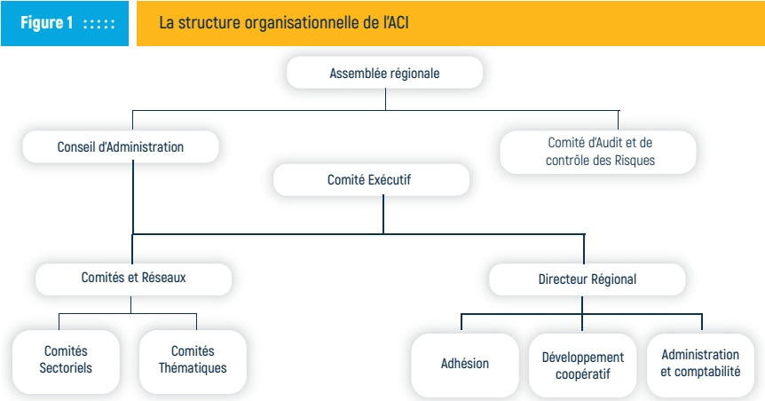

Source : Alliance Coopérative Internationale, 2018

L'Alliance Coopérative Internationale (ACI) valorise l'économie sociale et solidaire et défend les intérêts des coopératives auprès des grandes instances internationales comme l'Organisation des Nations Unies (ONU), l'Organisation Internationale du Travail (OIT) et l'Organisation des Nations Unies pour l'Alimentation et l'Agriculture (FAO). Elle facilite également des partenariats multipartites avec divers organismes publics, des établissements d'enseignement et de recherche, ainsi que d'autres groupes et réseaux coopératifs (ACI 2024).

<!-- page 14 -->

# DES PRÉSENCES STRATÉGIQUES ET UN APERCU CHIFFRÉ

La contribution du mouvement coopératif mondial est reconnue comme un levier important dans la lutte contre l'exclusion économique et financière dans le monde. Pour mieux s'adapter aux spécificités locales, l'Alliance Coopérative Internationale (ACI) s'est structurée en représentations régionales. Cette structuration par blocs géographiques facilite la coordination de ses actions. Aussi, elle favorise les échanges entre coopératives confrontées à des réalités similaires et permet d'ajuster les stratégies de promotion et de défense du modèle coopératif aux enjeux locaux (ACI, 2024). Le schéma qui suit permet de visualiser comment cette représentation s'applique aux différentes régions du monde.

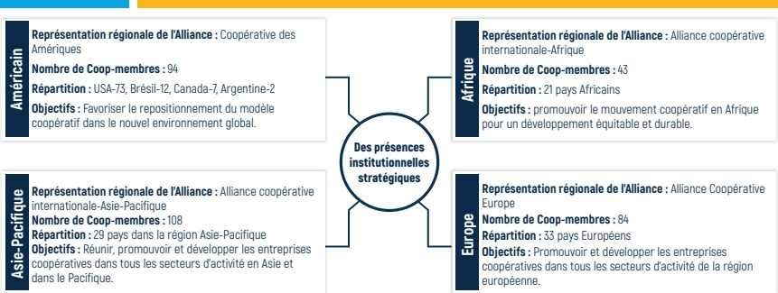

Source : Alliance Coopérative Internationale, 2024

Selon le Bureau International du Travail (BIT), le secteur coopératif rassemble près de 10 % de la population mondiale (BIT, 2019). Les données et indicateurs présentés dans le schéma ci-dessous illustrent clairement le poids du mouvement coopératif dans la création d'emplois durables, la réduction des inégalités et l'amélioration des conditions de vie dans de nombreux cas.

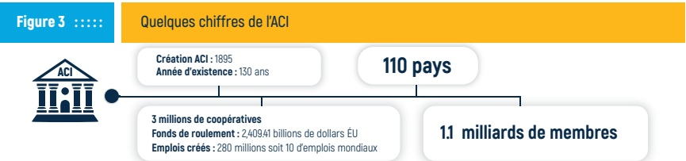

Source : Alliance Coopérative Internationale, 2024

Présentes dans 110 pays et desservant 1,1 milliard de membres (ACI, 2024), les coopératives jouent un rôle central dans les dynamiques locales. Le choix de ce secteur repose sur la valorisation de l'esprit d'initiative et privilégie la recherche de solutions collectives aux défis communs.

<!-- page 15 -->

# LE SECTEUR COOPÉRATIF : AU DELA DES PRINCIPES

Intégrés aux principes fondamentaux de l'ACI, le schéma ci-après présente les sept (7) principes coopératifs promus par l'Alliance Coopérative Internationale. Ils constituent les repères qui guident les Coopératives dans l'application de leurs valeurs.

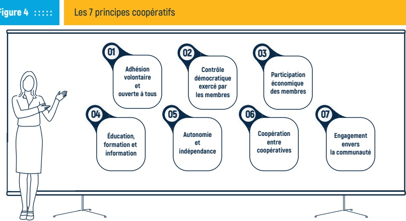

Source : Alliance Coopérative Internationale, 2015.

De manière générale, et conformément aux principes définis plus haut, les coopératives se distinguent des autres entreprises par une gestion démocratique, transparente et participative, ainsi qu'une répartition équitable des bénéfices entre leurs membres, sous forme de ristournes ou de réserves (ACI, 2024).

La formation et particulièrement l'éducation financière ainsi que l'information constituent le cinquième pilier du mouvement coopératif. Ce pilier soutient le bon fonctionnement des structures coopératives en garantissant que les sociétaires disposent des connaissances appropriées et des outils nécessaires pour s'impliquer de manière éclairée dans les processus décisionnels et la gestion de leur entreprise collectivement. De plus, cet axe constitue un atout majeur permettant aux coopératives de rester compétitives dans un environnement marqué par la concurrence.

Dans le cas d'Haïti, cette approche de formation des acteurs de l'écosystème financier est appuyée par le Plan National d'Éducation Financière (PNEF, 2020) supporté par la BRH. Elle vise à renforcer la santé financière des participants et à favoriser un système plus stable et résilient.

Selon le troisième principe et dans une optique d'indépendance économique, le capital financier des Coopératives provient principalement des parts sociales de leurs membres. Toutefois, ce capital varie selon le type de coopérative. Fidèle aux principes démocratiques du mouvement coopératif, chaque membre dispose d'une voix, quel que soit le nombre de parts détenues (ACI, 2024).

<!-- page 16 -->

# LA GOUVERNANCE INSTITUTIONNELLE DANS LES COOPÉRATIVES

Selon le Bureau International du Travail (BIT), la gouvernance des coopératives repose sur un cadre organisationnel structuré et une orientation éthique, garantissant l'efficacité, la cohérence et le respect des valeurs (BIT, 2019).

Le schéma ci-dessous illustre les organes essentiels qui pilotent la gouvernance des coopératives, conformément à l'identité coopérative définie par l'Alliance Coopérative Internationale (ACI).

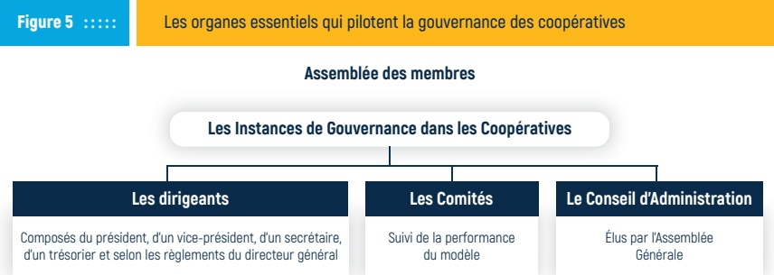

Source : Alliance Coopérative Internationale, 2025.

Dans le secteur coopératif, la bonne gouvernance est fondée sur les principes d'égalité et de démocratie, conformément aux principes d'égalité, de dignité et de représentativité consacrés par la Charte des Nations Unies et la déclaration universelle des droits de l'homme (ONU,2012).

Cependant, selon le Conseil mondial des coopératives d'épargne et de crédit (WOCCU), "le système de gouvernance dans les coopératives doit viser à assurer la "double viabilité" de l'organisation à savoir la viabilité globale et la viabilité indépendante" (WOCCU, 2008). Ces viabilités peuvent être compromises par des différentiels de pouvoir engendrés par la divergence d'intérêts des différentes parties prenantes incluant les membres, les dirigeants, les élus Conseil d'Administration (CA), Comité de Crédit (CC), Comité de Surveillance (CS), le personnel, les partenaires externes et les fournisseurs telles que définies par le WOCCU (WOCCU, 2008).

Dans les coopératives, l'assemblée générale détient le pouvoir souverain, chaque membre disposant d'une voix égale. Ces principes ont été réaffirmés dès la première déclaration sur l'identité coopérative de l'ACI. Cependant, il est important d'examiner régulièrement les éventuels problèmes d'aléa morale et de conflits d'intérêts, suivant la théorie de relation d'agence, afin d'identifier et de trouver des solutions qui garantissent la pérennisation financière des activités des entreprises coopérativistes (CGAP, 2005).

<!-- page 17 -->

## DE LA GOUVERNANCE AUX RÉSULTATS DE TERRAIN : DES MODÈLES QUI PARLENT

Nées de dynamiques sociales locales, les coopératives sont vulgarisées comme des structures solidaires et inclusives, offrant des solutions adaptées à l'exclusion économique et financière des populations vulnérables (BIT, 2019).

Le mouvement coopératif s'est progressivement affirmé comme une solution durable pour soutenir les artisans, les petits producteurs et les migrants, qui restent des groupes prioritaires de la Stratégie Nationale d'Inclusion Financière (SNIF) (BRH, 2024).

Les coopératives, agiles et résilientes face aux défis majeurs, participent activement au développement économique, la cohésion sociale et l'inclusion financière à l'échelle mondiale (ONU, 2024).

En Amérique Latine et dans les Caraïbes (ALC), les coopératives jouent un rôle important dans l'inclusion de nouveaux acteurs dans les chaînes de valeur, avec plus de 108 000 structures actives. Parmi elles, les coopératives agricoles occupent une place importante, représentant 28 000 entités et regroupant plus de 6 millions de membres (FAO, 2024). Certaines initiatives exemplaires témoignent de leur impact.

La Fédération Uruguayenne de Coopératives de Logement pour l'Aide Mutuelle (FUCVAM) soutient les coopératives d'habitation en innovant dans la réponse aux problématiques de logement, notamment dans les zones caractérisées par la précarité de l'habitat. Cette initiative s'est progressivement diffusée dans plus de 20 pays, particulièrement dans les zones urbaines industrielles confrontées à des pénuries de logements (AFD, 2020).

En Haïti, dans le cadre de la promotion de l'économie coopérative, il a été créé par arrêté présidentiel l'Institut National du Café d'Haïti (INCAH). Ce dernier a pour mission de soutenir les réseaux de coopératives agricoles évoluant dans la filière du café. Il favorise leur professionnalisation en renforçant leur capacité organisationnelle et en les aidant à accéder aux marchés (Journal le Moniteur n° 14).

La diversité des coopératives haïtiennes, reflétant leurs domaines d'intervention et contextes socio-économiques, constitue une force majeure qui leur permet de s'adapter aux réalités locales et de relever les défis du monde rural (BIT, Sept 2019).

## Le Saviez Vous?

Selon l'article 15 de la loi du 26 juin 2002, toutes les Coopératives d'Épargne et de Crédit (CEC) en Haïti doivent maintenir au moins 25 % de leurs dépôts sous forme de liquidités. Cela inclut le numéraire, les effets à recouvrement immédiat et les dépôts à vue dans des institutions financières ou auprès de leur fédération. Pourquoi? Pour garantir qu'elles puissent répondre à tout moment aux besoins de retrait ou de remboursement de leurs membres.

Mais ce n'est pas tout !

● Le niveau d'encaisse optimal ne doit pas dépasser 9 % des dépôts, afin d'éviter une accumulation de fonds improductifs.

Les dépôts à vue dans les banques doivent représenter au moins 9 % des dépôts totaux.

Les dépôts à terme doivent être placés à court terme (12 mois maximum) et représenter au moins 7 % du total des dépôts.

Et tous les 6 mois, chaque CEC doit envoyer un rapport détaillé à la BRH sur la gestion de ses liquidités, en précisant les institutions où les fonds sont déposés.

Pour plus d'informations, consultez le site de la BRH au www.brh.ht

<!-- page 18 -->

# LE PARTENARIAT POUR LE DÉVELOPPEMENT : COOP4DEV

Prenant part à l'une des activités marquant le lancement des commémorations de l'année mondiale des coopératives, M. Carlos Gonzalez Blanco, coordonnateur de « COOP4DEV », a salué cette initiative, la qualifiant de « jalon majeur vers une coopération internationale renforcée et solidaire ». Cet accord pour le développement des initiatives solidaires vise à renforcer les capacités du secteur coopératif et à accroître sa visibilité dans les politiques de développement à l'échelle mondiale. Les axes stratégiques du programme « COOP4DEV » sont présentés dans le schéma ci-dessous, offrant une vue d'ensemble de ses priorités et domaines d'intervention visant tous à supporter le renforcement de capacité des coopératives.

Figure 6 :

## Les axes stratégiques du programme « COOP4DEV »

Renforcement institutionnel

Recherche et production des connaissances

Incidence et dialogue politique

Construction d'alliances

avec les acteurs de la

société civile

Acquisition de capacités

Mise en réseau

coopérative (networking)

Visibilité et communication

## Source: ACI, 2024

Mise en œuvre de projets

Le programme COOP4DEV vise à renforcer le rôle et la visibilité des coopératives comme acteurs clés du développement durable, en intégrant leur représentation dans les programmes internationaux et en contribuant à l'Agenda 2030. M. José Alves de Sousa Neto, président des Coopératives des Amériques, a souligné cet engagement lors du lancement de l'année internationale des coopératives au Paraguay, le 24 avril 2025.

La dernière rencontre internationale du projet COOP4DEV s'est tenue à Punta Cana, en République Dominicaine, le 16 avril 2025. Les participants ont examiné des documents clés, dont la résolution des Nations Unies A/RES/77/281 et le rapport « Les coopératives dans le développement social », qui ont nourri les discussions sur l'avenir du mouvement coopératif et son rôle dans une économie inclusive et durable (ACI, 2025).

## Le Saviez Vous?

Conformément aux dispositions de la Circulaire 130, la Banque de la République d'Haïti (BRH) entend assouplir les conditions de financement applicables au secteur touristique. A cet effet, et en collaboration avec les institutions financières partenaires, un ensemble de mesures sera mise en application :

Restructuration des prets

Les institutions financières sont autorisées à renégocier les conditions des crédits (taux d'intérêt, échéances, amortissement du capital) avec les entreprises du secteur touristique.

## Exemption de réserves obligatoires

Les ressources allouées aux crédits touristiques ne seront pas soumises aux réserves obligatoires durant une période de 12 mois, ce qui libère des liquidités pour plus de financements.

Financement à taux préférentiel

Une ligne de crédit à taux réduit est mise à disposition par la BRH, accessible uniquement pour le refinancement ou le financement de nouveaux projets touristiques.

Ces mesures concernent les banques, les IMF, les coopératives d'épargne et de crédit, les sociétés financières de développement et de crédit-bail, toutes appelées à soutenir la relance du tourisme en Haïti.

<!-- page 19 -->

# DE LA DIVERSITÉ À L'INCLUSION : LES COOPÉRATEURS INNOVENT

Au fil du temps, les coopératives se sont adaptées aux besoins socio-économiques locaux en se développan dans divers secteurs d'activité. Cette diversité se reflète dans les nombreuses formes qu'elles prennent, allant des coopératives d'écoles aux coopératives agricoles, de logement, de pêche, d'artisanat, d'enseignants, de travailleurs, de consommation, de services, de transport, de production, aux coopératives d'épargne et de crédit, entre autres.

En Haïti, dans le milieu rural, les boutiques d'intrants, une variante des coopératives agricoles, rapprochent les intrants des zones de production du monde rural. Elles facilitent la disponibilité et l'accès à certains outils et à des produits phytosanitaires adaptés aux besoins des producteurs. Le schéma suivant offre l'opportunité d'explorer cette richesse et cette diversité à travers les secteurs d'activités couverts et les objectifs économiques qui sous-tendent ces structures solidaires.

LES DIFFÉRENTES TYPOLOGIES DE COOPÉRATIVES

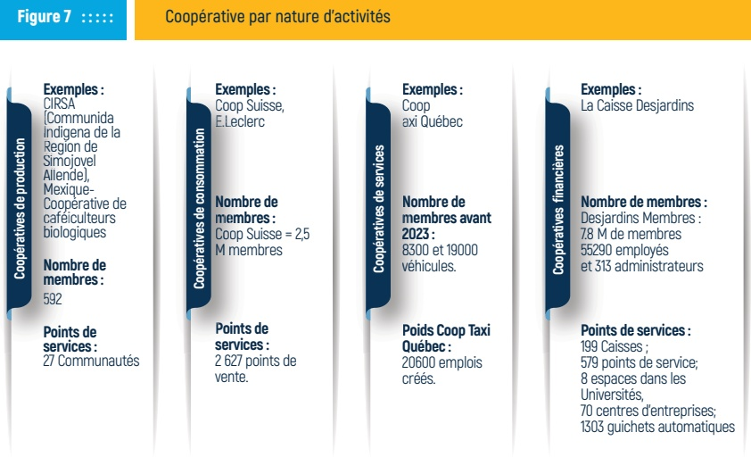

Source : Combinaison des sources allant de ACI et DID

Cependant, une étude de la Banque mondiale réalisée en 2019, en Haïti, souligne que l'absence de données consolidées et structurées sur l'ensemble du mouvement coopératif freine l'établissement de typologies fiables basées sur la taille, le secteur d'activité ou le modèle institutionnel. Cette situation limite la capacité stratégique à piloter et dynamiser efficacement le secteur. Toutefois, l'étude estime que le nombre de coopératives actives dans le pays se situe entre 85 et 180 (Banque Mondiale, 2019).

<!-- page 20 -->

# DES INITIATIVES INSPIRANT : L'EXPÉRIENCE D'UNE RÉUSSITE EXPORTÉE

Le schéma ci-dessous illustre une typologie des coopératives en fonction de leur rôle économique. Dans cet environnement, les coopératives d'épargne et de crédit (CEC) occupent une position stratégique, en particulier dans des pays comme Haïti, où elles pallient l'insuffisance d'institutions financières accessibles aux populations à faibles revenus. En favorisant l'inclusion financière, elles offrent une alternative fiable et adaptée aux pratiques usuraires du secteur informel, tout en proposant à leurs membres des services répondant à leurs besoins réels.

## Figure 8 ::::::

## Coopératives de travail associé

Exemples:

Mondragón (Espagne),

SCOP (France)

biologiques

## Coopérative par fonction économique

Nombre de membres:

289 entreprises

membres dont 110

coopératives

Points de services :

1300

## Exemples:

## Coopératives de producteurs

Union des Coopératives

de Café (UCC Haïti),

COSAHEC (Haïti)

Nombre de membres :

Agropur = 3 290

membres

Points de services :

N/A

## Coopératives ce consommation

Exemples :

Exemples : Coop Italia,

Coop Food (UK)

Nombre de membres :

Coop Italia = 6,5 M

member

Points de services :

1600

## Coopératives de crédit

Exemples :

Le Levier

Nombre de membres :

41 caisses fédérées

Points de services :

86

Source : Combinaison des sources allant de ACI, INCAH et Le Levier

L'économiste Claude Jacquier définit les CEC(s) comme « des institutions financières démocratiques à but non lucratif, organisées et contrôlées par leurs membres, qui s'associent pour regrouper leur épargne et se consentir mutuellement des prêts à des taux raisonnables ». Ces structures visent donc à assurer l'autonomie financière des membres et à renforcer la solidarité économique au sein des communautés (Jacquier, 1999).

Fort de 125 ans d'histoire, le modèle de coopérative d'épargne et de crédit le plus répandu à l'échelle mondiale demeure celui du Mouvement Desjardins, au Canada. Actuellement, le Réseau de Caisses Desjardins compte 7,8 millions de membres, emploie 55 290 employés et est supervisé par 2 313 administrateurs élus, avec un actif de 470,9 milliards de dollars US au 31 décembre 2024. Des surplus générés par les caisses du réseau, environ 58 millions de dollars ont été versés à des projets sociaux (Desjardins, 2024). Cette initiative a marqué de manière significative le secteur des CEC, tant à l'international qu'en Haïti.

## Le Saviez Vous?

## ”

Selon la loi sur les coopératives de 2002, l'article 41 de la section 6 précise que l'Assemblée Générale se réunit au moins une fois par an, sur convocation du président du Conseil d'Administration, dans les (6) mois qui suivent la clôture de l'exercice.

De plus, la section 4 sur les fonds propres nous fait comprendre que la BRH peut avoir un droit de regard sur l'émission des parts sociales permanentes non assorties de droit de vote dans les CEC. La BRH détermine, par voie réglementaire les limites des parts permanentes dans la composition du capital social.

Pour plus d'informations, consultez le site de la BRH.

<!-- page 21 -->

# LE COOPÉRATIVISME EN HAÏTI : DES REPÈRES IMPORTANTS

Le mouvement coopératif en Haïti trouve ses origines au début du XXème siècle, et s'est progressivement structuré sous l'impulsion de figures politiques et religieuses à travers des caisses d'entraide et des coopératives agricoles. C'est sous la présidence de Sténio Vincent (1930-1941) que le mouvement a réellement connu un encadrement officiel. Le schéma ci-après présente les principaux repères liés à l'expansion du mouvement dans le pays.

## Figure 9 : : : : :

## Repères liées à l'expansion du mouvement coopératif en Haïti

## 1937

Actions en faveur du Coopérativisme : Première loi sur les coopératives sous la présidence de Sténio Vincent.

Objectif : Autorisation officielle de création de coopératives en Haïti.

## 1981

Actions en faveur du Coopérativisme :

Décret créant le Conseil National des

Coopératives (CNC).

Objectif : Instance officielle d'agrément, de contrôle et d'encadrement des coopératives.

## 2002

## 1947

Actions en faveur du Coopérativisme : Premières coopératives agricoles créées dans certaines communes rurales.

Actions en faveur du Coopérativisme : Nouvelle loi sur les coopératives.

Objectif : Début opérationnel du mouvement coopératif sur le terrain.

Objectif: Soutenir le développement des caisses populaires haitiennes, d'accroître l'accès aux services financiers pour tous et de promouvoir la création d'entreprises et de richesse.

## 2007

Actions en faveur du Coopérativisme : Création de la première fédération des caisses populaires (Le Levier).

Objectif : Soutenir le développement des caisses

populaires haitiennes, d'accroître l'accès aux

services financiers pour tous et de promouvoir la

création d'entreprises et de richesse.

## 1950 -1970

Actions en faveur du Coopérativisme :

Extension des coopératives dans

plusieurs secteurs (épargne et crédit,

agriculture...).

Objectif : Diversification des modèles coopératifs locaux.

## 2000

Actions en faveur du Coopérativisme :

Multiplication des coopératives

d'épargne et de crédit (CEC).

Objectif : Réponse à la faiblesse des services financiers traditionnels.

## 2014

Actions en faveur du Coopérativisme :

Extension du Département dédié des Caisses

(DIGCP) au Cayes et au Cap-Haitien.

Objectif : Renforcement du cadre coopératif national en offrant des services de règlementation et de supervision de proximité au secteur.

<!-- page 22 -->

En Haïti, le Conseil National des Coopératives (CNC), créé en 1981, est un acteur clé du mouvement coopératif. En partenariat avec le Ministère de la Coopération et de la Planification Externe (MPCE), le CNC encadre, contrôle, forme les dirigeants, évalue la santé financière des coopératives autres que les caisses populaires et supporte la recherche de financements.

## Le Saviez Vous?

Le CNC est l'autorité principale responsable de l'octroi des agréments pour toutes les coopératives. Cependant, en ce qui concerne les coopératives d'épargne et de crédit, une fois cette étape achevée, la réglementation et la supervision sont exclusivement assurées par la Banque de la République d'Haïti (BRH).

En Haïti, les coopératives d'épargne et de crédit (CEC), aussi appelées Caisses populaires, ne sont pas de simples associations locales. Elles sont régies par une loi spécifique qui encadre leur constitution, fonctionnement, gouvernance et supervision.

Ces coopératives d'épargne et de crédit ont une existence légale reconnue par le Conseil National des Coopératives (CNC) et la Banque de la République d'Haïti (BRH).

Leur mission principale est de faciliter l'intermédiation financière entre sociétaires : c'est-à-dire recevoir l'épargne et accorder des crédits à des taux raisonnables.

Fondées sur des valeurs humaines fortes telles que la démocratie, la solidarité, l'égalité et la responsabilité, elles promeuvent également l'éducation économique et coopérative.

Les activités des CEC sont réservées à leurs

membres et ne visent pas le profit, ce qui les distingue

des entreprises commerciales traditionnelles.

Pour plus d'informations, consultez le site officiel de la BRH :  $ \underline{\text{www.brh.ht}} $

<!-- page 23 -->

# LES CEC EN HAÏTI : UN CADRE LÉGAL RÉGIT LE SECTEUR

Au cours des années 1990-2000, les coopératives d'épargne et de crédit, couramment appelées Caisses Populaires, se sont développées en parallèle à la montée des institutions de microfinance non mutualiste en Haïti. Une crise survenue en 2002-2003, provoquée par des schèmes frauduleux, a entraîné de lourdes pertes pour certains épargnants et a ébranlé la confiance dans le secteur. Cette situation a également favorisé l'adoption d'une loi spécifique en 2002 au CEC et aux fédérations de CEC établissant un nouveau cadre légal visant à encadrer et sécuriser le fonctionnement de ces institutions.

Guidée par la nécessité de renforcer la confiance dans les coopératives, la BRH a accordé une attention particulière à la supervision et à la réglementation de ce sous-secteur par la mise en place d'une structure dédiée à la supervision des CEC, la Direction de l'Inspection Générale des Caisses Populaires (DIGCP).

Aujourd'hui, le fonctionnement des CEC s'appuie sur un dispositif institutionnel et réglementaire articulé selon le schéma suivant :

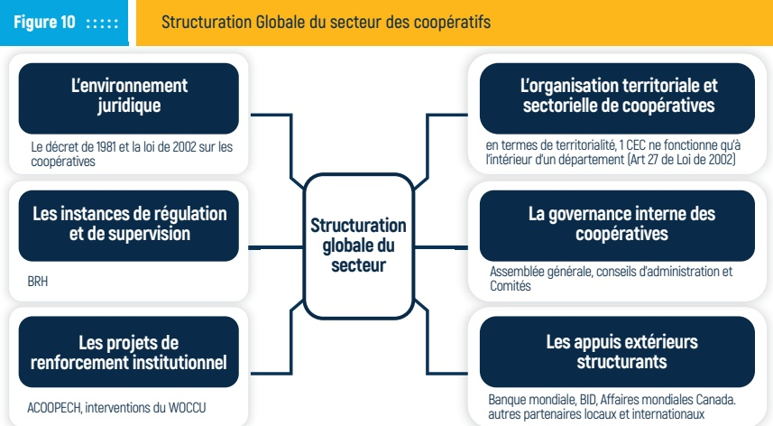

Source : Combinaison des sources allant de la BRH, ACI, DID, WOCCU et Banque Mondiale

La Banque de la République d'Haïti, dans l'une de ses publications, en 2018, relative à la loi sur les coopératives d'épargne et de crédit, repositionne les coopératives d'épargne et de crédit comme étant : « Toute association autonome de personnes volontairement réunies pour satisfaire leurs aspirations et besoins économiques, sociaux, culturels communs, au moyen d'une entreprise dont la propriété est collective et où le pouvoir est exercé démocratiquement » (Loi 2002 sur les coopératives en Haïti).

<!-- page 24 -->

# DE LA STRUCTURATION GLOBALE DU MOUVEMENT DES CEC

Plusieurs acteurs internationaux, tels que la Banque mondiale, Affaires mondiales Canada, la Banque Interaméricaine de Développement (BID), l'Agence des États-Unis pour le Développement International (USAID), l'Agence Canadienne pour le Développement, le Bureau International pour le Travail (BIT) et l'Agence Française pour le Développement (AFD), entre autres, ont supporté le renforcement du cadre légal des coopératives dans le pays.

Ils ont aussi aidé à la professionnalisation des structures, facilité l'accès au financement et encouragé l'adoption de mécanismes de gouvernance et de gestion plus efficaces en faveur du sous-secteur des CEC.

Longtemps perçues comme peu fiables et marginalisées, les coopératives haïtiennes ont amorcé leur transformation grâce au projet ACOOPECH (2005-2013), financé par Affaires Mondiales Canada et mis en œuvre par Développement International Desjardins. (CA-3-A032462001). Ce programme a contribué à améliorer la gouvernance, renforcer la gestion des risques, accroître la transparence, ainsi qu'à valoriser l'image du secteur des coopératives d'épargne et de crédit dans le pays. Le schéma suivant présente les grands objectifs de ce projet réalisé pendant dix ans.

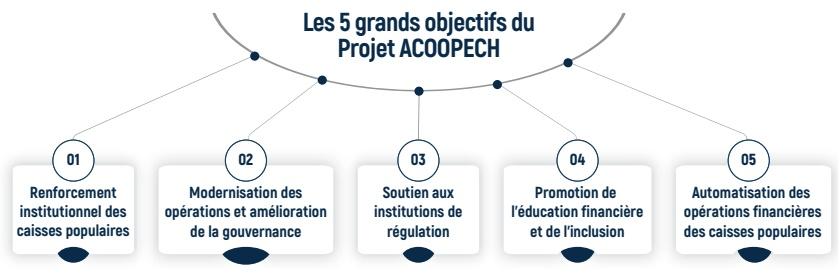

Source: DID, CA-3-A032462001

De son côté, présent dans 110 pays, le WOCCU s'est activement engagé en Haïti après le séisme de 2010. Il a contribué à la reconstruction de plusieurs points de service et a soutenu l'accompagnement humain du personnel de certaines caisses, en leur offrant un appui psychologique approprié. Par la suite, il a également joué un rôle clé en tant que promoteur du programme de transferts de fonds à travers RIA (une filiale d'Euronet Worldwide), lancé en partenariat avec l'une des fédérations des caisses populaires en

<!-- page 25 -->

Haïti, Le Levier. Il a réalisé l'implémentation du projet Haitian Mobile Money Initiative (HMMI), financé par l'USAID et la Fondation Bill et Melinda Gates, visant à promouvoir l'utilisation des services financiers mobiles en Haïti.

Si, à ses débuts, le secteur des CEC fonctionnait de manière informelle et dispersée, il a connu, au fil des années, un processus de formalisation marqué par l'adoption d'un cadre légal, la mise en place de structures de supervision et l'appui de partenaires techniques et financiers (Banque Mondiale, 2019).

<!-- page 26 -->

## DE LA REPRÉSENTATIVITÉ DE LA BRH DANS LES RÉGIONS

Dans un souci de proximité et d'efficacité dans la supervision du sous-secteur des Caisses Populaires, la BRH a instauré un dispositif de suivi territorialisé. Outre son bureau central à Port-au-Prince, elle a mis en place ses deux annexes dans les départementes du Nord et du Sud afin d'assurer une présence permanente auprès des caisses d'épargne et de crédit agréées. Le schéma qui suit résume l'organigramme de la structure de la supervision des caisses.

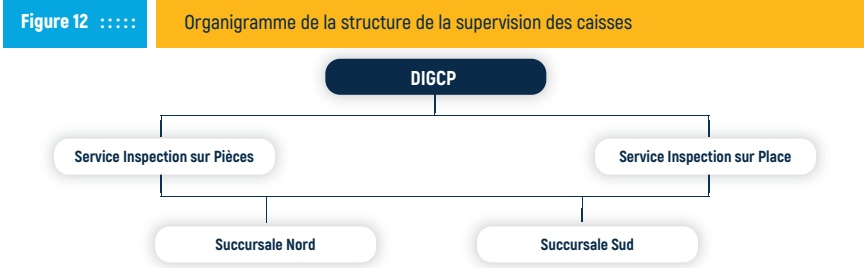

Source: BRH, 2025

Cette organisation décentralisée permet non seulement d'assurer un suivi rapproché et adapté aux réalités locales, mais aussi de réagir de manière proactive aux éventuels risques financiers et opérationnels dans le sous-secteur. Elle favorise également une meilleure collaboration entre les autorités de supervision et les coopératives, dans une dynamique de renforcement de la gouvernance et la gestion des risques du secteur.

Grâce au cadre légal mis en place, au-delà des principes coopératifs, la BRH impose des normes prudentielles aux coopératives d'épargne et de crédit pour assurer la stabilité financière et renforcer la gouvernance dans le sous-secteur des Caisses Populaires. Ces règles encadrent notamment l'ouverture de succursales et la gestion des risques propres au secteur (BRH, 2007).

## Le Saviez Vous?

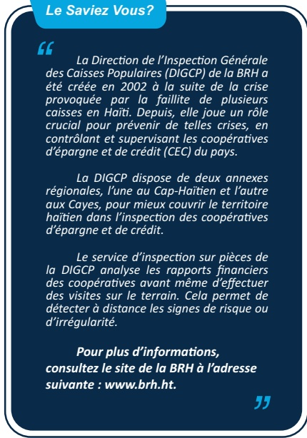

La Direction de l'Inspection Générale des Caisses Populaires (DIGCP) de la BRH a été créée en 2002 à la suite de la crise provoquée par la faillite de plusieurs caisses en Haïti. Depuis, elle joue un rôle crucial pour prévenir de telles crises, en contrôlant et supervisant les coopératives d'épargne et de crédit (CEC) du pays.

La DIGCP dispose de deux annexes régionales, l'une au Cap-Haïtien et l'autre aux Cayes, pour mieux couvrir le territoire haïtien dans l'inspection des coopératives d'épargne et de crédit.

<!-- page 27 -->

## AU 2ÈME NIVEAU : LES CEC S'IMPOSENT

L'adoption de la loi de 2002 sur le fonctionnement des coopératives d'épargne et de crédit, a marqué un tournant décisif pour le secteur en Haïti, en ouvrant la voie à la création de fédérations, d'associations et de regroupements coopératifs. Cette réorganisation a permis de mutualiser les ressources, de renforcer la supervision et d'améliorer la gouvernance du sous-secteur.

Grâce à un cadre légal concis, le secteur s'est réorganisé par la formation, en 1998, de la première association de caisses populaires haïtiennes (ANACAPH), suivi en 2007 par la mise en place d'une première fédération des caisses populaires haïtiennes (FECAPH) dit Le Levier, et en 2017, par la constitution d'une deuxième fédération : la Société Coopérative communément appelée, Le Sociétaire. La nouvelle configuration du sous-secteur est reprise dans le schéma ci-dessous.

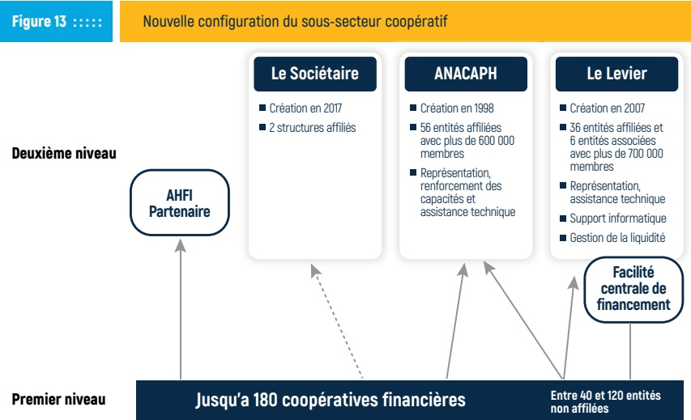

Source : Banque Mondiale, 2019, BRH, 2025.

Aujourd'hui, le sous-secteur coopératif d'épargne et de crédit en Haïti se structure autour de deux types de coopératives : les caisses de premier niveau, en contact direct avec les sociétaires, et les fédérations de second niveau, qui leur apportent des services mutualisés. Ce niveau de structuration favorise la professionnalisation des caisses, renforce la stabilité du sous-secteur, améliore l'accès aux services financiers pour les populations vulnérables et promet une réponse coordonnée à l'exclusion financière (Banque Mondiale, 2019).

<!-- page 28 -->

## DES SYNERGIES ET UNE COORDINATION RENFORCÉE

L'émergence des fédérations de coopératives telles que Le Levier et le Sociétaire dans le paysage financier traduit la croissance et la capacité du mouvement coopératif haïtien à se renforcer et à s'imposer. Aussi, elle illustre également l'aptitude des structures mutualistes à s'adapter à un environnement économique et réglementaire en mutation, favorisant ainsi l'inclusion financière, en particulier dans les zones rurales et les milieux défavorisés (Banque mondiale, 2019).

Dans cette dynamique de réduction de l'exclusion financière, plusieurs initiatives ont été mises en œuvre afin de renforcer la résilience du secteur. Ces actions se sont appuyées sur des partenariats institutionnels stratégiques, qui ont permis de relancer et de soutenir la mise en œuvre de plusieurs projets structurants, notamment en réponse aux différentes crises traversées par le pays.

L'année 2015 a marqué une étape déterminante dans le processus de modernisation du système financier coopératif avec l'admission de Le Levier, par la BRH, à la chambre de compensation des chèques.

Cette phase s'inscrit dans l'application de l'article 111 de la loi de 2002 régissant les Caisses Populaires dites CEC, permettant ainsi aux coopératives affiliées d'intégrer le système de paiement et d'être en mesure d'offrir des services financiers modernes à leurs membres renforçant ainsi leur participation au système financier national et contribuant à l'inclusion financière.

Parallèlement, des actions de promotion et de valorisation des Caisses d'Épargne et de Crédit sont menées annuellement, notamment à l'occasion du sommet international de la finance. Ces initiatives visent à mettre en avant les coopératives les plus performantes du pays. Certaines d'entre elles ont été honorées du titre de « Caisse de l'année », en reconnaissance de leur solidité financière et de leur impact.

## Le Saviez Vous?

## ”

Avant d'exister légalement, toute Caisse d'Épargne et de Crédit (CEC) en Haïti doit être créée par un acte constitutif en bonne et due forme, précisant sa dénomination, ses fondateurs, son capital, ses organes de gouvernance, et ses opérations (Art. 25).

Cet acte doit être authentifié ou déposé chez un notaire du lieu de son siège social (Art. 26), avec des frais plafonnés à 5% du capital minimum.

Le siège social d'une CEC est son domicile légal et doit se situer dans le département correspondant à sa zone d'intervention (Art. 27).

Pour changer d'adresse dans le même département, l'avis de la BRH et du CNC est obligatoire, ainsi qu'une publication officielle 15 jours à l'avance (Art. 28).

Et pour ouvrir une succursale ou transférer son siège, il faut l'autorisation préalable du CNC après avis favorable de la BRH, qui évalue la performance financière de la CEC (Art. 29-30).

Une CEC n'est donc pas un simple regroupement d'épargnants : c'est une structure réglementée, encadrée à chaque étape de sa vie institutionnelle.

Pour toute information supplémentaire, visitez : www.brh.ht

<!-- page 29 -->

social au sein de leurs communautés. À ce jour, environ dix (10) caisses fédérées, dont quatre (4) se situent respectivement dans les départementes de l'Artibonite, de l'Ouest, du Nord-Ouest et du Sud-Est, ont franchi le seuil symbolique d'un milliard de gourdes d'actifs. De ce groupe de CEC "milliardaire", trois (3) ont une taille de bilan dépassant 2 milliards de gourde.

Par, ailleurs, cinq ans après l'intégration des CEC à la chambre de compensation, en 2020, la BRH a procédé au lancement du Fonds de Soutien aux Coopératives (FSC) destiné à accompagner les institutions du secteur en difficulté. Alimenté par l'ensemble des caisses agréées, qu'elles soient fédérées ou non, ce fonds vise à faciliter les relations avec le secteur coopératif et à appuyer leur plan d'expansion ainsi que le financement de projets porteurs initiés par les institutions bénéficiaires et préserver leur stabilité (BRH, 2020).

Ce Fonds de Soutien dont le compte est domicilié à la BRH, continue d'être alimenté par les cotisations des CEC. Il est disponible pour toutes les CEC agréées qui font face à un besoin de financement. Sa gestion est assurée par la BRH conformément aux dispositions de la loi du 26 juin 2002.

En 2024, le Conseil d'Administration a adopté une résolution visant à établir une structure organisationnelle dotée d'un personnel dédié pour gérer le fonds.

<!-- page 30 -->

## L'OFFRE DE SERVICES FINANCIERS AU NIVEAU DU SECTEUR

En Haïti, les Coopératives d'Épargne et de Crédit (CEC) proposent principalement deux catégories de services financiers : l'épargne et le crédit.

Selon les principes coopérativistes, l'accès au crédit dans les CEC est étroitement lié au niveau d'épargne détenu par les membres au sein de l'institution. Cette assertion est confirmée par WOCCU, affirmant que les CEC fournissent une grande variété de services grâce notamment à leur capacité de mobilisation de l'épargne des membres, ce qui représente sans doute un avantage majeur sur les autres institutions engagées dans la microfinance (WOCCU, 2008).

Selon les règlements de la Fédération Le Levier, un seuil de 33 % d'épargne par rapport au montant du prêt sollicité est souvent exigé pour l'octroi des premiers crédits. Ce principe limite le risque de non-remboursement et encourage chez les sociétaires une culture de l'épargne préalable avant l'endettement. Le schéma ci-dessous présente les différents produits et services financiers disponibles dans le secteur.

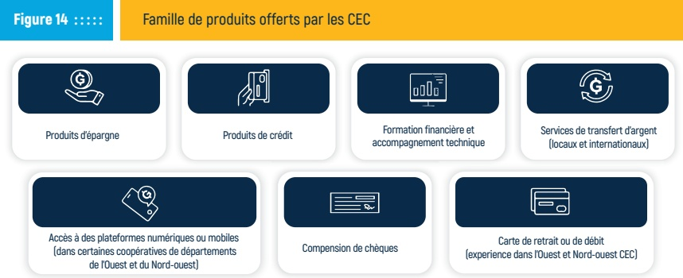

Source : Rapports internes de la BRH

Le développement de produits de crédit destinés à la consommation et/ou à l'investissement soutient les besoins des sociétaires et le financement d'activités économiques locales. Toutefois, il convient de souligner que cette offre reste largement dominée par le microcrédit, dont les montants plafonnent généralement autour de quatre (4) millions de gourdes (Le Levier, 2024).

En complément, les CEC développement des partenariats avec d'autres institutions pour fournir des services tels que les transferts de fonds et les produits digitaux mais actuellement aucun produit d'assurance n'est éveloppé par le secteur. L'offre relative aux produits digitaux reste très limitée bien que certaines caisses offrent une carte de débit (ANACAPH, 2022).

<!-- page 31 -->

# FORMER POUR MIEUX GOUVERNER : L'ÉDUCATION FINANCIÈRE UN PRODUIT PHARE DES COOP

Étroitement liées aux fondements du modèle coopératif, l'éducation et la formation occupent une place essentielle dans la vie des coopératives. Elles se font de manière continue. L'éducation financière, combinée à la transmission des valeurs et des principes de coopération, constitue un levier indispensable pour garantir une gouvernance efficace et renforcer la résilience des coopératives face à de nombreux défis (BIT, 2019).

Dans le cadre du renforcement des capacités des acteurs du secteur coopératif, plusieurs initiatives existent afin d'outiller les gestionnaires et leaders du mouvement associatif face aux exigences en matière de gouvernance et de gestion financière des coopératives dans le pays.

À travers son Institut de formation, la BRH propose un ensemble de formations adaptées aux besoins spécifiques du secteur financier. Depuis 2020, elle a également lancé le Plan National d'Éducation Financière (PNEF), élaboré en concertation avec les parties prenantes du secteur. Ce plan constitue un cadre de référence définissant les lignes directrices pour le développement de formations complémentaires à l'intention des acteurs du système.

Dans le cadre de leur mission, des structures faîtières telles que la Fédération Le Levier, l'ANACAPH et le KNFP organisent régulièrement des formations au profit du secteur coopératif. En complément, des firmes privées comme Group Croissance, Haïti Efficace et DGD apportent leur soutien et participent activement à la diffusion des principes de bonne gouvernance au sein de ce secteur.

Parmi les outils disponibles pour renforcer les capacités des coopératives en Haïti, le programme MY.COOP : Gérez votre coopérative agricole, développé par le Bureau International du Travail (BIT) et l'organisation Agriterra, s'impose comme une référence.

## Le Saviez Vous?

## ”

Conformément à l'article 14, de la loi de 2002 régissant le fonctionnement des CEC, La BRH règlemente les opérations et les activités des CEC notamment en matière de dépôt, de crédit et de placement. Elle peut déterminer :

1- l'objet et les limites dans lesquelles, en pourcentage des fonds propres, le crédit peut être consenti ou le placement réalisé,

2- le délai maximum des échéances,

3- dans le cas des opérations de crédit, les types et montant des sûretés requises,

4- les plafonds individuels ou collectifs des différentes catégories d'opérations de crédit ou de placement ainsi que les monnaies en cours.

Pour plus d'informations, consultez

le site de la BRH à l'adresse

suivante : www.brh.ht

<!-- page 32 -->

Ce programme, promu par certaines structures locales, propose des sessions de formation structurées autour de quatre modules thématiques. Aussi, ces sessions adaptées permettent aux participants membres de coopératives issus de divers secteurs, tels que la pêche, l'agriculture et l'artisanat, de consolider leurs connaissances et de développer des compétences pratiques en gestion coopérative, gouvernance et fonctionnement des coopératives agricoles.

Ce type de programme contribue non seulement à l'amélioration des pratiques de gestion au sein des coopératives, mais également au renforcement de leur résilience économique et organisationnelle, dans un contexte où les pratiques demeurent souvent informelles (BIT, 2019).

<!-- page 33 -->

## LE PORTRAIT FINANCIER DU SECTEUR AU 30 SEPTEMBRE 2024

Aujourd'hui, le sous-secteur coopératif d'épargne et de crédit en Haïti célèbre ses 79 ans d'existence. Il compte officiellement 60 caisses agréées par la Banque de la République d'Haïti (BRH). Toutefois, le nombre total d'institutions opérant sur le territoire reste mal documenté, en raison de l'existence de structures informelles ou non régularisées (Banque Mondiale 2019).

Le tableau ci-dessous permet de mieux analyser les principaux indicateurs relatifs au niveau d'accès aux services financiers dans ce sous-secteur, ainsi que le rôle des CEC dans le financement de certaines activités de l'économie réelle, au 30 Septembre 2024.

<table><tr><td>Tableau 1 :::::</td><td>Principaux indicateurs d'accès et d'utilisation</td></tr><tr><td>Indicateurs</td><td>Valeur</td></tr><tr><td>Nombre total de sociétaires</td><td>1,440,000</td></tr><tr><td>Hommes</td><td>54,47 %</td></tr><tr><td>Femmes</td><td>36,69 %</td></tr><tr><td>Personnes morales</td><td>2,85 %</td></tr><tr><td>Nombre de points de service</td><td>74</td></tr><tr><td>Volume total d'épargne</td><td>23 164 millions de gourdes</td></tr><tr><td>Portefeuille de crédit net</td><td>14 687 millions de gourdes</td></tr><tr><td>Pourcentage de prêts octroyés aux hommes pour le commerce</td><td>63,15 %</td></tr><tr><td>Poids des prêts au secteur commercial</td><td>44,96 %</td></tr><tr><td>Prêts aux personnes morales pour le commerce</td><td>64 %</td></tr><tr><td>Prêt aux femmes dans le secteur commercial</td><td>46 %</td></tr></table>

Source : BRH

Les données du tableau 1, extraites des rapports internes de la BRH et portant sur les indicateurs relatifs aux 60 caisses, dont les détails figurent en annexe du présent document, révèlent que :

Le nombre de sociétaires s'élève à 1.44 millions dont 54,47 % hommes, 39,69% femmes et 2,85 % Personnes Morales.

Le nombre de points de service est de 74.

..ues.

…ues.

Le pourcentage de prêts octroyés aux hommes est estimé à 63,15%.

<!-- page 34 -->

Le poids des prêts au secteur du commerce demeure prédominant, représentant 44,96 % du portefeuille avec une majorité de bénéficiaires constituée de personnes morales (plus de 64 %) et de femmes (plus de 46 %).

Vingt-trois (23) ans après la mise en place du cadre légal, les données présentées ci-dessus illustrent non seulement la tendance sur la présence des institutions sur l'ensemble du territoire national, mais reflètent également une progression encore lente du secteur coopératif haïtien au regard des besoins d'inclusion financière de la population.

Par ailleurs, en comparaison avec les autres pays de la Caraïbe et au regard du taux élevé d'exclusion financière en Haïti, estimé à plus de 46 %, ces données mettent en évidence la nécessité d'intensifier les actions de sensibilisation et de promouvoir la structuration progressive des acteurs opérant dans l'informel.

<!-- page 35 -->

## CROISSANCE DES ACTIFS DES CEC PAR DÉPARTEMENT AU 30 SEPTEMBRE 2024

Le graphique présenté ci-après synthétise les principaux indicateurs liés à la croissance des actifs dans le sous secteur des CEC, pour les quatre (4) dernières années.

| Graphe | 30-Sep-21 (%) | 30-Sep-22 (%) | 30-Sep-23 (%) | 30-Sep-24 (%) |
| --- | --- | --- | --- | --- |
| Artibonite | 26.0 | 25.5 | 24.5 | 22.5 |
| Centre | 5.8 | 7.0 | 8.0 | 9.5 |
| Grand-Anse | 1.0 | 1.0 | 1.0 | 1.5 |
| Nippes | 1.5 | 1.5 | 1.5 | 1.0 |
| Nord | 7.5 | 7.0 | 7.5 | 7.5 |
| Nord-Est | 3.0 | 4.0 | 4.5 | 4.5 |
| Nord-Ouest | 5.5 | 6.0 | 6.0 | 7.0 |
| Ouest | 18.5 | 17.0 | 16.0 | 15.5 |
| Sud | 11.5 | 11.5 | 12.5 | 12.0 |
| Sud-Est | 11.5 | 10.5 | 10.0 | 10.5 |

Source: BRH

L'analyse des données, ci-dessus, relatives aux actifs des Caisses, indiquent que les CEC localisées dans le département de l'Artibonite occupent une part importante dans le secteur, concentrant plus d'un quart des actifs. Toutefois, leur position a légèrement régressé au fil des deux (2) dernières années, passant de 26,59 % en 2021 à 25,39 %, puis à 23,24 % en 2024. Cette baisse pourrait s'expliquer par une certaine désinclusion financière touchant une partie de la population, conséquence directe de la dégradation de la situation sécuritaire dans le département de l'Artibonite depuis tantôt trois (3) ans.

À l'inverse, dans les départements, moins touchés par la crise, comme la Grande-Anse, le Nord et le Sud, les Caisses affichent une dynamique plus positive, avec une croissance progressive de leurs actifs au cours des dernières années.

Par ailleurs, les Caisses du département du Centre se démarquent par une augmentation des actifs sur les trois dernières années. Cette performance pourrait s'expliquer en partie par sa situation géographique stratégique, exposant le département, particulièrement, au commerce transfrontalier avec la République Dominicaine, stimulant ainsi l'activité économique locale et les services financiers.

Il importe de préciser que la situation s'est nettement dégradée au cours des derniers mois dans ce département du Centre, laissant présager des impacts négatifs sur les activités financières dans la région

<!-- page 36 -->

# RÉPARTITION DE LA CROISSANCE ANNUELLE DES DÉPÔTS DES MEMBRES PAR DÉPARTEMENT AU 30 SEPTEMBRE 2024

Le graphique #2 ci-après présente les dépôts accumulés par les 60 caisses pour la période 2021-2024. Les chiffres relatifs aux dépôts montrent une croissance marquée, particulièrement dans le Sud et le Nord, traduisant un renforcement de l'inclusion financière et une confiance croissante dans le système coopératif d'épargne et de crédit dans les départements cités.

| Graphe | 30-Sep-21 | 30-Sep-22 | 30-Sep-23 | 30-Sep-24 |
| --- | --- | --- | --- | --- |
| Antibonite | 27.0% | 25.0% | 24.5% | 23.0% |
| Centre | 5.8% | 7.5% | 8.2% | 9.5% |
| Grand-Anse | 0.8% | 0.9% | 0.7% | 0.6% |
| Nippes | 2.2% | 1.8% | 1.9% | 1.5% |
| Nord | 6.8% | 6.5% | 7.2% | 7.5% |
| Nord-Est | 3.5% | 4.2% | 4.8% | 4.8% |
| Nord-Ouest | 5.5% | 6.0% | 6.5% | 7.2% |
| Ouest | 19.5% | 18.5% | 17.5% | 16.5% |
| Sud | 11.5% | 11.8% | 12.2% | 12.5% |
| Sud-Est | 11.0% | 10.2% | 9.8% | 10.8% |

Source: BRH

Dans la Grande-Anse, la part des dépôts mobilisée par les Caisses reste relativement faible, mais montre une légère amélioration au cours des deux (2) dernières périodes. Après avoir chuté à 1,32 % en 2022, elle remonte progressivement pour atteindre 1,45 % en 2024. Cette reprise, bien que modeste, pourrait s'expliquer par les interventions des partenaires financiers internationaux, engagés dans l'amélioration de l'accès aux services financiers et dans la digitalisation des opérations, notamment en réponse aux conséquences des séismes survenus en juin 2021 et en août 2023. Cette progression lente révèle des opportunités à saisir pour renforcer la mobilisation de l'épargne locale.

Les opérations dans les Caisses du département du Sud présentent une tendance clairement haussière, passant de 12,17 % en 2021 à 13,20 % en 2024. Cette croissance dans les transactions reflète probablement le développement progressif des activités économiques, notamment grâce aux effets d'anticipation liés à la mise en place du port de Saint-Louis du Sud et à une utilisation plus importante de l'aéroport des Cayes, facilitant ainsi de nouvelles opportunités économiques et entraînant une augmentation des transactions et des dépôts financiers.

Dans le département du Nord, la part des dépôts progresse également de façon continue, passant de 7,68 % en 2021 à 8,32 % en 2024. Cette évolution positive peut être attribuée à la revalorisation de certaines villes du département, en partie liée à l'insécurité dans le département de l'Ouest, qui a entraîné une relocalisation de certaines activités économiques vers la région du grand Nord. Le renforcement du secteur commercial et l'extension de certains services financiers dans les zones rurales peuvent aussi contribuer à cette dynamique.

<!-- page 37 -->

# SITUATION DE LA DISTRIBUTION DU CRÉDIT PAR DÉPARTEMENT AU 30 SEPTEMBRE 2024

L'analyse de la répartition du portefeuille de crédit brut par département sur la période 2021-2024 révèle une concentration des prêts dans les départementes de l'Artibonite, du Sud, du Sud-Est et de l'Ouest. À elles seules, ces quatre (4) régions captent plus de 60 % du portefeuille total de crédit. En revanche, les départementes de la Grand'Anse et des Nippes demeurent faiblement desservis, leur part respective restant inférieures à 3 %. Il convient toutefois de noter, selon les données du graphique #3, que les départementes du Centre et du Nord-Ouest affichent une certaine progression sur la période.

Selon les résultats de l'étude Finscope MPME, Haïti 2023, la majorité des MPME du pays est concentrée dans trois départements : l'Artibonite, l'Ouest et le Sud. Environ 23 % d'entre elles sont localisées dans le département de l'Artibonite.

| Région | 30-Sep-21 (%) | 30-Sep-22 (%) | 30-Sep-23 (%) | 30-Sep-24 (%) |
| --- | --- | --- | --- | --- |
| Artibonite | 25.5 | 25.0 | 23.0 | 23.0 |
| Centre | 7.0 | 7.5 | 9.0 | 10.5 |
| Grand-Anse | 1.8 | 1.5 | 1.8 | 1.5 |
| Nippes | 1.2 | 1.0 | 1.2 | 1.0 |
| Nord | 6.5 | 6.8 | 7.2 | 6.8 |
| Nord-Est | 3.2 | 4.5 | 5.0 | 4.5 |
| Nord-Ouest | 6.5 | 6.0 | 6.5 | 7.8 |
| Ouest | 16.5 | 15.5 | 13.5 | 12.5 |
| Sud | 9.8 | 10.5 | 11.2 | 11.5 |
| Sud-Est | 14.5 | 13.0 | 13.2 | 13.0 |

Source: BRH

En se référant aux disparités d'accès au crédit, qu'elles soient liées aux profils des bénéficiaires ou à leur situation géographique, il serait opportun, dans le cadre de l'Année Spéciale des coopératives, de mener des actions ciblées à travers l'initiative DEV4Coop. Ces interventions pourraient favoriser le renforcement des synergies entre les coopératives non financières et le secteur coopératif financier, en vue de stimuler l'expansion du crédit dans les zones les plus stables.

Une telle dynamique contribuerait à limiter le risque d'accentuation des inégalités territoriales en matière de développement économique et d'inclusion financière, en assurant une meilleure répartition des opportunités au sein des différentes régions du pays, notamment dans la grande région du Sud.

<!-- page 38 -->

# SITUATION DU PORTEFEUILLE DE CRÉDIT PAR SECTEUR D'ACTIVITÉ AU 30 SEPTEMBRE 2024

Au 30 septembre 2024, les données issues des 60 caisses d'épargne et de crédit agréées par la BRH indiquent que le commerce demeure le secteur prédominant dans le portefeuille de crédit, représentant 44,96 % de l'ensemble des prêts octroyés. Cette prédominance se retrouve dans toutes les catégories de sociétaires.

L'analyse des données montre que 64,39 % des prêts commerciaux sont attribués aux personnes morales, 46,70 % aux femmes, et 41,44 % aux hommes. En deuxième position figure le secteur du logement, qui représente environ 25,99 % du portefeuille total de crédit. La forte orientation des financements vers le secteur commercial pourrait s'expliquer en grande partie par la place centrale occupée par le secteur informel dans l'économie nationale, où de nombreux acteurs, notamment les micro-entrepreneurs, exercent une activité économique réelle tout en évoluant en dehors des circuits d'enregistrement formel.

Situation du portefeuille de crédit par secteur d'activité

|   | Consommation | Logement | Commerce | Production (non agricole) | Agricole | Autres | Total |
| --- | --- | --- | --- | --- | --- | --- | --- |
| Hommes | 12% | 25% | 38% | 4% | 5% | 1% | 96% |
| Femmes | 10% | 18% | 42% | 7% | 5% | 0% | 96% |
| Personnes morales | 4% | 12% | 62% | 4% | 3% | 3% | 96% |
| Poids par secteurs | 10% | 22% | 41% | 5% | 4% | 1% | 96% |

Source: BRH

Par ailleurs, selon les résultats des enquêtes FinScope MPME, Haïti 2023, les microentreprises, qui représentent plus de 71 % des entreprises recensées dans le pays, constituent avant tout une activité économique de survie pour de nombreuses familles haïtiennes. (FinScope MPME, Haïti 2023). Selon leurs propriétaires, environ 55 % de ces micro, petites et moyennes entreprises (MPME), impliquées dans le secteur commercial, épargnent encore de manière informelle, souvent en dehors des circuits financiers formels. Il est à noter que, près de 83 % de ces entreprises n'empruntent pas auprès des institutions financières formelles, en raison notamment des contraintes d'accès, des exigences de garanties élevées et de la faible bancarisation de certaines zones.

De plus, il en ressort que les MPME opérant dans le secteur du commerce disposent d'un accès au crédit relativement plus facile que celles des autres secteurs d'activité, même si cet accès reste majoritairement informel. Toutefois, les propriétaires des entreprises interrogés dans le cadre de l'enquête indiquent que le caractère majoritairement informel de leurs activités constitue un frein à l'accès aux financements structurés et aux services financiers adaptés à leurs besoins.

Toutefois, dans le portefeuille destiné au secteur du commerce qui est le principal secteur financé, les femmes représentent plus de 46 % des bénéficiaires. Ces tendances pourraient indiquer une inégalité d'accès au crédit sur l'ensemble des secteurs et des montants alloués où les prêts aux femmes sont souvent de montants inférieurs et orientés vers des activités de micro-entreprises.

<!-- page 39 -->

# RÉPARTITION DE LA DISTRIBUTION DU CRÉDIT PAR GENRE AU 30 SEPTEMBRE 2024

De façon plus spécifique, le graphique ci-dessous illustre la répartition du financement par catégorie de sociétaires à savoir les personnes morales, les femmes et les hommes à travers les différents produits financiers proposés dans les CEC agréés, au 30 Septembre 2024. Il permet ainsi de mieux comprendre la dynamique d'accès au crédit et son utilisation selon le profil des bénéficiaires et les disparités en matière de genre dans l'accès au crédit dans le pays.

Par ailleurs, les données disponibles au niveau des tableaux relatifs à la situation du portefeuille de crédits révèlent certains contrastes, malgré les avancées enregistrées en matière d'égalité de genre au sein des Caisses d'Épargne et de Crédit (CEC). En effet, les statistiques présentées en annexe du document indiquent que, malgré une présence relativement forte des femmes dans le secteur du commerce, où elles bénéficient de 46,70 % des prêts, leur part demeure nettement plus faible dans d'autres domaines avec seulement 13,69 % dans le financement à la consommation, entre 22,16 % et 23,81 % dans le crédit au logement, entre 7,29 % et 30,30 % dans le secteur agricole, selon les indicateurs considérés, et à peine 5,04 % dans le crédit à la production non agricole.

| Graphe | Hommes | Femmes | Personnes morales | Poids par secteurs |
| --- | --- | --- | --- | --- |
| Consommation | 69% | 25% | 3% | 98% |
| Logement | 69% | 22% | 4% | 98% |
| Commerce | 57% | 28% | 12% | 98% |
| Production (non agricole) | 54% | 37% | 4% | 98% |
| Agricole | 63% | 28% | 3% | 98% |
| Autres | 4% | 4% | 70% | 98% |
| Total | 61% | 27% | 8% | 98% |

Source: BRH

Le secteur du commerce, bien qu'étant le plus accessible aux femmes en Haïti, ne présente qu'un écart de 5,26 points de pourcentage en leur faveur par rapport aux hommes, ce qui reste modeste au regard des besoins en autonomisation économique des femmes. Par contraste, dans le secteur de la production non agricole, l'écart s'inverse, avec 10,07 % des crédits alloués aux hommes contre seulement 4,51 % pour les femmes, traduisant une inégalité plus marquée dans l'accès au financement productif.

<!-- page 40 -->

L'analyse de la répartition du financement par catégorie de sociétaires dans les CEC au 30 septembre 2024 met en évidence des inégalités importantes dans l'accès au crédit pour les femmes. Les données montrent que ces dernières ne représentent que 27,92 % de l'ensemble des bénéficiaires de crédit, toutes activités confondues. Des chiffres qui témoignent une forte exclusion féminine dans l'accès au crédit dans les CEC.

Dans ce contexte particulier, et en raison de la crise actuelle, les données suggèrent de mettre en place des initiatives ciblées de sensibilisation et de développer des produits financiers adaptés aux besoins spécifiques des femmes entrepreneurs dans les CEC. Ces actions contribueraient non seulement à maintenir leur intérêt pour l'entrepreneuriat, mais également à favoriser une augmentation progressive de l'adhésion féminine dans le secteur, dans une perspective de relance économique.

Par ailleurs, les femmes constituent un groupe transversal à l'ensemble des cibles de la Stratégie Nationale d'Inclusion Financière (SNIF). Selon l'Alliance pour l'Inclusion Financière (AFI), il est important de reconnaître que la notion de genre recoupe plusieurs segments de la population, et que les femmes ne forment pas un groupe homogène. Elles appartiennent à diverses catégories souvent vulnérables, telles que les MPME, les jeunes, les personnes âgées, les particuliers en situation d'handicap, les personnes déplacées de force ou encore les communautés rurales. Chacun de ces segments présente des besoins spécifiques et des comportements financiers distincts, nécessitant des approches politiques différenciées pour atteindre une inclusion financière effective (AFI,2024).

Dans cette perspective, les CEC, en tant qu'institutions financières de proximité, ont un rôle important à jouer dans la réalisation de la vision 2030 où personne ne peut être laissée de côté. Pour renforcer leur impact en matière d'inclusion financière, les CEC doivent pouvoir adapter leurs stratégies commerciales et de communication en tenant compte de cette grande diversité. Cela implique une meilleure compréhension des réalités de ce groupe et une segmentation structurée des sociétaires, afin de répondre de manière ciblée aux besoins des différentes catégories de femmes évoquées par AFI.

<!-- page 41 -->

## CONCLUSION

Grâce à leur ancrage endogène, les coopératives sont aujourd'hui reconnues comme des acteurs incontournables du développement économique et de l'inclusion financière à l'échelle mondiale. Dans des contextes régionaux similaires à celui d'Haïti, notamment en Amérique latine et en Afrique, on observe une forte densité d'institutions coopératives, qui contribuent activement à la dynamisation de l'économie de proximité en facilitant l'accès au crédit, à l'épargne et à des services financiers solidaires.

Aujourd'hui, après plus de 79 ans d'introduction du modèle en Haïti, il est difficile de quantifier de manière précise le secteur des coopératives en général dans le pays. Certaines études mentionnent 180 coopératives d'épargne et de crédit mais les données restent parcellaires pour le secteur global. Cette situation démontre que, malgré l'intérêt manifeste des populations pour ces services alternatifs et l'ancienneté du secteur en Haïti, des obstacles structurels et institutionnels freinent encore son expansion.

Pourtant, des données fiables sur le secteur coopératif permettraient de mieux cerner l'impact réel et d'identifier ses besoins dans les différents domaines d'intervention. La création d'une base de données nationale sur les coopératives se présente comme un levier important, non seulement pour renforcer la structuration et la visibilité du secteur, mais aussi pour appuyer et orienter la formulation de politiques publiques plus inclusives et efficaces. Sa mise en œuvre pourrait être facilitée par le développement de partenariats stratégiques ciblés, notamment dans le cadre du programme COOP4Dev.

Sous l'impulsion de la Banque Centrale et de divers partenaires techniques, le mouvement des Coopératives d'Épargne et de Crédit en Haïti est passé d'un ensemble dispersé à un secteur progressivement mieux structuré, outillé et encadré (CIDA, 2018). Toutefois, si l'on considère le niveau d'exclusion financière et le nombre d'institutions financières disponibles pour 10 000 habitants selon la nomenclature de la Banque mondiale l'offre demeure largement insuffisante.

L'ensemble des données sur la répartition des prêts par genre et par secteur, pour les 60 Caisses Populaires agréées par la BRH, révèle que, malgré la présence des femmes dans plusieurs domaines du portefeuille de crédit des CEC, celles-ci demeurent globalement sous-représentées en matière d'accès au financement dans tous les secteurs d'activité répertoriés, pour la période 2021-2024. Pourtant, selon les résultats de l'enquête FinScope MPME, Haïti 2023, plus de 67 % des micro-entreprises sont dirigées par des femmes.

Le croisement des données, provenant des différents graphiques et des enquêtes Finscope MPME, Haïti 2023, révèle une contradiction majeure et souligne l'urgence de renforcer les efforts visant à intégrer davantage d'entrepreneurs dans les circuits formels de financement. Ce constat est d'autant plus pertinent dans le cadre de l'Année spéciale consacrée aux coopératives, qui coïncide avec les commémorations des 60 ans de la Déclaration de Pékin sur les droits des femmes. Ce double contexte offre une opportunité stratégique pour intensifier les initiatives en faveur de l'inclusion financière des femmes et de promouvoir leur participation active au sein des structures coopératives ainsi qu'aux instances de gouvernance.

<!-- page 42 -->

De plus, dans le cadre des célébrations de cette année internationale des coopératives, il paraît opportun de dynamiser et de moderniser davantage ce secteur. Cette dynamique passe non seulement par un renforcement de l'accompagnement technique et l'adoption d'un cadre de supervision plus inclusif, mais également par l'intégration accélérée des outils numériques et des services financiers digitaux au sein des coopératives.

En effet, la digitalisation représente aujourd'hui un levier stratégique pour améliorer l'accessibilité, optimiser la gouvernance et étendre les services financiers aux populations exclues, notamment dans les zones rurales et réculées. Faciliter l'accès au statut agréé pour les coopératives performantes et digitalement outillées permettrait non seulement d'accroître le nombre d'institutions financières formelles, mais aussi de renforcer leur capacité à jouer un rôle plus important dans l'inclusion financière et la réalisation des Objectifs de Développement Durable (ODD).

Toutefois, un cadre de protection des consommateurs financiers doit être en place pour encadrer cette transition des caisses populaires vers le numérique, afin de garantir la sécurité, la transparence et l'inclusion financière et digitale de tous les usagers.

<!-- page 43 -->

## BIBLIOGRAPHIE

Agence Canadienne de Développement International (ACDI). (2008), Coopératives et Microfinance, le cas d'Haiti. Haiti.

Alliance Française pour le Développement (AFD). (2013). Artisan du monde pour un monde équitable. France.

Alliance Française pour le Développement (AFD). (2020). AVilles et Communautés Durables. France.

Alliance Coopérative Internationale (ACI). (2023,2024). Rapports annuels. Manchester : ACI.

Alliance Coopérative Internationale (ACI). (1995). Déclaration sur l'identité coopérative. Manchester : ACI.

Alliance pour l'Inclusion Financière (AFI). (2024) Modèle de politique pour le genre et l'inclusion financière, Malaisie.

Banque Mondiale. (2020), Cooperative financial institutions: A review of the literature 2020, Washington.

Banque Mondiale. (2019). Financial Cooperatives in Haiti; A diagnostic Review of the Sector and its Regulatory and Supervisory Framework, Washington.

Banque Mondiale. (2019). Financement agricole en Haiti ; Diagnostic et recommandations, Washington.

Banque de la République d' Haïti, (2023), FinScope MPME, Haïti 2023, Haïti.

Banque de la Republique d'Haiti. (2007). Normes prudentielles pour le secteur haitien des coopératives d'épargne et de crédit, DIGCP.

Banque de la République d'Haïti (2020, 25 juin). Plan national d'éducation financière (PNEF) 2020–2025.

Banque de la République d'Haïti. (2014). Stratégie nationale d'inclusion financière. Port-au-Prince : BRH.

Banque de la République d'Haïti. (2002). Loi n° 002/2002 du 2 février 2002 portant dispositions applicables aux coopératives d'épargne et de crédit (Moniteur, N° spécial, 10 juillet 2002).

Banque de la Republique d'Haiti. (2002). Loi sur les coopératives d'épargne et de crédit « Le Moniteur » 10 juillet 2002.

Bureau international du Travail (BIT) (2024), Recommandation n°193 et les études renfonçant l'inclusion féminine et informelle. Article en ligne consule le 24 mai 2025

<!-- page 44 -->

Bureau international du Travail (BIT) (2005), le manuel de formation au leadership à l'intention des dirigeantes de coopératives

Bureau international du Travail (BIT) (2019), Haïti-Coopération de OIT.

Bureau international du Travail (BIT), (Novembre 2024), « Cooperatives build a better world »

Burke, Brian. J., Thimothy Finan, Vásquez-León, Marcela. (2017). Cooperatives, grassroots development, and social change: Experiences from rural Latin America. University Press of Florida.

DIGCP/BRH, (2023, 2024) Rapport interne d'analyse de situation des CEC, BRH.

Frederic Wayama (2014) Cooperatives and the Sustainable Development Goals : A contribution to the post-2015 development debate, ILO, Genève.

Gabriele Cardullo & al, (2024). On the emergence of cooperative industrial and labour relations," British Journal of Industrial Relations, London School of Economics, vol. 62.

Jacquier, Claude. (1999). Épargne et crédit solidaires : pratiques et enjeux pour le développement local. Paris : Éditions Charles Léopold Mayer.

Mouvement Desjardins, Rapport annuel (2024). Consulte le 2 Mai 2025. Moniteur n° 14, 20 février 2003, p 1-6, creation de l'Incah.

Nonais Dérisier. (2015). LA FEDERATION DES CAISSES LE LEVIER ADMISE A LA CHAMBRE DE COMPENSATION DE LA BRH, article en ligne consulté le 25 Mai 2025.

Organisation de Coopération et de Développement Économiques (OCDE), (2020)

Promoting social and solidarity economy ecosystems.

Organisation des Nation-Unies (ONU), (2024), Etude mondiale sur les coopératives, Nation-Unie, Genève.

Organisation des Nations Unies pour l'Alimentation et l'Agriculture (FAO) (2024).

Coopératives et associativité, La FAO en Amérique latine et aux Caraïbes.

Pierre-Olivier Maheux. (automne 2018). Cap-aux-Diamants La revue d'histoire du Québec, La caisse populaire Un « prélude », (135), 18–21.

Root Capital. (2013). Rapid Impact Evaluation: COOPCAB. Haiti.

Zeller, Manfred, et Manohar Sharma. (1998). Rural Finance and Poverty Alleviation Washington, D.C.: International Food Policy Research Institute (IFPRI).

<!-- page 45 -->

## SITES ET PUBLICATIONS CONSULTÉS

Alliance Coopérative Internationale (ACI). Plusieurs articles consultés sur www.ica.coop, en mai et juin 2025.

ANACAPH. Site officiel : www.ancaph.org, consulté en 30 mai et juin 2025.

Le Levier. Informations consultées sur www.lelevier.coop, en mai 2025.

Banque Mondiale (2019). Rapport sur le développement dans le monde.

WOCCU (World Council of Credit Unions). Articles et données consultés en mai 2025 sur www.woccu.org.

Desjardins. Rapports annuels 2023 et 2024, consultés sur www.desjardins.com.

Organisation des Nations Unies (ONU). Résolution A/RES/49/155 sur le rôle des coopératives dans le développement social, consultée en mai 2025 sur www.un.org.

Organisation Internationale du Travail (BIT). Déclaration : « Les coopératives construisent un monde meilleur », 2024. Document consulté sur www.ilo.org.

Organisation des Nations Unies pour l'Alimentation et l'Agriculture (FAO). (2012). Les coopératives agricoles : clé pour nourrir le monde (2012) et autres ressources consultées sur www.fao.org, en mai 2025.

<!-- page 46 -->

## ANNEXE 1: LES CEC EN CHIFFRES AU 30 SEPTEMBRE 2024

| Département | 30 Septembre 2021 | 30 Septembre 2022 | 30 Septembre 2023 | 30 Septembre 2024 |
| --- | --- | --- | --- | --- |
| Artibonite | 26,59% | 26,19% | 25,39% | 23,24% |
| Centre | 6,68% | 8.01% | 8,99% | 10,21% |
| Grand-Anse | 1,85% | 1,80% | 1,80% | 1,88% |
| Nippes | 2,19% | 2,09% | 2,33% | 1,72% |
| Nord | 8,44% | 7,93% | 8,23% | 8,59% |
| Nord-Est | 4,13% | 5,10% | 5,38% | 5,46% |
| Nord-Ouest | 6,48% | 7,05% | 7,15% | 7,99% |
| Ouest | 19,57% | 18,32% | 16,82% | 16,37% |
| Sud | 12,13% | 12,29% | 13,03% | 12,80% |
| Sud-Est | 11,95% | 11,22% | 10,88% | 11,75% |

Source : BRH

| Département | 30 Septembre 2021 | 30 Septembre 2022 | 30 Septembre 2023 | 30 Septembre 2024 |
| --- | --- | --- | --- | --- |
| Artibonite | 28,11% | 26,20% | 25,44% | 23,68% |
| Centre | 6,44% | 7,96% | 8,91% | 10,08% |
| Grand-Anse | 1,38% | 1,32% | 1,38% | 1,45% |
| Nippes | 2,40% | 2,14% | 2,31% | 1,72% |
| Nord | 7,68% | 7,71% | 7,94% | 8,32% |
| Nord-Est | 4,05% | 4,80% | 5,28% | 5,41% |
| Nord-Ouest | 6,30% | 6,86% | 6,93% | 7,88% |
| Ouest | 19,90% | 19,71% | 18,10% | 16,93% |
| Sud | 12,17% | 12,32% | 13,14% | 13,20% |
| Sud-Est | 11,58% | 10,98% | 10,57% | 11,33% |

Source : BRH

<!-- page 47 -->

## % Portefeuille de crédit brut par rapport au secteur

| Département | 30 Septembre 2021 | 30 Septembre 2022 | 30 Septembre 2023 | 30 Septembre 2024 |
| --- | --- | --- | --- | --- |
| Artibonite | 25,85% | 11,18 | 23,45% | 23,33% |
| Centre | 7,90% | 8,44% | 9,96% | 11,13% |
| Grand-Anse | 2,48% | 2,30% | 2,54% | 2,48% |
| Nippes | 1,85% | 1,74% | 2,09% | 1,78% |
| Nord | 7,21% | 7,57% | 7,99% | 7,70% |
| Nord-Est | 4,02% | 5,41% | 5,94% | 5,48% |
| Nord-Ouest | 7,33% | 7,07% | 7,51% | 8,68% |
| Ouest | 17,30% | 16,58% | 14,42% | 13,20% |
| Sud | 10,78% | 11,18% | 11,94% | 12,33% |
| Sud-Est | 15,28% | 14,05% | 14,16% | 13,88% |

Source : BRH

### Répartition des prêts par secteur d'activité et par genre (30 sept. 2024)

| Secteurs d'activités | Hommes | Femmes | Personnes morales | Poids par secteur |
| --- | --- | --- | --- | --- |
| Consommation | 15,83% | 13,69% | 5,04% | 14,27% |
| Logement | 29,04% | 22,16% | 16,40% | 25,99% |
| Commerce | 41,44% | 46,70% | 64,39% | 44,96% |
| Production (non agricole) | 6,51% | 10,07% | 4,51% | 7,32% |
| Agricole | 6,89% | 7,57% | 3,72% | 6,72% |
| Autres | 0,30% | 0,09% | 6,03% | 0,75% |
| Total | 100% | 100% | 100% | 100% |

Source : BRH

#### Répartition des prêts par genre et par secteur d'activité (30 sept. 2024) - réf. graphe 5

| Secteurs d'activités | Hommes | Femmes | Personnes morales | Total - secteur |
| --- | --- | --- | --- | --- |
| Consommation | 70,05% | 26,79% | 3,16% | 100% |
| Logement | 70,56% | 23,81% | 5,64% | 100% |
| Commerce | 58,21% | 29,00% | 12,80% | 100% |
| Production (non agricole) | 56,13% | 38,37% | 5,50% | 100% |
| Agricole | 64,75% | 30,30% | 4,95% | 100% |
| Autres | 4,96% | 4,32% | 71,61% | 100% |
| Total - genre | 63,15% | 27,92% | 8,93% | 100% |

Source : BRH

<!-- page 48 -->

<table><tr><td>% Portefeuille de crédit brut par département</td></tr><tr><td>Département</td><td>30 Septembre 2021</td><td>30 Septembre 2022</td><td>30 Septembre 2023</td><td>30 Septembre 2024</td></tr><tr><td>Artibonite</td><td>25,85%</td><td>25,67%</td><td>23,45%</td><td>23,33%</td></tr><tr><td>Centre</td><td>7,90%</td><td>8,44%</td><td>9,96%</td><td>11,13%</td></tr><tr><td>Grand-Anse</td><td>2,48%</td><td>2,30%</td><td>2,54%</td><td>2,48%</td></tr><tr><td>Nippes</td><td>1,85%</td><td>1,74%</td><td>2,09%</td><td>1,78%</td></tr><tr><td>Nord</td><td>7,21%</td><td>7,57%</td><td>7,99%</td><td>7,70%</td></tr><tr><td>Nord-Est</td><td>4,02%</td><td>5,41%</td><td>5,94%</td><td>5,48%</td></tr><tr><td>Nord-Ouest</td><td>7,33%</td><td>7,07%</td><td>7,51%</td><td>8,68%</td></tr><tr><td>Ouest</td><td>17,30%</td><td>16,58%</td><td>14,42%</td><td>13,20%</td></tr><tr><td>Sud</td><td>10,78%</td><td>11,18%</td><td>11,94%</td><td>12,33%</td></tr><tr><td>Sud-Est</td><td>15,28%</td><td>14,05%</td><td>14,16%</td><td>13,88%</td></tr></table>

Source : BRH

### Situation du portefeuille de crédit par secteur d'activité - réf. graphe 4

| Secteurs d'activités | Hommes | Femmes | Personnes morales | Poids par secteur |
| --- | --- | --- | --- | --- |
| Consommation | 15,83% | 13,69% | 5,04% | 14,27% |
| Logement | 29,04% | 22,16% | 16,40% | 25,99% |
| Commerce | 41,44% | 46,70% | 64,39% | 44,96% |
| Production (non agricole) | 6,51% | 10,07% | 4,51% | 7,32% |
| Agricole | 6,89% | 7,29% | 3,72% | 6,72% |
| Autres | 0,30% | 0,09% | 6,03% | 0,75% |
| Total | 100% | 100% | 100% | 100% |

Source : BRH

<!-- page 49 -->

## ANNEXE 2 : DES DÉFINITIONS POUR UNE MEILLEURE APPRÉCIATION DES STRUCTURES

## Les types de coopératives

## coopérative de consommateurs

Une coopérative de consommateurs vise à offrir des biens et services à ses membres pour leur usage personnel, tout en leur permettant de participer aux décisions afin de mieux répondre à leurs besoins.

## coopérative de producteurs

La coopérative de producteurs permet à ses membres d'obtenir collectivement les biens et services nécessaires à leur activité professionnelle, tout en renforçant leur pouvoir économique grâce à la force du groupe.

## coopérative de travail

La coopérative de travail vise à fournir de l'emploi à ses membres, qui en sont à la fois propriétaires et gestionnaires, favorisant ainsi autonomie, productivité et qualité de vie.

## coopérative de travailleurs actionnaire

La coopérative de travailleurs actionnaire permet à ses membres d'investir dans l'entreprise qui les emploie, renforçant leur engagement dans son développement et sa pérennité.

## coopérative de consommateurs

La coopérative de solidarité réunit travailleurs, utilisateurs et membres de soutien autour d'un projet commun pour répondre à leurs besoins collectifs dans divers secteurs de services de proximité.

<!-- page 50 -->

<!-- page 51 -->

Bureau d'Information sur le Crédit

## Pour solliciter votre rapport de crédit, contactez le BIC aux

28 17 00 00 | 28 17 0001

FAITES CONFIANCE AU BIC !

12, Rue Butte, Bourdon

Tel: 28 17 00 00/28 17 00 01

<!-- page 52 -->

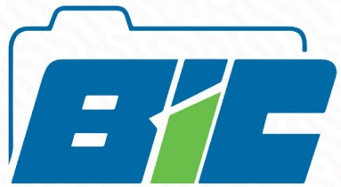

Bureau d'Information sur le Crédit

## Avec votre rapport de crédit, vous pouvez mieux gérer votre crédit et améliorer votre solvabilité à long terme

## FAITES CONFIANCE AU BIC !

12, Rue Butte, Bourdon

Tel: 28 17 00 00/28 17 00 01

<!-- page 53 -->

## BH BANQUE DE LA RÉPUBLIQUE D'HAÎTI

Scannez ce QR Code pour accéder aux informations relatives à la Circulaire 113

INCITATIONS AU FINANCEMENT DU SECTEUR AGRICOLE

CIRCULAIRE No 113

Aux Institutions Financières

<!-- page 54 -->

# raisons de souscrire aux OBLIGATIONS BRH

## 1

TAUX D'INTÉRÊT ATTRACTIF

Les Obligations BRH vous offrent des taux d'intérêt de 7 %, 7,25 %, et 7,50 % par an respectivement pour des maturities de 3, 6, et 12 mois, avec une indexation à la hausse du taux de change.

## 2

ACCESSIBILITÉ

Le montant minimal de souscription est de 50,000.00 gourdes, rendant ce produit financier accessible à une large partie de la population.

## 3

REMOURSEMENT SIMPLE

ET EFFICACE

Deux jours ouvrables après la date d'échéance, les obligations BRH sont rémunérées directement sur votre compte via l'intermédiaire financier, simplifiant ainsi le processus de récupération de votre capital et des intérêts.

## 4

STABILISATION DE LA GOURDE

En investissant dans les obligations BRH, vous contribuez à stabiliser la valeur de la monnaie nationale et à renforcer l'accumulation de l'épargne en gourdes.

<!-- page 55 -->

SCANNEZ CE QR CODE POUR ACCÉDER AUX DOCUMENTS RELATIFS AU PROGRAMME PRO-CROISSANCE

<!-- page 56 -->

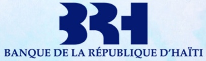

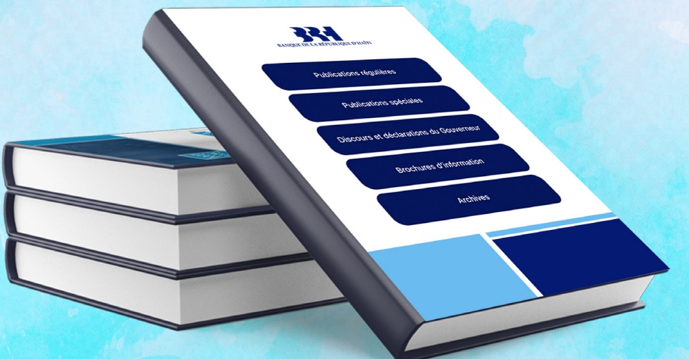

SCANNEZ CE QR CODE POUR CONSULTER TOUTES LES PUBLICATIONS DE LA BANQUE DE LA RÉPUBLIQUE D'HAÎTI

<!-- page 57 -->

Banque de la République d'Haiti ⏰

@BRHHaiti

Banque Centrale d'Haiti qui assure la défense de la #Gourde, le développement du système de paiements, la stabilité financière, l'inclusion financière.

Haiti brh.ht Joined April 2024

6 Following 76 Followers

RESTEZ INFORMÉS DE TOUTES

LES DERNIÈRES MISES À JOUR DE LA BRH !

Scannez ce QR code pour nous suivre sur notre nouveau compte X: @BRHHaiti_

<!-- page 58 -->

<!-- page 59 -->

<!-- page 60 -->

RDCCF-VOL.IV SPÉCIALE COOPÉRATIVE
