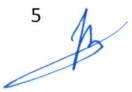

<!-- page 1 -->

# AUX BANQUES ET MAISONS DE TRANSFERT

Conformément aux articles 2 et 3 du décret du 5 juin 2020 modifiant certaines dispositions du décret du 6 juillet 1989 sur les maisons de transfert et à l'article 161 de la loi du 14 mai 2012 sur les banques et autres institutions financières, la présente circulaire définit les normes relatives aux transferts de fonds internationaux sans contrepartie.

### 1. Des modalités de transferts de fonds

#### 1.1. Des transferts reçus

Les banques et les maisons de transfert sont tenues de payer les transferts internationaux :

a) en monnaie étrangère si le bénéficiaire reçoit les fonds sur son compte de dépôt en dollars américains domiciliés dans une institution financière ;

b) en gourdes si le bénéficiaire reçoit le paiement à n'importe quel point de service (succursale, agence, bureau, kiosque) ou sur un instrument de paiement.

Les paiements en gourdes se font au taux de référence du jour de la réception des fonds par le bénéficiaire. Ce taux est publié quotidiennement par la BRH.

Lors du paiement d'un transfert, les banques et les maisons de transferts doivent identifier leur client habituel ou occasionnel, conformément aux dispositions des lois et règlements en vigueur, et remettre au client un reçu de la transaction. Le reçu doit contenir, entre autres, le montant et la monnaie dans laquelle le transfert a été payé, le taux de change de la transaction, le nom de la banque ou de la maison de transfert ainsi que l'adresse du point de service ayant effectué l'opération.

Les banques et les maisons de transfert sont tenues d'afficher le taux de référence de la BRH visiblement dans leurs locaux. Elles doivent s'assurer également que ce taux est affiché dans un endroit visible dans tous les points de service gérés par des sous-agents.

#### 1.2. Des transferts expédiés

Lors de l'expédition des transferts vers l'étranger, au cas où un client n'a pas de numéraires dollars, les banques et les maisons de transfert sont tenues d'effectuer le transfert au taux moyen d'acquisition (TMA) du marché (taux de vente moyen du système bancaire), publié par la BRH quotidiennement.

<!-- page 2 -->

Les banques et les maisons de transfert doivent afficher le TMA visiblement dans leurs locaux. Elles doivent également s'assurer que tous leurs points de service gérés par des sous-agents, affichent ce taux dans un endroit visible de leurs locaux.

#### 1.3. De la gestion des ressources

Les opérateurs de transfert opérant à l'étranger sont tenus de remettre en dollars américains à leurs agents autorisés en Haïti (banques et maisons de transfert) ou à leurs filiales en Haïti les fonds reçus des expéditeurs.

La contrepartie dollar des transferts payés en gourdes est repartie, comme suit :

- trente pourcent (30%), sans majoration de coûts, à la BRH. La BRH créditera le compte en gourde de la banque ou de la maison de transfert domicilié chez elle pour l'équivalent des dollars reçus, ce au taux de référence du jour du paiement ;

- quarante pourcent (40%), sans majoration de coûts, à une ou plusieurs institutions financières du choix de la banque et de la maison de transfert dont les comptes en gourde seront crédités au taux de référence du jour du paiement ;

- trente pourcent (30%) à l'agent autorisé (banques et maisons de transfert).

En sus des commissions et autres frais prévus entre les parties, les banques et maisons de transfert doivent rembourser à leurs sous-agents le montant des transferts payés en gourdes selon la modalité suivante :

- soixante-dix pourcent (70%) en gourdes, et

- trente pourcent (30%) en dollars américains.

La BRH veillera à alimenter périodiquement le marché à partir des dollars captés d'une part, et à répondre aux demandes destinées à des importations prioritaires et stratégiques d'autre part.

### 2. Des principes liés au service de transfert de fonds

Les banques et les maisons de transfert doivent signer des contrats de représentation avec les sous-agents, à qui elles permettent d'effectuer, pour leur compte et sous leur entière responsabilité, l'envoi de fonds reçu de la clientèle ou le paiement de transferts de fonds.

Ces contrats doivent préciser entre autres les opérations que les sous-agents peuvent réaliser pour le compte de la banque ou de la maison de transfert, les responsabilités des parties, les modalités opérationnelles relatives au paiement des transferts et à l'envoi de fonds.

Lors de la conclusion des contrats de représentation pour des services de transfert avec des sous-agents, les banques et les maisons de transfert doivent :

a) s’assurer de leur honorabilité et de leur intégrité ;

b) établir leur profil de risque en tenant compte entre autres du secteur d'activités, de leur localisation géographique, de leur chiffre d'affaires mensuel ;

<!-- page 3 -->

c) contrôler quotidiennement les opérations de transfert qu'ils effectuent en relation avec leur profil de risque ;

d) assumer entièrement la responsabilité de leurs actions ou omissions, tant qu'elles se rapportent aux services de transfert fournis par ledit sous-agent ;

e) s'assurer du respect des règles de conformité relatives à la lutte contre le blanchiment de capitaux et le financement du terrorisme ;

f) contribuer à leur formation notamment en matière de lutte contre le blanchiment des capitaux et le financement du terrorisme.

Les entreprises commerciales fonctionnant dans le secteur des jeux de hasard notamment les loteries, borlettes, casinos, ne peuvent en aucun cas être des sous-agents d'aucune institution financière.

Les sous-agents doivent faire clairement apparaître au niveau de leurs installations commerciales leur qualité et le nom d'une ou des institutions financières pour lesquelles ils opèrent. Ils doivent également afficher de manière visible et lisible à leurs guichets les conditions tarifaires appliquées à la clientèle.

Les banques et les maisons de transfert sont responsables, vis-à-vis des clients, de leur réseau de sous-agents, nonobstant toute disposition contractuelle contraire.

### 3. Du contrôle des sous-agents

Les banques et les maisons de transfert doivent établir pour chaque sous-agent la capacité journalière de paiement de transfert. Elles doivent s'assurer que le montant des transactions effectuées par lesdits sous-agents correspond à leur capacité de paiement.

Les banques et les maisons de transfert doivent déclarer à la BRH le montant total des transferts payés par les sous-agents.

Les banques et les maisons de transfert sont tenues de faire appliquer la présente circulaire par leurs sous-agents. En cas de non-respect par un sous-agent des dispositions de la présente circulaire, elles doivent faire parvenir à la BRH trimestriellement la liste des contrevenants et les mesures prises à leur encontre. En cas de résiliation de contrat, la BRH doit en être informée ainsi que des motifs au plus tard trois (3) jours ouvrables à compter de la date de prise d'effet de la décision. La BRH en avise les banques et les maisons de transfert.

Aucun sous-agent dont le contrat a été résilié pour violation des dispositions de la présente circulaire ne peut agir à titre de représentant d'une institution financière pour des services de transfert de fonds.

### 4. Rapports

Les banques et les maisons de transfert sont tenues de compléter et faire parvenir à la BRH de manière électronique sous format Excel :

- un rapport trimestriel contenant la liste de tous leurs points de services incluant les informations ci-après : nom du représentant, adresse, volume de transfert payé mensuellement (Annexe I)

<!-- page 4 -->

Délai de soumission : au plus tard quinze (15) jours après la fin du trimestre

- un rapport journalier sur les montants de transfert payés (Annexe II)

Délai de soumission : le prochain jour ouvré à midi selon la date de référence du rapport

### 5. Sanctions

En cas de non-respect des obligations définies dans la présente circulaire, l'institution concernée s'expose aux pénalités suivantes :

## a) Fiabilité de l'information

En tout temps, les montants déclarés dans les formulaires prévus en annexe doivent être ceux apparaissant dans les livres comptables de l'institution. Si les montants ne concordent pas, la BRH peut, après enquête sur les circonstances et la nature de la violation, imposer une pénalité de 50% de la différence entre les montants déclarés et les montants apparaissant aux livres comptables.

## b) Retard de production de rapport

A défaut de fournir, dans le délai requis, les rapports de conformité prévus à la section 4 de la présente circulaire, les institutions concernées encourent une pénalité de cinquante mille gourdes (HTG 50,000.00) par jour d'infraction. La période de pénalité s'étend du jour où les rapports auraient dû être transmis à la BRH au jour où celle-ci les reçoit.

## c) Autres

Pour toute autre infraction constatée, la BRH demandera la cessation immédiate de la pratique incriminée, prendra des sanctions administratives notamment une lettre d'avertissement à l'encontre de l'institution fautive et pourra appliquer une amendeda de cent mille gourdes (HTG 100,000.00) pour chaque fait relevé.

### 6. Abrogation et entrée en vigueur

La présente circulaire abroge la circulaire 114-1 du 19 juin 2020. Elle entre en vigueur le  $ 1^{er} $ octobre 2020.

Port-au-Prince, le 18 septembre 2020.

Jean Baden Dubois

Gouverneur

## Liste des Annexes

Annexe I – Rapport trimestriel sur tous les points de service

Annexe II – Rapport journalier sur les montants de transfert payés

<!-- page 5 -->

# FORMULAIRE DE DECLARATION Rapport trimestriel

Nom de l'institution : _____

Période : Du _____ au _____

| Nom du représentant | Localisation | Capacité journalière de paiement | Volume de paiement Mois 1 | Volume de paiement Mois 2 | Volume de paiement Mois 3 |
| --- | --- | --- | --- | --- | --- |
|   |   |   |   |   |   |
|   |   |   |   |   |   |
|   |   |   |   |   |   |
|   |   |   |   |   |   |
|   |   |   |   |   |   |
|   |   |   |   |   |   |
|   |   |   |   |   |   |

<!-- page 6 -->

# FORMULAIRE DE DECLARATION Rapport journalier

Nom de l'institution : ___

Date : _____

Taux de référence : _____

(en gourdes)

| Montant des transferts reçus sur comptes de dépôts |   |
| --- | --- |
| Montant total de transferts payés |   |
| Montant total payé par les sous-agents |   |
| Montant à remiser à la BRH (30%) – en dollars |   |
| Montant à créditer par la BRH - en gourdes |   |
