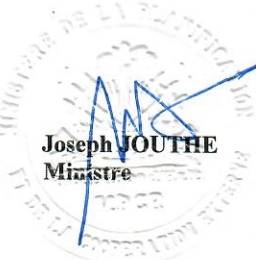

<!-- page 1 -->

# MINISTÈRE DE LA PLANIFICATION ET DE LA COOPERATION EXTERNE 387, ROUTE DE BOURDON

MPCE/DCAONG/ONG

Ref. .....294-080

No. .....

10 FEV 2021 Port-au-Prince, le

# AVIS AUX ONG

Le Ministère de la Planification et de la Coopération Externe (MPCE) avise les responsables des Organisations Non Gouvernementales (ONG) d'aide au développement que les directives relatives aux transactions financières datées du 6 Décembre 2017 (Réf. : MPCE/SM/ONG No. 1630) sont toujours en vigueur et qu'il est de leur devoir de les respecter conformément aux dispositions légales.

La Banque de la République d'Haïti (BRH), organisme chargé de défendre la valeur interne et externe de la Gourde, peut appliquer toutes sanctions appropriées contre les institutions financières qui dérogent à ces dispositions. Ces sanctions, une fois mises en vigueur, pourraient également conduire jusqu'au retrait définitif par l'Etat haïtien de la reconnaissance de l'ONG fautive.

Le Ministère de la Planification et de la Coopération Externe saisit l'occasion pour renouveler aux responsables des ONG d'aide au développement l'assurance de sa considération distinguée.

Joseph JOUTHE

Minkstre
