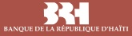
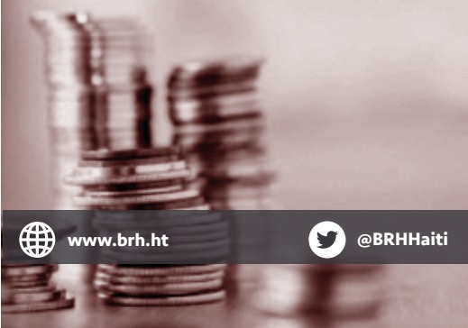
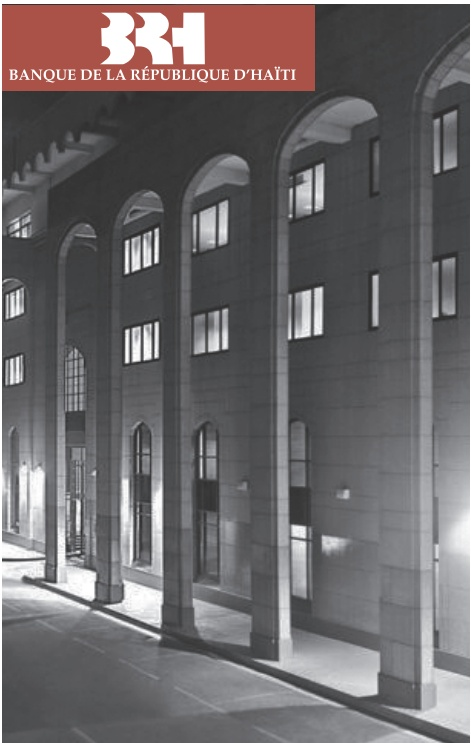
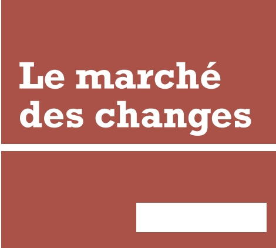
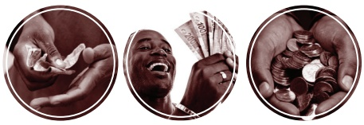
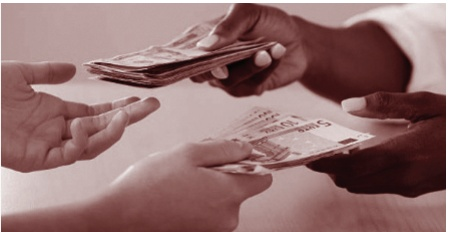

<!-- page 1 -->

Angle des Rues Pavée et du Quai, Port-au-Prince, Haïti

+509 22 99 12 00 / +509 22 99 12 02

www.brh.ht

@BRHHaiti

Le marché des changes

<!-- page 2 -->

Le marché des changes

Le marché des changes est un marché financier sur lequel s'échangent les différentes devises. Également appelé Forex, le marché des changes désigne l'endroit où différents acteurs peuvent échanger leurs monnaies en respectant un taux de change déterminé.

Le taux de change

Le taux de change se définit comme le prix d'une monnaie en termes d'une autre ou le prix auquel on échange une devise contre une autre. Toute opération de change entre deux agents se règle à partir d'un taux de change préalablement déterminé.

Les deux principaux régimes de change

Un régime de change définit les règles institutionnelles qui précisent comment se déterminent les cours de change d'une monnaie par rapport aux autres devises. Il existe une grande variété de régimes de change, qui se distribuent entre deux extrêmes : changes fixes et changes flexibles.

Mode de cotation du taux de change

Il y a deux modes de cotation du taux de change, la cotation au certain (ou directe) et la cotation à l'incertain (ou indirecte). En Haïti, le taux de change utilisé passe par une cotation indirecte.

Types de taux de change

Il existe deux types de taux de change, selon la date de l'échange réel des monnaies :

Le taux de change au comptant est le prix d'une monnaie pour une transaction immédiate (un jour ou deux au maximum). Par exemple, si R est le taux de change de la gourde par rapport au dollar américain, exprimé à l'incertain, ona:

R = HTG/USD = 40 pour 1 dollar américain = 40 gourdes

Cela signifie qu'il faut 40 gourdes pour acheter un dollar américain.

Le taux de change à terme est plutôt le prix d'une monnaie pour une transaction qui interviendra à un certain moment dans l'avenir (30, 60, 90, 180 jours). Ce type de contrat permet de fixer à l'avance le cours entre deux devises. Le marché des changes à terme est très utile pour la couverture contre le risque de change.

On distingue deux types de taux de change au comptant :

Le taux à l'achat ou cours acheteur (bid price) est le prix auquel la banque ou le cambiste veut acheter une monnaie.

Le taux à la vente ou cours vendeur (ask price) est le prix auquel la banque ou le cambiste veut vendre une monnaie.

On appelle « Spread » la différence entre le cours vendeur et le cours acheteur. Le spread représente la marge ou le gain d'un opérateur sur le marché des changes.

Interventions sur le marché des changes

Les interventions de la Banque Centrale sur le marché des changes constituent l'un des instruments dont elle dispose pour articular sa politique monétaire. Elles peuvent être assimilées à une opération d'« open-market » où elle intervient sur le marché des changes pour acheter ou vendre des devises lorsqu'elle le juge nécessaire.

En général, et en Haïti plus particulièrement, les interventions de la Banque Centrale sur le marché des changes sont réalisées essentiellement afin de lisser les fluctuations du taux de change et réduire par conséquent sa volatilité.

