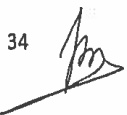

<!-- page 1 -->

# AUX INSTITUTIONS FINANCIERES

Conformément aux articles 87 et 179 de la loi du 14 mai 2012 sur les banques et autres institutions financières, la présente circulaire détermine les conditions de transmission des informations sur les crédits octroyés aux clients des institutions financières au Bureau d'Information sur le Crédit (BIC) mis en place par la Banque de la République Haïti (BRH).

1.- Les institutions financières désignées par la BRH sont tenues de transmettre au BIC, sous format électronique, toutes les informations concernant les crédits accordés à leurs clients.

Ces informations concernent tous prêts, avances de fonds, acceptations ou toute autre créance (bilan et hors bilan) avec ou sans garantie qui constituent le portefeuille de crédit.

2.- Les institutions financières sont tenues de transmettre mensuellement toutes les informations affectant le portefeuille de crédit, au plus tard le dix (10) de chaque mois pour le mois précédent.

3.- Les informations requises dans le cadre de la présente circulaire doivent être transmises par toutes les institutions financières peu importe leur taille ou leurs activités, selon les spécifications et format annexés à la présente. Les informations obligatoires figurant à l'annexe 2 doivent être collectées pour tout nouveau crédit.

4. - Les institutions financières doivent en outre :

a) corriger tout renseignement qui se révélerait erroné concernant une personne physique ou morale dans un délai de cinq (5) jours ouvrables à compter de la date de réception de la requête relative à la correction;

b) utiliser les données et les systèmes d'informations du BIC en bon père de famille et conformément aux bonnes pratiques internationales;

c) créer à leurs propres frais des conditions propices à la collecte, au traitement et à la soumission des informations ;

d) tenir à jour les informations sur les crédits concernant les personnes physiques ou morales détenues par elles ;

e) sécurité les informations qu'elles recueillent et qu'elles soumettent au BIC.

5.-Toutes les institutions financières sont tenues de soumettre des informations réelles, exactes, à jour et complètes.

Dans le cas où elles fournissent des informations se révélant fausses, inexactes, ou périmées, la BRH peut prendre des sanctions à leur encontre conformément aux lois et règlements en vigueur.

<!-- page 2 -->

Toute transmission partielle d'informations par une institution financière, c'est-à-dire une transmission partielle de son portefeuille de crédit, sera considérée comme un défaut de transmission et pénalisée conformément aux dispositions de la présente circulaire.

6.- A compter du 3 juillet 2017, obligation est faite à toutes les institutions financières de consulter et de garder une copie du rapport de crédit pour tout client aux fins de l'évaluation des risques lors de :

a) l'octroi, le renouvellement, le suivi, et la prolongation de crédit ;

b) la modification des termes des accords de crédit ;

Les informations apparaissant dans les rapports de crédit ne peuvent être utilisées aux fins de prospection commerciale ou de marketing.

c) l'attribution des moyens de paiement.

Le rapport de crédit a un délai de validité d'un (1) mois à compter de la date qu'il a été généré.

7.-En cas de non-respect des dispositions de la présente circulaire, les institutions financières visées par la présente s'exposent aux pénalités suivantes :

#### 7.1. Retard de transmission

A défaut de fournir toutes les informations sollicitées dans le délai établi au point 2 de la présente circulaire, l'institution financière est assujettie à une amende de cinquante mille gourdes (HTG 50,000) par jour d'infraction jusqu'au 15 du mois.

Au-delà de cette date, l'institution financière est assujettie à une amende de soixante-quinze mille gourdes (HTG 75,000) par jour d'infraction jusqu'à ce que les informations complètes et corrigées, le cas échéant, soient mises à la disposition du BIC.

#### 7.2. Retard de correction

A défaut de ne pas corriger les informations sollicitées par le BIC dans les délais établis, l'institution financière est assujettie à une amendeda vingt-cinq mille gourdes (HTG 25,000) par jour d'infraction à compter de la date à laquelle l'infraction a été notifiée.

#### 7.3. Absence de rapports de crédit

Au cas où la BRH constate, lors d'une inspection, l'absence de rapport de crédit dans le dossier d'un client, l'institution financière est assujettie à une amende de cent mille gourdes (HTG 100,000) pour chaque absence relevée.

#### 7.4. Autres

Pour toute autre infraction constatée, la BRH demandera la cessation immédiate de la pratique incriminée, prendra des sanctions administratives notamment une lettre de blâme à l'encontre de

<!-- page 3 -->

l'institution fautive et pourra appliquer une amende de cent mille gourdes (HTG 100,000.00) pour chaque fait relevé.

Toute amende sera déduite du solde de l'un des comptes de l'institution fautive à la BRH. Par contre, le paiement de toute amende par une institution financière non détentrice de compte à la BRH se fera par chèque de direction à l'ordre de la Banque de la République d'Haïti, au plus tard trois (3) jours ouvrables, après réception de l'avis lui exigeant le paiement. En cas de non-paiement dans les délais, des pénalités de deux mille cinq cents gourdes (HTG 2,500) seront appliquées par jour de retard.

8.- La présente circulaire abroge la circulaire 105 en date du 28 novembre 2013 et entre en vigueur le 2 mai 2017.

Port-au-Prince, le 3 avril 2017.

Braden/Zubrik

Jean Baden Dubois

Gouverneur

## Liste des annexes :

Annexe 1 - Spécifications pour le transfert des fichiers

Annexe 2 - Spécifications des fichiers de collecte de données

Annexe 3 - Données de référence

<!-- page 4 -->

# SPECIFICATIONS POUR LE TRANSFERT DES FICHIERS

## INTRODUCTION

Pour le transfert des fichiers, les institutions financières doivent tenir compte des présentes spécifications qui constituent les principaux détails techniques nécessaires à l'établissement d'une connexion au serveur de fichiers en utilisant le protocole de transfert sécurisé SFTP/SSH $ ^{1} $ pour la transmission des fichiers.

Le système d'exploitation installé sur le serveur offre un niveau de sécurité élevé.

## CONNECTIVITÉ SFTP

L’adresse IP du serveur SFTP/SSH doit être configurée, sur le poste client de l’institution, comme adresse de destination pour pouvoir transférer les fichiers. Le port 21 sera utilisé pour le transfert des fichiers selon le standard défini par l’IANA $ ^{2} $. Il est important de souligner que toute institution financière doit préalablement avoir une liaison (VPN $ ^{3} $, WIMAX $ ^{4} $, Fibre optique, VSAT $ ^{5} $) avec la BRH et que le routage et les règles d’accès au serveur soient bien définis, configurés, testés et certifiés par la BRH.

Ce serveur peut recevoir plusieurs connexions simultanées de différentes institutions et de plusieurs utilisateurs.

Tous les fichiers déposés dans les répertoires doivent avoir des noms uniques qui suivent la nomenclature définie par la BRH (voir document de spécification des fichiers de collecte de données).

<!-- page 5 -->

## PROCESSUS DE TRANSMISSION

Toute institution financière doit s'assurer que la liaison est bien établie avant de démarrer toute transmission. Une fois la connexion établie, il faut lancer le logiciel de transfert de fichiers, partie client (SSH Secure File Transfer, WinSCP, Filezilla, etc.).

Pour se connecter au serveur de la BRH, l'institution financière doit remplir les champs nom d'utilisateur, mot de passe, adresse IP du serveur et numéro de port.

Une authentification réussie place l'institution financière dans le répertoire qui lui est destiné.

Toute institution financière doit se placer dans le répertoire correspondant pour transmettre des fichiers. Tout accès est enregistré dans un registre de log.

## RÉPERTOIRES

La BRH utilisera la même nomenclature que celle du système de paiement interbancaire haïtien (SPIH) pour le nom des répertoires de chaque institution financière. Plusieurs sous-répertoires sont créés à l'intérieur de chaque répertoire racine (le niveau le plus élevé). Le nom de chaque sous-répertoire (le prochain niveau) reflète l'usage pour lequel il est destiné. Aucune institution financière ne sera autorisée à consulter le contenu ou à accéder au répertoire d'une autre institution.

Les sous-répertoires seront définis au besoin.

<!-- page 6 -->

## LISTE DES PRÉFIXES

| SOGB | SOGEBANK |
| --- | --- |
| SOGL | SOGEBEL |
| UNBK | UNIBANK |
| NOSC | SCOTIABANK |
| BNCA | BANQUE NATIONALE DE CRÉDIT |
| BPHA | BANQUE POPULAIRE HAITIENNE |
| BUHA | BANQUE DE L'UNION HAITIENNE |
| BRHA | BANQUE DE LA RÉPUBLIQUE D'HAITI |
| CAPB | CAPITAL BANK |
| CITI | CITIBANK |
| SOCC | SOCOLAVIM |
| CASC | CAPOSOV |
| COPC | COOPECPRA |
| KPEC | KPEGM |
| KOTC | KOTELAM |
| COSC | COSODEV |
| CPSC | CPSA |
| KOPC | KOPLES |
| CAPC | CAPAJ |
| CPFC | CPF |
| CACC | CAPOSAC |
| CAUC | CAPUC |
| CPRC | CPRCM |
| KPTC | KPTAT |

<!-- page 7 -->

## LISTE DES PRÉFIXES

| KEPC | KEPOMEK |
| --- | --- |
| COOC | COOPECLAS |
| FEDC | FEDERATION LE LEVIER |
| CPEC | CPE |
| CECC | CECACHE |
| CAOC | CAPOSAJ |
| CAPO | CAPOR |
| COTC | COTEM |
| KPKC | KPK |
| CODC | CODECREM |
| SOCC | SOCEM |
| CPBC | CPBS |

<!-- page 8 -->

# SPÉCIFICATIONS DES FICHIERS DE COLLECTE DE DONNÉES

1. Entreprise/Responsable/Actionnaire/Crédit

Nom du fichier 1 : ent_resp_act_credit_aaaammmjj.csv

4 segments par enregistrement :

- Entreprise : segment obligatoire

- Responsable : segment obligatoire (à l'exception des cartes de crédit)

- Actionnaire : segment optionnel

- Crédit : segment obligatoire

<table><tr><td>Réf.</td><td>Champ</td><td>Type de données</td><td>Taille</td><td>Obligatoire</td><td>Description</td></tr><tr><td>S'egment : ENTREPRISE</td></tr><tr><td>1.</td><td>Nom de l'entreprise</td><td>Char</td><td>2-75</td><td>✓</td><td>La dénomination de l'entreprise ou raison sociale de l'entreprise.</td></tr><tr><td>2.</td><td>Numéro de patente</td><td>Char</td><td>5-20</td><td></td><td>Le Numéro figurant sur le certificat de patente attribué par la Direction Générale des Impôts après paiement de l'impôt.</td></tr><tr><td>3.</td><td>Numéro d'identification fiscale de l'entreprise (NIF)</td><td>Char</td><td>10</td><td>✓\nSauf dans le cas où Forme Juridique [5] = 1000</td><td>Le numéro de la matricule fiscale délivrée par la Direction Générale des Impôts à une entreprise qui exerce une activité quelconque sur le territoire d’Haïti.</td></tr><tr><td>4.</td><td>Secteur d'activités</td><td>Code. Réf. Tableau 1</td><td></td><td>✓</td><td>Le code du secteur d'activités dans lequel une entreprise se trouve classifiée en fonction de ses activités.</td></tr><tr><td>5.</td><td>Forme juridique</td><td>Code. Réf. Tableau 4</td><td></td><td>✓</td><td>Voir tableau 1</td></tr></table>

 $ ^{8} $

<!-- page 9 -->

<table><tr><td>6.</td><td>Téléphone 1</td><td>Char</td><td>8-11</td><td></td><td>Le Numéro de téléphone affecté essentiellement aux activités de l’entreprise.\nFormat : indicatif pays suivi du numéro de téléphone</td></tr><tr><td>7.</td><td>Téléphone 2</td><td>Char</td><td>8-11</td><td></td><td>Autre numéro de téléphone affecté aux activités de l’entreprise.\nFormat : indicatif pays suivi du numéro de téléphone</td></tr><tr><td>8.</td><td>Téléphone 3</td><td>Char</td><td>8-11</td><td></td><td>Autre numéro de téléphone affecté aux activités de l’entreprise.\nFormat : indicatif pays suivi du numéro de téléphone</td></tr><tr><td>9.</td><td>Adresse</td><td>Char</td><td>5-75</td><td>✓</td><td>L’adresse du siège social de l’entreprise\nNo, rue, quartier ou zone, code postal (Voir tableau 7)</td></tr><tr><td>10.</td><td>Commune</td><td>Code. Réf. Tableau 2</td><td></td><td>✓</td><td>Le code de la commune où se trouve l’entreprise suivant le code IHSI\nVoir tableau 2</td></tr><tr><td>11.</td><td>Pays</td><td>Code. Réf. Tableau 3</td><td></td><td>✓</td><td>Le code du pays où se trouve l’entreprise suivant le code international ISO\nVoir tableau 3</td></tr><tr><td>Segment : PERSONNE AUTORISSE A ENGAGER L’ENTREPRISE\nCe segment n’est pas obligatoire pour les cartes de ordre. Mais si un des champs de ce segment est renseigné, les règles de validationer à ce segment doivent être respectées.</td></tr><tr><td>12.</td><td>Prénom</td><td>Char</td><td>2-45</td><td>✓</td><td>Le prénom de la personne autorisée à engager l’entreprise.</td></tr></table>

<!-- page 10 -->

<table><tr><td>13.</td><td>Nom</td><td>Char</td><td>2-45</td><td>✓</td><td>Le nom de la personne autorisée à engager l'entreprise.</td></tr><tr><td>14.</td><td>Numéro d'identification fiscale (NIF)</td><td>Char</td><td>10</td><td></td><td>Le numéro de la matricule fiscale délivrée par la Direction Générale des Impôts à une personne physique qui exerce une activité quelconque sur le territoire d'Haïti.\nFormat : xxxxxxxxxxx</td></tr><tr><td>15.</td><td>CIN</td><td>Char</td><td>14 ou 17</td><td></td><td>Le Numéro figurant sur la Carte d'Identification Nationale\nFormat : \nxxxxxxxxxxxxxxxxxxxxxx</td></tr><tr><td>16.</td><td>Numéro de permis de conduire</td><td>Char</td><td>1-20</td><td></td><td>Le Numéro de dossier du permis de conduire\nFormat : xxxxxxxxxxx</td></tr><tr><td>17.</td><td>Numéro de passeport</td><td>Char</td><td>7-25</td><td></td><td>Le Numéro du passeport</td></tr><tr><td>18.</td><td>Adresse</td><td>Char</td><td>5-75</td><td>✓</td><td>L'adresse du domicile de la personne autorisée à engager l'entreprise, No, rue, quartier ou zone, code postal</td></tr><tr><td>19.</td><td>Commune</td><td>Code. Réf. Tableau 2</td><td></td><td>✓</td><td>Le code de la commune du domicile de la personne autorisée suivant le code IHSI Voir tableau 2</td></tr><tr><td>20.</td><td>Pays de la personne autorisée</td><td>Code. Réf. Tableau 3</td><td></td><td>✓</td><td>Le code du pays du domicile de la personne autorisée suivant le code international ISO\nVoir tableau 3</td></tr><tr><td>Segment : ACTIONNAIRE\nCe segment est pas obligatoire. Mais si un des champs de ce segment est renseigné, les règles de validation relatives à ce segment doivent être respectées.</td></tr><tr><td>21.</td><td>Prénom</td><td>Char</td><td>2-45</td><td></td><td>Le(s) prénom(s) d'un actionnaire de l'entreprise</td></tr></table>

10

<!-- page 11 -->

<table><tr><td>22.</td><td>Nom</td><td>Char</td><td>2-45</td><td></td><td>Le nom d'un actionnaire de l'entreprise</td></tr><tr><td>23.</td><td>Numéro d'identification fiscale de l'actionnaire (NIF)</td><td>Char</td><td>10</td><td></td><td>Le numéro d'identification fiscale de l'actionnaire\nFormat : xxxxxxxxxxxx</td></tr><tr><td>24.</td><td>CIN</td><td>Char</td><td>14 ou 17</td><td></td><td>Le numéro de la carte d'identification fiscale de l'actionnaire\nFormat : xxxxxxxxxxxxxxxx</td></tr><tr><td>25.</td><td>Numéro de permis de conduire</td><td>Char</td><td>1-20</td><td></td><td>Le numéro de dossier du permis de conduire de l'actionnaire\nFormat : xxxxxxxxxxxx</td></tr><tr><td>26.</td><td>Numéro de passeport</td><td>Char</td><td>7-25</td><td></td><td>Le numéro du passeport de l'actionnaire</td></tr><tr><td>27.</td><td>Adresse</td><td>Char</td><td>5-75</td><td></td><td>L'adresse où réside l'actionnaire\nNo, rue, quartier ou zone, code postal</td></tr><tr><td>28.</td><td>Commune</td><td>Code. Réf. Tableau 2</td><td></td><td></td><td>Le code de la commune où réside l'actionnaire suivant le code IHSI.\nVoir tableau 2</td></tr><tr><td>29.</td><td>Pays</td><td>Code. Réf. Tableau 3</td><td></td><td></td><td>Le code du pays où réside l'actionnaire suivant le code international ISO\nVoir tableau 3</td></tr><tr><td>Segment - CREDIT</td></tr><tr><td>30.</td><td>Numéro du prêt</td><td>Char</td><td>5-45</td><td>✓</td><td>Le numéro attribué au prêt</td></tr><tr><td>31.</td><td>Type de prêt</td><td>Code. Réf. Liste</td><td></td><td>✓</td><td>Le code du type de prêt:\nListe des types de prêt :\nPCN : Prêt à la consommation\nPLT : Prêt au logement\nPCL : Prêt commercial</td></tr></table>

<!-- page 12 -->

|   |   |   |   |   | LC : Éigne de crédit\nPC-CC : Carte de crédit |
| --- | --- | --- | --- | --- | --- |
| 32. | Classification / Statut du prêt | Code.\nRéf. Liste |   | ✓\nSeule l’information sur la classification est obligatoire. | La classification et le statut du prêt :\nListe des classifications : COURANT\nA SIGNALER\nFAIBLE\nDOUTEUX\nPERTE\nFERME\nListe des statuts :\nP00 : Normal\nP01 : Suspendu\nP02 : En défaut\nP03 : Partiellement payé\nP04 : Action légale\nP05 : Complètement payé\nP06 : Egaré, perdu ou volé (réservé aux cartes de crédit) |
| 33. | Périodicité | Number | 2-3 | ✓ | Format :\nClassification/Statut\nEx : FERME/P04 ou FERME |
| 34. | Date d'octroi | Date | 8 | ✓ | La fréquence de paiement en nombre de jours calendaires. |
| 35. | Date fermeture ou date de maturité | Date | 8 | ✓ | La date d'octroi du prêt\nFormat : aaaammmjj |
| 36. | Montant autorisé / accordé | Number | 14.2 | ✓ | La date de fermeture du prêt si le prêt est fermé.\nLa date de maturité du prêt dans les autres cas.\nFormat : aaaammmjj |

<!-- page 13 -->

|   |   |   |   |   | Format : 999999999999.99 |
| --- | --- | --- | --- | --- | --- |
| 37. | Devise | Code. Réf. Liste |   | ✓ | L’écode de la devise utilisée pour octroyer le prêt. Liste des devises : HTG : Gourde USD : dollar américain |
| 38. | Période de grâce | Number | 1-3 |   | Délai accordé à l’emprunteur avant le premier amortissement (sursis) en nombre de jours calendaires. |
| 39. | Personne de référence 1 | Char | 1-75 |   | Le prénom et le nom de la personne de référence |
| 40. | Personne de référence 2 | Char | 1-75 |   | Le prénom et le nom de la personne de référence. |

N.B.:

Il faut préciser au moins un numéro d'identification pour les individus (NIF, CIN, permis de conduire ou passeport).

<!-- page 14 -->

### 2. Individu/Emploi/Crédit

Nom du fichier 2 : ind $ \underline{e} $mp $ \underline{c} $redit $ \underline{a} $aaammjj.csv

3 segments par enregistrement :

- Individu : segment obligatoire

- Emploi : segment optionnel

- Crédit : segment obligatoire

<table><tr><td>Ref</td><td>Champ</td><td>Type de données</td><td>Taille</td><td>Obligatoire</td><td>Description</td></tr><tr><td>Segment INDIVIDU</td></tr><tr><td>1.</td><td>Prénom</td><td>Char</td><td>2-45</td><td>✓</td><td>Le(s) prénom(s) de l'individu</td></tr><tr><td>2.</td><td>Nom</td><td>Char</td><td>2-45</td><td>✓</td><td>Le nom de l'individu</td></tr><tr><td>3.</td><td>Nom complet à la naissance</td><td>Char</td><td>2-60</td><td></td><td>Nom de jeune fille pour une femme ou nom d'une personne physique à sa naissance en cas de changement de patronyme</td></tr><tr><td>4</td><td>Nom de jeune fille de la mère</td><td></td><td>2-60</td><td></td><td>Le nom de jeune fille de la mère de l'individu.</td></tr><tr><td>5.</td><td>Numéro d'identification fiscale (NIF)</td><td>Char</td><td>10</td><td></td><td>Le numéro de la matricule fiscale délivrée par la Direction Générale des Impôts à une personne physique qui exerce une activité quelconque sur le territoire d'Haïti.\nFormat : XXXXXXXXX</td></tr><tr><td>6.</td><td>CIN</td><td>Char</td><td>14 ou 17</td><td></td><td>Le numéro de la Carte d'Identification Nationale\nFormat : XXXXXXXXX</td></tr><tr><td>7.</td><td>Numéro de passeport</td><td>Char</td><td>7-25</td><td></td><td>Le numéro du passeport</td></tr><tr><td>8.</td><td>Numéro de permis de conduire</td><td>Char</td><td>1-20</td><td></td><td>Numéro de dossier du permis de conduire\nFormat : XXXXXXX</td></tr><tr><td>9.</td><td>Date de naissance</td><td>Char</td><td>8</td><td>✓</td><td>Le date de naissance suivant le format : aaaammjj</td></tr></table>

<!-- page 15 -->

| 10. | Commune de naissance | Code. Réf. Tableau 2 ou Tableau 3 |   |   | Le code de la commune (lieu) où est né l'individu suivant le code IHSI. Pour un étranger, il faut mettre le code du pays. Voir tableau 2 ou tableau 3 |
| --- | --- | --- | --- | --- | --- |
| 11. | Etat civil | Code. Réf. Liste |   | ✓ | Le code du statut marital de l'individu.\nListe des codes :\nC=célibataire,\nD=divorcé,\nM=marié,\nS=séparé,\nU= concubinage,\nV=veuf, |
| 12. | Sexe | Code. Réf. Liste |   | ✓ | Le sexe de l'individu\nListe des codes :\nF=Féminin,\nM=Masculin |
| 13. | Profession | Code. Réf. Tableau 8 |   |   | Le code de la profession qu'exerce l'individu.\nVoir tableau 8 |
| 14. | Téléphone 1 | Char | 8-11 |   | Le numéro de téléphone\nFormat : indicatif pays suivit du numéro de téléphone |
| 15. | Téléphone 2 | Char | 8-11 |   | Le numéro de téléphone\nFormat : indicatif pays suivit du numéro de téléphone |
| 16. | Téléphone 3 | Char | 8-11 |   | Le numéro de téléphone\nFormat : indicatif pays suivit du numéro de téléphone |
| 17. | Adresse | Char | 5-75 | ✓ | Domicile de l'individu\nNuméro, rue, quartier, code postal |
| 18. | Commune | Code. Réf. Tableau 2 |   | ✓ | Le code de la commune suivant le code IHSI\nVoir tableau 2 |
| 19. | Pays | Code. Réf. Tableau 3 |   | ✓ | Le code du pays suivit le code international ISO.\nVoir tableau 3 |

<!-- page 16 -->

<table><tr><td>Segment : EMBLOI\nCe segment est pas obligatoire. Mais si un des champs de ce segment est renseigné, les règles de validationer relatives à ce segment doivent être respectées.</td></tr><tr><td>20.</td><td>Nom de l'employeur</td><td>Char</td><td>2-45</td><td>✓</td><td>Le nom de l'employeur où travaille l'individu. Si l'employeur est une personne physique, mettre le prénom et le nom de cette personne.</td></tr><tr><td>21.</td><td>Date d'embauche</td><td>Date</td><td>8</td><td>✓</td><td>La date de recrutement de la personne.</td></tr><tr><td>format : aaaammjj</td></tr><tr><td>22.</td><td>Date de vérification de l'emploi</td><td>Date</td><td>8</td><td></td><td>La date de vérification de l'emploi de l'individu.</td></tr><tr><td>Format : aaaammjj</td></tr><tr><td>23.</td><td>Poste occupé</td><td>Char</td><td>5-45</td><td>✓</td><td>La position assignée par l'employeur à l'individu.</td></tr><tr><td>24.</td><td>Salaire</td><td>Number</td><td>14.2</td><td>✓</td><td>Le salaire de l'individu\nFormat : 9999999999999.99</td></tr><tr><td>25.</td><td>Devise</td><td>Code.\nRéf. Liste</td><td></td><td>✓</td><td>Le code de la devise dans laquelle le salaire est versé.</td></tr><tr><td>Liste des devises :\nHTG : Gourde\nUSD : Dollar américain</td></tr><tr><td>26.</td><td>Téléphone 1</td><td>Char</td><td>8-11</td><td></td><td>Le numéro de téléphone de l'employeur</td></tr><tr><td>Format : indicatif pays suivi du numéro de téléphone</td></tr><tr><td>27.</td><td>Téléphone 2</td><td>Char</td><td>8-11</td><td></td><td>Le numéro de téléphone de l'employeur</td></tr><tr><td>Format : indicatif pays suivi du numéro de téléphone</td></tr><tr><td>28.</td><td>Adresse</td><td>Char</td><td>5-75</td><td>✓</td><td>L'adresse du Siège social de l'entreprise.\nNo, rue, quartier ou zone, code postal</td></tr><tr><td>29.</td><td>Commune</td><td>Code.\nRéf. Tableau 2</td><td></td><td>✓</td><td>Le code de la commune de l'employeur suivant le code IHSI.\nVoir tableau 2</td></tr></table>

16

<!-- page 17 -->

<table><tr><td>30.</td><td>Pays</td><td>Code. Réf. Tableau 3</td><td></td><td>✓</td><td>Le code du pays de l'employeur suivant le code international\nVoir tableau 3</td></tr><tr><td>Segment : CRÉDIIT</td></tr><tr><td>31.</td><td>Numéro du prêt</td><td>Char</td><td>5-45</td><td>✓</td><td>Le numéro affribué au prêt</td></tr><tr><td>32.</td><td>Type de prêt</td><td>Code. Réf. Liste</td><td></td><td>✓</td><td>Le code du type de prêt.\nListe des types de prêt:\nPCN : Prêt à la consommation\nPLT : Prêt au logement\nPCL : Prêt commercial\nLC : Ligne de crédit\nPC-CC : Carte de crédit</td></tr><tr><td>33.</td><td>Classification / Statut du prêt</td><td>Code. Réf. Liste</td><td></td><td>✓\nSeule l'information sur la classification est obligatoire.</td><td>La classification et le statut du prêt :\nListe des classifications : COURANT\nA SIGNALER\nFAIBLE\nDOUTEUX\nPERTE.\nFERME\nListe des statuts :\nP00 : Normal\nP01 : Suspendu\nP02 : En défaut\nP03 : Partiellement payé\nP04 : Action légale\nP05 : Complètement payé\nP06 : Egaré, perdu ou volé (réservé aux cartes de crédit)\nFormat : Classification/Statut\nEx : FERME/P04 ou FERME</td></tr><tr><td>34.</td><td>Périodicité</td><td>Number</td><td>2-3</td><td>✓</td><td>La fréquence de paiement en nombre de jours calendaires.</td></tr><tr><td>35.</td><td>Date d'octroi</td><td>Date</td><td>8</td><td>✓</td><td>La date d'octroi du prêt\nFormat : aaaammjj</td></tr></table>

<!-- page 18 -->

| 36. | Date fermeture ou date de maturité | Date | 8 | ✓ | La date de fermeture du prêt si le prêt est fermé.\nLa date de maturité du prêt dans les autres cas.\nFormat : aaaammjj |
| --- | --- | --- | --- | --- | --- |
| 37. | Montant autorisé / accordé | Number | 14.2 | ✓ | Le montant autorisé pour le prêt\nFormat : 9999999999999.99 |
| 38. | Devise | Code.\nRéf. Liste |   | ✓ | Le code de la devise utilisée pour octroyer le prêt.\nListe des devises : HTG : Gourde\nUSD : dollar américain |
| 39. | Période de grâce | Number | 1-3 |   | Délai accordé à l'emprunteur avant le premier amortissement (sursis) en nombre de jours calendaires. |
| 40. | Personne de référence 1 | Char | 1-75 |   | Le prénom et le nom de la personne de référence |
| 41. | Personne de référence 2 | Char | 1-75 |   | Le prénom et le nom de la personne de référence. |

N.B.:

- Il faut préciser au moins un numéro d'identification pour les individus (NIF, CIN, permis de conduire ou passeport).

<!-- page 19 -->

### 3. Crédit/Garantie

Nom du fichier 3 : credit  $ \underline{\text{sureté aaaammjj}} $.csv

2 segments par enregistrement :

- Réf. Crédit

: segment obligatoire

- Sûreté

: segment obligatoire

<table><tr><td>Ref</td><td>Champ</td><td>Type de données</td><td>Taille</td><td>Obligatoire</td><td>Description</td></tr><tr><td>Segment : Référence au CREDIT</td></tr><tr><td>1.</td><td>Numéro du prêt</td><td>Char</td><td>5-45</td><td>✓</td><td>Le numéro du prêt.\nPour la carte de crédit, un code unique identifiant la carte.</td></tr><tr><td>Segment : SURETE</td></tr><tr><td>2.</td><td>Type de sureté</td><td>Code.\nRéf.\nTableau 5</td><td></td><td>✓</td><td>Le code du type de sureté\nVoir tableau 5</td></tr><tr><td>3.</td><td>Valeur de la sureté</td><td>Number</td><td>14.2</td><td>✓</td><td>Le montant de la sureté\nFormat : 9999999999999.99</td></tr><tr><td>4.</td><td>Devise</td><td>Code.\nRéf. Liste</td><td></td><td>✓</td><td>Le code de la devise dans laquelle la sureté a été donnée.\nEiste des devises : HTG : Gourde\nUSD : Dollar américain</td></tr><tr><td>5.</td><td>Nature de la garantie</td><td>Code.\nRéf.\nTableau 6</td><td></td><td>✓</td><td>Le code de la nature de la garantie\nVoir tableau 6</td></tr><tr><td>6.</td><td>Numéro de référence de la sureté</td><td>Char</td><td>1-30</td><td>✓</td><td>Le code attribué à la sureté donnée.</td></tr></table>

<!-- page 20 -->

### 4. Crédit/Activité

Nom du fichier 4 : credit_activite_aaaammmjj.csv

2 segments par enregistrement :

- Réf. Crédit : segment obligatoire

- Activité : segment obligatoire

<table><tr><td>Ref</td><td>Champ</td><td>Type de données</td><td>Taille</td><td>Obliga toire</td><td>Description</td></tr><tr><td>Segment: Référence au CREDIT</td></tr><tr><td>1.</td><td>Numéro du prêt</td><td>Char</td><td>5-45</td><td>✓</td><td>Le numéro du prêt.\nPour la carte de crédit, un code unique identifiant la carte concaténée avec la devise de la garantie.\nEx: 13010000239*4567/HTG\n13010000239*2345/USD</td></tr><tr><td>Segment 3 ACTIVITIES DE PAIEMENT</td></tr><tr><td>2.</td><td>Date de paiement / Date limite de paiement</td><td>Date</td><td>8</td><td>✓</td><td>La date à laquelle le paiement est dû.\nFormat : aaaammmjj</td></tr><tr><td>3.</td><td>Montant du paiement / Montant minimum à payer</td><td>Number</td><td>14.2</td><td>✓</td><td>Le montant du paiement dû\nFormat : 9999999999999.99</td></tr><tr><td>4.</td><td>Date effective du paiement</td><td>Date</td><td>8</td><td>✓</td><td>La date à laquelle le paiement a été effectué.\nFormat : aaaammmjj</td></tr><tr><td>5.</td><td>Montant du paiement effectué</td><td>Number</td><td>14.2</td><td>✓</td><td>Le montant du paiement effectivement versé.\nFormat : 9999999999999.99</td></tr></table>

20

<!-- page 21 -->

| 6. | Balance courante / Solde de fin de cycle | Number | 14.2 | ✓ | La balance du prét. Pour une carte de crédit, ces sera la balance courante ou le solde de fin de cycle. Pour une ligne de crédit, ces sera le montant utilisé. Format : 9999999999999.99 |
| --- | --- | --- | --- | --- | --- |

<!-- page 22 -->

### 5. Entreprise/Chèques retournés pour insuffisance de fonds

Nom du fichier 5 : ent_cheque_aaaammmjj.csv

2 segments par enregistrement :

- Entreprise : segment obligatoire

- Chèque : segment obligatoire

<table><tr><td>Ref</td><td>Champ</td><td>Type de données</td><td>Taille</td><td>Obligatoire</td><td>Description</td></tr><tr><td>Segment : ENTREPRISE</td></tr><tr><td>1.</td><td>Nom de l'entreprise</td><td>Char</td><td>2-75</td><td>✓</td><td>La dénomination de l'entreprise ou raison sociale de l'entreprise.</td></tr><tr><td>2.</td><td>Numéro de patente de l'entreprise</td><td>Char</td><td>5-20</td><td></td><td>Le Numéro figurant sur le certificat de patente attribué par la Direction Générale des Impôts après paiement de l'impôt.</td></tr><tr><td>3.</td><td>Numéro d'identification fiscale de l'entreprise (NIF)</td><td>Char</td><td>10</td><td>✓\nSauf dans le cas où Forme Juridique [5] = 1000</td><td>Le numéro de la matricule fiscale délivrée par la Direction Générale des Impôts à une entreprise qui exerce une activité quelconque sur le territoire d'Haïti.</td></tr><tr><td>4.</td><td>Secteur d'activités de l'entreprise</td><td>Code. Réf. Tableau 1</td><td></td><td>✓</td><td>Le code du secteur d'activités dans lequel une entreprise se trouve classifiée en fonction de ses activités.</td></tr><tr><td>5.</td><td>Forme Juridique</td><td>Code. Réf. Tableau 4</td><td></td><td>✓</td><td>Voir tableau 1</td></tr><tr><td>6.</td><td>Téléphone 1 de l'entreprise</td><td>Char</td><td>20</td><td></td><td>Le code permettant de catégorer une entreprise. Voir tableau 4</td></tr><tr><td>7.</td><td>Téléphone 2 de l'entreprise</td><td>Char</td><td>20</td><td></td><td>Le Numéro de téléphone affecté essentiellement aux activités de l'entreprise.</td></tr></table>

<!-- page 23 -->

<table><tr><td></td><td></td><td></td><td></td><td></td><td>Format : indicatif pays suivid\ndu numéro de téléphone</td></tr><tr><td>8.</td><td>Téléphone 3 de l'entreprise</td><td>Char</td><td>20</td><td></td><td>Autre numéro de téléphone\naffecté aux activités de l'entreprise.\nFormat : indicatif pays suivid\ndu numéro de téléphone</td></tr><tr><td>9.</td><td>Adresse de l'entreprise</td><td>Char</td><td>75</td><td>✓</td><td>L'adresse du siège social de l'entreprise\nNuméro, rue, quartier ou zone, code postal (Voir tableau 7)</td></tr><tr><td>10.</td><td>Commune de l'entreprise</td><td>Code. Réf. Tableau 2</td><td></td><td>✓</td><td>Le code de la commune où se trouve l'entreprise suivant le code IHSI\nVoir tableau 2</td></tr><tr><td>11.</td><td>Pays de l'entreprise</td><td>Code. Réf. Tableau 3</td><td></td><td>✓</td><td>Le code du pays où se trouve l'entreprise suivant le code international ISO\nVoir tableau 3</td></tr><tr><td>Segment: CHEQUE</td></tr><tr><td>12.</td><td>Numéro de compte</td><td>Char</td><td>4-45</td><td>✓</td><td>Le numéro de compte utilisé par l'entreprise.</td></tr><tr><td>13.</td><td>Numéro du chèque retourné</td><td>Char</td><td>1-10</td><td>✓</td><td>Le numéro du chèque retourné pour manque de fonds</td></tr><tr><td>14.</td><td>Montant du chèque</td><td>Number</td><td>14.2</td><td>✓</td><td>Le montant du chèque retourné pour manque de fonds\nFormat :\n9999999999999.99</td></tr><tr><td>15.</td><td>Devise</td><td>Code. Réf. Liste</td><td></td><td>✓</td><td>Le code de la devise dans laquelle le chèque est émis.\nListe des devises :\nHTG : gourde\nUSD : dollar américain</td></tr><tr><td>16.</td><td>Date de retour</td><td>Date</td><td>8</td><td>✓</td><td>La date de retour du chèque pour manque de fonds\nFormat : aaaammjj</td></tr></table>

<!-- page 24 -->

### 6. Individu/Chèques retournés pour insuffisance de fonds

Nom du fichier 6 : ind_cheque_aaaammmjj.csv

2 segments par enregistrement :

- Individu : segment obligatoire

Chèque : segment obligatoire

<table><tr><td>Ref</td><td>Champ</td><td>Type de données</td><td>Taille</td><td>Obligatoire</td><td>Description</td></tr><tr><td>Segment : INDIVIDU</td></tr><tr><td>1.</td><td>Prénom</td><td>Char</td><td>2-45</td><td>✓</td><td>Le prénom de l'individu</td></tr><tr><td>2.</td><td>Nom</td><td>Char</td><td>2-45</td><td>✓</td><td>Le nom de l'individu</td></tr><tr><td>3.</td><td>Nom à la naissance</td><td>Char</td><td>2-60</td><td></td><td>Le nom de jeune fille pour une femme ou nom d’une personne physique à sa naissance en cas de changement de patronyme</td></tr><tr><td>4.</td><td>Nom de jeune fille de la mère</td><td>Char</td><td>2-60</td><td></td><td>Le nom de jeune fille de la mère de l'individu</td></tr><tr><td>5.</td><td>Numéro d'identification fiscale (NIF)</td><td>Char</td><td>10</td><td></td><td>Le numéro de la matricule fiscale délivrée par la Direction Générale des Impôts à une personne physique qui exerce une activité quelconque sur le territoire d'Haïti.\nFormat : XXXXXXXXX</td></tr><tr><td>6.</td><td>CIN</td><td>Char</td><td>14 ou 17</td><td></td><td>Le numéro figurant sur la Carte d'Identification Nationale\nFormat : XXXXXXXXX</td></tr><tr><td>7.</td><td>Numéro de passeport</td><td>Char</td><td>7-25</td><td></td><td>Numéro du passeport\nFormat : XXXXXXX</td></tr><tr><td>8.</td><td>Numéro de permis de conduire</td><td>Char</td><td>1-20</td><td></td><td>Le numéro de dossier du permis de conduire.</td></tr><tr><td>9.</td><td>Date de naissance</td><td>Date</td><td>8</td><td>✓</td><td>La date de naissance de l'individu Format : aaaammjj</td></tr></table>

24

<!-- page 25 -->

| 10. | Commune de naissance | Code: Réf. Tableau 2 ou Tableau 3 |   |   | Le code de la commune (lieu) où est né l'individu suivant le code IHSI. Pour un étranger, il faut mettre le code du pays. Voir tableau 2 ou tableau 3 |
| --- | --- | --- | --- | --- | --- |
| 11. | Etat civil | Code. Réf. Liste |   | ✓ | Le code du statut marital de l'individu.\nListe des codes :\nC=célibataire,\nD=divorcé,\nM=marié,\nS=séparé,\nU= concubinage,\nV=veuf, |
| 12. | Sexe | Code. Réf. Liste |   | ✓ | Le sexe de l'individu\nListe des codes :\nF=Féminin,\nM=Masculin |
| 13. | Profession | Code. Réf. Tableau 8 |   |   | Le code de la profession qu'exerce l'individu\nVoir tableau 8 |
| 14. | Téléphone 1 | Char | 8-11 |   | Numéro de téléphone pour joindre l'individu\nFormat : indicatif pays suivit du numéro de téléphone |
| 15. | Téléphone 2 | Char | 8-11 |   | Autre numéro de téléphone pour joindre l'individu\nFormat : indicatif pays suivit du numéro de téléphone |
| 16. | Téléphone 3 | Char | 8-11 |   | Autre numéro de téléphone pour joindre l'individu\nFormat : indicatif pays suivit du numéro de téléphone |
| 17. | Adresse | Char | 5-75 | ✓ | L'adresse du domicile de l'individu.\nNo, rue, quartier ou zone, code postal |
| 18. | Commune | Code. Réf. Tableau 2 |   | ✓ | Le code de la commune suivant le code IHSI\nVoir tableau 2 |

<!-- page 26 -->

<table><tr><td>19.</td><td>Pays</td><td>Code. Réf. Tableau 3</td><td></td><td>✓</td><td>Le code du pays suivant code international ISO\nVoir tableau 3</td></tr><tr><td>Segment : CHEQUE</td></tr><tr><td>20.</td><td>Numéro de compte</td><td>Char</td><td>4-45</td><td>✓</td><td>Le numéro de compte bancaire sur lequel le chèque a été émis.</td></tr><tr><td>21.</td><td>Numéro chèque retourné</td><td>Char</td><td>1-10</td><td>✓</td><td>Le numéro du chèque retourné pour manque de fonds</td></tr><tr><td>22.</td><td>Montant du chèque</td><td>Number</td><td>14.2</td><td>✓</td><td>Le montant du chèque retourné pour manque de fonds\nFormat : 9999999999999.99</td></tr><tr><td>23.</td><td>Devise</td><td>Code. Réf. Liste</td><td></td><td>✓</td><td>Le code de la devise dans laquelle le chèque a été émis\nListe des devises : HTG : gourde\nUSD : dollar américain</td></tr><tr><td>24.</td><td>Date de retour</td><td>Date</td><td>8</td><td>✓</td><td>La date de retour du chèque pour manque de fonds\nFormat : aaaammmjj</td></tr></table>

N.B.: Il faut préciser au moins un numéro d'identification pour les individus (NIF, CIN, passeport ou permis de conduire).

- Les champs nuls doivent contenir deux zéros (00)

- Les champs suivants doivent être remplis par les codes définis au niveau des tables de référence :

a. Secteur d'activités

b. Pays

c. Commune

d. Type de prêt

e. Devise

f. Type de sureté

g. Nature de la sureté

- Le caractère «/» est réservé, ne l'utilisez pas dans les fichiers à charger, sauf indication contraire pour certains champs.

<!-- page 27 -->

S'il y a une virgule dans un champ, mettre entre guillemets tout le contenu du champ

- Pour les segments d'information Actionnaire, Responsable, Employeeur, il faut au moins une identification au cas où l'on remplit ces champs.

- Il faut respecter la nomenclature des fichiers.

Pour le champ adresse, les composantes No, rue, quartier ou zone, code postal, sont séparées par des virgules. N'utilisez de virgules que pour séparer ces composantes.

<!-- page 28 -->

## DONNEES DE REFERENCE

Tableau 1 – Secteur d'activités

| Code | Secteur d’activités |
| --- | --- |
| 0201 | Extraction de charbon |
| 0221 | Production de pétrole brut |
| 0231 | Extraction de minerais métalliques |
| 0291 | Extraction de matières minérales autres que les minerais métalliques |
| 0301 | Industrie alimentaire (saulfboissons) |
| 0312 | Industrie des boissons |
| 0313 | Industrie du tabac |
| 0321 | Industrie du textile |
| 0322 | Industrie du cuir |
| 0331 | Industrie du bois |
| 0341 | Industrie du papier |
| 0342 | Imprimerie, édition |
| 0351 | Industrie chimique |
| 0352 | Industrie pharmaceutique |
| 0353 | Raffinée de pétrole |
| 0354 | Industrie du caoutchouc |
| 0355 | Industrie des matières plastiques |
| 0361 | Fabrication des grès, porcelaines et faiences |
| 0362 | Fabrication de matériaux de construction à base de minéraux |
| 0371 | Sidérurgie |
| 0381 | Fabrication d'ouvrages métalliques |
| 0382 | Fabrication de machines et de matériels non électriques |
| 0383 | Fabrication de machines et de matériels électriques |
| 0384 | Construction de matériels de transport |
| 0385 | Fabrication de matériels et instruments de précision |
| 0386 | Horlogerie, bijouterie et orlévrie |
| 0387 | Fabrication d'articles de sport et de loisirs |
| 0391 | Industries non classées ailleurs |
| 0411 | Production et distribution de l'électricité |
| 0412 | Production et distribution de gaz |
| 0421 | Traitement et distribution de l'eau |
| 0511 | Bâtiment et travaux publics (entreprises générales) |
| 0521 | Bâtiment (corps de métiers) |
| 0611 | Commerce de gros |

<!-- page 29 -->

| 0621 | Commerce de détail |
| --- | --- |
| 0622 | Commerce de petit détail (pacotilleurs) |
| 0631 | Restaurants et débits de boissons |
| 0632 | Hôtels et pension de famille |
| 0633 | Habergements touristiques en zones urbaines, murles, hôtels, hôtels restaurants, hôtels residences (appart hôtels), condos, villas à temps partagé, mottels, restaurants de campagne, auberges |
| 0634 | Services de location de voitures, d'avions, de bateaux, d'hélicoptères de plaisances |
| 0635 | Services de transport touristique et d'excursion aérienne maritime et terrestre |
| 0636 | Services de restauration touristique |
| 0637 | Services d'attraction et de loisir |
| 0638 | Agence : de voyage, événementielle, réceptive, tour opérateur/voyagiste et de guide touristique |
| 0639 | Services d'aménagement de restauration et d'exploitation d'immobiles, de stations balnéaires, de monuments, d'hôtelis de plage, de complexes, de sites et dézones touristiques |
| 0640 | Autres services touristiques |
| 0641 | Ports d'escalé privés ou marinas destinés à recevoir des bateaux de plaisance |
| 0642 | Aéroports privés et entreprises de services liés directement aux besoins du tourisme |
| 0643 | Services téléphoniques pour loisirs ou transports en montagne |
| 0644 | Parcs d'attraction, jardins botaniques et zoologiques |
| 0645 | Services d'activités a caractère touristique, tels que : Palais de congrès ou de conventions, salles de spectacle, de conférence et d'exposition |
| 0646 | Centres de santé (soins et bains thérapeutiques) |
| 0647 | Services de formation aux métiers touristiques tels que les écoles hôtelières et les auberges de jeunesse |
| 0648 | Galerie d'art, magasin de souvenir / Artisanat |
| 0649 | Membre affiliée institutions fournissants des biens et services au secteur (touristique) |
| 0711 | Transport terrestre |
| 0712 | Transport maritime (cabotage) |
| 0713 | Transport aérien |
| 0714 | Cabotage, transport parcanots, chaloupes ou chalands |
| 0715 | Entrepôts et magasins |
| 0721 | Communications (courant élécommunications) |
| 0811 | Services financiers et bancaires |
| 0821 | Compagnies d'assurances |
| 0822 | Loterie, tenanciers de borlette, casinos et activités assimilées |
| 0831 | Affaires immobilières |
| 0832 | Services juridiques |
| 832.4 | Consultation |

<!-- page 30 -->

| 0833 | Services des comptables et conseils en gestion |
| --- | --- |
| 0884 | Services informatique |
| 0835 | Services d'ingénieurs et d'architectes et autres services techniques |
| 0836 | Services de publicité |
| 0837 | Location de machines, matériels ou équipements |
| 0888 | Services d'agence ou de représentation |
| 0921 | Services sanitaires et d'hygiène |
| 0922 | Services funéraires |
| 0931 | Enseignement |
| 0932 | Services médicaux |
| 0933 | Services vétérinaires |
| 0941 | Radiodiffusion et télévision |
| 0942 | Services récréatifs, centres d'attraction |
| 0951 | Services de réparation |
| 0952 | Blanchisserie, teinturerie |
| 0953 | Coiffure et soins de beauté |
| 0954 | Services de photographie et de photocopie |
| 0959 | Services non classés alleurs |

<!-- page 31 -->

Tableau 2 – Liste des communes

<table><tr><td>DEPARTMENT ARRONDISSEMENT CODE</td><td>COMMUNE</td></tr><tr><td>OUEST</td><td>PORT-AU-PRINCE</td><td>0111</td><td>PORT-AU-PRINCE</td></tr><tr><td>0112</td><td>DELMAS</td></tr><tr><td>0113</td><td>CARREFOUR</td></tr><tr><td>0114</td><td>PÉTION-VILLE</td></tr><tr><td>0115</td><td>KENSCOFF</td></tr><tr><td>0116</td><td>GRESSIER</td></tr><tr><td>0117</td><td>CITÉ SOLEIL</td></tr><tr><td>0118</td><td>TABARRE</td></tr><tr><td>LEOGANE</td><td>0121</td><td>LÉOGANE</td></tr><tr><td>0122</td><td>PETIT-GÔAVE</td></tr><tr><td>0123</td><td>GRAND-GÔAVE</td></tr><tr><td>CROIX DES BOUQUETS</td><td>0131</td><td>CROIX DES BOUQUETS</td></tr><tr><td>0132</td><td>THOMAZEAU</td></tr><tr><td>0133</td><td>GANTHIER</td></tr><tr><td>0134</td><td>CORNILLON</td></tr><tr><td>0135</td><td>FONDS-VERRETTES</td></tr><tr><td>ARCAHAIE</td><td>0141</td><td>ARCAHAIE</td></tr><tr><td>0142</td><td>CABARET</td></tr><tr><td>LA GONAVE</td><td>0151</td><td>ANSE À GALETS</td></tr><tr><td>0152</td><td>POINTE À RAQUETTE</td></tr><tr><td>SUD-EST</td><td>JACMEL</td><td>0211</td><td>JACMEL</td></tr><tr><td>0212</td><td>MARIGOT</td></tr><tr><td>0213</td><td>CAYES JACMEL</td></tr><tr><td>0214</td><td>LA VALLÉE</td></tr><tr><td>BAINET</td><td>0221</td><td>BAINET</td></tr><tr><td>0222</td><td>CÔTES DE FER</td></tr><tr><td>BELLE-ANSE</td><td>0231</td><td>BELLE-ANSE</td></tr><tr><td>0232</td><td>GRAND GOSIER</td></tr><tr><td>0233</td><td>THIOTTE</td></tr><tr><td>0234</td><td>L'ANSE À PITRE</td></tr><tr><td>NORD</td><td>CAP-HAITIEN</td><td>0311</td><td>CAP-HAITIEN</td></tr><tr><td>0312</td><td>QUARTIER-MORIN</td></tr><tr><td>0313</td><td>LIMONADE</td></tr><tr><td>L'ACUL DU NORD</td><td>0321</td><td>L'ACUL DU NORD</td></tr><tr><td>0322</td><td>PLAINE DU NORD</td></tr><tr><td>0323</td><td>MILOT</td></tr><tr><td>GDE RIVIERE DU NORD</td><td>0331</td><td>GDE RIVIERE DU NORD</td></tr><tr><td>0332</td><td>BAHON</td></tr><tr><td>SAINT-RAPHAEL</td><td>0341</td><td>SAINT-RAPHAEL</td></tr><tr><td>0342</td><td>DONDON</td></tr><tr><td>0343</td><td>RANQUITTE</td></tr></table>

<!-- page 32 -->

<table><tr><td></td><td></td><td>0344</td><td>PIGNON</td></tr><tr><td>0345</td><td>LA VICTOIRE</td></tr><tr><td>BORGNE</td><td>0351</td><td>BORGNE</td></tr><tr><td>0352</td><td>PORT MARGOT</td></tr><tr><td>LIMBE</td><td>0361</td><td>LIMBÉ</td></tr><tr><td>0362</td><td>BAS-LIMBÉ</td></tr><tr><td>PLAISANCE</td><td>0371</td><td>PLAISANCE</td></tr><tr><td>0372</td><td>PILATE</td></tr><tr><td>NORD-EST</td><td>FORT-LIBERTE</td><td>0411</td><td>FORT-LIBERTE</td></tr><tr><td>0412</td><td>FERRIER</td></tr><tr><td>0413</td><td>PERCHES</td></tr><tr><td>OUANAMINTHE</td><td>0421</td><td>OUANAMINTHE</td></tr><tr><td>0422</td><td>CAPOTILLE</td></tr><tr><td>0423</td><td>MONT-ORGANISE</td></tr><tr><td>TROU DU NORD</td><td>0431</td><td>TROU DU NORD</td></tr><tr><td>0432</td><td>SAINTE SUZANNE</td></tr><tr><td>0433</td><td>TERRIER-ROUGE</td></tr><tr><td>0434</td><td>CARACOL</td></tr><tr><td>VALLIERES</td><td>0441</td><td>VALLIERES</td></tr><tr><td>0442</td><td>CARICE</td></tr><tr><td>0443</td><td>MOMBIN CROCHU</td></tr><tr><td>ARTIBONITE</td><td>GONAIVES</td><td>0511</td><td>GONAIVES</td></tr><tr><td>0512</td><td>ENNERY</td></tr><tr><td>0513</td><td>L'ESTERE</td></tr><tr><td>GROS-MORNE</td><td>0521</td><td>GROS-MORNE</td></tr><tr><td>0522</td><td>TERRE-NEUVE</td></tr><tr><td>0523</td><td>ANSE ROUGE</td></tr><tr><td>SAINT-MARC</td><td>0531</td><td>SAINT-MARC</td></tr><tr><td>0532</td><td>VERRETTES</td></tr><tr><td>0533</td><td>LA CHAPELLE</td></tr><tr><td>DESSALINES</td><td>0541</td><td>DESSALINES</td></tr><tr><td>0542</td><td>PT. RIV. DE L'ARTIBONITE</td></tr><tr><td>0543</td><td>GRANDE SALINE</td></tr><tr><td>0544</td><td>DESDUNES</td></tr><tr><td>MARMELADE</td><td>0551</td><td>SAINT-MICHEL DE L'ATTALAYE</td></tr><tr><td>0552</td><td>MARMELADE</td></tr><tr><td>CENTRE</td><td>HINCHE</td><td>0611</td><td>HINCHE</td></tr><tr><td>0612</td><td>MAISSADE</td></tr><tr><td>0613</td><td>THOMONDE</td></tr><tr><td>0614</td><td>CERCA CARVAJAL</td></tr><tr><td>MIREBALAIS</td><td>0621</td><td>MIREBALAIS</td></tr><tr><td>0622</td><td>SAUT D'EAU</td></tr><tr><td>0623</td><td>BOUCAN CARRE</td></tr><tr><td>LASCAHOBAS</td><td>0631</td><td>LASCAHOBAS</td></tr><tr><td>0632</td><td>BELLADERE</td></tr></table>

<!-- page 33 -->

<table><tr><td></td><td></td><td>0633</td><td>SAVANETTE</td></tr><tr><td></td><td>CERCA-LA-SOURCE</td><td>0641</td><td>CERCA-LA-SOURCE</td></tr><tr><td></td><td></td><td>0642</td><td>THOMASSIQUE</td></tr><tr><td>DEPARTEMENT</td><td>ARRONDISSEMENT</td><td>CODE</td><td>COMMUNE</td></tr><tr><td>SUD</td><td>CAYES</td><td>0711</td><td>LES CAYES</td></tr><tr><td>0712</td><td>TORBECK</td></tr><tr><td>0713</td><td>CHANTAL</td></tr><tr><td>0714</td><td>CAMP-PERRIN</td></tr><tr><td>0715</td><td>MANICHE</td></tr><tr><td>0716</td><td>L'ILE-À-VACHE</td></tr><tr><td>PORT-SALUT</td><td>0721</td><td>PORT-SALUT</td></tr><tr><td>0722</td><td>SAINT-JEAN DU SUD</td></tr><tr><td>0723</td><td>ARNIQUET</td></tr><tr><td>AQUIN</td><td>0731</td><td>AQUIN</td></tr><tr><td>0732</td><td>SAINT-LOUIS DU SUD</td></tr><tr><td>0733</td><td>CAVAILLON</td></tr><tr><td>COTEAUX</td><td>0741</td><td>CÔTEAUX</td></tr><tr><td>0742</td><td>PORT-À-PIMENT</td></tr><tr><td>0743</td><td>ROCHE-À-BATEAU</td></tr><tr><td>CHARDONNIERES</td><td>0751</td><td>CHARDONNIERES</td></tr><tr><td>0752</td><td>LES ANGLAIS</td></tr><tr><td>0753</td><td>TIBURON</td></tr><tr><td>GRAND-ANSE</td><td>JEREMIE</td><td>0811</td><td>JÉRÉMIE</td></tr><tr><td>0812</td><td>ABRICOTS</td></tr><tr><td>0813</td><td>BONBON</td></tr><tr><td>0814</td><td>MORON</td></tr><tr><td>0815</td><td>CHAMBELLAN</td></tr><tr><td>ANSE D'HAINAUT</td><td>0821</td><td>ANSE D'HAINAUT</td></tr><tr><td>0822</td><td>DAME MARIE</td></tr><tr><td>0823</td><td>LES IROIS</td></tr><tr><td>CORAIL</td><td>0831</td><td>CORAIL</td></tr><tr><td>0832</td><td>ROSEAUX</td></tr><tr><td>0833</td><td>BEAUMONT</td></tr><tr><td>0834</td><td>PESTEL</td></tr><tr><td>NORD-OUEST</td><td>PORT-DE- PAIX</td><td>0911</td><td>PORT-DE-PAIX</td></tr><tr><td>0912</td><td>LA TORTUE</td></tr><tr><td>0913</td><td>BASSIN BLEU</td></tr><tr><td>0914</td><td>CHANSOLME</td></tr><tr><td>ST-LOUIS DU NORD</td><td>0921</td><td>SAINT-LOUIS DU NORD</td></tr><tr><td>0922</td><td>ANSE-À-FOLEUR</td></tr><tr><td>MOLE ST-NICOLAS</td><td>0931</td><td>MÔLE SAINT-NICOLAS</td></tr><tr><td>0932</td><td>BAIE HENNE</td></tr><tr><td>0933</td><td>BOMBARDOPOLIS</td></tr><tr><td>0934</td><td>JEAN RABEL</td></tr><tr><td>NIPPES</td><td>MIRAGOANE</td><td>1011</td><td>MIRAGOANE</td></tr><tr><td>1012</td><td>PETITE RIVIÈRE DE NIPPES</td></tr></table>

<!-- page 34 -->

<table><tr><td></td><td></td><td>1013</td><td>FONDS-DES-NÉGRES</td></tr><tr><td>1014</td><td>PAILLANT</td></tr><tr><td>ANSE A VEAU</td><td>1021</td><td>ANSE À VEAU</td></tr><tr><td>1022</td><td>PETIT TROU DE NIPPES</td></tr><tr><td>1023</td><td>ASILE</td></tr><tr><td>1024</td><td>ARNAUD</td></tr><tr><td>1025</td><td>PLAISANCE DU SUD</td></tr><tr><td>BARADERES</td><td>1031</td><td>BARADÈRES</td></tr><tr><td>1032</td><td>GRAND BOUCAN</td></tr></table>

<!-- page 35 -->

Tableau 3 - Liste des pays

| Code | Pays | Code | Pays |
| --- | --- | --- | --- |
| AR | AEGHANISTAN | BG | BULGARIE |
| ZA | AFRIQUE DU SUD | BF | BURKINA FASO |
| AX | ALAND, ILES | BI | BURUNDI |
| AL | ALBANIE | KY | CAIMANS, ILES |
| DZ | ALGERIE | KH | CAMBODGE |
| DE | ALLEMAGNE | CM | CAMEROUN |
| AD | ANDORRE | CA | CANADA |
| AO | ANGOLA | CV | CAP-VERT |
| AI | ANGUILLA | CF | CENIRARRIGANE, REPUBLIQUE |
| AQ | ANTARCTIQUE | CL | CHILI |
| AG | ANTIGUA-ET-BARBUDA | CN | CHINE |
| SA | ARABIE SAOUDITE | CX | CHRISTMAS, ILE |
| AR | ARGENTINE | CY | CHYPRE |
| AM | ARMÉNIE | CC | COCOS (KEELING), ILES |
| AW | ARUBA | CO | COLOMBIE |
| AU | AUSTRALIE | KM | COMORES |
| AT | AUTRICH | CG | CONGO |
| AZ | AZERBAIDJAN | CD | CONGO, LA RÉPUBLIQUE DÉMOCRATIQUE DU |
| BS | BAHAMAS | CK | COOK ILES |
| BH | BAHREIN | KR | CORÉE, RÉPUBLIQUE DE |
| BD | BANGLADESEI | KP | CORÉE, RÉPUBLIQUE POPULAIRE DÉMOCRATIQUE DE |
| BB | BARBADE | CR | COSTA RICA |
| BY | BELARUS | CI | COITE DIVOIRE |
| BE | BELGIQUE | HR | CROATIE |
| BZ | BELIZE | CU | CUBA |
| BJ | BÉNIN | CW | CURAÇAO |
| BM | BERRUDES | DK | DANEMARK |
| BT | BHOUTAN | DJ | DJIBOUTI |
| BQ | BOUVILE, ITAT PLURINATIONAL DE | DO | DOMINICATE REPUBLIQUE |
| BQ | BONAIRE, SAINT-EUSTACHE ET SABA | DM | DOMINIQUE |
| BA | BOSNIE-HURZEGOVINE | EG | EGYPTE |
| BW | BOTSWANA | SV | EL SALVADOR |
| BY | BOUVIET, ILE | AE | EMIRATS ARABES UNIS |
| BR | BRÉSIL | EC | ÉQUATEUR |

<!-- page 36 -->

| BN | BRUNEDARUSSALAM | ER | ÉRYLHRÉE |
| --- | --- | --- | --- |
| Code | Pays | Code | Pays |
| ES | ESPAGNE | VI | ÎLES VIERGES DES ÉTATS-UNIS |
| EE | ESTONIE | IN | INDE |
| US | ÉTATS-UNIS | ID | INDONESIE |
| ET | ÉTHIOPIE | IR | IRAN, RÉPUBLIQUE ISLAMIQUE D' |
| EK | TALKLAND, ILES (MALIVNAS) | IQ | IRAQ |
| FO | FÉROÉ, ÎLES | IE | IRLANDE |
| EU | EUDI | IS | ISLANDE |
| FI | FINLANDE | IL | ISRAËL |
| FR | FRANCE | IT | ITALIE |
| GA | GABON | JM | JAMAÎQUE |
| GM | GAMBIE | JP | JAPON |
| GE | GÉORGIE | JE | JERSEY |
| GS | GÉORGIE DU SUD-ET-LES ILES SANDWICH DU SUD | JO | IORDANIE |
| GH | GHANA | KZ | KAZAKHSTAN |
| CL | GIBRAHDAR | KE | KENYA |
| GR | GRÈCE | KG | KIRGHIZISTAN |
| GD | GRENADE | KI | KIRBATI |
| GL | GROENLAND | KW | KOWEÎT |
| GP | GUARDELOUPE | LA | LAO, REPUBLIC DE MOCRATIQUE POPULAIRE |
| GU | GUAM | LS | LESOTHO |
| GT | GUATEMALA | LY | LEITONIE |
| GG | GUERNESEY | LB | LIBAN |
| GN | GUINDE | LR | LIBERIA |
| GW | GUINÉE-BISSAU | LY | LIBYE |
| GQ | GUINÉE, EQUATORIALE | LI | L'ÉCHTENSTEIN |
| GY | GUYANA | LT | LITUANIE |
| GF | GUYANE-FRANÇAISE | LU | LUXEMBOURG |
| HT | HAÎTI | MO | MACAO |
| HM | HEARD-ET-LES MACDONALD, ILE | MK | MACEDONIE, LEX-REPUBLICIQUE YOUGOSLAVÉDE |
| HN | HONDURAS | MG | MADAGASCAR |
| HK | HONG KONG | MY | MALAISIE |
| HU | HONGRIE | MW | MALAWI |
| IM | LE DE MAN | MV | MALDIVES |
| UM | ÎLES MINEURES ÉLOIGNÉES DES ÉTATS-UNIS | ML | MALI |
| VG | ÎLES VIERGES BRITANNIQUES | MT | MALTE |
| MP | MARIANNES DU NORD, ÎLES | PG | PAPOUASIE-NOUVELLE-GUINÉE |

<!-- page 37 -->

| Code | Pays | Code | Pays |
| --- | --- | --- | --- |
| MA | MAROC | PY | PARAGUAY |
| MH | MARSEAL, IBS | NL | PANSPAS |
| MQ | MARTINIQUE | PE | PÉROU |
| MU | MAURICE | PH | PELIPPINES |
| MR | MAURITANIE | PN | PITCAIRN |
| YT | MAXOTTE | PL | POLOGNE |
| MX | MEXIQUE | PF | POLYNÉSIE FRANÇAISE |
| FM | MORONESIE, ETAIS FEDERES DE | PR | PORIORICO |
| MD | MOLDOVA, RÉPUBLIQUE DE | PT | PORTUGAL |
| MC | MONACO | QA | QATAR |
| MN | MONGOLIE | RE | RÉUNION |
| ME | MONTENEGRO | RO | ROUMANIE |
| MS | MONTSERRAT | GB | ROYAUME-UNI |
| MZ | MOZAMBIQUE | RU | RUSSIE, FEDERATION DE |
| MM | MYANMAR | RW | RWANDA |
| NA | NAMBIE | EH | SAHARA OCCIDENTAL |
| NR | NAURU | BL | SAINT-BARTHÉLEMY |
| NP | NEPAL | SE | SAINT-HEINE, ASCENSION ET TRISIAN DA CUNHA |
| NI | NICARAGUA | LC | SAINTE-LUCIE |
| NE | NIGER | KN | SAINT-JUS-ET-NEVIS |
| NG | NIGÉRIA | SM | SAINT-MARIN |
| NU | NIUE | MF | SAINT-MARTIN (PARTIE FRANÇAISE) |
| NF | NORFOLK, ILE | SX | SAINT-MARTIN (PARTIE NÉERLANDAISE) |
| NO | NORVEGE | PM | SAINT-HERRE-ET-MIQUELON |
| NC | NOUVELLE-CALÉDONIE | VA | SAINT-SIEGE (ETAT DE LA CITÉ DU VATICAN) |
| NZ | NOUVELLE-ZÉLANDE | VC | SAINT-VINCENT-ET-LES GRENADINES |
| IO | OCEAN INDIEN, TERRITOIRE BRITANNIQUE DE L' | SB | SALOMON, ILES |
| OM | OMAN | WS | SAMOA |
| UG | OUGANDA | AS | SAMOA AMÉRICAINES |
| UZ | OUZBEKISTAN | ST | SAO TOMATI-ET-PRINCIPE |
| PK | PAKISTAN | SN | SÉNÉGAL |
| PW | PALADS | RS | SERBI |
| PS | PALESTINE, ÉTAT DE | SC | SEYCHELLES |
| PA | PANAMA | SL | SIERRALEONE |
| SG | SINGAPOUR | WF | WALLIS ET FUTUNA |
| Code | Pays | Code | Pays |

<!-- page 38 -->

| SK | SLOVAQUIE | YE | YÉMEN |
| --- | --- | --- | --- |
| SI | SLOVENIE | ZM | ZAMBIE |
| SO | SOMALIE | ZW | ZIMBABWE |
| SD | SOCDAN |   |   |
| SS | SOUDAN DU SUD |   |   |
| LK | SRILANKA |   |   |
| SE | SUÈDE |   |   |
| CH | SLESE |   |   |
| SR | SURINAME |   |   |
| SJ | SWALBARD ET ILE JANNAVEN |   |   |
| SZ | SWAZILAND |   |   |
| SY | SYRIENNE, RÉPUBLIQUE ARABE |   |   |
| TJ | TADJIKISTAN |   |   |
| TW | TAIWAN, PROVINCE DE CHINE |   |   |
| TZ | TANZANIE, RÉPUBLIQUE-UNIE DE |   |   |
| TD | TCHAD |   |   |
| CZ | TCHÈQUE, RÉPUBLIQUE |   |   |
| DE | TERRÉSA USTRALES FRANÇAISES |   |   |
| TH | THAÎLANDE |   |   |
| TL | TIMOR-LESTE |   |   |
| TG | TOGO |   |   |
| TK | TOKELAU |   |   |
| TO | TONGA |   |   |
| TT | TRINIE-ET-TOBAGO |   |   |
| TN | TUNISIE |   |   |
| TM | TURKMENISTAN |   |   |
| TC | TURKS-ET-CAÍCOS, ILES |   |   |
| TR | TURQUE |   |   |
| TV | TUVALU |   |   |
| LA | LFRAINE |   |   |
| UY | URUGUAY |   |   |
| VU | VANCAITU |   |   |
| VE | VENEZUELA, RÉPUBLIQUE BOLIVARIENNE DU |   |   |
| VN | VIETNAM |   |   |

<!-- page 39 -->

Tableau 4 – Forme juridique

| Code | Forme Juridique |
| --- | --- |
| 0100 | Agence |
| 0200 | Association commerciale en participation |
| 0500 | Cartel |
| 0400 | Congrégation Religieuse / Eglise |
| 0500 | Cooperative/Mutuelle |
| 0600 | Ecole |
| 0700 | Entreprise indiquuelle |
| 0800 | Entreprise Publique |
| 0900 | Bondation Résonance d'Éutilité publique |
| 1000 | Organisation Non Gouvernementale(ONG) |
| 1100 | Société Anonyme Mixte (SAN) |
| 1200 | Société en Commandite par Actions |
| 1300 | Société en Commandite Simple |
| 1400 | Société en Formation |
| 1500 | Société Anonyme (SA) |
| 1600 | Société d'Economie Mixte (SEM) |
| 1700 | Société Etrangère Autonisee a fonctionner en Haïti |
| 1800 | Succursale d'entreprise étrangère |
| 1900 | Société en nom collectif |

<!-- page 40 -->

Tableau 5 - Type de sureté

| Code | Type de la sureté |
| --- | --- |
| SI | Immobilière |
| SM | Mobilière |
| SP | Personnelle |

<!-- page 41 -->

Tableau 6- Nature de la garantie

| Code | Action | Mobilière |
| --- | --- | --- |
| SM-01 | Assumance | Mobilière |
| SP-01 | Aval | Personnelle |
| SM-02 | Bon | Mobilière |
| SM-03 | Bon de trésorerie entreprise | Mobilière |
| SM-04 | Cash_collateral | Mobilière |
| SP-02 | Caution | Personnelle |
| SM-05 | Compte d'épargne | Mobilière |
| SM-06 | Dépôt à terme | Mobilière |
| SM-07 | Fonds de commerce | Mobilière |
| SM-08 | Produits agricoles | Mobilière |
| SM-09 | Equipements | Mobilière |
| SP-03 | Garantie Autonome | Personnelle |
| SI-01 | Hospitale | Immobilière |
| SP-04 | Lettre d'intention | Personnelle |
| SP-05 | Lettre de Crédit | Personnelle |
| SM-10 | Obligation | Mobilière |
| SM-11 | Titre de créance | Mobilière |
| SM-12 | Stock de marchandises | Mobilière |
| SM-13 | Titre de Propriété intellectuelle | Mobilière |
| SU-01 | Titres | Mobilière ou immobilière |

<!-- page 42 -->

Tableau 7 - Liste des codes postaux

<table><tr><td>DEPARTMENT</td><td>ARRONDISSEMENT</td><td>CODE REGION 1</td><td>CODE REGION 2</td></tr><tr><td>OUEST</td><td>PORT-AU-PRINCE</td><td>HT6110 PORT-AU-PRINCE</td><td>HT6111 Bel-Air et Bourdon</td></tr><tr><td>HT6112 Bas Peu de Choses</td></tr><tr><td>HT6113 Turgeau</td></tr><tr><td>HT6114 Bois Verna</td></tr><tr><td>HT6116 Carrefour Feuilles</td></tr><tr><td>HT6117 Morne de l'Hôpital</td></tr><tr><td>HT6118 Bolosse</td></tr><tr><td>HT6119 Martissant et Fontamara</td></tr><tr><td>HT6120 DELMAS</td><td>HT6121 Varreux</td></tr><tr><td>HT6122 Cité soleil</td></tr><tr><td>HT6123 Mais Gâté, Tabarre zone 1</td></tr><tr><td>HT6124 Petite Place Cazeau, Tabarre zone 2</td></tr><tr><td>HT6125 Croix-des-Missions</td></tr><tr><td>HT6130 CARREFOUR</td><td>HT6131 Bizoton</td></tr><tr><td>HT6132 Diquini, Thor</td></tr><tr><td>HT6133 Côte-Page, Mahotière</td></tr><tr><td>HT6134 Arcachon, Warney</td></tr><tr><td>HT6135 Brochette</td></tr><tr><td>HT6136 Lamentin, Mariani, Merger</td></tr><tr><td>HT6140 PÉTION-VILLE</td><td>HT6141 Frères, Pergnier</td></tr><tr><td>HT6142 Pèlerin</td></tr><tr><td>HT6143 Tête de l'Eau</td></tr><tr><td>HT6144 Laboule</td></tr><tr><td>HT6145 Thomassin</td></tr><tr><td>HT6146 Fermathe</td></tr><tr><td>HT6147 Pergnier</td></tr><tr><td>HT6150 KENSCOFF</td><td></td></tr><tr><td>HT6160 GRESSIER</td><td></td></tr><tr><td>HT6123 TABARRE</td><td></td></tr><tr><td>LEOGANE</td><td>HT6210 LÉOGANE</td><td>HT6211 Trouin</td></tr><tr><td>HT6212 Orangers</td></tr><tr><td>HT6220 PETIT GÔAVE</td><td>HT6221 Vialet</td></tr><tr><td>HT6230 GRAND GÔAVE</td><td></td></tr><tr><td>CROIX DES BOUQUETS</td><td>HT6310 CROIX DES BOUQUETS</td><td>HT6311 Santo</td></tr><tr><td>HT6312 Bon Repos</td></tr><tr><td>HT6320</td><td></td></tr></table>

<!-- page 43 -->

<table><tr><td></td><td></td><td>THOMAZEAU</td><td></td></tr><tr><td>HT6330\nGANTHIER</td><td>HT6331\nFonds Parisien et Galette\nBonbon</td></tr><tr><td>HT6340\nCORNILLON</td><td></td></tr><tr><td>HT6340\nFONDS-\nVERRETTES</td><td></td></tr><tr><td>ARCAHAIE</td><td>HT6410\nARCAHAIE</td><td>HT6411\nSaintard</td></tr><tr><td>HT6420\nCABAET</td><td>HT6421\nCasale</td></tr><tr><td>LA GONAVE</td><td>HT6510\nANSE À\nGALETS</td><td></td></tr><tr><td>HT6520\nPONTE À\nRAQUETTE</td><td></td></tr><tr><td>SUD-EST</td><td>JACMEL</td><td>HT9110\nJACMEL</td><td>HT9111\nMarbial</td></tr><tr><td>HT9120\nMARIGOT</td><td>HT9121\nSeguin</td></tr><tr><td>HT9130\nCAYES\nJACMEL</td><td></td></tr><tr><td>HT9140\nLA VALLÉE\nDE JACMEL</td><td></td></tr><tr><td>BAINET</td><td>HT9210\nBAINET</td><td></td></tr><tr><td>HT9220\nCÔTES DE\nFER</td><td></td></tr><tr><td>BELLE-ANSE</td><td>HT9310\nBELLE-ANSE</td><td>HT9311\nMapou</td></tr><tr><td>HT9320\nGRAND\nGOSIER</td><td>HT9321\nBodarie</td></tr><tr><td>HT9330\nTHIOTTE</td><td></td></tr><tr><td>HT9340\nANSE À PITRE</td><td>HT9341\nBanane</td></tr><tr><td>NORD</td><td>CAP-HAITIEN</td><td>HT1110\nCAP-HAÎTIEN</td><td>HT1111\nBande du Nord</td></tr><tr><td>HT1112\nLabadie</td></tr><tr><td>HT1113\nHaut du Cap</td></tr><tr><td>HT1114\nPetite Anse</td></tr><tr><td>HT1120</td><td></td></tr></table>

<!-- page 44 -->

<table><tr><td></td><td></td><td>QUARTIER-MORIN</td><td></td></tr><tr><td>HT1130\nLIMONADE</td><td></td></tr><tr><td>L'ACUL DU NORD</td><td>HT1210\nACUL DU NORD</td><td>HT1211 La Soufrière</td></tr><tr><td>HT1220\nPLAINE DU NORD</td><td>HT1221 Robillard</td></tr><tr><td>HT1230\nMILOT</td><td>HT1231 Carrefour des Pères</td></tr><tr><td>GDE RIVIERE DU NORD</td><td>HT1310\nGDE RIVIÈRE DU NORD</td><td></td></tr><tr><td>BAHON</td><td></td></tr><tr><td>SAINT-RAPHAEL</td><td>HT1410\nSAINT-RAPHAËL</td><td></td></tr><tr><td>HT1420\nDONDON</td><td></td></tr><tr><td>HT1430\nRANQUITTE</td><td></td></tr><tr><td>HT1440\nPIGNON</td><td></td></tr><tr><td>HT1450\nLA VICTOIRE</td><td></td></tr><tr><td>BORGNE</td><td>HT1510\nBORGNE</td><td>HT1511 Petit bourg de Borgne</td></tr><tr><td>HT1517 Côte de Fer et Fond</td></tr><tr><td>HT1520\nPORT-MARGOT</td><td>HT1521 Bayeux</td></tr><tr><td>HT1522 Margot</td></tr><tr><td>LIMBE</td><td>HT1610\nLIMBÉ</td><td>HT1611 Camp Coq</td></tr><tr><td>HT1620\nBAS-LIMBÉ</td><td></td></tr><tr><td>PLAISANCE</td><td>HT1710\nPLAISANCE</td><td></td></tr><tr><td>HT1720\nPILATE</td><td>HT1723 Ravine Trompette</td></tr><tr><td>NORD-EST</td><td>FORT-LIBERTE</td><td>HT2110\nFORT-LIBERTE</td><td>HT2111 Dérac</td></tr><tr><td>HT2112 Acul Samedi</td></tr><tr><td>HT2120\nFERRIER</td><td>HT2121 Maribahoux</td></tr><tr><td>HT2130\nPERCHES</td><td></td></tr><tr><td>OUANAMINTHE</td><td>HT2210\nOUANAMINTHE</td><td></td></tr></table>

<!-- page 45 -->

<table><tr><td></td><td></td><td></td><td></td></tr><tr><td>HT2220 CAPOTILLE</td><td></td></tr><tr><td>HT2230 MONT ORGANISÉ</td><td></td></tr><tr><td>TROU DU NORD</td><td>HT2310 TROU DU NORD</td><td></td></tr><tr><td>HT2320 SAINTE SUZANNE</td><td>HT2321 Dupity</td></tr><tr><td>HT2330 TERRIER-ROUGE</td><td>HT2331 Phaëton</td></tr><tr><td>HT2332 Paulette</td></tr><tr><td>HT2340 CARACOL</td><td></td></tr><tr><td>VALLIERES</td><td>HT2410 VALLIERES</td><td>HT2411 Grosse Roche</td></tr><tr><td>HT2420 CARICE</td><td></td></tr><tr><td>HT2430 MOMBIN CROCHU</td><td>HT2431 Bois Laurence</td></tr><tr><td>ARTIBONITE</td><td>GONAIVES</td><td>HT4110 GONAIVES</td><td>HT4111 Petite Rivière de l'Artibonite</td></tr><tr><td>HT4120 ENNERY</td><td></td></tr><tr><td>HT4130 L'ESTÈRE</td><td></td></tr><tr><td>GROS-MORNE</td><td>HT4210 GROS-MORNE</td><td></td></tr><tr><td>HT4220 TERRE-NEUVE</td><td></td></tr><tr><td>HT4230 ANSE ROUGE</td><td>HT4231 Sources Chaudes</td></tr><tr><td>SAINT-MARC</td><td>HT4310 SAINT-MARC</td><td>HT4311 Montrouis</td></tr><tr><td>HT4320 VERRETTES</td><td>HT4321 Désarmes</td></tr><tr><td>HT4322 Deschapelles</td></tr><tr><td>HT4323 Liancourt</td></tr><tr><td>HT4330 LA CHAPELLE</td><td></td></tr><tr><td>DESSALINES</td><td>HT4410 DESSALINES / MARCHAND</td><td></td></tr><tr><td>HT4420 PT. RIV. DE L'ARTIBONITE</td><td>HT4421 Savane à Roches</td></tr></table>

45

<!-- page 46 -->

<table><tr><td></td><td></td><td>HT4430\nGRANDE\nSALINE</td><td></td></tr><tr><td>HT4440\nDESDUNES</td><td></td></tr><tr><td>MARMELADE</td><td>HT4510\nMARMELADE</td><td></td></tr><tr><td>HT4520\nSAINT-\nMICHEL DE\nL'ATTALAYE</td><td></td></tr><tr><td>CENTRE</td><td>HINCHE</td><td>HT5110\nHINCHE</td><td>HT5111 Los Palis</td></tr><tr><td>HT5120\nMAÏSSADE</td><td>HT5121 Louverture</td></tr><tr><td>HT5130\nTHOMONDE</td><td></td></tr><tr><td>HT5140\nCERCA\nCARVAJAL</td><td></td></tr><tr><td>MIREBALAIS</td><td>HT5210\nMIREBALAIS</td><td>HT5211 Dufailly</td></tr><tr><td>HT5220\nSAUT D'EAU</td><td></td></tr><tr><td>HT5230\nBOUCAN\nCARRÉ</td><td>HT5231 Péligre</td></tr><tr><td>LASCAHOBAS</td><td>HT5310\nLASCAHOBAS</td><td></td></tr><tr><td>HT5320\nBELLADÈRE</td><td>HT5321 Baptiste</td></tr><tr><td>HT5330\nSAVANETTE</td><td></td></tr><tr><td>CERCA-LA-SOURCE</td><td>HT5410\nCERCA-LA-SOURCE</td><td>HT5411 Saltadère\nHT5412 La Mielle</td></tr><tr><td>HT5420\nTHOMASSIQUE</td><td></td></tr><tr><td>SUD</td><td>CAYES</td><td>HT8110\nLES CAYES</td><td></td></tr><tr><td>HT8120\nTORBECK</td><td>HT8121 Ferme Le Blanc\nHT8122 Ducis</td></tr><tr><td>HT8130\nCHANTAL</td><td></td></tr><tr><td>HT8140\nCAMP-PERRIN</td><td></td></tr><tr><td>HT8150\nMANICHE</td><td></td></tr><tr><td>HT8160</td><td></td></tr></table>

<!-- page 47 -->

<table><tr><td></td><td></td><td>L'ILE-À-VACHE</td><td></td></tr><tr><td>PORT-SALUT</td><td>HT8210\nPORT-SALUT</td><td></td></tr><tr><td>HT8220\nSAINT-JEAN\nDU SUD</td><td></td></tr><tr><td>HT8230\nARNIQUET</td><td></td></tr><tr><td>AQUIN</td><td>HT8310\nAQUIN</td><td>HT8311 Fond des Blanc\nHT8312 Vieux Bourg d'Aquin\nHT8313 La Colline</td></tr><tr><td>HT8320\nSAINT-LOUIS\nDU SUD</td><td></td></tr><tr><td>HT8330\nCAVAILLON</td><td></td></tr><tr><td>COTEAUX</td><td>HT8410\nCÔTEAUX</td><td>HT8411 Damassin\nHT8412 La Côte</td></tr><tr><td>HT8420\nPORT-À-PIMENT</td><td></td></tr><tr><td>HT8430\nROCHE-À-BATEAU</td><td></td></tr><tr><td>CHARDONNIERES</td><td>HT8510\nCHARDONNIÈRES</td><td>HT8511 Randel</td></tr><tr><td>HT8520\nLES ANGLAIS</td><td></td></tr><tr><td>HT8530\nTIBURON</td><td>HT8531 Cahonane</td></tr><tr><td>GRAND-ANSE</td><td>JEREMIE</td><td>HT7110\nJÉRÉMIE</td><td>HT7111 Léon\nHT7112 Marfranc</td></tr><tr><td>HT7120\nABRICOTS</td><td></td></tr><tr><td>HT7130\nBONBON</td><td></td></tr><tr><td>HT7140\nMORON</td><td>HT7141 Sources Chaudes</td></tr><tr><td>HT7150\nCHAMBELLAN</td><td></td></tr><tr><td>ANSE D'HAINAUT</td><td>HT7210\nANSE\nD'HAINAUT</td><td></td></tr><tr><td>HT7220\nDAME MARIE</td><td>HT7221 Lesson</td></tr><tr><td>HT7230\nLES IROIS</td><td>HT7231 Carcasse</td></tr><tr><td>CORAIL</td><td>HT7310\nCORAIL</td><td></td></tr><tr><td>HT7320</td><td></td></tr></table>

<!-- page 48 -->

<table><tr><td></td><td></td><td>ROSEAUX</td><td></td></tr><tr><td>HT7330\nBEAUMONT</td><td></td></tr><tr><td>HT7340\nPESTEL</td><td></td></tr><tr><td>NORD-OUEST</td><td>PORT-DE-PAIX</td><td>HT3110\nPORT-DE-PAIX</td><td>HT3111 La Pointe</td></tr><tr><td>HT3120\nLA TORTUE</td><td></td></tr><tr><td>HT3130\nBASSIN BLEU</td><td></td></tr><tr><td>HT3140\nCHANSOLME</td><td></td></tr><tr><td>ST-LOUIS DU NORD</td><td>HT3210\nSAINT-LOUIS\nDU NORD</td><td>HT3211 Bonneau\nHT3212 Guichard</td></tr><tr><td>HT3220\nANSE-À-FOLEUR</td><td></td></tr><tr><td>MOLE ST-NICOLAS</td><td>HT3310\nMÔLE SAINT-NICOLAS</td><td></td></tr><tr><td>HT3320\nBAIE HENNE</td><td></td></tr><tr><td>HT3330\nBOMBARDOPOLIS</td><td></td></tr><tr><td>HT3340\nJEAN RABEL</td><td></td></tr><tr><td>NIPPES</td><td>MIRAGOANE</td><td>HT7410\nMIRAGOANE</td><td>HT7411 Saint Michel du Sud\nHT7412 Paillant\nHT7413 Fond des Nègres</td></tr><tr><td>HT7420\nPETITE RIVIÈRE DE NIPPES</td><td></td></tr><tr><td>ANSE A VEAU</td><td>HT7510\nANSE-À-VEAU</td><td></td></tr><tr><td>HT7530\nPETIT TROU DE NIPPES</td><td></td></tr><tr><td>HT7540\nASILE</td><td></td></tr><tr><td>?\nARNAUD</td><td></td></tr><tr><td>?\nPLAISANCE DU\nSUD</td><td></td></tr><tr><td>BARADERES</td><td>HT7520\nBARADÈRES</td><td>HT7521 Grand Boucan</td></tr></table>

<!-- page 49 -->

Tableau 8.- Liste des professions

| M001 | Agent Hacqueu Hotesse |
| --- | --- |
| M002 | Agent de nettoyage - |
| M003 | Agent de sécurité |
| M004 | Agent immobilier |
| M005 | Agronome |
| M006 | Architecte |
| M007 | Artiste - autre |
| M008 | Artiste - musicien |
| M009 | Artiste - peintre |
| M010 | Artiste sculpteur |
| M011 | Avocat |
| M012 | Boucher |
| M013 | Caissier de sugermarché, magasin |
| M014 | Caissier d'institution financière |
| M015 | Carreleur |
| M016 | Charpentier |
| M017 | Chauffeur |
| M018 | Chef / Cuisinier / aide Cuisinier |
| M019 | Mecanien |
| M020 | Coiffeur |
| M021 | Comptable |
| M022 | Confiseur |
| M023 | Conseiller politique |
| M024 | Consultant |
| M025 | Controleur / inspecteur de la qualité, autres produits |
| M026 | Cordonnier |
| M027 | Couturier(e) / Tailleur |
| M028 | Couvreur |
| M029 | Cultivateur |
| M030 | Décorateur d'intérieur |
| M031 | Decorateur floral, fleuriste |
| M032 | Dentiste / hygiéniste dentaire |
| M033 | Déteficien |
| M034 | Ebéniste |
| M035 | Electricien |
| M036 | Electromécanicien |
| M037 | Eleveur |
| M038 | Esthéficien - esthéticienne |

<!-- page 50 -->

| M059 | Farrilleur |
| --- | --- |
| M040 | Foreur |
| M041 | Ferronnier |
| M042 | Financier |
| M043 | Eleuniste |
| M045 | Gouvernante |
| M046 | Graphiste |
| M047 | Horloger |
| M048 | Hôtelier |
| M049 | Imprimeur |
| M050 | Infurnier / aide infirmier |
| M051 | Infographiste |
| M052 | Informaticien |
| M053 | Ingénieur civil |
| M054 | Ingénieur électronien |
| M055 | Ingénieur chimique |
| M056 | Inspecteur des impôts |
| M057 | Installateur/réparateur d'équipements de télécommunications |
| M058 | Interprète |
| M059 | Jardinier |
| M060 | Journaliste |
| M061 | Juge |
| M062 | Macon |
| M063 | Maître de conférences |
| M064 | Technicien de radiologie |
| M065 | Marchand / Commerçant |
| M066 | Mann |
| M067 | Mécanicien en maintenance industrielle |
| M068 | Mécanicien réparateur automobile |
| M069 | Médecin |
| M070 | Menuisier |
| M071 | Messager |
| M072 | Métorologue |
| M073 | Moniteur de sport |
| M074 | Monteur en installations climatiques |
| M075 | Orfèvre |
| M076 | Paveur |
| M077 | Pêcheur |
| M078 | Feintres en hâtiment |
| M079 | Personnel de maison |
| M080 | Photographie |
| M081 | Plombier |

<!-- page 51 -->

| M082 | Policier |
| --- | --- |
| M083 | Pompier |
| M084 | Professeur de l'enseignement maternel |
| M085 | Professeur de l'enseignement primaire |
| M086 | Professeur de l'enseignement secondaire |
| M087 | Professeur d'université |
| M088 | Professionnel en ressources humaines |
| M089 | Psychologue |
| M090 | Pensionteur |
| M091 | Sage-femme |
| M092 | Secrétaire |
| M093 | Secrétaire de direction /Assistante de direction |
| M094 | Serveur ou serveuse |
| M095 | Technicien agricole |
| M096 | Technicien de laboratoire |
| M097 | Technicien en génie civil |
| M098 | Technicien en ingénterie mécanique |
| M099 | Traiteur |
| M100 | Vétérinaire aide vétérinaire |
| M101 | Artisan |
| M102 | Boulanger |
| M103 | Autre |
