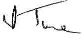
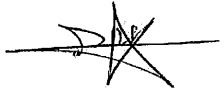

<!-- page 1 -->

FIRME TURNIER

60, Rue Mérisier

Delmas 48, Port-au-Prince

République d'Haïti

# Banque de la République d'Haïti (BRH)

Rapport d'audit sur les états financiers

Exercice clos le 30 septembre 2011

<!-- page 2 -->

# Banque de la République d'Haïti (BRH)

Rapport d'audit sur les états financiers

Exercice clos le 30 septembre 2011

Madame, Messieurs les Administrateurs,

En exécution de la mission qui nous a été confiée, nous vous présentons notre rapport sur le contrôle des états financiers de la Banque de la République d'Haïti (BRH) pour l'exercice clos le 30 septembre 2011.

Nous avons effectué l'audit des états financiers ci-joint de la BRH comprenant le bilan au 30 septembre 2011, ainsi que le compte de pertes et profits, l'état de variation des capitaux propres, le tableau des flux de trésorerie et les notes annexes (ci-après désignés « les états financiers »). Ces états financiers ont été établis par le Management conformément aux principes et méthodes comptables édictés par la BRH qui sont décrits dans les notes annexes.

Responsabilité du Management dans l'établissement et la présentation des états financiers

Le Management de la BRH est responsable de l'établissement et de la présentation sincère de ces états financiers, conformément aux principes et méthodes comptables édictés par la BRH, ainsi que d'un contrôle interne qu'elle juge nécessaire pour permettre l'établissement d'états financiers ne comportant pas d'anomalies significatives, que celles-ci proviennent de fraudes ou résultant d'erreurs.

<!-- page 3 -->

## Responsabilité de l'auditeur

Notre responsabilité est d'exprimer une opinion sur ces états financiers sur la base de notre audit. Nous avons effectué notre audit selon les Normes Internationales d'Audit telles que définies par l'International Federation of Accountants (IFAC), à l'exception des limitations (1) à (4) décrites ci-après. Ces normes requièrent de notre part de nous conformer aux règles d'éthique et de planifier et de réaliser l'audit pour obtenir une assurance raisonnable que les états financiers ne comportent pas d'anomalies significatives.

Un audit implique la mise en œuvre de procédures en vue de recueillir des éléments probants concernant les montants et les informations fournies dans les états financiers. Le choix des procédures relève du jugement de l'auditeur, de même que l'évaluation du risque que les états financiers contiennent des anomalies significatives, que celles-ci résultent de fraudes ou d'erreurs. En procédant à cette évaluation du risque, l'auditeur prend en compte le contrôle interne en vigueur dans l'entité relatif à l'établissement et la présentation sincère des états financiers afin de définir des procédures d'audit appropriées en la circonstance, et non dans le but d'exprimer une opinion sur l'efficacité de celui-ci. Un audit comporte également l'appréciation du caractère approprié des méthodes comptables retenues et le caractère raisonnable des estimations comptables faites par le Management, de même que l'appréciation de la présentation d'ensemble des états financiers.

Nous estimons que les éléments probants recueillis sont suffisants et appropriés pour fonder notre opinion avec réserves.

## Justification de l'opinion avec réserves

## (1) Participation TELECO

La quote-part de la BRH dans les résultats annuels enregistrés par la TELECO s'élève à un montant cumulé de G.1 900 millions au 30 septembre 2011. Ce montant a été déterminé sur la base d'états financiers non audités de la TELECO. Par conséquent, nous ne sommes pas en mesure de nous prononcer sur la correcte évaluation du placement TELECO comptabilisé dans les livres de la BRH.

<!-- page 4 -->

## (2) Non assistance à l'inventaire physique des encaisses

Nous n'avons pas assisté à l'inventaire physique des encaisses au 30 septembre 2011 du fait que notre désignation comme auditeur est intervenue le 9 mars 2012. Compte tenu du délai entre la date de clôture et la date de notre intervention, nous n'avons pas été en mesure de mettre en œuvre des procédures alternatives adéquates.

## (3) Immobilisations corporelles

Lors de nos travaux de validation, nous n'avons pas pu nous assurer de la réalité et de la correcte évaluation de certaines immobilisations de la BRH, dont la valeur nette comptable s'établit à G.180 millions au 30 septembre 2011. En effet, ces immobilisations autres que des immeubles n'ont pas fait l'objet d'un inventaire physique depuis plus de cinq (5) ans et nous n'avons pas pu mettre en œuvre des procédures alternatives.

## (4) Fonds de pension BRH

Le compte « 496400  Fonds de pension BRH » présente un solde créditeur de G.539 millions au 30 septembre 2011. Ce solde comprend un approvisionnement de G.500 millions décidé par le Conseil d'Administration au mois d'août 2011, « en attendant une nouvelle évaluation actuarielle pour déterminer de façon définitive les obligations de la BRH envers le fonds ». Selon les informations recueillies cette étude actuarielle est en cours.

Par conséquent, nous ne sommes pas en mesure de nous prononcer sur les éventuels

ajustements qu'il aurait fallu comptabiliser au 30 septembre 2011, pour déterminer le

montant exact de la dette envers le personnel au titre de ce fonds.

<!-- page 5 -->

## Opinion avec réserves

A notre avis, à l'exception de l'incidence éventuelle des points évoqués au paragraphe « Justification de l'opinion avec réserves » ci-dessus, les états financiers sont réguliers et sincères et donnent une image fidèle de la situation financière de la BRH au 30 septembre 2011, de son patrimoine, de ses résultats et de la variation de la situation financière pour l'exercice clos à cette date, conformément aux règles et méthodes comptables décrites dans les notes annexes.

FIRME TURNIER

Antoine Lionel TURNIER

Associé

ERNST & YOUNG (RACINE)

Makha SY

Associé

Le 1^{er} août 2012

<!-- page 6 -->

## Sommaire

Rapport d'audit sur les états financiers 1-4
Etats financiers au 30 septembre 2011 6-69
Bilan 6
Compte de pertes et profits 7
Etat de variation des capitaux propres 8
Tableau des flux de trésorerie 9
Notes annexes aux états financiers 10
1. Règles et méthodes comptables de la BRH 10-22
2. Informations sur le bilan 23-63
3. Informations sur le compte de pertes et profits 64-67
4. Divers 68-69

<!-- page 7 -->

## Etats financiers au 30 septembre 2011

Bilan

(En milliers de Gourdes)

<table><tr><td></td><td>Notes</td><td>30/09/2011</td><td>30/09/2010</td><td>Variation</td></tr><tr><td>Valeur</td><td>%</td></tr><tr><td>ACTIF</td><td></td><td></td><td></td><td></td><td></td></tr><tr><td>Avoirs en or</td><td>4</td><td>86 580</td><td>68 256</td><td>18 324</td><td>27%</td></tr><tr><td>Avoirs sur le Fonds Monétaire International</td><td>5</td><td>4 398 933</td><td>4 286 169</td><td>112 764</td><td>3%</td></tr><tr><td>Avoirs en monnaies étrangères</td><td>6</td><td>77 282 113</td><td>67 263 572</td><td>10 018 541</td><td>15%</td></tr><tr><td>Participations dans les organismes internationaux</td><td>7</td><td>2 225 266</td><td>2 088 295</td><td>136 971</td><td>7%</td></tr><tr><td>Placements locaux</td><td>8</td><td>275 000</td><td>275 000</td><td>-</td><td>0%</td></tr><tr><td>Prêts et avances au gouvernement et aux collectivités</td><td>9</td><td>40 186 920</td><td>40 381 281</td><td>(194 361)</td><td>1%</td></tr><tr><td>Prêts et avances aux particuliers et aux autres institutions</td><td>10</td><td>2 015 350</td><td>1 851 033</td><td>164 317</td><td>9%</td></tr><tr><td>Prêts et avances aux institutions financières monétaires et non monétaires</td><td>11</td><td>103 811</td><td>223 268</td><td>(119 457)</td><td>(54)%</td></tr><tr><td>Immobilisations</td><td>12</td><td>3 967 236</td><td>3 859 872</td><td>107 364</td><td>3%</td></tr><tr><td>Autres actifs</td><td>13</td><td>1 495 067</td><td>1 790 345</td><td>(295 278)</td><td>16%</td></tr><tr><td>TOTAL</td><td></td><td>132 036 276</td><td>122 087 091</td><td>9 949 185</td><td>8%</td></tr><tr><td>PASSIF</td><td></td><td></td><td></td><td></td><td></td></tr><tr><td>Billets et monnaies en circulation</td><td>14</td><td>21 328 131</td><td>19 655 928</td><td>1 672 203</td><td>9%</td></tr><tr><td>Comptes d'engagements</td><td>15</td><td>85 781 159</td><td>79 821 688</td><td>5 959 471</td><td>7%</td></tr><tr><td>Engagements envers le FMI</td><td>16</td><td>5 182 418</td><td>4 553 345</td><td>629 073</td><td>14%</td></tr><tr><td>Contributions et engagements de l'Etat haïtien sur participation au capital des organismes financiers internationaux</td><td>17</td><td>2 970 735</td><td>2 814 795</td><td>155 940</td><td>6%</td></tr><tr><td>Autres passifs</td><td>18</td><td>14 243 148</td><td>11 859 338</td><td>2 383 810</td><td>20%</td></tr><tr><td>Provisions pour risques et charges</td><td></td><td>195 787</td><td>0</td><td>195 787</td><td>100%</td></tr><tr><td>Réserves de réévaluation de change</td><td>19</td><td>4 171 602</td><td>3 974 218</td><td>197 384</td><td>5%</td></tr><tr><td>Réserves générales</td><td>20</td><td>(1 523 956)</td><td>68 188</td><td>(1 592 144)</td><td>(2 335%)</td></tr><tr><td>Allocations DTS</td><td>21</td><td>874 280</td><td>852 178</td><td>22 102</td><td>3%</td></tr><tr><td>Réserve de réévaluation de l'or</td><td>22</td><td>116 007</td><td>97 684</td><td>18 323</td><td>19%</td></tr><tr><td>Réserve allocation spéciale retraite</td><td>23</td><td>97 629</td><td>44 646</td><td>52 983</td><td>119%</td></tr><tr><td>Capital et réserves</td><td>24</td><td>1 256 282</td><td>1 256 282</td><td>0</td><td>0%</td></tr><tr><td>Résultat des exercices antérieurs</td><td>25</td><td>(2 911 937)</td><td>(3 058 711)</td><td>146 774</td><td>5%</td></tr><tr><td>Résultat</td><td></td><td>254 991</td><td>147 512</td><td>107 479</td><td>73%</td></tr><tr><td>TOTAL</td><td></td><td>132 036 276</td><td>122 087 091</td><td>9 949 185</td><td>8%</td></tr></table>

<!-- page 8 -->

Comptes de pertes et profits

(En milliers de Gourdes)

<table><tr><td></td><td>Notes</td><td>(En millions de gouides)</td></tr><tr><td></td><td></td><td>30/09/2011</td><td>30/09/2010</td><td>Variation</td></tr><tr><td></td><td></td><td></td><td></td><td>Valeur</td><td>%</td></tr><tr><td>Produits des opérations avec l'étranger: Intérêts</td><td></td><td>1 813 929</td><td>1 340 928</td><td>473 001</td><td>35%</td></tr><tr><td>Produits des placements, prêts et avances à l'État</td><td></td><td></td><td></td><td></td><td></td></tr><tr><td>Haïtien</td><td></td><td>1 099 899</td><td>1 099 883</td><td>16</td><td>0%</td></tr><tr><td>Produits des opérations de crédit</td><td></td><td>86 944</td><td>148 119</td><td>(61 175)</td><td>-41%</td></tr><tr><td>Intérêts débiteurs payés sur bons BRH</td><td></td><td>64 701</td><td>219 201</td><td>(154 500)</td><td>-71%</td></tr><tr><td>Autres dépenses d'intérêts</td><td></td><td>-</td><td>26 484</td><td>(26 484)</td><td>-100%</td></tr><tr><td>Résultat net d'intérêts</td><td>26</td><td>2 936 071</td><td>2 343 245</td><td>592 826</td><td>25%</td></tr><tr><td>Dividendes</td><td></td><td>4 224</td><td>2 771</td><td>1 453</td><td>52%</td></tr><tr><td>Gains sur ventes des valeurs mobilières</td><td></td><td>152 143</td><td>-</td><td>152 143</td><td>100%</td></tr><tr><td>Pertes sur ventes des valeurs mobilières</td><td></td><td>147 985</td><td>327 335</td><td>(179 350)</td><td>-55%</td></tr><tr><td>Résultat sur ventes de valeurs mobilières</td><td>27</td><td>4 158</td><td>-327 335</td><td>331 493</td><td>-101%</td></tr><tr><td>Produit net bancaire</td><td></td><td>2 944 453</td><td>2 018 681</td><td>925 772</td><td>46%</td></tr><tr><td>Autres produits</td><td>28</td><td>162 288</td><td>174 807</td><td>(12 519)</td><td>7%</td></tr><tr><td>Gain extraordinaire</td><td></td><td>42 150</td><td>82 081</td><td>(39 931)</td><td>49%</td></tr><tr><td>Résultat opérationnel</td><td></td><td>3 148 891</td><td>2 275 569</td><td>873 322</td><td>38%</td></tr><tr><td>Entretien de la circulation fiduciaire</td><td></td><td>291 960</td><td>302 733</td><td>(10 773)</td><td>-4%</td></tr><tr><td>Rémunérations et charges sociales</td><td></td><td>1 884 116</td><td>1 082 434</td><td>801 682</td><td>74%</td></tr><tr><td>Dépenses administratives</td><td></td><td>299 844</td><td>236 810</td><td>63 034</td><td>27%</td></tr><tr><td>Dotation aux amortissements</td><td></td><td>135 920</td><td>137 657</td><td>(1 737)</td><td>-1%</td></tr><tr><td>Dépenses relatives à la gestion des actifs</td><td></td><td>44 255</td><td>42 148</td><td>2 107</td><td>5%</td></tr><tr><td>Dons</td><td></td><td>29 956</td><td>15 867</td><td>14 089</td><td>89%</td></tr><tr><td>Autres dépenses</td><td></td><td>1 151</td><td>82 513</td><td>(81 362)</td><td>-99%</td></tr><tr><td>Pertes nettes dues au séisme</td><td></td><td></td><td>121 000</td><td>(121 000)</td><td>-100%</td></tr><tr><td>Dotations pour pertes de valeur sur prêts</td><td></td><td>10 911</td><td>106 895</td><td>(95 984)</td><td>-90%</td></tr><tr><td>Dotations pour risques et charges</td><td></td><td>195 787</td><td>-</td><td>195 787</td><td>100%</td></tr><tr><td>Charges d'exploitation générale</td><td>29</td><td>2 893 900</td><td>2 128 057</td><td>765 843</td><td>36%</td></tr><tr><td>Revenu net de l'exercice</td><td></td><td>254 991</td><td>147 512</td><td>107 479</td><td>73%</td></tr></table>

<!-- page 9 -->

## Etat de variation des capitaux propres

(En milliers de Gourdes)

|   | Capital | Réserves légales | Réserves spéciales | Réserve pour réévaluation d'immeubles | Total capitaux propres |
| --- | --- | --- | --- | --- | --- |
| Solde au 30/09/2010 | 50 000 | 74 454 | 412 825 | 719 003 | 1 256 282 |
| Affectations | - | - | - | - | - |
| Prélèvements | - | - | - | - | - |
| Réévaluation | - | - | - | - | - |
| Solde au 30/09/2011 | 50 000 | 74 454 | 412 825 | 719 003 | 1 256 282 |

<!-- page 10 -->

## Tableau des flux de trésorerie

<table><tr><td></td><td>(En milliers de Gourdes)</td></tr><tr><td></td><td>2011</td><td>2010</td></tr><tr><td>Activités d'exploitation</td><td></td><td></td></tr><tr><td>Revenu net de l'exercice</td><td>254 991</td><td>147 512</td></tr><tr><td>Éléments de conciliation du revenu net aux liquidités résultant des activités d'exploitation</td><td></td><td></td></tr><tr><td>Dotations aux amortissements</td><td>135 920</td><td>137 655</td></tr><tr><td>Perte sur dispositions d'immobilisations</td><td>-</td><td>14 652</td></tr><tr><td>Provisions pour pertes de valeur sur prêts</td><td>60 754</td><td>102 362</td></tr><tr><td>Effet de change suite a la réévaluation de la participation des organismes financiers internationaux</td><td>(58 445)</td><td>(65 440)</td></tr><tr><td>Chargements dans les éléments d'actif et de passif résultant des activités d'exploitation</td><td></td><td></td></tr><tr><td>Augmentations des prêts et avances, net</td><td>(1 035 116)</td><td>(6 019 112)</td></tr><tr><td>Billets en monnaies en circulation</td><td>1 721 595</td><td>3 992 205</td></tr><tr><td>Engagements en devises</td><td>5 188 591</td><td>14 088 186</td></tr><tr><td>Contributions et engagements envers les organismes financiers internationaux</td><td>922 085</td><td>(7 283 772)</td></tr><tr><td>Engagements envers les banques créatrices de monnaie</td><td>(2 081 556)</td><td>5 394 974</td></tr><tr><td>Dépôts du Gouvernement Central</td><td>5 155 519</td><td>7 418 285</td></tr><tr><td>Engagements envers les autres institutions</td><td>(1 482 740)</td><td>2 257 809</td></tr><tr><td>Chargements dans les autres éléments d'actif, de passif et de réserves</td><td>2 780 722</td><td>10 820 896</td></tr><tr><td>Liquidités provenant des activités d'exploitation</td><td>11 562 320</td><td>31 006 212</td></tr><tr><td>Activités d'investissement</td><td></td><td></td></tr><tr><td>Augmentation des placements étrangers</td><td>(19 871 934)</td><td>(6 071 449)</td></tr><tr><td>(Augmentation) diminution des placements locaux</td><td>275 000</td><td></td></tr><tr><td>Acquisitions d'immobilisations nettes</td><td>(238 058)</td><td>(21 156)</td></tr><tr><td>Remboursement d'assurance</td><td>17 696</td><td>82 081</td></tr><tr><td>Liquidités utilisées dans des activités d'investissement</td><td>(19 817 296)</td><td>(6 010 524)</td></tr><tr><td>Augmentation (Diminution) nette des liquidités</td><td>(8 254 974)</td><td>24 995 688</td></tr><tr><td>Liquidités au début de l'exercice</td><td>32 752 610</td><td>7 756 922</td></tr><tr><td>Avoirs en devises à la fin de l'exercice</td><td>24 497 636</td><td>32 752 610</td></tr></table>

<!-- page 11 -->

# Notes annexes aux états financiers

## Règles et méthodes comptables de la BRH

## Note 1 - Cadre juridique et activités

La Banque de la République d'Haïti (BRH), dont le Siège est sis à la rue du Quai à Port-au-Prince (Haïti), est un organisme public autonome, constitué par l'Etat Haïtien, par la loi du 17 août 1979, modifié en ses articles 9 et 17 par le décret du 28 mars 1985. Son capital social n'est pas divisé en actions. Il est détenu par l'Etat Haïtien et peut être augmenté selon les besoins de l'institution.

La loi du 17 août 1979 portant création de la BRH stipule en son article 6 que celle-ci est dirigée par un Conseil d'Administration dont les membres sont nommés pour une période de trois (3) ans, renouvelable par arrêté du Président de la République. Conformément aux dispositions de la Constitution de 1987, ils sont ratifiés par le Sénat de la République.

La BRH est une Banque Centrale et, à ce titre, a pour objet de :

• promouvoir dans le domaine de la monnaie, du crédit et des changes, les conditions les plus favorables au développement de l'économie nationale ;

• encourager le développement et l'utilisation la plus complète et la plus efficace des ressources productives du pays ;

- adapter les moyens de paiement et la politique de crédit aux besoins légitimes de l'économie haïtienne et, en particulier, à la croissance de la production nationale ;

- aider à éviter toutes tendances inflationnistes, spéculatives et déflationnistes qui seraient nuisibles aux intérêts permanents de la nation ;

- conseiller le Gouvernement en matière de politique monétaire, dans le but principal de maintenir, à l'intérieur du pays, la stabilité relative des prix et à l'extérieur, la croissance des échanges ;

- faciliter l'expansion du commerce intérieur et extérieur en vue de contribuer à l'instauration et au maintien d'un niveau élevé de l'emploi et du revenu réel ;

• assurer l'administration et la gestion des réserves de changes, veiller à l'application des dispositions légales et réglementaires relatives aux institutions financières ;

<!-- page 12 -->

• contrôler et orienter la circulation et la distribution du crédit ;

• émettre des billets de banque, frapper des pièces métalliques et créer de la monnaie scripturale ;

- exercer toutes les activités de banquier de l'Etat, d'agent financier et fiscal pour toutes ses opérations de caisse et de crédit.

La BRH utilise divers instruments dans la mise en œuvre de la politique monétaire, dont l'objectif fondamentale demeure la stabilité des prix. Son principal canal de gestion monétaire est, depuis 1996, la vente aux banques de la place des bons qu'elle émet.

La BRH mène des négociations avec le Ministère de l'Économie et des Finances en ce qui a traité au niveau et aux conditions de financement du déficit budgétaire. Ces ententes se matérialisent, en général, par des accords signés entre le Gouverneur de la BRH et le Ministre de l'Économie et des Finances.

Au plan de la réglementation et de la supervision bancaires, la BRH, conformément aux articles 29 à 32 de sa loi organique et à l'article 43 du décret du 14 novembre 1980 réglementant le fonctionnement des banques, a le pouvoir d'inspecter celles-ci et de les soumettre à un régime de normes prudentielles.

En sa qualité de banquier de l'Etat (article 37 de la loi organique), la BRH tient le compte courant de toutes les institutions et collectivités publiques. Elle se charge de la collecte des recettes de l'Etat et encaisse directement pour le compte de celui-ci les taxes internes et les droits de douane. Elle fait aussi fonction de gardienne des titres appartenant à ces entités (article 38 de la loi organique).

Pour l'exécution de ces opérations, la BRH est organisée en un réseau comportant un Siège et une succursale au Cap-Haïtien. La BRH s'est orientée vers une organisation interne destinée à faciliter la mise en œuvre de sa stratégie de modernisation.

<!-- page 13 -->

## Note 2 - Principes et méthodes comptables

### 2.1 - Référentiel comptable en vigueur au 30 septembre 2011

Les états financiers de la Banque de la République d'Haïti ont été élaborés conformément aux dispositions de la loi organique du 17 août 1979 et suivant la méthode de comptabilité d'exercice. Ils sont libellés en Gourde qui est la monnaie nationale Haïtienne.

### 2.2 - Exercice

La durée de l'exercice est de douze mois. L'exercice débute le  $ 1^{er} $ octobre et se termine le 30 septembre de l'année suivante.

### 2.3 - Principes comptables

Les principes comptables suivants sont appliqués :

• comptabilité d'engagement.

• intelligibilité.

• pertinence,

fiabilité.

comparabilité.

### 2.4 - Méthode d'évaluation

Les états financiers sont préparés sur la base de la valeur de marché pour l'or, des titres et des éléments d'actif et de passif libellés en devises inscrits au bilan, ainsi que du coût historique pour les autres rubriques

### 2.5 - Estimations et jugements

Lors de la préparation de ces états financiers, la Direction doit faire des estimations et formuler des hypothèses qui affectent l'application des normes comptables et les montants des éléments d'actif et de passif déclarés et la présentation de l'actif et du passif éventuels à la date des états financiers ainsi que les résultats de l'exercice. Les résultats actuelles peuvent être différents de ces estimations.

<!-- page 14 -->

Les estimations comptables et hypothèses sont revues périodiquement. L'effet de révisions d'estimations comptables est imputé à l'exercice au cours duquel ces révisions ont lieu ainsi qu'aux exercices futurs affectés.

La Direction établit une provision pour pertes de valeur sur prêts en fin d'exercice qui représente une estimation de la perte de valeur réelle sur le portefeuille de prêts à cette date. Cette provision est établie en prenant en considération les éléments probants spécifiques tels que les arriérés de remboursement, la valeur des garanties, les possibilités de recouvrement futur, et la situation économique de l'emprunteur qui ont un impact sur les flux de trésorerie futurs estimés d'un prêt spécifique ou d'un groupe de prêts avec un risque similaire.

### 2.6 - Effets des transactions et événements

Les effets des transactions et autres événements sont pris en compte dès que ces transactions et événements se produisent.

Par ailleurs, en raison du découpage de l'activité en exercices comptables, les transactions et autres événements sont rattachés à l'exercice qu'ils concernent effectivement et à celui-ci seulement. Dans ce cadre, les produits sont comptabilisés dès qu'ils sont acquis et les charges au fur et à mesure qu'elles sont engagées.

### 2.7 - Opérations en devises

Les transactions en devises étrangères sont initialement comptabilisées aux cours de change en vigueur à la date de transaction. En fin de mois, les actifs et passifs en monnaies étrangères sont convertis au cours de change en vigueur en fin de période. Les gains ou pertes de change, qui en découlent, sont enregistrés dans un compte de réserve « Réserve de réévaluation de change », conformément à l'article 56 de la loi organique.

### 2.8 - Impôts et taxes

Conformément à l'article 63 de la loi organique, la BRH est exonérée du paiement des droits et taxes de l'Etat ou des communes à l'occasion de toutes opérations qui lui sont propres. De même, elle bénéfice de l'exemption des droits à l'occasion de ses importations y compris matériels, équipements, lubrifiants, carburants.

### 2.9 - Avoirs en or

<!-- page 15 -->

L'or est valorisé au cours en vigueur à la date du bilan. Les gains et les pertes résultant de cette valorisation sont inscrits à la réserve de réévaluation. Le stock d'or n'est pas porteur d'intérêts. L'avoir en or fait partie des réserves nettes de change en accord avec l'article 52 de la loi organique de la BRH.

### 2.10 - Avoirs sur le FMI, engagements envers le FMI

La BRH est l'agent fiscal de l'Etat Haïtien auprès du Fonds Monétaire International (FMI). Elle est en même temps le dépositaire des Gourdes détenus par le FMI. En vertu de la loi du 19 septembre 1952, la Banque représente le Gouvernement Haïtien en toute négociation ou transactions avec le Fonds. Toutes les transactions entre le Gouvernement et le Fonds sont inscrites dans les livres de la BRH.

Les différences résultant des opérations de la BRH avec le Fonds sont supportées par le Gouvernement Haïtien et sont comptabilisées au bilan dans le compte «Avance différence de change FMI».

Les opérations avec le FMI sont libellées dans la monnaie du FMI, à savoir le Droit de Tirage Spécial (DTS).

Les opérations et transactions de l'Etat Haïtien avec le FMI concernent le compte de Droit de Tirage Spécial (DTS), le compte de ressources générales et les comptes administrés.

La position de réserve au FMI est la différence entre les quotes-parts de l'Etat et sa souscription en monnaie nationale, compte non tenu des tirages au titre des ressources générales (avoirs exclus ou recours aux crédits du FMI).

Les DTS détenus sont des avoirs à vue de la BRH sur le FMI.

Les avoirs du FMI en monnaie nationale (comptes FMI n° 1, FMI n° 2 et FMI compte titres) font l'objet d'une réévaluation mensuelle sur la base du cours en vigueur et le 30 avril de chaque année, sur la base du cours représentatif du DTS communiqué par le FMI. Les gains et pertes de réévaluation sont inscrits au compte « Avances différence de change FMI » ;

<!-- page 16 -->

Les tirages effectués par l'Etat auprès du FMI sont reçus et enregistrés dans les comptes dépôt à vue de la BRH à la Federal Reserve Bank en dollars, d'une part, et dans les comptes d'engagements envers le FMI en DTS, d'autre part. Au moment des tirages, les différences entre les montants versés à l'Etat et la dette vis-à-vis du FMI, sont portées directement au compte « Avance Différence de change FMI ».

Les DTS détenus sont des avoirs à vue de la BRH sur le FMI.

Les avoirs du FMI en monnaie nationale (comptes FMI n° 1, FMI n° 2 et FMI compte titres) font l'objet d'une réévaluation annuelle, le 30 avril de chaque année, sur la base du cours représentatif du DTS communiqué par le FMI. Les gains et pertes de réévaluation sont inscrits dans le compte « Avance Différence de change FMI » au bilan.

A la clôture de chaque période mensuelle, les avoirs du FMI en DTS sont réévalués sur la base du cours du DTS/Gourdes de fin de mois.

Les DTS détenus, les tirages sur les comptes administrés et les allocations de DTS sont convertis en Gourdes sur la base du cours de change en vigueur lors des transactions. Les différences résultant de réévaluations périodiques sont portées au compte « Avance différence de change FMI ».

### 2.11 - Participations, contributions et engagements dans les autres organismes financiers internationaux

Conformément à l'article 2, alinéa 10, et l'article 61, alinéa 2 de la loi du 17 août 1979, la BRH enregistre dans ses livres les participations de la République d'Haïti dans les différents organismes internationaux. Le Gouvernement Haïtien a souscrit au capital de différents organismes financiers internationaux. Les montants payés à titre de capital sont reflétés comme des contributions, et les montants non encore versés sont reflétés comme des engagements. Ces transactions sont gérées par la BRH à titre de fiduciaire et sont réévaluées aux taux de change de la fin de l'exercice. L'effet de change résultant de la réévaluation des actifs et passifs de l'État Haïtien est enregistré au bilan dans le compte « Réserves de réévaluation de change ».

<!-- page 17 -->

### 2.12 - Placement à la Télécommunication d'Haïti (TELECO)

La BRH détient 97% des actions de la TELECO et le Gouverneur de la BRH est le président du Conseil d'Administration de cette institution. Les titres de participation détenus sur la TELECO ont été initialement comptabilisés à leur coût d'acquisition. La valeur comptable de ces titres est ajustée en y incluant la quote-part de la BRH dans les résultats annuels enregistrés par la TELECO. Depuis 2001, en l'absence d'états financiers audités de la TELECO, la valeur comptable du placement à la TELECO n'a pas connu d'évolution.

### 2.13 - Avoirs en monnaies étrangères

Les réserves de change de la BRH sont investies en comptes à vue, en comptes à terme et dans des actifs obligataires.

#### 2.13.1 - Portefeuille - titres

Dans le cadre de la stratégie globale de gestion de son portefeuille, la BRH détient des valeurs mobilières de placement. La BRH a choisi un système de gestion par administrateurs externes de portefeuille (gestion déléguée). Les gérants de portefeuille peuvent bénéficier de pouvoirs discrétionnaires ou peuvent être sujets à des limitations strictes, concernant la sélection des placements.

Ces placements sont disponibles à la vente.

## • Actifs financiers disponibles à la vente

Ce sont des actifs financiers détenus dans le but d'avoir des liquidités disponibles. Ils sont enregistrés initialement en comptabilité à leur coût d'acquisition, coupons courus et frais d'acquisition inclus, et sont évalués ultérieurement à leur juste valeur. La variation de juste valeur est constatée directement en capitaux propres dans le compte « Réserve de réévaluation de change ».

<!-- page 18 -->

### 2.14 - Prêts et avances au Gouvernement et aux collectivités

Les crédits à l'Etat Haïtien représentent un financement au Secteur Public ainsi que les prêts et avances en comptes courants au Gouvernement, aux collectivités locales et aux entreprises publiques. Ils sont évalués au coût. La BRH n'enregistre pas de perte de valeur sur les crédits à l'Etat Haïtien et aux entreprises publiques à moins de désaccords spécifiques. Les revenus d'intérêts sur ces prêts, avances et placements sont comptabilisés sur une base d'exercice.

### 2.15 - Immobilisations corporelles et incorporelles

Les immobilisations sont comptabilisées à leur coût d'acquisition, avec possibilité de réévaluation.

Les réévaluations sont effectuées par des experts en évaluation.

L'écart de réévaluation est imputé aux capitaux propres sous une rubrique séparée en contrepartie des comptes d'immobilisations.

Suite au séisme du 12 janvier 2010, les pertes sur les immeubles de la Banque qui ont subi des dommages ont été évaluées et enregistrées dans les livres de la BRH.

A l'exception des terrains, des constructions en cours, les immobilisations sont amorties selon la méthode de l'amortissement linéaire sur la durée estimative de leur vie utile.

Les durées de vie retenues sont les suivantes :

<!-- page 19 -->

| Immobilisations | Durées de vie utile\n(en mois) |
| --- | --- |
| Terrains | Non amortissable |
| Bâtisses | 240 |
| Mobiliier et matériel de bureau | 60 |
| Matériel informatique | 60 |
| Logiciel informatique | 12 |
| Matériel roulant | 48 |
| Equipements | 60 |
| Installations | 60 |
| Aménagements, Extensions, Agrandissements | 60 |

Les immobilisations entièrement amorties demeurent inscrites au bilan dans un compte distinct « Biens totalement amortis » aussi longtemps qu'elles subsistent. Les immobilisations figurent au bilan à leurs valeurs nettes.

### 2.16 - Stocks de billets neufs en transit

A l'achat, les signes monétaires sont comptabilisés en engagements hors bilan au prix d'achat, auquel viennent s'ajouter les frais de transport.

A l'émission, les quantités de signes monétaires émises sont valorisées selon la méthode FIFO et comptabilisées au bilan. A la clôture de l'exercice, les billets et monnaies non émis sont traités comme des stocks. Ils font l'objet d'un inventaire physique et sont valorisés selon la méthode FIFO.

### 2.17 - Billets et monnaies en circulation

Les billets et pièces de monnaie en circulation sont analysés comme des dettes envers les détenteurs. Ils sont inscrits au bilan à leur valeur faciale ou valeur nominale.

<!-- page 20 -->

### 2.18 - Comptes d'engagements

Les comptes à vue (dettes à vue) et les dépôts auprès de la BRH sont inscrits au bilan à leur valeur nominale et ne sont pas rémunérés.

### 2.19 - Provisions pour risques et charges

Une provision est constituée lorsque la BRH a une obligation réglementaire, implicite ou juridique qui résulte d'un événement passé et dont il est probable ou certain qu'elle provoquera une sortie de ressources dont le montant peut être estimé de manière fiable.

Conformément au principe de prudence, des provisions sont aussi constituées pour tous les risques potentiels liés à certains comptes d'actif (actifs non performants).

### 2.20 - Fonds de retraite et prime de séparation

La dépense annuelle pour le fond de retraite et primes de séparation est établie en fonction d'un taux de contribution fixé par la Direction.

### 2.21 - Reserve de réévaluation de change

L'article 56 de la loi organique de la BRH précise que les gains et les pertes, qui résultent de la réévaluation des avoirs et des engagements de la BRH détenus en devises ou en or, doivent être comptabilisés à un compte dénommé "Réserve de réévaluation" présenté au bilan au niveau du capital et réserves.

### 2.22 - Réserve pour réévaluation d'immeubles

La réserve de réévaluation d'immeubles. Le solde de ce poste sera viré à la réserve spéciale quand les immeubles seront comptabilisés. Toute moins-value résultant de la réévaluation est enregistrée directement comme une dépense à l'état des résultats à moins qu'elle ne soit relative à une plus-value existante pour un même immeuble déjà réévalué. Le cas échéant, cette moins-value sera affectée préalablement au poste de réserve de réévaluation-terains et immeubles.

<!-- page 21 -->

### 2.23 - Réserves générales

Ce poste enregistre les pertes et gains latents qui résultent des réévaluations périodiques du portefeuille de titres de la BRH.

### 2.24 - Distribution des profits nets

Selon l'article 59 de la loi régissant la BRH, les résultats nets doivent être distribués de la manière suivante : 25 % au Trésor Public, 10 % à la réserve légale et le solde à des réserves spéciales destinées aux fins d'investissements, de placements, d'agrandissement et autres, tel que fixé par le Conseil d'Administration. En 2010 et 2009, le Conseil d'Administration a convenu avec le Ministère de l'Économie et des Finances de ne pas effectuer de distribution à l'Etat en vue d'éponger les pertes antérieures et de constituer les réserves nécessaires à la recapitalisation de la BRH, tel que prévu dans le cadre d'accords avec les partenaires internationaux.

### 2.25 - Gestion des risques

La BRH est exposée à des risques variés qui sont les suivants :

• Risque de marché : risque de perte due aux changements dans les prix et aux taux de marché (cours de l'or, cours de change et taux d'intérêt) ;

• Risque de contrepartie : risque de perte due à l'incapacité des contreparties de la Banque de faire face à leurs obligations financières ;

• Risque opérationnel : risque de perte résultant de l'inadaptation ou de la défaillance des procédures, des personnes, des systèmes internes ou d'événements extérieurs.

La gestion des risques est centrée sur le caractère imprévisible de l'environnement financier et a pour objet d'en minimiser les conséquences négatives potentielles sur les performances de la BRH.

<!-- page 22 -->

### 2.26 - Reconnaissance des produits et des charges

La reconnaissance des produits et des charges est effectuée selon les règles suivantes :

- les produits et les charges sont pris en compte au cours de l'exercice pendant lequel ils sont réalisés, acquis ou dus ;

- les produits et les charges en monnaies étrangères sont convertis au cours de change de la date de transaction ;

- les plus-values et moins-values latentes sur les instruments financiers liées aux taux d'intérêt et aux prix du marché, sont comptabilisées au bilan dans le compte « Réserves générales » ;

- les écarts de conversion sur les devises étrangères sont comptabilisés au bilan dans le compte « Réserves de réévaluation de change ».

### 2.27 - Evénements postérieurs à la date de clôture

Les événements significatifs ayant un lien prépondérant et direct avec une situation qui existait à la date de clôture des comptes, donnent lieu à un ajustement des montants comptabilisés dans les états financiers. A cet égard, les actifs et les passifs font l'objet d'un ajustement pour tenir compte d'événements significatifs survenus entre la date de clôture et la date d'approbation des états financiers. Ceux concernant des situations apparues postérieurement à la date de clôture, sont mentionnés dans les notes annexes, avec une estimation de leur incidence financière.

### 2.28 - Changement de méthodes, d'estimations comptables

Aucun changement de méthode ou d'estimation comptables n'est intervenu en 2011.

<!-- page 23 -->

Note 3 - Cours des monnaies étrangères et prix de l'Or

| Monnaies étrangères et or | 30/09/2011\n(en Gourdes) | 30/09/2010\n(en Gourdes) | Variation\n(en %) |
| --- | --- | --- | --- |
| 1 Dollar des Etats-Unis (USD) | 40,8742 | 39,9405 | 2,34% |
| 1 Euro (EUR) | 54,7224 | 54,4509 | 0,50% |
| 1 Droit de Tirage Spécial (DTS) | 0,01566658 | 0,01608881 | -2,62% |
| 1 Once d'or | 66 396 | 68 256 | -2,73% |

<!-- page 24 -->

# Informations sur le bilan

Bilan - Actif

Note 4 - Avoirs en or

Cette rubrique s'analyse comme suit :

(En milliers de Gourdes)

<table><tr><td></td><td>30/09/2011</td><td>30/09/2010</td><td>Variation</td></tr><tr><td>En onces</td><td>En milliers de gourdes</td><td>En onces</td><td>En milliers de gourdes</td><td>En milliers de gourdes</td></tr><tr><td>Or en dépôt à la Fédéral Reserve Bank</td><td>1 308</td><td>86 580</td><td>1 308</td><td>68 256</td><td>18 324</td></tr><tr><td>Total</td><td>1 308</td><td>86 580</td><td>1 308</td><td>68 256</td><td>18 324</td></tr></table>

Cette rubrique enregistre les avoirs en or détenus par la BRH, à la Federal Reserve Bank of New York. Le stock d'or est réévalué mensuellement sur la base du cours de l'once d'or affiché sur le site Bloomberg. L'écart entre la valeur réévaluée du stock d'or et sa valeur comptable est enregistré au compte « 533000 Réserve de réévaluation or », au passif du bilan.

Aucune transaction n'a été effectuée au cours de l'exercice 2011. L'évolution du solde par rapport à l'exercice précédent résulte de l'appréciation du cours de réévaluation de l'once d'or qui est passé de G.52 202 au 30 septembre 2010 à G.66 216 au 30 septembre 2011.

<!-- page 25 -->

## Note 5 - Avoirs sur le Fonds Monétaire International (FMI)

La rubrique « Avoirs sur le Fonds Monétaire International » comprend la position de réserve et les avoirs en DTS et se détaille comme suit :

<table><tr><td></td><td>30/09/2011</td><td>30/09/2010</td><td>Variation</td></tr><tr><td>En DTS</td><td>En milliers de gourdes</td><td>En DTS</td><td>En milliers de gourdes</td><td>En milliers de gourdes</td></tr><tr><td>Position de réserve</td><td>68 047</td><td>4 343</td><td>68 047</td><td>4 229</td><td>114</td></tr><tr><td>Avoirs en Droits de Tirages</td><td></td><td></td><td></td><td></td><td></td></tr><tr><td>Spéciaux</td><td>68 848 342</td><td>4 394 590</td><td>68 891 318</td><td>4 281 940</td><td>112 650</td></tr><tr><td>Total</td><td>68 916 389</td><td>4 398 933</td><td>68 959 365</td><td>4 286 169</td><td>112 764</td></tr></table>

## Position de réserve

Constitué en 1945, le FMI a été investi par ses textes fondateurs de la mission statutaire de restaurer la stabilité du système monétaire international. Les opérations de l'Etat Haïtien avec le FMI (le Fonds) sont régies par l'article VIII des statuts du FMI.

Les souscriptions des pays membres constituent l'origine normale des ressources du Fonds. A chaque pays est assignée une quote-part. Les quotes-parts souscrites sont libérées en devises par les Etats membres à concurrence de 25 %, et en monnaie nationale à concurrence de 75 %.

La position de réserve d'un pays auprès du FMI est égale à la différence entre sa quote-part et la souscription versée en monnaie nationale.

<!-- page 26 -->

La position de réserve de la république d'Haïti auprès du FMI s'analyse comme suit :

<table><tr><td></td><td>30/09/2011</td><td>30/09/2010</td><td>Variation</td></tr><tr><td>En DTS</td><td>En milliers de gourdes</td><td>En DTS</td><td>En milliers de gourdes</td><td>En milliers de gourdes</td></tr><tr><td>Quota FMI</td><td>81 900 000</td><td>5 227 676</td><td>81 900 000</td><td>5 090 494</td><td>137 182</td></tr><tr><td>FMI, compte n° 1</td><td>(36 290 445)</td><td>(2 316 419)</td><td>(36 290 445)</td><td>(2 255 633)</td><td>(60 786)</td></tr><tr><td>FMI, compte titres</td><td>(45 541 508)</td><td>(2 906 914)</td><td>(45 541 508)</td><td>(2 830 632)</td><td>(76 282)</td></tr><tr><td>Total</td><td>68 047</td><td>4 343</td><td>68 047</td><td>4 229</td><td>114</td></tr></table>

## - Quota FMI

Le quota FMI correspond à la quote-part exprimée en DTS et attribuée à l'Etat Haïtien dans le cadre de sa souscription lors de son admission au Fonds. Il représente un actif la République d'Haïti. Comme sur les exercices précédents, le quota FMI est resté stable en l'absence de décision par le Conseil d'Administration du FMI d'une augmentation de la quote-part de l'Etat Haïtien.

## - Compte FMI n° 1 et compte de titres

Le compte FMI n° 1 et le compte de titres correspondent à la quote-part réglée en monnaie nationale ou sous forme de titres par l'Etat Haïtien. En qualité de dépositaire, la BRH tient ces comptes enregistrant les avoirs du FMI en Gourdes. Ces comptes constituent des engagements de la BRH vis-à-vis du Fonds.

Au 30 septembre 2011, le compte FMI n° 1 et le compte de titres présentent respectivement des soldes créditeurs de G.2.316 millions et G.2.907 millions. En l'absence d'évolution des soldes en DTS de ces comptes, les variations respectives constatées de G.60 millions et G.76 millions, résultent exclusivement de l'appréciation du cours du DTS qui est passé de G.62,155 au 30 septembre 2010 à G.63,83 au 30 septembre 2011.

<!-- page 27 -->

## • Avoirs en droits de tirages spéciaux

Les DTS détenus ont évolué ainsi qu'il suit :

|   | En DTS |
| --- | --- |
| Solde au 30/09/2010 | 68 891 318 |
| Acquisitions | - |
| Cessions | - |
| Rémunérations perçues | 291 329 |
| Commissions payées | (334 305) |
| Solde au 30/09/2011 | 68 848 342 |

Les rémunérations perçues correspondent aux intérêts payés par le FMI sur les avoirs en DTS. Les commissions payées correspondent essentiellement aux intérêts versés au FMI et calculés sur la base du stock de DTS alloués à l'Etat Haïtien.

<!-- page 28 -->

## Note 6 - Avoirs en monnaies étrangères

Cette rubrique comprend l'encaisse, les dépôts à vue et de garantie à l'étranger, les valeurs en transit et les placements en devises étrangères. Elle se décompose comme suit :

|   | 31/09/2011 | 31/09/2010 | Variation |
| --- | --- | --- | --- |
| Billets, pièces de monnaie et chèques | 753 705 | 1 368 845 | (615 140) |
| Avoirs dans les banques non résidentes | 23 727 268 | 31 341 047 | (7 613 779) |
| Valeurs en transit sur l'étranger | 10 714 | 961 | 9 753 |
| Remises en transit en devises sur le pays | 5 527 | 41 757 | (36 230) |
| Collateral | 713 283 | 519 226 | 194 057 |
| Placements en devises étrangères | 52 071 616 | 33 991 736 | 18 079 880 |
| Total | 77 282 113 | 67 263 572 | 10 018 541 |

## • Billets, pièces de monnaie et chèques en USD

Les billets, pièces de monnaie et chèques en devise, essentiellement en dollars, sont constitués par les encaisses détenues au Siège et au Cap Haïtien. Ces encaisses s'analysent comme suit :

<table><tr><td></td><td>(En millions de gourdes)</td></tr><tr><td></td><td>30/09/2011</td><td>30/09/2010</td><td>Variation</td></tr><tr><td>Billets devises guichets</td><td>4 374</td><td>2 240</td><td>2 134</td></tr><tr><td>Billets devises non triés</td><td>50 723</td><td>254 283</td><td>(203 560)</td></tr><tr><td>Billets devises caveau</td><td>632 774</td><td>1 073 042</td><td>(440 268)</td></tr><tr><td>Pièces devises caveau</td><td>304</td><td>313</td><td>(9)</td></tr><tr><td>Sous-total Siège</td><td>688 175</td><td>1 329 878</td><td>(641 703)</td></tr><tr><td>Billets devises Cap Haïtien</td><td>65 530</td><td>38 967</td><td>26 563</td></tr><tr><td>Total</td><td>753 705</td><td>1 368 845</td><td>(615 140)</td></tr></table>

<!-- page 29 -->

## • Avoirs dans les banques non résidentes

Les avoirs dans les banques non résidentes sont essentiellement constitués des dépôts à vue et se décomposent comme suit :

| Banque | En devises | En milliers de Gourdes |
| --- | --- | --- |
| Correspondants USD |   |   |
| Citibank NY | 102 084 722 | 4 172 631 |
| Federal Reserve | 334 367 624 | 13 667 009 |
| Citibank Collateral | 307 075 | 12 552 |
| Citibank IDA | 422 606 | 17 274 |
| Bladex | 461 226 | 18 852 |
| Bladex collateral | 2 689 052 | 109 913 |
| Correspondant EUR |   |   |
| Banque de France | 104 692 721 | 5 729 037 |
| Total |   | 23 727 268 |

## • Collateral

Ce compte enregistre les dépôts de garantie constitués auprès de la Citibank New-York pour la mise en place de lettre de crédit, sur demande du Ministère de l'Economie et des Finances haïtien.

## • Placements non-résidents

Les placements non résidents sont constitués par un portefeuille de liquidité, en gestion déléguée auprès de gérants de portefeuille aux Etats-Unis. Ils se décomposent comme suit par gestionnaire :

<!-- page 30 -->

(En milliers de Gourdes)

<table><tr><td></td><td>30/09/2011</td><td>30/09/2010</td><td>Variation</td></tr><tr><td>En USD</td><td>En milliers de gourdes</td><td>En USD</td><td>En milliers de gourdes</td><td>En milliers de gourdes</td></tr><tr><td>BSAM</td><td>-</td><td>-</td><td>293 091</td><td>11 706</td><td>(11 706)</td></tr><tr><td>FIDELITY INVEST/COLBERT</td><td></td><td></td><td></td><td></td><td></td></tr><tr><td>INVEST MANAG</td><td>103 653 115</td><td>4 236 739</td><td>30 321 499</td><td>1 211 056</td><td>3 025 683</td></tr><tr><td>GOLDMAN SACHS ASSET</td><td></td><td></td><td></td><td></td><td></td></tr><tr><td>MANAGEMENT</td><td>105 777 666</td><td>4 323 577</td><td>100 000 082</td><td>3 994 053</td><td>329 524</td></tr><tr><td>CITIFX ALPHA LIQUIDITY</td><td>43 183 811</td><td>1 765 104</td><td>-</td><td>-</td><td>1 765 104</td></tr><tr><td>CITIGROUP FUNDING INC.</td><td>101 064 583</td><td>4 130 934</td><td>-</td><td>-</td><td>4 130 934</td></tr><tr><td>MSSB</td><td>920 269 076</td><td>37 615 262</td><td>720 444 669</td><td>28 774 921</td><td>8 840 341</td></tr><tr><td>Total</td><td>1 273 948 251</td><td>52 071 616</td><td>851 059 341</td><td>33 991 736</td><td>18 079 880</td></tr></table>

Le portefeuille de la BRH est essentiellement composé de cash et de titres disponibles à la vente gérés par les gestionnaires de portefeuille pour le compte de la BRH. Ces titres sont détenus dans le but d'avoir des liquidités disponibles. Ils sont enregistrés en comptabilité à leur juste valeur.

Ils sont constitués de bons du Trésor et de bons émis par les Agences Fédérales Américaines, d'obligations municipales et de sociétés.

Au 30 septembre 2011, le portefeuille de la BRH se ventile comme suit par catégorie en USD :

| Placements | Coût | Juste valeur |
| --- | --- | --- |
| Comptes en marché monétaire (cash) | 222 807 028 | 222 807 028 |
| Titres du Gouvernement et d'Agences |   |   |
| Fédérales américaines | 274 350 047 | 277 775 533 |
| Obligations municipales | 29 342 660 | 31 102 248 |
| Obligations de sociétés | 786 858 839 | 742 263 442 |
| Total | 1 313 358 574 | 1 273 948 251 |

<!-- page 31 -->

## Note 7 - Participation dans les organismes internationaux

Cette rubrique comprend les participations de l'Etat Haïtien dans le capital des organismes financiers internationaux. Elle s'analyse comme suit au 30 septembre 2011 :

(En milliers de Gourdes)

<table><tr><td></td><td>(En mmier is de Goûtdes)</td></tr><tr><td></td><td>30/09/2011</td><td>30/09/2010</td><td>Variation</td></tr><tr><td>Banque Interaméricaine de Développement (BID)</td><td>1 634 960</td><td>1 599 342</td><td>35 618</td></tr><tr><td>Banque Internationale pour la Reconstruction et le Développement (BIRD)</td><td>282 672</td><td>276 216</td><td>6 456</td></tr><tr><td>Banque Caribéenne de Développement (BCD)</td><td>97 573</td><td>95 344</td><td>2 229</td></tr><tr><td>Association Internationale de Développement (IDA)</td><td>41 483</td><td>40 536</td><td>947</td></tr><tr><td>Société Interaméricaine d'Investissement (SII)</td><td>128 345</td><td>37 544</td><td>90 801</td></tr><tr><td>Société Internationale de Financement (IFC)</td><td>33 599</td><td>32 831</td><td>768</td></tr><tr><td>Agence de Garantie des Investissements Multilatéraux (MIGA)</td><td>6 634</td><td>6 482</td><td>152</td></tr><tr><td>Total</td><td>2 225 266</td><td>2 088 295</td><td>136 971</td></tr></table>

Ces participations sont souscrites en devises ou en monnaie nationale pour le compte de la République d'Haïti.

## Note 8 - Placements locaux

Cette rubrique enregistre exclusivement des avances de fonds accordées à la Banque Nationale de Crédit (BNC) par la République d'Haïti en 2009. Ces avances ont été converties en obligations subordonnées conformément au protocole d'accord signé en date du 29 septembre 2010 entre la BRH et la BNC. Ce protocole fixe la durée des remboursements à 20 ans avec un taux d'intérêt de 1 % l'an.

Sur l'exercice 2011, ces obligations n'ont pas fait l'objet de remboursement par la BNC au titre du capital et des intérêts.

<!-- page 32 -->

## Note 9 - Prêts et avances au Gouvernement et aux collectivités

Cette rubrique comprend les créances détenues sur l'Etat Haïtien et les intérêts à recevoir. Elle s'analyse comme suit :

<table><tr><td></td><td>(En milliers de Gourdes)</td></tr><tr><td></td><td>30/09/2011</td><td>30/09/2010</td><td>Variation</td></tr><tr><td>Frais différés bons BRH</td><td>6 029</td><td>7 815</td><td>(1 786)</td></tr><tr><td>Autres prêts et avances au Gouvernement</td><td>40 089 237</td><td>40 373 466</td><td>(284 229)</td></tr><tr><td>Intérêts à recevoir sur prêts et avances au Gouvernement</td><td>91 654</td><td>-</td><td>91 654</td></tr><tr><td>Total</td><td>40 186 920</td><td>40 381 281</td><td>(194 361)</td></tr></table>

## • Autres prêts et avances au Gouvernement

Le solde se décompose comme suit :

<table><tr><td></td><td>(En milliers de Gourdes)</td></tr><tr><td></td><td>31/12/2011</td><td>31/12/2010</td><td>Variation</td></tr><tr><td>Avances différence de change FMI</td><td>1 333 126</td><td>1 617 379</td><td>(284 253)</td></tr><tr><td>Avances à consolider</td><td>38 756 111</td><td>38 755 745</td><td>366</td></tr><tr><td>Avances à l'Etat / MEF SONAPI</td><td>-</td><td>342</td><td>(342)</td></tr><tr><td>Total</td><td>40 089 237</td><td>40 373 466</td><td>(284 229)</td></tr></table>

## - Avances différence de change FMI

Ce poste est constitué des écarts de changes constatés lors des réévaluations mensuelles

des comptes qui enregistrent les opérations avec le FMI et qui sont libellés en DTS.

Conformément à l'article 12 du décret du 1er octobre 1952 autorisant le Gouvernement de la République d'Haïti à devenir membre du Fonds Monétaire International, à la fin de chaque année fiscale, toute différence résultant des opérations avec le FMI est supportée par le Gouvernement Haïtien.

<!-- page 33 -->

## - Avances à consolider

Ce poste enregistre les créances de la BRH sur l'Etat Haïtien, qui ont fait l'objet de consolidation et/ou de protocole d'accord signés entre les deux parties. Il s'analyse comme suit au 30 septembre 2011 :

|   | (En milliers de Gourdes) |
| --- | --- |
|   | 30/09/2011 |
| Dettes consolidées de l'Etat Haïtien envers la BRH au 30/09/2009 (1) | 36 780 637 |
| Dette des institutions publiques envers la TELECO au 31/12/2009 (2) | 1 023 479 |
| Billet à ordre du 11 octobre 2007 (2) | 951 995 |
| Total | 38 756 111 |

(1) Ce montant correspond à hauteur de G.36 780 422 milliers aux créances de la BRH sur l'Etat haïtien qui ont fait l'objet d'une évaluation contradictoire entre les deux parties et d'un rapport de consolidation signé par le Ministère de l'Économie et des Finances et la BRH au 30 septembre 2009. Il se décompose comme suit en milliers de Gourdes :

| Description | Montant |
| --- | --- |
| Titres du Gouvernement | 1 217 102 |
| Déficit cumulé du Trésor au 30/09/2009 | 28 655 885 |
| Arriérés d'intérêts | 12 435 |
| Autres avances | 158 444 |
| Avances à consolider 2007-2008 | 6 736 556 |
| Total | 36 780 422 |

(2) Ces créances ont fait l'objet d'un protocole d'accord tripartite en date du 29 septembre 2010 entre le Ministère de l'Economie et des Finances, la BRH et la TELECO. Les termes de ce protocole prévoient :

- le paiement à la BRH d'une créance de la TELECO sur l'administration publique pour G.1 023 millions en vue de l'apurement des créances de la BRH vis-à-vis de la TELECO ;

le remboursement d'un billet à ordre d'un montant de G.952 millions, datant du 11 octobre 2007 et resté sans couverture. Ce billet à ordre avait été émis par l'Etat Haïtien en faveur de la BRH et correspond au montant décaissé par la BRH pour le compte de l'Etat afin combler le déficit de la SOCABANK.

<!-- page 34 -->

## • Intérêts à recevoir

Dans l'attente de la formalisation des modalités de remboursement des ses sommes dues à la BRH, l'Etat Haïtien s'est engagé à verser un montant annuel de G.1,1 milliard au titre d'intérêts sur sa dette interne vis-à-vis de la Banque.

Sur l'exercice 2011, ce montant a fait régulièrement l'objet de paiement mensuel.

Le solde à la clôture correspond au paiement du mois de septembre et a fait l'objet de remboursement sur la période subséquente.

<!-- page 35 -->

## Note 10 - Prêts et avances aux particuliers et aux autres institutions

Cette rubrique enregistre essentiellement les prêts et avances accordés par la Banque au personnel et à une entreprise publique. Le solde se détaille comme suit :

(En milliers de Gourdes)

|   | 30/09/2011 | 30/09/2010 | Variation |
| --- | --- | --- | --- |
| Prêts et avances de la Banque Centrale aux entreprises publiques | 21 140 | 21 140 | - |
| Prêts et avances au personnel | 2 296 431 | 2 140 511 | 155 920 |
| Provisions pour créances douteuses | (302 221) | (310 618) | 8 397 |
| Total | 2 015 350 | 1 851 033 | 164 317 |

Les prêts et avances au personnel se détaillent comme suit au 30 septembre 2011 :

(En milliers de Gourdes)

|   | 30/09/2011 | 30/09/2010 | Variation |
| --- | --- | --- | --- |
| Avances au personnel | 1 067 507 | 984 034 | 83 473 |
| Avances spéciales | 231 362 | 119 722 | 111 640 |
| Effets escomptés au personnel | 13 646 | 11 327 | 2 319 |
| Prêts hypothécaires | 962 440 | 1 012 755 | (50 315) |
| Assurance hypothécaire | 21 476 | 12 673 | 8 803 |
| Total | 2 296 431 | 2 140 511 | 155 920 |

<!-- page 36 -->

## Note 11 - Prêts et avances aux institutions financières monétaires et non monétaires

Cette rubrique enregistre les prêts et avances aux institutions financières monétaires, non monétaires et les créances rattachées. Le solde se détaille comme suit :

(En milliers de Gourdes)

|   | 30/09/2011 | 30/09/2010 | Variation |
| --- | --- | --- | --- |
| Prêts et avances de la banque centrale aux institutions financières non monétaires bancaires | 20 438 | 119 970 | (99 532) |
| Prêts et avances de la banque centrale aux institutions financières non monétaires non bancaires | 80 594 | 83 382 | (2 788) |
| Intérêts à recevoir sur prêts et avances aux institutions financières monétaires et non monétaires | 2 779 | 19 916 | (17 137) |
| Total | 103 811 | 223 268 | (119 457) |

• Prêts et avances de la banque centrale aux institutions financières non monétaires bancaires

Au 30 septembre 2011, le solde correspond à un prêt d'égal montant octroyé au Fonds de Développement Industriel, au taux d'intérêt de 1 % l'an. La variation constatée sur la période s'explique par le remboursement effectué par le FDI au titre d'un prêt de G.100 millions qui avait été consenti en septembre 2010.

• Prêts et avances de la banque centrale aux institutions financières non monétaires non bancaires

Ce poste correspond aux prêts accordés à la Société Haïtienne d'Epargne.

<!-- page 37 -->

## Note 12 - Immobilisations

Cette rubrique s'analyse comme suit :

(En milliers de Gourdes)

<table><tr><td></td><td>(En millions de gouilles)</td></tr><tr><td></td><td>30/09/2011</td><td>30/09/2010</td><td>Variation</td></tr><tr><td>Immobilisations financières</td><td>1 995 819</td><td>1 990 591</td><td>5 228</td></tr><tr><td>Immobilisations incorporelles</td><td>992</td><td>1 077</td><td>(85)</td></tr><tr><td>Immobilisations corporelles</td><td>1 970 425</td><td>1 868 204</td><td>102 221</td></tr><tr><td>Total</td><td>3 967 236</td><td>3 859 872</td><td>107 364</td></tr></table>

## • Immobilisations financières

Les immobilisations financières s'analysent comme suit :

(En milliers de Gourdes)

|   | 30/09/2011 | 30/09/2010 | Variation |
| --- | --- | --- | --- |
| Titres TELECO | 1 923 381 | 1 923 381 | - |
| Titres BLADEX | 72 438 | 67 210 | 5 228 |
| Total | 1 995 819 | 1 990 591 | 5 228 |

- Titres de participation TELECO

Comme sur les exercices précédents, la valeur des titres de participation à la TELECO n'a pas connu de variation et s'analyse comme suit :

(En milliers de Gourdes)

| Description | Montant |
| --- | --- |
| Valeur au coût d'acquisition des titres | 13 600 |
| Quote-part des profits nets de la TELECO | 1 909 781 |
| Total | 1 923 381 |

<!-- page 38 -->

Les titres de participation détenus sur la TELECO ont été initialement comptabilisés à leur coût d'acquisition. Conformément à la méthode de la « mise en équivalence », la BRH a ajusté la valeur comptable de ces titres en y incluant sa quote-part des résultats annuels enregistrés par la TELECO. Cette quote-part a été comptabilisé de 1997 à 2000 sur la base d'états financiers internes de la TELECO non vérifiés. A partir de l'exercice 2001, en raison de l'absence de fiabilité récurrente des états financiers transmis par la TELECO, la BRH a cessé de comptabiliser cette quote-part.

## • Immobilisations corporelles

Les immobilisations corporelles comprennent les éléments suivants :

(En milliers de Gourdes)

|   | Valeurs nettes\ncomptables\n30/09/2011 | Valeurs nettes\ncomptables\n30/09/2010 | Variation |
| --- | --- | --- | --- |
| Terrains | 288 820 | 288 820 | - |
| Immeubles | 878 645 | 937 271 | (58 626) |
| Matériels et mobilier | 8 844 | 5 500 | 3 344 |
| Matériel Informatique | 64 325 | 88 763 | (24 438) |
| Matériels roulants | 31 222 | 18 457 | 12 765 |
| Equipements | 45 491 | 54 576 | (9 085) |
| Installations | 1 048 | 1 341 | (293) |
| Aménagement Ext & Agr | 29 508 | 1 806 | 27 702 |
| Immobilisations en cours | 622 522 | 471 670 | 150 852 |
| Total | 1 970 425 | 1 868 204 | 102 221 |

Les mouvements de l'exercice 2011 se détaillent comme suit :

## - Valeurs brutes

(En milliers de Gourdes)

|   | Terrains | Immeubles | Matériels et Mob | Matériel Informatique | Matériels Roulaits | Equipements | Installations | Aménagement Ext & Agr | Immob en cours | Total |
| --- | --- | --- | --- | --- | --- | --- | --- | --- | --- | --- |
| Valeurs brutes au 30 Septembre 2010 | 288 820 | 1 172 228 | 12 470 | 149 545 | 27 808 | 143 067 | 7 262 | 5 745 | 471 670 | 2 278 615 |
| Entrées | - | - | 6 299 | 7 437 | 22 631 | 20 030 | 1 754 | 29 199 | 197 208 | 284 558 |
| Sorties | - | - | - | - | - | - | - | - | - | - |
| Ecart de réévaluation | - | - | - | - | - | - | - | - | - | - |
| Autres mouvements (reclassements/régularisations) | - | - | 4 211 | 3 369 | 5 534 | 63 215 | 64 | 3 836 | 46 356 | 126 585 |
| Valeurs brutes au 30 Septembre 2011 | 288 820 | 1 172 228 | 14 558 | 153 613 | 44 905 | 99 882 | 8 952 | 31 108 | 622 522 | 2 436 588 |

<!-- page 39 -->

## Cumul des amortissements

(En milliers de Gourdes)

|   | Terrains | Immeubles | Matériels et Mob. | Matériel informatique | Matériels Roulaits | Equipements | Installations | Aménagement\nExt & Agr. | Immob en cours | Total |
| --- | --- | --- | --- | --- | --- | --- | --- | --- | --- | --- |
| Cummul amortissements et provisions au 30\nSeptembre 2010 | - | 234 957 | 6 970 | 60 782 | 9 351 | 88 491 | 5 921 | 3 939 | - | 410 411 |
| Amortissement de l'exercice | - | 58 626 | 2 955 | 31 875 | 9 866 | 28 307 | 2 047 | 1 497 | - | 135 173 |
| Amortissements liés aux éléments sortis | - | - | - | - | - | - | - | - | - | - |
| Ecart de réévaluation | - | - | - | - | - | - | - | - | - | - |
| Ajustement des provisions | - | - | - | - | - | - | - | - | - | - |
| Autres mouvements (reclassements/régularisations) | - | - | 4 211 | 3 369 | 5 534 | 62 407 | 64 | 3 836 | - | 79 421 |
| Cummul amortissements et provisions au 30\nSeptembre 2011 | - | 293 583 | 5 714 | 89 288 | 13 683 | 54 391 | 7 904 | 1 600 | - | 466 163 |

## - Valeur nette comptable

(En milliers de Gourdes)

|   | Terrains | Immeubles | Matériels et Mob | Matériel Informatique | Matériels Roulants | Equipements | Installations | Aménagement Ext & Agr | immobé en cours | Total |
| --- | --- | --- | --- | --- | --- | --- | --- | --- | --- | --- |
| Valeurs nette comptable au 30 Septembre 2010 | 288 820 | 937 271 | 5 500 | 88 763 | 18 457 | 54 576 | 1 341 | 1 806 | 471 670 | 1 868 204 |
| Valeurs nette comptable au 30 Septembre 2011 | 288 820 | 878 645 | 8 844 | 64 325 | 31 222 | 45 491 | 1 048 | 29 508 | 622 522 | 1 970 425 |

<!-- page 40 -->

## Note 13 - Autres actifs

Les autres actifs se détaillent comme suit :

<table><tr><td></td><td>(En millions de gourdes)</td></tr><tr><td></td><td>30/09/2011</td><td>30/09/2010</td><td>Variation</td></tr><tr><td>Comptes à recevoir</td><td>162 161</td><td>126 522</td><td>35 639</td></tr><tr><td>Remises en transit sur le pays</td><td>243 815</td><td>293 207</td><td>(49 392)</td></tr><tr><td>Stock de fournitures de bureau</td><td>7 441</td><td>7 460</td><td>(19)</td></tr><tr><td>Stock de billets neufs en transit</td><td>741 600</td><td>1 033 560</td><td>(291 960)</td></tr><tr><td>Frais payés d'avances</td><td>91 392</td><td>96 159</td><td>(4 767)</td></tr><tr><td>Dépôts de cautionnements</td><td>470</td><td>470</td><td>-</td></tr><tr><td>Dividendes à recevoir Bladex</td><td>625</td><td>-</td><td>625</td></tr><tr><td>Autres</td><td>247 563</td><td>232 967</td><td>14 596</td></tr><tr><td>Total</td><td>1 495 067</td><td>1 790 345</td><td>(295 278)</td></tr></table>

## • Comptes à recevoir

Les recettes fiscales et douanières de l'Etat sont collectées par la BRH qui joue le rôle de caissier de l'Etat. Lorsque la BRH ne dispose pas de succursale dans les lieux de collecte, la Banque Nationale de Crédit (BNC) se charge de la collecte et reverse mensuellement les montants à la BRH.

Le solde de ce poste correspond essentiellement aux recettes du mois de septembre 2011, collectées par la BNC et non reversées à la BRH. Le solde s'apure sur la période subséquente.

## • Remises en transit sur le pays

Les remises en transit représentent le solde des opérations de compensation à la BRH et retracent les chèques qui y sont présentés ou reçus. Le règlement intervient avec un jour de décalage. Le solde s'apure sur la période subséquente.

## • Stock de billets neufs en transit

Ce poste est constitué des billets et monnaies neufs non encore émis à la clôture de l'exercice.

<!-- page 41 -->

A l'achat, les signes monétaires sont comptabilisés en engagements hors bilan au prix d'achat, auquel viennent s'ajouter les frais de transport.

A l'émission, les quantités de signes monétaires émises sont valorisées selon la méthode FIFO et comptabilisées au bilan. A la clôture de l'exercice, les billets et monnaies non émis sont traités comme des stocks. Ils font l'objet d'un inventaire physique et sont valorisés selon la méthode FIFO.

Le stock de signes monétaires non émis se décompose comme suit :

<table><tr><td></td><td>(En immer de gourdes)</td></tr><tr><td></td><td>30/09/2011</td><td>30/09/2010</td></tr><tr><td>Stock de billets neufs</td><td>615 396</td><td>864 624</td></tr><tr><td>Stock de pièces de monnaies</td><td>126 204</td><td>168 936</td></tr><tr><td>Total</td><td>741 600</td><td>1 033 560</td></tr></table>

## Autres

Ce poste se décompose au 30 septembre 2011 comme suit :

<table><tr><td></td><td>(En milliers de Gourdes)</td></tr><tr><td></td><td>30/09/2011</td><td>30/09/2010</td><td>Variation</td></tr><tr><td>Encaisse métallique or et argent</td><td>2 366</td><td>2 677</td><td>(311)</td></tr><tr><td>Dépôt à terme fonds CERA</td><td>12 000</td><td>12 000</td><td>-</td></tr><tr><td>Collection pièces or et argent</td><td>55</td><td>55</td><td>-</td></tr><tr><td>Objets d'art</td><td>17 091</td><td>14 772</td><td>2 319</td></tr><tr><td>Musée numismatique</td><td>18 160</td><td>18 160</td><td>-</td></tr><tr><td>Valeurs à régulariser par service</td><td>18 946</td><td>6 391</td><td>12 555</td></tr><tr><td>Avances sur commande</td><td>102 564</td><td>70 531</td><td>32 033</td></tr><tr><td>Autres comptes à recevoir</td><td>46 769</td><td>83 639</td><td>(36 870)</td></tr><tr><td>Cpte/rec. dessaisissement des banques</td><td>1 673</td><td>1 673</td><td>-</td></tr><tr><td>Avances sur quinzaine</td><td>149</td><td>16</td><td>133</td></tr><tr><td>Véhicule de fonction/BRH</td><td>27 790</td><td>23 053</td><td>4 737</td></tr><tr><td>Total</td><td>247 563</td><td>232 967</td><td>14 596</td></tr></table>

Le solde est essentiellement constitué des avances sur commandes qui s'établissent à G.102 millions au 30 septembre 2011. Ces avances qui sont relatives à des commandes de biens (véhicules blindés, équipements informatiques) ont été effectuées sur 2011 et s'apurent au fur et à mesure des réceptions.

<!-- page 42 -->

## Bilan - Passif

## Note 14 - Billets et monnaies en circulation

Cette rubrique s'analyse comme suit :

(En milliers de Gourdes)

|   | 30/09/2011 | 30/09/2010 | Variation |
| --- | --- | --- | --- |
| Billets émis | 26 196 190 | 21 224 190 | 4 972 000 |
| Encaisse | (4 868 059) | (1 568 262) | (3 299 797) |
| Total | 21 328 131 | 19 655 928 | 1 672 203 |

Au 30 septembre 2011, la situation comptable des billets en circulation correspond à la différence entre le solde du compte billets émis et la situation de l'encaisse.

La situation détaillée des soldes de l'encaisse est la suivante :

(En milliers de Gourdes)

|   | 30/09/2011 | 30/09/2010 | Variation |
| --- | --- | --- | --- |
| Petite caisse | 40 | 40 | - |
| Guichets | 361 897 | 574 110 | (212 213) |
| Retrait | 2 193 999 | 512 598 | 1 681 401 |
| Caveau | 2 312 123 | 481 514 | 1 830 609 |
| Total | 4 868 059 | 1 568 262 | 3 299 797 |

<!-- page 43 -->

## Note 15 - Comptes d'engagements

Cette rubrique comprend les comptes de dépôts en devises et en gourdes du Gouvernement Haïtien, des institutions financières monétaires bancaires, des institutions bancaires résidentes et non résidentes, des entreprises publiques et les bons BRH émis. Elle s'analyse comme suit :

<table><tr><td></td><td>(En miniers de Gourdes)</td></tr><tr><td></td><td>30/09/2011</td><td>30/09/2010</td><td>Variation</td></tr><tr><td>Engagement en devises</td><td>31 904 749</td><td>26 522 103</td><td>5 382 646</td></tr><tr><td>Engagement en monnaie locale</td><td>24 282 727</td><td>25 005 049</td><td>(722 322)</td></tr><tr><td>Engagement envers le Gouvernement</td><td></td><td></td><td></td></tr><tr><td>Central</td><td>22 950 684</td><td>18 843 537</td><td>4 107 147</td></tr><tr><td>Bons BRH</td><td>6 642 999</td><td>9 450 999</td><td>(2 808 000)</td></tr><tr><td>Total</td><td>85 781 159</td><td>79 821 688</td><td>5 959 471</td></tr></table>

Les comptes d'engagement sont des comptes de dépôts à vue ouverts à la BRH. Ils sont libellés en Gourdes et en devises. Conformément à l'article 38 de la loi du 17 août 1979 créant la BRH, les comptes courants ne sont pas productifs d'intérêt. Ils sont inscrits au bilan à leur valeur nominale.

Les bons BRH sont des titres non matérialisés émis par la BRH. Ils ont comme objectif principal, le contrôle de la liquidité bancaire en permettant soit de fournir des liquidités, ou de réduire des liquidités excédentaires.

## • Engagements en devises

Les comptes engagements en devises de la BRH se décomposent comme suit :

<!-- page 44 -->

<table><tr><td></td><td>(En milliers de gourdes)</td></tr><tr><td></td><td>30/09/2011</td><td>30/09/2010</td><td>Variation</td></tr><tr><td>Engagements envers les autres institutions non résidentes</td><td>713 283</td><td>519 227</td><td>194 056</td></tr><tr><td>Engagements envers les institutions bancaires</td><td>29 174 288</td><td>24 684 719</td><td>4 489 569</td></tr><tr><td>résidentes</td><td>1 874 523</td><td>1 099 599</td><td>774 924</td></tr><tr><td>Engagements envers les entreprises publiques</td><td>41 006</td><td>118 756</td><td>(77 750)</td></tr><tr><td>Chèques certifiés et comptes spéciaux Dollars</td><td>75 039</td><td>73 324</td><td>1 715</td></tr><tr><td>Engagements envers Eximbank</td><td>31 878 139</td><td>26 495 625</td><td>5 382 514</td></tr><tr><td>Engagements en Dollar</td><td>26 576</td><td>26 444</td><td>132</td></tr><tr><td>Institutions financières monétaires bancaire Euro</td><td>26 576</td><td>26 444</td><td>132</td></tr><tr><td>Engagements en Euro</td><td>34</td><td>34</td><td>-</td></tr><tr><td>Compte FMI n° 2</td><td></td><td></td><td></td></tr><tr><td>Engagement en DTS</td><td>34</td><td>34</td><td>-</td></tr><tr><td>Total</td><td>31 904 749</td><td>26 522 103</td><td>5 382 646</td></tr></table>

Ces engagements en devises n'incluent pas ceux du Gouvernement Central qui sont détaillés au paragraphe 2.2.1.3.

Ils sont essentiellement constitués d'engagements libellés en dollars et envers les institutions bancaires résidentes et ont évolué comme suit au 30 septembre 2011 :

<!-- page 45 -->

(En milliers de Gourdes)

<table><tr><td>Nom de compte</td><td>(L'h  miniers de Soutues)</td></tr><tr><td>30/09/2011</td><td>30/09/2010</td><td>Variation</td></tr><tr><td>SOGEBANK - COMPTE CLEARING US</td><td>4 621 611</td><td>4 924 694</td><td>- 303 083</td></tr><tr><td>SOGEBEL - COMPTE CLEARING US</td><td>204 279</td><td>146 728</td><td>57 551</td></tr><tr><td>UNIBANK COMPTE CLEARING US DOLLARS</td><td>7 442 840</td><td>5 580 333</td><td>1 862 507</td></tr><tr><td>BANQUE NATIONALE DE CREDIT-COMPTE CLEARING US</td><td>12 857 061</td><td>10 430 205</td><td>2 426 856</td></tr><tr><td>BANQUE DE L'UNION HAITIENNE-COMPTE CLEARING US</td><td>688 195</td><td>540 623</td><td>147 572</td></tr><tr><td>CITIBANK N.A. - COMPTE CLEARING US</td><td>961 774</td><td>1 015 169</td><td>- 53 395</td></tr><tr><td>BANK OF NOVA SCOTIA - COMPTE CLEARING US</td><td>393 068</td><td>345 949</td><td>47 119</td></tr><tr><td>CAPITAL BANK CLEARING USD</td><td>1 242 270</td><td>1 310 551</td><td>- 68 281</td></tr><tr><td>BANQUE POPULAIRE HAITIENNE-COMPTE CLEARING US</td><td>283 028</td><td>296 851</td><td>- 13 823</td></tr><tr><td>BANQUE HAITIENNE DE DEVELOPPEMENT S.A.</td><td>439</td><td>429</td><td>10</td></tr><tr><td>B.I.C.H. - COMPTE CLEARING US</td><td>14</td><td>14</td><td>-</td></tr><tr><td>BANQUE DE L'UNION HAITIENNE- COMPTE ESCROW</td><td>81 748</td><td>79 881</td><td>1 867</td></tr><tr><td>BANQUE DE L'UNION HAITIENNE-ESCROW ACCOUNT II</td><td>60 494</td><td>-</td><td>60 494</td></tr><tr><td>SOFIHDES</td><td>17</td><td>531</td><td>514</td></tr><tr><td>FONDS DE DEVELOPPEMENT INDUSTRIEL - FDI</td><td>23 454</td><td>13 619</td><td>9 835</td></tr><tr><td>FDI/FGPC/2416/GR-HA FONDS DE GARANTIE PARTIELLE DE FDI / FONDS GARANTIE PARTIELLE DE CREDIT FGPC 2416/G</td><td>306 555</td><td>-</td><td>306 555</td></tr><tr><td>Total</td><td>29 174 288</td><td>24 684 719</td><td>4 489 569</td></tr></table>

## • Engagements en monnaie locale

Les comptes engagements en monnaie locale de la BRH se décomposent comme suit :

(En milliers de Gourdes)

|   | 30/09/2011 | 30/09/2010 | Variation |
| --- | --- | --- | --- |
| Dépôts des Institutions financières | 21 920 641 | 21 194 197 | 726 444 |
| Dépôts entreprises publiques | 1 893 712 | 3 216 204 | (1 322 492) |
| Autres dépôts | 468 373 | 594 648 | (126 275) |
| Total | 24 282 727 | 25 005 049 | (722 322) |

Les engagements en Gourdes n'incluent pas ceux du Gouvernement Central qui sont détaillés au paragraphe 2.2.1.3. Ils sont pour l'essentiel constitués des dépôts des institutions financières qui ont évolué comme suit :

<!-- page 46 -->

<table><tr><td></td><td>(En millions de Gourdes)</td></tr><tr><td></td><td>30/09/2011</td><td>30/09/2010</td><td>Variation</td></tr><tr><td>UNIBANK S.A. CLEARING</td><td>6 770 249</td><td>6 226 461</td><td>543 788</td></tr><tr><td>SOCIETE GENERALE DE BANQUE S.A. - CLEARING</td><td>6 016 247</td><td>5 956 570</td><td>59 677</td></tr><tr><td>BANQUE NATIONALE DE CREDIT - CLEARING</td><td>5 064 020</td><td>5 533 398</td><td>(469 378)</td></tr><tr><td>CAPITAL BANK (BANQUE D'EPARGNE & DE LOGEMENT) - CLEARING</td><td>1 133 644</td><td>865 498</td><td>268 146</td></tr><tr><td>BANK OF NOVA SCOTIA CLEARING GOURDES</td><td>970 763</td><td>1 011 821</td><td>(41 058)</td></tr><tr><td>CITIBANK CLEARING GOURDES</td><td>960 887</td><td>664 422</td><td>296 465</td></tr><tr><td>BANQUE DE L'UNION HAITIENNE S.A. - CLEARING</td><td>688 838</td><td>461 594</td><td>227 244</td></tr><tr><td>BANQUE POPULAIRE HAITIENNE - CLEARING</td><td>229 778</td><td>252 821</td><td>(23 043)</td></tr><tr><td>SOCIETE GENERALE DE BANQUE D'EPARGNE ET DE LOGEMENT</td><td>64 740</td><td>146 553</td><td>(81 813)</td></tr><tr><td>Autres institutions financières</td><td>21 475</td><td>75 059</td><td>(53 584)</td></tr><tr><td>Total</td><td>21 920 641</td><td>21 194 197</td><td>726 444</td></tr></table>

Les dépôts des entreprises publiques sont constitués par les dépôts de la société d'Electricité d'Haïti à hauteur de G.1.398.355 milliers, au 30 septembre 2011. La baisse de G.1 322 millions constatée s'explique par une aide exceptionnelle de G.1.643 millions reçue en 2010 de la part de l'IDA pour le compte Ministère de l'Economie et des Finances.

## • Engagements envers le Gouvernement Central

Les comptes d'engagements envers le Gouvernement central sont constitués de comptes de dépôts, de comptes spéciaux et du déficit du Trésor Public qui s'analysent comme suit :

<table><tr><td></td><td>(En milliers de Gourdes)</td></tr><tr><td></td><td>30/09/2011</td><td>30/09/2010</td><td>Variation</td></tr><tr><td>Dépôts Gouvernement Central (Dollar)</td><td>17 196 552</td><td>13 805 464</td><td>3 391 088</td></tr><tr><td>Dépôts gouvernement central (Euro)</td><td>34 201</td><td>34 031</td><td>170</td></tr><tr><td>Dépôts du Gouvernement Central (Gourde)</td><td>10 431 721</td><td>8 903 214</td><td>1 528 507</td></tr><tr><td>Dépôts Collectivités locales (Gourde)</td><td>111 093</td><td>150 239</td><td>-39 146</td></tr><tr><td>Sous-total Dépôts</td><td>27 773 567</td><td>22 892 948</td><td>4 880 617</td></tr><tr><td>Comptes spéciaux (Gourde)</td><td>1 170 786</td><td>1 114 318</td><td>56 468</td></tr><tr><td>Déficit budgétaire du Trésor Public (Gourde)</td><td>(5 993 669)</td><td>(5 163 729)</td><td>(829 940)</td></tr><tr><td>Total</td><td>22 950 684</td><td>18 843 537</td><td>4 107 147</td></tr></table>

<!-- page 47 -->

## - Comptes de dépôts

Ce poste enregistre les opérations courantes du Gouvernement Central (dépôts, retraits et virements).

## - Comptes spéciaux

Le solde se décompose comme suit :

(En milliers de Gourdes)

<table><tr><td></td><td>(En minier de Gourdes)</td></tr><tr><td></td><td>30/09/2011</td><td>30/09/2010</td></tr><tr><td>CPTES.SPEC.TRESOR PENSION CIVILE</td><td>1 007 659</td><td>794 138</td></tr><tr><td>TRESOR PBQ. FDS. EN FIDEICOMMIS</td><td>113 417</td><td>98 568</td></tr><tr><td>FONDS SPECIAL DETTE EXTERNE</td><td>49 335</td><td>124 884</td></tr><tr><td>AUTRES MAIRIES DU NORD</td><td>375</td><td>535</td></tr><tr><td>VALEURS SAISIES UCREF</td><td>-</td><td>96 193</td></tr><tr><td>Total</td><td>1 170 786</td><td>1 114 318</td></tr></table>

## - Compte spécial Trésor Pension Civile

Ce compte enregistre les prélèvements effectués, sur ordre du Trésor Public, sur les recettes collectées pour le compte de l'Etat par la BRH. Ces prélèvements sont destinés aux fonds de pension des fonctionnaires de l'Etat.

## - Trésor Public, fonds en fidéicommis

Ce compte enregistre les fonds du Trésor Public placés en fidéicommis. Ce compte est alimenté par les prélèvements effectués sur les recettes collectées pour le compte de l'Etat par la BRH.

## - Déficit Trésor Public

Ce poste s'analyse comme suit :

<!-- page 48 -->

|   | (En milliers de Gourdes) |
| --- | --- |
|   | 2011 |
| Déficit cumulé non consolidé au 30/09/2010 | (5 163 008) |
| Dépenses de fonctionnement du Trésor Public | (27 922 476) |
| Recettes Publiques 2011 | 38 797 725 |
| Fonds de Financement du Trésor Public | 11 705 910 |
| Déficit cumulé 2011 | (5 993 669) |

L'article 2 de la loi du 17 août 1979 créant la BRH précise que la Banque pour objet « d'exercer toutes les activités de Banquier de l'Etat, d'agent financier et fiscal pour toutes ses opérations de caisse et de crédit ».

A cet effet, les recettes douanières, les recettes internes (recettes perçues par la Direction Générale des Impôts) et les recettes diverses (frais payés à l'immigration pour les passeports, les prélèvements effectués sur les salaires des employés pour les assurances du secteur public, frais de visa, permis de séjour,...) sont collectées dans les différents guichets de la BRH pour le compte de l'Etat.

Les dépenses budgétaires du personnel, de fonctionnement et les subventions de l'Etat sont effectuées par la BRH sur ordre de l'Etat.

Le déficit budgétaire correspond à la différence entre les recettes collectées par la BRH et les dépenses effectuées par la BRH, pour le compte de l'Etat

Dans le cadre de la restructuration des actifs de la BRH, les créances de la BRH sur l'Etat y compris les déficits budgétaires cumulés antérieurs à l'exercice 2010 ont fait l'objet d'une consolidation au 30 septembre 2009 et ont été reclassés dans un compte d'attente « Avances à consolider ».

En mars 2011, un projet de protocole d'accord prévoyait le remboursement par l'Etat des créances au 30 septembre 2009 et du déficit budgétaire de 2010, par l'émission de bons du Trésor à l'ordre de la BRH. Toutefois, ce protocole n'a pas été finalisé par les autorités.

<!-- page 49 -->

## Bons BRH

Les bons BRH émis se décomposent comme suit au 30 septembre 2011 par soumissionnaire :

| Soumissionnaires | 30/09/2011 |
| --- | --- |
| BNC | 3 847 999 |
| SOGEBANK | 1 425 000 |
| CITIBANK | 385 000 |
| UNIBANK | 350 000 |
| Le Levier | 281 000 |
| BPH | 170 000 |
| BNS | 150 000 |
| KOTELAM | 22 000 |
| Le Garant | 10 000 |
| Caisse Ste Anne | 2 000 |
| Total | 6 642 999 |

Les bons BRH sont émis par adjudication à des échéances de 7 ou 28 ou 91 jours. Les intérêts sont précomptés et calculés au prorata temporis.

A la date de communication des résultats de l'adjudication, une dette constituée par la valeur totale des bons attribués, est constatée dans les comptes de la BRH en contrepartie :

• des comptes courants des soumissionnaires pour le montant net ;

d'un compte de charge constatée d'avance («frais différés bons BRH») pour le montant des intérêts précomptés.

A l'échéance, la dette constatée lors de l'adjudication est soldée par le compte courant du soumissionnaire et les intérêts débiteurs précomptés sont enregistrés en charge.

Le solde a évolué comme suit, par échéance :

| Echéance | 30/09/2011 | 30/09/2010 |
| --- | --- | --- |
| 7 jours | 300 000 | 4 320 000 |
| 28 jours | 332 000 | 3 410 000 |
| 91 jours | 6 010 999 | 1 721 000 |
| Total | 6 642 999 | 9 451 000 |

Toutes ces opérations se sont apurées à échéance sur la période subséquente.

<!-- page 50 -->

## Note 16 - Engagements envers le FMI

Cette rubrique s'analyse comme suit :

<table><tr><td></td><td>(En milliers de Gourdes)</td></tr><tr><td></td><td>30/09/2011</td><td>30/09/2010</td><td>Variation</td></tr><tr><td></td><td>En DTS</td><td>En milliers de gourdes</td><td>En DTS</td><td>En milliers de gourdes</td><td>En milliers de gourdes</td></tr><tr><td>DTS alloués</td><td>64 810 957</td><td>4 136 883</td><td>64 810 957</td><td>4 028 325</td><td>108 558</td></tr><tr><td>Facilité Elargie de Crédit</td><td>16 380 000</td><td>1 045 535</td><td>8 446 949</td><td>525 020</td><td>520 515</td></tr><tr><td>Total</td><td>81 190 957</td><td>5 182 418</td><td>73 257 906</td><td>4 553 345</td><td>629 073</td></tr></table>

## • DTS alloués

Ce sont des DTS alloués aux pays membres du FMI au prorata de leur quote-part.

• Facilité Elargie de Crédit

Au 30 septembre 2011, ce poste est constitué des tirages au titre de la Facilité Elargie de Crédit (FEC) accordée à l'Etat haïtien.

En tant qu'intermédiaire entre le FMI et l'Etat, la BRH reçoit les tirages en devises effectués par la République d'Haïti auprès du FMI et règle en devises les échéances. La contre-valeur en Gourdes des tirages est reversée à l'Etat.

Au 30 septembre 2011, les variations de l'exercice ont porté sur les opérations ci-après :

|   | En DTS |
| --- | --- |
|   | FEC |
| Solde au 30/09/2010 | 8 446 949 |
| Annulation (-) | (8 446 949) |
| Régularisation Tirages (2010) | 8 190 000 |
| Tirage (2011) | 8 190 000 |
| Remboursement (-) |   |
| Solde au 30/09/2011 | 16 380 000 |

<!-- page 51 -->

Sur l'exercice précédent, un tirage de DTS.8 190 000 avait été comptabilisé à tort pour DTS.8 446 949. Sur l'exercice 2011, les régularisations nécessaires ont été effectuées.

En mai 2011, dans le cadre du programme ECF, un tirage de DTS.8 190 000 a été reçu par la BRH pour le compte de l'Etat Haïtien.

<!-- page 52 -->

## Note 17 - Contributions et engagements de l'Etat Haïtien sur participation au capital des organismes financiers internationaux

Cette rubrique correspond essentiellement à la contrepartie au passif des participations de l'Etat Haïtien dans le capital des organismes financiers internationaux. Elle s'analyse comme suit au 30 septembre 2011 :

|   | 30/09/2011 | 30/09/2010 | Variation |
| --- | --- | --- | --- |
| Banque Interaméricaine de Développement (BID) | 1 634 960 | 1 599 342 | 35 618 |
| Banque Internationale pour la Reconstruction et le Développement (BIRD) | 282 672 | 276 216 | 6 456 |
| Banque Caribéenne de Développement (BCD) | 97 573 | 95 344 | 2 229 |
| Association Internationale de Développement (IDA) | 41 483 | 40 536 | 947 |
| Société Interaméricaine d'Investissement (SII) | 128 346 | 37 545 | 90 801 |
| Société Internationale de Financement (IFC) | 33 599 | 32 831 | 768 |
| Agence de Garantie des Investissements Multilatéraux (MIGA) | 6 634 | 6 482 | 152 |
| Sous-total | 2 225 267 | 2 088 296 | 136 971 |
| Dépôts des organismes internationaux | 745 468 | 726 499 | 18 969 |
| Total | 2 970 735 | 2 814 795 | 155 940 |

Les comptes de dépôts des autres organismes concernent exclusivement les comptes courants de la Banque Interaméricaine de Développement (BID) ouverts dans les livres de la BRH.

<!-- page 53 -->

## Note 18 - Autres passifs

La situation dans les livres de la Banque au 30 septembre 2011 se présente comme suit :

<table><tr><td></td><td>(En milliers de Gourdes)</td></tr><tr><td></td><td>30/09/2011</td><td>30/09/2010</td><td>Variation</td></tr><tr><td>Provisions pour boni</td><td>65 166</td><td>51 315</td><td>13 851</td></tr><tr><td>Provisions pour vérificateurs externes</td><td>4 773</td><td>4 441</td><td>332</td></tr><tr><td>Provisions pour prime des caissiers</td><td>6 569</td><td>4 287</td><td>2 282</td></tr><tr><td>Provisions pour prime état de service, état de séparation et pension spéciale</td><td>65 274</td><td>36 564</td><td>28 710</td></tr><tr><td>Salaires à payer</td><td>22 504</td><td>4 585</td><td>17 919</td></tr><tr><td>Compte à payer</td><td>47 632</td><td>33 360</td><td>14 272</td></tr><tr><td>Chèques de direction</td><td>35 611</td><td>64 793</td><td>(29 182)</td></tr><tr><td>Fonds non sujets à emploi</td><td>153 714</td><td>78 207</td><td>75 507</td></tr><tr><td>Divers créditeurs</td><td>1 341 674</td><td>411 638</td><td>930 036</td></tr><tr><td>Engagement sur fonds annulation dette FMI</td><td></td><td>11 071 812</td><td>(11 071 812)</td></tr><tr><td>Allègement dette FMI après catastrophe</td><td>10 864 581</td><td>-</td><td>10 864 581</td></tr><tr><td>Compte transit exercice fiscal/chèques en circulation</td><td>1 500 000</td><td>-</td><td>1 500 000</td></tr><tr><td>Autres</td><td>135 650</td><td>98 336</td><td>36 314</td></tr><tr><td>Total</td><td>14 243 148</td><td>11 859 338</td><td>2 383 810</td></tr></table>

## • Provisions pour boni

Ce compte enregistre la provision pour boni à payer au personnel de la banque.

Conformément à l'article 154 du code du travail de la République d'Haïti, ce boni est payé lors de la deuxième quinzaine de mois de décembre et représente 1/12 du salaire et autres avantages reçus par l'employé au cours de l'année. Le boni est grevé d'une retenue à la source libératoire de 10 % qui est versée à la Direction Générale des Impôts dans la quinzaine qui suit le prélèvement.

<!-- page 54 -->

## • Provisions pour prime état de service, état de séparation et pension spéciale

Ce poste est constitué essentiellement de la provision pour obligation de fin de service et s'analyse comme suit au 30 septembre 2011 :

(En milliers de Gourdes)

<table><tr><td></td><td>(En millions de gourges)</td></tr><tr><td></td><td>30/09/2011</td><td>30/09/2010</td><td>Variation</td></tr><tr><td>Provision pour obligation fin de service</td><td>53 314</td><td>25 446</td><td>27 868</td></tr><tr><td>Provisions spéciales</td><td>11 960</td><td>11 118</td><td>842</td></tr><tr><td>Total</td><td>65 274</td><td>36 564</td><td>28 710</td></tr></table>

## • Provisions pour obligation de fin de service

Cette provision est octroyée au personnel qui part à la retraite. Selon les textes, cette provision est dotée mensuellement à hauteur de 1 % des salaires. Par ailleurs, cette dotation a été renforcée, à la demande du Conseil d'Administration, d'une alimentation forfaitaire de G.22 millions pour l'exercice 2008-2009 et de G.49,5 millions pour l'exercice 2010-2011.

## • Compte à payer

Ce poste enregistre les sommes dues par la BRH au titre des dettes fournisseurs et des provisions diverses constituées par le service des ressources humaines. Il s'analyse comme suit au 30 septembre 2011 :

<table><tr><td></td><td>(En milliers de Gourdes)</td></tr><tr><td></td><td>30/09/2011</td><td>30/09/2010</td><td>Variation</td></tr><tr><td>Cautionnement</td><td>7 422</td><td>7 242</td><td>180</td></tr><tr><td>Fournisseurs</td><td>13 483</td><td>10 041</td><td>3 442</td></tr><tr><td>Retenues de garantie</td><td>3 109</td><td>1 969</td><td>1 140</td></tr><tr><td>Provisions diverses ressources humaines</td><td>23 618</td><td>14 108</td><td>9 510</td></tr><tr><td>Total</td><td>47 632</td><td>33 360</td><td>14 272</td></tr></table>

<!-- page 55 -->

## • Fonds non sujets à emploi

Le poste « Fonds non sujets à emploi » se décompose comme suit

(En milliers de Gourdes)

|   | 30/09/2011 | 30/09/2010 | Variation |
| --- | --- | --- | --- |
| Chèques certifies BRH non réclamés | 21 855 | 21 855 | - |
| Chèques de direction BRH - non réclamés | 11 311 | 9 957 | 1 354 |
| Fonds délaissés | 104 062 | 32 434 | 71 628 |
| Chèques en devises BRH en circ. Plus d'un an | 16 128 | 13 613 | 2 515 |
| Valeurs saisies | 358 | 349 | 9 |
| Total | 153 714 | 78 208 | 75 506 |

Ce poste enregistre essentiellement :

- des chèques (chèques certifiés, chèques de direction et chèques en devises) non réclamés par leurs bénéficiaires pour G.49 millions,

les fonds délaissés pour G.104 millions et qui sont relatifs aux comptes non mouvementés dans les banques commerciales. Ces fonds sont transférés à la BRH qui est chargée de les conserver dans l'attente d'une éventuelle réclamation des titulaires de comptes.

## Divers créditeurs

Le poste « Divers créditeurs » se décompose comme suit :

<!-- page 56 -->

<table><tr><td></td><td>(En milliers de Gourdes)</td></tr><tr><td></td><td>30/09/2011</td><td>30/09/2010</td><td>Variation</td></tr><tr><td>Prélèvement assurance</td><td>23</td><td>344</td><td>(321)</td></tr><tr><td>Prélèvement Fonds d'urgence</td><td>21</td><td>-</td><td>21</td></tr><tr><td>Prélèvement retenue boni</td><td>431</td><td>320</td><td>111</td></tr><tr><td>Prélèvement impôt sur le revenu</td><td>47</td><td>-</td><td>47</td></tr><tr><td>Prélèvement sécurité sociale</td><td>237</td><td>237</td><td>-</td></tr><tr><td>Dépôts reçus en garantie lettres de crédit</td><td>103 300</td><td>100 940</td><td>2 360</td></tr><tr><td>Fonds de pension BRH</td><td>539 732</td><td>-</td><td>539 732</td></tr><tr><td>Intérêts sur titres ONA/DOUANE</td><td>729</td><td>575</td><td>154</td></tr><tr><td>Fonds de pension ex-BNDAl</td><td>377</td><td>377</td><td>-</td></tr><tr><td>Recettes ex-BNDAl</td><td>24 503</td><td>19 667</td><td>4 836</td></tr><tr><td>Dépôt à terme fonds ex-BNDAl</td><td>12 000</td><td>12 000</td><td>-</td></tr><tr><td>Valeurs à régulariser par service</td><td>426 359</td><td>131 375</td><td>294 984</td></tr><tr><td>MEF Compte spécial lettres de crédit</td><td>144 817</td><td>141 509</td><td>3 308</td></tr><tr><td>Fonds divers USD</td><td>89 098</td><td>4 294</td><td>84 884</td></tr><tr><td>Total</td><td>1 341 674</td><td>411 638</td><td>930 036</td></tr></table>

## • Dépôts reçus en garantie lettres de crédit

Ce compte enregistre les provisions de frais prélevés sur les comptes de la clientèle dans le cadre de la mise en place de lettres de crédit.

Selon les procédures de la Banque, ces reliquats sont reversés dans les comptes de dépôts des donneurs d'ordre après mise en place de la lettre de crédit.

## • Fonds de pension BRH

Ce compte enregistre les contributions de la BRH et de ses employés au titre du plan de pension des agents assujettis au Fonds. Des prélèvements sont effectués sur les salaires et primes des employés actifs assujettis au Fonds de pension, auxquels s'ajoute la contribution de la Banque représentant 12 % du salaire de l'employé, conformément aux règles prévues par le Fonds de pension.

Cette provision alimente le Fonds en vue de procurer une rente mensuelle aux employés qui sont retraités, selon les prescrits du Fonds de pension de la BRH.

<!-- page 57 -->

Sur les exercices précédents, la BRH participait conjointement à ce fonds avec la Banque Nationale de Crédit (BNC) et la Banque Populaire de Haïti (BPH). Depuis le mois d'avril 2011, la BRH s'est retiré du fonds commun de retraite et a pris la décision de constituer son propre fonds.

## Le solde du compte a évolué sur l'exercice 2011 :

|   | (En milliers de Gourdes) |
| --- | --- |
|   | 2011 |
| Solde au 30/09/2010 | - |
| Dotation (+) | 568 718 |
| Allocations aux pensionnaires (-) | 28 986 |
| Solde au 30/09/2011 | 539 732 |

Les dotations sont constituées à hauteur de G.500 millions, par un approvisionnement d'égal montant conformément à la résolution du Conseil d'Administration du 8 juillet 2011 « en attendant une nouvelle évaluation actuarielle pour déterminer de façon définitive les obligations de la BRH envers le fonds ».

## • Valeurs à régulariser service

Le compte « Valeurs à régulariser service » enregistre des opérations initiées par un service et pour lesquelles un traitement définitif est en attente.

## • MEF compte spécial lettres de crédit

Ce compte enregistre un dépôt de garantie en dollar, constitué sur les exercices précédents pour la mise en place d'une lettre de crédit pour le compte du Ministère de l'Economie et des Finances. Cette lettre de crédit n'a pas été mise en place. Toutefois, le dépôt de garantie n'a pas été restitué au MEF. Les variations constatées sur ce compte entre 2010 et 2011 sont consécutives aux réévaluations mensuelles, au taux de change de clôture.

<!-- page 58 -->

## • Fonds divers USD

Ce compte enregistre principalement les commissions sur transferts internationaux prélevées par les banques commerciales et les sociétés financières pour le compte de l'Etat haïtien. Ces commissions sont transférées dans ce compte dans l'attente de leur reversement à L'Etat Haïtien.

## • Allègement dette FMI après catastrophe

Ce montant correspond principalement à l'annulation de la dette du FMI dont a bénéficié l'Etat Haïtien en 2010 au titre de la Facilité pour la Réduction de la Pauvreté et la Croissance.

Le 21 juillet 2010, le Conseil d'Administration du Fonds monétaire international (FMI) a décidé l'annulation totale de l'encours des engagements d'Haïti envers le FMI, pour un montant de 178 millions de DTS, soit 268 millions de dollars.

A ce titre un compte bloqué intitulé « Allégement de dette du FMI après catastrophe » a été ouvert dans les livres de la BRH au nom du Gouvernement Haïtien.

Ce compte est destiné à financer des projets de reconstruction de bâtiments administratifs, de logements sociaux et de mise en place de fonds d'aide (fonds de garantie, fonds de stabilisation des taux d'intérêts sur prêts au logement).

L'annulation de la dette avait été préalablement comptabilisée en 2010 dans le compte « engagement sur fonds annulation de FMI » et a été reclassée dans le compte « Allégement de dette du FMI après catastrophe » en février 2011.

## • Compte transit exercice fiscal/chèques en circulation

Ce solde correspond à un prélèvement d'égal montant effectué sur le compte « Fonds de financement du Trésor Public », à la demande du Ministère de l'Économie et des Finances (MEF), par la lettre n° 01163 du 30 septembre 2011.

<!-- page 59 -->

Le solde s'apure intégralement en décembre 2011, suite au virement de ce montant dans les comptes courants du MEF.

## Autres

Le poste « Autres » est essentiellement constitué des comptes de dépôts des employés de la BRH et décompose comme suit :

<table><tr><td></td><td>(En milliers de Gourdes)</td></tr><tr><td></td><td>30/09/2011</td><td>30/09/2010</td><td>Variation</td></tr><tr><td>Autres comptes à payer - Caution El Rancho</td><td>250</td><td>250</td><td>-</td></tr><tr><td>Autres assurances véhicules</td><td>122</td><td>122</td><td>-</td></tr><tr><td>Dépôt employés BRH Conseil d'administration</td><td>2 605</td><td>4 272</td><td>(1 667)</td></tr><tr><td>Dépôt employés Cadre direction</td><td>101 938</td><td>75 034</td><td>26 904</td></tr><tr><td>Dépôt employés Cadre exécution</td><td>16 173</td><td>12 422</td><td>3 751</td></tr><tr><td>Dépôt employés Cadre de support</td><td>450</td><td>568</td><td>(118)</td></tr><tr><td>Dépôt employés Hors cadres</td><td>4 408</td><td>3 370</td><td>1 038</td></tr><tr><td>Personnel, avances et autres</td><td>9 704</td><td>2 298</td><td>7 406</td></tr><tr><td>Total</td><td>135 650</td><td>98 336</td><td>37 314</td></tr></table>

<!-- page 60 -->

## Note 19 - Réserve de réévaluation de change

La réserve de réévaluation de change enregistre les bénéfices ou les pertes qui résultent de la réévaluation des avoirs ou des engagements de la BRH, comme stipulé dans l'article 56 de la loi du 17 août 1979 créant la BRH.

Elle s’élève à G.4 171 millions au 30 septembre 2011, contre G.3 974 millions au 30 septembre 2010, soit une hausse de G.197 millions. Cette variation correspond à la différence de réévaluation nette des comptes en devises sur l'exercice 2011, à l'exception des comptes libellés en DTS.

## Note 20 - Réserves générales

Ce poste enregistre les pertes et les gains latents qui résultent des réévaluations périodiques du portefeuille de titres de la BRH.

La situation dans les livres de la BRH au 30 septembre 2011 s'analyse comme suit :

| Solde au 30/09/2010\n(a) | Gains latents (+) (b) | Pertes latentes (-)\n(c) | Résultat net latent\n(b)-(c) = d | Ecart de réévaluation net\n(e) | Solde au 30/09/2011\n(a)+(d)+(e) |
| --- | --- | --- | --- | --- | --- |
| 68 188 | 2 705 252 | (4 315 220) | (1 609 968) | 17 824 | (1 523 956) |

## • Résultat net latent

Les gains et pertes latents constatés résultent de l'évaluation mensuelle à la juste valeur des titres détenus dans le portefeuille de la BRH placés en gestion déléguée auprès de gérants de portefeuille. Conformément aux règles et méthodes comptables en vigueur, la BRH ne constate pas au résultat ces gains et pertes.

<!-- page 61 -->

Le résultat net latent de l'exercice correspond à une perte de G.1 609 millions. Cette perte est constituée à hauteur G.1 443 millions et 90 % par le portefeuille géré par WACHOVIA Securities. Ce portefeuille correspond à 53 % de la totalité des avoirs placés par la BRH en gestion déléguée.

## • Ecart de réévaluation net

Le compte de « réserves générales » est libellé en USD et fait l'objet de réévaluations mensuelles. Ce montant correspond à l'écart net de réévaluation des soldes mensuels.

## Note 21 - Allocations en DTS

Cette rubrique s'analyse comme suit :

<table><tr><td></td><td>30/09/2011</td><td>30/09/2010</td><td>Variation</td></tr><tr><td>En DTS</td><td>En milliers de gourdes</td><td>En DTS</td><td>En milliers de gourdes</td><td>En milliers de gourdes</td></tr><tr><td>Allocation DTS</td><td>13 697 000</td><td>874 280</td><td>13 697 000</td><td>852 178</td><td>22 102</td></tr><tr><td>Total</td><td>13 697 000</td><td>874 280</td><td>13 697 000</td><td>852 178</td><td>22 102</td></tr></table>

Le solde en DTS n'a pas connu d'évolution sur 2011.

<!-- page 62 -->

## Note 22 - Réserve de réévaluation de l'or

Le stock d'or est réévalué mensuellement à la juste valeur, sur la base du cours de l'once d'or issu de Bloomberg et converti en gourdes au cours indicatif du dollar US du dernier jour du mois écoulé.

La situation dans les livres de la Banque Centrale au 30 septembre 2011 se présente comme suit :

(En millions de Gourdes)

|   | Encours au | Plus-value | Moins-value | Encours au |
| --- | --- | --- | --- | --- |
|   | 30/09/2010 |   | 30/09/2011 |   |
| Réserve de réévaluation or | 97 684 | 32 937 | 14 614 | 116 007 |

## Note 23 - Réserve allocation spéciale retraite

La situation dans les livres de la Banque Centrale au 30 septembre 2011 se présente comme suit :

(En milliers de Gourdes)

|   | 30/09/2011 | 30/09/2010 | Variation |
| --- | --- | --- | --- |
| Réserve allocation spéciale retraite | 97 629 | 44 646 | 52 983 |
| Total | 97 629 | 44 646 | 52 983 |

Cette réserve fait l'objet d'une dotation mensuelle qui équivaut à 5 % du profit mensuel de la Banque.

<!-- page 63 -->

## Note 24 - Capital et réserves

Le capital et les réserves son restés stables et s'analysent comme suit :

<table><tr><td></td><td>(En millions de gourdes)</td></tr><tr><td></td><td>30/09/2011</td><td>30/09/2010</td></tr><tr><td>Capital</td><td>50 000</td><td>50 000</td></tr><tr><td>Réserve légale</td><td>74 454</td><td>74 454</td></tr><tr><td>Réserves spéciales</td><td>412 825</td><td>412 825</td></tr><tr><td>Réserve pour réévaluation d'immeubles</td><td>719 003</td><td>719 003</td></tr><tr><td>Total</td><td>1 256 282</td><td>1 256 282</td></tr></table>

## • Capital social

Conformément à l'article 3 de la loi du 17 août 1979 créant la Banque de la République d'Haïti, le capital social autorisé de la BRH est fixé à G.50 millions. Il peut être augmenté selon les besoins de l'institution.

• Réserve légale

La réserve légale est dotée à hauteur de 10 % des profits nets.

## • Réserves spéciales

Les réserves spéciales sont destinées à des fins d'investissement, de placement et d'extension etc. Elles sont dotées à hauteur de 65 % des profits nets.

## • Réserves pour réévaluation d'immeubles

Les réserves pour réévaluations d'immeubles correspondent aux surplus net de réévaluation :

- des immeubles en 2006 et suite au séisme en 2010.

- des terrains en 2010.

<!-- page 64 -->

Le solde se décompose comme suit (en milliers de Gourdes) :

| Description | 30/09/2011 |
| --- | --- |
| Immeubles | 704 556 |
| Terrains | 14 447 |
|   | 719 003 |
|   | ================ |

## Note 25 - Résultat des exercices antérieurs

Cette rubrique enregistre essentiellement les résultats cumulés des exercices antérieurs à l'exercice 2011.

<!-- page 65 -->

## Informations sur le compte de pertes et profits

## Note 26 - Résultat net d'intérêts

Le résultat net d'intérêts se décompose comme suit :

<table><tr><td></td><td>(En miniers de Gourdes)</td></tr><tr><td></td><td>30/09/2011</td><td>30/09/2010</td><td>Variation</td></tr><tr><td>Produits d'intérêts</td><td>3 000 772</td><td>2 588 931</td><td>411 841</td></tr><tr><td>Produits sur les avoirs dans les banques résidentes</td><td>74 055</td><td>38 806</td><td>35 249</td></tr><tr><td>Revenus sur avoirs en devises étrangères</td><td>74 055</td><td>38 806</td><td>35 249</td></tr><tr><td>Produits sur portefeuille de titres</td><td>1 739 874</td><td>1 302 122</td><td>437 752</td></tr><tr><td>Produits sur opérations de crédit</td><td>1 186 843</td><td>1 248 003</td><td>(61 160)</td></tr><tr><td>Intérêts sur prêts au Gouvernement</td><td>1 099 847</td><td>1 099 859</td><td>(12)</td></tr><tr><td>Intérêts sur avances au Gouvernement</td><td>52</td><td>24</td><td>28</td></tr><tr><td>Intérêts sur avances aux collectivités</td><td>-</td><td>1</td><td>(1)</td></tr><tr><td>Intérêts sur créances aux institutions financières monétaires</td><td>2 779</td><td>-</td><td>2 779</td></tr><tr><td>Intérêts sur prêts aux institutions financières non monétaires</td><td>2 129</td><td>202</td><td>1 927</td></tr><tr><td>Intérêts sur avances aux entreprises publiques</td><td>22</td><td>23 999</td><td>(23 977)</td></tr><tr><td>Intérêts sur prêts aux entreprises publiques</td><td>-</td><td>32 569</td><td>(32 569)</td></tr><tr><td>Intérêts sur prise en pension bons BRH</td><td>3 149</td><td>2 700</td><td>449</td></tr><tr><td>Intérêts acquis/perçus sur prêts au personnel</td><td>44 518</td><td>37 795</td><td>6 723</td></tr><tr><td>Intérêts acquis/perçus sur effets escomptés</td><td>978</td><td>521</td><td>457</td></tr><tr><td>Intérêts acquis/perçus sur effets hypothèques</td><td>33 369</td><td>50 333</td><td>(16 964)</td></tr><tr><td>Charges d'intérêts</td><td>64 701</td><td>245 685</td><td>(180 984)</td></tr><tr><td>Charges sur opérations de crédit</td><td>64 701</td><td>245 685</td><td>(180 984)</td></tr><tr><td>Intérêts débiteurs payés sur bons BRH</td><td>64 701</td><td>219 201</td><td>(154 500)</td></tr><tr><td>Autres dépenses d'intérêts</td><td>-</td><td>26 484</td><td>(26 484)</td></tr><tr><td>Total</td><td>2 936 071</td><td>2 343 246</td><td>592 825</td></tr></table>

<!-- page 66 -->

## Note 27 - Résultat sur ventes de valeurs mobilières

Ce poste enregistre les gains et les pertes résultants des ventes des titres détenus dans le portefeuille de la BRH en gestion déléguée.

Au 30 septembre 2011, le résultat sur les ventes de valeurs mobilières est un gain qui s'élève à G.4 millions, contre une perte de G.327 millions au 30 septembre 2010.

## Note 28 - Autres produits

Les autres produits comprennent les frais de virement perçus de la clientèle, les

commissions et agios sur les chèques, sur les transferts et sur les lettres de crédit.

<!-- page 67 -->

## Note 29 - Charges d'exploitation générale

Les charges d'exploitation générale ont évolué comme suit :

(En milliers de Gourdes)

<table><tr><td></td><td>30/09/2011</td><td>30/09/2010</td><td>Variation</td></tr><tr><td>Valeur</td><td>%</td></tr><tr><td>Charges d'exploitation générale</td><td></td><td></td><td></td><td></td></tr><tr><td>Coûts de fabrication des billets et des pièces de monnaie</td><td>291 960</td><td>302 733</td><td>(10 773)</td><td>-4%</td></tr><tr><td>Rémunérations et charges sociales</td><td>1 884 116</td><td>1 082 434</td><td>801 682</td><td>74%</td></tr><tr><td>Dépenses administratives</td><td>299 844</td><td>236 810</td><td>63 034</td><td>27%</td></tr><tr><td>Dotation aux amortissements</td><td>135 920</td><td>137 657</td><td>(1 737)</td><td>-1%</td></tr><tr><td>Perte nette du au séisme</td><td>-</td><td>121 000</td><td>(121 000)</td><td>-100%</td></tr><tr><td>Dépenses relatives à la gestion des actifs</td><td>44 255</td><td>42 148</td><td>2 107</td><td>5%</td></tr><tr><td>Dons</td><td>29 956</td><td>15 867</td><td>14 089</td><td>89%</td></tr><tr><td>Autres dépenses</td><td>1 151</td><td>82 513</td><td>(81 362)</td><td>-99%</td></tr><tr><td>Dotations pour mauvaises créances</td><td>10 911</td><td>106 895</td><td>(95 984)</td><td>-90%</td></tr><tr><td>Dotations pour risques et charges</td><td>195 787</td><td>-</td><td>195 787</td><td>100%</td></tr><tr><td>Total</td><td>2 893 900</td><td>2 128 057</td><td>765 843</td><td>36%</td></tr></table>

## • Rémunérations et charges sociales

Les rémunérations et charges sociales se détaillent comme suit :

<table><tr><td></td><td>(En milliers de Gourdes)</td></tr><tr><td></td><td>30/09/2011</td><td>30/09/2010</td><td>Variation</td></tr><tr><td>Salaires et autres compensations</td><td>1 032 986</td><td>835 981</td><td>197 005</td></tr><tr><td>Bénéfices sociaux</td><td>182 837</td><td>136 701</td><td>46 136</td></tr><tr><td>Contributions - Fonds de Retraite (a)</td><td>560 873</td><td>46 662</td><td>514 211</td></tr><tr><td>Formation</td><td>35 660</td><td>44 595</td><td>(8 935)</td></tr><tr><td>Autres</td><td>71 760</td><td>18 495</td><td>53 265</td></tr><tr><td>Total</td><td>1 884 116</td><td>1 082 434</td><td>801 682</td></tr></table>

<!-- page 68 -->

## • Salaires et autres compensations

Ce poste enregistre les salaires de base, les heures supplémentaires et autres gratifications.

## • Contributions - Fonds de retraite

Ce compte enregistre la part employeur des contributions au fonds de pension des agents de la BRH. Cette contribution s'établit à 12 % du salaire de l'employé, conformément aux règles prévues par le Fonds de Pension.

La variation de G.514 millions enregistrée sur ce compte entre 2010 et 2011 s'explique essentiellement par l'approvisionnement au mois d'août 2011, de G.500 millions sur décision du Conseil d'Administration au mois d'août 2011

## Autres

Ce poste enregistre essentiellement les congés payés aux agents partis en congés durant la période et la dotation de l'obligation de fin de service.

La variation de G.53 millions enregistrée sur ce compte s'explique essentiellement par l'approvisionnement du compte, sur résolution du Conseil, au titre de l'obligation de fin de service d'un montant de G.49,5 millions.

## - Dotations pour risques et charges

Ce montant correspond à la provision pour risques constituée par la BRH au titre d'un litige opposant la Banque Populaire Haïtienne (BPH), la BRH et un client de la BPH dans le cadre d'une opération de SWAP en dollars. La BPH est une institution supervisée par la BRH qui est membre du Conseil d'Administration de la BPH.

La BPH et la BRH ont été solidairement condamnées par un jugement du tribunal de première instance, confirmé par la cour d'appel, à payer un montant total de USD.4 790 millions. Ce montant a été intégralement provisionné par la Banque.

<!-- page 69 -->

## Divers

## Note 30 - Opérations avec les parties liées

La BRH désigne comme parties liées les membres du Conseil d'Administration, l'Etat Haïtien, ainsi que le personnel de direction comprenant le Gouverneur, le Gouverneur-Adjoint, le Directeur Général et les autres hauts responsables de direction de la Banque.

La BRH est dirigée par un Conseil d'Administration dont les membres sont nommés pour une période de trois (3) ans, renouvelable par arrêté du Président de la République. Conformément aux dispositions de la Constitution de 1987, ils sont ratifiés par le Sénat de la République.

Le Conseil est composé :

• du Gouverneur, qui remplit la fonction de Président du Conseil.

• du Gouverneur-Adjoint, qui remplit la fonction de Vice-président du Conseil,

• de trois (3) membres, dont l'un exerce la fonction de Directeur Général.

Les transactions effectuées avec les membres du Conseil d'Administration sont essentiellement des prêts et avances. Les membres du Conseil d'Administration ne bénéficient pas de prêts ou avances qui ne soient pas accessibles aux autres membres du personnel. Ces prêts et avances ont évolué comme suit :

<table><tr><td></td><td>(En milliers de Gourdes)</td></tr><tr><td></td><td>2011</td><td>2010</td></tr><tr><td>Avances</td><td>29 533</td><td>4 219</td></tr><tr><td>Prêts hypothécaires</td><td>27 210</td><td>27 747</td></tr><tr><td>Total</td><td>56 743</td><td>31 966</td></tr></table>

<!-- page 70 -->

## Note 31 - Procédure judiciaire

Au 30 septembre 2011, le risque financier des actions en justice contre la BRH s'élève à G.196 millions. Ce risque a été intégralement provisionné

## Note 32 - Evénements postérieurs à la clôture de l'exercice

Néant.
