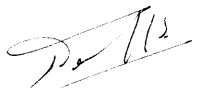

<!-- page 1 -->

# Banque de la République d'Haïti Le Gouverneur Adjoint

Réf : BRH/DAI/17# 101

## AVIS

La Banque de la République d'Haïti (BRH) annonce aux Banques Commerciales, aux Banques d'Epargne et de Logement et au public en général la vente de cent vingt millions (120 000 000.00) de dollars EU sur le marché des changes pour le reste de l'exercice fiscal 2016 – 2017, dont 20 millions seront injectés au cours de la deuxième quinzaine du mois de mars.

Par ailleurs, elle renouvelle l'invitation au public à acquérir les obligations BRH rémunérées au taux de 7 % l'an augmenté de la variation du taux de change (taux de vente moyen des banques-TMA) sur la période de détention à travers les banques commerciales, les caisses populaires fédérées (Le Levier) et la société de promotion d'investissement (PROFIN)

Port-au-Prince, le 16 mars 2017

Georges Henry
