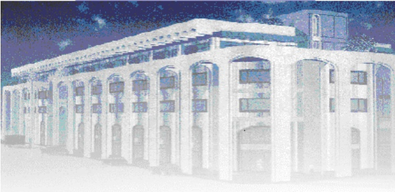

<!-- page 1 -->

Banque de la République d'Haïti

Note mensuelle d'inflation

Décembre 2013

<!-- page 2 -->

### I. Introduction

Cette note analyse l'évolution des prix à la consommation (IPC) en Haïti au cours du mois de décembre 2013. Elle relate quelques éléments explicatifs permettant de comprendre les facteurs qui influencent l'évolution de l'inflation et présente les prévisions pour les trois prochains mois.

#### I. 1. Évolution de l'inflation globale

En décembre 2013, l'inflation en glissement annuel a stagné suite à sa décéleration entamée depuis le mois d'avril 2013. En effet, au dernier mois de l'année 2013, l'Indice des Prix à la Consommation (IPC), en glissement annuel, a gardé le même rythme de progression qu'en novembre 2013, soit 3,4 %. Toutefois en moyenne trimestrielle, l'inflation au cours du premier trimestre de l'exercice 2013-2014 s'inscrivant à 3,7 %, est nettement inférieure par rapport à celle enregistrée à la même période de l'exercice précédent (7,3 %). Considérée sur une base mensuelle, elle a atteint 0,4 % en décembre 2013, en hausse de 30 points de base sur un mois.

Graphique No I Taux d'inflation (glissement annuel en %)

| Period | Value |
| --- | --- |
| Dec-12 | 7.6% |
| Jan-13 | 7.2% |
| Feb-13 | 7.4% |
| Mar-13 | 7.7% |
| Apr-13 | 7.3% |
| May-13 | 7.3% |
| Jun-13 | 6.5% |
| Jul-13 | 6.2% |
| Aug-13 | 5.5% |
| Sep-13 | 4.5% |
| Oct-13 | 4.2% |
| Nov-13 | 3.4% |
| Dec-13 | 3.4% |

La hausse de l'inflation en variation mensuelle, en décembre 2013, est imputable à la manifestation d'un effet saisonnier lié aux dépenses occasionnées par les festivités de fin d'année. En effet, durant les cinq dernières années, de 2008 à 2013, à l'exception de l'année 2012, l'inflation mensuelle du mois de décembre a toujours enregistré une hausse par rapport au mois précédent. Ainsi, grâce à cet effet saisonnier, les indices des prix de toutes les fonctions de consommation ont connu une variation mensuelle positive : « Alimentation, Boissons et Tabac » (+0,5 %), « Santé » (+1,3 %), « Autres biens et Services » (+0,6 %), « Habillement, Tissus et Chaussures » (+0,4 %), « Loyer du logement, Énergie et Eau » (+0,2%), « Aménagement, Equipement et Entretien du logement » (+0,3 %). Par ailleurs, il convient de souligner que l'IPC de la fonction « Alimentation,

<!-- page 3 -->

Boissons et Tabac » qui avait regressé durant les mois de septembre 2013, d'octobre 2013 et de novembre 2013, a crû de 50 points de base en décembre 2013 par rapport au mois précédenta et a contribué à plus de 61,2 % à l'inflation mensuelle. L'accélération du rythme de progression de l'indice des prix de cette fonction est due notamment à la hausse des prix du riz (0,1%), du maïs et de la farine de blé (0,2 %), du pain (0,1 %), du lait pasteurisé (2,3 %), des viandes (1,2 %), de la bière (1,7 %), du giraumon (4,7 %) et du citron (6,5 %). Signalons qu'en glissement annuel, la contribution à l'inflation de la fonction « Alimentation, boisson et tabac » est restée quasiment inchangée, se portant à 43,4 % en décembre 2013 contre 43,3 % un mois auparavant.

Graphique No II Taux d'inflation (variation mensuelle en %)

| Date | Value |
| --- | --- |
| Dec-12 | 0.4% |
| Jan-13 | 0.3% |
| Feb-13 | 0.4% |
| Mar-13 | 0.6% |
| Apr-13 | 0.3% |
| May-13 | 0.5% |
| Jun-13 | 0.0% |
| Jul-13 | 0.1% |
| Aug-13 | 0.3% |
| Sep-13 | 0.1% |
| Oct-13 | 0.2% |
| Nov-13 | 0.1% |
| Dec-13 | 0.4% |

## Graphique No III

Contribution à l'inflation mensuelle Décembre 2013

| Décor | Percentage |
| --- | --- |
| Alim, bois, tab | 61.2% |
| Habi, tis, chs. | 8.1% |
| Loyer, En, eau | 5.9% |
| Aménag, Ent. log. | 4.1% |
| Santé | 10.0% |
| Transport | 2.3% |
| Lois., sp. Ens., Clt. | 1.4% |
| Aut. biens & serv. | 6.9% |

Contribution à l'inflation annuelle Décembre 2013

| Category | Value (%) |
| --- | --- |
| Alim, bois, tab | 43.3 |
| Habil, tis, chs. | 11.9 |
| Loyer, En, eau | 15.3 |
| Aménag, Ent. log. | 4.9 |
| Santé | 3.6 |
| Transport | 7.1 |
| Lois., sp. Ens., Clt. | 7.3 |
| Aut. biens & serv. | 6.5 |

#### I. 2. Évolution de l'inflation selon l'origine des produits

Se basant sur l'origine des produits constituent le panier de la ménagère, l'inflation des produits locaux a été, comme le mois précédent, supérieure à celle des produits importés, en décembre 2013. En effet, en glissement

<!-- page 4 -->

annuel, l'IPC des produits locaux a crû de 3,7 % contre 2,8 % pour celui des produits importés. En variation mensuelle, le rythme de croissance de l'indice des prix des produits locaux a gagné 40 points de base à 0,5 % et celui de l'IPC des produits importés a augmenté de 0,4 %, soit une hausse de 20 points de base sur un mois.

#### I. 3. Évolution de l'inflation sous-jacente

L'inflation sous-jacente ou fondamentale, mesurée par la variation de l'indice globale en excluant les produits à prix volatils, s'est inscrite à 3,53 %, en glissement annuel, en décembre 2013 contre 3,48 % un mois auparavant. Sur base mensuelle, elle s'est chiffrée à 0,10 %, contre 0,19 % le mois précédent. Cette évolution mensuelle de l'inflation sous jacente a permis de suivre le comportement de l'inflation obtenue en dehors des phénomènes perturbateurs dès aux fluctuations à court terme des prix des produits volatils. Ces derniers concernent essentiellement certains produits alimentaires et pétroliers dont les niveaux de prix évoluent en fonction des conditions du marché. Ce qui implique que les produits à prix volatils du panier de la ménagère constituent les principaux facteurs explicatifs des pressions inflationnistes enregistrées au cours de la période sous-étude.

Graphique No IV

Évolution de l'inflation globale et de l'inflation sous-jacente (en g.a. en %)

| Date | Inflation | Inflation sous-jacente |
| --- | --- | --- |
| Dec-11 | 8.20 | 7.80 |
| Jan-12 | 7.50 | 6.80 |
| Feb-12 | 6.50 | 5.80 |
| Mar-12 | 5.50 | 5.40 |
| Apr-12 | 5.30 | 5.80 |
| May-12 | 5.10 | 5.20 |
| Jun-12 | 4.90 | 4.90 |
| Jul-12 | 5.30 | 5.20 |
| Aug-12 | 6.00 | 5.80 |
| Sep-12 | 6.50 | 6.20 |
| Oct-12 | 6.80 | 6.50 |
| Nov-12 | 7.30 | 7.20 |
| Dec-12 | 7.50 | 7.10 |
| Jan-13 | 7.20 | 7.00 |
| Feb-13 | 7.40 | 7.10 |
| Mar-13 | 7.60 | 7.20 |
| Apr-13 | 7.20 | 6.90 |
| May-13 | 7.20 | 7.10 |
| Jun-13 | 6.50 | 5.30 |
| Jul-13 | 6.00 | 5.80 |
| Aug-13 | 5.20 | 5.10 |
| Sep-13 | 4.50 | 4.40 |
| Oct-13 | 4.00 | 3.90 |
| Nov-13 | 3.40 | 3.30 |
| Dec-13 | 3.53 | 3.43 |

<!-- page 5 -->

### II. Facteurs explicatifs de la hausse de l'inflation mensuelle en décembre 2013

L'évolution à la hausse du niveau général des prix au mois de décembre 2013 a été influencée par plusieurs facteurs dont la relative hausse du taux de change nominal de la gourde par rapport au dollar américain et l'augmentation de la demande pour les biens et services en décembre 2013.

#### II. 1. La légère hausse du taux de change nominal

S'établissant à 43,8496 pour un dollar américain en novembre 2013, le taux de change de fin de période a connu une légère appréciation de 0,07 % en décembre 2013 à 43,8820 pour un dollar américain. En dépit de l'augmentation mensuelle de 45,10 % des transferts privés nets en décembre 2013, cette faible hausse du taux de cahnge peut être attribuée à une plus forte demande de dollar américain due à la période festive de fin d'année.

Graphique No V Taux de change nominal de fin de période (gourdes/1$ E.U)

| Month | TAUX DE CHANGE BRH |
| --- | --- |
| Dec-12 | 42.50 |
| Jan-13 | 42.75 |
| Feb-13 | 42.90 |
| Mar-13 | 43.05 |
| Apr-13 | 43.30 |
| May-13 | 43.65 |
| Jun-13 | 43.78 |
| Jul-13 | 43.72 |
| Aug-13 | 43.73 |
| Sep-13 | 43.72 |
| Oct-13 | 43.80 |
| Nov-13 | 43.85 |
| Dec-13 | 43.88 |
| Fin de période | 44.00 |

#### II. 2. L’Augmentation de la demande pour les biens et services

La hausse de l'inflation mensuelle est due à une augmentation de la demande pour les biens et services en décembre qui s'explique par la conjugaison de plusieurs facteurs dont l'augmentation de 45,10 % des transferts sans contrepartie nets entre novembre et décembre 2013, la distribution des boni aux employés des secteurs public et privé en décembre et l'augmentation des dépenses publiques. En effet, la monnaie en circulation a enregistré une augmentation de 18 % en décembre 2013 par rapport au mois précédent.

<!-- page 6 -->

### III. Les prévisions d'inflation

Les prévisions d'inflation de la MAE indiquent une évolution à la hausse de l'inflation mensuelle et la poursuite de la décélération de l'inflation annuelle après une légère remontée en janvier 2014. Ainsi, en variation mensuelle, les prévisions tablent sur des taux d'inflation de 0,3 % en janvier 2014, 0,4 % en février 2014 et 0,6 % en mars 2014. Toutefois, en variation annuelle, l'indice des prix à la consommation devrait croître de 3,5 % au mois de janvier 2014, de 3,4 % en février 2014 et 3,3 % en mars 2014.

Graphique No VI Prévision de l'inflation à partir du mois de janvier 2014

| Month | inflation estimée (inf) | Inflation en glissement annuel | inflation estimée (sup) |
| --- | --- | --- | --- |
| Dec-10 |   |   | 6.2 |
| Jan-11 |   |   | 3.8 |
| Feb-11 |   |   | 6.4 |
| Mar-11 |   |   | 7.8 |
| Apr-11 |   |   | 8.5 |
| May-11 |   |   | 9.2 |
| Jun-11 |   |   | 9.5 |
| Jul-11 |   |   | 9.6 |
| Aug-11 |   |   | 9.8 |
| Sep-11 |   |   | 10.4 |
| Oct-11 |   |   | 10.4 |
| Nov-11 |   |   | 9.8 |
| Dec-11 |   |   | 8.2 |
| Jan-12 |   |   | 7.5 |
| Feb-12 |   |   | 6.5 |
| Mar-12 |   |   | 5.8 |
| Apr-12 |   |   | 5.4 |
| May-12 |   |   | 5.0 |
| Jun-12 |   |   | 5.2 |
| Jul-12 |   |   | 6.0 |
| Aug-12 |   |   | 6.5 |
| Sep-12 |   |   | 6.8 |
| Oct-12 |   |   | 7.2 |
| Nov-12 |   |   | 7.6 |
| Dec-12 |   |   | 7.5 |
| Jan-13 |   |   | 7.2 |
| Feb-13 |   |   | 7.4 |
| Mar-13 |   |   | 7.8 |
| Apr-13 |   |   | 7.4 |
| May-13 |   |   | 7.2 |
| Jun-13 |   |   | 6.5 |
| Jul-13 |   |   | 5.8 |
| Aug-13 |   |   | 4.8 |
| Sep-13 |   |   | 4.2 |
| Oct-13 |   |   | 3.4 |
| Nov-13 |   |   | 3.4 |
| Dec-13 |   |   | 3.4 |
| Jan-14 |   | 3.5 | 3.9 |
| Feb-14 |   | 3.4 | 3.9 |
| Mar-14 |   | 3.8 | 3.4 |

<!-- page 7 -->

Tableau No.1

Indice des prix à la consommation par postes de dépenses Variation et contribution mensuelle et annuelle en décembre 2013

<table><tr><td></td><td>Indice des Prix à la Consommation (IPC)</td><td>Variation mensuelle En (%)</td><td>Variation annuelle En (%)</td><td>Contribution mensuelle à l'inflation</td><td>Contribution annuelle à l'inflation</td></tr><tr><td>Poste</td><td>Pondération (en %)</td><td>Décembre 12</td><td>Novembre 13</td><td>Décembre 13</td><td>Décembre 13</td><td>Décembre 13</td><td>Décembre 13</td><td>Décembre 13</td></tr><tr><td>Indice Général</td><td>204.1</td><td>210.3</td><td>211.1</td><td>0.4</td><td>3.4</td><td>100.0</td><td>100.00</td></tr><tr><td>Alimentation, boisson et tabac</td><td>50.35</td><td>213.3</td><td>218.5</td><td>219.5</td><td>0.5</td><td>2.9</td><td>61.2</td><td>43.3</td></tr><tr><td>Habillement, tissus et chaus.</td><td>6.86</td><td>192.4</td><td>202.8</td><td>203.7</td><td>0.4</td><td>5.9</td><td>8.1</td><td>11.9</td></tr><tr><td>Loyer, énergie et eau</td><td>11.05</td><td>236.8</td><td>247.4</td><td>247.9</td><td>0.2</td><td>4.7</td><td>5.9</td><td>15.3</td></tr><tr><td>Aménag. et entret. du logem</td><td>4.7</td><td>208.4</td><td>215.0</td><td>215.7</td><td>0.3</td><td>3.5</td><td>4.1</td><td>4.9</td></tr><tr><td>Santé</td><td>2.9</td><td>209.3</td><td>215.2</td><td>218.0</td><td>1.3</td><td>4.2</td><td>10.</td><td>3.6</td></tr><tr><td>Transport</td><td>13.74</td><td>154.9</td><td>157.5</td><td>157.6</td><td>0.1</td><td>1.7</td><td>2.3</td><td>7.1</td></tr><tr><td>Lois., sp. Ens., Clt.</td><td>5.84</td><td>214.5</td><td>223.4</td><td>223.6</td><td>0.1</td><td>4.2</td><td>1.4</td><td>7.3</td></tr><tr><td>Aut. biens & serv.</td><td>4.56</td><td>168.1</td><td>174.8</td><td>176.2</td><td>0.6</td><td>4.8</td><td>6.9</td><td>6.5</td></tr></table>

Sources : IHSI et calculs du Service de la Macrééconomie et Analyse de Conjoncture de la MAE

<!-- page 8 -->

## Glossaire

<table><tr><td>Variation mensuelle : Variation par rapport au mois précédent.</td></tr><tr><td>Glissement annuel</td><td>: Variation par rapport au même mois de l'année antérieure.</td></tr><tr><td>Inflation</td><td>: Mouvement persistant à la hausse du niveau général des prix.</td></tr><tr><td>Désinflation</td><td>: Talentissement de la croissance des prix.</td></tr><tr><td>Déflation crédit.</td><td>Baisse du niveau général des prix associée à une contraction de la masse monétaire et du</td></tr><tr><td>Inflation sous-jacente : Tendance de long terme des prix, tout en excluant la volatilité, les mouvements saisonniers, conjoncturels, et les chocs qui affectent les composantes du panier considéré.</td></tr><tr><td>Région Nord</td><td>: Elle couvre les départementes du Nord, Nord-Est et Nord-Ouest.</td></tr><tr><td>Région Sud</td><td>: Elle comprend les départementes du Sud de la Grand'Anse et des Nippes.</td></tr><tr><td>Région Reste Ouest : Y sont incluses les départementes du Sud'Est et de l'Ouest à l'exception de l'aire métropolitaine</td></tr><tr><td>Région Transversale : Elle regroupe les départementes du Centre et de l'Artibonite.</td></tr><tr><td>Aire Métropolitaine : Elle contient les villes de Port-au-Prince, de Delmas, de Pétion-Ville, de Carrefour et de</td></tr></table>

Aire Métropolitaine : Elle contient les villes de Port-au-Prince, de Delmas, de Pétion-Ville, de Carrefour et de Croix des Bouquets.

<!-- page 9 -->
