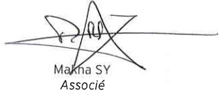

<!-- page 1 -->

FIRME TURNIER

60, Rue Mérisier

Delmas 48, Port-au-Prince

République d'Haïti

ERNST & YOUNG (RACINE)

22, Rue Ramez Bourgi

BP 545 - Dakar

République du Sénégal

# Banque de la République d'Haïti (BRH)

Rapport des auditeurs indépendants

Etats financiers annuels

Exercice clos le 30 septembre 2012

<!-- page 2 -->

# Banque de la République d'Haiti (BRH)

Rapport des auditeurs indépendants

Etats financiers annuels

Exercice clos le 30 septembre 2012

Madame, Messieurs les Administrateurs,

Nous avons effectué l'audit des états financiers ci-joints de la Banque de la République d'Haïti (BRH) comprenant le bilan au 30 septembre 2012, ainsi que le compte de pertes et profits, l'état de variation des capitaux propres, le tableau des flux de trésorerie pour l'exercice clos à cette date et les notes annexes (ci-après désignés « les états financiers »). Ces états financiers ont été établis par le Management conformément aux principes et méthodes comptables édictés par la BRH qui sont décrits dans les notes annexes.

Responsabilité du Management dans l'établissement et la présentation des états financiers

Le Management de la BRH est responsable de l'établissement et de la présentation sincère de ces états financiers, conformément aux principes et méthodes comptables édictés par la BRH, ainsi que d'un contrôle interne qu'elle juge nécessaire pour permettre l'établissement d'états financiers ne comportant pas d'anomalies significatives, que celles-ci proviennent de fraudes ou résultant d'erreurs.

## Responsabilité de l'auditeur

Notre responsabilité est d'exprimer une opinion sur ces états financiers sur la base de notre audit. Nous avons effectué notre audit selon les Normes Internationales d'Audit. Ces normes requièrent de notre part de nous conformer aux règles d'éthique et de planifier et de réaliser l'audit pour obtenir une assurance raisonnable que les états financiers ne comportent pas d'anomalies significatives.

<!-- page 3 -->

Un audit implique la mise en œuvre de procédures en vue de recueillir des éléments probants concernant les montants et les informations fournies dans les états financiers. Le choix des procédures relève du jugement de l'auditeur, de même que l'évaluation du risque que les états financiers contiennent des anomalies significatives, que celles-ci résultent de fraudes ou d'erreurs. En procédant à cette évaluation du risque, l'auditeur prend en compte le contrôle interne en vigueur dans l'entité relatif à l'établissement et la présentation sincère des états financiers afin de définir des procédures d'audit appropriées en la circonstance, et non dans le but d'exprimer une opinion sur le fonctionnement efficace du contrôle interne de l'entité. Un audit comporte également l'appréciation du caractère approprié des méthodes comptables retenues et le caractère raisonnable des estimations comptables faites par la Direction, de même que l'appréciation de la présentation d'ensemble des états financiers.

Nous estimons que les éléments probants recueillis sont suffisants et appropriés pour fonder notre opinion avec réserves.

## Justification de l'opinion avec réserves

## (1) Participation TELECO

La quote-part de la BRH dans les résultats annuels enregistrés par la TELECO s'élève à un montant cumulé de G.1.900 millions au 30 septembre 2012. En l'absence d'états financiers audités de la TELECO, nous n'avons pas été en mesure de recueillir des éléments probants suffisants et appropriés pour justifier, d'une part, la valeur comptable de la participation dans la société TELECO au 30 septembre 2012 et, d'autre part, la quote-part du résultat net de cette société revenant à la BRH à cette date.

## (2) Immobilisations en cours

Les immobilisations en cours s'élèvent à G.404 millions au 30 septembre 2012. Ce solde comprend un montant de G.263 millions relatif au projet du site de contingence de Boutillier mis en service sur l'exercice 2007.

En l'absence d'une analyse des immobilisations du site par composante, nous n'avons pas été en mesure de nous prononcer sur les ajustements à comptabiliser au titre de la dotation aux amortissements.

## (3) Confirmation de solde banques non résidentes

Nous n'avons pas obtenu les réponses à notre demande de confirmation de solde envoyée aux banques non résidentes suivantes :

<!-- page 4 -->

| Banque | En devise | En milliers de Gourdes |
| --- | --- | --- |
| Correspondants USD |   |   |
| Citibank NY | 269 991 756 | 11 426 645 |
| Federal Reserve | 316 702 886 | 13 403 563 |
| Citibank Collateral | 307 107 | 12 997 |
| Citibank IDA | 359 707 | 15 224 |
| Bladex | 570 723 | 24 154 |
| Bladex collateral | 2 691 404 | 113 906 |
| Total |   | 24 996 489 |

En l'absence de réponse à nos demandes, nous n'avons pas pu obtenir pour ces banques les confirmations relatives à la liste des signataires autorisés, la liste des emprunts et prêts et la liste des engagements hors bilan.

## Opinion avec réserves

A notre avis, sous réserve des incidences éventuelles des points décrits dans le paragraphe « Justification de l'opinion avec réserves » ci-dessus, les états financiers sont réguliers et donnent une image fidèle de la situation financière de la BRH au 30 septembre 2012, de son patrimoine, de ses résultats et de la variation de la situation financière pour l'exercice clos à cette date, conformément aux règles et méthodes comptables décrites dans les notes annexes.

## Principes comptables

Sans remettre en cause l'opinion exprimée ci-dessus, nous attirons l'attention sur les notes 1 et 2 annexées aux états financiers qui décrivent les principes comptables suivis. Les états financiers ont été établis pour satisfaire aux obligations issues de la loi organique du 17 août 1979 relatives à la présentation d'informations financières sur la BRH. En conséquence, ces états financiers peuvent ne pas convenir pour répondre à un autre objectif.

FIRME TURNIER

Antoine Lionel TURNIER

Associé

ERNST & YOUNG (RACINE)

Makha SY

Associé

<!-- page 5 -->

## Sommaire

Rapport d'audit sur les états financiers
1-4
Etats financiers au 30 septembre 2012
6-69
Bilan
6
Compte de pertes et profits
7
Etat de variation des capitaux propres
8
Tableau des flux de trésorerie
9
Notes annexes aux états financiers
10
1. Règles et méthodes comptables de la BRH
10-21
2. Informations sur le bilan
22-65
3. Informations sur le compte de pertes et profits
66-71
4. Divers
72-73

<!-- page 6 -->

## Etats financiers au 30 septembre 2012

Bilan

<table><tr><td></td><td>Notes</td><td>30/09/2012</td><td>30/09/2011</td><td>Variation</td></tr><tr><td>Valeur</td><td>%</td></tr><tr><td>ACTIF</td><td></td><td></td><td></td><td></td><td></td></tr><tr><td>Avoirs en or</td><td>4</td><td>4 342 487</td><td>86 580</td><td>4 255 907</td><td>4916%</td></tr><tr><td>Avoirs sur le Fonds Monétaire International</td><td>5</td><td>4 496 768</td><td>4 398 933</td><td>97 835</td><td>2%</td></tr><tr><td>Avoirs en monnaies étrangères</td><td>6</td><td>87 838 475</td><td>77 282 113</td><td>10 556 362</td><td>14%</td></tr><tr><td>Participations dans les organismes internationaux</td><td>7</td><td>2 485 048</td><td>2 225 266</td><td>259 782</td><td>12%</td></tr><tr><td>Placements locaux</td><td>8</td><td>275 000</td><td>275 000</td><td>-</td><td>0%</td></tr><tr><td>Prêts et avances au gouvernement et aux collectivités</td><td>9</td><td>40 240 760</td><td>40 186 920</td><td>53 840</td><td>0%</td></tr><tr><td>Prêts et avances aux particuliers et aux autres institutions</td><td>10</td><td>2 266 605</td><td>2 015 350</td><td>251 255</td><td>12%</td></tr><tr><td>Prêts et avances aux institutions financières monétaires et non monétaires</td><td>11</td><td>126 247</td><td>103 811</td><td>22 436</td><td>22%</td></tr><tr><td>Immobilisations</td><td>12</td><td>3 964 817</td><td>3 967 236</td><td>(2 419)</td><td>0%</td></tr><tr><td>Autres actifs</td><td>13</td><td>3 181 358</td><td>1 495 067</td><td>1 686 291</td><td>113%</td></tr><tr><td>TOTAL</td><td></td><td>149 217 565</td><td>132 036 276</td><td>17 181 289</td><td>13%</td></tr><tr><td>PASSIF</td><td></td><td></td><td></td><td></td><td></td></tr><tr><td>Billets et monnaies en circulation</td><td>14</td><td>22 904 087</td><td>21 328 131</td><td>1 575 956</td><td>7%</td></tr><tr><td>Comptes d'engagements</td><td>15</td><td>92 674 722</td><td>85 781 159</td><td>6 893 563</td><td>8%</td></tr><tr><td>Engagements envers le FMI</td><td>16</td><td>7 155 427</td><td>5 182 418</td><td>1 973 009</td><td>38%</td></tr><tr><td>Contributions et engagements de l'État Haïtien sur participation au capital des organismes financiers internationaux</td><td>17</td><td>3 247 822</td><td>2 970 735</td><td>277 087</td><td>9%</td></tr><tr><td>Autres passifs</td><td>18</td><td>17 847 850</td><td>14 243 148</td><td>3 604 702</td><td>25%</td></tr><tr><td>Provisions pour risques et charges</td><td></td><td>195 787</td><td>195 787</td><td>0</td><td>0%</td></tr><tr><td>Réserves de réévaluation de change</td><td>19</td><td>4 675 954</td><td>4 171 602</td><td>504 352</td><td>12%</td></tr><tr><td>Réserves générales</td><td>20</td><td>1 212 269</td><td>(1 523 956)</td><td>2 736 225</td><td>180%</td></tr><tr><td>Allocations DTS</td><td>21</td><td>-</td><td>874 280</td><td>(874 280)</td><td>-100%</td></tr><tr><td>Réserve de réévaluation de l'or</td><td>22</td><td>127 707</td><td>116 007</td><td>11 700</td><td>10%</td></tr><tr><td>Réserve allocation spéciale retraite</td><td>23</td><td>198 323</td><td>97 629</td><td>100 694</td><td>103%</td></tr><tr><td>Capital et réserves</td><td>24</td><td>1 256 282</td><td>1 256 282</td><td>0</td><td>0%</td></tr><tr><td>Résultat des exercices antérieurs</td><td>25</td><td>(2 662 513)</td><td>(2 911 937)</td><td>249 424</td><td>9%</td></tr><tr><td>Résultat</td><td></td><td>383 848</td><td>254 991</td><td>128 857</td><td>51%</td></tr><tr><td>TOTAL</td><td></td><td>149 217 565</td><td>132 036 276</td><td>17 181 289</td><td>13%</td></tr></table>

<!-- page 7 -->

Comptes de pertes et profits

<table><tr><td></td><td>(En milliers de Gourdes)</td></tr><tr><td></td><td>Notes</td><td>30/09/2012</td><td>30/09/2011</td><td>Variation</td></tr><tr><td>Valeur</td><td>%</td></tr><tr><td>Produits des opérations avec l'étranger : intérêts</td><td></td><td>2 750 761</td><td>1 813 929</td><td>936 832</td><td>52%</td></tr><tr><td>Produits de placements, prêts et avances à l'État Haïtien</td><td></td><td>1 099 883</td><td>1 099 899</td><td>(16)</td><td>0%</td></tr><tr><td>Produits des opérations de crédit</td><td></td><td>92 478</td><td>86 944</td><td>5 534</td><td>6%</td></tr><tr><td>Intérêts débiteurs et frais financiers</td><td></td><td>(56 110)</td><td>(64 701)</td><td>(8 591)</td><td>-13%</td></tr><tr><td>Résultat net d'intérêts</td><td>26</td><td>3 887 012</td><td>2 936 071</td><td>950 941</td><td>32%</td></tr><tr><td>Dividendes</td><td></td><td>3 937</td><td>4 224</td><td>(287)</td><td>-7%</td></tr><tr><td>Gains sur ventes des valeurs mobilières</td><td></td><td>452 015</td><td>152 143</td><td>299 872</td><td>197%</td></tr><tr><td>Pertes sur ventes des valeurs mobilières</td><td></td><td>(3 141)</td><td>(147 985)</td><td>(144 844)</td><td>-98%</td></tr><tr><td>Résultats sur ventes de valeurs mobilières</td><td>27</td><td>448 874</td><td>4 158</td><td>444 716</td><td>10695%</td></tr><tr><td>Produit net bancaire</td><td></td><td>4 339 823</td><td>2 944 453</td><td>1 395 370</td><td>47%</td></tr><tr><td>Autres produits</td><td>28</td><td>176 279</td><td>162 288</td><td>13 991</td><td>9%</td></tr><tr><td>Gain extraordinaire</td><td></td><td>836</td><td>42 150</td><td>(41 314)</td><td>-98%</td></tr><tr><td>Résultat opérationnel</td><td></td><td>4 516 938</td><td>3 148 891</td><td>1 368 047</td><td>43%</td></tr><tr><td>Entretien de la circulation fiduciaire</td><td></td><td>303 667</td><td>291 960</td><td>11 707</td><td>4%</td></tr><tr><td>Rémunérations et charges sociales</td><td></td><td>3 028 248</td><td>1 884 116</td><td>1 144 132</td><td>61%</td></tr><tr><td>Dépenses administratives</td><td></td><td>515 526</td><td>299 844</td><td>215 682</td><td>72%</td></tr><tr><td>Dotation aux amortissements</td><td></td><td>141 082</td><td>135 920</td><td>5 162</td><td>4%</td></tr><tr><td>Dépenses relatives à la gestion des actifs</td><td></td><td>53 275</td><td>44 255</td><td>9 020</td><td>20%</td></tr><tr><td>Dons</td><td></td><td>45 115</td><td>29 956</td><td>15 159</td><td>51%</td></tr><tr><td>Autres dépenses</td><td></td><td>853</td><td>1 151</td><td>(298)</td><td>-26%</td></tr><tr><td>Pertes nettes dues au séisme</td><td></td><td>249</td><td>-</td><td>249</td><td>100%</td></tr><tr><td>Dotation pour mauvaises créances</td><td></td><td>45 075</td><td>10 911</td><td>34 164</td><td>313%</td></tr><tr><td>Dotation pour risques et charges</td><td></td><td>-</td><td>195 787</td><td>(195 787)</td><td>-100%</td></tr><tr><td>Charges d'exploitation générale</td><td>29</td><td>4 133 090</td><td>2 893 900</td><td>1 239 190</td><td>43%</td></tr><tr><td>Revenus nets de l'exercice</td><td></td><td>383 848</td><td>254 991</td><td>128 857</td><td>51%</td></tr></table>

<!-- page 8 -->

Etat de variation des capitaux propres

|   | Capital | Réserves légales | Réserves spéciales | Réserve pour réévaluation d'immeubles | Total capitaux propres |
| --- | --- | --- | --- | --- | --- |
| Solde au |   |   |   |   |   |
| 30/09/2011 | 50 000 | 74 454 | 412 825 | 719 003 | 1 256 282 |
| Affectations | - | - | - | - | - |
| Prélèvements | - | - | - | - | - |
| Réévaluation | - | - | - | - | - |
| Solde au |   |   |   |   |   |
| 30/09/2012 | 50 000 | 74 454 | 412 825 | 719 003 | 1 256 282 |

<!-- page 9 -->

Tableau des flux de trésorerie

<table><tr><td></td><td>(En milliers de Gourdes)</td></tr><tr><td></td><td>30/09/2012</td><td>30/09/2011</td></tr><tr><td>Activités d'exploitation</td><td></td><td></td></tr><tr><td>Revenu net de l'exercice</td><td>383 848</td><td>254 991</td></tr><tr><td>Eléments de conciliation du revenu net aux liquidités</td><td></td><td></td></tr><tr><td>résultant des activités d'exploitation</td><td></td><td></td></tr><tr><td>Dotations aux amortissements</td><td>141 082</td><td>135 919</td></tr><tr><td>Perte sur disposition d'immobilisations</td><td>-</td><td>-</td></tr><tr><td>Provisions pour perte de valeur sur prêts</td><td>41 089</td><td>60 754</td></tr><tr><td>Effet de change suite à la réévaluation de la participation des</td><td></td><td></td></tr><tr><td>organismes financiers internationaux</td><td>(735 856)</td><td>(58 445)</td></tr><tr><td>Changement dans les éléments d'actif et de passif résultant</td><td></td><td></td></tr><tr><td>des activités d'exploitation</td><td></td><td></td></tr><tr><td>Augmentation (diminution) des prêts et avances, net</td><td>(1 781 720)</td><td>(1 035 116)</td></tr><tr><td>Billets en monnaies en circulation</td><td>1 469 607</td><td>1 721 595</td></tr><tr><td>Engagements en devises</td><td>9 254 515</td><td>5 188 592</td></tr><tr><td>Contributions et engagements envers les organismes</td><td></td><td></td></tr><tr><td>financiers internationaux</td><td>2 367 845</td><td>922 085</td></tr><tr><td>Engagements envers les banques créatrices de monnaie</td><td>(3 737 403)</td><td>(2 081 556)</td></tr><tr><td>Dépôts du Gouvernement Central</td><td>3 806 490</td><td>5 155 520</td></tr><tr><td>Engagements envers les autres institutions</td><td>(343 581)</td><td>(1 482 740)</td></tr><tr><td>Changements dans les autres éléments d'actif, de passif et de</td><td></td><td></td></tr><tr><td>réserves</td><td>(1 462 448)</td><td>2 780 722</td></tr><tr><td>Liquidités provenant des activités d'exploitation</td><td>9 403 468</td><td>11 562 321</td></tr><tr><td>Activités d'investissement</td><td></td><td></td></tr><tr><td>(Augmentation) diminution des placements étrangers</td><td>(4 883 895)</td><td>(19 871 934)</td></tr><tr><td>(Augmentation) diminution des placements locaux</td><td>(1 445 273)</td><td>275 000</td></tr><tr><td>Acquisitions d'immobilisations nettes</td><td>(104 249)</td><td>(238 058)</td></tr><tr><td>Remboursement d'assurance</td><td>-</td><td>17 696</td></tr><tr><td>Liquidités utilisées dans des activités d'investissement</td><td>(6 433 417)</td><td>(19 817 296)</td></tr><tr><td>Augmentation (Diminution) nette des liquidités</td><td>2 970 051</td><td>(8 254 975)</td></tr><tr><td>Liquidités au début de l'exercice</td><td>24 497 635</td><td>32 752 610</td></tr><tr><td>Avoirs en devises à la fin de l'exercice</td><td>27 467 686</td><td>24 497 635</td></tr></table>

<!-- page 10 -->

## Notes annexes aux états financiers

## Règles et méthodes comptables de la BRH

## Note 1 - Cadre juridique et activités

La Banque de la République d'Haïti (BRH), dont le Siège est sis à la rue du Quai à Port-au-Prince (Haïti), est un organisme public autonome, constitué par l'Etat Haïtien, par la loi du 17 août 1979, modifié en ses articles 9 et 17 par le décret du 28 mars 1985. Son capital social n'est pas divisé en actions. Il est détenu par l'Etat Haïtien et peut être augmenté selon les besoins de l'institution.

La loi du 17 août 1979 portant création de la BRH stipule en son article 6 que celle-ci est dirigée par un Conseil d'Administration dont les membres sont nommés pour une période de trois (3) ans, renouvelable par arrêté du Président de la République. Conformément aux dispositions de la Constitution de 1987, ils sont ratifiés par le Sénat de la République.

La BRH est une Banque Centrale et, à ce titre, a pour objet de :

• promouvoir dans le domaine de la monnaie, du crédit et des changes, les conditions les plus favorables au développement de l'économie nationale ;

• encourager le développement et l'utilisation la plus complète et la plus efficace des ressources productives du pays ;

- adapter les moyens de paiement et la politique de crédit aux besoins légitimes de l'économie haïtienne et, en particulier, à la croissance de la production nationale ;

- aider à éviter toutes tendances inflationnistes, spéculatives et déflationnistes qui seraient nuisibles aux intérêts permanents de la nation :

- conseiller le Gouvernement en matière de politique monétaire, dans le but principal de maintenir, à l'intérieur du pays, la stabilité relative des prix et à l'extérieur, la croissance des échanges ;

- faciliter l'expansion du commerce intérieur et extérieur en vue de contribuer à l'instauration et au maintien d'un niveau élevé de l'emploi et du revenu réel ;

- assurer l'administration et la gestion des réserves de changes, veiller à l'application des dispositions légales et réglementaires relatives aux institutions financières ;

<!-- page 11 -->

• contrôler et orienter la circulation et la distribution du crédit ;

• émettre des billets de banque, frapper des pièces métalliques et créer de la monnaie scripturale ;

- exercer toutes les activités de banquier de l'Etat, d'agent financier et fiscal pour toutes ses opérations de caisse et de crédit.

La BRH utilise divers instruments dans la mise en œuvre de la politique monétaire, dont l'objectif fondamentale demeure la stabilité des prix. Son principal canal de gestion monétaire est, depuis 1996, la vente aux banques de la place des bons qu'elle émet.

La BRH mène des négociations avec le Ministère de l'Economie et des Finances en ce qui a trait au niveau et aux conditions de financement du déficit budgétaire. Ces ententes se matérialisent, en général, par des accords signés entre le Gouverneur de la BRH et le Ministre de l'Economie et des Finances.

Au plan de la réglementation et de la supervision bancaires, la BRH, conformément aux articles 29 à 32 de sa loi organique et à l'article 43 du décret du 14 novembre 1980 réglementant le fonctionnement des banques, a le pouvoir d'inspector celles-ci et de les soumettre à un régime de normes prudentielles.

En sa qualité de banquier de l'Etat (article 37 de la loi organique), la BRH tient le compte courant de toutes les institutions et collectivités publiques. Elle se charge de la collecte des recettes de l'Etat et encaisse directement pour le compte de celui-ci les taxes internes et les droits de douane. Elle fait aussi fonction de gardienne des titres appartenant à ces entités (article 38 de la loi organique).

Pour l'exécution de ces opérations, la BRH est organisée en un réseau comportant un Siège et une succursale au Cap-Haïtien. La BRH s'est orientée vers une organisation interne destinée à faciliter la mise en œuvre de sa stratégie de modernisation.

<!-- page 12 -->

## Note 2 - Principes et méthodes comptables

### 2.1 - Référentiel comptable en vigueur au 30 septembre 2012

Les états financiers de la Banque de la République d'Haïti ont été élaborés conformément aux dispositions de la loi organique du 17 août 1979 et suivant la méthode de comptabilité d'exercice. Ils sont libellés en Gourde qui est la monnaie nationale Haïtienne.

### 2.2 - Exercice

La durée de l'exercice est de douze mois. L'exercice débute le  $ 1^{er} $ octobre et se termine le 30 septembre de l'année suivante.

### 2.3 - Principes comptables

Les principes comptables suivants sont appliqués :

• comptabilité d'engagement.

• intelligibilité.

pertinence,

fiabilité.

comparabilité.

### 2.4 - Méthode d'évaluation

Les états financiers sont préparés sur la base de la valeur de marché pour l'or, des titres et des éléments d'actif et de passif libellés en devises inscrits au bilan, ainsi que du coût historique pour les autres rubriques

### 2.5 - Estimations et jugements

Lors de la préparation de ces états financiers, la Direction doit faire des estimations et formuler des hypothèses qui affectent l'application des normes comptables et les montants des éléments d'actif et de passif déclarés et la présentation de l'actif et du passif éventuels à la date des états financiers ainsi que les résultats de l'exercice. Les résultats actuelles peuvent être différents de ces estimations.

<!-- page 13 -->

La BRH établit une provision pour pertes de valeur sur prêts en fin d'exercice qui représente une estimation de la perte de valeur réelle sur le portefeuille de prêts à cette date. Cette provision est établie en prenant en considération les éléments probants spécifiques tels que les arriérés de remboursement, la valeur des garanties, les possibilités de recouvrement futur, et la situation économique de l'emprunteur qui ont un impact sur les flux de trésorerie futurs estimés d'un prêt spécifique ou d'un groupe de prêts avec un risque similaire.

### 2.6 - Effets des transactions et événements

Les effets des transactions et autres événements sont pris en compte dès que ces transactions et événements se produisent.

Par ailleurs, en raison du découpage de l'activité en exercices comptables, les transactions et autres événements sont rattachés à l'exercice qu'ils concernent effectivement et à celui-ci seulement. Dans ce cadre, les produits sont comptabilisés dès qu'ils sont acquis et les charges au fur et à mesure qu'elles sont engagées.

### 2.7 - Opérations en devises

Les transactions en devises étrangères sont initialement comptabilisées aux cours de change en vigueur à la date de transaction. En fin de mois, les actifs et passifs en monnaies étrangères sont convertis au cours de change en vigueur en fin de période. Les gains ou pertes de change, qui en découlent, sont enregistrés dans un compte de réserve « Réserve de réévaluation de change », conformément à l'article 56 de la loi organique.

### 2.8 - Impôts et taxes

Conformément à l'article 63 de la loi organique, la BRH est exonérée du paiement des droits et taxes de l'Etat ou des communes à l'occasion de toutes opérations qui lui sont propres. De même, elle bénéfice de l'exemption des droits à l'occasion de ses importations y compris matériels, équipements, lubrifiants, carburants.

<!-- page 14 -->

### 2.9 - Avoirs en or

L'or est valorisé au cours en vigueur à la date du bilan. Les gains et les pertes résultant de cette valorisation sont inscrits à la réserve de réévaluation. Le stock d'or n'est pas porteur d'intérêts. L'avoir en or fait partie des réserves nettes de change en accord avec l'article 52 de la loi organique de la BRH.

### 2.10 - Avoirs sur le FMI, engagements envers le FMI

La BRH est l'agent fiscal de l'Etat Haïtien auprès du Fonds Monétaire International (FMI). Elle est en même temps le dépositaire des Gourdes détenus par le FMI. En vertu de la loi du 19 septembre 1952, la Banque représente le Gouvernement Haïtien en toute négociation ou transactions avec le Fonds. Toutes les transactions entre le Gouvernement et le Fonds sont inscrites dans les livres de la BRH.

Les différences résultant des opérations de la BRH avec le Fonds sont supportées par le Gouvernement Haïtien et sont comptabilisées au bilan dans le compte «Avance différence de change FMI».

Les opérations avec le FMI sont libellées dans la monnaie du FMI, à savoir le Droit de Tirage Spécial (DTS).

Les opérations et transactions de l'Etat Haïtien avec le FMI concernent le compte de Droit de Tirage Spécial (DTS), le compte de ressources générales et les comptes administrés.

La position de réserve au FMI est la différence entre les quotes-parts de l'Etat et sa souscription en monnaie nationale, compte non tenu des tirages au titre des ressources générales (avoirs exclus ou recours aux crédits du FMI).

Les tirages effectués par l'Etat auprès du FMI sont reçus et enregistrés dans les comptes dépôt à vue de la BRH à la Federal Reserve Bank en dollars, d'une part, et dans les comptes d'engagements envers le FMI en DTS, d'autre part. Au moment des tirages, les différences entre les montants versés à l'Etat et la dette vis-à-vis du FMI sont portées directement au compte « Avance Différence de change FMI ».

<!-- page 15 -->

Les avoirs du FMI en monnaie nationale (comptes FMI n° 1, FMI n° 2 et FMI compte titres) font l'objet d'une réévaluation annuelle le 30 avril de chaque année, sur la base du cours représentatif du DTS communiqué par le FMI. Les gains et pertes de réévaluation sont inscrits dans le compte « Avance différence de change FMI ».

A la clôture de chaque période mensuelle, les avoirs du FMI en DTS sont réévalués sur la base du cours du DTS/Gourdes de fin de mois.

Les DTS détenus, les tirages sur les comptes administrés et les allocations de DTS sont convertis en Gourdes sur la base du cours de change en vigueur lors des transactions. Les différences résultant de réévaluations périodiques sont portées au compte « Avance différence de change FMI ».

### 2.11 - Participations, contributions et engagements dans les autres organismes financiers internationaux

Conformément à l'article 2, alinéa 10, et l'article 61, alinéa 2 de la loi du 17 août 1979, la BRH enregistre dans ses livres les participations de la République d'Haïti dans les différents organismes internationaux. Le Gouvernement Haïtien a souscrit au capital de différents organismes financiers internationaux. Les montants payés à titre de capital sont reflétés comme des contributions, et les montants non encore versés sont reflétés comme des engagements. Ces transactions sont gérées par la BRH à titre de fiduciaire et sont réévaluées aux taux de change de la fin de l'exercice. L'effet de change résultant de la réévaluation des actifs et passifs de l'État Haïtien est enregistré au bilan dans le compte « Réserves de réévaluation de change ».

### 2.12 - Placements à la Télécommunication d'Haïti (TELECO)

La BRH détient 97 % des actions de la TELECO et le Gouverneur de la BRH est le président du Conseil d'Administration de cette institution. Les titres de participation détenus sur la TELECO ont été initialement comptabilisés à leur coût d'acquisition. La valeur comptable de ces titres est ajustée en y incluant la quote-part de la BRH dans les résultats annuels enregistrés par la TELECO. Depuis 2001, en l'absence d'états financiers audités de la TELECO, la valeur comptable du placement à la TELECO n'a pas connu d'évolution.

<!-- page 16 -->

### 2.13 - Avoirs en monnaies étrangères

Les réserves de change de la BRH sont investies en comptes à vue, en comptes à terme et dans des actifs obligataires.

#### 2.13.1 - Portefeuille titres

Dans le cadre de la stratégie globale de gestion de son portefeuille, la BRH détient des valeurs mobilières de placement. La BRH a choisi un système de gestion par administrateurs externes de portefeuille (gestion déléguée). Les gérants de portefeuille peuvent bénéficier de pouvoirs discrétionnaires ou peuvent être sujets à des limitations strictes, concernant la sélection des placements.

Ces placements sont disponibles à la vente.

## • Actifs financiers disponibles à la vente

Ce sont des actifs financiers détenus dans le but d'avoir des liquidités disponibles. Ils sont enregistrés initialement en comptabilité à leur coût d'acquisition, coupons courus et frais d'acquisition inclus, et sont évalués ultérieurement à leur juste valeur. La variation de juste valeur est constatée directement en capitaux propres dans le compte « Réserve de réévaluation de change ».

## 2 14 - Dràits et avances au Gouvernement et aux collectivités

Les crédits à l'Etat Haïtien représentent un financement au Secteur Public ainsi que les prêts et avances en comptes courants au Gouvernement, aux collectivités locales et aux entreprises publiques. Ils sont évalués au coût. La BRH n'enregistre pas de perte de valeur sur les crédits à l'Etat Haïtien et aux entreprises publiques à moins de désaccords spécifiques. Les revenus d'intérêts sur ces prêts, avances et placements sont comptabilisés sur une base d'exercice.

### 2.15 - Immobilisations corporelles et incorporelles

Les immobilisations sont comptabilisées à leur coût d'acquisition, avec possibilité de réévaluation.

<!-- page 17 -->

Les réévaluations sont effectuées par des experts en évaluation.

L'écart de réévaluation est imputé aux capitaux propres sous une rubrique séparée en contrepartie des comptes d'immobilisations.

Suite au séisme du 12 janvier 2010, les pertes sur les immeubles de la Banque qui ont subi des dommages ont été évaluées et enregistrées dans les livres de la BRH.

A l'exception des terrains, des constructions en cours, les immobilisations sont amorties selon la méthode de l'amortissement linéaire sur la durée estimative de leur vie utile.

Les durées de vie retenues sont les suivantes :

| Immobilisations | Durées de vie utile\n(en mois) |
| --- | --- |
| Terrains | Non amortissable |
| Bâtisses | 240 |
| Mobiliier et matériel de bureau | 48 |
| Matériel informatique | 60 |
| Logiciel informatique | 12 |
| Matériel roulant | 48 |
| Equipements | 60 |
| Installations | 60 |
| Aménagements, Extensions, Agrandissements | 60 |

Les immobilisations entièrement amorties demeurent inscrites au bilan dans un compte distinct « Biens totalement amortis » aussi longtemps qu'elles subsistent. Les immobilisations figurent au bilan à leurs valeurs nettes.

### 2.16 - Stocks de billets neufs en transit

A l'achat, les signes monétaires sont comptabilisés en engagements hors bilan au prix d'achat, auquel viennent s'ajouter les frais de transport.

<!-- page 18 -->

A l'émission, les quantités de signes monétaires émises sont valorisées selon la méthode FIFO et comptabilisées au bilan. A la côture de l'exercice, les billets et monnaies non émis sont traités comme des stocks. Ils font l'objet d'un inventaire physique et sont valorisés selon la méthode FIFO.

### 2.17 - Billets et monnaies en circulation

Les billets et pièces de monnaie en circulation sont analysés comme des dettes envers les détenteurs. Ils sont inscrits au bilan à leur valeur faciale ou valeur nominale.

### 2.18 - Comptes d'engagements

Les comptes à vue (dettes à vue) et les dépôts auprès de la BRH sont inscrits au bilan à leur valeur nominale et ne sont pas rémunérés.

### 2.19 - Provisions pour risques et charges

Une provision est constituée lorsque la BRH a une obligation réglementaire, implicite ou juridique qui résulte d'un événement passé et dont il est probable ou certain qu'elle provoquera une sortie de ressources dont le montant peut être estimé de manière fiable.

Conformément au principe de prudence, des provisions sont aussi constituées pour tous les risques potentiels liés à certains comptes d'actif (actifs non performants).

### 2.20 - Fonds de retraite et prime de séparation

La dépense annuelle pour le fond de retraite et primes de séparation est établie en fonction d'un taux de contribution fixé par la Banque de la République d'Haïti.

### 2.21 - Reserve de réévaluation de change

L'article 56 de la loi organique de la BRH précise que les gains et les pertes, qui résultent de la réévaluation des avoirs et des engagements de la BRH détenus en devises ou en or, doivent être comptabilisés à un compte dénommé "Réserve de réévaluation" présenté au bilan au niveau du capital et réserves.

<!-- page 19 -->

### 2.22 - Réserve pour réévaluation d'immeubles

Le solde de ce poste sera viré à la réserve spéciale quand les immeubles seront comptabilisés. Toute moins-value résultant de la réévaluation est enregistrée directement comme une dépense à l'état des résultats à moins qu'elle ne soit relative à une plus-value existante pour un même immeuble déjà réévalué. Le cas échéant, cette moins-value sera affectée préalablement au poste de réserve de réévaluation-terains et immeubles.

### 2.23 - Réserves générales

Ce poste enregistre les pertes et gains latents qui résultent des réévaluations périodiques du portefeuille de titres de la BRH.

### 2.24 - Distribution des profits nets

Selon l'article 59 de la loi régissant la BRH, les résultats nets doivent être distribués de la manière suivante : 25 % au Trésor Public, 10 % à la réserve légale et le solde à des réserves spéciales destinées aux fins d'investissements, de placements, d'agrandissement et autres, tel que fixé par le Conseil d'Administration. En 2010 et 2009, le Conseil d'Administration a convenu avec le Ministère de l'Économie et des Finances de ne pas effectuer de distribution à l'Etat en vue d'éponger les pertes antérieures et de constituer les réserves nécessaires à la recapitalisation de la BRH, tel que prévu dans le cadre d'accords avec les partenaires internationaux.

### 2.25 - Gestion des risques

La BRH est exposée à des risques variés qui sont les suivants :

• Risque de marché : risque de perte due aux changements dans les prix et aux taux de marché (cours de l'or, cours de change et taux d'intérêt) ;

• Risque de contrepartie : risque de perte due à l'incapacité des contreparties de la Banque de faire face à leurs obligations financières ;

• Risque opérationnel : risque de perte résultant de l'inadaptation ou de la défaillance des procédures, des personnes, des systèmes internes ou d'évènements extérieurs.

<!-- page 20 -->

La gestion des risques est centrée sur le caractère imprévisible de l'environnement financier et a pour objet d'en minimiser les conséquences négatives potentielles sur les performances de la BRH.

### 2.26 - Reconnaissance des produits et des charges

La reconnaissance des produits et des charges est effectuée selon les règles suivantes :

- les produits et les charges sont pris en compte au cours de l'exercice pendant lequel ils sont réalisés, acquis ou dus ;

- les produits et les charges en monnaies étrangères sont convertis au cours de change de la date de transaction ;

- les plus-values et moins-values latentes sur les instruments financiers liées aux taux d'intérêt et aux prix du marché, sont comptabilisées au bilan dans le compte « Réserves générales »;

- les écarts de conversion sur les devises étrangères sont comptabilisés au bilan dans le compte « Réserves de réévaluation de change ».

### 2.27 - Evénements postérieurs à la date de clôture

Les événements significatifs ayant un lien prépondérant et direct avec une situation qui existait à la date de clôture des comptes, donnent lieu à un ajustement des montants comptabilisés dans les états financiers. A cet égard, les actifs et les passifs font l'objet d'un ajustement pour tenir compte d'événements significatifs survenus entre la date de clôture et la date d'approbation des états financiers. Ceux concernant des situations apparues postérieurement à la date de clôture, sont mentionnés dans les notes annexes, avec une estimation de leur incidence financière.

### 2.28 - Changement de méthodes, d'estimations comptables

Aucun changement de méthode ou d'estimation comptables n'est intervenu durant l'exercice 2011-2012.

<!-- page 21 -->

Note 3 - Cours des monnaies étrangères et prix de l'Or

| Monnaies étrangères et or | 30/09/2012\n(en Gourdes) | 30/09/2011\n(en Gourdes) |
| --- | --- | --- |
| 1 Dollar des Etats-Unis (USD) | 42,3222 | 40,8742 |
| 1 Euro (EUR) | 54,4221 | 54,7224 |
| 1 Droit de Tirage Spécial (DTS) | 65,2689 | 63,8300 |
| 1 Once d'or | 74752,432 | 66216,20 |

<!-- page 22 -->

# Informations sur le bilan

Bilan - Actif

Note 4 - Avoirs en or

Cette rubrique s'analyse comme suit :

(En milliers de Gourdes)

<table><tr><td></td><td>30/09/2012</td><td>30/09/2011</td><td>Variation</td></tr><tr><td>En onces</td><td>En milliers de gourdes</td><td>En onces</td><td>En milliers de gourdes</td><td>En milliers de gourdes</td></tr><tr><td>Or en dépôt à la Fédéral Reserve</td><td></td><td></td><td></td><td></td><td></td></tr><tr><td>Bank</td><td>1 308</td><td>98 279</td><td>1 308</td><td>86 580</td><td>11 699</td></tr><tr><td>Or en gestion chez Morgan Stanley</td><td>56 777</td><td>4 244 208</td><td>-</td><td>-</td><td>4 244 208</td></tr><tr><td>Total</td><td>58 085</td><td>4 342 487</td><td>1 308</td><td>86 580</td><td>4 255 907</td></tr></table>

Cette rubrique enregistre les avoirs en or détenus par la BRH à la Federal Reserve Bank of New York (1,308 Oz) et chez Morgan Stanley (56,777 Oz). Le stock d'or est réévalué mensuellement sur la base du cours de l'once d'or affiché sur le site Bloomberg. L'écart entre la valeur réévaluée du stock et sa valeur comptable est enregistré au compte « 533000 Réserve de réévaluation or », au capital.

L'évolution du solde par rapport à l'exercice précédent résulte de l'appréciation de l'once d'or qui est passé de G.66,216 au 30 septembre 2011 à G.75,164 au 30 septembre 2012, et aussi de l'investissement de 100 millions de dollars des Etats-Unis d'Amérique, en septembre 2012, à titre de placement en or détenu chez Morgan Stanley.

<!-- page 23 -->

## Note 5 - Avoirs sur le Fonds Monétaire International (FMI)

La rubrique « Avoirs sur le Fonds Monétaire International » comprend la position de réserve et les avoirs en DTS et se détaille comme suit :

<table><tr><td></td><td>30/09/2012</td><td>30/09/2011</td><td>Variation</td></tr><tr><td>En DTS</td><td>En milliers de gourdes</td><td>En DTS</td><td>En milliers de gourdes</td><td>En milliers de gourdes</td></tr><tr><td>Position de réserve</td><td>68 047</td><td>4 441</td><td>68 047</td><td>4 343</td><td>98</td></tr><tr><td>Avolrs en Droits de Tirages</td><td></td><td></td><td></td><td></td><td></td></tr><tr><td>Spéciaux</td><td>68 827 973</td><td>4 492 327</td><td>68 848 342</td><td>4 394 590</td><td>97 737</td></tr><tr><td>Total</td><td>68 896 020</td><td>4 496 768</td><td>68 916 389</td><td>4 398 933</td><td>97 835</td></tr></table>

## Position de réserve

Constitué en 1945, le FMI a été investi par ses textes fondateurs de la mission statutaire de restaurer la stabilité du système monétaire international. Les opérations de l'Etat Haïtien avec le FMI (le Fonds) sont régies par l'article VIII des statuts du FMI.

Les souscriptions des pays membres constituent l'origine normale des ressources du Fonds. A chaque pays est assignée une quote-part. Les quotes-parts souscrites sont libérées en devises par les Etats membres à concurrence de 25 %, et en monnaie nationale à concurrence de 75 %.

La position de réserve d'un pays auprès du FMI est égale à la différence entre sa quote-part et la souscription versée en monnaie nationale.

<!-- page 24 -->

La position de réserve de la République d'Haïti auprès du FMI s'analyse comme suit :

<table><tr><td></td><td>30/09/2012</td><td>30/09/2011</td><td>Variation</td></tr><tr><td>En DTS</td><td>En milliers de gourdes</td><td>En DTS</td><td>En milliers de gourdes</td><td>En milliers de gourdes</td></tr><tr><td>Quota FMI</td><td>81 900 000</td><td>5 345 522</td><td>81 900 000</td><td>5 227 676</td><td>117 846</td></tr><tr><td>FMI, compte n° 1</td><td>(36 290 445)</td><td>(2 368 637)</td><td>(36 290 445)</td><td>(2 316 419)</td><td>(52 218)</td></tr><tr><td>FMI, compte titres</td><td>(45 541 508)</td><td>(2 972 444)</td><td>(45 541 508)</td><td>(2 906 914)</td><td>(65 530)</td></tr><tr><td>Total</td><td>68 047</td><td>4 441</td><td>68 047</td><td>4 343</td><td>98</td></tr></table>

## • Quota FMI

Le quota FMI correspond à la quote-part exprimée en DTS et attribuée à l'Etat Haïtien dans le cadre de sa souscription lors de son admission au Fonds. Il représente un actif la République d'Haïti. Comme sur les exercices précédents, le quota FMI est resté stable en l'absence de décision par le Conseil d'Administration du FMI d'une augmentation de la quote-part de l'Etat Haïtien.

## • Compte FMI n° 1 et compte de titres

Le compte FMI n° 1 et le compte de titres correspondent à la quote-part réglée en monnaie nationale ou sous forme de titres par l'Etat Haïtien. En qualité de dépositaire, la BRH tient ces comptes enregistrant les avoirs du FMI en Gourdes. Ces comptes constituent des engagements de la BRH vis-à-vis du Fonds.

Au 30 septembre 2012, le compte FMI n° 1 et le compte de titres présentent respectivement des soldes créditeurs de G.2.369 millions et G.2.972 millions. En l'absence d'évolution des soldes en DTS de ces comptes, les variations respectives constatées de G.52 millions et G.65 millions, résultent exclusivement de l'appréciation du cours du DTS qui est passé de G.63,83 au 30 septembre 2011 à G.65,27 au 30 septembre 2012.

<!-- page 25 -->

## • Avoirs en droits de tirages spéciaux

Les DTS détenus ont évolué ainsi qu'il suit :

|   | En DTS |
| --- | --- |
| Solde au 30/09/2011 | 68 848 342 |
| Acquisitions | - |
| Cessions | - |
| Rémunérations perçues | 133 939 |
| Commissions payées | (154 308) |
| Solde au 30/09/2012 | 68 827 973 |

Les rémunérations perçues correspondent aux intérêts payés par le FMI sur les avoirs en DTS. Les commissions payées correspondent essentiellement aux intérêts versés au FMI et calculés sur la base du stock de DTS alloués à l'Etat Haïtien.

<!-- page 26 -->

## Note 6 - Avoirs en monnaies étrangères

Cette rubrique comprend l'encaisse, les dépôts à vue et de garantie à l'étranger, les valeurs en transit et les placements en devises étrangères. Elle se décompose comme suit :

<table><tr><td></td><td>(En milliers de Gourdes)</td></tr><tr><td></td><td>30/09/2012</td><td>30/09/2011</td><td>Variation</td></tr><tr><td>Billets, pièces de monnaie et chèques</td><td>2 394 133</td><td>753 705</td><td>1 640 428</td></tr><tr><td>Avoirs dans les banques non résidentes</td><td>25 054 884</td><td>23 727 268</td><td>1 327 616</td></tr><tr><td>Valeurs en transit sur l'étranger</td><td>11 977</td><td>10 714</td><td>1 263</td></tr><tr><td>Remises en transit en devises sur le pays</td><td>6 250</td><td>5 527</td><td>723</td></tr><tr><td>Collateral</td><td>550 189</td><td>713 283</td><td>(163 094)</td></tr><tr><td>Placements en devises étrangères</td><td>59 821 042</td><td>52 071 616</td><td>7 749 426</td></tr><tr><td>Total</td><td>87 838 475</td><td>77 282 113</td><td>10 556 362</td></tr></table>

## • Billets, pièces de monnaie et chèques en USD

Les billets, pièces de monnaie et chèques en devise, essentiellement en dollars, sont constitués par les encaisses détenues au Siège et au Cap Haïtien. Ces encaisses s'analysent comme suit :

<table><tr><td></td><td>(En milliers de Gourdes)</td></tr><tr><td></td><td>30/09/2012</td><td>30/09/2011</td><td>Variation</td></tr><tr><td>Billets devises guichets</td><td>6 842</td><td>4 374</td><td>2 468</td></tr><tr><td>Billets devises non triés</td><td>808 060</td><td>50 723</td><td>757 337</td></tr><tr><td>Billets devises caveau</td><td>1 459 185</td><td>632 774</td><td>826 411</td></tr><tr><td>Pièces devises caveau</td><td>287</td><td>304</td><td>(17)</td></tr><tr><td>Sous-total Siège</td><td>2 274 374</td><td>688 175</td><td>1 586 199</td></tr><tr><td>Billets devises Cap Haïtien</td><td>119 759</td><td>65 530</td><td>54 229</td></tr><tr><td>Total</td><td>2 394 133</td><td>753 705</td><td>1 640 428</td></tr></table>

<!-- page 27 -->

## • Avoirs dans les banques non résidentes

Les avoirs dans les banques non résidentes sont essentiellement constitués des dépôts à vue et se décomposent comme suit :

<table><tr><td></td><td>30/09/2012</td><td>30/09/2011</td><td>Variation</td></tr><tr><td>Banque</td><td>En devises</td><td>En milliers de Gourdes</td><td>En devises</td><td>En milliers de Gourdes</td><td>En milliers de Gourdes</td></tr><tr><td>Correspondants USD</td><td></td><td></td><td></td><td></td><td></td></tr><tr><td>Citibank NY</td><td>269 991 756</td><td>11 426 645</td><td>102 084 722</td><td>4 172 631</td><td>7 254 014</td></tr><tr><td>Fédéral Reserve</td><td>316 702 886</td><td>13 403 563</td><td>334 367 624</td><td>13 667 009</td><td>(263 446)</td></tr><tr><td>Citibank Collatéral</td><td>307 107</td><td>12 997</td><td>307 075</td><td>12 552</td><td>445</td></tr><tr><td>Citibank IDA</td><td>359 707</td><td>15 224</td><td>422 606</td><td>17 274</td><td>(2 050)</td></tr><tr><td>Bladex</td><td>570 723</td><td>24 154</td><td>461 226</td><td>18 852</td><td>5 302</td></tr><tr><td>Bladex collateral</td><td>2 691 404</td><td>113 906</td><td>2 689 052</td><td>109 913</td><td></td></tr><tr><td>Correspondant EUR</td><td></td><td></td><td></td><td></td><td></td></tr><tr><td>Banque de France</td><td>1 072 995</td><td>58 395</td><td>104 692 721</td><td>5 729 037</td><td>(5 670 642)</td></tr><tr><td>Total</td><td></td><td>25 054 884</td><td></td><td>23 727 268</td><td>1 327 616</td></tr></table>

## • Collatéral

Ce compte enregistre les dépôts de garantie constitués auprès de la Citibank New-York pour la mise en place de lettre de crédit, sur demande du Ministère de l'Economie et des Finances haïtien.

## • Placements non-résidents

Les placements non résidents sont constitués par un portefeuille de liquidité, en gestion déléguée auprès de gérants de portefeuille aux Etats-Unis. Ils se décomposent comme suit par gestionnaire :

<!-- page 28 -->

(En milliers de Gourdes)

<table><tr><td></td><td>(En milliers de Gourdes)</td></tr><tr><td></td><td>30/09/2012</td><td>30/09/2011</td><td>Variation</td></tr><tr><td></td><td>En USD</td><td>En milliers de gourdes</td><td>En USD</td><td>En milliers de gourdes</td><td>En milliers de gourdes</td></tr><tr><td>FIDELITY INVEST/COLBERT INVEST MANAG</td><td>111 750 965</td><td>4 729 547</td><td>103 653 115</td><td>4 236 739</td><td>492 808</td></tr><tr><td>GOLDMAN SACHS ASSET MANAGEMENT</td><td>109 632 478</td><td>4 639 888</td><td>105 777 666</td><td>4 323 577</td><td>316 311</td></tr><tr><td>CITIFX ALPHA LIQUIDITY</td><td>151 961 860</td><td>6 431 360</td><td>43 183 811</td><td>1 765 104</td><td>4 666 256</td></tr><tr><td>CITIGROUP FUNDING INC.</td><td>-</td><td>-</td><td>101 064 583</td><td>4 130 934</td><td>(4 130 934)</td></tr><tr><td>GOLD Account at Morgan Stanley</td><td>244 059</td><td>10 329</td><td>-</td><td>-</td><td>10 329</td></tr><tr><td>BLACKROCK INVEST MANAGEMENT</td><td>101 059 270</td><td>4 277 051</td><td>-</td><td>-</td><td>4 277 051</td></tr><tr><td>MSSB</td><td>938 818 574</td><td>39 732 867</td><td>920 269 076</td><td>37 615 262</td><td>2 117 605</td></tr><tr><td>Total</td><td>1 413 467 206</td><td>59 821 042</td><td>1 273 948 251</td><td>52 071 616</td><td>7 749 426</td></tr></table>

Le portefeuille de la BRH est essentiellement composé de cash et d'actifs financiers disponibles à la vente détenus par les gestionnaires de portefeuille pour le compte de la BRH. Ces actifs financiers sont détenus dans le but d'avoir des liquidités disponibles. Ils sont enregistrés en comptabilité à leur juste valeur.

Ils sont constitués de bons du Trésor et de bons émis par les Agences Fédérales Américaines, d'obligations municipales et de sociétés.

Au 30 septembre 2012, le portefeuille de la BRH se ventile comme suit par catégorie (en USD):

| Placement | Coût | Juste valeur |
| --- | --- | --- |
| Comptes en marché (cash) | - | 104 955 103 |
| US Treasury Notes | 87 707 302 | 91 528 062 |
| Agences gouvernementales | 317 703 316 | 321 098 653 |
| Obligations municipales | 33 106 183 | 36 284 135 |
| Obligations de sociétés | 834 898 796 | 864 601 254 |
| Unsettled Purchases/Sales | - | (5 000 000) |
| Total | 1 273 415 597 | 1 413 467 207 |

<!-- page 29 -->

## Note 7 - Participation dans les organismes internationaux

Cette rubrique comprend les participations de l'Etat Haïtien dans le capital des organismes financiers internationaux. Elle s'analyse comme suit au 30 septembre 2012 :

<table><tr><td></td><td>(En milliers de Gourdes)</td></tr><tr><td></td><td>30/09/2012</td><td>30/09/2011</td><td>Variation</td></tr><tr><td>Banque Interaméricaine de Développement (BID)</td><td>1 818 649</td><td>1 634 960</td><td>183 689</td></tr><tr><td>Banque Internationale pour la Reconstruction et le Développement (BIRD)</td><td>292 686</td><td>282 672</td><td>10 014</td></tr><tr><td>Banque Caribéenne de Développement (BCD)</td><td>139 542</td><td>97 573</td><td>41 969</td></tr><tr><td>Association Internationale de Développement (IDA)</td><td>46 925</td><td>41 483</td><td>5 442</td></tr><tr><td>Société Interaméricaine d'Investissement (SII)</td><td>132 892</td><td>128 345</td><td>4 547</td></tr><tr><td>Fonds Multilatéral d'Investissement</td><td>12 696</td><td>-</td><td>12 696</td></tr><tr><td>Société Internationale de Financement (IFC)</td><td>34 789</td><td>33 599</td><td>1 190</td></tr><tr><td>Agence de Garantie des Investissements</td><td></td><td></td><td></td></tr><tr><td>Multilatéraux (MIGA)</td><td>6 869</td><td>6 634</td><td>235</td></tr><tr><td>Total</td><td>2 485 048</td><td>2 225 266</td><td>259 782</td></tr></table>

Ces participations sont souscrites en devise ou en monnaie nationale pour le compte de la République d'Haïti.

## Note 8 - Placements locaux

Cette rubrique enregistre exclusivement des avances de fonds accordées à la Banque Nationale de Crédit (BNC) par la République d'Haïti en 2009. Ces avances ont été converties en obligations subordonnées conformément au protocole d'accord signé en date du 29 septembre 2010 entre la BRH et la BNC. Ce protocole fixe la durée des remboursements à 20 ans avec un taux d'intérêt de 1 % l'an.

<!-- page 30 -->

## Note 9 - Prêts et avances au Gouvernement et aux collectivités

Cette rubrique comprend les créances détenues sur l'Etat Haïtien et les intérêts à recevoir. Elle s'analyse comme suit :

<table><tr><td></td><td>(En milliers de Gourdes)</td></tr><tr><td></td><td>30/09/2012</td><td>30/09/2011</td><td>Variation</td></tr><tr><td>Frais différés bons BRH</td><td>2 247</td><td>6 029</td><td>(3 782)</td></tr><tr><td>Autres prêts et avances au Gouvernement</td><td>40 146 846</td><td>40 089 237</td><td>57 609</td></tr><tr><td>Intérêts à recevoir sur prêts et avances au Gouvernement</td><td>91 667</td><td>91 654</td><td>13</td></tr><tr><td>Total</td><td>40 240 760</td><td>40 186 920</td><td>53 840</td></tr></table>

• Autres prêts et avances au Gouvernement

Le solde se décompose comme suit :

<table><tr><td></td><td>(En milliers de Gourdes)</td></tr><tr><td></td><td>31/12/2012</td><td>31/12/2011</td><td>Variation</td></tr><tr><td></td><td></td><td></td><td></td></tr><tr><td>Avances différence de change FMI</td><td>1 390 735</td><td>1 333 126</td><td>57 609</td></tr><tr><td>Avances à consolider</td><td>38 756 111</td><td>38 756 111</td><td>0</td></tr><tr><td>Total</td><td>40 146 846</td><td>40 089 237</td><td>57 609</td></tr></table>

## - Avances différence de change FMI

Ce poste est constitué des écarts de changes constatés lors des réévaluations mensuelles

des comptes qui enregistrent les opérations avec le FMI et qui sont libellés en DTS.

<!-- page 31 -->

Conformément à l'article 12 du décret du 1er octobre 1952 autorisant le Gouvernement de la République d'Haïti à devenir membre du Fonds Monétaire International, à la fin de chaque année fiscale, toute différence résultant des opérations avec le FMI est supportée par le Gouvernement Haïtien.

## - Avances à consolider

Ce poste enregistre les créances de la BRH sur l'Etat Haïtien, qui ont fait l'objet de consolidation et/ou de protocole d'accord signés entre les deux parties. Il s'analyse comme suit au 30 septembre 2012 :

|   | (En milliers de Gourdes) |
| --- | --- |
|   | 30/09/2012 |
| Dettes consolidées de l'Etat Haïtien envers la BRH au 30/09/2009 (1) | 36 780 637 |
| Dette des institutions publiques envers la TELECO au 31/12/2009 (2) | 1 023 479 |
| Billet à ordre du 11 octobre 2007 (2) | 951 995 |
| Total | 38 756 111 |

(1) Ce montant correspond à hauteur de G.36 780 422 milliers aux créances de la BRH sur l'Etat haïtien qui ont fait l'objet d'une évaluation contradictoire entre les deux parties et d'un rapport de consolidation signé par le Ministère de l'Économie et des Finances et la BRH au 30 septembre 2009. Il se décompose comme suit en milliers de Gourdes :

| Description | Montant |
| --- | --- |
| Titres du Gouvernement | 1 217 102 |
| Déficit cumulé du Trésor au 30/09/2009 | 28 655 885 |
| Arriérés d'intérêts | 12 435 |
| Autres avances | 158 444 |
| Avances à consolider 2007-2008 | 6 736 556 |
| Total | 36 780 422 |

<!-- page 32 -->

(2) Ces créances ont fait l'objet d'un protocole d'accord tripartite en date du 29 septembre 2010 entre le Ministère de l'Économie et des Finances, la BRH et la TELECO. Les termes de ce protocole prévoient :

- le paiement à la BRH d'une créance de la TELECO sur l'administration publique pour

G.1.023 millions en vue de l'apurement des créances de la BRH vis-à-vis de la

TELECO ;

le remboursement d'un billet à ordre d'un montant de G.952 millions, datant du 11 octobre 2007 et resté sans couverture. Ce billet à ordre avait été émis par l'Etat Haïtien en faveur de la BRH et correspond au montant décaissé par la BRH pour le compte de l'Etat afin combler le déficit de la SOCABANK.

Le 5 décembre 2012, un de protocole d'accord entre le Ministère de l'Économie et des Finances et la BRH a été signé. Ce protocole a pour objet le remboursement par l'État des « avances à consolider », du déficit cumulé du Trésor et des arriérés d'intérêt au 30 septembre 2011, par l'émission de bons du Trésor à l'ordre de la BRH.

## • Intérêts à recevoir

Dans l'attente de la formalisation des modalités de remboursement des sommes dues à la BRH, l'Etat Haïtien s'est engagé à verser un montant annuel de G.1,1 milliard au titre d'intérêts sur sa dette interne vis-à-vis de la Banque.

Sur l'exercice 2012, ce montant a fait régulièrement l'objet de paiement mensuel.

Le solde à la côture correspond au paiement du mois de septembre et a fait l'objet de remboursement sur la période subséquente.

<!-- page 33 -->

## Note 10 - Prêts et avances aux particuliers et aux autres institutions

Cette rubrique enregistre essentiellement les prêts et avances accordés par la Banque au personnel et à une entreprise publique. Le solde se détaille comme suit :

(En milliers de Gourdes)

|   | 30/09/2012 | 30/09/2011 | Variation |
| --- | --- | --- | --- |
| Prêts et avances de la Banque Centrale aux entreprises publiques | 21 140 | 21 140 | - |
| Prêts et avances au personnel | 2 586 963 | 2 296 431 | 290 532 |
| Intérêt à recevoir sur prêts au personnel | 2 376 | 564 | 1 812 |
| Provisions pour créances douteuses | (343 874) | (302 785) | (41 089) |
| Total | 2 266 605 | 2 015 350 | 251 255 |

Les prêts et avances au personnel se détaillent comme suit au 30 septembre 2012 :

(En milliers de Gourdes)

|   | 30/09/2012 | 30/09/2011 | Variation |
| --- | --- | --- | --- |
| Avances au personnel | 1 187 229 | 1 067 507 | 119 722 |
| Avances spéciales | 272 700 | 231 362 | 41 338 |
| Effets escomptés au personnel | 17 279 | 13 646 | 3 633 |
| Prêts hypothécaires | 1 083 320 | 962 440 | 120 880 |
| Assurance hypothécaire | 26 435 | 21 476 | 4 959 |
| Total | 2 586 963 | 2 296 431 | 290 532 |

<!-- page 34 -->

Note 11 - Prêts et avances aux institutions financières monétaires et non monétaires

Cette rubrique enregistre les prêts et avances aux institutions financières monétaires, non monétaires et les créances rattachées. Le solde se détaille comme suit :

(En milliers de Gourdes)

|   | 30/09/2012 | 30/09/2011 | Variation |
| --- | --- | --- | --- |
| Prêts et avances de la banque centrale aux institutions financières non monétaires bancaires | - | 20 438 | (20 438) |
| Avances aux institutions financières monétaires | 39 991 | - | 39 991 |
| Prêts et avances de la banque centrale aux institutions financières non monétaires non bancaires | 80 682 | 80 594 | 88 |
| Intérêts à recevoir sur prêts et avances aux institutions financières monétaires et non monétaires | 5 574 | 2 779 | 2 795 |
| Total | 126 247 | 103 811 | 22 436 |

## • Prêts et avances de la banque centrale aux institutions financières non monétaires bancaires

Au 30 septembre 2012, la baisse de G.20 millions constatée sur la période s'explique par le remboursement effectué par le Fonds de Développement Industriel d'un prêt d'égal montant.

## • Avances aux institutions financières monétaires

Au 30 septembre 2012, cette rubrique est constitué à hauteur de :

<!-- page 35 -->

- G.11 millions d'avances de fonds accordées à la Banque Nationale de Crédit sur l'exercice,

G.28 millions correspondant au reliquat sur des avances de fonds accordées à la Banque Populaire Haïtienne pour un montant initial de GDES.96 millions remboursés à hauteur de G.68 millions sur l'exercice.

• Prêts et avances de la banque centrale aux institutions financières non monétaires non bancaires

Ce poste correspond aux prêts accordés à la Société Haïtienne d'Epargne (SHEC). Cette institution étant en faillite, la BRH a pris l'option de déprécier cette créance à hauteur de G.40 millions sur l'exercice. Une dépréciation d'égal montant avait déjà été constatée sur l'exercice 2008. Par conséquent cette créance a été intégralement dépréciée au 30 septembre 2012.

<!-- page 36 -->

## Note 12 - Immobilisations

Cette rubrique s'analyse comme suit :

(En milliers de Gourdes)

|   | 30/09/2012 | 30/09/2011 | Variation |
| --- | --- | --- | --- |
| Immobilisations financières | 2 030 232 | 1 995 819 | 34 413 |
| Immobilisations incorporelles | 8 613 | 992 | 7 621 |
| Immobilisations corporelles | 1 925 972 | 1 970 425 | (44 453) |
| Total | 3 964 817 | 3 967 236 | (2 419) |

• Immobilisations financières

Les immobilisations financières s'analysent comme suit :

(En milliers de Gourdes)

<table><tr><td></td><td>(En millions de Gourdes)</td></tr><tr><td></td><td>30/09/2012</td><td>30/09/2011</td><td>Variation</td></tr><tr><td>Titres TELECO</td><td>1 923 381</td><td>1 923 381</td><td>-</td></tr><tr><td>Titres BLADEX</td><td>106 851</td><td>72 438</td><td>34 413</td></tr><tr><td>Total</td><td>2 030 232</td><td>1 995 819</td><td>34 413</td></tr></table>

- Titres de participation TELECO

Comme sur les exercices précédents, la valeur des titres de participation à la TELECO n'a pas connu de variation et s'analyse comme suit :

<!-- page 37 -->

(En milliers de Gourdes)

| Description | Montant |
| --- | --- |
| Valeur au coût d'acquisition des titres | 13 600 |
| Quote-part des profits nets de la TELECO | 1 909 781 |
| Total | 1 923 381 |

Les titres de participation détenus sur la TELECO ont été initialement comptabilisés à leur coût d'acquisition. Conformément à la méthode de la « mise en équivalence », la BRH a ajusté la valeur comptable de ces titres en y incluant sa quote-part des résultats annuels enregistrés par la TELECO. Cette quote-part a été comptabilisée de 1997 à 2000 sur la base d'états financiers internes de la TELECO non vérifiés. A partir de l'exercice 2001, en raison de l'absence de fiabilité récurrente des états financiers transmis par la TELECO, la BRH a cessé de comptabiliser cette quote-part.

## • Immobilisations corporelles

Les immobilisations corporelles comprennent les éléments suivants :

(En milliers de Gourdes)

|   | Valeurs nettes\ncomptables\n30/09/2012 | Valeurs nettes\ncomptables\n30/09/2011 | Variation |
| --- | --- | --- | --- |
| Terrains | 397 824 | 288 820 | 109 004 |
| Immeubles | 873 586 | 878 645 | (5 059) |
| Matériels et mobilier | 12 015 | 8 844 | 3 171 |
| Matériel informatique | 50 669 | 64 325 | (13 656) |
| Matériels roulants | 28 829 | 31 222 | (2 393) |
| Equipements | 108 101 | 45 491 | 62 610 |
| Installations | 5 277 | 1 048 | 4 231 |
| Aménagement Ext & Agr | 46 008 | 29 508 | 16 500 |
| Immobilisations en cours | 403 663 | 622 522 | (218 859) |
| Total | 1 925 972 | 1 970 425 | (44 453) |

<!-- page 38 -->

Les mouvements de l'exercice 2012 se détaillent comme suit :

- Valeurs brutes

(En milliers de Gourdes)

| Description | Valeur brute au 30/09/2011 | Acquisition | cessions | Autres mouvements (reclassements/ régularisations) | Valeur brute au 30/09/2012 |
| --- | --- | --- | --- | --- | --- |
| Terrains | 288 820 |   |   | 109 004 | 397 824 |
| Immeubles | 1 172 228 |   |   | 56 295 | 1 228 523 |
| Matériels et mobilier | 14 558 | 4 463 |   | (4 974) | 14 047 |
| Matériel informatique | 153 613 | 13 162 |   | 6 979 | 173 754 |
| Matériels roulants | 44 905 | 1 757 |   |   | 46 662 |
| Equipements | 99 882 | 89 490 |   | (40 622) | 148 750 |
| Installations | 8 952 | 5 722 |   | (8 453) | 6 221 |
| Aménagement Ext & Agr |   |   |   |   |   |
| Immobilisations en cours | 31 108 | 28 121 |   | (10 442) | 48 787 |
| Total | 622 522 | 115 214 |   | (334 074) | 403 662 |
|   | 2 436 588 | 257 929 |   | (226 287) | 2 468 230 |

Cumul des amortissements

(En milliers de Gourdes)

| Description | Cummul amort. et provisions 30/09/2011 | Amort. de l'exercice | Amort./disposition | Autres mouvements (reclassements/régularisations) | Cummul amort. et provisions 30/09/2012 |
| --- | --- | --- | --- | --- | --- |
| Terrains | - | - | - | - | - |
| Immeubles | 293 583 | 61 354 | - | - | 354 937 |
| Matériels et mobilier | 5 714 | 4 276 | - | (7 958) | 2 032 |
| Matériel informatique | 89 288 | 28 296 | - | 5 500 | 123 084 |
| Matériels roulants | 13 683 | 9 022 | - | (4 872) | 17 833 |
| Equipements | 54 391 | 24 044 | - | (37 786) | 40 649 |
| Installations | 7 904 | 1 493 | - | (8 453) | 944 |
| Aménagement Ext & Agr | 1 600 | 11 643 | - | (10 464) | 2 779 |
| Immobilisations en cours | - | - | - | - | - |
| Total | 466 163 | 140 128 | - | (64 033) | 542 258 |

<!-- page 39 -->

- Valeur nette comptable

(En milliers de Gourdes)

| Description | Valeur nette\ncomptable au\n30/09/2011 | Valeur nette\ncomptable au\n30/09/2012 | Variation |
| --- | --- | --- | --- |
| Terrains | 397 824 | 288 820 | 109 004 |
| Immeubles | 873 586 | 878 645 | (5 059) |
| Matériels et mobiliers | 12 015 | 8 844 | 3 171 |
| Matériel informatique | 50 669 | 64 325 | (13 656) |
| Matériels roulants | 28 829 | 31 222 | (2 393) |
| Equipements | 108 101 | 45 491 | 62 610 |
| Installations | 5 277 | 1 048 | 4 231 |
| Aménagement Ext & Agr | 46 008 | 29 508 | 16 500 |
| Immobilisations en cours | 403 663 | 622 522 | (218 859) |
| Total | 1 925 972 | 1 970 425 | (44 453) |

<!-- page 40 -->

## Note 13 - Autres actifs

Les autres actifs se détaillent comme suit :

<table><tr><td></td><td>(En milliers de Gourdes)</td></tr><tr><td></td><td>30/09/2012</td><td>30/09/2011</td><td>Variation</td></tr><tr><td>Comptes à recevoir</td><td>175 671</td><td>162 161</td><td>13 510</td></tr><tr><td>Contrats SWAP</td><td>1 407 213</td><td>-</td><td>1 407 213</td></tr><tr><td>Remises en transit sur le pays</td><td>350 164</td><td>243 815</td><td>106 349</td></tr><tr><td>Stock de fournitures de bureau</td><td>7 767</td><td>7 441</td><td>326</td></tr><tr><td>Stock de billets neufs en transit</td><td>437 933</td><td>741 600</td><td>(303 667)</td></tr><tr><td>Frais payés d'avances</td><td>107 489</td><td>91 392</td><td>16 097</td></tr><tr><td>Dépôts de cautionnements</td><td>470</td><td>470</td><td>-</td></tr><tr><td>Intérets à payer sur Contrats Swap</td><td>38 058</td><td></td><td>38 058</td></tr><tr><td>Dividendes à recevoir Bladex</td><td>-</td><td>625</td><td>(625)</td></tr><tr><td>Autres</td><td>656 593</td><td>247 563</td><td>409 030</td></tr><tr><td>Total</td><td>3 181 358</td><td>1 495 067</td><td>1 686 291</td></tr></table>

## • Comptes à recevoir

Les recettes fiscales et douanières de l'Etat sont collectées par la BRH qui joue le rôle de caissier de l'Etat. Lorsque la BRH ne dispose pas de succursale dans les lieux de collecte, la Banque Nationale de Crédit (BNC) se charge de la collecte et reverse mensuellement les montants à la BRH.

Le solde de ce poste correspond essentiellement aux recettes du mois de septembre 2012, collectées par la BNC et non reversées à la BRH. Le solde s'apure sur la période subséquente.

## • Contrats Swap

Sur l'exercice 2012, la BRH a mis en place à compter du mois de juin, des contrats à terme en devises destinés aux banques commerciales. Dans le cadre de ces contrats, la BRH s'engage à céder aux banques commerciales des devises en contrepartie de gourdes pour une durée déterminée.

<!-- page 41 -->

Le solde est constitué des opérations non dénouées à la clôture et s'apure sur la période subséquente.

## • Remises en transit sur le pays

Les remises en transit représentent le solde des opérations de compensation à la BRH et retracent les chèques qui y sont présentés ou reçus. Le règlement intervient avec un jour de décalage. Le solde s'apure sur la période subséquente.

## • Stock de billets neufs en transit

Ce poste est constitué des billets et monnaies neufs non encore émis à la clôture de l'exercice.

A l'achat, les signes monétaires sont comptabilisés en engagements hors bilan au prix d'achat, auquel viennent s'ajouter les frais de transport.

A l'émission, les quantités de signes monétaires émises sont valorisées selon la méthode FIFO et comptabilisées au bilan. A la clôture de l'exercice, les billets et monnaies non émis sont traités comme des stocks. Ils font l'objet d'un inventaire physique et sont valorisés selon la méthode FIFO.

Le stock de signes monétaires non émis se décompose comme suit :

<table><tr><td></td><td>(En milliers de Gourdes)</td></tr><tr><td></td><td>30/09/2012</td><td>30/09/2011</td></tr><tr><td>Stock de billets neufs</td><td>316 326</td><td>615 396</td></tr><tr><td>Stock de pièces de monnaies</td><td>121 607</td><td>126 204</td></tr><tr><td>Total</td><td>437 933</td><td>741 600</td></tr></table>

## Autres

Ce poste se décompose au 30 septembre 2012 comme suit :

<!-- page 42 -->

<table><tr><td></td><td>(En milliers de Gourdes)</td></tr><tr><td></td><td>30/09/2012</td><td>30/09/2011</td><td>Variation</td></tr><tr><td>Encaisse métallique or et argent</td><td>3 058</td><td>2 366</td><td>692</td></tr><tr><td>Dépôt à terme fonds CERA</td><td>12 000</td><td>12 000</td><td>-</td></tr><tr><td>Collection pièces or et argent</td><td>55</td><td>55</td><td>6</td></tr><tr><td>Objets d'art</td><td>17 250</td><td>17 091</td><td>159</td></tr><tr><td>Musée numismatique</td><td>18 160</td><td>18 160</td><td>6</td></tr><tr><td>Valeurs à régulariser par service</td><td>316 057</td><td>18 946</td><td>297 111</td></tr><tr><td>Avances sur commande</td><td>72 962</td><td>102 564</td><td>(29 602)</td></tr><tr><td>Autres comptes à recevoir</td><td>167 244</td><td>46 769</td><td>120 475</td></tr><tr><td>Cpte/rec. dessaisissement des banques</td><td>1 673</td><td>1 673</td><td>-</td></tr><tr><td>Avances sur quinzaine</td><td>93</td><td>149</td><td>(56)</td></tr><tr><td>Véhicule de fonction/BRH</td><td>48 041</td><td>27 790</td><td>20 251</td></tr><tr><td>Total</td><td>656 593</td><td>247 563</td><td>409 030</td></tr></table>

Le solde est essentiellement constitué des valeurs à régulariser et autres comptes à recevoir qui s'établissent respectivement à G.316 millions et G.167 millions au 30 septembre 2012.

Les valeurs à régulariser par service enregistrent les opérations initiées par un service et pour lesquelles un traitement définitif est en attente.

Le poste « Autres comptes à recevoir » est constitué à hauteur de G.108 millions d'une avance de démarrage octroyée dans le cadre du projet de construction de l'annexe 1 de la BRH.

<!-- page 43 -->

## Bilan - Passif

Note 14 - Billets et monnaies en circulation

Cette rubrique s'analyse comme suit :

(En milliers de Gourdes)

|   | 30/09/2012 | 30/09/2011 | Variation |
| --- | --- | --- | --- |
| Billets émis | 26 196 190 | 26 196 190 | - |
| Encaisse | (3 292 103) | (4 868 059) | 1 575 956 |
| Total | 22 904 087 | 21 328 131 | 1 575 956 |

Au 30 septembre 2012, la situation comptable des billets en circulation correspond à la différence entre le solde du compte billets émis et la situation de l'encaisse.

La situation détaillée des soldes de l'encaisse est la suivante :

(En milliers de Gourdes)

|   | 30/09/2012 | 30/09/2011 | Variation |
| --- | --- | --- | --- |
| Petite caisse | 40 | 40 | - |
| Guichets | 775 354 | 361 897 | 413 457 |
| Retrait | 498 661 | 2 193 999 | (1 695 338) |
| Caveau | 2 018 048 | 2 312 123 | (294 075) |
| Total | 3 292 103 | 4 868 059 | (1 575 956) |

<!-- page 44 -->

## Note 15 - Comptes d'engagements

Cette rubrique comprend les comptes de dépôts en devises et en gourdes du Gouvernement Haïtien, des institutions financières monétaires bancaires, des institutions bancaires résidentes et non résidentes, des entreprises publiques et les bons BRH émis. Elle s'analyse comme suit :

<table><tr><td></td><td>(En milliers de Gourdes)</td></tr><tr><td></td><td>30/09/2012</td><td>30/09/2011</td><td>Variation</td></tr><tr><td>Engagements en devises</td><td>40 996 172</td><td>31 904 749</td><td>9 091 423</td></tr><tr><td>Engagements en monnaie locale</td><td>20 909 999</td><td>24 282 727</td><td>(3 372 728)</td></tr><tr><td>Engagements envers le Gouvernement</td><td></td><td></td><td></td></tr><tr><td>Central</td><td>24 712 553</td><td>22 950 684</td><td>1 761 869</td></tr><tr><td>Bons BRH</td><td>6 055 998</td><td>6 642 999</td><td>(587 001)</td></tr><tr><td>Total</td><td>92 674 722</td><td>85 781 159</td><td>6 893 563</td></tr></table>

Les comptes d'engagement sont des comptes de dépôts à vue ouverts à la BRH. Ils sont libellés en Gourdes et en devises. Conformément à l'article 38 de la loi du 17 août 1979 créant la BRH, les comptes courants ne sont pas productifs d'intérêt. Ils sont inscrits au bilan à leur valeur nominale.

Les bons BRH sont des titres non matérialisés émis par la BRH. Ils ont comme objectif principal, le contrôle de la liquidité bancaire en permettant soit de fournir des liquidités, ou de réduire des liquidités excédentaires.

## • Engagements en devises

Les comptes engagements en devises de la BRH se décomposent comme suit :

<!-- page 45 -->

<table><tr><td></td><td>(En milliers de Gourdes)</td></tr><tr><td></td><td>30/09/2012</td><td>30/09/2011</td><td>Variation</td></tr><tr><td>Engagements envers les autres institutions non résidentes</td><td>550 189</td><td>713 283</td><td>(163 094)</td></tr><tr><td>Engagements envers les institutions bancaires</td><td>37 649 799</td><td>29 174 288</td><td>8 475 511</td></tr><tr><td>résidentes</td><td>2 696 144</td><td>1 874 523</td><td>821 621</td></tr><tr><td>Engagements envers les entreprises publiques</td><td>20 398</td><td>41 006</td><td>(20 608)</td></tr><tr><td>Chèques certifiés et comptes spéciaux Dollars</td><td>77 697</td><td>75 039</td><td>2 658</td></tr><tr><td>Engagements envers Eximbank</td><td>40 994 227</td><td>31 878 139</td><td>9 116 088</td></tr><tr><td>Engagements en Dollar</td><td>1 909</td><td>26 576</td><td>24 667</td></tr><tr><td>Institutions financières monétaires bancaire Euro</td><td>1 909</td><td>26 576</td><td>24 667</td></tr><tr><td>Engagements en Euro</td><td>36</td><td>34</td><td>2</td></tr><tr><td>Compte FMI n° 2</td><td>36</td><td>34</td><td>2</td></tr><tr><td>Engagement en DTS</td><td>36</td><td>34</td><td>2</td></tr><tr><td>Total</td><td>40 996 172</td><td>31 904 749</td><td>9 091 243</td></tr></table>

Ces engagements en devises n'incluent pas ceux du Gouvernement Central.

Ils sont essentiellement constitués d'engagements libellés en dollars et envers les institutions bancaires résidentes qui ont évolué comme suit au 30 septembre 2012 :

<!-- page 46 -->

<table><tr><td></td><td>(En milliers de Gourdes)</td></tr><tr><td></td><td>30/09/2012</td><td>30/09/2011</td><td>Variation</td></tr><tr><td>Sogebank - Compte clearing Gourdes</td><td>4 035 210</td><td>6 016 247</td><td>(1 981 037)</td></tr><tr><td>Sogebel - Compte clearing Gourdes</td><td>27 273</td><td>64 740</td><td>(37 467)</td></tr><tr><td>Unibank S.A - Compte clearing Gourdes</td><td>5 286 970</td><td>6 770 249</td><td>(1 483 279)</td></tr><tr><td>Banque Nationale de Crédit - Compte clearing Gourdes</td><td>5 815 916</td><td>5 064 020</td><td>751 896</td></tr><tr><td>Banque de l'Union Haïtienne - Compte clearing Gourdes</td><td>410 603</td><td>688 838</td><td>(278 235)</td></tr><tr><td>Citibank NA. - Compte clearing Gourdes</td><td>1 031 753</td><td>960 887</td><td>70 866</td></tr><tr><td>Banque of Nova Scotia - Compte clearing Gourdes</td><td>930 805</td><td>970 763</td><td>(39 958)</td></tr><tr><td>Capital Bank - Compte clearing Gourdes</td><td>662 453</td><td>1 133 644</td><td>(471 191)</td></tr><tr><td>Banque Populaire Haïtienne - Compte clearing Gourdes</td><td>535 372</td><td>229 778</td><td>305 594</td></tr><tr><td>Autres institutions financières</td><td>33 885</td><td>21 475</td><td>12 410</td></tr><tr><td>Total</td><td>18 770 240</td><td>21 920 641</td><td>(3 150 401)</td></tr></table>

Les dépôts des entreprises publiques sont constitués par les dépôts de la société d'Electricité d'Haïti à hauteur de G.1.377 millions, au 30 septembre 2012.

##### 2.2.1.3 Engagements envers le Gouvernement Central

Les comptes d'engagements envers le Gouvernement central sont constitués de comptes de dépôts, de comptes spéciaux et du déficit du Trésor Public qui s'analysent comme suit :

<table><tr><td></td><td>(En milliers de Gourdes)</td></tr><tr><td></td><td>30/09/2012</td><td>30/09/2011</td><td>Variation</td></tr><tr><td>Dépôts Gouvernement Central (Dollar)</td><td>13 894 731</td><td>17 196 552</td><td>(3 301 821)</td></tr><tr><td>Dépôts Gouvernement Central (Euro)</td><td>34 300</td><td>34 201</td><td>99</td></tr><tr><td>Dépôts Gouvernement Central (Gourde)</td><td>15 832 428</td><td>10 431 721</td><td>5 400 707</td></tr><tr><td>Dépôts collectivités locales (Gourde)</td><td>151 571</td><td>111 093</td><td>40 478</td></tr><tr><td>Sous-total Dépôts</td><td>29 913 030</td><td>27 773 567</td><td>2 139 463</td></tr><tr><td>Comptes spéciaux (Gourde)</td><td>2 204 584</td><td>1 170 786</td><td>1 033 798</td></tr><tr><td>Déficit budgétaire du Trésor Public (Gourde)</td><td>(7 405 061)</td><td>(5 993 669)</td><td>(1 411 392)</td></tr><tr><td>Total</td><td>24 712 553</td><td>22 950 684</td><td>1 761 869</td></tr></table>

<!-- page 47 -->

## • Comptes de dépôts

Ce poste enregistre les opérations courantes du Gouvernement Central (dépôts, retraits et virements).

## • Comptes spéciaux

Le solde se décompose comme suit :

<table><tr><td></td><td>(En milliers de Gourdes)</td></tr><tr><td></td><td>30/09/2012</td><td>30/09/2011</td><td>Variation</td></tr><tr><td>COMPTES.SPEC.TRESOR PENSION CIVILE</td><td>2 048 683</td><td>1 007 659</td><td>1 041 024</td></tr><tr><td>TRESOR PBQ. FDS. EN FIDEICOMMIS</td><td>117 797</td><td>113 417</td><td>4 380</td></tr><tr><td>FONDS SPECIAL DETTE EXTERNE</td><td>37 789</td><td>49 335</td><td>(11 546)</td></tr><tr><td>AUTRES MAIRIES DU NORD</td><td>315</td><td>375</td><td>(60)</td></tr><tr><td>Total</td><td>2 204 584</td><td>1 170 786</td><td>1 033 798</td></tr></table>

## - Compte spécial Trésor Pension Civile

Ce compte enregistre les prélèvements effectués, sur ordre du Trésor Public, sur les recettes collectées pour le compte de l'Etat par la BRH. Ces prélèvements sont destinés aux fonds de pension des fonctionnaires de l'Etat.

## - Trésor Public, fonds en fidéicommis

Ce compte enregistre les fonds du Trésor Public placés en fidéicommis. Ce compte est alimenté par les prélèvements effectués sur les recettes collectées pour le compte de l'Etat par la BRH.

## • Déficit Trésor Public

Ce poste s'analyse comme suit :

<!-- page 48 -->

|   | (En milliers de Gourdes) |
| --- | --- |
|   | 2012 |
| Déficit cumulé non consolidé au 30/09/2011 | (5 993 669) |
| Dépenses de fonctionnement du Trésor Public | (32 966 657) |
| Recettes Public 2012 | 42 313 104 |
| Fonds de financement du trésor Public | (11 758 560) |
| Approvisionnement compte Trésor Public Déficit budgétaire | 1 000 000 |
| Régularisation | 721 |
| Déficit cumulé 2012 | (7 405 061) |

L'article 2 de la loi du 17 août 1979 créant la BRH précise que la Banque pour objet « d'exercer toutes les activités de Banquier de l'Etat, d'agent financier et fiscal pour toutes ses opérations de caisse et de crédit ».

A cet effet, les recettes douanières, les recettes internes (recettes perçues par la Direction Générale des Impôts) et les recettes diverses (frais payés à l'immigration pour les passeports, les prélèvements effectués sur les salaires des employés pour les assurances du secteur public, frais de visa, permis de séjour,...) sont collectées dans les différents guichets de la BRH pour le compte de l'Etat.

Les dépenses budgétaires du personnel, de fonctionnement et les subventions de l'Etat sont effectuées par la BRH sur ordre de l'Etat.

Le déficit budgétaire correspond à la différence entre les recettes collectées par la BRH et les dépenses effectuées par la BRH, pour le compte de l'Etat

Dans le cadre de la restructuration des actifs de la BRH, les créances de la BRH sur l'Etat y compris les déficits budgétaires cumulés antérieurs à l'exercice 2010 ont fait l'objet d'une consolidation au 30 septembre 2009 et ont été reclassés dans un compte d'attente « Avances à consolider » (cf. paragraphe 1.6).

Le 5 décembre 2012, un de protocole d'accord entre le Ministère de l'Économie et des Finances et la BRH a été signé. Ce protocole a pour objet le remboursement par l'Etat des « avances à consolider », du déficit cumulé du Trésor et des arriérés d'intérêt au 30 septembre 2011, par l'émission de bons du Trésor à l'ordre de la BRH.

<!-- page 49 -->

##### 2.2.1.4 Bons BRH

Les bons BRH émis se décomposent comme suit au 30 septembre 2012, par soumissionnaire :

| Soumissionnaires | 30/09/2012 |
| --- | --- |
| BNC | 3 397 881 |
| SOGEBANK | 600 000 |
| CITIBANK | 400 000 |
| UNIBANK | 1 264 117 |
| Le Levier | 80 000 |
| BPH | 297 000 |
| BNS | - |
| KOTELAM | - |
| Le Garant | 11 000 |
| Caisse Ste Anne | 6 000 |
| Total | 6 055 998 |

Les bons BRH sont émis par adjudication à des échéances de 7 ou 28 ou 91 jours. Les intérêts sont précomptés et calculés au prorata temporis.

A la date de communication des résultats de l'adjudication, une dette constituée par la valeur totale des bons attribués, est constatée dans les comptes de la BRH en contrepartie :

• des comptes courants des soumissionnaires pour le montant net :

d'un compte de charge constatée d'avance (« frais différés bons BRH ») pour le montant des intérêts précomptés.

A l'échéance, la dette constatée lors de l'adjudication est soldée par le compte courant du soumissionnaire et les intérêts débiteurs précomptés sont enregistrés en charge.

Le solde a évolué comme suit, par échéance :

| Echéance | 30/09/2012 | 30/09/2011 |
| --- | --- | --- |
| 7 jours | 195 000 | 300 000 |
| 28 jours | 999 000 | 332 000 |
| 91 jours | 4 861 998 | 6 010 999 |
| Total | 6 055 998 | 6 642 999 |

<!-- page 50 -->

Toutes ces opérations se sont apurées à échéance sur la période subséquente.

#### 2.2.2 Travaux effectués

• Comptes de dépôts

- Rapprocher les soldes de la balance générale avec les situations détaillées issues de CODA.

- Envoyer des demandes de confirmation de soldes aux tiers et exploiter les réponses reçues.

- S'assurer de l'autorisation des opérations de transfert.

- Rapprochement des états mensuels de suivi des dépenses et des recettes de l'Etat, issus de CODA avec la balance générale.

Bons BRH

- Rapprochement entre les soldes comptables et les suivis extra comptables des bons BRH émis sur la période.

- S'assurer de la conformité entre les montants attribués suivant les communiqués d'adjudication et les montants comptabilisés.

S'assurer du correct calcul des intérêts courus non échus au 30 septembre 2012.

- S'assurer de la conformité des taux ;

- S'assurer du correct calcul et de la comptabilisation des intérêts courus et non échus au 30 septembre 2012.

- Envoyer des demandes de confirmation de soldes aux titulaires de comptes et exploiter les réponses reçues.

#### 2.2.3 Commentaire et conclusion

## • Confirmation de soldes : réponses non reçues

Nous n'avons pas obtenu les réponses à notre demande de confirmation de solde envoyé au Gouvernement Central et aux titulaires de comptes suivants :

<!-- page 51 -->

| Institutions financières monétaires bancaires |
| --- |
| SOGEBANK - COMPTE CLEARING US |
| CITIBANK N.A. - COMPTE CLEARING US |
| BANQUE POPULAIRE HAITIENNE-COMPTE CLEARING US |
| BANQUE HAITIENNE DE DEVELOPPEMENT S.A. |
| B.I.C.H. - COMPTE CLEARING US |
| SOFIHDES |
| S.O.F.I.H.D.E.S. COMPTE SPECIAL |
| Entreprises publiques |
| DEVELOPPEMENT TRANSPORT AERIEN |
| ELECTRICITE D'HAITI (E D H) |
| FONDS DES APPORTS LOCAUX DE L'AUTORITE PORTUAIRE NATIONALE |
| AUTORITE PORTUAIRE NATIONALE |
| PRESSES NATIONALES D'HAITI |
| OFFICE DES POSTES D'HAITI |
| TELECOMMUNICATIONS D'HAITI S A M (TELECO) |
| Autres dépôts |
| PROGRAMME BID HAITI "REFORME DU SECTEUR FINANCIER" |
| COMPTE TRANSITOIRE - RECETTES COMMUNALES |
| CONSEIL COMMUNAL DE PETION-VILLE |
| ADMINISTRATION COMMUNALE DE PETION-VILLE |
| CONSEIL COMMUNAL DE DELMAS |
| ADMINISTRATION COMMUNALE DE DELMAS |
| CONSEIL COMMUNAL DE CARREFOUR |
| MAIRIE DE LA CROIX DES BOUQUETS |
| COMMUNE DE TABARRE |
| MAIRIE DU CAP HAITIEN |
| MAIRIE DE CITE SOLEIL |
| MAIRIE DE CARREFOUR |
| MAIRIE DU BAS-LIMBÉ |
| SNEP - ACCORD DE DON TF-093527 |
| ED'H - PROG REMISE EN ETAT CENTRALE HYDROELECTRIQUE PELIGRE |
| CROIX ROUGE HAITIENNE |
| INST DE FORMATION DE LA BANQUE CENTRALE |
| FONDS DE PENS - EMPLOYES BRH-BNC-BPH |
| FONDS DE PENS - PRETS AUX EMPLOYES |
| BRH - CERA |
| AGRANDISSEMENT DU RETRAIT - BRH |
| GERALD DUPERVAL (CONSULTANT) |
| LE LEVIER |
| KOTELAM |

<!-- page 52 -->

En l'absence de réponse de ces titulaires de compte, nous n'avons pas pu obtenir de confirmations relatives aux informations suivantes :

- éventuel désaccord sur l'exactitude des soldes.

- liste des éventuels prêts et avances consenties par la BRH.

- liste des éventuels engagements hors bilan.

- liste des personnes habilitées à faire fonctionner les comptes.

- caractéristiques des bons BRH émis au 30 septembre 2012 (montants, taux, intérêts précomptés...).

Toutefois, nous avons pu rapprocher les soldes avec les relevés de comptes des titulaires au 30 septembre 2012.

## • Comptes de dépôts

Le rapprochement entre la balance générale et les états auxiliaires des comptes de dépôt ont mis en évidence une sous évaluation de la balance générale de G.30.868.778 s'analysant comme suit :

| Compte | Libellés | Etat Auxilliaire (GCC) | CODA | Ecart en devises | Devise | Ecart en Gourdes |
| --- | --- | --- | --- | --- | --- | --- |
| 334100 | Administration Centrale Dollars | 328 913 | 328 308 | 605 | USD | 25 584 |
| 371100 | Administration Centrale Gdes | 15 832 502 | 15 832 428 | 74 | Gourdes | 74 |
| 391100 | Entreprises Publiques Gdes | 1 747 523 | 1 742 752 | 4 771 | Gourdes | 4 771 |
| 499800 | PAA Personnel/Avces Autres | 9 808 | 9 368 | 440 | Gourdes | 440 |
|   | Total |   |   |   |   | 30 869 |

Selon les informations recueillies, ces écarts découlant des défaillances constatées suite à la mise à jour de la version de l'application GCC. Le déversement des écritures de GCC vers CODA n'est pas exhaustif. Des régularisations manuelles sont effectuées à M+1.

Nous n'avons pas obtenu les justificatifs de la régularisation de ces écarts sur la période subséquente. Par ailleurs nous n'avons pas obtenu le rapprochement sur la période subséquente pour nous assurer de la correction des écarts.

Nous recommandons à la BRH de nous transmettre la justification des écarts constatés et le rapprochement sur la période subséquente. Par ailleurs nous recommandons la prise en charge de la résolution des défaillances de GCC.

<!-- page 53 -->

### 2.3 Engagements envers le FMI (En milliers de Gourdes)

#### 2.3.1 Présentation de la rubrique

Cette rubrique s'analyse comme suit :

<table><tr><td></td><td>(En milliers de Gourdes)</td></tr><tr><td></td><td>30/09/2012</td><td>30/09/2011</td><td>Variation</td></tr><tr><td></td><td>En DTS</td><td>En milliers de gourdes</td><td>En DTS</td><td>En milliers de gourdes</td><td>En milliers de gourdes</td></tr><tr><td>DTS alloués</td><td>78 507 957</td><td>5 124 128</td><td>64 810 957</td><td>4 136 883</td><td>987 244</td></tr><tr><td>Facilité Elargie de Crédit</td><td>31 122 000</td><td>2 031 299</td><td>16 380 000</td><td>1 045 535</td><td>985 764</td></tr><tr><td>Total</td><td>109 629 957</td><td>7 155 427</td><td>81 190 957</td><td>5 182 418</td><td>1 973 008</td></tr></table>

## • DTS alloués

Ce sont des DTS alloués aux pays membres du FMI au prorata de leur quote-part.

La variation constatée s'explique à hauteur de G.894 millions par le reclassement du solde du compte « 521000 Allocations de DTS » au niveau des capitaux propres vers le compte « 343103 Allocations de DTS ». Ce reclassement a été autorisé par la résolution n° 3-2013 du Conseil d'Administration.

## • Facilité élargie de crédit

Au 30 septembre 2012, ce poste est constitué des tirages au titre de la Facilité Elargie de Crédit (FEC) accordée à l'Etat haïtien.

En tant qu'intermédiaire entre le FMI et l'Etat, la BRH reçoit les tirages en devises effectués par la République d'Haïti auprès du FMI et règle en devises les échéances. La contre-valeur en Gourdes des tirages est reversée à l'Etat.

<!-- page 54 -->

Au 30 septembre 2012, les variations de l'exercice ont porté sur les opérations ci-après :

|   | En DTS |
| --- | --- |
|   | FEC |
| Solde au 30/09/2011 | 16 380 000 |
| Annulation (-) |   |
| Régularisation Tirages (2011) |   |
| Tirage (2012) | 14 742 000 |
| Remboursement (-) |   |
| Solde au 30/09/2012 | 31 122 000 |

Sur l'exercice 2012, dans le cadre du programme FEC un tirage de DTS.14.742.000 a été reçu par la BRH pour le compte de l'Etat Haïtien.

#### 2.3.2 Travaux effectués

• Circularisation du Fonds Monétaire International (FMI).

• Rapprochement entre les montants confirmés par le FMI et les soldes comptables.

• S'assurer que les montants en DTS ont été correctement réévalués aux cours en vigueur au 30 septembre 2012.

#### 2.3.3 Commentaire et conclusion

A l'issu de nos travaux, nous n'avons pas relevé d'anomalie significative.

<!-- page 55 -->

| 2.4 | Contributions et engagements de l'Etat\nHaïtien sur participation au capital des\norganismes financiers Internationaux\n(En milliers de Gourdes) | 3 | 247 822 | 2 970 735 |
| --- | --- | --- | --- | --- |

#### 2.4.1 Présentation de la rubrique

Cette rubrique correspond essentiellement à la contrepartie au passif des participations de l'Etat Haïtien dans le capital des organismes financiers internationaux. Elle s'analyse comme suit au 30 septembre 2012 :

(En milliers de Gourdes)

|   | 30/09/2012 | 30/09/2011 | Variation |
| --- | --- | --- | --- |
| Banque Interaméricaine de Développement (BID) | 1 818 649 | 1 634 960 | 183 689 |
| Banque Internationale pour la Reconstruction et le Développement (BIRD) | 292 686 | 282 672 | 10 014 |
| Banque Caribéenne de Développement (BCD) | 139 543 | 97 573 | 41 970 |
| Association Internationale de Développement (IDA) | 46 925 | 41 483 | 5 442 |
| Société Interaméricaine d'Investissement (SII) | 132 891 | 128 346 | 4 545 |
| Société Internationale de Financement (IFC) | 34 789 | 33 599 | 1 190 |
| Agence de Garantie des Investissements Multilatéraux (MIGA) | 19 565 | 6 634 | 12 931 |
| Sous-total | 2 485 048 | 2 225 267 | 259 781 |
| Dépôts des organismes internationaux | 762 774 | 745 468 | 17 306 |
| Total | 3 247 822 | 2 970 735 | 277 087 |

Les comptes de dépôts des autres organismes concernent exclusivement les comptes courants de la Banque Interaméricaine de Développement (BID) ouverts dans les livres de la BRH.

<!-- page 56 -->

#### 2.4.2 Travaux effectués

• Envoi de demandes de confirmation de solde aux organismes internationaux.

- En l'absence de réponse, validation des soldes avec les relevés ou confirmations de soldes reçus directement par la Banque.

#### 2.4.3 Commentaires et conclusion

Cf. paragraphe 1.4.3.

<!-- page 57 -->

|   | 30/09/2012 | 30/09/2011 |
| --- | --- | --- |
| 2.5 Autres passifs\n(En milliers de Gourdes) | 17 847 850 | 14 243 148 |

#### 2.5.1 Présentation de la rubrique

La situation dans les livres de la Banque au 30 septembre 2012 se présente comme suit :

<table><tr><td></td><td>(En milliers de Gourdes)</td></tr><tr><td></td><td>30/09/2012</td><td>30/09/2011</td><td>Variation</td></tr><tr><td>Provisions pour boni</td><td>75 455</td><td>65 166</td><td>10 289</td></tr><tr><td>Provisions pour vérificateurs externes</td><td>5 460</td><td>4 773</td><td>687</td></tr><tr><td>Provisions pour prime des caissiers</td><td>7 462</td><td>6 569</td><td>893</td></tr><tr><td>Provisions pour prime état de service, état de séparation et pension spéciale</td><td>582 846</td><td>65 274</td><td>517 572</td></tr><tr><td>Salaires à payer</td><td>25 522</td><td>22 504</td><td>3 018</td></tr><tr><td>Compte à payer</td><td>89 055</td><td>47 632</td><td>41 423</td></tr><tr><td>Chèques de direction</td><td>33 195</td><td>35 611</td><td>(2 416)</td></tr><tr><td>Fonds non sujets à emploi</td><td>333 407</td><td>153 714</td><td>179 693</td></tr><tr><td>Divers créditeurs</td><td>2 766 572</td><td>1 341 674</td><td>1 424 898</td></tr><tr><td>Engagement sur fonds annulation de FMI</td><td>595</td><td></td><td>595</td></tr><tr><td>Allègement dette FMI après catastrophe</td><td>10 085 607</td><td>10 864 581</td><td>(778 974)</td></tr><tr><td>Compte transit exercice fiscal/chèques en circulation</td><td>3 700 000</td><td>1 500 000</td><td>2 200 000</td></tr><tr><td>Autres</td><td>142 675</td><td>135 650</td><td>7 025</td></tr><tr><td>Total</td><td>17 847 850</td><td>14 243 148</td><td>3 604 702</td></tr></table>

## • Provisions pour boni

Ce compte enregistre la provision pour boni à payer au personnel de la banque.

Conformément à l'article 154 du Code du Travail de la République d'Haïti, ce boni est payé lors de la deuxième quinzaine de mois de décembre et représente 1/12 du salaire et autres avantages reçus par l'employé au cours de l'année. Le boni est grevé d'une retenue à la source libératoire de 10 % qui est versée à la Direction Générale des Impôts dans la quinzaine qui suit le prélèvement.

<!-- page 58 -->

## • Provisions pour prime état de service, état de séparation et pension spéciale

Ce poste est constitué essentiellement de la provision pour obligation de fin de service et s'analyse comme suit au 30 septembre 2012 :

<table><tr><td></td><td>(En milliers de Gourdes)</td></tr><tr><td>30/09/2012</td><td>30/09/2011</td><td>Variation</td></tr><tr><td></td><td></td><td></td></tr><tr><td>Provision pour obligation fin de service</td><td>572 506</td><td>53 314</td><td>519 192</td></tr><tr><td>Provisions spéciales</td><td>10 340</td><td>11 960</td><td>(1 620)</td></tr><tr><td>Total</td><td>582 846</td><td>65 274</td><td>517 572</td></tr></table>

## • Provisions pour obligations de fin de service

Cette provision est octroyée au personnel qui part à la retraite. Selon les textes, cette provision est dotée mensuellement à hauteur de 1 % des salaires. Par ailleurs, cette dotation a été renforcée, à la demande du Conseil d'Administration, d'une alimentation forfaitaire de G.49,5 millions pour l'exercice 2010-2011 et de G.550 millions pour l'exercice 2011-2012.

## • Compte à payer

Ce poste enregistre les sommes dues par la BRH au titre des dettes fournisseurs et des provisions diverses constituées par le service des ressources humaines. Il s'analyse comme suit, au 30 septembre 2012 :

<table><tr><td></td><td>(En milliers de Gourdes)</td></tr><tr><td></td><td>30/09/2012</td><td>30/09/2011</td><td>Variation</td></tr><tr><td>Cautionnement</td><td>7 672</td><td>7 422</td><td>250</td></tr><tr><td>Fournisseurs</td><td>51 741</td><td>13 483</td><td>38 258</td></tr><tr><td>Retenues de garantie</td><td>7 510</td><td>3 109</td><td>4 401</td></tr><tr><td>Provisions diverses ressources humaines</td><td>16 639</td><td>23 618</td><td>(6 979)</td></tr><tr><td>Intérêts à payer</td><td>5 493</td><td></td><td>5 493</td></tr><tr><td>Total</td><td>89 055</td><td>47 632</td><td>41 423</td></tr></table>

<!-- page 59 -->

## • Fonds non sujets à emploi

Le poste « Fonds non sujets à emploi » se décompose comme suit

(En milliers de Gourdes)

|   | 30/09/2012 | 30/09/2011 | Variation |
| --- | --- | --- | --- |
| Chèques certifies BRH non réclamés | 98 148 | 21 855 | 76 293 |
| Chèques de direction BRH non réclamés | 11 270 | 11 311 | (41) |
| Fonds délaissés | 202 242 | 104 062 | 98 180 |
| Chèques en devises BRH en circ. Plus d'un an | 21 377 | 16 128 | 5 249 |
| Valeurs saisies | 370 | 358 | 12 |
| Total | 333 407 | 153 714 | 179 693 |

Ce poste enregistre essentiellement :

- des chèques (chèques certifiés, chèques de direction et chèques en devises) non réclamés par leurs bénéficiaires pour G.131 millions.

les fonds délaissés pour G.202 millions et qui sont relatifs aux comptes non mouvementés dans les banques commerciales. Ces fonds sont transférés à la BRH qui est chargée de les conserver dans l'attente d'une éventuelle réclamation des titulaires de comptes.

• Divers créditeurs

Le poste « Divers créditeurs » se décompose comme suit :

<!-- page 60 -->

<table><tr><td></td><td>(En milliers de Gourdes)</td></tr><tr><td></td><td>30/09/2012</td><td>30/09/2011</td><td>Variation</td></tr><tr><td>Prélèvement assurance</td><td>7</td><td>23</td><td>(16)</td></tr><tr><td>Prélèvement Fonds d'urgence</td><td>-</td><td>21</td><td>(21)</td></tr><tr><td>Prélèvement retenue boni</td><td>348</td><td>431</td><td>(83)</td></tr><tr><td>Prélèvement impôt sur le revenu</td><td>6</td><td>47</td><td>(41)</td></tr><tr><td>Prélèvement sécurité sociale</td><td>263</td><td>237</td><td>26</td></tr><tr><td>Dépôts reçus en garantie lettres de crédit</td><td>106 959</td><td>103 300</td><td>3 659</td></tr><tr><td>Fonds de pension BRH</td><td>1 644 589</td><td>539 732</td><td>1 104 857</td></tr><tr><td>Intérêts sur titres ONA/DOUANE</td><td>883</td><td>729</td><td>154</td></tr><tr><td>Fonds de pension ex-BNDAI</td><td>377</td><td>377</td><td>(0)</td></tr><tr><td>Recettes ex-BNDAI</td><td>29 957</td><td>24 503</td><td>5 454</td></tr><tr><td>Dépôt à terme fonds ex-BNDAI</td><td>12 000</td><td>12 000</td><td>-</td></tr><tr><td>Valeurs à régulariser par service</td><td>226 075</td><td>426 359</td><td>(200 284)</td></tr><tr><td>MEF Compte spécial lettres de crédit</td><td>149 947</td><td>144 817</td><td>5 130</td></tr><tr><td>Fonds divers USD</td><td>595 160</td><td>89 098</td><td>506 062</td></tr><tr><td>Total</td><td>2 766 572</td><td>1 341 674</td><td>1 424 898</td></tr></table>

## • Dépôts reçus en garantie lettre de crédit

Ce compte enregistre les provisions de frais prélevés sur les comptes de la clientèle dans le cadre de la mise en place de lettres de crédit.

Selon les procédures de la Banque, ces reliquats sont reversés dans les comptes de dépôts des donneurs d'ordre après mise en place de la lettre de crédit.

## • Fonds de pension BRH

Ce compte enregistre les contributions de la BRH et de ses employés au titre du plan de pension des agents assujettis au Fonds. Des prélèvements sont effectués sur les salaires et primes des employés actifs assujettis au Fonds de pension, auxquels s'ajoute la contribution de la Banque représentant 12 % du salaire de l'employé, conformément aux règles prévues par le Fonds de pension.

Cette provision alimente le Fonds en vue de procurer une rente mensuelle aux employés qui sont retraités selon les prescrits du Fonds de pension de la BRH.

<!-- page 61 -->

Sur les exercices précédents, la BRH participait conjointement à ce fonds avec la Banque Nationale de Crédit (BNC) et la Banque Populaire de Haïti (BPH). Depuis le mois d'avril 2011, la BRH s'est retiré du fonds commun de retraite et a pris la décision de constituer son propre fonds.

Le solde du compte a évolué sur l'exercice 2012 :

|   | (En milliers de Gourdes) |
| --- | --- |
|   | 2012 |
| Solde au 30/09/2011 | 539 732 |
| Dotation (+) | 1 237 179 |
| Allocations aux pensionnaires (-) | 132 322 |
| Solde au 30/09/2012 | 1 644 589 |

Les dotations sont constituées à hauteur de G.1 000 millions, par un approvisionnement d'égal montant conformément à la résolution du Conseil d'Administration du 26 septembre 2012 « en attendant une nouvelle évaluation actuarielle pour déterminer de façon définitive les obligations de la BRH envers le Fonds ».

## Valeurs à régulariser service

Le compte « Valeurs à régulariser service » enregistre des opérations initiées par un service et pour lesquelles un traitement définitif est en attente. Au 30 septembre 2012, le solde est constitué essentiellement de valeurs déposées et de valeurs envoyées à l'encaissement.

## • MEF compte spécial lettre de crédit

Ce compte enregistre un dépôt de garantie en dollar, constitué sur les exercices précédents pour la mise en place d'une lettre de crédit pour le compte du Ministère de l'Economie et des Finances. Cette lettre de crédit n'a pas été mise en place. Toutefois, le dépôt de garantie n'a pas été restitué au MEF. Les variations constatées sur ce compte entre 2011 et 2012 sont consécutives aux réévaluations mensuelles, au taux de change de clôture.

<!-- page 62 -->

## • Fonds divers USD

Ce compte enregistre principalement les commissions sur transferts internationaux prélevées par les banques commerciales et les sociétés financières pour le compte de l'Etat haïtien. Ces commissions sont transférées dans ce compte dans l'attente de leur reversement à L'Etat Haïtien.

## • Allégement dette FMI après catastrophe

Ce montant correspond principalement à l'annulation de la dette du FMI dont a bénéficié l'Etat Haïtien en 2010 au titre de la Facilité pour la Réduction de la Pauvreté et la Croissance.

Le 21 juillet 2010, le Conseil d'Administration du Fonds Monétaire International (FMI) a décidé l'annulation totale de l'encours des engagements d'Haïti envers le FMI, pour un montant de 178 millions de DTS, soit 268 millions de dollars.

A ce titre un compte bloqué intitulé « Allégement de dette du FMI après catastrophe » a été ouvert dans les livres de la BRH au nom du Gouvernement Haïtien.

Ce compte est destiné à financer des projets de reconstruction de bâtiments administratifs, de logements sociaux et de mise en place de fonds d'aide (fonds de garantie, fonds de stabilisation des taux d'intérêts sur prêts au logement).

## • Compte transit exercice fiscal/chèques en circulation

Ce solde correspond à des prélèvements d'égal montant effectués sur le compte « Fonds de financement du Trésor Public », à la demande du Ministère de l'Économie et des Finances.

## Autres

Le poste « Autres » est essentiellement constitué des comptes de dépôts des employés de la BRH et décompose comme suit :

<!-- page 63 -->

<table><tr><td></td><td>(En milliers de Gourdes)</td></tr><tr><td></td><td>30/09/2012</td><td>30/09/2011</td><td>Variation</td></tr><tr><td>Autres comptes à payer - Caution El Rancho</td><td>250</td><td>250</td><td>-</td></tr><tr><td>Autres assurances véhicules</td><td>122</td><td>122</td><td>-</td></tr><tr><td>Dépôt employés BRH Conseil d'Administration</td><td>4 207</td><td>2 605</td><td>1 602</td></tr><tr><td>Dépôt employés Cadres direction</td><td>100 159</td><td>101 938</td><td>(1 779)</td></tr><tr><td>Dépôt employés Cadres exécution</td><td>24 047</td><td>16 173</td><td>7 874</td></tr><tr><td>Dépôt employés Cadres de support</td><td>633</td><td>450</td><td>183</td></tr><tr><td>Dépôt employés Hors cadres</td><td>3 205</td><td>4 408</td><td>(1 203)</td></tr><tr><td>Personnel, avances et autres</td><td>9 368</td><td>9 704</td><td>(336)</td></tr><tr><td>Dépôt des pensionnaires BRH</td><td>684</td><td></td><td>684</td></tr><tr><td>Total</td><td>142 675</td><td>135 650</td><td>7 025</td></tr></table>

#### 2.5.2 Travaux effectués

Les principaux travaux effectués s'analysent comme suit :

• vérification de l'apurement sur la période subséquente des valeurs en transit et valeurs non réclamées.

- justification des mouvements des différents comptes de Fonds,

• obtention de l'auxiliaire des commissions sur transferts perçues pour le compte des Etats et justification des commissions perçues par les pièces de règlements,

• obtention des états justificatifs de solde au 30 septembre 2012 et enquête sur les suspens anciens,

- justification des variations significatives entre 2011 et 2012.

• recherche de passifs non enregistrés au 30 septembre 2012.

#### 2.5.3 Commentaire et conclusion

## Pension CIV sur opération de placement

Au 30 septembre 2012, le compte 399110 PENSION CIV. CPTE OPER. PLACEMENT présente un solde de G.242 millions, soit USD.6 millions. Il s'agit d'un compte de dépôt relatif aux opérations de placement libellées en USD.

<!-- page 64 -->

Nos travaux ont permis de relever que l'essentiel du solde, soit USD.4,6 millions, date de 2008.

Nous recommandons à la BRH de faire les investigations nécessaires pour apurement du solde.

## • Fonds non sujets à emploi

Les comptes "494120 Chèques de Direction BRH non réclamés" et "494150 Chèques USD BRH en circulation de plus d'un an" présentent respectivement des soldes créditeurs de G.11 millions et G.21 millions au 30 septembre 2012.

Nos travaux ont permis de relever que ces chèques datent pour l'essentiel de 1995 à 2009 et ne font pas l'objet d'apurement.

Nous recommandons que des mesures soient prises afin de permettre l'apurement de ces comptes.

## • Divers créditeurs

## - Dépôts de garantie reçus lettre de crédit

Au 30 septembre 2012, le compte 496330 « Dépôts de garantie reçus lettre de crédit » présente un solde créditeur de G.107 millions.

Nos travaux ont permis de relever que le solde remonte à 2007 et est constitué de reliquats de provisions de frais prélevés pour la mise en place de lettres de crédits. Selon les procédures de la Banque, ces reliquats sont reversés dans les comptes de dépôts des donneurs d'ordre.

Nous recommandons que les mesures nécessaires soient prises afin de permettre l'apurement de ce solde.

<!-- page 65 -->

## - Fonds de pension BRH

Le compte « 496400 Fonds de pension BRH » présente un solde créditeur de G.1.645 millions au 30 septembre 2012.

Ce compte enregistre les contributions de la BRH et des employés au titre du plan de pension des agents assujettis au fonds.

Le solde est constitué à hauteur de G.1.500 millions d'approvisionnement décidé par le Conseil d'Administration sur les exercices 2011 et 2012, « en attendant une nouvelle évaluation actuarielle pour déterminer de façon définitive les obligations de la BRH envers le fonds ».

Sur l'exercice précédent, en l'absence d'une étude actuarielle déterminant les obligations de la BRH envers le fonds, nous n'avions pas été en mesure de nous prononcer sur la correcte évaluation du solde.

A la date de notre intervention, l'étude actuarielle a été finalisée et la dette a été évaluée au 30 septembre 2012 à G.4.713 millions.

Dans l'hypothèse d'un apurement de la dette sur un horizon de 6,06 années, l'actuaire a évalué le montant cumulé à provisionner à G.925 millions au 30 septembre 2012, soit un montant inférieur au niveau de provision déjà constitué.

La BRH a pris l'option de maintenir le niveau actuel de provision. Toutefois nous sommes d'avis que les principes comptables relatifs à la constitution de cette provision devraient être décrits dans les notes annexes aux états financiers.

<!-- page 66 -->

### 2.6 Réserve de réévaluation de change (En milliers de Gourdes)

#### 2.6.1 Présentation de la rubrique

La réserve de réévaluation de change enregistre les bénéfices ou les pertes qui résultent de la réévaluation des avoirs ou des engagements de la BRH, comme stipulé dans l'article 56 de la loi du 17 août 1979 créant la BRH.

Elle s'élève à G.4.676 millions au 30 septembre 2012, contre G.4.172 millions au 30 septembre 2011, soit une hausse de G.504 millions. Cette variation correspond à la différence de réévaluation nette des comptes en devises sur l'exercice 2012, à l'exception des comptes libellés en DTS.

#### 2.6.2 Travaux effectués

• Obtenir l'analyse de compte au 30 septembre 2012.

• S'assurer que la réévaluation mensuelle a été correctement effectuée.

• Valider les mouvements significatifs sur la base des pièces justificatives.

#### 2.6.3 Commentaire et conclusion

Les travaux effectués sur cette rubrique n'appellent pas de commentaire particulier.

<!-- page 67 -->

### 2.7 Réserves générales (En milliers de Gourdes)

#### 2.7.1 Présentation de la rubrique

Ce poste enregistre les pertes et les gains latents qui résultent des réévaluations périodiques du portefeuille de titres de la BRH.

La situation dans les livres de la BRH au 30 septembre 2012 s'analyse comme suit :

| Solde au 30/09/2011\n(a) | Gains latents\n(+) | Pertes latentes\n(-)\n(c) | Résultat net\natent\n(b)-(c) = d | Ecart de réévaluation net\n(e) | Solde au 30/09/2012\n(a)+(d)+(e) |
| --- | --- | --- | --- | --- | --- |
| (1 523 956) | 2 790 211 | - | 2 790 211 | (53 987) | 1 212 268 |

## • Résultat net latent

Les gains et pertes latents constatés résultent de l'évaluation mensuelle à la juste valeur des titres détenus dans le portefeuille de la BRH placés en gestion déléguée auprès de gérants de portefeuille. Conformément aux règles et méthodes comptables en vigueur, la BRH ne constate pas au résultat ces gains et pertes.

Le résultat net latent de l'exercice correspond à un gain de G.2.790 millions. Ce gain est constitué à hauteur G.2.348 millions et 86 % par le portefeuille géré par MSSB. Ce portefeuille correspond à 62 % de la totalité des avoirs places par la BRH en gestion déléguée

## • Ecart de réévaluation net

Le compte de « réserves générales » est libellé en USD et fait l'objet de réévaluations mensuelles. Ce montant correspond à l'écart net de réévaluation des soldes mensuels.

<!-- page 68 -->

#### 2.7.2 Travaux effectués

• Obtenir l'analyse de compte au 30 septembre 2012.

• Vérifier la cohérence des gains et pertes latents avec ceux des comptes de placements en devises étrangères.

• S'assurer de la correcte réévaluation mensuelle du solde.

#### 2.7.3 Commentaire et conclusion

Les travaux effectués sur cette rubrique n'appellent pas de commentaire particulier.

<!-- page 69 -->

### 2.8 Allocations en DTS (En milliers de Gourdes)

874 280

#### 2.8.1 Présentation de la rubrique

La variation de cette rubrique s'explique par le reclassement du solde s'élevant au 30 septembre 2012 à G.894 millions du compte 521000 « Allocations de DTS » vers le compte 343103 « Allocations de DTS » (cf. paragraphe 2.3.1).

#### 2.8.2 Travaux effectués

• Obtenir l'analyse de compte au 30 septembre 2012.

• S'assurer que la réévaluation mensuelle a été correctement effectuée.

• Rapprocher le solde avec le montant des allocations de DTS confirmé par le FMI.

#### 2.8.3 Commentaire et conclusion

Les travaux effectués sur cette rubrique n'appellent pas de commentaire particulier.

<!-- page 70 -->

|   | 30/09/2012 | 30/09/2011 |
| --- | --- | --- |
| 2.9 Réserve de réévaluation de l'or\n(En milliers de Gourdes) | 127 707 | 116 007 |

#### 2.9.1 Présentation de la rubrique

Le stock d'or est réévalué mensuellement à la juste valeur, sur la base du cours de l'once d'or issu de Bloomberg et converti en gourdes au cours indicatif du dollar US du dernier jour du mois écoulé.

La situation dans les livres de la Banque Centrale au 30 septembre 2012 se présente comme suit :

<table><tr><td></td><td>Encours au</td><td>Plus-value</td><td>Moins-value</td><td>Encours au</td></tr><tr><td>30/09/2011</td><td>30/09/2012</td></tr><tr><td>Réserve de réévaluation or</td><td>116 007</td><td>34 234</td><td>22 534</td><td>127 707</td></tr></table>

#### 2.9.2 Commentaire et conclusion

Les travaux effectués sur cette rubrique n'appellent pas de commentaire particulier.

<!-- page 71 -->

### 2.10 Réserve allocation spéciale retraite (En milliers de Gourdes) 198 323 97 629

#### 2.10.1 Présentation de la rubrique

La situation dans les livres de la Banque au 30 septembre 2012 se présente comme suit :

(En milliers de Gourdes)

|   | 30/09/2012 | 30/09/2011 | Variation |
| --- | --- | --- | --- |
| Réserve allocation spéciale retraite | 198 323 | 97 629 | 100 694 |

Cette réserve fait l'objet d'une dotation mensuelle qui équivaut à 5 % du profit mensuel de la Banque.

#### 2.10.2 Travaux effectués

• Obtenir l'analyse de compte au 30 septembre 2012.

• S'assurer que la dotation mensuelle a été correctement calculée.

• Valider les mouvements significatifs sur la base des pièces justificatives.

#### 2.10.3 Commentaire et conclusion

Les travaux effectués sur cette rubrique n'appellent pas de commentaire particulier.

<!-- page 72 -->

### 2.11 Capital et réserves (En milliers de Gourdes)

#### 2.11.1 Présentation de la rubrique

Le capital et les réserves son restés stables et s'analysent comme suit :

<table><tr><td></td><td>( En milliers de Gourdes )</td></tr><tr><td></td><td>30/09/2012</td><td>30/09/2011</td></tr><tr><td>Capital</td><td>50 000</td><td>50 000</td></tr><tr><td>Réserve légale</td><td>74 454</td><td>74 454</td></tr><tr><td>Réserves spéciales</td><td>412 825</td><td>412 825</td></tr><tr><td>Réserve pour réévaluation d'immeubles</td><td>719 003</td><td>719 003</td></tr><tr><td>Total</td><td>1 256 282</td><td>1 256 282</td></tr></table>

## • Capital social

Conformément à l'article 3 de la loi du 17 août 1979 créant la Banque de la République d'Haïti, le capital social autorisé de la BRH est fixé à G.50 millions. Il peut être augmenté selon les besoins de l'institution.

## • Réserve légale

La réserve légale est dotée à hauteur de 10 % des profits nets.

## • Réserves spéciales

Les réserves spéciales sont destinées à des fins d'investissement, de placement et d'extension etc. Elles sont dotées à hauteur de 65 % des profits nets.

<!-- page 73 -->

## • Réserves pour réévaluation d'immeubles

Les réserves pour réévaluation d'immeubles correspondent aux surplus nets de réévaluation :

- des immeubles en 2006 et suite au séisme en 2010.

- des terrains en 2010.

Le solde se décompose comme suit (en milliers de Gourdes) :

| Description | 30/09/2012 |
| --- | --- |
| Immeubles | 704 556 |
| Terrains | 14 447 |
|   | 719 003 |
|   | ================ |

#### 2.11.2 Travaux effectués

• Examen des procès-verbaux du Conseil d'Administration.

- Validation des mouvements de l'exercice.

#### 2.11.3 Commentaire et conclusion

Les résultats des exercices antérieurs n'ont pas fait l'objet d'affectation.

<!-- page 74 -->

30/09/2012 30/09/2011

### 2.12 Résultat des exercices antérieurs (En milliers de Gourdes)

(2 662 513) (2 911 937)

#### 2.12.1 Présentation de la rubrique

Cette rubrique enregistre essentiellement les résultats cumulés des exercices antérieurs à l'exercice 2012.

#### 2.12.2 Commentaire et conclusion

Nos travaux n'ont pas révélé d'anomalie.

<!-- page 75 -->

### 3. Compte de résultat

<!-- page 76 -->

|   | 30/09/2012 | 30/09/2011 |
| --- | --- | --- |
| 3.1 Résultat net d'intérêts\n(En milliers de Gourdes) | 3 887 012 | 2 936 071 |

#### 3.1.1 Présentation de la rubrique

Le résultat net d'intérêts se décompose comme suit :

<table><tr><td></td><td>(En milliers de Gourdes)</td></tr><tr><td></td><td>30/09/2012</td><td>30/09/2011</td><td>Variation</td></tr><tr><td>Produits d'intérêts</td><td>3 943 122</td><td>3 000 772</td><td>942 350</td></tr><tr><td>Produits sur les avoirs dans les banques résidentes</td><td>42 720</td><td>74 055</td><td>(31 335)</td></tr><tr><td>Revenus sur avoirs en devises étrangères</td><td>42 720</td><td>74 055</td><td>(31 335)</td></tr><tr><td>Produits sur portefeuille de titres</td><td>2 708 041</td><td>1 739 874</td><td>968 167</td></tr><tr><td>Produits sur opérations de crédit</td><td>1 192 361</td><td>1 186 843</td><td>5 518</td></tr><tr><td>Intérêts sur prêts au Gouvernement</td><td>1 099 859</td><td>1 099 847</td><td>12</td></tr><tr><td>Intérêts sur avances au Gouvernement</td><td>23</td><td>52</td><td>(29)</td></tr><tr><td>Intérêts sur avances aux collectivités</td><td>1</td><td>-</td><td>1</td></tr><tr><td>Intérêts sur créances aux institutions financières monétaires</td><td>2 814</td><td>2 779</td><td>35</td></tr><tr><td>Intérêts sur prêts aux institutions financières non monétaires</td><td>169</td><td>2 129</td><td>(1 960)</td></tr><tr><td>Intérêts sur avances aux entreprises publiques</td><td>-</td><td>22</td><td>(22)</td></tr><tr><td>Intérêts sur prêts aux entreprises publiques</td><td>-</td><td>-</td><td>-</td></tr><tr><td>Intérêts sur prise en pension bons BRH</td><td>2 163</td><td>3 149</td><td>(986)</td></tr><tr><td>Intérêts acquis/perçus sur prêts au personnel</td><td>51 163</td><td>44 518</td><td>6 645</td></tr><tr><td>Intérêts acquis/perçus sur effets escomptés</td><td>869</td><td>978</td><td>(109)</td></tr><tr><td>Intérêts acquis/perçus sur effets hypothèques</td><td>35 300</td><td>33 369</td><td>1 931</td></tr><tr><td>Charges d'intérêts</td><td>56 110</td><td>64 701</td><td>(8 591)</td></tr><tr><td>Charges sur opérations de crédit</td><td>56 110</td><td>64 701</td><td>(8 591)</td></tr><tr><td>Intérêts débiteurs payés sur bons BRH</td><td>43 759</td><td>64 701</td><td>(20 942)</td></tr><tr><td>Autres dépenses d'intérêts</td><td>12 351</td><td>-</td><td>12 351</td></tr><tr><td>Total</td><td>3 887 012</td><td>2 936 071</td><td>950 941</td></tr></table>

<!-- page 77 -->

## • Produits sur portefeuilles de titres

Les produits sur portefeuilles de titres sont constitués des intérêts sur les placements en devises à l'étranger.

Ces produits sont passés de G.1 739 millions au 30 septembre 2011 à G.2.708 millions au 30 septembre 2012, soit une augmentation de G.969 millions.

Cette variation s'explique essentiellement par l'effet volume. Le portefeuille de titres est passé de G.52 071 millions au 30 septembre 2011 à G.59.821 millions au 30 septembre 2012, soit une hausse de G.7.750 millions.

## • Produits sur opérations de crédit

Les produits sur opérations de crédit sont essentiellement constitués par le montant annuel de G.1,1 milliard versé par le Trésor Public à la BRH, au titre d'intérêts sur sa dette interne, comme stipulé dans l'article 4 du protocole entre le MEF et la BRH en date du 30 septembre 2009.

## • Charges d'intérêts

## - Intérêts payés sur bons BRH

Ce compte enregistre les intérêts payés par la BRH sur les bons qu'elle émet. Les intérêts payés en rémunération de ces bons sont précomptés et enregistrés dans un compte de frais différés à l'actif lorsqu'ils sont courus et non encore échus et transférés dans ce compte de dépense à l'échéance.

Au 30 septembre 2012, les intérêts payés sur bons BRH s'établissent à G.44 millions de contre G.64 millions sur l'exercice précédent, soit une baisse de G.20 millions et 45 %.

Cette variation est consécutive à la baisse du volume des bons émis qui est passé de G. 203 milliards en 2011 à G.73 milliards en 2012, soit une baisse de G.130 milliards.

<!-- page 78 -->

### 3.2 Résultat sur ventes de valeurs mobilières (En milliers de Gourdes)

Le résultat sur ventes de valeurs mobilières s'analyse comme suit :

<table><tr><td></td><td>(En milliers de Gourdes)</td></tr><tr><td></td><td>30/09/2012</td><td>30/09/2011</td><td>Variation</td></tr><tr><td>Gains sur ventes de valeurs mobilières</td><td>452 015</td><td>152 143</td><td>299 872</td></tr><tr><td>Pertes sur ventes de valeurs mobilières</td><td>3 141</td><td>147 985</td><td>-144 844</td></tr><tr><td>Résultat sur ventes de valeurs mobilières</td><td>448 874</td><td>4 158</td><td>444 716</td></tr></table>

Ce poste enregistre les gains et les pertes résultants des ventes des titres détenus dans le portefeuille de la BRH en gestion déléguée.

Au 30 septembre 2012, le résultat sur les ventes de valeurs mobilières est un gain qui s'élève à G.449 millions, contre un gain de G.4 millions au 30 septembre 2011.

<!-- page 79 -->

|   | 30/09/2012 | 30/09/2011 |
| --- | --- | --- |
| 3.3 Autres produits (En milliers de Gourdes) | 176 279 | 162 288 |

Les autres produits comprennent essentiellement les frais de virement perçus de la clientèle, les commissions et agios sur les chèques, sur les transferts et sur les lettres de crédit. Les autres produits ont évolué comme suit :

<table><tr><td></td><td>(En milliers de Gourdes)</td></tr><tr><td></td><td>30/09/2012</td><td>30/09/2011</td><td>Variation</td></tr><tr><td>Frais de services, commissions, agios</td><td>95</td><td>149</td><td>(54)</td></tr><tr><td>Commissions agios chèques & transferts</td><td>28 595</td><td>28 812</td><td>(217)</td></tr><tr><td>Commissions agios lettres de crédit</td><td>3 135</td><td>18 360</td><td>(15 225)</td></tr><tr><td>Revenus sur virement bancaire SPIH</td><td>36 708</td><td>30 938</td><td>5 770</td></tr><tr><td>Pénalités pour insuffisance de réserve</td><td>253</td><td>121</td><td>132</td></tr><tr><td>Pénalités pour retard expédition Rapports</td><td>724</td><td>592</td><td>132</td></tr><tr><td>Pénalités pour position de change non régularisés</td><td>406</td><td>1 314</td><td>(908)</td></tr><tr><td>Revenus/divers/prêts et avances au personnel</td><td>-</td><td>406</td><td>(406)</td></tr><tr><td>Dons et contributionS</td><td>1 193</td><td></td><td>1 193</td></tr><tr><td>Ventes de carnets de chèques</td><td>1 782</td><td>1 734</td><td>48</td></tr><tr><td>Cafeteria/revenu</td><td>1 293</td><td>1 340</td><td>(47)</td></tr><tr><td>Amendes</td><td>342</td><td>576</td><td>(234)</td></tr><tr><td>Locations de voitures blindées</td><td>2 177</td><td>581</td><td>1 596</td></tr><tr><td>Revenus divers- autres</td><td>95 379</td><td>73 285</td><td>22 094</td></tr><tr><td>Revenus gagnes VSAT</td><td>4 197</td><td>4 080</td><td>117</td></tr><tr><td>Total</td><td>176 219</td><td>162 288</td><td>13.991</td></tr></table>

<!-- page 80 -->

### 3.4 Charges d'exploitation générale (En milliers de Gourdes)

Les charges d'exploitation générale ont évolué comme suit :

<table><tr><td></td><td>(En milliers de Gourdes)</td></tr><tr><td></td><td></td><td>Variation</td></tr><tr><td>30/09/2012</td><td>30/09/2011</td><td>Valeur</td><td>%</td></tr><tr><td>Charges d'exploitation générale</td><td></td><td></td><td></td><td></td></tr><tr><td>Coûts de fabrication des billets et des pièces de monnaie</td><td>303 667</td><td>291 960</td><td>11 707</td><td>4%</td></tr><tr><td>Rémunérations et charges sociales</td><td>3 028 248</td><td>1 884 116</td><td>1 144 132</td><td>61%</td></tr><tr><td>Dépenses administratives</td><td>515 526</td><td>299 844</td><td>215 682</td><td>72%</td></tr><tr><td>Dotation aux amortissements</td><td>141 082</td><td>135 920</td><td>5 162</td><td>4%</td></tr><tr><td>Perte nette du au séisme</td><td>249</td><td>-</td><td>249</td><td>100%</td></tr><tr><td>Dépenses relatives à la gestion des actifs</td><td>53 275</td><td>44 255</td><td>9 020</td><td>20%</td></tr><tr><td>Dons</td><td>45 115</td><td>29 956</td><td>15 159</td><td>51%</td></tr><tr><td>Autres dépenses</td><td>853</td><td>1 151</td><td>(298)</td><td>-26%</td></tr><tr><td>Dotations pour mauvaises créances</td><td>45 075</td><td>10 911</td><td>34 164</td><td>313%</td></tr><tr><td>Dotations pour risques et charges</td><td>-</td><td>195 787</td><td>(195 787)</td><td>-100%</td></tr><tr><td>Total</td><td>4 133 090</td><td>2 893 900</td><td>1 239 190</td><td>43%</td></tr></table>

• Rémunérations et charges sociales

Les rémunérations et charges sociales se détaillent comme suit :

<table><tr><td></td><td>(En milliers de Gourdes)</td></tr><tr><td></td><td>30/09/2012</td><td>30/09/2011</td><td>Variation</td></tr><tr><td>Salaires et autres compensations</td><td>1 076 362</td><td>1 032 986</td><td>43 376</td></tr><tr><td>Bénéfices sociaux</td><td>217 111</td><td>182 837</td><td>34 274</td></tr><tr><td>Contributions - Fonds de Retraite</td><td>1 086 432</td><td>560 873</td><td>525 559</td></tr><tr><td>Formation</td><td>71 340</td><td>35 660</td><td>35 680</td></tr><tr><td>Autres</td><td>577 004</td><td>71 760</td><td>505 244</td></tr><tr><td>Total</td><td>3 028 248</td><td>1 884 116</td><td>1 144 132</td></tr></table>

<!-- page 81 -->

## - Salaires et autres compensations

Ce poste enregistre les salaires de base, les heures supplémentaires et autres gratifications.

## Contributions - Fonds de retraite

Ce compte enregistre la part employeur des contributions au fonds de pension des agents de la BRH. Cette contribution s'établit à 12 % du salaire de l'employé, conformément aux règles prévues par le Fonds de Pension.

La variation de G.525 millions enregistrée sur ce compte sur la période s'explique essentiellement par l'approvisionnement du Fonds de pension, sur décision du Conseil d'Administration, au mois de septembre 2012 de G.1.000 millions, contre G.500 millions en 2011.

## Autres

Ce poste enregistre essentiellement les congés payés aux agents partis en congés durant la période et la dotation de l'obligation de fin de service.

La variation de G.505 millions enregistrée sur ce compte s'explique essentiellement par l'approvisionnement du compte, sur résolution du Conseil, au titre de l'obligation de fin de service d'un montant de G.250 millions.

## • Dépenses administratives

Les dépenses administratives, se détaillent comme suit :

<!-- page 82 -->

<table><tr><td></td><td>(En milliers de Gourdes</td></tr><tr><td></td><td>30/09/2012</td><td>30/09/2011</td><td>Variation</td></tr><tr><td>Communications intérieures</td><td>14 369</td><td>8 869</td><td>5 500</td></tr><tr><td>Communications extérieures</td><td>23 979</td><td>13 745</td><td>10 234</td></tr><tr><td>Communication postes</td><td>1 545</td><td>748</td><td>797</td></tr><tr><td>Papeterie et fournitures de bureau</td><td>10 185</td><td>11 985</td><td>(1 800)</td></tr><tr><td>Carburant & lubrifiant</td><td>24 866</td><td>19 348</td><td>5 518</td></tr><tr><td>Honoraires professionnels</td><td>40 710</td><td>28 894</td><td>11 816</td></tr><tr><td>Electricité</td><td>76 335</td><td>54 651</td><td>21 684</td></tr><tr><td>Eau</td><td>752</td><td>925</td><td>(173)</td></tr><tr><td>Dépenses administratives meuble et matériel de bureau</td><td>687</td><td>598</td><td>89</td></tr><tr><td>Dépenses administratives frais légaux</td><td>295</td><td>21</td><td>274</td></tr><tr><td>Dépenses administratives frais de service</td><td>101</td><td>292</td><td>(191)</td></tr><tr><td>Dépenses administratives frais de gestion</td><td>881</td><td>1 776</td><td>(895)</td></tr><tr><td>Cotisation d'Haïti aux diverses institutions</td><td>882</td><td>1 764</td><td>(882)</td></tr><tr><td>Autres frais généraux</td><td>118 715</td><td>29 000</td><td>89 715</td></tr><tr><td>Transport de fonds</td><td>7 517</td><td>9 053</td><td>(1 536)</td></tr><tr><td>Locations diverses</td><td>1 971</td><td>743</td><td>1 228</td></tr><tr><td>Pension spéciale</td><td>-</td><td>461</td><td>(461)</td></tr><tr><td>Allocation spéciale</td><td>15 388</td><td>10 114</td><td>5 274</td></tr><tr><td>Indemnité spéciale retraite</td><td>100 694</td><td>53 030</td><td>47 664</td></tr><tr><td>Allocations BNC</td><td>18 000</td><td>18 000</td><td>-</td></tr><tr><td>Sport & loisirs</td><td>330</td><td>147</td><td>183</td></tr><tr><td>R.P. funérailles</td><td>19</td><td>8</td><td>11</td></tr><tr><td>R.P. anniversaire</td><td>60</td><td>-</td><td>60</td></tr><tr><td>R.P. fête fin d'année</td><td>6 569</td><td>-</td><td>6 569</td></tr><tr><td>Réception et collation</td><td>1 824</td><td>1 891</td><td>(67)</td></tr><tr><td>Publicités</td><td>7 671</td><td>8 248</td><td>(577)</td></tr><tr><td>Livres/périodiques/journaux</td><td>2 497</td><td>4 110</td><td>(1 613)</td></tr><tr><td>Relations publiques</td><td>2 499</td><td>733</td><td>1 766</td></tr><tr><td>Promotion et vulgarisation</td><td>13 515</td><td></td><td>13 515</td></tr><tr><td>Cafétèria</td><td>9 018</td><td>8 567</td><td>451</td></tr><tr><td>Utilisation véhicule de fonction</td><td>13 652</td><td>12 123</td><td>1 529</td></tr><tr><td>Total</td><td>515 526</td><td>299 844</td><td>215 682</td></tr></table>

<!-- page 83 -->

## • Dotations pour risques et charges

Ce poste enregistrait sur l'exercice précédent la provision pour risques constituée par la BRH au titre d'un litige opposant la Banque Populaire Haïtienne (BPH), la BRH et un client de la BPH dans le cadre d'une opération de SWAP en dollars.
