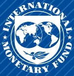
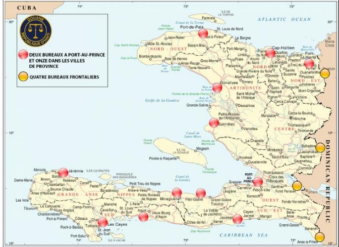

<!-- page 1 -->

## GOVERNANCE DIAGNOSTIC REPORT

HAITI

JANUARY 2025

## Authoring Departments:

Legal Department

Fiscal Affairs Department

Monetary and Capital Markets Department

<!-- page 2 -->

## DISCLAIMER

The contents of this document constitute technical advice provided by the staff of the International Monetary Fund to the authorities of Haiti (the "CD recipient") in response to their request for technical assistance. This document (in whole or in part) or summaries thereof may be disclosed by the IMF to the IMF Executive Director for Haiti, to other IMF Executive Directors and members of their staff, as well as to other agencies or instrumentalities of the CD recipient, and upon their request, to World Bank staff, and other technical assistance providers and donors with legitimate interest, unless the CD recipient specifically objects to such disclosure (see Operational Guidelines for the Dissemination of Capacity Development Information). Publication or Disclosure of this report (in whole or in part) to parties outside the IMF other than agencies or instrumentalities of the CD recipient, World Bank staff, other technical assistance providers and donors with legitimate shall require the explicit consent of the CD recipient and the IMF's Legal department, Fiscal Affairs Department and Monetary and Capital Markets department.

<!-- page 3 -->

## Table of Contents

ACRONYMS AND ABBREVIATIONS ___ 3
PREFACE ___ 5
EXECUTIVE SUMMARY ___ 7
SECTION I. SEVERITY OF CORRUPTION AND ITS IMPACT ON HAITI'S FRAGILITY ___ 14
A. Analysis of Severity of Corruption ___ 14
B. Relationship Between Corruption on Fragility in Haiti ___ 20
SECTION II. RULE OF LAW, ANTI-CORRUPTION AND ANTI-MONEY LAUNDERING FRAMEWORKS ___ 23
A. Impact of Corruption on The Rule of Law: Judicial Integrity ___ 23
B. Effectiveness of Anti-Corruption and Anti-Money Laundering Frameworks ___ 26
SECTION III. GOVERNANCE WEAKNESSES LINKED WITH CORRUPTION VULNERABILITIES IN FISCAL GOVERNANCE ___ 32
A. Revenue Administration ___ 32
B. Public Financial management ___ 42
SECTION IV. GOVERNANCE WEAKNESSES IN FINANCIAL SECTOR OVERSIGHT ___ 52
A. Overview of the financial sector ___ 52
B. Governance of the Supervisory Authority ___ 53
C. Prudential regulation and oversight of the FI governance ___ 54
ANNEXES ___ 56
1. Anti-Corruption Institutions ___ 56
2. Location of Customs Offices and Trends in Number and Value of Goods Released for Consumption or Admitted under Suspensive Regime ___ 58
3. Procedures and Timeline for Response by the Government and Taxpayer ___ 59
4. Organizational Structure of the Directorate General for Budget ___ 60
5. Economic Governance Reform Plan ___ 61
BOXES ___ 15
1. The PetroCaribe Case ___ 15
2. Key Political Economy Actors in Haiti ___ 17
3. Multilateral and Unilateral Sanctions ___ 19
4. Proposed Structure of the AC Poible ___ 30
5. Priority recommendations for programming and budgeting public investments ___ 44

<!-- page 4 -->

7. Haiti – Public Procurement ___ 49

## FIGURE

1. Perception of corruption ___

## TABLES

1. Priority Recommendations ___ 13
2. DGI. Number of Taxes and Share of Tax Revenue Collected ___ 34
3. Table of Priority Recommendations ___ 61

<!-- page 5 -->

## Acronyms and Abbreviations

| AC | Anti-Corruption |
| --- | --- |
| AML | Anti Money Laundering |
| ADG | General Customs Administration |
| APB | Professional Association of Banks |
| BAFE | Office of Financial and Economic Affairs |
| BCP | Basel Core Principles |
| BRH | Bank of the Republic of Haiti (Central Bank) |
| BPH | Banque Populaire Haïtienne |
| CPI | Corruption Perception Index |
| CSCCA | Court of Accounts and Administrative Disputes |
| CSPJ | High Judicial Council |
| DACIP | Directorate of Analysis and Monitoring of Public Investments |
| DCF | Directorate of Financial Control |
| DIF | Tax Inspection Directorate |
| DIV | Public Investment Directorate |
| DNFBP | Designated Non-Financial Business and Profession |
| DPD | Expenditure Programming Paper |
| DSBIF | Directorate of Supervision of Banks and other Financial Institutions |
| DIGCP | Directorate of General Inspection of Credit Unions |
| DGB | Directorate General of Budgets |
| DGI | Directorate General of Taxes |
| DZF | Free Trade Area Directorate |
| EMA | National School of Magistrates |
| FIs | Financial Institutions |
| FCS | Fragile and Conflict-affected State |
| GD | Governance Diagnostic |
| GDP | Gross Domestic Product |
| GFCF | Gross Fixed Capital Formation |
| HNP | Haitian National Police |
| IMF | International Monetary Fund |
| IGF | General Finance Inspectorate |
| LEELF | Law on Preparation and Execution of Finance Law |
| MLA | Mutual Legal Assistance |

<!-- page 6 -->

| MPCE | Ministry of Planning and External Cooperation |
| --- | --- |
| MSS | Multinational Security Support Mission |
| PEP | Politically Exposed Person |
| PI | Public Investment |
| PFM | Public Financial Management |
| PPM | Public Procurement Plan |
| RGCP | General Public Accounting Regulations |
| STR | Suspicious Transaction Report |
| TSA | Treasury Single Account |
| UCREF | Unité Centrale de Renseignements Financiers (Financial Intelligence Unit) |
| ULCC | Unité de Lutte Contre la Corruption |
| UNCAC | United National Convention Against Corruption |
| UNHCHR | United Nations High Commissioner for Human Rights |

<!-- page 7 -->

## Preface

At the request of the authorities of Haiti, a Governance Diagnostic (GD) mission was conducted by the International Monetary Fund (IMF) staff during September-December 2023. The GD was launched by an inter-departmental $ ^{1} $ scoping mission held on September 11-15, 2023, followed by the main mission, which was conducted in two parts: a virtual mission on November 27 - December 1 $ ^{st} $, 2023, and an off-site mission in Panama on December 11-15, 2023. $ ^{2} $ These missions were followed and complemented by extensive desk review of available reports and studies. The mission team benefited from discussions with international organizations and development partners of Haiti, governmental and non-governmental stakeholders and advice of short-term experts on political economy of corruption in Haiti.

The mission was guided by IMF's 2018 Framework on Enhanced Fund Engagement on Governance $ ^{3} $ (2018 Framework) and 2022 Strategy on Fragile and Conflict Affected States (FCS). $ ^{4} $ The 2018 Framework aims to promote more systematic, effective, candid, and evenhanded engagement with member countries regarding governance and corruption issues that are critical to macroeconomic performance. The FCS Strategy requires IMF staff to factor corruption risks in defining policy priorities in the FCS context.

GDs are designed to assess the severity of corruption risks, identify macro-critical governance weaknesses associated with corruption vulnerabilities in key state functions provided by the 2018 Framework, $ ^{5} $ and propose concrete reform measures. GDs also consider the soundness and alignment of the legal and organizational arrangements for fighting corruption with international standards and good practices, and the appropriateness of the anti-corruption strategies in light of the corruption risks that are present in the key state functions.

<!-- page 8 -->

GDs are forward-looking exercises focused on identifying ways to strengthen governance and integrity in order to support strong, stable, and inclusive economic development. The analysis and recommendations of diagnostics do not cover individual corruption cases or allegations, but structural policy issues, as well as near and longer-term reform measures. Since the adoption of the 2018 Framework, 20 GDs have been completed with the issuing of a final report, and several assessments are underway.

The mission for Haiti was led by Ms. Tina Burjaliani and comprised of Ms. Ivana Rossi, Ms. Paula Paixao e Silva Zarazinski, Mr. André Benjamin Kahn, Mr. Anthony Ramarozatovo, Mr. Jean Pierre Nguenang, Mr. Abdoulahi Mfombouot and Mr. Patrick Le Clerc. The mission was assisted by short-term political economy experts Dr. Robert Muggah, Professor David Carment and Ms. Alexandra Wishart.

The mission wishes to express its sincere appreciation for the support and cooperation provided in this challenging environment by officials and staff of various Haitian public institutions, Ms. Vanette Vincent and others at the Ministry of Economy and Finance (MEF) of Haiti who coordinated the authorities' engagement with the mission. The mission is grateful to civil society, academia, legal professionals, private sector representatives, staff of international organizations, and bilateral and multilateral donors for sharing information and providing valuable insights.

The mission appreciates the support provided by Ms. Patrizia Tumbarello (Mission Chief for Haiti, IMF), Mr. Jean Frederic Noah Ndela Ntsama (deputy Mission Chief for Haiti, IMF), Mr. Arsene Kaho (Senior Economist, WHD), Gabriel Berny Duvalsaint (Economist, IMF). The mission is thankful for the administrative coordination provided by Ms. Alexandra Rajs and Ms. Young Kim.

<!-- page 9 -->

## Executive Summary

Haiti is a fragile state with a population of approximately 11 million, about half of which resides in the capital Port-au-Prince and its surroundings. Haiti shares a 390-kilometer land border with the Dominican Republic. Currently, Haiti is the poorest country in the Latin American region in terms of per capita income and one of the poorest countries globally. $ ^{6} $ In recent years, more than half of Haiti's population has shifted from rural to urban areas. Poverty and lack of basic services have led to a large-scale deforestation, degradation, and soil erosion, with forested areas now constituting only 12.6 percent of the country as of 2020. $ ^{7} $ The continued decline of arable land poses a long-term threat to Haiti's economy due to its heavy dependence on agriculture.

Over 96 percent of Haiti's population is exposed to natural hazards, including hurricanes, floods, and earthquakes. $ ^{8} $ Climate change-induced migration has placed increased pressure on urban areas, as displaced populations seek new homes and opportunities. Access to basic services, such as sanitation, clean water, healthcare, education, has been deteriorating, especially since the 2010 earthquake and the 2016 Hurricane, both of which devastated Haiti's infrastructure and economy. The 2021 earthquake restressed already ruptured faults. This is particularly problematic considering Haiti's lack of preparedness to absorb such shocks.

A lack of security and violence have been identified as some of the most significant overarching challenges, and key contributors to Haiti's fragility. Violence has been a major trend throughout the last few decades in Haiti, though it has intensified in recent years. The diminishing security is attributed to increased violence by gangs, some of which are reportedly affiliated with several influential members of political and economic elite. $ ^{9} $ Gang actions range from assassinating $ ^{10} $ and kidnapping key figures to the disruption of public and private institutions. For example, in June 2022, a gang took control of Port-au-Prince's Palace of Justice, "forced judicial officials out, injured a prosecutor, and stole computers, desks, and other assets." $ ^{11} $ Between September and November 2022, another gang took control of the Varreux terminal—a key fuel depot in Haiti—and imposed a two-month fuel blockade in response to a decree which cut fuel subsidies. $ ^{12} $ Gang violence intensified further in

<!-- page 10 -->

January 2024. The violence that broke up on February 29 in Port-au-Prince led to prison breaks, throwing the capital and its neighboring areas into more insecurity. More than 2,500 people were killed or injured during January-March 2024, according to the UN, and nearly 95,000 people have fled Port-au-Prince during the same period. The number of Haitian refugees and asylum seekers had increased to half a million by May 2024. $ ^{13} $ The country's main port where most goods and products transit, was looted. The Varreux terminal was blocked by gangs, raising concerns about fuel shortages. $ ^{14} $ The violence disrupted economic activities across the city, further destabilizing already very fragile system of basic services delivery in Haiti. Creating security conditions conducive to an inclusive political process, and free and fair elections remains a priority. $ ^{15} $

The deployment of the first contingent of the UN Security Council-approved Multinational Security Support (MSS) Mission, led by Kenya, creates a momentum for a stabilization. The MSS mission, approved in October 2023, $ ^{16} $ was initially scheduled for deployment as early as January 2024. However, the initial plan for earlier deployment was derailed due to the sharp deterioration of security situation followed by the resignation of the Prime Minister in February 2024. Approximately 1,000 Kenyan police officers along with additional 2,000 personnel from other countries will operate in coordination with the Government of Haiti, with financial support from voluntary donations managed by a UN trust fund. $ ^{17} $ As an urgent temporary measure, the mission was requested in response to the increasing violence, criminal activities, and human rights violations undermining peace, stability, and security. The MSS Mission is expected to protect state institutions as well as critical infrastructure and transport hubs, and work with the Haitian National Police (HNP) to deter gangs. Further clarity over the mission's goals and rules of engagement, the establishment of robust oversight mechanisms, and a detailed handover plan will be critical to ensuring the mission can effectively support Haiti while paving the way for long-lasting peace and security. A major concern however is the entrenched corruption vulnerabilities within the HNP, which may severely undermine the effectiveness of the MSS and other efforts to stabilize the country and maintain public order. $ ^{18} $

Haiti’s political system has been susceptible to shocks, characterized by short presidencies and prolonged periods of instability. Although some progress has been made in establishing representative institutions of government in recent decades, the system remains vulnerable. $ ^{19} $ Haiti is

<!-- page 11 -->

a presidential republic with national elections, which have been consistently contested as illegitimate. Of the fifty-four Presidents elected since 1806, only nine completed the full term. $ ^{20} $ The Haitian National Assembly is a bicameral institution composed of the Senate and the Chamber of Deputies. According to the amended 1987 Haitian Constitution, the Prime Minister is appointed by the President while the Assembly has the duty of ratifying the policies of the Prime Minister and Cabinet. There have been no elections in Haiti since 2016. The country has had no sitting parliament since 2020 and no President since the assassination of President Moïse in 2021. The Prime Minister's office has governed by decree. Elections that were scheduled for February 2024 were postponed on the grounds that conditions were not safe enough.

The appointment of a new interim Prime Minister and the Cabinet of Ministers has renewed prospect for stabilization. A nine-member transitional Presidential Council (seven members of which have voting rights) was officially established on April 25, 2024, with support from the Caribbean Community. The Council will serve as the country's presidency until February 7, 2026, with the chair rotating among the seven members. A new interim Prime Minister was appointed on May 27, 2024 and the transitional government was installed on June 11, 2024. The interim government is expected to remain in power until February 7, 2026, with the mandate to restore security, and implement constitutional reforms. General elections are planned for the end of December 2025, marking the first elections since 2016.

The GD requested by the authorities in May 2023, and supported by the current administration, analyze the most critical governance weaknesses and corruption vulnerabilities and proposes reforms. Based on a political economy analysis, the GD examines the nature and severity of corruption, its role in Haiti's fragility, and its impact on the effectiveness of anti-corruption and anti-money laundering (AML) frameworks, as well as the rule of law (particularly judicial integrity). The GD also discusses governance weaknesses associated with corruption vulnerabilities in the fiscal governance and financial sector oversight - the priority areas of the key state functions identified during the scoping mission in consultation with the authorities and the other stakeholders. The GD does not cover central bank governance and operations, another important key state function provided in the 2018 Framework, but IMF staff is engaged with the authorities on this matter in a separate format.

A recurring concern with respect to anti-corruption and anti-money laundering efforts is their uneven enforcement. At the most basic level, key laws, regulations and standards are not enforced owing to a lack of independence from elite interferences, insufficient capacity and resources. The legal and institutional frameworks are inadequate to address the existing risks and vulnerabilities. Impunity has been the norm for some time and has gotten worse in the last few years. For example, the official procedures required by the Constitution such as the declaration of assets by senior public officials have never been fulfilled and not a single high-ranking official has been prosecuted for corruption offences, despite multiple investigations launched and referred to the judiciary by the anti-corruption unit (ULCC). Specific governance weaknesses and associated corruption vulnerabilities in the areas covered by the diagnostic are summarized below:

<!-- page 12 -->

- Despite the progress made in Public Financial Management (PFM), especially in the areas of publication of multi-year fiscal and budget frameworks (structural benchmark under the IMF-supported Staff Monitored Program), preparation of cash management tools, gradual consolidation of the treasury single account (TSA), major governance weaknesses and vulnerabilities to corruption remain. These weaknesses and vulnerabilities are present in the critical areas such as (i) budget preparation/programming and public investments (PI) budgeting, (ii) budget execution and cash management, (iii) public procurement, (iv) fiscal reporting, and (v) internal and external audit.

- Despite the recent reforms introduced by the new Tax and Customs Code, the tax and customs administrations remain vulnerable to arbitrariness and corruption, due to the complex system, inequitable processes and the low level of digitalization. Overall lack of transparency and accountability, weak integrity standards and oversight mechanisms leave officials and executives of tax and customs administrations exposed to corruption risks, despite the initial efforts to digitalize the main customs procedures.

The legal and institutional frameworks for Financial Sector Oversight are largely in line with international standards (Basel Core Principles for Effective Banking Supervision 1 and 2 in particular), but their implementation has been severely affected by the deteriorated security situation and the associated loss of capacity attributed to the staff departures. The finalization of the prudential regulations and other projects, such as the risk-based supervision, are being slowed down, but not abandoned. While, according to the BRH, off-site and on-site supervision has been maintained, it is difficult to sustain effectiveness and appropriate scope.

The Anti-Money Laundering (AML) framework has been recently upgraded but its effectiveness is yet to be demonstrated. In September 2023, a new Decree was adopted aiming at reinforcing the operational autonomy and independence of the Financial Intelligence Unit known as UCREF (Unité Centrale de Renseignements Financiers) providing it with a clear mandate to conduct operational and strategic analyses on ML and predicate crimes, and ensuring it has the power to cooperate and share information with domestic and international counterparts. Additionally, an April 2023 Decree (discussed below) which overhauled the broader AML/CFT framework, gives tools to prosecutors and investigative judges to effectively investigate financial crimes. It also mandates preventive measures with regards to politically exposed persons (PEPs) and their family members and close associates, as well as measures to ensure greater transparency of the beneficial ownership (BO) of legal persons. Concurrently, the Central Bank has issued several circulars and guidance documents, which aim at fostering the implementation of AML preventive measures, including with respect to PEPs. Despite the security challenges, the internal training of inspectors and awareness-raising among financial institutions about their obligations under the new AML framework has improved, a new supervision unit dedicated to microfinance institutions has been created, and on-site inspections of two banks were carried out since September 2023. However, these recent improvements in the AML legal framework have not yet led to a significant increase of effectiveness across all AML authorities. Factors such as corruption, human resources constraints, insufficient training of personnel and the degraded security situation, impact the work of UCREF, the judiciary and, though to a lesser extent, the Central Bank.

<!-- page 13 -->

The Rule of law is weak and judicial integrity is severely impacted by corruption vulnerabilities. The legal framework related to judicial appointments and promotions allow the process to be influenced by political connections and patronage, undermining merit-based selection processes. Key stakeholders in Haiti note the absence of a robust professional ethical culture, including among judges, court staff, and law enforcement personnel. There is a common concern that this is exacerbated by low salaries and poor working conditions, all of which increases the likelihood of bribery. As a result, there is a low level of public trust and loss of confidence in the judiciary's ability to deliver impartial justice. Measures to prosecute corruption committed by influential individuals virtually always fail. Cases are frequently prematurely closed, delayed or blocked.

These governance weaknesses and associated corruption vulnerabilities appear within the environment of instability, weak institutions, weak rule of law and accountability systems. The relationship between fragility and governance weaknesses, particularly those associated with corruption vulnerabilities, is complex in Haiti. Political instability and a lack of security have negative impact on the institution-building and their effective operation. However, there are pockets of excellence within the public sector that should be supported and leveraged to strengthen governance, reduce corruption and help put Haiti on the path to overcome fragility.

Strengthening governance and reducing corruption vulnerabilities are essential for Haiti to exit fragility. Building basic institutional capabilities can help raise public confidence, thereby enhancing the legitimacy and effectiveness of the institutions. Together, the proposed reforms can improve legal and institutional frameworks related to economic governance and contribute to sustainable inclusive growth. The IMF's FCS Strategy calls for a tailored approach and careful prioritization, determined by an analysis of the country's specific context, institutional constraints to reform implementation, the distribution of corruption rents, and political economy considerations. $ ^{21} $

The mission recognizes that improved security and a political settlement with a potential to result in a legitimately elected government are necessary conditions for the sustainability of the proposed reforms. Therefore, the mission encourages the authorities to take all necessary measures to restore security and build political stability in accordance with the Constitution of Haiti and the UN SC Resolution 2699. Addressing pervasive corruption, strengthening governance, the rule of law and accountability cannot be achieved in the context of endemic violence, where legitimacy of state institutions is undermined. Consequently, the authorities should make every effort to rebuild security and political stability while pursuing the proposed reforms. Strategic engagement by the international community and development partners - focused on institution-building through country-tailored carefully prioritized reforms - can support Haiti's domestic efforts of breaking fragility.

Recognizing the need to prioritize and sequence reforms, a set of Priority Recommendations is outlined in Table 1 as the foundation for more comprehensive economic governance reforms, which are detailed in Annex 5. These recommendations align with the nature, severity, and risks of corruption, aiming to reverse the legacy of impunity and promote transparency and

<!-- page 14 -->

accountability in the public sector. They are informed by political economy analysis and recognize the need for extraordinary measures to rebuild legitimacy and public trust in institutions, as well as for creating momentum for economic governance reforms. These priority recommendations, as detailed in the sections that follow, have the potential of creating a sufficiently effective foundation for implementing the reforms outlined in the Economic Governance Reform Action Plan in Annex 5.

<!-- page 15 -->

Table 1. Priority Recommendations

<table><tr><td>Measure</td><td>Authority and the required action</td><td>Objective</td><td>Timeline $ ^{{22}} $</td></tr><tr><td>1</td><td>Create, on the basis of existing anti-corruption institutions, and operationalize an Anti-Corruption Pôle - an ad hoc mechanism - to investigate and prosecute the most significant corruption, organized crime and money laundering cases, including those involving PEPs. (See Box 4 for the framework)</td><td>The PM should issue a Decree creating the AC Pôle. Other relevant agencies, such as MEF, ULCC, UCREF, HNP, Ministry of Justice, Judiciary and Prosecution should participate.</td><td>Strengthen accountability for corruption</td><td>ST</td></tr><tr><td>2</td><td>Facilitate investigation of laundering of proceeds of Haitian corruption and organized crime abroad by, in particular, - Strengthening legal framework to align domestic legislation on criminalization of corruption and related offenses with the UNCAC - Collecting and publishing online asset declarations of all senior officials including in the judiciary and law enforcement, as well as candidates for senior public offices. Mandate the disclosure of assets and interests (including bank accounts) held directly and through beneficial ownership abroad. - Strengthening the legal and institutional framework for MLA in respect to all offenses established in accordance with UNCAC - Concluding agreements to enhance legal basis for MLA in all offenses established in accordance with UNCAC and enhance implementation capacity of judicial officials.</td><td>Revising the legal framework requires Parliament’s action, Meanwhile, PM, ULCC, UCREF, MOJ, Judiciary are advised to take all necessary measures to enforce existing legal framework, and prepare the necessary amendments to address its shortcomings</td><td>Strengthen accountability for corruption and ML</td><td>MT</td></tr><tr><td>3</td><td>Based on the corruption risks identified in the customs and tax administrations, develop, implement and monitor a strategy to promote integrity and reduce illegal activities through customs and tax administrations.</td><td>PM and MEF should lead the process of developing and monitoring the strategy, which is based on an independent, reputable study of corruption risks in the customs and tax administrations.</td><td>Strengthen revenue administration on reduce risks of corruption</td><td>ST</td></tr><tr><td>4</td><td>Work with international development partners, civil society organizations and private companies to ensure greater coordination, transparency, accountability and efficiency in foreign assistance management. In particular, encourage all domestic and international implementing partners to produce data in line with the International Aid Transparency Initiative standards, $ ^{{23}} $ and make the information public;</td><td>PM and MEF</td><td>Strengthen transparency, integrity and efficiency in international aid</td><td>ST</td></tr><tr><td>5</td><td>Mandate ex ante evaluations for all internally financed projects and make them public, while strengthening the project selection framework.</td><td>MEF and Ministry of Planning and External Cooperation</td><td>Strengthen planning, allocation in PIM</td><td>ST</td></tr><tr><td>6</td><td>Strengthen public financial management by - Reinstate the financial controller’s prerogatives about a priori control of public investment expenditure, (ST) - adopt a budgetary control guide (MT) - adopt a renovated expenditure execution manual.(MT)</td><td>MEF</td><td>Strengthen transparency and accountability in PFM</td><td>ST/MT</td></tr><tr><td>7</td><td>Strengthen the governance of the BRH as banking supervisor. In particular - Revise the decision-making structure and process related to banking supervision to ensure independence and transparency; (MT) - Meanwhile, as a provisional measure, pending legal amendments, delegate the supervisory decision-making powers to a specialized committee of the BRH Council (ST)</td><td>Revising the legal framework requires Parliament’s action. Meanwhile, BRH Board should delegate the power by a Board decision.</td><td>Strengthen financial sector oversight and reduce corruption risks</td><td>ST/MT</td></tr></table>

<!-- page 16 -->

# Section I. Severity of Corruption and its Impact on Haiti's Fragility

This section based on political economy analysis, examines the severity of corruption in Haiti and how it relates to the country's fragility. The core structural elements of fragility - authority, legitimacy, and capacity – are collectively known as ALC. $ ^{24} $ Fragile countries typically display low levels of administrative capacity, limited provision of rule of law and basic services to the population, and high levels of social polarization. $ ^{25} $ As a result of the uneven delivery of public goods, elite capture or corruption, governments in FCS are generally lacking public trust and legitimacy. $ ^{26} $ In many FCS, weak governance and high level of corruption are among the key drivers of fragility. $ ^{27} $ Corruption has been named as a major contributor to poor capacity of state institutions in Haiti, which has impact on both authority and legitimacy of the institutions and therefore contributes to the fragility. $ ^{28} $

### A. ANALYSIS OF SEVERITY OF CORRUPTION

Corruption vulnerabilities have profound impact on Haiti's macro-economic stability, inclusive economic growth and fragility. While there are examples of successful reforms and resilient public institutions, governance weaknesses and corruption vulnerabilities still permeate most parts of Haitian public sector and economy. The magnitude of the corruption is confirmed by several overlapping indices. Haiti scores 17/100 in the Transparency International's 2023 Corruption Perceptions Index (TPI). $ ^{29} $ The TPI score has remained largely unchanged in the last

Figure 1: Perception of Corruption (by TI)

| Year | Score changes |
| --- | --- |
| 2012 | 19 |
| 2013 | 19 |
| 2014 | 19 |
| 2015 | 17 |
| 2016 | 20 |
| 2017 | 22 |
| 2018 | 20 |
| 2019 | 18 |
| 2020 | 18 |
| 2021 | 20 |
| 2022 | 17 |
| 2023 | 17 |

<!-- page 17 -->

decade, except for spikes in 2017 and 2021, which quickly backslide (Figure 1). The Global Competitiveness Index, measuring the quality of institutions and the ensuing human capital and economic ecosystem, $ ^{30} $ and the World Bank's Worldwide Governance Indicators (WGI) both score Haiti strikingly low. $ ^{31} $ These statistics reflect a perennial challenge for successive Haitian governments to effectively direct human, financial, administrative, and legal resources to achieve sustainable economic and social development. Beyond the indices, the severity of corruption in Haiti is well illustrated in the reports prepared by the Court of Accounts and Administrative Disputes in the PetroCaribe case, which is one of the most egregious corruption cases involving political and economic elites (see Box 1).

| In 2006, Haiti joined the PetroCaribe program established by then the president of Venezuela to give oil to Caribbean countries as a form of aid. The agreement allowed Caribbean states to defer payment on (% variable from 5% to 70% depending on the price of oil) for up to 25 years, charging a low rate of interest for the debt. Recipient governments generated significant cash, which was supposed to be used for development projects. |
| --- |
| Over the course of the program, the government of Haiti claimed to have funded social projects using almost $4 billion dollars raised by PetroCaribe oil between 2008 and 2016. |
| In 2017, the Haitian Parliamentary Special Commission of Investigation issued an extensive report detailing widespread corruption in managing $2 billion under three successive governments during 2008-2016. |
| On January 31 and May 31, 2019, the Superior Court of Auditors and Administrative Disputes issued reports on the government’s spending of PetroCaribe funds between 2008 and 2018 alleging misappropriation, overbilling, collusion, favoritism, and embezzlement. Based on the report, the prosecutor filed charges against several former government officials and transferred the case to the judiciary. On July 15, 2019, the investigative judge assigned to the PetroCaribe case issued subpoenas for two former prime ministers and several other high-level officials to answer questions. |
| In August 2020, a third report issued by the Superior Court of Auditors and Administrative Disputes stated more than 140 billion Haitian gourdes (HTG) (estimated USD $2 billion) in PetroCaribe funds had been embezzled or wasted in “worthless” projects. |
| Sources: Court of Accounts and Administrative Disputes; 246.pdf (cscca.gouv.ht) |

One of the characteristics of corruption in Haiti is the interconnection between politics, economics and organized crime. The vast majority of Haiti's economy has been controlled by a small group of political and economic elites (on key political economy actors See Box 2). The elites are incentivized to preserve their collective interests politically and economically. They have resources to influence and sabotage the democratic process when the government begins to threaten their interests. They defend their interests partially through their own means such as the occasional distribution of guns and bribes to gangs, assassinations, intimidation, cronyism, and partially by

<!-- page 18 -->

capitalizing on international aid. $ ^{32} $ Allegations of corruption are commonplace among political rivals, contributing limited public trust in the institutions.

Gangs have been increasingly important actors in Haiti. Before the February-March 2024 security melt-down, it was estimated that more than 60 percent of Port-au-Prince, including key areas of economic activities, such as major roads in and out of Port-au-Prince, the commercial district, industrial zone, was controlled by gangs, drawing revenue from customs, public markets, water and electricity distribution networks, and public-transport stations. $ ^{33} $ Conflicts between rival gangs are fought over territory and economic resources. Gangs impose tariffs on their territory with impunity, including the extortion of police stations, and have been reported freely using police-owned equipment such as armored vehicles. Several prominent gangs have set up ‘courts’ in their territories by which they punish civilians in their fiefs. $ ^{34} $ Gangs are also reportedly connected in many cases to community structures, evolving “social foundations” to ensure legitimacy. They often present themselves as “benefactors” to the community and seek to display a positive image. The absence of state presence - from law enforcement to social services - has greatly amplified the reach and influence of gangs and splinter factions. In strategic areas, such as ports and oil terminals, businesses are forced to deal with gangs for the survival of their businesses, and thus they are highly lucrative areas for gangs to control. $ ^{35} $

Politically exposed persons (PEPs) $ ^{36} $ have a history of financing and arming gangs in exchange for votes and protection. $ ^{37} $ While the relationship between gangs and political and economic elites is complex and ever-changing, there are multiple reports of them benefiting from each other. $ ^{38} $ The UN SC established a sanctions regime for Haiti in 2002. Since then, individuals affiliated to gangs were sanctioned for their role in organized crime and illicit financial flows. $ ^{39} $ Unilateral sanctions are also frequently imposed against Haitian individuals affiliated with gangs, political and economic elites. $ ^{40} $ (on sanctions See Box 3).

<!-- page 19 -->

## Box 2: Key Political Economy Actors in Haiti

Political elites: Haiti's political elites are made up of current and former politicians. They span dozens of political parties and are present across the civil service and judiciary. The last Parliament, for example, is made-up of over 20 parties. Most of them are formed around clan chiefs, and they have frequently made use of gangs to sway elections. Campaigns involve handouts and promises of patronage and are supported by economic elite often in exchange of anticipated rewards. Many political actors also employ gangs. $ ^{41} $

Economic Elites: The community of economic elites in Haiti is relatively small but it holds significant influence over politicians. Like politicians, some of economic elites employ gangs for close protection, recruit police as mercenaries to stimry rivals, frequently use intermediaries to bribe police and customs officials, and in some cases may work with criminal organizations to advance other legal and illegal business interests. Reportedly, the economic elites often manage to exploit aid programs to accumulate wealth at the expense of the population. $ ^{42} $

Gangs: Gangs have significant influence on governance and engage in full scale disruption of economic activities in Haiti. There are now an estimated 200 gangs operating across Haiti, and around 95 in the capital, Port-au-Prince, alone. $ ^{43} $ Many if not all gangs regularly cooperate with elites to serve oligarchic interests through kidnapping, murder, and the intimidation of neighborhoods. $ ^{44} $

Private sector, civil society and the international community: These actors have substituted for the state across a number of sectors, with minimum oversight, coordination and regulation. Haiti has long been described as a “the Republic of NGOs.” NGOs and civil society are essential players in Haiti, particularly in order to ensure civilians receive basic needs. Before 2010 earthquake, reportedly 70 percent of healthcare and 85 percent of education was provided by NGOs. $ ^{45} $ The most engaged is the Montana Accord, a coalition formed in August 2021 to support the Montana Accord. $ ^{46} $

Diaspora: Haiti has large diaspora abroad, which has played an important role in defining economic and political landscape. Haiti has a large diaspora that exists in several countries but mainly in the United States, Canada, Dominican Republic, Cuba, and France. $ ^{47} $ The World Bank estimates that in 2021 about a quarter of Haitian GDP came from diaspora remittances, making the Haitian diaspora a key player in the Haitian economy. $ ^{48} $ The diaspora can have much great role in social, political and economic processes in Haiti beyond providing remittances and humanitarian aid.

<!-- page 20 -->

The underlying corruption risks include misappropriation of public funds, which has long been endemic. As described in a recent UN report, corruption is “one of the primary drivers of violence and a threat to peace, security and stability” in the country. $ ^{49} $ According to the World Bank, the formal structure of the state is captured by elites and it penetrates deep into Haiti’s society and economy. $ ^{50} $ This is a systemic phenomenon which intersects with various forms of injustice and inequality. $ ^{51} $ State capture, rent-seeking and clientelism ‘hollowed out’ the state, impeding the development of transparent, accountable and inclusive institutions capable to perform the core state functions. $ ^{52} $

Significant weaknesses in fiscal governance discussed in Section III below create opportunities for rent-seeking at the expanse of the state. Ports being the central arteries of Haitian economy, as well as the land crossing points are targeted by criminal groups and associated corrupt networks. For instance, the discrepancies between Haiti’s recorded imports and Dominican Republic exports show the scale of the problem. An IMF report found that in 2016 the total formal exports from the Dominican Republic to Haiti were approximately 800 million as compared to around 400 million of declared imports by Haiti from the Dominican Republic. $ ^{53} $ These differences of 50 percent cannot be explained by freight charges, or cost-in-freight values and free-on-board charges only. There is also significant unregulated and illegal trade occurring via the ports. Port-au-Prince alone has three primary ports that handle the majority of cargo entering the country: APN Port, Terminal Varreux, and Port Latifo, along with two dedicated fuel terminals. $ ^{54} $ Customs officers are vulnerable to external undue influence and pressure by powerful business and political elites.

Corruption is one of the highest proceeds-generating crimes linked with money laundering in Haiti. $ ^{55} $ The risks of laundering of corruption proceeds facing Haiti are very significant and generally acknowledged. $ ^{56} $ However, there are no available strategic analyses or typological studies to identify sectors vulnerable to the laundering of proceeds of domestic corruption in Haiti. The UCREF's annual reports identify certain broad, well-known ML schemes, such as smurfing or the use of legal persons to conceal ill-gotten proceeds, but it lacks specificity and fails to identify specific sectors of professions. The analyses also seem rather generic as the same typologies are reproduced verbatim in successive annual reports, which limits their usefulness for identifying concrete ML schemes or vulnerable sectors and institutions, let alone evolving trends. The UCREF does not yet have tools to identify PEPs, their family members and associates. Overall, the lack of granular analysis or understanding of corruption-

<!-- page 21 -->

derived ML schemes or higher-risk sectors hinders the authorities' ability to prioritize the identification and investigation of suspected corruption-related ML in practice.

## Box 3: Multilateral and Unilateral Sanctions $ ^{57} $

The UN Security Council has issued a small number of sanctions since 2022, with a focus on gang leaders. The most prominent resolution is UN Security Resolution 2653 on 21 October and six gang leaders have been sanctioned as of February 2024.

- The US has initiated over 80 sanctions and visa restrictions on Haitians since 2020. The State Department issued visa restrictions on 8 Haitians, including 2 former prime ministers, politicians, business leaders, and gang members. Another 50 or so Haitians have had visa bans and economic sanctions for drug trafficking, money laundering, and other crimes.

- In July 2023, the US government passed an amended Haiti Criminal Collusion Transparency Act (HR1684) to identify and penalize ties between Haitian political and economic elites and criminal gangs.

Sanctions are also continuously imposed as pursuant to Section 7031 of the annual foreign operations appropriations and Section 1263 of the Global Magnitsky Human Rights Accountability Act.

- Canada has also issued at least 28 sanctions on Haitians since 2022, including under the Special Economic Measures Act and the United Nations Act

- The UK and EU have also added gang leaders and several others to their sanctions lists.

Source: Compiled by IMF staff based on the information published by the UN SC, US State Department, Government of Canada, EU and UK

Most of the domestic proceeds of corruption are laundered outside Haiti. Although it is difficult to gain a full picture of the amount or proportion of proceeds of domestic corruption that are transferred outside Haiti, anecdotal evidence – including the presence of strong expatriate populations in foreign countries - suggests that significant sums are laundered abroad. For instance, an investigation by the International Consortium of Investigative Journalists published as part of the Pandora papers $ ^{58} $ revealed that two Haitians recently sanctioned by Canada for corruption, money laundering, and collusion with gangs $ ^{59} $, described as members of Haiti's economic elite, owned offshore companies in tax havens as well as luxury real estate in the United States. Despite the due diligence norms, which all banks claim to apply rigorously, the domestic financial system cannot be considered to be absolutely immune to corruption. $ ^{60} $

<!-- page 22 -->

# B. RELATIONSHIP BETWEEN CORRUPTION ON FRAGILITY IN HAITI

Corruption has profound impact on Haiti’s fragility as it has limited authority, legitimacy and capacity of state institutions over time. $ ^{61} $ According to the World Bank, the continuous weakening of democratic institutions, persistence of political and economic elite capture, $ ^{62} $ and the inability of the state to guarantee security and the rule of law are primary contributors to Haiti’s fragility. $ ^{63} $ Haiti’s democratic institutions have been at best unstable and volatile. The frequent changes of government, often accompanied with violence, have created opportunities for political vacuum, legitimacy crises and instabilities. Gang violence has become one of the most pressing and pervasive problems as gangs compete for territorial control and resources, terrorize civilian population and severely disrupt economic activities. $ ^{64} $

Haiti has long been in a capacity trap, despite some promising signs of stability and increasing capacity of state institutions in early 2000s. $ ^{65} $ While challenges have varied, lack of security has been an overarching issue, which has had an undoubted negative impact on institution-building in Haiti. On the other hand, weak institutions contributed to a vicious cycle of insecurity, lack of capacity and the inability to establish legitimacy through functional democratic institutions and processes.

The fragility has increased Haiti's vulnerability to shocks due to natural disasters, climate change and pandemics, which in turn reinforces the fragility. Vulnerability to natural disasters does contribute to Haiti's fragility but is not considered to be a root cause of the fragility trap. The limited extent of Haiti's resilience to natural catastrophes is largely determined by a function of its institutional foundations, which should be captured by capability and legitimacy.

Recognizing the complexity of Haiti's fragility is a sine qua non for exiting it. Exiting fragility is extremely difficult and a longer-term project. The process of state building, namely how effective and legitimate states are formed, should be the main mechanism to overcome fragility. $ ^{66} $ The role of state legitimacy, i.e. the relationship between the state and the society, is critically important in Haiti for number of reasons: its absence strongly correlates with weaknesses in the institutional processes that

<!-- page 23 -->

uphold rules, norms and enforcement characteristics that collectively determine economic performance, $ ^{67} $ and a lack of legitimacy is a key driver of instability and stagnation. $ ^{68} $

International humanitarian aid has been crucial in providing basic services to citizens, but has not helped Haiti exit the fragility trap.⁶⁹ The 2009 European Report on Development concludes that from 1979 to 2009 fragility levels of the bottom 35 countries had not improved despite generous aid programs.⁷⁰ International aid is critical to addressing emergency needs of population, when the state is unable to perform its functions effectively, that include provision of services, maintaining law and order, and security and other forms of output legitimacy.⁷¹ For instance, after the 2010 earthquake, when Haiti received unprecedented amount of foreign aid from various sources, pledges for building democratic institutions fell short, while other areas such as transportation exceeded the request by 510 percent.⁷² A study shows that 99 percent of aid disbursed in 2010-2011 went to NGOs, private contractors and non-state service providers, and less than 1 percent went to the government.⁷³ While such assistance has helped citizens receive basic service, it reduced pressure on the authorities to prioritize public financing, which in turn reduces effectiveness and sustainability of development aid.⁷⁴

Careful prioritization of aid, better coordination among aid providers, and investment in institution-building with accompanying transparency and accountability can contribute to breaking fragility. In Haiti, as in other fragile contexts, the state can afford staying in “capability trap” partially due to the aid inflow, which is not focused on sustainable development of institutions. $ ^{75} $ Studies show that aid resources focused on poor property rights enforcement, corruption, insecurity and violence are needed to propel states stuck in the fragility trap towards better economic

<!-- page 24 -->

outcomes. $ ^{76} $ Such policy options are successful when the elites in the trapped states have sufficient incentive to embrace reforms that might affect their personal interests. $ ^{77} $

The balance between addressing emergency needs through humanitarian assistance and providing sustained long-term support to exit fragility should be improved in Haiti. Historically, development aid for Haiti has not been accompanied by a systemic change agenda for poverty reduction and state-building. $ ^{78} $ Large influx of aid followed major disasters and declined quickly. Often aid was perceived as a reward or punishment for political leaders rather than a support for long-term development goal. The periods of increased foreign aid are characterized with increased school enrollment, better healthcare (e.g. higher vaccination rate) and even waves of judicial and public sector reforms. But the progress was offset in the years when the aid was suspended. $ ^{79} $ Foreign actors are viewed by portions of both Haiti's intellectual elite and in popular circles - and in Haiti's extensive diaspora - as key players and equally responsible for the chaos.

Existing structural weaknesses that contribute to Haiti's fragility can be overcome by its people, but support by international community remains critical. International support directed to structural problems related to the state authority, legitimacy and capacity can help Haitian people, including diaspora and civil society, create viable solutions against economic misallocation and associated calamities. Studies support the hypothesis that larger, more geographically concentrated diasporas located in high-income, democratic host states, like Haitian diaspora in various countries, typically have a stabilizing effect on fragile home communities. $ ^{80} $ Haitian diaspora can be more effectively leveraged in the joint effort to help the country exit fragility trap. $ ^{81} $ Possible contribution of the diaspora in anti-corruption measures, including in the creation and operation of the proposed Anti-Corruption Pôle should be given due consideration (on the Anti-Corruption Pôle, see Box 4).

<!-- page 25 -->

# Section II. Rule of Law, Anti-Corruption and Anti-Money Laundering Frameworks

This section discusses how severe corruption has eroded the rule of law (especially the judicial integrity) and rendered the anti-corruption and anti-money laundering frameworks ineffective. The current anti-corruption legal framework falls significantly short of international standards and good practices and does not provide effective tools against systemic corruption. This deficiency, compounded by the lack of autonomy and independence of oversight institutions and judiciary, has exacerbated the weaknesses, hindering the ability to effectively combat corruption and uphold the rule of law. The prolonged political instability and recurring security crises have perpetuated an environment of impunity. Decisive action, led by relevant Haitian institutions (e.g. Prime Minister, Ministries, judiciary, anti-corruption and oversight institutions) and civil society with the support of international partners, is needed to strengthen governance, rule of law and reduce corruption in Haiti. These measures are necessary to provide immediate relief while laying the foundation for comprehensive institutional reforms targeted at strengthening anti-corruption, AML, judicial and law enforcement institutions, ensuring they are equipped with the autonomy, independence, and resources required to fulfil their mandates effectively.

### A. IMPACT OF CORRUPTION ON THE RULE OF LAW: JUDICIAL INTEGRITY

While weaknesses in the justice sector have been persistent for decades, political instability and escalating violence have degraded an already fragile justice system. Civil society groups express concerns that politically sensitive cases are assigned to judges with political ties. Similarly, they argue that several cases and prosecutions were prioritized and proceeded quickly, while other cases were frozen or not properly investigated owing to political considerations. $ ^{82} $ Low salaries and poor working conditions in the justice system led to low morale and makes the sector highly vulnerable to manipulation by political forces and corruption.

An escalating challenge is the impact of gang-related violence on judicial facilities. In June 2022, a heavily armed gang invaded and then occupied for more than a week the Palais de Justice where the Supreme Court is located. Judicial staff escaped by climbing over walls under police cover. Criminal evidence, as well as confiscated drugs, weapons, and money, were stolen. Judges, prosecutors, and court clerks are unable or unwilling to access many court facilities in the capital and in many other departments and cities across the country. Especially since 2021, gang members have entered court facilities seeking to liberate or target suspects and witnesses. Whether to obstruct cases or simply for profit, judicial offices are frequently ransacked, often stripped of everything from desks and computers to air conditioning systems. The continued occupation since June 2022 of the Court of First Instance in Port-au-Prince highlights the threats currently facing Haiti's justice system.

<!-- page 26 -->

Judges and prosecutors are operating in an environment of fear and intimidation. Judges, prosecutors, and lawyers have been targeted by criminal gangs, especially since the assassination of President Jovenel Moise in July 2021. Acts of intimidation and fears of retaliation impact their ability to operate effectively and in an impartial manner. Witnesses also face similar threats. In 2023, for example, major figures of the justice system, including the chief prosecutor of Port-au-Prince, a senior judge at the Supreme Court, and the Inspector of Police, were arrested for their alleged participation in a coup attempt. $ ^{83} $ Additionally, the assassination of the President of the Port-au-Prince Bar Association and alleged threats to judges handling sensitive cases underscore Haiti's difficult legal environment.

Moreover, there are concerns about political interference in the judiciary. The High Judicial Council (Conseil Superieur du Pouvoir Judiciaire or "CSPJ"), established in 2007, is an independent body responsible for the management and discipline of the judiciary. Since its inception, the CSPJ has struggled to fulfill its mandate to protect judicial independence and integrity due partially to interference and pressure from the executive. The former administration has interfered in judicial appointments and renewals to reportedly select politically aligned candidates and to pressure sitting judges. In 2021, President Jovenel Moise removed three Supreme Court justices without following the procedure established by the Constitution. $ ^{84} $ Eight new Supreme Court judges were appointed by government decree in February 2023, bringing the Supreme Court number to 11 out of 12 judges. Several judicial vacancies remain unfilled as the government failed to confirm CSPJ-endorsed judges. More mandates are due to expire which will significantly reduce the number of judicial seats.

Executive interference over judicial appointments undermines judicial independence. Under Article 175 of the Haitian constitution, the president appoints judges according to lists of candidates submitted by the Senate and regional and local assemblies. Appointment of judges and prosecutors is widely perceived as politically motivated, prioritizing political affiliations over merit and competence. This dynamic severely threatens judicial independence. The law establishing the CSPJ stipulates that the CSPJ advises the President on judicial appointments, $ ^{85} $ however, these recommendations are frequently disregarded. Internal conflicts within the CSPJ have hindered its ability to effectively counter the executive's inappropriate influence over judicial appointments. Prosecutors are direct employees of the Ministry of Justice and Public Safety, and can be transferred or suspended by the executive branch at any time. There are numerous allegations of undue political interference. $ ^{86} $

Most magistrates are still directly appointed, but the École de la Magistrature provides a merit-based route to the judiciary. The École Nationale de la Magistrature (magistrate school or "EMA") was established in 1996 largely funded by foreign donors. This was part of broader efforts by the international community to support the creation of a more professional and independent cadre of judges and prosecutors. The school is responsible for organizing a competitive and merit-based entrance exam and training aspiring judges for an initial period of 16 months. Appointments usually

<!-- page 27 -->

happen after graduation depending on available judicial seats. $ ^{87} $ Expanding the role of the EMA in training, selecting, and appointing judges is paramount in strengthening judicial independence in Haiti.

The judicial certification process raises concerns about due process and security of tenure. In January 2023, the CSPJ found that 28 of 69 judges and prosecutors could not be certified on the grounds of moral integrity, including allegations related to the abuse of authority, the presentation of invalid credentials, and the unlawful release of dangerous criminals. This is a process by which the CSPJ certifies that a judge meets the requirements for nomination or renewal. While this process can help maintain the quality of the judiciary, uncertified judges are not provided with an avenue for recourse, raising concerns about due process. It also raises concerns about security of tenure which is a fundamental principle of judicial independence. The National Ombudsman recently issued a statement urging the CSPJ to provide an avenue for appealing the certification process, citing the American Convention on Human Rights. $ ^{88} $ Among those non-certified were high-profile figures such as Judge Garry Orélien, who was in charge of investigating the assassination of former President Jovenel Moïse, and Jacques Lafontant, the government prosecutor for the Port-au-Prince area. At least one of the magistrates affected by the certification process has filed an appeal before the Inter-American Court of Human Rights. $ ^{89} $

Coupled with limited resources and capacity constraints, the Haitian judiciary struggles to fight corruption. Haitian judges and prosecutors have comparatively limited expertise and experience in processing criminal cases related to corruption and organized crime. The overall conviction rate in the criminal justice system remains extremely low. Despite multiple national corruption strategies and the creation of an anti-corruption mechanism (ULCC), there has been only one conviction in a corruption case over the past 15 years. There is just one forensic expert in the country. $ ^{90} $ In terms of judicial processing, only about 200 criminal trials were held from October 2021 through September 2022. In some jurisdictions, no hearings on criminal cases had been held for three years, the Office of the United Nations High Commissioner for Human Rights (OHCHR) reported. Without an elected president and functioning Senate, the appointment of justices has stalled. $ ^{91} $ It is reported that between 2016 and 2020, courts throughout the country only managed to open for a total of 205 days. The Court of First Instance in Port-au-Prince has not been operational for more than a year. Moreover, the budget allocated to the justice sector is less than 1 percent of the national budget, limiting its capacity to provide effective justice services to the public. $ ^{92} $ Earlier this year, judges and prosecutors went on strike to demand higher salaries and better working conditions.

Multiple bilateral and multilateral partners have invested heavily in justice sector reforms over the past two decades, but progress has been limited. Since the mid-1990s, foreign donors have provided a substantial amount of aid to reform and strengthen the justice system in Haiti. These efforts

<!-- page 28 -->

by the international community to assist Haiti's justice system have yielded mixed results. This is due in part to the short-term nature of some projects and lack of coordination among the several international and regional organizations operating in Haiti. The political environment and corruption vulnerabilities also impact the success and sustainability of reforms. While some important steps toward judicial reform have been taken (e.g., the creation of the High Judicial Council and the functioning of the magistrate school), the government must continue to exhibit the political will to effectively address the justice sector shortcomings.

Notwithstanding significant challenges and limited improvements, reforms are cause for hope. International sanctions against high-profile individuals with influence over the judiciary and the establishment of the High Transition Council (HTC) create momentum for justice sector reforms, including efforts to make the justice system more accessible, effective, and accountable. The HTC oversees developing a roadmap for upcoming elections, reviewing the country's constitution, and proposing judicial reforms. The recent appointment of judges to fill vacant seats in the Supreme Court will enable the judiciary to remain operational during this period of institutional instability. However, civil society argues that the ad hoc procedure adopted for the appointment of the judges violated article 175 of the Constitution, which confers the authority to the President to appoint magistrates to the Court from a list of three candidates per seat submitted by the Senate. $ ^{93} $ The decade-long work to reform and modernize the country's criminal laws has produced a new penal code and criminal procedure code expected to enter into force in June 2024. There is a wide consensus that these laws will facilitate the fight against complex crimes such as corruption. $ ^{94} $

### B. EFFECTIVENESS OF ANTI-CORRUPTION AND ANTI-MONEY LAUNDERING FRAMEWORKS

Haiti has established several legal responses to corruption and related practices, but the impact has been minimal due to poor implementation. $ ^{95} $ The 1987 Constitution, the 2008 Law on Declaration of Assets by Certain Categories of Public Officials, and the 2014 Law on the Prevention and Suppression of Corruption (AC Law) constitute the key legal documents. The 2014 AC Law, the country's first anti-corruption law, criminalizes, to a certain extent, corruption-related offenses, including illicit enrichment, bribery, embezzlement, illegal procurement, insider trading, influence peddling, and nepotism. The law imposes sentences of 3-15 years imprisonment and gives legal authority to the ULCC and the UCREF to launch corruption investigations.

The legal framework has significant shortcomings creating obstacles to domestic prosecution as well as potential international cooperation against laundering proceeds of Haitian corruption abroad. In particular, the UNODC report of 2015 discusses the missing elements in the criminalization

<!-- page 29 -->

of corruption in the AC Law. Even though the Report was prepared a while ago, the mission confirmed with the stakeholders that the issues remain unaddressed and many aspects of criminalization of corruption fall short of international standards. For instance, Articles 14, 11 and 5 of the AC Law criminalize bribery by domestic public official, but none of these provisions cover promising, receiving or soliciting intangible benefits, benefits for third party, inaction in exchange of bribe or indirect corruption. $ ^{96} $ Similarly, trading in influence is criminalized (art. 5.9 of the AC Law), but the elements of intangible advantage and third-party interest are not covered. Bribery in private sector is not criminalized at all in conflict with Art. 21 of UNCAC. Embezzlement and misappropriation provisions do not apply to officials who perform public functions (art. 17 of the AC Law).

While the basic legal framework on asset disclosure by public officials is in place, it has not been implemented. The ULCC's analysis of the 2008 Law on Declaration of Assets by Certain Categories of Public Officials identifies serious weaknesses in asset disclosure system. The mission particularly notes the prohibition of publication of asset declarations of top officials. International practice shows that publication can be a low-cost but effective measure in promoting transparency and accountability both through domestic procedures and international cooperation to prevent laundering of proceeds of corruption abroad. At the same time, the mission notes that the AML framework has been brought largely in line with international standards by the Decree of April 30, 2023 on Sanctioning Money Laundering, Terrorism Financing and Financing the Proliferation of Weapons of Mass Destruction.

The AML framework has improved significantly but its implementation remains severely limited. Over the last two years, despite the very challenging political and security situation, Haiti has made noticable progress in addressing some of the key technical deficiencies in its AML framework. $ ^{97} $ The above-mentioned April 30, 2023 Decree, $ ^{98} $ which covers most of the FATF 40 recommendations, also provides tools to conduct financial investigations, $ ^{99} $ a much-needed update to the severely outdated criminal law legislation. $ ^{100} $Concurrently, the BRH has issued several circulars and guidance documents to foster the implementation of preventive measures by Financial Institutions (FIs), including with respect to PEPs.

<!-- page 30 -->

Key anti-corruption institutions face overwhelming obstacles and have been largely unsuccessful in fulfilling their missions. With the exception of the Court of Accounts and Administrative Disputes, anti-corruption and AML institutions, such as the ULCC, lack requisite guarantees of independence and operational autonomy provided by relevant laws (on AC institutions see Annex 1). Most of the heads of these institutions are appointed at the discretion of the President of the Republic. Thus, it will be difficult for a head of an anti-corruption institution, without a precise mandate, to exercise his function in complete independence. This is the case, for example, of the Director General of the ULCC who is appointed by a Presidential decree upon the nomination by the Council of Ministers; he does not have a mandate guaranteeing his removability.

While the legal framework has shortcomings, the real challenge is in the enforcement of anti-corruption and AML legislation. The UNODC analysis of the criminal legislation and the AC Law identifies excessive immunity of top officials and cumbersome process for its lifting. While functional immunity is important for effective performance of functions by certain category of officials (e.g. MPs, President, Ministers, judges, prosecutors), it cannot become a shield against corruption investigation and prosecution.

Despite the efforts made by the ULCC and other anti-corruption and AML institutions, there has been no single high-level prosecution for corruption or related ML in Haiti. Widespread corruption and lack of judicial capacity (including specialization in complex corruption and related crimes) have been identified as impediment to ULCC's efforts achieve prosecution and conviction in corruption cases. Since its creation in 2004 till the end of 2023 (9 cases were sent in 2023), the ULCC had submitted 87 cases to the prosecution. Similarly, the UCREF receives – on average – several hundred suspicious transaction reports (STRs) each year from FIs (but none from Designated non-Financial Businesses and Professions (DNFBPs)), and hundreds of thousands of automatic cash transaction reports (CTRs), $ ^{101} $ but its analyses have only led to between three and ten disseminations per year to the judicial authorities, none of which has led to an ML conviction to date.

Although the legal framework allows AML and AC authorities to share information with each other with few restrictions, there is little to no cooperation or use of synergies in practice. Both the ULCC and the UCREF indicated that they enjoy a close working relationship, but it seems that very few information requests are submitted to either direction in practice. This weak cooperation is especially striking when compared to the much stronger cooperation the UCREF enjoys with other domestic authorities, such as the BAFE, $ ^{102} $ the PNH's financial crime division. For instance, the UCREF received 61 investigation requests from the BAFE over the 2020-21 exercise and 80 in 2021-22, but none from the ULCC in either year. Requests received in previous years since 2018 were in the lower single digits. Some authorities explained that previously, the ULCC would reach out to the UCREF to request information from FIs and DNFBPs on its behalf, but that such intermediation is no longer

<!-- page 31 -->

needed as the anti-corruption law adopted in 2014 $ ^{103} $ provides the ULCC with the power to request this information directly from private sector entities. Nevertheless, both the UCREF and the ULCC seem favorable to efforts to formalize cooperation between the two institutions, and the UCREF stated that it is currently preparing a draft MOU which will be submitted soon to the ULCC and would notably allow its staff to conduct joint investigations with ULCC sworn officers.

The judiciary is perceived to be a weak part of the anti-corruption and AML architecture due to vulnerabilities to external influence. There is a widely shared perception of impunity and lack of integrity in Haiti's judicial system. Although the ULCC and UCREF investigations lead to a few reports to the Prosecutor's Office, there has been just one conviction for corruption in the last 15 years, and none for ML as noted above. Similarly, kidnappings and other gang-related criminal activities very rarely lead to prosecutions or convictions, presumably due to either complicity or intimidation. In January 2023, as noted above, the Conseil Supérieur du Pouvoir Judiciaire (CSPJ) annulled the certification of 28 magistrates – out of 69 under review – including the chief government prosecutor, as well as the investigative judges working on the cases related to the PetroCaribe corruption scandal. More recently, in October 2023, the CSPJ removed four other judges, all for lack of moral integrity and requesting bribes from suspected wrongdoers, while certifying 16 others and admitting 14 new graduates of the judiciary school. Although these efforts, notably the certification of new, better qualified magistrates, are certainly encouraging, significant, sustained efforts must be made to rebuild an effective judicial system capable of investigating, prosecuting corruption and related ML, bringing perpetrators to swift convictions, and ensuring the timely recovery of criminal assets. It should also be noted that the CSPJ has been criticized in the past for being vulnerable to political interference, in addition to the due process concerns related to the decertification process highlighted above. (see Section II.A)

A specialized Anti-Corruption Pôle can help address the impunity and restore public trust in the state's ability to combat corruption, organized crime and ML. In countries with severe corruption vulnerabilities, special measures are warranted to reduce real or perceived external influence over the anti-corruption enforcement efforts. In the context of Haiti, the creation of a new Anti-Corruption Pôle (AC Pôle) is proposed as a temporary solution that can make impact in limited time. The AC Pôle would not replace a need for structural reforms necessary to upgrade the legal framework and strengthen institutional independence, autonomy and capacity. Operations of the AC Pôle are expected to be governed by existing laws and procedures. This means that investigative and judicial powers over corruption, organized crime and related ML cases remain vested in the law enforcement and judicial officials assigned to the AC Pôle.

Haiti will require significant financial, organization and capacity development support from the international community to set-up and operationalize the AC Pôle. The AC Pôle is a Haitian driven effort, which requires support from partners. The international community is invited to provide all necessary resources, including security, infrastructure, IT support, for the establishment and operationalization of the AC Pôle. The mission notes ongoing capacity development support provided by UNODC to several Haitian anti-corruption, law enforcement and judicial institutions to investigate and prosecute corruption cases effectively. The work done by UNODC, and other development

<!-- page 32 -->

partners can be leveraged for creation of the AC Pôle. The mission also notes deployment of the first contingent of the MSS mission in June 2024, which can provide necessary security to the AC Pôle.

Along with strengthening domestic efforts, leveraging international cooperation to reduce risks of laundering proceeds of corruption abroad is critical. There is a consensus among anti-corruption and AML institutions in Haiti that most of the domestic proceeds of corruption are laundered outside Haiti. The MER $ ^{104} $ found that the authorities' failure to seek mutual legal assistance with regards to ML and associated predicate offenses, including corruption, with transnational elements, was inconsistent with Haiti's exposure to transnational ML.

## Box 4: Proposed Structure of the AC Pôle

Legal basis: The AC Pôle is created by a decree of the Prime Minister of Haiti.

Institutional basis: The AC Pôle is created on the basis of existing institutions and is composed of officials of ULCC, UCREF, HNP, prosecutors and judges. The number and ranks of police officers, ULCC officials, UCREF officials, prosecutors, judges will be determined in the PM's Decree, based on the need identified in consultation with anticorruption and AML institutions of Haiti. Determining a right size for AC Pôle would be important for its effectiveness and efficiency.

Jurisdiction: The AC Pôle focuses on the most important corruption, organized crime and money laundering cases, as further specified in the PM's decree.

Selection of members of AC Pôle: To create an effective AC Pôle, which enjoys public trust, a transparent, participatory and merit-based selection process shall be put in place. Informed by international good practice related to specialized anti-corruption judiciary, the following process is recommended:

Officials from the participating institutions who will serve in the AC Pôle should be selected by a special Selection Commission. The Selection Commission is formed by a Prime Ministerial Decree and is composed of six members: two CSOs, two members of academia, two anti-corruption experts with international experience nominated by international development partners working in Haiti.

The Selection Commission should conduct an integrity and capacity assessment of all applicants from participating institutions and propose, if possible. two nominees for each position to the PM.

From the list of candidates submitted by the Selection Committee, the PM assigns officials to the AC PoE.

Integrity: The AC Pôle should comply with the highest standards of integrity in line with the United Nations Convention against Corruption and Jakarta Principles for Anti-Corruption Agencies. It should prepare and publish bi-annual activity report with statistical information.

Management of the AC Pôle: Daily operation of the AC Pôle is managed by its Secretary, who is selected by the Selection Commission through the transparent, merit-based and participatory process. A small secretariat, selected by the Selection Commission through the same process shall be created to support the operations.

International Advisors: The AC Pôle may be advised by external experts with international experience in investigation and prosecution of complex corruption, organized crime and ML cases.

<!-- page 33 -->

Capacity and resources: The AC Pôle will receive targeted capacity development support. It should also receive all necessary security details, including through the MSS.

Competent authorities should take all necessary measures to improve international cooperation. The UCREF and the judiciary are the key institutions for international cooperation in anti-corruption and AML matters. The UCREF has recently signed MOUs with counterparts in six countries in the region $ ^{105} $ and should enhance its cooperation with other FIUs and anti-corruption institutions, with a particular focus on countries with a higher risk of laundering of corruption proceeds emanating from Haiti. $ ^{106} $ For instance, membership to the EGMONT Group would allow exchange of intelligence information on ML related to PEPs, which can help anti-corruption and AML enforcement. To achieve effective international cooperation, efforts to improve UCREF's independence and autonomy should continue. The UCREF should also fully engage in the application process to the Egmont Group, including by submitting an unconditional application for membership. Judicial authorities should also increase their efforts to prosecute cross-border ML and confiscate corruption proceeds transferred abroad, including by requesting and providing mutual legal assistance and pursuing other forms of international cooperation as appropriate.

<!-- page 34 -->

# Section III. Governance Weaknesses linked with Corruption Vulnerabilities in Fiscal Governance

### A. REVENUE ADMINISTRATION

Corruption vulnerabilities in the tax and customs duties revenue collection is an impediment to private sector development and negatively impacts a day-to-day life of the population. The ULCC investigation accused senior leadership of the AGD, including a former DG and multiple officials, for corruption and money laundering. $ ^{107} $ Corruption in the revenue administration demonstrates itself in different forms: (i) petty corruption directly affecting ordinary citizens, who are forced to negotiate with officers to avoid lengthy, costly administrative procedures (e.g. payments for stamps, the issue of certificates, etc.); (ii) institutionalized corruption affecting more large and medium-sized enterprises, which is attributable primarily to unscrupulous strategies of certain dishonest officials and agents who arbitrarily interpret and apply the unclear, complex, and insufficiently transparent legal provisions. The options for recourse are very limited in an environment that is still largely nondigitized. Practices such as under-invoicing, under-valuation of imported goods, lowering tariff payments, misclassification and bribery of customs officials are common. $ ^{108} $ While powerful businesses have ability to exert influence over senior and middle-level customs officials, smaller importers may be required to pay bribes and skirt rules simply as the cost of doing business.

A number of internal and external factors contribute to maintaining governance frameworks in the tax and customs administrations weak and highly vulnerable to corruption. These factors include: (i) the lack of collaboration between, on the one hand, the Directorate General of Taxes (DGI), the General Customs Administration (AGD), and the ULCC on the other. This lack of cooperation has contributed to the absence of clear, targeted strategies to prevent and fight corruption in the system; (ii) the ambiguous role of the Tax Inspection Directorate (DIF) within the MEF $ ^{109} $; (iii) the very limited role of the General Finance Inspectorate (IGF), which is often limited to auditing taxes and their collection mechanisms, without addressing any real systemic challenges peculiar to the tax and customs administrations; (iv) the lack of a clear national strategy for the digitalization, which has prevented the tax and customs administrations from making their digital transformation a real priority, despite the available technologies (Internet and GSM networks) widely used by the public; (v) archaic institutional arrangements and the limited autonomy of the tax and customs administrations in the

<!-- page 35 -->

management of human resources and overheads; $ ^{110} $ (vi) the insufficient culture of transparency within the tax and customs administrations; and (vii) the lack of an effective partnership and collaboration between the two administrations, the private sector, and civil society.

All of these factors continue to have a negative impact on the performance of the DGI and the AGD in terms of tax revenue collection. This long-standing situation has led to a very low level of tax burden, estimated at only 5.9 percent of nominal GDP during the past five years, is characterized by: (i) a tax system that is inefficient because it is inequitable, complex, and non-neutral, as it focuses on tax and customs exemptions of all kinds; (ii) a narrow tax base as a result of the reluctance of transactors to become formally established due to the costs involved; (iii) very low tax compliance rates among large and medium-sized taxpayers as a result of a deficient, and still manual monitoring system; (iv) various forms of fraud and smuggling designed to avoid extensive red tape and arbitrary valuations of goods during customs clearance; $ ^{111} $ and (v) the lack of traceability of the systems for tax and customs revenue consolidation and accounting by the public treasury, resulting in leakage in the tax and customs duties revenue collection system.

The organizational arrangement must be adapted to the risks and the resources available to fight corruption. Haiti's tax and customs administrations must be organized to respond to the main risks (insecurity, flows of goods, land border, private and secondary ports, size of taxpayers, etc.) and the current constraints (availability of trained officers, job attractiveness, accessibility of offices, limited resources, level of digitization, etc.). Modern organizational design is characterized by: (1) a clear separation between steering and operational tasks; (2) an appropriate number of adequately trained professional staff and officers assigned to each position based on the workload; (3) a headquarters function to ensure that procedures are applied uniformly and observed throughout the country; (4) the organization of operational structures according to the financial stakes, tax compliance risks, and the size of the taxpayers; and (5) units for internal audit and fighting and preventing corruption.

Despite the recent reform initiatives, including the adoption of the new tax and customs codes, the system and procedures for collecting tax and customs revenue in Haiti are still weak. The tax administration has not been able to take full advantage of the drafting of the new Tax Code $ ^{112} $ to improve its readability, to smooth out the rough areas, and to rationalize the tax system. Despite the substantial housekeeping work that has led to the abolition of 16 types of low-yield nuisance taxes $ ^{113} $ and the merger of 10 others, inter alia, the new Tax Code, that will enter into force in October 2024,

<!-- page 36 -->

has mainly entailed the compilation of various tax texts based on the established law. It also includes 39 types of taxes, fees, and duties, only 19 of which generate 99 percent of the total tax revenue collected by the DGI for the government (see Table 2). The current (HS 2017) product customs clearance nomenclature (NDP) has yet to be harmonized with the update in accordance with the HS 2022 Harmonized System, although this update would enable the proper implementation of customs duties (DD) according to the correct tariff classification.

Table 2. DGI. Number of Taxes and Share of Tax Revenue Collected (In millions of gourdes)

<table><tr><td>Taxes</td><td>Number</td><td>2019–2020</td><td>2020–2021</td><td>2021–2022</td></tr><tr><td>Individual income tax</td><td>1</td><td>13.463</td><td>37.1%</td><td>19.133</td><td>37.1%</td><td>21.644</td><td>38.6%</td></tr><tr><td>Turnover tax</td><td>1</td><td>9.361</td><td>25.8%</td><td>13.303</td><td>25.8%</td><td>13.815</td><td>24.6%</td></tr><tr><td>Income tax on legal entities</td><td>4</td><td>8.184</td><td>22.6%</td><td>11.630</td><td>22.6%</td><td>12.885</td><td>23.0%</td></tr><tr><td>Other taxes on goods and services</td><td>3</td><td>2.327</td><td>6.4%</td><td>3.307</td><td>6.4%</td><td>3.470</td><td>6.2%</td></tr><tr><td>Stamp duty</td><td>1</td><td>697</td><td>1.9%</td><td>990</td><td>1.9%</td><td>1.056</td><td>1.9%</td></tr><tr><td>Payroll tax</td><td>1</td><td>671</td><td>1.8%</td><td>954</td><td>1.8%</td><td>1.015</td><td>1.8%</td></tr><tr><td>Domestic excise duty</td><td>1</td><td>664</td><td>1.8%</td><td>943</td><td>1.8%</td><td>978</td><td>1.7%</td></tr><tr><td>Registration fees</td><td>7</td><td>494</td><td>1.4%</td><td>703</td><td>1.4%</td><td>499</td><td>0.9%</td></tr><tr><td>Other direct taxes</td><td>12</td><td>230</td><td>0.6%</td><td>327</td><td>0.6%</td><td>383</td><td>0.7%</td></tr><tr><td>Personal ID number</td><td>1</td><td>112</td><td>0.3%</td><td>160</td><td>0.3%</td><td>172</td><td>0.3%</td></tr><tr><td>Other miscellaneous revenue</td><td>7</td><td>84</td><td>0.2%</td><td>120</td><td>0.2%</td><td>130</td><td>0.2%</td></tr><tr><td>Total tax revenue</td><td>39</td><td>36.288</td><td></td><td>51.569</td><td></td><td>56.047</td><td></td></tr></table>

There is room for improvement in the tax system, which needs to meet the objectives of both revenue mobilization and simplification of certain taxation methods. In fact, despite the latest tax reform enshrined in the adoption of the new Haitian Tax Code, the taxation system is still complex and is characterized in particular by multiple taxes applied to the same product and for the same chargeable event, i.e., release for consumption. The case of alcoholic beverages and tobacco products is a fairly good example of this situation. These products are taxed at the same time with the following: (i) Excise duty (DA), (ii) Turnover tax (TCA), (iii) Special ad valorem tax; (iv) Road Maintenance Fund (FER) charge; and (v) National Education Fund (FNE) charge. Of course, the Customs Administration also levies multiple fees and duties on these products, in addition to these charges.

Despite the adoption of the new customs code, the taxation system remains unfair, arbitrary and lacks transparency. The current nomenclature (SH 2017) for customs clearance of products (NDP) has not yet been updated along the harmonized SH 2022 system. This would enable customs duties to be applied correctly, based on the correct tariff classification of the goods.

<!-- page 37 -->

In addition to the customs duties (DD) provided in the NDP, the AGD collects at least seven duties and taxes $ ^{114} $ imposed by various texts that are still not justified or transparent. These include but are not limited to the following taxes assessed on the Customs Declaration Form (FDU): (i) Turnover tax (TCA); $ ^{115} $ (ii) Excise duty (DA); $ ^{116} $ (iii) Estimated income tax; $ ^{117} $ (iv) Contribution to the Local Authorities Management and Development Fund (CFGDCT); $ ^{118} $ (v) IT charge (RDI); (vi) Inspection fee (FV); $ ^{119} $ and (vii) Special duty (SD). $ ^{120} $ The latter two fees, that are intended to cover service charges, the costs of which should be in line with the service provided, that can be specifically identified, are levied on an ad valorem basis.

The practice of using an outdated practice of payment slips unfairly increases the tax burden for the transactors. In fact, the tax and customs administrations charge for the submission of a "slip" [bordereau] (customs declaration form—FDU for the AGD and tax declaration form or receipts [quittances] for the DGI) for the payment respectively of the Special duty (1 percent) and the Special ad valorem $ ^{121} $ tax (2 per thousand) on the declared values.

Last, a specific container tax (TC) $ ^{122} $ is also assessed and collected by the transportation or import agencies and is remitted on a special form to the AGD. In addition to its uneconomic nature and lack of traceability, the collection of the TC is still problematic. In August 2023, the AGD, having observed shortfalls in their remittances since 2018, asked the agencies involved to comply with the provisions of the law relating to the taxes to be collected on containers arriving in Haiti by sea and land.

The implementation of the plan to rationalize tax $ ^{123} $ expenditure, that was adopted in 2020, designed to reduce tax expenditure to 2 percent of GDP by 2025, must be accelerated and more effectively managed. The Haitian tax system is characterized by a set of generous, and inefficient tax benefits provided by at least four texts and managed by a number of different agencies. In addition to the "conventional" tax and customs benefits (exemptions, deductibility rules, reduced rates, assessment base allowances, etc.) provided by the Tax Code and Customs Tariff, an entire section of the new Tax Code $ ^{124} $ is devoted to the three main tax incentive schemes based on three different laws:

<!-- page 38 -->

(i) investment tax benefits; $ ^{125} $ (ii) free trade areas; $ ^{126} $and (iii) industrial parks. $ ^{127} $ These three special regimes, that are managed differently, are in competition with each other. The new Tax Code reproduces the industrial park regime under the current terms of the law, and is more attractive than the other special regimes. Accordingly, there is a real risk that investors currently subject to the Investment Code or the Law on Free Trade Areas will move to the industrial park regime. These regimes are managed by three different agencies that do not systematically communicate with each other, which increases the risk of overlapping regimes. These are: (i) the Inter-ministerial Investment Commission (CII); $ ^{128} $ (ii) the National Council of Free Trade Areas (CNZF); $ ^{129} $and (iii) the National Equipment Corporation (SEN) that was established during the early 1970s. These three regimes are managed in different ways, with varying degrees of efficiency and transparency, the most effective of which is the CNZF, as its composition allows scope for the private sector, unlike the CII, which is not a permanently structured commission, and is comprised primarily of representatives from different ministerial departments. In addition, there is no mechanism for appeals in the tax incentive regime for investments (Article 336 of the Tax Code), unlike the free trade area regime (Article 376 of the Tax Code), which does contain such provisions.

The supervision functions are scattered in several agencies. This includes the anti-fraud divisions within the DGI and AGD, the DIF at the MEF, and the Free Trade Area Directorate (DZF). This approach complicates users' relations with the administrations, increasing their compliance costs, and, above all, complicating the direct interactions between representatives from these different supervision units.

A tax system designed on the basis of the principles of fairness, efficiency, neutrality, simplicity, and transparency helps make officials less vulnerable to corruption. A tax system that is easy to understand, more difficult to avoid, that leaves little or no room for arbitrary interpretations, and that provides a common basis for the application of all taxes, regardless of the type, promotes fairness, facilitates user understanding, and accordingly avoids direct interactions between users and officers and standardizes their application by the latter. When implemented, such a system is more transparent and offers a high degree of certainty, so that disputes can be avoided; it also reduces discretionary power that can be misused by dishonest public servants. It can only improve the tax payment environment, facilitate foreign trade, and strengthen public confidence in the DGI and AGD and their respective officers.

Imbalance between the power of tax and customs administrations and the rights of the users

The new Tax Code and Customs Code grant exorbitant discretionary powers to the key managers and officers of the tax and customs administrations. In fact, the application of certain

<!-- page 39 -->

articles of the Tax Code, which theoretically constitute real progress in terms of modernization, is often limited by the existence of restrictions, for which the conditions of implementation are left to the discretion of tax administration officers. This applies to the following: (1) the deadline for extending the recovery period (Article 470 of the Tax Code) in the event of fraudulent activities; (2) spontaneous regularization during inspections, which is limited by the administration's assessment of regularization requests on the merit of each individual case (Article 549-3 of the Tax Code); (3) the broad criteria for assessing cases of flagrant tax fraud (Article 504 of the Tax Code) that ultimately covers all types of tax fraud; (4) the lengthy accounting review period of six months (Article 533 of the Tax Code), that can be extended to up to nine months for large taxpayers; (5) the absence of formal time limits between the first intervention and the tax audit notice, the first intervention and the first rectification notice, and the first and final notices; as well as (6) the decision to apply a tax penalty that may or may not be made by the tax officers (Article 584-1 of the Tax Code).

Despite recent efforts to modernize procedures, there is still a clear imbalance between users' rights and the powers of the two administrations. This imbalance is manifested first of all in the differences between the time frames that the DGI and the AGD have allowed themselves to respond to users' requests, and those imposed on users to provide explanations when requested by the administrations as described in Annex 3.

The Haitian tax and customs administrations must make it a general rule that users' requests will be tacitly accepted when no response is received within the time frames established by law. The DGI already applies this principle in the context of the mutual adjustment agreement procedure (see Annex 3). This rule should be extended to all decisions that the tax and customs administrations are required to issue within set legal deadlines. Such a paradigm shift would strengthen user confidence and eliminate indefinite waits for users.

By contrast, the DGI imposes excessively lengthy deadlines on itself in terms of collections, that amount to opportunities for direct negotiation between officers and taxpayers creating the corruption risks. In fact, between the issue of the payment authorization and the precautionary seizure (of vehicles, for example), the process can require 120 days, during which the funds pending payment to the Public Treasury remain in the hands of taxpayers who are chronically delinquent and in default:

Debt should be due 30 days after the payment authorization has been issued (Article 417 of the Tax Code);

- Deadline for payment of collection notices (AMR): 30 days after the first reminder;

- Issue of third-party holder notices (ATD): 30 days (Article 437 of the Tax Code) after the collection notice has been issued;

- Precautionary seizure (Article 440 of the Tax Code) of vehicles: 30 days after the first ATD has been issued.

<!-- page 40 -->

In addition, the division of responsibilities between public accountants $ ^{130} $ increases the number of direct talking partners for taxpayers and dilutes the responsibilities of the various officers (Public Accountant from the Public Treasury, Legal Affairs Director of the DGI, and Director of the DGC or the DMC) in terms of granting and monitoring instalment payments requested by large and medium-size taxpayers.

## A comprehensive complaint procedure and appeal mechanism have yet to become operational

The right to appeal is a mechanism against arbitrary treatment, which can restore the trust in the administrations and ensure compliance with the country's international commitments. It provides legal safeguards against the abuse of powers by officials and a better protection against abuse of discretionary powers, enhances public confidence in the tax and customs administrations; provides certainty in the application of the law and reduces opportunities for corruption. In fact, this right is a fundamental component of a tax or customs system, as it aims concurrently to protect users against unlawful administrative decisions, to enhance compliance with the rules by users and officers, and to improve the business environment.

At the level of tax administration, taxpayers do not frequently use the existing appeal system due to its complexity and the length delays in processing complaints. The new Tax Code addresses tax collection and assessment disputes separately. Accordingly, while both collections and assessment disputes must be filed within 30 days, the tax administration has three months to issue its decision on collections, and six months, subject to extension up to nine months, under certain conditions established at the discretion of the Director General of the DGI. Such differences confirm the glaring imbalance between the powers of the tax administration and taxpayers' rights (see Annex 3). In addition, the absence of a timely response from the administration is equivalent to an implicit rejection, which, unlike other cases of rejection, does not have to be justified (Article 626-5 of the Tax Code).

In addition, the separation of disputes related to processing of collections from those related to assessment requires taxpayers to interact directly with multiple officials should they contest a partially accepted collection notice after the audit. This leads to a dilution of responsibilities between the public accountant and the tax officers, as well as the delays in the processing of complaints before they are forwarded to the Director General of the DGI for a decision. In both cases, regardless of the amounts contested or the size of the taxpayers, disputes must be addressed directly to the Director General of the DGI. This is inconsistent with best practices. It does not hold the unit heads accountable and concentrates the risks at the most senior level of the tax administration without any other avenue for appeal.

There is no time limit for submissions of amicable settlements, which can be decided by Minister of Finance and the Director General of the DGLI. In fact, Article 639-2 of the Tax Code does not place any time limits on submissions for amicable settlements. This provision may encourage the introduction of false submissions long after the government's claim arose. It is important to provide

<!-- page 41 -->

more time limits for this procedure, to ensure its integrity, and to make the requesting parties and decision-making officials more accountable. The Minister of Economy and Finance and the Director General of Taxes share responsibility for issuing a decision on submissions for amicable settlements (Article 640 of the Tax Code). To increase the accountability of the decision-making authorities and restore the confidence of users, it is proposed, as in the case of tax exemptions, to publish all decisions on forgiveness, adjustments, settlements, or automatic reductions (Article 644 of the Tax Code).

The customs authorities should draw inspiration from the creation of the Tax Appeal Commission in the Tax Code to establish an independent Customs Appeals Commission. The customs valuation of goods and the classification of certain products have always been sources of disputes and litigation between the customs authorities and importers. Articles 23 and 112 of the new Customs Code provide an appeal mechanism and the establishment of a Customs Valuation Commission, as a second-level appeal body after the first appeal to the Director General of the AGD. However, its independence from the customs authorities has yet to be confirmed, as recommended by Standard 10.5 of Chapter 10 of the Revised Kyoto Convention. $ ^{131} $

An independent appeal system will give importers more protection against any decisions by the customs administration that may be inconsistent with the applicable laws. It will ensure a fairer, more transparent application of the legislation by the customs authorities, will restore public confidence and will make wrong-doing officials less compelled to abuse their power and negotiate illegal arrangements or bribes. The representatives from the private sector with whom the mission met are looking forward to the operationalization of this commission.

## Adequate Resources for the ADG and the organizational structure adapted to the corruption risks

The structure of the AGD should enable more effective monitoring of the land border and private and secondary ports far from the decision-making centers in Port-au-Prince. However, government control and security of strategic objects are necessary pre-conditions for the AGD to function effectively. The AGD lists four official crossing points (that have customs offices) on the land border with the Dominican Republic (Annex 2), although, in fact, there are approximately 50 clandestine crossing points along this land border as revealed by the customs officials during the mission.

While the flows of imports of goods from the Dominican Republic have never stopped, the points of entry have changed in recent years. With a widespread, exacerbated climate of insecurity on the perimeter of the capital, Port-au-Prince, there has been a natural shift in the traffic of goods by land from the Malpasse customs office, and to a lesser extent, the Anse-à-Pitre office, to the Belladere and Ouananminthe customs offices near Haiti's northern border. The increase in the values of imported products admitted under suspensive arrangements in the northern offices, as shown in Annex 2, is equally disturbing. Such significant changes, combined with the multiple clandestine entry points, are indicative of corruption rents that will be difficult to eradicate without close surveillance, using modern

<!-- page 42 -->

resources (drones, surveillance cameras, satellite images, etc.), of these offices far from the capital, and of the land border.

## Simplified, transparent, standardized, and digitized procedures

Declaration and payment procedures are archaic, complex, and costly. The tax reform initiated a few years ago, that was concluded with the adoption of the Tax Code in January 2023, is incomplete. The Haitian tax system inspired by modern tax systems, is still archaic and nondeclarative. In fact, Article 414 of the Tax Code makes any declaration of duties and taxes conditional on the prior issue of a payment authorization, delivered in person or submitted electronically to the taxpayer. In addition, the issue of this authorization was subject to the assessment of 2 per thousand Special ad valorem duty applied to the declared values. This practice is also prevalent in customs with the collection of the 2 percent Special duty based on the customs value declared in the single declaration form which serves as a slip. A true declarative system promotes voluntary taxpayer compliance, minimizes direct interactions between the latter and the officers, reduces the costs of compliance with tax obligations, and lowers the risks of negotiation and corruption on the part of DGI and AGD officers.

The simplification of declaration procedures is a prerequisite for their digitization. For the DGI, the mission recommends abolishing the issue of payment authorizations in the context of the periodic tax return procedure. In the meantime, the AGD is strongly encouraged to initially apply the simplified procedure as recommended by Article 108 of the Customs Code. Intensive use of technologies by the tax and customs administrations will: (1) increase transparency and accountability in revenue administration; (2) reduce face-to-face interactions; and minimize the intrusion of officers into the affairs of users intending to comply with the law and meet their reporting and payment obligations. Accordingly, the customs and tax administrations must take advantage of the available technological solutions developed by the two mobile phone operators to set up tax payments by mobile telephone initially, and subsequently by bank transfer.

## Strengthening transparency and accountability, and the relations with the private sector

Transparency and accountability are the two main pillars of good governance and the promotion of integrity in tax and customs administrations. Their institutionalization reflects the principle that the administrations should be accountable for the way in which they: (1) use the resources allocated to them; (2) exercise their authority; and (3) achieve the operational outcomes assigned to them. Accountability for their actions and performance within a framework of accountability to the oversight authorities, anticorruption institutions, Parliament, and the public will enable the tax and customs administrations to restore public trust and hold officers accountable.

Code of ethics/conduct and special regulations for DGI and AGD Staff should be in place. One of the key factors in any program to promote integrity $ ^{132} $ is the development and broad dissemination

<!-- page 43 -->

of a code of ethics and conduct that describes, in very practical, unambiguous terms, the conduct that both administrations expect from all of their staff. These codes should provide penalties for noncompliance commensurate with the seriousness of the offense, supported by appropriate administrative, criminal, and legislative provisions. Only the AGD has a Code of Ethics and Conduct for customs officials It is supplemented by Article 59 of the Customs Code, which "prohibits customs officers, subject to the penalties provided in the Penal Code against public officials who consent to engage in corruption from directly or indirectly receiving any gratification, reward, or gift." All staff members were provided with a copy. However, contrary to the good practices mentioned above, it does not provide for any administrative penalties. Such penalties are provided in both the Decree of April 11, 2013 establishing the rules of ethics applicable to Haitian public servants and the Decree of May 2015 revising the general regulations of the public service. While the Code of ethics for customs officers requires updating to address this gap, the DGI is expected to finalize the current draft very soon. Theoretically, the rules of ethics and conduct included in the codes of conduct and professional ethics support the adoption of positive conduct, clearly indicate zero tolerance for the lack of integrity on the part of staff members, and provide legal penalties that must be effectively applied to all corrupt conduct detected. Accordingly, these codes help to prevent, detect, and address unethical conduct, with the ultimate objective of inspiring greater public confidence in the tax and customs administrations.

Specific regulations help create a positive organizational culture, foster a team spirit, and support the prevention of unethical conduct. Corruption risks are more prevalent in administrations where levels of morale or team spirit are low, and whose reputation does not inspire pride among the staff. Staff members are more likely to behave ethically when morale is high and human resource management practices are fair and transparent, with reasonable career development opportunities. The special regulations may also define legal frameworks for the dismissal of officers who behave unethically, and provide a series of appropriate penalties for lesser offenses. The customs administration has special regulations $ ^{133} $ for its officers, that must be updated, if only to reflect the many changes deriving from the digitization of customs operations. The DGI will also be required to adopt special regulations.

The establishment of an internal affairs unit makes it possible to establish processes to prevent, reduce the risks and to fight corruption. Collaboration between the tax and customs administrations and the ULCC is still in its early stage. The ULCC is unable to assert its role in supporting the revenue administrations. There is little cooperation between the DGI and AGD, and they focus on direct relations with the judiciary authorities to address the rare cases of corruption that are reported. The creation of a unit responsible for internal affairs will make it possible to: (1) restore collaboration between the revenue administrations and the ULCC to develop a strategy to promote integrity and fight corruption; and (2) conduct investigations into actual or alleged acts of corruption or noncompliance with ethical and professional rules of conduct.

Tax and customs administrations must foster frank, transparent, and productive relations with the private sector. Economic actors must also be encouraged to accept an appropriate level of responsibility for the problem of corruption, as well as for the definition and implementation of

<!-- page 44 -->

practical solutions to mitigate risks. A Memorandums of Understanding between the customs and tax administrations and the ULCC, as well as with other specialized bodies, may be useful in this regard. Similarly, it may be useful to develop codes of conduct for the private sector that clearly outline standards of professional conduct. Application of penalties for corrupt conduct should discourage economic actors to solicit DGI or AGD officers and buy their services or obtain preferential treatment.

Where transparency is concerned, the public must be clearly, regularly informed of all matters relating to governance of the tax and customs administrations. Opening the processes, procedures, documents, and data of the tax and customs administrations ensures that public scrutiny, oversight, and participation are essential conditions to strengthen governance of the tax system, build a trusting relationship with the public, and consequently, promote voluntary consent to taxation. It is also a condition to be met to strengthen the other pillars of good governance of the tax and customs administrations, i.e., transparency and accountability.

Several areas of attention have been identified to improve and strengthen the transparency and accountability of the tax and customs administrations, including: the generalization of practices for the preparation and publication of annual plans and reports and expansion of the scope of such reports; the establishment of quantitative and qualitative performance assessment systems so that they can be evaluated and these results reported; the strengthening of external supervision; and the promotion of public participation, including the assessment, among taxpayers, importers, and the public, of the quality of services provided and the integrity of the tax and customs administrations.

### B. PUBLIC FINANCIAL MANAGEMENT

The PFM in Haiti manifest a number of weaknesses that affect its very foundation and make it vulnerable to corruption. In addition to the instability of institutions $ ^{134} $ resulting from recurrent political and security crises, the PFM suffers from a general lack of accountability, mismanagement and other irregularities. The internal and external oversight of public finances remain weaken by frequent and tolerated obstructions to control and audit missions, thus compromising the effectiveness and legitimacy of the process. While the weaknesses remain, the mission recognizes the efforts made by the authorities to strengthen the PFM. $ ^{135} $

<!-- page 45 -->

## Budget Preparation, Programming and Budgeting of Public Investments

The preparation of multi-year frameworks and annual budgets shows persistent weaknesses. The budgetary process and timetable display characteristics that undermine budgetary credibility. These include the incremental approach, late launch of annual budget preparation, absence of the execution review stage, contraction of negotiation stages, limited public control, weak or non-existent parliamentary control, recurrence of late adoption of budget laws (with the exception of the most recent 2023/24 budget). The last five budget laws were adopted by decree due to the absence of the Parliament. It is welcome that the CSCCA, despite the absence of the Parliament, continues to provide an opinion on draft annual budgets in accordance with the Constitution. However because these opinions reach to the executive branch not to the Parliament the impact is limited and has not led to the credibility of annual budgets Furthermore, the computerized budget preparation system (ELABU) has not been deployed at the level of ministries and institutions and does not include a module dedicated to the preparation of multi-year frameworks if adopted and implemented, the multi-year budget programming guide, including a revision of the budget timetable, proposed in the 2020 IMF Technical Assistance report $ ^{136} $ can improve the credibility of the process. The deployment of the new computerized PFM system (SIGFiP) initiated in 17 ministries, has a potential to gradually improve the transparency and credibility of the budgetary procedures, provided that it fully integrates the innovations of the Law on the Preparation and Execution of Finance Laws (LEELF). $ ^{137} $

The MEF's Directorate general of Budget (DGB) remains poorly structured to implement the reforms and to facilitate the coordination of multi-year programming in particular. In this respect, the findings of the November 2020 IMF TA report remain relevant, including with regard to the dualism of budgetary control between the Directorate of Financial Control (DCF) and the Directorate of Analysis and Monitoring of Public Investments (DASIP), inadequate programming capacities and the lack of sectoral specialization. International experience with the organization of budget departments shows, on the one hand, the emergence of a two-block organization – synthesis and sectoral – and, on the other, an emphasis on strategic and analytical tasks rather than operational ones. Both are necessary for the proper application of instruments.

The quality and programming of internally financed public investment (PI) projects remain limited in Haiti. Weaknesses identified in the 2022 PIMA/CPIMA $ ^{138} $ persist and include: ineffectiveness of prior assessments of internally-financed PI projects, absence of data on the total cost and time, for the execution of projects not contributing to gross fixed capital formation (GFCF), lack of programming and budgeting for certain donor-funded and public-private partnership projects, absence of a

<!-- page 46 -->

three-year PIP, no distinction between ongoing and new projects, no protection for IPs through the introduction of multi-year commitment authorizations (AE) for PI expenditure, no budgeting for operation and maintenance expenditure, inadequacies in the project selection framework based on these general criteria in the absence of a prioritization, absence of a database and databanks of evaluated projects. This system entails major risks of selecting non-mature projects for ulterior motives.

Reportedly, one in five internally financed projects in the 2023-2024 budget do not have Identification and Operation Sheets, due to a lack of prior assessment. Consequently, the recommendations of the PIMA/CPIMA reports remain valid, and the authorities reiterated their intention to implement the recommendations (Box 5).

## Box 5: Priority recommendations for programming and budgeting public investments

Make ex ante evaluations effective for all internally financed projects, while strengthening the project selection framework.

Incorporate the annual PIP into a three-year rolling investment plan, including total project costs, in close collaboration between MEF and MPCE departments at all stages of the procedure.

Reinforce the protection of investment and ongoing projects by specifying, in a circular, provisions giving priority to ongoing projects when preparing the budget, and by setting up AE in the budget.

Present large individual projects in a streamlined PIP that differentiates between large and small projects and does not include TP projects that do not contribute to GFCF due to their reclassification as operating expenses.

Continue and accelerate work on the PI cycle management module of the integrated development system.

Establish a legal framework covering the entire life cycle of a PI project, including climate considerations.

Source: Extract from the report entitled “Evaluation of public investment management (PIMA and PIMA Climate Change (CPIMA)”, April 2022.

The budget transparency is negatively affected by excessive allocations of unspecified expenditure items and by the presentation of capital expenditure. Two items "Public interventions" and "Other public expenditure" receive substantial allocations in respect of total expenditure, i.e., approximately 11 percent and 24 percent, respectively, in the 2023-2024 budget. The item 'Public interventions' includes expenditure items involving goods and services, subsidies, and transfers that should be reallocated to Economic Titles II and III, respectively, of the nomenclature. It also includes expenditure in favor of certain administrations that is not directly related to their budget appropriations. "Other public expenditure" is a catch-all item and its relevance is questionable. Even after a clearing, these catch-all expenditure items should not be considered for expenditure execution, but should be reallocated during execution to specific budget execution lines. Where investment expenditure is concerned, on the one hand, capital expenditure is partly comprised of fixed asset expenditure – i.e. it contains a different economic type of expenditure that does not create gross fixed capital formation. On the other hand, "Operating expenditure" includes capitalizable expenditure items.

The legal framework for budget preparation provided by the LEELF is insufficiently explicit, or even incomplete in some areas. The LEELF does not explicitly introduce either the holding of the budget orientation discussion (DOB) or the citizens' budget, and does not take into account certain emerging topics such as fiscal risk reporting, climate-sensitive budgeting, and gender-responsive budgeting. All of these issues could, in a context in which the revision of the LEELF is not conceivable in the short and medium terms, be addressed within the framework of the main implementing text of

<!-- page 47 -->

the LEELF, that will also have to include the issue of budget management in program mode. This text will need to be supplemented with new or updated manuals, including for public expenditure management.

## Budget Execution

The legal framework for budget execution is ambivalent and incomplete. While new paradigms for expenditure execution were introduced by the 2016 LEELF, the practice is still largely based on the Decree of February 16, 2005 on the General Public Accounting Regulations (RGCP) and the 2011 expenditure execution manual. This ambivalence is attributable to the fact that the implementing legislation of the LEELF has not been adopted, which substantially reduces the efficacy of internal expenditure control. These texts would have made it possible not only to redefine the procedures and the new roles of the players, but also to define the mechanisms for the implementation of the innovations introduced by the LEELF, such as budget management in program mode and the performance approach.

The existing weaknesses in the expenditure process (e.g. commitment, verification, authorization, and payment) can undermine its integrity. The legislation allows multiyear contracts above the amount included in the annual budget law. However, there is no mechanism for systematic monitoring of such multiyear legal commitments (contracts) to ensure their budget sustainability. In the current information system, only accounting commitments (reservation of appropriations from annual allocations) are recorded. In the verification phase, the procedure for acknowledging services provided entails significant fiduciary risks in the absence of a technical receiving commission with adequate expertise in the relevant area. The authorizing officers who announce the acceptance of the goods or services do not always have the technical expertise required to confirm that the services have been performed in accordance with the appropriate specifications. Also, the risk of fictitious or noncompliant services remains significant. In the payment stage, the absence of official time frames for the payment of invoices for goods and services duly delivered makes it difficult to calculate arrears on an infra-annual basis. Finally, the back-and-forth between the budget controller and the authorizing officer make this expenditure process even more cumbersome.

It is difficult for the Financial Controller (FC) to assert all its prerogatives. The current texts acknowledge that an FC has general competence for all acts of financial impact on the budget of the relevant institution the FC is associated with. In reality, an FC is only involved with operating expenditure only. Capital expenditure is controlled first by the Public Investment Directorate (DIV) of the Ministry of Planning and External Cooperation (MPCE), and then by the Public Investment Analysis and Monitoring Directorate (DASIP) of the Directorate General of Budget (DGB), as is the Financial Supervision Directorate. In addition, contrary to good practices, the Financial Controller continues to approve verification documents beyond the commitment phase. This system isolates and extends the verification and authorization phases, which should be concurrent.

Non-orthodox procedures persist with limited supervision. Among several non-orthodox procedures used, the two most important – letters of transfer (LV) and the other service pre-payment mechanism– have been examined. LVs are the exclusive prerogative of the Minister of MEF. They are sent to the public accountant for the purpose of making funds available to a manager, who will subsequently be responsible for regularizing them in terms of budget commitments and expenditure.

<!-- page 48 -->

vouchers. As regards the other service pre-payment mechanism, it consists of all stages of the expenditure process and are carried through to payment, without the delivery of the service/good. These two types of procedures carry major fiduciary risks, linked, in particular, to the lack of specification of expenses eligible for LVs, the non-regulation of expenses incurred and, above all, the use of funds for undeclared purposes.

Management of government cash flows has yet to be established. At the beginning of the 2022-2023 fiscal year, a process to develop government cash management tools was undertaken with the development of public procurement plans (PPM) by government institutions and an expenditure programming paper (DPD) by the DGB. On the other hand, DGTCP prepares a cash flow plan (PT) in which there is substantial scope for improvement, and that, at this stage, can only be used for cash allocation on a day-to-day basis. These three tools are not coordinated and are not updated at regular intervals, which makes them irrelevant.

While progress has been made in broadening its scope, the treasury single account (TSA) still faces lingering challenges, exacerbated by the aftermath of 2023 BRH cyberattack. Four special Treasury accounts (CST) have been repatriated to the TSA at the BRH and discussions are underway for the two remaining accounts (civil pensions and Fidéicommis). The bank accounts for externally funded projects remain outside the TSA coverage as donors are still reluctant. Following the BRH cyberattack in 2023, the Treasury no longer has access to the BRH web portal. This dysfunction harms rapid and reliable information-sharing about the cash balance, delays the recording and reconciliations processes, and increases the risks in the cash flow management. The key recommendations of the previous IMF mission related to (i) the revision of the 2013 TSA agreement between the MEF and the BRH, (ii) the signing of a management protocol for State accounts held at the Banque Nationale de Crédit (BNC), and (iii) the regular updating by the DGTCP of the database tracking State entities' bank accounts at commercial banks, are not implemented. Finally, monitoring of the government's nonfinancial assets remains insufficient, as indicated by the 2022 PIMA/CPIMA report, an excerpt of which is reproduced in Box 6.

Government payroll management does not adequately reflect certain accruals. A de facto practice of calculating entitlements of public servants not from the date of signing the relevant documents, instead of the due date has been established under the pretext of budget constraints. This practice is at odds with the principle of budget law according to which the absence of an expenditure authorization does not cancel an entitlement, just as the existence of an expenditure authorization does not create one. The same is true for the retirement date of public servants, which may be extended over a number of years pending the signing of the relevant documentation, placing an undue burden on the wage bill. Best practices suggest that the following functions should be implemented in the payroll management information system (SYSPAYE): (i) a retirement alert mechanism at least one year in advance to enable staff to compile their records sufficiently in advance and submit them to the competent authorities, so that the retirement documents can be signed in a timely manner; and (ii) an automatic separation mechanism when the age limit is reached. If, for any reason, senior management should decide to employ a staff member beyond the age limit, this should be confirmed in an official document enabling the staff member to be given a special payroll registration.

<!-- page 49 -->

## Box 6: Haiti - Monitoring of government nonfinancial assets

Asset registers are neither exhaustive nor regularly updated, and the relevant regulations are incomplete and imprecise. The only equivalent document is the manual of administrative and accounting procedures for the management and accounting of tangible fixed assets drawn up in 2012 by the Human Resources Management Office (OMRH). This manual is not applied due to a lack of dissemination and ownership. Asset registers are not kept, and the inventory statements that are often forwarded to the CSCCA with the administrative accounts of authorizing officers seeking discharge, are limited to an incomplete list of movable assets that are not valued and have no acquisition date. As a result, the framework for materials accounting remains an undeveloped area.

The State's financial accounts do not show the value of non-financial assets. The texts implementing the LEELF on accrual and asset-based accounting (CDCP), in particular the general regulations on public accounting, the State chart of accounts and the reference frameworks/compilations of accounting standards, have not yet been adopted. According to the CSCCA, State accounting is currently reduced to a statement of budget appropriations execution. The only component of the State's general account, as provided for in article 56 of the LEELF, is the trial balance, which only records the annual acquisition of assets resulting from public investment.

Source: Extract from the report entitled “Evaluation of public investment management – PIMA and PIMA Climate Change”, April 2022.

## Reporting for fiscal and accounting purposes

Infra-annual budget execution reports are of insufficient quality. The monthly TEREDA tables are rarely accompanied by an analysis of the actual results achieved, being limited to authorized appropriations and expenditure authorizations, without highlighting commitments, settlements or payments. Their presentation, which is difficult to read, mentions debt amortization as a component of capital expenditure. The latest report on the execution of the State budget from October 2022 to the end of June 2023 does not provide an analysis of expenditure execution by ministry/institution, nor does it specify the stages of expenditure (commitment, liquidation, or payments), or the procedures used (normal, or letters of transfer or prior to authorization). This report presents neither the execution of donor grants and project aid, nor the completeness of the source of funding, nor the factors justifying under/over-execution, nor the outlook.

Infra-annual budget execution reports are produced and published with delays. While the last TEREDA table, covering the period from October to November 2023, was made public in the second half of December 2023, the last budget execution report, covering the period to the end of June 2023, was published in December 2023, i.e. with almost five (5) months delay. The execution report covering the 4th quarter of the 2022-2023 fiscal year was not made available three months after the end of the fiscal year. These delays are contrary to the 15-day deadline stipulated in article 96 of the LEELF. $ ^{139} $ The intermediate deadlines, the sources and format of the necessary data, the actors involved, and the structure of the quarterly budget execution reports are not defined by law.

<!-- page 50 -->

The LEELF has introduced new budget classifications and a new accounting framework, but the implementing regulations have not yet been adopted. The budgetary nomenclature (NBE) dating from 2001 is obsolete, as is the chart of accounts of the Haitian State (PCEH) currently in use, pending adoption of the versions finalized with the IMF's support. $ ^{140} $ This new NBE is largely aligned with the new PCEH currently being validated. Nor has the 2005 RGCP been updated. A draft PCEH for October 2023, including the International Public Sector Accounting Standards (IPSAS) -compliant accounting standards, is currently being validated, and the accounts continue to be kept on the modified cash basis. A draft decree on management accounts has been validated but is neither published nor applied.

Production of the trial balance is slow and unreliable. The computerized General Ledger tool maintained at the centralizing accounting office does not ensure data reliability, as some accounting information from various sources is re-entered manually (as in the case of letters of guarantee paid by BRH or other transactions recorded in other systems), creating delays in the centralization of ministerial and departmental accounts. Account reconciliations at the level of the centralizing accounting station are imperfectly carried out. The last State general account transmitted to the CSCCA, i.e. that for 2021-2022, was sent in December 2023, a delay of 9 months. The accounting reform underway with the implementation of SIGFiP, which will cover all accounting operations, will improve reliability and production times in the medium term. It will also involve digitizing the system for archiving supporting documents.

The readability of accounting and financial data is inadequate, as some account balances are excessive and abnormal. As in previous trial balances, the "Other unallocated public expenditure" account continues to account for a significant proportion, i.e. around 45% of total debits in the 2021-2022 trial balance. This situation is explained by a problem of budget allocation discipline and transparency, as discussed in the section on the preparation of the State budget.

The absence of authorizing officers' administrative accounts and senior accountants' management accounts undermines the quality of accounting information and the accountability of the actors. The principal authorizing officers (ministers, presidents of institutions of state power) are required to produce administrative accounts, and the principal accounting officers are required to produce management accounts for the CSCCA. None of these accounts are produced. With several actors involved in the production of these accounts, which must be coherent, it would be advisable to set up a specific organization, in order to reconcile the administrative accounts and the State Account.

The CSCCA does not contribute to improving accounting quality. The MEF has not received feedback from the CSCCA on the State's general accounts and settlement bills since [2017-2018]. The CSCCA justifies this situation by the political and institutional instability the country is experiencing. It also states that it does not have a text defining the content and deadline for examining the management accounts of accountants, so that it is ready to examine them when they are transmitted to it.

<!-- page 51 -->

## Public Procurement

Public procurement falls short of transparency and competitiveness standards required for optimal public purchasing. In addition to the shortcomings identified by the 2022 PIMA/CPIMA, almost all of which remain valid today, other persistent weaknesses have been highlighted, such as the absence of specialized public procurement commissions at certain ministerial department as well as local levels, the omnipresence of the Commission Nationale des Marchés Publics (CNMP) in the procurement process, a less-than-efficient system for approving contracts, a lack of confidence on the part of economic operators in the PM ecosystem, and insufficient professionalization of the public purchasing profession.

Further, equally important weaknesses have also been observed. As the specialized public procurement commissions are not yet in place in all central and local units of government, all contracts must be awarded at the central level with all the risks of interference and delays that this approach entails. In addition, the omnipresence of the CNMP in the procurement process, through its four opinions, is a factor in the red tape and delays in the process. Similarly, the approval of contracts by the Financial Controller (confirmation of the availability of appropriations) occurs after the contract is awarded, although it should have occurred prior to the initiation of the bidding procedure. In addition to this approval by the budget controller, the draft contract must be submitted to the MEF for final validation, entailing delays of up to two months, without any added value (the rejection rate at this level is almost zero). The authorities also mentioned the lack of professional status of public procurement officers and the lack of confidence of economic transactors in the public procurement ecosystem among the challenges they encounter. The timely, regular provision of relevant information on public procurement activities, and demonstrating a transparent, objective approach in the analysis of bids and in the settlement of disputes are critical elements for building effective public procurement system.

## Box 7: Haiti – Public Procurement

## The process of renewing the legal and institutional framework of public procurement activity is

substantially delayed. Although the authorities have recently adopted a presidential order $ ^{141} $ and a decree $ ^{142} $, respectively on defense and security sector procurement arrangements and on the identification of the beneficial owners of public procurement arrangements, the draft public procurement development strategy and the draft organic law establishing the new legal and institutional framework for public procurement have been pending adoption by the competent bodies for several years. Accordingly, the question now arises as to whether it would be preferable to withdraw these drafts so that the assessment of the public procurement system from 2013 underpinning them can first be updated, and the draft laws can then be reviewed before they are resubmitted to the adoption circuit.

The public procurement practice does not place much emphasis on the competitive approach, and public access to public procurement information is still limited. While in 2021-2022, just under 40 percent of major projects were awarded through open tendering, no clear improvement was observed in 2022-2023, primarily as a result of the delay in connection with the systematic requirement to produce a procurement plan before any contracting procedures could be launched. Public access to information is still very limited, as the CNMP's

<!-- page 52 -->

communication platform only has the capacity to provide access to nine $ ^{143} $ types of information out of the required 19, sometimes with substantial delays. Only one case was initially added to the blacklist of unscrupulous suppliers, and the manual processing of the public procurement database does not provide reliable, timely information to produce standard, comprehensive, and regular analytical reports. Last, the most recent activity report of the CNMP published at its website dates back to 2020-2021.

The dispute settlement mechanism for public procurement is not fully operational. Three types of appeals are provided: non contentious appeals to the contracting authority, appeals to the Dispute Settlement Committee (CRD) of the CNMP, and contentious appeals to the CSCCA. The CRD was not formally established until 2020 and it is still only marginally used by bidders. Previously, only noncontentious appeals have been the rule, although in rare cases. As far as contentious appeals are concerned, their implementation is somewhat complex in light of the position of the judge and the party in which the CSCCA is positioned.

Source: Excerpt from the Public Investment Management Assessment Report –PIMA and Climate Change PIMA, 2022.

## Internal and External Audit

Internal auditing is mainly carried out by the IGF, created in 2008. The IGF is an important tool for the MEF's, and for the government. It has a very broad mandate of control and audit, covering the whole of the State's budgetary sphere, and enjoys relative independence and operational autonomy. Over the past two years, with a staff of twenty-five (25) financial inspectors, the IGF has produced ten reports, including two monitoring the implementation of its recommendations. It has control and auditing guidelines, draws up an annual work program based on a 2022-2024 strategic orientation framework and validated by the MEF, and generally reports on its activities in an annual report.

The IGF's rise to prominence is still affected by a number of weaknesses, including those related to control and auditing standards. The reports produced by the IGF are intended for the MEF, which is under no legal obligation to forward them to the CSCCA. In the absence of a formal mechanism for bringing into play the responsibilities of authorizing officers and other public managers guilty of mismanagement, this raises doubts as to the sanctions taken. The annual activity report, the follow-up report on the implementation of its recommendations and the reference manuals are not published. Moreover, although the IGF has a dedicated audit unit, its skills in this area are still limited. The IGF is not competent to coordinate ministerial inspections, and to conduct internal audit within government departments. Last but not least, several audit and control missions have been obstructed, which could have been avoided if auditors had been given a commission of employment enabling them to request the assistance of law enforcement authorities during their missions.

External auditing is the responsibility of the CSCCA, Haiti's Supreme Audit Institution (SAI). Under the terms of the 1987 Constitution, the 2016 LEELF and the decree of November 23, 2005, the CSCCA has general jurisdiction over the control and audit of public finances. In addition to the traditional tasks assigned to SAls, the CSCCA also gives prior approval to all the State's legal commitments (including draft procurement contracts and draft hiring contracts) suggesting conflicting operational and oversight roles, issues opinions on the initial finance bill and settles administrative

<!-- page 53 -->

disputes. The CSCCA's recent feats of arms include the production of two high-stakes audit reports $ ^{144} $, which have somewhat enhanced its aura in the eyes of citizens and the international community.

In so doing, the CSCCA is confronted with a number of weaknesses which have an impact on its performance. The legal framework is outdated in several respects, $ ^{145} $ including its current conflicting operational and oversight roles, and its renovation requires prior amendment of the Constitution. The CSCCA's current magistrates have passed the end of their ten (10)-year term, and their replacements cannot be recruited in the absence of Parliament. The CSCCA does not produce an annual report or a follow-up report on the implementation of its recommendations, and its audit guidelines are not published. Its annual work program is not formalized and published, and its operational capacities are limited by insufficient human and financial resources and low levels of auditing expertise.

<!-- page 54 -->

# Section IV. Governance Weaknesses in Financial Sector Oversight

This section provides an assessment of the conditions for the surveillance of the financial system on governance issues, both in terms of the organization of the institutional framework for supervision and the rules of corporate governance and other prudential rules involving governance applied to financial institutions. The assessment was conducted based on the Basel Core Principles for Effective Banking Supervision (BCP) on governance matters. The diagnostic was conducted based on the information from the technical assistance the Fund has provided to the BRH since 2017 in the area of banking supervision, bearing in mind that Haiti's last Financial Sector Assessment Program dates back to 2008, The findings from the technical assistance were supported by meetings with the BRH and the Professional Banking Association (APB). The meeting with the BRH was held with the two directorates responsible for supervising the financial system, the DSBIF and the DIGCP. The heads of all banks in the local market participated in the meeting with the APB.

Banking supervision is exercised by the Central Bank, Banque de la République d'Haïti (BRH). $ ^{146} $ In particular, the Directorate for Supervision of Banks and Other Financial Institutions (DSBIF) at the BRH conducts the supervision except that of microfinance institutions, which are supervised by a dedicated BRH unit, the General Credit Union Inspection Directorate (DIGCP).

### A. OVERVIEW OF THE FINANCIAL SECTOR

Haiti's financial sector is dominated by eight banks. As of June 30, 2023, the total balance sheet of these banks amounted to US$4.7 billion, equivalent to just under 25 percent of GDP. Out of the eight banks, two are state-owned, five are privately owned, and one is a branch of a foreign bank. The financial sector also includes a number of microfinance institutions: 75 cooperative funds, 55 of which are federated into two networks, having a total balance sheet of US$200 million; and three private companies totaling US$80 million. In addition, 16 specialized non-deposit institutions operate in various other areas of financial activity such as development finance (4), credit cards (2), leasing (1), transfer companies (5), exchange bureaus (3), and electronic payment services (4).

Although the financial situation of the banking system is still satisfactory, it has been weakened since 2018. The economic difficulties and the devaluation of the currency $ ^{147} $ (a steady decline in GDP since 2018 to reach a total of 10 percent, an inflation rate exceeding 210 percent, and the halving of the exchange rate for the gourde against the U.S. dollar, concurrently) amplified by the local security

<!-- page 55 -->

context, have all had a negative impact. The average solvency ratio is 19.37 percent, against a minimum requirement of 12 percent and a total of 14.5 percent. $ ^{148} $

Since 2016, Banque Populaire Haïtienne (BPH), one of Haiti's state-owned banks, has been in a situation of insolvency. The bank is currently supervised by an on-site representative of the BRH, a manager from the DSBIF. The BRH should undertake the resolution measures stipulated in the banking law to either normalize the BPH's management or proceed with the liquidation. These measures include appointing a technical team to manage the bank temporarily, potentially leading to either a restructuring plan or a court-ordered forced liquidation, the sale of the bank's assets, or their absorption by other entities.

### B. GOVERNANCE OF THE SUPERVISORY AUTHORITY

The responsibilities vested in the BRH as a banking supervisor, the powers given in this regard, and the organization and execution of this function are largely in line with the Basel Principles (BCP 1 and 2). The BRH has responsibilities to support the security of the banking system: licensing, regulation, on-site and off-site supervision, implementation of preventive and corrective measures, and application of administrative and disciplinary penalties.

The BRH has indisputable authority over the supervised institutions, reinforced by the actions taken in recent years. A substantial financial penalty imposed for a number of different violations on the largest bank, representing 7 percent of its capital, contributed to this situation. The required reciprocal communication is ensured through regular consultation with the industry in the framework of a joint committee, and through systematic consultation in the drafting of new regulations.

The governance framework of the BRH, and consequently of banking supervision, can be strengthened by the revision of the Charter of the Central Bank. The Charter is part of the draft organic law prepared by the BRH with IMF's technical assistance and has been submitted to the government for further legislative processes. In particular, the draft organic law improves the balance between executive and nonexecutive members of the board of directors, and ensures the regional decision-making through the creation of an Executive Committee responsible for the routine management of the BRH. However, neither the current Charter, nor the draft revisions to the organic law, or any internal legal text regulate the decision-making system in the area of banking supervision. To address this shortcoming until the legal framework is improved, the supervisory decision-making powers can be delegated by the BRH Board to a specialized committee of the Council. For a more sustainable solution, legal framework should be put in place to avoid conflict among different objectives of the BRH, particularly in the exercise of its powers to impose penalties or decide on a bank resolution. Such provisions can also strengthen transparency in BRH's interaction with financial institutions, and guarantee that the rights of the defense will be observed in disciplinary proceedings.

<!-- page 56 -->

The BRH has included its objectives in banking supervision and the activity reports in its annual report. The objectives of supervision, as well as the organization and mechanisms for its implementation are outlined in the "Surveillance Framework" published on the central bank's website. This document was made obsolete by the comprehensive reorganization of the supervision system in 2017, and there are plans to update it once risk-based supervision is implemented. The annual report of the BRH has not been published on the BRH website since 2018, $ ^{149} $ leading to a lack of information and transparency vis-à-vis the public on banking supervision (activity, developments in the system, results, main issues, and outlook). $ ^{150} $

Both the DSBIF and the DIGCP, are facing operational difficulties in the discharge of their mission. These difficulties derive from the Haitian security context and the persistent lack and loss of qualified human resources, despite doubling the DSBIF workforce in 2022. The lack of human resources has worsened given the widespread emigration. As a result, we see insufficient understanding of the new prudential regulations by junior staff, poor controls on their implementation, slow progress in strengthening the supervision system, and the postponement of projects to formally establish the supervision processes. These problems primarily affect ongoing supervision, while similar difficulties experienced by financial institutions increase the risk that the reporting statements transmitted to the BRH will be unreliable. Current bank supervision staff are also called upon increasingly to engage in various tasks that are not directly related to banking supervision. $ ^{151} $ By contrast, on-site inspection of financial institutions continues to be carried out by the DSBIF under satisfactory conditions, taking the into account the overall situation. Capacity development for AML/CFT inspectors is a priority, in particular, to supplement the current mainly formal compliance checks, with testing the risk-based methodology to verify the effectiveness and efficiency of implementation of the legal obligations.

### C. PRUDENTIAL REGULATION AND OVERSIGHT OF THE FI GOVERNANCE

The comprehensive review of the prudential regulations undertaken by the BRH $ ^{152} $ has supplemented and strengthened the requirements relating to governance issues, to bring them in line with the Basel Core Principles. This includes adoption of rules on corporate governance (BCP 14), rules on applications, criteria for licensing, and the revision of the rules related to post-licensing situation (BCP 5), amendment of existing rules to ensure better identification of the shareholding structure of financial institutions and greater supervision of significant changes within them (BCP 6), limiting of the acquisition of stakes in nonfinancial enterprises (BCP 7), better regulating transactions of financial institutions with their related parties (BCP 20), and strengthening the quality and transparency of financial reporting (BCP 29). Reliability is also expected to increase once, with IMF

<!-- page 57 -->

support, the accounting plan for financial institutions is developed in line with the IFRS, and the revision of the regulations on credit risk classification and provisioning is completed.

Additional provisions would help to enhance good governance of financial institutions. The BRH Corporate Governance Regulation does not require the appointment of qualified nonexecutive members to the board of directors and makes the participation of such persons on internal control committees $ ^{153} $ optional. Second, there is no provision $ ^{154} $ protecting whistleblowers in financial institutions. Finally, a process for examining the reasons for dismissal or resignation of senior staff or those responsible for internal supervision of financial institutions can help identify potential governance issues underlying these decisions.

There are also delays in the implementation of new governance regulations. Due to the lack of information, beneficial owners of legal entities that are shareholders in financial institutions are not identified. The new regulation which reduces the overall exposure limit for financial institutions in respect of their related parties will be phased in over a period of two to two and a half years, at the request of banks. The DSBlF should establish a system for monitoring the measures taken by financial institutions to comply with the regulations.

Assessment tools for governance of financial institutions have been developed as part of the capacity development of the DSBIF and the adoption of a risk-based supervision approach. The Risk Assessment and Rating Matrix for Financial Institutions includes a governance assessment module and is intended to be used in both ongoing supervision and on-site inspections. The relevant questionnaire has been sent to financial institutions, which have provided very positive feedback. There are plans for the exercise to be repeated annually. The Matrix has been tested as part of the on-site supervision activities carried out by the DSBIF, with the aim of finalizing and making it operational in 2024. A rating system for savings and loan cooperatives, including a module to assess their governance, is also being implemented by the DIGCP. It is applied annually to the 20 largest institutions. A circular on governance is being prepared for senior management.

<!-- page 58 -->

## Annexes

## ANNEX 1: ANTI-CORRUPTION INSTITUTIONS

The National Integrity System (SNI) consists of several pillars:

- The Superior Court of Auditors and Administrative Disputes (CSC-CA);

The Anticorruption Unit (ULCC);

• The National Public Procurement Commission (CNMP);

The General Finance Inspectorate (IGF)

• The Central Financial Intelligence Unit (UCREF):

The Superior Council of the Judiciary (CSPJ);

• Parliament.

- The Superior Court of Auditors and Administrative Disputes (CSCCA) is an independent institution whose mission is to judge the acts of government, the accounts of the Authorizing Officers and Accountants involving public funds, and to assist Parliament and the Executive in supervising implementation of the laws and regulations concerning the budget and public accounting (Article 2 of the Decree of November 23, 2005). One of its responsibilities is to exercise a priori supervision on compliance of draft contracts and any other financial initiatives of the bodies under the national government. From this standpoint, the Court does in fact have a preventive role, particularly as it can confirm, amend, or cancel the acts of government officials at odds with the laws and regulations (Article 5).

- The Anticorruption Unit (ULCC) was created by the Decree of September 8, 2004 with the mandate, inter alia, of preventing corruption (Article 2, Paragraph 2; Article 4; and Article 7 of said Decree) and to increase the moral standing of the government in general. It is placed under the oversight of the Minister of Economy and Finance. It is autonomous and has legal status. It is also empowered to conduct investigations into any suspected corruption, and, when its investigations have been completed, to refer the matters to the judiciary authorities for legal proceedings.

- The National Public Procurement Commission (CNMP), which is responsible for regulating and supervising public procurement, has an obvious role in preventing corruption in this area. This role is implicit in all the powers vested with it by the Law of June 10, 2009 on public procurement.

The General Finance Inspectorate (IGF), which is placed under the organizational supervision of the Minister of Economy and Finance, exercises internal administrative supervision over the management of authorizing officers and public accountants. Accordingly, the IGF has a role of verification, audit, investigation, evaluation, and budget discipline. Thus, in the prevention and fight against corruption, the IGF's prerogatives extend beyond authorizing officers, public accountants and other public actors, irrespective of their types.

- The Central Financial Intelligence Unit (UCREF) was established in accordance with the provisions of Article 3.1.1 of the Law of February 21, 2001 on money laundering with assets derived

<!-- page 59 -->

from illegal drug trafficking and other serious crimes, now repealed and replaced by the Decree on the Reorganization of the Central Financial Intelligence Unit of 21 November 2023. As Haiti's financial intelligence unit, its main mission is to fight money laundering and terrorism financing by receiving and analyzing suspicious transaction reports and automatic cash transaction reports from financial institutions and DNFBPs, and disseminating financial intelligence to investigative and judicial authorities. It is also tasked with conducting operational and strategic analysis of money laundering/terrorism financing trends and methods, as well as cooperating with domestic and foreign counterparts to exchange information on ML/TF and related predicate crimes.

- The Superior Council of the Judiciary (CSPJ). With regard to the law of November 13, 2007 establishing the Superior Council of the Judiciary, this body has a mission of supervision, discipline, and deliberation of the Judiciary. It is also responsible for "formulating an opinion on the appointment of judges and the updating of the annual advancement list for all judges (Article 1) Similarly, the CSPJ manages and administers the operating budget allocated to the courts and tribunals (Article 15) and has a general power of reporting and recommendation in all matters relating to the situation of the judiciary as well as all matters relating to justice, and, in particular those relating to its independence and operating mechanism.

• Parliament, which supervises government policy, can intervene at any time to issue warnings on risks of abuse. This function gives it a definite role in preventing corruption. In fact, Parliament supervises the Executive through the Survey of government activities submitted at the opening of each session (Article 98.3, paragraph 8 of the Constitution of March 29, 1987). It approves public expenditure by voting on the budget law. A posteriori supervision of budget execution is defined in Articles 76 and 77 of the Decree of February 16, 2005 on the preparation and execution of budget laws, amended by the Law of May 4, 2016 on preparation and execution of budget laws; Articles 91 to 93 of the internal rules of procedure of November 14, 2008 of the Senate of the Republic; and Articles 194 to 206 of the Internal Rules of Procedure of the Chamber of Deputies of February 17, 2009.

<!-- page 60 -->

Nombre de declarations de mise à la consommation

|   | 2021-2022 |
| --- | --- |
| DOUANE DE BELLADERE | 9200 |
| DOUANE DE OUANANMINTHE | 2200 |
| AGENCE DOUANIERE DE MALPASSE | 1800 |

Nombre de declarations sous regime suspensif

|   | 2021-2022 | 2022-2023 |
| --- | --- | --- |
| DOUANE DE BELLADERE | 750 | 1000 |
| DOUANE DE OUANANMINTHE | 950 | 950 |
| AGENCE DOUANIERE DE MALPASSE | 2350 | 1750 |

Valeurs des marchandises mise à la consommation 2024.2022

|   | DOUANE DE BELLADERE | DOUANE DE OUANANMINTHE | AGENCE MALPASSE |
| --- | --- | --- | --- |
| Red Bar | 500000000 | 1150000000 | 6500000 |
| Grey Bar | 500000000 | 20000000 | 5000000 |

Valeurs des marchandises sous regime suspensif

|   | 2021-2022 | 2022-2023 |
| --- | --- | --- |
| DOUANE DE BELLADERE | 6000000000 | 11500000000 |
| DOUANE DE OUANANMINTHE | 8500000000 | 19500000000 |
| AGENCE DOUANIERE DE MALPASSE | 8200000000 | 200000000 |

<!-- page 61 -->

Procedures and timeline for response by the government and taxpayer

| Procedure | Taxpayer | Revenue Administration |
| --- | --- | --- |
| Contradictory correction | 30 days to respond to the proposed correction and/or submit comments to IMD’s proposals. | 90 days to respond to the request. Failure to respond constitutes acceptance of the proposed correction $ ^{{155}} $ or a request $ ^{{156}} $ |
| litigation related to collection | 30 days to file the claim\n60 days before the court | 90 days to process complaints (30 days, TADAT standard $ ^{{157}} $). Failure to respond is rejection |
| Accounting examination | 30 days (+15 days) to respond to the tax audit result | 90 days to respond to comments.\nFailure to reply within the time limit shall constitute rejection. |
| Automatic taxation | 15 days to respond to administrative requests for clarification | 90 days to respond to comments.\nFailure to reply within the time limit shall constitute rejection. |
| Discretionary remedy | - | Failure to reply within 60 days is tantamount to dismissal of the appeal\n(Article 640-2 of the new tax code) |
| Tax ruling | - | 90 days to respond to comments.\nFailure to reply within the time limit shall constitute rejection. |

<!-- page 62 -->

# ANNEX 4: ORGANIZATIONAL STRUCTURE OF THE DIRECTORATE GENERAL FOR BUDGET

International experience shows that budget departments are tending to withdraw from management tasks. The strategic aspect of the budget function makes it difficult to reconcile this mission with the administration of day-to-day management tasks. Modern budget directorates are staff directorates, the majority of whom are executives, and are no longer directly involved in the expenditure processing chain. They do, however, continue to control it, notably through information systems, but at a strategic level, by monitoring at a high level the conformity of budget execution with programming, and by issuing management doctrine.

Thus, the strategic budget function in several advanced (Austria, France, United Kingdom), emerging (South Africa, Chile, Peru, Philippines) or developing (Madagascar, Algeria) countries distinguishes between two professions:

- Synthesis: transversal and consolidated monitoring of budgetary policy according to a thematic logic (a type of expenditure, for example) or procedural logic (a stage in the annual budget procedure);

- Sectoral monitoring: monitoring of a specific public policy (often a ministry or group of ministries) on all themes and at all stages of the process.

While the precise way in which budget departments are structured obviously varies from one country to the next, there is convergence on an organizational chart aimed at aligning the distinction between these two businesses, as illustrated by the example below.

Source: Mission, Rapport FAD : Haiti - Rendre effective la programmation budgétaire et initier la budgétisation pas programmes, Novembre 2020.

<!-- page 63 -->

In the Executive Summary, the mission proposed Priority Recommendations (Table 1), which are identified as foundational for comprehensive governance and anti-corruption reforms in Haiti. Built on the Priority Recommendation, the mission proposes a set of reforms in Table 3, which can further improve economic governance and make the progress more sustainable. The plan below is proposed bearing in mind Haiti's fragility, limited resources and capacity constraints.

Table 3: Economic Governance Reform Plan

<table><tr><td>Measure</td><td>Authority</td><td>Objective</td><td>Timeline $ ^{{158}} $</td></tr><tr><td>I. Rebuilding Rule of Law, Effective Anti-Corruption and AML Frameworks</td></tr><tr><td>1.</td><td>Strengthen capacity to understand and mitigate corruption-related ML risks through strategic analysis based on reliable statistics. In particular:\n- Maintain reliable statistics on all STRs and FIU analyses, including the suspected predicate crime (immediate).\n- Prepare and disseminate, including through publications on the UCREF’s website such as the annual reports and occasional thematic reports, strategic analyses and typological studies on current trends and corruption-related ML schemes, based on STR analysis and other sources (immediate).\n- Update the May 2023 strategy document as needed based on a more granular understanding of the concrete risks of laundering of proceeds of corruption and other key predicate crimes (MT)</td><td>UCREF</td><td>Strengthen anti-corruption and AML</td><td>Immediate/ MT</td></tr><tr><td>2.</td><td>Take steps to improve the volume and quality of suspicious activity reporting, notably of suspected corruption-related ML, by financial institutions and other covered entities under the FATF standards. In particular,\n- Provide regular feedback to covered entities on their reporting activity – or lack thereof.\n- Take steps, such as written guidance and in-person (to the extent possible) or virtual awareness-raising activities, to ensure a correct understanding of their reporting requirements under the May 2023 AML/CFT decree, as well as the UCREF’s confidentiality obligations.</td><td>UCREF</td><td>Strengthen AML</td><td>MT</td></tr><tr><td>3.</td><td>Reform the current system of selection and appointment of judges through strengthening the role of the Conseil Superieur du Pouvoir Judiciaire (CSPJ) and the École de la Magistrature (EMA) in the selection and appointment of judges.</td><td>Judiciary, MOJ</td><td>Strengthen rule of law and judicial integrity</td><td>LT</td></tr></table>

<!-- page 64 -->

### II. Fiscal Governance

<table><tr><td>A. Strengthen Public Financial Management</td></tr><tr><td>4.</td><td>Adopt and effectively implement the draft multi-year budget programming guide, as well as the proposed budget preparation timetable.</td><td>MEF</td><td>Strengthen efficiency and accountability in PFM</td><td>ST</td></tr><tr><td>5.</td><td>Limit the volume of unspecified expenditure in the budget by bringing it down to around 3-5% of total government expenditure.</td><td>MEF</td><td>Strengthen efficiency and accountability in PFM</td><td>ST</td></tr><tr><td>6.</td><td>Implement priority actions recommended in PIMA/CPIMA to strengthen PI programming and budgeting (see the details in Box 5)</td><td>MEF</td><td>Strengthen PIMA processes</td><td>ST/MT</td></tr><tr><td>7.</td><td>Adopt the main text implementing the LEELF, combining aspects of public accounting and program-based budget management, and taking emerging issues into account.</td><td>MEF</td><td>Strengthen transparency and accountability in PFM</td><td>LT</td></tr><tr><td>8.</td><td>Reinstate the financial controller’s prerogatives with regard to a priori control of public investment expenditure, adopt a budgetary control guide and a renovated expenditure execution manual.</td><td>MEF</td><td>Strengthen transparency and accountability in PFM</td><td>MT</td></tr><tr><td>9.</td><td>Update the assessment of the public procurement system and revise the procurement law accordingly</td><td>Public Procurement Authority</td><td>Strengthen transparency and competitiveness in public procurement</td><td>MT</td></tr><tr><td>10.</td><td>Improve the reliability of the State’s General Account including by harmonizing NBE with PCEH and implementing the accounting module of SIGFiP.</td><td>MEF</td><td>Strengthen transparency and accountability in PFM</td><td>MT</td></tr><tr><td>B. Strengthen Audit Functions</td></tr><tr><td>11.</td><td>Address the deadlock for audit magistrates who have reached the end of their term of office, by using executive acts either to exceptionally extend their mandate or to organize a new recruitment. $ ^{{159}} $</td><td>CSCCA</td><td>Strengthen accountability through audit</td><td>ST</td></tr><tr><td>12.</td><td>Commit the CSCCA to producing and publishing an annual activity report, an annual follow-up report on recommendations and a formal annual work program.</td><td>CSCCA</td><td>Strengthen accountability through audit</td><td>MT</td></tr></table>

<!-- page 65 -->

<table><tr><td>13.</td><td>Initiate a review of the CSCCA Act and any provisions of the Constitution requiring amendment, pending the next opportunity to revise the Constitution.</td><td>CSCCA</td><td>Strengthen accountability through audit</td><td>LT</td></tr><tr><td>C. Strengthen Revenue (Tax and Customs) Administration</td></tr><tr><td>14.</td><td>Establish and operationalize the Commission of Independent Customs Expertise to handle appeals related to matters of sort, origin and value of goods</td><td>AGD</td><td>Reduce risks of arbitrariness</td><td>ST</td></tr><tr><td>15.</td><td>Publish monthly statistics (origin, sort, value, amount, regime, declarant, office, mode of transportation) of the top 30 most imported products.</td><td>AGD</td><td>Reduce fraud and smuggling & promote competition among importers</td><td>ST</td></tr><tr><td>16.</td><td>Systematically publish in the Monitor and on the MEF website the legal and ad hoc exemptions granted</td><td>MEF</td><td>Increase transparency and accountability in granting exemptions</td><td>ST</td></tr><tr><td>17.</td><td>Systematically publish all decisions on remission, moderation, transaction and relief</td><td>MEF, DGI, ADG</td><td>Strengthen transparency and anti-corruption in the revenue administration</td><td>ST</td></tr><tr><td>18.</td><td>Operationalize the Tax Appeal Board and publish its decisions on the tax administration website.</td><td>DGI</td><td>Strengthen transparency and anti-corruption</td><td>CT</td></tr><tr><td>19.</td><td>Revise the Book of Tax Procedures by seeking an appropriate balance between the rights of users and the powers of the DGI, harmonizing the time limits granted to users with those granted by the DGI itself</td><td>DGI</td><td>Strengthen transparency and efficiency</td><td>MT</td></tr><tr><td>20.</td><td>Reorganize the ADG and DGI to\n– establish an organizational structure along the functional lines;\n– separate roles and responsibilities between HQ and local branches to ensure that defining standard procedures, planning and monitoring functions remain within HQ and execution is left to branches.</td><td>MEF</td><td>Strengthen efficiency and good governance in the revenue administration</td><td>ST</td></tr><tr><td>21.</td><td>Define and publish operational guidelines and manuals on tax and customs procedures & update and disseminate the AGD Code of Ethics and Conduct</td><td>DGI, ADG</td><td>Strengthen efficiency and accountability in the revenue administration</td><td>ST</td></tr><tr><td>22.</td><td>Adopt the principle of a declarative system by removing the authorization for payment prior to declaration and payment</td><td>DGI</td><td>Strengthen efficiency in the revenue administration</td><td>MT</td></tr><tr><td>23.</td><td>Remove the special duty collected by the AGD and the ad valorem special duty sitting by the DGI and slightly increase the TCA rate</td><td>DGI, ADG</td><td>Strengthen efficiency in the revenue administration</td><td>MT</td></tr><tr><td>24.</td><td>Enforce the simplified customs clearance procedure provided by article 108 of the Customs Code</td><td>ADG</td><td>Strengthen efficiency in the</td><td>MT</td></tr></table>

<!-- page 66 -->

<table><tr><td>III. Financial Sector Oversight</td></tr><tr><td>25.</td><td>Revise the organization of decision-making in banking supervision in order to better ensure their independence towards the other missions of the BRH and their transparency, by\n- completing the adoption process of the draft revision of the BRH organic law\n- formalizing, by decision of the Board of directors, the rules, levels and decision-making powers in matters of banking supervision;\n- organizing within the Board a resolution and sanctions committee and establishing procedural rules guaranteeing in particular the respect of the rights of the defense in this regard.</td><td>BRH</td><td>Strengthen financial sector oversight</td><td>MT</td></tr><tr><td>26.</td><td>Improve the transparency of the BRH’s action in banking supervision by\n- resuming the publication of its annual report on its website;\n- updating the information document on the supervision framework published on the site, to be carried out as soon as the risk-based supervision system has been operationalized.</td><td>BRH</td><td>Strengthen financial sector oversight</td><td>ST</td></tr><tr><td>27.</td><td>Continue to strengthen the supervision capacities of financial institutions by\n- providing the DSBIF and the DIGCP with adequate additional human resources, based on precise quantification of needs;\n- concentrating the action of the DSBIF on the supervision of banks by relieving it of its responsibilities in other areas, in particular those involving a risk of conflict of objectives;\n- defining a timed action plan to complete the formalization of DSBIF procedures, by priority for licensing and off-site control;\n- taking the necessary measures to remedy the difficulties observed in the exercise of permanent control; and by\n- mobilizing the technical assistance needed for the exercise of appropriate control of AML-CFT systems, remotely and on site.</td><td>BRH</td><td>Strengthen financial sector oversight</td><td>MT</td></tr><tr><td>28.</td><td>Exercise towards the Banque Populaire Haïtienne the resolution measures provided for by the banking law, so as to have its situation cleaned up by the State and its management normalized or, failing that, decide its liquidation.</td><td>BRH</td><td>Strengthen financial sector oversight</td><td>MT</td></tr><tr><td>29.</td><td>Complete, in conjunction with the APB, the regulations relating to the governance of FIs by\n- making compulsory the appointment of experienced non-executives members in the boards of directors and internal control committees, at least for large banks;</td><td>BRH</td><td>Strengthen financial sector oversight</td><td>MT</td></tr></table>

<!-- page 67 -->

<table><tr><td>30.</td><td>– implementing at the DSBIF and DIGP level of an examination process of the reasons for dismissal or resignation of Fls senior executives and heads of internal control functions.</td><td>BRH</td><td></td><td></td></tr><tr><td>Finalize and operationalize the DSBIF risk assessment and rating matrix of Fls, in order to carry out for each institution a regular assessment of its compliance with governance rules.</td><td>Strengthen financial sector oversight</td><td>ST</td></tr></table>
