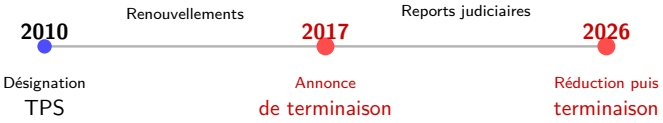
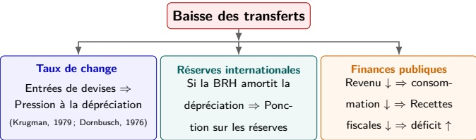

<!-- page 1 -->

## Chocs de transferts et vulnérabilité macrofinancière en Haïti: les risques liés au TPS?

Kensley Blaise, Jean Marie Cayemitte & Jean Gardy Victor

Direction Recherche en Economie et Finance (DREF)

Banque de la République d'Haïti (BRH)

Mercredi de Réflexion de la BID

Nouvelles dynamiques migratoires : quelques conséquences sur les transferts privés et l'économie haïtienne ?

23 septembre 2026

<!-- page 2 -->

## Plan de la présentation

① Introduction
2 Contexte du TPS et nature du choc
3 Données et cadre empirique
4 Méthodologie empirique
5 Résultats empiriques
6 Implications de politique économique
7 Conclusion
8 Appendice

<!-- page 3 -->

## Introduction

Les transferts privés de la diaspora représentent environ 16% du PIB haïtien et financement une large part de la consommation des ménages

Le durcissement du Temporary Protected Status (TPS) accordé par les États-Unis constitue un facteur de risque direct sur ces flux

• Un choc migratoire devient macro-financier via le canal des transferts

## Question

Dans quelle mesure une baisse inattendue des transferts affecte-t-elle la stabilité macrofinancière d'Haïti, et par quels canaux ?

Approche de l'étude :

• Analyse du contexte migratoire et institutionnel (TPS)

Identification statistique d'un choc de transferts

• Modélisation empirique des effets macrofinanciers (projections locales)

• Construction de scénarios de baisse des transferts

Point de méthode : le TPS constitue un facteur de risque potentiel sur les transferts, et non un choc automatiquement transmis – les migrants disposent de plusieurs marges d'absorption (section 1.4).

<!-- page 4 -->

### 1.1 Mieux comprendre les effets macro-financiers d'un choc sur les transferts

Dans une économie à faible capacité d'ajustement domestique, les transferts jouent un rôle de pilier macroéconomique.

Ils alimentent simultanément :

• la consommation privée et le revenu des ménages;

le marché des changes, en tant qu'entrée de devises ;

indirectement, les recettes fiscales liées à la demande intérieure.

Une variation importante de ces flux dépasse donc le seul revenu des ménages.

## Message clé

Un choc sur les transferts n'est pas seulement un choc de revenu : c'est potentiellement un choc de change, de réserves et de finances publiques.

<!-- page 5 -->

### 1.2 Le TPS : un facteur de risque sur les transferts

## Une forte dépendance aux transferts en provenance des États-Unis

Malgré 11 renouvellements depuis 2010, les épisodes de durcissement de 2017 et 2025 demeurent préoccupants : Les migrants haïtiens aux États-Unis sont à l'origine d'environ 80% des transferts reçus par Haïti. Toute réduction durable de leur capacité à travailler ou à résider légalement aux États-Unis pourrait donc avoir des répercussions macroéconomiques significatives.

<!-- page 6 -->

### 1.3 Une exposition macroéconomique particulièrement élevée

|   | Énvois de fonds recus (% du PIB), moyenne mobile 3 ans | Haiti reçoit 3.3x la moyenne ALC |
| --- | --- | --- |
| Honduras | 26.2% |   |
| El Salvador | 25.2% |   |
| Nicaragua | 20.7% |   |
| Jamaïque | 19.9% |   |
| Haiti | 19.1% |   |
| Guatemala | 18.7% |   |
| Mexique | 4.0% |   |

## Une forte exposition au risque

Les transferts représentent en moyenne 19% du PIB , soit 3,3 fois la moyenne régionale, ce qui rend l'économie haïtienne particulièrement vulnérable à une baisse de ces flux.

<!-- page 7 -->

### 1.4 Du TPS au choc de transferts : une chaîne non automatique

Facteurs d'atténuation : épargne, emploi alternatif, maintien des envois ou recomposition des transferts

À chaque maillon de cette chaîne, les migrants cherchent, et trouvent souvent, des mécanismes d'absorption – épargne, emploi alternatif, recomposition des envois – qui réduisent l'impact effectif sur les transferts : la transmission n'est ni instantanée ni proportionnelle.

Le durcissement du TPS ne se traduit donc pas nécessairement en choc de transferts : c'est un facteur de risque potentiel, et non un déterminant direct des transferts.

## Précision méthodologique

Le TPS motive les scénarios, mais l'identification économétrique repose sur les innovations des transferts, et non sur la chronologie des décisions migratoires.

<!-- page 8 -->

### 1.5 Un précédent international : le Mexique après la récession américaine

Précédent : impact de la récession US 2008-2009 sur les transferts mexicains

| Année | Transfers (millards $ US) |
| --- | --- |
| 2000 | 7 |
| 2001 | 10 |
| 2002 | 11 |
| 2003 | 17 |
| 2004 | 20 |
| 2005 | 24 |
| 2006 | 28 |
| 2007 | 29 |
| 2008 | 27.5 |
| 2009 | 22 |
| 2010 | 22.8 |
| 2011 | 22.8 |
| 2012 | 23 |
| 2013 | 24 |
| 2014 | 26 |
| 2015 | 29 |
| 2016 | 33 |
| 2017 | 38 |
| 2018 | 42 |
| 2019 | 45 |
| 2020 | 54 |
| 2021 | 61 |
| 2022 | 65 |

| Année | Croissance annuelle (%) |
| --- | --- |
| 2001 | 35% |
| 2002 | 8% |
| 2003 | 51% |
| 2004 | 19% |
| 2005 | 14% |
| 2006 | 17% |
| 2007 | 3% |
| 2008 | -2% |
| 2009 | -15.5% |
| 2010 | 6% |
| 2011 | 0% |
| 2012 | 0% |
| 2013 | 6% |
| 2014 | 4% |
| 2015 | 9% |
| 2016 | 12% |
| 2017 | 11% |
| 2018 | 9% |
| 2019 | 10% |
| 2020 | 25% |
| 2021 | 12% |
| 2022 | 7% |

Chute des transferts : 27,5 à 22,8 milliards USD entre 2007 et 2010 (-17,3%), retour au niveau pré-crise après 9 ans.

Une comparaison à interpréter avec prudence : la nature du choc diffère – contraction mexicaine cyclique (récession américaine) contre révocation du TPS institutionnelle, largement indépendante du cycle américain, sur fond de degrés d'intégration aux chaînes d'approvisionnement mondiales très différents. Ce précédent est donc davantage un ordre de grandeur historique qu'un véritable contrefactuel pour Haïti.

<!-- page 9 -->

### 1.6 Trois canaux de transmission domestique

## Des canaux interdépendants

La dépréciation renchérit les importations, la perte de réserves réduit la capacité future d'intervention et la détérioration budgétaire accroît les besoins de financement. Ces effets peuvent se renforcer et produire une dynamique cumulative de second tour.

<!-- page 10 -->

### 1.7 Un scénario naïf : transposer le précédent mexicain à Haïti

Impact révocation TPS (juillet 2026) : précédent récession US 2008-2009 (Sources : BRH + FMI WEO avril 2026)

| Ammée | Historique (BP$) (millions $ US) | Sclonario TPS (epsilon TPS) (millions $ US) |
| --- | --- | --- |
| 2000 | 0.75 |   |
| 2001 | 0.75 |   |
| 2002 | 0.75 |   |
| 2003 | 0.95 |   |
| 2004 | 1.30 |   |
| 2005 | 1.35 |   |
| 2006 | 1.60 |   |
| 2007 | 1.75 |   |
| 2008 | 1.65 |   |
| 2009 | 3.15 |   |
| 2010 | 2.70 |   |
| 2011 | 2.35 |   |
| 2012 | 2.30 |   |
| 2013 | 2.45 |   |
| 2014 | 2.30 |   |
| 2015 | 2.40 |   |
| 2016 | 2.80 |   |
| 2017 | 3.10 |   |
| 2018 | 2.90 |   |
| 2019 | 3.30 |   |
| 2020 | 4.05 |   |
| 2021 | 3.60 |   |
| 2022 | 3.50 |   |
| 2023 | 3.90 |   |
| 2024 | 4.50 |   |
| 2025 |   | 4.05 |
| 2026 |   | 4.15 |
| 2027 |   | 3.50 |
| 2028 |   | 3.50 |
| 2029 |   | 3.65 |
| 2030 |   | 3.65 |
| 2031 |   | 3.65 |

| Category | Macro | Percentage (%) | Details |
| --- | --- | --- | --- |
| Mexique (2009 réel) | -0.4pp PIB | 2.3 | 5x amplification, 5x amplification (Transfers/PIB = 11%) |
| Haïti (TPS scénario) | -1.9pp PIB | 11.1 | Transfers/PIB = 17.88 (Transfers/PIB = 11%) |

## Une illustration du risque, et non une prévision

La transposition mécanique du précédent mexicain suggère qu'une baisse d'environ 17% des transferts pourrait produire un effet macroéconomique beaucoup plus important en Haiti, compte tenu du poids élevé de ces flux dans le PIB. Cet exercice ne provient pas de notre modèle économétrique (sections 2–4) : c'est une transposition mécanique à titre illustratif, à lire avec la même prudence que la comparaison précédente – la nature institutionnelle, plutôt que cyclique, du choc TPS limite sa valeur prédictive pour Haiti.

<!-- page 11 -->

### 1.8 Un risque potentiellement plus persistant pour Haïti

| Source | Number of Disorders Hail's (�s) | Disorderal Prevalence (%) | Disorderal Prevalence (Hail's) |
| --- | --- | --- | --- |
| Moxique (Intl 2006-2009) | 2 | 72 | 100 |
| Hall (Moxique 1996) | 2 | 72 | 100 |
| Hall (projection, choc TPS) | 2 | 72 | 100 |
| Choc (Moxique) | 2 | 72 | 100 |
| Reaction Hall's (person Moxique once) | 4 | 78 | 78 |
| Disorderal Hall's (person Moxique once) | 4 | 78 | 78 |
| Disorderal Hall's (person Moxique once) | 4 | 78 | 84 |
| Disorderal Hall's (person Moxique once) | 6 | 78 | 84 |
| Disorderal Hall's (person Moxique once) | 6 | 78 | 83 |
| Disorderal Hall's (person Moxique once) | 6 | 78 | 83 |
| Disorderal Hall's (person Moxique once) | 6 | 78 | 91 |
| Disorderal Hall's (person Moxique once) | 6 | 78 | 91 |
| Disorderal Hall's (person Moxique once) | 6 | 78 | 93 |
| Disorderal Hall's (person Moxique once) | 6 | 78 | 97 |

## Le caractère institutionnel du choc pourrait ralentir la reprise

Contrairement à la récession américaine, qui constituait principalement un choc cyclique, la révocation du TPS serait un choc institutionnel potentiellement plus durable. Le retour des transferts à leur niveau initial pourrait donc être plus lent – à lire comme un ordre de grandeur illustratif, construit sur l'hypothèse d'une récupération 30% plus lente qu'au Mexique, et non comme une prévision chiffrée.

<!-- page 12 -->

### 2.1 Les données

252 observations mensuelles, octobre 2004 – septembre 2025.

Cinq séries : transferts, taux de change, réserves nettes, déficit public et IPC.

| Variable | Moyenne | Médiane | Écart-type | Asymétrie | Aplatissement |
| --- | --- | --- | --- | --- | --- |
| Transferts | 166,73 | 132,49 | 96,41 | 0,79 | -0,52 |
| Taux de change | 67,77 | 47,20 | 34,46 | 0,99 | -0,43 |
| Réserves nettes | 569,47 | 645,49 | 371,68 | -0,05 | -1,21 |
| Déficit public | -1462,50 | -588,34 | 3414,56 | -1,45 | 4,95 |
| IPC (indice) | 130,06 | 72,23 | 121,34 | 1,88 | 2,61 |

Source : BRH. Le taux de change, les transferts et l'IPC entrent en logarithme, les réserves nettes en sinus hyperbolique inverse, le déficit en niveau (milliers HTG). L'IPC est ajouté comme cinquième série, en réponse aux remarques formulées lors de la relecture interne et de la présentation des Vendredis de la BRH (28 août 2026).

<!-- page 13 -->

### 2.2 — Séries temporelles

| Date | Transferts |
| --- | --- |
| 2004-01 | 3.9 |
| 2005-01 | 4.1 |
| 2006-01 | 4.3 |
| 2007-01 | 4.5 |
| 2008-01 | 4.4 |
| 2009-01 | 4.5 |
| 2010-01 | 4.6 |
| 2011-01 | 4.7 |
| 2012-01 | 4.6 |
| 2013-01 | 4.8 |
| 2014-01 | 4.9 |
| 2015-01 | 5.0 |
| 2016-01 | 5.1 |
| 2017-01 | 5.3 |
| 2018-01 | 5.4 |
| 2019-01 | 5.5 |
| 2020-01 | 5.6 |
| 2021-01 | 5.8 |
| 2022-01 | 5.9 |
| 2023-01 | 6.0 |

| Date | Taux de change |
| --- | --- |
| 2004-01 | 3.58 |
| 2005-01 | 3.65 |
| 2006-01 | 3.78 |
| 2007-01 | 3.70 |
| 2008-01 | 3.55 |
| 2009-01 | 3.65 |
| 2010-01 | 3.70 |
| 2011-01 | 3.68 |
| 2012-01 | 3.70 |
| 2013-01 | 3.72 |
| 2014-01 | 3.75 |
| 2015-01 | 3.80 |
| 2016-01 | 3.95 |
| 2017-01 | 4.15 |
| 2018-01 | 4.20 |
| 2019-01 | 4.25 |
| 2020-01 | 4.50 |
| 2021-01 | 4.75 |
| 2022-01 | 4.15 |
| 2023-01 | 4.70 |
| 2024-01 | 5.05 |
| 2025-01 | 4.90 |

| Date | Reserves nettes |
| --- | --- |
| 2004-01 | 5.0 |
| 2008-01 | 6.2 |
| 2012-01 | 7.8 |
| 2016-01 | 7.5 |
| 2020-01 | 7.0 |
| 2024-01 | -5.8 |

| Date | Deficit public |
| --- | --- |
| 2004-01 | -0.5 |
| 2008-01 | 0.2 |
| 2012-01 | 0.5 |
| 2016-01 | -1.0 |
| 2020-01 | -2.5 |
| 2024-01 | 2.5 |

| Date | IPC |
| --- | --- |
| 2004-01 | 3.55 |
| 2008-01 | 3.85 |
| 2012-01 | 4.10 |
| 2016-01 | 4.30 |
| 2020-01 | 4.90 |
| 2024-01 | 5.80 |

Source : BRH. Transferts, taux de change, IPC (log) et réserves nettes (arcsinh), déficit public (milliers HTG), données mensuelles 2004–2025.

<!-- page 14 -->

## Innovation autorégressive

 $$ \varepsilon_{t}(erreur)=\Delta\log(\mathrm{rem}_{t})-\sum_{j=1}^{6}\hat{\rho}_{j}\Delta\log(\mathrm{rem}_{t-j}) $$

•  $ \varepsilon_{t} $ : résidu d'un AR(6) sur la croissance mensuelle des transferts – la part non prévisible à partir de leur propre dynamique récente.

• Fenêtre de 6 mois : capte le cycle budgétaire trimestriel et une partie de la saisonnalité des envois.

• Traitement en bloc exogène (Cushman-Zha) : la décision américaine sur le TPS est indépendante des conditions macroéconomiques haïtiennes.

<!-- page 15 -->

### 3. Approche empirique

Objectif : mesurer l'effet dynamique d'un choc de transferts sur les variables macrofinancières haïtiennes.

Méthode : projections locales à la Jordà.

Erreurs-types : Newey-West, troncature = h (horizons chevauchants).

## Spécification simplifiée

 $$ w_{t+h}-w_{t-1}=\tau_{h}\varepsilon_{t}+\Gamma_{h}X_{t-1}+\eta_{t+h} $$

•  $ w_{t+h} $ : taux de change, réserves nettes, déficit public ou IPC;

•  $ \varepsilon_{t} $: choc de transferts identifié (section 2.3);

horizon : 0 à 23 mois.

<!-- page 16 -->

### 4.1 Résultat principal : le canal budgétaire domine

Après un choc de transferts, les trois canaux macrofinanciers réagissent dans le sens attendu : dépréciation, perte de réserves, creusement du déficit.

Le canal budgétaire se distingue par la meilleure identification statistique et par sa persistance.

L'IPC, ajouté comme quatrième variable de réponse, affiche un signal directionnel cohérent avec la théorie (inflation importée) mais non significatif (section 4.5).

## Interprétation

La baisse du revenu des ménages comprime la consommation et les recettes fiscales; cet effet se déploie avec un délai propre et ne se résume pas à sa dynamique de court terme.

<!-- page 17 -->

### 4.2 Réponses macrofinancières au choc de transferts

| Horizon (mois) | Réponse centre |
| --- | --- |
| 0 | -1.0 |
| 1 | -0.15 |
| 2 | -0.32 |
| 3 | -0.42 |
| 4 | -0.25 |
| 5 | -0.28 |
| 6 | -0.30 |
| 7 | -0.35 |
| 8 | -0.28 |
| 9 | -0.32 |
| 10 | -0.30 |
| 11 | -0.32 |
| 12 | -0.30 |
| 13 | -0.30 |
| 14 | -0.30 |
| 15 | -0.30 |
| 16 | -0.30 |
| 17 | -0.30 |
| 18 | -0.30 |
| 19 | -0.30 |
| 20 | -0.30 |
| 21 | -0.30 |
| 22 | -0.30 |

| Horizon (mois) | Réponse centrale | Intervalie a 90% |
| --- | --- | --- |
| 0 | 0.00 | 0.00 |
| 1 | 0.02 | 0.01 |
| 2 | 0.04 | 0.02 |
| 3 | 0.06 | 0.05 |
| 4 | 0.12 | 0.10 |
| 5 | 0.16 | 0.20 |
| 6 | 0.17 | 0.29 |
| 7 | 0.14 | 0.25 |
| 8 | 0.13 | 0.20 |
| 9 | 0.15 | 0.26 |
| 10 | 0.17 | 0.31 |
| 11 | 0.14 | 0.22 |
| 12 | 0.09 | 0.15 |
| 13 | 0.08 | 0.12 |
| 14 | 0.06 | 0.10 |
| 15 | 0.02 | 0.05 |
| 16 | 0.01 | -0.02 |
| 17 | 0.04 | 0.00 |
| 18 | 0.07 | 0.05 |
| 19 | 0.04 | 0.08 |
| 20 | 0.02 | 0.05 |
| 21 | 0.04 | 0.09 |
| 22 | 0.03 | 0.06 |

| Horizon (mais) | Réponse centre | Intervalle à 90% |
| --- | --- | --- |
| 0 | -0.2 | 0.4 |
| 1 | -0.9 | -1.5 |
| 2 | -0.7 | -1.0 |
| 3 | -1.1 | -2.0 |
| 4 | -0.4 | -0.8 |
| 5 | -0.9 | -1.8 |
| 6 | 0.0 | -0.5 |
| 7 | -0.2 | 0.0 |
| 8 | 0.0 | -0.2 |
| 9 | 0.0 | 0.5 |
| 10 | 0.8 | 1.5 |
| 11 | -0.4 | 0.0 |
| 12 | -0.1 | -0.5 |
| 13 | -1.8 | -2.5 |
| 14 | -0.4 | -0.2 |
| 15 | -0.2 | 0.0 |
| 16 | -0.2 | -0.1 |
| 17 | 0.0 | 0.5 |
| 18 | 1.0 | 1.5 |
| 19 | -0.2 | 0.0 |
| 20 | 0.6 | 1.0 |
| 21 | 1.5 | 2.0 |
| 22 | 1.5 | 2.8 |

| Horizon (mois) | Réponse centre | intervalle à 90% |
| --- | --- | --- |
| 0 | 0.8 | 3.0 |
| 1 | -1.0 | -1.0 |
| 2 | -4.5 | -4.0 |
| 3 | -1.0 | 0.0 |
| 4 | 2.5 | 5.0 |
| 5 | 2.0 | 2.0 |
| 6 | 1.8 | 4.0 |
| 7 | 1.5 | 1.0 |
| 8 | 0.0 | 6.0 |
| 9 | 3.8 | 0.0 |
| 10 | -1.0 | 3.0 |
| 11 | -3.0 | -2.0 |
| 12 | 0.5 | 1.0 |
| 13 | -1.0 | -4.0 |
| 14 | -6.0 | -6.0 |
| 15 | -2.0 | 0.0 |
| 16 | 1.5 | 3.0 |
| 17 | 1.5 | 1.0 |
| 18 | -1.0 | 4.0 |
| 19 | -1.5 | -2.0 |
| 20 | 3.0 | 5.0 |
| 21 | -1.0 | -3.0 |
| 22 | 0.5 | 3.0 |

| Horizon (mois) | Response centre | Intervalle a 90% |
| --- | --- | --- |
| 0 | 0.00 | 0.00 |
| 5 | 0.01 | -0.02 |
| 10 | 0.04 | -0.03 |
| 15 | 0.05 | -0.04 |
| 20 | 0.06 | -0.08 |
| 22 | 0.04 | -0.09 |

Notes : Projections locales, innovation négative unitaire de  $ \varepsilon_t $ (baisse des transferts), horizon 24 mois, bandes de confiance à 90% (le cadran des transferts n'en comporte pas – réponse exacte du processus AR sous-jacent).

<!-- page 18 -->

### 4.3 Le canal du taux de change : significatif mais modéré

La réponse du change devient statistiquement nette entre le  $ 5^{e} $ et le  $ 13^{e} $ mois environ, plutôt que dès le premier trimestre.

Ce délai laisse une fenêtre d'observation aux autorités avant que la pression ne devienne la plus vive.

## Lecture économique

La dynamique du change est progressive, pas instantanée – elle offre un espace d'action à la BRH avant le pic de pression.

<!-- page 19 -->

### 4.4 Le canal des réserves : le moins bien identifié

L'intervalle de confiance à 90% n'exclut zéro qu'à quelques mois isolés sur l'ensemble des horizons testés.

L'intensité de ce canal dépend fortement du comportement effectif de la BRH (arbitrage flexibilité du change / mobilisation des réserves).

## Prudence de lecture

L'ampleur statistiquement établie de la pression sur les réserves reste, à ce stade de l'identification, plus incertaine que celle sur le change ou le budget.

<!-- page 20 -->

### 4.5 L'IPC : un signal directionnel, non significatif

• Réponse centrale positive à l'ensemble des vingt-quatre horizons – cohérente en signe avec le mécanisme d'inflation importée (dépréciation ⇒ renchérissement des biens échangeables).

Ampleur croissante jusqu'à un maximum de 0,066 point de log vers le vingtième mois.

Aucun coefficient n'est statistiquement distinguable de zéro :  $ |t| < 1 $,2 à tous les horizons rapportés.

## Lecture

Un signal qualitativement cohérent avec la théorie, mais qui n'est pas assez précisément estimé pour justifier, à lui seul, un arbitrage de politique monétaire ; il renforce plutôt l'argument en faveur d'une défense précoce du change. Les tests de stationnarité (annexe A9) invitent en outre à une lecture prudente au-delà des premiers mois.

<!-- page 21 -->

### 4.6 Résultats chiffrés des scénarios

| Scénario | $ \bar{\Delta} $ change | $ \bar{\Delta} $ réserves | $ \bar{\Delta} $ déficit | $ \bar{\Delta} $ IPC |
| --- | --- | --- | --- | --- |
| -10% | +0,78% | -1,95% | -36,8 HTG | +0,29% |
| -20% | +1,65% | -3,97% | -78,1 HTG | +0,61% |
| -30% | +2,66% | -6,03% | -124,9 HTG | +0,97% |

Écart moyen à la référence, horizon de 24 mois. Dépréciation positive ; réserves négatives = déplétion ; déficit négatif = élargissement ; IPC positif = inflation par rapport à la référence (signal non significatif, cf. 4.5).

Effet quasi-linéaire dans l'ampleur du choc – pas de rupture de régime imposée artificiellement.

• Magnitudes plus modérées qu'un calibrage libre ne le suggérerait : une identification resserrée produit des effets plus conservateurs, mais plus défendables.

<!-- page 22 -->

### 4.7 — Prévisions par scénario

Prévisions par projections locales

| Transfers | 2025-10 | 2026-01 | 2026-04 | 2026-07 | 2026-10 | 2027-01 | 2027-04 | 2027-07 | 2027-10 |
| --- | --- | --- | --- | --- | --- | --- | --- | --- | --- |
| -10% | 370 | 355 | 338 | 338 | 338 | 338 | 338 | 338 | 338 |
| -20% | 365 | 330 | 300 | 300 | 300 | 300 | 300 | 300 | 300 |
| -30% | 358 | 305 | 263 | 263 | 263 | 263 | 263 | 263 | 263 |
| Reference | 378 | 378 | 378 | 378 | 378 | 378 | 378 | 378 | 378 |

| Date | Intervalle à 50 % (-30 %) | Intervalle à 90 % |
| --- | --- | --- |
| 2025-10 | 130.2 | 130.2 |
| 2026-01 | 131.2 | 131.8 |
| 2026-04 | 133.2 | 134.8 |
| 2026-07 | 134.8 | 137.2 |
| 2026-10 | 135.4 | 138.2 |
| 2027-01 | 134.0 | 136.5 |
| 2027-04 | 132.2 | 134.0 |
| 2027-07 | 131.6 | 132.8 |
| 2027-10 | 131.8 | 133.0 |

| Date | Dark Blue | Yellow | Pink | Light Blue | Orange |
| --- | --- | --- | --- | --- | --- |
| 2025-10 | 1350 | 1350 | 1350 | 1350 | 1350 |
| 2026-01 | 1280 | 1250 | 1220 | 1180 | 1100 |
| 2026-04 | 1250 | 1150 | 1120 | 1050 | 1020 |
| 2026-07 | 1300 | 1280 | 1250 | 1150 | 1180 |
| 2026-10 | 1350 | 1350 | 1350 | 1350 | 1350 |
| 2027-01 | 1280 | 1250 | 1220 | 1180 | 1100 |
| 2027-04 | 1250 | 1200 | 1180 | 1120 | 1050 |
| 2027-07 | 1350 | 1350 | 1350 | 1350 | 1350 |
| 2027-10 | 2200 | 1820 | 1620 | 1450 | 1480 |

| Date | Dark Blue Line | Light Blue Line | Orange Line | Teal Line |
| --- | --- | --- | --- | --- |
| 2025-10 | -18600 | -18600 | -18600 | -18600 |
| 2026-01 | -18850 | -19000 | -18700 | -18750 |
| 2026-04 | -18700 | -18800 | -18650 | -18700 |
| 2026-07 | -18550 | -18100 | -18450 | -18500 |
| 2026-10 | -18600 | -18600 | -18600 | -18600 |
| 2027-01 | -18950 | -19500 | -18900 | -18950 |
| 2027-04 | -18800 | -19250 | -18950 | -18850 |
| 2027-07 | -18600 | -18500 | -18500 | -18550 |
| 2027-10 | -18600 | -18600 | -18600 | -18600 |

| Date | Dark Blue | Medium Blue | Light Blue |
| --- | --- | --- | --- |
| 2025-10 | 556.0 | 556.0 | 556.0 |
| 2026-01 | 556.5 | 557.0 | 556.5 |
| 2026-04 | 557.0 | 559.0 | 557.5 |
| 2026-07 | 557.5 | 561.0 | 558.0 |
| 2026-10 | 558.0 | 563.0 | 559.0 |
| 2027-01 | 559.0 | 565.5 | 562.0 |
| 2027-04 | 559.5 | 566.0 | 562.5 |
| 2027-07 | 559.5 | 566.0 | 562.5 |
| 2027-10 | 559.5 | 566.0 | 562.5 |

Notes : référence à niveaux constants et trois scénarios de choc (-10%, -20%, -30%), cinq variables dont l'IPC.

<!-- page 23 -->

## Résultat central

Même un choc modéré de transferts a un effet mesurable sur l'économie haïtienne, et le canal budgétaire - pas seulement le change - doit être au cœur de la lecture du risque.

La dépréciation se construit progressivement (pic vers le dixième mois).

Les réserves reculent, mais ce canal reste le moins bien identifié.

Le déficit se creuse avec un délai propre et une persistance confirmée par le test de surrogacité (section 5.3 du document).

L'IPC suit un signal directionnel cohérent, sans significativité statistique.

<!-- page 24 -->

### 5.1 Séquencement de la réponse

Défendre la liquidité durant les 90 premiers jours – préserver la confiance, réduire le risque de ruée.

2 Plafonner le surajustement du change – éviter un ajustement désordonné.

Protéger l'ancrage budgétaire – canal le mieux identifié et le plus persistant.

Préparer en amont un filet de sécurité financier externe – notamment via les facilities du FMI afin de disposer de ressources mobilisables en cas de forte contraction des transferts

Reconstituer les réserves une fois la stabilisation acquise.

## Priorité opérationnelle

Agir dès les premiers mois : la fenêtre de décision pertinente est le premier trimestre suivant le choc.

<!-- page 25 -->

### 5.2 Suivi et intégration dans les exercices de résilience

Les chocs de transferts augmentent la demande de devises et peuvent accélérer l'érosion des réserves si la BRH intervient.

Ils justifient l'intégration de scénarios migratoires dans :

les prévisions macrofinancières;

les exercices de stress test externe:

• la surveillance de la balance des paiements.

<!-- page 26 -->

### 5.3 Le canal budgétaire : une priorité de crédibilité

La perte de recettes fiscales contraint directement les options de financement du gouvernement.

Une monétisation du déficit affaiblirait la monnaie et compromettrait l'ancrage nominal.

## Orientation

Éviter le financement monétaire du déficit et préserver la crédibilité budgétaire, plutôt que de concentrer toute la réponse sur la seule défense du taux de change.

<!-- page 27 -->

## Conclusion

Un choc de transferts, même modéré, a des effets mesurables et multi-canaux sur l'économie haïtienne.

Le canal budgétaire – le mieux identifié et le plus persistant – doit être au cœur de la réponse de politique économique.

L'horizon de décision pertinent est le premier trimestre suivant le choc.

- Une réponse coordonnée s'impose : liquidité, défense mesurée des réserves, crédibilité budgétaire, financement externe préarrangé.

Le TPS reste une source potentielle de risque sur les transferts, plutôt qu'un choc causal directement identifié : la prudence s'impose autant sur l'ampleur que sur le calendrier de matérialisation.

## Message final

Pour Haïti, un durcissement du TPS peut, via les transferts, devenir un choc de taux de change, de réserves et de stabilité budgétaire – mais rien ne garantit que la transmission soit automatique ni immédiate.

<!-- page 28 -->

Merci.

<!-- page 29 -->

Bloc canonique

 $$ x_{t}=\mathbb{E}_{t}x_{t+1}-\frac{1}{\sigma}\left(i_{t}-\mathbb{E}_{t}\pi_{t+1}-r_{t}^{n}\right)+\chi\tau_{t} $$

 $$ \pi_{t}=\beta\mathbb{E}_{t}\pi_{t+1}+\kappa x_{t}+\lambda q_{t} $$

 $$ i_{t}=\phi_{\pi}\pi_{t}+\phi_{x}x_{t}+\phi_{q}q_{t} $$

•  $ \tau_t $: choc de transferts (négatif en cas de baisse);  $ q_t $: taux de change réel, avec  $ q_t \approx -\psi \tau_t $.

Le choc agit comme un choc de demande négatif  $ \left(\chi\tau_{t}\right) $ tout en alimentant l'inflation importée  $ \left(\lambda q_{t}\right) $ – configuration stagflationniste.

Cadre à la Galí et Monacelli (2005), utilisé ici pour l'intuition, pas pour l'estimation.

<!-- page 30 -->

## A2 — Fonctions de réponse détaillées

| h | Change $ \log \hat{\tau}_h $ | t | Reserves $ \bar{\tau}_h $ | (arcsinh) t | Deficit $ \bar{\tau}_h $ | (kHTG) t | IPC $ \bar{\tau}_h $ | (log) t |
| --- | --- | --- | --- | --- | --- | --- | --- | --- |
| 0 | -0,006 | -0,46 | +0,240 | +0,54 | -0,879 | -0,69 | -0,000 | -0,02 |
| 5 | -0,163 | $ -2,11^{{*}} $ | +0,950 | +1,66 | -1,962 | -1,61 | -0,013 | -0,59 |
| 8 | -0,133 | $ -2,28^{{*}} $ | +0,024 | +0,05 | +0,204 | +0,18 | -0,018 | -0,55 |
| 11 | -0,131 | -1,91 | +0,447 | +0,49 | +3,219 | $ +2,38^{{*}} $ | -0,041 | -1,07 |
| 14 | -0,067 | -1,36 | +0,279 | +0,31 | +6,189 | $ +3,88^{{*}} $ | -0,052 | -1,06 |
| 23 | -0,026 | -0,56 | -1,559 | -1,90 | -0,526 | -0,31 | -0,039 | -0,51 |

* significatif à 5%. Réponse à une surprise positive de +1 sur  $ \varepsilon_t $; le signe attendu pour un choc négatif est l'opposé. Erreurs-types de Newey-West, troncature = h.

<!-- page 31 -->

## A3 — Test de robustesse : la surrogacité

Barnichon et al. (2026) : la réponse de court terme résumé-t-elle l'essentiel de la trajectoire à deux ans ?

Appliqué aux trois canaux macrofinanciers ; l'IPC, ajouté comme quatrième variable de réponse, n'est pas soumis à ce test.

| Variable | Rejets (s = 6) | |t| max | Lecture |
| --- | --- | --- | --- |
| Taux de change | 0/18 | 1,24 | Condition acceptée |
| Réserves nettes | 1/18 | 2,07 | Acceptée, pour l'essentiel |
| Déficit public | 5/18 | 4,59 | Rejetée à plusieurs horizons |

## Message clé

Le canal budgétaire est déjà le mieux identifié – il est aussi celui dont l'effet se déploie le plus loin dans le temps. Les deux résultats se renforcent mutuellement.

<!-- page 32 -->

## A4 — Instrument narratif : la chronologie du TPS

| Date | Événement | Signe |
| --- | --- | --- |
| 2010-01 | Désignation initiale du TPS pour Haïti (post-séisme) | +2 |
| 2017-05 | Kelly n'accorde que 6 mois au lieu de 18 | -1 |
| 2017-11 | Duke annonce la terminaison du TPS | -2 |
| 2019-04 | Le juge Kuntz bloque la terminaison | +1 |
| 2021-08 | Biden/Mayorkas rédégène pour 18 mois | +2 |
| 2025-02 | Noem annonce l'écourement à août 2025 | -2 |
| 2025-07 | Avis officiel de terminaison, effectif le 2 sept. 2025 | -2 |

13 décisions recensées entre janvier 2010 et septembre 2025 (liste complète abrégée ci-dessus).

• Seulement 2 véritables épisodes de durcissement majeur : novembre 2017 et février–septembre 2025.

<!-- page 33 -->

## A5 — Force de l'instrument narratif

| Fenêtre de cumul | Coefficient | Statistique $F$ |
| --- | --- | --- |
| 1 mois | +0,0122 | 0,19 |
| 3 mois | -0,0037 | 0,05 |
| 6 mois | -0,0141 | 1,47 |
| 12 mois | -0,0074 | 0,72 |

## Diagnostic

La statistique F ne dépasse jamais 1,5, très en deçà du seuil conventionnel de robustesse de 10 (Staiger et Stock, 1997) : l'instrument narratif est trop faible pour être retenu comme identification principale.

L'identification par l'innovation autorégressive  $ \varepsilon_{t} $ (section 2.3) reste donc la stratégie retenue.

<!-- page 34 -->

## A6 — Une extension non retenue : prior hiérarchique par panel

- Idée : emprunter de la force statistique à un panel de pays comparables par leur dépendance aux transferts (Salvador, Honduras, Guatemala, Jamaïque, Mexique).

Objectif : ancrer les élasticités transferts → change, transferts → réserves, transferts → déficit sur une base plus large que l'échantillon haïtien seul.

## Pourquoi ce n'est pas mis en œuvre

Le solde budgétaire mensuel est rarement publié pour ces pays comparables - une mise en œuvre complète laisserait le canal budgétaire, pourtant le mieux identifié ici, sans bénéfice comparable.

Piste : accès institutionnel direct de la BRH aux bases de données du FMI (IFS).

<!-- page 35 -->

## A7 — Construction des scénarios : détail technique

## Convolution causale

 $$ \widehat{\mathrm{d e v}}_{h}=\sum_{k=1}^{\min(h,6)}e_{k}\hat{\tau}_{h-k+1} $$

Choc cumulé de s% atteint progressivement sur 6 mois puis stabilisé → séquence de surprises mensuelles  $ e_1, \ldots, e_6 $.

• Référence fixée aux derniers niveaux observés (change : 130,64 ; réserves nettes 1342,75 ; déficit : -18 641,84 HTG ; transferts : 376,21), maintenus constants.

L'échantillon se termine à des extrêmes historiques (réserves proches d'un sommet, déficit proche d'un creux) – d'où le choix d'une référence plate plutôt qu'une projection inconditionnelle.

<!-- page 36 -->

## A8 — Écarts à la référence, les cinq variables

| Date | -10% | -20% | -30% |
| --- | --- | --- | --- |
| 2025-10 | 0.0 | 0.0 | 0.0 |
| 2026-01 | 0.2 | 0.5 | 1.0 |
| 2026-04 | 1.2 | 2.8 | 4.5 |
| 2026-07 | 2.0 | 4.2 | 6.8 |
| 2026-10 | 2.2 | 4.6 | 7.5 |
| 2027-01 | 1.8 | 3.8 | 6.0 |
| 2027-04 | 0.8 | 1.5 | 2.5 |
| 2027-07 | 0.5 | 1.0 | 1.7 |
| 2027-10 | 0.6 | 1.2 | 2.0 |

| Date | -10% | -20% | -30% |
| --- | --- | --- | --- |
| 2025-10 | 0 | 0 | 0 |
| 2026-01 | -100 | -150 | -200 |
| 2026-04 | -120 | -200 | -280 |
| 2026-07 | -50 | -100 | -150 |
| 2026-10 | 0 | 0 | 0 |
| 2027-01 | -50 | -100 | -150 |
| 2027-04 | -80 | -150 | -220 |
| 2027-07 | 0 | 0 | 100 |
| 2027-10 | 120 | 280 | 450 |

| Date | -10% | -20% | -30% |
| --- | --- | --- | --- |
| 2025-10 | 25 | 25 | 25 |
| 2026-01 | -100 | -200 | -350 |
| 2026-04 | -50 | -100 | -200 |
| 2026-07 | 200 | 450 | 680 |
| 2026-10 | 50 | 50 | 50 |
| 2027-01 | -250 | -600 | -900 |
| 2027-04 | -150 | -250 | -500 |
| 2027-07 | 100 | 200 | 300 |
| 2027-10 | 50 | 75 | 100 |

|   | 2025-10 | 2026-01 | 2026-04 | 2026-07 | 2026-10 | 2027-01 | 2027-04 | 2027-07 | 2027-10 |
| --- | --- | --- | --- | --- | --- | --- | --- | --- | --- |
| -10% | -5 | -25 | -38 | -38 | -38 | -38 | -38 | -38 | -38 |
| -20% | -15 | -45 | -75 | -75 | -75 | -75 | -75 | -75 | -75 |
| -30% | -20 | -60 | -110 | -110 | -110 | -110 | -110 | -110 | -110 |

| Date | -10% | -20% | -30% |
| --- | --- | --- | --- |
| 2025-10 | 0.0 | 0.0 | 0.0 |
| 2026-01 | 0.2 | 0.4 | 0.8 |
| 2026-04 | 0.5 | 1.2 | 2.0 |
| 2026-07 | 1.0 | 2.2 | 3.5 |
| 2026-10 | 1.8 | 4.0 | 6.0 |
| 2027-01 | 2.8 | 5.8 | 9.0 |
| 2027-04 | 2.9 | 6.0 | 9.8 |
| 2027-07 | 2.9 | 6.2 | 10.0 |
| 2027-10 | 2.8 | 6.0 | 9.8 |

Trajectoires d'écart à la référence pour les cinq variables – dont les transferts (trajectoire imposée, non estimée) et l'IPC – pour les trois scénarios de choc (-10%, -20%, -30%).

<!-- page 37 -->

## A9 — Tests de stationnarité (nouveaux tests économétriques)

• ADF, KPSS et Phillips-Perron sur les niveaux et premières différences des cinq séries.

Pour les quatre séries du corps du texte : diagnostic cohérent entre les trois tests – aucune ne rejette la racine unitaire en niveau, toutes rejettent nettement la racine unitaire en première différence.

Pour l'IPC : diagnostic mixte en première différence – l'ADF ne rejette pas la racine unitaire (p = 0,26) alors que le PP la rejette nettement et que le KPSS rejette la stationnarité.

## Implication

Cette ambiguïté invite à traiter avec prudence les résultats mobilisant l'IPC (sections 4.5 et 4.6), en particulier au-delà d'un horizon de quelques mois.

<!-- page 38 -->

## A10 — Sélection du nombre de retards

<table><tr><td>Critère</td><td>Système à 4 var.</td><td>Système à 5 var. (avec IPC)</td></tr><tr><td>AIC</td><td>16</td><td>17</td></tr><tr><td>BIC</td><td>2</td><td>2</td></tr><tr><td>HQIC</td><td>12</td><td>12</td></tr><tr><td>FPE</td><td>16</td><td>17</td></tr><tr><td>Retenu (justification économique)</td><td>6</td></tr></table>

Les quatre critères d'information ne convergent pas vers un ordre commun (2 à 17 mois selon le critère).

P = 6 retenu pour des raisons institutionnelles – cycle budgétaire trimestriel et délai plausible de transmission – plutôt que par optimisation statistique pure.
