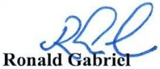
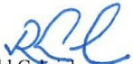

<!-- page 1 -->

Port-au-Prince, le mardi 27 octobre 2026

# Compte rendu des soumissions non compétitives de Bons BRH à taux fixe et intérêts précomptés INSTITUTIONS FINANCIÈRES NON BANCAIRES

Bons BRH - durée 7 jours - Échéance : 04/11/2026

___

Nombre de soumissionnaires : 3

Nombre de soumissions : 3

Montant global des soumissions : 2,230 MG (Deux milliards deux cent trente millions de gourdes)

Prix proposés : 99.883%

Montant des soumissions servies : 2,230 MG (Deux milliards deux cent trente millions de gourdes)

Montant des soumissions non servies : 0 MG (Zéro million de gourde)

Prix retenu : 99.883%

Prix minimum retenu : 99.883%

Taux de rendement précompté moyen pondéré : 6.024%

Taux de rendement actuariel moyen pondéré : 6.294%

Ronald Gabriel

P.O. BOX 1570, Port-au-Prince, Haïti. Téléphone: 2942-0013

<!-- page 2 -->

## AVIS

La Banque de la République d'Haïti informe le public que, en référence à l'adjudication du Bons BRH 202645 échéance du 04/11/2026 en date du lundi 26 octobre 2026, les montants (INSTITUTIONS FINANCIERES NON BANCAIRES) suivants totalissant DEUX MILLIARDS DEUX CENT TRENTE MILLIONS DE GOURDES représentant 100.00% des soumissions effectuées au prix plafond ont été acceptés :

| Noms | Monnaie HTG | Montant en millions 80,000,000.00 | Prix $ ^{{*}} $ 99.883% | Tx d'intérêt nominal (décoté) $ ^{{**}} $ 6.017% |
| --- | --- | --- | --- | --- |
| Soumissionaire # 1 | HTG | 950,000,000.00 | 99.883% | 6.017% |
| Soumissionaire # 2 | HTG | 1,200,000,000.00 | 99.883% | 6.017% |
| Soumissionaire # 3 | HTG | 1,200,000,000.00 | 99.883% | 6.017% |

exprime en % du nominal souscrit

** en base annuelle

Port-au-Prince, le mardi 27 octobre 2026

Ronald Gabriel

<!-- page 3 -->

<table><tr><td>INSTITUTS FINANCIÈRES NON BANCAIRES</td></tr><tr><td>Prix proposés en %</td><td></td><td># 1</td><td># 2</td><td># 3</td><td>Total</td><td>Cumul</td><td>P.M.P</td><td>Tx nominal Acceptation</td></tr><tr><td></td><td></td><td>99.883</td><td>80</td><td>950</td><td>1200</td><td>2,230</td><td>2,230</td><td>6.017% 100%</td></tr><tr><td>Total soumis</td><td>2,230</td><td>80</td><td>950</td><td>1200</td><td>2,230</td><td></td><td></td><td></td></tr><tr><td>Total servi</td><td>2,230</td><td>80</td><td>950</td><td>1200</td><td>2,230</td><td></td><td></td><td></td></tr><tr><td>Acceptation</td><td></td><td>100%</td><td>100%</td><td>100%</td><td>100%</td><td></td><td></td><td></td></tr></table>

RESULTAT DES SOMISSIONS NON COMPETITIVES (I.F.N.B.) DU LUNDI 26 octobre 2026-BON BRH 7 JOURS-ECHEANCE 04/11/26 202645
