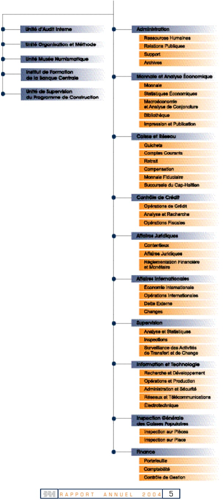

<!-- page 1 -->

<!-- page 2 -->

<!-- page 3 -->

CONSEIL D'ADMINISTRATION

RAYMOND MAGLOIRE

Gouverneur

PHILIPPE W LAHENS

Gouverneur-Adjoint

CHARLES CASTEL Directeur Général

RÉMY MONTAS

Membre

GEORGES HENRY FILS

Membre

<!-- page 4 -->

<!-- page 5 -->

## ORGANIGRAMME Conseil d'Administration

<!-- page 6 -->

<!-- page 7 -->

## TABLE DES MATIÈRES

### A. L'ACTIVITÉ ÉCONOMIQUE EN 2004

I. PRODUCTION, PRIX ET EMPLOI .....19
I.I. Production .....19
I.2. Prix et salaires .....22
I.3. Situation de l'emploi .....23

II. LA MONNAIE ET LE FINANCEMENT DE L'ÉCONOMIE .....25
II.1. La politique monétaire en 2004 .....25
II.2. Les résultats intermédiaires .....29
II.3. Les résultats finals .....30
II.4. Évolution des agrégats monétaires .....32
II.5. Contreparties de M3 et financement de l'économie .....33

III. LES FINANCES PUBLIQUES .....35
III.1. Recettes .....36
III.2. Dépenses .....38
III.3. Financement .....40

IV. LA BALANCE DES PAIEMENTS .....44
IV.1. Transactions courantes .....45
IV.2. Mouvements de capitaux .....47

V. LA DETTE PUBLIQUE EXTERNE .....49
V.1. Encours de la dette publique externe .....49
V.2. Decaissements, Service de la dette et arriérés de paiements .....51

B. ÉVOLUTION DU SYSTÈME BANCAIRE EN 2004

VI. LE SYSTÈME BANCAIRE : VUE D'ENSEMBLE .....55
VI.1. Le système bancaire .....56
VI.2. Structure du système bancaire .....57
VI.3. Distribution du crédit .....59
VI.4. Parts de marché individuelles .....62

VII. LES ACTIVITÉS ET RÉSULTATS DU SYSTÈME BANCAIRE .....64
VII.1. Activités bancaires .....64
VII.2. Structure financière et qualité de l'actif .....70
VII.3. Résultats .....74
VII.4. Effectif des banques et productivité .....79

VIII. LA SURVEILLANCE DES BANQUES .....81
VIII.1. Activités de surveillance .....81
VIII.2. Autres .....81

C. LA BRH EN 2004

IX. LA MONNAIE FIDUCIAIRE ET LA MONNAIE SCRIPTURALE .....85
IX.1. Billets et monnaie divisionnaire .....85
IX.2. Les chèques .....87
IX.3. Dépôts et tirages des banques commerciales .....89
IX.4. Services à l'État .....89

<!-- page 8 -->

X. ÉFFORTS LIÉS À LA MISE EN OEUVREDE LA POLITIQUE MONÉTAIRE .....91
X.1. De l’utilisation des opérations de change .....91
XI. ACTIVITÉS DE DÉVELOPPEMENT ET D’ENTRETIEN .....93
XI.1 Le système d’information financier .....93
XI.2 Projets techniques .....94
XII. DIRECTION DE L’INSPECTION GÉNÉRALE DES CAISSES POPULAIRES (DIGCP) .....96
D. ÉTATS FINANCIERS ET ANNEXE JURIDIQUE
XIII ÉTATS FINANCIERS .....98
ANNEXE JURIDIQUE .....126

### E. ANNEXE STATISTIQUE

I.1 Produit intérieur brut par branche d'activité économique .....137
I.1a Contribution à la valeur ajoutée du PIB réel .....138
I.1b Taux de croissance du PIB réel .....139
I.2 Compte du produit intérieur brut (en millions de gourdes à prix courants) .....140
I.2a Structure du PIB nominal .....141
I.3 Compte du produit intérieur brut (en millions de gourdes 1986-1987) .....142
I.3a Structure du PIB réel (en millions de gourdes 1986-1987) .....143
I.3b Compte du produit intérieur brut (variations en pourcentage) .....144
I.3c Structure de la croissance du PIB réel (variations en pourcentage) .....145
I.4 Indice des prix à la consommation (IPC) ensemble du pays .....146
I.5 Taux d'inflation .....147
I.5a Taux d'inflation (Variation de l'IPC en glissement annuel) .....148
I.6 Taux de change .....149
I.7 Composantes et contreparties de l'agrégat M3 .....150
I.8 La base monétaire et ses sources .....151
I.9 Bilan de la BRH .....152
I.10 Bilan consolidé des banques commerciales (base annuelle) .....153
I.11 Bilan consolidé des banques commerciales (base mensuelle) .....154
I.12 Résumé des opérations financières de l'administration centrale (base annuelle) .....155
I.13 Résumé des opérations financières de l'administration centrale (base mensuelle) .....156
I.14 Résumé de la balance des paiements d'Haïti .....157
I.15 Position extérieure globale d'Haïti .....158
I.16 Exportations d'Haïti par produit .....159
I.17 Exportations aux USA (FOB) (à base de matières premières importées) .....160
I.18 Exportations aux USA (FOB) (à base de matières premières locales) .....161
I.19 Importations d'Haïti par grandes catégories de produits .....162
I.20 Importations de produits pétroliers .....163
II.1 Chiffres clés du bilan par banque .....164
II.2 Chiffres clés des résultats par banque .....165
II.3 Ratios financiers par banque (structure financière et qualité de l'actif) .....166
II.4 Ratios financiers par banque (rentabilité) .....167
II.5 Bilan par banque .....168
II.6 Résultats par banque .....169
LISTE DES SIGLES .....171

<!-- page 9 -->

## ENCADRÉS

Gestion des comptes courants .....39
La réforme du ratio cooke (état d'avancement) .....75

## TABLEAUX

Salaire réel .....23
Évolution de la structure des recettes .....36
Recettes internes par institution .....37
Évolution du déficit du gouvernement central financé par la BRH .....40
Résumé de la balance des paiements d'Haïti .....44
Indicateurs financiers clés .....55
Établissements bancaires fonctionnant en Haïti .....56
Nombre des succursales et agences autorisées .....57
Évolution du nombre de succursales autorisées par établissement bancaire .....57
Poids des principaux établissements bancaires .....58
Poids des différentes catégories d'établissements bancaires .....58
Indicateur de concentration Herfindhal-Hirschman .....59
Répartition de l'encours des prêts par secteur d'activité .....60
Répartition de l'encours des prêts par tranche (prêts de 75 000 gourdes ou plus) .....61
Parts de marché et rang en gourdes .....63
Parts de marché et rang en dollars .....63
Bilan du système bancaire .....64
Principaux postes du bilan du système bancaire .....64
Composition des postes du bilan du système bancaire .....65
Composition des liquidités du système bancaire .....66
Liquidités du système bancaire .....66
Position nette interbancaire du système .....67
Variation en pourcentage des dépôts du système .....67
Composition des dépôts du système bancaire .....68
Évolution des dépôts en dollars ÉU du système .....68
Évolution des actifs productifs .....68
Respect des normes de suffisance de fonds propres .....71
Prêts improductifs du système bancaire .....73
Taux d'improductions par catégorie de prêts du système .....73
Couverture des prêts improductifs bruts par les provisions pour créances douteuses .....73
Prêts improductifs nets en pourcentage des fonds propres .....74
Importance des prêts accordés aux apparentés .....74
Revenus nets d'intérêt .....76
Produit net bancaire .....77
Coefficient d'exploitation .....77
Rémunération moyenne des dépôts .....78
Rendement moyen des prêts .....79
Productivité par employé .....80
Destruction, remplacement et émission de la monnaie .....85
Résultat de la compensation par banque en gourdes .....87
Résultat de la compensation par mois en gourdes .....88
Résultat de la compensation par banque en dollars .....88
Résultat de la compensation par mois en dollars .....89
Évolution des soldes des comptes des institutions financières .....90

<!-- page 10 -->

## GRAPHIOUES

1 Produit Intérieur Brut (PIB) réel. .....19
2 Valeur ajoutée des secteurs d'activité. .....21
3 Taux moyens pondérés (TMP) des bons BRH de différentes maturities .....26
4 Composition de l'encours total des bons BRH .....27
5 Coefficients de réserves obligatoires sur les passifs en monnaie locale .....27
6 Coefficients de réserves obligatoires sur les passifs en monnaie étrangère .....28
7 Position moyenne de réserve .....29
8 La base monétaire et ses composantes. .....30
9 Taux d'intérêt moyens pratiqués par les BCM et taux d'inflation .....31
10 Taux d'intérêt moyens pratiqués par les banques commerciales .....31
11 Évolution du taux de change (G/$) .....32
12 Évolution des agrégats monétaires .....33
13 Les contreparties de M3 .....33
14 Financement BRH du déficit budgétaire .....35
15 Investissements par secteurs en 2004 .....40
16 Évolution de la part relative du prix CIF et des impôts et taxes dans le prix à la pompe .....40
16a Gazoline 91 .....42
16.b Gazoline 95 .....42
16.c Gasoil .....43
16.d Kérozène .....43
17 Solde Solde des transactions courantes .....45
18 Parts relatives des principales importations .....46
19 Parts relatives des principales exportations .....47
20 Réserves officielles brutes .....48
21 Encours de la dette publique externe .....49
22 Composition du portefeuille de la dette par type de devises .....50
23 Répartition de la dette externe totale par secteur économique .....51
24 Décaissements et arriérés de paiement .....52
25 Évolution du décaissement, du service de la dette, de l'amortissement et du flux net .....52
26 Répartition en pourcentage et selon l'échéance de l'encours des prêts de 75 000 gourdes ou plus .....62
27 Liquidités du système bancaire .....66
28 Croissance des dépôts du système bancaire .....67
29 Portefeuille de prêts bruts du système bancaire .....69
30 Volume des achats et des ventes de dollars ÉU .....70
31 Position nette en devises du système bancaire en pourcentage des fonds propres .....70
32 Évolution des fonds propres du système bancaire .....71
33 Évolution du bénéfice net .....74
34 Rendement de l'actif (ROA) .....75
35 Rendement de l'avoir des actionnaires (ROE) .....75
36 Évolution des autres revenus .....76
37 Évolution des dépenses d'exploitation et de leurs composantes .....78
38 Évolution du nombre d'employés du système bancaire .....79
39 Remplacement de billets et composition de l'encours .....86
40 Évolution du taux de change .....91

<!-- page 11 -->

## AVANT-PROPOS

Le Conseil d'Administration de la Banque de la République d'Haïti, conformément à la loi, prend plaisir à vous présenter le rapport annuel de l'exercice 2003-2004. Ce rapport retrace les évolutions observées dans l'environnement macroéconomique et analyse la conduite de la politique monétaire, la gestion des finances publiques et l'économie réelle. Il couvre également l'évolution du système bancaire et les opérations de gestion interne de la BRH.

L'environnement macroéconomique a fortement subi, au cours de la période sous revue, les effets défavorables des troubles socio-politiques et des catastrophes naturelles d'une rare violence. En effet, l'économie sortait à peine du creux de la récession (0,5 % en 2003) lorsqu'elle a reçu un premier choc provoqué par les pillages et incendies qui ont suivi les événements du 29 février 2004 et un deuxième choc consécutif aux inondations occasionnées par les cyclones Yvan et Jeanne. Ce double choc qui a contribué à faire chuter le Produit Intérieur Brut de 3,8 %, aurait, selon les estimations du secteur privé relayées par le FMI, entraîné des pertes en capital de l'ordre de 5 % du PIB.

Cependant, la croissance de l'économie américaine et celle du commerce mondial ont contribué à l'augmentation des transferts privés sans contrepartie (993 millions de dollars contre 918 millions en 2003) et à l'accroissement des recettes d'exportations, notamment dans le secteur de la sous-traitance même s'il faut reconnaître que l'industrie manufacturière aurait pu en profiter davantage si le HERO ACT (Haitian Economic Recovery Opportunity Act) avait été approuvé par le pouvoir législatif américain.

La politique économique s'est déroulée en deux phases marquant, d'une part, l'échec du premier programme relais (octobre 2003-mars 2004), et, d'autre part, la mise en œuvre d'un nouveau programme relais de six mois (avril 2004-septembre 2004) convenu avec le FMI, avec à l'appui un document-cadre dénommé « Cadre de Coopération Intérimaire » (CCI) couvrant la période juillet 2004 – septembre 2006, après le changement de régime politique. Il s'agissait pour l'essentiel d'atteindre un taux de croissance de 3% et de ramener l'inflation à 25 % en rythme annuel, tout en gardant les réserves de change à un niveau équivalent à un mois d'importations.

Sur le plan de la politique monétaire, la première phase a été caractérisée par l'aggravation du financement monétaire consécutive à l'élargissement du déficit public, et par l'acceptation de la totalité des soumissions des banques aux adjudications des bons BRH, tandis que la deuxième phase a été dominée par une réduction sensible du financement monétaire, une reprise partielle de la liquidité bancaire reflétant le désengagement de l'état, la stabilisation du taux de change et de l'inflation et la baisse des taux d'intérêt. La BRH s'est employée à accompagner les efforts d'ajustement budgétaire orientés vers la stabilisation macroéconomique et destinés à rétablir la crédibilité financière de l'État, dans le cadre du programme relais de six mois avec le Fonds Monétaire International. Après l'expansion du premier semestre, l'orientation restrictive imprimée à la politique budgétaire au second semestre a permis au nouveau gouvernement de dégager des excédents dans un contexte de marasme économique. Cette nouvelle posture a renforcé la marge de manoeuvre de la BRH dans la conduite de la politique monétaire. Ainsi, les autorités monétaires ont été amenées à détendre les conditions monétaires par la baisse des taux sur les bons BRH, tout en veillant à maintenir, en faveur de la gourde, un différentiel des taux d'intérêt par rapport à son principal partenaire commercial, les États-Unis d'Amérique, visant à découvrir la fuite des capitaux. Cette politique de détente des taux d'intérêt relevait non seulement d'une approche monétaire anticyclique, c'est-à-dire susceptible de créer les conditions

<!-- page 12 -->

propices à la reprise de l'activité, mais aussi de la nécessité de limiter les risques d'accroissement du taux d'improductifs dans le système bancaire, de manière à prévenir les problèmes de liquidité et de solvabilité qui émergent souvent d'une phase de récession économique aiguë.

La posture adoptée par les autorités monétaires et budgétaires a ramené une certaine confiance dans la gourde qui est restée relativement stable au second semestre. Après avoir connu une volatilité à la hausse entre janvier et février 2004 et un mouvement de baisse entre février et avril 2004, le taux de change a terminé l'exercice à 36,60 gourdes, soit une appréciation annuelle de 12,5%. Cette stabilité autour de 36 gourdes pour un dollar américain reflétait aussi la faiblesse de la demande interne, ainsi que l'impact des effets d'annonce relatifs aux promesses d'aide de 1,4 milliard de dollars américains des bailleurs de fonds internationaux sur deux ans.

Des résultats encourageants ont été obtenus sur le plan de l'inflation, dans la mesure où l'Indice général des prix a connu des variations mensuelles modérées pour s'établir en glissement annuel au taux de 22,53 %, soit un taux proche de la cible de 25 % projetée dans le programme-relais pour la fin de l'exercice. La récession, la position budgétaire favorable du gouvernement et l'appréciation de la gourde ont largement contribué à la décélération du taux d'inflation. Toutefois, la hausse des prix des produits pétroliers (42 dollars le baril au 30 septembre 2004) sur le marché international a rendu difficile la maîtrise totale des pressions inflationnistes, compte tenu de l'effet de propagation qu'elle exerce sur les prix intérieurs à travers l'indice des prix du transport et l'indice des prix des produits alimentaires.

S'agissant des principaux secteurs contribuant à la formation du PIB, on a observé la contribution significative du secteur tertiaire à la valeur ajoutée (51,2 %), la contre-performance du secteur primaire renforcée par la destruction d'une partie importante de la production agricole et la stagnation du secteur secondaire en dépit des quelques progrès enregistrés dans l'industrie manufacturière.

Sur le plan financier, les résultats du système bancaire ont reflété autant les rigidités structurelles de l'économie que l'impact d'une mauvaise conjoncture. La baisse des taux d'intérêt sur les bons BRH a eu des conséquences directes sur le niveau de profitabilité des banques ayant un portefeuille important de bons BRH, et la baisse de l'activité a affecté l'ensemble des établissements de crédit. Les institutions les plus dollarisées ont été beaucoup plus pénalisées par l'appréciation de la gourde, mais le système bancaire a engrangé 428,8 MG de bénéfices en dépit du fait que le mécanisme de transmission des taux d'intérêt a joué davantage pour les dépôts que pour les prêts. Le système a gagné 20 centimes sur chaque gourde dépensée, ce qui indique une baisse de performance par comparaison avec l'exercice antérieur. Dans le même temps, la qualité du portefeuille des banques commerciales s'est dégradée, reflétant le rythme d'accroissement des prêts improductifs par rapport aux provisions pour créances douteuses. Le taux de concentration s'est renforcé à tous les niveaux, avec une accentuation marquée pour les dépôts en dollars.

Dans le cadre de sa mission de surveillance, la BRH a effectué des visites d'inspection ponctuelle dans certaines entités du système bancaire. Toutefois, les missions d'inspection générale ont été limitées à quatre en raison des turbulences politiques qui ont précédé et suivi les événements du 29 février 2004 et qui ont rendu difficile le déplacement des cadres de l'institution spécialisés dans ce domaine. Du point de vue des perspectives pour l'ensemble du secteur financier, la BRH travaille sur l'intégration, dans un cadre de régulation institutionnelle et juridique, le fonctionnement des compagnies d'assurance et des fonds de pension qui mobilisent d'importantes quantités de liquidité.

<!-- page 13 -->

Après avoir réalisé le recensement de 181 caisses d'épargne dont l'actif est supérieur à 1 milliard de gourdes, la BRH, à travers la Direction de l'Inspection Générale des Caisses Populaires (DIGCP), a effectué des visites d'inspection dans huit caisses d'épargne et de crédit réparties dans quatre départementes géographiques. La BRH travaille actuellement sur un projet devant lui permettre de procéder à un inventaire exhaustif des caisses populaires, et d'élaborer de meilleures stratégies de travail avec l'assistance technique du Développement International Desjardins, du Bureau du Surintendant des Institutions Financières et de la Banque du Canada.

Dans le domaine technologique, la BRH a formé un comité de pilotage pour relancer le projet de Système d'informations financières (SIF) en vue du déploiement de modules tels la Réserve légale, la Centrale des risques, le Change et les Impayés, et du développement de nouveaux modules comme le Bilan et les États des circulaires. La BRH a continué de remplir des missions de suppléance, en collaborant avec le Ministère de l'Économie et des Finances sur le projet « crédit direct » qui consiste à mettre en application un programme informatisé de paiement des fonctionnaires publics.

À des degrés divers, les réformes structurelles entamées se sont poursuivies, notamment dans le domaine de la modernisation du système de paiements, de l'environnement institutionnel et de la gouvernance. Par ailleurs, les perspectives économiques pour l'exercice prochain sont prometteuses en ce qui concerne la croissance, la maîtrise des tensions inflationnistes, l'assainissement des finances publiques, la consolidation de la situation monétaire et la santé du système bancaire. Néanmoins, l'économie reste très sensible aux chocs exogènes, au rationnement du crédit et à la faible diversification des systèmes de production et d'exportation. C'est à cette vulnérabilité structurelle que les pouvoirs publics vont devoir s'attaquer s'ils veulent que la politique monétaire repose sur un socle économique solide. Le taux d'exécution des mesures structurelles reste encourageant, mais les embellies enregistrées ici ou là sont les conditions nécessaires, mais non suffisantes, à la poursuite de politiques économiques rigoureuses dans l'intérêt de la stabilité de la monnaie et des prix permettant une croissance saine et durable susceptible de nous rapprocher des objectifs du millénaire.

La BRH a fêté au cours de l'année 2004 son vingt-cinquième anniversaire avec le sentiment d'avoir augmenté son actif d'un ensemble de réalisations liées à sa mission institutionnelle et qu'elle voudrait être utiles à la collectivité, tout en étant consciente de l'immensité de la tâche à compléter. Sur le plan institutionnel, elle garde le ferme espoir qu'une loi sera bientôt votée pour lui permettre de jouir de son indépendance fonctionnelle et organique afin d'être en mesure de mieux remplir son rôle de banque centrale en dehors de toute dominance fiscale au bénéfice de l'économie nationale.

Raymond Magloire

<!-- page 14 -->

<!-- page 15 -->

# L'ACTIVITÉ ÉCONOMIQUE EN 2004

L'exercice fiscal 2004 a été profondément marqué par des bouleversements socio-politiques agravés par des catastrophes naturelles qui ont provoqué des pertes en capital et ont affecté le rythme d'expansion de la consommation publique et privée. La période de transition qui a suivi les événements du 29 février a mis à rude épreuve l'autorité de l'État et amoindri la capacité des nouvelles autorités à promouvoir l'investissement en raison notamment du fait que les promesses d'aide des bailleurs de fonds internationaux tardaient à se concrétiser. Outre les pertes enregistrées dans les infrastructures d'irrigation et dans la production animale, les tempêtes tropicales Ivan et Jeanne ont détruit une bonne partie de l'infrastructure agricole dans trois départements géographiques du pays. Les pertes globales en capital, estimées à plus de 5 % du Produit Intérieur Brut (PIB) projeté dans le programme convenu avec le FMI, ont réduit de manière significative les efforts d'investissement du secteur privé et entraîné l'économie dans un nouveau cycle de récession. Conséquemment, le PIB est passé d'un taux de croissance (0,5 %), inférieur au taux de croissance de la population (2,08 %), à un taux de croissance négatif (-3,8 %).

Sur le plan local, l'impact de l'environnement socio-politique s'est propagé sur l'ensemble des secteurs d'activité. Au niveau des politiques publiques, les dépenses d'investissement en infrastructures routières, réhabilitation des établissements de santé et du système judiciaire ont reculé de 7 % et leur poids dans le budget est passé à 21 %. Le crédit au secteur privé s'est contracté de 14,23 % en termes réels et sa croissance en termes nominaux s'est inscrite à 10 % contre 33,34 % en 2003. De meilleurs résultats ont été enregistrés pour le commerce extérieur, mais cela n'a pas permis de compenser la régression de l'investissement public et privé. En termes réels, la consommation a diminué de 1,96 % comparativement à une augmentation de 0,91 % en 2003 tandis que les importations n'ont progressé que de 0,21 %. Les exportations globales ont connu une hausse de 2,8 %, mais leur contribution à la demande globale a été contrebalancée par une contraction de 3,14 % de l'investissement global.

Sur le plan international, la croissance soutenue de l'économie américaine (3,80 % contre 3,10 % en 2003) et du commerce mondial (8,80 % contre 6 % en 2003) a permis de contenir, en partie, les effets de la crise socio-politique, en favorisant le maintien des flux d'échanges au niveau de certains secteurs, notamment celui de la sous-traitance. L'accroissement des recettes d'exportation est consécutif à une hausse de 15,11 % des exportations de produits manufacturés qui représentent 90 % environ des exportations de produits industriels. Comme pour l'exercice antérieur, l'accroissement des importations (6,05 %) est en grande partie attribuable à celui des importations de produits pétroliers et alimentaires qui ont cru respectivement de 10,92 % et 21,49 %.

Le déséquilibre de la balance globale a été financé par l'accumulation des arriérés de paiements sur la dette externe et une diminution des réserves nettes de change qui représentent en moyenne mensuelle 48,14 % de la valeur des importations contre 33,33 % en 2003.

Tout compte fait, l'économie n'a pas su profiter suffisamment de la vigueur de l'économie mondiale et de la détente des taux d'intérêt, amorcée par les nouvelles autorités monétaires au début du deuxième semestre de l'exercice 2004, pour sortir de la récession.

## SECTEUR RÉEL

L'activité économique s'est surtout contractée au niveau de la demande interne qui a reculé d'environ 5 %, mais la valeur ajoutée est en baisse dans tous les secteurs de l'économie.

La valeur ajoutée du secteur primaire a diminué de 4,89 % et contribué à hauteur de 33,8 % à la chute du PIB. Celle du secteur secondaire a enregistré une baisse moins importante (-1,1), en raison notamment des efforts d'investissement significatifs observés dans le sous-secteur «Electricité, Gaz et Eau ». La valeur ajoutée du secteur tertiaire s'est contractée de 4,25 %, avec une chute prononcée du sous-secteur « Commerce, Hôtellerie, Restauration ».

Le resserrement continu des conditions monétaires et les efforts de redressement des comptes publics ont eu des effets positifs sur l'inflation qui est passée de 42,46 % en septembre 2003 à 22,53 % en septembre 2004. Malgré l'envolée des cours du pétrole sur le marché international et la destruction massive de la production végétale et animale dans le Nord-Ouest et la Plaine des Gonaïves, le rythme de progression des prix intérieurs s'est plutôt ralenti pour se stabiliser au dessous de 25%, soit le niveau prévu dans le programme relais avril-septembre 2004.

Les cataclysmes naturels enregistrés entre avril et septembre 2004 ont certainement détruit des emplois dans le

<!-- page 16 -->

secteur agricole et affaibli le potentiel de création d'emplois dans les autres secteurs. Toutefois, 1982 emplois ont été créés dans l'industrie de la sous-traitance en raison notamment de la bonne performance de l'économie américaine et de l'optimisme affiché par le secteur textile (83,45 % des emplois de la sous-traitance) par rapport aux perspectives d'approbation du « Haitian Economic Recovery Opportunity Act (HERO Act) » par le congrès américain.

## LA POLITIQUE ÉCONOMIQUE

L'analyse des fondamentaux de l'économie en 2004 permet de constater, d'une part, un renversement de la tendance à l'expansion budgétaire qui prévalait au cours du premier semestre et, d'autre part, l'amorce, dès avril 2004, d'une politique prudente qui a contribué à réduire les dépenses courantes et à limiter le taux d'investissement public. Les résultats observés au deuxième semestre de l'exercice fiscal 2004 ont confirmé la préférence des autorités pour une gestion rigoureuse des finances publiques, ce qui a permis de réussir le programme relais avec le FMI pour la période avril-septembre 2004 sans appui externe au budget ou à la balance des paiements. Cette discipline budgétaire a été particulièrement bénéfique pour la politique monétaire caractérisée par la baisse des taux d'intérêt destinée à créer les conditions favorables à la reprise du crédit et à la relance de l'économie. Elle a également contribué à limiter les fluctuations du taux de change et à contenir les pressions inflationnistes dans la mesure où l'exercice 2004 s'est terminé avec des niveaux de taux de change (37,50 gourdes contre une projection de 40 gourdes dans le programme relais) et de taux d'inflation (22,53 % contre une projection de 25 % en rythme annuel) inférieurs aux niveaux projetés en dépit des chocs enregistrés avant et après les événements du 29 février 2004.

Les autorités monétaires ont mené au second semestre de l'exercice 2004 une politique de stabilisation de l'inflation basée sur l'absorption partielle des liquidités excédentaires du système bancaire. Celles-ci ont résulté de la politique budgétaire expansionniste du premier semestre qui a induit un financement monétaire d'environ 3 milliards de gourdes, soit plus de 3 % du PIB projet dans le programme relais avec le FMI. Parallèlement, la forte réduction du financement monétaire du déficit public a lancé le signal de l'engagement des autorités monétaires dans la voie de la stabilisation macroéconomique. Elle a eu des effets positifs sur le change et l'inflation et a favorisé l'orientation à la baisse des taux d'intérêt sur les bons BRH, condition nécessaire à la reprise des activités. Cependant, cette politique a aussi contribué à limiter les taux de croissance respectifs de l'investissement (-3,13 % en termes réels) et de la consommation (-1,96 % en termes réels) qui représentent les principaux moteurs de la croissance. Les autorités budgétaires n'ont pas laissé jouer les stabilisateurs automatiques parce que la réduction des dépenses était sans commune mesure avec la baisse des recettes et des excédents budgétaires ont pu être dégagés dans un contexte de marasme économique. Ainsi, l'action du gouvernement s'est déroulée dans la cohérence formelle d'un programme économique dont les résultats ont confirmé l'efficacité des mesures prises pour rendre les finances publiques plus performantes en améliorant l'épargne publique et assouplir la politique monétaire à travers l'absorption d'un volume minimal de liquidités et l'application de taux d'intérêt sur les bons BRH adaptés aux conditions du marché.

<!-- page 17 -->

<!-- page 18 -->

<!-- page 19 -->

# I. PRODUCTION, PRIX ET EMPLOI

### I. 1 Production

L'exercice 2004 a débuté dans une atmosphère très tendue marquée par des turbulences socio-politiques qui ont conduit au changement du régime politique le 29 février 2004. Suite à cet événement, des établissements bancaires, des maisons de commerce, le parc industriel, des édifices publics, etc. ont été la proie d'actes de pillage et d'incendies causant des dégâts énormes pour l'économie estimés à 5 % environ du PIB par le secteur privé. De plus, des conditions météorologiques défavorables se sont succédées entre mai et septembre 2004, provoquant de sévères inondations qui ont dévasté non seulement une bonne partie des infrastructures et de la production agricole mais ont provoqué aussi des pertes en vies humaines. En conjonction à ces deux éléments, une situation d'insécurité et d'incertitude s'est développée et a perduret tout au long de l'exercice avec de lourdes conséquences sur l'activité économique générale.

Dans un tel contexte, la faible reprise économique enregistrée en 2003 s'est renversée: au terme de l'exercice fiscal 2004, le PIB a reculé de 3,8 % (-4,13%, hors impôts moins subventions), soit la plus forte baisse affichée durant la phase récessive dans laquelle le pays s'était retrouvé au cours de ces trois dernières années. Les signes de contraction de l'économie se sont reflétés au niveau de l'offre et de la demande. En effet, la valeur ajouté de tous les secteurs d'activité s'est repliée. Parallèlement, la demande interne a affiché une baisse de 2,18 %, soit un repli de 3,14 % de l'investissement global et de 1,96 % de la consommation finale, alors que la demande externe (mesurée par la valeur réelle des biens et services exportés), bénéficiant de la reprise de l'économie mondiale, a crû de 2,81 % cette année contre une forte croissance de 7,16 % en 2003.

Graphique 1 Produit Intérieur Brut (PIB) réel (base 1976)

| Year | Tx. de crois. annuelle (%) | PIB annuel en volume (M$) |
| --- | --- | --- |
| 1994 | -11.0 | 10.8 |
| 1995 | 10.0 | 11.8 |
| 1996 | 4.0 | 12.2 |
| 1997 | 2.5 | 12.8 |
| 1998 | 2.0 | 13.2 |
| 1999 | 2.5 | 13.5 |
| 2000 | 0.5 | 13.3 |
| 2001 | -1.0 | 13.1 |
| 2002 | -0.5 | 13.0 |
| 2003 | 0.2 | 13.0 |
| 2004 | -4.0 | 12.5 |

<!-- page 20 -->

# I.1.1 Valeur ajoutée par secteur d'activité

## Secteur primaire

Le secteur primaire a enregistré un recul de 5,60 % contre une légère progression de 0,56 % en 2003 et a contribué à hauteur de 37,37 % à la décroissance du PIB. La branche « Agriculture, Sylviculture, Élevage, Pêche», suite aux conditions météorologiques désastreuses enregistrées au cours de l'année 2004, s'est inscrite en baisse de 5,37 %. Le pays a été frappé, entre autres, par deux tempêtes tropicales qui ont endomagé une bonne partie de l'infrastructure agricole des départementes du Sud-est, du Nord et du Nord-ouest durant les deux derniers trimestres. La tempête tropicale « Ivan » a occasionné des pertes énormes dans quatre des dix départements géographiques du pays avec comme résultat plus de 1 500 Ha¹ de plantations détruites et des infrastructures d'irrigation à réhabiliter. La tempête tropicale « Jeanne » a surtout affecté toute la région Nord du pays (Vallée de l'Artibonite, Nord, Nord-Ouest). Une première évaluation produite par une mission conjointe (FAO-CNSA) souligne que les superficies totales de plaines endommagées sont estimées à 4000 Ha. Les productions saisonnières en cours telles le sorgho, le maïs, les aubergines, les pois, la patate douce, ainsi que les cultures annuelles et pluriannuelles, telles le plantain etc. ont pratiquement été détruites. Outre la perte des campagnes agricoles en cours, une partie importante du gros (équins, bovins) et menu (chèvre, volaille) bétail a disparu. En résumé, les pertes en production agricole (végétale et animale) sont estimées à environ 10 millions de dollars ÉU. suivant les mêmes sources. Les pertes dans les infrastructures d'irrigation sont estimées à 4 millions de dollars ÉU. dans le Nord-Ouest et à 6 millions de dollars ÉU dans la plaine des Gonaïves.

Les industries extractives, après trois années de faible croissance tournant en moyenne autour de 1,21 %, ont chuté de 4,96 %. Cette forte contraction s'explique par l'ampleur du ralentissement de l'activité économique dans le secteur de la construction, lequel fait une large utilisation des produits de ces industries. La décision du gouvernement de suspendre certaines carrières de sable ainsi que le faible volume d'investissement enregistré dans le secteur de l'immobilier ont négativement influencé l'évolution de ce sous-secteur.

## Secteur secondaire

Les incertitudes politiques accentuées par le départ précipité de l'ancien gouvernement, qui ont fortement endommagé l'appareil de production ainsi que la flambée des cours du pétrole sur le marché international, ont causé de sérieux préjudices au secteur secondaire. Il a subi, en effet, une contraction de 1,47 %, laquelle aurait été plus importante sans la hausse continue, bien qu'à un rythme moins soutenu, du sous-secteur « Électricité, Gaz & Eau » (1,90 %). En revanche, la composition de la valeur ajoutée globale s'est modifiée en faveur de ce secteur dont le poids est passé de 15,66 % à 16,04 %, dépassant de 69 points de base sa part moyenne au cours des cinq dernières années.

Après trois années consécutives de faible croissance, les industries manufacturières (49,84 % du secteur secondaire et 8,00 % du PIB en 2004), subissant les effets du contexte très difficile qu'a connu le pays au cours de cet exercice, ont régressé de 0,37 %. Le sous-groupe « sous-traitance », dont le poids dans cette branche est considérable, a également été affecté par les dommages très importants causés par l'insécurité grandissante qu'a connue le pays, le nombre de jours ouvrés perdu, les pertes matérielles encourues par les opérateurs et d'autres contraintes qui ont empêché le fonctionnement normal des entreprises.

Le sous-secteur « Bâtiments & Travaux publics » s'est contracté de 2,85 % en 2004 après avoir crû de 4,32 % en moyenne au cours des cinq dernières années. Ce recul est dû à la faiblesse de l'investissement dans l'immobilier ainsi qu'aux impacts négatifs de la conjoncture socio-politique. De plus, le nouveau gouvernement n'a pas poursuivi la politique d'investissements publics dans laquelle s'était engagé son prédécesseur dans ce secteur. Les effets multiplicateurs de ces investissements publics avaient contribué à une relance économique, quoique faible, et à la création d'emplois en 2003.

<!-- page 21 -->

Graphique 2 : Valeur ajoutée des secteurs d' activité (en pourcentage)

|   | 1998 | 1999 | 2000 | 2001 | 2002 | 2003 | 2004 |
| --- | --- | --- | --- | --- | --- | --- | --- |
| Agrio., Sylvic., Elev., P&ch. | 2884 | 2728 | 2806 | 2656 | 2573 | 2569 | 2530 |
| Commerce, Restaurants & Hotel | 2404 | 2496 | 2585 | 2623 | 2709 | 7319 | 2606 |
| Industries Manufacturieries | 603 | 758 | 748 | 756 | 772 | 772 | 782 |
| Betiments & Travaux Pub. | 521 | 668 | 717 | 729 | 739 | 746 | 753 |
| Autres Services Marchands | 1148 | 1152 | 1192 | 1107 | 1124 | 1181 | 1217 |
| Services Non-Marchands | 1141 | 1109 | 1082 | 1068 | 1075 | 1062 | 1070 |

Après une contraction de 27,07 % en 2001, le sous-secteur « Électricité, Gaz & Eau » a maintenu une tendance haussière au cours des deux exercices fiscaux suivants, affichant des augmentations respectives de 2,17 % et 3,11 %. L'année 2004 est marquée par la consolidation de cette tendance. En effet, cette branche a crû de 1,90 % durant la période sous étude. L'appui soutenu du nouveau gouvernement et de la communauté internationale, à travers l'Agence Américaine pour le Développement International (USAID) notamment, en faveur de la compagnie de l'Électricité d'Haïti (EDH), lui permettant d'accroître la production et la distribution d'énergie électrique pour mieux répondre aux besoins de la population notamment dans l'aire métropolitaine de Port-au-Prince, a contribué à une telle progression.

## Secteur tertiaire

La valeur ajoutée du secteur tertiaire s'est contractée de 4,23 %. Cette contre-performance est le résultat de la situation précaire de l'environnement économique général du pays. Le sous-secteur « Commerce/Hôtellerie/Restauration » a chuté de 7,16 %, soit la plus forte baisse enregistrée parmi les composantes du secteur des services. Confrontée aux problèmes d'insécurité, la clientèle nationale et internationale n'a pas été au rendez-vous cette année, ce qui a comprimé le nombre de nuitées au niveau des hôtels dans la capitale et dans les principales villes de province, avec des retombées négatives pour les entrepreneurs de cette industrie. Le sous-secteur « Transports & Communication » constitue la seule composante du secteur tertiaire à afficher une croissance continue en comparaison à l'année dernière, soit 0,86 %. Ce résultat mitigé est imputable à l'expansion du secteur des communications, plus particulièrement à celle du secteur de la « téléphonie mobile et fixe ». Les activités liées au « Services non-marchands » continuent de décroître : -0,72 % en 2003 et -3,23 % cette année. Par contre pour les « Autres Services Marchands », la baisse a été moins significative soit 0,83 %.

<!-- page 22 -->

### 1.2 Prix et Salaires

Des progrès considérables ont été accomplis en matière de désinflation au cours de l'exercice 2004. En effet, le taux d'inflation a chuté de 42,46 % en septembre 2003 à 22,53 % en septembre 2004. Trois phases distinctes dans le processus de désinflation peuvent être distinguées: de son niveau de septembre 2003, le taux d'inflation, mesuré par la variation annuelle en pourcentage de l'Indice des prix à la consommation (IPC base 100 = novembre 1996), est passé à 40,43 % en décembre de la même année pour tomber à 25,84 % en janvier 2004, soit une baisse de près de quinze points de pourcentage sur un mois. L'inflation a continué de baisser graduellement jusqu'en mars 2004, passant de 20,83 % pour remonter à en avril à 25,37 %. Après cette rupture de tendance consécutive aux événements politiques de février et mars, elle a continué de se replier pour terminer à 22,53 % en septembre 2004.

Sur une base trimestrielle, la forte décélération de l'inflation a été perceptible au second trimestre au cours duquel le niveau moyen de l'inflation s'est inscrit à 23,10 % contre 41,05 % au premier trimestre. Le rythme moyen de progression du niveau des prix a été de 24,85 % au troisième trimestre et 22,65 % au quatrième.

En rythme mensuel, la variation en pourcentage de l'indice des prix à la consommation a connu des fluctuations erratiques qui ne ressemblent nullement à la tendance observée pour les taux en glissement annuel au cours de l'exercice. En effet, le taux d'inflation mensuel s'est établi à 1,85 % en septembre 2004 contre 1,73 % un an plus tôt. La plus forte variation, soit 6,51 %, a été observée en avril 2004, traduisant les effets de la conjoncture socio-politique et des aléas climatiques sur les prix des biens et services. Le taux mensuel le plus faible a été enregistré en juillet 2004 et s'est établi à 0,33 %. Pour l'ensemble de l'exercice 2004, le taux d'inflation ressort à 1,72 % en moyenne par mois, soit un niveau nettement inférieur à celui de 2003 (3,04 %).

Le ralentissement du rythme de progression du niveau des prix s'est manifesté dans les différentes composantes de l'IPC. Le taux de croissance de l'indice du poste « Alimentation, boisson et tabac », dont la contribution à l'inflation s'est fixée à 49,42 %, est passé à 27,75 % en septembre 2004 contre 40,43 % un an plus tôt. Celui des postes « Loyer du logement, énergie, eau », « Santé », et « Transport » est passé, en septembre 2004, à 15,95 %, 21,77 % et 19,50 % respectivement contre 44,19 %, 39,62 %, et 99,05 % en septembre 2003. Il convient de préciser que le fléchissement de près de 80 points de pourcentage sur un an du taux de variation de l'indice du poste « Transport » a exprimé le fait que l'effet de base résultant de la forte augmentation des prix des produits pétroliers en janvier 2003 s'est estompé en septembre 2004.

Cette importante décélération de l'inflation s'est réalisée sous les effets conjugués de plusieurs facteurs tant d'ordre monétaire que non monétaire, en dépit d'une forte croissance des cours du pétrole sur le marché international et des incidences des mauvaises conditions météorologiques sur la production des denrées agro-alimentaires. Tout d'abord, une bonne partie de la baisse de l'inflation est due à l'effritement de l'effet de base, ci-dessus mentionné, lié à l'élimination des subventions des produits pétroliers en janvier 2003 qui avait porté l'indice du transport à un niveau très élevé. Il faut souligner, cependant, que le taux d'inflation n'est pas revenu au niveau de décembre 2002 qui était de 14,77 %. Ensuite, la bonne tenue des finances publiques suite aux mesures d'austérité budgétaire mises en place par le gouvernement de transition, institué en mars 2004, a grandement contribué à l'amélioration des anticipations inflationnistes des agents économiques qui ont perçu un dégonflement du déficit budgétaire, donc une réduction du financement monétaire. En effet, le solde des finances publiques est passé d'un déficit à un excédent à partir du troisième trimestre de l'exercice, et le financement monétaire du déficit est passé de 3,7 milliards de gourdes à 2,8 milliards. De plus, les évolutions du marché des changes ont été relativement favorables : la gourde s'est appréciée substantiellement à partir d'avril 2004 puisque le taux de change côté à l'incertain a été de 38,16 gourdes pour un dollar ÉU contre 43,92 gourdes en février 2004. Le taux de change de la gourde par rapport au dollar a continué de baisser pour atteindre un minimum de 36,04 gourdes pour un dollar en juillet pour ensuite osciller entre 36 et 37 gourdes durant le reste de l'exercice.

D'autres facteurs ont aussi contribué à la décélération des tensions inflationnistes. Il s'agit notamment de la forte contraction de l'activité économique, provoquant un ralentissement de la demande intérieure, des anticipations de décaissement de l'aide financière internationale prévue dans le cadre du CCI, de même que de l'aide alimentaire substantielle accordée au pays pour alléger la situation des victimes des intempéries.

Quant à la situation des salaires, en termes réels, le salaire minimum officiel a baissé de 18,39 % pour se chiffrer à 20,72 gourdes cette année. Lors de l'ajustement du salaire nominal en 2003 à 70 gourdes, le salaire réel équivaut à

<!-- page 23 -->

25,39 gourdes. Au niveau de la Fonction publique, le gouvernement, en fin d'exercice, a consenti un ajustement de 30 % à tous ses employés, hausse qui a contribué à un accroissement sensible de la masse salariale dans le secteur pour l'exercice sous observation.

Tableau 1 Salaire réel (au 30 septembre)

|   | Indice des prix à la consommation $ ^{{*}} $ | Taux d'inflation (en %) | Saisire nominal (Gdes) | Saisire réel (Gdes) | Taux de croissance salaires réel (en %) | Saisire réel au prix de 1996 (Gdes) |
| --- | --- | --- | --- | --- | --- | --- |
| 1993 | 47,04 | 37,87 | 15,00 | 31,89 | - | 15,38 |
| 1994 | 71,07 | 51,08 | 15,00 | 21,11 | -33,81 | 15,38 |
| 1995 | 83,34 | 17,26 | 36,00 | 43,20 | 104,67 | 36,92 |
| 1996 | 97,52 | 17,01 | 36,00 | 36,92 | -14,54 | 36,92 |
| 1997 | 114,05 | 16,95 | 36,00 | 31,57 | -14,49 | 36,92 |
| 1998 | 123,48 | 8,27 | 36,00 | 29,15 | -7,64 | 36,92 |
| 1999 | 135,73 | 9,92 | 36,00 | 26,52 | -9,03 | 36,92 |
| 2000 | 156,52 | 15,32 | 36,00 | 23,00 | -13,28 | 36,92 |
| 2001 | 175,84 | 12,34 | 36,00 | 20,47 | -10,99 | 36,92 |
| 2002 | 193,54 | 10,07 | 36,00 | 18,60 | -9,15 | 36,92 |
| 2003 | 275,71 | 42,46 | 70,00 | 25,39 | 36,49 | 71,78 |
| 2004 | 337,82 | 22,53 | 70,00 | 20,72 | -18,39 | 71,78 |

Sources: INSI, BRH - MAE/BMAC

Le salaire r� est calculé par le ratio (Saisire nominal sur IPC)x100

*Sais le 100 en novembre 1996

### 1.3 Situation de l'emploi

Malgré la conjoncture économique et socio-politique difficile jointe aux conséquences des cataclysmes naturels, les données collectées auprès de différents secteurs d'activité ont indiqué une légère amélioration de la situation de l'emploi en 2004, sauf dans le secteur de la construction. Au cours de l'exercice sous revue, le nombre d'emplois a augmenté de 1,7 % dans l'administration publique, de 12,37 % dans l'industrie de la sous-traitance, de 6,37 % dans l'industrie bancaire et de 46 % dans les nouvelles entreprises recensées par l'Office d'Assurance Accidents du Travail, Maladie et Maternité (OFATMA). En revanche, il a baissé de 8 % dans le secteur de la construction.

L'emploi dans l'administration publique qui s'était contracté de 0,59 % en 2003 a connu une légère augmentation de 1,7 % au cours de l'exercice 2004. La fonction publique a créé 793 nouveaux postes en 2004, ce qui porte son effectif à 46 937 employés en septembre 2004. Il convient de noter que l'administration publique demeure le plus grand pourvoyeur d'emplois en Haïti ; néanmoins les résultats de l'enquête sur les conditions de vie en Haïti réalisée par l'IHSI en 2001-2002 ont montré que l'emploi dans le secteur public ne représente que 2,8 % du nombre total des personnes occupées du pays.

L’emploi au niveau du secteur de la sous-traitance a connu une évolution plutôt favorable (1982 nouveaux postes créés) qui peut être expliquée par la bonne performance de l’économie américaine dont le taux de croissance du PIB réel en 2004 est de 4,3 % contre 3,0 % en 2003, et aussi par les anticipations positives des acteurs de l’industrie tablant sur les retombées favorables d’une éventuelle signature de l’« HERO ACT ». Le nombre d’employés dénombrés dans ce secteur, qui s’est établi à 17 992 au 30 septembre 2004, est en progression de 12,37 % par rapport à 2003 (12,11 %). On a observé une très forte concentration des emplois recensés dans le secteur textile (83,45 %), suivi du secteur électronique (6,21 %), puis du secteur sport (4,55 %). Les emplois fournis par les autres secteurs (cuir, pêche, artisanat, et broderie) représentent moins de 4,0 % de l’ensemble des emplois dans l’industrie de la sous-traitance.

L'industrie bancaire a été très performante en termes de création d'emplois au cours de l'exercice 2004 : 227 nouveaux emplois comparés à 40 en 2003. Le nombre de personnes occupées du secteur s'est inscrit à 3 532

<!-- page 24 -->

au 30 septembre 2004, soit un accroissement de 6,87 % par rapport à 2003. L'implantation de nouvelles succursales par les banques commerciales et le lancement de nouveaux produits financiers sont à la base de cet accroissement assez considérable du nombre d'emplois. En effet, les banques commerciales ont demandé et reçu l'autorisation d'ouvrir 6 nouvelles succursales au cours de l'exercice. De plus, il est à noter que deux nouveaux points de service autorisés à fonctionner au cours des exercices antérieurs ont démarré leurs activités au cours de cet exercice. Cependant, le secteur reste encore loin de retrouver son dynamisme des années 2000 et 2001 au cours desquelles les nouveaux emplois créés se chiffraient à 330 et 362 respectivement.

Selon l'Institut Haïtien de Statistique et d'Informatique (IHSI), le nombre d'employés du secteur de la construction s'est réduit de 8 %. Cette situation est imputable, non seulement, à une baisse de l'activité de construction de 8,8 %, notamment dans l'aire métropolitaine de Port-au-Prince, mais aussi au désengagement de l'État qui, en 2003, avait contribué à créer un nombre substantiel d'emplois dans ce secteur.

Le secteur de la micro finance a connu une certaine extension dans le pays au cours de ces dix dernières années. Cependant, il paraît très difficile de recenser les emplois qui y sont créés vu le caractère informel de l'activité des agents économiques y participant. Toutefois, il demeure entendu que les nouveaux prêts sont générateurs de nouveaux emplois puisque la majorité des prêts octroyés sont généralement alloués entre la production, la constitution de fonds de roulement, et l'investissement. Les données fournies par l'USAID indiquent que le nombre de prêts en cours accordés par les partenaires de son programme de micro finance se chiffre à 70 751 pour l'exercice 2004, en hausse de 35 % par rapport à 2003.

L'OFATMA a recensé 56 nouvelles entreprises pour l'exercice 2004, excluant le deuxième trimestre, dont le nombre de salariés s'élève à 2 643. Ce chiffre représente une augmentation de 46 % par rapport à l'année 2003.

Entre mars et septembre 2004, un nombre important d'emplois temporaires a été créé par le gouvernement dans le cadre des projets à haute intensité de main d'œuvre (PHIMO) prévu dans le CCI, et financé par l'USAID à travers les organisations non gouvernementales (ONG) opérant en Haïti. Les statistiques fournies par cette dernière font état de la création de 54 243 emplois répartis à travers le pays dont une grande majorité à Port-au-Prince et aux Gonaïves.

Les offres d'emploi (demande de travail) de l'économie formelle émanant des entreprises et institutions oeuvrant dans tous les secteurs de la vie nationale et publiées à travers les journaux se sont établies à 1 201 postes dont 40 % proviennent de la MINUSTAH. Répartis selon le champs d'activité, 75 % des postes sont concentrés dans les disciplines telles que l'administration, la gestion, l'économie, la finance, la comptabilité, et le secrétariat.

<!-- page 25 -->

# II. LA MONNAIE ET LE FINANCEMENT DE L'ÉCONOMIE

Le financement de l'économie, de même que la politique monétaire de la BRH ont été marqués par la conjoncture économique et socio-politique qui a prévalu au cours de l'exercice. Après avoir obtenu de la Banque centrale un financement de l'ordre de 2,9 milliards de gourdes (2% du PIB) au premier semestre, le Trésor, sous l'impulsion de la nouvelle administration, a réussi à ramener ce montant autour de 2,8 milliards pour l'ensemble de l'exercice. Ce redressement a été possible par l'adoption de mesures d'austérité pour remédier à la contre-performance des recettes publiques et l'absence de financement extreme en appui au budget, hormis des dons de l'ordre de 21 millions de gourdes.

Le financement monétaire au premier semestre s'est traduit par une injection équivalente de liquidités dans l'économie qui a contribué à renforcer les risques de tensions inflationnistes et de volatilité du marché des changes. L'exercice précédent s'était clôturé avec un taux d'inflation autour de 42% en glissement annuel, et un dollar ÉU à plus de 40 gourdes et qui s'approchait de 44 gourdes fin février 2004.

La conduite de la politique monétaire a connu un changement de cap en cours d'exercice. Au premier semestre, la posture adoptée par les autorités monétaires a consisté à maintenir les taux d'intérêt à des niveaux élevés et à reprendre aux banques, par des émissions régulières de bons, un volume substantiel de liquidités excédentaires. Ceci a affaibli l'impact monétaire du déséquilibre budgétaire au premier semestre. Dans un second temps, après mars 2004, comme les opérations budgétaires se soldaient par des excédents, la nouvelle administration a pu relâcher la pression sur la liquidité du système bancaire ; Il en est résulté une réduction progressive de l'encours des bons qui est passé de 5 milliards de gourdes en mars 2004 à 3,5 milliards en août 2004. Il convient de souligner que cette posture a été adoptée en coordination avec les autorités fiscales, dans le cadre du programme-relais signé avec le FMI pour la période d'avril à septembre 2004 mais qui ne prévoyait ni appui au budget ni support à la balance des paiements

#### II. 1. La politique monétaire en 2004

Des deux programmes économiques et financiers signés avec le FMI en 2003-2004 le premier couvrait la période de douze mois qui s'étendait d'avril 2003 à mars 2004 : en fait il s'agissait du second volet d'un programme-relais négocié plus tôt. Ce programme tablait sur la réduction de l'inflation, la stabilisation du taux de change et le renforcement des réserves nettes de change. Mais, les résultats escomptés de ce programme étaient compromis en raison, notamment, de l'aggravation de la situation des finances publiques et du financement monétaire subséquent, et des tensions socio-politiques qui ont paralysé les activités économiques.

Après un premier semestre fiscal 2003-2004 dans le rouge, avec un déficit budgétaire équivalent à 2,1% du PIB épongé par les concours obtenus de la Banque centrale, le deuxième semestre a été caractérisé par un total revirement. Les choix ont été clairement orientés vers un retour à l'équilibre budgétaire, en ligne avec le programme-relais avec le FMI. Ainsi, l'effet conjugué du redressement des finances publiques et d'un ralentissement de l'activité économique qui éloignait les risques d'une recrudescence de l'inflation tirée par la demande, autorisait un relâchement de la politique monétaire. L'inflation mesurée sur 12 mois à partir de la fin de septembre 2003 aura été moins forte (22%), que prévu (25%), en dépit des impacts des différents événements survenus avant le 29 février 2004 et des turbulences subséquentes. A la fin de septembre 2004, le taux de change, dont les prévisions tablaient sur 40 gourdes, n'atteindra finalement que 37,50 gourdes. A l'évidence les conditions se prêtaient à une détente monétaire et la Banque centrale, en réduisant ses taux d'intérêt directeurs, s'attendait à des mouvements dans le même sens au niveau des les autres taux d'intérêt et, en particulier, à une reprise du crédit.

Les nouvelles autorités monétaires ont donc mené au second semestre de l'exercice 2004 une politique ayant abouti à une décélération de l'inflation par le ralentissement du rythme de progression de la base monétaire à 5,6 % contre plus de 11 % au premier semestre. Dans ce contexte, elles ont, au niveau des adjudications des bons BRH, accepté un volume de liquidité compatible avec l'assainissement des finances publiques et le désengagement de l'État dont le solde global a été positif pendant tout le second semestre.

## Les instruments

Depuis leur introduction en novembre 1996, les bons BRH sont devenus l'instrument privilégié de la politique monétaire, particulièrement depuis 2001 où les taux de réserves obligatoires et le mode de couverture de ces dernières sont gardés constants, alors que les interventions sur le marché des changes sont de moins en moins

<!-- page 26 -->

fréquentes. Au cours de l'exercice 2004, les taux d'intérêt sur les bons ont connu deux grands développementes : ils ont été maintenus élevés pendant la première moitié de l'exercice afin d'assurer la défense du taux de change dans un contexte d'incertitude et pour des raisons liées aux conditions du marché monétaire caractérisées par une abondante surliquidité induite par le déficit public. Ils ont ensuite été réduits graduellement à partir de la fin du deuxième semestre, suite à l'évolution favorable du solde budgétaire.

En effet, d'octobre 2003 à mars 2004, les taux d'intérêt sont maintenus au niveau d'avril 2003, soit respectivement à 27,83 %, 24,83 % et 22,10 % sur les bons à 91, 28, et 7 jours afin de garantir une certaine attractivité de la gourde, en minimisant les risques de transformation en dollar des dépôts en gourdes dans un contexte de dépression. Cependant avec l'amélioration relative de certains fondamentaux de l'économie, la BRH a modulé sa politique autour d'une baisse graduelle de ses taux directeurs ; ceci, en vue de jouer sa partition, comme indiqué ci-dessus, dans la création des conditions favorables à la stabilisation macroéconomique et dans la réduction des pertes de croissance, eu égard aux différents chocs négatifs enregistrés, lesquels compromettaient l'objectif d'une augmentation de la valeur ajoutée globale. A cela s'ajoutait également le souci de diminuer les risques de fragilisation du portefeuille de prêts des banques commerciales, via la défaillance potentielle des débiteurs affectés par les actes de pillages qui ont débuté à la fin de février 2004. La réduction de 5,8 points de pourcentage du taux des bons à 7 jours le 31 mars 2004, marque le point de départ de la détente par étapes des taux ; ainsi les taux sur les bons à 91 jours ont été ramenés de 27,83 à 22,1% le 14 avril et ceux sur les bons à 28 jours, de 24,46 à 19,3% le 12 mai. Ensuite, la structure des taux s'est établi comme suit : bons à 7 jours : 15,1 %, à 28 jours : 17,2%, à 91 jours : 20%, en juin ; puis, en septembre 2004, respectivement, à 3,5%, 5,5% et 7,5% pour les trois maturities.

Graphique 3 Taux moyens pondérés (TMP) des bons BRH de différentes maturities

|   | 7 jours | 28 jours | 91 jours |
| --- | --- | --- | --- |
| oct. 03 | 0.22 | 0.245 | 0.28 |
| nov. 03 | 0.22 | 0.245 | 0.28 |
| déc. 03 | 0.22 |   | 0.28 |
| jan. 04 | 0.22 |   | 0.28 |
| fév. 04 | 0.22 |   |   |
| mers 04 | 0.16 |   |   |
| avr. 04 | 0.17 |   |   |
| mal 04 | 0.17 | 0.195 | 0.22 |
| juln 04 | 0.15 | 0.17 | 0.20 |
| jul. 04 | 0.13 | 0.17 | 0.20 |
| ao0t 04 | 0.08 | 0.115 | 0.13 |
| sept. 04 | 0.04 | 0.05 | 0.075 |

<!-- page 27 -->

Graphique 4 Composition encours total des bons BRH (en Pourcentage)

|   | 7 jours | 28 jours | 91 jours |
| --- | --- | --- | --- |
| oct. 03 | 2.74 | 0 | 96.16 |
| nov. 03 | 62.86 | 0 | 96.62 |
| déc. 03 | 3.80 | 0 | 92.10 |
| jan. 04 | 7.90 | 0 | 92.10 |
| fév. 04 | 0 | 0 | 100.00 |
| mars 04 | 80.29 | 0 | 86.11 |
| avr. 04 | 32.89 | 0 | 87.31 |
| mai 04 | 1.95 | 4.68 | 89.57 |
| juin 04 | 1.46 | 0 | 95.90 |
| juill. 04 | 1.88 | 0 | 97.46 |
| ao0t 04 | 10.11 | 5.09 | 94.80 |
| sept. 04 | 0.00 | 0.20 | 100.00 |

Graphique 5 Coefficients de réserves obligatoires sur les passifs en monnaie locale

| Month | Value |
| --- | --- |
| oct. 03 | 31.00 |
| nov. 03 | 31.00 |
| déc. 03 | 31.00 |
| jan. 04 | 31.00 |
| fév. 04 | 31.00 |
| mars 04 | 31.00 |
| avr. 04 | 31.00 |
| mal 04 | 31.00 |
| juin 04 | 31.00 |
| jull. 04 | 31.00 |
| ao0t 04 | 31.00 |
| sept. 04 | 31.00 |

<!-- page 28 -->

| Month | Value |
| --- | --- |
| oct. 03 | 3100 |
| nov. 03 | 3100 |
| déc. 03 | 3100 |
| jan. 04 | 3100 |
| fév. 04 | 3100 |
| mars 04 | 3100 |
| avr. 04 | 3100 |
| mai 04 | 3100 |
| juin 04 | 3100 |
| jul. 04 | 3100 |
| ao0t 04 | 3100 |
| sept. 04 | 3100 |

Les coefficients de réserves obligatoires sont restés inchangés pendant tout l'exercice par rapport au niveau fixé dans la circulaire 86-12A du 16 juin 2001, soit 31 % pour les banques créatrices de monnaie (BCM) et 19,50 % pour les banques d'épargne et de logement (BEL). La constitution de la couverture des passifs en dollars ÉU n'a pas été modifiée, la structure restant à 30 % en monnaie nationale et 70 % en monnaie étrangère.

La position moyenne de réserves des banques est restée excédentaire tout le long de l'exercice 2003-2004 avec deux tendances distinctes. Pour tout le premier semestre, elle est restée quasi stable, évoluant en moyenne autour de 144,2 MG, le plus faible niveau, soit 26,2 MG, ayant été enregistré en octobre 2003. Tandis que, au début du second semestre, elle a atteint 1 368,6 MG en avril 2004, avant de se contracter à 317,6 MG en juin ; elle a progressé ensuite à un rythme accéléré pour terminer l'exercice à 2 895,85 MG, soit environ dix-sept fois le montant de septembre 2003.

Cette position excédentaire enregistrée sur tout l'exercice est obtenue dans le contexte de la réduction de l'encours des bons BRH combinée à des interventions de la BRH à l'achat sur le marché des changes et de la quasi-stagnation du crédit privé. La faible élasticité de ce dernier observée sur la période, tant du côté de l'offre que de la demande, est le résultat, d'une part, du ralentissement de la demande globale, du long délai de transmission de la baisse des taux directeurs aux taux débiteurs et, d'autre part, des incertitudes de l'environnement des affaires alimentées par les turbulences socio-politiques. Comme conséquence de ce surplus de liquidité, les taux d'intérêt pratiqués sur les prêts interbancaires ont connu une baisse considérable, notamment à la fin de l'exercice où ils sont passés de 28,22 % à 8,51 % entre octobre 2003 et septembre 2004.

Par ailleurs, les interventions à l'achat de la BRH sur le marché des changes au cours de l'exercice fiscal 2004 ont totalisé 98,8 millions de dollars ÉU (3,64 milliards de gourdes)², en hausse de 38,2 millions de dollars par rapport à 2003. L'objectif poursuivi était, d'abord, de reconstituer les réserves jugées insuffisantes en vertu des programmes économiques et financiers en vigueur et, ensuite, de faire face aux obligations en devises de la banque centrale et du gouvernement, notamment en matière de paiement des arriérés sur la dette externe. En raison du faible niveau de la demande, ces opérations se sont déroulées sans incidence particulière sur le taux de change qui a gardé une quasi-stabilité sur l'ensemble du second semestre.

<!-- page 29 -->

| Period | Value |
| --- | --- |
| oct. 03 | 2623 |
| nov. 03 | 20510 |
| déc. 03 | 14150 |
| jan. 04 | 17878 |
| fév. 04 | 13221 |
| mars 04 | 18952 |
| avr. 04 | 15655 |
| mai 04 | 87928 |
| juliol. 04 | 51784 |
| juillet. 04 | 56849 |
| acétol 04 | 273282 |
| sept. 04 | 289675 |

II.2. Les résultats intermédiaires

La progression de la base monétaire, en rythme annuel, s'est établi à 17,63 %, soit un ralentissement de 19 points de pourcentage par rapport à l'exercice antérieur, portant le volume de monnaie centrale à 30 981,5 MG. Cette évolution reflète au passif celle des réserves des banques, la principale composante de la base monétaire, et celle de la hausse modérée de la monnaie en circulation dont la rythme d'accroissement ne représente que le dixième de celle de l'exercice écoulé (2,62 % de croissance contre 26,91 % antérieurement).

Au 30 septembre 2004, l'encours des resserves des banques s'est inscrit à 21 252,8 MG, en hausse annuelle de 20,72 % contre 45,22 % à la fin de l'exercice 2002-2003. La décélération au regard de l'exercice précédent traduit l'effet combiné du ralentissement du rythme de progression des dépôts des banques à la BRH de 8,41 points de pourcentage, à 40,42 % et la contraction de l'encours des bons BRH de 20,21 %, qui s'est établi à 3 545,1 MG en fin d'exercice.

A l'actif, la progression modérée de la base monétaire est le résultat du redressement de la situation des finances publiques ayant entraîné une hausse moins accentuée des avances au gouvernement central. Ces dernières, constituent la principale source d'expansion de la base monétaire (contribution de 61,38 %), ont augmenté de 15,63 % pour atteindre 21 578,9 MG contre 23,58 % entre septembre 2002 et septembre 2003. D'autre part, les Avoirs extérieurs, ont progressé de 24,46 %, se fixant à 6 564 MG en septembre 2004. Cependant, contrairement aux exercices précédents, l'accroissement des réserves en dollars libellés en gourdes (42,04%) n'a pas été amplifié par l'effet taux de change, puisque la gourde s'est appréciée

<!-- page 30 -->

Graphique 8 La base monétaire et ses composantes (en milliards de gourdes)

|   | Bons BRH | Dépôts et encaisses | Monnaie en circulation |
| --- | --- | --- | --- |
| oct. 03 | 4.96 | 13.14 | 8.33 |
| nov. 03 | 5.84 | 12.53 | 8.52 |
| déc. 03 | 6.00 | 13.62 | 8.04 |
| jan. 04 | 6.40 | 14.13 | 8.15 |
| fév. 04 | 4.23 | 14.48 | 9.10 |
| mars 04 | 5.88 | 13.87 | 9.18 |
| avr. 04 | 3.00 | 15.64 | 9.17 |
| mal 04 | 5.29 | 14.46 | 8.78 |
| juliol 04 | 5.57 | 14.17 | 8.52 |
| juliol. 04 | 5.04 | 15.38 | 8.58 |
| août. 04 | 3.54 | 17.28 | 8.60 |
| sept. 04 | 3.55 | 17.73 | 8.74 |

### II. 3 Les résultats finals

Les taux d'intérêt créditeurs ont été relativement sensibles aux mouvements des taux directeurs. En effet, de 15 % au début de l'exercice, les taux d'intérêt moyens sur les dépôts à terme ont augmenté légèrement à 16 % en février 2004. Avec la baisse graduelle des taux sur les bons BRH, ils se sont repliés progressivement pour tomber à 6,75 % en fin d'exercice. La tendance a été la même pour les taux d'intérêt moyens sur les dépôts d'épargne, qui après s'être inscrits à 3,25 % en début d'exercice, sont passés à 4 % en février 2004, avant de chuter à 1,50 % en septembre 2004.

Les taux d'intérêts débiteurs ont été moins élastiques par rapport à la baisse des taux sur les bons BRH, favorisant un élargissement considérable de la marge d'intermédiation financière des banques, qui est passée de 16,67 % en 2003 à 20,77 %. Ils ont été maintenus stables à 33 % jusqu'en mars 2004 pour augmenter à 36,5 % en avril; ils sont restés à ce niveau jusqu'en juin 2004. L'ajustement à l'effet du relâchement des conditions monétaires s'est effectué trois mois plus tard après la première baisse des taux sur les bons à 91 jours. En septembre 2004, les taux sur les prêts sont retournés au niveau de septembre 2003 et du premier semestre, soit à 33 %.

<!-- page 31 -->

Graphique 9 Taux d'interet pratiqués par les banques commerciales (instruments en dollars ÉU)

|   | inflation en glissement ann. | dépôts d'épargne | dépôs à terme | prêts |
| --- | --- | --- | --- | --- |
| oct. 03 | 4100% | 350% | 1500% | 3300% |
| nov. 03 | 4150% | 350% | 1550% | 3300% |
| déc. 03 | 4050% | 350% | 1450% | 3100% |
| jan. 04 | 2600% | 350% | 1550% | 3300% |
| fév. 04 | 2250% | 400% | 1600% | 3300% |
| mars 04 | 2100% | 250% | 1500% | 3300% |
| avr. 04 | 2550% | 250% | 1350% | 3650% |
| mai 04 | 2500% | 250% | 1150% | 3650% |
| juin 04 | 2450% | 250% | 1400% | 3650% |
| jull. 04 | 2300% | 250% | 1050% | 3550% |
| sept 04 | 2250% | 200% | 950% | 3300% |
| sept. 04 | 2250% | 150% | 750% | 3300% |

Le comportement des taux d'intérêt sur les actifs en dollars par rapport aux variations des taux sur les bons BRH a été pratiquement le même que celui des actifs libellés en gourdes. De 12,50 % au début de l'exercice, les taux d'intérêt moyens sur les prêts en dollars ÉU ont atteint 15 % sur la période avril - mai 2004, avant de se stabiliser autour de 13,94 % en moyenne mensuelle, pour le reste de l'exercice. Les taux d'intérêt moyens sur les dépôts à terme ont fluctué dans une fourchette de 1,63 % et 3,55 %, et ceux des dépôts d'épargne, entre 1,31 % au premier semestre (sauf un taux de 1,81 % enregistré en février 2004) et 1,30 % d'un mois à l'autre au deuxième semestre.

En définitive, bien que la crise socio-politique ait fortement affecté le déroulement normal de l'activité économique, les efforts déployés par les autorités monétaires et fiscales au second semestre pour favoriser un retour à la stabilisation macroéconomique et respecter les contraintes du programme relais se sont traduits par une meilleure posture budgétaire et ont permis de réduire significativement le taux d'inflation et de stabiliser le taux de change. En effet, après avoir atteint les 40 % en septembre 2003, le taux d'inflation a ralentié de près de moitié pour se fixer à 22,53 %, malgré les différents chocs enregistrés sur les prix des produits alimentaires en particulièrement au mois d'avril. De même, le taux de change est passé de 42,03 gourdes pour un dollar à moins de 37 gourdes.

Graphique 10 : Taux d'intérêt moyens pratiqués par les banques commerciales (instruments en dollars ÉU

| Month | Blue Diamond | Red Square |
| --- | --- | --- |
| oct. 03 | 12.40% | 3.50% |
| nov. 03 | 13.50% | 3.60% |
| dec. 03 | 13.50% | 3.40% |
| jan. 04 | 12.40% | 3.30% |
| fev. 04 | 15.00% | 3.00% |
| mars 04 | 14.40% | 3.60% |
| avr. 04 | 15.00% | 1.60% |
| mal 04 | 15.00% | 2.50% |
| juln. 04 | 14.40% | 2.50% |
| jul. 04 | 14.20% | 2.80% |
| ao0t 04 | 12.80% | 2.00% |
| sept. 04 | 14.00% | 3.50% |

| Pada 1 | Pada 2 | Pada 3 | Pada 4 |
| --- | --- | --- | --- |
| RAPPORT | ANNUEL | 2004 | 31 |

<!-- page 32 -->

| Category | Value |
| --- | --- |
| 09-oct-03 | 42.80 |
| 10-oct-03 | 43.20 |
| 22-oct-03 | 42.50 |
| 30-oct-03 | 43.00 |
| 11-oct-03 | 43.50 |
| 24-oct-03 | 42.80 |
| 03-DEC-03 | 43.50 |
| 15-DEC-03 | 42.50 |
| 26-DEC-03 | 43.00 |
| 08-Jun-04 | 43.50 |
| 20-Jun-04 | 43.80 |
| 29-Jun-04 | 43.50 |
| 09-Jul-04 | 43.50 |
| 12-Jul-04 | 43.00 |
| 23-Jul-04 | 41.50 |
| 01-Aug-04 | 27.50 |
| 13-Aug-04 | 39.50 |
| 22-Aug-04 | 36.50 |
| 03-Sep-04 | 38.50 |
| 12-Sep-04 | 38.00 |
| 24-Sep-04 | 37.50 |
| 02-Oct-04 | 37.00 |
| 14-Oct-04 | 36.50 |
| 23-Oct-04 | 36.20 |
| 02-Nov-04 | 36.50 |
| 13-Nov-04 | 36.50 |
| 22-Nov-04 | 36.50 |
| 02-Dec-04 | 36.50 |
| 11-Dec-04 | 36.80 |
| 20-Dec-04 | 36.50 |
| 30-Dec-04 | 36.50 |
| 09-Jan-05 | 36.80 |
| 20-Jan-05 | 36.50 |
| 26-Jan-05 | 36.80 |

II.4. Évolution des agrégats monétaires

Au cours de l'exercice fiscal 2004, la situation monétaire a été caractérisée par une croissance modérée des principaux agrégats monétaires. Le rythme d'accroissement de M1 s'est ralenti sous l'effet d'une faible progression de la monnaie en circulation. Il s'est établi à 12,34 %, en baisse de 13,66 points de pourcentage par rapport à 2003. En effet, alors que la monnaie en circulation s'était accrue de deux milliards de gourdes en 2003, elle n'a progressé que de 242,5 MG pour s'établir à 8 685,16 MG en 2004, en réponse au repli de l'activité économique et à la contribution décroissante du trésor à la création monétaire. Il en est résulté une atténuation de l'impact de la variation accélérée des dépôts à vue, chiffrés à 7 972,89 MG, soit une hausse de 26,32 % mais un recul en terme réel de 0,63 %, dans un contexte marqué par la diminution progressive du coût d'opportunité de détention de la monnaie d'un semestre à l'autre.

De même, la masse monétaire M2 a progressé de 13,72 %, soit un rythme deux fois moins accéléré que l'exercice précédent. Elle a atteint 34 508,8 MG, équivalent à 24,65 % du PIB, résultat de la hausse modérée de ses deux composantes, M1 et la quasi-monnaie. En effet, malgré la baisse des taux d'intérêt créditeurs, cette dernière est passée de 16 186,5 MG en 2003 à 18 602,75 MG en 2004, sous l'effet de l'augmentation des dépôts d'épargne (7,04 % contre 32,96 %) et des dépôts à terme (27,45 % contre 31,52 %). La taxe d'inflation a porté le niveau réel de ces derniers respectivement à 3 433,66 MG et 2 575,4 MG. Alors que les dépôts à terme réels se sont inscrits en baisse de 15,8 %, contre une hausse de 0,02 % en 2003, les dépôts d'épargne se sont redressés légèrement (0,26 %), après le recul de 1,06 % en 2003. Il faut noter que la structure de la quasi-monnaie s'est légèrement modifiée en faveur des dépôts à terme qui en représentent 42,86 %, contre 38,65 % un an auparavant, bien que les dépôts d'épargne soient restés dominants (plus de 50 %).

Parallèlement, les dépôts en dollars convertis en gourdes ont suivi la tendance généralisée : ils ont augmenté de 2,63 % pour totaliser 22 252,16 MG alors qu'ils avaient quasiment triplé en 2003. Cette hausse moins marquée reflète l'appréciation de la gourde par rapport au dollar, vu que libellés en dollar, lesdits dépôts, évalués à 604,30 millions de dollars ÉU, ont connu une progression accélérée de 17,13 %, contre 11,31 % en 2003.

L'effet conjoint de la croissance modérée de M2 et des dépôts en dollars s'est traduit par un ralentissement marqué de la progression de M3. La masse monétaire au sens large a progressé de 9,10 % par rapport à 2003 pour s'établir à 56 760,96 MG, l'équivalent de 40,55 % du PIB. Ce rythme de croissance est approximativement quatre fois moins élevé que celui enregistré au cours de l'exercice précédent et inférieur de 11,5 points de pourcentage aux projections consignées dans le programme relais signé entre les autorités monétaires et le FMI au début du second semestre. Prévisible à partir de la position budgétaire favorable du gouvernement et du déclin de l'activité économique, cette décélération s'est produite graduellement, la masse monétaire ayant augmenté de 12,30 % au premier semestre pour se contracter de 2,85 % au semestre subséquent.

<!-- page 33 -->

| Métal | Oct. 03 | Nov. 03 | déc. 03 | jan. 04 | fév. 04 | mars 04 | avr. 04 | mai 04 | juln 04 | juil. 04 | août 04 | sept. 04 |
| --- | --- | --- | --- | --- | --- | --- | --- | --- | --- | --- | --- | --- |
| Steel | 1411 | 1478 | 1595 | 1694 | 1597 | 1515 | 1597 | 1540 | 1501 | 1545 | 1690 | 1012 |
| Cobalt | 3073 | 3173 | 3322 | 3369 | 3404 | 3435 | 3403 | 3362 | 3348 | 3404 | 3438 | 3468 |
| Tin | 5229 | 5413 | 5722 | 5911 | 5911 | 5843 | 5728 | 5628 | 5529 | 5647 | 5651 | 5676 |

Le taux de dollarisation, exprimé par le ratio des dépôts en dollars sur les dépôts totaux du système bancaire, a reculé de 3,46 points de pourcentage, indiquant un tassement du phénomène, confirmé par la baisse de 2,47 points de pourcentage du ratio des dépôts en dollars sur la masse monétaire au sens large, M3.

#### II. 5. Contreparties de M3 et financement de l'économie

La progression de la masse monétaire au sens large a été induite par l'accroissement des créances sur les agents économiques nationaux contrebalancé par un repli de 6 % des avoirs extérieurs nets du système bancaire contre une hausse de 60,03% en 2003. Cette contraction, qui reflète la baisse des avoirs extérieurs nets des banques créatrices de monnaie de 25,4 %, a été limitée par la reconstitution des réserves nettes de change officielles, lesquelles, évaluées hors dépôts des banques, se sont chiffrées à 2 008,6 MG, en hausse annuelle de 23,18 %.

Graphique 13 Les contreparties de M3 (En milliards de gourdes)

|   | Oct. 03 | nov. 03 | déc. 03 | jan. 04 | fév. 04 | mars 04 | avr. 04 | mai 04 | juin 04 | juil. 04 | août 04 | sept. 04 |
| --- | --- | --- | --- | --- | --- | --- | --- | --- | --- | --- | --- | --- |
| Réserve de change du système bancaire | 1313 | 1313 | 1428 | 1429 | 1316 | 1401 | 1380 | 1305 | 1275 | 1273 | 1268 | 1248 |
| Crédit net au secteur public | 1840 | 1861 | 2016 | 2048 | 2092 | 2113 | 2050 | 2042 | 2001 | 2029 | 2007 | 2082 |
| Crédit au secteur privé | 1986 | 2057 | 2118 | 2181 | 2221 | 2076 | 2057 | 2063 | 2062 | 2092 | 2082 | 2073 |

<!-- page 34 -->

Exprimées en dollars ÊU, cependant, les réserves de change du système bancaire ont totalisé 344,44 millions de dollars, soit 23,76 millions de dollars de plus que l'année précédente. Cette accumulation résulte de l'augmentation des réserves de la BRH qui, hors dépôts des banques, se sont élevées à 54,55 millions de dollars en septembre 2004, montant supérieur à la valeur cible du programme relais susmentionné de 26,55 millions de dollars ÊU. Cette accumulation de réserves a été possible grâce aux interventions de la BRH sur le marché des changes, chiffrées à 98,77 millions de dollars, et à une timide reprise de l'aide internationale ; ce qui a favorisé un accroissement des réserves brutes de change de 24.17 %, tandis que les engagements de la banque centrale envers l'extérieur ont reculé de 3,42 %.

Le crédit intérieur a totalisé 44 077,86 MG, s'inscrivant en hausse de 14,33 % par rapport à 2003. Cette évolution constitue néanmoins un ralentissement au regard de l'accroissement de l'année antérieure (+33,82 %), qui a été induit d'une part par l'amélioration de la performance fiscale au cours du second semestre caractérisé par une baisse de 0,60 % des créances du système bancaire sur le gouvernement central et, d'autre part, par la hausse limitée du crédit à l'économie.

En effet, le rythme de croissance du crédit net au gouvernement central, principale source de création monétaire particulièrement pendant les quatre dernières années³, a ralenti sur l'ensemble de l'exercice à 15,93 %, contre 21,63 % en 2003, l'encours du crédit s'étant stabilisé à 21 242,75 MG. Ce ralentissement provient du fait que les dépôts du gouvernement ont pratiquement doublé contre un accroissement de 22,96 % des créances brutes. De telles créances constituent la seule source d'augmentation du crédit au secteur public qui a augmenté de 2 524,58 MG à 20 939,6 MG, étant donné que les autres entités de ce secteur, notamment les entreprises publiques et les collectivités territoriales, ont remboursé leurs dettes vis-à-vis du secteur bancaire.

Par ailleurs, la dégradation continue de l'environnement des affaires depuis le début du deuxième trimestre de l'exercice a eu une incidence négative sur l'évolution du crédit à l'économie. Le crédit privé, dont la part dans le portefeuille de crédit du système bancaire décroît depuis au moins trois ans, passant de 52,05 % en 2002 à 47,65 % en 2004, s'est chiffré à 21 001,93 MG, soit une faible augmentation annuelle de 9,03 % en termes nominaux, contre 0,64 % en 2003. En termes réels, il a accusé une baisse de 23,91 % en dépit de la baisse de l'inflation. Sa structure est dominée par le crédit en gourdes qui en représente 51,2 % et qui a augmenté de 7,02 %. Le crédit en dollars exprimé en gourdes a pour sa part progressé de 1 033,94 MG pour atteindre 10 248,75 MG, correspondant à une hausse absolue de 59,06 millions de dollars ÉU, ce qui porte l'encours total à 278,33 millions de dollars ÉU, soit 46,06 % des dépôts en dollars.

³De 1999 à 2004, le crédit net à l'État a contribué à hauteur de 82,38 % à la base monétaire, contre 8,80 % pour les avoirs extérieurs nets. Son apport a néanmoins diminué, passant d'une moyenne de 87,67 entre 1999 et 2003 à 61,38 % en 2004.

<!-- page 35 -->

### III. FINANCES PUBLIQUES

L'exercice fiscal 2004 a été marqué par des bouleversements socio-politiques qui ont eu un impact négatif sur l'ensemble de l'économie, en particulier sur la politique budgétaire. La mise en oeuvre de cette politique a été réalisée en deux étapes distinctes. Dès le début de l'exercice, les responsables des finances publiques se sont donnés comme objectif de limiter leur besoin de financement à 2 400 MG soit 1,8 % du PIB, dans le cadre du projet de loi de finance 2004 et du programme économique et financier signé avec le FMI pour le premier semestre de l'exercice. Pour atteindre cet objectif, les autorités avaient prévu de réduire le déficit budgétaire de 5,5 % à 2,7 % du PIB en appliquant certaines mesures à caractère fiscal telles que : le maintien du système flexible des prix à la pompe des produits pétroliers, l'élargissement de la base imposable de la taxe sur le chiffre d'affaires, l'augmentation des droits d'accises sur le tabac et l'alcool, et l'amélioration de l'évaluation des importations avant l'expédition des marchandises, avec le concours d'une firme d'inspection. Cependant, la baisse des recettes douanières, observée au cours du premier semestre, liée à la contraction de l'activité économique, et une forte progression des dépenses de fonctionnement, en particulier celles associées à la célébration du bicentenaire de l'indépendance d'Haïti, ont contribué grandement au déficit budgétaire de 1 377,6 MG enregistré dès le premier trimestre. Ceci a occasionné un financement de la BRH de l'ordre de 1 848,8 MG, soit 1,3 % du PIB, représentant plus de la moitié du montant annuel prévu dans le programme financier. Cette situation a persisté tout au cours du premier semestre, avec une nette tendance à la détérioration, qui s'est soldée par un financement monétaire de 2 990,4 MG soit 2,13 % du PIB.

Face à ces résultats, les nouveaux responsables ont entrepris dès les premiers jours du mois d'avril une réorientation de la politique budgétaire, par l'élaboration d'un budget rectificatif. Les objectifs recherchés étaient de limiter le déficit budgétaire du deuxième semestre à 1 200 MG, soit 0,8 % du PIB et de maîtriser les dépenses non prioritaires. La reprise des activités au sein de la douane et de la DGI, préalablement perturbées par des troubles politiques, conjuguée avec la gestion rigoureuse des dépenses, ont rapidement conduit à l'amélioration de la situation des finances publiques. Au mois de septembre 2004, le déficit global a atteint 1 762,50 MG, soit une baisse de 48 % par rapport à l'exercice précédent, ce qui a permis de ramener le financement de la BRH au gouvernement central à 2 820,10 MG, soit 2 % du PIB contre 2,13 % en 2003.

Graphique 14 Financement BRH du déficit budgetaire (en pourcentage du PIB et en millions de gourdes)

| Year | Financement BRH(% du PIB) | Financement BRH(MG) |
| --- | --- | --- |
| 1992 | 3650.0 | 0.25 |
| 1993 | 3300.0 | 0.30 |
| 1994 | 3850.0 | 0.60 |
| 1995 | 550.0 | -0.80 |
| 1996 | 2000.0 | 0.40 |
| 1997 | 500.0 | -0.50 |
| 1998 | 1500.0 | 0.20 |
| 1999 | 2100.0 | 0.60 |
| 2000 | 3050.0 | 1.60 |
| 2001 | 3200.0 | 1.90 |
| 2002 | 3600.0 | 2.40 |
| 2003 | 3700.0 | 3.20 |
| 2004 | 2550.0 | 2.35 |

<!-- page 36 -->

### III. 1 Recettes

Au cours de l'exercice 2004, les recettes fiscales sont évaluées à 12 473,9 MG contre 10 503 MG en 2003, soit un accroissement de 19 %. Cette amélioration provient essentiellement des recettes courantes, en particulier des recettes internes et douanières qui accusent respectivement une croissance de 18 % et de 27 % en glissement annuel. Par ailleurs, des mesures spécifiques destinées à élargir l'assiette fiscale ont aussi contribué à cette hausse. Ces dernières comprennent le renforcement du recouvrement des recettes et la modification du mode de tarification de certains droits et taxes qui sont désormais établis sur une base ad valorem de la manière suivante : droits d'accises sur le tabac 12 %, sur les alcools 5 %, sur la bière 4 % ; l'établissement de l'acompte à 2 % et la généralisation des frais de vérification à 5 %. Au 30 septembre 2004, le taux de pression fiscale est passée de 8,8 % à 8,9 %.

Tableau 2 : Évolution de la structure des recettes en pourcentage

|   | 2002 | 2003 | 2004 |
| --- | --- | --- | --- |
| Recettes totales | 100,0 | 100,0 | 100,0 |
| Impôts directs sur le revenu et les bénéfices | 19,1 | 17,7 | 22,3 |
| Particuliers | 9,9 | 8,9 | 4,6 |
| Sociétés | 7,1 | 6,4 | 14,4 |
| Acompte | 2,1 | 2,3 | 3,3 |
| Impôts indirects à la consommation | 65,0 | 66,8 | 65,6 |
| TCA | 31,3 | 32,1 | 27,4 |
| TCA sur importations | 22,9 | 24,1 | 19,9 |
| TCA Inteme | 8,4 | 8,0 | 7,5 |
| Accesse | 6,9 | 8,3 | 9,9 |
| Recettes douanières | 26,8 | 26,4 | 28,3 |
| Autres | 15,9 | 13,6 | 12,1 |

Au cours des trois dernières années, la structure des recettes fiscales n'a pas subi de grands changements dans la mesure où le poids des impôts indirects demeure prépondérant. Toutefois, il convient de souligner quelques évolutions notables:

● La part des impôts directs sur le revenu et les bénéfices est passée de 17,61 % à 22,28 %, en raison de la progression des rubriques “Impôts sur les sociétés” et “Acompte” alors que l'impôt sur le revenu des particuliers a régressé presque de moitié.

● La baisse du poids de la taxe sur le chiffre d'affaire (TCA) de 32,11 % à 27,41 %, compte tenu du recul de ses composantes externe et interne, passant respectivement de 24 % à 19,89 % et de 8,02 % à 7,52 %.

L'augmentation de la part des accises dans les recettes totales à 9,88 % et celle des recettes douanières à 28,28 %.

## Recettes Internes

En dépit d'une forte contraction de l'économie de l'ordre de 3,80 % au cours de l'année fiscale 2004, les recettes internes ont progressé de 18 % pour atteindre 8 778 MG à la fin de l'exercice. Ce résultat représente un dépassement de 8,7 % par rapport aux prévisions du budget rectificatif $ ^{4} $. On peut attribuer cette performance à la progression de toutes les composantes de cette rubrique par rapport à l'exercice précédent : 40 % de l'impôt sur le revenu, 9 % de la taxe sur le chiffre d'affaires et 48 % des droits d'accises.

La croissance de la TCA peut être attribuée exclusivement à l'augmentation des recettes au niveau de la TCA interne de 11,39 % par rapport à l'exercice 2002-2003 étant donné que la TCA sur les importations a baissé de 0,09 %. Cette évolution de la composante interne de la taxe sur le chiffre d'affaires peut s'expliquer par :

L'application de mesures administratives visant à encourager les contribuables à effectuer la déclaration de la TCA.

<!-- page 37 -->

● La récupération par la DGI des redevances payées à la Conatel par des compagnies privées de télécommunications et des produits de la taxation d'office de ces dernières après vérification des états financiers.

L'augmentation de 40 % de l'impôt sur le revenu en glissement annuel est due à une forte progression de 168,5 % de l'impôt sur les sociétés, étant donné que l'impôt sur le revenu des particuliers a régressé de 38,5 %. L'établissement de l'accompte à 2 % sur la valeur en douane de toutes les importations a aussi contribué à l'amélioration des recettes de cette rubrique ; les revenus de l'accompte sont passés de 245,2 MG en 2003 à 403,9 MG en 2004, soit une progression de 64,7 %. De plus, certaines mesures d'accompagnement prises par la Direction Générale des Impôts telle que la prolongation du quitus fiscal des entreprises ont facilité :

Le règlement des redevances des entreprises envers le fisc, en particulier les institutions bancaires qui ont pu déposer leurs états financiers à l'UGCF $ ^{5} $ au mois d'avril 2004.

• La récupération des arriérés d'impôt sur le revenu prélevé à la source par certaines institutions publiques.

Les droits d'accises, totalisant 1 231,7 MG, ont augmenté de 48 % par rapport à l'exercice précédent, mais ont accusé un écart négatif de 240,6 MG par rapport au budget initial et de 85,6 MG par rapport au budget rectificatif. L'accroissement significatif des droits d'accises est attribuable non seulement au maintien du système flexible des prix à la pompe des produits pétroliers mais aussi à la majoration des taux désormais établis sur une base ad valorem pour le tabac et les produits alcoolisés. Au cours de l'exercice 2004, la structure des prix des produits pétroliers a subi quinze modifications dont cinq ajustements à la baisse. Les ratios des revenus perçus (impôt, taxe et droits) sur les prix à la pompe des différents produits, à l'exception de la gazoline 95, ont enregistré pour le présent exercice une diminution, contrairement à l'exercice antérieur où ils avaient augmenté de manière significative. De septembre 2003 à septembre 2004, ces ratios ont donc connu une baisse de 37,91 % à 37,82 %, de 19,23 % à 12,20 % et de 9,01 % à 6,36 %, respectivement pour la gazoline 91, le gasoil et le kérosène, mais une augmentation de 36,61 % à 36,78 % pour la gazoline 95. Quant au manque à gagner fiscal, il a diminué, passant de 461,2 MG en 2003 à 117,1 MG en 2004.

## Recettes Douanières

En dépit d'une appréciation du taux de change de 12,38 %, les recettes douanières, totalisant 3 527,6 MG sur l'ensemble de l'exercice, ont augmenté de 27 %, grâce à une progression de 6 % des importations et à un relèvement des frais de vérification à 5 %. La hausse de ces recettes s'est réalisée sous l'impulsion conjointe des droits de douane et des frais de vérification, avec des progressions respectives de 27 % et de 39 % par rapport à l'exercice précédent.

Il faut noter que la part des recettes douanières dans les recettes courantes est passée de 26 % à 30% au second semestre de l'exercice, suite à l'adoption de mesures par la nouvelle administration, à partir du mois d'avril, en vue de la réduction de la fraude, de la sous-évaluation en douane en particulier, et de l'élimination des franchises accordées en dehors de la loi. Les recettes douanières (28,27 % des recettes courantes) sont constituées principalement à 50,10 % des droits de douane et à 41,50 % de frais de vérification.

## Performance Institutionnelle

Les recettes perçues par l'UGCF ont enregistré une hausse de 41,77 % et l'apport de cette institution au total des recettes internes a atteint 33,94 % contre 29,31 % en 2003. La participation de l'Administration Générale des Douanes aux recettes internes a diminué de 48,93 % à 48,06 %, en raison de la baisse significative du rythme de croissance des revenus collectés par cette institution. Cette contribution est passée de 3 333,3 MG à 4 009 MG, soit une croissance de seulement 20,27 % contre 30,51 % en 2003.

Tableau 3 : Recettes internes par institution

(en millions de gourdes)

|   | Encours | % du Total | Encours | % du Total des | Variation |
| --- | --- | --- | --- | --- | --- |
|   | 2002-2003 | des Recettes | 2003-2004 | Recettes | encours (%) |
| Bureau Central | 851.24 | 9.56 | 731.55 | 8.77 | 12.33 |
| UGCF | 1,996.85 | 29.31 | 2,830.89 | 33.94 | 41.77 |
| Douane | 3,333.25 | 48.93 | 4,008.95 | 48.06 | 20.27 |
| Autres | 831.42 | 12.20 | 770.13 | 9.23 | -7.37 |
| Total | 6,812.78 | 100.00 | 8,341.52 | 100.00 | 22.44 |

 $ ^{5} $ I'Unité de Gestion et de Contrôle Fiscal

<!-- page 38 -->

Par ailleurs, les recettes collectées par le bureau principal de la DGI et les différentes directions régionales ont progressé de 12,33 %, pour atteindre 731,6 MG. Elles représentent 8,77 % du total des recettes internes, en baisse de 0,79 point de pourcentage par rapport à l'exercice précédent. Le meilleur point de perception reste la douane, avec une part de 48,06 %.

### III. 2 Dépenses

Au cours des six premiers mois de l'exercice, l'exécution des dépenses, à défaut de budget sanctionné par le parlement, a été réalisée dans le cadre des prévisions établies dans le projet de loi de finances 2004. Cependant, un budget rectificatif a été élaboré au cours du mois d'avril 2004 en vue d'une meilleure réallocation des ressources et d'un contrôle rigoureux des dépenses publiques pour le reste de l'exercice. Sur l'ensemble de l'exercice, les dépenses ont totalisé 17 164,9 MG, soit une augmentation de 21 % en glissement annuel et une baisse de 9 % par rapport au budget rectificatif. Les dépenses courantes occupent une place prépondérante dans les dépenses totales, soit 73,5 % et 84,4 % respectivement pour les premier et second semestres de l'exercice, tandis que le poids des dépenses d'investissement est passé de 26,50 % à 15,60 % du premier au second semestre.

Pour l'exercice 2004, la structure des dépenses publiques était répartie comme suit : 79 % des fonds alloués aux obligations courantes et 21 % aux projets d'investissement contre 72 % et 28 % en 2003.

## Dépenses Courantes

Les dépenses courantes s'élèvent à 13 507,9 MG, soit une croissance de 32 % en glissement annuel, avec une moyenne mensuelle de 1 125,7 MG contre 851,8 MG pour l'exercice antérieur. Cette expansion des dépenses courantes résulte de la croissance significative de toutes ses composantes : les dépenses sur biens et services affichent une hausse de 22 % en glissement annuel, les paiements d'intérêts sur la dette interne et externe augmentant de 234 % et finalement les transferts effectués par le Trésor Public enregistrent une hausse de 157 %. Cependant il faut noter le contraste marquant la gestion et l'exécution de ces dépenses au cours des deux semestres de l'exercice :

● La moyenne mensuelle des dépenses courantes au premier semestre a atteint 2 187,1 MG contre 2 315,5 MG pour le second.

La masse salariale est passée de 1 809,1 MG à 2 333,5 MG du premier au deuxième semestre, traduisant une augmentation de 524,4 MG.

Le paiement d'intérêts effectué au titre de la dette interne au second semestre, totalisant 360 MG, représente le triple de celui enregistré entre octobre et mars 2004.

Les subventions et transferts courants ont considérablement augmenté au cours du second semestre, lesquels ont crû de 95 % de leur montant enregistré au cours de la première période. Ces dépenses ont été surtout engagées pour pouvoir venir en aide aux entreprises victimes des violences de février 2004, secourir les populations sinistrées et indemniser les militaires démobilisés.

En ce qui concerne la gestion de la masse salariale, les responsables du gouvernement de transition ont maintenu la même politique puisque les nouvelles nominations et intégration sont restées sujettes aux cessations survenues au sein de la fonction publique en vue d'en contrôler l'effectif. Par ailleurs, cette politique a été renforcée par un programme de recensement des cadres de la fonction publique. Malgré un ajustement de 33 % effectué à partir du mois de juillet 2004, la croissance de la masse salariale s'est établie à 12 % sans dépasser la limite de 20% fixé dans le budget 2004. Cet ajustement s'inscrit dans le cadre d'une politique délibérée des nouveaux responsables de l'état visant à compenser partiellement la baisse du pouvoir d'achat, accumulée sur plusieurs exercices.

<!-- page 39 -->

# Gention des comptes courants

L'usage des comptes courants dans le système de gestion des dépenses publiques en Haïfi a commencé bien avant les années 70. A côté des paiements directs effectués à partir des chèques du Trésor, ces comptes sont généralement utilisés pour encalasser les fonds propres générés par les activités des institutions publiques ainsi que pour honorer les engagements qui ne peuvent souffrir de délais, ou du moins doivent être exécutés à très brève échéance. Cependant, maigré les différents avantages offerts par leur utilisation, tels que le traitement rapide des dossiers urgents, l'usage abusif de ces comptes laisse supposer qu'une part très importante des dépenses publiques échappe au contrôle des autorités budgétaires et financières.

Au fil des ans, le poids des dépenses en comptes courants dans le total des dépenses publiques n'a cessé d'augmenter :

de 18 % en 1996, il a atteint 56 % en 2003. A partir de l'exercice 2003-2004, compte tenu des exigences du programme

financier visant à mesurer l'importance des dépenses en comptes courants de manière à éviter leur prolifération, il a été

décidé de ventiller l'ensemble des opérations effectuées par virements. Ainsi, il a été constaté pour cet exercice que 29 %

des virements ont été effectués aux comptes courants des différents ministères et autres entités du gouvernement. Le

solide restant a été utilisé pour payer les fournisseurs (61 %) et pour alimenter les comptes des projets(10 %).

Par ailleurs, le volume des transactions effectuées par virements aux compte courants avait atéient au môle de mars 2004 un montant de 1 723,9 M€, soit 22 % des dépenses programmées hors salaires et dépenses de capital. Cependant pour le semestre avril - septembre 2004, ce rôle a été réduit à seulement 2 %, soit 0,30 % en moyenne par mois en vue de respecter les platforms trimestriels fixées par le programme financier, lesquels correspondent à 15 % à la fin du môle de juin et à 10 % à la fin du môle de septembre 2004.

## Dépenses d'investissement

Les dépenses de capital ont affiché un recul de 7 % par rapport à l'exercice précédent pour se chiffrer à 3 657 MG. Elles représentent près de 21 % des dépenses publiques contre 27 % au cours de l'exercice antérieur. De ce montant, 20,93 % ont été alloués à la réhabilitation des routes et des rues de plusieurs villes du pays; 4,51 % ont été consacrés au secteur éducatif pour l'entretien des écoles publiques, le fonctionnement du programme scolaire (cantine et subvention d'ouvrages) et la campagne d'alphabétisation. De plus, 3,28 % ont servi au renforcement du système judiciaire. Le secteur du logement en a absorbé 1,73 % tandis que le secteur de la santé a représenté 2,72 % du total.

<!-- page 40 -->

Graphique 15 Investissements par secteurs 2003-2004

| Category | Value (%) |
| --- | --- |
| Plan | 62.0 |
| Education | 19.0 |
| Agriculture | 4.0 |
| Environnement | 3.0 |
| Tourisme | 2.0 |
| Justice | 1.5 |
| Logement et Affaire Sociales | 1.0 |
| Culture | 0.5 |
| Antres (interventions Publiques) | 0.5 |
| Santé | 0.5 |
| Transport | 0.5 |

### III. 3 Financement

Les opérations financières du gouvernement central se sont soldées par un déficit global de 1 762,50 MG, en baisse de 48 % par rapport à l'exercice 2002-2003. En raison de l'absence, encore cette année, de l'aide externe en appui au budget, le financement de ce déficit a été assuré totalement par la BRH pour un montant de 2 820,10 MG. L'écart constaté entre le financement total et le financement monétaire a servi à rembourser les créances de l'État sur les autres banques du système (131,2 MG) et les prêts externes de l'État garantis par la BRH. Contrairement à 2003, le niveau du financement externe a été négatif vu que les débours consentis au titre du service de la dette externe sont amplement supérieurs aux dons mobilisés, qui ont baissé de 149,8 MG pour se chiffrer à 21 MG. Quant au financement monétaire, il est structuré de la manière suivante:

● A la fin de septembre 2004 les créances brutes de la BRH sur l'État accusent une progression de 4630,58 MG, plus qu'en 2003 ou en 2002. Signe évident que l'État a été déficitaire encore cette année.

● Les dépôts de l'État auprès de la BRH sont en hausse de 1713,63 MG à la fin de septembre 2004, c'est plus de 7 fois l'augmentation observée en 2003, alors qu'en 2002 ils avaient baissé. Les comptes spéciaux du gouvernement central, en baisse de 95,94 MG contre 108,5 en 2003 et 48,6 en 2002.

Tableau 4 Évolution du déficit du gouvernement central financé par la BRH (en millions de gourdes)

| Rubriques/Exercices | 2001/02 | 2002/03 | 2003/04 |
| --- | --- | --- | --- |
| 1. Créances brutes de la BRH sur le trésor | -2 420,48 | -3 888,61 | -4 630,59 |
| 2. Déodés de l'État | -18,82 | 223,82 | 1713,63 |
| 3. Comptes spéciaux | -48,81 | -108,52 | 95,84 |
| 4. Autres créances, y compris amériels d'intérêts | -403,59 | 104,01 | 1,01 |
| 5. Créances brutes alustées | -2 891,50 | -3 669,30 | -2 820,1 |
| Financement du déficit | 2 881,50 | 3 668,30 | 2 820,1 |

<!-- page 41 -->

## Évaluation du programme financier

En dépit du dérapage du programme négocié avec le FMI pour le premier semestre de l'exercice, les nouvelles autorités fiscales et monétaires ont pu parvenir à des résultats encourageants quant au respect des critères quantitatifs du programme relais pour le second semestre. Les résultats affichés à la fin de cette période montrent que les recettes ont dépassé le plancher prévu de 15,44 % soit un montant de 954 MG et les dépenses ont dépassé l'objectif visé de 20 %. Quant au crédit net de la BRH au gouvernement central, il a été réduit de 8 %, passant de 21 835 MG à 20 739, ce qui traduit non seulement un remboursement de créances de 96 MG de la part du gouvernement central par rapport au mois de mars 2004, mais aussi un renoncement à un financement de 1,3 MG de la banque centrale.

<!-- page 42 -->

(16.a. Gazoline 91)

| Date | Red Line (%) | Blue Line (%) |
| --- | --- | --- |
| Oct. 95 | 28.00 | 28.00 |
| Jan. 95 | 35.00 | 48.00 |
| Apr. 95 | 48.00 | 32.00 |
| Jul. 95 | 50.00 | 30.00 |
| Oct. 96 | 50.00 | 32.00 |
| Jan. 97 | 48.00 | 35.00 |
| Apr. 97 | 45.00 | 36.00 |
| Jul. 97 | 48.00 | 32.00 |
| Oct. 97 | 50.00 | 30.00 |
| Jan. 98 | 52.00 | 28.00 |
| Apr. 98 | 55.00 | 25.00 |
| Jul. 98 | 58.00 | 22.00 |
| Oct. 98 | 62.00 | 18.00 |
| Jan. 99 | 55.00 | 25.00 |
| Apr. 99 | 50.00 | 30.00 |
| Jul. 99 | 45.00 | 35.00 |
| Oct. 99 | 40.00 | 40.00 |
| Jan. 00 | 35.00 | 45.00 |
| Apr. 00 | 25.00 | 55.00 |
| Jul. 00 | 15.00 | 65.00 |
| Oct. 00 | 10.00 | 50.00 |
| Jan. 01 | 25.00 | 55.00 |
| Apr. 01 | 35.00 | 45.00 |
| Jul. 01 | 40.00 | 30.00 |
| Oct. 01 | 45.00 | 35.00 |
| Jan. 02 | 40.00 | 45.00 |
| Apr. 02 | 35.00 | 50.00 |
| Jul. 02 | 25.00 | 55.00 |
| Oct. 02 | 10.00 | 65.00 |
| Jan. 03 | 35.00 | 45.00 |
| Apr. 03 | 40.00 | 38.00 |
| Jul. 03 | 42.00 | 38.00 |
| Oct. 03 | 45.00 | 38.00 |
| Jan. 04 | 45.00 | 38.00 |
| Apr. 04 | 48.00 | 38.00 |
| Jul. 04 | 45.00 | 38.00 |
| Oct. 04 | 48.00 | 38.00 |

—— Prix CIF/Prix à la Pompe

Impôts + Taxes / Prix à la Pompe

(16.b. Gazoline 95)

| Date | Red Line (%) | Blue Line (%) |
| --- | --- | --- |
| Apr. 97 | 46 | 31 |
| Jul. 97 | 45 | 33 |
| Oct. 97 | 47 | 32 |
| Jan. 98 | 52 | 28 |
| Apr. 98 | 54 | 25 |
| Jul. 98 | 56 | 23 |
| Oct. 98 | 58 | 22 |
| Jan. 99 | 62 | 17 |
| Apr. 99 | 52 | 28 |
| Jul. 99 | 48 | 33 |
| Oct. 99 | 44 | 35 |
| Jan. 100 | 40 | 20 |
| Apr. 100 | 55 | 11 |
| Jul. 100 | 61 | 36 |
| Oct. 100 | 52 | 36 |
| Jan. 111 | 44 | 32 |
| Apr. 111 | 46 | 38 |
| Jul. 111 | 42 | 30 |
| Oct. 111 | 48 | 35 |
| Jan. 122 | 45 | 28 |
| Apr. 122 | 53 | 35 |
| Jul. 122 | 48 | 20 |
| Oct. 122 | 42 | 36 |
| Jan. 133 | 40 | 35 |
| Apr. 133 | 43 | 38 |
| Jul. 133 | 40 | 38 |
| Oct. 133 | 42 | 38 |
| Jan. 144 | 45 | 37 |
| Apr. 144 | 42 | 36 |
| Jul. 144 | 44 | 36 |
| Oct. 144 | 42 | 36 |
| Jan. 155 | 44 | 35 |
| Apr. 155 | 42 | 36 |
| Jul. 155 | 44 | 36 |
| Oct. 155 | 42 | 36 |
| Jan. 166 | 43 | 35 |
| Apr. 166 | 44 | 36 |
| Jul. 166 | 42 | 36 |
| Oct. 166 | 43 | 36 |
| Jan. 177 | 42 | 36 |
| Apr. 177 | 43 | 36 |
| Jul. 177 | 42 | 36 |
| Oct. 177 | 43 | 36 |
| Jan. 188 | 42 | 36 |
| Apr. 188 | 43 | 36 |
| Jul. 188 | 42 | 36 |
| Oct. 188 | 43 | 36 |
| Jan. 199 | 42 | 36 |
| Apr. 199 | 43 | 36 |
| Jul. 199 | 42 | 36 |
| Oct. 199 | 43 | 36 |
| Jan. 210 | 42 | 36 |
| Apr. 210 | 43 | 36 |
| Jul. 210 | 42 | 36 |
| Oct. 210 | 43 | 36 |
| Jan. 221 | 42 | 36 |
| Apr. 221 | 43 | 36 |
| Jul. 221 | 42 | 36 |
| Oct. 221 | 43 | 36 |
| Jan. 232 | 42 | 36 |
| Apr. 232 | 43 | 36 |
| Jul. 232 | 42 | 36 |
| Oct. 232 | 43 | 36 |
| Jan. 243 | 42 | 36 |
| Apr. 243 | 43 | 36 |
| Jul. 243 | 42 | 36 |
| Oct. 243 | 43 | 36 |
| Jan. 254 | 42 | 36 |
| Apr. 254 | 43 | 36 |
| Jul. 254 | 42 | 36 |
| Oct. 254 | 43 | 36 |
| Jan. 265 | 42 | 36 |
| Apr. 265 | 43 | 36 |
| Jul. 265 | 42 | 36 |
| Oct. 265 | 43 | 36 |
| Jan. 276 | 42 | 36 |
| Apr. 276 | 43 | 36 |
| Jul. 276 | 42 | 36 |
| Oct. 276 | 43 | 36 |
| Jan. 287 | 42 | 36 |
| Apr. 287 | 43 | 36 |
| Jul. 287 | 42 | 36 |
| Oct. 287 | 43 | 36 |
| Jan. 298 | 42 | 36 |
| Apr. 298 | 43 | 36 |
| Jul. 298 | 42 | 36 |
| Oct. 298 | 43 | 36 |
| Jan. 310 | 42 | 36 |

—— Prix CIF/Prix à la Pompe

Impôts +Taxes / Prix à la Pompe

<!-- page 43 -->

(16.c. Gasoil)

| Date | Prix CIF/ Prix & la Pompe | Impôts+Taxes / Prix à la Pompe |
| --- | --- | --- |
| Oct. 95 | 42% | 15% |
| Janu. 96 | 50% | 28% |
| Apr. 96 | 45% | 32% |
| Jul. 96 | 52% | 33% |
| Oct. 96 | 48% | 25% |
| Janu. 97 | 52% | 28% |
| Apr. 97 | 45% | 30% |
| Jul. 97 | 48% | 32% |
| Oct. 97 | 42% | 28% |
| Janu. 98 | 45% | 35% |
| Apr. 98 | 35% | 38% |
| Jul. 98 | 30% | 45% |
| Oct. 98 | 38% | 48% |
| Janu. 99 | 35% | 42% |
| Apr. 99 | 30% | 40% |
| Jul. 99 | 40% | 35% |
| Oct. 99 | 45% | 25% |
| Janu. 00 | 55% | 15% |
| Apr. 00 | 65% | 5% |
| Jul. 00 | 75% | 0% |
| Oct. 00 | 80% | -25% |
| Janu. 01 | 95% | 15% |
| Apr. 01 | 70% | 5% |
| Jul. 01 | 85% | 10% |
| Oct. 01 | 65% | 12% |
| Janu. 02 | 60% | 15% |
| Apr. 02 | 55% | 10% |
| Jul. 02 | 65% | 5% |
| Oct. 02 | 80% | -40% |
| Janu. 03 | 100% | 10% |
| Apr. 03 | 65% | 15% |
| Jul. 03 | 60% | 18% |
| Oct. 03 | 58% | 15% |
| Janu. 04 | 65% | 12% |
| Apr. 04 | 60% | 15% |
| Jul. 04 | 62% | 12% |

(16.d. Kérozène)

<table>
  <thead><tr><th>Date</th><th>Pbrx CIF/Pbrx à la Pompe</th><th>Impôts + Taxes / Pbrx à la Pompe</th></tr></thead>
  <tbody>
    <tr><td>Oct. 1958</td><td>58.00%</td><td>18.00%</td></tr>
    <tr><td>Jan. 1960</td><td>68.00%</td><td>5.00%</td></tr>
    <tr><td>Apr. 1961</td><td>58.00%</td><td>18.00%</td></tr>
    <tr><td>Jul. 1963</td><td>65.00%</td><td>15.00%</td></tr>
    <tr><td>Oct. 1965</td><td>68.00%</td><td>10.00%</td></tr>
    <tr><td>Jan. 1967</td><td>65.00%</td><td>15.00%</td></tr>
    <tr><td>Apr. 1968</td><td>60.00%</td><td>12.00%</td></tr>
    <tr><td>Jul. 1970</td><td>58.00%</td><td>15.00%</td></tr>
    <tr><td>Oct. 1972</td><td>60.00%</td><td>10.00%</td></tr>
    <tr><td>Jan. 1974</td><td>55.00%</td><td>18.00%</td></tr>
    <tr><td>Apr. 1976</td><td>50.00%</td><td>25.00%</td></tr>
    <tr><td>Jul. 1978</td><td>45.00%</td><td>32.00%</td></tr>
    <tr><td>Oct. 1980</td><td>48.00%</td><td>28.00%</td></tr>
    <tr><td>Jan. 1982</td><td>42.00%</td><td>35.00%</td></tr>
    <tr><td>Apr. 1984</td><td>40.00%</td><td>30.00%</td></tr>
    <tr><td>Jul. 1986</td><td>45.00%</td><td>25.00%</td></tr>
    <tr><td>Oct. 1988</td><td>50.00%</td><td>20.00%</td></tr>
    <tr><td>Jan. 1990</td><td>55.00%</td><td>15.00%</td></tr>
    <tr><td>Apr. 1992</td><td>60.00%</td><td>10.00%</td></tr>
    <tr><td>Jul. 1994</td><td>65.00%</td><td>5.00%</td></tr>
    <tr><td>Oct. 1996</td><td>75.00%</td><td>0.00%</td></tr>
    <tr><td>Jan. 1998</td><td>90.00%</td><td>-10.00%</td></tr>
    <tr><td>Apr. 1999</td><td>100.00%</td><td>-20.00%</td></tr>
    <tr><td>Jul. 2001</td><td>110.00%</td><td>-30.00%</td></tr>
    <tr><td>Oct. 2003</td><td>120.00%</td><td>-40.00%</td></tr>
    <tr><td>Jan. 2005</td><td>100.00%</td><td>-25.00%</td></tr>
    <tr><td>Apr. 2007</td><td>85.00%</td><td>-10.00%</td></tr>
    <tr><td>Jul. 2009</td><td>80.00%</td><td>0.00%</td></tr>
    <tr><td>Oct. 2011</td><td>75.00%</td><td>10.00%</td></tr>
    <tr><td>Jan. 2013</td><td>70.00%</td><td>5.00%</td></tr>
    <tr><td>Apr. 2015</td><td>75.00%</td><td>0.00%</td></tr>
    <tr><td>Jul. 2017</td><td>80.00%</td><td>-5.00%</td></tr>
    <tr><td>Oct. 2019</td><td>95.00%</td><td>0.00%</td></tr>
    <tr><td>Jan. 2021</td><td>115.00%</td><td>10.00%</td></tr>
    <tr><td>Apr. 2023</td><td>100.00%</td><td>5.00%</td></tr>
    <tr><td>Jul. 2025</td><td>70.00%</td><td>35.00%</td></tr>
    <tr><td>Oct. 2026</td><td>65.00%</td><td>10.00%</td></tr>
    <tr><td>Jan. 2030</td><td>68.00%</td><td>5.00%</td></tr>
    <tr><td>Apr. 2033</td><td>70.00%</td><td>10.00%</td></tr>
    <tr><td>Jul. 2035</td><td>72.00%</td><td>8.00%</td></tr>
    <tr><td>Oct. 2037</td><td>70.00%</td><td>5.00%</td></tr>
    <tr><td>Jan. 2040</td><td>70.00%</td><td>10.00%</td></tr>
    <tr><td>Apr. 2043</td><td>72.00%</td><td>8.00%</td></tr>
    <tr><td>Jul. 2045</td><td>73.00%</td><td>5.00%</td></tr>
    <tr><td>Oct. 2047</td><td>72.00%</td><td>10.00%</td></tr>
    <tr><td>Jan. 2050</td><td>70.00%</td><td>5.00%</td></tr>
    <tr><td>Apr. 2053</td><td>72.00%</td><td>8.00%</td></tr>
    <tr><td>Jul. 2055</td><td>73.00%</td><td>5.00%</td></tr>
    <tr><td>Oct. 2057</td><td>72.00%</td><td>8.00%</td></tr>
    <tr><td>Jan. 2060</td><td>72.00%</td><td>5.00%</td></tr>
    <tr><td>Apr. 2063</td><td>72.00%</td><td>8.00%</td></tr>
    <tr><td>Jul. 2065</td><td>72.00%</td><td>5.00%</td></tr>
    <tr><td>Oct. 2067</td><td>72.00%</td><td>8.00%</td></tr>
    <tr><td>Jan. 2070</td><td>72.00%</td><td>5.00%</td></tr>
    <tr><td>Apr. 2073</td><td>72.00%</td><td>8.00%</td></tr>
    <tr><td>Jul. 2075</td><td>72.00%</td><td>5.00%</td></tr>
    <tr><td>Oct. 2077</td><td>72.00%</td><td>8.00%</td></tr>
    <tr><td>Jan. 2080</td><td>72.00%</td><td>5.00%</td></tr>
    <tr><td>Apr. 2083</td><td>72.00%</td><td>8.00%</td></tr>
    <tr><td>Jul. 2085</td><td>72.00%</td><td>5.00%</td></tr>
    <tr><td>Oct. 2087</td><td>72.00%</td><td>8.00%</td></tr>
    <tr><td>Jan. 2090</td><td>72.00%</td><td>5.00%</td></tr>
    <tr><td>Apr. 2093</td><td>72.00%</td><td>8.00%</td></tr>
    <tr><td>Jul. 2095</td><td>72.00%</td><td>5.00%</td></tr>
    <tr><td>Oct. 2097</td><td>72.00%</td><td>8.00%</td></tr>
    <tr><td>Jan. 2100</td><td>72.00%</td><td>5.00%</td></tr>
    <tr><td>Apr. 2002</td><td>72.00%</td><td>8.00%</td></tr>
    <tr><td>Jul. 2004</td><td>72.00%</td><td>5.00%</td></tr>
    <tr><td>Oct. 2006</td><td>72.00%</td><td>8.00%</td></tr>
    <tr><td>Jan. 2008</td><td>72.00%</td><td>5.00%</td></tr>
    <tr><td>Apr. 2010</td><td>72.00%</td><td>8.00%</td></tr>
    <tr><td>Jul. 2012</td><td>72.00%</td><td>5.00%</td></tr>
    <tr><td>Oct. 2014</td><td>72.00%</td><td>8.00%</td></tr>
    <tr><td>Jan. 2016</td><td>72.00%</td><td>5.00%</td></tr>
    <tr><td>Apr. 2018</td><td>72.00%</td><td>8.00%</td></tr>
    <tr><td>Jul. 2020</td><td>72.00%</td><td>5.00%</td></tr>
    <tr><td>Oct. 2022</td><td>72.00%</td><td>8.00%</td></tr>
    <tr><td>Jan. 2024</td><td>72.00%</td><td>5.00%</td></tr>
    <tr><td>Apr. 2026</td><td>72.00%</td><td>8.00%</td></tr>
    <tr><td>Jul. 2028</td><td>72.00%</td><td>5.00%</td></tr>
    <tr><td>Oct. 2030</td><td>72.00%</td><td>8.00%</td></tr>
    <tr><td>Jan. 2032</td><td>72.00%</td><td>5.00%</td></tr>
    <tr><td>Apr. 2034</td><td>72.00%</td><td>8.00%</td></tr>
    <tr><td>Jul. 2036</td><td>72.00%</td><td>5.00%</td></tr>
    <tr><td>Oct. 2038</td><td>72.00%</td><td>8.00%</td></tr>
    <tr><td>Jan. 2040</td><td>72.00%</td><td>5.00%</td></tr>
    <tr><td>Apr. 2042</td><td>72.00%</td><td>8.00%</td></tr>
    <tr><td>Jul. 2044</td><td>72.00%</td><td>5.00%</td></tr>
    <tr><td>Oct. 2046</td><td>72.00%</td><td>8.00%</td></tr>
    <tr><td>Jan. 2048</td><td>72.00%</td><td>5.00%</td></tr>
    <tr><td>Apr. 2050</td><td>72.00%</td><td>8.00%</td></tr>
    <tr><td>Jul. 2052</td><td>72.00%</td><td>5.00%</td></tr>
    <tr><td>Oct. 2054</td><td>72.00%</td><td>8.00%</td></tr>
    <tr><td>Jan. 2056</td><td>72.00%</td><td>5.00%</td></tr>
    <tr><td>Apr. 2058</td><td>72.00%</td><td>8.00%</td></tr>
    <tr><td>Jul. 2060</td><td>72.00%</td><td>5.00%</td></tr>
    <tr><td>Oct. 2062</td><td>72.00%</td><td>8.00%</td></tr>
    <tr><td>Jan. 2064</td><td>72.00%</td><td>5.00%</td></tr>
    <tr><td>Apr. 2066</td><td>72.00%</td><td>8.00%</td></tr>
    <tr><td>Jul. 2068</td><td>72.00%</td><td>5.00%</td></tr>
    <tr><td>Oct. 2070</td><td>72.00%</td><td>8.00%</td></tr>
    <tr><td>Jan. 2072</td><td>72.00%</td><td>5.00%</td></tr>
    <tr><td>Apr 2074</td><td>72.00%</td><td>8.00%</td></tr>
    <tr><td>Jul 2076</td><td>72.00%</td><td>5.00%</td></tr>
    <tr><td>Oct. 2078</td><td>72.00%</td><td>8.00%</td></tr>
    <tr><td>Jan. 2080</td><td>72.00%</td><td>5.00%</td></tr>
    <tr><td>Apr 2082</td><td>72.00%</td><td>8.00%</td></tr>
    <tr><td>Jul 2084</td><td>72.00%</td><td>5.00%</td></tr>
    <tr><td>Oct. 2086</td><td>72.00%</td><td>8.00%</td></tr>
    <tr><td>Jan. 2088</td><td>72.00%</td><td>5.00%</td></tr>
    <tr><td>Apr 2090</td><td>72.00%</td><td>8.00%</td></tr>
    <tr><td>Jul 2092</td><td>72.00%</td><td>5.00%</td></tr>
    <tr><td>Oct. 2094</td><td>72.00%</td><td>8.00%</td></tr>
    <tr><td>Jan. 2096</td><td>72.00%</td><td>5.00%</td></tr>
    <tr><td>Apr 2098</td><td>72.00%</td><td>8.00%</td></tr>
    <tr><td>Jul 2099</td><td>72.00%</td><td>5.00%</td></tr>
    <tr><td>Oct. 2010</td><td>72.00%</td><td>8.00%</td></tr>
    <tr><td>Jan. 2012</td><td>72.00%</td><td>5.00%</td></tr>
    <tr><td>Apr 2014</td><td>72.00%</td><td>8.00%</td></tr>
    <tr><td>Jul 2016</td><td>72.00%</td><td>5.00%</td></tr>
    <tr><td>Oct. 2018</td><td>72.00%</td><td>8.00%</td></tr>
    <tr><td>Jan. 2020</td><td>72.00%</td><td>5.00%</td></tr>
    <tr><td>Apr 2022</td><td>72.00%</td><td>8.00%</td></tr>
    <tr><td>Jul 2024</td><td>72.00%</td><td>5.00%</td></tr>
    <tr><td>Oct. 2026</td><td>72.00%</td><td>8.00%</td></tr>
    <tr><td>Jan. 2028</td><td>72.00%</td><td>5.00%</td></tr>
    <tr><td>Apr 2030</td><td>72.00%</td><td>8.00%</td></tr>
    <tr><td>Jul 2032</td><td>72.00%</td><td>5.00%</td></tr>
    <tr><td>Oct. 2034</td><td>72.00%</td><td>8.00%</td></tr>
    <tr><td>Jan. 2036</td><td>72.00%</td><td>5.00%</td></tr>
    <tr><td>Apr 2038</td><td>72.00%</td><td>8.00%</td></tr>
    <tr><td>Jul 2040</td><td>72.00%</td><td>5.00%</td></tr>
    <tr><td>Oct. 2042</td><td>72.00%</td><td>8.00%</td></tr>
    <tr><td>Jan. 2044</td><td>72.00%</td><td>5.00%</td></tr>
    <tr><td>Apr 2046</td><td>72.00%</td><td>8.00%</td></tr>
    <tr><td>Jul 2048</td><td>72.00%</td><td>5.00%</td></tr>
    <tr><td>Oct 2050</td><td>72.00%</td><td>8.00%</td></tr>
    <tr><td>Jan. 2052</td><td>72.00%</td><td>5.00%</td></tr>
    <tr><td>Apr 2054</td><td>72.00%</td><td>8.00%</td></tr>
    <tr><td>Jul 2056</td><td>72.00%</td><td>5.00%</td></tr>
    <tr><td>Oct 2058</td><td>72.00%</td><td>8.00%</td></tr>
    <tr><td>Jan. 2060</td><td>72.00%</td><td>5.00%</td></tr>
    <tr><td>Apr 2062</td><td>72.00%</td><td>8.00%</td></tr>
    <tr><td>Jul 2064</td><td>72.00%</td><td>5.00%</td></tr>
    <tr><td>Oct 2066</td><td>72.00%</td><td>8.00%</td></tr>
    <tr><td>Jan. 2068</td><td>72.00%</td><td>5.00%</td></tr>
    <tr><td>Apr 2070</td><td>72.00%</td><td>8.00%</td></tr>
    <tr><td>Jul 2072</td><td>72.00%</td><td>5.00%</td></tr>
    <tr><td>Oct 2074</td><td>72.00%</td><td>8.00%</td></tr>
    <tr><td>Jan. 2076</td><td>72.00%</td><td>5.00%</td></tr>
    <tr><td>Apr 2078</td><td>72.00%</td><td>8.00%</td></tr>
    <tr><td>Jul 2080</td><td>72.00%</td><td>5.00%</td></tr>
    <tr><td>Oct 2082</td><td>72.00%</td><td>8.00%</td></tr>
    <tr><td>Jan. 2084</td><td>72.00%</td><td>5.00%</td></tr>
    <tr><td>Apr 2086</td><td>72.00%</td><td>8.00%</td></tr>
    <tr><td>Jul 2088</td><td>72.00%</td><td>5.00%</td></tr>
    <tr><td>Oct 2090</td><td>72.00%</td><td>8.00%</td></tr>
    <tr><td>Jan. 2092</td><td>72.00%</td><td>5.00%</td></tr>
    <tr><td>Apr 2094</td><td>72.00%</td><td>8.00%</td></tr>
    <tr><td>Jul 2096</td><td>72.00%</td><td>5.00%</td></tr>
    <tr><td>Oct 2098</td><td>72.00%</td><td>8.00%</td></tr>
    <tr><td>Jan. 2004</td><td>72.00%</td><td>5.00%</td></tr>
    <tr><td>Apr 2006</td><td>72.00%</td><td>8.00%</td></tr>
    <tr><td>Jul 2008</td><td>72.00%</td><td>5.00%</td></tr>
    <tr><td>Oct 2010</td><td>72.00%</td><td>8.00%</td></tr>
    <tr><td>Jan. 2012</td><td>72.00%</td><td>5.00%</td></tr>
    <tr><td>Apr 2014</td><td>72.00%</td><td>8.00%</td></tr>
    <tr><td>Jul 2016</td><td>72.00%</td><td>5.00%</td></tr>
    <tr><td>Oct 2018</td><td>72.00%</td><td>8.00%</td></tr>
    <tr><td>Jan. 2020</td><td>72.00%</td><td>5.00%</td></tr>
    <tr><td>Apr 2022</td><td>72.00%</td><td>8.00%</td></tr>
    <tr><td>Jul 2024</td><td>72.00%</td><td>5.00%</td></tr>
    <tr><td>Oct 2026</td><td>72.00%</td><td>8.00%</td></tr>
    <tr><td>Jan. 2028</td><td>72.00%</td><td>5.00%</td></tr>
    <tr><td>Apr 2030</td><td>72.00%</td><td>8.00%</td></tr>
    <tr><td>Jul 2032</td><td>72.00%</td><td>5.00%</td></tr>
    <tr><td>Oct 2034</td><td>72.00%</td><td>8.00%</td></tr>
    <tr><td>Jan. 203</td></tr>
  </tbody>
</table>

<!-- page 44 -->

## IV LA BALANCE DES PAIEMENTS

L'année fiscale 2003-2004 a été sans conteste une année d'incertitudes du fait d'un premier semestre ponctué de scènes de pillage et d'incendie, notamment, les mises à sac de maisons de commerce, les destructions d'équipements qui ont mis à mal les capacités industrielles alors que l'activité commerciale au cours du second semestre est demeurée en berne $ ^{6} $. Cette situation a affecté négativement l'économie d'autant que les perspectives économiques à court terme se trouvaient troublées avec le passage des tempêtes tropicales Ivan et Jeanne ravageant trois de nos départementes.

L'effort de reconstruction comme tous les autres défis posés par un développement durable, va nécessiter un accroissement à terme des importations et exiger beaucoup de capitaux pour la remise en selle de l'économie. À court et à moyen terme des contraintes de divers ordres vont cependant peser sur l'évolution de la balance des paiements.

Tableau 5 Résumé de la balance des paiements d'Haïti (en millions de dollars ÉU)

|   | 2001 | 2002 | 2003 | 2004 |
| --- | --- | --- | --- | --- |
| A. COMPTE DE TRANSACTIONS COURANTES | -133,87 | -88,94 | -44,90 | -27,25 |
| Bions et services | -873,98 | -828,93 | -948,62 | -1008,57 |
| Crédit | 444,87 | 421,10 | 468,37 | 510,24 |
| Débit | -1318,85 | -1250,03 | -1416,99 | -1518,81 |
| Blens | -750,22 | -705,99 | -782,87 | -805,09 |
| Crédit | 305,22 | 274,43 | 333,16 | 377,69 |
| Débit | -1055,44 | -960,42 | -1116,03 | -1182,78 |
| Services | -123,76 | -122,94 | -165,75 | -203,48 |
| Crédit | 139,65 | 146,67 | 135,21 | 132,55 |
| Débit | -263,41 | -269,61 | -300,96 | -336,03 |
| Revenus nets | -9,47 | -13,67 | -14,28 | -11,92 |
| Transferits courants | 749,58 | 753,66 | 918,00 | 993,24 |
| Crédit | 768,58 | 775,66 | 948,00 | 1032,24 |
| Débit | -19,00 | -22,00 | -30,00 | -39,00 |
| B. COMPTE DE CAPITAL | - | - | - | - |
| C. COMPTE D'OPERATIONS FINANCIÈRES | 85,41 | -4,14 | -48,48 | 13,71 |
| Investissements directs | 4,40 | 5,70 | 13,80 | 5,90 |
| Autres Investissements | 81,01 | -9,64 | -62,26 | 7,81 |
| Secteur des Administrations publiques (net) | 3,86 | -25,61 | 22,12 | -14,24 |
| Secteur bancaire (net) | 14,88 | 3,37 | -48,78 | 23,05 |
| Secteur non bancaire (net) | 61,00 | 12,00 | -40,00 | -5,00 |
| Autres evains et engagements (nets) | 1,27 | 0,60 | 4,40 | 4,00 |
| D. ERREURS ET OMISSIONS NETTES | 46,06 | 12,54 | 85,17 | 48,95 |
| BALANCE GLOBALE (A+B+C+D) | -2,39 | -80,54 | -8,19 | 35,41 |
| E. FINANCEMENT | 2,39 | 80,54 | 8,19 | -35,41 |
| Avoins de réserve 1/ | -4,98 | 49,00 | 25,15 | -50,01 |
| Utilisation des crédits et prêts du FMI | -4,20 | 3,28 | -14,87 | -6,70 |
| Autres Engagements 2/ | 1,12 | 0,10 | 0,87 | 3,91 |
| Variation des Amierés de paiement 3/ | 10,45 | 28,16 | -2,96 | 17,39 |

Sources : Banque de la République d'HA (BRH)

Baroque des Régions Internationale (IRI)

(P): Donalea proviúnea

1/ Variation des avcins de réserva bruts

Le signe (-) single une augmentation

2/ Engagements à court terme envers les Organisations financières Informationnelles

3V Sans signé = accumulation; (-) = remboursement

 $ ^{6} $Cinq entreprises engagées dans la production de vêtements étaient en grande difficulté (perte des équipements et mise à sac des locaux de production), Ce qui a occasionné une perte de 700 à 800 emplois. Baisse des importations de produits alimentaires par rapport aux pertes subies par beaucoup d'importateurs lors des derniers événements.

<!-- page 45 -->

Le cap de la nouvelle politique économique instaurée en avril 2004 amènera la stratégie à se focaliser sur le redressement de la situation et le retour à un cadre macro-économique stabilisé, en parfaite harmonie avec les accords passés avec le Fonds monétaire international (FMI). Une baisse importante du financement du déficit de l'État par les autorités monétaires s'ensuivra. La hausse des transferts privés aidant, l'offre de devises devenue excédentaire rendra possible pour la Banque centrale l'ajout de 50 millions de dollars ÉU à ses réserves sans engendrer d'effets perturbatoires sur le taux de change. Soutenue par des entrées de capitaux et une amélioration du compte courant la balance des paiements, qui n'avait rien connu de tel depuis quatre ans, est devenue globalement positive pour l'exercice fiscal 2003-2004.

Graphique 17 Solde des transactions courantes (en millions de dollars ÉU)

| Year | Value |
| --- | --- |
| 2000 | -110.00 |
| 2001 | -133.00 |
| 2002 | -95.00 |
| 2003 | -45.00 |
| 2004 | -28.00 |

IV.1 Les transactions courantes

Le solde des transactions courantes s'est amélioré par rapport à l'exercice précédent, passant de -44,90 à -27,25 millions de dollars ÉU. Cette amélioration est due principalement à l'évolution plus rapide des transferts privés (+9 %) que des importations.

## Solde des biens et services

Le déficit du solde des Biens et Services s'est creusé de 7 %. Le commerce des marchandises s'est soldé par un déficit de 805,1 millions de dollars ÉU et celui des services a affiché un déficit de 203,48 millions de dollars, d'où la dégradation du compte Biens et Services, dont le déficit est passé de 948,82 millions en 2003 à 1008,57 millions de dollars EU en 2004. Au fait, le volet services a accusé une baisse des recettes jumelée à une augmentation des dépenses : l'arrivée tant souhaitée d'un plus grand nombre de touristes en marge des festivités de 2004, ne s'est pas produite.

Le taux d'ouverture de l'économie, calculé par la somme des importations et des exportations de biens et services rapportée au PIB nominal, est passé de 0,63 en 2003 à 0,57 en 2004 en raison d'une croissance du PIB nominal plus élevé (17 %)⁷ que celle du commerce extérieur de biens et services.

A noter une amélioration couverture des importations par les exportations. Sous l'effet d'un accroissement plus marqué des exportations par rapport aux importations, le ratio de couverture est passé de 33,01 % en 2003 à 33,59 % en 2004.

## Balance commerciale

Le déficit de la balance commerciale a atteint 805,09 millions de dollars, en hausse de 2,83 % par rapport à 2003, malgré une progression de 13,3 % des exportations. Cette croissance n'a pas été suffisante pour réduire le déficit à cause du poids des importations (75,95 % en 2004) dans le commerce extérieur de marchandises. En 2003 le déficit s'était agravé de 11 %. A l'évidence, le pays consomme globalement plus qu'il ne produit, et puise dans les transferts les moyens de soutenir ce déficit chronique dans son commerce extérieur.

<!-- page 46 -->

## Importations

La structure des importations en valeur révèle, au premier chef, le poids des produits alimentaires, des combustibles et minéraux $ ^{8} $, des articles manufacturés et des machines et matériels de transport. En 2004 ces groupes de produits ont eu des taux de croissance respectifs de 22 %, 11 %, 3 % et 5 %. A signaler la croissance de la valeur des importations de produits pétroliers qui a résulté de la hausse du prix international du baril de pétrole évoluant de 38,45 dollars ÉU en moyenne en 2003 à 45,74 dollars en 2004. En volume les importations de produits pétroliers ont chuté de 6 %.

La forte augmentation de la valeur des importations de produits alimentaires est intervenue surtout au troisième trimestre 2003-2004, quand les importateurs ont estimé que le moment était venu de reconstituer les stocks, une fois passée la période politiquement tourmentée octobre 2003-mars 2004. En valeur les importations des produits alimentaires se trouvaient dopées par la hausse du prix du riz sur le marché international.

Quant à l'augmentation des importations d'articles manufacturés, elle s'est reflétée dans le chiffre des réexportations et avait donc pour facteur déterminant plutôt la relance du secteur de la sous-traitance, que la demande intérieure.

Graphique 18 Parts relatives des principales importations (en pourcentage du total)

|   | 2000 | 2001 | 2002 | 2003 | 2004 |
| --- | --- | --- | --- | --- | --- |
| Produits alimentés | 2468 | 2648 | 2408 | 2399 | 2758 |
| Combutibles minéraux | 1716 | 1552 | 1604 | 1781 | 1843 |
| Articules manuf. | 2350 | 2150 | 2137 | 2241 | 2188 |
| Machinerie et mat. de transport | 1679 | 1680 | 1830 | 1482 | 1465 |

## Exportations

Malgré les perturbations socio-politiques en début d'exercice, la valeur brute des exportations a augmenté de 13,3 % pour atteindre 377,7 millions de dollars ÉU, principalement en raison de la performance du secteur de l'assemblage. De ce montant, 195 millions représentaient des réexportations. Les exportations nettes $ ^{9} $ sont passées de 163,6 millions de dollars en 2003 à 179,2 millions en 2004, soit une croissance de 10 %.

L'évolution des articles manufacturés, avec leur poids relatif de 70 % dans le total des exportations a reflété le regain de vigueur du secteur de l'assemblage. Leur performance attestée par un taux de croissance de 15,12 % sur 2003 est imputable à la reprise des commandes en provenance des Etats-Unis et aux nouveaux investissements dans les zones franches qui approvisionnent le marché nord-américain.

<!-- page 47 -->

Les exportations de café ont atteint 4,3 millions de dollars ÉU, soit une avance de 21 % sur l'exercice 2003. Leur progression continue d'être entravée par l'expansion de la consommation nationale de café ainsi que par une moindre rentabilité des exportations à cause du recul des cours du café sur le marché mondial.

Les exportations de cacao ont progressé de 4 %, soit un net ralentissement au regard de la forte croissance enregistrée dans les années 2002 et 2003. Quant aux exportations de mangues, après avoir reculé en 2003 suite à la mauvaise récolte, elles ont connu une croissance appréciable de 42,27 %.

Les exportations d'huiles essentielles ont totalisé 5,9 millions de dollars, en hausse de 15 % par rapport à 2003, tandis que celles de pite et ficelles ont baissé pour se chiffrer à environ 60 % du niveau de 2003, où elles avaient atteint 1,58 millions de dollars ÉU.

Graphique 19 Parts relatives des principales exportations (en pourcentage du total)

|   | 2000 | 2001 | 2002 | 2003 | 2004 |
| --- | --- | --- | --- | --- | --- |
| Café | 415 | 315 | 206 | 217 | 230 |
| Petite industrie | 80 | 513 | 411 | 305 | 247 |
| Articles manufacturés (assemblage) | 485 | 274 | 391 | 355 | 370 |
| Mangues | 125 | 110 | 386 | 370 | 363 |
| Cacao | 50 | 64 | 61 | 66 | 69 |
| Art. Manufacturés | 30 | 3209 | 3137 | 3265 | 3334 |

## Transferts courants

Les transferts courants ont atteint plus d'un milliard de dollars en 2004 ($ 1 032 millions), soit une hausse de 9 % par rapport à 2003. Les remises des travailleurs émigrés ont représenté plus de 90 % du total des transferts. Ce montant a largement servi à compenser le déficit du solde des biens et services, conduisant à un excédent de la balance courante.

Le solde déficitaire des services a connu une progression de 23 %, résultant d'un accroissement de 12 % des dépenses et d'une diminution des recettes. Contrairement aux attentes qui tablaient sur une amélioration de ce solde à la faveur d'une arrivée massive de touristes pour les festivités de 2004, la conjoncture défavorable a plutôt occasionné une baisse de 16,65 % du nombre de visiteurs.

### IV. 2 Mouvements de capitaux

## Opérations financières

Le solde des opérations financières est passé de -48,46 millions de dollars ÉU en 2003 à + 13,71 millions de dollars en 2004. Ce redressement s'explique par la performance des autres investissements, qui ont dégagé un solde positif de 7,8 millions de dollars contre -62,26 millions en 2003. Ce changement dans les opérations financières est dû en grande partie aux entrées de capitaux du secteur bancaire reflétées au niveau des dépôts des non-résidents qui sont passés de 14,52 millions de dollars en 2003 à 36 millions en 2004. Cette forte augmentation s'explique par la présence de la Mission des Nations Unies pour la stabilisation d' Haïti (MINUSTAH).

<!-- page 48 -->

Les flux financiers du secteur des administrations publiques ont régressé en raison de la baisse des décaissements. D'un solde positif de 22,12 millions de dollars ÉU en 2003, le compte du secteur est passé à -14,23 millions de dollars ÉU. Les montants d'amortissement payés par l'État sur la dette externe ont presque égalé les décaissements reçus. Les accumulations d'arriérés d'un montant de 17,39 millions de dollars pour la période ont également contribué à cette détérioration des flux nets.

Les entrées nettes en investissements directs étrangers ont connu un recul de 54 %, traduisant le peu d'enthousiasme des investisseurs étrangers à s'engager dans un environnement économique et socio-politique instable. Certains travaux de construction du secteur hôtelier ont même été suspendus.

## Financement

Au cours de l'exercice 2004, la situation excédentaire de la balance des paiements a permis un renforcement des réserves de change et une réduction d'engagement de 6,7 millions envers le FMI. Au 30 septembre 2004, le stock des réserves officielles brutes a représenté un peu plus d'un mois d'importation.

Graphique 20 Réserves officielles brutes (en mois d'importations)

| Category | Value |
| --- | --- |
| Sept. 09 | 3.50 |
| Sept. 00 | 2.80 |
| Sept. 01 | 2.20 |
| Sept. 02 | 1.70 |
| Sept. 03 | 1.20 |
| Sept. 04 | 1.30 |

<!-- page 49 -->

### V. DETTE PUBLIQUE EXTERNE

### V. 1 L'encours de la Dette Publique Externe

L'encours de la dette publique externe s'est hissé de 2,2 % pour atteindre 1 316,3 millions de dollars ÊU en septembre 2004. Un accroissement essentiellement causé par la réévaluation de la dette libellée en d'autres devises composant le portefeuille de la dette externe. L'encours de la dette rapporté au PIB s'élevait à 34,34 % à la fin de septembre 2004 contre 38,34 % en 2003. Un recul imputable à l'inflation en 2003-2004 : car, en dépit d'une perte de volume (- 3,8%) le PIB en données non corrigées de l'inflation a tout de même gagné 17,33%, par rapport à son niveau il y a un an. Au chapitre du ratio de la dette externe au PIB, la République Dominicaine, pourtant un pays beaucoup plus endetté qu'Haïti, affiche une moyenne de 28% la période 1998-2000.

Graphique 21 Encours de la dette publique externe (en millions de dollars ÉU)

| (chiffres de dollars les) | 1999 | 2000 | 2001 | 2002 | 2003 | 2004 |
| --- | --- | --- | --- | --- | --- | --- |
| Dette extreme totale | 1165,5 | 1179,6 | 1188,8 | 1211,9 | 1287,40 | 1318,3 |
| Créanciers multibaraux | 993,30 | 1002,20 | 998,70 | 1008,60 | 1063,50 | 1091,30 |
| Créanciers bilatéraux | 155,9 | 163 | 176,2 | 189 | 223,90 | 225 |

V.1.1 Les Créances Bilatérales

Les créances bilatérales représentaient 17,09 % de la dette externe à la fin de septembre 2004, accusant ainsi un léger recul par rapport à la fin de septembre 2003. Cette baisse est essentiellement imputable à la faiblesse des décaissements au titre de l'aide bilatérale par comparaison à l'aide multilatérale. Le seul pays à avoir décaissé des prêts en faveur d'Haïti en 2003-2004 a été le Taïwan avec 2 millions de dollars. De 1999 à nos jours il ressort que les décaissements au titre des prêts de Taïwan ont totalisé 43,10 millions et ont surtout concerné les infrastructures et le logement social. Parmi les principaux créanciers figurent l'Italie, la France, la Chine et l'Espagne avec des parts respectives de 25,94%, 25,71%, 19,24% et 16,07%. Suivent les Etats-Unis avec 7%, puis, indistinctement, tous les autres pays donateurs avec 6,5%.

#### V. 1.2 Les Créances Multilatérales

Les créances multilatérales représentaient 82,91% de la dette externe à la fin de l'exercice 2004, contre 82,61% l'exercice précédent. Au vu de la diversité des monnaies d'emprunt, la dette convertie en dollars reflète à travers son évolution les variations du volume des emprunts répartis par monnaies mais aussi les appréciations et les dépréciations du dollar face aux autres monnaies. La Banque Mondiale avec 49,52%, la Banque Interaméricaine de Développement (BID) avec 44,11%, sont les plus gros d'entre tous les créanciers, les autres, et notamment le Fonds Monétaire International (FMI), le FIDA et l'OPEC, se partageant au total 6% de l'encours actuel.

<!-- page 50 -->

#### V. 1.3 La composition de l'encours en devises

Au 30 septembre 2004, le portefeuille de la dette publique externe est libellé en dollars (44,67%), en Droits de Tirage Spéciaux (38,73%), en d'autres devises (16,60%). Dans la composition du panier de monnaies définissant les Droits de Tirage Spéciaux, le dollar qui intervient pour 45% dans la formation de ce panier---aux côtés de l'euro(29%), la livre sterling(11%), le yen(15%)--, se révèle par conséquent la devise clé dont l'évolution par rapport aux autres devises est déterminante pour l'évolution de l'encours de la dette externe du pays.

Graphique 22 Composition du portefeuille de la dette par type de devises (en pourcentage)

| Category | Percentage |
| --- | --- |
| USD | 44.67% |
| DTS | 38.73% |
| EURO | 9.76% |
| JPY | 2.14% |
| CAD | 2.25% |
| AUTRES | 1.12% |
| HTG | 0.77% |
| NOK | 0.55% |

Dans l'ordre décroissant les secteurs Gouvernement, Transport, Eau et Infrastructures, Agriculture, Énergie, sont les plus importants destinataires des ressources obtenues par voie d'endettement. Il leur est imputé un peu plus de 81% de la dette externe accumulée à la fin de septembre2004.

<!-- page 51 -->

|   | Année 2002-2003 | Année 2003-2004 |
| --- | --- | --- |
| GVT | 380 | 385 |
| TRANSP | 248 | 255 |
| EAU/INF | 185 | 188 |
| AGR | 122 | 128 |
| ENERG | 108 | 110 |
| BOP | 58 | 60 |
| EDUC | 62 | 65 |
| Sané | 48 | 49 |
| Env | 33 | 36 |
| Autres | 28 | 29 |
| Privé/sec | 10 | 12 |

### V. 2 Décaissements, Service de la dette et Arriérés de paiements

Les décaissements pour l'exercice 2003-2004 en provenance des institutions bilatérales et multilatérales, sont tombés à 23,26 millions de dollars, soit 26,25 millions de moins qu'en 2002-2003. Cette baisse combinée aux amortissements de la dette s'est traduite par un rétrécissement considérable du flux net de resources d'emprunt extérieur en 2003-2004.

Les décaissements ont été au profit notamment des secteurs Gouvernement (86,68 %), Transport et Logement social (8,59 %), Agriculture (4,71 %).

Le Trésor Public a versé 35,17 millions de dollars E U au titre du service de la dette qui sont ainsi répartis, 62 % à la Banque interaméricaine de développement (BID), 21 % au Fond monétaire international (FMI), et le reste,ou 17 %, à FIDA, l'OPEC, et l'USAID $ ^{10} $

<!-- page 52 -->

Graphique 24 Décaissement et arriérés de paiement (en millions dollars ÉU)

| Año | Décaissement | Amplés de paiements |
| --- | --- | --- |
| 1996 | 109.70 | 0 |
| 1997 | 74.20 | 0 |
| 1998 | 81.10 | 0 |
| 1999 | 104.92 | 0 |
| 2000 | 50.60 | 5.95 |
| 2001 | 35.39 | 18.81 |
| 2002 | 13.04 | 49.2 |
| 2003 | 48.01 | 50.93 |
| 2004 | 23.28 | 72.5 |

Rapporté à la valeur des exportations, le service de la dette représente 9,39 % en 2003-2004, contre 16,60 % en 2002-2003 en raison des effets conjugés de la baisse du service de la dette et de la progression des exportations. Le ratio service de la dette / décaissements, de son côté est passé de 110 % à 151,2 % en raison d'un repli des décaissements bruts supérieur à celui du service de la dette.

Graphique 25 Évolution des décaissements, du service de la dette, de l'amortissement et du flux net (en millions de dollars ÉU)

| Date | Dark Blue Line | Light Blue Line | Dark Red Line |
| --- | --- | --- | --- |
| sept-95 | 132 | 17 | 28 |
| sept-96 | 110 | 17 | 25 |
| sept-97 | 75 | 20 | 32 |
| sept-98 | 60 | 25 | 38 |
| sept-00 | 50 | 25 | 38 |
| sept-01 | 35 | 15 | 25 |
| sept-02 | 15 | -5 | 20 |
| sept-03 | 48 | 40 | 55 |
| sept-04 | 25 | 22 | 35 |

<!-- page 53 -->

# B. ÉVOLUTION DU SYSTÈME BANCAIRE EN 2004

Au cours de l'année 2004, la crise socio-politique a eu des retombées fortement négatives sur tous les secteurs d'activité de l'économie haïtienne, le système bancaire n'a pas été épargné et a évolué dans un environnement très difficile.

La croissance de l'actif du secteur bancaire n'a été que de 9,8% en 2004 comparativement à 44,6% en 2003 et 16,8% en 2002.

Cette croissance a été financée à hauteur 85,9% par les Dépôts dont l'encours est passé de 43 028,99 MG en 2003 à 48 057,16MG en 2004 et par l'Avoir des actionnaires qui a été augmenté de 8% (217,28MG).

L'effort d'expansion du réseau bancaire entrepris par les dirigeants durant l'exercice 2003 s'est considérablement ralenti et l'activité d'intermédiation n'a pas connu la relance souhaitée en dépit des efforts de la BRH qui a baissé les taux sur les bons dans l'espoir de redynamiser le crédit. Le poids du portefeuille de crédit dans l'actif bancaire est passé de 33,68% en 2003 à 32,50% en 2004.

La conjugaison des effets défavorables -forte croissance des dotations aux provisions pour créances douteuses et des dépenses d'exploitation, et la relative stabilité du produit net bancaire - a provoqué une progression continue du coefficient brut d'exploitation. Les indicateurs de rentabilité : le ROA et le ROE ont fortement chuté et sont à leur plus faible niveau depuis les cinq dernières années : 0,80% et 15,10% respectivement.

<!-- page 54 -->

<!-- page 55 -->

# VI. LE SYSTÈME BANCAIRE: VUE D'ENSEMBLE

Après une extraordinaire hausse de 44,10 % en 2003, le total de l'actif constitué à 46,16 % de devises n'a crû en 2004 que de 9,80 %, sous l'effet du recul de 12,40 % du taux de change qui est passé de 42,03 gourdes pour un dollar au 30 septembre 2003 à 36,8 au 30 septembre 2004, les actifs en dollars ÉU et ceux en gourdes ayant respectivement augmenté de 20,07 % et 14,16 %.

La BRH a procédé au resserrement des taux sur les bons au cours de l'année 2004, tout en réduisant graduellement leur encours. En effet, de 3 818 MG au 30 septembre 2003, l'encours des bons est passé à 3 543,78 MG au 30 septembre 2004, soit un recul de 7,20 %.

La situation socio-politique difficile ayant prévalu au cours de cet exercice a affecté défavorablement les activités d'intermédiation, le portefeuille de crédit n'a crûé que de 6 % (contre 33,2 % en 2003) pour une augmentation de 11,7 % des ressources totales (contre 42,5 % en 2003). La qualité et la couverture du portefeuille se sont altérées. Cette altération est caractérisée par une dégradation du taux d'improductifs qui est passé de 5,51 % à 6,92 % et par une baisse du ratio de couverture (97,17 % en 2003 contre 88,94 %).

Tableau 6 : Indicateurs financiers clés

(au 30 septembre ou pour l'exercice terminé le 30 septembre)

| (en millions de gourdes) | 2004 | 2003 | 2002 | 2001 | 2000 |
| --- | --- | --- | --- | --- | --- |
| BILAN |   |   |   |   |   |
| Actif | 55 931,02 | 50 916,46 | 35 336,05 | 30 293,65 | 30109,22 |
| Bons BRH | 3 543,78 | 3 818,00 | 3 151,42 | 2 777,00 | 1 160,25 |
| Prêts nets | 17 059,24 | 18 228,32 | 12 180,52 | 10 578,8 | 11 888,24 |
| Dépôts | 48 057,16 | 43 028,96 | 30 204,52 | 25 988,32 | 25 006,40 |
| Avoir des actionnaires | 2 947,50 | 2 730,23 | 2 045,29 | 1 758,82 | 1 536,50 |
| RÉSULTATS |   |   |   |   |   |
| Revenue nets d'intérêt | 2 732,88 | 2 674,53 | 1 846,08 | 1 733,47 | 1 399,97 |
| Autres revenues | 1 400,70 | 1 458,50 | 957,67 | 907,60 | 831,78 |
| Détention à la Provision pour Créances douteuses | 299,04 | 184,51 | 179,42 | 174,05 | 148,92 |
| Frais d'exploitation | 3 303,28 | 2 868,43 | 2 230,00 | 1 965,72 | 1 543,96 |
| Bénéfice net (porte notté) | 428,81 | 834,81 | 321,52 | 381,27 | 430,22 |
| (en pourcentage) |   |   |   |   |   |
| STRUCTURE FINANCIERE |   |   |   |   |   |
| Avoir des actionnaires en % de l'actif |   |   | 5,79 | 5,80 |   |
| Dépôts en % de l'actif | 5,27 | 5,36 | 85,49 | 85,79 | 5,10 |
|   | 85,92 | 84,51 |   |   | 83,05 |
| QUALITÉ DE L'ACTIF |   |   | 6,51 | 9,22 |   |
| Prêts improductifs bruts en % des prêts bruts |   |   |   |   |   |
| Provision pour crâances douteuses en % des |   | 5,51 |   |   | 6,76 |
| prêts improductifs bruts | 8,92 |   | 84,39 | 66,25 |   |
| Prêts improductifs nets en % de l'avoir des actionnaires | 88,94 | 97,17 | 6,39 | 19,97 | 82,87 |
|   | 4,72 | 0,98 |   |   | 20,45 |
| RENTABILITÉ |   |   | 0,98 | 1,26 |   |
| Rendement de l'actif (ROA) | 0,80 | 1,94 | 16,92 | 23,16 | 1,88 |
| Rendement de l'avoir des actionnaires (ROE) | 16,10 | 35,00 | 66,94 | 54,62 | 32,78 |
| Revenue nets d'intérêt en % des revenus d'intérêt | 55,11 | 85,85 | 18,15 | 20,53 | 60,20 |
| Rendement moyen des prêts | 10,74 | 20,79 | 3,25 | 5,65 | 18,43 |
| Rémunération moyenne des dépôts $ ^{{a}} $ | 4,89 | 3,82 | 79,31 | 74,43 | 4,28 |
| Dépenses d'exploitation en % du produit net bancaire | 79,92 | 69,35 |   |   | 69,41 |
|   |   |   |   |   |   |
| Produit net bancaire par employé (en milliers de gourdes) | 1 209,12 | 1 293,82 | 847,54 | 848,67 | 793,37 |
| Nombre d'employés | 3 532,00 | 3 305,00 | 3 286,00 | 3 235,00 | 2 989,00 |

a) Dépôts moyens de la période, y compris les dépôts à vue.

Du point de vue de la rentabilité, la situation du système n'a pas été différente. L'effet ciseau négatif engendré par l'augmentation de 15,2 % des dépenses d'exploitation, dans un contexte de relative stabilité du Produit Net Bancaire a conduit à un affaiblissement d'environ 50 % des résultats cumulés de l'exercice 2004. Cette performance mitigée de la rentabilité, caractérisée par des dépenses de 79,9 centimes par gourde de revenus contre 69,4 en 2003, a eu des répercussions négatives tant sur les principaux ratios de rentabilité qui ont tous décrû (le ROA a atteint 0,80 % contre

<!-- page 56 -->

1,94 %, le ROE 15,10 % contre 35 %) que sur les fonds propres comptables qui n'ont augmenté que de 8 %, en dépit de l'augmentation de 13,80 % (137,12 MG) du capital libéré alors qu'en 2002 pour une augmentation de 6,2 % (57,50 MG), l'avoir des actionnaires avait crû de 33,80 % en raison, en grande partie, d'un accroissement de 66 % des bénéfices non répartis.

La baisse du rythme de croissance des fonds propres comptables a altéré la couverture des immobilisations dont le niveau du ratio au 30 septembre 2004 (104,88 %) avoisine celui de 2002, alors qu'en 2003, il avait atteint 114,3 %.

### VI. 1 Le système bancaire

#### VI. 1.1 Établissements et environnement concurrentiel

## Établissements

Le tableau ci-dessous présente la répartition des établissements bancaires suivant l'origine de leurs capitaux et de leurs activités principales. Le nombre de banques en exploitation ainsi que leur configuration n'ont enregistré aucun changement depuis les trois dernières années. Au nombre de treize (13), les banques sont ainsi réparties : deux (2) banques commerciales d'Etat, deux (2) succursales de banques étrangères, et neuf (9) banques commerciales haïtiennes dont deux (2) banques d'épargne et de logement.

Tableau 7 : Établissements bancaires fonctionnant en Haiti (au 30 septembre 2004)

<table><tr><td>Banques commerciales d’État</td><td>Banque Nationale de Crédit (BNC)</td></tr><tr><td>Banque Populaire Hallesne (BPH)</td></tr><tr><td>Banques commerciales à capitaux privés halles</td><td>Capital Bank</td></tr><tr><td>Banque Industrielle et Commerciale d’Haïfi (BICH)</td></tr><tr><td>Banque de l’Union Hallesne (BUH)</td></tr><tr><td>Banque de Promotion Commerciale et Industrielle (Promobank)</td></tr><tr><td>Société Carabérenne de Banque (Socabank)</td></tr><tr><td>Société Générale Hallesne de Banque (Sogebank)</td></tr><tr><td>Unibank</td></tr><tr><td>Succursailles de banques commerciales étrangères</td><td>Bank of Nova Scotia (Scotiabank)</td></tr><tr><td>CIIBank N.A. (CBNA)</td></tr><tr><td>Banques d’épargne et de logement à capitaux privés halles</td><td>Société Carabérenne de Banque d’Epargne et de Logement (Socabel)</td></tr><tr><td>Société Générale Hallesne de Banque d’Epargne et de Logement (Sogebel)</td></tr></table>

Le décret du 14 novembre 1980 réglementant le fonctionnement des banques et les activités bancaires sur le territoire de la République d'Haïti définit les banques commerciales comme des établissements dont les activités principales consistent à recevoir du public des dépôts à vue ou à terme et à effectuer des opérations de crédit à court, à moyen ou à long terme selon les prescriptions de la BRH.

La loi du 28 août 1984 portant création et fonctionnement des banques d'épargne et de logement (BEL) définit ces dernières comme des établissements dont les activités principales consistent à mobiliser l'épargne privée et publique, nationale ou étrangère, en vue de l'octroi de prêts hypothécaires à moyen et long terme devant servir à l'acquisition, à la construction ou à la restauration d'immeubles à usage résidentiel, commercial, industriel ou à caractère social.

## Environnement concurrentiel

La situation politique difficile qui a marqué l'exercice, la faiblesse de l'assise financière des banques et les pillages subis par certaines succursales au milieu de l'année ont ralenti l'élan des dirigeants qui n'ont demandé et reçu l'autorisation d'ouvrir que six (6) nouvelles succursales contre onze (11) l'année précédente, le nombre le moins important au cours des cinq dernières années. Deux nouveaux points de service autorisés à fonctionner au cours des exercices antérieurs ont démarré leurs activités au cours de cet exercice : la BNC à Léogane et la Capital Bank à Carrefour Feuilles.

<!-- page 57 -->

Tableau 8 : Nombre des succursales et agences autorisées

|   | 2004 | 2003 | 2002 | 2001 | 2000 |
| --- | --- | --- | --- | --- | --- |
| Succursées et agences autorisées | +6 | +11 | +15 | +12 | +14 |

Une tendance nettement différente de celle de l'exercice précédent a été observée au cours de l'exercice 2003-2004. Sur les six (6) nouvelles succursales autorisées, une (1) seule est opérationnelle en province alors qu'au cours de l'exercice 2002-2003, le ratio était de sept (7) sur onze (11).

Tableau 9 : Évolution du nombre de succursales autorisées par établissement bancaire

<table><tr><td>Etablissements</td><td>2004\nNombre de succursales\net agences autortéd $ \S $</td><td>2003\nNombre de succursales\nEt agences autortéd $ \S $</td><td>Variation $ ^{d} $</td></tr><tr><td>P-AU-P\n& environs $ ^{b} $</td><td>Villes de\nprovince</td><td>P-AU-P\n& environs $ ^{b} $</td><td>Villes de\nprovince</td><td>P-AU-P\n& environs $ ^{b} $</td><td>Villes de\nprovince</td></tr><tr><td>BICH</td><td>1</td><td>0</td><td>1</td><td>0</td><td>-</td><td>-</td></tr><tr><td>BNC</td><td>6</td><td>16</td><td>6</td><td>16</td><td>2</td><td>0</td></tr><tr><td>BPH</td><td>4</td><td>0</td><td>4</td><td>0</td><td>-</td><td>-</td></tr><tr><td>BUH</td><td>5</td><td>7</td><td>5</td><td>7</td><td>-</td><td>-</td></tr><tr><td>Capital Bank</td><td>12</td><td>2</td><td>12</td><td>2</td><td>-</td><td>-</td></tr><tr><td>Citibank</td><td>1</td><td>0</td><td>1</td><td>0</td><td>-</td><td>-</td></tr><tr><td>Promobank</td><td>6</td><td>2</td><td>6</td><td>2</td><td>0</td><td>-</td></tr><tr><td>Scotiabank</td><td>4</td><td>0</td><td>4</td><td>0</td><td>-</td><td>-</td></tr><tr><td>Socabank</td><td>15</td><td>8</td><td>15</td><td>8</td><td>-</td><td>-</td></tr><tr><td>Socabel</td><td>1</td><td>0</td><td>1</td><td>0</td><td>-</td><td>-</td></tr><tr><td>Sogebank</td><td>27</td><td>9</td><td>24</td><td>9</td><td>3</td><td>0</td></tr><tr><td>Sogabel</td><td>3</td><td>0</td><td>3</td><td>0</td><td>-</td><td>-</td></tr><tr><td>Unibank</td><td>22</td><td>16</td><td>22</td><td>15</td><td>-</td><td>1</td></tr></table>

a) Par agence on entend une unité qui offre des services bancaires limités et qui ne jouit pas d'une autonomie de fonctionnement.

b) Englobe la ville de Port-au-Prince et les régions périphériques : Pétion-ville, Laboule, Delmas, Carrefour, la Plaine du Cul-de-sac et Croix-des-bouquets.

Au cours de l'exercice, aucune tentative officielle de rapprochement bancaire n'a été enregistrée. Aucune demande d'agrément pour l'octroi de licence de banque n'a été produite, l'étude de celle relative à la banque en formation « Fonkoze » étant encore en suspens.

### VI. 2 Structure du système bancaire

L'exercice 2003-2004 a favorisé le renforcement de la concentration du système bancaire. Si l'indice Herfindhal-Hirschman fait ressortir une extrême concentration au niveau des dépôts en devise américaine, la classification par catégorie et importance dénote une accentuation de la concentration au niveau du crédit. D'un autre côté, le poids des trois (3) premières banques est toujours supérieur à 60 % sur tous les marchés.

## Poids des principaux établissements bancaires

Au cours de cet exercice, le poids des trois, des cinq et des huit premiers établissements bancaires a augmenté. Au niveau de l'actif, le poids des trois (3) premiers établissements (62,60%) a augmenté de 0,9 point de pourcentage tandis que celui des cinq (5) et huit (8) premiers (76,10 % et 89,80 %) a diminué respectivement de 0,3 et 0,6 point de pourcentage. Les crédits alloués et les dépôts en dollars ÉU captés ont évolué à la hausse pour les trois (3) catégories mentionnées. Cependant, au niveau du crédit, la part des trois (3) premiers établissements a connu une augmentation de 3,2 points de pourcentage, nettement au dessus de celle des deux autres catégories, tandis qu'au niveau des ressources en dollars ÉU, la part des huit (8) premiers établissements qui a augmenté de 1,5 point de pourcentage, dépasse de 0,2 point de pourcentage celle des trois (3) premiers établissements et de 1 point celle des cinq (5) premiers. Au niveau des dépôts totaux, le poids des cinq premiers établissements est resté stable à 78 % tandis que celui des trois (3) et huit (8) premiers établissements ont crû respectivement de 0,6 et de 0,2 point de pourcentage.

<!-- page 58 -->

Tableau 10 : Poids des principaux établissements bancaires au 30 septembre (en pourcentage)

<table><tr><td></td><td>Actif Total</td><td>Portifeuille de prêts</td><td>Dépôts Totaux</td><td>Dépôts en dollars EU</td></tr><tr><td>2004 (13 établissements)</td></tr><tr><td>Les trois premiers établissements</td><td>62,6</td><td>61,4</td><td>65,8</td><td>70,9</td></tr><tr><td>Les cinq premiers établissements</td><td>76,1</td><td>76,3</td><td>78,0</td><td>82,7</td></tr><tr><td>Les huit premiers établissements</td><td>89,8</td><td>90,6</td><td>91,1</td><td>94,4</td></tr><tr><td>2003 (13 établissements)</td></tr><tr><td>Les trois premiers établissements</td><td>61,7</td><td>58,2</td><td>65,0</td><td>69,6</td></tr><tr><td>Les cinq premiers établissements</td><td>76,4</td><td>75,4</td><td>78,0</td><td>82,2</td></tr><tr><td>Les huit premiers établissements</td><td>90,4</td><td>89,2</td><td>90,9</td><td>92,9</td></tr><tr><td>Variation 2003/2002</td></tr><tr><td>Les trois premiers établissements</td><td>0,9</td><td>3,2</td><td>0,6</td><td>1,3</td></tr><tr><td>Les cinq premiers établissements</td><td>-0,3</td><td>0,9</td><td>-</td><td>0,5</td></tr><tr><td>Les huit premiers établissements</td><td>-0,6</td><td>1,4</td><td>0,2</td><td>1,5</td></tr></table>

## Poids des différentes catégories d'établissements bancaires

A l'exception du crédit au niveau duquel les sept (7) banques commerciales ont pu augmenter leur poids de 3,7 points de pourcentage, au niveau de l'actif total, des dépôts totaux et des dépôts en dollars ÉU, leur poids est resté relativement stable, variant dans une fourchette de -0,4 à +0,3 point de pourcentage, une tendance contraire à celle enregistrée en 2003.

Tableau 11 Poids des différentes catégories d'établissements bancaires au 30 septembre (en pourcentage)

<table><tr><td>Catégories de banques</td><td>Actif Total</td><td>Portofeuille de prêts</td><td>Dépôts Toteux</td><td>Dépôts en dollars EU</td></tr><tr><td>2004</td></tr><tr><td>7 Banques commerciales privées haliennes</td><td>77,0</td><td>80,4</td><td>80,0</td><td>84,9</td></tr><tr><td>2 Successes de banques étrangères</td><td>7,8</td><td>10,2</td><td>6,8</td><td>5,9</td></tr><tr><td>2 Banques d'État</td><td>10,2</td><td>5,0</td><td>8,6</td><td>3,8</td></tr><tr><td>2 Banques d'épargne et de logement privées haliennes</td><td>5,0</td><td>4,4</td><td>4,6</td><td>5,4</td></tr><tr><td></td><td>100,0</td><td>100,0</td><td>100,0</td><td>100,0</td></tr><tr><td>2003</td></tr><tr><td>7 Banques commerciales privées haliennes</td><td>77,4</td><td>76,7</td><td>80,2</td><td>84,6</td></tr><tr><td>2 Successes de banques étrangères</td><td>8,3</td><td>12,5</td><td>7,3</td><td>7,0</td></tr><tr><td>2 Banques d'État</td><td>10,4</td><td>6,4</td><td>8,9</td><td>4,5</td></tr><tr><td>2 Banques d'épargne et de logement privées haliennes</td><td>3,9</td><td>4,4</td><td>3,6</td><td>3,9</td></tr><tr><td></td><td>100,0</td><td>100,0</td><td>100,0</td><td>100,0</td></tr><tr><td>2002</td></tr><tr><td>7 Banques commerciales privées haliennes</td><td>75,1</td><td>76,1</td><td>77,2</td><td>81,7</td></tr><tr><td>2 Successes de banques étrangères</td><td>10,1</td><td>13,9</td><td>9,9</td><td>9,4</td></tr><tr><td>2 Banques d'État</td><td>10,6</td><td>5,9</td><td>9,4</td><td>4,3</td></tr><tr><td>2 Banques d'épargne et de logement privées haliennes</td><td>3,9</td><td>4,1</td><td>3,5</td><td>4,6</td></tr><tr><td></td><td>100,0</td><td>100,0</td><td>100,0</td><td>100,0</td></tr><tr><td>2001</td></tr><tr><td>7 Banques commerciales privées haliennes</td><td>75,3</td><td>74,7</td><td>76,8</td><td>82,2</td></tr><tr><td>2 Successes de banques étrangères</td><td>11,1</td><td>15,3</td><td>11,0</td><td>11,6</td></tr><tr><td>2 Banques d'État</td><td>10,2</td><td>5,9</td><td>9,0</td><td>2,8</td></tr><tr><td>2 Banques d'épargne et de logement privées haliennes</td><td>3,4</td><td>4,1</td><td>3,2</td><td>3,4</td></tr><tr><td></td><td>100,0</td><td>100,0</td><td>100,0</td><td>100,0</td></tr><tr><td>2000</td></tr><tr><td>7 Banques commerciales privées haliennes</td><td>75,0</td><td>75,5</td><td>77,0</td><td>84,6</td></tr><tr><td>2 Successes de banques étrangères</td><td>12,6</td><td>14,8</td><td>11,1</td><td>10,8</td></tr><tr><td>2 Banques d'État</td><td>9,8</td><td>5,9</td><td>9,4</td><td>2,3</td></tr><tr><td>2 Banques d'épargne et de logement privées haliennes</td><td>2,6</td><td>3,7</td><td>2,5</td><td>2,2</td></tr><tr><td></td><td>100,0</td><td>100,0</td><td>100,0</td><td>100,0</td></tr></table>

<!-- page 59 -->

Les succursales de banques étrangères ont enregistré des pertes de part de marché à tous les niveaux, une tendance amorcée depuis l'exercice 2001. En effet, des reculs respectifs de 0,5, 2,3, 0,5 et 1,1 points de pourcentage ont été enregistrés au niveau de l'actif total, du portefeuille de prêts, des dépôts totaux et des dépôts en dollars ÉU alors qu'ils avaient décrû respectivement de 1;8; 1;4; 2;6 et 2,4 points de pourcentage en 2003.

Les Banques d'Etat ont observé, à l'instar des succursales de banques étrangères, des pertes de part de marché à tous les niveaux alors qu'il en est tout à fait différent pour les Banques d'épargne et de logement, même si leur part au niveau du crédit est restée stable à 4,4%.

## Indicateur de concentration Herfindhal-Hirschman $ ^{11} $

La concentration du système a continué à s'accentuer, mais à un rythme plus poussé au niveau des dépôts en dollars malgré les taux relativement faibles offerts sur les dépôts à terme en dollars, catégorie dont le poids est le plus important. L'indice Herfindhal-Hirschman confirme ce degré de concentration qui est de l'ordre de 2 027,3 dans le cas des dépôts en dollar ÊU, 1 627,1, 1 477,2 et 1 744,8 respectivement pour l'actif total, le portefeuille de crédit et les dépôts totaux.

Tableau 12 : Indicateur de concentration Herfindhal-Hirschman (au 30 septembre)

|   | Actif total | Portafoeulle de prêts | Dépôts Totaux | Dépôts EU |
| --- | --- | --- | --- | --- |
| 2004 | 1 627,1 | 1 477,2 | 1 744,8 | 2 027,3 |
| 2003 | 1 606,4 | 1 414,0 | 1 727,2 | 1 940,3 |
| 2002 | 1 469,3 | 1 391,2 | 1 540,8 | 1 753,0 |
| 2001 | 1 416,1 | 1 309,2 | 1 457,2 | 1 738,2 |
| 2000 | 1 346,3 | 1 307,1 | 1 420,6 | 1 712,7 |

### VI. 3 Distribution du crédit

La part du crédit allouée aux différents secteurs d'activité au cours de l'exercice n'a pas connu de grande variation par rapport à celle de l'exercice antérieur. Parallèlement, la distribution du crédit par échéance met en lumière une croissance de la proportion des prêts à moyen terme.

## Répartition de l'encours des prets par secteur d'activité

Trois (3) secteurs d'activité (Commerce de gros et de détail, Services et autres, Industries manufacturières) continuent d'absorber plus des deux tiers (2/3) du crédit bancaire. La part du crédit allouée à ces secteurs (69,50 %) a enregistré un gain de 20 points de base par rapport à celle de l'exercice 2003. Ce gain est essentiellement dû à l'augmentation de 1,3 point de pourcentage enregistré au niveau du secteur « Services et autres (19 %) » qui a plus que compensé les pertes de 0,6 et de 0,5 point de pourcentage subies respectivement par les secteurs « commerce de Gros et Détail, (33 %) » et « Industries Manufacturières, (17,50 %) ». La plus forte baisse de part de crédit (-2 points de pourcentage) est enregistrée au niveau du secteur « Prêts aux particuliers (10,60% en 2004 contre 12,60% en 2003) ».

<!-- page 60 -->

Tableau 13 : Répartition de l'encours des prêts par secteur d'activité au 30 septembre (en millions de gourdes et en pourcentage)

<table><tr><td>Secteurs d'activités</td><td>2004</td><td>2003</td><td>Variation Point</td></tr><tr><td>Montant  $ ^{{*}} $</td><td>%</td><td>Montant  $ ^{{*}} $</td><td>%</td></tr><tr><td>Commerce de Gros et Détail</td><td>6 486,93</td><td>33,0</td><td>6 389,7</td><td>33,6</td><td>-0,6</td></tr><tr><td>Services et autres</td><td>3 732,82</td><td>19,0</td><td>3 368,5</td><td>17,7</td><td>1,3</td></tr><tr><td>Industries manufacturées</td><td>3 449,38</td><td>17,5</td><td>3 421,3</td><td>18,0</td><td>-0,5</td></tr><tr><td>Prêts aux particuliers</td><td>2 091,10</td><td>10,6</td><td>2 386,0</td><td>12,6</td><td>-2,0</td></tr><tr><td>Immobilier résidentiel et commercial</td><td>2 487,45</td><td>12,6</td><td>2 139,5</td><td>11,3</td><td>1,3</td></tr><tr><td>Transport, Entrapôt et Communication</td><td>810,87</td><td>4,1</td><td>597,1</td><td>3,1</td><td>1,0</td></tr><tr><td>Bâtiments et travaux publics</td><td>269,90</td><td>1,4</td><td>328,5</td><td>1,7</td><td>-0,3</td></tr><tr><td>Électronisé, Gaz et Eau</td><td>348,58</td><td>1,8</td><td>371,2</td><td>2,0</td><td>-0,2</td></tr><tr><td>Agriculture, Sylviculture et Pêche</td><td>7,58</td><td>0,0</td><td>6,7</td><td>0,0</td><td>0,0</td></tr><tr><td>Total</td><td>19 684,71</td><td>100,0</td><td>19 008,5</td><td>100,0</td><td>0,0</td></tr></table>

a: Comprend aussi des engagements hors-bilan.

Par rapport à l'exercice précédent, les secteurs « Immobilier résidentiel et commercial » et « Transport, Entrepôt et communication » ont respectivement bénéficié de gains de 1,3 et de 1 point de pourcentage, ce qui a porté le stock de crédit de ces secteurs à 2 487,5 MG (+16,3 %) contre 2 139,5 MG en 2003 et 810,9 MG (+35,8 %) au cours de l'exercice 2004 contre 597,1 MG en 2003. Par contre, le volume de crédit accordé aux secteurs « Bâtiments et travaux publics », « Électricité, Gaz et Eau » a diminué pour s'établir respectivement à 269,9 MG et 348,6 MG, engendrant un recul de 0,3 et 0,2 point de pourcentage dans leur pondération.

Après avoir baissé spectaculairement de 66,33 % (-13,2 MG) en 2003, l'encours du crédit dont bénéficie le secteur « Agriculture, Sylviculture et Pêche » est passé de 6,7 MG à 7,6 MG en 2004 alors que son poids est demeuré inchangé.

## Répartition de l'encours des prêts par tranche

De 5 963 en 2003, le nombre d'emprunteurs ayant bénéficié des prêts dont l'encours est supérieur à 75 000 gourdes est passé à 6 462, soit une hausse de 8,4 %. L'augmentation la plus significative du nombre d'emprunteurs (+ 239 nouveaux) est enregistrée au niveau de la tranche de prêt comprise entre 75 000 et 250 000 gourdes. L'accroissement du nombre d'emprunteurs enregistré au niveau des autres tranches se situe entre 15 et 69.

Cependant, l'encours des prêts supérieurs à 75 000 gourdes s'est globalement contracté de 20,4 %, passant de 16 008,5 MG en 2003 à 12 743,7 MG en 2004. Malgré une diminution de 9,87 points de pourcentage du poids des prêts (68,13 %) dont l'encours est égal ou supérieur à 5 MG, ces derniers continuent de représenter la plus forte proportion de l'encours total des prêts.

Le poids de l'encours des prêts situés dans les autres tranches présentées dans le tableau ci-dessous a évolué à la hausse, passant d'une fourchette de 2 % à 7 % en 2003 à une fourchette de 3 % à 9 % en septembre 2004.

<!-- page 61 -->

Tableau 14 : Répartition de l'encours des prêts par tranche (prêts de 75 000 gourdes ou plus (au 30 septembre)

| Tranchea de prête | Nombre d'emprunteurs | Nombre d'emprunteurs, en % | Encours des prêts, en millions de gourdes | Encours des prêts, en % |
| --- | --- | --- | --- | --- |
| 2004 |   |   |   |   |
| 75 000 à 249 999 | 2 780 | 43 | 379,87 | 3,24 |
| 250 000 à 499 999 | 1 123 | 17 | 400,44 | 3,41 |
| 500 000 à 999 999 | 874 | 14 | 623,16 | 4,86 |
| 1 000 000 à 2 499 999 | 764 | 12 | 1 215,46 | 8,96 |
| 2 500 000 à 4 999 999 | 325 | 5 | 1 147,97 | 9,07 |
| 5 000 000 ou plus | 595 | 9 | 8 682,2 | 68,13 |
| Total | 6 462 | 100 | 12 743,7 | 100 |
| 2003 |   |   |   |   |
| 75 000 à 249 999 | 2 541 | 43 | 338,0 | 2 |
| 250 000 à 499 999 | 1 054 | 18 | 377,1 | 2 |
| 500 000 à 999 999 | 810 | 13 | 577,8 | 4 |
| 1 000 000 à 2 499 999 | 698 | 12 | 1 110,1 | 7 |
| 2 500 000 à 4 999 999 | 311 | 5 | 1 104,1 | 7 |
| 5 000 000 ou plus | 549 | 9 | 12 501,3 | 78 |
| Total | 5 963 | 100 | 16 0085 | 100 |
| 2002 |   |   |   |   |
| 75 000 à 249 999 | 2 838 | 46 | 373,5 | 3 |
| 250 000 à 499 999 | 1 043 | 17 | 370,8 | 3 |
| 500 000 à 999 999 | 820 | 14 | 588,6 | 5 |
| 1 000 000 à 2 499 999 | 677 | 11 | 1 065,1 | 9 |
| 2 500 000 à 4 999 999 | 298 | 5 | 1 035,6 | 9 |
| 5 000 000 ou plus | 448 | 7 | 8 728,5 | 72 |
| Total | 6 124 | 100 | 12 160,0 | 100 |
| 2001 |   |   |   |   |
| 75 000 à 249 999 | 3 022 | 48 | 397,3 | 4 |
| 250 000 à 499 999 | 1 033 | 17 | 366,4 | 3 |
| 500 000 à 999 999 | 801 | 13 | 570,4 | 5 |
| 1 000 000 à 2 499 999 | 637 | 10 | 998,7 | 9 |
| 2 500 000 à 4 999 999 | 305 | 5 | 1 056,9 | 10 |
| 5 000 000 ou plus | 425 | 7 | 7 264,5 | 68 |
| Total | 6 223 | 100 | 10 654,4 | 100 |
| 2000 |   |   |   |   |
| 75 000 à 249 999 | 2 954 | 46 | 387,9 | 3 |
| 250 000 à 499 999 | 1 133 | 18 | 409,9 | 4 |
| 500 000 à 999 999 | 833 | 13 | 597,1 | 5 |
| 1 000 000 à 2 499 999 | 681 | 11 | 1 059,6 | 9 |
| 2 500 000 à 4 999 999 | 297 | 5 | 1 034,8 | 9 |
| 5 000 000 ou plus | 483 | 8 | 8 333,5 | 70 |
| Total | 6 381 | 100 | 11 822,7 | 100 |
| 1999 |   |   |   |   |
| 75 000 à 249 999 | 2 937 | 49 | 390,4 | 5 |
| 250 000 à 499 999 | 1 107 | 18 | 392,1 | 5 |
| 500 000 à 999 999 | 715 | 12 | 515,6 | 6 |
| 1 000 000 à 2 499 999 | 618 | 10 | 957,6 | 12 |
| 2 500 000 à 4 999 999 | 260 | 4 | 928,8 | 11 |
| 5 000 000 ou plus | 361 | 6 | 5 096,0 | 61 |
| Total | 6 998 | 100 | 8 262,5 | 100 |

Ce tableau porte sur les prêts dont l'encours global est supérieur à 75 000 gourdes. Il indique le taux de concentration par tranche d'emprunteurs pour la population considérée.

<!-- page 62 -->

Graphique 26 Répartition de l'encours des prêts par échéance (au 30 septembre)

| Year | Percentage (%) |
| --- | --- |
| Court terme | 59 |
| Moyen terme | 22 |
| Long terme | 19 |

| Category | Value |
| --- | --- |
| Court terms | 63% |
| Long terms | 20% |
| Moyen terms | 17% |

Répartition de l'encours des prêts par échéance $ ^{12} $

Par rapport à l'exercice 2003, la part des prêts à court et long termes supérieurs à 75 000 gourdes pour cet exercice a reculé respectivement de 4 points et de 1 point de pourcentage, passant respectivement de 63 % à 59 % et de 20 % à 19 %. Parallèlement, le poids des prêts à moyen terme a augmenté de 5 points de pourcentage en ressortant à 22 % en 2004 contre 17 % en 2003.

### VI. 4 Parts de marché individuelles

Au niveau de l'actif, les sept premières banques en terme de part de marché ont conservé leur rang par rapport à l'année 2003. Cependant, la Sogebank, la Capital bank et la Socabank ont enregistré respectivement des gains de 62, de 7 et de 43 points de base.

Parmi les autres banques, des baisses de part de marché se trouvant entre 0,07 et 0,27 point de pourcentage ont été enregistrées, à l'exception de la Sogebel (4,26 %) et de la Socabel (0,76 %) qui ont connu respectivement des gains de 0,82 et de 0,27 de part de marché.

Le gain de part de marché de la sogebel l'a porté au huitième rang (elle occupait la dixième place en 2003) tandis que la BUH et la Scotiabank ont reculé d'un rang chacune.

Sur le marché du crédit, sept banques ont pu accroître leur part de marché dans une fourchette de 0,07 à 3,41 points de pourcentage. La concurrence a été particulièrement marquée entre les deux premières banques et entre la cinquième et la sixième banques.

Au niveau des dépôts totaux (gourdes et dollars ÉU), huit (8) banques sur treize ont pu enregistrer de légères augmentations de part de marché, allant de 0,03 à 0,85 point de pourcentage. Toutefois, à l'exception de la Sogebel qui est passée de la huitième à la septième place aux dépens de la BUH qui a perdu sa septième place suite à une perte de 6 points de base de part de marché (4,09 % au 30 septembre 2004), toutes les autres banques ont gardé leur place à la fin de l'exercice 2003-2004.

Pour ce qui a trait au marché des dépôts en dollars ÉU, mises à part la Sogebank, la Capital Bank et la Sogebel qui ont enregistré des gains de part de marché respectivement de l'ordre de 3,42 points (de 27,47 % à 30,89 %), 0,97 point (de 4,83 % à 5,80 %) et de 1,8 point (de 3,06 % à 4,86 %) de pourcentage, les autres banques ont vu leur part de marché reculer dans un intervalle de −0,09 à −2,23 points de pourcentage. La Sogebank a accédé au premier rang avec une part de marché de 30,89 % alors qu'elle était deuxième en 2003, avec 27,47 % de part de marché. La Capital Bank pour sa part est passée de la sixième à la cinquième place, avec une part de marché de 5,8 % contre 4,8 % en 2003 ; quant à la Sogebel, elle est passée du septième au sixième rang. En dépit du recul de leur part de marché, les autres banques ont pu garder la même position occupée dans le classement au cours de l'exercice 2002-2003.

<!-- page 63 -->

Tableau 15 : Parts de marché et rang relatifs à l'actif total et au portefeuille de prêts bruts (au 30 septembre)

<table><tr><td></td><td>Actif Total</td><td>Prêts Bruts</td></tr><tr><td>2004</td><td>2003</td><td>2002</td><td>2004</td><td>2003</td><td>2002</td></tr><tr><td>Paris de marché (%)</td><td>Rang</td><td>Paris de marché (%)</td><td>Rang</td><td>Paris de marché (%)</td><td>Rang</td><td>Paris de marché (%)</td><td>Rang</td><td>Paris de marché (%)</td><td>Rang</td><td>Paris de marché (%)</td><td>Rang</td></tr><tr><td>Scéebank</td><td>26,61</td><td>1</td><td>25,99</td><td>1</td><td>24,44</td><td>1</td><td>20,88</td><td>2</td><td>22,69</td><td>1</td><td>19,66</td><td>2</td></tr><tr><td>Unibank</td><td>24,36</td><td>2</td><td>24,52</td><td>2</td><td>22,12</td><td>2</td><td>22,50</td><td>1</td><td>20,92</td><td>2</td><td>21,54</td><td>1</td></tr><tr><td>Scéebank</td><td>11,62</td><td>3</td><td>11,19</td><td>3</td><td>12,08</td><td>3</td><td>17,99</td><td>3</td><td>14,58</td><td>3</td><td>17</td><td>3</td></tr><tr><td>BNC</td><td>8,21</td><td>4</td><td>8,34</td><td>4</td><td>8,54</td><td>4</td><td>2,84</td><td>10</td><td>3,63</td><td>10</td><td>3,18</td><td>10</td></tr><tr><td>Promobank</td><td>5,9</td><td>5</td><td>6,34</td><td>5</td><td>6,09</td><td>6</td><td>8,77</td><td>4</td><td>9,05</td><td>4</td><td>8,35</td><td>5</td></tr><tr><td>Capital Bank</td><td>4,96</td><td>6</td><td>4,89</td><td>6</td><td>4,68</td><td>8</td><td>6,20</td><td>5</td><td>5,49</td><td>6</td><td>5,28</td><td>6</td></tr><tr><td>Clébank</td><td>4,45</td><td>7</td><td>4,70</td><td>7</td><td>6,21</td><td>5</td><td>5,68</td><td>6</td><td>8,11</td><td>5</td><td>8,78</td><td>4</td></tr><tr><td>Scébei</td><td>4,28</td><td>8</td><td>3,44</td><td>10</td><td>3,80</td><td>10</td><td>3,73</td><td>9</td><td>3,86</td><td>9</td><td>3,92</td><td>9</td></tr><tr><td>BUH</td><td>4,17</td><td>9</td><td>4,44</td><td>8</td><td>5,71</td><td>7</td><td>4,03</td><td>8</td><td>3,96</td><td>8</td><td>4,23</td><td>8</td></tr><tr><td>Scétabank</td><td>3,30</td><td>10</td><td>3,57</td><td>9</td><td>3,92</td><td>9</td><td>4,51</td><td>7</td><td>4,43</td><td>7</td><td>5,08</td><td>7</td></tr><tr><td>BPH</td><td>2,01</td><td>11</td><td>2,08</td><td>11</td><td>2,25</td><td>11</td><td>2,21</td><td>11</td><td>2,73</td><td>11</td><td>2,76</td><td>11</td></tr><tr><td>Scéabe $ ^{{b}} $</td><td>0,76</td><td>12</td><td>0,49</td><td>12</td><td>0,33</td><td>12</td><td>0,64</td><td>12</td><td>0,54</td><td>12</td><td>0,18</td><td>12</td></tr><tr><td>BICH</td><td>0,02</td><td>13</td><td>0,02</td><td>13</td><td>0,03</td><td>13</td><td>0,01</td><td>13</td><td>0,01</td><td>13</td><td>0,02</td><td>13</td></tr><tr><td>BHO $ ^{{b}} $</td><td></td><td></td><td></td><td></td><td>-</td><td>-</td><td></td><td>-</td><td>-</td><td></td><td></td><td></td></tr><tr><td></td><td>100,00</td><td></td><td>100,00</td><td></td><td>100,00</td><td></td><td>100,00</td><td></td><td>100,00</td><td></td><td>100,00</td><td></td></tr></table>

a) La Socabel a démarré ses opérations en novembre 2001.

b) La BHD a démarré ses opérations en novembre 1999 ; elle a été dessaisie par la BRH en février 2002.

Tableau 16 : Parts de marché et rang Dépôts totaux et dépôts en dollars ÉU (au 30 septembre)

<table><tr><td></td><td>Dépôts totaux</td><td>Dépôts en dollars EU</td></tr><tr><td>2004</td><td>2003</td><td>2002</td><td>2004</td><td>2003</td><td>2002</td></tr><tr><td>Paris de marché (%)</td><td>Rang</td><td>Paris de marché (%)</td><td>Rang</td><td>Paris de marché (%)</td><td>Rang</td><td>Paris de marché (%)</td><td>Rang</td><td>Paris de marché (%)</td><td>Rang</td><td>Paris de marché (%)</td><td>Rang</td></tr><tr><td>Sogebank</td><td>26,30</td><td>1</td><td>27,45</td><td>1</td><td>25,75</td><td>1</td><td>30,89</td><td>1</td><td>27,47</td><td>2</td><td>27,47</td><td>1</td></tr><tr><td>Unibank</td><td>25,22</td><td>2</td><td>25,90</td><td>2</td><td>22,89</td><td>2</td><td>28,56</td><td>2</td><td>28,82</td><td>1</td><td>28,82</td><td>2</td></tr><tr><td>Socabank</td><td>12,09</td><td>3</td><td>11,65</td><td>3</td><td>12,00</td><td>3</td><td>11,40</td><td>3</td><td>13,63</td><td>3</td><td>13,63</td><td>3</td></tr><tr><td>BNC</td><td>7,00</td><td>4</td><td>6,86</td><td>4</td><td>7,13</td><td>4</td><td>2,73</td><td>8</td><td>2,97</td><td>8</td><td>2,97</td><td>8</td></tr><tr><td>Promobank</td><td>5,37</td><td>5</td><td>6,19</td><td>5</td><td>6,35</td><td>5</td><td>6,07</td><td>4</td><td>6,85</td><td>4</td><td>6,85</td><td>4</td></tr><tr><td>Capitai Bank</td><td>4,92</td><td>6</td><td>4,79</td><td>6</td><td>4,56</td><td>8</td><td>5,60</td><td>5</td><td>4,83</td><td>6</td><td>4,83</td><td>6</td></tr><tr><td>Sogabel</td><td>4,12</td><td>7</td><td>3,77</td><td>8</td><td>3,28</td><td>10</td><td>4,86</td><td>6</td><td>3,06</td><td>7</td><td>3,06</td><td>7</td></tr><tr><td>BUH</td><td>4,09</td><td>8</td><td>4,03</td><td>7</td><td>5,65</td><td>7</td><td>2,18</td><td>9</td><td>2,55</td><td>9</td><td>2,55</td><td>9</td></tr><tr><td>Scotiabank</td><td>3,41</td><td>9</td><td>3,60</td><td>9</td><td>4,16</td><td>9</td><td>1,80</td><td>10</td><td>2,16</td><td>10</td><td>2,16</td><td>10</td></tr><tr><td>Clitbank</td><td>3,40</td><td>10</td><td>2,87</td><td>10</td><td>5,72</td><td>6</td><td>4,09</td><td>7</td><td>5,57</td><td>5</td><td>5,57</td><td>5</td></tr><tr><td>BPH</td><td>1,59</td><td>11</td><td>1,69</td><td>11</td><td>2,28</td><td>11</td><td>1,09</td><td>11</td><td>1,66</td><td>11</td><td>1,66</td><td>11</td></tr><tr><td>Socabel $ ^{{e}} $</td><td>0,49</td><td>12</td><td>0,46</td><td>12</td><td>0,23</td><td>12</td><td>0,54</td><td>12</td><td>0,45</td><td>12</td><td>0,45</td><td>12</td></tr><tr><td>BICH</td><td>0,01</td><td>13</td><td>0,01</td><td>13</td><td>-</td><td>-</td><td>0,0</td><td>13</td><td>-</td><td>-</td><td>0,00</td><td>13</td></tr><tr><td></td><td>100,00</td><td>100,00</td><td>100,00</td><td>100,00</td><td>100,00</td><td>100,00</td></tr></table>

a) La Socabel a démarré ses opérations en novembre 2001.

b) La BHD a démarré ses opérations en novembre 1999 ; elle a été dessaisie par la BRH en février 2002.

<!-- page 64 -->

# VII LES ACTIVITÉS ET RÉSULTATS DU SYSTÈME BANCAIRE

# VII.1 Activités bancaires

## Évolution du bilan

Par rapport à l'exercice 2003, l'actif du système bancaire a crû de 9,80% passant de 50 916, 5 MG à 55 931 MG en septembre 2004. Cette expansion de 5 014,5 MG est le résultat d'une augmentation de 14,16 % des actifs en gourdes, et de 5,21 % des actifs en devises converties. La croissance des actifs en devises converties est surtout due à un effet de volume puisque le taux de change est passé de 42,03 à 36,82 au cours de la période : les actifs en devises sont passés de 583,9 millions dollars ÉU à 701,1 millions de dollars ÉU en septembre 2004, soit une croissance de 20 %.

Les Bons BRH et les Autres placements sont les seuls postes du bilan ayant subi un recul, soit respectivement de 7,20 % et de 1,90 %. Le poste « Autres actifs » a connu la plus forte croissance, soit 35,30 %, viennent ensuite les disponibilités, avec une croissance de 18,20% , les immobilisations nettes et les prêts nets qui ont connu respectivement une hausse de 17,70 % et de 5,10 %.

Tableau 17 : Bilan du système bancaire (au 30 septembre) (en millions de gourdes)

|   | 2004 | 2003 | 2002 | 2001 | 2000 |
| --- | --- | --- | --- | --- | --- |
| Disponibilities | 22 453,87 | 18 995,18 | 13 546,8 | 11 462,8 | 11 196,5 |
| Bona BRH | 3 543,78 | 3 818,00 | 3 151,4 | 2 777,0 | 1 180,2 |
| Autres placements | 7 303,93 | 7 448,05 | 3 242,7 | 2 511,7 | 2 999,2 |
| Prêts nots | 17 059,24 | 16 228,31 | 12 160,5 | 10 576,9 | 11 888,2 |
| Immobilisations nettes | 2 810,29 | 2 387,73 | 1 987,4 | 1 757,4 | 1 504,2 |
| Autres actifs | 2 759,91 | 2 039,19 | 1 241,3 | 1 207,9 | 1 340,8 |
| Actif total | 55 931,02 | 50 918,48 | 35 330,1 | 30 293,7 | 30 109,1 |
| Dépôts | 48 057,16 | 43 028,99 | 30 204,5 | 25 988,3 | 25 006,4 |
| Obligations à vue | 2 881,06 | 2 904,66 | 1 618,2 | 1 396,4 | 1 755,2 |
| Obligations à terme | 1 038,02 | 1 225,36 | 742,4 | 575,2 | 1 136,3 |
| Autres passifs | 1 007,27 | 1 027,23 | 719,6 | 578,0 | 672,7 |
| Passif total | 52 983,52 | 48 188,24 | 33 284,7 | 28 537,9 | 28 572,6 |
| Avoir des actionnaires | 2 947,50 | 2 730,22 | 2 045,4 | 1 755,8 | 1 536,5 |
| Passif et avoir des actionnaires | 55 931,02 | 50 918,48 | 35 330,1 | 30 293,7 | 30 109,1 |

Le financement de l'actif par le passif a progressé de 10 % et par l'Avoir des actionnaires de 8 %. Cette progression du passif est due exclusivement à une hausse de 11,70% des dépôts, car les obligations à vue, les obligations à terme et les autres passifs ont baissé respectivement de 0,80%, 15,30 % et 1,90 %.

Tableau 18 : Principaux postes du bilan du système bancaire (au 30 septembre) (variation en pourcentage)

|   | 2004 | 2003 | 2002 | 2001 | 2000 |
| --- | --- | --- | --- | --- | --- |
| Disponibilités | 18,2 | 40,2 | 18,2 | 2,4 | 89,4 |
| Bons BRH | -7,2 | 21,2 | 13,5 | 135,3 | -61,9 |
| Autres placements | -1,9 | 130,1 | 29,1 | -16,3 | 119,1 |
| Prêts nets | 5,1 | 33,4 | 15,0 | -11,0 | 39,1 |
| Immobilisations nettes | 17,7 | 20,1 | 13,1 | 16,8 | 24,5 |
| Autres actifs | 35,3 | 64,1 | 2,8 | -9,9 | 39,3 |
| Actif total | 9,8 | 44,1 | 16,8 | 0,6 | 42,7 |
| Dépôts | 11,7 | 42,5 | 16,2 | 3,9 | 37,4 |
| Obligations à vue | -0,8 | 79,5 | 15,9 | -20,4 | 39,4 |
| Obligations à terme | -15,3 | 64,8 | 29,1 | -48,5 | 241,7 |
| Autres passifs | -1,9 | 42,7 | 24,5 | -14,1 | 206,0 |
| Passif total | 10,0 | 44,8 | 16,8 | -0,1 | 42,8 |
| Avoir des actionnaires | 8,0 | 33,8 | 16,5 | 14,3 | 41,2 |
| Passif et avoir des actionnaires | 9,8 | 44,1 | 16,6 | 0,6 | 42,7 |

<!-- page 65 -->

L'accroissement de l'avoir des actionnaires est le résultat de la conjugaison de la hausse du capital versé (+13,80 %), des réserves (+23,90 %) et des bénéfices non répartis (+2,80 %), quelque peu amortis par la baisse du poste « Surplus d'apport » de 39,40 %. La croissance de l'avoir des actionnaires de cette année est la plus faible enregistrée depuis cinq ans, en raison notamment du fort ralentissement de la croissance des bénéfices non répartis (66 % en 2003 contre 2,80 % en 2004).

Tableau 19 : Composition des postes du bilan du système bancaire (au 30 septembre) (en pourcentage)

|   | 2004 | 2003 | 2002 | 2001 | 2000 |
| --- | --- | --- | --- | --- | --- |
| Disponibilities | 40,1 | 37,3 | 38,3 | 37,8 | 37,1 |
| Bons BRH | 6,3 | 7,5 | 6,9 | 9,2 | 3,8 |
| Autres placements | 13,1 | 14,6 | 9,2 | 8,3 | 10,0 |
| Prêts nets | 30,5 | 31,9 | 34,4 | 34,9 | 39,5 |
| Immobilisations nettes | 5,0 | 4,7 | 5,6 | 5,8 | 5,0 |
| Autres actifs | 5,0 | 4,0 | 3,5 | 4,0 | 4,5 |
| Actif total | 100 | 100,0 | 100,0 | 100,0 | 100,0 |
| Dépôts | 85,9 | 84,5 | 85,5 | 85,8 | 83,1 |
| Obligations à vue | 5,2 | 5,7 | 4,6 | 4,6 | 5,8 |
| Obligations à terme | 1,8 | 2,4 | 2,1 | 1,8 | 3,8 |
| Autres possifs | 1,8 | 2,0 | 2,0 | 1,9 | 2,2 |
| Passif total | 94,7 | 94,6 | 94,2 | 94,2 | 94,8 |
| Avoir des actionnaires | 5,3 | 5,4 | 5,8 | 5,8 | 5,1 |
| Passif et avoir des actionnaires | 100,0 | 100,0 | 100,0 | 100,0 | 100,0 |

L'année 2004 est marquée par une proportion élevée des Disponibilités (40,10 % contre 37,30 % en 2003) dans l'actif, la plus élevée depuis les cinq dernières années. Cet accroissement du poids des Disponibilités s'est opéré au détriment des trois principales composantes de l'actif productif : le poids des prêts nets est passé de 31,90 % à 30,50 %, celui des Autres placements de 14,60 % à 13,10 % et celui des Bons BRH de 7,50 % à 6,30 %. Le poids des Immobilisations nettes et des Autres actifs a légèrement augmenté, passant respectivement de 4,70 % à 5 % et de 4 % à 4,90 %. Au niveau du passif, seul le poids des dépôts a augmenté, passant de 84,50 % en 2003 à 85,90 % en 2004. La proportion des Obligations à vue est passée de 5,70 % à 5,20%, celle des Obligations à terme de 2,40 % à 1,90 % et celle des Autres passifs de 2 % à 1,80 %. La part de l'avoir des actionnaires a légèrement baissé, passant de 5,40 % à 5,30 %.

## Liquidités

Globalement les liquidités du système ont évolué à la hausse (+13,96 %, +3 184,5 MG) mais avec un rythme moins soutenu que celui de l'année dernière (+15,05 %, +6 115 MG) et des évolutions différenciées de ses composantes. L'encaisse a baissé de 8,30 %, les avoirs à l'étranger de 36,30 %, les Autres liquidités de 32,10 % et les Bons BRH de 7,20 %; par contre, les Avoirs à la BRH et les Avoirs dans les banques locales ont augmenté respectivement de 38,6% et de 37,30 %. En dépit de cette évolution contrastée des postes composant les Disponibilités, elles ont globalement terminé l'exercice avec une croissance de 18,20 %.

Au 30 septembre 2004 les disponibilités représentent 86,40 % (contre 83,30 % en septembre 2003) du volume des liquidités du système bancaire, alors que les Bons BRH ne comptent que pour 13,60 % (contre 16,70 % en septembre 2003). A l'exception du poste « Avoirs à la BRH » qui a vu son poids dans les disponibilités augmenter de 11 points de pourcentage pour s'établir à 72 %, les autres postes ont accusé des baisses de poids allant de 3 à 6 points de pourcentage.

<!-- page 66 -->

Graphique 27 : Liquidités du système bancaire (au 30 septembre) (en millions de gourdes)

| Year | Value |
| --- | --- |
| 2000 | 12376.7 |
| 2001 | 14239.6 |
| 2002 | 16688.2 |
| 2003 | 22813.2 |
| 2004 | 25997.6 |

Tableau 20 : Composition des liquidités du système bancaire (au 30 septembre) (en millions de gourdes et en pourcentage)

<table><tr><td></td><td>2004</td><td>2003</td><td>2002</td><td>2001</td><td>2000</td></tr><tr><td></td><td>MG</td><td>%</td><td>MG</td><td>%</td><td>MG</td><td>%</td><td>MG</td><td>%</td><td>MG</td><td>%</td></tr><tr><td>Encaisse</td><td>2 750,73</td><td>4,8</td><td>2 998,8</td><td>13,1</td><td>2 196,23</td><td>13,2</td><td>1 561,8</td><td>11,0</td><td>1 552,3</td><td>12,5</td></tr><tr><td>Avoirs à la BRH</td><td>16 089,78</td><td>28,7</td><td>11 595,6</td><td>50,8</td><td>7 796,38</td><td>46,7</td><td>7 120,5</td><td>50,0</td><td>6 504,9</td><td>52,6</td></tr><tr><td>Avoirs à l'étranger</td><td>1 451,12</td><td>2,6</td><td>2 279,3</td><td>10,0</td><td>2 022,44</td><td>12,1</td><td>1 641,0</td><td>12,9</td><td>2 482,4</td><td>20,1</td></tr><tr><td>Avoirs dans les banques locales</td><td>1 466,03</td><td>2,6</td><td>1 068,3</td><td>4,7</td><td>790,93</td><td>4,7</td><td>320,1</td><td>2,3</td><td>81,3</td><td>0,7</td></tr><tr><td>Autres</td><td>714,22</td><td>1,3</td><td>1 052,0</td><td>4,6</td><td>740,79</td><td>4,4</td><td>619,4</td><td>4,4</td><td>565,6</td><td>4,6</td></tr><tr><td>Disponibilités</td><td>22 453,87</td><td>40,1</td><td>16 995,2</td><td>83,2</td><td>13 646,79</td><td>81,1</td><td>11 462,8</td><td>80,5</td><td>11 196,5</td><td>90,5</td></tr><tr><td>Bons BRH</td><td>3 543,78</td><td>6,3</td><td>3 819,0</td><td>16,7</td><td>3151,41</td><td>18,9</td><td>2 777,0</td><td>19,5</td><td>1 180,2</td><td>9,5</td></tr><tr><td>Liquidités</td><td>25 997,64</td><td>100,0</td><td>22 813,2</td><td>100,0</td><td>16 698,21</td><td>100,0</td><td>14 239,8</td><td>100</td><td>12 376,7</td><td>100</td></tr></table>

Le poids des liquidités dans l'actif total a évolué à la hausse passant de 44,80 % (22,8 MG) en 2003 à 46,50 % (25,99 MG) en septembre 2004, en raison de la croissance moins soutenue de l'actif (+9,80 %) que celle des liquidités (+13,96 %). Cette évolution est essentiellement due à l'augmentation de 40,10 % des disponibilités puisque celui des Bons BRH a baissé, passant de 7,50 % à 6,30 % en septembre 2004. En dépit du recul de son poids (22,40 %) de 6,3 points de pourcentage dans l'actif global, le poste Avoirs à la BRH occupe à lui seul plus de 2/3 du volume des Disponibilités du système, soit 72 % contre 61 % en 2003.

Tableau 21 : Liquidités du système bancaire (en pourcentage de l'actif total) (au 30 septembre)

|   | 2004 | 2003 | 2002 | 2001 | 2000 |
| --- | --- | --- | --- | --- | --- |
| Disponibilities | 40,1 | 37,3 | 38,3 | 37,8 | 37,2 |
| Bons BRH | 6,3 | 7,5 | 8,9 | 9,2 | 3,9 |
| Liquidities | 46,5 | 44,8 | 47,2 | 47,0 | 41,1 |

Au 30 septembre 2004, le solde des opérations interbancaires se chiffre à 21,5 MG, soit une baisse de 93,74 % par rapport à celui de l'exercice passé (343,5 MG). La moyenne des opérations de fin de mois s'est élevée à 291 MG, affichant ainsi une baisse de 37,30 % par rapport à celle de l'année 2003 (464,2 MG).

<!-- page 67 -->

Tableau 22 : Position nette interbancaire du système  $ ^{a} $ (en millions de gourdes et en pourcentage)

|   | Au 30/9/04 | au 30/9/03 | 2003/2002 | Moyenne mensuelle 2004 | Moyenne mensuelle 2003 | 2003/2002 |
| --- | --- | --- | --- | --- | --- | --- |
| Prêts / Emprunts | 21,50 | 343,5 | -93,74 % | 291,00 | 464,19 | -37,30 % |

a) N'inclut pas les avances accordées par la BRH

## Opérations avec la clientèle Dépôts

Par rapport à l'année dernière, le rythme de croissance du volume des dépôts totaux s'est ralenti, passant de 42,50 % en 2003 à 11,70 % en 2004. Les dépôts en gourdes ont crû de 20 % et les dépôts en devises converties de 3,73 %. Cette faible croissance des dépôts en devises converties s'explique par l'appréciation de la gourde puisque les dépôts en dollars ÊU ont crû de 18,38 %.

Graphique 28 : Croissance des dépôts du système bancaire (au 30 septembre) (en millions de gourdes)

| Year | Value |
| --- | --- |
| 2000 | 12413.5 |
| 2001 | 11265.3 |
| 2002 | 12265.3 |
| 2003 | 17146.4 |
| 2004 | 18178.8 |

La croissance de tous les types de dépôts s'est ralentie : les dépôts à vue qui ont crû de 33,90 % l'année dernière ont augmenté seulement de 17,40 % cette année, le taux de croissance des dépôts d'épargne est passé de 41 % à 6,90 % et celui des dépôts à terme de 51,50 % à 13 % en septembre 2004. Cependant, on a pu observer une augmentation du poids des dépôts totaux dans l'actif bancaire qui a atteint la proportion de 85,9 % contre 84,50 % en septembre 2003. Cela s'explique par la croissance moins rapide de l'actif total (9,80 %, +5 MG) par rapport à celle des dépôts totaux (+11,70 %, +5 MG).

Tableau 23 : Variation en pourcentage des dépôts du système

| Catégorie | 2004 | 2003 | 2002 | 2001 | 2000 |
| --- | --- | --- | --- | --- | --- |
| Dépôs à vue | 17,40% | 33,80% | 35,80% | 4,20% | 28,10 % |
| Dépôs d'épargne | 6,90% | 41,00% | 20,20% | 1,60% | 29,20% |
| Dépôs à terme | 13,0% | 51,50% | -0,20% | 6,30% | 55,50% |
|   | 11,70% | 42,50% | 16,20% | 3,90% | 37,40% |

Les depôts d'épargne quoiqu'ayant diminue de 2 points de pourcentage continuent d'être la composante la plus importante (38,32 %) des dépôts totaux; viennent ensuite les dépôts à terme (34,62 %) et les dépôts à vue (27,06 %) dont les poids sont passés respectivement de 26 % à 27,06 % et de 34 % à 34,62 %.

<!-- page 68 -->

Tableau 24 : Composition des dépôts du système bancaire (au 30 septembre) (en millions de gourdes et en pourcentage)

<table><tr><td>Categorie</td><td>2004</td><td>2003</td><td>2002</td><td>2001</td><td>2000</td><td>2000</td></tr><tr><td>Dépôs à vue</td><td>13 002,48</td><td>27%</td><td>11 073,1</td><td>26 %</td><td>6 268,7</td><td>27 %</td><td>6 087,0</td><td>23 %</td><td>5 842,4</td></tr><tr><td>Dépôs d'épargne</td><td>18 417,05</td><td>38%</td><td>17 234,8</td><td>40 %</td><td>12 219,2</td><td>41 %</td><td>10 168,7</td><td>39 %</td><td>10 005,0</td></tr><tr><td>Dépôs à terme</td><td>16 637,63</td><td>35%</td><td>14 721,0</td><td>34 %</td><td>9 716,6</td><td>32 %</td><td>9 732,6</td><td>38 %</td><td>9 158,0</td></tr><tr><td></td><td>48 057,16</td><td>100%</td><td>43 028,0</td><td>100%</td><td>30 204,5</td><td>100%</td><td>25 988,3</td><td>100%</td><td>25 006,4</td></tr></table>

A la fin de septembre 2004, les dépôts en devises converties comptent pour 47.46 % contre 51,10 % des dépôts totaux en 2003, soit une baisse de 3,64 points pourcentage, le poids des différentes catégories de dépôts en devises converties a suivi cette même tendance à la baisse : les dépôts à vue, d'épargne et à terme en devises converties représentent respectivement 51,07 %, 41,47 % et 51,27 % de l'encours total pendant ainsi 4,43 ; 0,13 et 7,63 points de pourcentage respectivement par rapport à l'année dernière.

Tableau 25 : Évolution des dépôts en dollars ÉU du système (au 30 septembre) (en millions)

<table><tr><td>Categorie</td><td>2004</td><td>2003</td></tr><tr><td>Dépôts Dollars EU</td><td>Dépôts dollars EU convertie $ ^{{*}} $</td><td>Dépôts Tousx</td><td>Dépôts Dollars Convertie/Dépôts totaux</td><td>Dépôts dollars EU</td><td>Dépôts Dollars EU Convertie $ ^{{*}} $</td><td>Dépôts totaux</td><td>Dépôts Dollars Convertie/Dépôts totaux</td></tr><tr><td>Dépôts à vue</td><td>180,32</td><td>6 639,84</td><td>13 002,48</td><td>51,07%</td><td>146,2</td><td>8 142,0</td><td>11 073,1</td><td>55,5 %</td></tr><tr><td>Dépôts d'épargne</td><td>207,38</td><td>7 636,74</td><td>18 417,05</td><td>41,47%</td><td>170,6</td><td>7 167,9</td><td>17 234,8</td><td>41,6 %</td></tr><tr><td>Dépôts à terme</td><td>231,63</td><td>8 529,36</td><td>16 537,63</td><td>51,27%</td><td>206,5</td><td>8 676,7</td><td>14 721,0</td><td>58,9 %</td></tr><tr><td></td><td>819,34</td><td>22 806,98</td><td>48 057,16</td><td>47,48%</td><td>823,3</td><td>21 986,6</td><td>43 029,0</td><td>51,1 %</td></tr></table>

a) Taux de conversion : 36,8229 et 42,0253 gourdes aux 30 septembre 2004 et 2003 respectivement.

## Emplois du système et évolution des actifs productifs

## Évolution des actifs productifs

À partir de l'année 2000, l'activité d'intermédiation du système bancaire a continuellement évolué à la baisse. Le poids du portefeuille de crédit dans l'actif bancaire est passé de 41,33 % en 2000 à 32,50 % en 2004. Une évolution baissière a été aussi observée au niveau du poids de l'actif productif, passant de 63,53 % en 2000 à 57,12 % en 2004. Toutefois, les prêts continuent de représenter plus de la moitié (en moyenne 58,89 %) de l'actif productif du système sur les cinq dernières années.

Tableau 26 : Evolution des actifs productifs

|   | 2004 | 2003 | 2002 | 2001 | 2000 |
| --- | --- | --- | --- | --- | --- |
| Actif productif (%) | 57,12% | 62,38% | 62,47% | 61,78% | 63,53% |
| Prêt en % d’actif | 32,50% | 33,68% | 36,43% | 37,19% | 41,33% |
| Prêt en % d’actif productif | 58,91% | 53,99% | 58,31% | 60,19% | 65,05% |

## Emplois du système

Par rapport à l'année dernière, le rythme de croissance des opérations de crédit a ralenti au cours de l'exercice 2004 : le portefeuille de crédit brut a enregistré une hausse de 33,2 % à la fin de l'exercice 2003, atteignant 17 146,4 MG, tandis qu'à la fin de l'exercice 2004, la croissance n'est que de 6 % pour s'établir à 18 178,6 MG. Parallèlement, le portefeuille net n'a augmenté que de 5,12 % pour s'établir à 17 059,2 MG en septembre 2004 contre 16 228,3 MG en 2003 : les prêts nets en devises converties ont augmenté de 10,6% alors que les prêts en gourdes ont baissé de 1,60 %; du fait de la dégradation de la qualité du crédit, les banques ont dû constituer, par rapport à 2003, un stock de provisions plus important (1 119,4 MG contre 918,1 MG).

<!-- page 69 -->

Graphique 29 : Portefeuille de prêts bruts du système bancaire (au 30 septembre) (en millions de gourdes)

| Year | Value |
| --- | --- |
| 2000 | 12413.5 |
| 2001 | 11265.3 |
| 2002 | 12265.3 |
| 2003 | 17146.4 |
| 2004 | 18178.6 |

## Opérations sur titres

Les opérations sur titres désignent les transactions du système bancaire relatives aux bons BRH et aux placements.

## Bons BRH

Pour la première fois depuis cinq ans, l'encours des bons BRH a évolué à la baisse (-7,20 %) pour atteindre 3 543,77 MG au 30 septembre 2004. Cette baisse s'explique essentiellement par la décision des autorités monétaires, à la fin de l'année, d'éponger un volume moins important de liquidités dans un contexte de surplus budgétaire afin de provoquer la relance du crédit.

## Autres placements

Après avoir enregistré une croissance importante de 130,10 % l'année dernière, les «Autres placements» ont baissé de 1,90 % en 2004. Cette diminution est le résultat d'une baisse de 3,40% des Autres placements en devises converties qui ont totalement absorbé la hausse de 4% de ceux en gourdes. que les Autres placements en devises converties comptent pour plus trois quarts (3/4), soit 79,40 %, des autres placements totaux.

## Opérations de change

Les établissements bancaires interviennent sur le marché des changes tant pour satisfaire les besoins de leurs clients que pour effectuer des transactions pour leur propre compte.

## Transactions avec la clientèle

Le volume des transactions de change au cours de l'exercice a évolué à la hausse par rapport à celui de l'exercice passé. En effet, 919,9 millions de dollars ÊU ont été achetés contre 923,7 millions de dollars vendus, alors qu'en 2003 les valeurs correspondantes ont été respectivement de 738,2 millions et de 753,4 millions de dollars ÊU. Par ailleurs, le plus important volume de transactions en termes d'achat et de vente a été enregistré au cours du mois de juillet 2004, pour respectivement 92,8 et de 93,8 millions de dollars ÊU.

<!-- page 70 -->

Graphique 30 : Volume des achats et des ventes de dollars ÉU (en millions de dollars ÉU)

|   | Achilles | Ventes |
| --- | --- | --- |
| Oct. 3 | 81.4 | 81.7 |
| Nov. 03 | 80.7 | 81.9 |
| Defo. 03 | 84.7 | 84.4 |
| Jan. 04 | 76.3 | 74.6 |
| Flev. 04 | 62.1 | 54.3 |
| Mars 04 | 77.6 | 75.7 |
| Avr. 04 | 77.6 | 79.3 |
| Mei 04 | 75.7 | 75.7 |
| Juni 04 | 82.72 | 81.87 |
| Juli. 04 | 92.86 | 93.02 |
| Ao0t 04 | 78.99 | 78.56 |
| Sept. 04 | 79.32 | 80.9 |

Transactions des banques pour leur propre compte

La tendance baissière de la position de change du système bancaire, amorcée depuis que la BRH a ramené à 8 % le rapport de la position nette de change sur l'avoir des actionnaires au début du mois de décembre 2001, a continué son cours durant l'exercice. Elle s'est établie à 3,65 % de l'avoir des actionnaires au 30 septembre 2004.

Graphique 31 : Position nette en devises du système bancaire en pourcentage des fonds propres (au 30 septembre)

| Year | Value (%) |
| --- | --- |
| 2000 | 15.3% |
| 2001 | 14.3% |
| 2002 | 5.1% |
| 2003 | 4.5% |
| 2004 | 3.70% |

VII.2 Structure financière et qualité de l'actif

## Assise financière et fonds propres

Les fonds propres comptables du système bancaire ont connu, au cours de cet exercice, un accroissement de 217,3 MG (+7,90 %), ce qui les porte à 2 947,5 MG. Cette augmentation est la moins importante enregistrée depuis 1998, année au cours de laquelle l'avoir des actionnaires a crû de 4,7 %. La diminution des surplus d'apport (-39,40 %) combinée à la faible croissance des bénéfices non répartis (+2,80 % contre 66 % en 2003) explique cette évolution modérée. Le capital versé et les réserves ont, de leur côté, augmenté respectivement de 13,80 % et de 23,90 %. La contribution des fonds propres dans le financement de l'actif n'a toutefois varié que de 9 points de base (5,27 % contre 5,36 % en 2003).

<!-- page 71 -->

Graphique 32 : Évolution des fonds propres du système bancaire (au 30 septembre) (en millions de gourdes)

| Year | Value |
| --- | --- |
| 2000 | 1536.5 |
| 2001 | 1756.8 |
| 2002 | 2045.3 |
| 2003 | 2730.2 |
| 2004 | 2947.5 |

Au 30 septembre 2004, le système bancaire est resté conforme aux prescrits de la circulaire 88 sur la suffisance des fonds propres, tant en ce qui concerne le multiple actif sur fonds propres qu'en ce qui concerne le ratio fonds propres sur actif à risque. En effet, l'actif représente 16,37 fois les fonds propres réglementaires pour un maximum de 20 fois alors que ces derniers représentent 16,09 % des actifs à risque pour un minimum de 12 %.

Tableau 27 : Respect des normes de suffisance de fonds propres (au 30 septembre)

<table><tr><td>Catégories d'établissement</td><td>Actif / fonds propres</td><td>Fonds propres / actif à risque</td></tr><tr><td></td><td>Limite réglementaire</td><td>Limite réglementaire</td></tr><tr><td></td><td>2004</td><td>2003</td><td>2004</td><td>2003</td></tr><tr><td></td><td>Max: 20 fois</td><td>Min: 12 %</td></tr><tr><td>Banque à capitaux privée haïtienne (8 banques)</td><td>16,96</td><td>17,88</td><td>14,41</td><td>14,34</td></tr><tr><td>Banques commerciales d'État (2 banques)</td><td>15,73</td><td>15,75</td><td>34,54</td><td>28,02</td></tr><tr><td>Succursaires de banques étrangères (2 banques)</td><td>12,76</td><td>11,67</td><td>23,12</td><td>19,56</td></tr><tr><td>Système</td><td>16,37</td><td>16,93</td><td>16,09</td><td>15,67</td></tr></table>

a: Constitue un instrument de mesure de la suffisance des fonds propres, compte tenu de l'importance de l'actif et de la croissance de celui-ci.

b : Constitue un instrument de mesure de la suffisance des fonds propres, compte tenu du risque de contrepartie de chacun des éléments d'actif au bilan et de hors bilan.

<!-- page 72 -->

# La réforme du ratio Cooks (un enjeu de taille)

Depuis le début des travaux de Bâle 2 en 1998, la Banque des règlements informationaux n°e casse de sensibiliser l'ensemble des superviseurs des pays de la planète à l'importance de passer au radio McDonough. L'utilisation de ce ratio permettrait de prendre en compte des risques propres au métier bancaire, offrirait une certaine flexibilité à « ux institutions, en raison de l'utilisation de méthodes adaptées à leur profit et exégéral des méthodes de supervision éprouvées et des contrôleurs bancaires métrisant les techniques modernes de supervision, ayant des compétences diversifiées.

A l'heure actuelle, seuls quelques grands groupes bancatros des pays (G10), et les banques des pays de l'Union Européenne sont tenus d'appliquer le Nouvel Accord de Capital. D'ailleurs, en raison de la complexité des modes de calculs de certaines méthodes, seules l' a méthode standard (notation extreme) et la méthode IRF (Internal Rating Foundation) seront admises. Quant à la plus complexe, la méthode avancée, elle sera utilisée plus tard. L'application de Bille Il est optionnelle pour les banques de taille moyenne, tandis que pour les petites, le Nouvel Accord n'est pas applicable.

Pour les pays émergents, l'approche prônée est la suivante :

1. s'assurer que les exigences de Belle l'ont été pleinement respectées ;

2. s'assurer que les dispositions légales permettent l'application d'une toile norme ;

3. sensibiliser les institutions à mettre en place des bases de données sur les dossiers des clients en prélude à Baie II ;

4. faire une évaluation adéquate des besoins en ressources, toute nature contionne ;

5. fixer une date réaliste de mise en application, en fonction de la situation du pays et non de la date limite fixée par BIS.

Queigues dates importantes :

Juliet 1988

Filn 1992

2^semestre 1998

Julin 1999

Janvier 2001

2^semestre 2001

Oct. 2002

Avril 2003

Mel 2003

ApOit 2003

2^semestre 2004

Filn 2006

publication de Bâle I

mise en application de Bâle I

démarcage des travaux de Bâle 2

publication du premier document consultatif (CP1)

publication du second document consultatif (CP2)

analyse des commentaires (plus de 250)

lancement d'une 3^ntéude d'impact (QIS3)

publication du troisième document consultatif (CP3)

résultats de la 3^ntéude d'impact (QIS3)

publication des commentaires relatifs au 3^ntéude document consultatif

publication de l'accord final

mise en application de Bâle II par les pays membres

Pour en savoir plus consultez le site suivant : http://www.bis.org/bcts/index.htm

## Qualité de l'actif

Les prêts improductifs ont enregistré une importante hausse (33,20 %), la plus forte au cours des cinq dernières années, passant de 944,9 MG en septembre 2003 à 1 258,5 MG en septembre 2004. Dans le même temps, le faible niveau de croissance du portefeuille brut (+6 %) a provoqué une détérioration du ratio d'improductifs qui est passé de 5,50 % à 6,90 %.

<!-- page 73 -->

Tableau 28 : Prêts improductifs du système bancaire (au 30 septembre) (en millions de gourdes et en pourcentage)

|   | 2004 | Var. | 2003 | Var. | 2002 | Var. | 2001 | var. | 2000 | Var. |
| --- | --- | --- | --- | --- | --- | --- | --- | --- | --- | --- |
| Prête improductile brute | 1 258,5 | 33,20 % | 944,9 | 12,80 % | 837,70 | -19,40% | 1 039,1 | 23,8% | 839,5 | 17,7% |
| Prête brute toteaux | 18 178,6 | 6,00 % | 17 146,4 | 33,20 % | 12 867,50 | 14,20% | 11 265,3 | -9,2% | 12 413,5 | 38,1% |
| Taux d'improductions | 6,90% |   | 5,50% |   | 6,50% | 9,20 % |   | 6,8 % |   |   |

Les taux d'improductifs par catégorie de prêts établis sur la base des prêts classifiés « faibles », « douteux » et « pertes » ont tous connu une relative croissance au 30 septembre 2004. Le taux enregistré au niveau des prêts commerciales est le plus élevé. Il s'est fixé à 12,40 % contre 11,70% l'exercice précédent, suivi de celui relatif aux prêts au logement (10,19 % contre 0,39 % en 2003), et celui des prêts à la consommation (5,57 % contre 0,97 % un an plus tôt). Exprimés en pourcentage des prêts totaux, les prêts improductifs commerciaux occupent encore le premier rang avec un taux de 10,02 %, suivis des improductifs sur les prêts au logement (0,94 %) et ceux sur les prêts à la consommation (0,56 %).

Tableau 29 : Taux d'improductifs par catégorie de prêts du système (au 30 septembre 2003)

|   | Consommation | Logement | Commerclaux |
| --- | --- | --- | --- |
| Taux d'improductions (en % du total des prêts de la catégorie) | 5,57% | 10,19% | 12,40% |
| Taux d'improductions (en % des prêts tônux du système) | 0,56% | 0,94% | 10,02 % |

Le taux de couverture du portefeuille de crédit du système a perdu 8,3 points de pourcentage, pour se situer à 88,90 %, du fait de l'augmentation moins soutenue des provisions pour créances douteuses (+21,90 %) par rapport aux prêts improductifs (+33,20 %).

Tableau 30 : Couverture des prêts improductifs bruts par les provisions pour créances douteuses (au 30 septembre) (en millions de gourdes)

|   | 2004 | Var. | 2003 | Var. | 2002 | Var. | 2001 | Var. | 2000 | Var. |
| --- | --- | --- | --- | --- | --- | --- | --- | --- | --- | --- |
| Provisions pour câncences douteuses | 1 118,3 | 21,90 % | 918,1 | 28,90% | 706,9 | 2,70% | 688,4 | 31,10% | 525,1 | 18,20% |
| Prêts improductifs bruts | 1 258,5 | 33,20 % | 944,8 | 12,80% |   | 19,40% | 1 039,1 | 23,80% | 839,5 | 17,70% |
| Taux de couverture | 88,90% |   | 97,20 % |   | 84,40 % |   | 66,30 % |   | 62,60 % |   |

La proportion des prêts improductifs nets par rapport aux fonds propres a considérablement augmenté passant de 0,98 % au 30 septembre 2003 à 4,70 % au 30 septembre 2004. Cette évolution s'explique par l'accroissement nettement plus poussé des improductifs nets (+419,40%) par rapport à l'avoir des actionnaires (+7,96 %). La baisse de la couverture des improductifs est donc responsable de la hausse du taux d'exposition des fonds propres.

<!-- page 74 -->

Tableau 31 : Prêts improductifs nets en pourcentage des fonds propres (au 30 septembre) (en millions de gourdes)

|   | 2004 | 2003 | 2002 | 2001 | 2000 |
| --- | --- | --- | --- | --- | --- |
| Prêts improductifs bruts | 1 258,5 | 944,9 | 837,7 | 1 039,1 | 839,5 |
| moins : provisions pour créances doutesuses | 1 119,3 | 918,1 | 706,9 | 688,4 | 525,1 |
| Prêts improductifs nets | 139,2 | 26,8 | 130,8 | 350,7 | 314,4 |
| Fonds Propres Comptables | 2 947,5 | 2 730,2 | 2 045,3 | 1 755,8 | 1 538,5 |
| Proportion des prêts Improductions nets par rapport aux fonds propres | 4,70 % | 0,96% | 6,39% | 20,00 % | 20,50 % |

Au 30 septembre 2004, les prêts accordés par les institutions bancaires à leurs apparentés représentent 7,87 % de l'encours total de crédit contre 14,02 % au 30 septembre 2003. A l'exception de l'encours des banques d'épargne et de logement, qui a maintenu son niveau de l'exercice précédent (3 %), le portefeuille de crédit aux apparentés octroyé par les autres catégories de banques à évolué à la baisse (9,43 % pour les banques commerciales privées contre 17,8 % précédemment et pour les banques commerciales d'Etat 3,17 % contre 3,30 % en 2003).

Tableau 32 : Importance des prêts accordés aux apparentés (au 30 septembre 2003)

|   | Banques commerciales d'Etat | Banques commerciales privées | Banques d'épargne et de logement | Succursales de banques fitrangères | Système |
| --- | --- | --- | --- | --- | --- |
| Prêts aux apparentés ( MG ) | 29,11 | 1 377,92 | 24,02 | 0,57 | 1 431,62 |
| Portafeulle de crédit ( MG ) | 919,2 | 14 611,70 | 794,10 | 1 853,60 | 18 178,6 |
| En pourcentage du portafeulle de crédit (%) | 3,17 | 9,43 | 3,02 | 0,03 | 7,87 |

### VII. 3 Résultats

La rentabilité du système bancaire a connu un net fléchissement au cours de l'exercice. De 834,8 MG en 2003, le bénéfice net est passé à 428,8 MG en 2004, soit une diminution de 48,60 %. La progression accélérée (+62,10 %) de la dotation à la provision pour créances douteuses, la stabilité du produit net bancaire et l'augmentation des dépenses d'exploitation expliquent cette forte contraction du bénéfice.

Graphique 33 : Évolution du bénéfice net pour l'exercice terminé le 30 septembre (en millions de gourdes)

| Year | Value (en millions de gourdes) |
| --- | --- |
| 2000 | 430,2 |
| 2001 | 381,3 |
| 2002 | 321,5 |
| 2003 | 834,8 |
| 2004 | 428,8 |
| 2005 | +118,8 |

<!-- page 75 -->

Du fait de cette détérioration des résultats, les principaux indices de rentabilité ont affiché le plus bas niveau enregistré au cours des cinq dernières années. Le rendement net de l'actif (ROA) et celui de l'avoir des actionnaires (ROE) se sont établis respectivement à 0,80 % (-1,14 point) et à 15,10 % (-19,9 points).

Graphique 34 : Rendement de l'actif (ROA) pour l'exercice terminé le 30 septembre (en pourcentage)

| Year | Pour l'exercice terminé le 30 septembre (en pourcentage) |
| --- | --- |
| 2000 | 1.58 |
| 2001 | 1.26 |
| 2002 | 1.00 |
| 2003 | 1.94 |
| 2004 | 0.60 |

Graphique 35 : Rendement de l'avoir des actionnaires (ROE) pour l'exercice terminé le 30 septembre (en pourcentage)

| Year | Value |
| --- | --- |
| 2000 | 32,78% |
| 2001 | 23,16% |
| 2002 | 17,25% |
| 2003 | 35,00% |
| 2004 | 15,19% |

Revenus nets d'intérêt

Après une forte croissance de 44,50 % en 2003, la marge d'intermédiation n'a crûé que de 2,20 % au cours de l'exercice. Cette diminution du rythme de progression s'explique par la croissance plus rapide des dépenses d'intérêt (+59,10 % ; +826,3 MG) par rapport aux revenus d'intérêt (+21,70 % ; +365,5 MG).

Les revenus d'intérêt sur prêts ont connu en 2004 une progression modérée (+11,70 % contre 42,60 % en 2003). En effet, les banques n'ont pu générer que 3 120,7 MG de revenus d'intérêt contre 3 486,2 MG en 2003 en raison de la faible croissance du portefeuille brut de crédit (+6 %) et de la baisse du taux de rendement des prêts consécutive à la hausse des importadifs. Les revenus d'intérêts générés par les placements en Bons BRH sont passés de 602,5 MG, en 2003 à 1 062,2 MG en 2004 (+76,30 %). Ils ont représenté 21,42 % des revenus d'intérêt contre 14,78 % en 2003. Les autres revenus d'intérêt ont augmenté de 16,90 % (+59,2 MG). De leur côté, les dépenses d'intérêt sont passées de 1 399,2 MG à 2 225,5 MG (+59,10 %).

<!-- page 76 -->

Tableau 33 : Revenus nets d'intérêt pour l'exercice terminé au 30 septembre (en millions de gourdes)

|   | 2004 | 2003 | 2002 | 2001 | 2000 |
| --- | --- | --- | --- | --- | --- |
| Revenus d'intérêt |   |   |   |   |   |
| Prêts | 3 486,2 | 3 120,7 | 2 187,8 | 2 431,0 | 1 758,4 |
| Intérêts sur bons BRH | 1 062,5 | 602,5 | 401,8 | 420,8 | 349,8 |
| Autres | 409,8 | 350,6 | 166,6 | 322,1 | 217,2 |
|   | 4 958,2 | 4 073,8 | 2 756,2 | 3 173,9 | 2 325,4 |
| Dépenses d'intérêt | 2 225,5 | 1 399,2 | 809,2 | 1 440,5 | 925,4 |
| Revenus nets d'intérêt | 2 732,7 | 2 674,5 | 1 847,0 | 1 733,5 | 1 400,0 |
| Revenus nets d'intérêt en % des revenus d'intérêt | 55,10 % | 66 % | 67 % | 54,60 % | 60,20 % |

## Autres revenus

Le poste « Autres Revenus $ ^{13} $ » a connu une décélération sensible (-4 %) passant de 1 458,6 MG à 1 400,7 MG, après une forte hausse (+52,60 %) en 2003. Cette baisse s’explique principalement par les gains sur change, représentant plus de 30 % des Autres Revenus, qui ont enregistré une diminution de 136,1 MG (-26,90 %). Le poste Autres revenus représente 33,90 % dans la structure du Produit net bancaire contre 35,30 % l’exercice précédent. Les autres composantes (commissions et autres) ont accusé une croissance moyenne de 9 %.

Graphique 36 Évolution des autres revenus pour l'exercice terminé au 30 septembre (en millions de gourdes)

|   | 2000 | 2001 | 2002 | 2003 | 2004 |
| --- | --- | --- | --- | --- | --- |
| Change | 465.4 | 481.2 | 368.3 | 505.4 | 431.7 |
| Commissions | 265.1 | 349.4 | 322.0 | 565.9 | 599.7 |
| Autres | 100.2 | 104.0 | 276.3 | 387.3 | 359.3 |

## Produit net bancaire et provisions pour créances douteuses

La faible progression des revenus nets d'intérêt (+2,20 %) et la croissance négative (-4 %) des autres revenus ont conduit à une stabilisation de la marge bénéficiaire brute, dégagée par les établissements bancaires sur l'ensemble de leurs activités pour l'exercice 2004 alors qu'en 2003, le produit net bancaire avait connu une forte augmentation (+47,50 %), passant de 2 803,3 MG en 2002 à 4 133,1 MG.

<!-- page 77 -->

Les dotations à la provision pour créances douteuses se sont élevées à 299 MG, la plus forte hausse enregistrée au cours des cinq dernières années. Le portefeuille de crédits improductifs, de son côté, est passé de 944,9 MG en 2003 à 1 258,5 MG en 2004 (+33,20 %).

Tableau 34 Produit net bancaire

pour l'exercice terminé au 30 septembre (en millions de gourdes et en pourcentage)

<table><tr><td></td><td>2004</td><td>2003</td><td>2002</td><td>2001</td><td>2000</td></tr><tr><td></td><td>MG</td><td>%</td><td>MG</td><td>%</td><td>MG</td><td>%</td><td>MG</td><td>%</td><td>MG</td><td>%</td></tr><tr><td>Revenue nets</td><td></td><td></td><td></td><td></td><td></td><td></td><td></td><td></td><td></td><td></td></tr><tr><td>d'intérêt</td><td>2 732,6</td><td>66,10 %</td><td>2 674,5</td><td>64,70 %</td><td>1 847</td><td>65,90 %</td><td>1 733,5</td><td>65,60 %</td><td>1 399,8</td><td>62,70 %</td></tr><tr><td>Autres revenues</td><td>1 400,7</td><td>33,90 %</td><td>1 456,6</td><td>35,30 %</td><td>956,6</td><td>34,10 %</td><td>907,6</td><td>34,40 %</td><td>931,8</td><td>37,30 %</td></tr><tr><td>Produit net bancaire</td><td>4 133,3</td><td>100 %</td><td>4 133,1</td><td>100 %</td><td>2 803,8</td><td>100 %</td><td>2 641,1</td><td>100 %</td><td>2 231,7</td><td>100 %</td></tr><tr><td>Dotation à la Provision pour créences douteuses</td><td>299</td><td></td><td>184,5</td><td></td><td>179,3</td><td></td><td>174,1</td><td></td><td>146,9</td><td></td></tr><tr><td>Bénéfice avant dépenses d'exploitation et impôts</td><td>3 834,3</td><td></td><td>3 948,6</td><td></td><td>2 624,3</td><td></td><td>2 467</td><td></td><td>2 064,8</td><td></td></tr></table>

## Dépenses d'exploitation

Les dépenses d'exploitation $ ^{14} $ dans l'industrie bancaire ont augmenté de 15,20 % au cours de l'exercice. L'accroissement de 563,2 MG des dépenses d'exploitation a découlé principalement de la hausse des frais locaux (+19,80 %) et des autres dépenses d'exploitation (+17,10 %). Les salaires et avantages sociaux se sont élevés à 1 182MG (+13,90 %).

Le coefficient brut d'exploitation est passé de 69,3 en 2003 à 79,9 en 2004. Le système n'a donc généré en moyenne qu'une marge de 20,1 centimes par gourde de revenu. Cette évolution témoigne, encore une fois, de la mauvaise maîtrise des dépenses opérationnelles dans le fonctionnement de l'industrie bancaire.

Tableau 35 : Coefficient d'exploitation pour l'exercice terminé au 30 septembre

|   | 2004 | 2003 | 2002 | 2001 | 2000 |
| --- | --- | --- | --- | --- | --- |
| Coefficient brut d'exploitation\n(Dépenses d'exploitation / produit net bancaire) $ ^{1} $ | 79,90 % | 69,30 % | 79,30 % | 74,40 % | 69,40 % |
| Ratio de couverture des dépenses d'exploitation par les revenus nets d'intérêt\n(Revenus nets d'intérêt / dépenses d'exploitation) | 82,70 % | 93,30 % | 83,10 % | 88,20 % | 90,40% |

<!-- page 78 -->

Graphique 37 : Évolution des dépenses d'exploitation et de leurs composantes pour l'exercice terminé au 30 septembre (en millions de gourdes)

|   | 2000 | 2001 | 2002 | 2003 | 2004 |
| --- | --- | --- | --- | --- | --- |
| Autres | 615.2 | 848.2 | 992.8 | 1382.8 | 1918.5 |
| Locaux et amortissement | 277.2 | 321.4 | 360.6 | 440.2 | 502.8 |
| Saiaires et avantages sociaux | 655.6 | 796.1 | 870.8 | 1037.6 | 1182.0 |

## Taux de rémunération moyenne des dépôts et de rendement moyen des prêts

Au cours de l'exercice, le coût moyen des dépôts est passé de 5,20 % à 6,64 %. Si les taux créditeurs moyens sur les dépôts d'épargne sont demeurés relativement stables (2,25 % sur les dépôts en gourde et 1,30 % sur les dépôts en devise), la rémunération des dépôts à terme a connu des variations importantes. Les taux d'intérêt moyens sur les dépôts à terme qui, au cours du premier semestre, évoluaient dans une fourchette de 14,50 % à 16 % sur les dépôts en gourde et de 3,05 % à 3,60 % sur les dépôts en devise, ont diminué au cours du second semestre. Ils se sont inscrit à 7,50 % en septembre 2004 sur les dépôts en gourde et à 2,55 % sur les dépôts en devise. Les dépôts totaux sont passés de 43 029 MG en 2003 à 48 057,2 MG en 2004 (+11,70%). Les dépôts d'épargne et à terme ont représenté respectivement, 38,32 % et 34,62 % des dépôts totaux

Tableau 36 : Rémunération moyenne des dépôts pour l'exercice terminé au 30 septembre (en millions de gourdes et en pourcentage)

|   | Dépôts moyens * | Dépenses d'intérêt | rémunération moyenne des dépôts | Variation (point) |
| --- | --- | --- | --- | --- |
| 2000 | 16 399,8 | 925,4 | 5,60 % |   |
| 2001 | 19 532,7 | 1 440,6 | 7,40 % | +1,8 |
| 2002 | 20 918,6 | 909,2 | 4,30 % | -3,1 |
| 2003 | 26 945,8 | 1 399,2 | 5,20% | +0,9 |
| 2004 | 33 505,2 | 2 225,5 | 6,80 % | +1,4 |

a) Les dépôts moyens représentent la moyenne arithmétique des dépôts de fin et de début période. Les dépôts à vue ne sont pas considérés.

Parallèlement, le taux de rendement moyen des prêts a perdu 1,1 point pour s'établir à 19,70%. Les taux d'intérêts moyens sur les prêts en gourde, après avoir connu un renchérissement (+3,50 points) à partir de la deuxième quinzaine du mois d'avril à juillet 2004, ont diminué, passant de 36,50 % à 33 % en septembre 2004, soit le niveau du premier semestre. La baisse des taux pratiqués sur les bons BRH à partir du deuxième semestre de l'exercice et la réduction du coût des dépôts qui s'en est suivie, ont amené les banques à baisser les taux débiteurs. Les taux d'intérêt moyens sur les prêts en devises ont évolué dans une fourchette de 13,50 % à 15 %.

<!-- page 79 -->

Tableau 37 Rendement moyen des prêts pour l'exercice terminé au 30 septembre (en millions de gourdes et en pourcentage)

|   | Prêts bruts | Revenus | rendement | variation |
| --- | --- | --- | --- | --- |
|   | Moyens | d'intérêt sur | moyen des | (point) |
|   |   | prêts | prêts |   |
| 1999 | 8 679,2 | 1 432,0 | 16,50 % | - |
| 2000 | 10 702,6 | 1 758,2 | 16,40 % | -0,1 |
| 2001 | 11 838,4 | 2 431,0 | 20,50 % | +4,1 |
| 2002 | 12 066,4 | 2 187,9 | 18,10 % | -2,4 |
| 2003 | 15 007,5 | 3 120,7 | 20,80% | +2,7 |
| 2004 | 17 662,5 | 3 486, 2 | 19,70 % | -1,1 |

### VII. 4 Effectif des banques et productivité

Au 30 septembre 2004, l'effectif du secteur bancaire s'est établi à 3 532, soit une augmentation de 227 employés (+6,87 %) par rapport à l'exercice précédent. Deux banques commerciales à capitaux privés haïtiens (qui emploient environ 50 % de la main d'œuvre dans l'industrie bancaire) ont augmenté de 124 leur nombre d'employés, contrairement à septembre 2003 où elles avaient réduit leur effectif de 189 employés. L'une des deux banques commerciales d'Etat a réduit son personnel de 13 employés ; tandis que l'autre a renforcé son effectif de 14 employés. Les banques d'épargne et de logement ont augmenté leur personnel de 5 employés et les succursales des banques étrangères ont diminué le leur de 4 employés.

Graphique 38 Évolution du nombre d'employés du système bancaire (au 30 septembre)

| Year | Value |
| --- | --- |
| 2000 | 2989 |
| 2001 | 3293 |
| 2002 | 3265 |
| 2003 | 3305 |
| 2004 | 3632 |

La forte contraction des bénéfices nets du système bancaire (-48,6 %) combinée à l'augmentation du personnel a provoqué une détérioration du ratio bénéfice par employé qui s'est fixé à 124,41 milliers de gourdes (-51,49) contre 252,59 milliers de gourdes en 2003. Parallèlement, la faible croissance de l'effectif du secteur bancaire et la stabilisation du produit net bancaire expliquent la baisse obtenue au niveau du ratio PNB par employé (-6,43). Les autres ratios de productivité (actif/employé, prêts bruts/employé et dépôts/employés) ont enregistré une croissance moyenne de 4 %.

<!-- page 80 -->

Tableau 38 Productivité par employé (au 30 septembre) (en milliers de gourdes et en pourcentage)

|   | 2004 | var. en % | 2003 | var. en % | 2002 | var. en % | 2001 | var. en % | 2000 |
| --- | --- | --- | --- | --- | --- | --- | --- | --- | --- |
| Acid/employé $ ^{1} $ | 15 835.5 | +2.79 | 15 405.9 | +42.39 | 10 820.0 | +17.6 | 9 199.4 | -8.7 | 10 073.3 |
| Prêts bruts/employé | 5 146.8 | +4.82 | 4 910.2 | +31.82 | 3 990.0 | +15.2 | 3 421.0 | -17.8 | 4 153.1 |
| Dépendants/employé | 13 608.2 | +4.51 | 13 019.38 | +40.73 | 9251.0 | +17.2 | 7 892.0 | -5.7 | 8 368.1 |
| PNB/employé | 1 170.2 | -6.43 | 1 250.56 | +45.69 | 858.7 | +7.1 | 802.0 | +7.4 | 746.7 |
| Bénéfices net/employé | 121.4 | -51.94 | 252.58 | +156.52 | 100.4 | -13.3 | 115.8 | -19.5 | 143.9 |
| Neennnets/employé\nnet/employé |   |   |   |   |   |   |   |   |   |

1) Nombre d'employés au 30 septembre uniquement.

<!-- page 81 -->

# VIII. LA SURVEILLANCE DES BANQUES

### VIII. 1 Activités de surveillance

La BRH a poursuivi ses activités de surveillance au cours de l'exercice, conformément aux deux modes de contrôle en vigueur : inspection sur place et surveillance sur pièces.

## Inspections sur place

Dans le cadre de la surveillance sur place, la BRH a procédé, au cours de l'exercice 2003-2004, à l'inspection générale d'une banque d'épargne et de logement, la Socabel et de trois banques commerciales à capitaux privés haïtiens : la Sogebank, la Unibank et la Banque de l'Union Haïtienne.

La BRH a également effectué, dans le cadre des fraudes enregistrées dans le système, des tournées d'inspection ponctuelle, au cours du mois de mai 2004, dans une banque commerciale privée et dans les deux banques commerciales d'Etat.

## Contrôle sur pièces

La BRH effectue une surveillance permanente à partir des rapports, formulaires et états financiers provenant des différents établissements bancaires. Cette surveillance permet de détecter à temps les irrégularités lorsqu'elles surviennent, pour éviter tout dérapage au niveau du système bancaire. Ainsi, ces anomalies, une fois signalées à l'attention du Conseil d'administration de la BRH, entraînent une inspection ponctuelle ou générale.

De plus, les informations soumises par les banques servent à la production de deux types de rapports :

Les rapports externes dont le « Rapport Statistique et indicateurs financiers » et le « Rapport Indicateurs Financiers en Graphes » produits sur une base trimestrielle et distribués à l'ensemble des décideurs du système financier ;

Les autres rapports qui sont internes à la BRH et qui constituent des études analytiques des tendances observées, tant pour le système bancaire que pour les établissements qui le composent.

### VIII. 2 Autres

## Demandes d'agrément

Aucune demande d'agrément en vue de l'ouverture d'une banque, d'une maison de transfert et pour l'exercice de la profession d'agent de change n'a été enregistrée, au cours de l'exercice 2004.

## Ouverture de succursales ou de comptoirs

Au cours de l'exercice 2004, la BRH a autorisé à trois (3) banques l'ouverture de six (6) points de service dont un (1) en province : La Sogebank (Champ de Mars, Delmas 48, Croix des Bouquets), la BNC (Bas peu de chose, Pétion-Ville II), la Unibank (Ile de la Gonâve).

## Pénalisation

Le montant des pénalités encourues par les établissements bancaires assujettis s'est élevé en 2004 à 21,1 MG contre 26,4 MG pour l'exercice antérieur, soit un repli de 25,15 %. Les pénalités pour les violations des normes prudentielles sur la concentration des risques de crédit et la position nette de change ont augmenté de 75,25 % (à 5,87 MG) ; à contrario, les montants prélevés sur les banques, à titre de pénalités pour le déficit de réserves et pour la soumission de rapports en retard à la BRH, ont considérablement baissé, passant respectivement de 18 MG à 7,4 MG (-145,10 %) et de 0,6 MG à 0,1 MG (~530 %).

<!-- page 82 -->

## Intérêts payés

Les intérêts versés par la BRH à titre de rémunération des bons BRH ont considérablement augmentés au cours de l'exercice 2003-2004. Après avoir connu une hausse annuelle de 52,03% en 2003, ces dépenses d'intérêt ont augmenté de 75,20 %, passant ainsi de 613 MG en 2003 à 1074,1 MG en septembre 2004. Le volume élevé des soumissions agréées pour le premier semestre, 22,3 milliards de gourdes en mars 2004 contre 6 milliards de gourdes en mars 2003 et le maintien de forts taux d'intérêt pour cette même période, expliquent, en grande partie, cette croissance de la rémunération des Bons BRH.

<!-- page 83 -->

### C. LA BRH EN 2004

En 2004, la BRH s'est attachée à : (1) offrir un volume de monnaie adapté aux besoins de l'économie, (2) poursuivre les activités de développement et d'entretien relatives au Système d'Information Financier (SIF), aux projets techniques et à l'alimentation en énergie, et (3) renforcer la structure interne de la Direction de l'Inspection Générale des Caisses Populaires et garantir la poursuite de son programme d'inspections des caisses populaires.

La quantité de monnaie émise par la BRH en 2004 a diminué de 98 % et sa valeur de 93,50 % par rapport à 2003 : un million de billets émis valant 215 MG en 2004, contre 49,1 millions d'une valeur de 3 285 MG en 2003. La demande des agents pour les grosses coupures a toutefois augmenté en 2004 puisque, cette année, la BRH a remplacé 4 millions de billets mutilés de 250 gourdes et 6,6 millions de billets mutilés de 500 gourdes, respectivement deux et trois fois plus qu'en 2003. Pour sécuriser le système de paiements et en assurer l'efficacité, la BRH a enlevé plus de trois mille faux billets de la circulation, et compensé près de trois millions de chèques. Elle a aussi imprimé près de trois cents mille chèques pour l'État haïtien, en a certifié près de trois mille libellés en gourdes, et exécuté plus de sept cents millions de virement.

La BRH a formé un comité de pilotage pour relancer le projet SIF en vue du déploiement des modules Réserve Légale, Centrale des Risques, Change, Impayés, et du développement de nouveaux modules tels que Bilan et États des Circulaires. Elle a apporté son concours au Ministère de l'Économie et des Finances pour la mise en œuvre du projet Crédit direct, un programme de paiement informatisé des fonctionnaires publics. Elle a réalisé la migration de l'application Gestion des ressources humaines, de son domaine Windows NT vers Windows 2000 Active directory, et de son système de messagerie Exchange 5.5 vers Exchange 2000, pour faciliter la gestion de son environnement grâce aux nouvelles fonctionnalités qu'offrent ces applications. L'installation des équipements terminaux dans les diverses institutions financières dans le cadre du Réseau Télématique Financier est prévue pour l'exercice suivant.

La Direction de l'Inspection Générale des Caisses Populaires de la BRH a renforcé sa structure interne grâce à l'appui technique de Développement International Desjardins, et réalisé des visites d'inspection dans plusieurs caisses d'épargne et de crédit en vue de s'assurer du respect de la législation haïtienne sur les coopératives d'épargne et de crédit, et de l'application des circulaires émises par la BRH en la matière.

<!-- page 84 -->

<!-- page 85 -->

# IX. LA MONNAIE FUDICIAIRE ET LA MONNAIE SCRIPTURALE

# IX.1 BILLETS ET MONNAIE DIVISIONNAIRE

#### IX. 1.1 Émission, destruction et remplacement de la monnaie

Le déclin de l'activité économique en 2004 s'est répercuté sur la quantité de monnaie émise par la BRH. En effet, l'émission monétaire brute (pièces et billets confondus), a connu un recul considérable, passant de 3 285 MG en 2003 à 215 MG en 2004, alors qu'elle avait doublé entre 2002 et 2003. Ce montant représente une émission brute d'un million de billets, contre 49,1 millions en 2003 et est réparti comme suit : 600 000 billets de 25 gourdes et 400 000 billets de 500 gourdes.

Poursuivant la tendance affichée en 2003, le volume de billets détruits en 2004 a augmenté de 10,67 %, bien qu'à un rythme moins soutenu (29,66 %). Il a atteint 83,8 millions ou 6 004,3 MG. Le nombre de billets remplacés a évolué également à la hausse (44,63 %) à 70,3 millions d'unités pour un montant en gourdes de 6 157,5 MG, contrairement à l'exercice précédent où il s'était replié de 3,70 %. Les billets de 10, de 50 et de 100 gourdes ont connu un taux de destruction plus important, s'élevant à 80 % du total des billets mutilés. De même, les billets remplacés sont constitués essentiellement de petites coupures : billets de 10 gourdes (38 %) et 50 gourdes (26 %). Les émissions nouvelles se sont donc établies à 61,5 MG, résultat obtenu en déduisant des émissions brutes la différence entre le montant de billets recyclés et broyés.

Tableau 39 Destruction, remplacement et emmision de la monnaie (en milliers de billets et pièces)

| Coupure | Destruction | % | Remplacement | % | Emission | % |
| --- | --- | --- | --- | --- | --- | --- |
| Billets gourdes |   |   |   |   |   |   |
| 1 | 225 | 0.3 | - | - | - | - |
| 2 | 0 | - | - | - | - | - |
| 5 | 18 | 0.0 | - | - | - | - |
| 10 | 19539 | 23.3 | 28500 | 37.7 | - | - |
| 25 | 9741 | 11.6 | 10700 | 15.2 | 600 | 60.0 |
| 50 | 27018 | 32.3 | 18500 | 28.3 | - | - |
| 100 | 21027 | 25.1 | 4000 | 5.7 | - | - |
| 250 | 3948 | 4.7 | 4000 | 5.7 | - | - |
| 500 | 2249 | 2.7 | 6600 | 9.4 | 400 | 40.0 |
| Total billets |   | 83765 | 100.0 | 70300 | 100.0 | 100.0 |
| Pièces |   |   |   |   |   |   |
| 0.05 | - |   | - | - | - |   |
| 0.1 | - |   | - | - |   |   |
| 0.2 | - |   | 2730 | 22.8 | - |   |
| 0.5 | - |   | 0 | - | - |   |
| 1 | - |   | 6000 | 50.1 | - |   |
| 5 | - |   | 3240 | 27.1 | - |   |
| Total pièces |   |   |   | 11970 | 100.0 | 0 |

<!-- page 86 -->

| Category | Value (%) |
| --- | --- |
| 10 | 38 |
| 25 | 16 |
| 60 | 26 |
| 100 | 6 |
| 250 | 6 |
| 500 | 9 |

| Billeté | Composition de l'encours des billets (%) |
| --- | --- |
| 1 | 22 |
| 2 | 16 |
| 5 | 4 |
| 10 | 16 |
| 25 | 8 |
| 50 | 11 |
| 100 | 11 |
| 250 | 5 |
| 500 | 9 |

IX.1.2 Circulation fiduciaire au sens large

Après un accroissement de 32 % en 2003, le volume de monnaie hors chambre forte de la Banque Centrale, constituent la Circulation fiduciaire au sens large, a légèrement régressé, passant de 10 668,7 MG à 10 617,6 MG. Cette évolution s'explique par le recul de l'encours des billets (-0,82 %) à 10 314,4 MG, atténué par une expansion de 12,86 % de l'encours des pièces, en particulier des pièces d'une gourde (25,71 %) et de 5 gourdes (61,26 %), lesquelles sont respectivement évaluées à 77,9 MG et 185,7 MG.

## Composition de l'encours par coupure

La circulation de billets, toutes dénominations confondues, s'est chiffrée à 119 millions, soit une diminution de 16,90 % par rapport à 2003. Elle est composée majoritairement de petites coupures : les billets d'une, de deux et de 10 gourdes représentent 58,19 % du total, en progression de 11,37 points de pourcentage par rapport à l'exercice antérieur. A l'exception du nombre des billets de 10 gourdes qui a connu une hausse substantielle de (+13,03 %), celui des billets d'une gourde a diminué de 0,83 % et celui des billets de 5 gourdes de façon marginale (0,33 %). Les grosses coupures : billets de 500 gourdes, 250 gourdes et 100 gourdes comptent pour 31 % de l'encours total. Les premiers se sont accrus de 57,50 % en glissement annuel, tandis que les deux autres ont accusé un repli respectif de 6,07 % et 53,53 %, après un accroissement respectif de 35 % et 64 % en 2003.

La structure de l'encours en valeur est demeurée inchangée, étant liée principalement à la politique de commande des billets prédéterminée par la BRH, et au mécanisme de rationnement mis en place pour faciliter la fluidité des transactions. Par contre, en volume, le poids des pièces a augmenté, passant de 67,8 % à 72,9 %.

#### IX. 1.3 Circulation fiduciaire au sens strict

La différence entre la circulation fiduciaire au sens large et les encaisses des banques, appelée circulation au sens strict, a atteint 9 062 MG. Elle affiche ainsi une très faible progression de 1 % en termes relatifs par rapport à l'exercice précédent, alors qu'elle avait cru de plus de 30 % en 2003.

#### I X.1.4 Billets contrefaits retenus aux guichets de la BRH

L'activité des faussaires s'est intensifiée au cours de l'exercice 2004. Ces derniers ont presque doublé le volume de faux billets mis en circulation : 2 647 faux billets de gourde et 388 faux billets de dollar ÉU., équivalent à des montants respectifs de 862 410 gourdes et 29 600 dollars, ont été enlevés de la circulation, contre 1 343 et 215 billets en 2003. Les coupures de 100 et de 500 gourdes font l'objet d'une contrefaçon croissante et représentent 90 % du total des faux billets recensés. Il en est de même des billets de 20 et de 100 dollars ÉU qui comptent pour 84,50 % de l'ensemble des faux billets en dollar ÉU retenus aux guichets.

Considérant la courbe d'évolution mensuelle de saisie des faux billets, des pics mensuels indiquent que la contrefaçon est particulièrement intense pour les périodes de rentrée des classes et du carnaval. La mise en circulation de faux billets de dollar américain a été la plus élevée, notamment au cours des mois d'octobre et de février au cours desquels 11,08 % et 31,19% du total, soit respectivement 43 et 121 faux billets de dollars américains ont été saisis. En terme nominal, elle a atteint un montant de 3 061 et 10 212 dollars ÊU, respectivement.

<!-- page 87 -->

### IX. 2 Les chèques

## Les opérations de la chambre de compensation

Après avoir diminué de 2 % en 2003, le nombre de chèques libellés en gourdes compensés par la BRH, a reculé de nouveau en 2004 (-8,7 %) à 2 425 006, bien qu'un accroissement des opérations en valeur de 7,40% ait été enregistré cette année par rapport à l'exercice antérieur. Le solde final de la compensation des chèques en gourdes s'est élevé à 23 232,9 MG à la fin de l'exercice, plus de 65 % du montant ayant été compensé en novembre.

Le nombre de chèques libellés en dollars ÉU, échangés dans le système et validés par la BRH, a augmenté de 33,86 %, à 356 486 pour un montant de 1 672,9 millions de dollars ÉU (débit et crédit). Le solde final de la compensation a atteint 203,9 millions de dollars ÉU contre 180,8 millions pour l'exercice précédent.

Au cours de cet exercice fiscal, la BRH a prélevé des frais sur les chèques pour des montants respectifs de 1,2 MG et 35,6 milliers de dollars ÉU, à raison de 50 centimes de gourdes par chèque libellé en gourdes et de 10 centimes de dollars par chèque libellé en dollars ÉU. Ceux-ci s'inscrivent respectivement en baisse de 115 963 gourdes et de 9 010,6 dollars par rapport à l'exercice précédent.

Les chèques encaissés pour le Trésor Public enregistrés à la Chambre de Compensation, en hausse de 47,30 % par rapport à 2003, indiquent un volume de dépenses publiques de l'ordre de 4 813 MG. Plus du quart de ce montant a été collecté au cours du mois de septembre.

Tableau 40 Résultat de la compensation par banque (en gourdes)

|   | Döbb | Crédit | Solde débitour | Solde créditeur |
| --- | --- | --- | --- | --- |
| BRH | 9 811,4 | 14 481,8 |   | 4 680,2 |
| BNC | 6 618,2 | 7 936,8 |   | 1 118,7 |
| SGHB | 16 581,2 | 14 554,1 | 2 027,1 |   |
| BPH | 3 797,5 | 3 364,0 | 433,5 |   |
| BUH | 2 389,2 | 2 473,1 |   | 83,9 |
| BNS | 3 475,2 | 3 409,9 | 65,3 |   |
| CBNA | 8 933,6 | 8 785,1 | 188,5 |   |
| PMB | 6 816,9 | 6 648,6 | 168,2 |   |
| CAP.BK | 6 112,5 | 6 382,3 |   | 289,8 |
| SGBL | 1 689,2 | 1 706,1 |   | 16,9 |
| BICH | 86,4 | 89,1 |   | 2,7 |
| UNBK | 17 933,4 | 14 914,9 | 3 018,5 |   |
| SOCABK | 6 352,3 | 5 878,8 | 473,6 |   |
| SOCBL | 2 005,3 | 1 867,8 | 17,5 |   |
| TOTAL | 92 602,2 | 92 602,2 | 6 372,2 | 6 372,2 |

<!-- page 88 -->

Tableau 41 Résultat de la compensation par mois (en gourdes)

|   | Débit | Crédit | Solde débit/tour | Solde crédit/hour |
| --- | --- | --- | --- | --- |
| oct. 03 | 8 546,5 | 8 546,5 | 731,4 | 731,4 |
| nov. 03 | 7 600,6 | 7 600,8 | 15 201,7 | 15 201,7 |
| déc. 03 | 9 819,1 | 9 819,1 | 782,7 | 782,7 |
| janv.04 | 8 283,5 | 8 283,5 | 667,7 | 667,7 |
| févr. 04 | 6 388,5 | 6 388,5 | 582,4 | 582,4 |
| mars 04 | 7 372,9 | 7 372,9 | 379,5 | 379,5 |
| avr. 04 | 8 193,4 | 8 193,4 | 1 064,6 | 1 064,6 |
| mai 04 | 7 391,5 | 7 391,5 | 1 096,8 | 1 096,8 |
| juin 04 | 7 280,6 | 7 280,6 | 1 022,7 | 1 022,7 |
| juill. 04 | 7 250,1 | 7 250,1 | 297,4 | 297,4 |
| août 04 | 6 970,4 | 6 970,4 | 775,7 | 775,7 |
| sept. 04 | 7 524,7 | 7 524,7 | 630,3 | 630,3 |
| TOTAL | 92 602,2 | 92 602,2 | 23 232,8 | 23 232,8 |

Tableau 42 Résultat de la compensation par banque (en dollars ÉU)

|   | Débit | Crédit | Solde débiteur | Solde créditeur |
| --- | --- | --- | --- | --- |
| BRH | 27,0 | 33,3 |   | 8,2 |
| BNC | 124,2 | 73,1 | 51,2 |   |
| SGHB | 313,1 | 375,4 |   | 62,3 |
| BPH | 111,7 | 72,5 | 39,2 |   |
| BUH | 44,0 | 34,9 | 9,1 |   |
| BNS | 79,8 | 59,0 | 20,8 |   |
| CBNA | 106,5 | 184,9 |   | 58,5 |
| PMB | 180,8 | 210,8 |   | 30,1 |
| CAP.BK | 138,9 | 129,8 | 9,1 |   |
| SGBL | 35,4 | 38,2 |   | 2,8 |
| BICH |   |   |   |   |
| UNBK | 336,4 | 331,8 | 4,8 |   |
| SOCABK | 145,0 | 119,0 | 26,0 |   |
| SOCBEL | 30,1 | 30,2 |   | 0,1 |
| TOTAL | 1 672,9 | 1 672,9 | 159,9 | 159,9 |

<!-- page 89 -->

Tableau 43 Résultat de la compensation par mois (en dollars ÉU)

|   | D6bit | Crédit | Soie débliteur | Soie créditeur |
| --- | --- | --- | --- | --- |
| oct. 03 | 139,9 | 139,9 | 15,6 | 15,6 |
| nov. 03 | 114,9 | 114,9 | 16,6 | 16,6 |
| déc. 03 | 149,0 | 149,0 | 21,4 | 21,4 |
| janv.04 | 125,9 | 125,9 | 21,7 | 21,7 |
| févr. 04 | 94,0 | 94,0 | 14,7 | 14,7 |
| mars 04 | 143,3 | 143,3 | 18,3 | 18,3 |
| avr. 04 | 160,7 | 160,7 | 19,5 | 19,5 |
| mai 04 | 146,4 | 146,4 | 11,9 | 11,9 |
| juin 04 | 144,2 | 144,2 | 14,2 | 14,2 |
| juill. 04 | 157,4 | 157,4 | 13,9 | 13,9 |
| août 04 | 143,0 | 143,0 | 16,0 | 16,0 |
| sept. 04 | 154,2 | 154,2 | 20,2 | 20,2 |
| TOTAL | 1 672,9 | 1 672,9 | 203,9 | 203,9 |

### IX. 3 Dépôts et Tirages des Banques Commerciales

Les dépôts en gourdes et en dollars ÉU des établissements bancaires à la BRH se sont chiffrés à 7 895 MG et 411,6 millions de dollars ÉU, respectivement, soit une augmentation de 30,70 % des dépôts en gourdes et une diminution de 11,30 % de ceux en dollars ÉU. Le motif de précaution et une meilleure couverture de l'espace financier expliquent pour une large part, l'accroissement des dépôts en gourdes, les taux de réserves obligatoires n'ayant pas été modifiés.

Les tirages en gourdes et en dollars ÉU des banques commerciales ont accusé des montants respectifs de 4 492,3 MG et 30,2 millions de dollars ÉU en 2004, contre 1 729,0 MG et 6,9 millions de dollars ÉU un an avant. Les premiers se sont accrus particulièrement en décembre, où les banques ont effectué des tirages de 960,4 MG, tandis que les seconds ont été les plus élevés en mars, où ils ont atteint 6,3 millions de dollars.

### IX. 4 Services à l'État

#### IX. 4.1 Banquier de l'État

## Impression de chèques

Pour prévenir la contrefaçon, la BRH importe son papier de chèque et imprime elle-même les chéquiers pour sa clientèle. Ainsi, pour l'année fiscale 2003-2004, la BRH a exécuté les commandes de chèques au nombre de 293 234, dont plus de 96 % sont libellés en gourdes. Ceci représente une hausse de seulement 0,60 % par rapport à 2003.

## Certification de chèques

Pour garantir leurs moyens de paiement, les gestionnaires des deniers publics ont la possibilité de demander que des chèques émis soient certifiés. Pendant l'année fiscale en cours, la BRH en a certifié deux fois moins qu'en 2003 : 2 622 chèques en gourdes et 175 chèques en dollars correspondant à des montants respectifs de 518 MG et 2,1 millions de dollars ÉU.

## Ordre de virement

La BRH exécute des ordres de virement tant pour le secteur public que pour les différentes banques $ ^{15} $ fonctionnant dans le pays, à partir de leurs comptes ouverts à la Banque centrale. Elle a reçu 599 ordres de virement sur les comptes en gourdes et 128 sur les comptes en dollars. Plus de 40 % des ordres de virement reçus, toutes monnaies confondues, ont été placés entre octobre 2003 et février 2004.

<!-- page 90 -->

Tableau 44 Évolution des soldes des comptes des institutions financières (En millions d'unités monétaires)

| COMPTES | Septembre 2003 | Septembre 2004 | EVOLUTION |
| --- | --- | --- | --- |
| Clearing Gdes | 6 728,74 | 11 572,34 | 4 845,60 |
| Clearing Dollars | 83,43 | 121,25 | 37,62 |
| Spécial FDI Gdes | 67,61 | 22,46 | - 45,35 |

## Traitement des dépôts

La BRH a traité 16 498 fiches de dépôts émanant des secteurs public et bancaire $ ^{14} $, contre 15 726 en 2003. Les plus faibles niveaux ont été enregistrés en février (800) et mars (542), périodes correspondant à l'intensification de la crise politique.

## Traitement de chèques

Le nombre de chèques payés aux guichets et encaissés en chambre de compensation du 1er octobre 2003 au 30 septembre 2004 se chiffrent à 336 332, et représente moins de la moitié de celui de 2003.

#### IX. 4.2 Caissier de l'État

La BRH, à travers ses différents guichets internes et externes, a encaissé un montant de recettes fiscales de 11 617,7 MG pour le compte du Trésor public, lequel a été ainsi ventilé : 27 % constituent des recettes douanières, 67 % des recettes internes et 6 % des recettes diverses. Elle a traité en outre 291 502 bordereaux, avis de cotisation et reçus de caisse, ce qui représente une baisse de 13,8 % par rapport à 2003. La BRH a par ailleurs honoré des chèques émis par le Gouvernement d'une valeur globale de 5 923,0 MG, soit 2 105 MG de plus que l'année précédente.

<!-- page 91 -->

# X. EFFORTS LIÉS À LA MISE EN OEUVRE DE LA POLITIQUE MONÉTAIRE

# X.1 De l'utilisation des opérations de change par la BRH

Évolution du taux de change en 2004

D’octobre 2003 à septembre 2004, le taux de change a connu trois phases dans son évolution. La première qui s’étend d’octobre 2003 à février 2004, est marquée par une légère tendance haussière du taux de change qui est passé de 41,85 à 43,93 gourdes pour un dollar É.U. Cette dépréciation de la gourde est le résultat du déficit budgétaire dont le financement par la BRH avait atteint 1,5 milliards de gourdes dès le mois de décembre et des achats de devises par la BRH, qui au cours du premier trimestre, se sont chiffrés à 26,1 millions de dollars ÉU. Ces derniers visaient à contenir l’effet des dépenses en devises du gouvernement central sur les réserves nettes de change. En effet, ces dépenses sont passées, pour la période allant de juillet -septembre 2003 à celle d’octobre-décembre, d’une moyenne mensuelle de 5,2 millions de dollars ÉU, à 9,1 millions de dollars ÉU. Malgré ces achats, les comptes de transactions de la BRH ont accusé une sortie nette de 20 millions de dollars.

En raison des facteurs susmentionnés, la tendance à la dépréciation de la gourde s'est poursuivie même en décembre, mois habituellement caractérisé par une augmentation saisonnière de l'offre disponible de devises sur le marché local des changes, attribuable à une hausse des transferts privés $ ^{17} $. En effet, au cours de ce mois, ces envois de fonds ont affiché un regain de 18,8 % par rapport à novembre, pour atteindre 38,2 millions de dollars ÉU.

| Mena/Mena(s) | Change (moyenne mensuelle gourdes/dollars ÉU) |
| --- | --- |
| oct. 03 | 419523 |
| nov. 03 | 428229 |
| dec. 03 | 420849 |
| jan. 04 | 44095 |
| fév. 04 | 440038 |
| mars 04 | 402165 |
| avr. 04 | 377444 |
| mai 04 | 35954 |
| juin 04 | 357358 |
| juli. 04 | 360315 |
| ao01 04 | 360958 |
| sept. 04 | 368229 |

La deuxième période, qui comprend les mois de mars à juillet 2004, a été marquée principalement par une forte tendance à la baisse du taux de change. De 43,93 gourdes pour un dollar avant la période carnavalesque, le taux a chuté jusqu'à 36,04 gourdes en juillet. Cette appréciation soutenue de la gourde s'explique par :

des anticipations favorables des agents économiques au regard de l'amélioration du climat socio-politique et des perspectives de décaissements externes y relatives ;

- une augmentation du volume moyen des transferts privés induisant une amélioration des disponibilités en devises sur le marché des changes. De mars à juillet, les flux moyens mensuels de transferts privés ont été de 44,1 millions de dollars ÉU contre 32 millions de dollars d'octobre à février ;

une réduction importante des importations, principale composante de la demande de devises ;

une contraction substantielle du financement monétaire depuis la fin du mois de mars ;

des annonces de décaissement qui n'ont cessé de se multiplier depuis l'avènement du nouveau

gouvernement. Ces annonces ont atteint leur apogée lors de la conférence des donateurs tenue à Washington

le 20 juillet 2004 au cours de laquelle les bailleurs de fonds internationaux ont annoncé des engagements de

l'ordre de 1,3 milliards de dollars pour la période allant de juillet 2004 à septembre 2006 $ ^{18} $.

<!-- page 92 -->

La dernière période, qui s'étend de juillet à septembre 2004, est marquée par une légère dépréciation de la gourde dont le taux de change par rapport au dollar américain est passé de 36,04 à 36,61 HTG. La cause principale de cette dépréciation a été l'augmentation de la facture pétrolière, conséquence de la hausse de 9,36 % du prix moyen du baril de pétrole sur le marché international, qui s'est élevé à 42,31 dollars ÉU. Les effets de ce choc de prix se sont traduits en une progression significative de la valeur des importations pétrolières. En parallèle, durant le mois de septembre, les principales composantes des importations ont crû en importance en raison des commandes pour la rentrée des classes. Il en est résulté de fortes pressions sur la demande de devise

<!-- page 93 -->

# XI. ACTIVITÉS DE DÉVELOPPEMENT ET D'ENTRETIEN

#### XI.1. Le Système d'Information Financier

Comme annoncé l'année précédente, une nouvelle approche a été adoptée pour relancer ce projet et elle s'est révélée satisfaisante, malgré tous les problèmes rencontrés par l'équipe de développement, les aspects techniques se mêlant aux aspects relatifs à la gestion et à la conjoncture. Suite aux recommandations de la Direction Information et Technologie, le Conseil d'administration a formé un comité de pilotage pour relancer le projet auprès des banques commerciales et superviser l'équipe de projet Informatique qui s'est élargie à d'autres compétences nécessaires à la réalisation d'un projet.

Actuellement, la BRH planifie avec les banques commerciales le déploiement des modules (Réserve Légale, Centrale des Risques, Change, Impayés) qui ont été déjà développés. Les tests sont prévus pour le mois de février 2005 et seront effectués module par module en commençant par celui du change.

La BRH a aussi programmé pour l'exercice suivant, d'une part, de développer le module « Bilan » et « états des Circulaires », et, d'autre part, d'entamer la dernière phase du projet, de traiter les données recueillies et rédiger les rapports y relatifs.

##### XI.1.1. Crédit Direct

Commandité par le Ministère de l'Économie et des Finances, le projet Crédit Direct consiste à mettre en oeuvre un programme de paiement des fonctionnaires publics permettant de:

1) Saisir à l'aide d'un formulaire les informations sur les fonctionnaires publics intéressés à ce programme;

2) Procéder à l'enregistrement ou à l'ouverture de comptes dans les banques commerciales pour les intéressés;

3) Transférer les informations sur les montants et les bénéficiaires du Ministère des Finances à la BRH;

4) Créditer les comptes des fonctionnaires ouverts dans les banques commerciales conformément aux informations reçues du Ministère des Finances.

#### XI.1.2 Les livrables

Un formulaire permettant de mettre à jour la base de données des fonctionnaires au Ministère des Finances et de recueillir les commentaires de ces derniers sur ce programme,

Des procédures d'enregistrement du compte de chacun des intéressés.

Des procédures et des mécanismes de transfert des informations du MEF vers la banque centrale.

Des procédures et des mécanismes pour créditer les comptes ouverts dans les banques commerciales.

Des procédures de notification du crédit des comptes aux fonctionnaires.

Une sous-commission composée des représentants du MEF a déjà été formée, avec comme principale fonction de planifier la mise en place du projet. Elle sera élargie à des cadres de la BRH pour constituer un comité de maîtrise d'ouvrage et un comité de pilotage, d'une part, et une équipe de projet informatique, d'autre part. Ce projet sera effectif en décembre 2005.

##### XI.1.3. Gestion des Ressources Humaines

La Direction Information et Technologie a réalisé la migration de cette application et l'implémentation des changements à moindre coût, en terme de temps et de ressources. Le cahier de charges devant regrouper les demandes éparses (nouveaux rapports, nouveaux groupes de données à prendre en compte, nouveaux écrans, ...) en vue de produire une nouvelle version de l'application sera finalisé d'ici la mi-février 2005. Le cycle de développement se poursuivra après la validation de ce document par les utilisateurs. Ce projet sera effectif au plus tard en décembre 2005.

<!-- page 94 -->

##### XI.1.4. Gestion électronique des réquisitions et des commandes

Le développement de l'application de gestion électronique des réquisitions et des commandes a été reporté, à la demande des utilisateurs, pour étudier un système beaucoup plus élargi d'automatisation de toutes les fonctions réalisées au Service du Support.

La Direction Information et Technologie a aidé le Service du Support à reconstituer ce document, et attend son approbation pour identifier toutes les fonctions nécessaires à être automatisées et démarrer leur cycle de développement. Ces fonctions sont :

L'approvisionnement des différentes entités de la BRH en fournitures de bureau, matériels et équipements nécessaires à leur fonctionnement;

La gestion des immobilisations;

Le paiement des fournisseurs;

La gestion du parc automobile;

La gestion du courrier;

Le renforcement du système de transport interne de la BRH:

L'organisation sur demande des institutions publiques et/ou privées du transport de leurs fonds;

Etc.

Comme l'analyse de la gestion des réquisitions et des commandes est déjà terminée, ce projet sera rendu effectif en décembre 2005.

#### XI.2. Projets techniques

##### XI.2.1. Migration vers Windows 2000 et Exchange 2000

La BRH a entrepris cette année la migration de son domaine Windows NT vers Windows 2000 Active directory et de son système de messagerie Exchange 5.5 vers Exchange 2000. Cette migration facilitera la gestion de l'environnement de la BRH grâce aux nouvelles fonctionnalités qu'offre Windows 2000 Active Directory.

##### XI.2.2. Autres projets techniques

Les autres projets techniques en cours (Réseau Télématique Financier (RTF), Réseau VSAT) n'ont pas évolué par rapport à l'année précédente. L'installation des équipements terminaux, prévue au niveau des institutions financières dans le cadre du RTF, se fera au cours du premier trimestre de l'exercice suivant. Le déploiement des VSAT n'est pas encore effectué.

#### XI.3. Alimentation en énergie

##### XI.3.1. Production de l'énergie électrique

La BRH possède un parc de généralrices d'une puissance disponible d'environ 2,4 MVA réparti comme suit : trois (3) groupes de 500 kVA installés dans le nouveau bâtiment et un (1) groupe de 960 kVA. Le second est monté en cabine insonorisée et fournit l'essentiel de l'énergie en cas de défaillance ou de mauvaise qualité de l'électricité produite par l'ED'H. Ainsi, la capacité installée a augmenté d'environ 70 % en quatre ans.

Le groupe de 960 kVA a été disponible tout au cours de l'année et a fourni la majeure partie de l'énergie lors des coupures. Quant aux groupes de 500 kVA, une panne de moteur pour le groupe No 2 a été enregistrée et 3 pannes de rotor d'excitatrice pour chacun des trois groupes. Les solutions suivantes ont été apportées:

 $ \beta $ Une révision complète du moteur par notre fournisseur de service;

β Remplacement du rotor d'excitatrice du groupe 1 et rembobinage de celui du groupe 2.

Les pannes d'excitatrice semblent provenir d'une mauvaise lecture du courant débité. La BRH envisage de modifier la chaîne de mesure afin de résoudre ce problème.

<!-- page 95 -->

##### XI.3.2. Alimentation des charges secourues

L'Alimentation Sans Interruption (ASI) du nouveau bâtiment est tombée en panne. Pour assurer l'alimentation des charges critiques, un transformateur élévateur et une ligne reliant le réseau d'ASI de l'ancien bâtiment à celui du nouveau bâtiment ont été installés provisoirement. Les charges critiques sont alimentées par cette nouvelle ligne, en attendant les réparations nécessaires.

##### XI.3.3. Climatisation

Le Service Electro-technique (ET) a dû intervenir pour résoudre certaines pannes sur les unités du Cap et du nouveau bâtiment à Port-au-Prince.

Les visites d'entretien prévues dans le contrat signé avec la firme York International n'ont pas eu lieu. Les troubles que le pays a connus seraient à la base de la décision de cette firme de ne pas dépêcher un technicien en Haïti.

Compte tenu de sa capacité d'intervention en cas de panne ou pour effectuer des opérations de maintien sur les unités de climatisation, le Service ET a recommandé qu'une seule visite soit prévue dans le cadre du renouvellement du contrat de maintenance. Une telle décision, motivée par la capacité d'intervention de l'équipe locale, va diminuer substantiellement le coût d'entretien des systèmes installés au Cap et à Port-au-Prince.

##### XI.3.4. Gestion des stocks de matériel électrique

L'utilisation du logiciel GESMAT a été lancée. La première phase de saisie des données relatives à l'identification et aux spécifications techniques des équipements et des consommables a été bouclée.

<!-- page 96 -->

# XII. DIRECTION DE L'INSPECTION GENERALE DES CAISSES POPULAIRES

Au cours de l'exercice 2003-2004, la Direction de l'Inspection Générale des Caisses Populaires (DIGCP) a concentré ses activités autour de deux axes: le renforcement de sa structure interne et la poursuite des programmes d'inspection.

En effet, pour mieux remplir sa mission de contrôle et de supervision des caisses d'épargne et de crédit, la DIGCP a entamé le processus d'amélioration de son espace physique et de renforcement de son effectif.

De juin à septembre 2004, la DIGCP a réalisé des visites d'inspection dans 8 caisses d'épargne et de crédit, réparties dans quatre départementes du pays, et dont l'actif s'élève à plus de 422 MG. Les objectifs poursuivis étaient de s'assurer du respect de la législation haïtienne sur les coopératives d'épargne et de crédit, et de l'application des circulaires émises par la BRH.

Par ailleurs, au cours de ce même exercice, la DIGCP a bénéficié, grâce à une aide de l'Agence Canadienne de Développement International (ACDI), de l'appui technique de Développement International Desjardins (DID). Trois (3) de leurs consultants ont séjourné à Port-au-Prince dans le but de parachever le dossier relatif à l'agrément des caisses populaires et la mise en place de nouvelles circulaires.

En vue de constituer un répertoire des coopératives, la DIGCP se propose l'année prochaine, de procéder à un inventaire exhaustif des caisses populaires existant sur tout le territoire. Ceci permettrait d'établir un état des lieux devant faciliter la compréhension du secteur et d'élaborer de meilleures stratégies de travail.

<!-- page 97 -->

D. ÉTATS FINANCIERS ET ANNEXE JURIDIQUE

<!-- page 98 -->

# Mérové-Pierre-Cabinet d'Experts Comptables

P.O. Box 13270, Delma

Port-au-Prince

Haff

7. rue Lechaud

Bourdon, port-au-prince

Haïti

Téléphone (509) 245-8537

(509) 260-2843

Fax (509) 245-1078

email: mmerove@kpmghait.com

# Rapport des vérificateurs indépendants

Conseil d'Administration

Banque de la République d'Haïti:

Nous avons vérifié les bilans de la Banque de la République d'Haïti aux 30 septembre 2004 et 2003, ainsi que les états des résultats, de l'évolution du capital et des comptes de réserves et des flux de trésorerie des exercices terminés à ces dates. La responsabilité de ces états financiers incombe à la direction de la Banque. Notre responsabilité consiste à exprimer une opinion sur ces états financiers en nous fondant sur nos vérifications.

À l'exception de ce qui est mentionné au paragraphe ci-dessous, nos vérifications ont été effectuées conformément aux Normes Internationales d'Audit. Ces normes exigent que la vérification soit planifiée et exécutée de manière à fournir un degré raisonnable de certitude quant à l'absence d'inexactitudes importantes dans les états financiers. La vérification comprend le contrôle par sondages des éléments probants à l'appui des montants et des autres éléments d'information fournis dans les états financiers. Elle comprend également l'évaluation des normes comptables suivies et des estimations importantes faites par la direction, ainsi qu'une appréciation de la présentation d'ensemble des états financiers. Nous croyons que nos vérifications fournissent une base raisonnable à l'expression de notre opinion.

Les opérations de Télécommunications d'Haïti S.A.M. (Téléco), filiale de la BRH, ne sont pas consolidées dans les états financiers ci-joints, parce que les informations financières de cette filiale ne sont pas fiables. Ce placement est reflété à la valeur de consolidation et la quote-part de la BRH dans l'actif net de la Téléco a été enregistrée sur la base des états financiers internes non vérifiés de la Téléco, net d'une provision estimée par la Direction. Si les comptes de la Téléco avaient été consolidés, plusieurs postes des états financiers ci-joints ainsi que l'information fournie par voie de notes auraient été sensiblement différents.

Tel que décrit à la note 1, les états financiers sont préparés selon la convention du coût historique, suivant la méthode de la comptabilité d'exercice, et conformément aux dispositions de la loi du 17 août 1979 régissant la Banque Centrale, dont certains articles différent des Normes Internationales de Présentation de l'Information Financière.

<!-- page 99 -->

À notre avis à l'exception du fait que les comptes de la Téléco ne sont pas consolidés dans les états financiers ci-joints, comme le mentionne ce paragraphe ci-dessous, ces états financiers présentent fidèlement, à tous égards importants, la situation financière de la BRH aux 30 septembre 2004 et 2003, ainsi que les résultats de son exploitation et ses flux de trésorerie pour les exercices terminés à ces dates, selon les normes décrites à la note 1.

Tlerov-Inenne. Cabinet d'Expert. Comptable

Port-au-Prince, le 25 février 2005

<!-- page 100 -->

# BANQUE DE LA RÉPUBLIQUE D'HAÎTI Bilans 30 septembre 2004 et 2003 (Exprimés en milliers de gourdes hattiennes)

|   | Notes | 2004 | 2003 |
| --- | --- | --- | --- |
| ACTIF |   |   |   |
| LIQUIDITÉS |   |   |   |
| Encaisse en gourdes | G | 395,109 | 675,228 |
| Avoirs en devises | 2 | 2,998,958 | 2,641,495 |
|   |   | 3,394,067 | 3,316,723 |
| PLACEMENTS |   |   |   |
| Placements en devises | 3 | 4,585,401 | 4,160,758 |
| Avoirs en or | 4 | 20,012 | 21,328 |
| Disponibilités en DTS | 5 | 31,048 | 14,222 |
|   |   | 4,636,461 | 4,196,308 |
| PARTICIPATIONS DANS LES ORGANISMES |   |   |   |
| FINANCIERS INTERNATIONAUX | 6 | 6,245,918 | 6,993,430 |
| PRÊTS ET AVANCES |   |   |   |
| Crédits à l'État Haitien | 7 | 22,757,424 | 20,221,043 |
| Prêts et avances au personnel et aux autres institutions | 8 | 1,113,440 | 994,542 |
| Prêts et avances aux banques créatrices de monnaie et aux institutions financières non bancaires | 9 | 3,000 | 628,000 |
|   |   | 23,873,864 | 21,843,585 |
| IMMOBILISATIONS |   |   |   |
| Immobilisations, au coût | 10 | 1,671,930 | 1,621,890 |
| Moins amortissement cumulé |   | (342,445) | (234,536) |
|   |   | 1,329,485 | 1,387,354 |
| AUTRES |   |   |   |
| Placement à la Téléco | 11 | 1,923,380 | 1,923,380 |
| Autres éléments d'actif | 12 | 1,042,189 | 906,860 |
|   |   | 2,965,569 | 2,830,240 |
|   |   | G 42,445,364 | 40,567,640 |

Voir les notes aux états financiers

<!-- page 101 -->

|   | Notes | 2004 | 2003 |
| --- | --- | --- | --- |
| PASSIF, CAPITAL ET RÉSERVES |   |   |   |
| BILLETS ET MONNAIE EN CIRCULATION | 13 | G 10,617,591 | 10,668,687 |
| ENGAGEMENTS EN DEVISES | 14 | 4,924,148 | 3,776,400 |
| CONTRIBUTIONS ET ENGAGEMENTS |   |   |   |
| ENVERS LES ORGANISMES FINANCIERS |   |   |   |
| INTERNATIONAUX | 15 | 7,212,125 | 8,331,880 |
| ENGAGEMENTS EN MONNAIE LOCALE |   |   |   |
| Engagements envers les banques créatrices |   |   |   |
| de monnaie et les institutions financières |   |   |   |
| non bancaires | 16 | 15,502,556 | 12,306,438 |
| Engagements envers les autres institutions | 17 | 135,863 | 145,079 |
| Autres éléments du passif | 18 | 528,564 | 403,323 |
|   |   | 16,166,983 | 12,854,840 |
| CAPITAL ET RÉSERVES |   |   |   |
| Capital |   | 50,000 | 50,000 |
| Allocations en DTS |   | 740,904 | 823,016 |
| Moins-values non réalisées sur |   |   |   |
| placements détenus pour revente | 3 | (51,970) | (2,507) |
| Réserve de réévaluation |   | 3,279,844 | 3,165,925 |
| Réserves spéciales |   | (568,714) | 824,946 |
| Réserve légale |   | 74,453 | 74,453 |
|   |   | 3,524,517 | 4,935,833 |
|   | G | 42,445,364 | 40,567,640 |

Voir les notes aux états financiers

<!-- page 102 -->

# BANQUE DE LA RÉPUBLIQUE D'HAÎTI États des Résultats Exercices terminés les 30 septembre 2004 et 2003 (Exprimés en milliers de gourdes haltiennes)

|   | Notes | 2004 | 2003 |
| --- | --- | --- | --- |
| REVENUS D'OPÉRATIONS: |   |   |   |
| Produits des placements, prêts et avances à l'État Haïtien | G | 492,850 | 518,008 |
| Produits des opérations avec l'étranger |   | 138,408 | 241,428 |
| Produits des opérations de crédit |   | 63,857 | 66,793 |
| Autres produits | 19 | 76,252 | 96,638 |
|   |   | 771,367 | 922,867 |
| DÉPENSES D'OPÉRATIONS |   |   |   |
| Intérêts débiteurs et frais financiers |   | 1,074,450 | 613,580 |
| Coûts de fabrication des billets et des pièces de monnais |   | 254,339 | 267,314 |
|   |   | 1,328,789 | 880,894 |
| DÉPENSES ADMINISTRATIVES |   |   |   |
| Rémunérations et charges sociales |   | 452,587 | 387,994 |
| Dépenses administratives |   | 135,605 | 169,721 |
| Dotation aux amortissements | 10 | 107,909 | 61,919 |
| Relations publiques |   | 45,844 | 4,007 |
| Dépenses relatives à la gestion des actifs |   | 45,331 | 23,801 |
| Provision pour mauvaises créances-employés | 8 | 25,764 | 3,365 |
| Dons |   | 23,198 | 80,560 |
|   |   | 836,238 | 731,367 |
| Total des dépenses |   | 2,165,027 | 1,612,261 |
| DÉFICTT NET |   | G (1,393,660) | (689,394) |

Voir les notes aux états financiers

<!-- page 103 -->

# BANQUK DE LA RÉPUBLIQUE D'HAÎTI États de l'évolution du capital et des comptes de réserves Exercices terminés les 30 septembre 2004 et 2003 (Exprimés en milliers de gourdes haftiennes)

|   | CAPITAL | ALLOCATION IN DTS | (MOINS)PLUS-VALEURS NON RÉALISÉES SUR PLACEMENTS | RÉSERVE DE RÉÉVALUATION | RÉSERVES SPÉCIALES | RÉSERVES LÉGALE |
| --- | --- | --- | --- | --- | --- | --- |
| Solde au 30 septembre 2002 | 50,000 | 538,043 | 84,448 | 2,488,313 | 1,514,340 | 74,453 |
| Effet de change du DTS | - | 284,973 | - | - | - | - |
| Variation de l'exercice | - | - | (86,955) | 677,612 | - | - |
| Déficit net | - | - | - | - | (689,394) | - |
| Solde au 30 septembre 2003 et au 1 $ ^{er} $ octobre 2003 | 50,000 | 823,016 | (2,507) | 3,165,925 | 824,946 | 74,453 |
| Effet de change du DTS | - | (82,112) | - | - | - | - |
| Variation de l'exercice | - | - | (49,463) | 113,919 | - | - |
| Déficit net | - | - | - | - | (1,393,660) | - |
| Solde au 30 septembre 2004 | 50,000 | 740,904 | (51,970) | 3,279,844 | (568,714) | 74,453 |

Voir les notes aux états financiers

<!-- page 104 -->

# BANQUE DE LA RÉPUBLIQUE D'HAÎTI États des Flux de Trésorerie Exercices terminés les 30 septembre 2004 et 2003 (Exprimés en milliers de gourdes haltiennes)

|   | Notes | 2004 | 2003 |
| --- | --- | --- | --- |
| ACTIVITÉS D'EXPLOITATION |   |   |   |
| Déficit net de l'exercice | G | (1,393,660) | (689,394) |
| Éléments de conciliation du déficit net de l'exercice aux liquidités résultant des activités d'exploitation: |   |   |   |
| Dotation aux amortissements | 10 | 107,909 | 61,919 |
| Provision pour pertes sur prêts | 8 | 25,764 | 3,365 |
| Effet de change résultant de la réévaluation de la participation dans les organismes financiers internationale |   | 747,512 | (3,144,592) |
| Changement dans les éléments d'actif et de passif résultant des activités d'exploitation: |   |   |   |
| Décaissements des prêts et avances, net |   | (2,056,043) | (5,418,677) |
| Billets et monnaie en circulation |   | (51,096) | 2,593,983 |
| Engagements en devises |   | 1,147,748 | 1,277,309 |
| Contributions et engagements envers les organismes financiers internationale |   | (1,119,755) | 3,201,786 |
| Engagements envers les banques créatrices de monnaie |   | 3,196,118 | 3,851,191 |
| Engagements envers les autres institutions |   | (9,216) | 43,860 |
| Chargements dans les autres éléments d'actif, de passif et de réserves |   | (27,744) | 571,962 |
| Liquidités provenant des activités d'exploitation |   | 567,537 | 2,352,712 |
| ACTIVITÉS D'INVESTISSEMENT |   |   |   |
| (Augmentation) diminution des placements |   | (440,153) | 336,621 |
| Produits de dispositions d'immobilisations |   | - | 200 |
| Acquisitions d'immobilisations | 10 | (50,040) | (350,664) |
| Liquidités utilisées dans des activités d'investissement |   | (490,193) | (13,843) |
| Augmentation nette des liquidités |   | 77,344 | 2,338,869 |
| Liquidités au début de l'exercice |   | 3,653,719 | 658,142 |
| Incidence de change sur les liquidités au début de l'exercice |   | (336,996) | 319,712 |
| Liquidités à la fin de l'exercice | G | 3,394,067 | 3,316,723 |

Voir les notes aux états financiers

<!-- page 105 -->

# BANQUE DE LA RÉPUBLIQUE D'HAÎTI Notes aux États Financiers 30 septembre 2004 et 2003

## ORGANISATION

La Banque de la République d'Haïti est une institution dont le capital appartient à l'État et qui remplit le rôle de Banque Centrale. Son organisation est régie par la Loi du 17 août 1979.

Les responsabilités fondamentales de la Banque Centrale sont de fixer les lois et règlements régissant le système bancaire et financier du pays; de définir la politique monétaire du pays; de garder et d'administrer les réserves externes de l'État Haïtien; et d'agir comme agent financier et fiscal de l'État Haïtien pour ses opérations de caisse et de crédit.

La Banque de la République d'Hafti est seule habilitée à émettre les billets et monnaie reçus comme monnaie légale sur le territoire d'Hafti.

Le Conseil d'Administration de la BRH est aussi celui de la Banque Populaire Haftienne, appartenant à l'État, et du Fonds de Développement Industriel, une société créée par l'État, destinée à fournir un financement à moyen et long terme aux secteurs productifs de l'économie. En fonction de la Loi du 17 août 1979, le Gouverneur de la BRH est le Président du Conseil d'Administration de la Téléco dont la BRH détient 97% des actions.

La très grande majorité des éléments d'actif de la Banque, en fonction de la localisation du risque ultime, est situé sur le territoire haftien.

## (1) PRINCIPALES CONVENTIONS COMPTABLES

(a) Les états financiers sont préparés selon la convention de coût historique, suivant la méthode de la comptabilité d'exercice, et conformément aux dispositions de la loi du 17 août 1979 régissant la Banque Centrale, dont certains articles différentes des Normes Internationales de Présentation de l'Information Financière, notamment: les arriérés de créances et la comptabilisation des intérêts y relatifs, le traitement des gains et pertes de change résultant de la réévaluation des avoirs et engagements de la BRH détenus en devises tel que décrit à la note 1(k).

Lors de la préparation de ces états financiers, la direction doit faire des estimations et formuler des hypothèses qui affectent les montants des éléments d'actif et du passif déclarés et la présentation de l'actif et du passif éventuel à la date des états financiers ainsi que les revenus de l'exercice. De l'avis de la direction, les états financiers ont été préparés adéquement en faisant preuve de jugement dans les limites raisonnables de l'importance relative et dans le cadre des conventions comptables résumées ci-après.

(À suivre)

<!-- page 106 -->

# BANQUE DE LA RÉPUBLIQUE D'HAÎTI Notes aux États Financiers

## (1) PRINCIPALES CONVENTIONS COMPTABLES (SUITE)

## (b) Placement à Télécommunications d'Haiti SAM (TÉLÉCO)

La BRH détient 97% des actions de la Téléco et le Gouverneur de la BRH est le président du Conseil d'Administration de cette institution. Les états financiers de la Téléco ne sont pas consolidés avec ceux de la BRH étant donné que les états financiers de la Téléco n'ont pas été vérifiés.

Ce placement est maintenu à la valeur de consolidation qui consiste à comptabiliser l'investissement à la valeur d'acquisition en y ajoutant sa quote-part des résultats enregistrés par l'entité émettrice et en y déduisant sa quote-part des dividendes déclarés ou versés net d'une provision substantielle estimée par la Direction (note 11).

## (c) Conversion des comptes exprimés en devises

Les éléments d'actif et de passif exprimés en devises sont convertis en gourdes haitiennes aux taux de change prévalant à la date du bilan. Les comptes détenus avec le FMI ont été convertis aux taux officiels du DTS par rapport à la gourde prévalant à la date du bilan.

Les transactions effectuées en monnaies étrangères sont converties au taux de change du marché à la date de la transaction.

Les gains et pertes de change résultant de ces conversions sont inscrits à la réserve de réévaluation (note 1k), tel que prescrit par la loi, à l'exception des éléments dont les fluctuations de change sont supportées par l'État Haïtien et qui sont inscrits aux crédits à l'État Haïtien. Les comptes relatifs au FMI sont les principaux éléments dont les gains ou pertes de change sont supportés par l'État Haïtien (note 7).

Les taux de change du dollar US aux 30 septembre 2004 et 2003 étaient de 36.8229 et 42.0253 gourdes haftiennes pour un dollar US, respectivement. Les taux de change du DTS étaient de 0.01848686 et 0.0254571 DTS pour une gourde haftienne aux 30 septembre 2004 et 2003, tel que publié par le FMI.

## d) Avoirs en or

L'or est valorisé au cours en vigueur à la date du bilan. Les gains et les pertes résultant de cette valorisation sont inscrits à la réserve de réévaluation (note 1k). Les cours en vigueur aux 30 septembre 2004 et 2003 étaient de $US 416 et US$ 388 par once d'or. Le stock d'or n'est pas porteur d'intérêts.

<!-- page 107 -->

# BANQUE DE LA RÉPUBLIQUE D'HAÎTT Notes aux États Financiers

## (1) PRINCIPALES CONVENTIONS COMPTABLES (SUITE)

## (e) Placements en devises

Les placements en devises maintenus à l'extérieur du pays sont composés principalement de valeurs mobilières représentant la participation de la BRH dans des institutions financières étrangères, comptabilisée au coût, et de dépôts à terme gardés à échéance, de comptes en marché monétaire, de bons du trésor des États-Unis, d'obligations à terme détenus pour revente qui sont reflétés à leur juste valeur.

Les profits et pertes non réalisés sur ces placements détenus pour revente sont comptabilisés dans un poste séparé des réserves jusqu'à leur réalisation. Lorsqu'on dispose de ces placements, les profits ou pertes cumulés préalablement aux réserves sont alors virés aux résultats nets de l'exercice.

## (f) Participation dans les organismes financiers internationales

Conformément à l'article 2, alinéa 10, et l'article 61, alinéa 2 de la Loi du 17 août 1979, la BRH a enregistré dans ses livres les participations de la République d'Halti dans les différents organismes internationaux. Le Gouvernement Haïtien a souscrit au capital de différents organismes financiers internationaux. Les montants payés à titre de capital sont reflétés comme des contributions, et les montants non encore versés sont reflétés comme des engagements (note 15). Ces transactions gérées par la BRH à titre de fiduciaire sont réévaluées aux taux de change de la fin de l'exercice.

## (g) Prêts et avances à l'État Halles

Les prêts et avances à l'État Haïtien représentent un financement au Secteur Public et comprennent les prêts et les avances en comptes courants au gouvernement, aux collectivités locales et aux entreprises publiques.

Les revenus d'intérêts sur ces prêts et avances sont comptabilisés sur une base d'exercice.

La BRH ne provisionne pas les prêts et avances à l'État Haltien et aux entreprises publiques à moins de désaccord spécifique.

## (h) Immobilisations

Les immobilisations sont enregistrées au coût.

(À suivre)

<!-- page 108 -->

# BANQUE DE LA RÉPUBLIQUE D'HAITI Notes aux États Financiers

## (1) PRINCIPALES CONVENTIONS COMPTABLES (SUITE)

## (h) Immobilisations (suite)

À l'exception des terrains, des constructions en cours et des aménagements, ils sont amortis selon la méthode de l'amortissement linéaire sur la durée estimative de leur vie utile. Les aménagements sont amortis sur la durée des contrats de bail selon la méthode d'amortissement linéaire.

Les dépenses importantes d'amélioration et de reconditionnement sont capitalisées, alors que les frais d'entretien et de réparation sont imputés aux dépenses.

Les taux d'amortissement en vigueur pour les principales catégories d'immobilisation sont comme suit:

| Immeubles et bâtisses | 5% |
| --- | --- |
| Matériel et mobilier du bureau | 20% à 25% |
| Matériel informatique | 20% |
| Logiciels informatiques | 100% |
| Matériel roulant | 25% |
| Équipements | 20% |
| Installations | 20% |
| Aménagements | 20% |

## (i) Frais d'impression des billets

Les frais d'impression des billets et pièces de monnaie sont enregistrés à la dépense. Les coûts des stocks de billets commandés et non encore reçus sont inscrits aux autres actifs.

## (1) Billets et monnaie en circulation

Le montant des billets et monnaie figurant au passif du bilan de la BRH correspond aux billets et pièces de monnaie en circulation, détenus par l'ensemble des agents économiques.

## (k) Réserve de réévaluation

L'article 56 de la loi organique de la BRH précise que les gains et les pertes, qui résultent de la réévaluation des avoirs et des engagements de la BRH détenus en devises ou en or, doivent être comptabilisés à un compte dénommé "Réserve de réévaluation" présenté au bilan "Capital et réserves".

<!-- page 109 -->

# BANQUE DE LA RÉPUBLIQUE D'HAÎTI Notes aux États Financiers

## (1) PRINCIPALES CONVENTIONS COMPTABLES (SUITE)

## (I) Contrat de location-vente

La BRH, à titre de bailleur, a cédé pratiquement au preneur tous les avantages et les risques inhérents à la propriété d'un immeuble qu'elle possédait. Les revenus de financement découlant du contrat de location-vente sont enregistrés aux résultats. L'investissement dans le contrat de location, se compose de paiements minimum nets et exigibles en vertu du contrat de location, diminué du revenu de financement non gagné.

## (m) Impôts et taxes

Conformément du à l'article 63 de la loi régissant la Banque Centrale, la BRH est exonérée du paiement des droits et taxes de l'État ou des communes dans l'exécution de toutes opérations qui lui sont propres.

## (n)  $ \underline{\text{Distribution des profits nets}} $

Selon l'article 59 de la loi régissant la BRH, les résultats nets doivent être distribués de la manière suivante: 25% au Trésor Public, 10% à la réserve légale et le solde à des réserves spéciales destinées aux fins d'investissement, de placement, d'agrandissement et autres, tel que fixé par le Conseil d'Administration.

## (o) Opérations avec l'État Haïtien

La Loi du 17 août 1979 régissant la BRH mentionnée à l'article 2 alinéa 10, que cette dernière exerce toutes les activités de banquier, d'agent financier et fiscal de l'État Haltien.

Certains postes figurant au bilan de la BRH sont en fait des opérations de l'État Haïtien. Il s'agit notamment des participations, contributions et effets à payer aux Organismes Internationaux (notes 6 et 15).

Les autres dettes de l'État garanties par la BRH sont gérées en postes hors bilan du fait qu'elles ne deviennent une obligation qu'en cas de défaut de l'État Haïtien (note 22).

(À suivre)

<!-- page 110 -->

# BANQUE DE LA RÉPUBLIQUE D'HAÎTI Notes aux États Financiers

## (1) PRINCIPALES CONVENTIONS COMPTABLES (SUITE)

## (p) Fonds de retraite

La BRH a institué un fonds de retraite à cotisations déterminées qui est alimenté par des contributions de la BRH et des cotisations des employés.

Suite à une résolution du Conseil de la BRH en 1993, les bénéfices du fonds de retraite sont payés, à partir de cette date, en fonction des contributions fixées par le Conseil.

## (q) Juste valeur des éléments financiers

À l'exception des placements, dont la juste valeur est divulguée séparément, la juste valeur des autres éléments financiers est pratiquement égale au coût.

## (2) AVOIRS EN DEVISES

Les avoirs en devises sont composés de:

| En milliers de goures | 2004 | 2003 |
| --- | --- | --- |
| Encaisse en dollars US | 378,201 | 531,474 |
| Effets en transit | 1,569 | 9,087 |
| Dépôt à terme – Banque locale | - | 210,127 |
| Dépôts à vue à l'étranger – dollars US | 2,619,188 | 1,890,807 |
|   | 2,998,958 | 2,641,495 |

Les dépôts à vue sont composés de fonds en dollars placés à un jour, rémunérés à des taux d'intérêts moyens de 0.67% à 1.65%, et de 0.97% à 1.62% en 2004 et 2003, respectivement, et de fonds en euros rémunérés à un taux d'intérêts allant de 1.00% à 2.25% en 2004 et 2003. Au 30 septembre 2004, une valeur de G 252 M de ces fonds avait été donnée en garantie à une banque étrangère dans le cadre d'une transaction d'intermédiaire entre la BRH, le Ministère de l'Économie et des Finances et cette banque étrangère. Cette garantie est couverte par le Ministère de l'Économie et des Finances.

Au 30 septembre 2003, le dépôt à terme était constitué d'un certificat de dépôt en dollars US émis par une banque locale pour une période de trois mois renouvelable. Il portait intérêts au taux de 1%. Ce dépôt à terme avait été donné en garantie d'une lettre de crédit émise par cette banque en faveur de l'Électricité d'Halti. Ce dépôt à terme est venu à échéance au cours de l'exercice 2004.

<!-- page 111 -->

# BANQUE DE LA RÉPUBLIQUE D'HAÎTI Notes aux États Financiers

## (3) PLACEMENTS EN DEVISES

Les placements en devises sont répartis comme suit:

| En milliers de goures | 2004 | 2003 |
| --- | --- | --- |
| Placements disponibles à la vente (a) | G 4,573,993 | 3,895,605 |
| Dépot à terme (b) | - | 252,152 |
| Valeurs mobilières: |   |   |
| Citi Institutional Liquid Reserve | 1,504 | 1,698 |
| Banco Latino Amé-ricano de |   |   |
| Exportaciones (Bladex) | 8,975 | 10,243 |
| Banque Arabe Amérique (BAA) | 929 | 1,060 |
|   | G 4,585,401 | 4,160,758 |

(a) Les placements en devises détenus pour revente sont répartis comme suit.

| En militers de goures | 2004 | 2003 |
| --- | --- | --- |
| Comptes en marché monétaire: |   |   |
| Coût | G 27,304 | 45,494 |
| Juste valeur | 27,304 | 45,494 |
| Bons du Trésor des États-Unis: |   |   |
| Coût | G 1,836,692 | 1,552,629 |
| Juste valeur | 1,810,881 | 1,536,642 |
| Échéance moyenne | 3 mois à 3 ans | 1 an à 3 ans |
| Autres obligations: |   |   |
| Coût | G 2,761,967 | 2,299,989 |
| Juste valeur | 2,735,808 | 2,313,469 |
| Échéance moyenne | 2 mois à 5 ans | 3 mois à 6 ans |
| Valeur totale des placements: |   |   |
| Coût | G 4,625,963 | 3,898,112 |
| Juste valeur | 4,573,993 | 3,895,605 |
| Moins-values non réalisées sur placements détenus pour revente | G (51,970) | (2,507) |

Les comptes en marché monétaire portent en moyenne un taux d'intérêts de 0.93% à 6.0% en 2004 et 2003.

Les bons du trésor des États-Unis et autres obligations portent en moyenne un taux d'intérêts allant de 1.3% à 6.5% en 2004 et de 1.0% à 7.2% en 2003.

(b) Au 30 septembre 2003, un dépôt à terme de $ 6,000,000 portant intérêts au taux de 1.25% l'an avait été donné en gage en faveur d'une banque étrangère en garantie d'une lettre de crédit irrévocable émise par la BRH pour le compte de la Téléco S.A. Ce dépôt à terme est venu à échéance en 2004.

(À suivre)

<!-- page 112 -->

# BANQUE DE LA RÉPUBLIQUE D'HAÎTI Notes aux États Financiers

## (4) AVOIRS EN OR

Les avoirs en or sont valorisés à leur juste valeur aux 30 septembre 2004 et 2003, et se présentent comme suit:

<table><tr><td>En milliers de gourdes</td><td>2004</td><td>2003</td></tr><tr><td>Federal Reserve Bank of New York</td><td>Onces</td><td>Valeur</td><td>Onces</td><td>Valeur</td></tr><tr><td>1,308</td><td>20,012</td><td>1,308</td><td>21,328</td></tr></table>

Ces réserves détenues à la Federal Reserve Bank of New York ne portent pas d'intérêts.

## (5) DISPONIBILITÉS EN DROITS DE TIRAGES SPÉCIALUX (DTS)

Ce compte représente les avoir en compte courant, exprimés en DTS, au Fonds Monétaire International (FMI).

Aux 30 septembre 2004 et 2003, les Droits de Tirages Spéciaux étaient respectivement de 573,977 DTS et 236,681 DTS.

## (6) PARTICIPATIONS DANS LES ORGANISMES FINANCIERS INTERNATIONAUX

Les participations dans les organismes financiers internationaux se présentent comme suit.

| En milliers de gourdes | 2004 | 2003 |
| --- | --- | --- |
| Fonds Monétaire International (FMI) (a) | 4,430,173 | 4,921,154 |
| Autres organismes internationaux: |   |   |
| Banque Interaméricaine de Développement (BID) | 1,452,859 | 1,658,123 |
| Banque Internationale pour la Reconstruction et le Développement (BIRD) | 254,655 | 290,633 |
| Association Internationale de Développement (IDA) | 37,373 | 42,652 |
| Société Interaméricaine d'Investissement (SII) | 34,613 | 39,504 |
| Société Internationale de Financement (IFC) | 30,268 | 34,544 |
| Agence de Garantie des Investissements |   |   |
| Multilatéraux (MIGA) | 5,977 | 6,820 |
|   | 1,815,745 | 2,072,276 |
| G | 6,245,918 | 6,993,430 |

(a) La participation de l'État Haïtien au FMI est de 60,700,000 DTS aux 30 septembre 2004 et 2003.

<!-- page 113 -->

# BANQUE DE LA RÉPUBLIQUE D'HAÎTI Notes aux États Financiers

## (7) CRÉDITS À L'ÉTAT HAITTIEN

| En milliers de gourdes | 2004 | 2003 |
| --- | --- | --- |
| Prêts et avances - selon accord (a) | 6,679,781 | 6,719,768 |
| Placements en monnaie locale (b) | 1,217,101 | 1,217,101 |
| Déficit du Trésor Public (c) | 13,686,722 | 10,988,096 |
| Effet de change - FMI (note 1e) | 1,172,045 | 1,296,078 |
| Intérêts à recevoir – obligations réseau routier | 1,775 | - |
|   | 22,757,424 | 20,221,043 |

(a) Un accord a été signé entre l'État Haïtien et la BRH le 20 décembre 1996 reconnaissant les créances du Gouvernement envers la BRH et prévoyant le versement d'un montant mensuel par le Ministère de l'Économie et des Finances (MEF) à titre d'intérêts sur ces créances. Par amendment daté du 19 mars 2003, le montant mensuel à verser par le MEF pour les exercices 2004 et 2003 avait été fixé à 40 millions de gourdes. Conformément au protocole d'accord datant du 19 mars 2003, les intérêts de janvier 2000 à août 2003 ont été capitalisés au compte prêts et avances. Les intérêts de septembre 2003 à septembre 2004 ont été payés au cours de l'exercice terminé le 30 septembre 2004. Le taux de rendement moyen sur les crédits à l'État Haïtien est de 2.29% et 2.56% pour les exercices 2004 et 2003, respectivement.

Les crédits de la BRH à l'État Haïtien n'ont pas d'échéance fixe.

En vertu des protocoles d'accord des 19 mars 2003 et 13 février 2002, des intérêts complémentaires de G 35 millions pour l'exercice terminé le 30 septembre 2003 auraient dû être versés par le MEF à la BRH pour supporter le programme de Bons BRH pour l'exercice 2000 - 2001. Ces intérêts ont été inscrits aux crédits à l'État Haïtien au cours de l'exercice terminé le 30 septembre 2003.

## (b) Les placements en monnaie locale sont composés de:

| En mfiliers de gourdes | 2004 | 2003 |
| --- | --- | --- |
| Bons du Trésor | 1,165,101 | 1,165,101 |
| Obligations et titres | 52,000 | 52,000 |
|   | 1,217,101 | 1,217,101 |

<!-- page 114 -->

# BANQUE DE LA RÉPUBLIQUE D'HAÎTI Notes aux États Financiers

## (7) CRÉDITS À L'ÉTAT HAITTIEN (SUITE)

Les Bons du Trésor et les obligations et titres portent intérêts à des taux allant de 1% à 5% l'an. Leurs dates d'échéance vont de 1996 à 2008. Certains bons et obligations sont arrivés à échéance mais n'ont pas été honorés. Des intérêts courus et impayés sur ces placements ont été capitalisés aux prêts et avances à l'État Haïtien.

| En milliers de gourdes | 2004 | 2003 |
| --- | --- | --- |
| Bons du Trésor: |   |   |
| À échoir | G 132,602 | 192,601 |
| Échus | 1,032,499 | 972,500 |
|   | 1,165,101 | 1,165,101 |
| Obligations et titres: |   |   |
| Échus | 52,000 | 52,000 |
|   | 52,000 | 52,000 |
|   | G 1,217,101 | 1,217,101 |

(e) La BRH tient les comptes courants du Trésor Public. Ces comptes ne portent pas d'intérêts et se présentent comme suit:

| En milliers de goures | 2004 | 2003 |
| --- | --- | --- |
| Exercice courant: |   |   |
| Recettes publiques - Trésor Public | (12,356,511) | (10,315,820) |
| Fonds de financement - Trésor Public | 6,135,052 | 7,855,222 |
| Dépenses de fonctionnement - Trésor Public | 10,683,229 | 5,849,209 |
| Frais légaux | - | 50,872 |
| Déficit - Exercice courant | 4,461,770 | 3,439,483 |
| Déficit - Exercices antérieurs | 11,985,569 | 8,546,086 |
| Déficit brut à la fin de l'exercice | 16,447,339 | 11,985,569 |
| Dépôts du Gouvernement Central | (2,925,957) | (1,116,718) |
| Autres comptes du Trésor Public | 165,340 | 119,245 |
|   | G 13,686,722 | 10,988,096 |

(À suivre)

<!-- page 115 -->

# BANQUE DE LA RÉPUBLIQUE D'HAÎTI Notes aux États Financiers

## (8) PRÊTS ET AVANCES AU PERSONNEL ET AUX AUTRES INSTITUTIONS

Les prêts et avances au personnel et aux autres institutions sont:

| En milliers de gourdes | 2004 | 2003 |
| --- | --- | --- |
| Employés, net | G 857,154 | 624,461 |
| Entreprises publiques: |   |   |
| Téléco (a) | 172,586 | 237,416 |
| OAVCT (b) | 58,333 | - |
| EDH (c) | 25,367 | 128,384 |
| Camep | - | 4,281 |
|   | 256,286 | 370,081 |
|   | G 1,113,440 | 994,542 |

Aux 30 septembre 2004 et 2003, les prêts aux employés portent intérêt de 4% à 6% l'an et sont ainsi répartis:

| En milliers de gourdes | 2004 | 2003 |
| --- | --- | --- |
| Prêts aux employés, brut | G 903,479 | 645,022 |
| Provision | (46,325) | (20,561) |
|   | G 857,154 | 624,461 |

La provision sur les prêts aux employés a ainsi évolué au cours de l'exercice:

| En milliers de gourdes | 2004 | 2003 |
| --- | --- | --- |
| Provision au début de l'exercice | G 20,561 | 17,196 |
| Dotation de l'exercice |   | 3,365 |
| Provision à la fin de l'exercice | G 25,764 | 20,561 |

a) Les montants à recevoir de la Téléco sont ainsi composés:

| En milliers de gourdes |   | 2004 | 2003 |
| --- | --- | --- | --- |
| Avances de fonds | G | 22,211 | 98,039 |
| Avances pour réseau télématique |   | 87,241 | 87,241 |
| Découverts de comptes courants |   | 63,134 | 52,136 |
|   | G | 172,586 | 237,416 |

<!-- page 116 -->

# BANQUE DE LA RÉPUBLIQUE D'HAÎTI Notes aux États Financiers

## (8) PRÊTS ET AVANCES AU PERSONNEL ET AUX AUTRES INSTITUTIONS (SUITE)

Les avances de fonds et découverts de comptes courants portent intérêts aux taux de 10% et 12% respectivement et sont remboursables à partir des comptes courants qui présentent un découvert aux 30 septembre 2004 et 2003. Les avances de fonds arrivent à échéance en juin 2005. Les avances faites en 2001 pour le réseau télématique n'ont pas été remboursées.

b) Un prêt de G 75,000,000 a été octroyé à l'Office d'Assurance Véhicule Contre Tiers (OAVCT) au cours de l'exercice 2004. Le prêt porte intérêts au taux de 20% et est remboursable sur une période de trois ans à échoir en janvier 2007.

c) Les montants à recevoir de l'EDH sont ainsi composés:

| En milliers de gourdes | 2004 | 2003 |
| --- | --- | --- |
| Lettres de crédit et lettres de garanties en faveur de SOGENER | 21,175 | 120,228 |
| Avances | 4,192 | 4,786 |
| Découvert de comptes | - | 3,370 |
|   | 25,367 | 128,384 |

En vertu d'un accord conclu entre l'État Haltien, SOGENER et l'EDH pour la production d'énergie électrique dans plusieurs villes du pays, la BRH a émis des lettres de crédit en faveur de la firmé SOGENER.

## (9) PRÊTS ET AVANCES AUX BANQUES CRÉATRICES DE MONNAIE ET AUX INSTITUTIONS FINANCIÈRES NON BANCAIRES

Les prêts et avances aux banques créatrices de monnaie et aux institutions financières non bancaires sont:

| En milliers de gourdes | 2004 | 2003 |
| --- | --- | --- |
| Avances à la BNC | G 3,000 | 3,000 |
| Bons BRH mis en pension | - | 625,000 |
|   | G 3,000 | 628,000 |

L'avance à la Banque Nationale de Crédit (BNC) bénéficie d'un moratoire sur le paiement des intérêts et le remboursement du principal.

(À suivre)

<!-- page 117 -->

# BANQUE DE LA RÉPUBLIQUE D'HAÎTI Notes aux États Financiers

## (10) IMMOBILISATIONS

Les immobilisations au coût ont ainsi évolué au cours de l'exercice:

| Coût\n30/09/04 | Solde au\n30/09/03 | Acquisitions | (Transfert) | Solde au |
| --- | --- | --- | --- | --- |
| Terrains | G 19,838 | - | - | 19,838 |
| Immoubles et bâtisses | 839,819 | - | - | 839,819 |
| Matériel et mobilier de bureau | 96,590 | 983 | (42,255) | 55,318 |
| Matériel informatique | 53,198 | 3,632 | (2,948) | 53,882 |
| Logiciels informatiques | 10,165 | 1,287 | (8,954) | 2,498 |
| Matériel roulant | 49,550 | 1,953 | (7,027) | 44,476 |
| Installations | 10,933 | 7,380 | (2,649) | 15,664 |
| Équipements | 106,419 | 19,902 | (4,430) | 121,891 |
| Aménagements | 12,939 | 6,320 | (1,251) | 18,008 |
| Biens complètement amortis | 91,423 | - | 69,514 | 160,937 |
|   | 1,290,874 | 41,457 | - | 1,332,331 |
| Constructions en cours | 331,016 | 8,583 | - | 339,599 |
|   | G 1,621,890 | 50,040 | - | 1,671,930 |

L'amortissement cumulé a ainsi évolué au cours de l'exercice:

| Amortissement enmulé | Solde au 30/09/03 | Amortissement | (Transfert) | Solde au 30/09/04 |
| --- | --- | --- | --- | --- |
| Immeubles et bâtisses\nMatériel et mobilier\nde bureau | G\n33,750 | 42,005 | - | 75,755 |
| Matériel informatique\nLogiciels informatiques | 50,426 | 6,486 | (42,255) | 14,657 |
| Matériel roulant\nInstallations | 11,161 | 11,483 | (2,948) | 19,696 |
| Équipements | 5,495 | 5,731 | (8,954) | 2,272 |
| Aménagements | 14,762 | 11,538 | (7,027) | 19,273 |
| Biens complètement\namortis | 7,930 | 3,313 | (4,430) | 6,813 |
|   | 14,623 | 24,117 | (2,649) | 36,091 |
|   | 4,966 | 3,236 | (1,251) | 6,951 |
|   | 91,423 | - | 69,514 | 160,937 |
|   | G\n234,536 | 107,909 | - | 342,445 |

(À suivre)

<!-- page 118 -->

# BANQUE DE LA RÉPUBLIQUE D'HAÎTI Notes aux États Financiers

## (11) PLACEMENT À LA TÉLÉCO

Le placement à la Téléco se présente comme suit, à la valeur de consolidation:

| En milliers de gourdes | 2004 | 2003 |
| --- | --- | --- |
| Valeur au coût d'acquisition | G 13,600 | 13,600 |
| Quote-part des profits antérieurs, net de la provision (a) |   | 1,909,780 |
| Solde à la fin de l'exercice | G 1,923,380 | 1,923,380 |

(a) La quote-part de la BRH dans les résultats et l'actif net de la Téléco a été enregistrée sur la base d'états financiers internes non vérifiés, soumis par la Téléco. À partir de l'exercice 2001, la direction de la BRH, sur base de son évaluation, a enregistré une provision de 100% sur sa quote-part des résultats nets de la Téléco.

Les opérations de la Téléco se résument comme suit.

| En milliers de gourdes | 2004 | 2003 |
| --- | --- | --- |
| Résultats nets | G 483,970 | 430,172 |
| Actif net | G 1,149,574 | 3,590,173 |

## (12) AUTRES ÉLÉMENTS D'ACTIF

Les autres éléments d'actif sont:

| En milliers de gourdes | 2004 | 2003 |
| --- | --- | --- |
| Stock de billets neufs et monnaie en transit | G | 673,339 |
| Avance sur commande de billets | - | 316,778 |
| Avances aux fournisseurs | 178,299 | 178,448 |
| Intérêts payés d'avance - Bons BRH | 47,738 | 137,531 |
| Autres comptes à recevoir | 44,350 | 44,409 |
| Effets collectés à recevoir - BNC | 36,682 | 55,841 |
| Dépot à terme - Fonds CERA (BNDAI) (note 18) | 12,000 | 12,000 |
| Contrat de location-vente (a) | 3,273 | 5,789 |
| Autres | 46,508 | 14,515 |
|   | G | 1,042,189 |
|   |   | 906,860 |

(À suivre)

<!-- page 119 -->

# BANQUE DE LA RÉPUBLIQUE D'HAÎTI Notes aux États Financiers

## (12) AUTRES ÉLÉMENTS D'ACTIF (SUITE)

(a) L'investissement net dans le contrat de location-vente est constitué ainsi:

|   | Échéancier | Durée | Taux |
| --- | --- | --- | --- |
| Contrat avec l'ONA | 30/11/2005 | 60 mois | 12% l'an |

L'ONA effectue des versements mensuels réguliers de G 256,224, incluant principal et intérêts. Ainsi, des intérêts totalisant G 559.3 mille et G 842.4 mille ont été respectivement reçus durant les exercices terminés les 30 septembre 2004 et 2003.

Les titres de propriété seront transférés à l'ONA à l'échéance du contrat.

## (13) BILLETS ET MONNAIE EN CIRCULATION

Les billets et monnaie en circulation sont:

| En milliers de gourdes | 2004 | 2003 |
| --- | --- | --- |
| Billets et monnaie émis | 12,024,190 | 11,809,190 |
| Moins: Billets et monnaie hors circulation | (1,406,599) | (1,140,503) |
|   | 10,617,591 | 10,668,687 |

L'émission autorisée représente la garantie que donne la BRH pour les billets et monnaie émis à date. Les billets et monnaie hors circulation représentent les montants détenus par la BRH dans son caveau à ces dates. Au cours des exercices 2004 et 2003 respectivement, G 215,000,000 et G 3,285,000,000 ont été émis par la BRH.

## (14) ENGAGEMENTS EN DEVISES

Les engagements en devises se présentent comme suit:

| En milliers de gourdes | 2004 | 2003 |
| --- | --- | --- |
| Banques créatrices de monnaie (a) | G 4,555,400 | 3,643,399 |
| Dépôts des entreprises publiques |   | 52,327 |
| Obligations de firmes d'impression de billets |   | - |
| Institutions financières non bancaires |   | 1,192 |
| Autres | 69,516 | 79,482 |
|   | G 4,924,148 | 3,776,400 |

(a) Les engagements des banques créatrices de monnaie représentent surtout des réserves statutaires en devises requises par la BRH. Ces réserves ne portent pas d'intérêts.

(À suivre)

<!-- page 120 -->

# BANQUE DE LA RÉPUBLIQUE D'HAÎTI Notes aux États Financiers

## (15) CONTRIBUTIONS ET ENGAGEMENTS ENVERS LES ORGANISMES FINANCIERS INTERNATIONAUX

Les contributions et engagements envers les organismes financiers internationaux se présentent comme suit:

| En milliers de gourdes | 2004 | 2003 |
| --- | --- | --- |
| Fonds Monétaire International (FMI) (a) | 4,426,604 | 5,031,167 |
| Autres organismes internationaux: |   |   |
| Banque Interaméricaine de Développement (BID) | 1,452,859 | 1,658,123 |
| Banque Internationale pour la Reconstruction et le Développement (BIRD) | 254,655 | 290,633 |
| Association Internationale de Développement (IDA) | 37,373 | 42,652 |
| Société Interaméricaine d'Investissement (SII) | 34,613 | 39,504 |
| Société Internationale de Financement (IFC) | 30,268 | 34,544 |
| Agence de Garantie des Investissements Multilatéraux (MIGA) | 5,977 | 6,820 |
|   | 1,815,745 | 2,072,276 |
| Dépôts des organismes internationaux | 946,142 | 1,201,263 |
| Emprunt - BID 990/SF - HA (b) | 23,634 | 27,174 |
|   | 7,212,125 | 8,331,880 |

(a) Les contributions et engagements envers le Fonds Monétaire International (FMI) incluent des engagements relatifs à des opérations de l'État Haïtien et de la BRH.

(b) Le 20 janvier 1997, la BRH a signé un contrat de prêt no. 990/SF - HA avec la Banque Interaméricaine de Développement (BID). Dans le cadre de ce contrat, la BID finance à concurrence de US$ 2,495,000 l'exécution du Programme de Renforcement Institutionnel de la BRH évalué à la contre-valeur de US$ 2,745,000 par la BID. Ce prêt porte intérêts aux taux de 1% l'an jusqu'au 20 janvier 2007 et, ensuite, de 2% l'an au-delà de cette date sur les soldes dus. Les intérêts sont capitalisés au financement. Des intérêts totalisant US$ 6,370 ont été capitalisés respectivement au cours des exercices 2004 et 2003. Ce prêt est remboursable au moyen de 60 tranches semestrielles consécutives dont la première devra être versée le 20 juillet 2007 et la dernière au plus tard le 20 janvier 2037.

Le 20 septembre 2002, sur requête du Ministère de l'Économie et des Finances et de la BRH, la partie non décaissée du financement a été annulée.

(À suivre)

<!-- page 121 -->

# BANQUE DE LA RÉPUBLIQUE D'HAÎTI Notes aux États Financiers

## (16) ENGAGEMENTS ENVERS LES BANQUES CRÉATRICES DE MONNAIE ET LES INSTITUTIONS FINANCIÈRES NON BANCAIRES

Les engagements en monnaie locale envers les banques créatrices de monnaie et les institutions financières non bancaires se présentent comme suit.

| En milliers de gourdes | 2004 | 2003 |
| --- | --- | --- |
| Banques créatrices de mornaie (a) | 6 11,594,668 | 7,857,951 |
| Bons BRH (b) | 3,545,120 | 4,443,000 |
| Institutions financières non bancaires | 362,768 | 5,487 |
|   | G 15,502,556 | 12,306,438 |

(a) Les engagements des banques créatrices de monnaie sont surtout des réserves statutaires en monnaie locale requises par la BRH. Ces réserves ne portent pas d'intérêts.

(b) Les taux de rémunérations des bons BRH aux 30 septembre sont comme suit:

|   | 2004 | 2003 |
| --- | --- | --- |
| Échéance de 7 jours | 3.5% | 22.0% |
| Échéance de 28 jours | 5.5% | 24.0% |
| Échéance de 91 jours | 7.5% | 26.0% |

En cas d'insuffisance de liquidités des banques, la BRH consent à prendre en pension des bons présentés par ces institutions à des taux variant entre 21% à 27% en 2004 et entre 20% à 31% en 2003. Les bons pris en pension sont reportés aux avances effectuées aux institutions financières (note 9).

Au 30 septembre 2004, il n'y avait pas de bons pris en pension. Les bons pris en pension au 30 septembre 2003 s'élevaient à G 625,000,000.

## (17) ENGAGEMENTS ENVERS LES AUTRES INSTITUTIONS

Les engagements envers les autres institutions sont les suivants:

| En milliers de gourdes | 2004 | 2003 |
| --- | --- | --- |
| Dépôts des entreprises publiques | G 106,406 | 132,343 |
| Chèques certifiés émis en monnaie locale |   | 21,821 |
| Divers |   | 7,636 |
|   | G 135,863 | 145,079 |

<!-- page 122 -->

# BANQUE DE LA RÉPUBLIQUE D'HAÎTI Notes aux États Financiers

## (18) AUTRES ÉLÉMENTS DU PASSIF

Les autres éléments du passif se présentent comme suit.

| En milliers de gourdes | 2004 | 2003 |
| --- | --- | --- |
| Dépôts de garantie - lettres de crédit | 268,685 | 184,724 |
| Chèques de Direction et certifiés - BRH | 93,112 | 61,276 |
| Provisions pour charges sociales | 73,538 | 81,126 |
| Dépôts-employés et autres comptes du personnel | 26,855 | 22,608 |
| Fournisseurs à payer | 15,606 | 13,159 |
| Fonds détenus pour tiers (a) | 14,451 | 3,348 |
| Contrepartie - dépôt à terme (BNDAI) (note 12) | 12,000 | 12,000 |
| Fonds immobilisés | 8,815 | 8,792 |
| Dépôts de cautionnement | 3,893 | 3,696 |
| Autres comptes à payer | 11,609 | 12,594 |
|   | G 528,564 | 403,323 |

## a) Fonda détenus pour tiers

Dans le cadre du Décret du 14 novembre 1980 réglementant le fonctionnement des banques et des activités bancaires sur le territoire de la République D'Haïti, la BRH gère la liquidation de la Banque Nationale de Développement Agricole et Industriel (BNDAI). À ce titre, elle comptabilise à son bilan un passif lié à la collection des obligations de tiers envers la BNDAI. De même, la BRH effectue certains débours pour compte de la BNDAI dans le cadre de cette gestion. Selon la politique de la Banque, ces débours sont débités directement aux obligations collectées pour le compte de la BNDAI.

Aux 30 septembre 2004 et 2003, les soldes des transactions enregistrées dans le cadre de la gestion de la liquidation de la BNDAI sont comme suit:

| En milliers de gourdes |   | 2004 | 2003 |
| --- | --- | --- | --- |
| Autres éléments d'actif: |   |   |   |
| Dépot à terme détenu pour BNDAI | G | 12,000 | 12,000 |
| Autres éléments du passif: |   |   |   |
| Contrepartie - dépot à terme BNDAI |   | (12,000) | (12,000) |
| Valeurs collectées pour compte BNDAI, net |   | (14,451) | (3,348) |
|   | G | (14,451) | (3,348) |

<!-- page 123 -->

# BANQUE DE LA RÉPUBLIQUE D'HAÎTI Notes aux États Financiers

## (19) AUTRES PRODUITS

Les autres produits comprennent surtout les commissions provenant des opérations bancaires et des pénalités imposées dans le cadre des activités de surveillance du système financier.

## (20) FONDS DE RETRAITE

La dépense annuelle pour le fonds de retraite correspondant aux contributions à ce fonds selon le taux fixé par la BRH s'élève à G 17,050,201 et G 13,797,047, pour les exercices terminés les 30 septembre 2004 et 2003, respectivement.

Suite à une décision de Conseil en 1993, les bénéfices sur le fonds de retraite ne sont pas prédéterminés et sont payés, à partir de cette date, en fonction des contributions fixées par le Conseil. Le Conseil de la BRH estime que tout passif éventuel relatif à ce fonds de retraite n'est pas d'importance à la situation financière de la BRH.

## (21) ENGAGEMENTS ET PASSIF ÉVENTUEL

Au 30 septembre 2004, les lettres de garantie émises par la BRH en faveur de sociétés commerciales s'élèvent à environ G 110,532,597. Les lettres de crédit ont été émises sur demande du Ministère de l'Économie et des Finances et garantissent des créances de l'État. Haltien et de certaines entreprises publiques envers ces sociétés.

Au 30 septembre 2004, la BRH traite de certaines affaires en instance de litige par ou contre quelques tiers. Selon l'évaluation des faits à jours, de l'avis de conseillers juridiques, les positions prises par la BRH sont bien fondées. On ne prévoit pas qu'un règlement éventuel des poursuites soit d'importance à la situation financière de la BRH.

## (22) POSTES HORS BILAN

Les postes hors bilan comprennent:

| En milliers de gourdes | 2004 | 2003 |
| --- | --- | --- |
| Prêts à l'État Haïtien garantis par la BRH | G 3,873,918 | 5,938,605 |
| Stocks de billets et pièces chez les fournisseurs | G 13,107,500 | 16,784,447 |

<!-- page 124 -->

# BANQUE DE LA RÉPUBLIQUE D'HAÎTI Notes aux États Financiers

## (23) GESTION DES RISQUES

Parmi les risques financiers que la Banque doit gérer, on retrouve principalement les risques de liquidités, de placements, de taux d'intérêts, de crédit et de change.

## Risque de liquidités

Le risque de liquidités surviendrait si la BRH n'arrivait pas à convertir, à approximativement leur valeur marchande, ses placements en cash ou si elle n'arrivait pas à disposer des fonds nécessaires pour faire face à ses obligations. Une gestion prudente des risques de liquidités sous-entend le maintien de liquidités ou d'équivalent de liquidités suffisantes et/ou l'utilisation rationnelle de politiques de financement.

Les obligations de la BRH ne l'exposent pas à des risques importants de liquidités vu qu'elle n'a généralement pas de créances importantes envers des fournisseurs étrangers. La BRH doit également maintenir suffisamment de réserves liquides en dollars US pour permettre, à titre de fiduciaire, le règlement des obligations de l'État à leur date d'échéance. La BRH gère ce risque à travers:

x Un processus budgétaire permettant de suivre les échéances des créances étrangères du gouvernement.

x Le maintien d'un portefeuille de placements facilement négociable.

La BRH, à l'instar de toutes banques centrales, n'a pas de risque de liquidités par rapport à ses obligations locales.

## Risques de placements

Le risque de placements survient lorsqu'un titre de placement perd de sa valeur en raison de résultats financiers défavorables, réels ou anticipés, de la société émettrice. Pour gérer ce risque, la BRH a mis en place des politiques et procédures qui définissent la nature et la qualité des titres de placements dans lesquels elle investit.

Les principaux paramètres de la politique de la BRH sont les suivants:

Investir dans des titres de créances négociables bien côtés, facilement disponibles et à risques faibles.

X Fixer des critères de maturité maximale.

X La diversification du portefeuille en différents instruments tout en limitant l'exposition maximale permise par type de sécurité ou par émetteur.

(À suivre)

<!-- page 125 -->

# BANQUE DE LA RÉPUBLIQUE D'HAÎTI Notes aux États Financiers

## (23) GESTION DES RISQUES (SUITE)

## Risques de placements (suite)

Les placements de la Banque Centrale rencontrent les objectifs de sécurité liés à la gestion des avoirs en devises.

## Risques de taux d'intérêts

La gestion des risques de taux d'intérêts à la BRH est conditionnée par les objectifs en matière de politique monétaire. Le portefeuille de prêts de la BRH est constitué principalement de crédit au Gouvernement dont les taux d'intérêts ne sont pas des taux commerciaux. Les taux de rémunération des Bons BRH sont ajustés régulièrement.

## Risques de crédit

Le risque de crédit résulte de l'incapacité d'un emprunteur de s'acquitter de ses obligations financières ou contractuelles envers la Banque.

Le portefeuille de crédit de la Banque Centrale est constitué en majeure partie (95%) par le crédit au Gouvernement. La BRH en tant que banquier de l'État n'est pas exposée à des risques significatifs de par ses engagements de crédit envers l'État.

## Risques de change

Le risque de change découle de la variation de la valeur d'actifs et de passifs libellés en devises étrangères, exprimée en gourdes, due aux fluctuations du taux de change. En vertu de l'article 56 de la loi organique de la BRH, les gains et pertes qui résultent de la réévaluation des avoirs et des engagements de la BRH détenus en devises ou en or sont comptabilisés à la Réserve de Réévaluation.

## (24) CHIFFRES CORRESPONDANTS

Certains chiffres de 2003 ont été reclassifiés pour fins de présentation seulement.

<!-- page 126 -->

# XIII. ANNEXE JURIDIQUE

# Conseils d'Administration

Banque Nationale de la République d'Haïti (BNRH)

Moniteur # 84 du 25 septembre 1947

Arrêté du 25 septembre 1947 nommant pour 5 ans à partir du 1er octobre 1947 :

Gaston Margon

C.E. Van Waterschoodt

Emmanuel Thézan *

Christian Aimé *

A.M. Herres

## Moniteur # 27 du 21 mars 1949

Arrêté du 21 mars 1949 nommant M. Victor M. Coicou*, membre du Conseil d'Administration de la Banque Nationale de la République d'Haïti pour une durée finissant le 30 septembre 1952 afin de combler la vacance produite par la mise à la retraite de M. Chs. Van Waterschoodt.

## Moniteur # 22 du 4 mars 1952

Arrêté du 3 mars 1952 nommant M. Arsène E. Magloire Membre du Conseil d'Administration de la BNRH pour

une durée finissant le 30 septembre 1952 afin de combler la vacance produite par le décès de

M. Gaston Margon.

## Moniteur # 93 du 29 septembre 1952

Arrêté du 29 septembre 1952 nommant pour 5 ans à partir du 1er octobre 1952 :

Christian F. Aimé *

Arthur M. Herres

Victor M. Coicou *

Arsène E. Magloire

J. Frédéric Magny *

## Moniteur # 23 du 11 mars 1957

mars 1957 nommant pour 5 ans à partir du 11 mars 1957 :

Silvère Pilé *

Maurice Télémaque *

François Auguste *

Jean Méhu

Robert Bonhomme

## Moniteur # 114 du 17 octobre 1957

Arrêté nommant M. Benjamin Prophète, Membre du Conseil d'Administration de la Banque Nationale de la République d'Haïti en remplacement de M. Robert Bonhomme, démissionnaire.

RAPPORT ANNUEL 2004 126

<!-- page 127 -->

## Moniteur #2 du 4 janvier 1958

Arrêté du 31 décembre 1957 nommant pour 5 ans :

Maurice Télémaque *

Antonio André *

François Auguste *

Marcel Vaval

Jean Pierre Mompoint

## Moniteur # 8 du 23 janvier 1960

Arrêté du 23 janvier 1960 nommant pour 5 ans :

Antonio André *

Joseph Chatelain *

Louis Smith *

Vilfort Beauvoir

Lebert Jean Pierre

## Moniteur # 113 du 27 novembre 1960

Arrêté du 26 novembre 1960 nommant pour 5 ans :

Antonio André*

Vilfort Beauvoir

François Murat *

Noé Fourcand

Jean Magloire

## Moniteur # 110 du 26 novembre 1965

Arrêté du 26 novembre 1965 nommant pour 5 ans :

Antonio André *, Président et Directeur Général

Vilfort Beauvoir, Vice-Président et Directeur

François Murat *, Membre et Directeur Commercial

Noé Fourcand, Membre

Jean Magloire, Membre

## Moniteur # 82 du 5 Octobre 1970

Arrêté du 4 octobre 1970 nommant pour 5 ans :

Antonio André *

Léon Mirambeau

René Adrien *

Noé Fourcand

Jean Magloire

<!-- page 128 -->

## Moniteur #75 du 30 octobre 1975

Arrêté du 3 octobre 1970 nommant pour 5 ans :

François Murat *

Adrien Bonnefil *

Franck Bouchereau *

Léon Mirambeau

Donasson Alphonse

## Moniteur # 69-A du 9 septembre 1976

Arrêté du 8 septembre 1976 nommant pour 5 ans :

Antonio André *, Président-Directeur Général

Adrien Bonnefil *

Franck Bouchereau *

Donasson Alphonse

Léon Mirambeau

## Banque de la République d'Haïti

## Moniteur # 76-B du 27 septembre 1979

Monteur # 76-B du 27 septembre 1979

Arrêté du 26 septembre 1979 nommant pour 3 ans :

Antonio André, Gouverneur *

Edouard Racine, Gouverneur Adjoint *

René Lafontant, Directeur Général *

Lameck Georges, Membre *

Allan Nolté, Membre *

## Moniteur # 42 du 21 juillet 1980

Arrêté du 18 juillet 1980 nommant pour 3 ans :

Gérard Martineau, Gouverneur *

Raoul Berret, Gouverneur Adjoint

René Lafontant, Directeur Général *

Lameck Georges, Membre *

Allan Nolté, Membre *

## Moniteur # 12 du 8 février 1982

Arrêté du 8 février 1982 nommant pour 3 ans :

Marcel Léger, Gouverneur *

Allan Nolté, Gouverneur Adjoint *

Jean Claude Sanon, Directeur Général *

Lameck Georges, Membre *

Bonivert Claude, Membre *

<!-- page 129 -->

## Moniteur #51 du 14 juillet 1982

Arrêté du 12 juillet 1982 nommant pour 3 ans :

Antonio André, Gouverneur *

Allan Nolté, Gouverneur Adjoint *

Jean Claude Sanon, Directeur Général *

Lameck Georges, Membre *

Bonivert Claude, Membre *

## Moniteur # 87-A du 16 décembre 1982

Arrêté du 14 décembre 1982 nommant pour 3 ans :

Antonio André, Gouverneur *

Allan Nolté, Gouverneur Adjoint *

Jean Claude Sanon, Directeur Général *

Lameck Georges, Membre *

André Josaphat, Membre *

## Moniteur # 26 du 18 Avril 1983

Arrêté du 6 avril 1983 nommant pour 3 ans :

Allan Nolté, Gouverneur *

Ludner Ulysse, Vice-Gouverneur *

Jean Claude Sanon, Directeur Général *

André Josaphat, Membre *

Stanley Théard, Membre

## Moniteur # 70 du 6 octobre 1983

Arrêté du 31 août 1983 nommant pour 3 ans :

Allan Nolté, Gouverneur *

Ludner Ulysse, Vice-Gouverneur *

Jean Claude Sanon, Directeur Général *

André Josaphat, Membre *

Gérard Pierre-Louis, Membre

## Moniteur # 43 du 20 juin 1985

Arrêté du 11 juin 1985 nommant pour 3 ans :

Jean Claude Sanon, Gouverneur *

Jacques Joubert, Gouverneur Adjoint *

Félix Gaston, Directeur Général *

Stanley Théard, Membre

Bonivert Claude, Membre *

<!-- page 130 -->

## Moniteur # 19 du 27 février 1986

Arrêté du 27 février 1986 nommant pour 3 ans :

Onill Millet, Gouverneur *

Félix Gaston, Gouverneur Adjoint *

Sully Belancourt, Directeur Général *

Joseph Lagroue, Membre *

Guy A. Douyon, Membre

## Moniteur # 57 du 30 juin 1988

Arrêté du 23 juin 1988 nommant :

Hubert Cameau *, Membre du Conseil d'Administration en remplacement de Guy A. Douyon, démissionnaire.

## Moniteur # 71-A du 11 août 1988

Arrêté du 3 août 1988 nommant :

Joseph Lagroue *, Directeur Général en remplacement de Sully Belancourt, démissionnaire et

M. Gérard Noël *, Membre.

## Moniteur # 85-A du 29 septembre 1988

Arrêté du 26 septembre 1988 nommant pour 3 ans :

Ernest Ricot, Gouverneur

Félix Gaston, Gouverneur Adjoint *

Eddy V. Etienne, Directeur Général *

Yvon Guirand, Membre

Ernst Nicolas, Membre *

## Moniteur # 48 du 26 juin 1989

Arrêté du 22 juin 1989 nommant pour 3 ans :

Jacques Vilgrain, Gouverneur

Félix Gaston, Gouverneur Adjoint *

Charles Beaulieu, Directeur Général *

Fritz Viala, Membre

Fritz Laurenceau, Membre *

Moniteur # 30 du 29 mars 1990

Arrêté du 26 mars 1990 nommant Serge Pothel, Gouverneur

## Moniteur # 68-A du 6 août 1990

Arrêté du 3 août 1990 nommant :

Charles Beaulieu, Gouverneur *

Fritz Laurenceau, Gouverneur Adjoint *

Joachim Noel, Directeur Général *

Fritz Viala, Membre

René Durand, Membre *

RAPPORT ANNUEL 2004 130

<!-- page 131 -->

Arrêté du 21 mars 1991 nommant :

Roger Pérodin, Gouverneur *

Dumas Benjamin, Gouverneur Adjoint *

Monique Ph. Thébaud, Directeur Général *

Marie Thérèse O. Narcisse, Membre *

Venel Joseph, Membre *

## Moniteur # 28-A du 1er avril 1991

## Moniteur # 94-A du 2 décembre 1991

Arrêté du 25 novembre 1991

Bonivert Claude, Gouverneur *

Fritzner Beauzile, Vice Président *

Monique Ph. Thébaud, Directeur Général *

Marie Thérèse O. Narcisse, Membre *

Serge Pérodin, Membre *

## Moniteur d'octobre 1994

Arrêté d'Octobre 1994 nommant la Commission Provisoire de Gestion de la Banque de la République d'Haiti :

Roger Pérodin, Président *

Bonivert Claude, Membre *

Monique Ph. Thébaud, Membre *

Venel Joseph, Membre *

Dumas Benjamin, Membre *

## Moniteur # 99 du 15 décembre 1994

Arrêté du 8 décembre 1994 nommant :

Leslie Delatour, Gouverneur

Fred Joseph, Vice-Gouverneur

Roland Pierre, Directeur Général

Venel Joseph, Membre *

Henry Cassion, Membre

## Moniteur #9 du 31 janvier 1996

Arrêté du 16 janvier 1996 nommant :

Fritz Jean, Gouverneur Adjoint en remplacement de Fred Joseph.

## Moniteur # 12 du 12 février 1998

Arrêté du 9 février 1998 nommant :

Fritz Jean, Gouverneur

Roland Pierre, Gouverneur Adjoint

Henry Cassion, Directeur Général

Venel Joseph, Membre *

Max Etienne, Membre *

<!-- page 132 -->

Moniteur # 71 du 30 août 2001

Arrêté du 16 août 2001 nommant:

Venel Joseph, Gouverneur*

Hancy Pierre-Louis, Gouverneur Adjoint*

Réginald Mondésir, Directeur Général

Gladys Péan, Membre

Yvon Guirand, Membre

Moniteur # 22 du 27 avril 2004

Arrêté du 31 mars 2004 nommant:

Raymond Magloire, Gouverneur

Philippe W. Lahens, Gouverneur Adjoint

Charles Castel, Directeur Général*

Rémy Montas, Membre

Georges Henry Fils, Membre

<!-- page 133 -->

## Liste des Circulaires

Durant l'exercice 2004 la BRH n'a émis aucune circulaire.

<!-- page 134 -->

<!-- page 135 -->

# E. ANNEXE STATISTIQUE

<!-- page 136 -->

<!-- page 137 -->

Produit intérieur brut par branche d'activité économique

(en millions de gourdes de 1986-87)

<table><tr><td>(en millions de gourdes de 1988-87)</td></tr><tr><td></td><td>1992</td><td>1998</td><td>1999</td><td>2000</td><td>2001</td><td>2002</td><td>2003</td><td>2004</td></tr><tr><td>Secteurs primaires</td><td>3,478,15</td><td>3,688,8</td><td>3,566,7</td><td>3,437,4</td><td>3,488,1</td><td>3,340,3</td><td>3,350,0</td><td>3,171,1</td></tr><tr><td>Agés-et-sur-la-détente, d'en-sé-et-sé-sé</td><td>3,664,9</td><td>3,656,8</td><td>3,553,1</td><td>3,423,8</td><td>3,455,1</td><td>3,328,3</td><td>3,335,8</td><td>3,187,7</td></tr><tr><td>Instructeurs d'edictores</td><td>11,6</td><td>12,7</td><td>13,6</td><td>13,7</td><td>13,9</td><td>14,1</td><td>14,2</td><td>13,4</td></tr><tr><td>Secteurs non-détente</td><td>1,819,3</td><td>1,889,4</td><td>1,847,4</td><td>2,005,8</td><td>1,830,9</td><td>2,015,3</td><td>2,035,8</td><td>2,005,9</td></tr><tr><td>Instructeurs non-détente</td><td>1,015,0</td><td>1,017,9</td><td>987,4</td><td>982,1</td><td>980,3</td><td>998,8</td><td>1,023,5</td><td>999,6</td></tr><tr><td>Produits et matières et d'edictores</td><td>486,7</td><td>497,7</td><td>470,5</td><td>494,3</td><td>461,1</td><td>494,5</td><td>492,7</td><td>460,0</td></tr><tr><td>Industriels d'edictores</td><td>36,7</td><td>37,8</td><td>37,2</td><td>37,2</td><td>37,7</td><td>38,2</td><td>38,5</td><td>36,0</td></tr><tr><td>Toutes, non-endurés, non</td><td>219,6</td><td>220,0</td><td>208,0</td><td>206,0</td><td>202,4</td><td>196,7</td><td>222,3</td><td>202,6</td></tr><tr><td>Produits d'etiquets, d'en-sé-et-sé</td><td>16,9</td><td>61,7</td><td>61,9</td><td>82,3</td><td>82,5</td><td>63,8</td><td>63,7</td><td>61,9</td></tr><tr><td>Produits minérales non métiques</td><td>9,8</td><td>10,7</td><td>11,0</td><td>11,2</td><td>11,3</td><td>11,5</td><td>11,7</td><td>11,1</td></tr><tr><td>l'amandeur-à-dire non minéral</td><td>70,0</td><td>20,2</td><td>20,7</td><td>31,5</td><td>21,4</td><td>23,9</td><td>20,7</td><td>20,3</td></tr><tr><td>Produits des heures d'en-sé</td><td>179,6</td><td>175,7</td><td>171,6</td><td>139,8</td><td>100,5</td><td>783,3</td><td>151,0</td><td>100,6</td></tr><tr><td>Electrolux, guerri-non</td><td>96,4</td><td>30,7</td><td>90,4</td><td>82,2</td><td>59,0</td><td>61,0</td><td>63,1</td><td>54,2</td></tr><tr><td>Secteurs non-endurés</td><td>709,4</td><td>789,9</td><td>669,6</td><td>941,7</td><td>904,9</td><td>892,5</td><td>909,4</td><td>901,8</td></tr><tr><td>Secteurs d'edictores</td><td>8133,3</td><td>6335,3</td><td>8,518,2</td><td>6,675,0</td><td>8,821,1</td><td>6,654,1</td><td>6,683,9</td><td>0,400,8</td></tr><tr><td>Gérance</td><td>7,646,10</td><td>7,139,4</td><td>3,976,6</td><td>3,039,2</td><td>3,050,7</td><td>3,726,1</td><td>3,175,3</td><td>2,703,5</td></tr><tr><td>Restaurants d'en-sé</td><td>363,0</td><td>888,2</td><td>371,2</td><td>356,7</td><td>350,1</td><td>829,8</td><td>035,0</td><td>262,7</td></tr><tr><td>Transport d'en-sé-en-détente</td><td>531,2</td><td>568,7</td><td>665,1</td><td>746,0</td><td>764,0</td><td>761,6</td><td>774,7</td><td>761,4</td></tr><tr><td>Instructeurs d'edictores</td><td>700,7</td><td>751,3</td><td>801,2</td><td>892,3</td><td>852,1</td><td>821,2</td><td>659,1</td><td>862,7</td></tr><tr><td>Acites services métiriands</td><td>672,0</td><td>692,3</td><td>695,5</td><td>721,2</td><td>730,3</td><td>692,3</td><td>676,0</td><td>689,7</td></tr><tr><td>Secteurs non-endurés</td><td>1,277,7</td><td>1,444,4</td><td>1,444,4</td><td>1,421,7</td><td>1,385,4</td><td>1,402,2</td><td>1,330,4</td><td>1,330,8</td></tr><tr><td>Bovals 1 65,6</td><td>222,3</td><td>255,1</td><td>343,0</td><td>459,3</td><td>491,1</td><td>512,1</td><td>475,5</td><td>455,0</td></tr><tr><td>Valeurs gomées (entre�ois)</td><td>11,022,6</td><td>77,892,3</td><td>12,032,3</td><td>12,115,3</td><td>12,081,2</td><td>12,009,9</td><td>12,070,3</td><td>11,577,9</td></tr><tr><td>Impôts non non-endurés non les produits</td><td>780,8</td><td>793,7</td><td>892,4</td><td>1,019,7</td><td>97,7</td><td>921,0</td><td>921,0</td><td>922,0</td></tr><tr><td>Produits indépendants</td><td>12,410,2</td><td>12,581,0</td><td>13,624,7</td><td>13,138,0</td><td>13,000,6</td><td>12,829,8</td><td>12,991,6</td><td>12,501,8</td></tr><tr><td>Secteurs d'edictores</td><td></td><td></td><td></td><td></td><td></td><td></td><td></td><td></td></tr><tr><td>Secteurs non-endurés</td><td></td><td></td><td></td><td></td><td></td><td></td><td></td><td></td></tr><tr><td>Produits non-endurés</td><td></td><td></td><td></td><td></td><td></td><td></td><td></td><td></td></tr></table>

<!-- page 138 -->

Contribution à la valeur ajoutée du PIB réel

(en pourcentage)

|   | 1992 | 1998 | 1999 | 2000 | 2001 | 2002 | 2003 | 2004 |
| --- | --- | --- | --- | --- | --- | --- | --- | --- |
| Sector primaire | 28.6 | 28.9 | 27.4 | 26.2 | 26.7 | 25.8 | 25.8 | 25.4 |
| Agriculture, ecology, beverage et écso | 23.5 | 21.9 | 27.3 | 25.1 | 26.8 | 25.7 | 25.7 | 25.0 |
| Industriels activities | 0.1 | 0.1 | 0.1 | 0.1 | 0.1 | 0.1 | 0.1 | 0.1 |
| Sector secondaire | 14.7 | 15.0 | 15.0 | 15.3 | 15.3 | 15.6 | 15.7 | 16.0 |
| Industriels manuels | 6.2 | 6.9 | 7.6 | 7.8 | 7.8 | 7.7 | 7.7 | 8.0 |
| Producti almeias et boissons | 0.9 | 3.1 | 3.7 | 3.8 | 3.6 | 3.7 | 3.7 | 3.9 |
| Industriels du inse | 0.3 | 0.0 | 0.3 | 0.3 | 0.3 | 0.3 | 0.0 | 0.3 |
| Treatis, fartailment, eut | 1.6 | 1.7 | 1.5 | 1.6 | 1.6 | 1.5 | 1.8 | 1.5 |
| Producti chiques, eau, écso | 0.5 | 0.5 | 0.5 | 0.5 | 0.5 | 0.5 | 0.5 | 0.5 |
| Producti minérales, écso, maltique | 0.1 | 0.1 | 0.1 | 0.1 | 0.1 | 0.1 | 0.1 | 0.1 |
| Transform et des fétaux | 0.2 | 0.2 | 0.2 | 0.2 | 0.2 | 0.2 | 0.2 | 0.2 |
| Producti des inédits d'écos | 1.4 | 1.4 | 1.0 | 1.4 | 1.4 | 1.4 | 1.4 | 1.4 |
| Elevation, gaz et eau | 0.6 | 0.7 | 0.7 | 0.6 | 0.6 | 0.6 | 0.5 | 0.5 |
| Baliantel et écos publies | 5.7 | 5.2 | 6.7 | 7.2 | 7.3 | 7.4 | 7.5 | 7.5 |
| Sector l'embaire | 49.4 | 49.0 | 50.0 | 50.8 | 50.0 | 54.5 | 51.4 | 51.2 |
| Comprene | 21.5 | 21.0 | 22.1 | 25.7 | 20.5 | 24.2 | 21.4 | 23.6 |
| Restaurants et écso | 1.1 | 2.1 | 2.9 | 2.7 | 2.7 | 2.7 | 2.8 | 2.3 |
| Transport et communications | 4.3 | 4.5 | 5.1 | 5.7 | 5.9 | 5.0 | 6.2 | 6.2 |
| Institutions écso | 5.6 | 6.0 | 6.2 | 6.4 | 6.8 | 6.5 | 6.0 | 6.9 |
| Vamos encontre machan | 2.4 | 3.0 | 3.4 | 3.6 | 3.4 | 3.3 | 3.2 | 3.3 |
| Sartese non manfandè | 11.5 | 11.1 | 11.1 | 10.8 | 10.7 | 12.8 | 10.6 | 10.7 |
| Branche' écos | -1.8 | -2.1 | -2.6 | -5.8 | -3.8 | -4.0 | -4.0 | -4.0 |
| Valeurs qu'au商品 | 93.7 | 93.1 | 92.4 | 92.2 | 92.9 | 92.9 | 92.5 | 92.5 |
| Impôts et activations sur les produits | 6.3 | 0.2 | 7.6 | 1.0 | 1.1 | 1.1 | 1.1 | 1.0 |
| Produit interl'écol | 100.0 | 100.0 | 100.0 | 100.0 | 100.0 | 100.0 | 100.0 | 100.0 |
| Saison HSS |   |   |   |   |   |   |   |   |
| Inventeurs |   |   |   |   |   |   |   |   |

<!-- page 139 -->

Taux de croissance du FIB résul

Jan. pourcentage).

Société publique.

Εγγραφείο, γενικεύεται, όνομα σί πέτα

8000000000000

Selevar secondaire

ཡོན་ཏན་ཞབསཞབསཞབསཞབས

Prochula almarilina et bobassia

3.3 3.0 2.5 2.0 0.7 1.5

0.0 0.0 0.0 0.0 1.0

2.0 0.1 0.1 0.0 0.0

2.1 3.0 2.0 1.0 1.0

2.5 0.5 0.5 0.0 1.5 2.0

1.5 0.0 0.0 0.0 1.0

10.0 10.0 2.0 2.0 1.0

20.0 2.0 0.0 0.0 0.0

5.0 1.0 2.0 4.0 0.0 1.0

3.0 2.0 3.0 3.0 2.0 2.0

நாடுகளை யார் வாக்குறத்

Textile, Induction, and

সোজইন কবচ পশ্চিমাদহিষণ,

esigned to ensure the legal

Transport et éventuations

Initiations Transduis

གསེར་ཐང་ནང་ཐོན་བཅིད་པ་ཐང་ཡོད

<!-- page 140 -->

<table><tr><td></td><td>1997</td><td>1998</td><td>1999</td><td>2000</td><td>2001</td><td>2002 $ ^{1} $</td><td>2003 $ ^{2} $</td><td>2004 $ ^{3} $</td></tr><tr><td>P/B</td><td>14,000.0</td><td>12,587.0</td><td>10,223.0</td><td>77,900.1</td><td>10,700.0</td><td>10,950.7</td><td>110,810.0</td><td>140,948.0</td></tr><tr><td>Importations</td><td>14,200.0</td><td>15,700.0</td><td>20,557.7</td><td>25,922.7</td><td>10,000.0</td><td>10,565.1</td><td>55,580.0</td><td>50,755.0</td></tr><tr><td>Restaurants</td><td>88,285.0</td><td>78,787.0</td><td>89,821.5</td><td>103,502.8</td><td>118,674.0</td><td>127,202.8</td><td>176,285.0</td><td>200,101.0</td></tr><tr><td>Communication</td><td>49,293.0</td><td>57,110.0</td><td>69,150.0</td><td>72,446.2</td><td>10,922.4</td><td>93,103.1</td><td>120,520.0</td><td>141,555.0</td></tr><tr><td>Investment</td><td>13,342.0</td><td>10,965.0</td><td>10,192.2</td><td>57,307.7</td><td>52,107.7</td><td>23,411.8</td><td>55,702.0</td><td>50,102.0</td></tr><tr><td>Repayments</td><td>5,645.0</td><td>8,207.0</td><td>8,482.4</td><td>1,916.0</td><td>10,550.0</td><td>11,401.1</td><td>18,945.3</td><td>22,184.0</td></tr><tr><td>Employee</td><td>88,285.0</td><td>79,757.0</td><td>89,921.6</td><td>103,502.8</td><td>118,674.0</td><td>127,202.8</td><td>176,285.0</td><td>200,101.0</td></tr><tr><td>Source: H&I</td></tr><tr><td>10% debit</td></tr><tr><td>2% finance</td></tr><tr><td>3% finance</td></tr></table>

<!-- page 141 -->

2010년

<table><tr><td>Structure du PIB nominal (in millions de grandes à plus courants)</td></tr><tr><td></td><td>1997</td><td>1998</td><td>1999</td><td>2000</td><td>2001</td><td>2002 $ ^{{1}} $</td><td>2003 $ ^{{2}} $</td><td>2004 $ ^{{3}} $</td></tr><tr><td>PIB</td><td>14 000,0</td><td>62 997,0</td><td>69 253,8</td><td>77 580,1</td><td>85 700,0</td><td>93 839,7</td><td>110 616,0</td><td>140 346,0</td></tr><tr><td>Demande intereures</td><td>62 840,0</td><td>73 530,0</td><td>81 339,1</td><td>93 653,9</td><td>106 080,1</td><td>115 799,7</td><td>157 280,0</td><td>179 907,0</td></tr><tr><td>Consommation</td><td>49 393,0</td><td>57 140,0</td><td>62 156,9</td><td>72 446,2</td><td>83 922,4</td><td>92 388,1</td><td>120 526,0</td><td>141 595,0</td></tr><tr><td>Investissement</td><td>13 247,0</td><td>16 382,0</td><td>19 182,2</td><td>21 207,7</td><td>22 157,7</td><td>23 411,6</td><td>36 732,0</td><td>38 312,0</td></tr><tr><td>Solde extérieur</td><td>-8 635,0</td><td>-10 533,0</td><td>-12 085,3</td><td>-16 073,8</td><td>-20 380,1</td><td>-21 860,0</td><td>-37 644,0</td><td>-39 561,0</td></tr><tr><td>Exportations</td><td>5 845,0</td><td>8 237,0</td><td>8 492,4</td><td>9 848,9</td><td>10 593,9</td><td>11 403,1</td><td>18 945,0</td><td>20 194,0</td></tr><tr><td>Importations</td><td>14 280,0</td><td>16 770,0</td><td>20 567,7</td><td>25 922,7</td><td>30 974,0</td><td>33 303,1</td><td>58 589,0</td><td>59 755,0</td></tr><tr><td>Source : HIB; BIH</td></tr><tr><td>12-Soviet-Mitsubishi Provisores</td></tr><tr><td>31-Estமிator</td></tr></table>

<!-- page 142 -->

Tiehau 13

<table><tr><td>1997</td><td>1999</td><td>1999</td><td>2000</td><td>2001</td><td>2002 $ ^{1)} $</td><td>2003 $ ^{2)} $</td><td>2004 $ ^{3)} $</td></tr><tr><td>PIB</td><td>12 410,0</td><td>12 661,0</td><td>13 024,7</td><td>13 138,0</td><td>13 000,8</td><td>12 929,6</td><td>12 991,8</td></tr><tr><td>Importations</td><td>9 019,0</td><td>9 614,0</td><td>11 797,3</td><td>15 248,8</td><td>14 931,5</td><td>14 544,6</td><td>15 032,0</td></tr><tr><td>Resouress</td><td>21 429,0</td><td>22 295,0</td><td>24 822,0</td><td>28 386,8</td><td>27 932,4</td><td>27 474,2</td><td>28 023,8</td></tr><tr><td>Commomation</td><td>16 446,0</td><td>16 902,0</td><td>16 386,8</td><td>21 107,0</td><td>20 770,8</td><td>20 292,7</td><td>20 477,8</td></tr><tr><td>Investissement</td><td>3 054,0</td><td>2 955,0</td><td>3 663,2</td><td>4 334,9</td><td>4 280,8</td><td>4 380,1</td><td>4 523,0</td></tr><tr><td>Excorbations</td><td>1 929,0</td><td>2 378,0</td><td>2 770,3</td><td>2 945,0</td><td>2 880,8</td><td>2 821,4</td><td>3 022,8</td></tr><tr><td>Emploi</td><td>21 429,0</td><td>22 295,0</td><td>24 822,0</td><td>28 386,8</td><td>27 932,4</td><td>27 474,2</td><td>28 023,6</td></tr><tr><td>Source : HSI</td></tr><tr><td>V Semi-démiti</td></tr><tr><td>21 Provisores</td></tr><tr><td>31 Étimétiens</td></tr></table>

| RAPPORT | ANNUEL | 2004 | 142 |
| --- | --- | --- | --- |

<!-- page 143 -->

<table><tr><td>Structure du PIB rebel (In millions en guerdes de 1946/17)</td><td></td></tr><tr><td></td><td>1997</td><td>1998</td><td>1999</td><td>2000</td><td>2001</td><td>2002 $ ^{{10}} $</td><td>2003 $ ^{{1}} $</td><td>2004 $ ^{{2}} $</td></tr><tr><td>PHE</td><td>22 410,0</td><td>12 681,0</td><td>23 024,7</td><td>13 138,0</td><td>13 000,8</td><td>12 929,6</td><td>12 891,8</td><td>12 501,8</td></tr><tr><td>Demands impériure</td><td>19 500,0</td><td>18 917,0</td><td>22 051,7</td><td>25 441,9</td><td>25 051,6</td><td>24 652,8</td><td>25 000,8</td><td>24 456,8</td></tr><tr><td>Comménrent</td><td>16 442,2</td><td>16 962,0</td><td>19 386,8</td><td>21 107,0</td><td>20 770,8</td><td>20 292,7</td><td>20 477,8</td><td>20 276,1</td></tr><tr><td>Investissement</td><td>3 054,0</td><td>2 955,0</td><td>3 663,2</td><td>4 324,9</td><td>4 290,8</td><td>4 380,1</td><td>4 525,2</td><td>4 380,7</td></tr><tr><td>Selde entièreur</td><td>-7 060,0</td><td>-7 236,0</td><td>-9 027,0</td><td>-12 303,8</td><td>-12 050,7</td><td>-11 723,2</td><td>-12 009,2</td><td>-11 955,0</td></tr><tr><td>Exercises</td><td>1 929,0</td><td>2 378,0</td><td>2 770,3</td><td>2 945,0</td><td>2 880,8</td><td>2 821,4</td><td>3 022,8</td><td>3 108,0</td></tr><tr><td>Importations</td><td>9 019,0</td><td>9 404,0</td><td>11 784,3</td><td>15 248,8</td><td>14 931,5</td><td>14 544,6</td><td>15 032,2</td><td>15 363,0</td></tr><tr><td>Source : HEI; BRH</td><td></td></tr><tr><td>1. Swed-Mudit</td><td></td></tr><tr><td>2. Proté�ير</td><td></td></tr><tr><td>3. Fectivité</td><td></td></tr></table>

<!-- page 144 -->

Tableau C36

<table><tr><td>Complte du produit intérêleur brut\n(vération en pourcentage)</td></tr><tr><td></td><td>1997</td><td>1998</td><td>1999</td><td>2000</td><td>2001</td><td>2002 $ ^{{10}} $</td><td>2003 $ ^{{10}} $</td><td>2004 $ ^{{10}} $</td></tr><tr><td>P/B</td><td>2.7</td><td>2.2</td><td>2.7</td><td>0.9</td><td>-1.0</td><td>-0.5</td><td>0.5</td><td>-3.6</td></tr><tr><td>Importations</td><td>7.2</td><td>6.6</td><td>22.7</td><td>29.3</td><td>-2.1</td><td>-2.6</td><td>3.4</td><td>0.2</td></tr><tr><td>Renaissance</td><td>4.6</td><td>4.0</td><td>11.3</td><td>14.4</td><td>-1.6</td><td>-1.6</td><td>2.0</td><td>-1.6</td></tr><tr><td>Grenommation</td><td>3.0</td><td>3.1</td><td>8.4</td><td>14.6</td><td>-1.8</td><td>-2.3</td><td>0.9</td><td>-2.0</td></tr><tr><td>Investissement</td><td>7.6</td><td>-3.2</td><td>24.0</td><td>18.3</td><td>-1.2</td><td>1.9</td><td>3.7</td><td>-3.1</td></tr><tr><td>Exercabations</td><td>14.3</td><td>23.3</td><td>16.5</td><td>6.3</td><td>-2.2</td><td>-2.1</td><td>7.1</td><td>2.6</td></tr><tr><td>Emplois</td><td>4.6</td><td>4.0</td><td>11.3</td><td>14.4</td><td>-1.6</td><td>-1.6</td><td>2.0</td><td>-1.6</td></tr><tr><td>Source : HSI</td></tr><tr><td>1/ Semifinal</td></tr><tr><td>2/ Provenons</td></tr><tr><td>3/ Estimation</td></tr></table>

| RH | RAPPORT | ANNUEL | 2004 | 144 |
| --- | --- | --- | --- | --- |

<!-- page 145 -->

Tablatu 1.36

<table><tr><td>Structure de la croissance du PIB réal\n(variations en pourcentage)</td></tr><tr><td></td><td>1997</td><td>1998</td><td>1999</td><td>2000</td><td>2001</td><td>2002 $ ^{{10}} $</td><td>2003 $ ^{{10}} $</td><td>2004 $ ^{{10}} $</td></tr><tr><td>PIB</td><td>2.7</td><td>2.2</td><td>2.7</td><td>0.9</td><td>-1.0</td><td>-0.5</td><td>0.5</td><td>-3.8</td></tr><tr><td>Demande imbréature</td><td>3.7</td><td>2.1</td><td>10.7</td><td>16.4</td><td>-1.5</td><td>-1.8</td><td>1.4</td><td>-2.2</td></tr><tr><td>Consommation</td><td>3.0</td><td>3.1</td><td>8.4</td><td>14.8</td><td>-1.8</td><td>-2.3</td><td>0.9</td><td>-2.0</td></tr><tr><td>Investissement</td><td>7.6</td><td>-3.2</td><td>24.0</td><td>18.3</td><td>-1.2</td><td>1.9</td><td>3.7</td><td>-3.1</td></tr><tr><td>Solide extérieur</td><td>5.4</td><td>2.1</td><td>24.8</td><td>36.3</td><td>-2.1</td><td>-2.7</td><td>2.4</td><td>-0.5</td></tr><tr><td>Exportations</td><td>14.3</td><td>23.3</td><td>16.5</td><td>6.3</td><td>-2.2</td><td>-2.1</td><td>7.1</td><td>2.8</td></tr><tr><td>Importations</td><td>7.2</td><td>6.6</td><td>22.7</td><td>29.3</td><td>-2.1</td><td>-2.8</td><td>3.4</td><td>0.2</td></tr><tr><td>Secteurs : HSI: BRH</td><td></td><td></td><td></td><td></td><td></td><td></td><td></td><td></td></tr><tr><td>1/ Sem-d-Minif</td><td></td><td></td><td></td><td></td><td></td><td></td><td></td><td></td></tr><tr><td>2/ Provenons</td><td></td><td></td><td></td><td></td><td></td><td></td><td></td><td></td></tr><tr><td>3/ Exécutif</td><td></td><td></td><td></td><td></td><td></td><td></td><td></td><td></td></tr></table>

| 孙 | RAPPORT | ANNUEL | 2004 | 145 |
| --- | --- | --- | --- | --- |

<!-- page 146 -->

Técnica

Índica dos pés à la consommation (IPC) - ensemble du pays

<table><tr><td>Description (1990-10)</td><td>Population</td><td>1990-1999</td><td>2000-2009</td><td>2010-2019</td><td>2020-2029</td><td>2030-2039</td><td>2040-2049</td><td>2050-2059</td><td>2060-2069</td><td>2070-2079</td><td>2080-2089</td><td>2090-2099</td></tr><tr><td>Indigenous</td><td>100,000</td><td>20,000</td><td>20,000</td><td>20,000</td><td>20,000</td><td>20,000</td><td>20,000</td><td>20,000</td><td>20,000</td><td>20,000</td><td>20,000</td><td>20,000</td></tr><tr><td>Administration/national relations</td><td>40,000</td><td>20,000</td><td>20,000</td><td>20,000</td><td>20,000</td><td>20,000</td><td>20,000</td><td>20,000</td><td>20,000</td><td>20,000</td><td>20,000</td><td>20,000</td></tr><tr><td>Hibernian, North of the Alps</td><td>6,000</td><td>20,000</td><td>20,000</td><td>20,000</td><td>20,000</td><td>20,000</td><td>20,000</td><td>20,000</td><td>20,000</td><td>20,000</td><td>20,000</td><td>20,000</td></tr><tr><td>English and English-Language</td><td>5,000</td><td>10,000</td><td>10,000</td><td>10,000</td><td>10,000</td><td>10,000</td><td>10,000</td><td>10,000</td><td>10,000</td><td>10,000</td><td>10,000</td><td>10,000</td></tr><tr><td>American and American-and-American</td><td>4,000</td><td>20,000</td><td>20,000</td><td>20,000</td><td>20,000</td><td>20,000</td><td>20,000</td><td>20,000</td><td>20,000</td><td>20,000</td><td>20,000</td><td>20,000</td></tr><tr><td>South</td><td>7,000</td><td>20,000</td><td>20,000</td><td>20,000</td><td>20,000</td><td>20,000</td><td>20,000</td><td>20,000</td><td>20,000</td><td>20,000</td><td>20,000</td><td>20,000</td></tr><tr><td>Transport</td><td>30,000</td><td>10,000</td><td>10,000</td><td>10,000</td><td>10,000</td><td>10,000</td><td>10,000</td><td>10,000</td><td>10,000</td><td>10,000</td><td>10,000</td><td>10,000</td></tr><tr><td>Eastern</td><td>70,000</td><td>20,000</td><td>20,000</td><td>20,000</td><td>20,000</td><td>20,000</td><td>20,000</td><td>20,000</td><td>20,000</td><td>20,000</td><td>20,000</td><td>20,000</td></tr><tr><td>Eastern-Coastal and co-coastal areas</td><td>10,000</td><td>20,000</td><td>20,000</td><td>20,000</td><td>20,000</td><td>20,000</td><td>20,000</td><td>20,000</td><td>20,000</td><td>20,000</td><td>20,000</td><td>20,000</td></tr><tr><td>South-Coastal</td><td>5,000</td><td>20,000</td><td>20,000</td><td>20,000</td><td>20,000</td><td>20,000</td><td>20,000</td><td>20,000</td><td>20,000</td><td>20,000</td><td>20,000</td><td>20,000</td></tr><tr><td>Source: 1995</td></tr><tr><td>Telephone Line</td></tr><tr><td>Indigenous people in government and (PEP)-censored all days</td></tr><tr><td>Description (1990-10)</td></tr><tr><td>Indigenous</td><td>Population</td><td>200,000</td><td>200,000</td><td>200,000</td><td>200,000</td><td>200,000</td><td>200,000</td><td>200,000</td><td>200,000</td><td>200,000</td><td>200,000</td><td>200,000</td></tr><tr><td>South</td><td>100,000</td><td>40,000</td><td>71,000</td><td>10,000</td><td>30,000</td><td>10,000</td><td>10,000</td><td>10,000</td><td>10,000</td><td>10,000</td><td>10,000</td><td>10,000</td></tr><tr><td>American</td><td>10,000</td><td>40,000</td><td>71,000</td><td>10,000</td><td>30,000</td><td>10,000</td><td>10,000</td><td>10,000</td><td>10,000</td><td>10,000</td><td>10,000</td><td>10,000</td></tr><tr><td>Hibernian</td><td>30,000</td><td>40,000</td><td>80,000</td><td>80,000</td><td>80,000</td><td>80,000</td><td>80,000</td><td>80,000</td><td>80,000</td><td>80,000</td><td>80,000</td><td>80,000</td></tr><tr><td>English and English-language</td><td>5,000</td><td>40,000</td><td>80,000</td><td>80,000</td><td>80,000</td><td>80,000</td><td>80,000</td><td>80,000</td><td>80,000</td><td>80,000</td><td>80,000</td><td>80,000</td></tr><tr><td>American</td><td>4,000</td><td>50,000</td><td>80,000</td><td>80,000</td><td>80,000</td><td>80,000</td><td>80,000</td><td>80,000</td><td>80,000</td><td>80,000</td><td>80,000</td><td>80,000</td></tr><tr><td>South</td><td>10,000</td><td>30,000</td><td>10,000</td><td>10,000</td><td>10,000</td><td>10,000</td><td>10,000</td><td>10,000</td><td>10,000</td><td>10,000</td><td>10,000</td><td>10,000</td></tr><tr><td>Transport</td><td>10,000</td><td>30,000</td><td>10,000</td><td>10,000</td><td>10,000</td><td>10,000</td><td>10,000</td><td>10,000</td><td>10,000</td><td>10,000</td><td>10,000</td><td>10,000</td></tr><tr><td>English</td><td>50,000</td><td>40,000</td><td>80,000</td><td>80,000</td><td>80,000</td><td>80,000</td><td>80,000</td><td>80,000</td><td>80,000</td><td>80,000</td><td>80,000</td><td>80,000</td></tr><tr><td>American</td><td>20,000</td><td>40,000</td><td>80,000</td><td>80,000</td><td>80,000</td><td>80,000</td><td>80,000</td><td>80,000</td><td>80,000</td><td>80,000</td><td>80,000</td><td>80,000</td></tr><tr><td>South</td><td>10,000</td><td>30,000</td><td>10,000</td><td>10,000</td><td>10,000</td><td>10,000</td><td>10,000</td><td>10,000</td><td>10,000</td><td>10,000</td><td>10,000</td><td>10,000</td></tr><tr><td>Transport</td><td>10,000</td><td>30,000</td><td>10,000</td><td>10,000</td><td>10,000</td><td>10,000</td><td>10,000</td><td>10,000</td><td>10,000</td><td>10,000</td><td>10,000</td><td>10,000</td></tr><tr><td>Eastern</td><td>10,000</td><td>30,000</td><td>10,000</td><td>10,000</td><td>10,000</td><td>10,000</td><td>10,000</td><td>10,000</td><td>10,000</td><td>10,000</td><td>10,000</td><td>10,000</td></tr><tr><td>South</td><td>10,000</td><td>30,000</td><td>10,000</td><td>10,000</td><td>10,000</td><td>10,000</td><td>10,000</td><td>10,000</td><td>10,000</td><td>10,000</td><td>10,000</td><td>10,000</td></tr><tr><td>American</td><td>20,000</td><td>40,000</td><td>80,000</td><td>80,000</td><td>80,000</td><td>80,000</td><td>80,000</td><td>80,000</td><td>80,000</td><td>80,000</td><td>80,000</td><td>80,000</td></tr><tr><td>English</td><td>50,000</td><td>40,000</td><td>80,000</td><td>80,000</td><td>80,000</td><td>80,000</td><td>80,000</td><td>80,000</td><td>80,000</td><td>80,000</td><td>80,000</td><td>80,000</td></tr><tr><td>South</td><td>10,000</td><td>30,000</td><td>10,000</td><td>10,000</td><td>10,000</td><td>10,000</td><td>10,000</td><td>10,000</td><td>10,000</td><td>10,000</td><td>10,000</td><td>10,000</td></tr><tr><td>Transport</td><td>10,000</td><td>30,000</td><td>10,000</td><td>10,000</td><td>10,000</td><td>10,000</td><td>10,000</td><td>10,000</td><td>10,000</td><td>10,000</td><td>10,000</td><td>10,000</td></tr><tr><td>American</td><td>20,000</td><td>40,000</td><td>80,000</td><td>80,000</td><td>80,000</td><td>80,000</td><td>80,000</td><td>80,000</td><td>80,000</td><td>80,000</td><td>80,000</td><td>80,000</td></tr><tr><td>English</td><td>50,000</td><td>40,000</td><td>80,000</td><td>80,000</td><td>80,000</td><td>80,000</td><td>80,000</td><td>80,000</td><td>80,000</td><td>80,000</td><td>80,000</td><td>80,000</td></tr><tr><td>South</td><td>10,000</td><td>30,000</td><td>10,000</td><td>10,000</td><td>10,000</td><td>10,000</td><td>10,000</td><td>10,000</td><td>10,000</td><td>10,000</td><td>10,000</td><td>10,000</td></tr><tr><td>American</td><td>20,000</td><td>40,000</td><td>80,000</td><td>80,000</td><td>80,000</td><td>80,000</td><td>80,000</td><td>80,000</td><td>80,000</td><td>80,000</td><td>80,000</td><td>80,000</td></tr><tr><td>English</td><td>50,000</td><td>40,000</td><td>80,000</td><td>80,000</td><td>80,000</td><td>80,000</td><td>80,000</td><td>80,000</td><td>80,000</td><td>80,000</td><td>80,000</td><td>80,000</td></tr><tr><td>South</td><td>10,000</td><td>30,000</td><td>10,000</td><td>10,000</td><td>10,000</td><td>10,000</td><td>10,000</td><td>10,000</td><td>10,000</td><td>10,000</td><td>10,000</td><td>10,000</td></tr><tr><td>American</td><td>20,000</td><td>40,000</td><td>80,000</td><td>80,000</td><td>80,000</td><td>80,000</td><td>80,000</td><td>80,000</td><td>80,000</td><td>80,000</td><td>80,000</td><td>80,000</td></tr><tr><td>English</td><td>50,000</td><td>40,000</td><td>80,000</td><td>80,000</td><td>80,000</td><td>80,000</td><td>80,000</td><td>80,000</td><td>80,000</td><td>80,000</td><td>80,000</td><td>80,000</td></tr><tr><td>South</td><td>10,000</td><td>30,000</td><td>10,000</td><td>10,000</td><td>10,000</td><td>10,000</td><td>10,000</td><td>10,000</td><td>10,000</td><td>10,000</td><td>10,000</td><td>10,000</td></tr><tr><td>American</td><td>20,000</td><td>40,000</td><td>80,000</td><td>80,000</td><td>80,000</td><td>80,000</td><td>80,000</td><td>80,000</td><td>80,000</td><td>80,000</td><td>80,000</td><td>80,000</td></tr><tr><td>English</td><td>50,000</td><td>40,000</td><td>80,000</td><td>80,000</td><td>80,000</td><td>80,000</td><td>80,000</td><td>80,000</td><td>80,000</td><td>80,000</td><td>80,000</td><td>80,000</td></tr><tr><td>South</td><td>10,000</td><td>30,000</td><td>10,000</td><td>10,000</td><td>10,000</td><td>10,000</td><td>10,000</td><td>10,000</td><td>10,000</td><td>10,000</td><td>10,000</td><td>10,000</td></tr><tr><td>American</td><td>20,000</td><td>40,000</td><td>80,000</td><td>80,000</td><td>80,000</td><td>80,000</td><td>80,000</td><td>80,000</td><td>80,000</td><td>80,000</td><td>80,000</td><td>80,000</td></tr><tr><td>English</td><td>50,000</td><td>40,000</td><td>80,000</td><td>80,000</td><td>80,000</td><td>80,000</td><td>80,000</td><td>80,000</td><td>80,000</td><td>80,000</td><td>80,000</td><td>80,000</td></tr><tr><td>South</td><td>10,000</td><td>30,000</td><td>10,000</td><td>10,000</td><td>10,000</td><td>10,000</td><td>10,000</td><td>10,000</td><td>10,000</td><td>10,000</td><td>10,000</td><td>10,000</td></tr><tr><td>American</td><td>20,000</td><td>40,000</td><td>80,000</td><td>80,000</td><td>80,000</td><td>80,000</td><td>80,000</td><td>80,000</td><td>80,000</td><td>80,000</td><td>80,000</td><td>80,000</td></tr><tr><td>English</td><td>50</td><td></td><td></td><td></td><td></td><td></td><td></td><td></td><td></td><td></td><td></td><td></td></tr></table>

<!-- page 147 -->

Tambau I.c

(variation de l'IPC en pourcentage)

<table><tr><td>Indice général</td><td>Oct. 03</td><td>Nov. 03</td><td>Déc. 03</td><td>Janv. 04</td><td>Fév. 04</td><td>Mars 04</td></tr><tr><td>Variation menaธique</td><td>Variation en glu. annuel</td><td>Variation menaธique</td><td>Variation en glu. annuel</td><td>Variation menaธique</td><td>Variation en glu. annuel</td><td>Variation menaธique</td><td>Variation en glu. annuel</td><td>Variation menaธique</td><td>Variation en glu. annuel</td><td>Variation menaธique</td><td>Variation en glu. annuel</td></tr><tr><td>1,29</td><td>41,23</td><td>1,39</td><td>41,49</td><td>1,52</td><td>40,43</td><td>1,23</td><td>25,83</td><td>1,51</td><td>22,84</td><td>2,19</td><td>20,83</td></tr><tr><td>Aliénabateur, poisson et cibau</td><td>1,29</td><td>39,13</td><td>1,50</td><td>39,30</td><td>2,07</td><td>37,85</td><td>1,89</td><td>27,91</td><td>1,87</td><td>26,73</td><td>3,72</td><td>26,75</td></tr><tr><td>Habillement, lissus et chauxures</td><td>0,67</td><td>24,83</td><td>1,13</td><td>24,80</td><td>1,07</td><td>24,01</td><td>0,94</td><td>20,32</td><td>0,25</td><td>18,36</td><td>0,11</td><td>14,68</td></tr><tr><td>Loyer au biop업, énergie, eau</td><td>1,81</td><td>43,16</td><td>-0,01</td><td>43,13</td><td>0,32</td><td>41,35</td><td>0,15</td><td>18,56</td><td>0,47</td><td>16,03</td><td>3,31</td><td>13,97</td></tr><tr><td>Aménagerment et entraînement du opement</td><td>1,27</td><td>38,43</td><td>0,86</td><td>33,72</td><td>0,78</td><td>33,23</td><td>0,11</td><td>26,47</td><td>0,17</td><td>24,18</td><td>0,12</td><td>18,70</td></tr><tr><td>Santé</td><td>1,75</td><td>38,50</td><td>1,63</td><td>38,65</td><td>1,99</td><td>37,46</td><td>1,66</td><td>31,79</td><td>1,60</td><td>30,04</td><td>0,03</td><td>25,03</td></tr><tr><td>Transport</td><td>0,71</td><td>91,75</td><td>1,68</td><td>85,03</td><td>1,46</td><td>95,65</td><td>0,80</td><td>22,38</td><td>3,41</td><td>7,19</td><td>1,41</td><td>7,45</td></tr><tr><td>Lardons, spectacles, enregagement et culture</td><td>0,92</td><td>26,37</td><td>1,45</td><td>28,17</td><td>0,46</td><td>27,60</td><td>0,12</td><td>25,65</td><td>-0,49</td><td>24,06</td><td>0,00</td><td>18,22</td></tr><tr><td>Autres biens et services</td><td>2,53</td><td>36,65</td><td>2,52</td><td>38,35</td><td>2,15</td><td>39,04</td><td>1,95</td><td>32,04</td><td>1,92</td><td>32,86</td><td>0,22</td><td>27,93</td></tr></table>

<table><tr><td>(variation de PIPC en pourcentage)</td></tr><tr><td></td><td>Avr. 04</td><td>Mai 04</td><td>Juni 04</td><td>Juli. 04</td><td>Avr. 04</td><td>Sept. 04</td></tr><tr><td>Indice général</td><td>Variation menuelle</td><td>Variation en gills, annuel</td><td>Variation mensuelle</td><td>Variation en gills, annuel</td><td>Variation mensuelle</td><td>Variation en gills, annuel</td><td>Variation mensuelle</td><td>Variation en gills, annuel</td><td>Variation mensuelle</td><td>Variation en gills, annuel</td><td>Variation mensuelle</td><td>Variation en gills, annuel</td></tr><tr><td>6,51</td><td>25,37</td><td>1,71</td><td>25,09</td><td>0,54</td><td>24,08</td><td>0,33</td><td>23,04</td><td>0,55</td><td>22,38</td><td>1,85</td><td>22,53</td></tr><tr><td>Allentation, sélection et abec</td><td>10,76</td><td>35,49</td><td>2,28</td><td>35,06</td><td>0,49</td><td>31,91</td><td>1,35</td><td>27,83</td><td>0,11</td><td>25,75</td><td>1,42</td><td>27,42</td></tr><tr><td>Habilitation, issue et dissuisse</td><td>4,73</td><td>16,50</td><td>0,88</td><td>14,53</td><td>0,74</td><td>14,30</td><td>1,22</td><td>14,04</td><td>2,85</td><td>16,74</td><td>0,26</td><td>15,85</td></tr><tr><td>Loyer ou legerment, énergie, eau</td><td>-0,86</td><td>15,24</td><td>0,92</td><td>15,85</td><td>3,99</td><td>16,93</td><td>2,80</td><td>21,09</td><td>0,28</td><td>20,51</td><td>1,85</td><td>15,95</td></tr><tr><td>Aménager-Les entubien du oventel</td><td>2,30</td><td>16,34</td><td>1,80</td><td>15,83</td><td>0,42</td><td>14,89</td><td>1,31</td><td>13,29</td><td>0,82</td><td>12,01</td><td>2,88</td><td>13,36</td></tr><tr><td>Senté</td><td>5,93</td><td>27,37</td><td>0,31</td><td>23,57</td><td>0,36</td><td>22,45</td><td>1,31</td><td>21,40</td><td>1,32</td><td>22,90</td><td>2,10</td><td>21,77</td></tr><tr><td>Transport</td><td>1,57</td><td>7,84</td><td>0,47</td><td>8,56</td><td>0,31</td><td>8,55</td><td>2,06</td><td>15,36</td><td>0,00</td><td>15,12</td><td>4,14</td><td>19,50</td></tr><tr><td>Lodins, speedades, enregagement et culture</td><td>2,67</td><td>16,81</td><td>1,34</td><td>17,48</td><td>0,58</td><td>17,89</td><td>0,13</td><td>16,77</td><td>1,98</td><td>17,52</td><td>5,82</td><td>15,85</td></tr><tr><td>Autres biens et services</td><td>6,67</td><td>31,64</td><td>3,11</td><td>31,09</td><td>1,14</td><td>30,49</td><td>1,75</td><td>29,80</td><td>1,88</td><td>31,76</td><td>2,07</td><td>31,58</td></tr></table>

<!-- page 148 -->

Tableau LS

<table><tr><td>Taxe d'inflation</td></tr><tr><td>( translation de TIPC en giseement annuel en pourcentage )</td><td>Sept. 93</td><td>Sept. 94</td><td>Sept. 95</td><td>Sept. 96</td><td>Sept. 97</td><td>Sept. 98</td><td>Sept. 99</td><td>Sept. 100</td><td>Sept. 101</td><td>Sept. 02</td><td>Sept. 03</td><td>Sept. 04</td></tr><tr><td>Indice général (ponderization=100 %)</td><td>37,87</td><td>61,08</td><td>17,26</td><td>17,01</td><td>16,95</td><td>6,27</td><td>9,92</td><td>15,32</td><td>12,34</td><td>10,07</td><td>42,46</td><td>22,63</td></tr><tr><td>Alleromèterie, boison et laisse (19,42 %)</td><td>26,28</td><td>56,36</td><td>16,31</td><td>16,24</td><td>22,45</td><td>4,35</td><td>3,86</td><td>10,37</td><td>15,80</td><td>9,63</td><td>10,43</td><td>27,42</td></tr><tr><td>Hohlenment, deux et chauves (36,08 %)</td><td>16,25</td><td>50,56</td><td>20,35</td><td>22,93</td><td>7,69</td><td>16,14</td><td>17,21</td><td>26,16</td><td>10,56</td><td>11,66</td><td>26,26</td><td>15,86</td></tr><tr><td>Loyard de l'opément, énergie, en (9,38 %)</td><td>32,20</td><td>41,01</td><td>22,28</td><td>16,73</td><td>25,32</td><td>16,41</td><td>13,19</td><td>16,82</td><td>6,82</td><td>11,27</td><td>44,19</td><td>15,86</td></tr><tr><td>Amengagement et amortisations du légèrement (19,98 %)</td><td>54,47</td><td>38,73</td><td>11,67</td><td>7,83</td><td>5,38</td><td>9,87</td><td>15,33</td><td>23,81</td><td>10,37</td><td>12,46</td><td>35,76</td><td>13,36</td></tr><tr><td>Sands (3,31 %)</td><td>38,69</td><td>28,57</td><td>4,58</td><td>20,52</td><td>8,22</td><td>10,21</td><td>22,24</td><td>14,45</td><td>10,35</td><td>12,49</td><td>39,62</td><td>21,77</td></tr><tr><td>Transport (8,7 %)</td><td>58,52</td><td>56,36</td><td>16,31</td><td>16,74</td><td>5,48</td><td>4,63</td><td>8,16</td><td>21,85</td><td>6,86</td><td>6,37</td><td>89,25</td><td>19,50</td></tr><tr><td>L俸, apresquées, en佰llement et culture (7,9 %)</td><td>148,39</td><td>50,56</td><td>20,35</td><td>22,93</td><td>10,13</td><td>15,68</td><td>17,82</td><td>13,85</td><td>17,50</td><td>6,83</td><td>27,22</td><td>15,86</td></tr><tr><td>Autres plans et remises (9,94 %)</td><td>64,29</td><td>41,01</td><td>22,28</td><td>16,73</td><td>11,06</td><td>10,08</td><td>13,94</td><td>16,48</td><td>11,90</td><td>10,29</td><td>35,53</td><td>31,36</td></tr><tr><td>Sous-sous (149, 1994)</td></tr></table>

<!-- page 149 -->

Tiebräu 18

<table><tr><td>RAPPORT ANNUEL 2004 149</td><td>Taux de change à Portseau-Prince</td></tr><tr><td>(goursee/dollar ÉU)</td></tr><tr><td></td><td>Oct. 03</td><td>Nov. 03</td><td>Dec. 03</td><td>Jan. 04</td><td>Feb. 04</td><td>Marc 04</td><td>Apr. 04</td><td>May 04</td><td>Jun. 04</td><td>Sept. 04</td></tr><tr><td>March6 informal  $ ^{{17}} $</td><td></td><td></td><td></td><td></td><td></td><td></td><td></td><td></td><td></td><td></td></tr><tr><td>À l'achat</td><td>41,3838</td><td>42,3428</td><td>41,5109</td><td>41,7774</td><td>43,7598</td><td>40,2759</td><td>37,9074</td><td>37,2039</td><td>36,1356</td><td>35,7804</td></tr><tr><td>À la vente</td><td>42,3021</td><td>43,0864</td><td>42,4175</td><td>42,6873</td><td>44,5221</td><td>41,7623</td><td>39,1661</td><td>38,2141</td><td>36,8317</td><td>35,5534</td></tr><tr><td>March6 bancaire  $ ^{{18}} $</td><td></td><td></td><td></td><td></td><td></td><td></td><td></td><td></td><td></td><td></td></tr><tr><td>À l'achat</td><td>41,8219</td><td>42,8414</td><td>42,1229</td><td>42,2435</td><td>44,0529</td><td>40,7797</td><td>38,2793</td><td>37,4830</td><td>36,3611</td><td>35,2417</td></tr><tr><td>À la vente</td><td>42,3029</td><td>43,2870</td><td>42,5861</td><td>42,7635</td><td>44,3731</td><td>41,4299</td><td>39,4899</td><td>38,0700</td><td>36,9091</td><td>35,5768</td></tr><tr><td>Taux de référence</td><td></td><td></td><td></td><td></td><td></td><td></td><td></td><td></td><td></td><td></td></tr><tr><td>Moyen</td><td>41,8573</td><td>42,5846</td><td>42,9347</td><td>43,4428</td><td>43,8299</td><td>40,6702</td><td>38,1618</td><td>37,3971</td><td>36,3022</td><td>35,0411</td></tr><tr><td>Fin de période</td><td>41,9623</td><td>42,8229</td><td>42,0849</td><td>44,0850</td><td>44,0038</td><td>40,2165</td><td>37,7444</td><td>36,9040</td><td>35,7358</td><td>34,0315</td></tr><tr><td>Source : BRK.</td></tr></table>

<!-- page 150 -->

Composantes et contemporaux de l'écrégant M3 (en millions de nuartes)

Tableau 1.7

<table><tr><td>(en millions de gources)</td></tr><tr><td></td><td>1984</td><td>1995</td><td>1996</td><td>1997</td><td>1998</td><td>1999</td><td>2000</td><td>2001</td><td>2002</td><td>2003</td><td>2004</td></tr><tr><td>Components</td><td></td><td></td><td></td><td></td><td></td><td></td><td></td><td></td><td></td><td></td><td></td></tr><tr><td>Agrégé M3</td><td>10 158,33</td><td>13 366,00</td><td>14 220,83</td><td>16 413,44</td><td>18 824,58</td><td>22 157,88</td><td>30 188,94</td><td>31 753,37</td><td>37 228,74</td><td>52 027,89</td><td>58 739,70</td></tr><tr><td>Agrégé M2</td><td>9 451,05</td><td>11 384,14</td><td>11 566,76</td><td>12 869,13</td><td>14 332,39</td><td>16 432,49</td><td>19 367,81</td><td>21 927,93</td><td>23 482,63</td><td>30 345,39</td><td>34 487,54</td></tr><tr><td>Agrégé M1</td><td>4 293,14</td><td>8 429,17</td><td>5 311,82</td><td>5 638,47</td><td>6 143,64</td><td>7 218,31</td><td>8 627,87</td><td>9 303,35</td><td>11 237,29</td><td>14 158,94</td><td>15 884,79</td></tr><tr><td>Mornaise en circulation</td><td>2 829,48</td><td>3 123,50</td><td>3 070,44</td><td>3 354,71</td><td>3 518,24</td><td>3 989,85</td><td>5 283,59</td><td>5 652,50</td><td>6 852,38</td><td>6 442,66</td><td>8 663,80</td></tr><tr><td>Depôts à vue</td><td>1 373,96</td><td>2 305,67</td><td>2 241,38</td><td>2 283,76</td><td>2 627,30</td><td>3 228,46</td><td>3 344,18</td><td>3 670,85</td><td>4 584,93</td><td>5 716,28</td><td>7 220,69</td></tr><tr><td>Quasi-monnaie</td><td>6 247,91</td><td>8 904,97</td><td>6 284,94</td><td>7 320,88</td><td>8 188,89</td><td>9 214,18</td><td>10 739,94</td><td>11 724,59</td><td>12 225,24</td><td>16 186,43</td><td>18 602,75</td></tr><tr><td>Débités d'épargne</td><td>3 761,75</td><td>4 366,85</td><td>4 602,08</td><td>4 650,85</td><td>4 955,50</td><td>5 583,75</td><td>6 295,47</td><td>8 552,90</td><td>7 486,85</td><td>9 930,77</td><td>10 623,88</td></tr><tr><td>Débités à terme</td><td>1 466,16</td><td>1 588,12</td><td>1 652,88</td><td>2 399,70</td><td>3 233,36</td><td>3 630,43</td><td>4 444,47</td><td>5 191,06</td><td>4 755,49</td><td>6 256,89</td><td>7 972,89</td></tr><tr><td>Dépôts en dollars EU</td><td>707,28</td><td>1 981,86</td><td>2 694,07</td><td>3 444,32</td><td>4 492,17</td><td>5 726,19</td><td>10 821,13</td><td>10 726,43</td><td>13 766,11</td><td>21 682,60</td><td>22 262,16</td></tr><tr><td>Dépôts à vue</td><td>425,50</td><td>1 148,40</td><td>1 037,65</td><td>1 004,16</td><td>1 205,28</td><td>1 283,46</td><td>2 520,54</td><td>2 651,82</td><td>4 076,30</td><td>6 119,13</td><td>6 620,71</td></tr><tr><td>Dépôts d'épargne</td><td>57,57</td><td>325,27</td><td>693,25</td><td>1 177,11</td><td>1 516,37</td><td>2 154,93</td><td>3 601,15</td><td>3 501,86</td><td>4 586,44</td><td>7 045,22</td><td>7 452,69</td></tr><tr><td>Dépôts à terre</td><td>224,21</td><td>506,19</td><td>953,17</td><td>1 383,05</td><td>1 770,51</td><td>2 276,80</td><td>4 899,44</td><td>4 572,12</td><td>5 101,37</td><td>6 518,16</td><td>8 178,48</td></tr><tr><td>Contenuto</td><td></td><td></td><td></td><td></td><td></td><td></td><td></td><td></td><td></td><td></td><td></td></tr><tr><td>Réserves nettes de change du système bancaire</td><td>1 267,78</td><td>4 386,64</td><td>3 838,98</td><td>4 564,82</td><td>5 115,12</td><td>5 605,25</td><td>9 635,22</td><td>8 353,79</td><td>8 420,57</td><td>13 476,33</td><td>12 853,10</td></tr><tr><td>Avoirs extérieurs du système bancaire</td><td>2 385,06</td><td>5 907,79</td><td>5 159,40</td><td>6 811,20</td><td>6 978,80</td><td>7 692,68</td><td>13 059,67</td><td>11 437,84</td><td>11 884,54</td><td>17 952,76</td><td>17 371,52</td></tr><tr><td>Engagements extérieurs du système bancaire</td><td>1 097,27</td><td>1 521,15</td><td>1 329,42</td><td>2 046,28</td><td>1 863,68</td><td>2 087,43</td><td>3 424,35</td><td>3 084,05</td><td>3 443,95</td><td>4 476,43</td><td>4 699,62</td></tr><tr><td>Réserves nettes de change BRH</td><td>-8,49</td><td>2 875,17</td><td>2 031,88</td><td>2 749,51</td><td>3 281,41</td><td>3 695,45</td><td>4 891,20</td><td>4 490,85</td><td>4 013,65</td><td>5 274,02</td><td>6 564,00</td></tr><tr><td>Avoirs extérieurs BRH</td><td>1 087,53</td><td>4 917,37</td><td>3 243,90</td><td>4 503,02</td><td>4 931,34</td><td>5 516,89</td><td>7 710,91</td><td>7 064,01</td><td>6 762,09</td><td>8 698,71</td><td>9 433,41</td></tr><tr><td>Engagements extérieurs BRH</td><td>1 086,02</td><td>1 342,20</td><td>1 212,22</td><td>1 754,11</td><td>1 849,94</td><td>1 881,44</td><td>2 829,71</td><td>2 573,16</td><td>2 748,40</td><td>3 414,89</td><td>2 688,41</td></tr><tr><td>Réserves de change banques commerciales</td><td>1 290,27</td><td>1 711,47</td><td>1 808,30</td><td>1 815,41</td><td>1 833,71</td><td>1 906,80</td><td>4 754,01</td><td>3 862,94</td><td>4 406,92</td><td>5 232,31</td><td>6 119,10</td></tr><tr><td>Avoirs extérieurs banques commerciales</td><td>1 287,52</td><td>1 880,42</td><td>1 925,50</td><td>2 107,58</td><td>2 047,45</td><td>2 115,76</td><td>5 348,66</td><td>4 373,83</td><td>5 122,48</td><td>9 284,05</td><td>7 916,51</td></tr><tr><td>Engagements extérieurs banques commerciales</td><td>1,25</td><td>178,95</td><td>117,20</td><td>292,17</td><td>213,74</td><td>205,99</td><td>594,65</td><td>510,80</td><td>715,55</td><td>1 081,74</td><td>1 799,41</td></tr><tr><td>Credit Intérieur net</td><td>8 223,56</td><td>8 823,37</td><td>11 521,01</td><td>13 007,55</td><td>14 872,16</td><td>17 330,43</td><td>22 889,02</td><td>24 666,83</td><td>34 155,93</td><td>37 677,81</td><td>41 841,57</td></tr><tr><td>Credit au secteur public</td><td>5 812,78</td><td>4 986,88</td><td>5 924,79</td><td>5 247,52</td><td>5 752,82</td><td>7 416,66</td><td>9 275,99</td><td>12 078,55</td><td>15 015,27</td><td>16 415,54</td><td>20 939,64</td></tr><tr><td>Credit à l'Etat</td><td>5 226,04</td><td>4 837,88</td><td>5 827,21</td><td>5 388,01</td><td>5 898,50</td><td>7 451,97</td><td>9 484,82</td><td>12 109,11</td><td>14 884,58</td><td>16 323,07</td><td>21 242,75</td></tr><tr><td>Credit aux colectivités locales</td><td>48,04</td><td>58,13</td><td>1,28</td><td>-11,09</td><td>-16,97</td><td>-41,03</td><td>-22,21</td><td>-41,80</td><td>-31,23</td><td>-13,69</td><td>-57,16</td></tr><tr><td>Credit aux entreprises publiques</td><td>536,70</td><td>92,87</td><td>-3,70</td><td>-129,41</td><td>-128,81</td><td>5,92</td><td>-186,52</td><td>11,24</td><td>81,92</td><td>106,15</td><td>-245,83</td></tr><tr><td>Credit au secteur privé</td><td>3 410,78</td><td>3 034,49</td><td>5 698,22</td><td>7 760,03</td><td>9 119,33</td><td>9 913,58</td><td>13 613,02</td><td>12 588,38</td><td>19 140,67</td><td>19 282,37</td><td>21 001,03</td></tr><tr><td>Autres poètes nets 1/</td><td>-353,01</td><td>55,99</td><td>-1 140,16</td><td>-1 159,02</td><td>-1 152,71</td><td>-778,00</td><td>-2 335,29</td><td>-1 267,36</td><td>-5 347,77</td><td>873,85</td><td>2 115,02</td></tr></table>

16 Ce portie regroupe les exéลences interbancennes, accomplie de ce point et enueux postes non élevées.

<!-- page 151 -->

<table><tr><td>(en millions de gaurdes)</td><td>1894</td><td>1895</td><td>1896</td><td>1897</td><td>1898</td><td>1899</td><td>2000</td><td>2001</td><td>2002</td><td>2003</td><td>2004</td></tr><tr><td>Base monétaire</td><td>6 242,55</td><td>7 343,11</td><td>7 292,26</td><td>7 769,02</td><td>9 290,71</td><td>11 299,91</td><td>14 118,27</td><td>16 447,92</td><td>19 277,75</td><td>25 547,91</td><td>29 427,59</td></tr><tr><td>Monnaie en circulation</td><td>2 829,48</td><td>3 123,50</td><td>3 070,44</td><td>3 354,71</td><td>3 515,24</td><td>3 888,85</td><td>5 283,59</td><td>5 632,50</td><td>6 652,36</td><td>8 442,66</td><td>8 653,90</td></tr><tr><td>Réserves des banques</td><td>3 370,92</td><td>3 908,82</td><td>4 063,30</td><td>4 187,58</td><td>5 532,35</td><td>7 029,28</td><td>8 485,22</td><td>10 467,54</td><td>12 122,68</td><td>17 804,34</td><td>21 274,04</td></tr><tr><td>Réservaux/dépts non banques</td><td>2 872,91</td><td>3 206,81</td><td>3 026,26</td><td>2 477,53</td><td>3 100,94</td><td>3 029,47</td><td>#063,05</td><td>5 114,01</td><td>5 289,08</td><td>7 857,95</td><td>11 584,67</td></tr><tr><td>Encassées des banques et autres</td><td>496,01</td><td>701,71</td><td>1 037,04</td><td>756,03</td><td>602,71</td><td>894,81</td><td>1 101,17</td><td>2 575,53</td><td>3 680,50</td><td>5 303,38</td><td>6 134,25</td></tr><tr><td>Bons BRH émits</td><td>-</td><td>-</td><td>-</td><td>954,00</td><td>1 629,00</td><td>3 105,00</td><td>1 351,00</td><td>2 777,00</td><td>3 153,00</td><td>4 443,00</td><td>3 545,12</td></tr><tr><td>Autres dépôts</td><td>42,15</td><td>350,89</td><td>158,52</td><td>228,75</td><td>242,12</td><td>290,78</td><td>359,36</td><td>347,88</td><td>502,71</td><td>-499,08</td><td>-510,35</td></tr><tr><td>Dépôts des collectivités locales</td><td>3,25</td><td>12,33</td><td>12,32</td><td>20,10</td><td>22,34</td><td>43,29</td><td>23,33</td><td>41,80</td><td>31,23</td><td>14,18</td><td>57,10</td></tr><tr><td>Dépôts des entreprises publiques</td><td>22,22</td><td>318,75</td><td>122,76</td><td>175,88</td><td>174,31</td><td>102,93</td><td>202,11</td><td>188,05</td><td>309,44</td><td>137,78</td><td>338,84</td></tr><tr><td>Dépôts du sedeur privé</td><td>10,44</td><td>16,42</td><td>17,74</td><td>17,78</td><td>20,47</td><td>25,11</td><td>72,24</td><td>51,60</td><td>65,03</td><td>-645,05</td><td>-803,09</td></tr><tr><td>Dépôts des autres institutions bancaires (AIB)</td><td>-</td><td>-</td><td>-</td><td>-</td><td>3,37</td><td>3,07</td><td>3,07</td><td>-</td><td>-</td><td>-</td><td>-</td></tr><tr><td>Dépôts des� ins. financières non bancaires (IFN3)</td><td>6,24</td><td>3,49</td><td>5,70</td><td>8,99</td><td>21,93</td><td>106,39</td><td>68,61</td><td>66,40</td><td>47,01</td><td>-5,98</td><td>-3,27</td></tr><tr><td>Sources</td><td>6 242,55</td><td>7 383,11</td><td>7 282,25</td><td>7 769,02</td><td>9 290,71</td><td>11 289,91</td><td>14 118,27</td><td>16 447,92</td><td>19 277,75</td><td>25 547,91</td><td>29 427,59</td></tr><tr><td>Avoirs extérieures nets</td><td>-8,49</td><td>2 875,21</td><td>2 031,63</td><td>2 749,51</td><td>3 281,41</td><td>3 695,45</td><td>4 881,20</td><td>4 480,85</td><td>4 013,85</td><td>5 274,02</td><td>6 584,00</td></tr><tr><td>Avoirs extraits BRH</td><td>1 087,53</td><td>4 017,38</td><td>3 243,84</td><td>4 503,82</td><td>4 931,34</td><td>5 578,80</td><td>7 710,91</td><td>7 084,01</td><td>#762,06</td><td>8 988,71</td><td>9 453,41</td></tr><tr><td>Engagements extérieures BRH</td><td>-1 096,22</td><td>-1 342,17</td><td>-1 212,21</td><td>-1 754,11</td><td>-1 649,94</td><td>-1 861,44</td><td>-2 828,71</td><td>-2 573,16</td><td>-2 748,40</td><td>-3 414,68</td><td>-2 889,41</td></tr><tr><td>Créanées nettes sur le sedeur public</td><td>5 855,34</td><td>5 319,86</td><td>6 100,52</td><td>5 878,31</td><td>6 480,11</td><td>7 811,85</td><td>9 717,37</td><td>12 378,57</td><td>15 522,56</td><td>19 030,24</td><td>21 896,15</td></tr><tr><td>Créanées nettes sur le gouvernement central</td><td>5 245,13</td><td>4 637,86</td><td>5 867,86</td><td>5 617,83</td><td>6 409,14</td><td>7 700,55</td><td>9 700,77</td><td>12 180,25</td><td>15 101,20</td><td>18 561,98</td><td>21 578,84</td></tr><tr><td>Créanées sur les collectivités locales</td><td>51,29</td><td>70,46</td><td>13,50</td><td>9,21</td><td>5,47</td><td>2,25</td><td>1,11</td><td>0,00</td><td>0,00</td><td>0,00</td><td>0,00</td></tr><tr><td>Créanées sur les entreprises publiques</td><td>556,92</td><td>411,62</td><td>119,06</td><td>49,47</td><td>45,50</td><td>108,85</td><td>15,49</td><td>199,32</td><td>421,36</td><td>377,24</td><td>317,21</td></tr><tr><td>Créanées sur institutions financières monétaires</td><td>578,89</td><td>92,94</td><td>53,89</td><td>32,78</td><td>179,32</td><td>161,73</td><td>1 122,34</td><td>89,99</td><td>81,12</td><td>1 011,22</td><td>82,95</td></tr><tr><td>Autres postes nets 1/</td><td>-183,20</td><td>-705,00</td><td>-883,78</td><td>-889,59</td><td>-830,13</td><td>-388,93</td><td>-1 602,88</td><td>-512,49</td><td>-339,58</td><td>223,43</td><td>904,48</td></tr><tr><td>Source: Banque de la République d'heit (BRF).</td></tr></table>

<!-- page 152 -->

<table><tr><td>(en) millions de gourdes)</td></tr><tr><td></td><td>1994</td><td>1995</td><td>1996</td><td>1997</td><td>1998</td><td>1999</td><td>2000</td><td>2001</td><td>2002</td><td>2003</td></tr><tr><td>Avolon entièrents rens</td><td></td><td></td><td></td><td></td><td></td><td></td><td></td><td></td><td></td><td></td></tr><tr><td>Avolon entièrents</td><td>-6,49</td><td>2,675,21</td><td>2,331,65</td><td>2,749,51</td><td>3,281,47</td><td>3,965,45</td><td>4,861,20</td><td>4,490,85</td><td>4,313,65</td><td>5,274,02</td></tr><tr><td>Avolon entièrents</td><td>1,067,53</td><td>4,017,38</td><td>3,263,84</td><td>4,503,62</td><td>4,931,34</td><td>5,510,89</td><td>1,710,91</td><td>1,064,31</td><td>6,702,06</td><td>8,885,71</td></tr><tr><td>Pérez-Pérez-Pérez-Pérez</td><td>-1,066,07</td><td>-1,342,17</td><td>-1,272,21</td><td>-1,784,11</td><td>-1,643,84</td><td>-1,881,44</td><td>-2,829,71</td><td>-2,673,16</td><td>-2,748,40</td><td>-3,444,60</td></tr><tr><td>Avolon intérieurs rens</td><td></td><td></td><td></td><td></td><td></td><td></td><td></td><td></td><td></td><td></td></tr><tr><td>Cibercier net</td><td>8,208,87</td><td>4,350,82</td><td>5,152,10</td><td>4,782,78</td><td>6,087,18</td><td>7,323,89</td><td>8,887,71</td><td>11,005,20</td><td>14,701,39</td><td>22,712,88</td></tr><tr><td>Cibercier net</td><td>5,245,19</td><td>4,637,88</td><td>5,967,86</td><td>5,817,83</td><td>6,400,14</td><td>7,790,55</td><td>9,700,77</td><td>12,183,25</td><td>15,101,20</td><td>18,654,90</td></tr><tr><td>Cibercier frères</td><td>5,804,50</td><td>6,708,18</td><td>7,108,43</td><td>7,333,10</td><td>7,624,23</td><td>8,512,85</td><td>11,139,04</td><td>13,342,01</td><td>16,314,10</td><td>20,769,80</td></tr><tr><td>Détits du gouvernement</td><td>559,45</td><td>1,872,87</td><td>1,741,07</td><td>2,515,27</td><td>1,915,00</td><td>1,912,29</td><td>2,338,28</td><td>1,161,81</td><td>1,272,80</td><td>1,517,81</td></tr><tr><td>Cibercier net</td><td>48,95</td><td>58,13</td><td>5,26</td><td>-11,09</td><td>-16,87</td><td>-11,09</td><td>-22,21</td><td>-41,80</td><td>-3,23</td><td>-14,16</td></tr><tr><td>Cibercier frères</td><td>51,23</td><td>73,48</td><td>10,60</td><td>9,01</td><td>5,41</td><td>2,20</td><td>111</td><td>-</td><td>-</td><td>-</td></tr><tr><td>Détits des collections locales</td><td>-3,25</td><td>-17,33</td><td>-17,32</td><td>-19,34</td><td>-21,02</td><td>-43,28</td><td>-23,33</td><td>-41,83</td><td>-31,23</td><td>-14,16</td></tr><tr><td>Cibercier net</td><td>599,70</td><td>92,87</td><td>-3,70</td><td>-29,41</td><td>-129,81</td><td>5,82</td><td>-66,62</td><td>11,24</td><td>81,92</td><td>239,46</td></tr><tr><td>Cibercier frères</td><td>559,92</td><td>4,11,62</td><td>19,06</td><td>49,47</td><td>43,26</td><td>108,85</td><td>15,49</td><td>193,32</td><td>42,20</td><td>317,24</td></tr><tr><td>Détits des entreprises publiquées</td><td>-22,27</td><td>-318,75</td><td>-227,78</td><td>-178,88</td><td>-174,31</td><td>-102,85</td><td>-202,11</td><td>-188,98</td><td>-350,44</td><td>-237,70</td></tr><tr><td>Cibercier net</td><td>269,51</td><td>40,98</td><td>228,16</td><td>137,77</td><td>219,28</td><td>283,13</td><td>271,90</td><td>390,51</td><td>420,18</td><td>512,19</td></tr><tr><td>Cibercier frères</td><td>519,93</td><td>92,94</td><td>52,89</td><td>32,78</td><td>179,32</td><td>161,13</td><td>112,38</td><td>89,99</td><td>81,72</td><td>101,12</td></tr><tr><td>Cibercier net</td><td>-</td><td>-</td><td>-</td><td>-</td><td>-3,31</td><td>-3,07</td><td>-3,07</td><td>-</td><td>-</td><td>-</td></tr><tr><td>Cibercier frères</td><td>-6,23</td><td>-3,48</td><td>-2,90</td><td>-2,69</td><td>-1,45</td><td>-82,02</td><td>-66,14</td><td>-55,91</td><td>-38,89</td><td>-29,85</td></tr><tr><td>Comptes de casas</td><td>500,70</td><td>920,26</td><td>1,017,19</td><td>1,201,45</td><td>1,243,82</td><td>1,286,81</td><td>4,005,00</td><td>4,104,88</td><td>4,282,24</td><td>3,748,47</td></tr><tr><td>Autres postaux net classés</td><td>73,52</td><td>149,45</td><td>33,71</td><td>149,02</td><td>353,64</td><td>524,29</td><td>2,846,29</td><td>3,149,58</td><td>3,428,14</td><td>4,107,60</td></tr><tr><td>Achts par asalt</td><td></td><td></td><td></td><td></td><td></td><td></td><td></td><td></td><td></td><td></td></tr><tr><td>Engagements environs inact. financières monétés</td><td>8,000,38</td><td>7,032,72</td><td>7,130,73</td><td>1,542,27</td><td>9,048,38</td><td>17,019,14</td><td>13,748,91</td><td>16,103,26</td><td>19,775,04</td><td>20,840,99</td></tr><tr><td>Engagements environs inact. financières monétés</td><td>3,070,92</td><td>3,908,82</td><td>4,383,30</td><td>4,187,50</td><td>5,532,35</td><td>7,928,28</td><td>8,465,22</td><td>10,467,54</td><td>12,122,68</td><td>17,604,34</td></tr><tr><td>Détits des renforcations financières monétés</td><td>2,812,91</td><td>3,201,87</td><td>3,020,20</td><td>2,417,53</td><td>3,103,04</td><td>3,929,47</td><td>0,003,05</td><td>6,141,01</td><td>5,288,08</td><td>1,861,90</td></tr><tr><td>Fresheaux des renforcations financières manières</td><td>349,14</td><td>634,15</td><td>823,44</td><td>627,53</td><td>703,38</td><td>174,55</td><td>836,14</td><td>859,80</td><td>1,741,55</td><td>1,559,93</td></tr><tr><td>Autres Engagements envirs frères frères monétés</td><td>148,87</td><td>17,98</td><td>25,00</td><td>0,31</td><td>0,33</td><td>-</td><td>-</td><td>-</td><td>0,08</td><td>3,01</td></tr><tr><td>Détits des renforcations financières monétés</td><td>-</td><td>43,08</td><td>88,30</td><td>128,19</td><td>92,42</td><td>190,23</td><td>255,03</td><td>1,710,93</td><td>2,438,69</td><td>3,043,40</td></tr><tr><td>Bena RBR Amés</td><td></td><td></td><td></td><td>854,93</td><td>1,629,30</td><td>3,105,00</td><td>1,831,00</td><td>2,777,30</td><td>3,153,00</td><td>4,419,00</td></tr><tr><td>Engagements envirs enseur prive</td><td></td><td></td><td></td><td></td><td></td><td></td><td></td><td></td><td></td><td></td></tr><tr><td>Monétale d'inéclinaire un-décadation</td><td>2,829,45</td><td>3,123,00</td><td>3,070,44</td><td>3,354,71</td><td>3,519,24</td><td>3,988,25</td><td>5,283,69</td><td>5,632,07</td><td>6,802,30</td><td>8,442,86</td></tr><tr><td>Monétale d'inéclinaire un-décadation</td><td>2,829,45</td><td>3,123,50</td><td>3,123,44</td><td>3,354,71</td><td>3,519,24</td><td>3,988,25</td><td>5,283,69</td><td>5,632,51</td><td>6,802,30</td><td>8,442,86</td></tr><tr><td>Monétale non BRI</td><td></td><td></td><td></td><td></td><td></td><td></td><td></td><td></td><td></td><td></td></tr><tr><td>Encontres des institutions frères frères monétées</td><td>3,176,60</td><td>3,052,68</td><td>3,980,85</td><td>3,992,24</td><td>4,228,22</td><td>4,724,44</td><td>6,119,60</td><td>6,482,11</td><td>7,993,81</td><td>10,122,64</td></tr><tr><td>Encontres des institutions frères frères monétées</td><td>349,14</td><td>434,18</td><td>402,44</td><td>427,53</td><td>709,08</td><td>734,08</td><td>836,14</td><td>450,00</td><td>1,241,55</td><td>1,809,98</td></tr><tr><td>Alocations de D13 1/</td><td></td><td></td><td></td><td></td><td></td><td></td><td></td><td></td><td></td><td></td></tr></table>

| RAPPORT | ANNUEL | 2004 | 152 |
| --- | --- | --- | --- |

<!-- page 153 -->

| Anime/adventure name | 1983 | 1994 | 1995 | 1996 | 1997 | 1998 | 1999 | 2000 | 2001 | 2002 | 2003 | 2004 |
| --- | --- | --- | --- | --- | --- | --- | --- | --- | --- | --- | --- | --- |
| Reservoir | 2,000.00 | 3,000.00 | 3,016.00 | 4,114.94 | 4,080.96 | 5,412.23 | 0,875.06 | 8,482.21 | 10,000.00 | 12,129.00 | 10,000.00 | 21,047.10 |
| D�doo & la Dəquio Centrale | 2,074.01 | 2,975.70 | 2,982.33 | 3,190.90 | 2,573.41 | 1,072.25 | 2,004.70 | 6,000.27 | 7,170.18 | 7,840.75 | 1,465.91 | 15,945.92 |
| Encon seco sextimo recorte | 302.35 | 349.14 | 334.10 | 323.44 | 627.53 | 703.98 | 797.35 | 836.34 | 859.52 | 1,211.95 | 1,638.98 | 1,357.50 |
| Rock BRS-4 | - | - | - | - | 954.00 | 7,670.00 | 5,400.00 | 1,301.00 | 2,777.00 | 3,152.00 | 4,443.00 | 3,563.75 |
| Portesville deதிé | 2,025.50 | 3,165.00 | 3,089.11 | 5,479.50 | 7,628.60 | 8,000.76 | 8,813.77 | 13,511.04 | 12,922.19 | 15,720.10 | 13,702.19 | 20,200.87 |
| Cladina sector-public | 533 | 841 | 0.00 | 4.60 | 6.61 | 5.54 | 160.30 | 789.32 | 14.22 | 10.03 | 1.00 | 0.00 |
| Cladina sector-private | 2,670.00 | 3,740.00 | 3,985.11 | 5,479.00 | 7,627.00 | 8,000.74 | 9,000.06 | 13,941.72 | 12,920.90 | 15,720.10 | 13,702.10 | 20,200.87 |
| Complete de capital | 4,600.00 | 4,621.00 | 4,800.00 | 4,962.00 | 1,238.61 | 1,638.76 | 1,755.00 | 2,356.53 | 2,706.58 | 4,388.60 | 4,008.60 | 4,412.50 |
| Anime position non classique | 410.44 | 428.29 | 472.02 | 977.31 | 2,830.81 | 1,197.85 | 1,881.05 | 1,523.06 | 2,212.03 | -225.03 | 4,304.72 | 5,088.12 |
| Total self | 0,924.00 | 7,065.28 | 8,007.49 | 11,411.54 | 16,087.55 | 15,501.62 | 19,707.46 | 25,829.44 | 29,456.38 | 30,046.18 | 41,732.40 | 46,700.37 |
| Engagement services in ERM | - | 30.00 | 04.00 | 02.00 | 77.00 | 33.24 | 30.76 | 484.06 | 32.00 | 3.00 | 620.00 | 3.00 |
| Engagementa universa insi. Fin.Non-Barealne | 102.00 | 632.40 | 109.23 | 146.86 | 231.40 | -224.19 | 112.18 | 140.52 | 110.71 | 130.17 | 38.97 | 61.00 |
| Engagementa severa in secteur privé | 0,150.00 | 7,115.00 | 8,092.00 | 11,750.00 | 13,338.07 | 15,534.48 | 19,167.05 | 24,905.25 | 25,120.09 | 28,519.91 | 40,138.23 | 48,119.90 |
| Déclaration grandes | 5,614.52 | 8,000.28 | 6,703.18 | 8,498.00 | 10,080.40 | 10,808.01 | 12,442.65 | 14,034.12 | 15,805.48 | 16,910.28 | 21,932.73 | 35,803.34 |
| Déclaration solaire | 635.55 | 307.30 | 1,000.00 | 2,534.02 | 4,492.17 | 4,492.17 | 5,705.20 | 11,821.23 | 10,729.63 | 13,785.12 | 21,602.50 | 27,752.10 |
| Engagementa severa in secteur public | 26.93 | 20.50 | - | 47.75 | 408.05 | 517.16 | 411.90 | 285.27 | 185.48 | 116.62 | 473.20 | 30,449 |
| Total passif | 5,704.20 | 7,183.28 | 8,087.57 | 11,411.54 | 15,018.35 | 15,500.62 | 11,733.48 | 25,029.44 | 26,495.38 | 30,646.19 | 44,772.43 | 48,710.20 |

<!-- page 154 -->

| Paro-y-lote-au-poisrao-et |   |   |   |   |   |   |   |   |   |   |   |   |   |
| --- | --- | --- | --- | --- | --- | --- | --- | --- | --- | --- | --- | --- | --- |
|   | Bemk.00 | D61.00 | Non-00 | D66.00 | Jame-00 | Fibon-00 | Mise-00 | Avell-00 | Meet-00 | Jumbo-00 | Jollie-00 | Avell-00 | Sapri-00 |
| Avelle ambo-lo-lo-mo-mo |   | 10000.00 | 10000.00 | 0.0000.00 | 0.0000.00 | 10000.00 | 0.0000.00 | 0.0000.00 | 0.0000.00 | 0.0000.00 | 0.0000.00 | 0.0000.00 | 0.0000.00 |
| Reservoir |   | 10000.00 | 10000.00 | 10000.00 | 10000.00 | 10000.00 | 10000.00 | 10000.00 | 10000.00 | 10000.00 | 10000.00 | 10000.00 | 20000.00 |
| Depois ou le BRH |   | 10000.00 | 10000.00 | 10000.00 | 10000.00 | 10000.00 | 10000.00 | 10000.00 | 10000.00 | 10000.00 | 10000.00 | 10000.00 | 10000.00 |
| Entrance en instrument à bore de lune 0000 |   | 10000.00 | 10000.00 | 10000.00 | 10000.00 | 10000.00 | 10000.00 | 10000.00 | 10000.00 | 10000.00 | 10000.00 | 10000.00 | 10000.00 |
| Une 0000 |   | 0.0000.00 | 0.0000.00 | 0.0000.00 | 0.0000.00 | 0.0000.00 | 0.0000.00 | 0.0000.00 | 0.0000.00 | 0.0000.00 | 0.0000.00 | 0.0000.00 | 0.0000.00 |
| Pensable de lune 0000 |   | 10000.00 | 10000.00 | 10000.00 | 10000.00 | 10000.00 | 10000.00 | 10000.00 | 10000.00 | 10000.00 | 10000.00 | 10000.00 | 10000.00 |
| Children et le BRH |   | 0.0000.00 | 0.0000.00 | 0.0000.00 | 0.0000.00 | 0.0000.00 | 0.0000.00 | 0.0000.00 | 0.0000.00 | 0.0000.00 | 0.0000.00 | 0.0000.00 | 0.0000.00 |
| Ordinel et le controle |   | 10000.00 | 10000.00 | 10000.00 | 10000.00 | 10000.00 | 10000.00 | 10000.00 | 10000.00 | 10000.00 | 10000.00 | 10000.00 | 10000.00 |
| Complète de lune 0000 |   | 0.0000.00 | 0.0000.00 | 0.0000.00 | 0.0000.00 | 0.0000.00 | 0.0000.00 | 0.0000.00 | 0.0000.00 | 0.0000.00 | 0.0000.00 | 0.0000.00 | 0.0000.00 |
| Autres paroles non chomés |   | 0.0000.00 | 0.0000.00 | 0.0000.00 | 0.0000.00 | 0.0000.00 | 0.0000.00 | 0.0000.00 | 0.0000.00 | 0.0000.00 | 0.0000.00 | 0.0000.00 | 0.0000.00 |
| Total 0000 |   | 00000.00 | 0.0000.00 | 0.0000.00 | 00000.00 | 00000.00 | 00000.00 | 00000.00 | 00000.00 | 00000.00 | 00000.00 | 00000.00 | 00000.00 |
| Engagements envenue la BRH |   | 0.0000.00 | 0.0000.00 | 0.0000.00 | 0.0000.00 | 0.0000.00 | 0.0000.00 | 0.0000.00 | 0.0000.00 | 0.0000.00 | 0.0000.00 | 0.0000.00 | 0.0000.00 |
| Engagements envenue Inst. Fin. Non-Bome |   | 0000.00 | 0000.00 | 0000.00 | 0000.00 | 0000.00 | 0000.00 | 0000.00 | 0000.00 | 0000.00 | 0000.00 | 0000.00 | 0000.00 |
| Engagements envenue le électron privé |   | 00000.00 | 00000.00 | 00000.00 | 00000.00 | 00000.00 | 00000.00 | 00000.00 | 00000.00 | 00000.00 | 00000.00 | 00000.00 | 00000.00 |
| Depois ou le portons |   | 00000.00 | 00000.00 | 00000.00 | 00000.00 | 00000.00 | 00000.00 | 00000.00 | 00000.00 | 00000.00 | 00000.00 | 00000.00 | 00000.00 |
| Depois ou le portons |   | 00000.00 | 00000.00 | 00000.00 | 00000.00 | 00000.00 | 00000.00 | 00000.00 | 00000.00 | 00000.00 | 00000.00 | 00000.00 | 00000.00 |
| Engagements envenue le secteur public |   | 0000.00 | 0000.00 | 0000.00 | 0000.00 | 0000.00 | 0000.00 | 0000.00 | 0000.00 | 0000.00 | 0000.00 | 0000.00 | 0000.00 |
| Total passif |   | 00000.00 | 00000.00 | 00000.00 | 00000.00 | 00000.00 | 00000.00 | 00000.00 | 00000.00 | 00000.00 | 00000.00 | 00000.00 | 00000.00 |

<!-- page 155 -->

Résume des Opérations Financièrees de l'Administration Centrale 1/ (en milions de gources)

| (in millions de gourtes) | 1997 | 1996 | 1999 | 2000 | 2001 | 2002 | 2003 | 2004 |
| --- | --- | --- | --- | --- | --- | --- | --- | --- |
| Recetteur Tétoles | 4,782,26 | 5,382,79 | 6,274,80 | 6,189,80 | 6,363,20 | 7,721,70 | 10,502,20 | 12,473,58 |
| Recetteur Courante | 4,725,11 | 5,258,90 | 6,997,40 | 9,148,40 | 8,324,20 | 7,720,70 | 10,502,20 | 12,473,58 |
| Recetteur internes | 3,650,95 | 4,155,30 | 4,705,80 | 4,204,10 | 4,504,10 | 5,551,30 | 7,414,10 | 8,777,08 |
| Dont. Imp. sur le revenu et les bénéfices | 638,30 | 670,50 | 852,60 | 1,203,20 | 1,268,00 | 1,393,80 | 3,161,00 | 2,775,20 |
| Taux sur la chiffé cafétiens | 1,270,89 | 1,420,10 | 1,152,40 | 1,736,83 | 2,053,80 | 2,417,20 | 834,36 | 3,458,20 |
| Dents d'acceso | 705,30 | 855,30 | 1,011,90 | 255,20 | 275,20 | 534,30 | 2,789,00 | 1,231,70 |
| Recetteur douanières | 1,036,37 | 1,102,90 | 1,336,60 | 1,620,30 | 1,772,90 | 2,070,40 | 2,708,70 | 3,527,30 |
| Dont. D'ex. de couvertes | 551,30 | 558,20 | 822,00 | 735,30 | 902,20 | 1,022,80 | 1,055,70 | 1,767,00 |
| Fans de révitation | 466,32 | 496,30 | 509,60 | 620,00 | 659,10 | 778,00 | 319,40 | 1,461,30 |
| Autres recettes 20 | 34,79 | 20,70 | 56,00 | 320,00 | 47,20 | 60,00 | 319,40 | 166,30 |
| Transfers de l'Entreprise Publique | 911,17 | 123,80 | 207,40 | 20,20 | 8,00 | 1,00 | - | - |
| Depenses totales | 5,787,50 | 6,788,40 | 7,905,80 | 8,140,70 | 8,589,00 | 10,375,70 | 14,392,90 | 17,164,90 |
| Depenses Courantes | 5,088,80 | 5,549,30 | 6,415,10 | 6,310,70 | 7,091,00 | 8,488,70 | 10,485,20 | 13,507,80 |
| Depenses sur l'échange d'envirées | 4,174,15 | 4,462,80 | 5,330,30 | 5,257,20 | 6,044,60 | 7,611,50 | 9,283,90 | 11,321,10 |
| Trésents et solaires | 2,220,10 | 2,624,70 | 2,928,00 | 3,416,40 | 3,943,20 | 3,482,90 | 3,988,90 | 4,142,00 |
| Autres actifs de leurs et services | 1,948,05 | 1,837,90 | 2,404,30 | 1,841,80 | 2,701,40 | 4,128,60 | 5,595,00 | 7,178,50 |
| Penses d'intérêts | 394,60 | 444,00 | 572,70 | 376,80 | 227,90 | 126,50 | 522,10 | 500,30 |
| Dents internes | 168,00 | 222,00 | 248,60 | 140,00 | - | - | 123,50 | 486,00 |
| Dents entrees | 226,60 | 222,00 | 326,10 | 236,00 | 207,40 | 126,50 | 393,20 | 450,30 |
| Subventions de transferurs courants | 280,32 | 478,50 | 358,60 | 401,50 | 438,50 | 484,43 | 388,20 | 1,024,60 |
| Autres dépenses | 259,83 | 189,10 | 148,50 | 275,10 | 300,10 | 296,30 | 261,00 | 231,90 |
| Dont. D'ex. de couvertes ambiours | 80,05 | - | - | - | - | - | - | - |
| Delsames d'investitessement | 708,90 | 1,230,10 | 1,487,80 | 1,830,00 | 1,578,00 | 1,908,00 | 3,927,70 | 3,857,00 |
| Densées sur force recees | 560,80 | - | 1,373,10 | - | - | - | - | - |
| Sole courant | -383,40 | -290,40 | -350,70 | -161,30 | -888,30 | -748,00 | 37,00 | -1,034,32 |
| Aiguement | -717,20 | -743,10 | -878,80 | -282,80 | 182,80 | 34,40 | 4,922,20 | -2,419,32 |
| Sole Global | -259,02 | -452,00 | -952,60 | -1,688,20 | -2,459,60 | -2,689,40 | -6,812,90 | -2,272,00 |
| Financement total | 388,02 | 882,90 | 932,90 | 1,488,20 | 2,439,60 | 2,688,40 | 8,812,90 | 7,272,00 |
| Financement Estimate | 422,94 | 223,00 | -290,00 | -192,30 | 50,20 | -164,50 | 5,403,40 | -435,50 |
| Dans extérieures au contrant | 694,84 | 644,70 | 114,70 | 167,20 | 309,40 | 112,70 | 170,60 | 533,40 |
| Pôts totals | 271,90 | 421,70 | 394,70 | 41,80 | -309,60 | 277,20 | 6,232,60 | -569,90 |
| Trages | - | - | - | 41,80 | 50,00 | 10,100 | 1,800,70 | - |
| Amortissement | -277,90 | -121,70 | -334,70 | -431,30 | -359,60 | -378,20 | 3,341,70 | -269,90 |
| Financement Intame | -124,82 | 438,80 | 1,232,50 | 1,880,50 | 2,378,40 | 2,853,90 | 3,469,59 | 2,708,50 |
| Système incere | -104,92 | 439,80 | 1,212,60 | 1,880,50 | 2,379,40 | 2,853,90 | 3,469,50 | 2,888,00 |
| Dont. Autérare recettes(BRL) | 103,78 | 871,70 | 1,359,70 | 1,988,30 | 2,317,10 | 2,851,50 | 3,003,30 | 2,517,20 |
| Autres sources | - | -176,10 | 142,80 | 222,00 | 609,00 | 467,00 | - | 22,50 |
| Dont actifs de parments | - | - | 42,00 | 222,00 | 609,00 | 497,00 | - | - |
| Pour minimum : (en pourcentage du PIB) |   |   |   |   |   |   |   |   |
| Recettes courantes | 8,75 | 8,35 | 8,70 | 7,93 | 7,38 | 8,23 | 8,78 | 8,88 |
| Depenses courantes | 9,42 | 8,51 | 9,27 | 8,13 | 8,18 | 9,02 | 8,75 | 9,02 |
| Depenses divestissement | 1,31 | 1,37 | 2,15 | 2,36 | 1,64 | 2,03 | 3,28 | 2,61 |
| Sole count | -0,57 | -0,48 | -0,51 | -0,21 | -0,50 | -0,50 | 0,03 | -0,74 |
| Sole global | -0,55 | -1,05 | -1,38 | -2,18 | -2,85 | -2,87 | -7,37 | -1,03 |
| Dans | 1,29 | 1,02 | 0,17 | 0,25 | 0,43 | 0,12 | 0,14 | 0,38 |
| Pôts(bns) | - | - | - | - | - | - | - | - |
| Financement entre | 0,70 | 0,35 | 0,40 | 0,25 | 0,07 | 0,18 | 4,52 | 0,31 |
| Financement BRL | -0,19 | 0,38 | 1,57 | 7,55 | 2,70 | 3,08 | 3,07 | 2,01 |
| Pôt normal | 94,000,00 | 62,897,00 | 69,294,00 | 77,990,00 | 65,700,00 | 69,840,00 | 119,616,00 | 140,346,00 |
| Scores BRL MFF |   |   |   |   |   |   |   |   |

<!-- page 156 -->

Résumé des opérations financières des administrations publiques

<table><tr><td></td><td>1er trimestre 2004</td><td>2e trimestre 2004</td><td>3e trimestre 2004</td><td>4e trimestre 2004</td><td></td></tr><tr><td></td><td>Oct. 03</td><td>Nov. 03</td><td>Dec. 03</td><td>Janv. 04</td><td>Feb. 04</td><td>Mars 04</td><td>Apr. 04</td><td>Mai 04</td><td>Juli 04</td><td>Juli. 04</td><td>Aon 04</td><td>Sept. 04</td><td>Oct. 03 - Sept. 04</td></tr><tr><td>Recentes tolares (incluíndor los dems)</td><td>1 281,80</td><td>987,30</td><td>874,10</td><td>1 132,80</td><td>871,08</td><td>170,40</td><td>1 258,40</td><td>1 535,80</td><td>1 479,60</td><td>843,60</td><td>1 311,80</td><td>1 650,50</td><td>13 906,86</td></tr><tr><td>Recentes totales</td><td>1 270,60</td><td>687,30</td><td>674,10</td><td>1 132,60</td><td>836,28</td><td>170,40</td><td>1 067,60</td><td>1 365,00</td><td>1 470,60</td><td>843,60</td><td>1 311,80</td><td>1 650,50</td><td>12 473,58</td></tr><tr><td>Recentes courantes</td><td>1 210,60</td><td>987,30</td><td>974,10</td><td>1 132,60</td><td>836,28</td><td>170,40</td><td>1 067,60</td><td>1 365,00</td><td>1 479,60</td><td>843,60</td><td>1 311,80</td><td>1 650,50</td><td>12 473,58</td></tr><tr><td>Recentes internes</td><td>968,30</td><td>890,20</td><td>890,70</td><td>809,50</td><td>825,58</td><td>164,40</td><td>888,80</td><td>825,10</td><td>1 038,40</td><td>589,50</td><td>875,30</td><td>744,10</td><td>8 777,86</td></tr><tr><td>Recentes douantes</td><td>328,80</td><td>272,60</td><td>311,80</td><td>316,10</td><td>170,60</td><td>8,00</td><td>338,30</td><td>401,80</td><td>442,20</td><td>237,40</td><td>421,20</td><td>300,70</td><td>3 527,30</td></tr><tr><td>Recentes non clásicos  $ ^{{3}} $</td><td>3,70</td><td>26,50</td><td>1,90</td><td>7,00</td><td>4,00</td><td>-</td><td>50,50</td><td>36,10</td><td>1,00</td><td>16,70</td><td>15,30</td><td>6,70</td><td>169,30</td></tr><tr><td>Transferés des entrapées publiques</td><td>-</td><td>-</td><td>-</td><td>-</td><td>-</td><td>-</td><td>-</td><td>-</td><td>-</td><td>-</td><td>-</td><td>-</td><td>-</td></tr><tr><td>Depenses totales</td><td>1 239,80</td><td>1 654,10</td><td>2 815,80</td><td>1 517,50</td><td>1 713,00</td><td>399,20</td><td>739,30</td><td>1 145,50</td><td>1 221,10</td><td>1 489,00</td><td>1 312,50</td><td>2 427,10</td><td>17 164,99</td></tr><tr><td>Depenses courantes</td><td>754,80</td><td>839,10</td><td>1 995,90</td><td>1 105,90</td><td>1 499,00</td><td>390,20</td><td>710,30</td><td>1 365,90</td><td>994,10</td><td>1 272,00</td><td>1 019,30</td><td>1 905,10</td><td>13 507,90</td></tr><tr><td>Depenses sur biens et services</td><td>673,10</td><td>648,30</td><td>1 823,20</td><td>889,50</td><td>1 398,10</td><td>336,40</td><td>630,80</td><td>868,20</td><td>498,70</td><td>850,50</td><td>755,40</td><td>1 720,80</td><td>11 321,10</td></tr><tr><td>Trésamez et selines</td><td>276,10</td><td>305,80</td><td>409,60</td><td>435,30</td><td>197,60</td><td>181,70</td><td>379,30</td><td>360,10</td><td>352,00</td><td>303,90</td><td>330,40</td><td>607,60</td><td>4 149,60</td></tr><tr><td>Depenses de fonction : Achées de b à s</td><td>394,00</td><td>342,50</td><td>1 413,00</td><td>454,20</td><td>1 198,50</td><td>154,70</td><td>251,50</td><td>838,10</td><td>146,70</td><td>646,60</td><td>425,30</td><td>1 113,10</td><td>7 178,50</td></tr><tr><td>Paliements d'intérêts</td><td>34,80</td><td>123,60</td><td>46,80</td><td>100,90</td><td>8,40</td><td>33,50</td><td>6,20</td><td>55,50</td><td>182,20</td><td>143,80</td><td>119,20</td><td>74,30</td><td>800,30</td></tr><tr><td>Subventions</td><td>28,90</td><td>67,00</td><td>70,90</td><td>89,90</td><td>77,70</td><td>2,30</td><td>44,30</td><td>10,10</td><td>251,60</td><td>159,10</td><td>124,80</td><td>87,10</td><td>1 024,60</td></tr><tr><td>Autres opérances</td><td>17,00</td><td>17,20</td><td>24,90</td><td>15,20</td><td>9,80</td><td>14,00</td><td>29,30</td><td>21,70</td><td>21,40</td><td>18,50</td><td>20,10</td><td>22,80</td><td>231,90</td></tr><tr><td>Depenses d'investissement</td><td>475,00</td><td>798,00</td><td>650,30</td><td>212,00</td><td>220,00</td><td>13,00</td><td>29,20</td><td>61,00</td><td>267,00</td><td>217,00</td><td>193,00</td><td>522,00</td><td>3 657,30</td></tr><tr><td>Soldé courant</td><td>516,00</td><td>131,20</td><td>481,70</td><td>27,10</td><td>462,72</td><td>-215,80</td><td>377,30</td><td>279,50</td><td>525,50</td><td>428,40</td><td>292,30</td><td>-854,60</td><td>-1 034,32</td></tr><tr><td>Ajustement  $ ^{{3}} $</td><td>26,40</td><td>-193,30</td><td>-670,10</td><td>142,70</td><td>-598,92</td><td>60,00</td><td>-220,70</td><td>-60,20</td><td>-254,60</td><td>-315,70</td><td>-254,10</td><td>-540,10</td><td>-2 831,42</td></tr><tr><td>Soldé global  $ ^{{3}} $</td><td>67,40</td><td>-473,40</td><td>-671,60</td><td>-327,50</td><td>-313,80</td><td>-264,80</td><td>568,90</td><td>278,60</td><td>513,20</td><td>-326,80</td><td>353,50</td><td>-836,50</td><td>-1 759,60</td></tr><tr><td>Financement total</td><td>-67,40</td><td>473,40</td><td>971,60</td><td>327,50</td><td>484,60</td><td>294,80</td><td>-388,10</td><td>-107,80</td><td>-513,20</td><td>326,80</td><td>-353,50</td><td>830,50</td><td>2 272,00</td></tr><tr><td>Financement estème</td><td>14,40</td><td>-162,40</td><td>-203,20</td><td>-36,60</td><td>79,00</td><td>-84,10</td><td>-160,80</td><td>17,60</td><td>-104,90</td><td>-14,10</td><td>-86,80</td><td>-16,20</td><td>-436,59</td></tr><tr><td>Dans extremes au comptant</td><td>21,00</td><td>-</td><td>-</td><td>-</td><td>176,60</td><td>-</td><td>170,80</td><td>170,80</td><td>-</td><td>-</td><td>-</td><td>-</td><td>533,40</td></tr><tr><td>Prêts concessionnés</td><td>-</td><td>-</td><td>-</td><td>-</td><td>-</td><td>-</td><td>-</td><td>-</td><td>-</td><td>-</td><td>-</td><td>-</td><td>-</td></tr><tr><td>Autres Proits</td><td></td><td></td><td></td><td></td><td></td><td></td><td></td><td></td><td></td><td></td><td></td><td></td><td></td></tr><tr><td>Amortissements</td><td>-6,60</td><td>-162,40</td><td>-203,20</td><td>-36,60</td><td>-91,80</td><td>-84,10</td><td>-10,20</td><td>-153,20</td><td>-104,90</td><td>-14,10</td><td>-86,80</td><td>-16,20</td><td>-869,90</td></tr><tr><td>Financement Intenne</td><td>-81,80</td><td>635,50</td><td>1 174,80</td><td>364,10</td><td>405,60</td><td>378,80</td><td>-558,90</td><td>-125,40</td><td>-408,30</td><td>343,70</td><td>-266,70</td><td>848,70</td><td>2 705,50</td></tr><tr><td>Financement BRI  $ ^{{4}} $</td><td>41,20</td><td>816,00</td><td>1 191,80</td><td>369,70</td><td>407,60</td><td>364,40</td><td>-559,50</td><td>-122,30</td><td>-420,20</td><td>343,70</td><td>-264,40</td><td>846,40</td><td>2 817,20</td></tr><tr><td>Financement BNC</td><td>-123,00</td><td>-1,60</td><td>-17,10</td><td>-6,10</td><td>-4,10</td><td>14,50</td><td>0,00</td><td>-1,60</td><td>9,80</td><td>-</td><td>-3,50</td><td>-</td><td>-131,20</td></tr><tr><td>Autres seulures  $ ^{{5}} $</td><td>0,00</td><td>21,40</td><td>0,30</td><td>-0,50</td><td>2,10</td><td>0,00</td><td>0,30</td><td>-1,50</td><td>2,10</td><td>-</td><td>1,30</td><td>-2,70</td><td>22,50</td></tr><tr><td>Source : Direction du Conglère du ChR; BRI; Ministre de l'Économie et des Finances.</td></tr><tr><td>1/2es : entourements clossements.</td></tr><tr><td>2/1 Le péri-équations permet de welait : négative complètes entre la distance générale et la financement.</td></tr><tr><td>3/2 La solte-glisse est déterminée à partir des opérations comédie-des comme les moyens de son financement.</td></tr><tr><td>4/ Exclut, ce comptes STANEX; PL-460, France Canada et Don-épargne.</td></tr><tr><td>5/ Inscrit les dépos de gouvernement dans les bénéchés commerciales prêtques et services.</td></tr></table>

<!-- page 157 -->

Tableau L14

Résumé de la balance des paiements d'Haiti (en millions de dollars EU, sauf indication contraire)

<table><tr><td>(en millions de dollars EU, sauf l'indication contralé)</td></tr><tr><td></td><td></td><td>2001</td><td>2002</td><td>2003</td><td>2004  $ ^{{P}} $</td></tr><tr><td>A. COMPTE DE TRANSACTIONS COURANTES</td></tr><tr><td>Bians et services</td><td>-133,87</td><td>-88,84</td><td>-44,90</td><td>-27,25</td></tr><tr><td></td><td></td><td>-873,98</td><td>-828,93</td><td>-948,62</td><td>-1008,57</td></tr><tr><td></td><td>Crédit</td><td>444,87</td><td>421,10</td><td>486,37</td><td>510,24</td></tr><tr><td></td><td>Débit</td><td>-1318,85</td><td>-1250,03</td><td>-1416,89</td><td>-1516,81</td></tr><tr><td>Bians</td><td>-750,22</td><td>-705,99</td><td>-782,67</td><td>-805,09</td></tr><tr><td></td><td>Crédit</td><td>305,22</td><td>274,43</td><td>333,16</td><td>377,69</td></tr><tr><td></td><td>Débit</td><td>-1055,44</td><td>-980,42</td><td>-1116,03</td><td>-1182,78</td></tr><tr><td>Services</td><td>-123,76</td><td>-122,84</td><td>-185,75</td><td>-203,48</td></tr><tr><td></td><td>Crédit</td><td>139,65</td><td>148,67</td><td>135,21</td><td>132,55</td></tr><tr><td></td><td>Débit</td><td>-263,41</td><td>-269,61</td><td>-300,96</td><td>-336,03</td></tr><tr><td>Revenues</td><td>-8,47</td><td>-13,67</td><td>-14,28</td><td>-11,92</td></tr><tr><td></td><td>Crédit</td><td>-</td><td>-</td><td>-</td><td>-</td></tr><tr><td></td><td>Débit</td><td>-8,47</td><td>-13,67</td><td>-14,28</td><td>-11,92</td></tr><tr><td>Transitions courants</td><td>749,58</td><td>753,66</td><td>918,00</td><td>993,24</td></tr><tr><td></td><td>Crédit</td><td>788,58</td><td>775,88</td><td>948,00</td><td>1032,24</td></tr><tr><td></td><td>Débit</td><td>-19,00</td><td>-22,00</td><td>-30,00</td><td>-39,00</td></tr><tr><td>B. COMPTE DE CAPITAL</td><td>-</td><td>-</td><td>-</td><td>-</td></tr><tr><td></td><td>Crédit</td><td>-</td><td>-</td><td>-</td><td>-</td></tr><tr><td></td><td>Débit</td><td>-</td><td>-</td><td>-</td><td>-</td></tr><tr><td>C. COMPTE D'OPERATIONS FINANCIÈRES</td><td>85,67</td><td>-4,14</td><td>-48,46</td><td>13,71</td></tr><tr><td></td><td>Investissements drecis</td><td>4,40</td><td>5,70</td><td>13,80</td><td>5,90</td></tr><tr><td></td><td>Autres investissements</td><td>81,27</td><td>-9,84</td><td>40,26</td><td>7,81</td></tr><tr><td></td><td>Securier des Administrations publiques (net)</td><td>3,88</td><td>25,81</td><td>22,12</td><td>14,24</td></tr><tr><td></td><td>Securier bénéficiaire (net)</td><td>5,14</td><td>3,37</td><td>-48,78</td><td>23,05</td></tr><tr><td></td><td>Securier non bancaire (net)</td><td>71,00</td><td>12,20</td><td>-40,00</td><td>-6,00</td></tr><tr><td></td><td>Autres avants et engagements (nets)</td><td>1,27</td><td>0,80</td><td>4,40</td><td>4,00</td></tr><tr><td>D. ERREURS ET OMISSIONS NETTES</td><td>45,80</td><td>12,54</td><td>85,17</td><td>48,95</td></tr><tr><td>BALANCE GLOBALE (A+B+C+D)</td><td>2,39</td><td>80,54</td><td>8,19</td><td>35,41</td></tr><tr><td>E. FINANCEMENT</td><td>2,39</td><td>80,54</td><td>8,19</td><td>35,41</td></tr><tr><td></td><td>Avants de réserve 1/</td><td>-4,98</td><td>49,00</td><td>26,15</td><td>-60,01</td></tr><tr><td></td><td>Utilisation des crédits et prôés du FMI</td><td>4,20</td><td>3,28</td><td>14,87</td><td>-6,70</td></tr><tr><td></td><td>Autres Engagements 2/</td><td>1,12</td><td>0,10</td><td>0,87</td><td>3,81</td></tr><tr><td></td><td>Variation des Amitiés de paiement 3/</td><td>10,45</td><td>26,16</td><td>-2,86</td><td>17,39</td></tr><tr><td>Pour mémoirs</td></tr><tr><td>Assistance externe</td><td>144,68</td><td>77,47</td><td>144,25</td><td>79,78</td></tr><tr><td>Dans officiels 4/</td><td>145,00</td><td>100,00</td><td>137,00</td><td>100,70</td></tr><tr><td>Prêts non</td><td>-0,34</td><td>22,53</td><td>7,25</td><td>20,94</td></tr><tr><td>Sources</td></tr><tr><td>Banique des Repels (que chaud) (BRH)</td></tr><tr><td>P. viandes investisseurs</td></tr><tr><td>1/ Variation ces avants de vianes bruts le signe (-) signifie une augmentation</td></tr><tr><td>2/ Engagements à court de vianes envers les Organisations Françaises internationales</td></tr><tr><td>3/ Sans signe = accumulation (-) n'ansoument</td></tr><tr><td>(1) Avant, par conversion, d'une antité exécutée qui prend en console l'utilisation f�its par les autres bénéchies de la production imputée de services bénévues (ISBN 1063)</td></tr></table>

<!-- page 158 -->

<table><tr><td>(in millions of dollars £)</td><td>2009</td><td>2008</td><td>2007</td><td>2006</td><td>2005</td></tr><tr><td>AVDRS</td><td>433,11</td><td>439,27</td><td>371,20</td><td>457,65</td><td>466,93</td></tr><tr><td>Investissements directs halifins à l'stronger</td><td></td><td></td><td></td><td></td><td></td></tr><tr><td>Autres investissements</td><td>255,07</td><td>257,47</td><td>206,06</td><td>330,50</td><td>285,90</td></tr><tr><td>Socio-bancalo</td><td>180,77</td><td>171,57</td><td>172,36</td><td>222,70</td><td>221,10</td></tr><tr><td>Sélection non barcaine</td><td>60,00</td><td>83,00</td><td>62,00</td><td>127,00</td><td>61,30</td></tr><tr><td>Autres envirs</td><td>1,32</td><td>2,00</td><td>3,70</td><td>0,80</td><td>3,80</td></tr><tr><td>Avants de réserve nées des subtônés monétaires</td><td>178,04</td><td>180,80</td><td>135,14</td><td>127,15</td><td>181,03</td></tr><tr><td>ENGAGEMENTS</td><td>1,338,10</td><td>1,439,91</td><td>1,460,93</td><td>1,552,86</td><td>1,588,09</td></tr><tr><td>Investissements directs étrangers en Haïl</td><td>94,86</td><td>89,08</td><td>104,78</td><td>112,56</td><td>120,36</td></tr><tr><td>Autres investissements</td><td>1,243,44</td><td>1,340,85</td><td>1,356,17</td><td>1,440,30</td><td>1,467,73</td></tr><tr><td>Sélection publique entre</td><td>1,178,57</td><td>1,186,90</td><td>1,311,90</td><td>1,287,40</td><td>1,318,30</td></tr><tr><td>Sélection bancanin</td><td>22,98</td><td>20,04</td><td>24,19</td><td>25,52</td><td>48,75</td></tr><tr><td>Sélection non barcaine</td><td>42,06</td><td>130,00</td><td>119,00</td><td>126,00</td><td>102,20</td></tr><tr><td>Autres enqagerrés</td><td>5,89</td><td>1,91</td><td>1,08</td><td>1,39</td><td>0,26</td></tr><tr><td>POSITION EXTERURE NETTE</td><td>-804,99</td><td>-1001,64</td><td>-1088,73</td><td>-1085,21</td><td>-1121,14</td></tr><tr><td>Sources : language de la Registre que l'État (1961)</td></tr><tr><td>Bengue des Régients (l'ex-diennes) (3R)</td></tr><tr><td>P. seminématique</td></tr><tr><td>Les positions envoiées de la forme de l'exercice de l'exercice de l</td><td></td><td></td><td></td><td></td><td></td></tr></table>

<!-- page 159 -->

Exportations d'Haiti par produits (en millions de options)

Tableau 1.18

<table><tr><td></td><td>Caff</td><td>Oceans</td><td>Males</td><td>Females</td><td>Males</td><td>Females</td><td>Protein</td><td>Aidose</td><td>Aidose products</td><td>Adjustments</td><td>Total  $ ^{1} $</td><td>Adjustments</td><td>Total (Exp/F)</td></tr><tr><td>Period</td></tr><tr><td>2000</td><td>7.12</td><td>2.21</td><td>4.05</td><td>2.03</td><td>7.58</td><td>12.50</td><td>9.82</td><td>100.47</td><td>11.03</td><td>13.97</td><td>174.47</td><td>157.23</td><td>331.70</td></tr><tr><td>2001</td><td>4.79</td><td>1.79</td><td>3.37</td><td>0.58</td><td>4.18</td><td>10.47</td><td>7.80</td><td>97.94</td><td>9.12</td><td>11.98</td><td>161.93</td><td>153.29</td><td>305.22</td></tr><tr><td>2002</td><td>2.85</td><td>0.34</td><td>4.31</td><td>1.22</td><td>5.10</td><td>5.50</td><td>5.75</td><td>60.10</td><td>7.39</td><td>11.02</td><td>138.73</td><td>134.09</td><td>274.43</td></tr><tr><td>2003</td><td>3.55</td><td>6.05</td><td>5.08</td><td>1.58</td><td>4.68</td><td>6.10</td><td>4.94</td><td>108.44</td><td>7.48</td><td>12.53</td><td>183.55</td><td>160.52</td><td>333.15</td></tr><tr><td>2004  $ ^{2} $</td><td>4.28</td><td>6.31</td><td>5.66</td><td>0.85</td><td>6.63</td><td>6.96</td><td>4.30</td><td>124.54</td><td>6.76</td><td>13.91</td><td>182.43</td><td>165.26</td><td>377.89</td></tr><tr><td>2000</td></tr><tr><td>Year trimmed</td><td>2.00</td><td>0.79</td><td>1.50</td><td>0.44</td><td>0.16</td><td>3.26</td><td>3.39</td><td>24.75</td><td>3.76</td><td>3.98</td><td>44.51</td><td>37.28</td><td>82.47</td></tr><tr><td>2001</td><td>1.80</td><td>0.41</td><td>1.61</td><td>0.45</td><td>0.13</td><td>3.10</td><td>2.12</td><td>24.00</td><td>2.71</td><td>2.10</td><td>35.23</td><td>35.02</td><td>74.25</td></tr><tr><td>2002</td><td>1.50</td><td>0.68</td><td>0.53</td><td>0.52</td><td>4.98</td><td>2.88</td><td>2.26</td><td>28.75</td><td>2.30</td><td>3.55</td><td>45.90</td><td>41.34</td><td>58.29</td></tr><tr><td>2003</td><td>1.42</td><td>0.13</td><td>0.61</td><td>0.52</td><td>2.74</td><td>3.26</td><td>1.90</td><td>27.60</td><td>2.25</td><td>3.24</td><td>43.03</td><td>42.67</td><td>96.70</td></tr><tr><td>2001</td></tr><tr><td>Year trimmed</td><td>1.71</td><td>0.29</td><td>0.44</td><td>0.28</td><td>0.20</td><td>2.75</td><td>1.74</td><td>25.90</td><td>2.44</td><td>3.13</td><td>35.87</td><td>42.23</td><td>51.89</td></tr><tr><td>2001</td><td>1.19</td><td>0.31</td><td>1.44</td><td>0.11</td><td>1.29</td><td>2.82</td><td>2.98</td><td>22.31</td><td>2.16</td><td>2.95</td><td>37.37</td><td>34.24</td><td>72.15</td></tr><tr><td>2002</td><td>1.11</td><td>0.90</td><td>0.84</td><td>0.28</td><td>2.08</td><td>2.53</td><td>1.88</td><td>25.01</td><td>2.19</td><td>3.15</td><td>35.87</td><td>28.16</td><td>75.15</td></tr><tr><td>2003</td><td>0.79</td><td>0.09</td><td>0.65</td><td>0.05</td><td>0.61</td><td>2.37</td><td>1.59</td><td>23.72</td><td>2.31</td><td>2.75</td><td>34.92</td><td>37.11</td><td>72.03</td></tr><tr><td>2002</td></tr><tr><td>Year trimmed</td><td>0.44</td><td>0.77</td><td>0.35</td><td>0.06</td><td>0.11</td><td>2.41</td><td>1.60</td><td>21.37</td><td>1.74</td><td>2.51</td><td>31.80</td><td>30.44</td><td>85.34</td></tr><tr><td>2001</td><td>1.01</td><td>1.73</td><td>1.61</td><td>0.29</td><td>0.68</td><td>2.22</td><td>1.96</td><td>18.00</td><td>1.98</td><td>2.50</td><td>31.67</td><td>28.15</td><td>59.82</td></tr><tr><td>2002</td><td>1.14</td><td>2.55</td><td>1.04</td><td>0.27</td><td>3.47</td><td>2.67</td><td>1.50</td><td>22.15</td><td>1.87</td><td>3.14</td><td>36.77</td><td>34.54</td><td>74.42</td></tr><tr><td>2003</td><td>0.29</td><td>0.49</td><td>1.21</td><td>0.50</td><td>0.56</td><td>2.38</td><td>1.13</td><td>24.58</td><td>1.79</td><td>2.87</td><td>35.39</td><td>38.46</td><td>74.85</td></tr><tr><td>2002</td></tr><tr><td>Year trimmed</td><td>0.61</td><td>2.07</td><td>0.53</td><td>0.76</td><td>0.36</td><td>2.53</td><td>1.56</td><td>23.00</td><td>1.83</td><td>2.68</td><td>35.52</td><td>36.00</td><td>72.54</td></tr><tr><td>2001</td><td>1.39</td><td>1.23</td><td>1.32</td><td>0.23</td><td>0.41</td><td>2.51</td><td>1.12</td><td>24.49</td><td>1.74</td><td>2.85</td><td>37.24</td><td>38.17</td><td>75.41</td></tr><tr><td>2002</td><td>1.10</td><td>2.18</td><td>1.63</td><td>0.35</td><td>3.22</td><td>2.29</td><td>1.24</td><td>29.39</td><td>2.03</td><td>3.50</td><td>47.00</td><td>45.96</td><td>92.98</td></tr><tr><td>2003</td><td>0.45</td><td>0.62</td><td>1.20</td><td>0.24</td><td>0.67</td><td>1.00</td><td>1.02</td><td>31.02</td><td>1.05</td><td>3.30</td><td>42.76</td><td>48.46</td><td>92.24</td></tr><tr><td>2004  $ ^{2} $</td></tr><tr><td>Year trimmed</td><td>0.44</td><td>1.79</td><td>0.71</td><td>0.23</td><td>0.61</td><td>2.27</td><td>1.05</td><td>31.22</td><td>1.63</td><td>3.20</td><td>43.38</td><td>46.54</td><td>92.19</td></tr><tr><td>2001</td><td>1.79</td><td>1.20</td><td>2.47</td><td>0.22</td><td>0.20</td><td>2.27</td><td>1.10</td><td>25.02</td><td>1.98</td><td>2.97</td><td>38.54</td><td>38.11</td><td>77.05</td></tr><tr><td>2002</td><td>1.14</td><td>2.50</td><td>1.58</td><td>0.23</td><td>5.11</td><td>2.21</td><td>0.63</td><td>32.06</td><td>1.20</td><td>3.34</td><td>50.70</td><td>50.14</td><td>100.84</td></tr><tr><td>2003</td><td>0.91</td><td>1.02</td><td>1.30</td><td>0.16</td><td>0.71</td><td>2.20</td><td>1.35</td><td>36.54</td><td>1.75</td><td>3.90</td><td>45.94</td><td>51.17</td><td>107.01</td></tr><tr><td>2004  $ ^{2} $</td></tr><tr><td>Year trimmed</td><td>0.07</td><td>0.89</td><td>0.59</td><td>0.35</td><td>0.47</td><td>0.87</td><td>0.37</td><td>12.09</td><td>0.59</td><td>1.25</td><td>18.41</td><td>16.90</td><td>35.31</td></tr><tr><td>2001</td><td>0.14</td><td>0.53</td><td>0.45</td><td>0.26</td><td>0.04</td><td>0.75</td><td>0.30</td><td>8.41</td><td>0.57</td><td>1.05</td><td>13.33</td><td>14.73</td><td>28.05</td></tr><tr><td>2002</td><td>0.23</td><td>0.57</td><td>0.17</td><td>0.10</td><td>0.10</td><td>0.85</td><td>0.35</td><td>0.72</td><td>0.87</td><td>0.86</td><td>13.62</td><td>15.21</td><td>28.83</td></tr><tr><td>2003</td><td>0.70</td><td>0.35</td><td>0.35</td><td>0.08</td><td>0.02</td><td>0.80</td><td>0.29</td><td>8.31</td><td>0.55</td><td>0.73</td><td>15.22</td><td>0.98</td><td>25.08</td></tr><tr><td>2004</td><td>0.30</td><td>0.60</td><td>0.71</td><td>0.08</td><td>0.10</td><td>0.74</td><td>0.40</td><td>10.34</td><td>0.87</td><td>1.14</td><td>15.06</td><td>10.16</td><td>31.24</td></tr><tr><td>2003</td><td>0.20</td><td>0.25</td><td>1.41</td><td>0.28</td><td>0.08</td><td>0.73</td><td>0.50</td><td>6.37</td><td>0.88</td><td>0.85</td><td>15.24</td><td>15.09</td><td>26.33</td></tr><tr><td>2002</td><td>0.29</td><td>0.43</td><td>0.19</td><td>0.07</td><td>1.18</td><td>0.63</td><td>0.25</td><td>11.76</td><td>0.50</td><td>1.20</td><td>16.44</td><td>10.39</td><td>34.02</td></tr><tr><td>2001</td><td>0.14</td><td>1.40</td><td>0.53</td><td>0.20</td><td>2.50</td><td>0.78</td><td>0.30</td><td>10.45</td><td>0.30</td><td>1.39</td><td>17.09</td><td>18.35</td><td>34.34</td></tr><tr><td>2002</td><td>0.80</td><td>0.70</td><td>0.66</td><td>0.10</td><td>1.43</td><td>0.80</td><td>0.28</td><td>9.86</td><td>0.40</td><td>1.25</td><td>15.21</td><td>15.44</td><td>34.68</td></tr><tr><td>2003</td><td>0.26</td><td>0.30</td><td>0.65</td><td>0.35</td><td>0.21</td><td>0.70</td><td>0.42</td><td>11.43</td><td>0.50</td><td>1.22</td><td>15.83</td><td>17.57</td><td>32.71</td></tr><tr><td>2004</td><td>0.45</td><td>0.40</td><td>0.59</td><td>0.06</td><td>0.25</td><td>0.85</td><td>0.42</td><td>10.57</td><td>0.85</td><td>1.38</td><td>17.55</td><td>10.81</td><td>37.38</td></tr><tr><td>2003</td><td>0.20</td><td>0.32</td><td>0.26</td><td>0.02</td><td>0.19</td><td>0.65</td><td>0.51</td><td>12.43</td><td>0.60</td><td>1.30</td><td>16.45</td><td>19.68</td><td>30.94</td></tr></table>

<!-- page 160 -->

Tableau 1.17 Exportations des industries d'exemblage aux U.S.A (F.O.B) A base de matières premières importées (En millions de dollars E.U.)

<table><tr><td>(in millions, except per share information)</td></tr><tr><td></td><td>T-Test</td><td>Aparat (1) &</td><td>Machineto &</td><td>Ac de voyage (2) &</td><td>Witensmo & Act. port vitbecits</td><td>O-to-e-time</td><td>O-ments events & Action de support</td><td>Ac. port. en impact de la service et des stésies</td></tr><tr><td>Oceania</td><td>Determise</td><td>Matérisme électrique &</td><td>Acronome</td><td>(1) et(2)re)</td><td></td><td></td><td></td><td></td></tr><tr><td>Oceania</td><td>Oceania tristeos</td><td>à bactériques</td><td></td><td></td><td></td><td></td><td></td><td></td></tr><tr><td>Africa</td><td></td><td></td><td></td><td></td><td></td><td></td><td></td><td></td></tr><tr><td>2000</td><td>1,207,90</td><td>1,426,00</td><td>0,00</td><td>797,29</td><td>261,101,45</td><td>0,00</td><td>2,840,26</td><td>467,31</td></tr><tr><td>2001</td><td>216,40</td><td>1,917,20</td><td>0,00</td><td>412,10</td><td>248,100,00</td><td>0,00</td><td>3,326,40</td><td>312,00</td></tr><tr><td>2002</td><td>301,21</td><td>1,892,46</td><td>0,00</td><td>304,05</td><td>211,151,30</td><td>0,00</td><td>1,782,10</td><td>452,47</td></tr><tr><td>2003</td><td>401,27</td><td>1,803,57</td><td>0,00</td><td>313,20</td><td>213,528,59</td><td>0,00</td><td>1,486,21</td><td>326,06</td></tr><tr><td>2004 (P)</td><td>286,72</td><td>12 939,49</td><td>0,00</td><td>143,28</td><td>301,276,17</td><td>0,00</td><td>4,345,19</td><td>7,41</td></tr><tr><td>2002</td><td></td><td></td><td></td><td></td><td></td><td></td><td></td><td></td></tr><tr><td>2001</td><td>202,26</td><td>327,33</td><td>0,00</td><td>235,50</td><td>81,491,20</td><td>0,00</td><td>705,53</td><td>88,08</td></tr><tr><td>2002</td><td>413,46</td><td>386,50</td><td>0,00</td><td>248,80</td><td>55,092,31</td><td>0,00</td><td>745,06</td><td>107,51</td></tr><tr><td>2003</td><td>381,26</td><td>388,20</td><td>0,00</td><td>191,09</td><td>85,300,88</td><td>0,00</td><td>631,88</td><td>147,50</td></tr><tr><td>2004</td><td>34,70</td><td>506,00</td><td>0,00</td><td>121,20</td><td>88,417,08</td><td>0,00</td><td>703,00</td><td>113,41</td></tr><tr><td>2001</td><td></td><td></td><td></td><td></td><td></td><td></td><td></td><td></td></tr><tr><td>2001</td><td>47,00</td><td>433,80</td><td>0,00</td><td>171,20</td><td>87,400,70</td><td>0,00</td><td>803,00</td><td>41,10</td></tr><tr><td>2002</td><td>80,00</td><td>449,80</td><td>0,00</td><td>94,70</td><td>65,891,70</td><td>0,00</td><td>707,20</td><td>4,80</td></tr><tr><td>2003</td><td>83,00</td><td>381,10</td><td>0,00</td><td>100,80</td><td>82,818,40</td><td>0,00</td><td>451,00</td><td>128,00</td></tr><tr><td>2004</td><td>42,80</td><td>245,80</td><td>0,00</td><td>50,40</td><td>59,057,60</td><td>0,00</td><td>355,40</td><td>136,60</td></tr><tr><td>2002</td><td></td><td></td><td></td><td></td><td></td><td></td><td></td><td></td></tr><tr><td>2001</td><td>84,54</td><td>548,09</td><td>0,00</td><td>32,83</td><td>53,645,24</td><td>0,00</td><td>555,10</td><td>52,98</td></tr><tr><td>2002</td><td>82,12</td><td>373,49</td><td>0,00</td><td>83,78</td><td>45,632,60</td><td>0,00</td><td>471,26</td><td>83,23</td></tr><tr><td>2003</td><td>84,89</td><td>510,70</td><td>0,00</td><td>74,47</td><td>55,572,90</td><td>0,00</td><td>303,70</td><td>151,54</td></tr><tr><td>2004</td><td>83,87</td><td>457,22</td><td>0,00</td><td>63,77</td><td>82,257,56</td><td>0,00</td><td>355,80</td><td>185,34</td></tr><tr><td>2003</td><td></td><td></td><td></td><td></td><td></td><td></td><td></td><td></td></tr><tr><td>2001</td><td>109,86</td><td>481,25</td><td>0,00</td><td>66,33</td><td>59,620,60</td><td>0,00</td><td>301,88</td><td>204,81</td></tr><tr><td>2002</td><td>64,03</td><td>321,33</td><td>0,00</td><td>58,85</td><td>69,953,70</td><td>0,00</td><td>435,55</td><td>123,14</td></tr><tr><td>2003</td><td>85,88</td><td>441,51</td><td>0,00</td><td>51,84</td><td>75,870,62</td><td>0,00</td><td>309,23</td><td>1,00</td></tr><tr><td>2004</td><td>11,79</td><td>549,68</td><td>0,00</td><td>148,96</td><td>78,073,18</td><td>0,00</td><td>329,30</td><td>0,00</td></tr><tr><td>2004 (P)</td><td></td><td></td><td></td><td></td><td></td><td></td><td></td><td></td></tr><tr><td>2001</td><td>85,72</td><td>3 520,00</td><td>0,00</td><td>65,83</td><td>78,093,59</td><td>0,00</td><td>545,16</td><td>0,50</td></tr><tr><td>2002</td><td>49,24</td><td>2 488,00</td><td>0,00</td><td>28,14</td><td>62,927,24</td><td>0,00</td><td>1 101,82</td><td>0,00</td></tr><tr><td>2003</td><td>07,03</td><td>3,234,00</td><td>0,00</td><td>2,49</td><td>80,541,07</td><td>0,00</td><td>1,255,86</td><td>0,81</td></tr><tr><td>2004</td><td>85,92</td><td>2 849,43</td><td>0,00</td><td>65,83</td><td>78,800,53</td><td>0,00</td><td>845,18</td><td>0,30</td></tr><tr><td>2004 (P)</td><td></td><td></td><td></td><td></td><td></td><td></td><td></td><td></td></tr><tr><td>Oceania</td><td>27,06</td><td>1,437,00</td><td>0,00</td><td>0,67</td><td>30,446,38</td><td>0,00</td><td>341,31</td><td>0,00</td></tr><tr><td>Nouvelle</td><td>30,21</td><td>1,284,00</td><td>0,00</td><td>34,73</td><td>23,865,64</td><td>0,00</td><td>231,27</td><td>0,00</td></tr><tr><td>Oceania</td><td>21,45</td><td>1,118,20</td><td>0,00</td><td>10,43</td><td>24,532,53</td><td>0,00</td><td>371,50</td><td>0,00</td></tr><tr><td>Janvier</td><td>1,98</td><td>867,10</td><td>0,00</td><td>5,17</td><td>15,844,81</td><td>0,00</td><td>394,88</td><td>0,00</td></tr><tr><td>Fabrié</td><td>23,10</td><td>1,220,00</td><td>0,00</td><td>27,28</td><td>28,013,63</td><td>0,00</td><td>401,00</td><td>0,00</td></tr><tr><td>Mera</td><td>24,28</td><td>884,00</td><td>0,00</td><td>0,58</td><td>21,650,61</td><td>0,00</td><td>365,33</td><td>0,00</td></tr><tr><td>Amf.</td><td>15,45</td><td>1,020,00</td><td>0,00</td><td>2,48</td><td>29,451,30</td><td>0,00</td><td>402,26</td><td>0,45</td></tr><tr><td>Mera</td><td>42,57</td><td>1,118,20</td><td>0,00</td><td>0,00</td><td>28,018,18</td><td>0,00</td><td>454,26</td><td>0,00</td></tr><tr><td>Juni.</td><td>23,85</td><td>1,086,00</td><td>0,00</td><td>0,00</td><td>25,000,58</td><td>0,00</td><td>443,43</td><td>6,36</td></tr><tr><td>Juliab</td><td>12,00</td><td>1,123,86</td><td>0,00</td><td>0,67</td><td>30,486,38</td><td>0,00</td><td>341,31</td><td>0,00</td></tr><tr><td>Aqui.</td><td>23,42</td><td>854,79</td><td>0,00</td><td>54,73</td><td>23,865,64</td><td>0,00</td><td>233,27</td><td>0,00</td></tr><tr><td>Sectameo</td><td>31,45</td><td>770,73</td><td>0,00</td><td>10,43</td><td>24,652,73</td><td>0,00</td><td>371,51</td><td>0,30</td></tr></table>

<!-- page 161 -->

<table><tr><td>Income (Loss) from operations (In millions of dollars, except share data)</td></tr><tr><td></td><td>Agriculture</td><td>Waste and waste</td><td>Total A</td><td>Occupation</td><td>Rental</td><td>Acquisitions</td><td>Automotive</td><td>Vermont/Sweden</td></tr><tr><td></td><td>Amount</td><td>in tons</td><td>exchanges</td><td>Acquisitions</td><td>collectors</td><td>offices</td><td>Kits</td><td>excess</td><td>Total</td><td>Total</td></tr><tr><td></td><td>non-G</td><td>less than</td><td>less than</td><td>non-G</td><td>excess of</td><td>non-G</td><td>excess</td><td>less than</td><td>excess</td><td>non-G</td></tr><tr><td>Plants</td></tr><tr><td>2000</td><td>$580,66</td><td>204,07</td><td>1,569,60</td><td>40,15</td><td>2,409,00</td><td>8,18,64</td><td>300</td><td>1,110,01</td><td>0,750,53</td><td>490,80</td></tr><tr><td>2001</td><td>1,548,00</td><td>102,10</td><td>1,402,40</td><td>19,90</td><td>461,60</td><td>1,549,80</td><td>300</td><td>401,00</td><td>1,111,30</td><td>243,70</td></tr><tr><td>2002</td><td>2,994,20</td><td>83,10</td><td>1,289,97</td><td>25,50</td><td>000</td><td>384,37</td><td>000</td><td>517,00</td><td>0,990,20</td><td>229,90</td></tr><tr><td>2003</td><td>1,584,21</td><td>55,31</td><td>1,458,30</td><td>2,38</td><td>000</td><td>1,660,12</td><td>415,33</td><td>317,19</td><td>5,102,06</td><td>1,522,13</td></tr><tr><td>2004 (7)</td><td>1,467,06</td><td>102,93</td><td>1,405,69</td><td>4,99</td><td>000</td><td>613,14</td><td>29,79</td><td>150,10</td><td>4,770,84</td><td>1,435,19</td></tr><tr><td>2005</td></tr><tr><td>Int'l (In millions)</td><td>107,73</td><td>44,10</td><td>414,04</td><td>25,20</td><td>1,152,80</td><td>100,35</td><td>000</td><td>424,41</td><td>0,284,70</td><td>1,100,04</td></tr><tr><td>2012 Int'l</td><td>790,00</td><td>51,40</td><td>338,50</td><td>4,44</td><td>594,20</td><td>140,03</td><td>000</td><td>2,054</td><td>2,348,47</td><td>68,06</td></tr><tr><td>2011 Int'l</td><td>980,35</td><td>51,44</td><td>306,24</td><td>4,20</td><td>178,79</td><td>349,56</td><td>000</td><td>348,84</td><td>0,513,64</td><td>40,40</td></tr><tr><td>2010 Int'l</td><td>990,81</td><td>50,79</td><td>414,04</td><td>6,77</td><td>108,20</td><td>270,96</td><td>000</td><td>104,06</td><td>1,040,00</td><td>40,10</td></tr><tr><td>2003</td></tr><tr><td>Int'l (In millions)</td><td>101,40</td><td>66,40</td><td>404,40</td><td>5,00</td><td>80,80</td><td>100,00</td><td>000</td><td>200,00</td><td>1,010,00</td><td>104,00</td></tr><tr><td>2011 Int'l</td><td>1,012,07</td><td>10,40</td><td>309,00</td><td>2,10</td><td>519,50</td><td>114,00</td><td>000</td><td>200,00</td><td>2,010,00</td><td>100,00</td></tr><tr><td>2010 Int'l</td><td>80,00</td><td>30,40</td><td>388,20</td><td>7,20</td><td>64,10</td><td>480,80</td><td>000</td><td>208,80</td><td>1,870,00</td><td>100,00</td></tr><tr><td>2011 Int'l</td><td>908,10</td><td>15,40</td><td>361,00</td><td>1,90</td><td>15,40</td><td>317,50</td><td>000</td><td>121,50</td><td>1,548,70</td><td>40,50</td></tr><tr><td>2002</td></tr><tr><td>Int'l (In millions)</td><td>105,54</td><td>28,55</td><td>523,79</td><td>5,10</td><td>000</td><td>106,57</td><td>000</td><td>200,64</td><td>1,550,16</td><td>150,70</td></tr><tr><td>2012 Int'l</td><td>101,54</td><td>20,50</td><td>214,00</td><td>4,10</td><td>000</td><td>104,88</td><td>000</td><td>105,01</td><td>1,569,30</td><td>101,50</td></tr><tr><td>2011 Int'l</td><td>141,52</td><td>14,10</td><td>335,40</td><td>13,48</td><td>000</td><td>417,10</td><td>000</td><td>255,14</td><td>1,877,20</td><td>150,12</td></tr><tr><td>2010 Int'l</td><td>590,33</td><td>10,20</td><td>368,63</td><td>2,87</td><td>000</td><td>106,60</td><td>000</td><td>144,17</td><td>1,229,34</td><td>186,00</td></tr><tr><td>2003</td></tr><tr><td>Int'l (In millions)</td><td>433,60</td><td>10,84</td><td>351,77</td><td>1,20</td><td>000</td><td>338,03</td><td>280,47</td><td>108,06</td><td>1,513,01</td><td>148,10</td></tr><tr><td>2011 Int'l</td><td>506,27</td><td>10,80</td><td>339,99</td><td>3,00</td><td>000</td><td>524,46</td><td>50,45</td><td>90,63</td><td>1,557,16</td><td>50,74</td></tr><tr><td>2010 Int'l</td><td>301,40</td><td>8,62</td><td>452,00</td><td>7,00</td><td>000</td><td>306,77</td><td>61,45</td><td>000</td><td>1,272,84</td><td>100,00</td></tr><tr><td>2011 Int'l</td><td>370,77</td><td>15,11</td><td>401,92</td><td>1,18</td><td>000</td><td>105,59</td><td>25,98</td><td>27,40</td><td>1,558,16</td><td>100,12</td></tr><tr><td>2004 (7)</td></tr><tr><td>Int'l (In millions)</td><td>447,40</td><td>21,48</td><td>478,00</td><td>1,57</td><td>000</td><td>71,40</td><td>000</td><td>75,10</td><td>1,568,14</td><td>40,50</td></tr><tr><td>2012 Int'l</td><td>406,00</td><td>30,20</td><td>301,54</td><td>1,81</td><td>000</td><td>100,10</td><td>4,56</td><td>40,00</td><td>1,704,10</td><td>40,20</td></tr><tr><td>2011 Int'l</td><td>497,00</td><td>19,30</td><td>400,10</td><td>1,27</td><td>000</td><td>200,18</td><td>871</td><td>15,01</td><td>2,203,10</td><td>30,00</td></tr><tr><td>2010 Int'l</td><td>512,42</td><td>38,20</td><td>555,81</td><td>3,00</td><td>000</td><td>164,42</td><td>15,43</td><td>0,70</td><td>1,350,24</td><td>41,50</td></tr><tr><td>2004 (7)</td></tr><tr><td>2001</td><td>187,74</td><td>7,41</td><td>183,00</td><td>0,00</td><td>000</td><td>8,75</td><td>000</td><td>3,60</td><td>345,40</td><td>1,150,00</td></tr><tr><td>2002</td><td>80,16</td><td>9,41</td><td>144,37</td><td>1,57</td><td>000</td><td>51,65</td><td>000</td><td>50,40</td><td>540,25</td><td>1,19,30</td></tr><tr><td>2003(8)</td><td>100,06</td><td>4,34</td><td>100,93</td><td>0,00</td><td>000</td><td>10,00</td><td>000</td><td>20,00</td><td>300,45</td><td>1,10,00</td></tr><tr><td>2004(7)</td><td>110,43</td><td>4,02</td><td>95,07</td><td>0,00</td><td>000</td><td>8,95</td><td>000</td><td>42,07</td><td>202,17</td><td>2,87,00</td></tr><tr><td>2005(8)</td><td>152,27</td><td>20,60</td><td>156,68</td><td>0,00</td><td>000</td><td>140,78</td><td>000</td><td>4,53</td><td>474,70</td><td>114,24</td></tr><tr><td>2006(8)</td><td>178,57</td><td>7,50</td><td>108,40</td><td>1,81</td><td>000</td><td>18,40</td><td>4,55</td><td>0,11</td><td>587,58</td><td>1,10,10</td></tr><tr><td>2007(8)</td><td>104,36</td><td>9,25</td><td>110,67</td><td>2,55</td><td>000</td><td>30,80</td><td>000</td><td>6,00</td><td>347,80</td><td>1,07,70</td></tr><tr><td>2008(8)</td><td>192,10</td><td>0,00</td><td>101,00</td><td>0,00</td><td>000</td><td>50,22</td><td>2,49</td><td>0,00</td><td>404,90</td><td>1,21,10</td></tr><tr><td>2009(8)</td><td>180,45</td><td>3,10</td><td>151,00</td><td>3,02</td><td>000</td><td>112,39</td><td>3,82</td><td>5,18</td><td>459,44</td><td>1,13,60</td></tr><tr><td>2010(8)</td><td>179,21</td><td>17,80</td><td>179,87</td><td>3,00</td><td>000</td><td>67,00</td><td>000</td><td>0,00</td><td>454,48</td><td>1,13,00</td></tr><tr><td>2011(8)</td><td>191,40</td><td>4,01</td><td>180,00</td><td>0,00</td><td>000</td><td>26,00</td><td>12,85</td><td>0,00</td><td>438,21</td><td>1,19,10</td></tr><tr><td>2009(8)</td><td>201,78</td><td>7,10</td><td>188,50</td><td>0,00</td><td>000</td><td>67,90</td><td>000</td><td>10,00</td><td>520,30</td><td>1,15,10</td></tr></table>

<!-- page 162 -->

<table><tr><td>(IN MILLIONS OF DOLlar CLL)</td></tr><tr><td></td><td>Loans &</td><td>Materials Loans</td><td>Computables</td><td>Liabilities</td><td>Amount</td><td>Amount</td><td>Machines & Manufacturing</td><td>Accrued</td><td>Auction down</td><td>Total</td><td>Maturities (1)</td><td>Total (1)(2)</td></tr><tr><td></td><td>Americas</td><td>Tobacco</td><td>Est. Institutions</td><td>Merrice</td><td>Costs</td><td>Costs</td><td>Manufactures</td><td>Transport</td><td>Adv.</td><td>India</td><td>G.I.F.</td><td>(FCR)</td></tr><tr><td>Periods</td><td></td><td></td><td></td><td></td><td></td><td></td><td></td><td></td><td></td><td></td><td></td><td></td></tr><tr><td>2000</td><td>285.79</td><td>23.18</td><td>24.57</td><td>186.59</td><td>43.15</td><td>50.86</td><td>255.41</td><td>171.54</td><td>69.40</td><td>73.32</td><td>1158.51</td><td>81.00</td></tr><tr><td>2001</td><td>278.44</td><td>27.64</td><td>22.06</td><td>183.81</td><td>35.31</td><td>50.83</td><td>228.02</td><td>175.22</td><td>88.89</td><td>98.64</td><td>1134.88</td><td>78.44</td></tr><tr><td>2002</td><td>205.91</td><td>31.43</td><td>26.97</td><td>17.28</td><td>23.04</td><td>46.19</td><td>228.50</td><td>156.15</td><td>86.03</td><td>94.89</td><td>1054.21</td><td>13.00</td></tr><tr><td>2003</td><td>201.72</td><td>23.23</td><td>19.31</td><td>256.48</td><td>13.25</td><td>52.98</td><td>252.01</td><td>186.32</td><td>91.88</td><td>126.58</td><td>1230.53</td><td>90.00</td></tr><tr><td>2004 (F)</td><td>375.64</td><td>17.12</td><td>18.04</td><td>217.97</td><td>22.48</td><td>48.05</td><td>256.40</td><td>173.22</td><td>87.94</td><td>1372.5</td><td>1277.81</td><td>80.03</td></tr><tr><td>2000</td><td></td><td></td><td></td><td></td><td></td><td></td><td></td><td></td><td></td><td></td><td></td><td></td></tr><tr><td>Per Share</td><td>78.09</td><td>3.64</td><td>7.53</td><td>42.93</td><td>7.85</td><td>17.31</td><td>44.39</td><td>54.34</td><td>18.00</td><td>10.19</td><td>286.87</td><td>25.71</td></tr><tr><td>% Total</td><td>55.66</td><td>9.98</td><td>4.89</td><td>49.34</td><td>17.07</td><td>9.38</td><td>85.61</td><td>41.34</td><td>15.89</td><td>10.10</td><td>298.75</td><td>22.15</td></tr><tr><td>% Total</td><td>89.09</td><td>5.44</td><td>4.80</td><td>48.21</td><td>9.20</td><td>10.98</td><td>78.89</td><td>47.54</td><td>14.83</td><td>17.29</td><td>246.02</td><td>22.72</td></tr><tr><td>% Total</td><td>32.96</td><td>6.20</td><td>1.20</td><td>58.05</td><td>9.03</td><td>13.31</td><td>86.51</td><td>34.32</td><td>20.50</td><td>20.74</td><td>280.07</td><td>22.19</td></tr><tr><td>2001</td><td></td><td></td><td></td><td></td><td></td><td></td><td></td><td></td><td></td><td></td><td></td><td></td></tr><tr><td>Per Share</td><td>87.21</td><td>7.38</td><td>4.18</td><td>39.09</td><td>5.02</td><td>11.10</td><td>92.08</td><td>50.74</td><td>17.43</td><td>14.69</td><td>272.86</td><td>18.10</td></tr><tr><td>% Total</td><td>77.28</td><td>3.04</td><td>6.13</td><td>49.22</td><td>11.52</td><td>11.50</td><td>55.69</td><td>31.18</td><td>19.74</td><td>18.83</td><td>283.04</td><td>18.81</td></tr><tr><td>% Total</td><td>80.04</td><td>10.48</td><td>5.21</td><td>37.23</td><td>11.77</td><td>10.38</td><td>82.87</td><td>56.04</td><td>28.46</td><td>20.10</td><td>303.55</td><td>21.20</td></tr><tr><td>% Total</td><td>74.31</td><td>8.70</td><td>0.44</td><td>44.21</td><td>7.05</td><td>14.49</td><td>40.00</td><td>39.06</td><td>23.06</td><td>14.59</td><td>275.41</td><td>19.28</td></tr><tr><td>2002</td><td></td><td></td><td></td><td></td><td></td><td></td><td></td><td></td><td></td><td></td><td></td><td></td></tr><tr><td>Per Share</td><td>44.41</td><td>6.48</td><td>4.42</td><td>28.98</td><td>4.71</td><td>11.70</td><td>49.27</td><td>33.24</td><td>18.22</td><td>22.83</td><td>224.68</td><td>15.70</td></tr><tr><td>% Total</td><td>56.13</td><td>9.12</td><td>6.09</td><td>22.22</td><td>9.73</td><td>12.18</td><td>48.31</td><td>32.28</td><td>20.27</td><td>20.03</td><td>244.07</td><td>11.04</td></tr><tr><td>% Total</td><td>74.32</td><td>8.88</td><td>5.66</td><td>45.45</td><td>7.38</td><td>11.16</td><td>50.31</td><td>44.66</td><td>24.08</td><td>22.07</td><td>300.57</td><td>27.04</td></tr><tr><td>% Total</td><td>81.05</td><td>6.92</td><td>4.50</td><td>50.65</td><td>3.72</td><td>11.75</td><td>57.51</td><td>43.66</td><td>23.08</td><td>19.36</td><td>285.51</td><td>10.99</td></tr><tr><td>2003</td><td></td><td></td><td></td><td></td><td></td><td></td><td></td><td></td><td></td><td></td><td></td><td></td></tr><tr><td>Per Share</td><td>36.67</td><td>8.23</td><td>4.52</td><td>50.88</td><td>4.39</td><td>11.13</td><td>38.19</td><td>44.62</td><td>28.93</td><td>34.40</td><td>310.03</td><td>22.15</td></tr><tr><td>% Total</td><td>86.37</td><td>4.84</td><td>4.25</td><td>51.59</td><td>5.07</td><td>10.38</td><td>50.75</td><td>41.37</td><td>23.80</td><td>27.88</td><td>284.17</td><td>10.93</td></tr><tr><td>% Total</td><td>53.17</td><td>6.20</td><td>4.18</td><td>48.11</td><td>4.88</td><td>12.15</td><td>55.48</td><td>35.16</td><td>24.82</td><td>31.26</td><td>285.24</td><td>20.04</td></tr><tr><td>% Total</td><td>78.61</td><td>9.98</td><td>5.76</td><td>45.93</td><td>4.31</td><td>12.07</td><td>72.09</td><td>44.32</td><td>19.83</td><td>24.02</td><td>312.44</td><td>21.87</td></tr><tr><td>2004</td><td></td><td></td><td></td><td></td><td></td><td></td><td></td><td></td><td></td><td></td><td></td><td></td></tr><tr><td>Per Share</td><td>84.28</td><td>6.23</td><td>4.37</td><td>39.14</td><td>5.06</td><td>12.78</td><td>60.58</td><td>43.70</td><td>23.07</td><td>23.19</td><td>334.59</td><td>21.32</td></tr><tr><td>% Total</td><td>0.67</td><td>3.37</td><td>3.65</td><td>41.73</td><td>3.47</td><td>10.75</td><td>80.77</td><td>21.08</td><td>18.01</td><td>35.69</td><td>315.84</td><td>11.25</td></tr><tr><td>% Total</td><td>112.10</td><td>3.08</td><td>5.76</td><td>81.27</td><td>8.31</td><td>12.20</td><td>88.03</td><td>40.82</td><td>24.58</td><td>22.89</td><td>358.55</td><td>25.17</td></tr><tr><td>% Total</td><td>81.59</td><td>4.92</td><td>4.74</td><td>15.03</td><td>5.14</td><td>14.52</td><td>81.24</td><td>87.62</td><td>25.26</td><td>19.38</td><td>382.83</td><td>22.25</td></tr><tr><td>2004 (F)</td><td></td><td></td><td></td><td></td><td></td><td></td><td></td><td></td><td></td><td></td><td></td><td></td></tr><tr><td>Columb</td><td>34.04</td><td>2.18</td><td>1.59</td><td>16.31</td><td>2.77</td><td>5.30</td><td>22.53</td><td>18.44</td><td>9.63</td><td>8.99</td><td>114.98</td><td>8.05</td></tr><tr><td>November</td><td>24.88</td><td>1.20</td><td>1.32</td><td>10.12</td><td>3.41</td><td>3.13</td><td>22.07</td><td>13.44</td><td>8.17</td><td>7.49</td><td>82.87</td><td>8.51</td></tr><tr><td>December</td><td>23.28</td><td>1.84</td><td>1.16</td><td>12.67</td><td>3.15</td><td>4.83</td><td>11.56</td><td>13.62</td><td>6.62</td><td>8.11</td><td>96.44</td><td>8.15</td></tr><tr><td>January</td><td>34.94</td><td>1.49</td><td>1.42</td><td>15.27</td><td>1.96</td><td>4.30</td><td>23.87</td><td>8.50</td><td>7.30</td><td>13.64</td><td>134.04</td><td>1.32</td></tr><tr><td>February</td><td>12.87</td><td>1.22</td><td>1.20</td><td>16.34</td><td>3.48</td><td>2.13</td><td>25.21</td><td>8.28</td><td>5.00</td><td>12.72</td><td>78.73</td><td>5.51</td></tr><tr><td>May</td><td>10.26</td><td>0.50</td><td>2.94</td><td>10.12</td><td>1.03</td><td>3.25</td><td>15.59</td><td>5.30</td><td>4.15</td><td>10.63</td><td>63.47</td><td>4.44</td></tr><tr><td>April</td><td>31.02</td><td>1.04</td><td>1.57</td><td>12.67</td><td>1.57</td><td>3.38</td><td>21.43</td><td>7.99</td><td>7.03</td><td>7.88</td><td>95.15</td><td>8.86</td></tr><tr><td>May</td><td>45.60</td><td>0.08</td><td>20.1</td><td>33.35</td><td>2.70</td><td>5.18</td><td>25.60</td><td>15.10</td><td>8.86</td><td>8.58</td><td>146.16</td><td>10.20</td></tr><tr><td>Jun</td><td>26.48</td><td>1.73</td><td>22.0</td><td>15.23</td><td>2.63</td><td>3.83</td><td>22.50</td><td>18.16</td><td>9.67</td><td>9.53</td><td>119.23</td><td>8.26</td></tr><tr><td>July</td><td>28.21</td><td>1.32</td><td>1.46</td><td>29.52</td><td>2.36</td><td>4.83</td><td>22.24</td><td>12.62</td><td>9.36</td><td>9.51</td><td>119.33</td><td>9.08</td></tr><tr><td>August</td><td>21.13</td><td>1.04</td><td>1.16</td><td>18.23</td><td>1.49</td><td>6.55</td><td>23.81</td><td>14.20</td><td>8.81</td><td>5.23</td><td>39.43</td><td>6.58</td></tr><tr><td>September</td><td>34.25</td><td>2.35</td><td>2.10</td><td>26.11</td><td>1.98</td><td>3.17</td><td>18.29</td><td>40.90</td><td>8.08</td><td>5.64</td><td>145.11</td><td>10.22</td></tr></table>

<!-- page 163 -->

4 644,201 501 540,30

3 706,701 539 286,10

4 500,061 534 042,12

4 304,001 506 834,02

4 500,251 585 270,30

482.00 14201.80

187.70 6902.20

270.40 8401.80

301.20 12440.70

91.20 2422.20

83.00 2480.00

40.30 1704.70

26.30 1270.80

28.00 1404.30

1250.70 6936.10 31.40 4620.80

123.90 4238.90 32.90 4879.20

100.50 4020.20 30.70 4690.70

123.90 490.50 10.97 3474.40

107.40 3880.80 21.70 3304.70

928.80 3577.10 675.90 24.616.20 3.056.20 70.009.60

896.90 30.037.00 792.20 20.792.20 1.987.20 94.294.60

894.00 27.094.20 840.80 24.022.40 2.270.80 94.251.70

912.00 36.786.94 260.00 26.804.41 2.154.71 79.589.96

894.10 42.286.94 708.57 32.804.97 2.280.61 98.014.96

1224.00 36452.00

932.20 33450.30

1345.00 35289.20

1200.00 45304.20

222.30 5467.80

35.00 1231.40

58.00 1100.40

107.20 6200.20

31.30 1.001.50

24.70 520.80

44.90 435.30

52.30 472.40

5

10/10 150/00

10/20 100/20

200 302/20

000 100/00

527.30 15101.20

452.30 15102.30

020.30 17780.40

578.60 22400.90

200,00 710,70 944,6

221,200 5312,50 934,5

200,10 9038,10 906,2

200,50 10201,30 981,0

609,20

1919,20

833,50

1147,00

20140,20

41850,20

31712,90

37504,00

1st Timberb

2nd Timberb

3rd Timberb

4th Timberb

50,201 2281,80

22,201 902,80

35,70 1348,00

36,80 1000,10

22.20 60.20

11.20 407.20

7.20 32.80

2.80 121.00

2075740

3740242

380840

4004877

15860

158610

158670

94910

11.00 1207.00

12.00 1881.00

5.00 008.40

4.70 747.50

བཞིན་གནས

288,50 11 977,20

591,40 23 639,80

355,00 19 145,80

555,10 18 572,40

922,20

205,80

205,20

246,20

4125,70

8198,00

8847,20

5185,50

990,70

272,00

990,50

250,00

5520 10040

3280 80180

3500 86120

14530 479940

中国银行

中国银行

中国银行

中国银行

スープス

スープス

スープス

400.00 11001.00

528.44 10790.21

802.00 17758.40

886.50 30021.30

201.00 4801.00 221.70 1710.00

180.00 5010.41 180.40 4812.00

271.00 9501.00 204.00 7770.00

220.70 870.70 180.00 6710.00

1958,17 42828,80

900,58 43828,70

1924,83 49900,02

1952,26 36040,80

참을성의 손잡이

120,50 0.574.30

20.40 1156.20

192.70 4289.70

18.00 121.90

20.00 207.00

0.57 1319.50

4.00 779.50

7.50 1361.70

8.30 270.00

470,20 17150,00

518,10 22490,30

057,61 18767,00

588,70 21180,30

2001001650100100

210100130140100100

2201001770100120

201201075100100

1st Timber

20 Timber

20 Timber

40 Timber

870,22 30240-10

808,20 30905,40

1114,43 52003,80

1235,00 64455,80

11.20 402.00

19.50 725.80

0.80 490.20

10.00 592.20

47810 177852

9010 190200

70541 9040100

70740 5050200

372.00 13 865.00

200.00 8101.00

275.00 10 980.00

380.00 12 800.00

390.00 13 800.00

102.00 8 802.00

243.00 13 779.60

301.00 23 345.70

275.00 12 804.29

312.00 23 004.00

204.00 13 600.00

429.00 20 807.94

200.00 6770.70

1002.40 0.000000

1002.00 4.2022.00

179.00 7.1000.00

144.50 5700.00

79.50 9.0000.00

155.00 8100.74

259.10 161000.20

100.37 7.301.90

312.20 11001.40

149.00 7.6000.00

244.40 12.9000.00

Sodium: 1000mg (0) Dioxide: 40mg (7)

A Compound: 100mg (0) SLL = 1000 × 10000 = ELP

(P) Dioxide: 100mg

... Domain non directus

<!-- page 164 -->

<table><tr><td>PERFORMANCE INFORMATION</td><td></td></tr><tr><td></td><td>HIGH</td><td>HIGH</td><td>HIGH</td><td>HIGH</td><td>HIGH</td><td>CAPITALISM</td><td>TECHNOLOGY</td><td>SOCIAL</td><td>HOUSEHOLD</td><td>UNIVERSAL</td><td>SOCIAL TO纏繫</td><td>HIGH</td><td>HIGH</td><td>HIGH</td><td>HIGH</td><td>HIGH</td><td>HIGH</td><td>HIGH</td><td>HIGH</td><td>HIGH</td></tr><tr><td>ALL SOCIETY/COUNTRY 2004</td><td></td></tr><tr><td>All</td><td>0.0002</td><td>0.0000.0001</td><td>0.0000.0001</td><td>0.0000.0001</td><td>0.0000.0000</td><td>0.0000.0000</td><td>0.0000.0000</td><td>0.0000.0000</td><td>0.0000.0000</td><td>0.0000.0000</td><td>0.0000.0000</td><td>0.0000.0000</td><td>0.0000.0000</td><td>0.0000.0000</td><td>0.0000.0000</td><td>0.0000.0000</td><td>0.0000.0000</td><td>0.0000.0000</td><td>0.0000.0000</td><td></td></tr><tr><td>Sour BILLS</td><td>-</td><td>0.0000.0000</td><td>0.0000.0000</td><td>0.0000.0000</td><td>0.0000.0000</td><td>0.0000.0000</td><td>-</td><td>0.0000.0000</td><td>0.0000.0000</td><td>0.0000.0000</td><td>0.0000.0000</td><td>0.0000.0000</td><td>0.0000.0000</td><td>0.0000.0000</td><td>0.0000.0000</td><td>0.0000.0000</td><td>0.0000.0000</td><td>0.0000.0000</td><td>0.0000.0000</td><td></td></tr><tr><td>Total</td><td>-</td><td>0.0000.0000</td><td>0.0000.0000</td><td>0.0000.0000</td><td>0.0000.0000</td><td>0.0000.0000</td><td>0.0000.0000</td><td>0.0000.0000</td><td>0.0000.0000</td><td>0.0000.0000</td><td>0.0000.0000</td><td>0.0000.0000</td><td>0.0000.0000</td><td>0.0000.0000</td><td>0.0000.0000</td><td>0.0000.0000</td><td>0.0000.0000</td><td>0.0000.0000</td><td>0.0000.0000</td><td></td></tr><tr><td>Skills</td><td>0.0000</td><td>0.0000.0000</td><td>0.0000.0000</td><td>0.0000.0000</td><td>0.0000.0000</td><td>0.0000.0000</td><td>0.0000.0000</td><td>0.0000.0000</td><td>0.0000.0000</td><td>0.0000.0000</td><td>0.0000.0000</td><td>0.0000.0000</td><td>0.0000.0000</td><td>0.0000.0000</td><td>0.0000.0000</td><td>0.0000.0000</td><td>0.0000.0000</td><td>0.0000.0000</td><td>0.0000.0000</td><td></td></tr><tr><td>Other Skills Assessment</td><td>0.0000</td><td>0.0000.0000</td><td>0.0000.0000</td><td>0.0000.0000</td><td>0.0000.0000</td><td>0.0000.0000</td><td>0.0000.0000</td><td>0.0000.0000</td><td>0.0000.0000</td><td>0.0000.0000</td><td>0.0000.0000</td><td>0.0000.0000</td><td>0.0000.0000</td><td>0.0000.0000</td><td>0.0000.0000</td><td>0.0000.0000</td><td>0.0000.0000</td><td>0.0000.0000</td><td>0.0000.0000</td><td></td></tr><tr><td>ALL 100 TOT(2000000000)</td><td></td></tr><tr><td>All</td><td>0.0000</td><td>0.0000.0000</td><td>0.0000.0000</td><td>0.0000.0000</td><td>0.0000.0000</td><td>0.0000.0000</td><td>0.0000.0000</td><td>0.0000.0000</td><td>0.0000.0000</td><td>0.0000.0000</td><td>0.0000.0000</td><td>0.0000.0000</td><td>0.0000.0000</td><td>0.0000.0000</td><td>0.0000.0000</td><td>0.0000.0000</td><td>0.0000.0000</td><td>0.0000.0000</td><td>0.0000.0000</td><td></td></tr><tr><td>Sour BILLS</td><td>-</td><td>0.0000.0000</td><td>0.0000.0000</td><td>0.0000.0000</td><td>0.0000.0000</td><td>0.0000.0000</td><td>0.0000.0000</td><td>0.0000.0000</td><td>0.0000.0000</td><td>0.0000.0000</td><td>0.0000.0000</td><td>0.0000.0000</td><td>0.0000.0000</td><td>0.0000.0000</td><td>0.0000.0000</td><td>0.0000.0000</td><td>0.0000.0000</td><td>0.0000.0000</td><td>0.0000.0000</td><td></td></tr><tr><td>Total</td><td>-</td><td>0.0000.0000</td><td>0.0000.0000</td><td>0.0000.0000</td><td>0.0000.0000</td><td>0.0000.0000</td><td>0.0000.0000</td><td>0.0000.0000</td><td>0.0000.0000</td><td>0.0000.0000</td><td>0.0000.0000</td><td>0.0000.0000</td><td>0.0000.0000</td><td>0.0000.0000</td><td>0.0000.0000</td><td>0.0000.0000</td><td>0.0000.0000</td><td>0.0000.0000</td><td>0.0000.0000</td><td></td></tr><tr><td>Skills</td><td>0.0000</td><td>0.0000.0000</td><td>0.0000.0000</td><td>0.0000.0000</td><td>0.0000.0000</td><td>0.0000.0000</td><td>0.0000.0000</td><td>0.0000.0000</td><td>0.0000.0000</td><td>0.0000.0000</td><td>0.0000.0000</td><td>0.0000.0000</td><td>0.0000.0000</td><td>0.0000.0000</td><td>0.0000.0000</td><td>0.0000.0000</td><td>0.0000.0000</td><td>0.0000.0000</td><td>0.0000.0000</td><td></td></tr><tr><td>Skills</td><td>0.0000</td><td>0.0000.0000</td><td>0.0000.0000</td><td>0.0000.0000</td><td>0.0000.0000</td><td>0.0000.0000</td><td>0.0000.0000</td><td>0.0000.0000</td><td>0.0000.0000</td><td>0.0000.0000</td><td>0.0000.0000</td><td>0.0000.0000</td><td>0.0000.0000</td><td>0.0000.0000</td><td>0.0000.0000</td><td>0.0000.0000</td><td>0.0000.0000</td><td>0.0000.0000</td><td>0.0000.0000</td><td></td></tr><tr><td>Skills</td><td>0.0000</td><td>0.0000.0000</td><td>0.0000.0000</td><td>0.0000.0000</td><td>0.0000.0000</td><td>0.0000.0000</td><td>0.0000.0000</td><td>0.0000.0000</td><td>0.0000.0000</td><td>0.0000.0000</td><td>0.0000.0000</td><td>0.0000.0000</td><td>0.0000.0000</td><td>0.0000.0000</td><td>0.0000.0000</td><td>0.0000.0000</td><td>0.0000.0000</td><td>0.0000.0000</td><td>0.0000.0000</td><td></td></tr><tr><td>All Skills Assessment</td><td>0.0000</td><td>0.0000.0000</td><td>0.0000.0000</td><td>0.0000.0000</td><td>0.0000.0000</td><td>0.0000.0000</td><td>0.0000.0000</td><td>0.0000.0000</td><td>0.0000.0000</td><td>0.0000.0000</td><td>0.0000.0000</td><td>0.0000.0000</td><td>0.0000.0000</td><td>0.0000.0000</td><td>0.0000.0000</td><td>0.0000.0000</td><td>0.0000.0000</td><td>0.0000.0000</td><td>0.0000.0000</td><td></td></tr><tr><td>All Skills Assessment 2004</td><td></td></tr><tr><td>All</td><td>0.0000</td><td>0.0000.0000</td><td>0.0000.0000</td><td>0.0000.0000</td><td>0.0000.0000</td><td>0.0000.0000</td><td>0.0000.0000</td><td>0.0000.0000</td><td>0.0000.0000</td><td>0.0000.0000</td><td>0.0000.0000</td><td>0.0000.0000</td><td>0.0000.0000</td><td>0.0000.0000</td><td>0.0000.0000</td><td>0.0000.0000</td><td>0.0000.0000</td><td>0.0000.0000</td><td>0.0000.0000</td><td></td></tr><tr><td>Skills</td><td>0.0000</td><td>0.0000.0000</td><td>0.0000.0000</td><td>0.0000.0000</td><td>0.0000.0000</td><td>0.0000.0000</td><td>0.0000.0000</td><td>0.0000.0000</td><td>0.0000.0000</td><td>0.0000.0000</td><td>0.0000.0000</td><td>0.0000.0000</td><td>0.0000.0000</td><td>0.0000.0000</td><td>0.0000.0000</td><td>0.0000.0000</td><td>0.0000.0000</td><td>0.0000.0000</td><td>0.0000.0000</td><td></td></tr><tr><td>Skills</td><td>0.0000</td><td>0.0000.0000</td><td>0.0000.0000</td><td>0.0000.0000</td><td>0.0000.0000</td><td>0.0000.0000</td><td>0.0000.0000</td><td>0.0000.0000</td><td>0.0000.0000</td><td>0.0000.0000</td><td>0.0000.0000</td><td>0.0000.0000</td><td>0.0000.0000</td><td>0.0000.0000</td><td>0.0000.0000</td><td>0.0000.0000</td><td>0.0000.0000</td><td>0.0000.0000</td><td>0.0000.0000</td><td></td></tr><tr><td>Skills</td><td>0.0000</td><td>0.0000.0000</td><td>0.0000.0000</td><td>0.0000.0000</td><td>0.0000.0000</td><td>0.0000.0000</td><td>0.0000.0000</td><td>0.0000.0000</td><td>0.0000.0000</td><td>0.0000.0000</td><td>0.0000.0000</td><td>0.0000.0000</td><td>0.0000.0000</td><td>0.0000.0000</td><td>0.0000.0000</td><td>0.0000.0000</td><td>0.0000.0000</td><td>0.0000.0000</td><td>0.0000.0000</td><td></td></tr><tr><td>Skills</td><td>0.0000</td><td>0.0000.0000</td><td>0.0000.0000</td><td>0.0000.0000</td><td>0.0000.0000</td><td>0.0000.0000</td><td>0.0000.0000</td><td>0.0000.0000</td><td>0.0000.0000</td><td>0.0000.0000</td><td>0.0000.0000</td><td>0.0000.0000</td><td>0.0000.0000</td><td>0.0000.0000</td><td>0.0000.0000</td><td>0.0000.0000</td><td>0.0000.0000</td><td>0.0000.0000</td><td>0.0000.0000</td><td></td></tr><tr><td>Skills</td><td>0.0000</td><td>0.0000.0000</td><td>0.0000.0000</td><td>0.0000.0000</td><td>0.0000.0000</td><td>0.0000.0000</td><td>0.</td><td></td><td></td><td></td><td></td><td></td><td></td><td></td><td></td><td></td><td></td><td></td><td></td><td></td></tr></table>

<!-- page 165 -->

площя слаб на повстата поп

<table><tr><td>PERMIT NO.</td><td>DATE</td><td>DATE</td><td>DATE</td><td>DATE</td><td>PERMIT NO.</td><td>PERMIT NO.</td><td>DATE DATE</td><td>DATE DATE</td><td>PERMIT NO.</td><td>PERMIT NO.</td><td>DATE DATE</td><td>PERMIT NO.</td><td>PERMIT NO.</td><td>DATE DATE</td><td>PERMIT NO.</td><td>DATE DATE</td><td>PERMIT NO.</td><td>DATE DATE</td><td>PERMIT NO.</td><td>DATE DATE</td></tr><tr><td>2003-00-12-0001-1101</td></tr><tr><td>TATURGENERAL</td><td>2010-</td><td>2010-01-01</td><td>2010-01-01</td><td>2010-01-01</td><td>2010-01-01</td><td>2010-01-01</td><td>2010-01-01</td><td>2010-01-01</td><td>2010-01-01</td><td>2010-01-01</td><td>2010-01-01</td><td>2010-01-01</td><td>2010-01-01</td><td>2010-01-01</td><td>2010-01-01</td><td>2010-01-01</td><td>2010-01-01</td><td>2010-01-01</td><td>2010-01-01</td><td>2010-01-01</td></tr><tr><td>ACCTONOMAT</td><td>2010-</td><td>2010-01-01</td><td>2010-01-01</td><td>2010-01-01</td><td>2010-01-01</td><td>2010-01-01</td><td>2010-01-01</td><td>2010-01-01</td><td>2010-01-01</td><td>2010-01-01</td><td>2010-01-01</td><td>2010-01-01</td><td>2010-01-01</td><td>2010-01-01</td><td>2010-01-01</td><td>2010-01-01</td><td>2010-01-01</td><td>2010-01-01</td><td>2010-01-01</td><td>2010-01-01</td></tr><tr><td>TOTAL COVER AGE PERFORMANCE</td><td>-</td><td>2000-01-01</td><td>2000-01-01</td><td>2000-01-01</td><td>2000-01-01</td><td>2000-01-01</td><td>2000-01-01</td><td>2000-01-01</td><td>2000-01-01</td><td>2000-01-01</td><td>2000-01-01</td><td>2000-01-01</td><td>2000-01-01</td><td>2000-01-01</td><td>2000-01-01</td><td>2000-01-01</td><td>2000-01-01</td><td>2000-01-01</td><td>2000-01-01</td><td>2000-01-01</td></tr><tr><td>TOTAL COVER AGE PERFORMANCE</td><td>2010-01-01</td><td>2010-01-01</td><td>2010-01-01</td><td>2010-01-01</td><td>2010-01-01</td><td>2010-01-01</td><td>2010-01-01</td><td>2</td><td></td><td></td><td></td><td></td><td></td><td></td><td></td><td></td><td></td><td></td><td></td><td></td></tr></table>

<!-- page 166 -->

ятого выполнен на ванце ыстой и атолост шанхова от не прилт и галте

|   |
| --- |

<!-- page 167 -->

|   | INCOME | INVESTMENT | INCOME | INVESTMENT IN INVESTMENT | FINANCING ACTIVITIES | FINANCING ACTIVITIES | FINANCING ACTIVITIES | FINANCING ACTIVITIES | FINANCING ACTIVITIES | FINANCING ACTIVITIES | FINANCING ACTIVITIES | FINANCING ACTIVITIES | FINANCING ACTIVITIES | FINANCING ACTIVITIES | FINANCING ACTIVITIES |
| --- | --- | --- | --- | --- | --- | --- | --- | --- | --- | --- | --- | --- | --- | --- | --- |
| INVESTMENT |   |   |   |   |   |   |   |   |   |   |   |   |   |   |   |
| INVESTMENT INVESTMENT |   |   |   |   |   |   |   |   |   |   |   |   |   |   |   |
| INVESTMENT INVESTMENT |   |   |   |   |   |   |   |   |   |   |   |   |   |   |   |
| INVESTMENT INVESTMENT |   |   |   |   |   |   |   |   |   |   |   |   |   |   |   |
| INVESTMENT INVESTMENT |   |   |   |   |   |   |   |   |   |   |   |   |   |   |   |

<!-- page 168 -->

| PERMIT NO. | ROCK | INC. | INV. | B.E.B. | CASH FLOW AGE | PERMIT NO. | NO. | DATE ISSUE | DATE ISSUE | PERMIT NO. | NO. | DATE ISSUE | DATE ISSUE | PERMIT NO. | NO. | DATE ISSUE | DATE ISSUE | PERMIT NO. | NO. | DATE ISSUE |
| --- | --- | --- | --- | --- | --- | --- | --- | --- | --- | --- | --- | --- | --- | --- | --- | --- | --- | --- | --- | --- |
| 16210 | Corporate |   |   |   |   |   |   |   |   |   |   |   |   |   |   |   |   |   |   |   |
| 16210 | Income |   |   |   |   |   |   |   |   |   |   |   |   |   |   |   |   |   |   |   |
| 16210 | Income |   |   |   |   |   |   |   |   |   |   |   |   |   |   |   |   |   |   |   |
| 1621 |   |   |   |   |   |   |   |   |   |   |   |   |   |   |   |   |   |   |   |   |

<!-- page 169 -->

<table><tr><td>ANNUAL REPORT</td></tr></table>

<!-- page 170 -->

<!-- page 171 -->

## LISTE DES SIGLES

AGD Administration Générale des Douanes

ANACAPH Association Nationale des Caisses Populaires Haïtiennes

ANADIPP Association Nationale des Distributeurs de Produits Pétroliers

BID Banque Interamericaine de Développement

BRH Banque de la République d'Haïti

BRI Banque des Règlements Internationaux

DGI Direction Générale des Impôts

DID Développement International Desjardins

DTS Droits de Tirage Spéciaux

ED'H Électricité d'Haïti

ÉU États-Unis d'Amérique

FED Réserve Fédérale Américaine

FIDA Fonds International de Développement Agricole

FMI Fonds Monétaire International

IFBC Institut de Formation de la Banque Centrale

IPC Indice des Prix à la Consommation

MEF Ministère de l'Économie et des Finances

MG Millions de Gourdes

OCDE Organisation de Coopération et de Développement Économiques

OEA Organisation des États Americans

OFATMA Office d'Assurance-Accidents du Travail, Maladie et Maternité

ONG Organisations Non Gouvernementales

OPEP Organisation des Pays Exportateurs de Pétrole

PIB Produit Interieur Brut

PNB Produit Net Bancaire

PREPIPA Projets de Réhabilitation des Périmètres Irrigués de la Plaine de l'Arcahaie

TCA Taxe sur le Chiffre d'Affaires

UGCF

Unité de Gestion et de Contrôle Fiscal

USAID l'Agence Américaine pour le Développement International

RAPPORT ANNUEL 2004 171

<!-- page 172 -->

<!-- page 173 -->

Dépôt légal: 4 $ ^{e} $ trimestre 2005

No.06-01-014

Bibliothèque Nationale d'Haïti

Mise en page : Banque de la République d'Haiti

Achevé d'imprimer: janvier 2006

Imprimeur : Protech Inc.

Verdun (Québec), Canada

Pour toutes informations, s'adresser à :

Banque de la République d'Haïti

Direction Monnaie et Analyse Économique

Port-au-Prince, Haïti

Boîte postale : (BP) 1570

Téléphone : 299-1200 / 299-1251

Télécopieur : (Fax) 299-1149

Internet : http://www.brh.net

E-mail : brh_mae@brh.net

ISSN 0257 4349

<!-- page 174 -->
