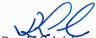

<!-- page 1 -->

# LIGNES DIRECTRICES AUX INSTITUTIONS DE MICROFINANCE

Les présentes lignes directrices résument les principales obligations légales auxquelles sont assujetties les institutions de microfinance (IMF) en matière de lutte contre le blanchiment de capitaux, le financement du terrorisme et de la prolifération et mettent en évidence les mesures que celles-ci doivent inévitablement prendre pour améliorer et renforcer leur structure organisationnelle.

La Banque de la République d'Haïti (BRH), dans le cadre de ses inspections annuelles et ponctuelles, vérifiera les mécanismes mis en place par ces institutions pour repérer et prévenir le blanchiment de capitaux et le financement du terrorisme.

### 1. Programme de prévention

Les IMF sont tenues de mettre en œuvre un programme de prévention du blanchiment de capitaux, du financement du terrorisme et de la prolifération.

Ce programme doit refléter la nature, l'ampleur et la complexité des activités de l'institution et doit comprendre les éléments suivants :

a) des politiques, des procédures et des contrôles internes, y compris des dispositifs de contrôle de la conformité, et des procédures appropriées lors de l'embauche des employés, de façon à s'assurer qu'elle s'effectue selon des critères exigeants ;

b) la centralisation des informations sur l'identité des clients, bénéficiaires, titulaires de procuration, mandataires, bénéficiaires effectifs, donneurs d'ordre, et sur les transactions suspectes ;

c) la désignation d'un officier de conformité et la désignation de responsables de conformité au niveau des succursales ;

d) l'élaboration d'un programme de formation continue à l'intention des employés ;

e) un dispositif de contrôle interne pour vérifier la conformité, l'observance et l'efficacité des mesures adoptées pour l'application de la loi sanctionnant le blanchiment de capitaux, le financement du terrorisme et de la prolifération ;

f) la mise en place d'un dispositif de tests indépendants du contrôle de la conformité à la lutte anti-blanchiment ;

g) l'évaluation des risques et une classification des risques en fonction des activités de l'IMF concernée et de sa clientèle ; et

h) le traitement des opérations suspectes.

Le programme de prévention doit être approuvé par le conseil d'administration de l'IMF.

<!-- page 2 -->

#### 1.1. Politiques et procédures et méthodes

Les IMF sont tenues d'élaborer un programme de conformité comprenant des politiques, procédures et méthodes consignées par écrit et permettant d'identifier les facteurs de risques, et d'évaluer les risques de blanchiment de capitaux et de financement du terrorisme que présentent leurs activités.

Les politiques, procédures et méthodes doivent être approuvées par le conseil d'administration et tenues à jour. Elles doivent être clairement communiquées à tous les cadres appelés à traiter avec des clients.

Les politiques et procédures de conformité doivent couvrir toutes les obligations de déclaration, de tenue de documents, de conservation de documents, d'identification des clients, de contrôle, d'évaluation et d'atténuation des risques qui s'appliquent à l'institution. Elles doivent être intégrées à la stratégie globale de gestion des risques de l'IMF et comporter des étapes appropriées pour prévenir, détecter, évaluer, surveiller, gérer, atténuer en permanence les risques de blanchiment de capitaux et de financement du terrorisme liés aux clients, pays ou zones géographiques, ou encore aux produits, services, nouvelles technologies, opérations et canaux de distribution.

Les politiques et procédures doivent également couvrir le traitement des sanctions internationales (liste de l'Organisation des Nations Unies ou autres), les modalités de gel des avoirs dans le cadre de la lutte contre le financement du terrorisme et de la prolifération.

Les politiques, procédures et méthodes doivent s'appliquer à toutes les succursales.

Les IMF sont également tenues d'élaborer des procédures appropriées de sélection garantissant le recrutement des employés selon des critères exigeants.

#### 1.2. Centralisation des informations

#### 1.3. Désignation d'un officier de conformité

Les IMF doivent se doter d'un système informatique permettant la centralisation des données.

Toute IMF doit procéder à la désignation d'un officier de conformité. Cet officier doit être un cadre supérieur de l'institution, sélectionné en fonction de sa compétence, de son expérience, de sa probité et de son éthique professionnelle. Il doit connaître les fonctions et la structure de l'institution, et être au fait des risques et des vulnérabilités liés au blanchiment de capitaux, au financement du terrorisme dans le secteur de la microfinance. Il devra dépendre directement du conseil d'administration ou de l'organe de direction y tenant lieu pour tout ce qui a trait aux questions liées à la lutte contre le blanchiment de capitaux, le financement du terrorisme et de la prolifération.

L'officier de conformité a pour attributions de :

assurer l'application de la législation et de la réglementation relative au blanchiment de capitaux, au financement du terrorisme et de la prolifération ;

<!-- page 3 -->

• faire respecter les procédures et méthodes internes ;

• identifier les carences et faire les recommandations qui s’imposent ;

• proposer des programmes de formation sur une base périodique ;

• assurer la liaison avec l’Unité Centrale de Renseignements Financiers (UCREF);

• préparer et acheminer les déclarations de soupcons à l'UCREF ;

s'assurer que les déclarations de transactions sont complétées et acheminées à l'UCREF dans les délais requis ;

• recevoir et donner suite aux demandes d'informations de l'UCREF et de toute autre autorité compétente agissant dans le cadre de la lutte contre le blanchiment de capitaux, le financement du terrorisme et de la prolifération ;

- exercer le devoir de vigilance vis-à-vis des clients.

Pour assurer l'application du programme de prévention, l'officer de conformité peut déléguer certaines fonctions à d'autres employés de l'institution. En aucun cas, la désignation de ces cadres ne dispense l'officer de conformité de ses responsabilités par rapport à la loi.

#### 1.4. Evaluation des risques

Le programme de prévention et de conformité doit comprendre une évaluation des risques de blanchiment de capitaux et de financement du terrorisme.

L'évaluation des risques est une analyse des menaces et faiblesses en matière de blanchiment de capitaux ou de financement du terrorisme que présentent les activités de l'IMF. Cette évaluation varie notamment selon la taille de l'institution de microfinance, son emplacement géographique et selon les activités exercées.

L'évaluation des risques implique que les employés soient bien imbus des activités de l'institution et qu'ils fassent preuve de jugement afin d'évaluer les risques de blanchiment. Cette évaluation ne doit pas être statique et devra être modifiée au moins tous les douze (12) mois.

Les IMF doivent tenir compte de la nature et des activités de leurs clients. Connaître son client ne se limite pas à vérifier son identité ou à tenir des documents ayant servi à la vérification de l'identité. Il s'agit de comprendre notamment qui sont les clients, quelles sont les activités qu'ils exercent, le modèle de leurs opérations et comment ils gèrent leurs affaires. En outre, les renseignements sur la vérification de l'identification doivent être revus au moins tous les deux (2) ans pour les situations posant un risque élevé et tous les trois (3) ans dans les cas de risques faibles. Des mesures d'atténuation des risques doivent être incluses dans les politiques et procédures.

Les IMF sont tenues par ailleurs d'appliquer les mesures de vigilance à leurs clients existants, selon l'importance des risques qu'ils représentent.

#### 1.5. Formation continue

Le programme de prévention et de conformité doit inclure une composante sur la formation. Tous les employés qui sont en contact avec les clients, qui ont connaissance d'opérations effectuées par des clients ou qui manipulent des fonds de quelque façon que ce soit ou qui sont responsables de

<!-- page 4 -->

la mise en œuvre ou de la surveillance du régime de conformité doivent comprendre les obligations de déclaration, d'identification des clients et de tenue de documents.

Le programme de formation doit être consigné par écrit et tenu à jour. Les modalités entourant la fréquence et la méthode de formation devraient être établies. On doit y indiquer notamment les catégories de participants, les sujets qui seront couverts et la fréquence des séances de formation. Chaque nouvel employé doit être formé avant de commencer à travailler avec des clients. Des mises à jour du programme devraient avoir lieu périodiquement afin de tenir toutes les parties intéressées au courant des modifications législatives et réglementaires. La méthode de formation dépendra de la taille de l'IMF et de la complexité de ses activités.

#### 1.6. Dispositif de contrôle interne

Les IMF doivent faire preuve d'une vigilance constante et se doter d'une organisation et de procédures internes propres à assurer le respect des dispositions prévues par la loi et permettant aux responsables des opérations de prévenir et d'identifier toute tentative de blanchiment de capitaux ou de financement du terrorisme. L'un des rôles de ce contrôle est d'éviter l'utilisation du système financier à des fins de blanchiment ou de financement du terrorisme ou de la prolifération et de minimiser les risques auxquels font face les institutions.

Ce système de contrôle interne doit contenir entre autres :

- un mécanisme de contrôle des politiques, procédures et méthodes internes de lutte contre le blanchiment de capitaux, le financement du terrorisme et de la prolifération ;

- une structure garantissant la confidentialité du traitement des informations ;

- des mesures d'identification des éléments à risques liés au blanchiment de capitaux, au financement du terrorisme et de la prolifération, et des systèmes d'évaluation de ces risques ;

- un système de surveillance pouvant garantir la maitrise des risques relatifs au blanchiment de capitaux, au financement du terrorisme et la prolifération ;

• un système centralisé de documentation et d'informations ;

- un système d'informations sur les initiatives prises en matière de conformité, de déficiencies dans ce domaine et des mesures correctives prises.

Le système de contrôle en place doit s'étendre à toutes les composantes de l'institution. Toute institution est donc tenue de prendre les mesures nécessaires pour garantir la stricte application des politiques, procédures et méthodes en vigueur spécialement celles relatives au blanchiment de capitaux, au financement du terrorisme et de la prolifération.

#### 1.7. Dispositif de tests indépendants

Lors des tests indépendants périodiques portant sur le respect des procédures internes, ou la surveillance des risques, une vérification spécifique sur le volet blanchiment de capitaux, financement du terrorisme et de la prolifération doit être effectuée par l'audit interne de l'institution de microfinance.

<!-- page 5 -->

Les vérifications peuvent notamment s'appliquer aux points suivants :

- l'évaluation de la qualité de la gestion et du contrôle des risques pour toutes les opérations et dans toutes les succursales ;

des entrevues auprès des employés chargés des opérations et de leurs superviseurs pour évaluer leur degré de connaissance et de respect des procédures de lutte contre le blanchiment de capitaux, le financement du terrorisme et de la prolifération adoptées par l'institution ;

- le respect des procédures d'ouverture et de fermeture de comptes pour les sociétés de microfinance ;

l'examen d'un échantillon de formulaires d'archivage des documents et de formulaires de renseignements sur les transactions financières douteuses ;

- une vérification du système de tenue des documents ;

• l'existence des justificatifs joints ou référencés aux pièces comptables ;

- la connaissance de la clientèle par les succursales et les responsables des opérations, en tenant compte des éléments suivants : activité professionnelle, fonctionnement du compte, situation financière et documentation comptable et financière concordante avec les crédits consentis et les volumes d'affaires traitées. Une attention particulière doit être portée à la justification économique des opérations et leur adéquation avec la situation connue de la clientèle ;

- la connaissance par les collaborateurs des règles internes anti-blanchiment.

Les résultats de toute vérification doivent être signalés au conseil d'administration. Suivant la structure hiérarchique de l'institution de microfinance, les questions relatives aux mesures prises ou à prendre et aux échéanciers prévus à cet égard doivent être connues et divulguées au personnel exécutant.

#### 1.8. Traitement des transactions suspectés

Les IMF doivent élaborer et mettre en application des politiques quant à l'identification et au suivi des transactions inhabituelles ou suspectes. Ces politiques devront définir ce qui est considéré comme suspect ou inhabituel, et fournir des exemples à cet égard.

L'identification des transactions inhabituelles ou suspectes peut être fait par la surveillance des transactions, des informations en provenance de tiers (journaux, internet, etc.), la connaissance qu'à l'IMF de l'environnement du client.

### 2. Identification des clients et obligation de vigilance

Conformément aux dispositions du décret du 30 avril 2023, les IMF sont tenues de procéder à l'identification de leurs clients, les mandataires de leurs clients, les titulaires de procuration, les bénéficiaires effectifs, les ayants droit économiques, et vérifier leur identité au moyen de documents, de sources de données ou de renseignements indépendants et fiables lors de :

1) l'établissement de la relation d'affaires ;

2) l'exécution d'opérations occasionnelles, supérieures au seuil réglementaire ou en cas de répétition d'opérations distinctes pour un montant individuel inférieur au seuil

<!-- page 6 -->

réglementaire ou lorsque la provenance licite des fonds n'est pas certaine ou s'il s'agit d'un transfert de fonds ;

3) des transactions sous forme de virements électroniques (transferts de fonds);

4) des transactions multiples en espèces, tant en gourdes qu'en devises étrangères, lorsqu'elles dépassent au total, le seuil établi et sont réalisées par et pour le compte de la même personne en l'espace d'une journée ou dans une fréquence inhabituelle ;

5) de l'existence d'un soupçon de blanchiment de capitaux ;

6) de l'existence d'un soupçon de financement du terrorisme ;

7) des doutes quant à la véracité ou la pertinence des données d'identification du client précédemment obtenues.

Les IMF doivent accorder une importance particulière aux normes relatives à la connaissance du client pour préserver leur réputation et l'intégrité du système financier. Pour ne pas s'exposer au risque d'atteinte à la réputation, au risque opérationnel et au risque juridique, les IMF doivent disposer de politiques, méthodes et procédures appropriées en tenant compte entre autres des éléments suivants :

a) des conditions claires d'acceptation de nouveaux clients ;

b) des règles précises sur l'identification des clients et de leurs mandataires, et la surveillance constante ;

c) une surveillance constante des clients classés à hauts risques ;

d) des procédures et moyens appropriés pour la gestion des risques ;

e) des mesures de vigilance pour la clientèle.

#### 2.1. Informations requises pour l'identification

L'identification d'une personne physique selon l'article 36 du décret du 30 avril 2023 sanctionnant le blanchiment de capitaux, le financement du terrorisme et le financement de la prolifération des armes de destruction massive implique « l'obtention des nom et prénom complets, de la date et du lieu de naissance, de l'adresse de son domicile principal ».

En ce qui a trait à la vérification des informations, l'article 36 du décret susmentionné précise que : « la vérification de l'identité de la personne physique requiert la présentation d'un document officiel original en cours de validité et comportant une photographie, dont il en est pris copie. La vérification de son adresse est effectuée par la présentation d'un document de nature à en rapporter la preuve ou par tout autre moyen ».

Les IMF doivent exiger l'identification des personnes physiques par la présentation de documents officiels. Des informations doivent être recueillies sur l'adresse permanente des personnes identifiées. Les personnes physiques non-résidentes dans le pays doivent être identifiées de la même manière que les résidents.

Lors de l'identification des clients, une copie de tous les documents doit être faite, classée et centralisée par les IMF. Des contrôles formels doivent être effectués quant à la signature, aux éventuelles anomalies sur la photographie et à l'apparence physique du client potentiel.

<!-- page 7 -->

Lorsque le client est une personne morale, l'identification et la vérification de l'identité porte sur « la dénomination sociale, la preuve de sa constitution légale, l'adresse du siège social, l'identité et les pouvoirs des administrateurs et dirigeants sociaux ou de leurs équivalents en droit étranger », selon l'article 38 du décret du 30 avril 2023.

L'identification porte également, qu'il s'agisse d'une personne physique ou morale, sur l'objet et la nature envisagée de la relation d'affaires. Les IMF doivent vérifier l'identité des clients au moyen de documents, de données ou informations de sources fiables et indépendants.

Si les IMF ne peuvent pas respecter les dispositions prévues ci-dessus, elles ne peuvent ni nouer ou maintenir une relation d'affaires, ni effectuer une opération pour le client. Elles détermineront, dans ce cas, s'il y a lieu de produire une déclaration de soupçon à l'Unité Centrale de Renseignements Financiers (UCREF) ou d'établir un rapport confidentiel interne conformément à l'article 43 du décret du 30 avril 2023.

#### 2.2. Documents d'identification

Les pièces et documents suivants doivent être exigés lors de l'ouverture de comptes, l'exécution de transactions importantes en espèces c'est-à-dire pour une somme globalement égale ou supérieure au montant réglementaire établi, pour une opération occasionnelle de montant élevé, pour toute transaction effectuée dans des conditions de complexité inhabituelles ou injustifiées, pour toute transaction qui parait ne pas avoir de justification économique ou d'objet licite, ou toutes autres transactions.

##### 2.2.1. Personnes physiques

a) un (1) document officiel original en cours de validité et comportant une photographie (carte d'identification nationale ou passeport ou permis de conduire);

b) nationalité, pays de résidence, profession, charge publique et/ou nom de l'employeur, adresse (l'adresse complète doit être obtenue, un numéro de boite postale n'est pas suffisant), téléphone, courrier électronique ;

c) un (1) document prouvant l'adresse : facture d'électricité ou facture d'eau ou avis d'imposition ou relevé bancaire, etc.

##### 2.2.2. Personnes morales

## Société civile

a) contrat ou convention créant la société dûment enregistrée au Ministère du Commerce et de l'Industrie;

b) adresse de la société (l'adresse complète doit être obtenue, un numéro de boite postale n'est pas suffisant), téléphone, courrier électronique ;

c) copie de la carte d'immatriculation fiscale et du certificat de patente ;

d) nom(s) et prénom(s) des associés ;

e) un (1) document habilitant un ou plusieurs associés à effectuer des transactions et opérations financières ;

f) un (1) document officiel original en cours de validité et comportant une photographie (carte d'identification nationale ou passeport ou permis de conduire) identifiant les associés mandataires ou les bénéficiaires effectifs ;

<!-- page 8 -->

g) nom, prénom, profession, adresse des associés mandataires, téléphone, courrier électronique ;

h) un (1) document prouvant l'adresse des associés mandataires (facture d'électricité ou facture d'eau ou avis d'imposition ou relevé bancaire, etc.).

## Société anonyme

a) autorisation de fonctionnement délivrée par le Ministère du Commerce et de l'Industrie ;

b) statuts de la société dûment enregistrés au Ministère du Commerce et de l'Industrie ;

c) copie de la carte d'immatriculation fiscale et du certificat de patente ;

d) un (1) document du conseil d'administration habilitant une ou des personnes à effectuer des transactions et opérations financières ;

e) un (1) document officiel original en cours de validité et comportant une photographie (carte d'identification nationale ou passeport ou permis de conduire) identifiant les mandataires et les bénéficiaires effectifs ;

f) un (1) document prouvant l'adresse des mandataires (facture d'électricité ou facture d'eau ou avis d'imposition ou relevé bancaire, etc.).

Les sociétés anonymes de droit étranger doivent fournir toutes les pièces ci-dessus mentionnées. Les copies de documents doivent être certifiées conformes aux originaux par les personnes autorisées (notaire ou consulat ou ambassade, etc.) et traduits en français, le cas échéant.

## Autres entreprises commerciales

a) copies du certificat de patente, de la carte d'immatriculation fiscale et de la carte d'identité professionnelle ;

b) adresse (l'adresse complète doit être obtenue, un numéro de boite postale n'est pas suffisant), téléphones, courrier électronique ;

c) nom (s) et prénom (s) des propriétaires et des bénéficiaires effectifs ;

d) un (1) document du ou des propriétaires aux personnes habilitées à faire des transactions et opérations financières;

e) un (1) document officiel original en cours de validité et comportant une photographie (carte d'identification nationale ou permis de conduire ou passeport) identifiant les mandataires et les bénéficiaires effectifs ;

f) nom, prénom, profession, adresse des mandataires et des bénéficiaires effectifs, téléphone, courrier électronique ;

g) un (1) document prouvant l'adresse des mandataires (facture d'électricité ou facture d'eau ou tout autre document officiel, etc.).

## Clubs, Associations, œuvres caritatives, églises

Dans le cas de telles entités, les IMF doivent vérifier l'identité d'au moins deux (2) signataires, en sus de l'entité elle-même. Les responsables à identifier doivent être les personnes qui contrôlent totalement ou partiellement les actifs, c'est-à-dire les membres de l'organe ou comité exécutif, le président, un administrateur, le trésorier et tous les signataires autorisés.

<!-- page 9 -->

##  $ \underline{\text{Autres}} $

Pour tout autre type d'entités non mentionnées dans les présentes lignes directrices, les IMF sont tenues de prendre les mesures adéquates aux fins d'établir l'identité du client et des bénéficiaires effectifs et à n'accepter de clients qu'à l'issue de cette procédure.

En ce qui a trait aux institutions financières non bancaires, les IMF doivent s'assurer qu'elles sont agréées par la BRH (copie autorisation de la BRH ou vérification du site web de la BRH).

### 3. Bénéficiaires effectifs

Les IMF sont tenues d'identifier l'identité des bénéficiaires effectifs conformément aux dispositions des articles 40 à 42 du décret du 30 avril 2023. Des mesures adéquates doivent être prises pour la vérification de ces données, ainsi que pour leur mise à jour lorsqu'il apparait que celles-ci ne sont plus actuelles.

Si les IMF ne peuvent pas obtenir ces informations ou leurs clients restent en défaut de les communiquer ou leur communiquer des informations non pertinentes ou invraisemblables, elles ne peuvent ni nouer ou maintenir une relation d'affaires, ni effectuer une opération pour le client. Elles détermineront, dans ce cas, s'il y a lieu d'en informer l'UCREF.

### 4. Les personnes politiquement exposées

Un devoir de vigilance doit s'exercer à l'égard des personnes politiquement exposées (PPE) qui sont définies par l'article 6 du décret du 30 avril 2023 comme des personnes qui exercent ou ont exercé d'importantes fonctions publiques dans un pays étranger ou en Haïti ou au sein de ou pour le compte d'une organisation internationale ainsi que les membres de la famille de cette personne, ou toutes autres personnes qui lui sont étroitement liées ou associées.

Les IMF doivent disposer de systèmes appropriés de gestion de risques permettant de déterminer si le client ou le bénéficiaire effectif est une personne politiquement exposée. Dès que le client est identifié comme personne politiquement exposée, il faut :

a) obtenir l'autorisation de la haute direction avant de nouer ou de continuer une relation d'affaires avec le client ;

b) prendre toutes mesures raisonnables pour établir l’origine du patrimoine et identifier l’origine des fonds ;

c) assurer une surveillance continue renforcée et permanente de la relation d'affaires.

En sus des PPE, un contrôle rigoureux doit être appliqué envers toute personne ayant une fortune élevée d'origine incertaine ou douteuse.

### 5. Mesures de vigilance renforcée

Les IMF doivent appliquer, en fonction de leur appréciation du risque, des mesures de vigilance renforcées dans des situations qui, du fait de leur nature, peuvent présenter un risque élevé de blanchiment de capitaux ou de financement du terrorisme.

<!-- page 10 -->

En outre, comme le prescrit l'article 28 du décret du 30 avril 2023, une attention particulière doit être exercée à l'égard des opérations provenant d'établissements ou d'institutions financières qui ne sont pas soumis à des obligations suffisantes en matière d'identification des clients ou de contrôle des transactions. Les IMF doivent leur appliquer des mesures de vigilance renforcées, proportionnées aux risques.

En outre, une vigilance particulière doit être exercée à l'égard :

a) des clients opérant dans des secteurs d'activités où l'utilisation des espèces est fortement constatée ;

b) des clients évoluant dans des secteurs dont la réglementation est insuffisante et qui font partie de la catégorie dénommée « entreprises et professions non financières désignées (EPNFD) » au niveau du décret du 30 avril 2023.

### 6. Virement électronique de fonds

Dans le cadre d'opérations de virement électronique de fonds, les IMF doivent identifier les donneurs d'ordre et les bénéficiaires conformément aux dispositions des articles 47 et suivants du décret du 30 avril 2023. L'identification inclut les prénoms, le nom, l'adresse, le numéro de compte le cas échéant et tous autres renseignements qui accompagnent le virement électronique ou le message qui s'y rapporte tout au long de la chaîne de paiement.

Les IMF doivent s'assurer que les virements électroniques contiennent toutes les informations requises sur le donneur d'ordre et/ou le bénéficiaire et prendre des mesures appropriées dans le cas contraire.

On entend par virement électronique de fonds, toute transaction par voie électronique effectuée au nom d'un donneur d'ordre (personne physique ou morale) en vue de mettre à disposition d'un bénéficiaire une certaine somme d'argent. Le donneur d'ordre et le bénéficiaire peuvent être une seule et même personne.

Les dispositions de la présente section ne s'appliquent pas :

a) aux virements de fonds effectués au moyen d'une carte de crédit ou de débit ou par carte prépayée ou d'un téléphone portable pour l'achat de biens et de services tant que le numéro de ladite carte ou du téléphone accompagne l'ensemble des transferts découlant de l'opération ;

b) aux transferts effectués entre les institutions financières lorsque le donneur d'ordre et le bénéficiaire sont des institutions financières opérant pour leur propre compte ;

c) aux virements effectués au profit d'autorités publiques pour le paiement d'impôts, d'amendes ou d'autres prélèvements.

### 7. Conservation de documents

Les IMF sont tenues de conserver pendant une période de cinq (5) ans au moins, après la clôture des comptes ou la cessation des relations avec le client permanent ou occasionnel, les pièces et documents obtenus dans le cadre des mesures de vigilance relative à la clientèle et aussi les livres de comptes et la correspondance commerciale. De même, les documents relatifs aux opérations

<!-- page 11 -->

effectuées par les clients doivent être gardés dans les archives de l'institution pendant cinq (5) ans au moins après l'exécution de la transaction.

À cette fin, une formule d'archivage des documents sur les opérations doit être utilisée pour la conservation des documents.

Cette conservation des documents permettra de répondre rapidement aux demandes d'informations des autorités compétentes et de reconstituer les transactions individuelles (y compris les montants et les types d'espèces en cause, le cas échéant) de façon à fournir des preuves en cas de poursuite pour conduite criminelle.

De même, une copie des déclarations de transactions et des déclarations de soupçon doit être gardée et archivée par l'IMF.

### 8. Des technologies nouvelles

Les IMF doivent identifier et évaluer les risques de blanchiment de capitaux et de financement du terrorisme pouvant résulter :

a) du développement de nouveaux produits et de nouvelles pratiques commerciales, y compris de nouveaux mécanismes de distribution ;

b) de l'utilisation de technologies nouvelles ou en développement en lien avec de nouveaux produits ou des produits préexistants.

Cette évaluation de risques devrait avoir lieu avant le lancement des nouveaux produits ou de nouvelles pratiques commerciales ou avant l'utilisation de technologies nouvelles ou en développement. Les IMF doivent prendre des mesures appropriées pour gérer ces risques.

### 9. Sanctions en cas de non-conformité

En cas de grave défaut de vigilance ou non-respect des obligations d'identification du client, de non production de déclarations de transactions ou de soupcons, de dénonciation faite aux clients ou à des tiers relative aux actions entreprises en matière de prévention et de détection du blanchiment de capitaux, et du financement du terrorisme et de toute autre violation des obligations contenues dans le décret du 30 avril 2023, la BRH se réserve le droit d'engager toute procédure appropriée et/ou de prendre toutes mesures administratives conformément à la loi et à la réglementation en vigueur.

Les sanctions peuvent être soit des amendes, soit des sanctions administratives (avertissement, suspension d'activité, retrait d'agrément ou interdiction définitive dans les cas les plus graves) sans préjudice de celles prévues par la loi, et de celles résultant de la responsabilité civile ou pénale qui peuvent être engagées en raison de la commission de l'infraction.

<!-- page 12 -->

### 10. Abrogation et entrée en vigueur

Les présentes lignes directrices abrogent celles du  $ 1^{er} $ décembre 2022. Elles entrent en vigueur à la date de leur signature.

Port-au-Prince, le 21 novembre 2023

Ronald Gabriel

Gouverneur
