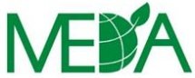

<!-- page 1 -->

TERMS OF REFERENCE

For a Research House

to conduct FinScope MSME Survey 2021 in Haiti

FinScope Haiti MSME Survey 2021

Proposals to be submitted in English

Supported by:

USAID FROM THE AMERICAN PEOPLE

Banque de la République d'Haïti

FinMark Trust

Sanofi House, 2 Bond Street,

Grand Central, Midrand, 1685

P.O. Box 61674, Marshalltown, 2107, South Africa

www.finmark.org.za

T +27 (0) 11 315 9197

F +27 (0) 86 518 3579

C Coovadia (Chairman), EG Matenge-Sebesho,

IMkhabela, L Mondi, V Tsopotsa, B Pearce (CEO)

VAT no. 4710213044, I Trust 4167/02

<!-- page 2 -->

FinMark Trust invites proposals from research houses/ companies with relevant research experience and expertise to conduct the FinScope MSME Survey Haiti 2021. The scope of work is provided in the following terms of reference.

### 1. Introduction and background

FinMark Trust (FMT) is an independent trust established in 2002 with the objective of making markets work for the poor. The initial core funding was provided by UK Aid from the Foreign, Commonwealth & Development Office (FCDO) formerly Department for International Development (DFID) through its Southern Africa office. Recently additional funders have come on board including the UNCDF, the Bill & Melinda Gates Foundation, the MasterCard Foundation as well as private and public institutions at country level. Thus, FMT has a catalytic role, driven by its purpose to start processes of change that ultimately lead to the development of inclusive financial systems that can benefit all consumers and/or businesses.

In order to fulfil its objectives, FMT developed the FinScope Survey. It is a nationally representative survey of how individuals or business owners source their income, and how they manage their financial lives. It also provides insight into attitudes and perceptions regarding financial products and services. To date, FinScope Consumer Surveys have been conducted in 35 countries while MSME Surveys have been implemented in 8 countries. Further details on these surveys are available from https://finmark.org.za/data-for-financial-markets or on request.

In light of the background above, FMT is planning to conduct a FinScope MSME Survey in Haiti. This survey is based on a national representative sample size of about 5 000 small business owners (at business premises, in public spaces and at household level). The final sample size will be decided on upon once cost and time estimates have been taken into consideration.

To further advance the poverty reduction goals of the Government of Haiti, MEDA has teamed up with the Central Bank of Haiti (BRH) through the ATTEINDRE project to support the implementation of the National Financial Inclusion Strategy (SNIF) and the National Financial Education Plan (PNEF). As part of MEDA's role within a memorandum of understanding signed with the Central Bank in January 2021, MEDA will support market assessments, national surveys, and studies that strengthen existing data platforms to allow all relevant stakeholders to make data-informed decisions and provide a reliable baseline for financial inclusion policy.

As the first step in this collaboration, MEDA and BRH will launch a FinScope MSME survey in partnership with FinMark Trust (FMT), an independent international firm whose goal is to promote research to support financial inclusion and financial integration.

As a follow-on to the 2018 Haiti FinScope Consumer Survey performed by FinMark Trust, which sought to provide credible benchmarks on financial inclusion and guide targeted and focused financial inclusion strategies using empirical evidence, the 2021 MSME FinScope Survey will target the MSME ecosystem, both formal and informal.

The survey will provide relevant information on the MSME sector (s) regarding the specific needs of different industry sectors to guide interventions according to the entrepreneurial ecosystem's priorities. It will offer the opportunity to strengthen the gains and act effectively to improve small entrepreneurs' living conditions. Also, while considering gender and age group specificities, this study provides an opportunity to establish an analytical framework based on the growth capacity, risk profile, and financial inclusion of entrepreneurs. To date, FinScopeSurveys have been conducted in 35 countries. Further details on these surveys are available from www.finmark.org.za.

<!-- page 3 -->

### 2. Scope of work

## Phase 1: Inception report, instrument preparation and data collection deliverables:

For the implementation of the FinScope MSME Survey Haiti 2021, the Research House will be required to:

a) Participate in a one-day FinScope briefing session conducted by FinMark Trust

b) Participate in meetings of the Steering Committee that will oversee the implementation of the FinScope MSME Survey

c) Design the sample for the survey in close cooperation with the appointed statistician. The methodology assumes a sample size of about 5 000 adults who own a business(es) (15 years and above). The sample should be representative on the following levels: national, urban/rural, and departmental – using the following approach:

1. Maps and listing exercise:

- A list of all census enumeration areas (EAs) per department. The framework will be based on the latest Census data. A modelling exercise will be conducted upfront by a separate constructor to assist in identifying EAs biased to small and medium business

• EAs are then stratified into urban and rural areas

• EAs are sampled for each stratum using probability proportional to size (PPS), selecting 400 EAs

- Maps for the selected EAs (and substitution EAs) are obtained from IHSI (photocopying, etc. to be included in the cost)

- Listing of business premises, informal business stands, and households and identifying business owners in the sampled EAs. All businesses in the EA are administered a short listing form to capture the number of all businesses in that EA. For households, all members in the households above 15 years are asked if they own a business. This information helps to identify business owners within the households that qualify to participate in the survey.

- With the listing information, it serves as the sampling frame from which businesses are selected for interview.

### 2. Survey:

- Within each selected EA, about 8 - 13 business owners are selected systematically, selecting every  $ k^{th} $ business (systematic random selection). In some instances, were there are fewer businesses (especially Small and Medium sized businesses) in selected EAs, we might require that all the Medium size business be interviewed.

- Within selected households (with businesses), where there is more than one qualifying respondent (business owners), the Kish Grid is used to randomly select the one household member (business owner) with whom to complete the interview – interviews are to be conducted using Computer Assisted Personal Interviewing (CAPI) or Electronic Device Interface (EDI) with GIS enabled devices to capture GIS coordinates

- If a selected business owner is unavailable, then up to three recalls at different times of the day and days of the week are made to maintain the integrity of the sample

<!-- page 4 -->

If a business owner is repeatedly unavailable or refuses participation, then very strict substitution rules are applied

• The substitute is also chosen using randomisation techniques

• No substitution of individuals within a household is allowed

d) Instrument design: The FinScope MSME questionnaire is contextualised to suit the revolving context in Haiti, including workshops to obtain stakeholder input. Questionnaire administration takes about 70 minutes.

e) Pre-test the translated version of the questionnaire in field by conducting x numbers of face-to-face interviews and adapt the translation (in French) where necessary

f) Recruit an adequate number of supervisors and enumerators to ensure that fieldwork is completed within a period of six to nine weeks

g) Produce enumerator training materials and field manuals (in French)

h) Conduct supervisor and enumerator training with assistance from FinMark Trust, allowing for ten days of training which will include a pilot survey to test enumerators' readiness to go to field in terms of having mastered the questionnaire as well as the sampling approach

i) Conduct a pilot survey at the end of the enumerator training to test the ability of the enumerators to conduct the fieldwork in terms of:

- Implementation of survey methodology (selection of EAs, correct listing, selection of right respondent)

• Administration of the FinScope Haiti's MSME questionnaire

j) Conduct the fieldwork for the FinScope MSME Survey Haiti 2021 on the following basis:

Data collection is likely to be from July 2021 to September 2021 while all preparations to be done end of April 2021 to June 2021

- Systematic random selection of about 8 - 13 business owners from each sampled EA as described above

- The number of EAs to be used will be 400 spread across Haiti

- Listing all (i) standing and visible businesses and (ii) household members in the selected household and selecting one qualifying business owner using the Kish grid. Informal businesses and hawkers to be included in the listing exercise.

• Conducting about 5 000 face-to-face interviews using CAPI methodology with each of the selected respondents (duration of the interviews is about 70 minutes)

Implementing necessary quality control measures to ensure the validity and accuracy of the data collected by:

• Having adequate supervision teams and processes in place

• Ensuring that adequate back-check procedures as well as questionnaire checking processes are in place

k) Capture the survey data and produce a clean dataset. Quality control measures should include:

a. Data capture training - ensuring inter alia a thorough understanding of the questionnaire

b. Data checking procedures and data validation programmes

<!-- page 5 -->

1) Produce a final clean dataset in SPSS for the purpose of data weighting and analysis – ensure the correct weighting is done with FMT support and IHSI inputs. The research house to do the weighting.

m) Produce a technical report addressing the sampling approach, the fieldwork and quality control process as well as data capture and cleaning processes

## Phase 2: Data analysis and report writing deliverables:

One-day workshop with FinMark Trust to discuss the objectives of the analysis of the data, indicators to be constructed and a complete analysis plan. In addition to the phase 1 deliverables, the following are very important for this phase:

• Analyse the data according to the analysis plan

• Present the preliminary findings to the Steering Committee before finalising the report

• Write a comprehensive report on the survey findings; the report should be signed-off by FinMark Trust and should be provided in English

• Develop a launch presentation of the key findings and make recommendations for the content of a brochure to be disseminated at the launch of the survey findings

***NB: Steering Committee presentations will be translated into French. FMT signs off the English versions before translations.

### 3. Technical and financial proposals

Research houses are invited to submit technical and financial proposals clearly indicating the budget for sample of n=5 000 that address the scope of work outlined above within the suggested timeframe.

### 4. Timeline

The anticipated timing of the project is up to nine months (assuming no delays) from the time of selection of the Research House. The Research House should provide a detailed timeline for executing the project activities as outlined above including perceived project risks and contingency plans. Questionnaire and sample design phases are estimated to be completed within four weeks running concurrently. The data collection phase needs to be completed within six to nine weeks.

### 5. Budget

The financial proposal should provide a detailed costing for the scope of work and deliverables described above. Costs should be broken down into professional fees and expenses and quoted in USD. However, the calculations and inner workings can be made in Haitian Gourde but the final amount to be converted to USD.

### 6. Required skills and qualifications

<!-- page 6 -->

Proposals from interested research houses must provide evidence of the technical capacity of the Research house to undertake this exercise. This includes capacity to deliver the results in the timeframe provided, as well as some indication of prior experience in conducting a survey of this magnitude within the financial services sector.

The application must identify the core management and technical team, their technical expertise in sample design, statistical analysis, field work, questionnaire review, and overall project management. Core team members' CVs must be included, as well as a description of any further resources that may be required. The company's client portfolio and past experience in the financial services industry must be included.

### 7. Selection criteria

Contract selection criteria and award will be made on the basis of the following scoring mechanism:

|   | Criteria | Weighting |
| --- | --- | --- |
| 1 | Technical soundness of the proposal and general approach | 35% |
| 2 | Competence and previous experience of the research house | 25% |
| 3 | Knowledge of the financial services sector in Haiti | 10% |
| 4 | Involvement of local (Haiti) capacity | 10% |
| 5 | Financial proposal | 20% |
|   | Maximum score | 100% |

### 8. Submission and Communication of bids

Proposals should be addressed to Abel Motsomi  $ \underline{\text{abelm@finmark.org.za}} $ and Dr Kingstone Mutsonziwa  $ \underline{\text{kingstonem@finmark.org.za}} $ via email. The deadline is 20 August 2021. Research houses should provide electronic versions of all documentation. The proposals should be submitted in English.

Shortlisted research houses maybe invited to make a virtual presentation of their proposal on a date to be announced. The selected research house and its key project personnel must be prepared to meet with FinMark Trust on a date to be announced, for a virtual briefing.

Once the selection process has been completed, FinMark Trust and its partners will issue a contract confirming the appointment of the research house. If no communication has been received from FinMark Trust after 1 month of your submission, please consider yourself as unsuccessful.

Any queries relating to the preparation of the proposal should be referred to Abel Motsomi by email:  $ \underline{\text{abelm@finmark.org.za}} $ or Dr Kingstone Mutsonziwa at  $ \underline{\text{kingstonem@finmark.org.za.}} $

<!-- page 7 -->

| Guidance notes to bidders |
| --- |
| FinMark Trust reserves the absolute right to use its discretion in the interpretation of these award criteria. The following notes are intended to provide broad guidance only on how proposals will be evaluated. Bidders may be required to clarify their proposals by way of a telephone call or presentation. “Relevant, demonstrated competence of firm(s) in this area” - you should aim to demonstrate how the firm’s collective past experience can be applied (or adapted) to address the specific brief set out in the terms of reference. You are welcome to describe the firm’s general experience of financial sector development issues (e.g. in other geographies or topical areas) but the evaluation will focus particularly on the application of that experience for the specific task at hand. “Demonstrated expertise of key individuals to be involved in this project” - the evaluation places considerable emphasis on the role and demonstrated expertise (i.e. track record) of the key individuals to be involved on the project rather than on the expertise of the firm itself. “Use of local professional capacity (consulting, analysis, coordination, etc. )” - FinMark Trust wishes to ensure that local capacity is used and developed. International firms are therefore encouraged to partner with local organisations. “Content, quality and originality of proposal” – proposals should address the brief set out in the terms of reference in a comprehensive manner. Bidders should aim for innovation as well as professional presentation. Whilst similar, relevant experience in other markets will be an advantage for a bidder, each market is different and so proposals need to reflect the particular characteristics of that market, as well as the challenge set by the terms of reference. “Fee basis” – value for money, as well as absolute cost, will be taken into account. |
