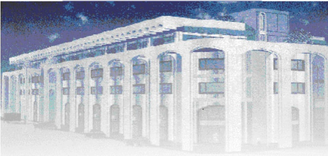

<!-- page 1 -->

Banque de la République d'Haïti

Note mensuelle d'inflation

Juillet 2021

Table des matières

<!-- page 2 -->

I.- Introduction.....2
II.- Évolution de l'inflation globale en juillet 2021.....2
III.- Évolution des principales fonctions de consommation en juillet 2021.....3
IV.- Évolution de l'inflation selon l'origine des produits et les régions géographiques du pays.....4
V.- Facteurs explicatifs de l'évolution de l'inflation en rythme mensuel .....4
VI.- Prévisions d'inflation.....5

<!-- page 3 -->

### I. - Introduction

Cette note analyse l'évolution de l'Indice des Prix à la Consommation (IPC) en Haïti au cours du mois de juillet 2021. Elle apporte quelques éléments explicatifs permettant de comprendre les facteurs qui influencent la variation mensuelle de l'IPC.

## 2021

L’indice des prix à la consommation (IPC) a été estimé à 174,3 en juillet 2021 contre 155,3 et 170,8 respectivement en juillet 2020 et en juin 2021. Il en est ainsi ressorti une hausse de 2 % de l’IPC en rythme mensuel et de 12,3 % en glissement annuel. En rythme mensuel le taux d’inflation s’est donc accru étant donné qu’au mois de juin l’inflation était estimée à 1,3%. Toutefois, le ralentissement qui a caractérisé l’évolution de l’inflation annuelle depuis le début de l’exercice en cours, s’est poursuivi en juillet 2021. Ainsi, le taux d’inflation annuel indique une baisse de 40 points de base (pb) par rapport au mois précédent.

Par ailleurs, d'octobre 2020 à juillet 2021, le taux d'inflation mensuel cumulé a été inférieur à celui observé au cours de la même période de l'exercice fiscal 2019-2020. Sur les dix (10) premiers mois de l'année fiscale en cours, ce dernier a atteint 8,9 % contre 19,9 %. En moyenne mensuelle, l'inflation s'est établie à 0,9 % sur la période considérée contre 2 % l'exercice antérieur.

Graphique 1. Évolution de l'inflation mensuelle et annuelle en juillet 2021 (en %)

| Date | Inflation Annuelle | Inflation Mensuelle |
| --- | --- | --- |
| Jul-19 | 19.0 | 16.5 |
| Aug-19 | 19.5 | 16.5 |
| Sep-19 | 20.0 | 17.0 |
| Oct-19 | 20.5 | 17.5 |
| Nov-19 | 20.5 | 17.5 |
| Dec-19 | 20.5 | 17.0 |
| Jan-20 | 20.5 | 16.0 |
| Feb-20 | 21.0 | 17.5 |
| Mar-20 | 22.0 | 17.5 |
| Apr-20 | 22.5 | 18.0 |
| May-20 | 23.5 | 20.0 |
| Jun-20 | 24.5 | 24.0 |
| Jul-20 | 25.5 | 21.5 |
| Aug-20 | 27.5 | 32.5 |
| Sep-20 | 25.0 | 0.0 |
| Oct-20 | 21.5 | -8.0 |
| Nov-20 | 20.0 | 0.0 |
| Dec-20 | 19.5 | 1.0 |
| Jan-21 | 19.0 | 1.1 |
| Feb-21 | 18.0 | 1.1 |
| Mar-21 | 17.0 | 1.0 |
| Apr-21 | 16.0 | 0.9 |
| May-21 | 14.0 | 1.0 |
| Jun-21 | 12.5 | 1.3 |
| Jul-21 | 12.5 | 2.0 |

Source : Calculs de la BRH

<!-- page 4 -->

### III. - Évolution des principales fonctions de consommation en juillet 2021

La hausse de l'inflation en rythme mensuel résulte de l'augmentation de l'indice des prix des principales divisions de consommation, notamment celle de l'IPC des « Produits alimentaires et boissons non alcoolisées » qui s'est établi à 2,3 % contre 1,4 % un mois plus tôt, « Santé » (2,7 % contre 2,4 %), « Restaurants » (5,6 % contre 5 %) et « Biens et services divers » (2,5 % contre 1,7 %). Par contre, le rythme de croissance de l'IPC de la fonction « Loisirs » a légèrement décéleré (0,5 % contre 0,7 %) alors que l'IPC de la division « Enseignement » est resté inchangé d'un mois à l'autre.

Sur base annuelle, le ralentissement enregistré au niveau du rythme de croissance de l'IPC global a été tributaire de la décélération qui a caractérisé la progression de l'indice des prix de la plupart des fonctions de consommation comparativement au mois de juin 2021. En effet, l'IPC de la division « Produits alimentaires et boissons non alcoolisées » a crû de 14,4 % contre 15 % un mois plus tôt, « Boissons alcoolisées, tabac et stupéfiants » (2 % contre 3,3 %), « Articles d'habillement et chaussures » (14,9 % contre 15 %), « Logement, eau, gaz, électricité » (8,7 % contre 9,5 %), « Transport » (3,1 % contre 3,3 %), « Loisirs » (6,7 % contre 7,6 %), « Enseignement » (6,2 % contre 7,5 %).

Tableau No. 1. Contributions à l'inflation mensuelle et annuelle en juillet 2021 (en %)

<table><tr><td>Poste</td><td>Pondération</td><td>Contribution à l'inflation mensuelle</td><td>Contribution à l'inflation annuelle</td></tr><tr><td></td><td>en %</td><td>en %</td></tr><tr><td>Indice Général</td><td>100.00</td><td>100.00</td><td>100.00</td></tr><tr><td>Produits alimentaires et boissons non alcoolisées</td><td>48.50</td><td>59.37</td><td>59.36</td></tr><tr><td>Boissons alcoolisés, tabac et stupéfiants</td><td>1.42</td><td>0.44</td><td>0.24</td></tr><tr><td>Articles d'habillement et chaussures</td><td>5.55</td><td>6.71</td><td>7.03</td></tr><tr><td>Logement,eau,gaz, électricité et autres combustibles</td><td>14.14</td><td>10.86</td><td>10.49</td></tr><tr><td>Meubles, articles de ménages et entretien courant du foyer</td><td>5.32</td><td>6.21</td><td>5.80</td></tr><tr><td>Santé</td><td>2.56</td><td>3.61</td><td>4.92</td></tr><tr><td>Transports</td><td>9.10</td><td>3.06</td><td>2.44</td></tr><tr><td>Communications</td><td>2.23</td><td>1.04</td><td>0.43</td></tr><tr><td>Loisirs</td><td>1.52</td><td>0.43</td><td>0.87</td></tr><tr><td>Enseignement</td><td>3.91</td><td>0.00</td><td>2.07</td></tr><tr><td>Restaurants</td><td>0.49</td><td>1.42</td><td>0.73</td></tr><tr><td>Biens et Services divers</td><td>5.26</td><td>6.85</td><td>5.62</td></tr></table>

Source: Calculs de la BRH/MAE

<!-- page 5 -->

### IV. - Évolution de l'inflation selon l'origine des produits et les régions géographiques du pays

En glissement annuel, l'IPC des produits locaux a affiché le même comportement que l'IPC global alors que l'inverse a été observé au niveau de l'IPC des produits importés. En effet, en juillet 2021, le rythme de croisance de l'IPC des produits locaux a décéleré d'un (1) point de pourcentage (pp) par rapport au mois antérieur, pour se porter à 10,8 %. Cependant, une progression contraire a été observée au niveau de l'inflation des produits importés, laquelle a augmenté de 70 points de base par rapport au mois antérieur, pour s'établir à 14,9 %.

L’analyse de l’inflation suivant les différentes aires géographiques a montré qu’elle a augmenté sur tout le territoire national. En variation mensuelle, les pressions inflationnistes ont été plus marquées dans les régions « Reste Ouest (+1 pp à 2,3 %), « Sud » (+1 pp à 2,2 %). S’ensuent les zones du « Nord » (+0,7 pp à 2 %) de l’Aire Métropolitaine (+0,7 pp à 1,9 %) et de la région transversale (+0,6 à 1,9 %).

De même, sur une base annuelle, un mouvement haussier a été observé au niveau de l'IPC de toutes les régions du pays pour le mois sous étude : « Aire Métropolitaine » (14,9% contre 12,8% au mois de juin), « Reste Ouest (15,2 % contre 12,6 %), « Nord » (14 % contre 11,9 %), « Sud » (15,1 % contre 12,7 %), « Transversale » (15,2 % contre 13,1 %).

### V. - Facteurs explicatifs de l'évolution de l'inflation mensuelle en juillet 2021

Parmi les facteurs susceptibles d'expliquer l'augmentation des prix sur le marché local au mois de juillet 2021, peuvent être considérés le renchérissement des produits de base sur le marché international, le financement monétaire et la dépréciation de la gourde.

L’indice FAO des produits alimentaires s’est établi à 127,8 au mois de mai 2021, enregistrant une hausse de près de 5 % par rapport au mois précédent $ ^{1} $. Parallèlement les cours des produits pétroliers ont poursuivi leur mouvement haussier entamé depuis novembre 2020. En juillet 2021, le baril du Brent et celui du WTI ont enregistré une croissance de 1,81 % et 1,51 % chacun pour se fixer respectivement à 74,39 et 72,46 dollars. Aussi, l’augmentation des prix des produits importés s’est-elle répercutée sur les prix pratiqués sur le marché national

La progression des cours du pétrole a entrainé une augmentation des pertes de recettes et des subventions de l'État, en raison du non ajustement des prix à la pompe. Le déficit budgétaire qui en a résulté, a induit une hausse du financement monétaire et par ricochet une augmentation de l'offre de monnaie, en témoigne la croissance mensuelle de 1% de la monnaie en circularion. Cet excédent de

<!-- page 6 -->

liquidité dans l'économie a généré un acroissement de la demande des biens et services dans un environnement caractérisé par la faiblesse de l'appareil productif.

Par ailleurs, l’amplification des tensions sur le marché des changes a eu des incidences sur la structure des prix à la consommation. En effet, comparativement au mois antérieur, une dépréciation de 2,70 % de la gourde par rapport au dollar américain a été enregistrée, le taux de change se portant à 93,68 gourdes pour un dollar ÉU en juillet 2021².

## VI- Prévisions d'inflation

Pour les trois prochains mois, les prévisions d'inflation réalisées par la Direction de la Monnaie et de l'Analyse Economique (MAE) tablent sur une évolution contrastée tant en rythme mensuel qu'annuel de l'indice des prix à la consommation. En effet, le rythme de progression de l'IPC devrait s'accélérer en août pour se chiffrer à 2,4 % avant de retomber à 2,3 % et 2,1 % respectivement en septembre et octobre 2021. Parrallèlement, en glissement annuel, l'indice des prix à la consommation poursuivrait avec sa tendance baissière en août (11,4 %) tandis que la pente serait inversée en septembre (14,4 %) et en octobre 2021 (18,2 %).

Graphique No. 2. Prévisions de l'inflation en variation mensuelle et annuelle sur trois mois (en %, à partir d'août 2021)

| Month | Infl_m | Infl_y |
| --- | --- | --- |
| Oct-18 | 1.5 | 13.0 |
| Dec-18 | 1.3 | 14.0 |
| Feb-19 | 1.7 | 15.0 |
| Apr-19 | 0.7 | 16.0 |
| Jun-19 | 1.6 | 18.0 |
| Aug-19 | 1.5 | 19.0 |
| Oct-19 | 1.7 | 20.0 |
| Dec-19 | 1.6 | 20.5 |
| Feb-20 | 1.8 | 21.0 |
| Apr-20 | 1.7 | 22.0 |
| Jun-20 | 2.5 | 24.0 |
| Aug-20 | 3.2 | 26.0 |
| Oct-20 | -1.2 | 22.0 |
| Dec-20 | 1.0 | 20.0 |
| Feb-21 | 1.1 | 18.0 |
| Apr-21 | 1.0 | 16.0 |
| Jun-21 | 1.2 | 13.0 |
| Aug-21 | 2.4 | 11.4 |
| Oct-21 | 2.3 | 14.4 |

Sources : Prévisions du Service de Modélisation et Prévisions Macrééconomiques de la BRH

<!-- page 7 -->

Tableau No. 2

Indice des prix à la consommation (IPC) par postes de dépenses et Variation mensuelle et annuelle de l'IPC en juillet 2021

<table><tr><td>Poste</td><td>IPC</td><td>Variation IPC (%)</td></tr><tr><td>Juillet-20</td><td>Juin-21</td><td>Juillet-21</td><td>Mensuelle</td><td>Annuelle</td></tr><tr><td>Indice général</td><td>155.3</td><td>170.8</td><td>174.3</td><td>2.0</td><td>12.2</td></tr><tr><td>Produits alimentaires et boissons non alcoolisées</td><td>167.6</td><td>187.3</td><td>191.7</td><td>2.3</td><td>14.4</td></tr><tr><td>Boissons alcoolisés, tabac et stupéfiants</td><td>133.5</td><td>135.4</td><td>136.2</td><td>0.6</td><td>2.0</td></tr><tr><td>Articles d'habillement et chaussures</td><td>161.3</td><td>181.1</td><td>185.3</td><td>2.3</td><td>14.9</td></tr><tr><td>Logement,eau,gaz, électricité et autres combustibles</td><td>145.7</td><td>156.1</td><td>158.4</td><td>1.5</td><td>8.7</td></tr><tr><td>Meubles, articles de ménages et entretien courant du foyer</td><td>153.8</td><td>169.7</td><td>173.5</td><td>2.2</td><td>12.8</td></tr><tr><td>Santé</td><td>194.9</td><td>232.6</td><td>238.9</td><td>2.7</td><td>22.6</td></tr><tr><td>Transports</td><td>120.8</td><td>123.8</td><td>124.6</td><td>0.6</td><td>3.1</td></tr><tr><td>Communications</td><td>110.6</td><td>112.1</td><td>113.1</td><td>0.9</td><td>2.3</td></tr><tr><td>Loisirs</td><td>172.0</td><td>182.6</td><td>183.6</td><td>0.5</td><td>6.7</td></tr><tr><td>Enseignement</td><td>122.4</td><td>130.0</td><td>130.0</td><td>0.0</td><td>6.2</td></tr><tr><td>Restaurants</td><td>166.0</td><td>184.8</td><td>195.1</td><td>5.6</td><td>17.5</td></tr></table>

Sources : IHSI et calculs du Service de la Macrééconomie et Analyse de Conjoncture de la MAE

<!-- page 8 -->

## Glossaire

<table><tr><td>Glossaire</td></tr><tr><td>Variation mensuelle</td><td>: Variation par rapport au mois précédent.</td></tr><tr><td>Glissement annuel</td><td>: Variation par rapport au même mois de l'année antérieure.</td></tr><tr><td>Inflation</td><td>: Mouvement persistant à la hausse du niveau général des prix.</td></tr><tr><td>Désinflation</td><td>: Talentissement de la croissance des prix.</td></tr><tr><td>Déflation</td><td>: Baisse du niveau général des prix associée à une contraction de la masse monétaire et du crédit.</td></tr><tr><td>Inflation sous-jacente</td><td>: Tendance de long terme des prix, tout en excluant la volatilité, les mouvements saisonniers, conjoncturels, et les chocs qui affectent les composantes du panier considéré.</td></tr><tr><td>Région Nord</td><td>: Elle couvre les départementes du Nord, Nord-Est et Nord-Ouest.</td></tr><tr><td>Région Sud</td><td>: Elle comprend les départementes du Sud de la Grand-Anse et des Nippes.</td></tr><tr><td>Région Reste Ouest</td><td>: Y sont incluses les départementes du Sud-Est et de l'Ouest à l'exception de l'aire métropolitaine</td></tr><tr><td>Région Transversale</td><td>: Elle regroupe les départementes du Centre et de l'Artibonite.</td></tr><tr><td>Aire Métropolitaine</td><td>: Elle contient les villes de Port-au-Prince, de Delmas, de Pétion-Ville, de Carrefour et de Gazi, des Bouvants</td></tr></table>
