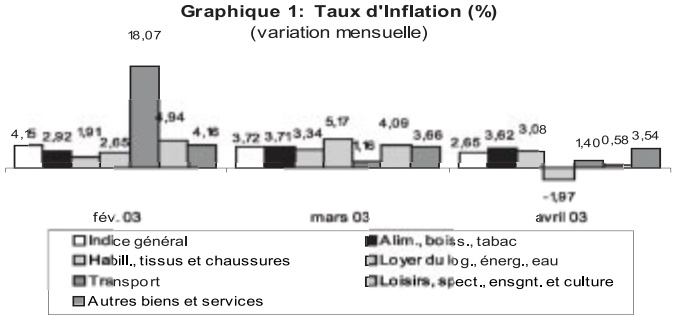

<!-- page 1 -->

## Table des Matières

I. Inflation et change .....2
II. Instruments de Politique Monétaire .....3
III. Liquidité, Crédit et Dépôts des Banques .....4
IV. Bilan des Autorités Monétaires .....5
V. Situation Monétaire .....6
VI. Finances Publiques .....7
VII. Dette Externe .....8
VIII. Croissance du Bilan .....9
IX. Parts de Marché .....10
X. Qualité de l'Actif .....12
XI. Rentabilité .....13
Glossaire .....15

La publication mensuelle des Indicateurs Économiques et Financiers a pour objectif de mettre à la disposition du public en général, et des décideurs et agents économiques en particulier, des informations pertinentes sur les secteurs monétaire et financier. Les informations sont présentées de façon factuelle et sous forme de descriptions lapidaires, du type «bullet points», accompagnées de graphes et tableaux illustratifs.
Un accent particulier a été porté sur l'évolution des indicateurs au cours du mois considéré selon trois repères :
1. le mois antérieur,
2. le début de l'année fiscale, et
3. le même mois de l'année précédente (glissement annuel). Ainsi les tendances qui se dégagent pour un mois donné peuvent être aisément mises en perspective.
Statistiques monétaires et bancaires : Les statistiques monétaires et bancaires sont des données de stock (fin de période). Elles sont présentées avec deux mois de décalage pour des raisons de disponibilité des données bancaires.
Finances publiques : Les statistiques de finances publiques sont des données de flux et sont enregistrées sur la base des encaissements-décaissements. Elles sont décalées de deux mois.
Inflation : La présentation par la BRH des données fournies par l'Institut Haïtien de Statistiques et d'Informatique sur l'évolution de l'indice des prix à la consommation (IPC) se fait avec deux mois de retard; pour les données du change le retard n'est que d'un mois.
Certaines données publiées dans la présente édition des Indicateurs Économiques et Financiers sont provisoires et, par conséquent, sujettes à révision dans des publications futures.

<!-- page 2 -->

### I. Inflation et Change

## Inflation

- En avril 2003, l'indice des prix à la consommation est en baisse (2,65 %) par rapport au mois de mars 2003 (3,72 %).

- Ce résultat reflète la décélération du taux de croissance des indices des principaux groupes de dépenses : les prix des groupes Alimentation, boisson et tabac, Habillement, tissus et chaussures, Loyer du logement, énergie et eau, Loisirs, spectacles, enseignement et culture et Autres biens et services se sont accrus respectivement de 3,62 %, 3,08 %, -1,97 %, 4,09 %, et 3,66 % par rapport à ceux du mois de mars 2003 (3,71 %, 3,34 %, 5,17 %, 4,94 %, et 4,16 %). L’indice du groupe de dépenses Transport (1,40 %) est en hausse par rapport à celui du mois de mars 2003 (1,16 %).

- En glissement annuel, le taux d'inflation est passé de 36,96 % en mars 2003 à 39,25 % en avril 2003. En moyenne mensuelle, la hausse des prix à la consommation est de 4,17 %.

## Change

## Taux

Le taux de référence de fin de période de la BRH est passé de 42,3014 gdes en avril 2003 à 40,5400 gdes en mai 2003, atteignant un maximum de 40,0829 gdes le 21 mai 2003.

- En avril 2003, le taux de référence de fin de période s'est déprécié de 0,20 % par rapport au mois précédent. Il s'est déprécié de 56,58 % et de 58,57 % par rapport à janvier 2002 et avril 2002 respectivement.

## Achats et ventes de devises des banques

- Les achats de devises ont diminué de 17,11 % par rapport à avril 2003. Ils ont augmenté de 6,15 % et de 17,99 % par rapport à novembre 2002 et mai 2002 respectivement.

- Les ventes de devises ont diminué de 16,58 % par rapport à avril 2003. Elles ont augmenté de 8,31 % par rapport à novembre 2002 et diminué de 16,33 % par rapport à mai 2002.

- En mai 2003, la position cambiste de change s'est située à -0,277 million de $ ÉU contre 0,154 million le mois précédent.

- D’octobre 2002 à mai 2003, les achats et ventes ont totalisé respectivement 550,62 et 558,48 millions de $ ÉU contre 549,27 et 559,47 millions pour la même période de l’exercice précédent.

- En avril 2003, le spread des banques a représenté 1,47 % du taux à l'achat, contre 1,70 % le mois précédent. Il était de 1,74 % en octobre 2002 et de 1,05 % en mai 2002.

## Achats et ventes de devises des agents de change

- Selon les données disponibles à date, reçues d'agents de change enregistrés, les achats se sont chiffrés à 2,453 millions de $ ÉU et les ventes à 2,347 millions en mai 2003.

## Transferts reçus de l'étranger

- Selon les données disponibles à date reçues des maisons de transfert enregistrées, les transferts privés se sont chiffrés à 27,873 millions de $ ÉU en mai 2003 comparé à 28,37 millions le mois précédent. Ils s'élevaient à 23,58 millions de $ ÉU en mai 2002.

- D'octobre 2002 à mai 2003, les transferts privés ont atteint 213,94 millions de $ ÉU contre 179,33 millions pour la même période de l'exercice précédent.

Graphique 1: Taux d'Inflation (%)

Graphique 2: Taux de Change (gourdes/dollars ÉU)

| Date | Achats | Ventes |
| --- | --- | --- |
| 02-mai-03 | 425 | 438 |
| 07-mai-03 | 428 | 435 |
| 12-mai-03 | 425 | 430 |
| 15-mai-03 | 420 | 425 |
| 21-mai-03 | 400 | 410 |
| 26-mai-03 | 405 | 410 |
| 29-mai-03 | 408 | 412 |

Graphique 3: Volume des Transactions de Change des Banques (millions de dollars ÉU)

|   | Achats | Ventes |
| --- | --- | --- |
| fév. 03 | 71.0 | 72.4 |
| mars 03 | 57.9 | 60.5 |
| avril 03 | 76.8 | 76.6 |
| mai 03 | 63.7 | 63.9 |

<!-- page 3 -->

### II. Instruments de Politique Monétaire

## Coefficients de réserves obligatoires

- La circulaire 86-12 du 15 juin 2001 porte au même niveau les coefficients de réserves obligatoires sur les passifs libellés aussi bien en monnaie étrangère qu'en monnaie nationale soit 31 % pour les banques commerciales et 19,50 % pour les banques d'épargne et de logement.

- Les banques ont l'obligation de constituer en gourdes 30 % des réserves obligatoires sur les passifs libellés en devises étrangères conformément aux dispositions de la circulaire # 86-12A du 15 juin 2001.

## Interventions de la BRH sur le marché des changes

• En mai 2003, la BRH a acheté 10,081 millions de $ ÉU.

D'octobre 2002 à mai 2003, la BRH a acheté 40,252 millions de $ ÉU.

## Bons BRH

- L’encours des bons BRH au 31 mai 2003 a augmenté de 18,81 % sur un mois et de 13,94 % en glissement annuel. Entre septembre 2002 et mai 2003, l’encours a augmenté de 10,40 %. Les bons à 7, 28 et 91 jours représentent respectivement 24,85 %, 1,44 % et 73,71 % du total.

- La Sogebank (1,265 MG), la BNC (905 MG), la Unibank (875 MG), la BUH (295 MG) détiennent 95,95 % de l'encours des bons BRH émis. Au 30 mai 2003, l'encours des bons BRH s'élève à 43,48 % des réserves effectives contre 37,15 % au 31 mai 2003.

- Sur le marché monétaire, le taux interbancaire a augmenté passant de 27,89 % à 28,89 % entre le 30 avril et le 31 mai 2003. Les taux sur les bons à 7, 28 et 91 jours sont demeurés stables respectivement à 22,10 %, 24,50 % et 27,80 %.

| Grafique | passifs en gourdes BEL | passifs en gourdes banques com. | passifs en devises bel | passifs en gourdes banques com. |
| --- | --- | --- | --- | --- |
| lev. 03 | 3100% | 1950% | 1950% | 3100% |
| mars 03 | 3100% | 1950% | 1950% | 3100% |
| avr. 03 | 3100% | 1950% | 1950% | 3100% |
| mai 03 | 3100% | 1950% | 1950% | 3100% |

Graphique 5: Encours de Bons BRH (millions de gourdes)

|   | Encours total des bons | Encours des bons de 91jours |
| --- | --- | --- |
| 7/5/03 | 2528 | 1786 |
| 14/5/03 | 2861 | 2251 |
| 21/5/03 | 3350 | 2301 |
| 28/5/03 | 3481 | 2566 |

Graphique 6: Taux d'Intérêt sur le Marché Monétaire (% l'an)

|   | Bons BRH 7 jours | Marché interbancaire |
| --- | --- | --- |
| 21/5/03 | 22100 | 29090 |
| 14/5/03 | 22100 | 29490 |
| 21/5/03 | 22100 | 29480 |
| 28/5/03 | 22100 | 29520 |

<!-- page 4 -->

### III. Liquidité, Crédit et Dépôts des Banques

## Position de réserves

Au 31 mai 2003, le système bancaire a accusé un déficit de 188,44 MG contre 14,94 MG pour le même mois de l'exercice précédent.

- En mai 2003, la position moyenne de réserve était excédentaire de 85,38 MG contre 126,68 MG pour le même mois de l'exercice précédent.

## Crédit brut au secteur privé

Au 31 mai 2003, le crédit total au secteur privé (en gourdes et en devises) a diminué de 0,14 % sur un mois mais a augmenté de 38,46 % en glissement annuel. Entre septembre 2002 et mai 2003, le crédit total au secteur privé a augmenté de 28,66 %.

- Au 31 mai 2003, le crédit en gourdes a diminué de 1,97 % sur un mois et de 32,74 % en glissement annuel. La diminution du crédit en gourdes au 31 mai 2003 s'explique essentiellement par la diminution du portefeuille de crédit de neuf (9) banques dont la Unibank (113,67 MG), la BNC (36,17 MG), la BPH (15,17 MG). Quatre (4) banques dont la BUH, ont augmenté leur portefeuille de crédit en gourdes en mai 2003.

Au 31 mai 2003, le crédit en devises exprimé en dollars ÉU a augmenté de 6,20 % sur un mois mais a diminué de 3,68 % en glissement annuel.

## Dépôts

- L'ensemble des dépôts du système bancaire (en gourdes et en devises) au 31 mai 2003 a diminué de 0,14 % sur un mois mais a augmenté de 55,96 % en glissement annuel. Entre septembre 2002 et mai 2003, l'ensemble des dépôts a augmenté de 28,76 %.

Au 31 mai 2003, les dépôts en gourdes ont augmenté de 2,06 % sur un mois et de 30,79 % en glissement annuel.

- Les dépôts en devises exprimés en gourdes ont diminué de 2,30 % sur un mois mais ont augmenté de 59,57 % en glissement annuel.

## Taux d'intérêt

- Sur le marché bancaire des opérations en gourdes, entre le 30 avril 2003 et le 31 mai 2003, les taux sur les prêts et les dépôts à terme ont augmenté en passant respectivement de 30,00 % à 31,90 % et de 14,50 % à 14,75 % alors que le taux sur les dépôts d'épargne est demeuré stable à 3,25 % sur la même période.

- Sur le marché bancaire des opérations en devises, entre le 30 avril 2003 et le 31 mai 2003, le taux sur les prêts a augmenté en passant de 13,50 % à 14,50 %, alors que les taux sur les dépôts d'épargne et les dépôts à terme sont demeurés stables respectivement à 1,31 % et 3,25 % sur la même période.

| Estate | Value |
| --- | --- |
| fév.03 - 248,0 | -248.0 |
| mars 03 | 21.2 |
| avr.03 | -111.9 |
| mai 03 | -188.4 |

Graphique 8: Crédit Brut au Secteur Privé (milliards de gourdes)

|   | Crédit en goures | Crédit en devises |
| --- | --- | --- |
| fév. 03 | 8.7 | 8.8 |
| mars 03 | 8.5 | 8.1 |
| avr. 03 | 8.5 | 8.1 |
| mai 03 | 8.4 | 8.2 |

Graphique 9: Taux d'Intérêt sur le Marché Bancaire (en % l'an)

|   | Dépôts d'épargne | Dépôts à terme | Prêts |
| --- | --- | --- | --- |
| fév. 03 | 2.25% | 14.50% | 26.00% |
| mars 03 | 2.25% | 14.00% | 30.00% |
| avr. 03 | 3.25% | 14.50% | 30.00% |
| mai 03 | 3.25% | 14.00% | 31.90% |

<!-- page 5 -->

### IV. Bilan des Autorités Monétaires

## Avoirs extérieurs nets

- Les avoirs extérieurs nets sont passés de 106 millions de dollars ÉU en mars 2003 à 120 millions $ ÉU en avril 2003. Ce montant inclut les dépôts en dollars ÉU des banques à la BRH, lesquels sont passés de 70 millions en mars 2003 à 78 millions en avril 2003. Le niveau d'avril 2002 a été de 165 millions de dollars ÉU.

- Les réserves brutes de change ont totalisé 137 millions de $ ÉU en avril 2003 contre 126 millions de $ ÉU le mois précédent. Par comparaison, leur niveau a été de 196 millions de $ ÉU en avril 2002.

Le rendement actuariel moyen des portefeuilles de titres est passé à 2,12 % en avril 2003, de 1,42 % qu'il était le mois précédent. Il était de 3,97 % en avril 2002.

- En avril 2003, le taux moyen offert sur les placements en overnight a atteint 1,13 % contre 1,15 % qu'il était le mois précédent. Il était de 1,70 % en avril 2002.

Graphique 10: Base Monétaire et ses Sources (millions de gourdes)

- La base monétaire a augmenté de 5,87 % par rapport à mars 2003, de 23,04 % par rapport à septembre 2002 et de 31,98 % par rapport à avril 2002.

|   | Base monétaire | Crédit intérieur | Avoirs extérieurs nets |
| --- | --- | --- | --- |
| déc. 02 | 20722.7 | 17705.2 | 3966.8 |
| jan. 03 | 21369.0 | 17892.3 | 4435.0 |
| fév. 03 | 22158.0 | 18382.5 | 4694.8 |
| mars 03 | 22402.6 | 18852.5 | 4456.7 |
| avril 03 | 23184.4 | 19505.3 | 5090.2 |

## Créances nettes sur le gouvernement central

- Les créances nettes de la BRH sur le gouvernement central ont connu une augmentation de 1,95 % en avril 2003 par rapport à mars 2003. Elles ont augmenté de 19,9 % par rapport à septembre 2002 et de 35,96 % par rapport à avril 2002.

## Base monétaire

- Les composantes principales de la base monétaire ont évolué ainsi en avril 2003 :

- La monnaie en circulation a augmenté de 3,32 %

• Les bons BRH et les réserves des banques ont augmenté de 7,99 %.

Bilan BRH

(En millions de gourdes)

|   | déc. 02 | jan 03 | fév. 03 | mars 03 | avril 03 |
| --- | --- | --- | --- | --- | --- |
| Avoirs extérieurs nets 1/ | 3 966,8 | 4 435,0 | 4 694,8 | 4 456,7 | 5 090,2 |
| Avoirs extérieurs | 7 273,7 | 8 091,2 | 8 607,7 | 8 060,8 | 8 709,2 |
| Engagements extérieurs | -3 306,9 | -3 656,2 | -3 912,9 | -3 604,1 | -3 619,0 |
| Crédit intérieur | 17 705,2 | 17 892,3 | 18 382,5 | 18 852,5 | 19 505,3 |
| Créances nettes sur gouvernement central | 16 379,6 | 16 762,3 | 17 191,5 | 17 760,8 | 18 106,6 |
| Créances sur le système bancaire | 423,7 | 169,4 | 252,8 | 122,8 | 394,6 |
| Créances sur les autres secteurs économiques | 901,9 | 960,6 | 938,2 | 969,0 | 1 004,0 |
| Actif = Passif | 21 671,9 | 22 327,3 | 23 077,3 | 23 309,2 | 24 595,5 |
| Base monétaire | 20 722,7 | 21 369,0 | 22 158,0 | 22 402,6 | 23 718,4 |
| Monnaie en circulation | 8 687,5 | 8 373,2 | 9 034,9 | 8 780,7 | 9 072,3 |
| Réserves/dépôts & bons BRH des banques | 11 494,0 | 12 387,0 | 12 584,6 | 13 067,7 | 14 112,4 |
| Réserves/dépôts des banques | 8 931,0 | 9 828,0 | 10 410,6 | 10 780,7 | 11 182,4 |
| dont: dépôts en dollars EU 1/ | 2 338,4 | 2 785,6 | 3 177,1 | 2 968,1 | 3 294,6 |
| Bons BRH | 2 563,0 | 2 559,0 | 2 174,0 | 2 287,0 | 2 930,0 |
| Autres engagements envers les BCM | 0,0 | 0,0 | 0,0 | 0,0 | 0,0 |
| Dépôts des autres secteurs économiques | 541,2 | 608,7 | 538,4 | 554,2 | 533,8 |
| Autres postes nets | 949,3 | 958,3 | 919,2 | 906,6 | 877,0 |
| Comptes de capital | 4 322,7 | 4 285,4 | 4 429,6 | 4 460,6 | 4 412,9 |
| dont: Allocations de DTS | 700,3 | 782,6 | 835,9 | 794,4 | 801,8 |
| Autres postes non classés | -3 373,4 | -3 327,1 | -3 510,4 | -3 554,0 | -3 535,9 |

Source : Banque de la République d'Haïti / MAE / Monnaie

1/ Convertis en gourdes au taux de référence de la BRH.

<!-- page 6 -->

### V. Situation Monétaire

## Agrégats Monétaires

• M1 a augmenté de 3,99 % en avril 2003 par rapport à mars 2003, de 25,53 % par rapport à septembre 2002 et de 36,92 % par rapport à avril 2002.

- M2 a augmenté de 2,98 % par rapport à mars 2003, de 23,96 % par rapport à septembre 2002 et de 32,97 % par rapport à avril 2002.

M3 a connu une augmentation de 6,44 % en avril 2003 par rapport à mars 2003, de 34,49 % par rapport à septembre 2002 et de 49,01 % par rapport à avril 2002.

## Contreparties de M3

- Les avoirs extérieurs nets du système bancaire ont augmenté de 7,24 % en avril 2003 par rapport au mois précédent, de 42,90 % par rapport à septembre 2002 et de 47,06 % par rapport à avril 2002.

Le crédit intérieur net du système bancaire a augmenté de 1,01 % en avril 2003 par rapport à mars 2003, de 24,02 % par rapport à septembre 2002 et de 39,82 % par rapport à avril 2002.

## Dollarisation

- L’ensemble des dépôts en dollars est passé de 445 millions de dollars ÉU en mars 2003 à 496 millions en avril 2003. L’encours d’avril 2003 représente une augmentation de 11,63 % par rapport à mars, de 52,43 % par rapport à septembre 2002 et de 78,92 % par rapport à avril 2002.

- Les dépôts à vue en dollars ont augmenté de 14,34 % par rapport à mars 2003, de 59,17 % par rapport à septembre 2002 et de 107,72 % par rapport à avril 2002.

- Les dépôts d'épargne en dollars ont augmenté de 16,13 % par rapport au mois précédent, de 57,26 % par rapport à septembre 2002 et de 80,39 % par rapport à avril 2002.

- Les dépôts à terme en dollars ont connu une augmentation de 5,35 % par rapport à mars, de 42,71 % par rapport à septembre 2002 et de 58,11 % par rapport à avril 2002.

- La part des dépôts en dollars dans l’ensemble des dépôts est passée de 49,18 % en mars 2003 à 51,19 % en avril 2003.

Le ratio des dépôts en dollars par rapport à M3 est passé de 39,96 % en mars 2003 à 41,91 % en avril 2003. Ce ratio était de 34,90 % en avril 2002.

Graphique 11: Agrégats Monétaires (millions de gourdes)

|   | Jan. 03 | fév. 03 | mars 03 | avril 03 |
| --- | --- | --- | --- | --- |
| M1 | 11564.5 | 13728.7 | 13564.9 | 14106.6 |
| M2 | 26656.1 | 27955.8 | 28241.3 | 29083.9 |
| M3 | 43174.5 | 46265.7 | 47039.6 | 50068.1 |

|   | déc. 02 | jan. 03 | fév.03 | mars 03 | avril 03 | mai 03 |
| --- | --- | --- | --- | --- | --- | --- |
| Avoirs extérieurs nets 1/ | 8 323,3 | 9 341,7 | 10 217,8 | 11 121,2 | 11 926,8 | 11 969,3 |
| Avoirs extérieurs | 12 456,8 | 14 162,0 | 15 338,2 | 15 808,8 | 16 533,8 | 16 401,8 |
| Engagements extérieurs | -4 133,5 | -4 820,3 | -5 120,4 | -4 687,6 | -4 607,0 | -4 432,5 |
| Créances nettes sur secteur public | 16 318,8 | 16 746,6 | 17 155,9 | 17 730,5 | 17 979,0 | 17 914,2 |
| Créances nettes sur gouvernement central | 16 439,2 | 16 862,1 | 17 284,0 | 17 814,6 | 18 186,1 | 18 062,2 |
| Créances nettes sur collectivités locales | -66,4 | -73,6 | -61,5 | -87,9 | -82,0 | -73,4 |
| Créances nettes sur entreprises publiques | -53,9 | -41,9 | -66,6 | 3,8 | -125,0 | -74,6 |
| Créances sur secteur privé | 17 264,0 | 17 882,3 | 19 225,5 | 18 568,8 | 18 687,1 | 18 673,1 |
| Avoirs = Engagements | 41 906,2 | 43 970,6 | 46 599,1 | 47 420,5 | 48 592,9 | 48 556,7 |
| M3 | 40 930,4 | 43 174,5 | 46 265,7 | 47 039,6 | 50 068,1 | 48 270,1 |
| M2 | 26 193,0 | 26 656,1 | 27 955,8 | 28 241,3 | 29 083,9 | 29 166,2 |
| M1 | 13 066,6 | 13 079,2 | 13 728,7 | 13 564,9 | 14 106,6 | 13 880,8 |
| Monnaie en circulation | 8 687,5 | 8 373,2 | 9 034,9 | 8 813,3 | 9 072,3 | 8 786,3 |
| Dépôts à vue | 4 379,0 | 4 706,0 | 4 693,8 | 4 751,6 | 5 034,3 | 5 094,5 |
| Quasi-monnaie | 13 126,4 | 13 576,9 | 14 227,1 | 14 676,4 | 14 977,3 | 15 285,4 |
| Dépôts d'épargne | 8 237,6 | 8 647,7 | 9 167,9 | 9 419,9 | 9 618,0 | 9 721,3 |
| Dépôts à terme | 4 888,8 | 4 929,2 | 5 059,2 | 5 256,5 | 5 359,3 | 5 564,1 |
| Dépôts en dollars 1/ | 14 737,5 | 16 518,4 | 18 309,9 | 18 798,3 | 20 984,2 | 19 103,9 |
| Dépôts à vue | 4 230,1 | 4 622,6 | 5 300,3 | 5 674,2 | 6 488,1 | 5 436,0 |
| Dépôts d'épargne | 5 059,1 | 5 784,5 | 6 242,3 | 6 213,5 | 7 215,7 | 6 375,7 |
| Dépôts à terme | 5 448,3 | 6 111,4 | 6 767,3 | 6 910,6 | 7 280,3 | 7 292,2 |
| Autres postes nets | 975,7 | 796,2 | 333,4 | 380,9 | (1 475,1) | 286,6 |
| Comptes de capital | 7 573,1 | 7 682,9 | 7 822,4 | 8 009,3 | 8 040,8 | 7 909,4 |
| Créances interbancaires | -863,3 | -1 201,8 | -1 354,8 | -1 358,5 | -1 522,1 | -3 005,0 |
| Autres postes non classés | -5 734,1 | -5 685,0 | -6 134,3 | -6 269,9 | -7 993,9 | -4 617,9 |

Source: Banque de la République d'Haïti (BRH)

1/ Convertis en gourdes au taux de référence de la BRH

<!-- page 7 -->

### VI. Finances Publiques

## Recettes

- Les recettes au cours du mois d'avril 2003 ont augmenté de 34,93 % par rapport à mars 2003 et de 46,06% en glissement annuel. Elles ont atteint 1 039,1 MG contre 711,4 MG pour le même mois de l'exercice précédent. Entre octobre 2002 et avril 2003, elles totalisent 5 386,4 MG contre 4 549,4 MG pour la même période de l'exercice précédent.

- Au mois d'avril 2003, la taxe sur le chiffre d'affaires, les droits d'accise, l'impôt sur le revenu et les autres taxes représentent respectivement 37,84 %, 21,11 %, 23,27 % et 17,78 % des recettes internes. Les parts respectives des droits de douane et des frais de vérification dans le total des recettes douanières sont de 55,02 % et de 32,86 %.

Graphique 12: Recettes et Dépenses Totales (millions de gourdes)

## Dépenses

Au mois d'avril 2003, les dépenses totales ont augmenté de 22,88 % sur un mois et de 70,62 % en glissement annuel. Elles ont atteint 1 503,4 MG contre 881,1 MG pour le même mois de l'exercice précédent. Les dépenses de salaires ont diminué de 8,22 % par rapport à mars 2003 et de 7,59 % en glissement annuel.

|   | Recettes totales | Dépenses totales |
| --- | --- | --- |
| déc. 02 | 6105 | 141350 |
| jan. 03 | 7358 | 120870 |
| fév. 03 | 7078 | 106460 |
| mars 03 | 7701 | 122340 |
| avril 03 | 10891 | 150340 |

Au mois d'avril 2003, les avances en comptes courants ont atteint 1 034,2 MG contre 359,1 MG en avril 2002. Entre octobre 2002 et avril 2003, les dépenses d'investissements ont totalisé 1 887,3 MG contre 980,0 MG pour la même période de l'exercice précédent.

Graphique 13: Composition des Recettes Internes

|   | Droits d'accise | Impôts sur le revenu | TCA | Autres recettes internes |
| --- | --- | --- | --- | --- |
| jan. 03 | 2819 | 4081 | 3878 | 1760 |
| fév. 03 | 3223 | 2832 | 4862 | 983 |
| mars 03 | 4221 | 2631 | 5008 | 1939 |
| avril 03 | 2111 | 2327 | 3784 | 1778 |

## Financement

- Durant le mois d'avril 2003, les créances de la BRH sur le gouvernement central ont augmenté de 483,4 MG et les dépôts de 154,5 MG pour un financement de 328,9 MG. Entre octobre 2002 et avril 2003, le gouvernement central a absorbé un déficit de 3 051,3 MG contre 1 127,4 MG pour la même période de l'exercice précédent.

Graphique 14: Financement des Administrations Publiques (millions de gourdes)

|   | Jan. 03 | fév. 03 | mars 03 | avril 03 |
| --- | --- | --- | --- | --- |
| Financement net | -5.4 | -2.0 | -116.4 | 0.0 |
| Financement interne | 471.0 | 445.9 | 408.2 | 397.7 |
| Financement externe | 476.4 | 447.9 | 524.6 | 397.7 |

<!-- page 8 -->

### VII. Dette externe

## Dette externe

- En avril 2003, le service de la dette externe a affiché un montant de 0,21 million de $ ÉU, soit une baisse de 2,43 millions de $ par rapport au mois de mars 2003. En glissement annuel, le service de la dette a diminué de 25,0 %.

Le service réel de la dette a affiché un montant nul pour le mois d'avril 2003. Il a baissé de 100,0 % par rapport au mois de mars 2003 et en glissement annuel.

- En avril 2003, l'encours de la dette a augmenté de 1,42 % pour atteindre le niveau de 1 255,80 millions de $ ÉU. En glissement annuel, il a progressé de 6,0 %.

Pour le mois d'avril 2003, les décaissements bruts sur les prêts étaient nuls. Par rapport aux mois d'avril 2002 et mars 2003, les décaissements bruts sur les prêts ont stagné.

- En avril 2003, les arriérés de paiement au titre du service de la dette s’élevaient à 73,14 millions $ ÉU contre 68,7 millions de $ ÉU en mars 2003. En glissement annuel, ils ont crû de 33,15 millions de $ ÉU.

Dette Externe (en millions de dollars ÉU)

|   | janv. 03 | fév. 03 | mars 03 | avril 03 |
| --- | --- | --- | --- | --- |
| Service de la dette | 0,24 | 0,27 | 2,64 | 0,21 |
| • Amortissements | 0,13 | 0,04 | 2,60 | 0,00 |
| • Intérêt/commission/frais de service | 0,11 | 0,23 | 0,04 | 0,21 |
| Décaissements | 0,00 | 0,00 | 0,09 | 0,00 |
| Flux nets (Décaiss. –Amortis.) | -0,13 | -0,04 | -2,51 | 0,00 |
| Encours de la dette | 1 248,30 | 1 248,30 | 1 238,20 | 1 255,80 |
| • Multilatéral | 1 031,40 | 1 031,40 | 1 020,7 | 1 036,90 |
| • Bilatéral | 216,90 | 216,90 | 217,50 | 218,90 |
| Arriérés de Paiements | 61,68 | 65,34 | 68,70 | 73,14 |
|   |   |   |   |   |

Source : Dette Externe, Direction Affaires Internationales, BRH.

<!-- page 9 -->

### VIII. Croissance du Bilan des Banques

## Actif total

- L'actif total des banques a enregistré une hausse de 2,48 % au mois d'avril 2003. Au mois de mars 2003, l'actif total avait accusé une hausse de 3,30 %.

- La croissance de l'actif total pour l'année fiscale 2001-2002 fut de 16,63 %. En extrapolant à partir de la hausse enregistrée pour les sept premiers mois de l'exercice en cours, on prévoit une augmentation de l'actif de 50,96 % pour l'exercice fiscal 2002 – 2003.

- La variation de l’actif de chaque banque au cours du mois de mars 2003, en termes absolus et relatifs, se présente comme suit : la BICH (0,08 MG; 0,82 %), la BNC (144,0 MG; 3,76 %), la BPH (5,6 MG; 0,59 %), la BUH (37,1 MG; 1,66 %), la Promobank (56,4 MG; 2,01 %), la Socabank (235,8 MG; 4,48 %), la Sogebank (299,9 MG; 2,71 %), la Unibank (231,9 MG; 2,16 %), la Capital Bank (72,2 MG; 3,90 %), la Sogebank (69,7 MG; 5,08 %), la Socabel (6,2 MG; 3,14 %), la Citibank (-35,4 MG; -1,26 %), la Scotiabank (-13,8 MG; -0,86 %).

## Avoir des Actionnaires

- En avril 2003, l'avoir des actionnaires du système bancaire a enregistré une hausse de 2,05 %. Au mois de mars 2003, il avait cru de 5,29 %.

- L’avoir des actionnaires avait enregistré une hausse de 16,49 % au cours de l’exercice fiscal 2001–2002. En extrapolant à partir de la hausse de 8,38 % constatée au cours des sept premiers mois de l’exercice, on prévoit une augmentation de 29,38 % pour l’année fiscale 2002–2003.

- L'accroissement de l'avoir des actionnaires de chaque banque au cours du mois de mars 2003, en termes absolus et relatifs, se présente comme suit : la BICH (-0,08 MG; -1,48 %), la BNC (25,5 MG; 7,41 %), la BPH (0,2 MG; 0,56 %), la BUH (0,9 MG; 1,43 %), la Capital Bank (2,5 MG; 1,67 %), la Promobank (2,0 MG; 1,35 %), la Socabank (2,0 MG; 0,76 %), la Sogebank (12,3 MG; 2,43 %), la Unibank (-3,9 MG; -0,80 %), la Socabel (-0,30 MG; -2,79 %), la Sogebel (3,3 MG; 3,16 %), la Citibank (1,8 MG; 1,30 %), la Scotiabank (1,7 MG; 2,31 %).

Le ratio avoir des actionnaires en pourcentage de l'actif total a évolué ainsi depuis la fin de l'année fiscale 2001-2002: 5,79 % en septembre 2002, 6,08 % en octobre 2002, 5,85 % en novembre 2002, 5,93 % en décembre 2002, 5,60 % en janvier 2003, 5,15 % en février 2003, 5,25 % en mars 2003 et 5,23 % en avril 2003. Ainsi, ce ratio a décru de 9,67 % par rapport au 30 septembre 2002.

Graphique 15: Actif total (en millions de gourdes)

| Category | Value |
| --- | --- |
| déc. 02 | 373658 |
| janv. 03 | 405365 |
| fév. 03 | 432950 |
| mars 03 | 447235 |
| avril 03 | 458333 |

Graphique 16: Evolution des principaux postes du bilan (en millions de gourdes)

|   | Bons BRH | Prêts bruts | Dépôts |
| --- | --- | --- | --- |
| déc.02 | 2 212,8 | 15 710,0 | 31724,5 |
| janv.03 | 2 559,0 | 16 218,8 | 34 243,7 |
| fév.03 | 2 054,0 | 17 511,1 | 36 457,7 |
| mars 03 | 2 237,0 | 16 741,4 | 37 666,8 |
| avril 03 | 2 929,7 | 16 893,8 | 38 918,4 |

Graphique 17: Avoir des actionnaires (en millions de gourdes)

| Month | Value |
| --- | --- |
| dec. 02 | 22167 |
| janv. 03 | 22697 |
| fév. 03 | 22297 |
| mars 03 | 23477 |
| avril 03 | 23958 |

N.B. : Dans cette section du rapport, les comptes de bilan et les ratios utilisant des comptes de bilan sont déterminés au dernier jour du mois.

<!-- page 10 -->

### IX. Parts de Marché

## Actif total

- En avril 2003, mises à part la Promobank et la Citibank qui ont interchange de place, toutes les banques du système ont gardé les rangs qu'elles détenaient en mars 2003.

- En avril 2003, les augmentations de parts de marché sont les suivantes : la Socabank (0,23 %), la BNC (0,11 %), la Sogebel (0,08 %), la Sogebank (0,05 %), la Capital Bank (0,05 %). Les parts de marché des banques suivantes ont diminué : la Promobank (-0,02 %), la BPH (-0,04 %), la BUH (-0,04 %), la Unibank (-0,07 %), la Scotiabank (-0,11 %), la Citibank (-0,42 %). Les parts de marché de la BICH restent inchangées.

- La part des banques occupant les cinq premières places du système bancaire a crû de 0,26 point. Elle est passée de 75,36 % en mars 2003 à 75,62 % en avril 2003. En février 2003, elle était de 74,44 %.

## Actif Total - Parts de Marché

<table><tr><td>Banques</td><td>Au 30 avril 03</td><td>Au 31 mars 03</td><td>Au 28 février 03</td></tr><tr><td>%</td><td>Rang</td><td>%</td><td>Rang</td><td>%</td><td>Rang</td></tr><tr><td>SOGEBANK</td><td>24,76%</td><td>1</td><td>24,71%</td><td>1</td><td>24,93%</td><td>1</td></tr><tr><td>UNIBANK</td><td>23,94%</td><td>2</td><td>24,01%</td><td>2</td><td>23,43%</td><td>2</td></tr><tr><td>SOCABANK</td><td>12,00%</td><td>3</td><td>11,77%</td><td>3</td><td>12,19%</td><td>3</td></tr><tr><td>BNC</td><td>8,68%</td><td>4</td><td>8,57%</td><td>4</td><td>8,30%</td><td>4</td></tr><tr><td>PROMOBANK</td><td>6,24%</td><td>5</td><td>6,26%</td><td>6</td><td>6,10%</td><td>6</td></tr><tr><td>CITIBANK</td><td>6,07%</td><td>6</td><td>6,30%</td><td>5</td><td>6,13%</td><td>5</td></tr><tr><td>BUH</td><td>4,96%</td><td>7</td><td>5,00%</td><td>7</td><td>5,16%</td><td>7</td></tr><tr><td>CAPITALBANK</td><td>4,19%</td><td>8</td><td>4,14%</td><td>8</td><td>4,30%</td><td>8</td></tr><tr><td>SCOTIABANK</td><td>3,46%</td><td>9</td><td>3,57%</td><td>9</td><td>3,56%</td><td>9</td></tr><tr><td>SOGEBEL</td><td>3,15%</td><td>10</td><td>3,07%</td><td>10</td><td>3,23%</td><td>10</td></tr><tr><td>BPH</td><td>2,09%</td><td>11</td><td>2,13%</td><td>11</td><td>2,21%</td><td>11</td></tr><tr><td>SOCABEL</td><td>0,44%</td><td>12</td><td>0,44%</td><td>12</td><td>0,44%</td><td>12</td></tr><tr><td>BICH</td><td>0,02%</td><td>13</td><td>0,02%</td><td>13</td><td>0,02%</td><td>13</td></tr></table>

## Prêts bruts

- En avril 2003, mises à part la Sogebank et la Unibank, la Citibank et la Promobank qui ont interchangé de place, toutes les autres banques du système ont gardé les rangs qu'elles détenaient en mars 2003.

- La Sogebank a connu l’augmentation de part de marché la plus importante (0,41 %). Elle est suivie de la BNC (0,34 %), de la Promobank (0,20 %), de la Capital Bank (0,20 %), de la Socabel (0,10 %), de la BPH (0,08 %), de la BUH (0,02 %) et de la Scotiabank (0,02 %). Les parts de marché des banques suivantes ont diminué : Sogebel (-0,03 %), la Socabank (-0,26 %), Citibank (-0,27 %), de la Unibank (-0,83 %). Les parts de marché de la BICH n'ont pas changé.

- La part des banques occupant les cinq premières places du système bancaire a décru de 0,75 point. Elle est passée de 76,78 % en mars 2003 à 76,03 % en avril 2003. En février 2003, elle était de 78,06 %.

## Prêts Bruts - Parts de Marché

<table><tr><td>Banques</td><td>Au 30 avril 03</td><td>Au 31 mars 03</td><td>Au 28 février 03</td></tr><tr><td>%</td><td>Rang</td><td>%</td><td>Rang</td><td>%</td><td>Rang</td></tr><tr><td>SOGEBANK</td><td>21,97%</td><td>1</td><td>21,56%</td><td>2</td><td>21,54%</td><td>2</td></tr><tr><td>UNIBANK</td><td>20,91%</td><td>2</td><td>21,74%</td><td>1</td><td>22,53%</td><td>1</td></tr><tr><td>SOCABANK</td><td>16,01%</td><td>3</td><td>16,27%</td><td>3</td><td>16,08%</td><td>3</td></tr><tr><td>PROMOBANK</td><td>8,66%</td><td>4</td><td>8,46%</td><td>5</td><td>8,24%</td><td>5</td></tr><tr><td>CITIBANK</td><td>8,48%</td><td>5</td><td>8,75%</td><td>4</td><td>9,67%</td><td>4</td></tr><tr><td>CAPITALBANK</td><td>4,93%</td><td>6</td><td>4,73%</td><td>6</td><td>4,75%</td><td>6</td></tr><tr><td>SCOTIABANK</td><td>4,45%</td><td>7</td><td>4,43%</td><td>7</td><td>4,09%</td><td>7</td></tr><tr><td>BNC</td><td>4,15%</td><td>8</td><td>3,81%</td><td>8</td><td>3,06%</td><td>10</td></tr><tr><td>BUH</td><td>3,71%</td><td>9</td><td>3,69%</td><td>9</td><td>3,66%</td><td>8</td></tr><tr><td>SOGEBEL</td><td>3,66%</td><td>10</td><td>3,69%</td><td>10</td><td>3,59%</td><td>9</td></tr><tr><td>BPH</td><td>2,64%</td><td>11</td><td>2,56%</td><td>11</td><td>2,52%</td><td>11</td></tr><tr><td>SOCABEL</td><td>0,41%</td><td>12</td><td>0,31%</td><td>12</td><td>0,27%</td><td>12</td></tr><tr><td>BICH</td><td>0,01%</td><td>13</td><td>0,01%</td><td>13</td><td>0,01%</td><td>13</td></tr></table>

<!-- page 11 -->

## Dépôts totaux

- En avril 2003, outre la BUH et la Citibank qui ont interchangé de place, toutes les autres banques du système ont gardé la place qu'elles occupaient au cours du mois de mars 2003.

- En avril 2003, les augmentations de parts de marché sont les suivantes : la Socabank (0,35 %), la Promobank (0,12 %), la Sogebank (0,10 %), la Sogebel (0,05 %), la Socabel (0,05 %). Les parts de marché des banques suivantes ont diminué : Scotiabank (-0,02 %), Capital Bank (-0,02 %), BNC (-0,03 %), BPH (-0,07 %), BUH (-0,08 %), Unibank (-0,14 %), Citibank (-0,30 %). Les parts de marché de la BICH restent inchangées.

- La part des banques occupant les cinq premières places du système bancaire a crû de 0,40 point. Elle est passée de 77,06 % en mars 2003 à 77,46 % en avril 2003. En février 2003, elle était de 76,57 %.

## Dépôts Totaux - Parts de Marché

## Dépôts $ ÉU

<table><tr><td></td><td>Au 30 avril 03</td><td>Au 31 mars 03</td><td>Au 28 février 03</td></tr><tr><td>Banques</td><td>%</td><td>Rang</td><td>%</td><td>Rang</td><td>%</td><td>Rang</td></tr><tr><td>SOGEBANK</td><td>26,28%</td><td>1</td><td>26,18%</td><td>1</td><td>26,41%</td><td>1</td></tr><tr><td>UNIBANK</td><td>24,99%</td><td>2</td><td>25,13%</td><td>2</td><td>24,45%</td><td>2</td></tr><tr><td>SOCABANK</td><td>12,60%</td><td>3</td><td>12,25%</td><td>3</td><td>12,41%</td><td>3</td></tr><tr><td>BNC</td><td>7,63%</td><td>4</td><td>7,66%</td><td>4</td><td>7,33%</td><td>4</td></tr><tr><td>PROMOBANK</td><td>5,96%</td><td>5</td><td>5,84%</td><td>5</td><td>5,97%</td><td>5</td></tr><tr><td>BUH</td><td>4,82%</td><td>6</td><td>4,90%</td><td>7</td><td>5,01%</td><td>6</td></tr><tr><td>CITIBANK</td><td>4,80%</td><td>7</td><td>5,10%</td><td>6</td><td>4,93%</td><td>7</td></tr><tr><td>CAPITALBANK</td><td>4,23%</td><td>8</td><td>4,25%</td><td>8</td><td>4,48%</td><td>8</td></tr><tr><td>SCOTIABANK</td><td>3,58%</td><td>9</td><td>3,60%</td><td>9</td><td>3,73%</td><td>9</td></tr><tr><td>SOGEBEL</td><td>2,89%</td><td>10</td><td>2,84%</td><td>10</td><td>2,95%</td><td>10</td></tr><tr><td>BPH</td><td>1,87%</td><td>11</td><td>1,94%</td><td>11</td><td>1,99%</td><td>11</td></tr><tr><td>SOCABEL</td><td>0,35%</td><td>12</td><td>0,30%</td><td>12</td><td>0,31%</td><td>12</td></tr><tr><td>BICH</td><td>0,01%</td><td>13</td><td>0,01%</td><td>13</td><td>0,01%</td><td>13</td></tr></table>

- En avril 2003, mises à part la BNC et la Sogebel qui ont interchange de place, toutes les autres banques du système ont gardé les rangs qu'elles détenaient en mars 2003.

- La Socabank a connu l’augmentation de part de marché la plus importante (0,62 %). Elle est suivie de la BNC (0,08 %), de la Socabel (0,08 %), de la BUH (0,07 %), de la Scotiabank (0,06 %). Les parts de marché des banques suivantes ont diminué : Sogebel (-0,02 %), Promobank (-0,07 %), Sogebank (-0,09 %), Capital Bank (-0,16 %), BPH (-0,16 %), Citibank (-0,19 %), Unibank (-0,21 %). Les parts de marché de la BICH n'ont pas changé.

- La part des banques occupant les cinq premières places du système bancaire a crû de 0,06 point. Elle est passée de 82,05 % en mars 2003 à 82,11 % en avril 2003. En février 2003, elle était de 81,55 %.

## Dépôts US - Parts de Marché

<table><tr><td></td><td>Au 30 avril 03</td><td>Au 31 mars 03</td><td>Au 28 février 03</td></tr><tr><td>Banques</td><td>%</td><td>Rang</td><td>%</td><td>Rang</td><td>%</td><td>Rang</td></tr><tr><td>UNIBANK</td><td>28,88%</td><td>1</td><td>29,09%</td><td>1</td><td>28,04%</td><td>1</td></tr><tr><td>SOGEBANK</td><td>26,00%</td><td>2</td><td>26,09%</td><td>2</td><td>26,45%</td><td>2</td></tr><tr><td>SOCABANK</td><td>14,24%</td><td>3</td><td>13,62%</td><td>3</td><td>13,68%</td><td>3</td></tr><tr><td>PROMOBANK</td><td>6,88%</td><td>4</td><td>6,95%</td><td>4</td><td>7,10%</td><td>4</td></tr><tr><td>CITIBANK</td><td>6,11%</td><td>5</td><td>6,30%</td><td>5</td><td>6,28%</td><td>5</td></tr><tr><td>CAPITALBANK</td><td>4,48%</td><td>6</td><td>4,64%</td><td>6</td><td>4,71%</td><td>6</td></tr><tr><td>BNC</td><td>3,23%</td><td>7</td><td>3,15%</td><td>8</td><td>2,82%</td><td>9</td></tr><tr><td>SOGEBEL</td><td>3,20%</td><td>8</td><td>3,22%</td><td>7</td><td>3,55%</td><td>7</td></tr><tr><td>BUH</td><td>2,82%</td><td>9</td><td>2,75%</td><td>9</td><td>2,87%</td><td>8</td></tr><tr><td>SCOTIABANK</td><td>2,08%</td><td>10</td><td>2,02%</td><td>10</td><td>2,29%</td><td>10</td></tr><tr><td>BPH</td><td>1,60%</td><td>11</td><td>1,76%</td><td>11</td><td>1,79%</td><td>11</td></tr><tr><td>SOCABEL</td><td>0,48%</td><td>12</td><td>0,40%</td><td>12</td><td>0,43%</td><td>12</td></tr><tr><td>BICH</td><td>0,00%</td><td>13</td><td>0,00%</td><td>13</td><td>0,00%</td><td>13</td></tr></table>

<!-- page 12 -->

### X. Qualité de l'Actif

## Ratio des prêts improductifs bruts sur le portefeuille de prêts bruts

• En avril 2003, les prêts improductifs bruts étaient de 1 127,0 MG, en hausse de 15,49 % par rapport à ceux du mois de mars 2003 (975,8 MG). Parallèlement, les prêts bruts ont augmenté de 0,91 % (de 16 741,3 MG en mars 2003 à 16 893,8 MG).

Le ratio des prêts improductifs bruts en pourcentage des prêts bruts était de 6,67 % en avril 2003, en hausse de 15,49 point par rapport à celui du mois de mars 2003 (5,83 %).

## Ratio des provisions pour créances douteuses sur les prêts improductifs bruts

- Les provisions pour créances douteuses étaient de 860,9 MG en avril 2003, en hausse de 1,61 % par rapport à celles du mois de mars 2003 (847,2 MG).

- Les provisions pour créances douteuses représentaient 76,39 % des prêts improductifs bruts en avril 2003. Ce ratio est en baisse par rapport à celui du mois de mars 2003 (86,82 %).

Graphique 18: Prêts improductifs bruts / prêts bruts (en %)

Le ratio des prêts improductifs nets sur l'avoir des actionnaires s'est détérioré. Il est passé de 5,48 % en mars 2003 à 11,11 % en avril 2003.

| Month | Value |
| --- | --- |
| dec. 02 | 6.23 |
| janv. 03 | 6.20 |
| fév. 03 | 5.78 |
| mars 03 | 5.83 |
| avril 03 | 6.67 |

Graphique 19: Provisions pour créances douteuses / prêts improductifs bruts (en %)

## Ratio des prêts improductifs nets sur l'avoir des actionnaires

• En avril 2003, les prêts improductifs nets étaient de 266,1 MG, en hausse de plus de 106 % par rapport à ceux du mois de mars 2003 (128,6 MG).

| Date | Value |
| --- | --- |
| dec. 02 | 7933 |
| janv. 03 | 8308 |
| fév. 03 | 8272 |
| mars 03 | 8682 |
| avril 03 | 7639 |

Graphique 20: Prêts improductifs nets / avoir des actionnaires (en %)

| Date | Value |
| --- | --- |
| dec. 02 | 913 |
| janv. 03 | 75 |
| fév. 03 | 785 |
| mars 03 | 548 |
| avril 03 | 1111 |

<!-- page 13 -->

### XI. Rentabilité

## Rendement de l'actif (ROA)

Le ROA annualisé du mois d'avril 2003 était de 2,14 %. Par rapport à son niveau de mars 2003 (3,04 %), il a diminué de plus de 29,61 %.

- En comparaison avec la même période de l'exercice précédent, le ROA est en hausse de plus de 205 %. Il est passé de 0,70 % en avril 2002 à 2,14 % en avril 2003.

## Rendement de l'avoir des actionnaires (ROE)

Le ROE annualisé du mois d'avril 2003 est de 40,89 %, en baisse de 30,02 % par rapport à celui du mois de mars 2003 (58,43 %).

- En comparaison avec la même période de l'exercice précédent, le ROE annualisé a enregistré une hausse de plus de 242 %. Il est passé de 11,93 % en avril 2002 à 40,89 % en avril 2003.

## Revenus nets d'intérêt et autres revenus

- En avril 2003, les revenus nets d'intérêt sont de 237,9 MG, en hausse de 5,93 % par rapport à ceux du mois de mars 2003 (224,6 MG). Par rapport à ceux du mois d'avril 2002 (150,6 MG), les revenus nets d'intérêt du mois d'avril 2003 ont augmenté de plus de 57 %.

- Les revenus nets d'intérêt exprimés en pourcentage des revenus d'intérêt étaient de 63,86 % en avril 2003. Ce ratio était en baisse de 3,84 % par rapport à celui du mois de mars 2003 (66,41 %) et de 8,13 % par rapport à celui d'avril 2002 (69,51 %).

- En avril 2003, les autres revenus étaient de 113,9 MG, en baisse de 33,42 % par rapport à ceux du mois de mars 2003 (171,0 MG). Par rapport à ceux d'avril 2002 (61,9 MG), ils ont augmenté de plus de 83 %.

Le produit net bancaire du mois d'avril 2003 était de 351,7 MG. Il est en baisse de 11,08 % par rapport à celui du mois de mars 2003 (395,6 MG) mais en hausse de 65,54 % par rapport à celui d'avril 2002 (212,5 MG).

Graphique 21: Rendement de l'actif (ROA) $ ^{1} $ (en %)

| Jéréc. 02 | janv. 03 | fév. 03 | mars 03 | avril 03 |
| --- | --- | --- | --- | --- |
| 225 | 213 | 149 | 304 | 214 |

Graphique 22: Rendement de l'avoir des actionnaires (ROE) $ ^{1} $

| Period | (en %) |
| --- | --- |
| déc. 02 | 38,14 |
| janv. 03 | 37,02 |
| fév. 03 | 27,84 |
| mars 03 | 58,43 |
| avril 03 | 40,89 |

Graphique 23: Revenus nets d'intérêt / Revenus d'intérêt $ ^{1} $ (en %)

| Month | Value |
| --- | --- |
| dec. 02 | 72.9 |
| janv. 03 | 74.22 |
| fév. 03 | 72.48 |
| mars 03 | 66.41 |
| avril 03 | 63.86 |

<!-- page 14 -->

## Rentabilité (Suite)

## Ratio des dépenses d'exploitation sur le produit net bancaire (ratio de productivité)

- Les dépenses d'exploitation du mois d'avril 2003 sont de 235,2 MG. Elles ont accusé une baisse de 3,26 % par rapport à celles du mois de mars 2003 (243,1 MG) et une hausse de 32,04 % par rapport à celles d'avril 2002 (178,1 MG).

- En avril 2003, les banques ont dépensé en moyenne 66,87 centimes pour générer chaque gourde de revenu, soit 8,80 centimes de plus qu'au cours du mois de mars 2003 (61,46 centimes) et 16,96 centimes de moins qu'au mois d'avril 2002 (83,83 centimes).

## Bénéfice net

- En avril 2003, le système bancaire a enregistré un bénéfice net de 80,8 MG, en baisse de 27,48 % par rapport à celui du mois de mars 2003 (111,4 MG), et en hausse de plus de 342 % par rapport à celui du mois d'avril 2002 (18,3 MG).

- En avril 2003, les intérêts sur les bons BRH étaient de 47,4 MG, en hausse de plus de 75 % par rapport à ceux de mars 2003 (27,0 MG) et de plus de 71 % par rapport à ceux d'avril 2002 (27,7 MG).

## Revenus nets d'intérêt, Intérêts sur Bons BRH et Bénéfices nets

(en millions de gourdes)

|   | Revenus nets d'intérêt | Intérêts sur bons BRH | Bénéfices nets |
| --- | --- | --- | --- |
| avril 02 | 151,8 | 27,7 | 13,1 |
| mai 02 | 145,1 | 31,9 | 23,0 |
| juin 02 | 153,2 | 23,5 | 46,7 |
| juil. 02 | 157,3 | 28,4 | 39,8 |
| août 02 | 152,0 | 22,7 | 23,8 |
| sept. 02 | 148,6 | 27,2 | 48,1 |
| oct. 02 | 260,9 | 25,8 | 46,4 |
| nov. 02 | 181,3 | 23,7 | 52,0 |
| déc. 02 | 193,3 | 21,4 | 69,3 |
| jan. 03 | 217,2 | 28,7 | 69,2 |
| fév. 03 | 207,7 | 26,9 | 52,2 |
| mars 03 | 224,6 | 27,0 | 111,4 |
| avril 03 | 237,9 | 47,4 | 80,8 |

Graphique 24: Dépenses d'exploitation (en millions de gourdes)

| Period | Value |
| --- | --- |
| déc.02 | 238.2 |
| janv.03 | 207.1 |
| fév.03 | 247.8 |
| mars 03 | 243.1 |
| avril 03 | 235.2 |

Graphique 25: Dépenses d'exploitation / produit net bancaire (en %)

| Período | Value |
| --- | --- |
| déc. 02 | 7249 |
| janv. 03 | 6587 |
| fév. 03 | 7444 |
| mars 03 | 6146 |
| avril 03 | 6687 |

Graphique 26: Revenus nets d'intérêt, Intérêts sur bons BRH et Bénéfices nets (en millions de gourdes)

|   | Revenus nets d'intérêt | Intérêts sur bons BRH | Bénéfices nets |
| --- | --- | --- | --- |
| déc. 02 | 193.3 | 214 | 69.3 |
| janv. 03 | 217.2 | 287 | 69.2 |
| fév. 03 | 207.7 | 269 | 52.2 |
| mars 03 | 224.6 | 270 | 111.4 |
| avril 03 | 237.9 | 474 | 80.8 |

<!-- page 15 -->

| Actif total : Ensemble des soldes débiteurs des comptes du bilan, notamment les liquidités, les placements, les prêts et les immobilisations. | M2 : Agrégat monétaire qui correspond à M1 augmenté des dépôts d'épargne et à terme en gourdes qui sont susceptibles d'être transformés aisément et rapidement en moyens de règlement sans risque important de perte en capital. |
| --- | --- |
| Autres revenus : Revenus autres que ceux d'intérêt. | M3 : Agrégat monétaire qui s'obtient par la somme de M2 et de tous les dépôts en devises des résidents de l'économie. |
| Avoir des actionnaires : Intérêt que les actionnaires possèdent dans une société sous forme, notamment, de capital-actions entièrement payé et de bénéfices non répartis. | Revenus net d'intérêt : Différence entre les revenus d'intérêt et les dépenses d'intérêt. |
| Avoirs extérieurs : Moyens de paiement susceptibles d'être acceptés à l'échelon international et dont les autorités monétaires disposent directement soit pour financer les déséquilibres des paiements extérieurs, soit pour corriger les déséquilibres internes en intervenant sur le marché des changes. Les avoirs extérieurs nets comprennent : l'or monétaire, les DTS, la position de réserve au FMI, les avoirs en devises dans les banques à l'étranger et les autres créances. | MG : Millions de gourdes. |
| Base monétaire : Engagements des autorités monétaires prenant la forme de : 1) circulation fiduciaire hors banques, 2) réserves des banques (encassées détenues en billets et pièces de monnaie par les banques créatrices de monnaie, bons BRH et dépôts obligatoirement ou librement effectués par celles-ci à la Banque Centrale). | Part de marché : Portion détenue par une banque dans l'actif total, les prêts bruts, les dépôts en gourdes et les dépôts en dollars américains du système bancaire. |
| Crédit au secteur privé : Avoirs détenus par les banques sous forme d'engagements contractés par les entreprises privées non financières, les ménages et les institutions privées sans but lucratif. | Position cambiste de change : Différence entre le total des achats et des ventes de devises durant la période considérée. Elle est dite longue si elle est positive et courte dans le cas contraire. Elle est dite fermée ou équilibrée si elle est nulle. |
| Dépenses courantes : Somme des dépenses de consommation et des dépenses de transfert. | Prêts improductifs : Prêts dont le principal et les intérêts sont dès et impayés depuis 90 jours ou plus. |
| Dépôts du secteur privé : Montant des dépôts reçus par les banques. | Prêts improductifs bruts sur le portefeuille de crédit brut : Ratio de qualité du portefeuille de crédit qui présente les prêts improductifs en pourcentage des prêts totaux. |
| Dollar ÉU : Dollar des États-Unis d'Amérique. | Prêts improductifs nets sur l'avoir des actionnaires : Ratio qui compare la part des prêts improductifs qui ne sont pas couverts par des provisions pour créances douteuses au coussin de sécurité que représente l'avoir des actionnaires. |
| Dollarisation : Processus par lequel la monnaie nationale perd progressivement au profit d'une devise étrangère l'une de ses fonctions, notamment celle de réserve de valeur et/ou celle de moyen d'échange. | Produit net bancaire (PNB) : Ensemble constitué des revenus nets d'intérêts et des autres revenus des banques. |
| Entreprises publiques : Unités de production marchande dont l'État contrôle le capital et la gestion. | Provisions pour créances douteuses sur les prêts improductifs bruts : Ratio qui indique le niveau de couverture des prêts improductifs par les provisions pour créances douteuses constituées. |
| Filiales non bancaires : Entreprises faisant profession habituelle d'accomplir une ou plusieurs activités assimilables aux opérations de banques. | Recettes courantes : Somme des recettes internes et des recettes douanières. |
| Glissement annuel : Variation relative du mois de l'année en cours par rapport au même mois de l'année précédente. | Rendement de l'actif (ROA) : Ratio de rentabilité égal au rapport du bénéfice net sur l'actif total moyen. |
| Inflation : Hausse continue du niveau général des prix. Le taux d'inflation est mesuré par la variation en pourcentage de l'indice des prix à la consommation. | Rendement de l'avoir des actionnaires (ROE) : Ratio de rentabilité égal au rapport du bénéfice net sur l'avoir moyen des actionnaires. |
| M1 : Agrégat monétaire qui regroupe tous les moyens de paiement directement utilisables par des agents résidents pour régler les transactions sur les marchés des biens et services. Ces moyens de paiement, émis par la Banque Centrale et les banques commerciales, sont essentiellement la monnaie divisionnaire (pièces), les billets et les dépôts mobilisables par chèques gérés par les banques. | Transferts privés : Envois de fonds des travailleurs émigrés. Les données de flux des transferts privés proviennent d'un échantillon de 9 maisons de transfert déclarantes à la BRH. Selon les estimations du Service d'Économie Internationale de la BRH, cet échantillon représente environ 1/5 des envois de fonds effectués par les travailleurs émigrés. |

<!-- page 16 -->

Coordination et mise en page :

Direction Monnaie et Analyse Économique - BRH

Pour toutes informations, s'adresser à:

Banque de la République d'Haïti

Direction Monnaie et Analyse Économique

Port-au-Prince, Haiti

Boîte Postale: BP 1570

Téléphone: (509) 299-1200 à 299-1210 / 299-1250 à 1253

Fax:(509) 299-1045 / 299-1145

Internet: http://www.brh.net

E-mail: brh_mae@brh.net
