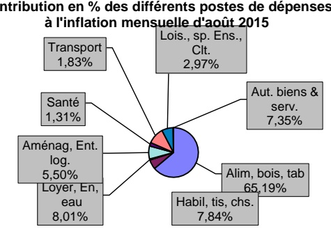

<!-- page 1 -->

Banque de la République d'Haïti

Note mensuelle d'inflation

Août 2015

<!-- page 2 -->

## Table des matières

Introduction.....2
II.- Evolution de l'inflation courante en août 2015.....2
III. Evolution de l'inflation selon l'origine des produits.....4
III. Evolution de l'inflation sous-jacente.....4
III. Facteur explicatif de la décélération de l'IPC en août 2015.....4
1. La baisse mensuelle du taux de change .....4
IV.- Prévisions d'inflation .....5

<!-- page 3 -->

### I. - Introduction

Cette note analyse l'évolution des prix à la consommation (IPC) en Haïti au cours du mois d'août 2015. Elle apporte quelques éléments explicatifs permettant de comprendre les facteurs qui influencent l'évolution de l'inflation ainsi que les prévisions pour les trois prochains mois.

### II. - Evolution de l'inflation courante

En août 2015, l'inflation mesurée par la variation de l'indice des prix à la consommation s'est établie à 1,5 % en rythme mensuel contre 2 % en juillet 2015. En variation mensuelle, l'inflation au cours des deux premiers mois du quatrième trimestre 2015 s'est portée à 1,7 % en moyenne contre 0,5 % au quatrième trimestre 2014. Par ailleurs, en glissement annuel, l'IPC a progressé d'un point de pourcentage à 10,4 %. Ce niveau d'inflation annuelle marque une rupture avec les niveaux d'inflation à un chiffre que connaît l'économie haitienne depuis novembre 2011. En glissement annuel, le taux d'inflation moyen est de 9,8 % entre juin et juillet 2015 contre 5,3 % au dernier trimestre de l'exercice fiscal 2014. En moyenne mensuelle et annuelle, l'inflation a quasiment doublé au cours des onze premiers mois de l'exercice fiscal 2015 par rapport à l'année antérieure. En effet, d'octobre 2014 à août 2015, le rythme de progression de l'IPC est passé à 0,9 % et à 7,2 % en moyenne en variation mensuelle et en glissement annuel respectivement contre 0,4 et 3,8 % au cours de la même période l'année dernière.

Graphique No. 1 Evolution de l'inflation mensuelle (en %)

| Date | Value |
| --- | --- |
| Aug-14 | 0.5 |
| Sep-14 | 0.4 |
| Oct-14 | 0.6 |
| Nov-14 | 0.5 |
| Dec-14 | 0.6 |
| Jan-15 | 0.4 |
| Feb-15 | 0.3 |
| Mar-15 | 0.4 |
| Apr-15 | 0.5 |
| May-15 | 0.8 |
| Jun-15 | 1.9 |
| Jul-15 | 2.0 |
| Aug-15 | 1.5 |

<!-- page 4 -->

| Date | Value |
| --- | --- |
| Aug-14 | 5.1 |
| Sep-14 | 5.3 |
| Oct-14 | 5.8 |
| Nov-14 | 6.2 |
| Dec-14 | 6.4 |
| Jan-15 | 6.6 |
| Feb-15 | 6.6 |
| Mar-15 | 6.4 |
| Apr-15 | 6.3 |
| May-15 | 6.6 |
| Jun-15 | 8.0 |
| Jul-15 | 9.3 |
| Aug-15 | 10.4 |

Les postes ayant le plus contribué à la hausse de l'indice des prix à la consommation sont : « Alimentation, boissons et tabac», « Habillement, tissus et chaussures » et « Loyer du logement, énergie et eau». L'indice des prix de la fonction « Alimentation, boissons et tabac», dont le poids est de 50,4% dans le panier de consommation, a contribué à hauteur de 65,19 % à l'inflation mensuelle contre 64,42 % un mois auparavant. Pour sa part, les indices des prix des groupes « Habillement tissus et chaussures » et « Loyer, Energie et Eau », dont les variations mensuelles font état d'une hausse de 1,6 % et 1 %, ont impacté l'inflation mensuelle à hauteur de 7,84 % et 8,01 %.

En glissement annuel, la contribution du poste de consommation « Alimentation, boissons et tabac » à l'inflation annuelle est la plus importante. Après s'être portée à 55,43% le mois précédent, l'inflation alimentaire a contribué à hauteur de 57,38 %, soit une hausse de 1,94 point de pourcentage par rapport à juillet 2015.

III.- Evolution de l'inflation selon l'origine des produits

<!-- page 5 -->

L’analyse selon l’origine des produits a révélé une décélération de l’indice des prix tant des produits locaux qu’importés en variation mensuelle tandis qu’en glissement annuel, la variation de l’indice des prix des deux catégories de produits précités a augmenté. En effet, d’un mois à l’autre, l’inflation importée et celle des produits locaux ont diminué de 80 et 40 points de base à 1 % et 1,7 %. Cependant, en glissement annuel, l’indice des prix des produits importés a progressé de 30 points de base à 7 % et celui des produits locaux de 1,4 point de pourcentage à 11 %.

### IV. - Évolution de l'inflation sous-jacente

En août 2015, l'inflation sous-jacente en variation mensuelle et en glissement annuel, s'est établie à 1,49 % et 9,88 % respectivement contre 1,92 % et 9,06 % un mois auparavant. L'inflation sous jacente a permis de suivre l'évolution de l'inflation obtenue en dehors des phénomènes perturbateurs dès aux produits volatils. Si en dépit de l'élimination des produits volatils, constitués essentiellement de certains produits alimentaires et pétroliers dont les niveaux de prix sont fonctions des conditions du marché, l'inflation sous jacente est inférieure à l'inflation courante, d'autres facteurs, autre que ceux conjoncturels, expliquent donc la hausse de l'IPC en glissement annuel en août 2015.

### V. - Facteur explicatif du ralentissement de l'inflation en variation mensuelle en août 2015

En août 2015, l'atténuation de l'effet de la hausse du taux de change du mois de juillet 2015 a favorisé le ralentissement de l'inflation mensuelle. Les actions des autorités monétaires prises à la fin du mois de juillet 2015, traduites par le resserrement des conditions monétaires ont permis de contenir les pressions inflationnistes au cours de la période.

### 1. - La baisse mensuelle du taux de change

En août 2015, l’appréciation de la gourde par rapport au dollar américain explique le ralentissement de l’inflation d’un mois à l’autre. En effet, en août 2015, le taux de change de la gourde par rapport au dollar a diminué à 51,67 gourdes contre 55,22 gourdes en juillet 2015. Conséquemment, en août 2015, la gourde a enregistré une appréciation de +6 % comparé à son niveau en juillet 2015 au cours duquel cette dernière a connu une dépréciation mensuelle de -7 % en juillet 2015.

La baisse du taux de change en août 2015 par rapport à juillet 2015 est due, entre autres, aux mesures prises par les autorités monétaires. En effet, les autorités monétaires ont augmenté d'une part, les taux des réserves obligatoires sur les passifs libellés en monnaie locale et en devises étrangères et d'autre part les taux sur les bons à différentes maturities. Ces mesures ont permis de réduire le surplus de liquidité en vue de renforcer la valeur de la gourde par rapport au dollar américain. Parallèlement, dans l'objectif de diminuer la pression sur la demande de devises, la Banque Centrale a procédé à des ventes nettes de 14,6 millions de dollars EU sur le marché des changes de juillet 2015 à août 2015.

<!-- page 6 -->

Graphique No. 3 Evolution du taux de change de fin de période (en %)

| Date | Value |
| --- | --- |
| Aug-14 | 45.4000 |
| Sep-14 | 45.6000 |
| Oct-14 | 45.8000 |
| Nov-14 | 46.6000 |
| Dec-14 | 46.8000 |
| Jan-15 | 47.0000 |
| Feb-15 | 47.2000 |
| Mar-15 | 47.2000 |
| Apr-15 | 47.4000 |
| May-... | 48.2000 |
| Jun-15 | 51.6000 |
| Jul-15 | 55.0000 |
| Aug-15 | 51.6000 |

### VI. Prévisions d'inflation

Pour les trois prochains mois, les prévisions d’inflation de la MAE augurent une évolution en dents de scie de l’inflation en variation mensuelle. En effet, en rythme mensuel, les prévisions tablent sur des taux de 1 % en septembre, de 0,4 % en octobre et 0,3 % en novembre 2015. En glissement annuel, l’inflation devrait se chiffrer à 11,2 % en septembre 2015, pour redescendre à 10,8 % en octobre 2015 et à 10,6 % en novembre 2015.

<!-- page 7 -->

Graphique 4 : Prévision de l'inflation à partir du mois de septembre 2015

| Date | inflation estimée (inf) | inflation en glissement annuel (sup) |
| --- | --- | --- |
| Jan-12 | 7.8 | 7.8 |
| Feb-12 |   |   |
| Mar-12 |   |   |
| Apr-12 | 5.8 | 5.8 |
| May-12 | 5.4 | 5.4 |
| Jun-12 | 5.0 | 5.0 |
| Jul-12 |   |   |
| Aug-12 | 6.2 | 6.2 |
| Sep-12 | 6.8 | 6.8 |
| Oct-12 | 7.5 | 7.5 |
| Nov-12 | 7.6 | 7.6 |
| Dec-12 | 7.4 | 7.4 |
| Jan-13 | 7.8 | 7.8 |
| Feb-13 | 7.4 | 7.4 |
| Mar-13 | 7.8 | 7.8 |
| Apr-13 | 7.4 | 7.4 |
| May-13 | 7.2 | 7.2 |
| Jun-13 | 6.4 | 6.4 |
| Jul-13 | 6.0 | 6.0 |
| Aug-13 | 4.6 | 4.6 |
| Sep-13 | 4.4 | 4.4 |
| Oct-13 | 4.2 | 4.2 |
| Nov-13 | 3.4 | 3.4 |
| Dec-13 | 3.4 | 3.4 |
| Jan-14 | 3.4 | 3.4 |
| Feb-14 | 3.2 | 3.2 |
| Mar-14 | 3.2 | 3.2 |
| Apr-14 | 3.4 | 3.4 |
| May-14 | 3.6 | 3.6 |
| Jun-14 | 4.4 | 4.4 |
| Jul-14 | 4.8 | 4.8 |
| Aug-14 | 5.2 | 5.2 |
| Sep-14 | 5.6 | 5.6 |
| Oct-14 | 6.0 | 6.0 |
| Nov-14 | 6.2 | 6.2 |
| Dec-14 | 6.4 | 6.4 |
| Jan-15 | 6.6 | 6.6 |
| Feb-15 | 6.4 | 6.4 |
| Mar-15 | 6.2 | 6.2 |
| Apr-15 | 6.4 | 6.4 |
| May-15 | 7.2 | 7.2 |
| Jun-15 | 8.4 | 8.4 |
| Jul-15 | 9.8 | 9.8 |
| Aug-15 | 10.8 | 10.8 |
| Sep-15 | 11.4 | 11.4 |
| Oct-15 | 11.2 | 11.2 |
| Nov-15 | 10.6 | 10.8 |

<!-- page 8 -->

Tableau No 1

Indice des Prix à la Consommation (IPC) par postes de dépenses Variation et Contribution à l'inflation mensuelle et annuelle En août 2015

<table><tr><td></td><td>Indice des Prix à la Consommation (IPC)</td><td>Variation IPC (en %)</td><td>Contribution à l'inflation (en %)</td></tr><tr><td>Mensuelle</td><td>Annuelle</td><td>Mensuelle</td><td>Annuelle</td></tr><tr><td>Poste</td><td>Pondération (en %)</td><td>Août 14</td><td>Juillet 15</td><td>Août 15</td><td>Août 15</td><td>Août 15</td><td>Août 15</td><td>Août 15</td></tr><tr><td>Indice Général</td><td>220.00</td><td>239.30</td><td>242.80</td><td>1.5</td><td>10.4</td><td>100.00</td><td>100.00</td></tr><tr><td>Alimentation, boisson et tabac</td><td>50.35</td><td>228.80</td><td>250.60</td><td>255.10</td><td>1.8</td><td>11.5</td><td>65.19</td><td>57.38</td></tr><tr><td>Habillement, tissus et chaus.</td><td>6.86</td><td>222.10</td><td>252.30</td><td>256.30</td><td>1.6</td><td>15.4</td><td>7.84</td><td>10.47</td></tr><tr><td>Loyer, énergie et eau</td><td>11.05</td><td>258.10</td><td>278.40</td><td>281.20</td><td>1.0</td><td>9.0</td><td>8.01</td><td>9.80</td></tr><tr><td>Aménag. et entret. du logem</td><td>4.7</td><td>223.30</td><td>240.50</td><td>244.40</td><td>1.6</td><td>9.4</td><td>5.50</td><td>4.40</td></tr><tr><td>Santé</td><td>2.9</td><td>236.50</td><td>255.00</td><td>256.60</td><td>0.6</td><td>8.5</td><td>1.31</td><td>2.44</td></tr><tr><td>Transport</td><td>13.74</td><td>159.30</td><td>162.40</td><td>162.70</td><td>0.2</td><td>2.1</td><td>1.83</td><td>2.91</td></tr><tr><td>Lois., sp. Ens., Clt.</td><td>5.84</td><td>226.70</td><td>241.00</td><td>242.70</td><td>0.7</td><td>7.1</td><td>2.97</td><td>4.09</td></tr><tr><td>Aut. biens & serv.</td><td>4.56</td><td>188.60</td><td>219.20</td><td>224.10</td><td>2.2</td><td>18.8</td><td>7.35</td><td>8.51</td></tr></table>

Sources : IHSI et calculs du Service de la Macrééconomie et Analyse de Conjoncture de la MAE

<!-- page 9 -->

## Glossaire

<table><tr><td>Glossary</td></tr><tr><td>Variation mensuelle</td><td>: Variation par rapport au mois précédent.</td></tr><tr><td>Glissement annuel</td><td>: Variation par rapport au même mois de l'année antérieure.</td></tr><tr><td>Inflation</td><td>: Mouvement persistant à la hausse du niveau général des prix.</td></tr><tr><td>Désinflation</td><td>: Ralentissement de la croissance des prix.</td></tr><tr><td>Déflation monétaire et du crédit.</td><td>: Baisse du niveau général des prix associée à une contraction de la masse</td></tr><tr><td>Inflation sous-jacente</td><td>: Tendance de long terme des prix, tout en excluant la volatilité, les mouvements saisonniers, conjoncturels, et les chocs qui affectent les composantes du panier considéré.</td></tr><tr><td>Région Nord</td><td>: Elle couvre les départementes du Nord, Nord-Est et Nord-Ouest.</td></tr><tr><td>Région Sud</td><td>: Elle comprend les départementes du Sud de la Grand'Anse et des Nippes.</td></tr><tr><td>Région Reste Ouest</td><td>: Y sont incluses les départementes du Sud'Est et de l'Ouest à l'exception de l'aire métropolitaine</td></tr><tr><td>Région Transversale</td><td>: Elle regroupe les départementes du Centre et de l'Artibonite.</td></tr></table>

Aire Métropolitaine : Elle contient les villes de Port-au-Prince, de Delmas, de Pétion-Ville, de Carrefour et de Croix des Bouquets.
