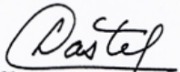

<!-- page 1 -->

# AUX INSTITUTIONS FINANCIERES

La présente circulaire détermine les règles auxquelles sont assujettis les chèques émis en Haïti, ce conformément aux opérations visées à l'article 4 de la loi du 14 mai 2012 portant sur les banques et autres institutions financières, à l'article 111 de la loi du 26 juin 2002 sur les coopératives d'épargne et de crédit et aux articles 215 et suivants du Code de Commerce.

## SECTION I- DEFINITIONS

1.- Les défitions qui suivent s'appliquent à la présente circulaire:

a. Bénéficiaire : personne physique ou morale en faveur de qui un chèque est émis.

b. Chèque impayé : chèque qui a été retourné par l'institution financière en cas d'insuffisance de provision, ou d'opposition, ou de falsification, ou de prescription, ou d'indisponibilité du compte.

c. Chèque sans provision : chèque émis et dont le solde disponible du compte auquel il est rattaché, est inférieur à son montant.

d. Compte chèque : compte lié à l'utilisation d'un moyen de paiement et ouvert par une institution financière pour recevoir des dépôts mobilisables sur demande, et qui permet à son titulaire de transférer des fonds, quel que soit le support ou le procédé technique utilisé.

e. Endossataire : bénéficiaire d'un chèque ou d'un effet de commerce qui a été endossé à son profit par son précédent porteur.

f. Endosseur : personne physique qui transmet un chèque ou un effet de commerce en faveur d'une autre personne.

g. Etablissement Négociateur : institution financière chargée de recouvrer le montant porté sur un chèque pour son client.

h. Etablissement Tiré : institution financière sur laquelle est tiré un chèque.

i. Institution financière : institution contrôlée et agréée par la BRH, principalement les banques, les fédérations de caisses populaires et toute autre institution qui aura été

<!-- page 2 -->

## CIRCULAIRE N° 103-1

autorisée par la BRH à effectuer des opérations à travers le système électronique de compensation et de règlement.

j. Jour ouvrable : jour correspondant aux jours de la semaine, à l'exception des jours légaux de repos hebdomadaire.

k. Place : aire s'étendant dans un rayon de vingt (20) kilomètres du lieu où se trouvent l'institution financière, ses succursales ou agences.

1. Titulaire du compte : personne physique ou morale, titulaire du compte chèque sur lequel sont comptabilisées les opérations effectuées.

## SECTION II- OUVERTURE DU COMPTE CHEQUE

2.- Le compte chèque peut être ouvert par une ou plusieurs personnes. Dans ce dernier cas, les opérations faites par chaque co-titulaire (retraits, chèques tirés, virements, ...) engagent aussi l'(les) autre(s) personne (s).

3.- À l'ouverture d'un compte chèque, toute Institution financière doit s'assurer de l'identité et de l'adresse du client (personne physique ou morale) en prenant la copie d'une pièce d'identification officielle avec photo et de tout autre document de nature à prouver l'adresse.

4.- L'ouverture d'un compte chèque nécessite la signature d'une convention de compte qui précise les droits et obligations des parties. Cette convention émise par l'institution financière est signée par les deux parties et faite en deux (2) exemplaires. Un exemplaire doit être remis au titulaire du compte avant la délivrance du chéquier.

En outre, le (les) titulaire(s) du compte doit(vent) apposer son(leur) spécimen de signature sur la fiche destinée à cet effet.

5.- La convention de compte doit contenir au moins les éléments suivants :

a. L'identification des parties

pour les personnes physiques : les noms, prénoms, adresse exacte, téléphone, date et lieu de naissance, la mention d'une pièce d'identification officielle, l'activité professionnelle, etc. ;

pour les personnes morales : le nom, la forme juridique, l'identité de la / les personnes (s) autorisée(s) à effectuer des opérations à partir du compte, l'adresse exacte, etc.;

b. l'engagement formel de ne pas émettre de chèque sans provision et les conséquences qui en découlent le cas échéant ;

<!-- page 3 -->

## CIRCULAIRE N° 103-1

c. la mention que le(les) titulaire(s) du compte peut(vent) être privé(s) de chéquier sans la fermeture du compte ;

d. l'obligation de remettre tous chéquiers ou formules de chèque en cas d'interdiction de chéquier ou de fermeture du compte ;

e. les cas de fermeture du compte chèque sans préavis;

f. les délais et modalités en cas de réclamation;

g. les frais de pénalité à prélever sur le compte.

6.- Avant toute ouverture d'un compte chèque, l'institution financière doit consulter la liste actualisée des interdits de chéquiers émise par la Banque de la République d'Haïti et opérer les vérifications nécessaires, notamment celles relatives à l'identité du client au moyen de tous documents ou moyens raisonnables.

7.- Un compte chèque est ouvert pour une durée illimitée. Le(s) titulaire(s) peut(vent) le clôturer sans frais à tout moment. L'institution financière peut également le clôturer, en respectant un préavis sauf exception prévue dans la convention de compte.

8.- Le(s) titulaire(s) du compte doit (vent) être avisé(s) des tarifs et conditions en vigueur et être au courant de tout changement. Ces informations devront lui (leur) être communiquées soit par courrier postal, soit par affichage dans les locaux de l'institution financière, sans exclusion de tous autres moyens que cette dernière pourra juger nécessaire d'utiliser.

9.- Les formulaires de chèques doivent contenir, pour chaque titulaire de compte, les informations suivantes : les noms, prénoms, adresse, imprimés lisiblement. Les chèques doivent répondre aux normes de standardisation établies par la BRH.

A la remise du formulaire de chèque, l'institution financière a l'obligation d'informer le client sur les modalités liées à l'utilisation et à l'émission du chèque notamment aux mentions obligatoires nécessaires à sa validité, à l'emplacement des informations qui doivent être écrites de manière claire et lisible.

Le chéquier devra être remis au titulaire personnellement ou à son mandataire, contre reçu.

10.- La tarification des produits et services liés à la gestion du compte chèque doivent être communiqués par voie d'affichage, de manière visible et lisible, dans les locaux de l'institution financière, ou de dépliants tarifaires, sans exclusion de tous autres moyens que cette dernière pourra juger nécessaire d'utiliser.

Les conditions générales applicables aux produits et services liés à la gestion d'un compte chèque doivent être mises gratuitement à la disposition de la clientèle et du public par tout moyen approprié.

<!-- page 4 -->

## CIRCULAIRE N° 103-1

11.- L'institution financière est tenue de mettre à la disposition du titulaire du compte un relevé périodique retraçant les opérations enregistrées sur le compte pendant la période concernée, sous réserve de l'existence d'opération sur la période, ce par tout moyen approprié.

## SECTION III- PRESENTATION DU CHEQUE

12.- La présentation du chèque est une demande de paiement. Elle peut être faite :

a. par courrier;

b. à travers la Chambre de Compensation de la Banque de la République d'Haïti :

- par compensation manuelle ;

- par compensation électronique ;

c. directement au guichet de la banque tirée.

13.- Lorsque la présentation est faite directement au guichet de l'Etablissement tiré, celui-ci doit suivre au moins les étapes suivantes (sans toutefois y être limitée) :

a. identification du porteur ;

b. vérification des signatures :

c. vérification de la disponibilité de la provision ;

d. apposition d'un sceau payé sur le chèque ;

e. passation des écritures au compte du titulaire ;

f. passation de toute écriture éventuelle de renversement ou de correction en rapport avec le chèque.

14.- L'Etablissement négociateur est tenu de vérifier que le chèque est endossé. Le bénéficiaire du chèque doit apposer sa signature au verso du chèque, à l'espace réservé à l'endossement.

L'Etablissement négociateur vérifie également que le nom de la personne morale au recto, ou son cachet au verso du chèque sont respectivement portés et apposés lisiblement et en toutes lettres à l'emplacement réservé à cet effet.

15.- Le chèque émis à l'ordre d'une personne morale doit être déposé sur le compte de celui-ci. Il ne peut être encaissé au guichet d'une institution financière.

## SECTION IV- ENDOSSEMENT DES CHEQUES

16.- Toute personne, même le tireur ou le porteur peut être endossataire.

La signature de l'endosseur et le numéro d'identification issu d'un document officiel doivent suivre la mention « endossé à l'ordre » portée au dos du chèque, dans le cas d'une personne

<!-- page 5 -->

## CIRCULAIRE N° 103-1

physique. Le tampon encreur de l'endosseur et la date doivent suivre la mention « endossé à l'ordre » portée au dos du chèque, dans le cas d'une personne morale.

L'Etablissement négociateur doit vérifier que le cachet de la personne morale est lisiblement apposé à l'endos du chèque et à l'emplacement prévu suivi de toute autre information requise par l'Etablissement négociateur.

17.- L'Etablissement négociateur qui endosse un chèque doit apposer son cachet ou sceau à l'encre noire à l'espace réservé à cet effet avant de le transmettre à la compensation. Le cachet doit libeller « Payer à toute banque ». Il garantit et remplace tout autre endossement antérieur.

18.- Les institutions financières reconnaissent que l'absence d'endossement constitue une cause de retour de chèques soumise aux dispositions prévues en cas d'incidents dans la section VII de la présente circulaire.

## SECTION V- COMPENSATION DES CHEQUES

19.- Les institutions financières sont tenues de participer directement aux opérations effectuées dans le cadre du système électronique de compensation et de règlement.

20.- Les chèques présentés dans le cadre du système électronique de compensation sont échangés sous forme dématérialisée (image de chèque), dès lors que les institutions financières sont en mesure de mener toute vérification nécessaire avant de procéder à leur paiement ou à leur retour.

La liste des codes et raisons de retour des chèques est annexée à la présente et en fait partie intégrante. Toute modification des codes et raisons de retour des chèques sera communiquée aux Institutions financières participant au système électronique de compensation et de règlement.

21.- Le délai de traitement, par compensation électronique, du chèque déposé dans un Établissement négociateur est de deux (2) jours ouvrables ce, quelle que soit la distance existant entre l'Établissement négociateur et l'Établissement tiré.

22.- Le montant d'un chèque non standardisé tiré sur les guichets d'une institution financière se trouvant dans la même place de compensation que l'Etablissement négociateur sera disponible dans les cinq (5) jours ouvrables après la date de dépôt. Le délai sera de dix (10) jours ouvrables si le chèque est tiré sur un établissement se trouvant dans des villes de province.

23.- L'Etablissement négociateur transmet le chèque pour paiement sous forme dématérialisée à la compensation. Cela suppose que l'Etablissement négociateur détient le chèque et qu'elle s'est préalablement assurée de la vérification et de la régularité formelle des mentions obligatoires.

<!-- page 6 -->

## CIRCULAIRE N° 103-1

L'Etablissement négociateur garantit que les données transmises sous forme dématérialisée sont strictement identiques aux informations correspondantes figurant sur le chèque.

24.- La présentation au paiement d'un chèque sous forme dématérialisée suppose la remise à l'Etablissement tiré des informations permettant l'identification certaine du tireur, du chèque et de son montant.

25.- La transmission du chèque sous forme dématérialisée pour paiement ne fait pas obstacle à la remise matérielle du chèque, concomitante ou non, à l'Etablissement tiré.

Les délais de transmission du chèque physique ne doivent en aucun cas influer sur la décision de paiement ou de non paiement, ni exempter du respect des obligations légales et réglementaires.

26.- L'archivage des chèques échangés réalisé sous la responsabilité de l'Etablissement tiré est d'une durée de dix (10) ans.

Durant ce délai, sauf pour les cas de force majeure, l'Etablissement tiré est soumis à une obligation de résultat quant à la production de l'original du chèque ou de sa copie en recto et verso, copie certifiée conforme à l'original.

## SECTION VI- CHEQUES SANS PROVISION

27.- Le compte chèque doit présenter un solde suffisant pour permettre le règlement des opérations en cours. En cas d'émission de chèque sans provision suffisante et sauf régularisation, une procédure est engagée. Celle-ci peut avoir pour conséquence d'interdire à l'émetteur du chèque impayé l'émission de nouveaux chèques, pendant une durée d'une (1) année, sur tous ses comptes conformément à l'article 32 de la présente circulaire.

28.- L'Établissement négociateur annexera une fiche au chèque impayé et retourné pour manque de fonds avec les mentions suivantes :

a. le nom de l'institution financière ;

b. la mention « chèque retourné pour manque de fonds » ;

c. le numéro du chèque ;

d. la date du refus de paiement.

29.- L'Établissement négociateur a un délai de deux (2) jours ouvrables à partir de la date de retour pour aviser le bénéficiaire d'un chèque impayé ce, sans pénalité ni aucun frais.

30.- L'Établissement tiré doit aviser l'émetteur du chèque refusé dans un délai maximum de deux (2) jours ouvrables à partir de la date de retour.

<!-- page 7 -->

## CIRCULAIRE N° 103-1

31.- L'Etablissement tiré est tenu d'informer automatiquement la BRH des chèques retournés pour manque de fonds. La BRH tient le fichier central des chèques impayés et retournés pour manque de fonds. Ce fichier est mis à la disposition des institutions financières sur un serveur.

32.- Tout titulaire de compte chèque qui, sur une période de douze (12) mois, aurait émis cinq (5) chèques impayés et retournés pour manque de fonds, sera interdit d'émettre des chèques pendant une année.

33.- À la cinquième déclaration d'incident, la BRH informera l'Institution financière dépositaire du compte de dépôt, ainsi que tout le système financier de sa décision d'interdire de chéquier le titulaire dudit compte.

34.- L'Établissement tiré ainsi que toute autre Institution financière dans laquelle le fautif aurait maintenu un compte de dépôt fera parvenir au titulaire du compte chèque l'injonction de la BRH accompagnée d'un avis lui demandant de restituer les chéquiers qui sont encore en sa possession. Cette formalité n'inclut pas la fermeture du ou des comptes.

35.- L'interdiction commence à partir de la date de l'injonction de la BRH.

36.- L'Etablissement tiré adressera à la BRH un rapport journalier sur les chèques retournés pour interdiction de chéquier.

37.- Pendant toute la durée d'interdiction de chéquier, le titulaire du compte ne peut récupérer tout ou partie de sa provision que par virement ou au guichet de l'institution financière.

38.- Dès réception de l'injonction de la BRH, l'Etablissement tiré refusera d'honorer tous les chèques de l'émetteur interdit de chéquier quelle que soit leur date d'émission.

39.- La BRH se réserve le droit de rendre public, par voie de presse, le nom de tout titulaire de compte interdit de chéquier et qui continuerait à émettre des chèques malgré l'interdiction.

## SECTION VII- RECOURS EN ANNULATION OU DE RECTIFICATION D'UNE INTERDICTION DE CHEQUIER

40.- La BRH ne pourra prendre en considération que les demandes d'annulation ou de rectification émanant de l'Etablissement tiré.

41.- Les conditions de demande d'annulation ou de rectification sont les suivantes :

a. si l'Etablissement tiré à fait une erreur portant sur le refus de paiement ou sur l'établissement de la déclaration d'incident ;

b. si le tireur a établi la survenance d'un événement qui ne lui est pas imputable et qui a mené à la disparition de la provision.

<!-- page 8 -->

42.- Le client soumet les demandes d'annulation à l'Etablissement tiré qui apprécie si les conditions stipulées à l'article 41 se trouvent réunies.

43.- La BRH avise l'Etablissement tiré ainsi que les autres institutions financières du système de l'annulation de l'interdiction.

44.- L'Établissement tiré est tenu d'aviser le titulaire du compte de l'annulation de l'interdiction dans les deux (2) jours ouvrables.

## SECTION VIII- INFORMATIONS A SOUMETTRE A LA BRH EN CAS D'INCIDENT

45.- L'Etablissement tiré est tenu de soumettre un rapport à la BRH des incidents de refus de paiement pour manque de fonds au jour J+2.

46.- La déclaration des incidents de paiement contiendra les renseignements suivants :

a. le numéro du compte ;

b. l'identification du titulaire : nom et prénom, date et lieu de naissance, numéro d'identification nationale ou fiscale, s'il s'agit d'une personne physique ; dénomination, raison sociale, forme juridique, numéro d'identification fiscale, s'il s'agit d'une personne morale ;

c. le numéro du chèque ;

d. le montant du chèque et sa date d'émission ;

e. le nom du bénéficiaire ;

f. la date de présentation du chèque à l'Etablissement tiré ;

g. la cause du refus de paiement.

47.- La répétition d'un incident de paiement pour un même chèque devra faire l'objet d'une remarque spéciale de la part de l'Etablissement tiré indiquant notamment la date de sa précédente déclaration.

48.- L'Établissement tiré communiquera à l'émetteur du chèque retourné la raison du retour et lui fera parvenir également une copie de la déclaration d'incident de paiement. L'Établissement tiré est tenu de rappeler à son client le respect des modalités liées à l'utilisation et à l'émission du chèque.

## SECTION IX- SANCTIONS

<!-- page 9 -->

## CIRCULAIRE N° 103-1

49.- Est passible d'une amende de deux mille cinq cents gourdes (2500,00 HTG) par jour de retard, l'Etablissement tiré qui n'aura pas déclaré, conformément à l'article 46 de la présente réglementation, les incidents de paiement.

50.- Au cas où la BRH aurait établi la preuve qu'un Etablissement tiré a accepté d'honorer un chèque dont l'émetteur est interdit de chéquier, l'institution financière fautivé sera frappée d'une amende de deux mille cinq cents gourdes (2500,00 HTG) par chèque honoré. Ce montant sera prélevé automatiquement de son compte tenu à la BRH.

La BRH prendra en considération la date de présentation du chèque et celle de l'interdiction comme base pour pénaliser.

51.- Aucune institution financière n'est autorisée à ouvrir un compte chèque au nom d'une personne tombant sous le coup d'une interdiction de chéquier.

52.- Toute institution financière qui ouvrira un compte chèque pour une personne interdite de chéquier, sera pénalisée d'une amende de deux mille cinq cents gourdes (2500,00 HTG) sans préjudice de sanctions administratives. En cas de récidive, l'amende sera doublée et ainsi de suite.

53.- La BRH est tenue d'aviser l'Etablissement tiré ainsi que les autres institutions financières de la levée de l'interdiction de chéquier, à l'expiration de la période prévue à l'article 32.

## SECTION X- DISPOSITIONS TRANSITOIRE ET FINALE

54.- La présente circulaire abroge la circulaire et remplace la circulaire 103 du 18 juin 2013. Elle entre en vigueur a compter du 23 septembre 2013

Port-au-Prince le 12 septembre 2013.

Charles Castel

Gouverneur

<!-- page 10 -->

## ANNEXE

| CODE | LIBELLE | DEFINITION |
| --- | --- | --- |
| A | Insuffisance de fonds | Le solde du compte est inférieur au montant du chèque. |
| B | Fonds non disponibles | Le solde disponible du compte est inférieur au montant du chèque. |
| C | Paiement arrêté | L'Établissement négociateur est formellement averti que le paiement est arrêté. |
| D | Compte fermé | Le solde du compte est à zéro et aucune sorte d'opération n'est acceptée suite à sa fermeture. |
| E | Numéro de compte incorrect, omis, illisible | Impossible de lire avec certitude le numéro de compte. Le numéro de compte inscrit dans le fichier reçu ne figure pas dans les registres de la banque ou est différent de celui de l'image du chèque. |
| F | Compte Gelé / Compte Bloqué | Il existe une interdiction légale, justifiée d'effectuer des transactions sur un compte. |
| G | Numéro de chèque incorrect / omis | Le numéro de chèque inscrit dans le fichier reçu ne figure pas dans les registres de la banque. Le numéro de chèque du fichier reçu est différent de celui de l'image du chèque. |
| H | Date Incomplète / Date Incorrect/ Date inexacte | L'un des 3 éléments (jour/mois/année) est manquant. Les trois éléments ne sont pas placés dans le bon ordre ou l'un des trois éléments est inexact par rapport à la date de présentation du chèque. |
| I | Chèque mal négocié. | Cas de chèques en gourdes négociés en dollar ou de chèques en dollar négociés en Gourdes. |
| J | Endossement Manquant / Irrégulier / Incorrect / Endossé au Crayon ou à Encre Effaçable. | La signature ou le sceau du bénéficiaire n'est pas porté à l'endos du chèque. Le bénéficiaire n'a pas inscrit correctement son nom ou apposé son cachet (en cas de personne morale) à l'endos du chèque). |
| K | Signature(s) Manquante(s) | Le chèque n'est pas signé. Il manque une |

<!-- page 11 -->

CIRCULAIRE N° 103-1

|   |   | signature ou plus. |
| --- | --- | --- |
| L | Signature Irrégulière, Incorrecte / Non Autorisée. | La(les) signature(s) n'(ne) est (sont) pas conforme(s) au(x) spécimen(s) déposé(s) / Aucun spécimen n'est enregistré. |
| M | Non Négociable / Nom du bénéficiaire Omis / Surchargé / Gommé / Incomplet. | Le chèque n'est pas émis dans la monnaie Gourdes ou dans la devise US Dollars. / Aucun mot n'est inscrit après « Payez à l'ordre de ». / Un mot est corrigé, raturé. / Seulement un nom ou un prénom est inscrit. |
| N | Chèque Frauduleux / Falsifié. | L'un des paramètres (nom du bénéficiaire, montant (s)) est modifié de façon frauduleuse / de sérieux doutes planent sur l'authenticité d'un ou de plusieurs paramètres validant le chèque. |
| O | Chèque non compensable/ cheque altéré | Des paramètres obligatoires sont détériorés, non identifiables, lavés (encre feutre), dissouts par de l'eau ou autre liquide. |
| P | Interdit de Chéquier | L'Établissement négociateur est formellement informé que le tireur est interdit de chéquier suite à une décision de la Banque de la République d'Haïti. |
| Q | Établissement tiré erroné | L'intitulé et le numéro du compte ne font pas partie du répertoire de comptes que l'Établissement négociateur prend pour l'Établissement tiré. |
| R | Image inexploitable | Les données du fichier incoming clearing sont différentes de celles de l'image du chèque. |
| S | Chèque TP non chargé / système GCC | Le chèque physique n'existe pas dans le fichier électronique préalablement transmis par le MEF à la BRH. |
| T | Image ne passant pas le Contrôle de Sécurité | Un au moins des critères de sécurité n'est pas présent. |
| U | Montants Différents / Incorrects | Le montant inscrit en chiffres n'est pas celui porté en lettres. / L'un ou l'autre des 2 montants ne correspond pas aux normes d'écriture des nombres. |
| V | Non validé par le Comptable Public ou la CSC/CA - MEF | Toutes les fois que, par lettre, le MEF fixe des clauses comme obligatoires. |
| W | Chèque Dupliqué | Le même numéro de chèque est déjà traité. |
| X | Date Périmée | Le chèque tiré sur le trésor dont le délai de validité est échu. |
| Y | Non Endossé par | Le cachet de l'Établissement Négociateur. |

<!-- page 12 -->

CIRCULAIRE

N° 103-1

|   | l'Établissement Négociateur | "Payer à toute banque" n'est pas présent au verso du chèque. Endossement garanti : Ce cachet remplace tout endossement antérieur. |
| --- | --- | --- |
| Z | Opposition Judiciaire | L'émetteur a contre lui une interdiction judiciaire. |
| 1 | Montant différent de celui du système électronique | Le montant du chèque physique transmis par le MEF à la BRH ne correspond pas à celui figurant dans le système électronique. |
