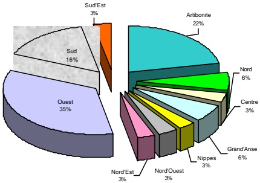

<!-- page 1 -->

## 2006 RAPPORT ANNUEL

<!-- page 2 -->

<!-- page 3 -->

CONSEIL D'ADMINISTRATION

RAYMOND MAGLOIRE

Gouverneur

PHILIPPE W. LAHENS

Gouverneur-Adjoint

CHARLES CASTEL Directeur Général

RÉMY MONTAS

Membre

GEORGES HENRY FILS

Membre

<!-- page 4 -->

<!-- page 5 -->

<!-- page 6 -->

## TABLE DES MATIÈRES

### A. L'ACTIVITÉ ÉCONOMIQUE EN 2006

I. LE SECTEUR RÉEL 14
I.I Valeur ajoutée par secteur d'activité 16
I.2 Le comportement des prix en 2006 21
I.3 Salaires et la situation de l'Emploi 25
II LA MONNAIE ET LE FINANCEMENT DE L'ÉCONOMIE 28
II.1 La politique monétaire en 2006 29
II.2 Les instruments de politique monétaire en 2006 29
II.3 Les résultats 34
II.4 Évolution des agrégats monétaires 39
II.5 Contreparties de M3 et financement de l'économie 40
III.LES FINANCES PUBLIQUES 42
III.1 Recettes 43
III.2 Dépenses 46
IV. LA BALANCE DES PAIEMENTS 50
IV.1 L e solde des transactions courantes en 2006 52
IV.2 Les mouvements de capitaux 56
IV.3 Le financement de la balance des paiements 56
V. LA DETTE PUBLIQUE EXTERNE 58
V.1 Encours de la dette publique externe 58
V.1.1. Les Créances bilatérales 59
V.1.2. Les Créances Multilatérales 59
V.1.3 La structure de l'encours en devises 59
V.1.4 Répartition de l'encours par secteur économique 60
V.2. Décaissements, Service de la dette et arriérés de paiements 61
V.3. Situation d'Haïti dans le cadre des initiatives des pays pauvres très endettés 62
B. ÉVOLUTION DU SYSTÈME BANCAIRE EN 2006
VI. LE SYSTÈME BANCAIRE : VUE D'ENSEMBLE 65
VI.1 Le système bancaire 67
VI.1.1 Établissements et environnement concurrentiel 67
VI.2 Structure du système bancaire 68
VI.3 Distribution du crédit 71

<!-- page 7 -->

VI.4 Parts de marché individuelles 74
VII. LES ACTIVITÉS ET RÉSULTATS DU SYSTÈME BANCAIRE 77
VIII.1 Activités bancaires 77
VII.2 Structure financière et qualité de l'actif 86
VIII.3 Résultats 90
VIII.1 Les activités de surveillance 98
VIII.2 Autres 98
C. LA BRH EN 2006
IX. GESTION DES AVOIRS EXTERIREURS DE LA BRH 102
IX.1- Composition des avoirs extérieurs de la BRH 103
IX.1.1- Rendement du Portefeuille 103
IX.1.2- Rendement des fonds placés sur le marché du loyer au jour le jour (Repos) 104
X. LA MONNAIE FIDUCIAIRE ET LA MONNAIE SCRIPTURALE 106
X.1 Billets divisionnaires 106
X.1.1 Émission, destruction et remplacement de monnaie 106
X.1.2 La circulation fiduciaire au sens strict 107
X.1.3 La Circulation Fiduciaire au sens large 107
X.1.4 La composition de l'encours par coupure de billets 107
X.1.5- Billets contrefaits retenus aux guichets de la BRH 108
X.2 Les chèques 108
X.3 Dépôts et tirages des banques commerciales 110
X.4 Services à l'État 111
X.5 Résultats des efforts liés à la mise en œuvre de la politique monétaire 115
X.5.1 Évolution du taux de change (HTG/USD) 115
d'octobre 2005 à septembre 2006 115
XI. Développement et entretien du système des NTI de la BRH 119
XI.1 Le système d'information financier 119
XI.1.1 Intranet 119
XI.1.2 Gestion des Immobilisations 119
XI.1.3 Web AIBF 119
XI.1.4 Les réserves internationales nettes 119
XI.1.5 l'application GRH 120
XI.1.6 Système de Paiement Interbancaire Haïtien (SPIH) 120

<!-- page 8 -->

XI.1.7 Tableau de bord RTF 120
XI.2 Projets techniques 120
XI.2.1 Réseaux télématique financier (RTF) 120
XI.2.2 Réseau informatique interne 121
XI.2.3 Internet 121
XI.2.4 Réseau VSAT 121
XI.2.5 Centre de Technologie 121
XI.3 Gestion des équipements électroniques 121
XI.3.1 Production d'énergie 121
XI.3.1.1 Démantèlement de l'ancienne centrale 122
XI.3.1.2 Groupe de location 122
XI.3.1.3 Implantation de la nouvelle centrale 122
XI.3.2 Alimentation des charges critiques 122
XI.3.3 Climatisation 123
XI.4 Sécurité 123
XII. LES ACTIVITES D'INSPECTION GÉNÉRALE DES CAISSES POPULAIRES 125
XIII. LES RESSOURCES HUMAINES DE LA BRH EN 2006 126

### D. ÉTATS FINANCIERS ET ANNEXE JURIDIQUE

## XIII ÉTATS FINANCIERS ANNEXE JURIDIQUE

## TABLEAUX

1 Salaire réel 27
2 Recettes interne par institution 45
3 Structure des recettes (en %) 46
4 Évolution du déficit du gouvernement central financé par la BRH 49
5 Résumé de la balance des paiements d'Haïti 51
6 Résumé de la situation de l'allégement de la dette d'Haïti 63
7 Indicateurs financiers clés 66
8 Établissements bancaires fonctionnant en Haïti 67
9 Nombre des succursales et agences autorisées par établissement bancaire 68
10 Évolution du nombre de succursales autorisées par établissement bancaire 68
11 Poids des principaux établissements bancaires 69
12 Poids des différentes catégories d'établissements bancaires 70

<!-- page 9 -->

13 Indicateur de concentration Herfindhal-Hirschman 71
14 Répartition de l'encours des prêts par secteur d'activité 72
15 Répartition de l'encours des prêts par tranche(prêts de 75 000 gdes ou plus) 73
16 Répartition du nombre de prêts par emprunteur 74
17 Parts de marché et en termes d'actif total et portefeuille de prêts bruts 75
18 Parts de marché et rang en termes de dépôts totaux et en dollars ÉU 76
19 Bilan du système bancaire 77
20 Principaux postes du bilan du système bancaire (variation en %) 77
21 Composition des postes du bilan système bancaire 78
22 Composition des Liquidités du système bancaire 79
23 Liquidités du système bancaire 80
24 Position nette interbancaire 80
25 Variation en pourcentage des dépôts du système bancaire 81
26 Composition des dépôts du système en MG et en pourcentage 82
27 Évolution des dépôts en dollars ÉU 82
28 Évolution du nombre de compte de dépôts et des déposants en pourcentage de la population adulte 83
29 Évolution de la qualité des actifs au niveau du système bancaire 83
30 Respect des normes de suffisance de fonds propres 87
31 Prêts improductifs du système bancaire 88
32 Taux d'improductions par catégorie de prêts du système 88
33 Couverture des prêts improductifs bruts par les provisions pour créances douteuses 89
34 Prêts improductifs en pourcentage des fonds propres 89
35 Importance des prêts accordés aux apparentés 90
36 Revenus net d'intérêt en MG pour l'exercice terminé au 30 septembre 92
37 Produits nets bancaires 93
38 Coefficient d'exploitation pour l'exercice terminé au 30 septembre 93
39 Rémunération moyenne des dépôts pour l'exercice terminé au 30 septembre 95
40 Rendement moyen des prêts 95
41 Rendement moyen des prêts productifs 96
42 Productivité par employé 97
43 Destruction, remplacements et émission de la monnaie 107
44 Résultat de la compensation par banque des chèques en gourdes 109
45 Résultat de la compensation mensuelle des chèques en gourdes 109
46 Résultat de la compensation par banques des chèques en devises 110
47 Résultat de la compensation mensuelle des chèques en devises 110

<!-- page 10 -->

48 Tirage des banques commerciales sur leurs comptes en gourdes à la BRH 111
49 Impression mensuelle de chèques en 2006 111
50 Nombre de chèques certifiés en 2006 112
51 Ordre de virement en milliers de gourdes et en million de dollars ÉU 113
52 Évolution des soldes des comptes des institutions financières 113
53 Nombre de dépôts captés dans le système bancaire sur une base mensuelle 114
54 Quantité de chèques traités pour l'exercice fiscal 2006 114
55 Ventilation du nombre de chèques honorés et montants correspondant 115
56 Cours moyen de la gourde par rapport au dollar ÉU (HTG / ÉU) 117
57 Variation du cours moyen de la gourde par rapport au dollar ÉU (en%) 118
58 Effectif de la BRH en 2006 126
59 Mouvement du personnel de la BRH en 2006 126
60 Répartition de l'effectif des employés actifs et réguliers par ancienneté 127
61 Rotation du personnel de la BRH en 2006 127

## GRAPHIOUES

1 Évolution Produit Intérieur Brut (PIB) réel 14
2 Valeur ajoutée des secteurs d'activité 18
3 Taux moyens pondérés (TMP) des bons BRH de différentes maturités 30
4 Composition de l'encours total des bons BRH 31
5 Coefficients de réserves obligatoires sur les passifs en monnaie locale 32
6 Coefficients de réserves obligatoires sur les passifs en monnaie étrangère 33
7 Position moyenne de réserve 33
8 Les Composantes de la base monétaire 36
9 Taux d'intérêt pratiqués par les banques commerciales (instruments en gdes) 38
10 Taux d'intérêt pratiqués par les banques commerciales (instruments en dollars) 38
11 Évolution du taux de change (G/$ 39
12 Évolution des agrégats monétaires 40
13 Les contreparties de M3 41
14 Financement Monétaire du déficit budgétaire 43
15 Répartition des Investissements du Gouvernement par ministères en 2006 48
16 Le solde courant de la balance des paiements d'Haïti 52
17 La balance commerciale d'Haïti en 2006 53
18 Parts relatives des principales importations 54
19 Parts relatives des principales exportations 55
20 Réserves officielles nette de change en mois d'importations 57

<!-- page 11 -->

21 Encours de la dette publique externe 58
22 Composition du portefeuille de la dette externe par type de devises (%) 60
23 Répartition de la dette externe totale par secteur économique 60
24 Évolution des Décaissements et des arriérés de paiement 61
25 Évolution simultanée du service de la dettes, des décaissements amortissements, et flux nets 62
26 Répartition en pourcentage et selon l'échéance de l'encours des prêts de 75 000 gourdes ou plus (+) 74
27 Liquidités du système bancaire au 30 septembre 79
28 Croissance des dépôts du système bancaire au 30 septembre 81
29 Portefeuille de prêts bruts du système bancaire 84
30 Volume des achats et des ventes de dollars ÉU 85
31 Position nette en devises du système bancaire en pourcentage des fonds propres 86
32 Évolution des fonds propres du système bancaire 87
33 Évolution du bénéfice net 90
34 Rendement de l'actif (ROA) 91
35 Rendement de l'avoir des actionnaires (ROE) 91
36 Évolution des autres revenus 92
37 Évolution des dépenses d'exploitation et de leurs composantes 94
38 Évolution du nombre d'employés du système bancaire 96
39 Évolution des intérêts versées sur les bons BRH 99
40 Évolution des réserves brutes de change de la BRH 102
41 Remplacement de billets et composition de l'encours par coupure 108
41 Évolution du taux de référence moyen mensuel (HTG/$EU) 116
42 Évolution du spread du taux de change sur le marché bancaire en 2006 117
43 Répartition par zone géographique des caisses populaires inspectées en 2006 125

<!-- page 12 -->

La reprise de l'activité économique entamée en 2005 (1,80% de croissance) s'est renforcée en 2006. En effet, le PIB réel a affiché un taux de croissance de 2,30 %, soit le taux le plus élevé depuis 1999. Cette accélération de la croissance doit être interprétée comme un résultat satisfaisant bien que ce taux soit légèrement inférieur à l'objectif fixé par le gouvernement haïtien (2,50%) dans le programme d'AUAC II signé avec le FMI. Cette performance de l'économie haïtienne s'est réalisée dans un contexte macroéconomique interne plus ou moins favorable et un environnement international marqué par le dynamisme du commerce mondial et un faible taux d'inflation, malgré la flambée des prix des matières premières notamment du pétrole et des métaux. Toutefois, ce taux de croissance, légèrement inférieur à celui de la population (2,50 %), s'est obtenu dans un contexte socio-politique difficile, caractérisé surtout par des actes de kidnapping dans la capitale haïtienne durant tout l'exercice.

Sur le plan interne, les conditions macroéconomiques ont été favorables à la croissance consécutivement à la hausse de la demande intérieure. En effet, malgré la baisse de 6,30 % du portefeuille du crédit réel $ ^{3} $ mis à la disposition du secteur privé par le système bancaire en 2006, l'investissement global ne s'est accru que de 2,18 %. Les apports de capitaux étrangers, notamment dans le secteur des télécommunications, ont soutenu les investissements privés, qui ont compensé la baisse des investissements publics. Ces derniers ont chuté de 9,37 % en 2006 par rapport à l'année précédente, en dépit de l'augmentation de leur poids $ ^{4} $ dans le budget de l'État. Parallèlement, la consommation a progressé de 3,94 %, demeurant ainsi le principal moteur de la croissance. Par ailleurs, les exportations ont crû de 3,09 % cette année contre 3,38 % en 2005, tandis que le rythme de croissance des importations s'est accéléré de 2 points de pourcentage pour s'établir à 4,60 %.

L'économie mondiale a connu un essor robuste dans un environnement de faible inflation, en dépit de la hausse des prix du pétrole pendant l'exercice. La croissance économique mondiale s'est accélérée, passant de 4,90 % en 2005 à 5,40 % en 2006. Cette évolution favorable provient particulièrement de la croissance du PIB réel dans les pays émergents et en développement, soit 7 % en moyenne. Aux États-Unis, l'activité économique a progressé de 3,30 % en 2006 contre 3,20 % l'année précédente, malgré les difficultés du secteur immobilier américain. Conséquement, les échanges internationaux de biens et de services ont progressé de 8 % en 2006 contre 6,50 % en 2005, favorisant la demande pour les produits haïtiens. Les recettes d'exportation se sont accrues de 24,68 %, en raison principalement de l'accroissement (26,88 %) des exportations de produits industriels, en particulier des articles manufacturés (37,41 %) et des

<!-- page 13 -->

produits de la petite industrie (52,63 %). La valeur des importations totales a enregistré un accroissement de 32,32 %, imputable surtout à celui des importations de produits alimentaires, des produits pétroliers et des machines et matériels de transport.

L'excédent enregistré au niveau de la balance globale a permis de liquider les arriérés de paiements sur la dette externe et de renforcer les réserves nettes de change, lesquelles représentent, néanmoins, un mois d'importations en septembre 2006.

<!-- page 14 -->

L'amélioration de la situation macroéconomique d'Haïti observée en 2005 s'est consolidée en 2006. En effet, le produit intérieur brut en volume a progressé de 2,30 % contre 1,80 % en 2005, l'inflation a chuté à 12,41 % en septembre 2006 contre 14,80 % un an plus tôt. La poursuite de cette expansion macroéconomique en 2006 s'est réalisée dans un contexte socio-politique fragile et un environnement international caractérisé par la flambée des prix des produits pétroliers. Toutefois, la hausse des prix du pétrole n'a pas eu de grands effets sur la croissance mondiale qui a légèrement accéléré, s'inscrivant à 5,40 % contre 4,90 % en 2005.

Graphique 1- Évolution du produit intérieur Brut (PIB) en termes réels

| Year | Tx. de croiss. annuelle (%) | PIB annuel en volume (MG) |
| --- | --- | --- |
| 1995 | 10.0 | 11700 |
| 1996 | 4.2 | 12100 |
| 1997 | 2.8 | 12500 |
| 1998 | 2.2 | 12800 |
| 1999 | 2.8 | 13100 |
| 2000 | 0.9 | 13200 |
| 2001 | -1.0 | 13000 |
| 2002 | -0.2 | 13000 |
| 2003 | 0.4 | 13100 |
| 2004 | -3.5 | 12500 |
| 2005 | 1.8 | 12800 |
| 2006 | 2.3 | 13100 |

L'exercice 2006 a été dominé par les activités électorales. Initialement prévu en décembre 2005, maintes fois reporté, le premier tour de l'élection présidentielle et des législatives s'est déroulé en février 2006, et le second tour en avril 2006. La prestation de serment du nouveau président de la République, en mai 2006, a aussitôt été suivie par l'entrée en fonction d'un nouveau parlement, précédant ainsi l'installation en juin d'un nouveau gouvernement. Le report à maintes reprises des élections a créé des incertitudes quant à leurs réalisations effectives, engendrant un comportement d'attentisme chez les principaux acteurs économiques au premier trimestre de l'exercice. La réalisation de celles-ci, suivie des manifestations post-électorales ont totalement perturbé les activités économiques au cours du deuxième trimestre. Aussi les principaux

<!-- page 15 -->

indicateurs de conjoncture publiés par l'IHSI, notamment l'indice de la production industrielle (-4,03 au deuxième trimestre contre +8,60 % précédemment), se sont inscrits en baisse en glissement trimestriel.

Sur le plan sécurité, comme au cours des deux années précédentes, la situation est restée précaire, accusant, néanmoins, une légère amélioration au premier trimestre. En dépit du contexte d'agitations sociales ponctuées d'actes de violence et malgré la recrudescence des enlèvements, on a relevé une quasi-complète reprise des activités commerciales aussi bien dans la capitale que dans le reste du pays. L'indice de l'activité commerciale a réagi positivement, progressant, en rythme annuel, de 29,92 % au premier trimestre, de 13,06 % au deuxième trimestre, et de 43,78 % au troisième.

Sur le plan des politiques économiques, le nouveau gouvernement a maintenu les mesures d'assainissement des finances publiques et de stabilité macroéconomique entamées par le précédent gouvernement dans le cadre des accords d'《Assistance d'Urgence Après Conflit (AUAC I et II)》conclus avec le FMI. Des efforts ont été déployés en vue de définir un cadre global de politique économique, cohérent et susceptible de garder positivement orientées les anticipations des agents et de mettre en confiance les investisseurs nationaux et internationaux. Dès sa prise de fonctions, le nouveau gouvernement a reçu un large appui de la communauté internationale, aussi bien des pays amis que des institutions multilatérales. Ces derniers ont exprimé leur désir d'épauler Haïti dans ses efforts pour sortir de la crise par des injections de capitaux, ainsi qu'il ressort des conférences des bailleurs de fonds. De même qu'ils ont convenu de proroger jusqu'en décembre 2007 le cadre de coopération intérimaire (CCI), un document de coordination de l'effort international dont l'orientation sera modifiée pour tenir compte des acquis des deux premières années du programme et des nouvelles priorités de l'actuel gouvernement. Par ailleurs, la Banque mondiale et le Fonds Monétaire International ont officiellement décidé de l'admissibilité d'Haïti au programme d'allègement de la dette, au titre de l'initiative en faveur des pays pauvres très endettés (PPTE). Dans le même temps, Haïti a intégré le programme «PETROCARIBE» du Venezuela qui consiste à fournir un crédit sur des produits pétroliers à un prix préférentiel dans une perspective de solidarité régionale. Les conditions exceptionnelles offertes par le Petrocaribe prévoient une période de grâce de 25 ans, le remboursement de 40 % de la dette sur 25 ans, à un taux d'intérêt de 1 % l'an.

Pour une deuxième année consécutive, l'économie haïtienne a renoué avec la croissance, après les piètres performances (1 % en moyenne annuelle) au cours de la première moitié des années 2000. De plus, le PIB en volume de cet exercice (13 079 MG) se rapproche de son niveau de 1999 (13 139 MG), signe que l'économie parvient progressivement à sortir de la

<!-- page 16 -->

récession où elle était empêtrée durant les cinq dernières années. Il convient de souligner que ce regain de croissance a été réalisé dans une conjoncture de resserrement monétaire et de rigueur budgétaire, combiné avec un choc occasionné par la vive hausse des prix des produits pétroliers. Toutefois, des efforts substantiels restent à déployer pour renforcer le cadre macroéconomique et institutionnel, en vue d'assurer une croissance économique plus forte et soutenable. Cette dernière reste une condition nécessaire et indispensable à l'amélioration du niveau de vie de la population et à la réduction de la pauvreté en Haïti.

À l'origine de la croissance, on trouve notamment l'expansion de la consommation 3,94 %, consécutive à un meilleur niveau du pouvoir d'achat des ménages. Ce résultat est la conjonction de développement atypique tels l'accroissement de 14 % de la masse salariale dans la fonction publique, l'augmentation de plus de 20 % des transferts privés sans contrepartie, une moindre dégradation du pouvoir d'achat des ménages en contrepartie d'une inflation ralentie, qui est passée de 14,80 % en 2005 à 12,41 % en 2006. Sous l'impulsion de la demande intérieure, le rythme de croissance des importations de biens et services s'est accéléré, passant à 4,60 % en 2006 contre 2,57% en 2005. En revanche, les exportations en volume ont crû de 3,09 % contre 3,38 % en 2005, de sorte qu'au net les échanges, en 2006, ont contribué négativement à la croissance. L'activité économique a été aussi tirée par l'évolution de l'investissement global qui a progressé de 2,18 %, grâce aux apports de capitaux étrangers dans le secteur des Télécommunications, conjugués à la reprise du crédit bancaire au secteur privé qui a connu une augmentation nominale de 400 milliards de gourdes (14,89 %).

### I. I- Valeur ajoutée par secteur d'activité

Les statistiques confirment l'accentuation des propensions à la tertiarisation de l'économie haïtienne, ainsi qu'il ressort de la répartition du PIB selon ses composantes. Les secteurs primaire et secondaire, en perte de vitesse et de poids, contribuent de moins en moins à l'évolution du PIB et le tertiaire de plus en plus par son poids, en augmentation constante, allié à une forte croissance, en 2006.

## Secteur Primaire

Le secteur primaire a encore perdu en importance cette année, comme l'attestent à la fois son poids (de 25,43 % en pourcentage du PIB contre 25,58 % en 2005) et la réduction quasiment de moitié de sa croissance (1,71 % contre 2,60 % en 2005). Au bout du compte, sa contribution à la croissance du PIB a été divisée par deux, soit 18,92 % en 2006, contre 36,73 % précédemment.

<!-- page 17 -->

Le secteur agricole a connu une situation difficile dès le début de l'exercice, dans la mesure où beaucoup de parcelles emblavées ont été ravagées par les eaux en furie lors du passage des dépressions tropicales Wilma et Alpha (22-23 octobre 2005). La région du sud a été la plus touchée : plusieurs hectares de terre ont été inondées, des têtes de bétail emportées par les eaux et des bananeraires détruites par le vent. Cette situation a eu des impacts sur la production de pois Congo qui était au stade de floraison au cours du mois d'octobre. Dans la vallée de l'Artibonite, les dégâts sont chiffrés à 85 hectares de rizières, 35 hectares d'arachide et 25 hectares de patate douce $ ^{5} $.

Haïti possède deux principales saisons agricoles : la saison de printemps (mars-juin) et la saison d'automne (octobre-janvier). La première est la plus importante et contribue pour plus de la moitié dans la production agricole annuelle du pays. La saison agricole du printemps a été marquée cette année par un grand retard de démarrage, dû à un déficit pluviométrique sévère frappant environ le tiers du pays. Même les régions les moins affectées telles que le Nord-Est, le Sud-Est et même le Centre, ont quelques zones qui ont été touchées. Par contre, la pluviométrie et donc la production agricole ont été quasiment normales dans le reste du pays et pendant le reste de l'année. De plus, la période cyclonique a apporté des pluies bénéfiques aux activités agricoles. En dépit de quelques effets dévastateurs de la tempête tropicale Ernesto enregistrés dans la nuit du 26 au 27 août dans la péninsule sud d'Haïti, les pluies induites par cette activité cyclonique avaient grandement facilité la reprise de la saison d'automne. Ces pluies ont également aidé à la semence et au développement de nombreuses cultures à la deuxième saison agricole.

En dépit de quelques difficultés en liaison avec la régularité des précipitations et à leur bonne répartition géographique, la production agricole 2005-2006 a été légèrement meilleure que celle de l'exercice précédent. La seule ombre reste le repli (-6,60 %) de la production après sa stabilisation en 2005. A l'opposé, les principales cultures vivrières ainsi que les denrées d'exportation ont inscrit des gains de production : riz paddy (+4,76 %), maïs (+2,24 %), cacao (+25 %), choux (+55 %), pamplemousse (+5 %), mandarine (+4,35 %), la canne à sucre (+2,40 %). La production de certaines autres denrées dont le café, le sorgho, la patate douce, les haricots secs, la pomme de terre, a stagné.

<!-- page 18 -->

Graphique 2- Valeur ajoutée par secteur d'activité (en %)

|   | 1998 | 1999 | 2000 | 2001 | 2002 | 2003 | 2004 | 2005 | 2006 |
| --- | --- | --- | --- | --- | --- | --- | --- | --- | --- |
| Agriculture | 2883 | 2748 | 2648 | 2672 | 2573 | 2569 | 2526 | 2547 | 2532 |
| Industries manufact | 803 | 758 | 748 | 756 | 772 | 773 | 800 | 777 | 778 |
| Bâtiments et trav. publ. | 621 | 668 | 717 | 729 | 739 | 747 | 753 | 764 | 768 |
| Comm., restaur. et hôtels | 2464 | 2496 | 2586 | 2623 | 2709 | 2710 | 2606 | 2621 | 2639 |
| Autres | 1146 | 1152 | 1192 | 1197 | 1124 | 1136 | 1218 | 1206 | 1203 |
| Serv. n/ marchands | 1140 | 1109 | 1082 | 1066 | 1075 | 1056 | 1068 | 1062 | 1054 |

Les industries extractives ont profité de la bonne tenue de la branche « Bâtiments et Travaux Publics » qui est restée bien orientée. Ces industries ont affiché une croissance de 7,14 % de leur production $ ^{6} $, bien qu'en baisse de 55 points de base sur l'année précédente.

## Secteur Secondaire

Le poids du secteur secondaire à la production a légèrement diminué en 2006, revenant à 15,90 % contre 16,01 % en 2005. De même, ont ralenti son rythme de croissance (+1,66 après +2,45% en 2005) ainsi que sa contribution à l'évolution du PIB (11,49% après 21,68%).

Les industries manufacturières sont restées bien orientées, affichant à la fin de l'exercice fiscal un taux de croissance de 2,31 % après 1,63 % en 2005. Ces industries qui périclitaient depuis quelques années, ont donné quelques signes de redressement au cours des deux derniers exercices fiscaux. Les anticipations entretenues par les industriels en perspective d'une éventuelle ratification de la Loi Hope par le Congrès Américain devraient amener l'investissement à croître en ligne avec leurs atentes. La promulgation de cette nouvelle législation commerciale à caractère préférentiel entraînera automatiquement la suppression des tarifs douaniers sur les exportations aux États-Unis de vêtements fabriqués dans l'industrie de sous-traitance d'Haïti.

<!-- page 19 -->

Dans le sillage de l'application de la loi Hope, étalée sur une période de trois ans renouvelables, les créations d'emplois à travers l'implantation de zones franches seraient de l'ordre de 95 000 (dont +75 000 en Haïti et +20 000 en République Dominicaine).

Le dynamisme de la branche Bâtiments et Travaux Publics se confirme ; la croissance au cours de l'exercice fiscal 2006 s'est établie à +2,87 %, après + 2,95 % pour le précédent exercice. Cette performance est imputable en grande partie aux investissements du secteur privé, le secteur public n'ayant que très modérément dépensé dans ce domaine en 2006. Les importations de ciment et la production de minerais non métalliques, portées par la demande induite du secteur de la construction ont fortement progressé. Dans le même temps, elles ont bénéficié de l'appréciation et de la stabilité de la gourde, à l'origine de la baisse des prix du ciment et du fer notamment, et soutenant la demande de matériaux de construction importés. Au début du deuxième trimestre, les indices des prix du sac de ciment de 42,50 kg et de la tonne de fer se sont orientés à la baisse, perdant, respectivement, 0,30 % et 1,50 % à la fin du trimestre, contre un gain, respectivement, de 4,70 % et 11,10 % au premier trimestre. Dans la foulée, les ménages ont mis à exécution leurs projets de construction décidés pour cette année. Ainsi, l'indice de l'activité de construction qui avait fléchi de −0,61 % au premier trimestre, a rebondi au deuxième trimestre 17,88 %, progressant ensuite sur un rythme plus modeste (+ 5,29 %) au troisième trimestre.

Le sous-secteur Électricité et Eau dont la croissance au cours des deux dernières années avait été soutenue par des subventions du gouvernement et d'organismes internationaux, s'est effondré en 2006 avec une contraction de sa production de 22,67 % après une progression de 11,11 % en 2004 et de 7,14 % en 2005. Cette décélération atypique est une résultante non seulement de la hausse des prix des produits pétroliers, mais aussi des problèmes d'envergure technique, administrative, financière, confrontés depuis quelques années déjà par la compagnie nationale d'électricité (EDH) et qui ont atteint un point critique en 2006.

## Secteur Tertiaire

La croissance du secteur tertiaire a été la plus forte des trois, avec une accélération marquée (+2,74% après +1,30% en 2005), élargissant aussi bien la part du tertiaire dans le PIB à 51,32 % (une hausse de 21 points de base par rapport à l'année précédente) que sa contribution à l'évolution du PIB. Cette dernière a été de 60,47% contre 37,17% en 2005, soit plus du triple de celle du secteur primaire (18,92%) mais près du quintuple de celle du secteur secondaire (11,49%). À l'origine de ce climat porteur, on trouve la bonne performance des branches d'activité et notamment les télécommunications, durablement installées sur une pente haussière

<!-- page 20 -->

et rapide, mais aussi, les activités marchandes, en plein redressement, et l'industrie touristique entrée dans une nouvelle phase de progrès.

La branche Commerce, restaurants, et hôtels a connu une évolution remarquable en 2006 (3,01 %), à l'inverse de la phase de croissance molle des deux dernières années (1,36 % en 2005 après −6,37 % précédemment). Les activités commerciales ont considérablement ralenti en 2004 puis en 2005, sous le coup des turbulences socio-politiques et de la perpération d'actes de banditisme qui ont gravement porté atteinte à l'activité dans le centre-ville de la capitale, considéré comme le poumon de l'économie nationale. Par contre, c'est le secteur qui a le plus profité de l'amélioration de la sécurité, dans le sillage des dernières élections présidentielle et législatives. En effet, l'indice de l'activité commerciale a progressé de 29,92 % au premier trimestre, puis de 8,80 % au deuxième et de 43,79 % au troisième, en glissement annuel. Parallèlement, dans les domaines de la restauration et de l'hôtellerie la reprise est clairement engagée. L'augmentation du nombre des touristes, haïtiens ou étrangers, recensés à l'Aéroport International Toussaint Louverture au cours de la période sous revue, est un indicateur de la demande étrangère, à l'origine de ce rebond. Les données obtenues de l'Administration Aéroportuaire National (AAN) font en effet été d'une augmentation de 15 % du nombre de touristes, en 2006, comparativement à une baisse de 17,38 % en 2005. S'agissant des touristes haïtiens, alors que, en 2005, évitant l'insécurité au pays, leur nombre avait décru de 89,74%, il s'est produit, en 2006, un véritable retournement (+57,70%).

La prépondérance de la branche Transports et communications dans l'activité économique du pays est bien établie cette année. Cette branche d'activité se démarque des autres par son rythme de progression soutenue au cours des derniers exercices fiscaux. De plus, elle connaît en 2006 la plus forte croissance, soit 4,47 % contre 3,20 % en 2005 et 0,77 % précédemment. Les importations de machinerie et d'équipements (+66,16 % par rapport à 2005), qui ont progressé à un rythme supérieur à celui des produits pétroliers (16,15 %) et de l'alimentation (11,16 %), ont été tirées par la demande intérieure enregistrée au niveau de la branche Transport et communications. En 2006, les investissements en machinerie, équipements de transport, et dans les technologies de l'information et de la communication (TIC) ont apporté une contribution importante à la formation brute de capital fixe dans l'économie haïtienne.

Le transport public constitue l'un des secteurs vitaux du pays tant pour son intérêt utilitaire et social que pour ses contributions à l'activité. D'après une enquête de l'IHSI, les transports routiers et maritimes, essentiellement constitués d'unités informelles et éparses, avaient réalisé un chiffre d'affaires évalué à 17 milliards de gourdes, en 2004, recouvrant une valeur ajoutée de

<!-- page 21 -->

l'ordre de 12,7 milliards de gourdes. Tandis que les dépenses effectuées dans l'économie par ces deux modes de transport s'élèvent à 7,2 milliards de gourdes au cours de la même période.

La branche Télécommunications, portée par une demande intérieure exceptionnellement forte, a été la locomotive de la croissance en 2006. C'est ainsi que les trois plus grandes sociétés de téléphonie mobile en Haïti auprès desquelles le fisc a, au cours de l'exercice fiscal 2005-2006, collecté en impôts un total de 1,3 milliards de gourdes (soit 0,65 % du PIB), se comptent parmi les six premiers contribuables dans le groupe des 150 plus grands contribuables d'après la Direction Générale des Impôts. L'une des trois sociétés y occupe le premier rang. De plus, en 2006, les investissements de ce secteur se sont élevés à plusieurs centaines de millions de dollars américains. Tout ceci ne fait que confirmer que les télécommunications représentent à l'heure actuelle un secteur d'activité à haut potentiel de croissance et de créations d'emplois. Le dynamisme de ce secteur a permis à un nombre croissant d'Haïtiens, depuis quelques années, d'avoir accès à la téléphonie mobile, à l'Internet ainsi qu'aux technologies avancées de l'information et de la communication. Outre la multiplication des centres d'appels téléphoniques et d'accès Internet communément appelés cybercafés, des vendeurs ambulants proposent aux passants des services payants de téléphone sans fil. De plus, l'utilisation des techniques modernes de l'information et de la communication permet la réalisation de gains de productivité considérables dans les services.

Le ralentissement de la croissance des services non-marchands est en ligne avec le resserrement budgétaire. Sous le terme services non-marchands, se trouvent le plus souvent, les services à caractère public (défense nationale, police, justice, enseignement et culture, santé, etc.) fournis gratuitement ou à un prix inférieur à celui du marché, sinon au coût de production. Par souci de demeurer fidèles à ses engagements, relatifs à la gestion des finances publiques en 2006 et en accord avec le programme financier, le gouvernement a choisi d'accumuler des excédents budgétaires, plutôt que de soutenir la consommation des services publics.

#### 1.2. -Le Comportement des Prix en 2006

En dépit de la flambée des cours du pétrole sur le marché international, l'inflation a continué de ralentir pour la troisième année consécutive. En glissement annuel, la variation de l'Indice des Prix à la Consommation (IPC) est revenue à 12,41 % pour l'exercice 2006 contre 14,80 % en 2005, après 22,50 % en 2004, et 38,40 % en 2003. Le taux d'inflation réalisé en 2006 s'est rapproché de la performance de l'exercice 2002 (10,50 %), période qui a précédé le choc pétrolier (local) causé par la suppression, en janvier 2003, de toutes formes de subventions de l'État aux produits pétroliers vendus à la pompe. La désescalade de l'inflation s'est accompagnée

<!-- page 22 -->

d'une volatilité maîtrisée du taux d'inflation, en glissement annuel, mesurée par le resserrement de l'écart type en pourcentage : 12,18 en 2003, 8,05 en 2004, 3,07 en 2005 et 1,34 en 2006. Toutefois, il n'en demeure pas moins que de tous les pays de la Caraïbe, Haïti est certainement l'un des rares pays de l'hémisphère occidentale à avoir une inflation à deux chiffres. En 2006, le taux d'inflation pour la zone Amérique Latine et Caraïbe est de 5,30 % en moyenne annuelle. L'inflation sous-jacente au l'inflation fondamentale hors composantes volatiles (produits alimentaires et énergétiques) a suivi la même tendance que l'inflation totale. Le taux d'inflation trimestriel annualisé s'est inscrit à 15,50 % au premier trimestre 2006, 15 % au second trimestre, 14,10 % au troisième trimestre, et 12,40 % au quatrième trimestre, ce qui confirme la continuité du ralentissement de l'inflation sur l'ensemble de l'exercice.

La variation mensuelle en pourcentage de l'indice des prix à la consommation pour l'ensemble de l'exercice est ressortie à 0,98 % en moyenne, inférieure de 2 points de base à la moyenne historique de l'inflation mensuelle qui se chiffre à 1 %. La plus forte inflation mensuelle a été enregistrée en février 2006, un mois qui a été marqué par des perturbations sociales et politiques causées par la tenue des élections présidentielle et législatives, suivies des manifestations post-électorales. Ces activités socio-politiques ont non seulement engendré des incertitudes, mais ont aussi provoqué un ralentissement dans l'approvisionnement en denrées alimentaires et autres. L'insuffisance temporaire de l'offre de produits alimentaires sur les marchés a contribué au renchérissement de leurs prix et entraîné une accélération de l'inflation en rythmes mensuel et annuel au cours du mois, vu la forte pondération des produits alimentaires dans l'indice général (50,35 %). Le taux d'inflation des produits importés a été supérieur à celui des produits locaux pendant presque tout l'exercice, mais les deux taux ont convergé à la fin de l'exercice pour s'établir à 12,30 % et 12,36 % respectivement contre 15,45 % et 14,80 % un an plus tôt.

La décélération du rythme de progression de l'IPC en 2006 s'explique largement par le fait qu'un certain nombre des postes de l'indice ont affiché un déclin du rythme de croissance de ce dernier, notamment les groupes : Alimentation (-17.67 %), Aménagement et entretien du logement (-44.68 %), Santé (-26.81 %), Transport (-78.95 %), et le poste Autres biens et Services (-33.73 %). Ailleurs par contre, on relève de fortes croissances de prix pour les postes tels que Habillement (+71.9 %), Loyer (+39.83 %), Loisirs (+67.55 %). Cependant, la décélération de la croissance des prix des produits alimentaires, renforcée par le poids (50,35 %) de cette catégorie de produits dans la consommation, a plus que compensé la forte hausse enregistrée au niveau de ces autres postes, contribuant ainsi à limiter la hausse moyenne de l'indice général.

La baisse des tensions sur les prix alimentaires résulte d'une augmentation de l'offre de denrées alimentaires sous l'effet conjugué de la bonne tenue de la production agricole du pays et d'une

<!-- page 23 -->

augmentation de ses importations alimentaires. En effet, les informations fournies par le CNSA dans ses différents bulletins trimestriels, de même que les statistiques agricoles du Ministère de l'Agriculture ont confirmé une augmentation de la production de denrées alimentaires au cours de l'exercice. D'un autre côté, les importations alimentaires ont augmenté de 11,16 %, favorisées, entre autres, par l'appréciation de la gourde par rapport au dollar américain.

Le groupe «Loyer du logement, énergie et eau» a, depuis quelque temps, suivi un mouvement haussier, reflétant d'abord l'augmentation du coût de l'énergie face à l'envolée des cours des produits pétroliers, puis la faiblesse de l'offre de logement par rapport à la demande en particulier dans la zone métropolitaine de Port-au-Prince, à l'origine de l'inadéquation entre l'offre et la demande, les fortes pressions démographiques qui remontent au début de l'exode rural dans les années 1980. Cette situation s'est aujourd'hui aggravée par la présence d'un nombre important d'agence des Nations-Unies, MINUSTHA y compris, payant au prix fort et en dollars américains, forçant ainsi à la hausse le loyer du logement.

D’après le quatrième recensement général de la population et du logement réalisé en Janvier 2003, près de deux tiers de la population urbaine du pays, soit 37 % de la population totale résident dans le seul département de l’Ouest, avec Port-au-Prince pour capitale du pays (IHSI, Bureau du Recensement, Résultats définitifs du 4e recensement Général de la Population et de l’Habitat, Mars 2005, Page 42). Cette forte pression démographique a élargi l’écart entre l’offre de logements, qui demeure rigide face à une demande très dynamique, entraînant ainsi à la hausse le coût du loyer. La hausse des loyers devrait stimuler en quelque sorte l’activité de construction et de rénovation. Cependant, le manque d’infrastructures allié à la rareté des espaces propres à la construction dans la capitale, le coût des matériaux et du transport, en plus des conditions non accommodantes du crédit hypothécaire, constituent autant de freins au développement du secteur immobilier.

Les indices des prix pour les postes «Habillement, tissus, et chaussures», d'une part, «Loisirs, spectacles, enseignement, et culture», d'autre part ont affiché une forte croissance en 2006. Il convient de mentionner que les indices des prix pour certains articles de ces groupes de produits ont enregistré une progression significative en 2006, les livres scolaires dont les prix ont crû de 38,70 % contre -34,10 % en 2005. La hausse des prix des ouvrages scolaires est attribuable à un choix réduit des livres scolaires bénéficiant des subventions habituellement accordées par l'État lors de la réouverture des classes.

La progression de l'indice des prix du transport a été atténuée par la baisse des prix des produits pétroliers sur le marché international. Après une forte poussée amorcée début mars 2006, le

<!-- page 24 -->

cours du Brent a frôlé un pic à 80 dollars américains le baril, avant de revenir à 60 dollars, imprégnant un mouvement similaire au profil des prix à la pompe des principaux produits pétroliers consommés en Haïti, notamment la gazoline 95, la gazoline 91, le gasoil, le kérosène. D'autres facteurs fondamentaux sont également à la base des bons résultats obtenus pour l'inflation en 2006 : d'une part, la mise en œuvre d'une politique budgétaire et d'une politique monétaire orientées vers l'atteinte des objectifs fixés dans le cadre du programme conclu avec le FMI, et d'autre part, l'évolution du taux de change.

L'évolution du déficit budgétaire est considérée comme l'une des principales sources d'anticipations des tensions inflationnistes, d'où le poids déterminant de la politique fiscale dans la stabilisation macroéconomique. En 2006, pour une troisième année consécutive, les finances publiques ont enregistré une excellente performance comme l'attestent les excédents globaux réalisés, soit près d'un milliard de gourdes à la fin de l'exercice 2006. Cette capacité de financement du trésor public a rendu possible la réduction concomitante de son niveau d'endettement envers la Banque centrale et du financement monétaire, ce qui concorde avec l'objectif de maîtrise de l'inflation à moyen et à long termes.

L’objectif ultime de la politique monétaire reste le maintien de la stabilité des prix, entendue comme une progression annuelle limitée et graduelle de l’indice des prix à la consommation. Les autorités monétaires haïtiennes ont resserré les conditions monétaires dès le début de l’exercice, en relevant les taux directeurs, c’est-à-dire les rendements des bons BRH, passés de 11 % à 14 % pour les émissions à 7 jours, de 13,10 % à 16,20 % pour les 28 jours, et de 15,60 % à 18,90 % pour les 91 jours. Cette décision a été prise dans le but de contrecarrer les tendances à la résurgence des tensions inflationnistes. L’alerte avait été donnée, en 2005, en raison d’une accélération de l’inflation à 14,84 % en septembre, après 12,60 % en mai, avait été observée en glissement annuel. Cependant, malgré le fléchissement de l’inflation depuis mars 2006, les autorités monétaires ont convenu de maintenir les taux d’intérêt élevés tout au long de l’exercice pour confirmer leur détermination à contenir l’inflation. Finalement, l’appréciation de la gourde suivie de la stabilité du taux de change ont apporté leur contribution dans la baisse des pressions inflationnistes, tenant compte de la relation de causalité bidirectionnelle existant entre l’inflation et le change en Haïti. En effet, la devise américaine s’est dépréciée à l’échelle internationale, d’où le passage du taux de change de 43,47 gourdes pour un dollar en janvier, à 43,37 gourdes en mars pour clôturer l’exercice à 39,12 gourdes, après une période de stabilité de plus d’un trimestre.

<!-- page 25 -->

### 1.3 - Salaires et Situation de l'Emploi

L'évolution de l'emploi au cours de la période sous revue est restée, dans l'ensemble, positivement orientée, malgré les pertes d'emplois dans le secteur bancaire.

Au 30 septembre 2006, 19 759 personnes sont employées dans l'industrie de la Sous-traitance, soit 2 251 de plus (+12,75%) qu'à fin septembre 2005. Socle de l'industrie haïtienne depuis plusieurs décennies, la Sous-traitance en est aussi un grand pourvoyeur d'emplois, aujourd'hui placée dans un contexte de poursuite de redressement : en effet, on assiste à une remontée de l'emploi, qui atteignait 33 607 personnes à fin septembre 1991, mais guère plus que 18 502 en 2002 et 17 508 en 2005. L'année 1991 fut témoin de la mise en place d'un embargo économique et commercial qui ne sera pas levé avant 1994. Très florissante dans la première moitié des années 1980, la Sous-traitance allait connaître, début 1986, d'importantes difficultés liées à la tournure prise par la situation socio-politique au pays : sa situation empirant, les pays concurrents d'Haïti et notamment la République dominicaine tournèrent la situation à leur avantage. Avec une activité en baisse la production et l'emploi reculèrent.

Traditionnellement, la majorité des emplois se trouvent dans le textile. Un total de 23 entreprises implantées dans la zone franche à proximité de l'Aéroport international Toussaint Louverture se spécialisent dans la confection et la réexportation de vêtements et autres produits connexes. En 2006, le textile à lui seul fournit 83,18 % des emplois de l'industrie, suivi des sports (4,10 %) et de l'électronique (3,27 %).

À la fin de septembre 2006, la fonction publique haïtienne comprend 48 758 employés, soit une progression de 2,30 % par rapport à 2005. Ce total recouvre à la fois les fonctionnaires de l'État et tous ceux liés à l'État par un contrat de service (contractuels). Parmi les trois pouvoirs de l'État, l'exécutif constitué des ministères, du bureau du premier ministre et de celui de la présidence, occupe une très forte proportion des fonctionnaires de l'État (91,57 %) comparée à celle du pouvoir judiciaire (4,04 %) et du pouvoir législatif (1,20 %). Les autres administrations regroupant la Cour Supérieure des Comptes et du Contentieux Administratif, l'Université d'État d'Haïti, le Conseil Électoral Provisoire et l'Office de la Protection du citoyen ne possède que 3,17 % des employés de la fonction publique.

Le secteur bancaire a enregistré une perte d'emplois au cours de l'exercice 2006, estimée à près de 4,75 % de son effectif. C'est pour la première fois depuis plus de dix ans que l'emploi dans ce secteur a rompu avec sa tendance qui a été assez vigoureuse depuis la deuxième moitié de la décennie 1990. Le recul de l'emploi dans les établissements bancaires en 2006 peut être

<!-- page 26 -->

expliqué d'abord par le ralentissement ou tout simplement l'arrêt du processus d'expansion du système bancaire qui n'a plus augmenté ses succursales depuis quelques années, et ensuite par les difficultés qu'ont connu certaines banques du système au cours de l'exercice, notamment la Socabank et la Promobank. Il faut toutefois noter que dans l'ensemble, le système bancaire a continué à jouir d'une bonne santé financière et a réalisé des profits intéressants en 2006.

L'évolution positive de l'emploi a été consolidée dans le secteur de la construction en 2006. En effet, l'indice du nombre de salariés affectés à l'activité de construction a progressé considérablement au cours de l'exercice, passant en moyenne de 2,83 % à 5,22 % en rythme annuel.

Les données sur les offres d'emplois collectées dans les deux principaux journaux de la capitale

haïtienne révèlent une progression de 34,26 % à 1 305 postes pour l'année 2006.

Un nombre important d'emplois temporaires ont été créés en 2006 par diverses institutions tant publiques que privées. Le Conseil Electoral Provisoire (CEP) a retenu les services de plusieurs milliers d'individus à travers le pays pour les besoins des opérations électorales. Dans le cadre de son Programme d'Apaisement Social (PAS), le nouveau gouvernement a créé plusieurs dizaines de milliers d'emplois (près de 40 000 suivant les sources gouvernementales) dans des travaux à haute intensité de main d'œuvre à travers les 140 communes de la République, pour alléger la situation économique des couches les plus vulnérables de la population. La Fondation Yélé Haïti en partenariat avec l'USAID, poursuivant le même objectif, en a aussi créés à travers son programme d'assainissement de la capitale. De plus, le lancement des opérations de la nouvelle compagnie de téléphonie mobile (DIGICEL) au cours du mois de mai 2006, avec l'ouverture de plus de 220 magasins répartis sur toute l'étendue du territoire national, a occasionné la création d'environ 4 000 emplois.

L'évolution du pouvoir d'achat du revenu disponible brut des ménages est une grandeur macroéconomique qui rapporte l'évolution de la masse de revenus au déflateur des dépenses de consommation des ménages qui est le plus souvent l'indice des prix à la consommation (IPC). Le tableau suivant fournit des indications sur l'évolution du pouvoir d'achat du salarié haïtien calculé à partir du salaire minimum (référence) de 70 gourdes fixé par les autorités haïtiennes depuis 2003 et de l'indice des prix à la consommation. Il en ressort que sur la base du salaire minimum, le pouvoir d'achat s'est détérioré de 11,40 % en 2006 après sa régression de 12,93 % au cours de l'exercice précédent. Le ralentissement de la dégradation du pouvoir d'achat de l'ouvrier haïtien est dû à la bonne tenue de l'inflation depuis l'exercice 2004 qui est passée de 21,69 % à 12,41 % entre 2004 et 2006.

<!-- page 27 -->

Tableau 1- Évolution du salaire réel

| Années | Indice des prix à la consommation $ ^{{*}} $ | Taux d'inflation (en %) | Salaire nominal (gourdes) | Salaire réel (gourdes) | Taux de croissance du salaire réel (%) |
| --- | --- | --- | --- | --- | --- |
| 2001 | 55.00 |   | 36.00 | 65.45 |   |
| 2002 | 60.80 | 10.55 | 36.00 | 59.21 | -9.54 |
| 2003 | 84.15 | 38.40 | 70.00 | 83.18 | 40.49 |
| 2004 | 102.40 | 21.69 | 70.00 | 68.36 | -17.82 |
| 2005 | 117.60 | 14.84 | 70.00 | 59.52 | -12.93 |
| 2006 | 132.20 | 12.41 | 70.00 | 52.95 | -11.04 |

Source: IHSI, BRH - MAE/SMAC

Le salaire réel est calculé par le ratio (Salaire nominal sur IPC) $ ^{100} $

Base 100 Août 2004

<!-- page 28 -->

### II. LA MONNAIE ET LE FINANCEMENT DE L'ÉCONOMIE

L'exercice fiscal 2006 s'est déroulé dans un environnement relativement tendu, caractérisé par des troubles socio-politiques qui ont perturbé la bonne marche des activités économiques pendant les deux premiers trimestres. Toutefois, comparé à l'exercice 2004-2005, les impacts des tensions sociales ont été moins importants sur l'ensemble du système productif. En matière de politiques publiques, les autorités ont maintenu les conditions monétaires relativement serrées et poursuivi l'assainissement des finances publiques tout en consolidant les améliorations du cadre macroéconomique entamées depuis la fin de 2004. Au premier trimestre 2006, un déficit global de 341,7 MG a été dégagé sur les opérations financières du gouvernement central et un financement de 936 MG lui a été accordé par la BRH qui, à partir du début de l'exercice, a ajusté à la hausse les taux d'intérêt sur les bons BRH des différentes maturities. Néanmoins, le redressement de la situation financière de l'État vers la fin du deuxième trimestre ainsi que la rigueur maintenue jusqu'en août a permis au Trésor de fermer l'exercice 2006 avec une capacité de financement de l'ordre de 1,39 milliard de gourdes.

Sur le plan des résultats, la plupart des fondamentaux de l'économie se sont améliorés, notamment, en matière d'inflation, de change et de croissance. En effet, malgré les incertitudes qui ont entouré le déroulement des activités durant une bonne partie de l'exercice, la reprise enregistrée en 2005 s'est renforcée avec une progression du Produit intérieur brut (PIB) de 2,30 % en termes réels contre 1,84 % un an plus tôt. En réponse à une politique monétaire adaptée aux conditions du marché et en étroite coordination avec la politique fiscale, le taux d'inflation a reculé de plus de deux points de pourcentage et la gourde s'est appréciée d'environ 8 % en rythme annuel à la fin de 2006.

<!-- page 29 -->

### II. 1- La politique monétaire en 2006

La politique monétaire a été conduite dans le contexte de l'application du programme AUAC II «Assistance d'Urgence Après Conflit » dans lequel sont définis les grands objectifs et l'orientation de la politique macroéconomique du gouvernement. Ce nouveau programme approuvé par le Fonds Monétaire International (FMI) devait s'échelonner sur la période allant d'octobre 2005 à septembre 2006. En plus des réformes dans le domaine de la bonne gouvernance, il visait à renforcer l'assainissement du cadre macro-économique et financier et dynamiser l'activité économique, tout en améliorant l'approvisionnement des services sociaux de base et les investissements en infrastructures. Les critères quantitatifs de performance ont été établis pour l'ensemble de l'exercice mais une évaluation du programme a été prévue et réalisée par une mission du FMI à Port-au-Prince au cours du mois de mai 2006.

Sur le plan de la mise en œuvre de la politique monétaire, les autorités ont pris en compte des paramètres externes liés principalement au cours mondial des produits pétroliers ainsi que les réajustements des taux directeurs de la « Federal Reserve » aux États Unis. Au niveau interne, la BRH, dans le souci d'une gestion efficace des excédents de liquidités disponibles dans le système bancaire, a, dès la fin de 2005, mis un terme à sa politique de détente des taux d'intérêt initiée en 2004. Aussi, les taux d'intérêt moyens pondérés sur les bons BRH de 7, 28 et 91 jours ont été relevés à 13,24 %, 14,12 % et 18,42% en octobre 2005 contre respectivement 5,05 %, 5,60 % et 9,07 % quatre mois plus tôt (juin 2005). En novembre 2005, les taux directeurs de la BRH ont été fixés à 14,03 %, 16,20 % et 18,86 % respectivement pour les différentes maturities sus-mentionnées, niveaux auxquels ils resteront jusqu'au mois de mai 2006. Conséquement, ces titres devenant plus attractifs, les banques commerciales ont été portées à accroître leurs soumissions, agissant ainsi sur l'encours total de ces bons qui est passé de 5,5 milliards de gourdes en septembre 2005 à 7,1 milliards en mai 2006, soit une hausse de 29,09 % en 8 mois. A partir du mois de juin 2006, les excédents successifs dégagés par le trésor public ont confirmé la préférence du gouvernement central pour une position budgétaire tout au moins équilibrée, ce qui a permis à la Banque Centrale de procéder à un certain relâchement des conditions monétaires. Aussi, les taux d'intérêt sur les bons BRH de 7 et 91 jours se sont-ils établis à 13,04 % et 17,76 % à partir d'août 2006 jusqu'à la fin de l'exercice, soit des baisses respectives de 31 et 44 points de base.

### II. 2- Les instruments de la politique monétaire en 2006

#### II. 2.1- Les Bons BRH

Les bons BRH sont demeurés le principal instrument de politique monétaire, à côté d'autres mesures discrétionnaires prises par la banque centrale. Comme pour l'exercice antérieur, la

<!-- page 30 -->

courbe des rendements des bons BRH s'est aplatie sur une bonne partie de l'année, en découplage avec le relèvement signalé en tout début d'exercice. En effet, passé novembre 2005 et pour les six mois suivants, les rendements sont restés inchangés, ce qui a traduit, dans la position adoptée par les autorités monétaires, une perception de risques plutôt faibles dans un contexte de résilience des finances publiques, à quoi n'ont été étrangers ni les efforts par ailleurs hautement récompensés des organes de perception d'impôts ni les concours de la communauté internationale au gouvernement central en appui au budget. Mais à partir du mois de juin 2006, les émissions à 7 et à 91 jours, qui sont les plus demandées, ont vu la courbe de leurs rendements s'inverser vers le bas, pour rejoindre des niveaux légèrement inférieurs à ceux d'octobre 2005 (voir graphiques ci-dessous).

Graphique 3- Taux moyens pondérés (TMP) sur les bons BRH des différentes maturities

| Month | TMP 7 jours | TMP 28 jours | TMP 91 jours |
| --- | --- | --- | --- |
| Oct-05 | 13.2% | 14.0% | 18.3% |
| Nov-05 | 14.1% | 16.2% | 18.8% |
| Dec-05 | 14.1% | 16.2% | 18.8% |
| Jan-06 | 14.1% | 16.2% | 18.8% |
| Feb-06 | 14.1% | 16.2% | 18.8% |
| Mar-06 | 14.1% | 16.2% | 18.8% |
| Apr-06 | 14.1% | 16.2% | 18.8% |
| May-06 | 14.1% | 16.2% | 18.8% |
| Jun-06 | 13.8% | 16.2% | 18.4% |
| Jul-06 | 13.9% | 16.2% | 17.7% |
| Aug-06 | 13.0% | 16.2% | 17.7% |
| Sep-06 | 13.0% | 16.2% | 17.7% |

<!-- page 31 -->

Graphique 4- Composition de l'encours des bons BRH en %

|   | 7 jours | 28 jours | 91 jours |
| --- | --- | --- | --- |
| Oct-05 | 1.6% | 1.0% | 97.4% |
| Nov-05 | 2.5% | 1.4% | 96.1% |
| Dec-05 | 0.5% | 1.4% | 99.5% |
| Jan-06 | 1.4% | 1.0% | 97.6% |
| Feb-06 | 1.5% | 0.9% | 97.6% |
| Mar-06 | 0.3% | 0.3% | 99.4% |
| Apr-06 | 1.6% | 3.4% | 95.0% |
| May-06 | 2.6% | 0.3% | 97.4% |
| Jun-06 | 0.3% | 0.3% | 99.7% |
| Jul-06 | 0.7% | 0.7% | 99.3% |
| Aug-06 | 0.5% | 0.5% | 99.5% |
| Sep-06 | 3.3% | 0.0% | 96.7% |

#### II. 2.2- Les taux de réserves obligatoires

Les coefficients de réserves obligatoires en vigueur depuis le 16 juin 2005 (voir circulaire 86-12A) sont restés inchangés jusqu'au 31 janvier 2006. Cette circulaire avait fixé à 31 % le coefficient de réserves obligatoires pour les banques créatrices de monnaie (BCM) et à 19,50 % celui des banques d'épargne et de logement (BEL), tant pour les passifs en gourdes qu'en dollars ÉU. De même, la structure de la couverture des passifs en dollars ÉU a été stable, à 30 % en monnaie locale et 70 % en monnaie étrangère. Au cours de l'année 2006, en raison de certaines fluctuations ponctuelles et à la hausse enregistrée au niveau du taux de change, quatre circulaires ont été émises par les autorités monétaires concernant la constitution des réserves obligatoires sur les passifs en monnaies étrangères :

1") à partir du 1" février 2006, avec la circulaire # 86-12B, les réserves obligatoires sur les passifs libellés en monnaies étrangères ont été constituées de 40 % en monnaie nationale et à 60 % en monnaie étrangère, tant pour les banques commerciales que pour les banques d'épargne et de logement;

2°) la circulaire # 86-12C a fait obligation à ces banques, à compter du fr mars 2006, de constituer les réserves obligatoires sur les passifs libellés en monnaie étrangère à raison de 35 % en monnaie nationale et 65 % en monnaies étrangères ;

<!-- page 32 -->

3°) la circulaire # 86-12D a fixé les réserves pour ces mêmes passifs à 32,50 % en monnaie locale et 67,50 % en monnaie étrangère, à partir du 16 avril 2006 ;

4°) la circulaire # 86-12E, à compter du 1^{er} mai 2006, a modifié cette structure pour la ramener au même format que celle de la circulaire 86-12A, soit 30 % en monnaie nationale et 70 % en monnaie étrangère.

De l'avis des autorités monétaires, ces mesures, devaient permettre d'endiguer les risques de voir se reproduire une nouvelle dépréciation, aussi soudaine que brutale, de la gourde, et que viendrait compenser, immédiatement après, une revalorisation tout aussi rapide. Tout s'est joué dans le courant du mois de janvier 2006, le dollar grimpant de 43 à 45 gourdes dans un premier temps, plongeant de 45 à 43 dans un second temps, ce qui a fait suspecter les banques commerciales d'agissements spéculatifs. Avec les nouvelles circulaires, non seulement les tensions avaient disparu du marché des changes, mais encore la gourde s'est appréciée, le dollar glissant sous la barre des 43 gourdes, voire jusqu'au dans les parages de 38 gourdes à la mi-mai 2006. D'ici à fin septembre 2006, la gourde conserva son acquis d'appréciation sur les mois antérieurs, les hausses et les baisses de cours se compensant sur le restant de l'exercice. Par ailleurs, les indicateurs de la position moyenne de réserves en gourdes signalent que la BRH a bien mené sa politique de réglage de la liquidité bancaire, aussi bien en gourde qu'en dollar.

Graphique 5- Coefficients de réserves obligatoires sur les passifs en monnaie locale

| Pays | Passifs en gourdes BEL (%) | Passifs en gourdes banques com. (%) |
| --- | --- | --- |
| oct. 05 | 19.5 | 31.5 |
| nov.05 | 19.5 | 31.5 |
| dec.05 | 19.5 | 31.5 |
| jan.05 | 19.5 | 31.5 |
| fev.06 | 19.5 | 31.5 |
| mars.06 | 19.5 | 31.5 |
| avril.06 | 19.5 | 31.5 |
| mai.06 | 19.5 | 31.5 |
| juin.06 | 19.5 | 31.5 |
| juil.06 | 19.5 | 31.5 |
| août 06 | 19.5 | 31.5 |
| sept. 06 | 19.5 | 31.5 |

<!-- page 33 -->

Graphique 6- Coefficients de réserves obligatoires sur les passifs en monnaies étrangères

| Perihelian | Passifs en devises BEL | Passifs en devises banques com. |
| --- | --- | --- |
| oct. 05 | 20% | 31% |
| nov.05 | 20% | 31% |
| dec.05 | 20% | 31% |
| jan.05 | 20% | 31% |
| fev.06 | 20% | 31% |
| mars.06 | 20% | 31% |
| avril.06 | 20% | 31% |
| mai.06 | 20% | 31% |
| juin.06 | 20% | 31% |
| juil.06 | 20% | 31% |
| août 06 | 20% | 31% |
| sept. 06 | 20% | 31% |

La position moyenne de réserve (PMR) a évolué dans une fourchette de -878,7 MG à 457,4 MG, avec une moyenne mensuelle de -297,4 MG. Les PMR elles-mêmes présentent une grande volatilité d'un trimestre à l'autre; après 32,7 MG en tout début d'exercice, elles se sont inscrites en baisse: -380,1 MG fin décembre 2005, -437,2 MG fin mars 2006, -668,4 MG fin juin, -768,1 MG fin août. Le mois de septembre 2006 dégage une PMR de 457,4 MG. Globalement, la position moyenne de réserve du système bancaire a été déficitaire pour la plus grande partie de l'exercice 2005-2006.

Graphique 7- Position moyenne de réserves en millions de gourdes

| Date | Value |
| --- | --- |
| Oct-05 | 32712.5 |
| Nov-05 | -41876.5 |
| Dec-05 | -185186.2 |
| Jan-06 | -156463.8 |
| Feb-06 | -489072.1 |
| Mar-06 | -495113.5 |
| Apr-06 | -390905.6 |
| May-06 | -220977.0 |
| Jun-06 | -668355.9 |
| Jul-06 | -579801.5 |
| Aug-06 | -768123.4 |
| Sep-06 | 457377.7 |

<!-- page 34 -->

#### II. 2.3- Intervention de la BRH sur le marché des changes

Par ailleurs, les interventions de la BRH sur les marchés de change se situent au niveau de l'achat de devises, soit un total 64,8 millions de dollars américains en 2006 (+ 24,1 millions sur 2005). Comme il est d'usage, quand la BRH se procure des devises sur le marché, c'est en général soit pour reconstituer ses propres réserves de change en conformité avec des engagements souscrits dans le cadre du programme économique et financier conclu avec le FMI, soit pour exécuter des paiements à l'étranger, pour son propre compte ou pour celui du gouvernement.

### II. 3- Les Résultats

Les actions des autorités au cours de 2006, en matière de resserrement, ont eu comme résultats de ralentir le rythme de croissance des agrégats monétaires, notamment la monnaie en circulation dont la progression en glissement annuel s'est inscrite à 5,80 % en 2006 contre 21,43 % un an plus tôt. La masse monétaire au sens large (M3) a, pour sa part, crû en rythme annuel de 10 % contre 20,30 % en 2005. Par ailleurs, le comportement de l'inflation au cours de l'exercice 2005-2006 aura confirmé l'existence, dans l'économie haïtienne, d'un problème de dominance fiscale, dans la mesure où le taux d'inflation a évolué au rythme de la posture des autorités fiscales au niveau de la gestion des finances publiques, qui somme toute, porte la BRH à orienter sa politique monétaire dans un sens ou dans l'autre. En général, l'inflation a été contenue dans une fourchette allant de 12,20 % et 15,93 % en glissement annuel, terminant septembre 2006 à 12,40⁷ % contre 14,84 % un an plus tôt. En variation mensuelle, l'inflation a évolué suivant une tendance relativement stable, avec une moyenne de 0,98 %. Le taux mensuel le plus élevé a été enregistré en février 2006 (1,70 %) tandis que le taux le plus bas a été observé en juin (0,20 %).

Enfin, grâce à l'efficacité de leur bonne gestion des finances publiques en général, et plus particulièrement, pour avoir su adopter les mesures qui s'imposaient sur le plan macroéconomique en 2006, les autorités haïtiennes ont renforcé leur crédibilité aux yeux tant des acteurs de la communauté nationale des affaires que de la communauté internationale. Dans ce contexte, elles ont participé avec les bailleurs de fonds à des séances de travail, comme celle de juillet 2006, tenue au "Karibe Convention Center" à Port-au-Prince, sur la question de l'aide en perspective pour Haïti. Aussi, l'évaluation satisfaisante du programme AUAC II en fin d'exercice devrait habiliter le pays à bénéficier auprès du FMI de l'accès à la «Facilité pour la réduction de la pauvreté et pour la croissance (FRPC)»

<!-- page 35 -->

#### II. 3.1- Les résultats intermédiaires

Au 30 septembre 2006, la base monétaire s'est élevée à 38 537,1 MG, soit une progression annuelle de 14,78 % contre 8,37 % un an plus tôt. Cette accélération est le reflet au passif de l'évolution des réserves des banques qui, à elles seules, représentent en moyenne mensuelle 65.6 % de la base monétaire et de celle des «Autres dépôts^ ». D'une part, les réserves des banques (25 979,2 MG au 30 septembre 2006) ont progressé de 17,59 % en 2006 contre une baisse de −0.91 % un an plus tôt et d'autre part, les «autres dépôts» ont augmenté de 60,26 points de pourcentage de plus relativement à septembre 2005, à 49,78 %. Le comportement des réserves des banques est la résultante de celui de la somme des dépôts et des «encaisses et autres engagements» qui ont augmenté de 9,51 % en septembre 2006 comparativement à une contraction de 6,30 % en septembre 2005, le rythme de croissance de l'encours des bons BRH^9 ayant connu une décélération de 13,22 points de pourcentage en septembre 2006, à 41,96 %. En revanche, la monnaie en circulation a crû de 15,63 points de pourcentage de moins par rapport à l'année dernière, à 5,80 % fin septembre 2006.

À l'actif, l'évolution de la base monétaire a été stimulée par la progression des avoirs extérieurs nets (10 893.1 MG fin septembre 2006) qui s'est inscrite à 34.79 % en septembre 2006 contre 23.12 % un an plus tôt, sous l'impulsion des décaissements des bailleurs de fonds internationaux et des achats de devises de la BRH. De plus, la consolidation de la situation financière de l'État a entraîné une contraction graduelle des créances nettes sur le gouvernement central, particulièrement au cours du deuxième semestre de l'exercice.

<!-- page 36 -->

Graphique 8- Les composantes de la base monétaire (en milliards de gourdes)

|   | Dark Blue | Light Blue | Orange | Light Orange |
| --- | --- | --- | --- | --- |
| oct-05 | 611 | 1616 | 1042 |   |
| nov-05 | 629 | 1603 | 1037 |   |
| jan-06 | 605 | 1221 | 1733 |   |
| mars-06 | 576 | 1122 | 1716 |   |
| apr-06 | 636 | 1135 | 1736 |   |
| mai-06 | 705 | 1137 | 1755 |   |
| juin-06 | 676 | 1130 | 1750 |   |
| juli-06 | 688 | 1122 | 1714 |   |
| sept-06 | 707 | 1142 | 1682 |   |
| sept-06 | 780 | 1115 | 1816 |   |

Bons BRH ☐ Dépots et encaisses ☐ Monnaie en circulation

#### II. 3.2- Les résultats finals

En dépit du fait que le délai de transmission des taux directeurs aux taux d'intérêt créditeurs se soit quelque peu amélioré cette année, il n'en reste pas moins que le découplage reste frappant entre le profil des taux sur les bons BRH et celui des taux pratiqués par les banques. Qu'il s'agisse d'instruments libellés en gourdes ou en dollars ÉU, exception faite des prêts en gourdes, on n'a pas observé de très fortes fluctuations au niveau des taux d'intérêt et la quasi-rigidité à la hausse des taux d'intérêt créditeurs par rapport aux mouvements des taux directeurs illustre l'inefficacité du mécanisme de transmission.

En effet, les taux d'intérêt sur les bons BRH de 7, 28 et 91 jours, sont passés respectivement, de 11 %, 13,10 % et 15,60 % en septembre 2005 à 14 %, 16,20 % et 18,90 % en octobre. Pour la même période, les taux d'intérêt sur les prêts en gourdes ont progressé de 23 % à 25 % et de 11,50 % à 12 % pour les prêts en dollars ÉU. Quant aux taux d'intérêt sur les dépôts à terme (DAT) en gourdes, ils ont réagi, montant à 4,50 % en moyenne en octobre 2005 (après 4,38 % en septembre). Inversement, les taux sur les DAT en dollars ÉU ont reculé d'un point de

<!-- page 37 -->

pourcentage, à 2,75 % en octobre 2005, alors que les taux d'intérêt se sont stabilisés en moyenne à 1,13 % sur les dépôts d'épargne en gourdes et 0,63 % sur ceux en dollars américains.

Remarquons qu'en opposition avec les taux sur les dépôts d'épargne qui n'ont pas bougé, les taux sur les DAT en gourde ont relativement évolué en phase avec les taux directeurs: leur moyenne mensuelle qui était de 5,40 % pour les six premiers mois de l'exercice fiscal 2006, est montée à 6,54 % pour les six derniers mois; en revanche, la moyenne des mois d'avril à août 2006 a été en progression, à 6,50 % et les données de septembre y ont ajouté 25 points de base pour la porter à 6,75 %.

Au cours du premier trimestre, les taux d'intérêt sur les dépôts à terme (DAT) en devise américaine se sont inscrit à 2,92 % en moyenne mensuelle et à 3,42 % au deuxième trimestre, se stabilisant à 3,25 % entre mai et août 2006, avant de terminer l'exercice à 4,50 %. Les taux sur les dépôts d'épargne se sont établis à 0,63 % durant les deux premiers mois de l'exercice, puis à 0,88 % de décembre 2005 à juin 2006, avant de se stabiliser à 0,50 % au cours du dernier trimestre de l'exercice.

Les taux d'intérêt sur les prêts en gourdes ont beaucoup fluctué mais sans lien apparent avec les taux directeurs. De 25 % en octobre 2005, ils sont passés à 23,50 % en novembre, puis à 26,50 % en décembre. Ils ont donc évolué dans une fourchette de 23,50 et 31,50 %, avec une sensible progression entre mars et avril 2006, où ils sont passés de 24 % à 30 %, soit un accroissement de 6 points en un mois, tandis que les taux directeurs demeuraient stables pour les différentes maturities. En moyenne, ces taux débiteurs se sont inscrits à 27,46 % d'un trimestre à l'autre et ont terminé l'exercice à 28,50 % contre 23 % l'année précédente.

Quant aux taux d'intérêt sur les prêts en devises, ils ont évolué de manière relativement stable sur l'essentiel de l'exercice, oscillant entre 11,50 % et 15 %, selon une moyenne trimestrielle de 12,84 %. On a observé des pics de 14 % et 15 % respectivement en juin et août 2006, lesquels ont, encore une fois, contrasté avec le comportement des taux directeurs. A la fin de septembre 2006, ils se sont fixés à 11,75 % contre 11,50 % un an plus tôt.

<!-- page 38 -->

Graphique 9- Taux d'intérêt pratiqués par les banques commerciales (opérations en gourdes)

|   | dépôts d'épargne | dépôs à terme | Prêts |
| --- | --- | --- | --- |
| Oct-05 | 1.5% | 5.0% | 25.0% |
| Nov-05 | 1.5% | 5.5% | 23.5% |
| Dec-05 | 1.5% | 5.5% | 26.5% |
| Jan-06 | 1.5% | 7.5% | 27.0% |
| Feb-06 | 1.5% | 5.0% | 23.5% |
| Mar-06 | 1.5% | 6.5% | 24.0% |
| Apr-06 | 1.5% | 7.0% | 30.0% |
| May-06 | 1.5% | 7.0% | 31.5% |
| Jun-06 | 1.5% | 7.0% | 31.5% |
| Jul-06 | 1.5% | 7.0% | 28.0% |
| Aug-06 | 1.5% | 7.0% | 30.5% |
| Sep-06 | 1.5% | 7.0% | 28.5% |

Graphique 10- Taux d'intérêt pratiqués par les banques commerciales (opérations en dollars ÉU)

|   | dépôts d'épargne | dépôs à terme | Prêts |
| --- | --- | --- | --- |
| Oct-05 | 0.6% | 2.8% | 12.0% |
| Nov-05 | 0.6% | 2.8% | 11.5% |
| Dec-05 | 0.8% | 2.8% | 12.3% |
| Jan-06 | 0.8% | 2.9% | 13.0% |
| Feb-06 | 0.8% | 2.8% | 13.0% |
| Mar-06 | 0.8% | 3.6% | 13.2% |
| Apr-06 | 0.8% | 3.0% | 12.3% |
| May-06 | 0.8% | 3.2% | 12.4% |
| Jun-06 | 0.8% | 3.2% | 14.0% |
| Jul-06 | 0.5% | 3.2% | 13.5% |
| Aug-06 | 0.5% | 3.2% | 14.8% |
| Sep-06 | 0.5% | 4.5% | 11.8% |

Enfin, la prudence dans la conduite de la politique monétaire, alliée à une bonne tenue des finances publiques a été une stratégie payante : elle a manifestement permis de contenir les pressions inflationnistes en 2006. En effet, le taux de croissance en glissement annuel de l'IPC a ralenti d'un trimestre à l'autre. S'inscrivant à 15,34 % au premier trimestre, il s'est affiché à 15,03 % au deuxième trimestre, puis à 14,88 % et à 12,62 % respectivement aux deux derniers trimestres de l'exercice. Le taux d'inflation en rythme annuel a donc terminé l'exercice à 12,41 % contre 14,84 % pour l'exercice précédent. D'un autre côté, la gourde s'est appréciée par rapport à la devise américaine de 8,47 %, s'échangeant à 39,08 gourdes pour 1 dollar ÉU en septembre 2006 contre 42,39 gourdes un an plus tôt.

<!-- page 39 -->

Graphique 11- Évolution du taux de change au cours de l'exercice fiscal 2006

| Date | Value |
| --- | --- |
| 03-oct-05 | 43.0 |
| 14-oct-05 | 43.0 |
| 28-oct-05 | 43.0 |
| 14-nov-05 | 43.1 |
| 28-nov-05 | 43.0 |
| 09-dec-05 | 43.0 |
| 22-dec-05 | 43.1 |
| 06-jan-06 | 43.2 |
| 20-jan-06 | 43.8 |
| 02-fév-06 | 44.7 |
| 24-fév-06 | 43.0 |
| 14-mars-06 | 42.8 |
| 25-mars-06 | 42.7 |
| 07-avr-06 | 42.6 |
| 25-avr-06 | 41.8 |
| 09-mai-06 | 40.5 |
| 23-mai-06 | 38.8 |
| 05-juin-06 | 39.2 |
| 19-juin-06 | 39.8 |
| 30-juin-06 | 39.9 |
| 13-juil-06 | 40.0 |
| 26-juil-06 | 39.8 |
| 08-août-06 | 39.2 |
| 22-août-06 | 38.9 |
| 04-sept-06 | 39.0 |
| 15-sept-06 | 39.1 |
| 28-sept-06 | 39.2 |

### II. 4- Évolution des agrégats monétaires

L'exercice fiscal 2006 a été marqué par un ralentissement de la croissance de la quasi totalité des agrégats monétaires. Ainsi, la masse monétaire M1 n'a crû que de 2,96 % (après 19,45 % en 2005). Ce ralentissement dans l'accroissement de M1 a été le résultat d'une décélération de 15,63 points de pourcentage de celui de la monnaie en circulation (croissance de 5,80 % contre 21,40 % en 2005) et d'une contraction de 0,59 % des dépôts à vue en gourdes comparativement à une progression de 17,06 % un an plus tôt.

L'agrégat monétaire M2 s'est accru de 9,92 % contre 12,55 % l'an passé. Ce recul est imputable à celui de la progression de M1. Cependant la baisse du rythme d'augmentation de M2 a été atténuée par l'accélération de celui de la progression de la quasi-monnaie qui a été de 16,59 %, soit 9,94 points de pourcentage de plus qu'en 2005. La hausse de M2 provient vraisemblablement d'une forte croissance des « dépôts à terme et autres », soit 32,16 % en 2006 comparativement à une contraction de 8,08 % en 2005, tandis que les dépôts d'épargne ont progressé de 10,23 points de pourcentage de moins en variation annuelle. À la fin de septembre 2006, M2 a représenté 21,42 % du PIB contre 23,11 % à la fin de l'exercice antérieur.

Les dépôts en dollars ÉU convertis en gourdes (32 399,2 MG) ont augmenté de 10,01 % contre 32,35 % un an plus tôt. Cette décélération s'explique principalement par l'effet taux de change. En effet, exprimés en devises américaines, ces dépôts (828 millions de dollars ÉU au 30

<!-- page 40 -->

septembre 2006) sont en hausse de 7,79 points de pourcentage de plus que l'année précédente pour un accroissement de 21,01 %. Par ailleurs, la dollarisation, mesurée par le ratio des dépôts en dollars ÉU sur les dépôts totaux, a connu une réduction de 33 points de base, s'inscrivant à 50,68 % en fin d'exercice, en raison notamment de l'effet taux de change préalablement mentionné, mais l'économie reste fortement dollarisée.

La masse monétaire au sens large (M3) a progressé de 9,96 % contre 20,31 % un an plus tôt, reflétant ainsi l'effet combiné du ralentissement du rythme de croissance de M2, et de celui des dépôts en dollars ÉU libellés en gourdes. En 2006, le ratio de M3 au PIB a reculé pour s'établir à 37,46 % contre 40,64 % en 2005, ce repli est dû à la hausse moins prononcée de M3 et à une augmentation plus que proportionnelle du produit intérieur brut courant (affecté par les effets-prix).

Graphique 12- Évolution des agrégats monétaires (en milliards de gourdes)

|   | M3 | M2 | M1 |
| --- | --- | --- | --- |
| oct-05 | 67.72 | 38.95 | 18.91 |
| nov-05 | 68.02 | 38.61 | 18.72 |
| déc-05 | 70.75 | 40.48 | 20.48 |
| janv-06 | 71.96 | 40.99 | 20.44 |
| fév-06 | 71.78 | 40.84 | 20.18 |
| mars-06 | 72.51 | 40.97 | 19.90 |
| avr-06 | 73.29 | 41.35 | 20.20 |
| mai-06 | 72.52 | 41.82 | 20.40 |
| juin-06 | 73.66 | 41.64 | 20.28 |
| juil-06 | 73.37 | 40.81 | 19.48 |
| août-06 | 72.56 | 40.83 | 19.51 |
| sept-06 | 75.09 | 42.69 | 19.56 |

### II. 5- Contreparties de M3 et financement de l'économie

Au 30 septembre 2006, les avoirs extérieurs nets du système bancaire se sont élevés à 23 616,9 MG, soit une augmentation de 27,76 % contre 45,75 % fin septembre 2005. Cette décélération de la progression des avoirs extérieurs nets résulte notamment de l'effet taux de change mentionné plus tôt. Les réserves nettes de change de la BRH se sont élevées à 120,54 millions de dollars ÉU au 30 septembre 2006 contre 67,08 millions fin septembre 2005, soit une hausse de 79.70 %. Cette progression du stock des réserves officielles est due aux efforts de reconstitution de ces dernières de la part de la banque centrale et d'une plus grande régularité dans le fréquence des décaissements des bailleurs de fonds internationaux en appui au budget.

<!-- page 41 -->

Graphique 13- Contreparties de M3 et financement de l'économie

|   | Dark Red | Light Red | Light Blue | Dark Blue |
| --- | --- | --- | --- | --- |
| oct-05 | 17.86 | 21.06 | 25.71 |   |
| nov-05 | 18.38 | 21.14 | 26.01 |   |
| déc-05 | 19.75 | 21.72 | 26.44 |   |
| jan-06 | 19.85 | 22.21 | 26.74 |   |
| fév-06 | 19.73 | 22.33 | 26.35 |   |
| mars-06 | 21.66 | 21.29 | 26.27 |   |
| avr-06 | 22.14 | 21.76 | 26.17 |   |
| mai-06 | 22.67 | 21.67 | 25.62 |   |
| juin-06 | 22.71 | 21.03 | 26.83 |   |
| juil-06 | 23.44 | 20.26 | 26.90 |   |
| août-06 | 23.12 | 19.83 | 26.62 |   |
| sept-06 | 23.99 | 20.28 | 26.83 |   |

☐ Réserve de change du système bancaire ☐ Crédit net au secteur public ☐ Crédit au secteur privé

En fin d'exercice, le crédit intérieur s'est établi à 51,474 MG, augmentant ainsi de 3,35 % contre 12,99 % l'année précédente. Ce résultat est induit par la décélération de la croissance du crédit au secteur privé (5,34 % en 2006 contre 21,27 % l'année précédente) et de la contraction de 4,16 % des créances nettes sur le secteur public.

<!-- page 42 -->

## Ill- Les Finances Publiques

La gestion des finances publiques au cours de l'exercice 2006 a été assurée dans le cadre d'un budget élaboré conformément aux grandes lignes de la deuxième version du programme d'Assistance d'Urgence Après Conflit (AUAC II), signé entre le FMI et le gouvernement haïtien. Cette nouvelle version du programme visait les mêmes objectifs que la première (AUAC I) et devait prendre fin en mars 2006. Cependant, sur la base d'une entente avec le FMI, les autorités gouvernementales l'ont prorogée jusqu'en septembre 2006, tout en s'engageant à respecter les critères quantitatifs préalablement établis. Cette démarche consistait à assurer la bonne gouvernance économique pour le reste de l'exercice 2006 et à faciliter les discussions avec le FMI pour la conclusion d'un autre programme visant la réduction de la pauvreté et le renforcement de la croissance économique $ ^{10} $.

La politique macroéconomique, quant à elle, a été exécutée dans un environnement marqué par une coordination conjointe des politiques monétaire et budgétaire. Parallèlement, pour atteindre l'objectif du financement zéro mentionné dans le programme de FRPC, les autorités gouvernementales se sont évertuées à élargir l'assiette fiscale tout en renforçant les mesures administratives, et en réduisant les dépenses récurrentes du budget de l'exercice. En conséquence, le montant des recettes perçues pour le compte du Trésor Public s'est élevé à 20 413,7 MG, soit une croissance de 26 % en glissement annuel. Les dépenses totales du gouvernement ont atteint 21 203,8 MG, (soit 10,53 % du PIB), bien en dessous des 28 800 MG (15,60 % du PIB) prévus pour l'exercice. Avec les appuis budgétaires reçus de la communauté internationale, au 30 septembre 2006, les opérations financières de l'État se sont soldées par un surplus global de 1390,1 MG, soit une hausse de 106 % par rapport à l'exercice antérieur.

<!-- page 43 -->

Graphique 14- Financement monétaire du déficit budgétaire (en pourcentage du PIB et en MG)

| Year | Financement BRH (MG) | Financement BRH (% du PIB) |
| --- | --- | --- |
| 1992 | 500 | 3.2 |
| 1993 | 600 | 2.8 |
| 1994 | 1100 | 3.3 |
| 1995 | -200 | -0.5 |
| 1996 | 900 | 2.0 |
| 1997 | -200 | -0.2 |
| 1998 | 600 | 1.1 |
| 1999 | 1150 | 1.5 |
| 2000 | 2000 | 2.6 |
| 2001 | 2300 | 2.8 |
| 2002 | 2900 | 3.1 |
| 2003 | 3700 | 3.2 |
| 2004 | 2800 | 2.0 |
| 2005 | 0 | 0 |
| 2006 | -200 | -0.1 |

### III. 1- Recettes

Les recettes collectées pour le compte du Trésor Public ont atteint 20 413,7 millions de gourdes en 2006, soit un taux de croissance de 26 % par rapport à l'année précédente. Ceci a permis une progression de la pression fiscale qui est passée à 10,14 % en 2006 contre 9,30 % prévus dans l'EPCA II et contre 9,70 % en 2005. L'augmentation des recettes est due à l'élargissement de l'assiette fiscale, au renforcement de l'administration des impôts et au dynamisme de l'activité économique. Les recettes internes ont représenté 64,39 % des recettes totales, les recettes douanières ont eu une part de 33 % et le reste est constitué d'autres recettes non classées. Cette performance est essentiellement attribuable à l'augmentation des recettes courantes puisque les entreprises publiques y ont affiché une contribution nulle. Ces résultats ont été obtenus au moyen de l'application de toute une série de mesures, comme la modification du décret du 29 septembre 1986 relatif à l'impôt sur le revenu, le renforcement de la procédure de vérification de la TCA, l'application stricte de la loi sur le recouvrement des créances fiscales, et le contrôle des procédures de livraison du quitus fiscal ainsi que l'octroi des exonérations.

## Recettes Internes

Les recettes internes ont atteint 13 144,7 MG en 2006, soit une hausse de 21 % par rapport à 2005. Toutefois, ce résultat est inférieur à la cible de fin d'exercice. La croissance des recettes internes est surtout attribuable à celle de la TCA (46 %), celle de l'impôt sur le revenu (3 %, ISR) et celle des droits d'accise (8 %). Les taxes (TCA) perçues sur les importations ont représenté 72,30 % du total des prélèvements liés à la TCA. Cependant, il ne faut pas négliger l'apport de la TCA interne qui s'est accrue considérablement, suite à une augmentation des activités au niveau du secteur des télécommunications. La progression de l'ISR s'explique en particulier par la contribution importante des compagnies de télécommunications, en dépit de l'abattement de

<!-- page 44 -->

10 % des retenus à la source accordés par la nouvelle loi. La part des recettes internes dans les recettes courantes a régressé de 2,70 points de pourcentage, à 64,39 % en 2006.

Par ailleurs, les structures de prix des produits pétroliers, au cours de l'exercice 2006, ont été modifiées en huit occasions sur le marché local dont quatre ajustements à la hausse. Les ratios des revenus perçus (impôts, taxes et droits) sur les prix à la pompe des différents produits pétroliers ont augmenté contrairement à l'exercice précédent. De septembre 2005 à septembre 2006, ces ratios ont gagné 8,47 points de pourcentage pour la gazoline 91; 0,49 point pour la gazoline 95; 6,67 points pour le gasoil, et 8,67 points pour le kérosène, rapportant leur taux de croissance respectivement à 38,52 %, 36,91 %, 10,96 % et 6,79 %.

## Recettes douanières

Les recettes douanières ont accusé une progression de 52 % en glissement annuel, soit un pourcentage deux fois plus élevé qu'en 2005 (26 %) pour s'établir à 6 741,8 en 2006. Cette performance est expliquée par le renforcement des mesures administratives prises par l'Administration Générale des Douanes dans le cadre de la résolution des problème de sous-facturation et la réduction des importations. L'augmentation des recettes douanières est réalisée sous l'impulsion conjointe des droits de douane et des frais de vérification qui ont augmenté respectivement de 41 % et de 46 %. Ces résultats ont été obtenus, malgré le problème rencontré dans la collecte des taxes au poste frontalier de Malpasse lors de la grève des camionneurs de juillet à septembre 2006.

## Performance Institutionnelle

Les recettes perçues par l'UGCF $ ^{11} $ se sont élevées à 4 437,1 MG en 2006, soit une hausse annuelle de 6 % et l'apport de cette institution au total des recettes internes collectées a baissé de 2,63 points, à 35,90 % en 2006. Les revenus de l'Administration Générale des Douanes ont atteint 5 866,6 MG en 2006 contre 4 545,8 MG en 2005, soit une croissance de 29 % contre 13,39 % en 2005. Sa participation aux recettes internes est en hausse de 5,75 points, à 47,45 %, à la faveur des mesures correctives et administratives, contribuant au bon fonctionnement de cette institution.

<!-- page 45 -->

Tableau 2- Recettes internes par institution

|   | Encours | % du Total des | Encours | % Total des |   |
| --- | --- | --- | --- | --- | --- |
|   | En 2004-2005 | Recettes | En 2005-2006 | Recettes | Var. % |
| Bureau Central (DIG) | 1 466.56 | 13.45 | 1 026.48 | 8.30 | -30.00 |
| UGCF | 4 200.26 | 38.53 | 4 437.08 | 35.90 | 6.00 |
| Douane | 4 545.78 | 41.70 | 5 866.57 | 47.45 | 29.00 |
| Autres | 688.70 | 6.32 | 1 031.96 | 8.35 | 50.00 |
| Total | 10 901.30 | 100.00 | 12 362.09 | 100.00 | 13.00 |

Source : BRH/ Direction du contrôle du crédit

Par ailleurs, les recettes collectées par la Direction générale des impôts (DGI) et ses différentes Directions régionales ont atteint 1 026,5 MG en 2006, soit une régression de 30 % par rapport à 2005. Sa participation aux recettes internes est de 8,30 %, soit une baisse de 5,15 points par rapport à l'exercice précédent. Le meilleur point de perception des recettes fiscales reste la douane avec une contribution de 47,45 %. Au cours de l'exercice 2006, la structure des recettes fiscales n'a pas été modifiée, relativement à la prépondérance des impôts indirects comme source principale de revenus pour le Trésor Public.

La part des impôts directs sur les revenus et bénéfices est passée de 23,36 % en 2005 à 20 % en 2006, en raison de la baisse de la part de toutes ses composantes aux recettes totales. En effet, le poids de «l'Impôt sur le revenu des sociétés» s'est inscrit à 13,26 % contre 14,64 % en 2005, celui de «l'impôt sur le revenu des particuliers» s'est établi à 4,54 % contre 5,74 % l'exercice précédent et celui de «l'acompte» a reculé de 0,77 point par rapport à 2005, pour se fixer à 2,20 % en 2006.

Les «impôts indirects à la consommation» ont représenté 68,15 % du total des recettes en 2006, soit un renchérissement de 8,33 points comparativement à un an plus tôt. Cette augmentation est consécutive à la progression de la «part» de la TCA de 4,01 points, à 28,86 %. La part des droits d'accises a reculé de 1,41 point, à 6,26 % et celle des recettes douanières, contrairement à l'année précédente, a affiché une hausse de 5,72 points, à 33,03 %.

<!-- page 46 -->

Tableau 3- Évolution de la Structure des recettes (en %)

|   | 2004 | 2005 | 2006 |
| --- | --- | --- | --- |
| Recettes totales | 100.00 | 100.00 | 100.00 |
| Impôts directs sur le revenu et les bénéfices | 22.28 | 23.36 | 20.00 |
| Particuliers | 4.60 | 5.74 | 4.54 |
| Sociétés | 14.44 | 14.65 | 13.26 |
| Acompte | 3.24 | 2.97 | 2.20 |
| Impôts indirects à la consommation | 65.87 | 59.82 | 68.15 |
| TCA | 27.72 | 24.85 | 28.86 |
| TCA sur importations | 20.97 | 17.78 | 20.89 |
| TCA interne | 6.75 | 7.07 | 7.98 |
| Accises | 9.87 | 7.67 | 6.26 |
| Recettes douanières | 28.28 | 27.31 | 33.03 |
| Autres | 11.84 | 16.82 | 11.84 |

Source : BRH/DCC

### III. 2- Les Dépenses

Les dépenses effectuées par l'Administration Centrale dans le cadre du budget de l'exercice fiscal 2006, se sont élevées à 21 203,8 MG, enregistrant une croissance de 10 % par rapport à 2005. Ces dépenses représentent 11 % du PIB, soit un ratio inférieur à la projection de 15,60 % du programme économique et financier du gouvernement.

Au premier semestre de l'exercice, les dépenses effectuées avaient largement dépassé les limites fixées dans le programme (AUAC II). Ceci est dû principalement à la mise en chantier de certains travaux publics et aux «transferts et subventions» octroyés à l'EDH pour l'achat de matériels de production d'électricité et de carburant, suite à la hausse des cours internationaux du pétrole. Pour faire face à ces nouvelles obligations budgétaires, un budget rectificatif a été élaboré, dans la mesure où, dès la fin du premier semestre, le plafond du crédit à l'État a été déjà dépassé de 128 MG.

## Dépenses Courantes

Au cours de l'exercice fiscal 2005-2006, les dépenses courantes ont atteint 19 366,8 MG, soit un taux de croissance de 12 % en glissement annuel. Les dépenses en biens et services ont été évaluées à 80 % des dépenses courantes, celles assignés au service de la dette à 7,60 %, celles allouées aux subventions et aux transferts à 9,50 % et celles aux autres dépenses courantes à 2,80 %.

<!-- page 47 -->

Les dépenses en biens et services sont élevées à 14 665,2 MG, soit une progression de 12 % en glissement annuel. Les dépenses de fonctionnement ont atteint 7 794 MG, accusant une croissance de 8 % en glissement annuel. La masse salariale est passée de 5 830 MG en 2005 à 6 871,2 MG en 2006. Cette évolution haussière est expliquée par l'augmentation de l'effectif du personnel au sein de l'Administration publique et l'ajustement salarial de 15 % effectué au bénéfice des fonctionnaires de l'État.

Les paiements liés au service de la dette interne ont connu un taux de croissance 75 % en 2006 pour atteindre 840 millions de gourdes. Toutefois, les dépenses relatives à la dette externe ont décru de 36 %. Cette diminution de la dette externe est expliquée par un effet de base, lié en particulier aux versements exceptionnels effectués en 2005, en vue d'épurer les arriérés accumulés au cours des trois années précédentes $ ^{12} $. Ces paiements sont rapportés en premier lieu aux obligations contractées auprès des institutions multilatérales comme le FMI, la BID et la Banque Mondiale, sans toutefois négliger celles à caractère bilatéral, en particulier la France et les Etats-Unis. Les dépenses de transferts et de subventions, totalisant 1 840,8 MG, ont augmenté de 39 % en glissement annuel. Cette croissance est imputable non seulement aux quotes-parts payées par le gouvernement haïtien aux différentes institutions internationales mais aussi aux transferts effectués par le Trésor Public dans le cadre de ses interventions, en particulier à l'EDH pour l'achat de carburants et d'énergie électrique aux compagnies privées. La totalité des crédits budgétaires alloués à la subvention de l'EDH s'est élevée à 1 577,3 MG, dont des paiements de 619,2 MG effectués à la compagnie SOGENER, 610,5 MG à l'ALSTROM, 345,6 MG à TOTAL (ELF) et 2,1 MG à la DINASA.

## Les Dépenses d'Investissement

Les dépenses d'investissement ont atteint 1 837 MG en 2006, en baisse de 9 % par rapport à 2005. La construction et la réhabilitation d'infrastructures routières ont représenté 44,97 % de ces dépenses, les programmes d'appui à la production agricole ont absorbé 2,72 %, l'aménagement, la réhabilitation et la construction de centres de santé et d'hôpitaux 2,80 %, le renforcement institutionnel au sein du Ministère de l'Économie et des Finances 21,92 %, l'appui aux Affaires Sociales 0,64 %, le Ministère du Plan 5,54 %, le Ministère de l'Education Nationale 4,41 % et les autres secteurs 17,58 %.

<!-- page 48 -->

Graphique 15- Répartition des investissements du gouvernement par ministères en 2006

| Category | Value | Percentage |
| --- | --- | --- |
| Travaux publics | 44.97% | 44.97% |
| Education | 4,41% | 4.41% |
| Agriculture | 2,72% | 2.72% |
| Santé | 2,80% | 2.80% |
| Environnement | 1,47% | 1.47% |
| Finance | 21.92% | 21.92% |
| Tourisme | 0.38% | 0.38% |
| Justice | 1.61% | 1.61% |
| Culture | 1.37% | 1.37% |
| Plan | 5.54% | 5.54% |
| Affaires Sociales | 0.64% | 0.64% |
| Autres | 12.14% | 12.14% |

Le Financement

Les opérations financières du gouvernement central sont soldées par un surplus global de 1 390,1 MG, ce qui représente une progression de 105 % par rapport à l'exercice 2005. Les amortissements de la dette ont totalisé 1 595,1 MG, dépassant ainsi les décaissements (y compris les dons de 828,6 MG). Pour sa part, le financement monétaire a été une fois de plus négatif cette année, tandis que les dons externes au comptant sont élevés à 766,5 MG. Ceux-ci ont été utilisés principalement pour résorber le déficit du Trésor Public, permettant ainsi à l'État haïtien d'éviter tout recours au financement de la BRH.

Parallèlement, la position nette du compte du Trésor est de l'ordre de -537,6 MG conte 519,8 MG, traduisant une augmentation de créances et représentant un ratio de 0,30 % du PIB. Les dépôts nets du gouvernement central ont évolué de manière négative, augmentant les créances de l'État sur la BRH de 42,52 MG. Les arriérés d'intérêts sont passés de 1,8 MG en 2005 à 141,8 MG en 2006. Les autres créances et les comptes spéciaux ont varié respectivement de 4,10 % et de -29,14 %.

<!-- page 49 -->

Tableau 4- Évolution du déficit du gouvernement central financé par la BRH (en milliers de gourdes)

| Rubriques/Exercices | Sept. 03/04 | Sept. 04/05 | Sept. 05/06 |
| --- | --- | --- | --- |
| 1. Position nette du Trésor | 4,464,013.3 | 519,816.4 | -537,563.9 |
| 2. Dépôts de l'Etat | 1,486,689.8 | 451,605.6 | -42,524.1 |
| 3. Arriérés d'intérêts | 1,775.0 | 1,775.0 | 141,749.4 |
| 4. Autres créances | 18,333.4 | -24,329.9 | -25,333.9 |
| 5. Comptes spéciaux | -96,804.85 | -22,645.30 | -16,047.4 |
| Déficit du gouvernement Central | 2,900,627.1 | -23,010.6 | -344,003.3 |

Source : BRH/Direction de contrôle du crédit (DCC)

## Évaluation du programme financier

Malgré des difficultés liées aux mauvaises conditions de sécurité du pays et le retard confronté dans le décaissement de l'appui budgétaire externe, l'objectif primordial du programme AUAC II a été atteint. En effet, le financement du déficit budgétaire a été assuré sans recourir au crédit de la BRH. En ce qui a traité au respect des critères quantitatifs, les résultats obtenus en fin d'exercice ont montré que les dépenses ont été contenues à 31,20 % en dessous du plafond prévu, soit à un montant de 9 264 MG et les recettes ont dépassé l'objectif visé, soit un taux de croissance de 11,21 %.

<!-- page 50 -->

Au cours de l'exercice 2006, la situation de la Balance des Paiements (BDP) d'Haïti, a été influencée, sur le plan interne, par l'amélioration des fondamentaux de l'économie résultant d'une discipline fiscale accrue et d'une meilleure coordination des politiques fiscale et monétaire encouragées par la volonté des autorités haïtiennes de respecter les conditionnalités du programme économique et financier. Sur le plan externe, la situation a été dominée par la hausse du cours du pétrole, l'augmentation du taux directeur américain, la dépréciation du dollar par rapport à l'euro, et l'intégration d'Haïti dans le programme Petrocaribe du Venezuela.

<!-- page 51 -->

Tableau 5- Résumé de la Balance des paiements d'Haïti (en millions de dollars ÉU)

<table><tr><td></td><td>2002</td><td>2003</td><td>2004</td><td>2005 2006 (P)</td></tr><tr><td>A. COMPTE DE TRANSACTIONS COURANTES</td><td>-88,94</td><td>-44,11</td><td>-55,64</td><td>54,96</td><td>-0,58</td></tr><tr><td>Biens et services</td><td>-828,93</td><td>-946,48</td><td>-1036,71</td><td>-1162,28</td><td>-1389,42</td></tr><tr><td>Crédit</td><td>421,10</td><td>470,51</td><td>509,79</td><td>597,30</td><td>691,61</td></tr><tr><td>Débit</td><td>-1250,03</td><td>-1416,99</td><td>-1546,50</td><td>-1759,58</td><td>-2081,03</td></tr><tr><td>Biens</td><td>-705,99</td><td>-782,20</td><td>-833,00</td><td>-849,61</td><td>-1053,83</td></tr><tr><td>Crédit</td><td>274,43</td><td>333,83</td><td>377,47</td><td>458,85</td><td>494,40</td></tr><tr><td>Débit</td><td>-980,42</td><td>-1116,03</td><td>-1210,47</td><td>-1308,46</td><td>-1548,24</td></tr><tr><td>Services</td><td>-122,94</td><td>-164,28</td><td>-203,71</td><td>-312,67</td><td>-335,59</td></tr><tr><td>Crédit</td><td>146,67</td><td>136,68</td><td>132,33</td><td>138,45</td><td>197,21</td></tr><tr><td>Débit</td><td>-269,61</td><td>-300,96</td><td>-336,03</td><td>-451,12</td><td>-532,79</td></tr><tr><td>Revenus</td><td>-13,67</td><td>-14,28</td><td>-11,92</td><td>-36,66</td><td>6,63</td></tr><tr><td>Crédit</td><td></td><td></td><td></td><td>2,10</td><td>18,69</td></tr><tr><td>Débit</td><td>-13,67</td><td>-14,28</td><td>-11,92</td><td>-38,76</td><td>-12,06</td></tr><tr><td>Transferts courants</td><td>753,66</td><td>916,65</td><td>992,99</td><td>1253,91</td><td>1382,21</td></tr><tr><td>Crédit</td><td>775,66</td><td>948,00</td><td>1031,54</td><td>1313,25</td><td>1450,08</td></tr><tr><td>Débit</td><td>-22,00</td><td>-31,35</td><td>-38,55</td><td>-59,34</td><td>-67,87</td></tr><tr><td>B. COMPTE DE CAPITAL</td><td>0,00</td><td>0,00</td><td>0,00</td><td>0,00</td><td>0,00</td></tr><tr><td>Crédit</td><td>0,00</td><td>0,00</td><td>0,00</td><td>0,00</td><td>0,00</td></tr><tr><td>Débit</td><td>0,00</td><td>0,00</td><td>0,00</td><td>0,00</td><td>0,00</td></tr><tr><td>C. COMPTE D'OPERATIONS FINANCIERES</td><td>-4,14</td><td>-48,46</td><td>13,23</td><td>0,68</td><td>136,24</td></tr><tr><td>Investissements directs</td><td>5,70</td><td>13,80</td><td>5,90</td><td>26,00</td><td>160,00</td></tr><tr><td>Autres Investissements</td><td>-9,84</td><td>-62,26</td><td>7,33</td><td>-25,32</td><td>-23,76</td></tr><tr><td>Secteur des Administrations p/</td><td>-25,81</td><td>22,12</td><td>-14,24</td><td>35,31</td><td>37,20</td></tr><tr><td>Secteur bancaire (net)</td><td>3,37</td><td>-48,78</td><td>23,05</td><td>-69,75</td><td>-83,46</td></tr><tr><td>Secteur non bancaire (net)</td><td>12,00</td><td>-40,00</td><td>-5,00</td><td>6,00</td><td>19,80</td></tr><tr><td>Autres avoirs et enqaements</td><td>0,60</td><td>4,40</td><td>3,52</td><td>3,12</td><td>2,70</td></tr><tr><td>D. ERREURS ET OMISSIONS NETTES</td><td>12,54</td><td>84,38</td><td>77,82</td><td>-5,14</td><td>-38,43</td></tr><tr><td>BALANCE GLOBALE (A+B+C+D)</td><td>-80,54</td><td>-8,19</td><td>35,41</td><td>50,50</td><td>97,23</td></tr><tr><td>E. FINANCEMENT</td><td>80,54</td><td>8,19</td><td>-35,41</td><td>-50,50</td><td>-97,23</td></tr><tr><td>Avoirs de réserve 1/</td><td>49,00</td><td>25,15</td><td>-50,01</td><td>-21,92</td><td>-112,19</td></tr><tr><td>Utilisation des crédits et prêts du FMI</td><td>3,28</td><td>-14,87</td><td>-6,70</td><td>8,06</td><td>12,45</td></tr><tr><td>Autres Engagements 2/</td><td>0,10</td><td>0,87</td><td>3,91</td><td>-0,93</td><td>0,81</td></tr><tr><td>Variation des Arrierés de paiement 3/</td><td>28,16</td><td>-2,96</td><td>17,39</td><td>-35,71</td><td>1,70</td></tr></table>

Source : Banque de la République d'Haïti (BRH)

Banque des règlement internationaux (BRI)

P : Données provisoires

1/ Variation des avoirs de réserve bruts; le signe moins (-) signifie une augmentation

2/ engagement à court terme envers les organisations financières internationales

3/ sans signe = accumulation; (-) = remboursement

<!-- page 52 -->

Contrairement à l'année dernière où l'on a enregistré un excédent, le compte courant de la BDP s'est soldé, cette année, par un déficit de 0,58 million de dollars ÉU. Cette situation a découlé d'une aggravation du déficit commercial qui s'est élargi de 24 % en 2006, lequel n'a pas été compensé par les transferts sans contrepartie qui ont crû de 10,23 %. Les transactions courantes restent quand même dominées par des flux de transferts courants qui ont permis le financement des dépenses d'importations à hauteur de 70 %, ce qui traduit la forte dépendance de l'économie haitienne des apports financiers de la diaspora.

Graphique 16- Le solde courant de la balance des paiements d'Haïti (en millions de dollars ÉU)

| Year | Value |
| --- | --- |
| 2002 | -89.00 |
| 2003 | -43.00 |
| 2004 | -56.00 |
| 2005 | 66.00 |
| 2006 | 7.00 |

## Le Solde des biens et services

Le solde des biens et services s'est détérioré de 20 %, pour atteindre 1,38 milliard de dollars ÉU. Ce résultat est principalement attribuable à l'aggravation du solde déficitaire des biens (24 %). Le déficit du solde des services s'est également aggravé, passant de -312,67 à -335,58 millions de dollars. De plus, le poids des biens a légèrement reculé dans la balance, passant de 75 % en 2005, à 73,50 % en 2006. Le taux d'ouverture de l'économie, a atteint 0,55 en 2005 contre 0,57 en 2006. Par ailleurs, le taux de couverture des importations par les exportations, soit le ratio des exportations rapportées aux importations a diminué de près de 3 points de pourcentage, à 32,20 % en 2006, en raison d'un accroissement plus accéléré des importations.

<!-- page 53 -->

## La Balance commerciale

La balance commerciale s'est encore détériorée en 2006 affichant un déficit de 1,4 milliard de dollars américains après avoir atteint 1,2 milliard en 2005, bien que le commerce extérieur ait crû de 14 %.

Graphique 17- La balance commerciale d'Haïti en 2006 (en millions de dollars ÉU)

| Year | Value |
| --- | --- |
| 2002 | -700 |
| 2003 | -780 |
| 2004 | -820 |
| 2005 | -830 |
| 2006 | -1020 |

## Les importations de Marchandises

Les importations en valeur se sont accrues de 18 % en 2006, en raison notamment de la hausse des importations du groupe «machinerie et matériel de transport» (57 %) et de celle des «produits pétroliers» (26 %). Ces deux postes ont contribué à hauteur de 70 % à la hausse des importations totales. La forte progression de la valeur des importations enregistrée au niveau du groupe «machinerie et matériel de transport » provient surtout de la composante «machinerie». Ceci est lié au regain observé au niveau des fux d'investissements directs dans l'économie occasionnés par le développement du secteur des télécommunications. Les importations des deux autres groupes de produits les plus importants, à savoir les «produits alimentaires» et les «articles manufacturés» ont connu des progressions respectives de 11 % et 3 %. Elles sont suivies de celles des produits pétroliers qui ont connu un accroissement de 2,20 % consécutif à l'effet prix.

<!-- page 54 -->

Graphique 18- Parts relatives des principales importations (en pourcentage du total)

|   | 2002 | 2003 | 2004 | 2005 | 2006 |
| --- | --- | --- | --- | --- | --- |
| Produits alimentés | 2406 | 2399 | 2755 | 2526 | 2396 |
| Combustibles minéraux | 1604 | 1761 | 1843 | 2394 | 2579 |
| Articles manuf. | 2137 | 2241 | 2168 | 1758 | 1627 |
| Machinerie et mat. de transport | 1630 | 1482 | 1465 | 1196 | 1601 |

## Les exportations de marchandises

Le rythme de croissance des exportations de marchandises s'est ralenti en 2006 en affichant un taux de 8 % contre 21 % un plus tôt. Cette contre performance est attribuable à un ralentissement de la demande américaine de textiles. Les exportations de vêtements fabriqués par les entreprises d'assemblage vers les États-Unis, ont représenté 88 % des exportations brutes d'Haïti. Les exportations de produits primaires dont le café, le cacao, les mangues, les pites et ficelles et autres produits primaires ont reculé légèrement, affichant une valeur de 25,34 millions de dollars ÉU contre 26,11 millions l'an passé. La valeur des exportations de café est passée de 3,78 à 5,93 millions de dollars ÉU, principalement en raison d'une augmentation des volumes exportés. Les mangues, principales composantes des exportations de produits primaires, avec une valeur annuelle moyenne de 8,11 millions de dollars ÉU durant les trois dernières années, ont stagné en 2006. Les huiles essentielles ont crû de 50 % en valeur, avec des rentrées de l'ordre de 10 millions de dollars ÉU. Ces produits ont bénéficié d'une hausse du prix sur le marché international puisque le volume exporté a chuté de 7 %.

<!-- page 55 -->

Graphique 19- Parts relatives des principales exportations (en pourcentage du total)

|   | 2002 | 2003 | 2004 | 2005 | 2006 |
| --- | --- | --- | --- | --- | --- |
| Café | 10.00 | 10.00 | 10.00 | 10.00 | 10.00 |
| Petite industrie | 20.00 | 15.00 | 15.00 | 15.00 | 15.00 |
| Mangues | 25.00 | 20.00 | 20.00 | 25.00 | 20.00 |
| Cacao | 25.00 | 20.00 | 20.00 | 20.00 | 20.00 |
| Art. Manufacturés | 80450 | 83460 | 85480 | 86050 | 88000 |

## Les Transferts Courants

Les flux entrants de transferts courants ont crû de 10 % en 2006 consécutivement à l'augmentation de 8,60 % des transferts privés $ ^{13} $ et de 15 % des transferts publics $ ^{14} $. Les remises des travailleurs haïtiens émigrés qui représentent 74 % du total des transferts courants se sont chiffrés à 1 070 millions de dollars ÉU en 2006. Les dons, de leur côté ont totalisé 380 millions de dollars ÉU. Ces deux catégories de transferts représentent 70 % des entrées de devises au niveau du compte des transactions courantes. Les transferts privés sortants, de leur côté, ont crû de 14 % pour atteindre 67 millions de dollars ÉU.

## Les services

Les exportations de services $ ^{15} $, constituées essentiellement de recettes de voyage $ ^{16} $, ont accusé une hausse de 42 % en 2006, suite à l'augmentation de 10 % du nombre de visiteurs. Cette situation a permis d'atténuer la détérioration du déficit du compte des services (7 % en 2006 contre 54% en 2005). Quant aux importations de services, elles ont connu un regain de 17 %, en raison principalement de l'évolution des dépenses au titre de frais de transport aérien de passagers.

<!-- page 56 -->

## Les Revenus

Les flux de revenus ont affiché, au 30 septembre 2006, un solde positif de 6,6 millions de dollars ÊU^{17}. Cet excédent est dû au comportement des banques commerciales qui ont effectué des placements de l'ordre de 234 millions de dollars sur le marché financier international et à l'action des autorités monétaires qui ont investi près de 224 millions. Ces placements combinés ont rapporté plus de 18 millions de dollars ÊU en revenus d'intérêts tandis que le secteur des Administrations Publiques a effectué des paiements de 12 millions de dollars d'intérêts sur les prêts contractés par le Gouvernement.

### IV. 2- LES MOUVEMENTS DE CAPITAUX

## LES OPERATIONS FINANCIERES

Le compte des opérations financières a accusé un solde excédentaire de 136,3 millions de dollars ÊU. Cette amélioration découle de la performance des investissements directs qui ont enregistré un flux record de 160 millions de dollars ÊU contre 26 millions de dollars ÊU en 2005. Ces investissements ont été réalisés massivement dans le secteur des télécommunications avec l'arrivée dans le pays d'une nouvelle compagnie de téléphonie mobile. En outre, le système bancaire a bénéficié d'une assistance étrangère, d'une valeur d'environ 1,2 million de dollars ÊU. Ces entrées de capitaux ont largement contrebalancé la mauvaise performance des autres investissements (-23,76 millions de dollars ÊU). La contre performance des autres investissements est la conséquence des placements à l'étranger réalisés par le secteur bancaire en 2006. Parallèlement, les fonds placés totalisant un montant de 83 millions de dollars, ont largement dépassé les décaissements effectués par les Administrations publiques à titre de prêts.

### IV. 3- LE FINANCEMENT DE LA BALANCE DES PAIEMENTS

Le financement de la balance des paiements a été soutenu par un appui du Fonds Monétaire International estimé à 12 millions de dollars ÊU. Cette assistance, ajoutée de l'appréciation de la monnaie locale, a permis aux autorités monétaires de procéder à une accumulation des réserves nettes de change internationales. Ces dernières ont atteint 1,25 mois d'importations en 2006, contre 0,72 l'année précédente. De plus, les réserves brutes ont augmenté pour atteindre 112 millions de dollars ÊU contre 21 millions en 2005.

<!-- page 57 -->

Graphique 20- Réserves officielles nettes de changes en mois d'importations.

|   | Value |
| --- | --- |
| Sept.-02 | 0.5 |
| Sept.-03 | 0.4 |
| Sept.-04 | 0.5 |
| Sept.-05 | 0.7 |
| Sept.-06 | 1.25 |

<!-- page 58 -->

## V- La Dette Publique externe

### V. 1- Encours de la Dette Publique Externe

A la fin de l'exercice 2005-2006, l'encours de la dette publique externe a crû de 6,04 % pour se chiffrer à 1 418,6 millions de dollars ÉU. Cet accroissement découle du flux net positif enregistré au cours de cette période et de l'appréciation des autres devises, composant le portefeuille de la dette externe, par rapport au dollar. Par contre, le taux d'endettement de l'économie s'est ralenti pour se situer à 27,42 %^{18} en septembre 2006 contre 33,87 % en septembre 2005, consécutivement à une croissance de 19,20 % du PIB nominal, mais trop faible pour contre-balancer l'accélération de la progression de la dette.

Graphique 21- Encours de la Dette Publique Externe (en millions de dollars EU)

|   | Dark Blue | Light Blue | Grey |
| --- | --- | --- | --- |
| sept.99 | 1162.40 | 1000.00 | 180.00 |
| sept.00 | 1170.30 | 1000.00 | 190.00 |
| sept.01 | 1188.71 | 1000.00 | 200.00 |
| sept.02 | 1211.90 | 1000.00 | 220.00 |
| sept.03 | 1287.40 | 1080.00 | 230.00 |
| sept. 04 | 1316.30 | 1100.00 | 240.00 |
| sept. 05 | 1337.82 | 1120.00 | 230.00 |
| sept. 06 | 1418.60 | 1180.00 | 250.00 |

DETTE EXTERNE TOTALE CREANCIERS MULTILATERAUX CREANCIERS BILATERAUX

<!-- page 59 -->

Les créances bilatérales ont crû de 11,40 % en 2006 pour se chiffrer à 244,6 millions de dollars ÉU. Cette hausse, comptant pour 17,24 % de la dette externe, est due à l'effet de l'insertion des intérêts retardés dans le calcul du paiement des arriérés d'une part, et d'autre part au reclassement d'un ancien prêt multilatéral $ ^{19} $ dans la catégorie des prêts bilatéraux. Les principaux créanciers bilatéraux d'Haïti ont été tous des pays européens à l'exception de la Chine. En effet, l'Italie, la France, l'Espagne et la Chine, ont eu des parts d'aides au développement respectives de 27%, 26%, 17 % et 22 %. Ils sont suivis des pays de l'Amérique du Nord notamment les États-Unis (7,40 %), et le Canada (1%).

#### V. 1.2- Créances Multilatérales

La dette envers les créanciers multilatéraux a progressé de 5 % par rapport au niveau de 2005. Elle s'est élevée à 1 174 millions de dollars ÉU et a représenté 82,76 % de la dette totale en 2006, contre 83,05 % l'exercice précédent. La Banque Interaméricaine de Développement (BID) et le groupe de la Banque Mondiale ont détenu l'essentiel de ces créances. Elles ont enregistré respectivement 50,35 % et 43,74 % du portefeuille de la dette externe multilatérale, tandis que des créanciers multilatéraux comme le Fonds Monétaire International (FMI), le FIDA et l'OPEP ont atteint ensemble 5,74 % de l'encours actuel.

#### V. 1.3- La structure de l'encours de la dette en devises

Au 30 septembre 2006, le portefeuille de la dette publique externe est constitué d'un poids de 45,36 % libellé en dollars américains, de 36,66 % en Droits de Tirage Spéciaux et de 17,89 % en autres devises. L'évolution de l'encours de la dette externe du pays est très influencée par le cours du dollar ÉU comparativement aux autres devises. Ceci est d'autant plus vrai que le panier de monnaies, définissant les Droits de Tirage Spéciaux, est composé de 45% de sa valeur exprimée en dollars ÉU contre 29% en euro, 15 % en Yen et 11 % en livre sterling.

<!-- page 60 -->

Graphique 22- Composition du portefeuille de la dette externe par type de devise (en %)

| Category | Percentage |
| --- | --- |
| USD | 45.36% |
| DTS | 36.66% |
| EURO | 9.92% |
| CAD | 3.90% |
| JPY | 1.79% |
| AUTRES | 1.33% |
| HTG | 0.53% |
| NOK | 0.50% |

V.1.4- Répartition de l'encours par secteur économique

Les ressources d'endettement ont, pour l'essentiel, profité au Gouvernement et aux secteurs comme le «Transport », l'«Eau et Infrastructure » et l'«Énergie et Agriculture ». Les fonds destinés au gouvernement et à ces secteurs ont représenté 81 % de la dette accumulée à la fin de septembre 2006. Par contre les secteurs tels que l'éducation, la santé, l'industrie, l'environnement et le secteur privé partagent les 19 % restants.

Graphique 23- Dette Extérieure par secteur économique (millions de dollars)

|   | Series 1 | Series 2 | Series 3 |
| --- | --- | --- | --- |
| gvt | 400 | 440 |   |
| transp | 258 | 262 |   |
| au/infrac | 190 | 195 |   |
| agr | 125 | 135 |   |
| energ | 115 | 120 |   |
| BOP | 65 | 70 |   |
| educ | 68 | 70 |   |
| sante | 50 | 52 |   |
| enviro | 35 | 38 |   |
| autres | 32 | 33 |   |
| priv/sect | 15 | 16 |   |

Au 30 septembre2005 Au 30 septembre2006

<!-- page 61 -->

Les fonds mobilisés en 2006 dans le cadre de la coopération bilatérale et multilatérale, ont atteint 82,2 millions de dollars ÉU, soit environ 16 millions de moins qu'en 2005. Cette diminution est causé par le ralentissement du rythme de croissance des flux nets des ressources d'emprunts extérieurs. Les tirages sur ces derniers ont été orientés vers les secteurs Gouvernement (71,86%), Transport et logement social (9,47 %), Agriculture (8,81 %), Santé (3,73 %), Education et investissement social (6,13 %). Parallèlement, les remboursements de dette ont totalisé 57 millions de dollars ÉU dont 47 % à la Banque Interaméricaine de Développement, 30 % au groupe de la Banque Mondiale, 10 % au Fonds Monétaire International et 13 %²⁰ aux autres créanciers.

Graphique 24- Evolution des décaissements et des Arriérés de paiements (en millions de dollars)

| Año | Décaissements | Arriérés de paiements |
| --- | --- | --- |
| 1996 | 109.70 | 0 |
| 1997 | 74.20 | 0 |
| 1998 | 61.10 | 0 |
| 1999 | 104.92 | 0 |
| 2000 | 50.80 | 5.95 |
| 2001 | 35.39 | 18.61 |
| 2002 | 13.04 | 49.2 |
| 2003 | 49.01 | 50.93 |
| 2004 | 23.26 | 72.5 |
| 2005 | 98.108 | 34.47 |
| 2006 | 82.122 | 45 |

<!-- page 62 -->

Graphique 25- Evolution des décaissements, des amortissements, du service de la dette et des flux nets (en millions de dollars)

|   | Service de la dette | Decaissements | Amortissements | Flux nets |
| --- | --- | --- | --- | --- |
| Sep-95 | 28 | 135 | 18 | 116 |
| ip-96 | 26 | 110 | 17 | 93 |
| ip-97 | 32 | 75 | 20 | 55 |
| ip-98 | 38 | 62 | 25 | 38 |
| ip-99 | 52 | 106 | 33 | 73 |
| ip-00 | 38 | 52 | 25 | 25 |
| ip-01 | 24 | 36 | 14 | 22 |
| ip-02 | 20 | 14 | 16 | -5 |
| ip-03 | 55 | 50 | 40 | 10 |
| ip-04 | 35 | 24 | 22 | 2 |
| ip-05 | 102 | 100 | 70 | 29 |
| sep-06 | 58 | 83 | 40 | 42 |

Rapporté à la valeur des exportations, le service de la dette représente 8,20 % en 2006, contre 8,50 % en 2005, fléchissement occasionné particulièrement par la hausse des exportations. Le ratio service de la dette/décaissements, de son côté est passé de 51,70 % en 2005 à 69,40 % en 2006, en raison notamment d'une augmentation des règlements extérieurs au titre du service de la dette et d'une baisse des fonds effectivement débloqués pour le pays.

### V. 3- Situation d'Haïti dans le cadre de l'initiative des pays pauvres très endettés (PPTE)

En 1996, le Fonds Monétaire International et la Banque Mondiale ont lancé un programme d'allégement de la dette en faveur des pays pauvres très endettés (PPTE), avec pour objectif de ramener la dette de ces pays à un niveau soutenable. Le renforcement de cette initiative en 1999, a permis de réviser à la baisse les critères de quantitatifs. Ainsi, le seuil d'éligibilité concernant les exportations, basé sur le ratio VAN²¹ Dette / Exportations, devant se trouver dans l'intervalle 200 % - 250 %, a été réduite à 150 %.

Au cours de l'année 2006, l'analyse de la soutenabilité de la dette externe d'Haïti menée par les deux institutions de Bretton Woods, conjointement avec les autorités haïtiennes, a révélé que le pays, sur la base des données de 2005, a été éligible, selon les critères suivants :

? Être admissible aux prêts de l'IDA $ ^{22} $;

<!-- page 63 -->

? Avoir un degré d'endettement insoutenable, tel qu'illustré par le ratio de la valeur actualisée nette (VAN) de la dette aux exportations dépassant 150 %^{23};

? Etablir des antécédents positifs dans la mise en œuvre de réformes et de bonnes politiques économiques au moyen de programmes appuyés par le FMI et la Banque Mondiale ;

? Avoir produit un document de stratégie pour la réduction de la pauvreté (DSRP).

Tableau 6 : Résumé de la situation de l'allégement de la dette d'Haïti

|   | Valeur nominale en millions de dollars ÉU | Valeur actualisée nette en millions de dollars ÉU |
| --- | --- | --- |
| Encours de la dette au 30 septembre 2005 | 1 336 | 928 |
| Allègement au Point de décision $ ^{{24}} $ | 212,9 | 143 |
| Allègement au Point d'achèvement | 464 | 243 |

Source : BRH/Direction des affaire internationale

<!-- page 64 -->

## B- Évolution du système bancaire en 2006

En 2006, les activités du système bancaire ont évolué dans un environnement favorable caractérisé par une réduction des pressions inflationnistes et la croissance de l'investissement global. Ainsi, le bilan du système bancaire a crû de 10,20 % par rapport à l'exercice précédent, tandis que le bénéfice net réalisé par les banques a atteint un niveau record de 1,22 milliard de gourdes, soit une hausse de 205,80 % en glissement annuel.

La croissance des actifs bancaires a été principalement financée par la progression de l'avoir des actionnaires (16,51 %), d'où une meilleure assise financière du système, tandis que le rythme de croissance des dépôts a ralenti au cours de l'exercice. En effet, dans le cadre du processus de consolidation de l'actif et de l'avoir des actionnaires dans lequel se sont engagées les institutions bancaires, la part des dépôts dans le passif bancaire est évaluée à 89,27 %, soit le niveau le plus bas depuis 2003.

Par ailleurs, l'exercice 2005-2006 a été marqué par une meilleure qualité de l'actif et une plus grande rentabilité du système bancaire, notable à travers la réduction du ratio d'improductifs et du taux d'exposition. Une amélioration sensible a été observée au niveau du rendement de l'actif (ROA) et de l'avoir des actionnaires (ROE), tandis que les dépenses d'exploitation en pourcentage du produit net bancaire se sont élevées à 70,66 %. Pour l'année 2006, le système bancaire a donc dépensé 70,66 centimes pour 1 gourde de revenu généré, soit 9,88 centimes de moins qu'en 2005.

Parallèlement, le degré de concentration du système bancaire s'est renforcé suite à l'augmentation du poids des 3 premières banques dans le total de l'actif, des dépôts et des prêts. Cette forte concentration résulte de la démobilisation et de l'absorption de 2 banques, accroissant ainsi le poids des établissements bancaires les plus importants.

Les bouleversements enregistrés au niveau du système, occasionnant sept missions d'inspection générale par la BRH, n'ont, toutefois, pas affecté la bonne performance des institutions bancaires qui ont pu globalement respecter les limites réglementaires et les normes prudentielles avec de meilleurs résultats. De ce fait, une réduction des pénalités imposées par la BRH a été observée au cours de l'exercice.

<!-- page 65 -->

Au terme de l'exercice fiscal 2006, l'actif du système bancaire s'est chiffré à 72,5 milliards de gourdes, soit une hausse de 10,20 % par rapport à 2005. Les actifs en gourdes ont crû de 10,89% et ceux en devises non convertis ont progressé de 20,47% (158,3 millions de dollars). La dollarisation de l'actif bancaire s'est maintenue, malgré l'appréciation de la gourde par rapport au dollar américain.

La croissance du portefeuille de crédit brut des banques, évaluée à 3,10%, a ralenti considérablement par rapport au taux de croissance moyen (20,30 %) enregistré au cours des trois dernières années. Un résultat similaire a été observé pour les dépôts totaux (61,3 milliards de gourdes) qui ont crû de 8 % au cours de l'exercice 2005-2006, contre une progression de 24,20 % en moyenne au cours des trois précédentes années. Par rapport à l'exercice précédent, le stock de prêts improductifs a, quant à lui, reculé de 7,20 % pour s'établir à 2,53 milliards de gourdes au 30 septembre 2006 (dont 1,53 milliard pour une banque généralement considérée comme outlier). Ainsi, la qualité du portefeuille de crédit s'est améliorée, le taux d'improductifs bruts étant passé de 12,38 % à 11,14 %²⁵.

L'amélioration de la qualité du portefeuille de crédit, l'augmentation de 208,60 % des revenus des bons BRH et celle des revenus d'intérêt sur les prêts de 13,20 %, ont entraîné une hausse de 30,50 % du produit net bancaire, alors que les dépenses d'exploitation n'ont augmenté que de 14,50 %. Il en est résulté une progression de 205,80 % du bénéfice net, évalué à 1,22 milliard de gourdes à la fin de l'exercice. Ce taux de croissance est le plus élevé que le système ait enregistré depuis les cinq dernières années. De plus, les indicateurs de performance, ROA et ROE ont plus que doublé par rapport à l'année dernière pour s'établir à 1,76 % et à 34,17 % respectivement.

L'assise financière du système s'est renforcée au cours de l'année fiscale 2006. Le ratio « Avoirs des actionnaires en pourcentage de l'actif » a gagné 29 points base en se fixant à 5,30%. En outre, le taux d'exposition des fonds propres au risque de crédit s'est grandement amélioré, vu que les prêts improductifs nets ne représentent que 7,05 % des fonds propres comparativement à 42,19% au 30 septembre 2005.

<!-- page 66 -->

Tableau 7- Indicateurs financiers clés pour l'exercice terminé le 30 septembre en MG

| (en millions de gourdes) | 2006 | 2005 | 2004 | 2003 | 2002 |
| --- | --- | --- | --- | --- | --- |
| BILAN |   |   |   |   |   |
| Actif | 72 519,41 | 65 810,65 | 55 931,02 | 50 916,48 | 35 330,05 |
| Bons BRH | 7 683,51 | 5 527,10 | 3 543,78 | 3 818,00 | 3 151,42 |
| Prêts nets | 20 486,60 | 20,724,02 | 17 059,24 | 16 228,32 | 12 160,52 |
| Dépôts | 61 311,22 | 56 771,15 | 48 057,16 | 43 028,99 | 30 204,52 |
| Avoir des actionnaires | 3 840,37 | 3 296,08 | 2 947,50 | 2 730,23 | 2 045,29 |
| RÉSULTATS |   |   |   |   |   |
| Revenus nets d'intérêt | 2 511,28 | 2 517,87 | 2 732,66 | 2 674,53 | 1 846,09 |
| Autres revenus | 1 788,41 | 1 790,25 | 1 400,70 | 1 458,59 | 957,67 |
| Dotation à la Provision pour Créances douteuses | 297,61 | 298,51 | 299,04 | 184,51 | 179,42 |
| Frais d'exploitation | 3 461,68 | 3 469,97 | 3 303,28 | 2 866,43 | 2 230,00 |
| Bénéfice net (perte nette) | 399,56 | 398,80 | 428,81 | 834,81 | 321,52 |

| STRUCTURE FINANCIÈRE |   |   |   |   |   |
| --- | --- | --- | --- | --- | --- |
|   | 5,30 | 5.01 |   |   |   |
|   | 84,54 | 86.26 | 5,27 |   |   |
| Avoir des actionnaires en % de l'actif |   |   | 85,92 | 5,36 |   |
| Dépôts en % de l'actif |   |   |   | 84,51 | 5,79 |
|   |   | 12.38 |   |   | 85,49 |
| QUALITÉ DE L'ACTIF | 11,14 |   | 6,92 | 5,51 |   |
| Prêts improductifs bruts en % des prêts bruts | 89,32 | 49.09 |   |   | 6,51 |
| Provisions pour créances douteuses en % des prêts improductifs bruts | 7,05 | 42.19 | 88,94 | 97,17 |   |
| Prêts improductifs nets en % de l'avoir des actionnaires |   |   |   | 0,98 | 84,39 |
| RENTABILITÉ |   | 0.66 | 0,80 | 1,94 | 0,98 |
| Rendement de l'actif (ROA) | 1,76 | 12.77 | 15,10 | 35,00 | 16,92 |
| Rendement de l'avoir des actionnaires (ROE) | 34,17 | 71.83 | 55,11 | 65,65 | 66,94 |
| Revenus nets d'intérêts en % des revenus d'intérêt | 72,24 | 13.78 | 19,74 | 20,79 | 18,15 |
| Rendement moyen des prêts | 14,01 | 1.88 | 4,89 | 3,82 | 3,25 |
| Rémunération moyenne des dépôts $ ^{a} $ | 2,30 |   |   |   |   |
| Dépenses d'exploitation en % du produit net |   |   |   | 69,35 | 79,31 |
| bancaire | 70,66 | 80.54 | 79,92 |   |   |
| Produit net bancaire par employé (en milliers de gourdes) | 1 462,78 | 1 53,75 | 1 209,12 | 1 293,82 | 847,54 |
| Nombre d'employés | 3 749,00 | 3 36,00 | 3 532,00 | 3 305,00 | 3 265,00 |

Source : BRH/Direction de la supervision

a/ Dépôts moyens de la période, y compris les dépôts à vue.

<!-- page 67 -->

### VI. 1 Le système bancaire

#### VI. 1.1- Établissements et environnement concurrentiel

Au cours de l'exercice 2006, suite à l'absorption de la Promobank par la Sogebank et à la démobilisation de la Socabel, le nombre de banques est passé de 13 à 11. Le système bancaire, en fonction de ses activités principales et de ses sources de capitaux $ ^{26} $, est réparti comme suit : deux (2) banques commerciales d'État, deux (2) succursales de banques étrangères, sept (7) banques commerciales haïtiennes dont une (1) banque d'Épargne et de Logement.

Tableau 8- Établissements bancaires fonctionnant en Haïti au 30 septembre 2006

| Banques commerciales d'État | Banque Nationale de Crédit (BNC)\nBanque Populaire Haïtienne (BPH) |
| --- | --- |
| Banques commerciales à capitaux privés haïtiens | Capital Bank\nBanque Industrielle et Commerciale d'Haïti (BICH)\nBanque de l'Union Haïtienne (BUH)\nSociété Caraïbienne de Banque (Socabank)\nSociété Générale Haïtienne de Banque (Sogebank)\nUnibank |
| Succursales de banques commerciales étrangères | Bank of Nova Scotia (Scotiabank)\nCitibank N.A. (CBNA) |
| Banques d'épargne et de logement à capitaux privés haïtiens | Société Générale Haïtienne de Banque d'Épargne et de Logement (Sogebel) |

Source : BRH/Direction de la supervision

## Environnement concurrentiel

Au cours de l'exercice 2006, une seule succursale autorisée depuis l'exercice passé a été mise en opération et une autre a été relocalisée pour cause de sécurité. D'une manière générale, le réseau s'est contracté de cinq (5) points de service pour se chiffrer à un effectif de 163 succursales au 30 septembre 2006.

<!-- page 68 -->

Tableau 9- Nombre de succursales et agences autorisées par Établissement bancaire

|   |   |   | 2006 | 2005 | 2004 | 2003 | 2002 |
| --- | --- | --- | --- | --- | --- | --- | --- |
| Succursales autorisées | et | agences | 0 | +1 | +6 | +11 | +15 |

Source : BRH-Direction de la Supervision

Tableau 10- Évolution du nombre de succursales autorisées par établissement bancaire

<table><tr><td>Établissements</td><td>2006\nNombre de succursales\net agences autorisées $ ^{a} $</td><td>2005\nNombre de succursales\net agences autorisées $ ^{a} $</td><td>Variation $ ^{d} $</td></tr><tr><td>P-AU-P &\nenviron $ ^{b} $</td><td>Villes de province</td><td>P-AU-P &\nenviron $ ^{b} $</td><td>Villes de province</td><td>P-AU-P &\nenviron $ ^{b} $</td><td>Villes de province</td></tr><tr><td>BICH</td><td>1</td><td>0</td><td>1</td><td>0</td><td>-</td><td>-</td></tr><tr><td>BNC</td><td>8</td><td>15</td><td>8</td><td>15</td><td>-</td><td>-</td></tr><tr><td>BPH</td><td>5</td><td>0</td><td>4</td><td>0</td><td>+1</td><td>-</td></tr><tr><td>BUH</td><td>5</td><td>7</td><td>5</td><td>7</td><td>-</td><td>-</td></tr><tr><td>Capital Bank</td><td>11</td><td>3</td><td>11</td><td>3</td><td>-</td><td>-</td></tr><tr><td>Citibank</td><td>1</td><td>0</td><td>1</td><td>0</td><td>-</td><td>-</td></tr><tr><td>Promobank</td><td>-</td><td>-</td><td>7</td><td>2</td><td>-7</td><td>-2</td></tr><tr><td>Scotiabank</td><td>4</td><td>0</td><td>4</td><td>0</td><td>-</td><td>-</td></tr><tr><td>Socabank</td><td>9</td><td>9</td><td>15</td><td>8</td><td>-6</td><td>+1</td></tr><tr><td>Socabel</td><td>-</td><td>-</td><td>1</td><td>0</td><td>-1</td><td>-</td></tr><tr><td>Sogebank</td><td>32</td><td>11</td><td>25</td><td>10</td><td>+7</td><td>+1</td></tr><tr><td>Sogebel</td><td>3</td><td>0</td><td>3</td><td>0</td><td>-</td><td>-</td></tr><tr><td>Unibank</td><td>22</td><td>17</td><td>22</td><td>16</td><td>+0</td><td>+1</td></tr><tr><td>Total</td><td>101</td><td>62</td><td>107</td><td>61</td><td>-6</td><td>+1</td></tr></table>

Source : BRH/Direction de la supervision du système bancaire

a/ Par agence on entend une unité qui offre des services bancaires limités et qui ne jouit pas d'une autonomie de fonctionnement.

b/ Englobe la ville de Port-au-Prince et les régions périphériques : Pétion-ville, Laboule, Delmas, Carrefour, la Plaine du Cul-de-sac et Croix-des-Bouquets.

Aucune demande officielle d'agrément pour l'octroi de licence de banque durant l'exercice. Par contre, la SOGEBANK a absorbé la totalité de l'actif et du passif de la Promobank. La Socabel, a été démobilisée et ses actifs ainsi que ses passifs ont été transférés à la Socabank, son actionnaire majoritaire.

### VI. 2- Structure du système bancaire

La tendance à la hausse de la concentration du système bancaire affichée au cours des cinq dernières années s'est renforcée pendant l'exercice 2005-2006. Au niveau de tous les segments

<!-- page 69 -->

de marché, le poids des trois principaux établissements bancaires a augmenté. De même, l'indice Herfindhal-Hirschman a indiqué une élévation de la concentration du système bancaire.

## Poids des trois principaux établissements bancaires

Au terme de l'exercice 2006, l'actif du système bancaire est concentré à 71,57 % au niveau des trois premiers établissements bancaires contre 63,62 % à la fin de l'exercice précédent. À cette même date, le portefeuille de prêts, l'enveloppe des dépôts totaux et le volume des dépôts en dollars américains sont concentrés respectivement à hauteur de 66,04 %, 72,38 % et 75,20 % contre 60,71 %, 66,51 % et 71,47 % au 30 septembre 2005 au niveau de ces mêmes établissements. La tendance haussière de la concentration du système au cours de l'exercice a été, en partie, accélérée suite à l'absorption de la Promobank par la Sogebank et à la démobilisation de la Socabel.

Tableau 11- Poids des principaux établissements bancaires (au 30 septembre, en %)

<table><tr><td></td><td>Actif Total</td><td>Portefeuille de prêts</td><td>Dépôts Toutaux</td><td>Dépôts en dollars ÉU</td></tr><tr><td>2006 (11 établissements)</td></tr><tr><td>Les trois premiers établissements</td><td>71,57</td><td>66,04</td><td>72,38</td><td>75,20</td></tr><tr><td>2005 (13 établissements)</td></tr><tr><td>Les trois premiers établissements</td><td>63,62</td><td>60,71</td><td>66,51</td><td>71,47</td></tr><tr><td>Variation 2005/2006</td></tr><tr><td>Les trois premiers établissements</td><td>7,95</td><td>5,33</td><td>5,87</td><td>3,73</td></tr></table>

Source : BRH/Direction de la supervision du système bancaire

## Poids des différentes catégories d'établissements bancaires

L'évolution des parts de marché des établissements bancaires durant les cinq (5) dernières années est indiquée au tableau suivant. La part de marché qu'ont occupée les six (6) banques commerciales privées haïtiennes au niveau de l'actif total a perdu 2 points de base pour atteindre 77,36 % à la fin de l'exercice 2005-2006, tandis que sur les marchés du crédit, des dépôts totaux et des dépôts en dollars ÊU, les parts détenues par ces banques ont baissé respectivement de 1,10 ; 0,82 et 2,29 points de pourcentage.

<!-- page 70 -->

Les succursales de banques étrangères, occupant 7,84 % de l'actif du système (contre 7,93 % en septembre 2005), ont vu leur part de marché relative au portefeuille de prêts (12,90 %), aux dépôts totaux (7,73 %) et aux dépôts en dollars ÉU (8,92 %) augmenter dans une fourchette de 0,2 à 1,7 point de pourcentage.

Les parts de marché des banques d'État ont augmenté à tous les niveaux, la plus forte augmentation (de 1 point de pourcentage) étant enregistrée au niveau des dépôts totaux. Vu la démobilisation de la Socabel, la part de marché de la catégorie «banque d'épargne et de logement » a baissé sur tous les segments de marché.

Tableau 12- Poids des différentes catégories d'établissements bancaires au 30 septembre en %

<table><tr><td>Catégories de banques</td><td>Actif Total</td><td>Portefeuille de prêts</td><td>Dépôts Totaux</td><td>Dépôts en dollars ÉU</td></tr><tr><td>2006</td></tr><tr><td>6 Banques commerciales privées haïtiennes</td><td>77,36</td><td>75,49</td><td>79,33</td><td>82,11</td></tr><tr><td>2 Succursales de banques étrangères</td><td>7,84</td><td>12,90</td><td>7,73</td><td>8,92</td></tr><tr><td>2 Banques commerciales d'État</td><td>11,64</td><td>7,25</td><td>10,12</td><td>5,17</td></tr><tr><td>1 Banque d'épargne et de logement privée haïtienne</td><td>3,15</td><td>4,37</td><td>2,82</td><td>3,80</td></tr><tr><td>2005</td></tr><tr><td>7 Banques commerciales privées haïtiennes</td><td>77,36</td><td>76,6</td><td>80,2</td><td>84,40</td></tr><tr><td>2 Succursales de banques étrangères</td><td>7,93</td><td>11,2</td><td>7,5</td><td>7,04</td></tr><tr><td>2 Banques commerciales d'État</td><td>10,87</td><td>6,9</td><td>9,1</td><td>4,51</td></tr><tr><td>2 Banques d'épargne et de logement privées haïtiennes</td><td>3,82</td><td>5,3</td><td>3,2</td><td>4,06</td></tr><tr><td></td><td>100,0</td><td>100,0</td><td>100,0</td><td>100,0</td></tr><tr><td>2004</td></tr><tr><td>7 Banques commerciales privées haïtiennes</td><td>77,0</td><td>80,4</td><td>80,0</td><td>84,9</td></tr><tr><td>2 Succursales de banques étrangères</td><td>7,8</td><td>10,2</td><td>6,8</td><td>5,9</td></tr><tr><td>2 Banques commerciales d'État</td><td>10,2</td><td>5,0</td><td>8,6</td><td>3,8</td></tr><tr><td>2 Banques d'épargne et de logement privées haïtiennes</td><td>5,0</td><td>4,4</td><td>4,6</td><td>5,4</td></tr><tr><td></td><td>100,0</td><td>100,0</td><td>100,0</td><td>100,0</td></tr><tr><td>2003</td></tr><tr><td>7 Banques commerciales privées haïtiennes</td><td>77,4</td><td>76,7</td><td>80,2</td><td>84,6</td></tr><tr><td>2 Succursales de banques étrangères</td><td>8,3</td><td>12,5</td><td>7,3</td><td>7,0</td></tr><tr><td>2 Banques commerciales d'État</td><td>10,4</td><td>6,4</td><td>8,9</td><td>4,5</td></tr><tr><td>2 Banques d'épargne et de logement privées haïtiennes</td><td>3,9</td><td>4,4</td><td>3,6</td><td>3,9</td></tr><tr><td></td><td>100,0</td><td>100,0</td><td>100,0</td><td>100,0</td></tr><tr><td>2002</td></tr><tr><td>7 Banques commerciales privées haïtiennes</td><td>75,1</td><td>76,1</td><td>77,2</td><td>81,7</td></tr><tr><td>2 Succursales de banques étrangères</td><td>10,1</td><td>13,9</td><td>9,9</td><td>9,4</td></tr><tr><td>2 Banques commerciales d'État</td><td>10,8</td><td>5,9</td><td>9,4</td><td>4,3</td></tr><tr><td>2 Banques d'épargne et de logement privées haïtiennes</td><td>3,9</td><td>4,1</td><td>3,5</td><td>4,6</td></tr><tr><td></td><td>100,0</td><td>100,0</td><td>100,0</td><td>100,0</td></tr></table>

Source : BRH/Direction de la supervision du système bancaire

<!-- page 71 -->

L'indice de concentration Herfindhal-Hirschman a indiqué en 2006 que seul le marché du crédit, avec un niveau de 1 797,62, a présenté une concentration modérée. Les marchés des dépôts totaux et ceux en dollars américains ont été fortement concentrés avec des niveaux de 2 266,73 et de 2 463,53 respectivement. D'une manière générale, l'indice a avancé que l'actif du système bancaire est très concentré avec un score de 2 122,23.

Tableau 13- Indicateur de concentration Herfindhal-Hirschman $ ^{25} $ au 30 septembre 2006

|   | Actif total | Portefeuille de prêts | Dépôts Toutaux | Dépôts EU |
| --- | --- | --- | --- | --- |
| 2006 | 2 122,23 | 1 797,62 | 2 266,73 | 2 463,53 |
| 2005 | 1 760,1 | 1 502,04 | 1 863,25 | 2 058,08 |
| 2004 | 1 627,1 | 1 477,2 | 1 744,8 | 2 027,3 |
| 2003 | 1 606,4 | 1 414,0 | 1 727,2 | 1 940,3 |
| 2002 | 1 469,3 | 1 391,2 | 1 540,8 | 1 753,0 |

Source : BRH-Direction de la supervision du système bancaire

25 Cet indicateur est donné par la somme des carrés des parts de marché de l'ensemble des banques. Une diminution de l'indice traduit une baisse du degré de concentration. En général, pour un marché donné, une valeur inférieure à 1 000 témoigne d'une faible concentration, une valeur comprise entre 1 000 et 1 800 une concentration modérée et une valeur supérieure à 1 800 une forte concentration.

### VI. 3- Distribution du crédit bancaire en 2006

La part de crédit allouée aux différents secteurs d'activité au cours de l'exercice a connu des variations plus ou moins appréciables et, en terme d'échéance, le poids des prêts à moyen terme a connu la plus forte variation à la hausse.

## Répartition de l'encours des prêts par secteur d'activité

Comme cela a été le cas depuis plusieurs années consécutives, à la fin de l'exercice 2005-2006, plus de 2/3 du crédit bancaire se sont trouvés concentrés au niveau de trois (3) secteurs d'activité : « Commerce de gros et de détail », « Services et autres » et « Industries manufacturières ». Toutefois, par rapport à l'exercice antérieur, on a constaté une baisse dans la part de crédit allouée à ces secteurs, passant de 70,10 % fin septembre 2005 à 68 % au 30 septembre 2006. Cette baisse est essentiellement due à celle des parts de crédits allouées aux secteurs «Commerce de Gros et de Détail » et « Services et autres » qui ont respectivement

<!-- page 72 -->

reculé de 2,3 et de 1,3 points de pourcentage. La part du secteur «Industries Manufacturières» a augmenté de 1,5 point de pourcentage pour se chiffrer à 21,70 % à la fin de l'exercice.

La fraction du crédit dont a bénéficié le secteur « Bâtiments et Travaux publics » a connu la plus forte hausse au cours de l'exercice, passant à 5,50 % au 30 septembre 2006, soit une hausse de 3,43 points de pourcentage.

Le secteur « Agriculture, Sylviculture et Pêche » a reçu comme par le passé la plus faible part de crédit (0,0002%). Toutefois, le crédit octroyé à ce secteur a augmenté de 4 millions de gourdes, soit une hausse de 198,91 % par rapport à l'année dernière.

Tableau 14- Répartition de l'encours des prêts par secteur d'activité au 30 septembre (en millions de gourdes et en pourcentage)

<table><tr><td>Secteurs d'activité</td><td>2006</td><td>2005</td><td>Variation Point de en %</td></tr><tr><td>Montant  $ ^{a} $</td><td>%</td><td>Montant  $ ^{a} $</td><td>%</td></tr><tr><td>Commerce de Gros et Détail</td><td>6 750,74</td><td>27,3</td><td>6 950,41</td><td>29,6</td><td>-2,32</td></tr><tr><td>Services et autres</td><td>4 702,99</td><td>19,0</td><td>4 778,41</td><td>20,3</td><td>-1,35</td></tr><tr><td>Industries manufacturières</td><td>5 361,87</td><td>21,7</td><td>4 745,23</td><td>20,2</td><td>1,46</td></tr><tr><td>Prêts aux particuliers</td><td>2 399,95</td><td>9,70</td><td>2 940,48</td><td>12,5</td><td>-2,82</td></tr><tr><td>Immobilier résidentiel et commercial</td><td>2 827,64</td><td>11,40</td><td>2 786,16</td><td>11,9</td><td>-0,44</td></tr><tr><td>Transport, Entrepôt et Communication</td><td>945,42</td><td>3,80</td><td>498,54</td><td>2,1</td><td>+1,70</td></tr><tr><td>Bâtiments et travaux publics</td><td>1 367,21</td><td>5,50</td><td>491,0</td><td>2,1</td><td>+3,43</td></tr><tr><td>Électricité, Gaz et Eau</td><td>399,65</td><td>1,60</td><td>300,34</td><td>1,3</td><td>+0,34</td></tr><tr><td>Agriculture, Sylviculture et Pêche</td><td>5,86</td><td>0,00</td><td>1,86</td><td>0,0</td><td>+0,02</td></tr><tr><td>Total</td><td>24 761,37</td><td>100,0</td><td>23 492,46</td><td>100,0</td><td></td></tr></table>

Source : BRH-Direction de la supervision du système bancaire

a: Comprend aussi des engagements hors-bilan.

## Répartition de l'encours des prêts par tranche et par classe d'emprunteurs

Le crédit a présenté une distribution asymétrique, caractérisée par une forte concentration au niveau des prêts de gros montants octroyés à 10 % des emprunteurs alors qu'une faible fraction des prêts totaux a été octroyée à une forte proportion de la population des emprunteurs.

En effet, au terme de l'exercice 2006, 80 % (17 084,1 MG) du crédit bancaire se sont concentrés au niveau de 10 % des emprunteurs et se sont retrouvés dans la tranche de 5 MG et plus. Par contre, seulement 2 % du crédit (426,1 MG) du système sont octroyés à 45 % de la population des emprunteurs et font partie de la tranche de prêts se situant en dessous de 250 000 gourdes. Le nombre d'emprunteurs le moins élevé (422 contre 383 en 2005) se trouve dans la tranche de

<!-- page 73 -->

crédit comprise entre 2,5 MG et moins de 5 MG gourdes ; ils ont bénéficié de 7,10 % (6,81 % en 2005) du crédit total, soit 1,51 milliard de gourdes.

Tableau 15- Répartition de l'encours des prêts par tranche (prêts de 75 000 gourdes ou plus) $ ^{26} $ (au 30 septembre)

| Tranches de prêts | Nombre d'emprunteurs | Nombre d'emprunteurs en % | Encours des prêts, en millions de gourdes | Encours des prêts, en % |
| --- | --- | --- | --- | --- |
| 2006 |   |   |   |   |
| 75 000 à 249 999 | 3 263 | 45 | 426,11 | 2,00 |
| 250 000 à 499 999 | 1 248 | 17 | 447,90 | 2,10 |
| 500 000 à 999 999 | 853 | 12 | 598,27 | 2,80 |
| 1 000 000 à 2 499 999 | 743 | 10 | 1 185,09 | 5,60 |
| 2 500 000 à 4 999 999 | 422 | 6 | 1 509,94 | 7,10 |
| 5 000 000 ou plus | 689 | 10 | 17 084,10 | 80,4 |
| Total | 7218 | 100 | 21251.41 | 100 |
| 2005 |   |   |   |   |
| 75 000 à 249 999 | 3 330 | 46.65 | 431,76 | 2,13 |
| 250 000 à 499 999 | 1 101 | 15.43 | 395,93 | 1,96 |
| 500 000 à 999 999 | 861 | 12.07 | 618,65 | 3,18 |
| 1 000 000 à 2 499 999 | 764 | 10.7 | 1 228,95 | 6,05 |
| 2 500 000 à 4 999 999 | 382 | 5.35 | 1 367,59 | 6,84 |
| 5 000 000 ou plus | 700 | 9.81 | 16 700,70 | 79,83 |
| Total | 7 138 | 100 | 20 743,60 | 100 |
| 2004 |   |   |   |   |
| 75 000 à 249 999 | 2 780 | 43 | 379,67 | 3.24 |
| 250 000 à 499 999 | 1 123 | 17 | 400,44 | 3.41 |
| 500 000 à 999 999 | 874 | 14 | 623,16 | 4.89 |
| 1 000 000 à 2 499 999 | 764 | 12 | 1 215,46 | 8.98 |
| 2 500 000 à 4 999 999 | 326 | 5 | 1 147,97 | 9.07 |
| 5 000 000 ou plus | 595 | 9 | 8 682,2 | 68.13 |
| Total | 6 462 | 100 | 12 743,7 | 100 |
| 2003 |   |   |   |   |
| 75 000 à 249 999 | 2 541 | 43 | 338,0 | 2 |
| 250 000 à 499 999 | 1 054 | 18 | 377,1 | 2 |
| 500 000 à 999 999 | 810 | 13 | 577,8 | 4 |
| 1 000 000 à 2 499 999 | 698 | 12 | 1 110,1 | 7 |
| 2 500 000 à 4 999 999 | 311 | 5 | 1 104,1 | 7 |
| 5 000 000 ou plus | 549 | 9 | 12 501,3 | 78 |
| Total | 5 963 | 100 | 16 008,5 | 100 |
| 2002 |   |   |   |   |
| 75 000 à 249 999 | 2 838 | 46 | 373,5 | 3 |
| 250 000 à 499 999 | 1 043 | 17 | 370,8 | 3 |
| 500 000 à 999 999 | 820 | 14 | 586,6 | 5 |
| 1 000 000 à 2 499 999 | 677 | 11 | 1 065,1 | 9 |
| 2 500 000 à 4 999 999 | 298 | 5 | 1 035,6 | 9 |
| 5 000 000 ou plus | 448 | 7 | 8 728,5 | 72 |
| Total | 6 124 | 100 | 12 160,0 | 100 |

Source : BRH-Direction de la supervision du système bancaire

26 Ce tableau porte sur les prêts dont l'encours global est supérieur à 75 000 gourdes. Il indique le taux de concentration par tranche d'emprunteurs pour la population considérée.

<!-- page 74 -->

## Répartition de l'encours des prêts par échéance $ ^{26} $

La structure de maturité du crédit bancaire a été modifiée par rapport à l'exercice 2005. La part des prêts à long terme a gagné 5 points de pourcentage, à 23 %. Le poids des prêts à court terme a chuté de 9 points de pourcentage pour s'établir à 49 %. Les prêts à moyen terme ont vu leur part augmenter de 4 points de pourcentage, atteignant 28 % en septembre 2006.

Graphique 26- Répartition en pourcentage et selon l'échéance de l'encours des prêts de 75 000 gourdes ou plus (au 30 septembre)

| Category | Value |
| --- | --- |
| court terme | 49% |
| moyen terme | 28% |
| long terme | 23% |

| Category | Percentage |
| --- | --- |
| court terme | 58% |
| moyen terme | 24% |
| long terme | 18% |

## Répartition du nombre de prêts par emprunteur

Durant les cinq dernières années, le nombre de prêts octroyés par le système bancaire et le nombre d'emprunteurs ont globalement évolué à la hausse. Par rapport à l'année dernière le nombre de prêts (33 106) a augmenté de 9 302 unités et le nombre d'emprunteurs (7 218) s'est accru de 80 unités. Il en est résulté une augmentation du ratio «nombre de prêts/emprunteur» qui est passé de trois (3) prêts par emprunteur en 2005 à environ 5 au 30 septembre 2006.

Tableau 16- Répartition du nombre de prêts par emprunteur (au 30 septembre)

|   | 2006 | 2005 | 2004 | 2003 | 2002 |
| --- | --- | --- | --- | --- | --- |
| Nombre de prêts | 33 106 | 23 804 | 22 307 | 23 057 | 16 233 |
| Nombre d'emprunteurs | 7 218 | 7 138 | 6 462 | 5 963 | 6 124 |
| Nombre de prêts/nombre d'emprunteurs | 5 | 3 | 3 | 4 | 3 |

Source : BRH-Direction de la supervision du système bancaire

### VI. 4 Parts de marché individuelles

Suite à la démobilisation de la Socabel et à l'acquisition des actifs et passifs de la Promobank par la Sogebank, celle-ci a conforté sa première position avec 31,68 % des parts du marché de l'actif en 2006 contre 27,46 % en 2005. La Unibank a également consolidé sa deuxième place, tout en

<!-- page 75 -->

gagnant 2,68 points de pourcentage de plus, atteignant ainsi 29,63 % du marché. Par contre, la Socabank a laissé la troisième place à la Banque Nationale de Crédit, qui a gagné 1,08 point de pourcentage de parts de marché, pour reculer à la quatrième place, avec 6,97 % du marché, soit une perte de 2,24 points de pourcentage. D'autres banques, notamment la CapitalBank, la Citibank et la BUH, ont vu leur position s'améliorer légèrement, avec des gains de part de marché, tandis que des pertes ont été enregistrées par la Sogebel, la Scotiabank et la BPH.

La fin des opérations de la Promobank et de la Socabel a modifié le classement des banques sur le marché du crédit. La Sogebank s'est hissée à la première place avec 28,37 % de part de marché, la Unibank est passée à la deuxième place ; la Socabank, en dépit de sa situation difficile s'est maintenue à la troisième place. La Citibank et la CapitalBank sont classées respectivement en quatrième et cinquième places. La sixième est occupée par la Scotiabank, et la BNC s'est maintenue en septième position. La Sogebel conserve le huitième rang tandis que la BUH et la BPH se retrouvent respectivement en neuvième et dixième places. Les gains de part de marché ont varié entre 3 et 531 points de base, les pertes entre et 1 et 170 points de base.

Tableau 17- Parts de marché et rang en termes d'Actif total et portefeuille de prêts bruts (au 30 septembre)

<table><tr><td></td><td>Actif Total</td><td>Prêts Bruts</td></tr><tr><td></td><td>2006</td><td>2005</td><td>2004</td><td>2006</td><td>2005</td><td>2004</td></tr><tr><td></td><td>Parts de marché (en %)</td><td>Rang</td><td>Parts de marché (en %)</td><td>Rang</td><td>Parts de marché (en %)</td><td>Rang</td><td>Parts de marché (en %)</td><td>Rang</td><td>Parts de marché (en %)</td><td>Rang</td><td>Parts de marché (en %)</td><td>Rang</td></tr><tr><td>Sogebank</td><td>31.68</td><td>1</td><td>27.46</td><td>1</td><td>26.61</td><td>1</td><td>28.37</td><td>1</td><td>23.05</td><td>2</td><td>20.88</td><td>2</td></tr><tr><td>Unibank</td><td>29.63</td><td>2</td><td>26.95</td><td>2</td><td>24.36</td><td>2</td><td>25.97</td><td>2</td><td>24.25</td><td>1</td><td>22.50</td><td>1</td></tr><tr><td>BNC</td><td>10.26</td><td>3</td><td>9.19</td><td>4</td><td>11.62</td><td>3</td><td>4.82</td><td>7</td><td>4.61</td><td>7</td><td>17.99</td><td>3</td></tr><tr><td>Socabank</td><td>6.97</td><td>4</td><td>9.21</td><td>3</td><td>8.21</td><td>4</td><td>11.71</td><td>3</td><td>13.41</td><td>3</td><td>2.84</td><td>10</td></tr><tr><td>Promobank</td><td>-</td><td></td><td>4.82</td><td>7</td><td>5.29</td><td>5</td><td>-</td><td></td><td>6.38</td><td>5</td><td>8.77</td><td>4</td></tr><tr><td>Capital Bank</td><td>5.06</td><td>5</td><td>4.92</td><td>5</td><td>4.96</td><td>6</td><td>5.66</td><td>5</td><td>5.76</td><td>6</td><td>6.20</td><td>5</td></tr><tr><td>Citibank</td><td>5.01</td><td>6</td><td>4.82</td><td>6</td><td>4.45</td><td>7</td><td>7.84</td><td>4</td><td>7.33</td><td>4</td><td>5.68</td><td>6</td></tr><tr><td>BUH</td><td>4.02</td><td>7</td><td>4.01</td><td>8</td><td>4.17</td><td>9</td><td>3.78</td><td>9</td><td>3.72</td><td>10</td><td>4.03</td><td>8</td></tr><tr><td>Sogebel</td><td>3.15</td><td>8</td><td>3.31</td><td>9</td><td>4.26</td><td>8</td><td>4.37</td><td>8</td><td>4.34</td><td>8</td><td>3.73</td><td>9</td></tr><tr><td>Scotiabank</td><td>2.84</td><td>9</td><td>3.11</td><td>10</td><td>3.30</td><td>10</td><td>5.06</td><td>6</td><td>3.88</td><td>9</td><td>4.51</td><td>7</td></tr><tr><td>BPH</td><td>1.38</td><td>10</td><td>1.68</td><td>11</td><td>2.01</td><td>11</td><td>2.42</td><td>10</td><td>2.25</td><td>11</td><td>2.21</td><td>11</td></tr><tr><td>Socabel $ ^{{a}} $</td><td>-</td><td></td><td>0.51</td><td>12</td><td>0.76</td><td>12</td><td>-</td><td></td><td>1.01</td><td>12</td><td>0.64</td><td>12</td></tr><tr><td>BICH</td><td>-</td><td>11</td><td>0.01</td><td>13</td><td>0.02</td><td>13</td><td>0.00</td><td>11</td><td>0.01</td><td>13</td><td>0.01</td><td>13</td></tr><tr><td></td><td>100,00</td><td></td><td>100,00</td><td></td><td>100,00</td><td></td><td>100,00</td><td></td><td>100,00</td><td></td><td>100,00</td><td></td></tr></table>

Source : BRH-Direction de la supervision du système bancaire

a) La Socabel a démarré ses opérations en novembre 2001.

b) La BHD a démarré ses opérations en novembre 1999 ; elle a été dessaisie par la BRH en février 2002.

<!-- page 76 -->

Sur le marché des dépôts totaux, à l'exception de la Socabank qui a cédé la troisième place à la BNC, aucun changement n'a été observé au niveau du classement des quatre premières banques. Les deux premières banques (Sogebank et Unibank), la CapitalBank, cinquième, la Citibank, sixième et la BUH, septième ont renforcé leur position tandis que les quatre dernières ont toutes enregistré un recul de la leur.

Pour le segment des dépôts en dollars ÉU, la Citibank s'est adjugée la troisième place, la Capitalbank la quatrième reléguant la Socabank à la cinquième place. La BNC a préservé sa sixième place ; par contre, toutes les autres banques ont amélioré leur position à la faveur de l'absorption des actifs et passifs de la Promobank et de la démobilisation de la Socabel.

Tableau 18- Parts de marché et rang Dépôts totaux et dépôts en dollars ÉU (au 30 septembre)

<table><tr><td></td><td>Dépôts totaux</td><td>Dépôts en dollars ÉU</td></tr><tr><td></td><td>2006</td><td>2005</td><td>2004</td><td>2006</td><td>2005</td><td>2004</td></tr><tr><td></td><td>Parts de marché (%)</td><td>Rang</td><td>Parts de marché (%)</td><td>Rang</td><td>Parts de marché (%)</td><td>Rang</td><td>Parts de marché (%)</td><td>Rang</td><td>Parts de marché (%)</td><td>Rang</td><td>Parts de marché (%)</td><td>Rang</td></tr><tr><td>Sogebank</td><td>33.29</td><td>1</td><td>29.24</td><td>1</td><td>28.30</td><td>1</td><td>33.86</td><td>2</td><td>31.04</td><td>2</td><td>30.89</td><td>1</td></tr><tr><td>Unibank</td><td>30.20</td><td>2</td><td>27.35</td><td>2</td><td>25.22</td><td>2</td><td>33.96</td><td>1</td><td>31.39</td><td>1</td><td>28.56</td><td>2</td></tr><tr><td>BNC</td><td>8.89</td><td>3</td><td>7.81</td><td>4</td><td>12.09</td><td>3</td><td>4.34</td><td>6</td><td>8.76</td><td>3</td><td>11.40</td><td>3</td></tr><tr><td>Socabank</td><td>6.45</td><td>4</td><td>9.92</td><td>3</td><td>7.00</td><td>4</td><td>5.60</td><td>5</td><td>3.04</td><td>8</td><td>2.73</td><td>8</td></tr><tr><td>Capital Bank</td><td>5.09</td><td>5</td><td>4.88</td><td>5</td><td>4.92</td><td>6</td><td>5.68</td><td>4</td><td>5.40</td><td>5</td><td>6.07</td><td>4</td></tr><tr><td>Promobank</td><td>-</td><td></td><td>4.75</td><td>6</td><td>5.37</td><td>5</td><td>-</td><td></td><td>5.01</td><td>6</td><td>5.80</td><td>5</td></tr><tr><td>Citibank</td><td>4.85</td><td>6</td><td>4.24</td><td>7</td><td>3.40</td><td>7</td><td>7.37</td><td>3</td><td>6.03</td><td>4</td><td>4.86</td><td>6</td></tr><tr><td>BUH</td><td>4.29</td><td>7</td><td>4.00</td><td>8</td><td>4.09</td><td>8</td><td>3.00</td><td>8</td><td>2.56</td><td>9</td><td>2.18</td><td>9</td></tr><tr><td>Scotiabank</td><td>2.88</td><td>8</td><td>3.24</td><td>9</td><td>3.41</td><td>9</td><td>1.55</td><td>9</td><td>1.77</td><td>10</td><td>1.80</td><td>10</td></tr><tr><td>Sogebel</td><td>2.82</td><td>9</td><td>2.85</td><td>10</td><td>4.12</td><td>10</td><td>3.80</td><td>7</td><td>3.87</td><td>7</td><td>4.09</td><td>7</td></tr><tr><td>BPH</td><td>1.23</td><td>10</td><td>1.30</td><td>11</td><td>1.59</td><td>11</td><td>0.83</td><td>10</td><td>0.84</td><td>11</td><td>1.09</td><td>11</td></tr><tr><td>Socabela</td><td>-</td><td></td><td>0.41</td><td>12</td><td>0.49</td><td>12</td><td>-</td><td></td><td>0.30</td><td>12</td><td>0.54</td><td>12</td></tr><tr><td>BICH</td><td>0.00</td><td>11</td><td>0.01</td><td>13</td><td>0.01</td><td>13</td><td>0.00</td><td>11</td><td>0.0</td><td>13</td><td>0.0</td><td>13</td></tr><tr><td></td><td>100,00</td><td>100,00</td><td>100,00</td><td>100,00</td><td>100,00</td><td>100,00</td></tr></table>

Source : BRH-Direction de la supervision du système bancaire

a) La Socabel a démarré ses opérations en novembre 2001.

b) La BHD a démarré ses opérations en novembre 1999 ; elle a été dessaisie par la BRH en février 2002.

<!-- page 77 -->

# VII- LES ACTIVITÉS ET RÉSULTATS DU SYSTÈME BANCAIRE

### VII. 1 Activités bancaires

## Évolution du bilan du système bancaire

L'actif du système bancaire a progressé de 10,20 %, passant de 65 810,6 MG en 2005 à 72 519,4 MG en 2006. Cette progression est imputable d'une part, à la progression des actifs en devises de 158,3 millions de dollars américains; et d'autre part à la croissance de 10,89 % (3 541,6 MG) des actifs en gourdes.

A l'exception de l'actif des « Autres Actifs » et de celui du portefeuille net qui se sont contractés, l'actif de tous les postes a augmenté, les taux de croissance les plus importants ont été enregistrés au niveau des Bons BRH (39 %), des « Autres Placements » (22,40 %) et des Immobilisations (26,30 %).

Tableau 19- Bilan du système bancaire, au 30 septembre, en millions de gourdes

|   | 2006 | 2005 | 2004 | 2003 | 2002 |
| --- | --- | --- | --- | --- | --- |
| Disponibilités | 25 141,47 | 23 162,99 | 22 453,87 | 18 995,18 | 13 546,8 |
| Bons BRH | 7 683,50 | 5 527,10 | 3 543,78 | 3818,00 | 3151,4 |
| Autres placements | 12 684,07 | 10 359,55 | 7 303,93 | 7 448,05 | 3 242,7 |
| Prêts nets | 20 486,58 | 20 724,02 | 17 059,24 | 16 228,31 | 12 160,5 |
| Immobilisations nettes | 4 305,41 | 3 409,02 | 2 810,29 | 2 387,73 | 1 987,4 |
| Autres actifs | 2 218,35 | 2 627,95 | 2 759,91 | 2 039,19 | 1 241,3 |
| Actif total | 72 519,40 | 65 810,64 | 55 931,02 | 50 916,48 | 35 330,0 |
| Dépôts | 61 311,22 | 56 771,14 | 48 057,16 | 43 028,99 | 30 204,5 |
| Obligations à vue | 2 798,77 | 2 923,43 | 2 881,06 | 2 904,66 | 1 618,2 |
| Obligations à terme | 1 311,33 | 1 531,73 | 1 038,02 | 1 225,36 | 742,4 |
| Autres passifs | 3 257,71 | 1 288,24 | 1 007,27 | 1 027,23 | 719,6 |
| Passif total | 68 679,03 | 62 514,63 | 52 983,52 | 48 186,25 | 33 284,8 |
| Avoir des actionnaires | 3 840,36 | 3 296,08 | 2 947,50 | 2 730,22 | 2 045,3 |
| Passif et avoir des actionnaires | 72 519,40 | 65 810,64 | 55 931,02 | 50 916,48 | 35 330,0 |

Source : BRH-Direction de la supervision du système bancaire

Le financement de l'actif par le passif et par l'Avoir des actionnaires a progressé respectivement de 9,90% et de 16,50%. La progression du passif est expliquée par celle de 8% des dépôts et de 152,90% des «Autres passifs», les obligations à vue et à terme s'étant respectivement contractées de 4,30% et 14,40%.

Tableau 20- Principaux postes du bilan du système bancaire (au 30 septembre) (variation en pourcentage)

|   | 2006 | 2005 | 2004 | 2003 | 2002 |
| --- | --- | --- | --- | --- | --- |
| Disponibilités | 8,5 | 3.2 | 18.2 | 40,2 | 18.2 |
| Bons BRH | 39,9 | 56.0 | -7.2 | 21,2 | 13.5 |

<!-- page 78 -->

| Autres placements | 22,4 | 41.8 | -1.9 | 130,1 | 29.1 |
| --- | --- | --- | --- | --- | --- |
| Prêts nets | -1,1 | 21.5 | 5.1 | 33,4 | 15.0 |
| Immobilisations nettes | 26,3 | 21.3 | 17.7 | 20,1 | 13.1 |
| Autres actifs | -15,5 | -4.8 | 35.3 | 64,1 | 2.8 |
| Actif total | 10,2 | 17.7 | 9.8 | 44,1 | 16.6 |
| Dépôts | 8,0 | 18.1 | 11.7 | 42,5 | 16.2 |
| Obligations à vue | -4,3 | 1.5 | -0.8 | 79,5 | 15.9 |
| Obligations à terme | -14,4 | 47.6 | -15.3 | 64,8 | 29.1 |
| Autres passifs | 152,9 | 27.9 | -1.9 | 42,7 | 24.5 |
| Passif total | 9,9 | 18.0 | 10.0 | 44,8 | 16.6 |
| Avoir des actionnaires | 16,5 | 11.8 | 8.0 | 33,8 | 16.5 |
| Passif et avoir des actionnaires | 10,2 | 17.7 | 9.8 | 44,1 | 16.6 |

Source : BRH-Direction de la supervision du système bancaire

L'Avoir des actionnaires est passé de 3 296,1 MG à 3 840,4 MG au 30 septembre 2006,

accusant une croissance plus soutenue que celle du passif et de l'actif. Par contre, en raison

d'une variation plus importante des Immobilisations (26,30%), le ratio Immobilisation sur Avoir

des Actionnaires a atteint 111,30 % en 2006 contre 104 % en 2005.

Tableau 21- Composition des postes du bilan du système bancaire (au 30 septembre, en %)

|   | 2006 | 2005 | 2004 | 2003 | 2002 |
| --- | --- | --- | --- | --- | --- |
| Disponibilités | 34,7 | 35,2 | 40,1 | 37,3 | 38,3 |
| Bons BRH | 10,6 | 8,4 | 6,3 | 7,5 | 8,9 |
| Autres placements | 17,5 | 15,7 | 13,1 | 14,6 | 9,2 |
| Prêts nets | 28,2 | 31,5 | 30,5 | 31,9 | 34,4 |
| Immobilisations nettes | 5,9 | 5,2 | 5,0 | 4,7 | 5,6 |
| Autres actifs | 3,1 | 4,0 | 4,9 | 4,0 | 3,5 |
| Actif total | 100 | 100 | 100 | 100,0 | 100,0 |
| Dépôts | 84,5 | 86,3 | 85,9 | 84,5 | 85,5 |
| Obligations à vue | 3,9 | 4,4 | 5,2 | 5,7 | 4,6 |
| Obligations à terme | 1,8 | 2,3 | 1,9 | 2,4 | 2,1 |
| Autres passifs | 4,5 | 2,0 | 1,8 | 2,0 | 2,0 |
| Passif total | 94,7 | 95,0 | 94,7 | 94,6 | 94,2 |
| Avoir des actionnaires | 5,3 | 5,0 | 5,3 | 5,4 | 5,8 |
| Passif et avoir des actionnaires | 100,0 | 100,0 | 100,0 | 100,0 | 100,0 |

Source : BRH-Direction de la supervision du système bancaire

Au 30 septembre 2006, la proportion des disponibilités s'est inscrite en baisse pour atteindre 34,70 % de l'actif. Par contre, celles des Bons BRH, des Autres Placements et des Immobilisations ont gagné respectivement 2,2, 1,8 et 0,7 points de pourcentage, tandis que les poids du portefeuille net et des « Autres Actifs » ont reculé respectivement de 3,3 et 0,9 points de pourcentage. Cette réallocation a, toutefois, favorisé une augmentation des « Actifs Productifs ».

Au niveau de la structure du passif, les dépôts totaux ont perdu 1,72 point de pourcentage comptant pour 84,50 % du passif, les Obligations à vue ont perdu 0,58 point, les Obligations à terme 0,52 point. Par contre, les « Autres Passifs » et l'Avoir des Actionnaires ont gagné respectivement 2,53 et 0,3 points de pourcentage, favorisant le renforcement de l'assise financière du système.

<!-- page 79 -->

## Liquidités du système bancaire

Les liquidités du système bancaire ont crû de 14,41% (soit 4 134,88 MG) à 32 824,97 MG, soit un taux de croissance plus élevé que celui de l'année dernière (de 10,36 % pour 28 690,1 MG). A l'exception des Avoirs à l'Étranger qui ont décru de 2,90 %, toutes les composantes des liquidités ont évolué à la hausse : l'encaisse a augmenté de 4,80 %, les Avoirs à la BRH de 11 %, les Avoirs dans les Banques locales de 20,60 %, les Autres Liquidités de 5,20 %, et les Bons BRH de 39 %.

Graphique 27- Liquidités du système bancaire au 30 septembre) (en millions de gourdes)

| Year | Value |
| --- | --- |
| 2002 | 16698 |
| 2003 | 22813 |
| 2004 | 25997 |
| 2005 | 28690 |
| 2006 | 32824 |

Au 30 septembre 2006, les Disponibilités ont représenté 76,59 % du volume des liquidités (contre 80,74 % en septembre 2005) alors que les Bons BRH en ont compté pour 23,41% (contre 19,26% en septembre 2005). Elles sont constituées à 9,99% de l'encaisse (-0,92 par rapport au 30 septembre 2005), à 49,70% des Avoirs à la BRH (1,52 %), à 9,26% des Avoirs à l'Étranger (-1,65 %), à 4,43% des Avoirs dans les banques locales (+0,23 %), et à 3,22 % (-0,28 %) des « Autres liquidités ».

Tableau 22- Composition des liquidités du système bancaire, au 30 septembre (en millions de gourdes et en pourcentage)

<table><tr><td></td><td>2006</td><td>2005</td><td>2004</td><td>2003</td><td>2002</td></tr><tr><td>MG</td><td>%</td><td>MG</td><td>%</td><td>MG</td><td>%</td><td>MG</td><td>%</td><td>MG</td><td>%</td></tr><tr><td>Encaisse</td><td>3 280,4</td><td>9,99</td><td>3 131,4</td><td>10,91</td><td>2 750,7</td><td>10,58</td><td>2 998,8</td><td>13,15</td><td>2 196,2</td><td>13,20</td></tr><tr><td>Avoirs à la BRH</td><td>16 312,6</td><td>49,70</td><td>14 692,4</td><td>51,21</td><td>16 069,7</td><td>61,81</td><td>11 595,6</td><td>50,83</td><td>7 796,4</td><td>46,70</td></tr><tr><td>Avoirs à l'étranger</td><td>3 038,9</td><td>9,26</td><td>3 130,0</td><td>10,91</td><td>1 451,1</td><td>5,58</td><td>2 279,3</td><td>9,99</td><td>2 022,5</td><td>12,10</td></tr><tr><td>Avoirs dans les banques locales</td><td>1 452,6</td><td>4,43</td><td>1 204,0</td><td>4,20</td><td>1 468,0</td><td>5,65</td><td>1 069,3</td><td>4,69</td><td>790,9</td><td>4,70</td></tr><tr><td>Autres</td><td>1 057,0</td><td>3,22</td><td>1 005,1</td><td>3,50</td><td>714,2</td><td>2,75</td><td>1 052,0</td><td>4,61</td><td>740,8</td><td>4,40</td></tr><tr><td>Disponibilités</td><td>25 141,5</td><td>76,59</td><td>23 163,0</td><td>80,74</td><td>22 458,8</td><td>86,39</td><td>18 995,2</td><td>83,26</td><td>13 546,8</td><td>81,10</td></tr><tr><td>Bons BRH</td><td>7 683,5</td><td>23,41</td><td>5 527,1</td><td>19,26</td><td>3 543,8</td><td>13,63</td><td>3 818,0</td><td>16,74</td><td>3 151,4</td><td>18,90</td></tr><tr><td>Liquidités</td><td>32 825,0</td><td>100,00</td><td>28 690,1</td><td>100,00</td><td>25 997,6</td><td>100,00</td><td>22 813,2</td><td>100,00</td><td>16 698,2</td><td>100,00</td></tr></table>

Source : BRH-Direction de la supervision du système bancaire

Les liquidités du système bancaire ont représenté 45,26 % de l'actif en 2006, soit une hausse de 1,30 % par rapport à 2005. Cette évolution s'explique par la croissance plus soutenue des liquidités que celle de l'actif.

<!-- page 80 -->

Tableau 23- Liquidités du système bancaire, en pourcentage de l'actif total (au 30 septembre)

|   | 2006 | 2005 | 2004 | 2003 | 2002 |
| --- | --- | --- | --- | --- | --- |
| Disponibilités | 34,7 | 35.2 | 40,1 | 37,3 | 38,3 |
| Bons BRH | 10,6 | 8,4 | 6,3 | 7,5 | 8,9 |
| Liquidités | 45,3 | 43,6 | 46,5 | 44,8 | 47,2 |

source : BRH-Direction de la supervision du système bancaire

## Opérations interbancaires

Au terme de l'exercice fiscal 2006, le solde des opérations interbancaires se chiffre à 60 MG, soit une baisse de 64,50 % par rapport à celui de l'exercice passé (169,2 MG). La moyenne des opérations de fin de mois s'est élevée à 137,7 MG affichant ainsi une baisse de 14,33% par rapport à celle de l'année 2005 (160,7 MG).

Tableau 24- Position nette interbancaire du système, en millions de gourdes et en (%)

|   | Au 30/9/06 | Au 30/9/05 | 2006/2005 | Moyenne mensuelle 2006 | Moyenne mensuelle 2005 | 2006/2005 |
| --- | --- | --- | --- | --- | --- | --- |
| Prêts / Emprunts | 60,00 | 169,22 | -64,5% | 137,67 | 160,70 | -14,33% |

Source : BRH-Direction de la supervision du système bancaire a/ N'inclut pas les avances accordées par la BRH

## Opérations avec la clientèle

Dépôts

Le rythme de croissance des dépôts totaux a été plus faible en 2006 (+8 %) qu'en 2005 (+18,1%). Les dépôts en gourdes ont crû de 6,19 % et les dépôts en devises converties de 9,61 %. Cette croissance des dépôts en devises convertis est due d'une part à un effet volume, les dépôts en dollars non convertis ayant crû de 20,59 % (143,8 millions de dollars américains) et d'autre part à l'appréciation de la monnaie nationale.

<!-- page 81 -->

Graphique 28- Croissance des dépôts du système bancaire au 30 septembre (en millions de gourdes)

| Year | Value |
| --- | --- |
| 2002 | 30136.43 |
| 2003 | 43028.99 |
| 2004 | 48057.16 |
| 2005 | 56771.15 |
| 2006 | 61311.22 |
| Change from 2002 to 2003 | +42.78% |
| Change from 2003 to 2004 | +11.68% |
| Change from 2004 to 2005 | +18.13% |
| Change from 2005 to 2006 | +7.99% |

A l'exception des dépôts à terme, lesquels ont progressé de 10,30 %, les différentes catégories de dépôt ont connu une croissance moins importante en 2006 qu'en 2005. En effet, les dépôts à vue ont cru de 8,23 %, les dépôts d'épargne de 6,08 % contre respectivement 28,40 % et 23,80 % en 2005. Cette évolution des dépôts d'épargne et à vue a fait baisser de 1,8 point de pourcentage leur poids dans la structure de financement de l'actif (84,50 % en 2006 contre 86,30 % en 2005).

Tableau 25- Variation en pourcentage des dépôts du système

| Catégorie | 2006 | 2005 | 2004 | 2003 | 2002 |
| --- | --- | --- | --- | --- | --- |
| Dépôts à vue | 8,2% | 28,4% | 17,4% | 33,9% | 35,8% |
| Dépôts d'épargne | 6,1% | 23,8% | 6,9% | 41,0% | 20,2% |
| Dépôts à terme | 10,3% | 3,8% | 13,0% | 51,5% | -0,2% |
| Variation du total | 8,0% | 18,1% | 11,7% | 42,5% | 16,2% |

Source : BRH-Direction de la supervision du système bancaire

Les dépôts du public sont constitués à 29,50 % de dépôts à vue, 39,50 % de dépôts d'épargne et 31% de dépôts à terme, conservant ainsi la même structure qu'en 2005. Aussi, le poids des dépôts à terme est-il resté en dessous du niveau moyen atteint au cours des cinq dernières années (32,40 %).

<!-- page 82 -->

Tableau 26- Composition des dépôts du système bancaire, au 30 septembre (en millions de gourdes et en pourcentage)

| Catégorie | 2006 | 2005 | 2004 | 2003 | 2002 | 2001 | 2000 | 1999 | 1998 | 1997 |
| --- | --- | --- | --- | --- | --- | --- | --- | --- | --- | --- |
| Dépôts à vue | 18 071,25 | 30% | 16 697,37 | 29% | 13 002,48 | 27% | 11 73,1 | 26% | 8 268,7 | 27% |
| Dépôts d'épargne | 24 185,08 | 39% | 22 799,13 | 40% | 18 417,05 | 38% | 17 34,8 | 40% | 12 19,2 | 41% |
| Dépôts à terme | 19 054,88 | 31% | 17 274,64 | 30% | 16 637,63 | 35% | 14 721, | 34% | 9 716,6 | 32% |
|   | 61 311,21 | 100% | 56 771,15 | 100% | 48 057,16 | 100% | 43029,0 | 100% | 30204,5 | 100% |

Source : BRH-Direction de la supervision du système bancaire

A la fin de septembre 2006, les dépôts en devises convertis ont représenté les 53,74 % des dépôts totaux contre 52,95 % en 2005 (+80 points de base). Le poids des différentes catégories de dépôts en devises convertis a suivi cette même tendance : les dépôts à vue, d'épargne et à terme en devises convertis représentent respectivement 57,77 %, 43,75% et 62,59 % de l'encours total contre 55,13 %, 44,43 % et 62,08 % l'année dernière.

Tableau 27- Évolution des dépôts en dollars ÉU du système, au 30 septembre, en MG

<table><tr><td></td><td>2006</td><td>2005</td></tr><tr><td>Catégorie</td><td>Dépôts Dollars ÉU</td><td>Dépôts Dollars ÉU convertis $ ^{{a}} $</td><td>Dépôts Totaux</td><td>Dépôts Dollars Convertis/Dépôts totaux</td><td>Dépôts dollars ÉU</td><td>Dépôts Dollars ÉU Convertis $ ^{{1}} $</td><td>Dépôts totaux</td><td>Dépôts Dollars Convertis/dépôts totaux</td></tr><tr><td>Dépôts à vue</td><td>266,9</td><td>10 440,2</td><td>18 071,1</td><td>57,77%</td><td>213,87</td><td>9 205,8</td><td>16 697,37</td><td>55,13%</td></tr><tr><td>Dépôts d'épargne</td><td>270,5</td><td>10 580,4</td><td>24 185,1</td><td>43,75%</td><td>235,34</td><td>10 130,1</td><td>22 799,13</td><td>44,43%</td></tr><tr><td>Dépôts à terme</td><td>304,9</td><td>11 926,4</td><td>19 054,9</td><td>62,58%</td><td>249,13</td><td>10 723,6</td><td>17 274,64</td><td>62,08%</td></tr><tr><td></td><td>842,2</td><td>32 947,1</td><td>61 311,2</td><td>53,74%</td><td>619.34</td><td>30 059,41</td><td>56 771,14</td><td>47,46%</td></tr></table>

Source : BRH-Direction de la supervision du système bancaire

a) Taux de conversion: 39,1292 et 43,0426 gourdes aux 30 septembre 2006 et 2005 respectivement.

Le rythme de croissance du volume des dépôts a décéleré : le taux est passé de 18,10 % en 2005 à 8 % en 2006 ; de même, celui du nombre de comptes de dépôts a perdu 0,3 point de pourcentage pour tomber à 16,95 % au 30 septembre 2006. Le système a totalisé 1,59 million de comptes de dépôts à la fin de l'exercice contre 1,36 million l'année antérieure.

## Taux de bancarisation

Par ailleurs, le ratio déposants/population active $ ^{27} $ n'a cessé de croître depuis les cinq (5) dernières années, atteignant 19 % au 30 septembre 2006, soit un gain de trois (3) points de pourcentage par rapport à l'année précédente. La valeur moyenne de ce ratio sur les cinq (5) dernières années est de 13,60 %. Le taux de bancarisation $ ^{28} $ (en terme nominal) s'est toutefois

<!-- page 83 -->

inscrit en baisse par rapport à l'exercice 2005 reculant de 3,21 points de pourcentage pour s'établir à 30,58% au 30 septembre 2006. Cette baisse du taux de bancarisation s'explique par une croissance plus soutenue du PIB nominal (19,30 %) que celui du volume des dépôts (8 %).

Tableau 28- Évolution du nombre de comptes de dépôts et de déposants en pourcentage de la population adulte (au 30 septembre)

|   | 2006 | 2005 | 2004 | 2003 | 2002 |
| --- | --- | --- | --- | --- | --- |
| Nombre de comptes de dépôts | 1 591 502 | 1 360 749 | 1 160 552 | 974 941 | 808 943 |
| Nombre de déposants | 795 751 | 680 374 | 580 276 | 487 470 | 404 471 |
| Variations nombre de comptes de dépôts | 16,96% | 17,25% | 19,04% | 20,52% | 7,75% |
| Déposants/population active | 19% | 16% | 14% | 10% | 9% |

Source : BRH-Direction de la supervision du système bancaire

## Emplois du système et évolution des actifs productifs

## Evolution des actifs productifs

La tendance à la baisse de l'activité d'intermédiation s'est encore poursuivie au cours de l'exercice 2006, avec un recul de 3,24 points de pourcentage de la part des prêts dans l'actif global, la ramenant à 28,25 %. Cette évolution baissière est encore plus marquée en considérant la proportion des prêts nets dans les actifs productifs ; ce ratio a perdu 4,98 points de pourcentage, pour tomber à 45,18 % tandis que les actifs productifs ont vu leur poids dans l'actif augmenter légèrement de 31 points de base pour se chiffrer à 62,53 %. Sur les cinq dernières années le poids des prêts dans les actifs productifs a perdu 13,13 points de pourcentage.

Tableau 29- Evolution de la qualité des actifs au niveau du système bancaire

| En pourcentage | 2006 | 2005 | 2004 | 2003 | 2002 |
| --- | --- | --- | --- | --- | --- |
| Actif Prod (%) actif | 62,53% | 62,22% | 57.12% | 62.38% | 62.47% |
| Prêt en % actif | 28,20% | 31,50% | 32.50% | 33.68% | 36.43% |
| Prêt (%) actif productif | 45,18% | 50,61% | 56.91% | 53.99% | 58.31% |

Source : BRH-Direction de la supervision du système bancaire

## Emplois du système

En 2006, le portefeuille de prêts bruts a connu une croissance de 3,10 %, passant de 22 065 MG à 22 749,8 MG. En raison d'une plus forte croissance des provisions pour créances

<!-- page 84 -->

douteuses, le portefeuille net a accusé un recul de 1,15 % et s'est chiffré à 20,5 MG au terme de l'exercice 2005-2006.

En dépit de l'appréciation de la monnaie nationale, le portefeuille de prêts nets en devises a crû de 10,06 %, passant de 285,5 millions de dollars ÉU à 345,7 millions. Les prêts en gourdes ont enregistré une baisse de 17,47 %, soit 6 962,8 MG en 2006 contre 8 436,7 MG en 2005. Cette évolution contrastée du portefeuille de prêts en dollar et de celui en gourdes traduit une certaine propension à l'augmentation de la dollarisation de l'économie.

Graphique 29- Portefeuille de prêts bruts du système bancaire au 30 septembre (en millions de gourdes)

| Year | Value |
| --- | --- |
| 2002 | 12845.28 |
| 2003 | 17146.4 |
| 2004 | 18178.58 |
| 2005 | 22065.01 |
| 2006 | 22749.78 |

Opérations sur titres

Les opérations sur titres désignent les transactions du système bancaire relatives aux placements effectués, notamment les bons BRH.

## Bons BRH

L'encours des Bons BRH a connu un taux d'accroissement de 39 %, soit une croissance moins soutenue que celle de l'année dernière (56 %). Il est passé de 5 527,1 MG en 2005 à 7 683,5 MG en 2006. L'encours total détenu au niveau du système bancaire n'a cessé de croître depuis la création de cet instrument.

<!-- page 85 -->

## Autres placements

Les Autres placements ont crû de 22,40% au cours de l'exercice 2006 et ont atteint 12 684,1 MG. Étant donné l'appréciation de la monnaie nationale, cette hausse résulte de la croissance des « Autres placements » en dollars EU (de 33,11 % pour un montant de 64,02 millions de dollars américains) et des « Autres placements » en gourdes (de 28,38 % pour un montant de 577,97 MG). Les Autres placements en devises convertis représentent 79,40 % de l'encours total contre 80,34 % l'année dernière.

## Opérations de change

Les établissements bancaires interviennent sur le marché des changes tant pour satisfaire les besoins de leurs clients que pour effectuer des transactions pour leur propre compte.

## Transactions avec la clientèle

Au cours de l'exercice, le volume des transactions de change a évolué à la hausse par rapport à l'année 2005. Les achats de devise ont crû de 51,6 millions de dollars ÉU pour atteindre 1 078,7 millions de dollars ÉU et les ventes (1 075,6 millions de dollars ÉU) ont augmenté de 57,1 millions de dollars ÉU, soit des taux de croissance respectifs de 5 % et de 5,60 %. Par ailleurs, le pic des achats, 113,3 millions de dollars ÉU, a été atteint en septembre 2006 et celui des ventes, 114,5 millions de dollars ÉU, l'a été en décembre 2005.

Graphique 30- Volume des achats et des ventes de dollars ÉU (en millions de dollars ÉU)

|   | Achats | Ventes |
| --- | --- | --- |
| oct-05 | 80.5 | 80.4 |
| nov-05 | 76.1 | 77.0 |
| déc-05 | 108.7 | 114.5 |
| jan-06 | 81.8 | 81.0 |
| Fev-06 | 67.8 | 66.8 |
| mars-06 | 87.9 | 89.1 |
| Avr-06 | 75.6 | 78.8 |
| Mai-06 | 100.0 | 106.0 |
| Juin-06 | 94.8 | 96.4 |
| Juli-06 | 90.0 | 90.3 |
| Août-06 | 96.0 | 97.4 |
| sept-06 | 113.3 | 101.3 |

Transactions des banques pour leur propre compte

La hausse de la position structurelle de change du système bancaire, amorcée l'année dernière s'est estompée au cours de l'exercice 2006. En effet, la position nette de change s'est évaluée à

<!-- page 86 -->

4,24 % de l'avoir des actionnaires au 30 septembre 2006 contre 5,65 % l'année dernière à la même date.

Graphique 31- Position nette en devises du système bancaire en pourcentage des fonds propres (au 30 septembre)

| Year | Blue Line (%) | Red Line (%) | Orange Line (%) | Grey Line (%) |
| --- | --- | --- | --- | --- |
| 2002 | 5.1 |   |   |   |
| 2003 | 4.5 |   |   |   |
| 2004 | 3.7 |   |   |   |
| 2005 | 5.7 |   |   |   |
| 2006 | 4.2 | 8.0 |   |   |

VII.2 Structure financière et qualité de l'actif Assise financière et fonds propres

Les fonds propres se sont accrus de 16,50 % (544,28 MG) en 2006, ceci malgré l'évolution contrastée de ses différentes composantes. En effet, le Capital versé a crû de 155,1% (2184,78 MG) et les Réserves de 143,10% (+540,6 MG), tandis que le surplus d'apport et les BNR se sont contractés respectivement de 382,70 % (-154,5 MG) et de 57,80 % (-639,32 MG).

<!-- page 87 -->

Graphique 32- Évolution des fonds propres du système bancaire au 30 septembre (en millions de gourdes)

| Year | Value |
| --- | --- |
| 2002 | 20453 |
| 2003 | 27302 |
| 2004 | 29475 |
| 2005 | 329608 |
| 2006 | 384037 |
| Change from 2002 to 2006 | +34.6% |

Au 30 septembre 2006, le système bancaire est globalement resté conforme aux prescrits de la circulaire 88 sur la suffisance des fonds propres, tant en ce qui concerne le ratio «actif sur fonds propres» que celui des «fonds propres sur actif à risque». L'actif a valu 17,54 fois les fonds propres réglementaires pour un maximum de 20 fois alors que ces derniers représentent 14,34 % des actifs à risque pour un minimum de 12 %. Cependant, les banques à capitaux privés haïtiens n'ont pas satisfait la norme sur la suffisance des fonds propres. En effet, le ratio de fonds propres sur l'actif à risque a été de 11,72 % (minimum 12 %) et celui de l'«actif sur fonds propres» a été de 20,57 (maximum 20). Cette situation est due principalement à la Socabank qui est en pleine restructuration suite aux problèmes de solvabilité encourus depuis l'année dernière.

Tableau 30- Respect des normes de suffisance de fonds propres (au 30 septembre)

<table><tr><td>Catégories d'établissement</td><td>Actif / fonds propres $ ^{{a}} $</td><td>Fonds propres / actif à risque $ ^{{b}} $</td></tr><tr><td>Limite réglementaire</td><td>Limite réglementaire</td></tr><tr><td></td><td>2006</td><td>2005</td><td>2006</td><td>2005</td></tr><tr><td></td><td>Max: 20 fois</td><td>Min: 12 %</td></tr><tr><td>Banques à capitaux privés haïtiens (9 banques)</td><td>20,57</td><td>19.91</td><td>11,72</td><td>11,91</td></tr><tr><td>Banques commerciales d'État (2 banques)</td><td>10,06</td><td>12,62</td><td>43,34</td><td>28,46</td></tr></table>

<!-- page 88 -->

| Succursales de banques étrangères (2 banques) | 12,66 | 13,15 | 17,17 | 22,06 |
| --- | --- | --- | --- | --- |
| Système | 18,17 | 18,17 | 13,69 | 13,69 |

Source : BRH-Direction de la supervision du système bancaire

a: Constitue un instrument de mesure de la suffisance des fonds propres compte tenu de l'importance de l'actif et de la croissance de celui-ci.

b : Constitue un instrument de mesure de la suffisance des fonds propres compte tenu du risque de contrepartie de chacun des éléments d'actif au bilan et des hors bilan.

## Qualité de l'actif

Les prêts improductifs ont accusé un léger recul au 30 septembre 2006 passant de 2 731,7 MG en 2005 à 2 533,9 MG. Le ratio d'improductifs a perdu 1,24 point de pourcentage pour se situer à 11,14 %. Ce niveau d'improductif élevé est expliqué principalement par la dégradation du portefeuille de prêt de la Socabank en raison de l'absorption de la Socabel.

Tableau 31- Prêts improductifs du système bancaire, au 30 septembre, en MG et en %

|   | 2006 | Var. | 2005 | Var. | 2004 | Var. | 2003 | var. | 2002 | Var. |
| --- | --- | --- | --- | --- | --- | --- | --- | --- | --- | --- |
| Prêts improductifs bruts | 2 533,9 | 39,30% | 2 731,5 | 39,3% | 1 258,5 | 33,2 % | 944,9 | 12,8 % | 837,7 | -19,4% |
| Prêts bruts totaux | 22 749,8 | 8,20% | 22 065, | 8,2% | 18 178,6 | 6,0% | 17 146,4 | 33,2 % | 12 867,5 | 14,2% |
| Taux d'improductions | 11,14% |   | 12,38% |   | 6,9% |   | 5,5% |   | 6,5% |   |

Source : BRH-Direction de la supervision du système bancaire

Le taux d'improductifs, établi sur la base des prêts classifiés de faibles, de douteux et de pertes, s'est également amélioré pour tous les types de prêts, principalement pour les prêts commerciaux. En effet, le taux d'improductifs est de 17,77 % pour les prêts commerciaux contre 18,87 % l'année dernière, de 9,62 % contre 8,97 % pour les prêts à la consommation et de 13,11 % contre 13,50 % pour les prêts au logement. Les improductifs par type de prêt exprimés en pourcentage des prêts totaux ont représenté 14,44 % pour les prêts commerciaux, 1,01 % pour les prêts à la consommation et 1,09 % pour les prêts au logement.

Tableau 32- Taux d'improductifs par catégorie de prêts du système (au 30 septembre 2006)

|   | Consommation | Logement | Commerciaux |
| --- | --- | --- | --- |
| Taux d'improductifs\n(en % du total des prêts de la catégorie) | 9,62% | 13,11% | 17,77% |
| Taux d'improductifs\n(en % des prêts totaux du système) | 1,01% | 1,09% | 14,44% |

Source : BRH-Direction de la supervision du système bancaire

<!-- page 89 -->

Les provisions pour créances douteuses ont crû de 68,80 % et se sont établies à 2 263,2 MG au 30 septembre 2006 permettant une nette amélioration du ratio de couverture qui est passé de 49,09 % à 89,32%.

Tableau 33- Couverture des prêts improductifs bruts par les provisions pour créances douteuses (au 30 septembre, en MG)

|   | 2006 | Var. | 2005 | Var. | 2004 | Var. | 2003 | Var. | 2002 | Var. |
| --- | --- | --- | --- | --- | --- | --- | --- | --- | --- | --- |
| Provisions pour créances douteuses | 2 263,19 | 68,8% | 1 340,99 | 8,9% | 1 119,3 | 21,9 % | 918,1 | 29,9% | 706,9 | 2,7% |
| Prêts improductifs |   |   |   |   |   |   |   |   |   |   |
| bruts | 2 533,88 | -7,2% | 2 731,66 | 39,3% | 1 258,5 | 33,2 % | 944,9 | 12,8% | 837,7 | 19,4 % |
| Taux de couverture | 89,32% |   | 49,09% |   | 88,9% |   | 97,2 % |   | 84,4 % |   |

Source : BRH-Direction de la supervision du système bancaire

Les prêts improductifs nets ont représenté 7,05% de l'avoir des actionnaires contre 42,2 % en 2005. Ce résultat, six fois moins élevé que celui de 2005, a été induit par le repli des prêts improductifs, dans la forte croissance des provisions pour créances douteuses et dans la progression enregistrée au niveau de l'avoir des actionnaires.

Tableau 34- Prêts improductifs nets en pourcentage des fonds propres, au 30 septembre (en millions de gourdes)

|   | 2006 | 2005 | 2004 | 2003 | 2002 |
| --- | --- | --- | --- | --- | --- |
| Prêts improductifs bruts | 3 135,31 | 2 731,66 | 1 258,5 | 944,9 | 837,7 |
| moins : provisions pour créances douteuses | 2 263,19 | 1 340,99 | 1 119,3 | 918,1 | 706,9 |
| Prêts improductifs nets | 872,12 | 1 390,67 | 139,2 | 26,8 | 130,8 |
| Fonds Propres Comptables | 3 840,36 | 3 296,08 | 2 947,5 | 2 730,2 | 2 045,3 |
| Proportion des prêts improductifs nets par rapport aux fonds propres | 7,05 % | 42,2 % | 4,7 % | 0,98 % | 6,39 % |

source : BRH-Direction de la supervision du système bancaire

Au 30 septembre 2006, les prêts accordés par les institutions bancaires aux apparentés ont représenté 10,27 % de l'encours total de crédit contre 15,57 % au 30 septembre 2005. D'une manière générale, le poids des crédits octroyés aux apparentés de toutes les catégories de banques a baissé de manière substantielle (1,52 % contre 3,17 % pour les banques commerciales d'État, 13,40 % contre 20,05 % pour les banques commerciales privées, 1,65 % contre 1,99 % pour les banques d'épargne et de logement et 0,05 % contre 0,06 % pour les Succursales de Banques Étrangères).

<!-- page 90 -->

Tableau 35- Importance des prêts accordés aux apparentés, au 30 septembre 2006

|   | Banques commerciales d'État | Banques commerciales privées | Banques d'épargne et de logement | Succursales de banques étrangères | Système |
| --- | --- | --- | --- | --- | --- |
| Prêts aux apparentés ( MG ) | 17,87 | 2 301,28 | 16,38 | 1,41 | 2 615,6 |
| Portefeuille de crédit ( MG ) | 1 648,34 | 17 173,40 | 993,19 | 2 934,83 | 22 749,77 |
| En pourcentage du portefeuille de crédit (%) | 1,08 | 13,40 | 1,65 | 0,05 | 11,50 |

Source : BRH-Direction de la supervision du système bancaire

### VII. 3- Résultats

Après avoir connu deux années consécutives de régression, le bénéfice net dégagé par l'industrie bancaire a plus que triplé en 2006. De 398,8 MG en 2005, ils sont passés à 1 219,3 MG, soit un taux de croissance de 205,80 %, le plus élevé enregistré au cours des cinq dernières années. En terme réel, le bénéfice net a affiché le même comportement passant de 340 MG en 2005 à 922,3 MG en 2006, soit une croissance annuelle de 172 %.

Graphique 33- Évolution du bénéfice net pour l'exercice terminé le 30 septembre (en millions de gourdes)

| Year | Value |
| --- | --- |
| 2006 | 1219.33 |
| 2005 | 398.8 |
| 2004 | 429.34 |
| 2003 | 834.81 |
| 2002 | 321.46 |

Cette performance a résulté de la progression du rythme de croissance du produit net bancaire (30,5 %). Cette accélération est favorisée par l'augmentation des revenus nets d'intérêts et l'accroissement moins rapide des dépenses d'exploitation (14,5 %).

<!-- page 91 -->

Graphique 34- Rendement de l'actif (ROA) pour l'exercice terminé le 30 septembre, en %

| Year | Value |
| --- | --- |
| 2006 | 1.76 |
| 2005 | 0.66 |
| 2004 | 0.80 |
| 2003 | 1.94 |
| 2002 | 0.98 |

Parallèlement, le rendement net de l'actif (ROA) et la rentabilité de l'avoir des actionnaires (ROE) ont varié positivement pour s'établir respectivement à 1,76 % et à 34,17 % en 2006 contre 0,66 % et 12,77 % en 2005.

Graphique 35- Rendement de l'avoir des actionnaires (ROE) pour l'exercice terminé le 30 septembre (en pourcentage)

| Year | Value |
| --- | --- |
| 2006 | 34.17 |
| 2005 | 12.77 |
| 2004 | 15.1 |
| 2003 | 35 |
| 2002 | 16.94 |

Revenus nets d'intérêt

Les revenus d'intermédiation du système bancaire qui avaient accusé une contraction (-7,90 %) en 2005, ont crû de 40,10 % au cours de l'exercice 2006, à 3 527,5 MG. Ce résultat est dû à l'augmentation des soldes de toutes les composantes des revenus d'intérêt. Les revenus d'intérêt rapportés par les placements en bons BRH ont connu la variation la plus marquée (208,60 %) pour s'élever à 1 090,6 MG, suivis de celle du poste « Autres » (72,70 % à 272,2 MG) et de celle des revenus sur prêts (13,20 % à 365,3 MG).

Après une décélération importante en 2005 (-55,60 %), les dépenses d'intérêt se sont accélérées, affichant un taux de croissance légèrement inférieur à celui des revenus d'intérêt, soit

<!-- page 92 -->

37,30 % contre 39,30 %; la rémunération moyenne des dépôts ayant cru de 22,34%. Les revenus nets d'intérêt ont représenté 72,24 % des revenus d'intérêt et 62,76 % dans la structure du produit net bancaire.

Tableau 36- Revenus nets d'intérêt, pour l'exercice terminé au 30 septembre, en MG

|   | 2006 | 2005 | 2004 | 2003 | 2002 |
| --- | --- | --- | --- | --- | --- |
| Revenus d'intérêt |   |   |   |   |   |
| Prêts | 3 138,6 | 2 773,3 | 3 486,2 | 3 120,7 | 2 187,9 |
| Intérêts sur bons BRH | 1 090,6 | 353,4 | 1 062,2 | 602,5 | 401,8 |
| Autres |   |   |   |   |   |
|   | 653,7 | 378,5 | 409,8 | 350,6 | 166,6 |
|   | 4 882,9 | 3 505,2 | 4 958,2 | 4 073,8 | 2 756,4 |
| Dépenses d'intérêt | 1 355,4 | 987,3 | 2 225,5 | 1 399,2 | 909,2 |
| Revenus nets d'intérêt | 3 527,5 | 2 517,9 | 2 732,7 | 2 674,5 | 1 847,2 |
| Revenus nets d'intérêt en % des revenus d'intérêt | 72,2 % | 71,8 % | 55,1 % | 65,6 % | 67,2 % |

source : BRH-Direction de la supervision du système bancaire

## Autres revenus

Le poste « Autres revenus » a enregistré, au cours de l'exercice 2006, un taux de croissance de 16,90 % pour s'élever à 2 093,2 MG. Son rythme de progression a ralenti par rapport à l'exercice 2005 au cours duquel il avait crû de 27,80 %. Les commissions, quant à elles, ont connu la plus forte croissance (22,30 %). Les autres composantes, de leur côté, ont accusé une progression moyenne de 13,80 %. Les « Autres revenus » ont représenté 37,24 % dans la structure du produit net bancaire contre 41,56 % en 2005.

Graphique 36- Évolution des autres revenus pour l'exercice terminé au 30 septembre (en millions de gourdes)

|   | 2006 | 2005 | 2004 | 2003 | 2002 |
| --- | --- | --- | --- | --- | --- |
| Change | 524.06 | 455.22 | 369.3 | 505.4 | 322.0 |
| Commissions | 845.16 | 691.3 | 599.67 | 565.9 | 358.3 |
| Autres | 724.0 | 1790.2 | 1400.7 | 1458.6 | 956.1 |

<!-- page 93 -->

## Produit net bancaire et provisions pour créances douteuses

Les résultats dégagés au niveau de l'intermédiation bancaire (en hausse de 40,10 %) et la progression des « Autres revenus » (+16,90 %) ont permis au système bancaire de réaliser une marge bénéficiaire brute de 5 620,7 MG, soit un accroissement de 30,50 % par rapport à 2005. Cependant, la dotation à la provision pour créances douteuses a décru de 44,10 % par rapport à l'exercice précédent pour se fixer à 167 MG, soit le plus faible niveau enregistré au cours des cinq dernières années.

Tableau 37- Produit net bancaire, pour l'exercice terminé au 30 septembre, en MG et en %

<table><tr><td></td><td>2006</td><td>2005</td><td>2004</td><td>2003</td><td>2002</td></tr><tr><td></td><td>MG</td><td>%</td><td>MG</td><td>%</td><td>MG</td><td>%</td><td>MG</td><td>%</td><td>MG</td><td>%</td></tr><tr><td>Revenus nets d'intérêt</td><td>3 527,5</td><td>62,7 %</td><td>2 517,9</td><td>58,4 %</td><td>2 732,7</td><td>66,1 %</td><td>2 674,5</td><td>64,7 %</td><td>1 847,2</td><td>65,9 %</td></tr><tr><td>Autres revenus</td><td>2 093,2</td><td>37,3 %</td><td>1 790,2</td><td>41,6 %</td><td>1 400,7</td><td>33,9 %</td><td>1 458,6</td><td>35,3 %</td><td>956,1</td><td>34,1 %</td></tr><tr><td>Produit net bancaire</td><td>5 620,7</td><td>100 %</td><td>4 308,1</td><td>100 %</td><td>4 133,4</td><td>100,0 %</td><td>4 133,1</td><td>100 %</td><td>2 803,3</td><td>100 %</td></tr><tr><td>Dotation à la Provision pour créances douteuses</td><td>167,0</td><td></td><td>298,5</td><td></td><td>299,0</td><td></td><td>184,5</td><td></td><td>185,4</td><td></td></tr><tr><td>Bénéfice avant dépenses d'exploitation et impôts</td><td>5 453,8</td><td></td><td>4 009,6</td><td></td><td>3 834,3</td><td></td><td>3 948,6</td><td></td><td>2 617,8</td><td></td></tr></table>

Source : BRH-Direction de la supervision du système bancaire

## Dépenses d'exploitation

Les dépenses d'exploitation dans l'industrie bancaire ont évolué à la hausse (14,5 %), passant de 3 470 MG en 2005 à 3 971,6 en 2006. Cette évolution résulte essentiellement de la croissance des salaires et avantages sociaux (14,70 % à 184,9 MG) et des « Autres dépenses d'exploitation » (15,1% à 249,2 MG).

Tableau 38- Coefficient d'exploitation pour l'exercice terminé au 30 septembre

|   | 2006 | 2005 | 2004 | 2003 | 2002 |
| --- | --- | --- | --- | --- | --- |
| Coefficient brut d'exploitation\n(Dépenses d'exploitation / produit net bancaire) $ ^{{1}} $ | 70,7 % | 80,5 % | 79,9 % | 69,3 % | 79,3 % |
| Ratio de couverture des dépenses d'exploitation par les revenus nets d'intérêt\n(Revenus nets d'intérêt / dépenses d'exploitation) | 88,8 % | 72,6 % | 82,7 % | 93,3 % | 83,1 % |

Source : BRH-Direction de la supervision du système bancaire

a) Le ratio dépenses d'exploitation sur produit net bancaire (81,95 %) et le ratio de couverture des dépenses d'exploitation (86,9 %) apparaissant au rapport annuel de l'exercice 1998 sont révisés étant donné qu'une banque avait, par erreur, enregistré des charges de

<!-- page 94 -->

provisions de 50,9 MG au niveau des dépenses d'exploitation contribuant ainsi à l'amplification de ces demières. Les ratios rectifiés sont respectivement de 78,4 % et 90,8 %.

Le résultat brut d'exploitation a accusé une importante hausse (174,70 %) pour s'établir à 1 482,5 MG. Parallèlement, le système a dépensé en moyenne 70,7 centimes en 2006 pour chaque gourde de revenu générée contre 80,5 centimes en 2005.

Graphique 37- Évolution des dépenses d'exploitation et de leurs composantes pour l'exercice terminé au 30 septembre (en millions de gourdes)

| Year | Dark Blue | Light Blue | Total |
| --- | --- | --- | --- |
| 2006 | 14444 | 18993 | 22300 |
| 2005 | 12595 | 16500 | 19657 |
| 2004 | 11820 | 16185 | 15490 |
| 2003 | 10376 | 13826 | 12295 |
| 2002 | 8708 | 1246 | 9926 |

□ Salaires et Avantages Sociaux □ Locaux et Amortissement □ Autres

## Rémunération moyenne des dépôts et rendement moyen des prêts

La rémunération moyenne des dépôts a connu au cours de l'exercice une légère hausse (0,9 point de pourcentage), à 3,50 %. Cette fluctuation a résulté en grande partie de l'augmentation des taux pratiqués sur les bons BRH au début de l'exercice. Les taux d'intérêt sur les bons à échéance de 7, 28 et 91 jours ont été relevés d'environ 3 points de base pour se fixer respectivement, en septembre 2006, à 14 %, 16,20 % et 18,90 %. Une baisse de 1 point a été observée, en juin 2006, au niveau des taux d'intérêt sur les bons BRH de 7 et 91 jours.

A l'exception du taux d'intérêt sur les dépôts d'épargne en gourdes qui s'est stabilisé à 1,10 %, les taux pratiqués sur les dépôts d'épargne en devises ont diminué, passant de 1,50 % en septembre 2005 à 0,80 % en septembre 2006; les taux offerts sur les dépôts à terme en gourdes et en devises, ont varié à la hausse respectivement de 4,50 % à 6,50 % et de 2,80 % à 3,30 %.

<!-- page 95 -->

En tenant compte du taux de réserves obligatoires de 31 %, la rémunération moyenne des dépôts est effectivement plus élevée que celle mentionnée ci-dessus. En effet, le taux de rémunération effective est passé de 3,77 % en septembre 2005 à 5,07 % en septembre 2006, soit une hausse de 1,3 point de pourcentage.

Tableau 39- Rémunération moyenne des dépôts pour l'exercice terminé au 30 septembre en MG et en %

|   | Dépôts moyens $ ^{{a}} $ | Dépenses d'intérêt | rémunération moyenne des dépôts | Variation (point) | rémunération moyenne effective des dépôts |
| --- | --- | --- | --- | --- | --- |
| 2001 | 19 532,7 | 440,6 | 7,4 % |   | 10,72% |
| 2002 | 20 918,6 | 909,2 | 4,3 % | -3,1 | 6.23% |
| 2003 | 26 945,8 | 1 399,2 | 5,2 % | +0,9 | 7,54% |
| 2004 | 33 505,2 | 2 225,5 | 6,6 % | +1,4 | 9,56% |
| 2005 | 37 564,1 | 987,3 | 2,6 % | -4,0 | 3,77% |
| 2006 | 38 789,8 | 1 355,4 | 3,5 % | +0,9 | 5,07% |

Source : BRH-Direction de la supervision du système bancaire

a) Les dépôts moyens représentent la moyenne arithmétique des dépôts de fin et de début période. Les dépôts à vue ne sont pas considérés.

Parallèlement, le rendement des prêts bruts est passé de 13,8 % à 14,0 %. Les taux offerts sur les prêts en gourdes et en devises ont varié en dents de scie dans des fourchettes respectives de 23,50 % à 31,5 % et de 11,50 % à 15 %. La marge moyenne d'intermédiation a diminué de 0,7 point de pourcentage à la suite de l'augmentation du taux de rémunération moyen des dépôts par rapport à au rendement moyen des prêts. Par ailleurs, le rendement moyen des prêts productifs (prêts bruts diminués des prêts improductifs) a haussé de 60 points de base, à 15,90% au 30 septembre 2006, soit la première hausse enregistrée depuis l'année 2003.

Tableau 40- Rendement moyen des prêts, pour l'exercice terminé au 30 septembre (en millions de gourdes et en pourcentage)

|   | Prêts bruts | Revenus | rendement moyen | Variation |
| --- | --- | --- | --- | --- |
|   | Moyens | d'intérêt sur | des prêts | (point) |
| 2000 | 10 702,6 | 1 758,2 | 16,4 % | - |
| 2001 | 11 839,4 | 2 431,0 | 20,5 % | +4,1 |
| 2002 | 12 066,4 | 2 187,9 | 18,1 % | -2,4 |
| 2003 | 15 007,5 | 3 120,7 | 20,8 % | +2,7 |
| 2004 | 17 662,5 | 3 486, 2 | 19,7 % | -1,1 |
| 2005 | 20 121,8 | 2 773,3 | 13,8 % | -5,9 |
| 2006 | 22 260,0 | 3 138, 7 | 14,0 % | +0,2 |

Source : BRH-Direction de la supervision du système bancaire

<!-- page 96 -->

Tableau 41- Rendement moyen des prêts productifs pour l'exercice terminé au 30 septembre (en millions de gourdes et en pourcentage)

|   | Prêts productifs\nMoyens | Revenus\nd'intérêt sur\nprêts | Rendement moyen\ndes prêts productifs | Variation\ |
| --- | --- | --- | --- | --- |

Source : BRH-Direction de la supervision du système bancaire

## Effectif des banques et productivité

Le système bancaire a totalisé 3 749 employés au 30 septembre 2006 contre 3 936 au 30 septembre 2005, soit une diminution de 4,75 %. Par contre, les deux (2) principales banques commerciales à capitaux privés haïtiens qui ont employé, au 30 septembre 2006, environ 55,10 % de l'effectif de l'industrie bancaire, ont renforcé leur personnel de 20,54 % (+352), particulièrement la Sogebank qui a inclus dans ses effectifs une partie du personnel de la Promobank suite à l'opération d'achat de ses actifs et passifs au cours du quatrième trimestre de l'exercice 2006. Les succursales de banques étrangères, de leur côté, ont connu une stabilité relative au niveau de leur personnel, tandis que l'effectif des banques d'épargne et de logement est passé de 315 à 281 (-34).

Graphique 38- Évolution du nombre d'employés du système bancaire (au 30 septembre)

| Category | Value |
| --- | --- |
| 1 | 3265 |
| 2 | 3305 |
| 3 | 3532 |
| 4 | 3936 |
| 5 | 3749 |

La hausse des bénéfices nets (+205,70 %), conjuguée à la baisse de l'effectif du système bancaire, ont expliqué la forte augmentation du ratio bénéfice net par employé (+221 %).

<!-- page 97 -->

Il en est de même du produit net bancaire par employé (+3,69 %). Les autres ratios de productivité (actif/employé, prêts bruts/employé et dépôts/employé) ont enregistré une croissance moyenne de 12,43 %.

Tableau 42- Productivité par employé, au 30 septembre (en milliers de gourdes et en pourcentage)

|   | 2006 | var. en % | 2005 | var. en % | 2004 | var. en % | 2003 | var. En % | 2002 |
| --- | --- | --- | --- | --- | --- | --- | --- | --- | --- |
| Actif/employé $ ^{{1}} $ | 19 343,66 | +15,69 | 16 720,18 | +5,59 | 15 835,5 | +2,79 | 15 405,9 | +42,39 | 10 820,0 |
| Prêts bruts/employé | 6 068,22 | +8,24 | 5 605,95 | +8,92 | 5 146.8 | +4,82 | 4 910.20 | +31,82 | 3 941,0 |
| Dépôts/employé | 16 354,02 | +13,38 | 14 423,56 | +6,01 | 13 606,2 | +4,51 | 13 019,36 | +40,73 | 9251,0 |
| PNB/employé | 1 499,26 | +3,69 | 1 094,54 | -6,47 | 1 170,2 | -6,43 | 1 250,56 | +45,69 | 858,7 |
| Bénéfice net/employé | 325,24 | +221 | 101,32 | -16,54 | 121,4 | -51,94 | 252,59 | +156,52 | 100,4 |

Source : BRH-Direction de la supervision du système bancaire

a) Nombre d'employés au 30 septembre uniquement.

<!-- page 98 -->

# VIII- LA SURVEILLANCE DES BANQUES

### VIII. 1- Les Activités de surveillance

Au cours de l'exercice 2005-2006, la BRH a mené ses activités de surveillance, conformément aux deux modes de contrôle en vigueur : inspection sur place et surveillance sur pièces.

## Inspections sur place

Au niveau de la surveillance sur place, le Service Inspection a réalisé sept (7) missions d'inspection générale au niveau des banques commerciales privées suivantes : la Citibank, la Scotiabank, la BPH, la Sogebank, la Sogebel, la Capitalbank et la BUH. À ces sept banques, on devrait ajouter la Socabank qui fait l'objet d'une surveillance spéciale depuis plus d'un an.

## Contrôle sur pièces

La BRH a effectué une surveillance permanente à partir des rapports, formulaires et états financiers provenant des différents établissements bancaires. Cette surveillance a permis de détecter à temps les irrégularités lorsqu'elles se sont survenues, pour éviter tout dérapage au niveau du système bancaire. Ainsi, ces anomalies, une fois signalées à l'attention du Conseil d'Administration de la BRH, ont entraîné une inspection ponctuelle ou générale. De plus, les informations soumises par les banques ont servi à la rédaction de différents rapports :

? Les rapports externes dont le « Rapport Statistique des indicateurs financiers » produits sur une base trimestrielle et distribués à l'ensemble des décideurs du système financier ;

Les autres rapports qui sont internes à la BRH et constituent des études analytiques des tendances observées tant pour le système bancaire que pour les établissements qui le composent.

### VIII. 2 Autres

## Demandes d'agrément

Aucune demande d'agrément, en vue de l'ouverture d'une banque ou d'une maison de transfert et de l'exercice de la profession d'agent de change, n'a été enregistrée, au cours de l'exercice 2006.

## Ouverture de succursales ou de comptoirs

Au cours de l'exercice 2006, aucune demande d'ouverture de nouvelles succursales n'a été soumise et autorisée contrairement aux exercices passés. Cependant, la BPH a inauguré une nouvelle succursale à Pétion-Ville. Dans l'ensemble, le nombre de points de services bancaires s'est réduit de cinq unités par rapport à l'exercice précédent pour se chiffrer à 163.

<!-- page 99 -->

## Pénalisation

Les montants prélevés aux établissements bancaires assujettis au contrôle de la Banque de la République d'Haïti ont tous baissé au cours de l'exercice 2006. De 15,2 MG en 2005, les pénalités se sont contractées en 2006 à 14,11 MG. Les montants prélevés se sont répartis comme suit : 12 MG pour les violations des normes prudentielles sur la concentration des risques de crédit et la position nette de change ; 2,10 MG pour le déficit de réserves et 1,07 MG pour la soumission de rapports en retard à la BRH.

## Intérêts payés $ ^{29} $

Les intérêts versés par la Banque de la République d'Haïti, à titre de rémunération des Bons BRH, pour l'exercice 2005-2006, ont considérablement augmenté. De 354 MG en 2005, les revenus d'intérêts gagnés par les banques commerciales sont passés à 1 135 MG en 2006, soit une hausse de 220,3%. Il est à noter que les taux d'intérêt sur les Bons BRH sont demeurés très élevés jusqu'à la fin du 4ème trimestre de l'exercice 2006 (13 % et 16,20% pour les bons de 7 et 28 jours, 17,80 % pour les bons de 91 jours).

Graphique 39- Évolution des intérêts versés sur Bons BRH (au 30 septembre)

| Year | Value |
| --- | --- |
| 2002 | 402 |
| 2003 | 603 |
| 2004 | 1062 |
| 2005 | 354 |
| 2006 | 1135 |

Chronologie des faits marquants de l'exercice fiscal 2006

## Avril

Le 28 avril 2006, la BRH et la Socabank ont signé une convention dans le cadre d'une opération de sauvetage de l'avoir des déposants de la dite banque.

<!-- page 100 -->

Juin

Les dirigeants de la Socabel, suite à une assemblée générale ordinaire, tenue le 26 avril au siège social de la Socabank ont annoncé la démobilisation de cette banque.

## Septembre

Le 20 septembre 2006, les dirigeants de la Sogebank et ceux de la Promobank ont signé une convention par laquelle les actifs et passifs de cette dernière sont cédés à la Sogebank.

<!-- page 101 -->

En sa qualité de banque centrale et de banquier de l'État, la BRH concentre une partie de ses efforts dans la gestion de la liquidité injectée dans l'économie. Ainsi, au cours de l'exercice 2005-2006, 18,24 millions de billets ont été émis par la BRH, dont des nouvelles coupures à dénomination de 1 000 gourdes, contre 76,2 millions de billets détruits. Au total, le volume de billets en circulation dans l'économie, au sens large, est évalué à 13,5 milliards de gourdes, soit une hausse de 6 % en glissement annuel. De plus, 318 516 chèques ont été imprimés pour le compte de l'État haïtien, soit 74 054 chèques de moins qu'en 2005. Cette réduction résulte de la fermeture de plusieurs comptes courants par le Ministère de l'Économie et des Finances. La BRH a aussi entrepris la certification de 5 637 chèques libellés en gourdes (soit 871 chèques en plus que l'an dernier) et 528 chèques libellés en dollars (soit 120 de plus qu'en 2005). La valeur de ces chèques a augmenté respectivement de 2,5 % et de 84,15 % par rapport à l'exercice antérieur.

Par ailleurs, dans l'objectif de reconstitution de ses réserves internationales nettes, la BRH a effectué, tout au long de l'exercice, des interventions régulières à l'achat sur le marché des changes $ ^{30} $. Ces achats de dollars, joints aux décaissements de fonds de certains bailleurs internationaux, lui ont permis d'accumuler 132,32 millions de dollars EU, soit une hausse de 94,70 % en glissement annuel.

En outre, dans le but d'assurer le fonctionnement viable des caisses populaires et des coopératives d'épargne et de crédit, et conformément à la législation et aux normes y afférentes, la BRH a poursuivi en 2006 ses activités de supervision et de contrôle par l'organe de la DIGCP $ ^{31} $. En ce sens, cette dernière a entrepris plusieurs missions d'inspection sur place auprès de plus de 30 caisses d'épargne et de crédit.

Les actions menées par la BRH ont aussi visé le renforcement de sa capacité institutionnelle interne. A ce titre, des projets de rénovation liés à la consolidation et au développement de ses ressources technologiques, ainsi qu'à une meilleure gestion de ses équipements électromécaniques, ont été exécutés. Le module «Réserves Légales», devant assurer la transmission de certains rapports financiers des banques, a été mis en production, tandis qu'une nouvelle conception de l'intranet a été réalisée.

Des applications et logiciels web ont été mis au point d'une part pour desservir et accroître l'efficiency de certains départements et, d'autre part, pour renforcer des mesures sécuritaires.

<!-- page 102 -->

Parallèlement, l'implantation d'un nouveau système de paiement, le SPIH $ ^{32} $, facilitant des transactions interbancaires entre les différentes institutions du système financier, est envisagée par la BRH et les banques commerciales.

## IX- Gestion des avoirs extérieurs de la BRH

Les avoirs extérieurs bruts de la BRH ont servi d'une part à combler les déséquilibres à court et moyen termes de la balance des paiements, et d'autre part à intervenir sur le marché des changes en vue d'assurer la stabilité de la gourde face au dollar américain. Au regard de leur niveau à la fin de l'exercice précédent, ces avoirs ont crû de 46 % environ pour atteindre 335 millions de dollars ÉU en 2006. Leur croissance est expliquée surtout par les interventions régulières à l'achat de la BRH sur le marché des changes et aux décaissements importants de l'aide externe.

Graphique 40- Évolution des réserves nettes de change (en millions de $ EU)

| Category | Value |
| --- | --- |
| sept-05 | 229 |
| oct-05 | 246 |
| nov-05 | 248 |
| déc-05 | 250 |
| janv-06 | 259 |
| fév-06 | 247 |
| mars-06 | 279 |
| avr-06 | 285 |
| mai-06 | 324 |
| juin-06 | 316 |
| juil-06 | 314 |
| août-06 | 327 |
| sept-06 | 335 |

<!-- page 103 -->

### IX. 1- Composition des avoirs extérieurs de la BRH

A la fin de septembre 2006, environ 66,87 % des réserves internationales de la BRH étaient placées dans des titres de court terme, 25,58 % étaient investis sur le marché du loyer de l'argent au jour le jour $ ^{33} $ et 4,12 % étaient en attente de placement à l'étranger $ ^{34} $. Le reliquat était constitué d'or, de DTS et d'un placement dans un SICAV $ ^{35} $ monétaire (CILR) $ ^{36} $.

Le portefeuille des titres de la BRH était alloué de la manière suivante :

? 17,70 % de bons du trésor américain, contre 26,69 % au cours de l'exercice précédent ;

? 65,38 % d'obligations d'agences fédérales contre 52,08 % l'an dernier ;

? 16,92 % d'obligations de sociétés privées contre 21,23 % durant l'exercice 2005 ;

Cette allocation du portefeuille de la BRH entre des titres à faible niveau de risque et de notation AAA^{37} à A, a reflété essentiellement l'optique d'optimisation de la rentabilité sous les contraintes de faible niveau de risque et de disponibilité élevée imposées par le statut d'une banque centrale. Elle a été conforme aux termes des contrats de gestion convenus entre la BRH et ses gérants de portefeuille. En effet, ces derniers sont autorisés à en placer au plus 25 % dans des titres émis par des sociétés privées. Les 75 % restants pourraient faire l'objet de placements constitués pour l'essentiel d'obligations du trésor américain, d'agences fédérales et de dépôts à vue soumis aux opérations de prises en pension^{38}.

#### IX. 1.1- Rendement du Portefeuille

Le portefeuille des titres de la BRH a dégagé un rendement moyen de 4,18 % cette année alors qu'il avait généré 1,34 % au cours de l'exercice précédent. Ce taux de rendement a été ausses de la performance du repère $ ^{39} $ retenu par la BRH pour le portefeuille des titres qui a affiché 3,97 %. Cette année encore, la Fed a procédé à plusieurs relèvements de 25 points de base, à chaque fois, du taux directeur du marché monétaire américain, le faisant passer de 3,75 % en septembre 2005 à 5,25 % en septembre 2006. En dépit de cette bonne performance de la moyenne du portefeuille de la BRH vis-à-vis du benchmark, deux des gérants s'étaient

<!-- page 104 -->

positionnés dans des titres ayant des maturities variant entre trois et cinq ans, portant des coupons rémunérés à des taux inférieurs à celui du marché monétaire à chaque relèvement; ils n'avaient pas anticipé la poursuite de la politique restrictive de la Réserve Fédérale américaine qui a contribué à la dépréciation des titres du portefeuille conformément à la relation inversement proportionnelle existant entre le taux d'intérêt et les cours des obligations.

#### IX. 1.2- Rendement des fonds placés sur le marché du loyer au jour le jour (Repos)

Les flux nets de trésorerie disponibles sur les comptes de transactions de la BRH sont investis à chaque fin de journée, puis les jours fériés, sur le « Repos Market ». Ces fonds ont généré un rendement moyen de 4,47 % au cours de l'exercice 2006, contre 2,59 % l'année antérieure. Cette hausse de performance de 188 points de base est le résultat de la poursuite de la politique de resserrement monétaire de la Réserve Fédérale américaine.

<!-- page 105 -->

<!-- page 106 -->

# X- La monnaie Fiduciaire et la monnaie scripturale

# X.1- Billet et monnaie divisionnaire

#### X. 1.1- Émission, destruction et remplacement de monnaie

L'événement saillant de la circulation monétaire pour l'année 2006 a été l'introduction au mois d'avril de la plus forte dénomination jamais utilisée par la Banque de la République d'Haïti (BRH) : les billets de 1 000 gourdes.

La sortie des billets de 1 000 gourdes a connu un véritable succès auprès du Public. En effet, plus de la moitié du stock disponible, soit 2,8 millions de billets, a été distribuée dans les six mois qui ont suivi sa mise en circulation.

En outre, l'entrée opportune des coupures de 1 000 gourdes a permis de pallier l'insuffisance des billets de 500 et 250 gourdes qui ont toujours été très prisés par le Public pour des motifs de commodité. Seulement 5,5 millions de billets 500 et 250 gourdes ont été utilisés au cours de l'année 2006 pour remplacer les billets détruits et l'émission monétaire, contre 14,2 millions de billets de même dénomination l'exercice précédent.

Les billets de 100 gourdes et, à un degré moindre, ceux de 50 gourdes qui, jusqu'à récemment ont été considérés comme des grosses coupures ont tendance à perdre cette étiquette quand on considère les volumes qui sont impliqués dans les opérations de destruction et de remplacement et les parts qu'ils représentent.

En effet, 18 millions de billets de 100 gourdes ont été détruits et remplacés au cours de l'exercice ; 23 millions de billets de 50 gourdes ont été détruits et seulement 18 millions ont été remplacés. Ces coupures à elles seules représentent 54 % des opérations de destruction et 66 % des opérations de remplacement de billets.

<!-- page 107 -->

Tableau 43- Destruction, remplacement et émission de la monnaie en milliers de billets et de pièces

| Coupure\n(en milliers d'unités) | Destruction | % | Remplacement | % | Emission | % |
| --- | --- | --- | --- | --- | --- | --- |
| Billets gourdes |   |   |   |   |   |   |
| 1 | 85 | 0% | - | 0% | - | 0% |
| 2 | - | 0% | - | 0% | - | 0% |
| 5 | 7 | 0% | - | 0% | - | 0% |
| 10 | 13850 | 18% | 9500 | 17% | 2500 | 14% |
| 25 | 9606 | 13% | 5000 | 9% | - | 0% |
| 50 | 23460 | 31% | 18000 | 32% | 7000 | 38% |
| 100 | 17547 | 23% | 17000 | 30% | 7000 | 38% |
| 250 | 6206 | 8% | 1220 | 2% | 360 | 2% |
| 500 | 5460 | 7% | 2500 | 4% | 1380 | 8% |
| 1000 | - | 0% | 2800 | 5% | - | 0% |
| Total billets | 76229 | 100% | 56020 | 100% | 18240 | 100 |
| Pièces |   |   |   |   |   |   |
| 0,05 | - | - | - | 0 | - | - |
| 0,1 | - | - | - | 0 | - | - |
| 0,2 | - | - | - | 0 | - | - |
| 0,5 | - | - | - | 0 | - | - |
| 1 | - | - | 15100 | 70 | - | - |
| 5 | - | - | 6480 | 30 | - | - |
| Total pièces |   |   | 21580 | 100 | - | - |

Source : Direction de la caisse et du réseau

#### X. 1.2- La circulation fiduciaire au sens strict

L'engouement du Public pour la monnaie fiduciaire demeure, en dépit de la disponibilité croissante sur le marché, d'autres instruments de paiement, poussant ainsi la circulation stricte à 11 570 millions de gourdes, soit une augmentation de 6 % par rapport à l'année précédente.

#### X. 1.3- La circulation fiduciaire au sens large

Le volume de billets de banque et de pièces de monnaie hors chambre forte de la Banque de la République d'Haïti a progressé de 6 %, s'inscrivant à 13 536 MG pour l'exercice fiscal 2006.

#### X. 1.4- Composition de l'encours de billets

Le volume de billets de 100 gourdes en circulation a fait un bon considérable de 44 % par rapport à l'exercice précédent, passant de 13 à 19 millions de billets. Parallèlement, ceux de 25, de 500 et 250 gourdes ont chuté respectivement de 31 % et 25 %. Cependant, le volume global de billets

<!-- page 108 -->

en circulation n'a bougé que de quelques centaines de milliers de billets passant de 127,5 millions à 128 millions de billets.

Graphique 41- Remplacement de billets et composition de l'encours par coupure

Remplacement

| Gelation Factor | Number of Gels |
| --- | --- |
| 50 G | 3 |
| 10 G | 2 |
| 25 G | 1 |
| 9 G | 1 |
| 100 G | 10 |

Composition de l'encours

| Category | Value |
| --- | --- |
| 1 G | 20% |
| 2 G | 17% |
| 10 G | 13% |
| 25 G | 7% |
| 50 G | 12% |
| 100 G | 15% |
| 250 & 500 G | 14% |
| 1000 G | 2% |

#### X. 1.5- Billets contrefaits retenus aux guichets de la BRH

Les faux monnayeurs ont été particulièrement actifs en octobre et décembre 2006, considérant le pic en terme de nombre de billets de gourdes et de dollars saisis pour ces mois, toutes coupures confondues.

Par ailleurs, ils ont fait montre d'une prédilection marquée pour les grosses coupures : sur l'ensemble des billets dollars ÉU contrefaits, ceux de 100 dollars ÉU représentent 91 %. Les billets de 250 et de 500 gourdes continuent d'être des cibles très prisées par les réseaux de contrefaçon. Ils sont comptés respectivement pour 57,70 % et 20,80 % du total des faux billets retenus aux guichets.

### X. 2 Les chèques

## Les opérations de la chambre de Compensation

Le nombre de chèques libellés en gourdes compensés à la BRH a été de 2 408 320 pour un montant 114 279,2 MG (débit et crédit). Une diminution du volume des chèques de 4,7 % face à un accroissement en valeur des opérations de 14,9 % a été enregistrée cette année par rapport à l'exercice antérieur. Le solde final de la compensation en gourdes a totalisé 12 740,2 MG.

Le nombre de chèques libellés en dollars compensés à la BRH a été de 443 741 pour un montant de 2 047,2 millions de dollars ÉU (débit et crédit). Le solde final de la compensation en dollars a atteint 301,9 millions de dollars ÉU contre 265,2 millions en 2005.

<!-- page 109 -->

Au cours de l'exercice fiscal 2005-2006, la BRH a prélevé des frais sur les chèques s'élevant respectivement à 1 204,2 MG et 44,4 milliers de dollars ÉU, à raison de cinquante centimes de gourde et de dix centimes de dollars ÉU par chèque spécifiquement identifié.

Les dépenses du Trésor Public par chèque, enregistrées à la Chambre de Compensation accusent un montant de 7 614,7 MG réparti comme suit : 95,2 % à Port-au-Prince et 4,8 % au Cap-Haïtien.

Tableau 44- Résultat de la compensation par banque des chèques en gourdes en 2006 (MG)

|   | DEBIT | CREDIT | SOLDE DEBITEUR | SOLDE CREDITEUR |
| --- | --- | --- | --- | --- |
| BRH | 14 708,09 | 21 327,38 |   | 6 619,29 |
| BNC | 5 220,39 | 8 404,55 |   | 3 184,15 |
| SGHB | 23 233,64 | 19 908,91 | 3 324,73 |   |
| BPH | 2 167,74 | 2 051,11 | 116,63 |   |
| BUH | 3 862,39 | 3 392,97 | 469,42 |   |
| BNS | 3 890,78 | 3 938,91 |   | 48,13 |
| CBNA | 12 197,80 | 12 025,69 | 172,10 |   |
| PMB | 3 971,82 | 2 613,89 | 1 357,94 |   |
| CAP.BK | 9 081,94 | 10 015,22 |   | 933,28 |
| SGBL | 1 772,85 | 2 445,83 |   | 672,98 |
| BICH | 4,37 | 6,71 |   | 2,34 |
| UNBK | 26 458,54 | 23 537,36 | 2 921,18 |   |
| SOCABK | 6 640,36 | 3 662,41 | 2 977,94 |   |
| SOCBEL | 1 068,54 | 948,31 | 120,23 |   |
| TOTAL | 114 279,23 | 114 279,23 | 11 460,17 | 11 460,17 |

Source : BRH/Direction de la caisse et du réseau

Tableau 45- Résultat de la compensation mensuelle des chèques en gourdes en 2006 (MG)

|   | DEBIT | CREDIT | SOLDE DEBITEUR | SOLDE CREDITEUR |
| --- | --- | --- | --- | --- |
| Oct. 05 | 8 902,09 | 8 902,09 | 766,47 | 766,47 |
| Nov. 05 | 9 049,54 | 9 049,54 | 1 077,76 | 1 077,76 |
| Dec. 05 | 10 778,51 | 10 778,51 | 636,36 | 636,36 |
| Jan. 06 | 9 003,54 | 9 003,54 | 1 087,57 | 1 087,57 |
| Fev. 06 | 7 007,99 | 7 007,99 | 1 003,67 | 1 003,67 |
| Mars 06 | 11 249,02 | 11 249,02 | 965,44 | 965,44 |
| Avr. 06 | 8 306,40 | 8 306,40 | 1 049,29 | 1 049,29 |
| Mai 06 | 10 234,36 | 10 234,36 | 1 146,27 | 1 146,27 |
| Juin 06 | 9 893,99 | 9 893,99 | 1 206,82 | 1 206,82 |
| Juil. 06 | 9 423,84 | 9 423,84 | 1 370,50 | 1 370,50 |
| Août 06 | 9 891,31 | 9 891,31 | 1 232,94 | 1 232,94 |
| Sept. 06 | 10 538,64 | 10 538,64 | 1 197,06 | 1 197,06 |
| Total | 114 279,23 | 114 279,23 | 12 740,16 | 12 740,16 |

Source : BRH/Direction de la caisse et du réseau

<!-- page 110 -->

Tableau 46- Résultat de la compensation par banque des chèques en devises en 2006

|   | DEBIT | CREDIT | SOLDE DEBITEUR | SOLDE CREDITEUR |
| --- | --- | --- | --- | --- |
| BRH | 40,96 | 42,25 |   | 1,29 |
| BNC | 156,51 | 78,81 | 77,70 |   |
| SGHB | 458,26 | 512,70 |   | 54,44 |
| BPH | 49,04 | 17,11 | 31,93 |   |
| BUH | 102,51 | 77,33 | 25,18 |   |
| BNS | 93,42 | 88,59 | 4,83 |   |
| CBNA | 184,57 | 242,36 |   | 57,79 |
| PMB | 163,37 | 76,23 | 87,14 |   |
| CAPBK | 186,44 | 187,69 |   | 1,26 |
| SGBL | 35,10 | 49,04 |   | 13,94 |
| BICH |   |   |   |   |
| UNB | 410,99 | 560,49 |   | 149,51 |
| SOCAB | 157,08 | 106,11 | 50,96 |   |
| SOCBEL | 8,98 | 8,50 | 0,48 |   |
| TOTAL | 2 047,22 | 2 047,22 | 278,23 | 278,23 |

Source : BRH/Direction de la caisse et du réseau

Tableau 47- Résultat de la compensation mensuelle des chèques en devises en 2006 (en million de dollars ÉU)

|   | DÉBIT | CREDIT | SOLDE DÉBITEUR | SOLDE CRÉDITEUR |
| --- | --- | --- | --- | --- |
| Oct. 05 | 153,80 | 153,80 | 21,00 | 21,00 |
| Nov. 05 | 144,13 | 144,13 | 20,21 | 20,21 |
| Dec. 05 | 171,27 | 171,27 | 19,13 | 19,13 |
| Jan. 06 | 164,70 | 164,70 | 30,04 | 30,04 |
| Fev. 06 | 113,46 | 113,46 | 16,68 | 16,68 |
| Mars 06 | 200,55 | 200,55 | 36,92 | 36,92 |
| Avr. 06 | 143,18 | 143,18 | 19,61 | 19,61 |
| Mai 06 | 197,05 | 197,05 | 30,57 | 30,57 |
| Juin 06 | 181,67 | 181,67 | 24,63 | 24,63 |
| Juil. 06 | 180,64 | 180,64 | 31,94 | 31,94 |
| Août 06 | 196,19 | 196,19 | 28,26 | 28,26 |
| Sept.06 | 200,59 | 200,59 | 22,95 | 22,95 |
| TOTAL | 2 047,22 | 2 047,22 | 301,93 | 301,93 |

Source : BRH/Direction de la caisse et du réseau

### X. 3- Dépôts et Tirages des banques commerciales

Les dépôts en gourdes ont, en 2005-2006, culminé à 10 714,3 MG contre 8 633,1 MG antérieurement ; soit un accroissement de 19,40 %. Les dépôts en dollars ÉU ont suivi le même comportement, atteignant 266,6 millions de dollars ÉU en 2006 contre 246, millions en 2005. Les tirages effectués par les banques commerciales sur leurs comptes détenus à la BRH ont atteint respectivement 6.980,9 MG et 14,7 millions de dollars ÉU.

<!-- page 111 -->

Tableau 48- Tirage des banques commerciales sur leurs comptes en gourdes détenus à la BRH en 2006, en MG

|   | OTC | NOV | DEC | JAN | FEB | MAR | APR | MAY | JUN | JUL | AUG | SEP | TOTAL |
| --- | --- | --- | --- | --- | --- | --- | --- | --- | --- | --- | --- | --- | --- |
| SOGE | 0 | 20 | 185 | 59 | 35 | 35 | 2 | 160 | 50 | 55 | 50 | 75 | 726,15 |
| UNI | 50 | 112 | 334 | 0 | 0 | 50 | 0 | 60 | 30 | 0 | 53 | 102 | 790,60 |
| PROMO | 0 | 30 | 15 | 0 | 0 | 0 | 10 | 5 | 0 | 0 | 0 | 5 | 65,00 |
| BUH | 30 | 0 | 100 | 0 | 0 | 0 | 0 | 30 | 0 | 0 | 11 | 0 | 170,90 |
| CAPITAL | 20 | 10 | 110 | 40 | 20 | 90 | 60 | 50 | 20 | 140 | 250 | 140 | 950,00 |
| SOCA | 0 | 0 | 0 | 0 | 0 | 0 | 0 | 0 | 0 | 0 | 0 | 0 | 0,00 |
| SOGEBEL | 0 | 0 | 10 | 0 | 0 | 0 | 0 | 0 | 0 | 0 | 0 | 0 | 10,00 |
| SOCABEL | 0 | 0 | 0 | 0 | 0 | 0 | 0 | 0 | 0 | 0 | 0 | 0 | 0,00 |
| BHD | 0 | 0 | 0 | 0 | 0 | 0 | 0 | 0 | 0 | 0 | 0 | 0 | 0,00 |
| BIDC | 0 | 1 | 0 | 0 | 0 | 1 | 0 | 0 | 0 | 0 | 0 | 1 | 2,65 |
| BPH | 36 | 48 | 49 | 31 | 9 | 38 | 25 | 43 | 18 | 3 | 29 | 36 | 366,17 |
| CITI | 27 | 36 | 72 | 15 | 30 | 45 | 70 | 50 | 25 | 50 | 50 | 25 | 494,50 |
| SCOTIA | 0 | 10 | 58 | 0 | 16 | 0 | 30 | 30 | 18 | 21 | 22 | 5 | 209,60 |
| BNC | 160 | 210 | 800 | 220 | 0 | 424 | 260 | 210 | 200 | 160 | 250 | 250 | 3 144,40 |
| TOTAL | 323,13 | 477,631 | 732,51 | 365,35 | 110,21 | 683,10 | 457,00 | 638,01 | 361,30 | 429,47 | 714,80 | 637,45 | 6 929,963 |

Source : BRH/Direction de la caisse et du réseau

### X. 4 SERVICES À L'ETAT

#### X. 4.1 BANQUIER DE L'ÉTAT

## IMPRESSION DE CHEQUES

La BRH maintient son objectif de lutte contre tous réseaux de contrefaçon. Les standards de qualité sont respectés et le délai de livraison des commandes est maintenu à deux jours au plus tard. Au cours de l'exercice 2006, 318 516 chèques ont été imprimés, soit une baisse de volume par rapport à l'exercice 2004-2005 (392 570 chèques toutes catégories confondues). Cette baisse es attribuable à la fermeture de plusieurs comptes courants par le Ministère de l'Économie et des Finances. Les détails mensuels sont présentés dans le tableau ci-dessous :

Tableau 49- Impression mensuelle de chèques en 2006

| Mois | Total du mois |
| --- | --- |
| Octobre 05 | 20 530 |
| Novembre 05 | 8 360 |
| Décembre 05 | 57 216 |
| Janvier 06 | 25 090 |
| Février 06 | 13 790 |
| Mars 06 | 30 034 |
| Avril 06 | 32 600 |

<!-- page 112 -->

| Mai 06 | 18 356 |
| --- | --- |
| Juin 06 | 27 320 |
| Juillet 06 | 33 766 |
| Août 06 | 15 170 |
| Septembre 06 | 36 284 |
| Total 2006 | 318 516 |

Source : BRH/Direction de la caisse et du réseau

## CERTIFICATION DE CHEQUES

La certification d'un chèque implique le prélèvement de la valeur au compte du demandeur au moment même de la mise en circulation. Cette opération se fait sur demande de l'émetteur, moyennant le paiement des frais, suivant 3 fourchettes de valeurs établies dépendamment de la monnaie (Gourdes, Dollars). En 2005-2006 un total de 5 637 chèques pour un montant de 1 462,5 MG a été certifié alors qu'en devises américaines 528 chèques ont été certifiés, équivalent à 3 367 254,9 ÉU. Une progression par rapport à l'exercice antérieur au cours duquel 4 766 chèques en gourdes et 408 chèques en dollars ont été certifiés.

Tableau 50- Nombre de chèques certifiés en 2006

<table><tr><td>Exercice 2005-2006</td><td>Chèques certifiés Gourdes (en millions de gourdes)</td><td>Chèques certifiés Dollars ÉU (en milliers de dollars)</td></tr><tr><td>Mois</td><td>Quantité</td><td>Montant</td><td>Quantité</td><td>Montant</td></tr><tr><td>Octobre</td><td>349</td><td>109,87</td><td>43</td><td>318,22</td></tr><tr><td>Novembre</td><td>350</td><td>143,69</td><td>95</td><td>749,16</td></tr><tr><td>Décembre</td><td>664</td><td>182,03</td><td>27</td><td>156,92</td></tr><tr><td>Janvier</td><td>696</td><td>121,40</td><td>50</td><td>162,18</td></tr><tr><td>Février</td><td>322</td><td>122,23</td><td>30</td><td>234,41</td></tr><tr><td>Mars</td><td>521</td><td>128,90</td><td>29</td><td>272,57</td></tr><tr><td>Avril</td><td>319</td><td>113,44</td><td>81</td><td>143,36</td></tr><tr><td>Mai</td><td>540</td><td>113,35</td><td>53</td><td>161,49</td></tr><tr><td>Juin</td><td>549</td><td>131,89</td><td>21</td><td>402,13</td></tr><tr><td>Juillet</td><td>393</td><td>105,14</td><td>31</td><td>182,48</td></tr><tr><td>Août</td><td>515</td><td>102,25</td><td>41</td><td>321,99</td></tr><tr><td>Septembre</td><td>419</td><td>88,25</td><td>27</td><td>256,23</td></tr><tr><td>Total</td><td>5637</td><td>1 462,44</td><td>528</td><td>3 361,15</td></tr></table>

Source : BRH/Direction de la caisse et du réseau

## ORDRES DE VIREMENT

Le montant des virements reçus des organismes et institutions prévus par la Loi Organique créant la BRH a augmenté d'environ 18 % au cours de l'exercice 2006 tant en gourdes qu'en

<!-- page 113 -->

devises américaines. Le tableau suivant présente une ventilation mensuelle par devises des différents ordres de virements traités au cours de cet exercice :

Tableau 51- Ordre de virement en MG et en millions de ÉU

<table><tr><td>Ordre de virement</td><td>Millions de gourdes</td><td>Millions de dollars</td></tr><tr><td>Mois</td><td>Nombre</td><td>Montant</td><td>Nombre</td><td>Montant</td></tr><tr><td>Octobre 05</td><td>71</td><td>120,70</td><td>17</td><td>2,55</td></tr><tr><td>Novembre 05</td><td>65</td><td>142,50</td><td>14</td><td>1,23</td></tr><tr><td>Décembre 05</td><td>81</td><td>141,99</td><td>15</td><td>1,45</td></tr><tr><td>Janvier 06</td><td>43</td><td>132,30</td><td>12</td><td>1,47</td></tr><tr><td>Février 06</td><td>34</td><td>147,31</td><td>20</td><td>3,81</td></tr><tr><td>Mars 06</td><td>28</td><td>46,09</td><td>9</td><td>1,31</td></tr><tr><td>Avril 06</td><td>51</td><td>120,93</td><td>11</td><td>2,75</td></tr><tr><td>Mai 06</td><td>48</td><td>115,28</td><td>14</td><td>4,15</td></tr><tr><td>Juin 06</td><td>60</td><td>107,97</td><td>11</td><td>3,76</td></tr><tr><td>Juillet 06</td><td>38</td><td>131,24</td><td>13</td><td>3,62</td></tr><tr><td>Août 06</td><td>51</td><td>170,73</td><td>20</td><td>3,27</td></tr><tr><td>Septembre 06</td><td>63</td><td>321,84</td><td>19</td><td>4,64</td></tr><tr><td>Total</td><td>633</td><td>1 698,87</td><td>175</td><td>34,00</td></tr></table>

Source : BRH/Direction de la caisse et du réseau

Tableau 52- Évolution des soldes des comptes des institutions financières (En millions d'unités monétaires)

| COMPTES | OCTOBRE 2005 | DECEMBRE 2005 | EVOLUTION |
| --- | --- | --- | --- |
| Clearing Gdes | 8 823.30 | 8.901.07 | 77.77 |
| Clearing Dollars | 121.72 | 117.32 | - 4.40 |
| Spécial FDI Gdes | 51.92 | 54.49 | 2.57 |

| COMPTES | JANVIER 2006 | MARS 2006 | EVOLUTION |
| --- | --- | --- | --- |
| Clearing Gdes | 8.901.07 | 9 572.72 | 671.65 |
| Clearing Dollars | 117.32 | 131.19 | 13.87 |
| Spécial FDI Gdes | 54.49 | 62.49 | 8.00 |

| COMPTES | AVRIL 2006 | JUIN 2006 | EVOLUTION |
| --- | --- | --- | --- |
| Clearing Gdes | 9 572.72 | 9 380.46 | -192.26 |
| Clearing Dollars | 131.19 | 147.34 | 16.15 |
| Spécial FDI Gdes | 62.49 | 91.20 | 28.71 |

| COMPTES | JUILLET 2006 | SEPTEMBRE 2006 | EVOLUTION |
| --- | --- | --- | --- |
| Clearing Gdes | 9 380.46 | 9 359.39 | -21.07 |
| Clearing Dollars | 147.34 | 156.51 | 9.17 |
| Spécial FDI Gdes | 91.20 | 805.32 | 714.12 |

Source : BRH/Direction de la caisse et du réseau

<!-- page 114 -->

## TRAITEMENT DES DEPOTS

La BRH a collecté au cours de cet exercice 16 513 dépôts pour le compte des différents organismes publics et institutions financières éligibles. Les détails relatifs au nombre de dépôts captés sur une base mensuelle sont présentés dans le tableau ci-après :

Tableau 53- Nombre de dépôts captés dans le système bancaire sur une base mensuelle

| MOIS | Fiche de dépôts |
| --- | --- |
| Octobre 2005 | 1620 |
| Novembre 2005 | 1229 |
| Décembre 2005 | 2106 |
| Janvier 2006 | 1214 |
| Février 2006 | 1221 |
| Mars 2006 | 1614 |
| Avril 2006 | 1430 |
| Juin 2006 | 1250 |
| Juillet 2006 | 1160 |
| Août 2006 | 1617 |
| Septembre 2006 | 1002 |
| Mai 2006 | 1050 |
| Total | 15 896 |

Source : BRH/Direction de la caisse et du réseau

## TRAITEMENT DES CHEQUES

Les chèques payés par la Direction de la Caisse et du Réseau ont atteint un nombre de 321 165, toute catégorie confondue. Les détails mensuels se trouvent dans le tableau suivant :

Tableau 54- Quantité de chèques traités pour l'exercice fiscal 2006

| MOIS | NOMBRE DE CHEQUES |
| --- | --- |
| Octobre 2005 | 21 306 |
| Novembre 2005 | 21 503 |
| Décembre 2005 | 30 145 |
| Janvier 2006 | 21 059 |
| Février 2006 | 20 004 |
| Mars 2006 | 27 258 |
| Avril 2006 | 20 124 |
| Mai 2006 | 25 143 |
| Juin 2006 | 27 864 |
| Juillet 2006 | 39 598 |
| Aout 2006 | 31 456 |
| Septembre 2006 | 35 705 |
| TOTAL | 321 165 |

Source : BRH/Direction de la caisse et du réseau

#### X. 4.2- Caissier de l'État

Les recettes globales encaissées par le service des Guichets de la BRH du  $ 1^{er} $ octobre 2005 au 30 septembre 2006, se sont élevés à 19 949,3 MG dont :

11 958,4 MG de recettes douanières

7 990,9 MG de recettes internes.

<!-- page 115 -->

Ce service a donc traité pour l'exercice fiscal 2005-2006 : 285 772 bordereaux de douane et avis de cotisation, soit 47 573 de moins par rapport à l'exercice précédent. Il a, en outre, payé pour le compte du Gouvernement 176 772 chèques du Trésor Public d'une valeur de 8 432,2 MG.

Tableau 55- Ventilation du nombre de chèques honorés et montants correspondants

|   | Nombre de Chèques | Montant |
| --- | --- | --- |
| Octobre 2005 | 11 930 | 561,479,058.01 |
| Novembre 2005 | 15 026 | 1,001,111,265.86 |
| Décembre 2005 | 19 368 | 726,606,296.90 |
| Janvier 2006 | 14 052 | 729,643,767.27 |
| Février 2006 | 10 470 | 774,986,843.00 |
| Mars 2006 | 15 467 | 716,602,090.03 |
| Avril 2006 | 13 017 | 438,919,034.82 |
| Mai 2006 | 14 931 | 566,284,293.01 |
| Juin 2006 | 14 225 | 708,653,214.67 |
| Juillet 2006 | 14 345 | 622,502,164.98 |
| Août 2006 | 14 861 | 950,378,011.90 |
| Septembre 2006 | 19 080 | 635,062,548.77 |
| TOTAL | 176 772 | 8,432,228,589.22 |

Source : BRH/Direction de la caisse et du réseau

### X. 5- Résultats des efforts liés à la mise en œuvre de la politique monétaire

#### X. 5.1- Évolution du taux de change (HTG/ SEU) d'octobre 2005 à septembre 2006

La gourde s'est appréciée par rapport au dollar au cours de l'exercice fiscal 2005-2006. Le taux de change est passé de 42,9885 gourdes pour 1 dollar américain en octobre 2006 à 39,0757 gourdes à la fin de la même année. Cette appréciation s'est accompagnée d'un net recul de la volatilité du change, dénotant par ailleurs une relative stabilité du change. En moyenne mensuelle, le cours du change a évolué autour de 42,8908 HTG pour 1 dollar américain durant les sept premiers mois contre 39,4295 HTG pour 1 dollar américain au cours des cinq derniers mois.

<!-- page 116 -->

Graphique 41-Evolution du Taux de Référence Moyen Mensuel (HTG/$EU)

| Date | Value |
| --- | --- |
| Oct/04 | 36.78 |
| Nov/04 | 37.17 |
| Dec/04 | 37.48 |
| Jan/05 | 37.60 |
| Feb/05 | 38.08 |
| Mar/05 | 38.66 |
| Apr/05 | 39.18 |
| May/05 | 41.54 |
| Jun/05 | 42.60 |
| Jul/05 | 42.98 |
| Aug/05 | 42.39 |
| Sep/05 | 42.99 |
| Oct/05 | 42.98 |
| Nov/05 | 43.37 |
| Dec/05 | 42.98 |
| Jan/06 | 42.69 |
| Feb/06 | 42.15 |
| Mar/06 | 39.49 |
| Apr/06 | 39.10 |
| May/06 | 39.90 |
| Jun/06 | 39.10 |
| Jul/06 | 39.90 |
| Aug/06 | 39.10 |
| Sep/06 | 39.08 |

Plusieurs facteurs peuvent être mis à contribution pour tenter d'expliquer cette évolution favorable de la valeur de la gourde. Les plus pertinents sont :

La politique monétaire restrictive conduite par la Banque Centrale marquée par  $ 1^{\circ} $ un assèchement de liquidités excédentaires du système bancaire; 2) des taux d'intérêt élevés sur les Bons à 91, soit des taux demeurant autour de 18 % environ avant de subir une baisse d'un point de pourcentage au mois d'août; 3) Une hausse de 31,46% de l'encours des Bons BRH.

? une discipline fiscale accrue conjuguée à une meilleure harmonisation des politiques

budgétaire et monétaire ;

? une évolution positive de certains fondamentaux de l'économie marquée par 1o) un taux de croissance du PIB réel estimé à 2,30 %; 2°) Une politique monétaire plus limpide et très proactive qui a su se traduire par un net ralentissement du taux d'inflation malgré une croissance de près de 18 % de M2 sur l'exercice courant. En effet, l'impact du ralentissement de la progression des prix conjugué à un écart favorable des taux d'intérêt en termes réels sur le portefeuille en gourdes des agents économiques ont contribué à rendre la monnaie nationale moins volatile; 3°) une meilleure tenue dans la gestion de la politique budgétaire. Au fait, malgré un financement de 477 millions de gourdes octroyé au gouvernement pour le mois de septembre 2006, sur l'exercice un remboursement net du Trésor à la BRH, de 313,7 millions de gourdes, a été constaté; 4°) un accroissement de près de 15 % des transferts privés entrants, qui est l'une des principales composantes de l'offre locale de devises; 5°) enfin, une accumulation de 130,3 millions de dollars ÉU de réserves internationales nettes au 30 septembre 2006, ce qui représente une performance nettement au-dessus du niveau plancher du programme financier AUAC II.

<!-- page 117 -->

Par contre d'autres facteurs ont contribué à contenir le mouvement d'appréciation de la gourde. En effet, une augmentation d'environ 16 % du prix moyen du baril de pétrole sur le marché international et un léger accroissement du volume consommé de 2,20 % ont résulté en une hausse d'environ 65 millions de dollars de la facture pétrolière annuelle. La valeur des importations a, de ce fait, crû de 26,66 %, induisant des pressions sur la demande de devises, ce qui a contribué à une détérioration du déficit commercial de la balance des paiements.

Le spread du taux de change qui représente l'un des éléments d'appréciation de l'ampleur du déséquilibre entre l'offre et la demande de devises sur le marché local a été relativement stable, évoluant entre 30 et 50 centimes, hormis la hausse enregistrée au cours du mois de mai. Ce résultat a trouvé son explication d'une part, par la réduction des risques d'attaques spéculatives sur le marché et d'autre part, par l'amenuisement du déséquilibre entre l'offre et la demande de devises, en raison d'une augmentation progressive des flux d'aides internationales et de transferts sans contrepartie provenant de la diaspora haïtienne.

Graphique 42- Évolution du Spread du taux de change sur le Marché Bancaire en 2006

| Date | Value |
| --- | --- |
| Oct-05 | 0.41 |
| Nov-05 | 0.39 |
| Dec-05 | 0.34 |
| Jan-06 | 0.42 |
| Feb-06 | 0.48 |
| Mar-06 | 0.39 |
| Apr-06 | 0.40 |
| May-06 | 0.66 |
| Jun-06 | 0.50 |
| Jul-06 | 0.42 |
| Aug-06 | 0.50 |
| Sep-06 | 0.40 |

Tableau 56- Cours moyen de la gourde par rapport au dollar ÉU

|   | Exercice\n2003/2004 | Exercice\n2004/2005 | Exercice\n2005/2006 |
| --- | --- | --- | --- |
| OCTOBRE | 41.8573 | 36.7766 | 42.9885 |
| NOVEMBRE | 42.5846 | 37.1746 | 43.0084 |
| DECEMBRE | 42.9347 | 37.4835 | 42.9838 |
| JANVIER | 43.4428 | 37.6008 | 43.3674 |
| FEVRIER | 43.9299 | 37.7423 | 43.0526 |
| MARS | 40.6702 | 38.0790 | 42.6890 |

<!-- page 118 -->

| AVRIL | 38.1618 | 38.6212 | 42.1459 |
| --- | --- | --- | --- |
| MAI | 37.3971 | 38.6551 | 39.4874 |
| JUIN | 36.3213 | 39.1768 | 39.5805 |
| JUILLET | 36.0411 | 41.5448 | 39.9010 |
| AOUT | 36.2618 | 42.5957 | 39.1030 |
| SEPTEMBRE | 36.6082 | 42.3862 | 39.0757 |
| MOYENNE ANNUELLE | 39.6842 | 38.9864 | 41.4486 |

Source : BRH/Direction de la caisse et du réseau

Tableau 57- variation en % du cours moyen de la gourde par rapport au dollar ÉU

|   | Exercise | Exercise | Exercise |
| --- | --- | --- | --- |
|   | 2003/2004 | 2004/2005 | 2005/2006 |
| OCTOBRE | --- | 0.46 | 1.42 |
| NOVEMBRE | 1.74 | 1.08 | 0.05 |
| DECEMBRE | 0.82 | 0.83 | -0.06 |
| JANVIER | 1.18 | 0.31 | 0.89 |
| FEVRIER | 1.12 | 0.38 | -0.73 |
| MARS | -7.42 | 0.89 | -0.84 |
| AVRIL | -6.17 | 1.42 | -1.27 |
| MAI | -2.00 | 0.09 | -6.31 |
| JUIN | -2.88 | 1.35 | 0.24 |
| JUILLET | -0.77 | 6.04 | 0.81 |
| AOUT | 0.61 | 2.53 | -2.00 |
| SEPTEMBRE | 0.96 | -0.49 | -0.07 |
| AMPLITUDE TOTALE | -14.73 | 14.89 | -7.87 |

Source : BRH/Direction de la caisse et du réseau

<!-- page 119 -->

# XI- Activités de développement et d'entretien du système des nouvelles technologies de l'information de la BRH.

## XI-1- Le Système d'Information Financier

Le module «Réserves Légales », permettant aux banques de transmettre les rapports sur la liquidité et la couverture, a été mis en production en avril 2006. Les autres modules « Incidents de paiement » et « Centrale des Risques » seront finalisés pour être testés et ensuite mis en production au cours de l'année 2007.

### XI-1.1- INTRANET

Une nouvelle conception de l'intranet a été réalisée. L'environnement «ColdFusion » a été remplacé par l'environnement «JSP/Servlet» qui est une technologie java plus populaire et plus performante. Le nouveau Intranet sera en production au cours du premier semestre de l'année 2007.

### XI-1.2- Gestion des Immobilisations

Dans le but de gérer les immobilisations de la BRH, la DIT, sur demande des services généraux a entrepris le développement de l'application « Gestion des Immobilisations ». Un premier module concernant les matériels roulants a été éveloppé et est en stade de test. En plus de la gestion des immobilisations, cette application vise la gestion des réparations, permet de déterminer l'affectation du matériel et gère les contrats d'assurance du matériel.

### Xl-1.3- WebAIBF

Pour réduire le délai de transmission des rapports d'interdiction de chéquier, la DIT sur demande de la direction de la supervision a mis au point une application web (java, jsp/servlet et OAS) permettant de générer les rapports au format pdf qui seront expédiés via email aux banques.

Sitôt les deux modules du SIF «Incidents de paiement » et «Centrale des Risques » mis en production, les banques pourront télécharger ces rapports directement via le SIF.

### XI-1.4- Les réserves internationales nettes

Dans le cadre de l'implémentation de l'automatisation du tableau des Réserves Internationales

Nettes (RIN), la DIT, sur demande de la MAE, a éveloppé une application web permettant de

générer le rapport (RIN) se basant sur les bases de données CODA, GCC et SIF. Ce rapport

permet d'aboutir aux informations essentielles sans étape intermédiaire de création de fichiers

<!-- page 120 -->

par les différentes directions concernées et sans liaison à ces fichiers. Ce rapport est actuellement en test chez les utilisateurs et sera mis en production dès le mois de février 2007.

### XI-1.5- GRH

L'application GRH a été modifiée, dans son module des prêts hypothécaires, pour intégrer la méthode des annuités dans le calcul des intérêts et amortissements.

#### XI.1.6- Système de Paiement Interbancaire Haïtien (SPIH)

Objectif: Le système de paiement est un projet qui permettra aux différentes entités du système financier haïtien d'effectuer des transactions interbancaires en ligne en vue de faciliter la circulation de monnaie en devises nationales et américaines. Ces transactions sont exécutées de façon finale et irrévocable au niveau du système, avec des fonds tenus à la BRH. Ce projet permettra, entre autres, à l'État haïtien de créditer les comptes en banque des fonctionnaires publics par l'intermédiaire du Ministère de l'Économie et des Finances.

État d'avancement: Pour le présent moment les protocoles d'accord entre la BRH et les banques commerciales sont à l'étude. La formation pour les utilisateurs et les administrateurs des banques commerciales a déjà eu lieu. Les administrateurs des banques se sont déjà connectés sur l'application pour créer les profils des utilisateurs. Les formulaires de demande de certificats soumis par les banques ont été satisfaites : des jetons sont encore à réclamer.

#### XI.1.7- Tableau de bord RTF

Ce tableau de bord permet de recueillir des données statistiques sur la disponibilité de la connexion de chaque banque sur le Réseau Télématique Financier (RTF) sur une base hebdomadaire et mensuelle. Ces statistiques permettent d'effectuer un certain monitoring du réseau et sont des guides fondamentaux sur les décisions et orientations à prendre à ce niveau.

### XI.2- PROJETS TECHNIQUES

#### XI.2.1 Réseau Télématique Financier (RTF)

En ce qui concerne le RTF, les équipements terminaux ont été installés et configurés principalement dans les banques commerciales qui soumettent des informations financières à la Banque Centrale à travers ledit réseau dans le cadre de l'application SIF^{40}, modules «changes » et «réserves légale» Les modules «Incidents et paiements» et «Risques» sont en développement et pourront passer en production au cours de l'année 2007.

<!-- page 121 -->

#### XI.2.2- Réseau informatique interne

La BRH a accordé une importance particulière au renforcement de la sécurité de ses systèmes d'information. Parmi les actions entreprises, citons l'étude menée pour la mise en place d'un système efficace de détection et de prévention d'intrusion, l'identification des outils de gestion de l'utilisation et d'amélioration de la performance du réseau.

#### XI.2.3- Internet

La BRH, dans le souci de garantir une plus grande disponibilité et une meilleure qualité du service Internet, a connecté son réseau à une deuxième liaison de capacité 1 Mbit. Un outil pour l'optimisation de l'utilisation des différentes liaisons Internet est déjà identifié.

#### XI.2.4- Réseau des « Very Small Aperture Terminal (VSAT) »

Le réseau de VSATs est déjà opérationnel. Leur déploiement est en train d'être effectué en fonction de la demande. Les sièges sociaux des institutions connectés à ce réseau pourront jouir de la facilité de communiquer avec leur site distant. Un deuxième centre de communication sera installé au centre de technologie pour suppléer à une panne éventuelle du centre principal.

#### XI.2.5- Centre de Technologie

Les travaux au centre de technologie ont redémarré. Ce centre devrait être opérationnel au cours de l'année suivante.

### XI.3- GESTION DES ÉQUIPEMENTS ELECTROMÉCANIQUES

Au cours de cet exercice, le Service Électrotechnique (ET), en plus de la gestion des opérations d'entretien des divers équipements électromécaniques à Port-au-Prince et au Cap, a assuré la supervision de certains projets entrepris par la Banque : l'aménagement du Centre de Technologie, l'installation des équipements de la centrale électrique, la construction de la ligne de branchement de la centrale.

#### XI.3.1- Production d'énergie

Pour résoudre les problèmes de production rencontrés au cours de l'exercice précédent, les opérations suivantes ont été réalisées:

? Démantèlement de l'ancienne centrale du nouveau bâtiment

? Location d'un groupe de 1.6 MW

? Implantation d'une nouvelle centrale

<!-- page 122 -->

##### XI.3.1.1- Démantèlement de l'ancienne centrale

Suite aux différentes pannes enregistrées, tous les groupes électrogènes installés au nouveau bâtiment ont été abandonnés. Les matériels et équipements ont été démantelés et stockés.

##### XI.3.1.2- Groupe de location

En attendant l'installation des groupes de la nouvelle centrale, la BRH a loué un groupe mobile d'un fournisseur de la place qui, d'octobre 2005 à juin 2006, a fourni toute l'énergie électrique nécessaire.

##### XI.3.1.3- Implantation de la nouvelle centrale

Les travaux d'implantation de la nouvelle centrale ont été réalisés. Une entreprise spécialisée, liée à la BRH par contrat, a installé la ligne basse tension et les armoires de jeu de barres, suivant les spécifications du cahier des charges. Cette ligne a été mise sous tension en juin 2006, suite à la décision de mettre les nouveaux groupes en production. Les nouveaux groupes ont été installés et ceux-ci alimentent la Banque en énergie depuis juin 2006. Toutefois, l'installation du système de commande des groupes permettant le démarrage et l'arrêt automatique, n'est pas encore achevée.

Dans l'ensemble, les différentes installations de la centrale fonctionnent selon les prévisions du Service ET : à pleine charge, la chute de tension de la ligne moyenne tension est inférieure à 3%, la puissance et le nombre de groupes installés permettent la souplesse de fonctionnement attendue.

##### XI.3.1.4- Groupes du Cap-Haïtien

Aucune panne de moteur n'a été enregistrée au Cap. Cependant l'un des deux groupes est gardé à l'arrêt à cause d'une panne de disjoncteur. Le Service ET attend la livraison de deux disjoncteurs commandés d'une firme locale, pour rendre les deux groupes disponibles.

#### XI.3.2- Alimentation des charges critiques

##### XI.3.2.1- A Port-au-Prince

La Banque n'a pas encore fait l'acquisition d'un nouveau système. Les charges critiques sont alimentées par l'ancien UPS. La commande d'un système redondant est en cours

<!-- page 123 -->

##### XI.3.2.2- Au Cap-Haitien

Le UPS de marque Chloride, installé depuis la construction de la nouvelle succursale est en panne. Le processus d'acquisition d'un autre UPS est en cours.

#### XI.3.3- Climatisation

Le Service ET a assuré lui-même les travaux de maintenance et de réparation à Port-au-Prince et au Cap.

##### XI.3.3.1- A Port-au-Prince

Le système Numéro 1 du chiller avait une fuite de condenseur qui a été réparée. Le Service a entrepris la réparation du compresseur du système No 2 du même chiller; il ne reste que le rembobinage du moteur à finaliser avant de remettre le système en marche. Le projet d'installation d'un deuxième chiller pour la Caisse est en cours.

#### XL3.3.2- Au Cap-Haïtien

Le Service ET a réparé une fuite de condenseur du même type que celle décrite précédemment.

Le moteur électrique de l'un des compresseurs a également été réparé après l'intervention de l'équipe locale.

#### XI.3.4- Broyeur

Pour le broyeur de marque SEM, les opérations de maintenance préventive ont été exécutées et il continue de fonctionner normalement. Quant au projet d'installer le nouveau broyeur Blackfriars, une évaluation devra être effectuée par un technicien agréé. Le contrat devant permettre le bénéfice de son arrivée n'est pas encore signé.

### XI.4- SÉCURITÉ

L'année 2006 a été marquée sur le plan de la sécurité par la mise à jour du système de sécurité physique de l'Institution. Initié à la fin de l'année antérieur, ce projet a été implémenté au cours de l'année 2006 au siège social de la BRH à travers les modules de contrôle d'accès et de vidéo surveillance. Ainsi des outils plus performants et mieux adaptés à la réalité du moment ont été installés et permettront de renforcer la sécurité des actifs de l'Institution.

Au niveau du contrôle d'accès, le remplacement du logiciel Secure Perfect 4.0 par Picture Perfect 4.0 a été réalisé. Ce dernier, en plus d'être un logiciel Web, offre beaucoup plus de fonctionnalités en matière de gestion de la sécurité.

<!-- page 124 -->

En outre, la mise à jour du système de vidéo-surveillance nous a permis de migrer vers un système entièrement digitalisé muni de CD-ROM et de disques durs de très grande capacité de stockage permettant d'enregistrer et de visualiser les images à travers notre réseau ethernet.

Le principal avantage de ce projet réside dans le «Facility Commander », une plate-forme permettant l'intégration des différents modules de la sécurité physique : le contrôle d'accès, la détection d'intrusion, la vidéosurveillance, la détection d'incendie.

Au cours de l'année 2007 ce projet sera implémenté d'autres sites de la BRH, y compris au Cap-Haïtien.

<!-- page 125 -->

## XII- LES ACTIVITÉS D'INSPECTION GÉNÉRALE DES CAISSES POPULAIRES 2006

Après avoir complété un inventaire national des caisses d'épargne et de crédit et publié la brochure y relative, l'accent a été mis sur les missions d'inspection sur place. Ainsi, la DIGCP a conduit des missions d'inspection dans plus de 30 caisses d'épargne et de crédit (CEC) dont le niveau d'actif varie entre 10 MG et 120 MG. Le graphique ci-contre illustre la répartition par zone géographique des caisses inspectées.

## Graphique 43- Répartition par zone géographique

Les objectifs poursuivis dans le cadre de ces missions ont été les suivants :

1 $ ^{0} $) S'assurer du respect, d'une part, de la législation haïtienne sur les caisses d'épargne et de crédit (CEC) et d'autre part, des circulaires émises par la BRH;

2°) Formuler des recommandations

appropriées permettant de corriger

les insuffisances constatées. Les

interventions de la BRH, tout en

contribuant à l'amélioration de la bonne gouvernance dans les CECs pour la protection des

intérêts des sociétaires, ont permis progressivement, de ramener la confiance dans le secteur,

après la crise des caisses dites de «10%».

Par ailleurs, la BRH poursuit le renforcement de la DIGCP et finalise la mise en place des normes devant régir le secteur haïtien des CECs.

<!-- page 126 -->

## XIII- Les Ressources humaines de la BRH en 2006

## Mouvement et Répartition de l'effectif

Au terme de l'exercice fiscal 2005-2006 l'effectif des employés au service de la BRH, toutes catégories confondues, se chiffre à 679 employés, comparé à l'exercice précédent 04-05 qui accusait un effectif de 648 employés.

Tableau 58- Effectif de la BRH en 2006

| Catégorie | Effectif au 30/09/05 | Diminution de l'effectif Exercice 05-06 | Augmentation de l'effectif Exercice 05-06 | Effectif au 30/09/06 |
| --- | --- | --- | --- | --- |
| Conseil | 5 | - | - | 5 |
| Direction | 234 | 5 |   | 229 |
| Exécution | 176 |   | 14 | 190 |
| Support | 181 |   | 28 | 209 |
| Contractuels | 45 | 4 |   | 41 |
| Stagiaire | 7 | 2 |   | 5 |
| Cumul | 648 |   |   | 679 |

Source : BRH/Direction administrative -SRH

La variation constatée au niveau de l'effectif est due aux événements consignés dans le tableau ci-dessous:

Tableau 59- Mouvement du personnel de la BRH en 2006

| EVENEMENTS | Nombre d'employés touchés |
| --- | --- |
| Décès | 2 |
| Cessation de Contrat | 4 |
| Démission | 5 |
| Nouveaux Contrats | 26 |
| Mise à la Retraite | 7 |
| Disponibilité | 14 |
| Transferts | 15 |
| Intégrations | 47 |
| Promotions | 27 |
| Renouvellements de Contrats | 22 |
| Changement de Statut | 8 |
| Ajustements | 21 |
| Détachement |   |
| Amendements de Contrats |   |
| Sanctions | 1 |
| Révocations | 7 |

Source : BRH/Direction administrative-SRH

<!-- page 127 -->

## RÉPARTITION DE L'EFFECTIF DES EMPLOYÉS ACTIFS ET RÉGULIERS PAR ANCIENNETÉ

Hormis le Conseil d'Administration dont le mandat est de 3 ans et les contractuels dont la durée du contrat est limitée, la répartition de l'effectif des employés actifs et réguliers en fonction de leur ancienneté se présente comme suit:

Tableau 60- Répartition de l'effectif des employés de la BRH par classe d'ancienneté

| Classe d'ancienneté | Poids dans la structure |
| --- | --- |
| 0 à 5 ans de service | 248 employés, soit 39,2 % |
| 6 à 10 ans de service | 126 employés, soit 19,9 % |
| 11 à 15 ans de service | 24 employés, soit 3,8 % |
| 16 à 20 ans de service | 83 employés, soit 13,1 % |
| 21 à 25 ans de service | 96 employés, soit 15,2 % |
| 26 à 30 ans de service | 50 employés, soit 7,9 % |
| 31 à 35 ans de service | 6 employés, soit 0,9 % |

Source : BRH/Direction administrative-SRH

## PROMOTIONS ET AJUSTEMENTS

Au cours de l'exercice 2005-2006, un pourcentage relativement faible des ressources humaines (7,60 %) a bénéficié des promotions et/ou des ajustements de salaires sur la base de l'ancienneté et de la performance. Un total de 48 cadres et employés ont été touchés par cette mesure:

Tableau 61- Rotation du personnel de la BRH en 2006

| DIRECTIONS | PROMOTIONS | AJUSTEMENTS | TOTAL |
| --- | --- | --- | --- |
| Administration | 6 | 3 | 9 |
| Affaires Internationales | 2 |   | 2 |
| Affaires Juridiques | 1 | 2 | 3 |
| Bureau du Gouverneur |   |   |   |
| Direction Générale |   |   |   |
| Caisse | 7 | 1 | 8 |
| Contrôle de Crédit | 3 |   | 3 |
| Information et Technologie | 1 |   | 1 |
| Monnaie et Analyse Économique | 2 |   | 2 |
| Supervision | 1 |   | 1 |
| I.F.B.C |   |   |   |
| U.O.M | 1 |   | 1 |
| DIGCP |   |   |   |
| BUREAU DU F.M.I | 1 |   | 1 |
| U.S.P.C |   | 4 | 4 |
| Direction Financière |   |   |   |
| U.A.I. |   |   |   |
| U.M.N. | 2 |   | 2 |
| U.S.T. |   | 11 | 11 |
| Cumul | 27 | 21 | 48 |

Source : BRH/Direction administrative-SRH
